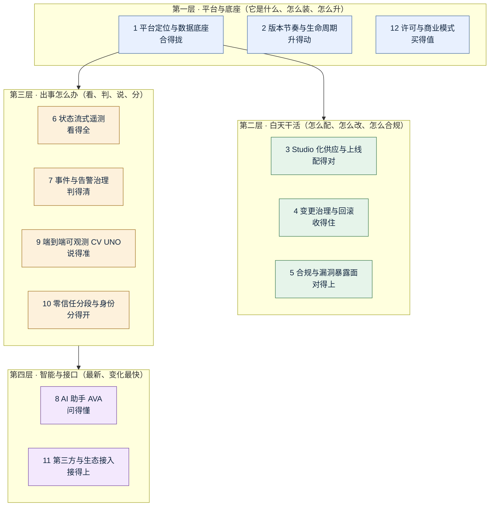
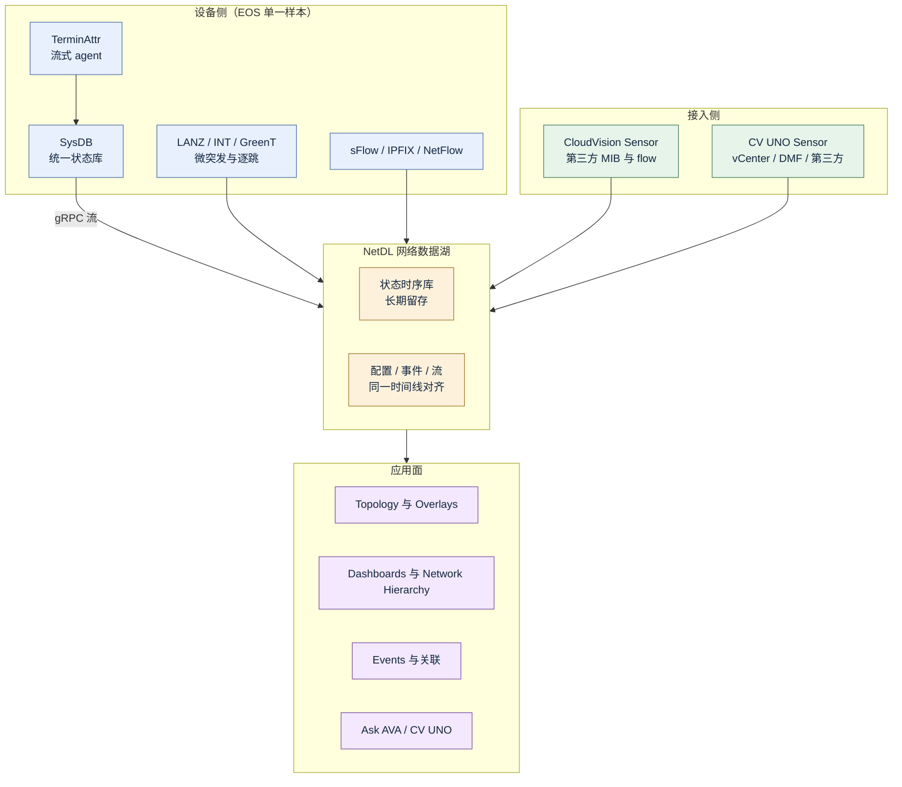
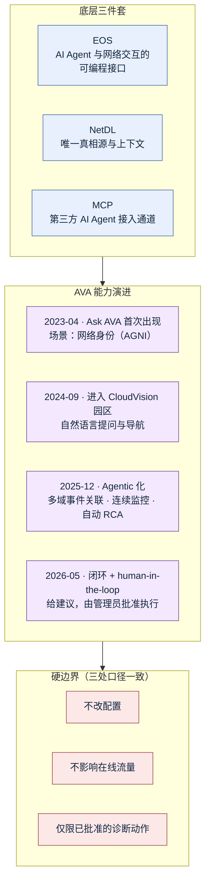

# Arista CloudVision 功能体系与痛点解法（2023–2026）

> **调研对象**：Arista CloudVision —— Arista 的**多域网络管理平台**（数据中心 / 园区 / WAN / 云），形态上同时提供**本地自托管 CVP 集群**、**硬件一体机 CVA** 与**云服务 CVaaS** 三条交付路径。它的技术根基不是“网管功能多少”，而是 **EOS 单一软件基线 + 状态流式遥测 + NetDL 网络数据湖**这三件东西。
> **调研范围**：**2023-01 ~ 2026-10** 公开发布的产品功能与能力增强。版本锚点采用本地版本线 **2023.1 → 2026.3**（官方生命周期页给出 GA 日期），CVaaS 视为同一功能集的滚动交付。
> **交付内容**：① 按大功能点分组、标注时间的小功能点清单（表格）；② 每个大功能点的「用户痛点 → 如何解决」详解（P/S 编号一一对应）。

## 前置说明：它的边界在哪里（先看这一段）

CloudVision 属于本系列分层中的 **L1 原厂自带网管**，但它与其他原厂的“护城河来源”不同，值得先说清两条边界：

1. **它的深，来自“单一软件基线”，不来自“排他性”。**
   所有 Arista 设备跑同一份 EOS 二进制，同一套 SysDB 状态模型。所以“园区、数据中心、WAN 用一套配置模型和一套遥测口径”这件事，在 **Arista 内部成立，跨厂商不成立**。对照 Cisco Catalyst Center 的“读设备内部只有我能读”，CloudVision 的表述更接近“**只要你跑 EOS，我就和你看同一份数据**”。

2. **第三方设备它是明说支持的，但止步于 MIB 线。**
   官方文档列死了第三方设备接入的能力依赖：**LLDP-MIB / LLDP-V2-MIB**（邻居与拓扑）、**ENTITY-MIB**（部件）、**SNMPv2-MIB**（系统信息）、**IF-MIB**（接口计数）、**IP-MIB**（地址与 ARP）、**BRIDGE-MIB / Q-BRIDGE-MIB**（MAC 表）——**“能支持到什么程度取决于设备自身实现了哪些 MIB”**。2026.1 起第三方设备可配事件；2026.3 起可导入其 flow 数据。这与本系列 2026-10-14 的结论一致：**第三方读得到“表的内容”，读不到“表的行为”**。

3. **它的自动化上限由 EOS 的可编程性决定，不由平台决定。**
   ZTP / ZTR、Compliance、Rollback 之所以能做成“平台级约束”，前提是设备端有 TerminAttr 流式 agent 与 eAPI。**换掉设备，这套自动化就不成立。**

> 忽略这三条，会把本报告误读成一份“功能更多的网管清单”；实际情况是**一套绑定 EOS 的运营方法论**。

## 信源与局限（先看这一段）

采用**三级信源交叉验证**：

| 等级 | 信源 | 覆盖时段 | 用途 |
| --- | --- | --- | --- |
| A | 官方 Release Highlights（arista.io / cv-prod-*.arista.io Help Center）、官方 **TOI（Transfer of Information）** 文章与 tag 聚合页、官方 **CloudVision Life Cycle Policy**、官方 User Guide / Configuration Guide / Data Sheet、官方新闻稿（investors.arista.com）、SEC 财报 | 2023-06 ~ 2026-10 | 功能颗粒度、版本号、GA 日期、生命周期、规模与许可事实的主依据 |
| B | 官方博客（blogs.arista.com）、官方渠道 Newsletter（Engineers' Exchange）、官方 Webinar / TOI 摘要页、主流行业媒体（Network World、Converge Digest、SiliconANGLE、SVG Europe） | 2023-04 ~ 2026-10 | 平台级发布的主题、日期与机制细节 |
| C | 授权经销商与比价站（DataSwitchStore、SHI、freeitdata 价目表转录）、Gartner Peer Insights、第三方技术博客与技术社区 | 2023-01 ~ 2026-10 | 价格量级、客户真实体感、交叉验证 |

**已知局限**：

1. **Arista 没有公开的逐条产品 changelog。** 功能级事实的权威来源是**逐版本的 Release Highlights**（官方 Help Center **只保留最近三个版本**：2026.1 / 2026.2 / 2026.3）与 **TOI 文章**（2024.2 / 2024.3 / 2025.1 / 2025.2 / 2025.3 / 2026.1 有独立页；**2023.1 / 2023.2 / 2023.3 只能通过 TOI tag 聚合页**取到条目与日期）。因此**2023 年的功能颗粒度系统性低于 2024 之后**——这是资料边界，不是产品边界。
2. **CVaaS 是连续交付，没有公开版本号。** 官方 Help Center 只对本地 CVP 版本线给日期。本文以 **2023.1 → 2026.3** 作时间锚，CVaaS 视为同一功能集的滚动发布；凡“云侧先到、本地后到”的差异，本文不做推断。
3. **AI 能力的可用状态分层，且与官方叙事有落差。** **Ask AVA 在 2026.2 官方帮助中心仍写作 beta 特性开关**（需管理员在 Settings > Features 打开）；**AVA 的 agentic 能力在 2025-12-10 新闻稿中宣布、官方目标 GA 为 Q1 2026**；2026-05-20 新闻稿称其“多域、闭环、human-in-the-loop”。本文逐条标注 **beta / 已宣布 / 已 GA**，不合并表述。
4. **规模数据公开颗粒度有限。** 官方 **System Requirements** 页只给单节点实验规格（28 CPU / 52 GB RAM / 1 TB SSD）与节点间延迟要求（≤10 ms，推荐 ≤5 ms；节点到设备 ≤500 ms），**“每集群支撑多少设备”放在 release notes PDF 里**。第三方经销商转录的“标准集群 250 交换机 + 3,000 AP / 大集群 1,000 交换机 + 5,000 AP”仅标 **C 级**，未在官方公开页核验。
5. **价格只到量级参考。** Arista 不公开完整价目，成交价走渠道。文中价格取自第三方价目表转录（freeitdata，2024-08 版），标 **C 级**，**不可用于预算测算**。
6. **厂商自述收益 ≠ 第三方验证。** 例如“策略部署时间缩短 75%”（AGNI，官方引用）、“CVE 数量比行业低一个数量级”（官方博客）——均为厂商口径，本文标“量级参考”。
7. **资料截止 2026-10-14。** 本文时间窗内最新本地版本为 **2026.3（官方 GA 2026-10-05）**；Gartner MQ 原文在付费墙后，本文只以官方新闻稿与第三方评分并列呈现。

**版本节奏对照表**（官方 Life Cycle Policy，用于把功能对齐到时间窗）：

| 版本线 | 初始发布（GA） | 支持截止 | 本时间窗内定位 |
| --- | --- | --- | --- |
| CVP 2026.3 | 2026-10-05 | 2028-10-05 | **最新**；团队协作与迁移 |
| CVP 2026.2 | 2026-06-30 | 2028-06-30 | 设备替换、事件降噪、AGNI/ClearPass 接入 |
| CVP 2026.1 | 2026-03-30 | 2028-03-30 | FIPS、Inventory 重构、第三方设备事件 |
| CVP 2025.3 | 2025-10-13 | 2027-10-13 | 特性开关集中管理（Features 页） |
| CVP 2025.2 | 2025-07-04 | 2027-07-04 | **Studios 端到端供应**（onboarding → 软件 → 配置） |
| CVP 2025.1 | 2025-03-31 | 2027-03-31 | **Network Hierarchy**（园区聚合视图） |
| CVP 2024.3 | 2024-10-21 | 2026-10-21 | **Studios 成大套**（Campus Fabric / Auth / Mgmt Conn / Sw Mgmt / Mirroring）、Campus Health、MSS |
| CVP 2024.2 | 2024-07-24 | 已停支持 | Studios 首批（Static Config / Software Mgmt / Access Interface）、Bearer Token、Campus Dashboard |
| CVP 2024.1 及更早 | 2024 上半年及以前 | 已停支持 | 本报告只作背景引用 |
| CVA（一体机软件） | 7.0 = 2024-11 / 7.1 = 2025-08 / 7.2 = 2026 | 7.1 至 2027-08 | 全量重建，AlmaLinux 9 基线 |
| CloudVision Sensor | 1.1.0 = 2025-06 / 1.2.0・1.3.0 = 2025-12 / 1.4.0 = 2026-04 | 1.4.0 至 2028-03 | 第三方数据源与 flow 采集入口 |

> **源冲突提示（2023 年 TOI 日期与版本号对不齐）**：TOI 页显示的 “Posted on” 日期与版本命名并不严格对应（例：2025.1 / 2025.3 的 TOI 均显示 “Posted on April 3, 2025”，而 2025.3 的官方 GA 是 2025-10-13）。**本文以 Life Cycle Policy 的 GA 日期为版本时间锚，TOI 日期只用于确认“该功能属于哪个版本线”。**

## 公司速览

| 维度 | 内容 |
| --- | --- |
| 公司 / 成立 / 总部 | Arista Networks, Inc.（NYSE: ANET），2004 年由 Andy Bechtolsheim、Ken Duda、David Cheriton 创立；总部美国加州圣克拉拉；**2008 年开始正式出货**；截至 2025 年底员工约 **5,200** 人 |
| 定位 | 数据驱动的 client-to-cloud 网络厂商；**数据中心 / AI 高速以太网交换机**为主战场，园区与路由为二层增长曲线，**CloudVision 是其统一管理面** |
| 产品谱系位置 | 设备（7000 / 7800 / 7060X / 720XP / Wi-Fi 7 AP）＋ **管理面（CloudVision：CVP / CVaaS / CVA）** ＋ 安全（AGNI / NDR / DANZ Monitoring Fabric）＋ 云原生路由（CloudEOS）＋ SD-WAN（VeloCloud，2025 年中并入） |
| 技术栈 | 南向：**TerminAttr 流式 agent（gRPC）**、eAPI、SNMP（第三方）、sFlow / IPFIX、OpenConfig / gNMI、LANZ、**Inband Telemetry（INT）**、Postcard Telemetry（GreenT）；北向：REST / **gRPC Resource API** / 订阅式流；数据底座：**NetDL 时间序列库**；自动化：Python（cvprac）/ Ansible / Terraform / AVD；AI：**AVA（Autonomous Virtual Assist）+ MCP** |
| 部署形态 | **CVaaS**（Arista 托管，浏览器接入）＋ **本地 CVP 3 节点集群**（自建 VM 或 Arista DCA 一体机，AlmaLinux 9 基线，支持气隙）＋ **CVA 一体机**（DCA-200/250/300/350E/400/450-CV）；**单节点仅限实验环境，官方不支持生产** |
| 部署硬性约束（A 级，官方 System Requirements） | 节点间延迟 **≤10 ms**（推荐 ≤5 ms）；节点到设备 **≤500 ms**；三节点必须在同一 LAN、中间不得放防火墙；需 ≥1 Gbps 带宽；不支持 HDD |
| EOS 兼容窗口（A 级，2025.3 口径） | 最低 EOS **4.23.0**，最高 **4.35.0F**；TerminAttr 最低 **1.19.5**（按 EOS 版本分别推荐 v1.31.11 / v1.34.5 / v1.37.6 / v1.38.2 / v1.39.1） |
| 关键财务（A 级，SEC 财报） | FY2023 营收 **$58.60 亿**；FY2024 **$70.03 亿**；**FY2025 $90.06 亿（+28.6%）**，GAAP 净利 **$35.11 亿**，非 GAAP 营业利润率 **48.2%**；FY2026 指引约 **$112.5 亿（+25%）** |
| 规模与结构（B 级，2025 Q4 财报电话会） | 累计出货 **1.5 亿端口**；订阅与服务收入占 **17%**；**园区与分支 2025 年收入 $8 亿**，2026 目标 **≥$12.5 亿**；累计客户 **>10,000**，国际业务增速 >40% |
| **CloudVision 专项规模（B 级，财报电话会）** | 2025 年**日均新增约 350 个 CloudVision 客户**；十年累计部署 **>3,000** |
| 权威背书 | **2026 Gartner MQ for Enterprise Wired and Wireless LAN：Leader**（Gartner 发布日 2026-05-18）；Forrester Wave: Data Center Network Solutions Q3 2026 领导者（创新与交换组合项获最高分） |
| 客户体感（C 级，Gartner Peer Insights） | CloudVision 评分 **4.8 / 5（219–231 条评分，5 星占 84%）**；正面集中在“**单一玻璃窗、ZTP 好用、API 强、实时轮询数据**”；负面高度集中在**“非常贵”“许可/采购订单集成偶有问题”“开箱报表模板太少”“报表与检测能力需改进”** |

**一句话看懂十二年演进**：

> **2015–2022 打地基**（把“配置下发”和“状态流式遥测”做成同一件事：configlet + TerminAttr + NetDL，先在数据中心跑通）→ **2023 扩域**（园区、WAN、身份安全三条线同时铺开，AGNI 上线、MSS/Zero Trust 起势、第三方数据源接入）→ **2024 立规矩**（**Studios 成体系**、Compliance 与 Studios 打通、**CV UNO 把应用与主机数据并入 NetDL**，变更开始被“工作空间 + dry-run + RBAC Change Control”约束住）→ **2025 收口**（**Studios 端到端**贯通 onboarding→软件→配置，**Network Hierarchy** 给大型部署加层级，老 configlet 树开始被引导迁移）→ **2025–2026 上智能**（**AVA / Ask AVA** 从“只读诊断”走向多域关联与人在环中的闭环，**经 MCP 向第三方 AI Agent 开放**）。
>
> 贯穿全程的第五条线是**“单一 EOS 基线”**：园区、数据中心、WAN 用同一份二进制、同一套状态模型。**它的深，来自软件一致性，不来自身份排他性。**

---

## 读法：12 个大功能点全景

| # | 大功能点 | 口号 | 小功能点数 | 时间跨度 |
| --- | --- | --- | --- | --- |
| 1 | 平台定位、交付形态与统一数据底座 | 合得拢 | 14 | 2023-01 ~ 2026-10 |
| 2 | 版本节奏、生命周期与设备软件对齐 | 升得动 | 13 | 2023-04 ~ 2026-10 |
| 3 | Studio 化供应与零接触上线 | 配得对 | 17 | 2023-06 ~ 2026-10 |
| 4 | 变更治理、回滚与工作空间协作 | 收得住 | 15 | 2023-11 ~ 2026-10 |
| 5 | 合规、漂移收敛与漏洞暴露面 | 对得上 | 12 | 2023-06 ~ 2026-10 |
| 6 | 状态流式遥测与网络数据底座 | 看得全 | 16 | 2023-06 ~ 2026-10 |
| 7 | 事件、关联与告警治理 | 判得清 | 15 | 2023-06 ~ 2026-10 |
| 8 | AI 助手 AVA 与 Agentic AIOps | 问得懂 | 13 | 2023-04 ~ 2026-10 |
| 9 | 端到端可观测 CV UNO 与 AI 作业观测 | 说得准 | 12 | 2024-03 ~ 2026-10 |
| 10 | 零信任分段与网络身份（MSS / AGNI） | 分得开 | 14 | 2023-04 ~ 2026-10 |
| 11 | 第三方设备与数据源接入 | 接得上 | 12 | 2023-06 ~ 2026-10 |
| 12 | 许可、定价与商业模式 | 买得值 | 11 | 2023-01 ~ 2026-10 |

> **合计 164 个小功能点。**
> **读法提示**：第 1–2 与 12 组回答“**它是什么、怎么装、怎么升、怎么买**”——其中第 2 组（生命周期）和 12 组（许可）是**客户最容易低估、也最容易踩坑的两组**；第 3–5 组是**白天干活**的一组（供应、变更、合规），是 CloudVision 相对其他原厂网管真正拉开差距的地方；第 6–7 与 9–10 组是**故障来了怎么办**的一组（遥测、事件、可观测、分段），也是与自研 APM 最直接可比的一组；第 8 组是**最新、变化最快**的一组，全部集中在 2023-04 之后、2025-12 起加速；第 11 组回答“**接不接得上**”。

---

# 大功能点 1：平台定位、交付形态与统一数据底座 —— 合得拢

## 1.1 小功能点清单

| # | 小功能点 | 发布时间 | 来源等级 | 说明 |
| --- | --- | --- | --- | --- |
| 1.1 | CloudVision **十周年**（首发 2015-06-23） | 2025-06（官方博客） | B | 官方口径：十年里最关键的资产是 **NetDL**——“从第一天起就按真正的多租户、scale-out 架构设计”，因此后来推出云服务时**不需要另做一个产品** |
| 1.2 | **本地 CVP 集群 与 CVaaS 云服务 双形态并存** | 2023-01 起持续 | A | 同一份功能集、两种运维责任；云侧 Arista 托管与升级，本地侧自建三节点集群 |
| 1.3 | 许可分层：**CloudVision** 与 **CloudVision Lite** 两档 | 2023 起（官方 Licensing 页） | A | 全功能档含完整分析、遥测与供应；**Lite 是入门子集**，只提供基础可视化与管理 GUI |
| 1.4 | **CloudVision Appliance（CVA）7.0** 全量重建 | 2024-11（官方 Life Cycle 页） | A | 基于 **AlmaLinux 9** 重写；**REST API + GUI + CLI 三通道可控**；AAA（RADIUS/TACACS+/**NIST 800-63b 密码规则**）、证书与加密套件管理、SNMP/Prometheus、IPv4/IPv6 双栈、**无人值守重装（Pave/Repave）** |
| 1.5 | **CVA 7.1** | 2025-08 | A | 起支持 **CVX**（CloudVision eXchange）应用；CVP **2024.2 起**可跑在 CVA 上 |
| 1.6 | **CVA 7.2** | 2026（TOI） | A | 新增 **DCA-400-CV / DCA-450-CV**；限制：全新安装**不清空旧数据盘**、**不支持 vEOS VM** |
| 1.7 | **多域统一运营模型**（数据中心 / 园区 / WAN / 云） | 2024-09-24（官方新闻稿） | B | 官方口径：“消掉不同厂商强加给客户的、每个域各一套的运营模型” |
| 1.8 | **CloudVision Pathfinder**（WAN / SD-WAN 管理） | 2024-09-24 宣布 | B | WAN 运营仪表盘把各互联网络遥测合进一张视图；官方称配置与流量工程“自动生成、测试、下发”，指向自愈网络 |
| 1.9 | **CloudVision Sensor** 虚拟采集器（独立版本线） | 1.1.0 = 2025-06；1.2.0・1.3.0 = 2025-12；**1.4.0 = 2026-04** | A | 第三方数据源与 flow 的采集入口；24 个月生命周期 |
| 1.10 | **Wireless Manager → CV-CUE** 更名 | 2026-04（官方 User Guide） | A | **CV-CUE = CloudVision Cognitive Unified Edge**；文档中全部改名，集成进 CVP 版本线 |
| 1.11 | **CV-CUE 云部署与本地 CloudVision 的集成将被弃用** | 2026.2 / 2026.3 版本说明 | A | 官方建议：要继续在 CloudVision 看 AP 数据，需迁移到 **CVaaS** 或**本地部署 CV-CUE** |
| 1.12 | **FIPS 140-3 Level 1** 合规模式 | 2026.1 | A | 集群以 FIPS 模式安装 + 启用 IPSec 模式；**出向 TLS（syslog、IdP）同样受约束** |
| 1.13 | **Agentic 平台定位**（“自驱动网络”的基础） | 2025-12-10（官方新闻稿） | B | 官方三段论：**EOS 提供 AI Agent 与网络交互的可编程接口 → NetDL 提供唯一真相源与上下文 → 第三方 AI Agent 经 MCP 接入** |
| 1.14 | CloudVision 客户规模披露 | 2025 财年（财报电话会） | B | 2025 年**日均新增约 350 个 CloudVision 客户**；十年累计部署 **>3,000**，累计客户 **>10,000** |

## 1.2 它对应的用户痛点

> **口径**：本节只写客户侧可感知的痛（时间 / 钱 / 人 / 合规 / 组织），不写“数据模型怎么归一”“多租户架构怎么切分”这类架构层问题。痛点编号 P1…Pn 与下节解法 S1…Sn 一一对应。

- **P1｜一个网要开好几个控制台**。园区一套、数据中心一套、WAN 一套、安全一套，跨域故障时先说清“哪台设备在哪套系统里”就耗掉时间，真正排障前先做了一轮“证据搬运”。（时间 / 组织）
- **P2｜管理平台自己也是一个要人伺候的系统**。本地部署要买机器、装集群、打补丁、做备份、排升级窗口；平台本身成了第二个要运维的生产系统，而它的运维能力并不在采购时的评估项里。（时间 / 钱）
- **P3｜云与本地二选一，选错要还很久**。受数据驻留 / 气隙约束的行业只能本地部署，但就失去“新功能自动到货”；选云侧的客户又要回答“网络状态数据落在哪里、谁能看”。（合规 / 钱）
- **P4｜集团多实例，总部看不到一张图**。按区域或业务建了多个集群，总部要汇总资产与健康只能逐个登录；跨集群事件没有共同基线，出事时各区域各说各话。（组织 / 时间）

## 1.3 它是如何解决的

**架构约束（由痛点倒推）**

| 架构约束 | 由哪条痛点倒推 | 落到了哪些功能 |
| --- | --- | --- |
| 一份功能集必须同时支撑“客户自建”和“厂商托管”两种责任边界，否则两套产品会分叉 | P2、P3 | CVP 与 CVaaS 同栈双形态；CVA 7.x 让设备底座也进同一管控面 |
| 数据必须集中到**一个可长期留存、可跨域关联**的底座，跨域才可能关联 | P1、P4 | **NetDL（网络数据湖）** 作为唯一真相源；多域统一运营模型；Pathfinder 把 WAN 纳入同一数据面 |
| 平台自身要尽量“无人值守”，并把自身状态也暴露成可观测对象 | P2 | CVA 7 的 Pave/Repave、Prometheus 上报、REST/GUI/CLI 三通、AlmaLinux 9 统一基线 |
| 必须在“数据不出域”的前提下提供同等能力 | P3 | **FIPS 140-3 模式**、支持气隙部署、本地一体机形态 |

- **S1｜一个数据底座承载全部域**（→ 解 P1、P4）：NetDL 把各域的**设备状态、配置、事件、flow** 收进同一时间序列库。跨域关联能成立的前提不是“界面合并”，而是**同一实体（一台终端、一条流、一次变更）能在一条时间线上对齐**。Pathfinder 解决 WAN 侧的同一件事。**边界**：NetDL 能把 Arista 域内的数据放一起，**第三方设备只有 MIB 与 flow 能进来**，跨厂商状态的“同粒度”并不成立。
- **S2｜同一功能集，两种责任划分**（→ 解 P2、P3）：CVaaS 由 Arista 托管并滚动升级，客户只消费；本地 CVP + CVA 由客户自持。差异在执行责任（谁打补丁、谁背 SLA、谁能碰数据）。**边界**：官方明确两者**并非严格等价**，个别特性可用性需按报价确认——不要把“同栈”读成“同功能”。
- **S3｜把设备底座也做成受管对象**（→ 解 P2）：CVA 7.x 把 appliance 自身变成 REST/GUI/CLI 可编程、可 Prometheus 上报、可“重铺”的对象，把“平台自身的运维”从人肉操作降为脚本操作。
- **S4｜多集群联邦 + 统一入口**（→ 解 P4）：官方路径是把多个集群以联邦方式纳到一个运营视图（Multi-Cloud Director / 全局视图）。**边界**：联邦层解决“**看得到**”，不解决“**改得动**”——跨集群变更仍须在各集群内做治理，联邦不提供跨集群的统一变更审批。
- **边界（整组）**：以上四条都建立在“**设备跑 EOS**”这一前提上。一旦网络里非 Arista 设备占比高，S1 的时间线对齐、S3 的可编程底座、S4 的跨域视图都会等比衰减。

## 1.4 配套演进（找不到痛点归宿的内容）

> 以下内容属于**定位与生态配套**，不是对客户痛点的直接回应，故不列入 S 列表。

- **CloudVision 十周年定位叙事**（2025-06，B）：强调“full network data without compromise / platform over point product / a modern operating model”三条原则。
- **CV-CUE 更名与集成弃用**（2026-04 起，A）：命名统一是文档动作；真正的动作是**弃用“云侧 CV-CUE 与本地 CloudVision 直连”**这条路径，把客户推向 CVaaS 或本地 CV-CUE。**这是本组唯一一条需要提前规划的事项**。
- **Agentic 平台定位**（2025-12-10，B）：把 CloudVision 从“管理平台”重新表述为“AI Agent 的落地基座”，详见第 8 组。

---

# 大功能点 2：版本节奏、生命周期与设备软件对齐 —— 升得动

## 2.1 小功能点清单

| # | 小功能点 | 发布时间 | 来源等级 | 说明 |
| --- | --- | --- | --- | --- |
| 2.1 | **24 个月生命周期政策**（CVP / CVA / Sensor 同轨） | 2023 起持续 | A | 每版本自 GA 起支持 24 个月；分 **Active Development**（修 bug）与 **Support Only**（只修需升级）两个阶段 |
| 2.2 | CVP **2024.2**：基底从 CentOS 迁 **AlmaLinux EL9** | 2024-07-24 GA（迁移自 2024.3 起随升级执行） | A | 官方给 **3 小时维护窗**；集群 VM **不需要重铺**，**不丢数据与日志**；但**客户自建的基础 OS 定制（cronjob、防火墙规则、CloudBuilder/IPAM 等扩展）会丢失**，需先备份到集群外 |
| 2.3 | 升级前置校验与设备门槛 | 2024.3 起 | A | 升级前须 `cvpi status all` 确认全节点 up；**设备须 ≥EOS 4.23.0、TerminAttr ≥1.19.5**、在流、镜像与配置均合规；**有变更控制排队时不得升级** |
| 2.4 | **版本不得跳级**（intermediate upgrade） | 2024.3 起 | A | 官方明确“升级到 2024.3 前先确认是否需要先升到中间版本”，并提供升级路径查询 |
| 2.5 | EOS 兼容窗口写入版本说明 | 各版本 | A | 2025.3 口径：最低 **4.23.0**，最高 **4.35.0F**；TerminAttr 最低 **1.19.5**，并按 EOS 版本给出推荐值 |
| 2.6 | EOS 在 CloudVision 内的退役节奏 | 2026-06-18 更新 | A | **EOS 4.27 及更早**：不支持；**4.28**：支持到 2028-06（CloudVision 内）；**4.29+**：支持；官方承诺 EOS 列车退役后**在 CloudVision 内再多支持至少 12 个月** |
| 2.7 | TerminAttr 在 CloudVision 内的退役节奏 | 2026-06-18 更新 | A | **v1.31+**：支持，无截止；**v1.28 / v1.29 / v1.30**：最后支持到 2026.2 本地版，云服务内 **2026-12 退役**；**v1.27 及更早**：云服务内 **2026-07 退役** |
| 2.8 | **官方升级路径查询工具**（CVP Upgrade Path） | 2023 起持续 | A | 官方支持站提供“从 X 升到 Y 需不需要中间步骤”的查询 |
| 2.9 | 2025.3 **Features 页**（特性开关集中管理） | 2025-10-13 | A | 把原 General Settings 里的特性开关搬进独立 **Features** 页，可按名称/状态筛选，并可一键 **Restore Defaults**；`Status: Modified` 可快速看出被改过的开关 |
| 2.10 | **beta 特性开关机制** | 2023 起持续，2026 仍在扩 | A | Ask AVA、Front Panel、Location-Based Geo Mode、Per-Device RBAC、Request Recorder、Studios 迁移、Partial Config Management 等均以 beta 开关交付 |
| 2.11 | CVA 独立 24 个月生命周期 | 2024-11 起 | A | CVA 7.0（2024-11 → 2026-11）、7.1（2025-08 → 2027-08）；6.0 及更早已 EoS |
| 2.12 | **CloudVision Sensor** 独立生命周期线 | 2025-06 起 | A | 1.4.0（2026-04 → 2028-03）Active Development；1.1.0–1.3.0 Support Only |
| 2.13 | 本地版本与 CVaaS 的版本差 | 持续 | A | 官方文档同时维护 `cv-prod-us-central1-c`、`cv-prod-euwest-2`、`arista.io` 三个帮助中心实例，**不同实例内容不同步**（例：Provisioning 页的“四种供应模型”命名在 2026.1 与 EU 实例中不一致） |

## 2.2 它对应的用户痛点

> **口径**：本节只写客户侧可感知的痛（时间 / 钱 / 人 / 合规 / 组织），不写“基底 OS 迁移的兼容性”这类架构问题。P1…Pn 与 S1…Sn 一一对应。

- **P1｜升级要占掉一个不短的维护窗口，而且不能出事**。管理平台升级期间自动化、遥测、变更下发都停摆；窗口里还要同时躲开设备侧的升级与变更。官方给 2024.3 的时间是**3 小时**，实际窗口要按最坏情况排。（时间 / 钱）
- **P2｜升级会把“自己加的东西”弄丢**。官方明说基础 OS 层的客户定制（cronjob、防火墙规则、CloudBuilder / IPAM 等扩展）在升级中会丢；这些配置往往没有正式台账，等于要凭记忆重建。（时间 / 人）
- **P3｜版本太多，支持和复现都得先对齐版本号**。同一集团里 2024.2 / 2024.3 / 2025.1 / 2025.3 并存，同一个缺陷在不同版本表现不同；开 TAC 工单、做兼容性矩阵、复现问题都要先问“你们跑的是哪个版本”。（组织 / 时间）
- **P4｜升到一半发现“跳级了”，要回退重来**。版本之间有“必须先升到某个中间版本”的约束，事前不知道就得把维护窗白排一次；管理面又是“配置的唯一真相源”，回退代价高。（时间 / 钱）
- **P5｜设备侧和管理侧的退役时钟不同步，谁先谁后算不清**。EOS 列车、TerminAttr 版本、CVP 版本、CVA 版本、Sensor 版本各自有 24 个月或更短的时钟，客户要在五条时间线上找出“哪条先到期”。（合规 / 时间）

## 2.3 它是如何解决的

**架构约束（由痛点倒推）**

| 架构约束 | 由哪条痛点倒推 | 落到了哪些功能 |
| --- | --- | --- |
| 管理平台必须是“可原地升级”的，而不是“重装重建”的 | P1、P4 | 升级只做在 primary 节点、自动推到其余节点；**不重铺 VM、不丢数据与日志** |
| 升级必须“可预见”——事前能判断能不能升、要几步 | P1、P4 | 官方 **Upgrade Path 查询**、前置健康检查 `cvpi status all`、设备最低版本校验、变更控制排队检查 |
| 基底变更必须被显式声明并要求客户自担备份 | P2 | 2024.3 基底迁移文档明确列出“会丢什么”，并要求把自定义配置备份到集群外 |
| 五条时钟必须各自公开且可查 | P3、P5 | **Life Cycle Policy 单页**同时给出 CVP / CVA / Sensor / EOS-in-CV / TerminAttr 五张支持矩阵 |
| 未完成的能力不能偷偷上线 | 支持成本（P3） | **Features 页的 beta 开关**：所有未 GA 能力默认关闭、集中可查、可一键复位 |

- **S1｜原地升级，不重铺不丢数据**（→ 解 P1）：升级在 primary 节点执行、自动分发到 secondary/tertiary；节点重启后重新接收设备流。**边界**：集群必须健康、设备必须满足最低 EOS 与 TerminAttr——**不满足的门槛设备升级后会连不上，必须重新纳管**。
- **S2｜升级前把“能不能升、要几步”讲清楚**（→ 解 P1、P4）：官方提供升级路径查询 + 前置健康检查 + 设备门槛校验。**边界**：官方同时建议“升级前先备份集群”，但**跨版本备份恢复能力是 3.x 时代才补齐的能力**（对照 Catalyst Center 的经验，这类“第一个大版本不能迁”的坑在 Arista 这里被较早已修掉）。
- **S3｜把“会丢的东西”写进升级文档并要求外部备份**（→ 解 P2）：2024.3 迁移页逐条列出会丢的定制项，并明确“备份要放在 CVP appliance 之外”。**边界**：**它只告诉你备份，不提供自动的定制项导出/恢复**——这部分仍是人工台账。
- **S4｜五条生命周期单页并列**（→ 解 P3、P5）：CVP / CVA / Sensor / EOS-in-CloudVision / TerminAttr 的支持矩阵放在同一页，并给出“EOS 列车退役后至少在 CloudVision 内再支持 12 个月”的承诺。**边界**：**决策仍要人做**——多个组件各自到期，官方不给“整体升级路线图”，只给单组件矩阵。
- **S5｜beta 开关把“未完成”显式化**（→ 解 P3）：所有 beta 能力走 Features 页开关，`Status: Modified` 一眼看出被改过的项，`Restore Defaults` 可复位。**边界**：**beta 开在谁身上、生产能不能开，官方不给判断标准**——文档措辞是“still under development”。

## 2.4 配套演进

- **帮助中心三实例内容不同步**（2.13）：属官方文档工程问题，非客户痛点，但**对做竞品跟踪的人是一条硬提示**——不能只订阅一个帮助中心实例。

---

# 大功能点 3：Studio 化供应与零接触上线 —— 配得对

## 3.1 小功能点清单

| # | 小功能点 | 发布时间 | 来源等级 | 说明 |
| --- | --- | --- | --- | --- |
| 3.1 | **Studios 框架**（点选式供应工作室） | 2024.2 首批（2024-07-24） | A | Studio = 面向特定网络架构或基础设施元素的**输入式模板**，把用户输入渲染成 EOS 配置；Workspace 记录一次配置会话中的全部改动 |
| 3.2 | **Static Configuration Studio**（含 configlet 容器与 tag 映射） | 2024.2 | A | 管“没有任何其他 Studio 生成的”静态配置；按 hostname / 角色 / 位置用 tag 把设备分进容器，容器内 configlet 下发到设备 |
| 3.3 | **Software Management Studio** | 2024.2 | A | 软件仓库上传 EOS 镜像、Streaming Agent、扩展，再按 workspace 分配给设备；可指定新纳管设备的镜像与 TerminAttr 版本 |
| 3.4 | **Access Interface Configuration Studio**（port profile + campus network） | 2024.2 | A | 端口 profile 打包速率、MTU、原生 VLAN、trunk 模式、PoE 优先级等；**改 profile 即改所有已分配接口** |
| 3.5 | **Interface Profile Assignment Quick Action**（前面板引导） | 2024.2 | A | 引导式工作流画出设备前面板，直接在图上选接口批量套 profile |
| 3.6 | **Campus Dashboard**（初版） | 2024.2 | A | 园区网络状态总览，设备实时流入，timepicker 可回看历史 |
| 3.7 | **Campus Fabric Studio（L2/L3/EVPN）** | 2024.3（2024-10-21） | A | 用 Arista Validated Design 搭完整园区：ZTP 纳管、定义角色与连接、配置 L2/L3 服务；支持 **VXLAN + 路由 underlay（OSPF/eBGP）+ 路由 overlay（eBGP）**，可定义到非 EOS 设备的连接；支持 **PTP、802.1X、IP Locking** |
| 3.8 | **Authentication Studio** | 2024.3 | A | 配 RADIUS 服务器，支持**用户认证 + 802.1X 认证与计费**（端口级的网络准入控制） |
| 3.9 | **Management Connectivity Studio**（OOB 管理口） | 2024.3 | A | 建管理接口属性 profile，按 tag 一次性套给多台设备 |
| 3.10 | **Mirroring Studio**（SPAN / L2GRE 到 DMF） | 2024.2 | A | 端口镜像（SPAN）或 **L2GRE 隧道**把流量送到远端（如 DANZ Monitoring Fabric） |
| 3.11 | **Streaming Telemetry Agent Studio** | 2023.3（2023-12-20） | A | **支持向多个集群同时流式输出**；可配 OpenConfig 流式等原本只能在 EOS CLI 里配的开关 |
| 3.12 | **Network Hierarchy**（校园分层聚合视图） | 2025.1（2025-03-31） | A | 跨网络层聚合指标与遥测，几次点击从网络聚合态下钻到单接口 |
| 3.13 | **Studios 端到端供应**（onboarding → 软件 → 配置） | 2025.2（2025-07-04） | A | 官方称 Studios 从此覆盖完整供应生命周期，一条工作流走完 |
| 3.14 | **Network Hierarchy 引导式配置**（campus / campus pod 向导） | 2026.2 beta → **2026.3 转正** | A | 向导式建园区与 campus pod，配 DNS / NTP / 本地用户 / AAA 等对全园区生效的设置 |
| 3.15 | **数据中心接口配置 Studio（Data Center Interface Configuration）** | 2026.3（2026-10-05） | A | 配数据中心 fabric 内接口（到服务器、防火墙、路由器）；支持 profile 继承与批量下发 |
| 3.16 | **Network Provisioning → Studios 迁移**（自动化迁移工具） | 2026.3 beta | A | 把老 configlet 体系的**配置、软件、设备分配、ZTP 自动升级设置**一起带过来，不需要重建 |
| 3.17 | 四种供应模型并存 | 2026.1 起 | A | **Studios / Configlet-Based Studios / AVD（Hierarchical YAML）/ Network Hierarchy（园区）**；官方允许混用与逐步迁移 |

## 3.2 它对应的用户痛点

> **口径**：本节只写客户侧可感知的痛（时间 / 钱 / 人 / 合规 / 组织），不写“configlet 继承树为什么难维护”这类设计问题。P1…Pn 与 S1…Sn 一一对应。

- **P1｜配置靠人逐台敲，量大且错一次要排查很久**。几百上千台接入交换机的同类配置，靠工程师对着 CLI 逐台做，批量变更还要反复核对。（时间 / 钱）
- **P2｜新设备上线“盲开”**：线缆插好了但拓扑关系没人知道，配置全凭图纸和记忆；上错端口、名字起重复、网段撞车，往往在业务报障后才发现。（时间 / 钱）
- **P3｜自动化能力的门槛绑在少数人身上**。会写模板、会维护自动化的人少，能力集中在个别资深工程师手里；**这些人一离职，自动化就停在原地**。（人 / 钱）
- **P4｜换一代供应体系等于把存量推倒重来**。从老 configlet 体系切到新模式，客户担心“几百个容器、上千个 configlet 要手抄一遍”，于是宁可不上新功能也不动。（时间 / 钱）
- **P5｜园区与数据中心的“做法”不是一套，团队之间不通**。同一家公司里园区用一套工作流、数据中心用另一套，人员轮岗要重新学，跨域故障时两拨人用的语言都不一样。（组织 / 人）

## 3.3 它是如何解决的

**架构约束（由痛点倒推）**

| 架构约束 | 由哪条痛点倒推 | 落到了哪些功能 |
| --- | --- | --- |
| 配置必须由“输入 + 模板”生成，而不是由人直接写文本 | P1、P3 | Studios 系列把每类网络元素封装成一个输入式模板（**studios 是抽象层，不是 CLI 片段集合**） |
| 批量改一个属性要能“一处改、处处生效” | P1 | **profile + tag** 机制（port profile、interface profile、管理口 profile、DNS profile），改 profile 即改所有已分配对象 |
| 上线前必须先能“看见将要形成的拓扑” | P2 | ZTP + **LLDP 邻居自动发现** + 预配置拓扑校验（先验证再下发） |
| 参数（主机名、管理网段）要由系统按规则生成，而不是人来编 | P2 | 命名规则前缀 + 自动序化生成主机名；园区/pod 级声明管理网段与 VLAN 变量，系统自动切出下一个可用地址 |
| 平台必须同时容纳“声明式模板”与“自由文本”两种现实 | P1、P4、P5 | 四种供应模型并存（Studios / Configlet-Based / AVD / Network Hierarchy），且可混用与渐进迁移 |
| 迁移必须是“搬”而不是“重建” | P4 | **Network Provisioning → Studios 自动化迁移**（2026.3 beta），保留镜像包与 configlet，映射为 tag 后在 Static Configuration Studio / Software Management Studio 内重建 |

- **S1｜用“输入式模板”替代手写 CLI**（→ 解 P1、P3、P5）：每个 Studio 面向一类网络元素（园区 fabric、DC 接口、认证、管理口、镜像、DNS、静态配置），用户填结构化输入，平台编译成配置。**同一套模板跨园区与数据中心复用**，是“两拨人用同一套语言”的机制来源。**边界**：Studio 只覆盖它面向的那类元素，**没被任何 Studio 覆盖的配置仍落在 Static Configuration Studio 里手写**——“模板化”不是全覆盖。
- **S2｜profile + tag 让“改一处、生效一片”**（→ 解 P1）：配置以 profile 为单元、以 tag 为选择器。改 profile 触发所有已分配接口/设备的更新，生成**一个后台配置增量**而不是 N 个变更。**边界**：profile 继承是**父到子单向**的——子 profile 能覆盖特定参数，但父级改动会对所有未覆盖的子级生效，改父级前要判断影响面。
- **S3｜上线前先“看见”拓扑**（→ 解 P2）：未配置设备以 ZTP 模式启动时，向导用 **LLDP 自动发现邻居链路**并画出预期拓扑，确认后才下发脚本；主机名与 IP 由系统按规则生成。**边界**：依赖 LLDP 可见性——**非 EOS 设备、或 LLDP 被关掉的链路，自动发现会缺边**，仍需人工补。
- **S4｜迁移工具把“老资产”搬过来**（→ 解 P4）：2026.3 的迁移工作流把老 configlet 树整体读入、保留镜像包与 configlet、映射成 tag，在 Studios 内重建。**边界**：**该迁移在 2026.3 仍标注 beta**；且官方把 **Network Provisioning 明确列为“正在被淘汰的遗留 app”**，长期看是单向门。
- **S5｜四种模式并存而不是强制切换**（→ 解 P5）：官方允许混用与逐步迁移，园区可用 Network Hierarchy、数据中心用 Studios、架构团队用 AVD（YAML）。**边界**：**“四种都能用”同时意味着“四种都要会”**——组织需要自己定“哪类网用什么模式”，官方不给收敛建议。

## 3.4 配套演进

- **Network Hierarchy 从校园扩到分支**（2026.1）：新增 Branch Groups / Branch Sites 分层视图，属能力扩展，非痛点回应。
- **Data Center Interface Configuration Studio**（2026.3）：把“DC 接口配置”从 Static Configuration 里独立出来，属产品线补齐。
- **前面板可视化与虚拟堆叠视图**（2024.3 起 Quick Action → 2026 通道化）：把物理机框、MLAG 对、SWAG 聚合为单一“虚拟堆叠视图”，属 UI 能力演进。

---

# 大功能点 4：变更治理、回滚与工作空间协作 —— 收得住

> **本组的定位**：这是 CloudVision 与多数原厂网管拉开差距的一组。它的核心不是“能不能下发配置”，而是**下发之前有多道闸门、下发之后有多条退路**。

```mermaid
flowchart LR
    S["Studio 输入<br/>或 Static Config"] --> W["Workspace<br/>暂存本次全部改动"]
    W --> V["自动构建与校验<br/>dry-run + 配置/软件兼容检查"]
    V -->|校验失败| W
    V -->|校验通过| SUB["提交 Workspace<br/>成为一次离散变更"]
    SUB --> CC["Change Control<br/>分阶段 · 定顺序 · 可排期"]
    CC --> AP["审批<br/>RBAC 约束 + 可强制非授权人复核"]
    AP --> EX["执行<br/>预快照 / 后快照 / 通知"]
    EX --> RB["Network Rollback<br/>回到某个时间点"]
    EX -.失败.-> RB
    classDef n fill:#e8f0fe,stroke:#4a6fa5,color:#12263f
    classDef g fill:#e6f4ea,stroke:#3f7d55,color:#12263f
    classDef r fill:#fde8e8,stroke:#a54a4a,color:#12263f
    class S,W,V,SUB,CC,AP,EX n
    class RB r
```

## 4.1 小功能点清单

| # | 小功能点 | 发布时间 | 来源等级 | 说明 |
| --- | --- | --- | --- | --- |
| 4.1 | **Workspace（工作空间）** | 2024.2 起 | A | 一次配置会话中的全部改动被记录进 workspace；**支持多人实时协作、交接与完整改动历史** |
| 4.2 | **提交即离散变更** | 2024.2 起 | A | workspace 提交后成为 Change Control 里的**一次离散变更**，进入评审与下发 |
| 4.3 | **Change Control 重设计** | 2023.2（2023-11-15） | A | UI 重构以改善导航与工作流速度；侧栏加信息，便于看清具体 action。官方明确这是**外观改动，不依赖后端 API 增强** |
| 4.4 | **Provisioning Actions（供应类 action）** | 2023.2 | A | Actions 里新增一组可对设备做额外操作的 action，与既有 action 一样加入变更控制，**供应可在变更控制内完成** |
| 4.5 | **Provisioning Settings** | 2023.3 / 2024.2 | A | 用一组统一设置约束供应动作的执行（如**调供应超时**），让 Change Control 的执行行为可预测 |
| 4.6 | **Connectivity Monitor Change Control Action**（连通性监控回滚） | 2023.3（2023-12-20） | A | 用 connectivity monitor 资源 API 监控连通性统计，**自动回滚影响设备连通性的配置变更**；2023.3 起预置，2023.2 可通过 GitHub 上的 action pack 获得 |
| 4.7 | **Change Control Events**（变更事件聚合） | 2024.2 | A | 同一次变更控制触发 ≥2 个相关事件时生成一条聚合事件，**抑制变更控制的告警量** |
| 4.8 | **Network Rollback（网络级回滚）** | 2023 起持续（配置回滚） | A | 把网络配置**回滚到某个时间点**，用于变更产生负面后果时稳定网络 |
| 4.9 | **连续快照与 Diff View** | 2023 起持续 | A | 历史状态库自动跟踪状态变化，**并排展示“改之前 vs 改之后”**，标出增减了哪些表项与配置行 |
| 4.10 | **变更模板（Change Templates）** | 2023 起持续，2024 强化 | A | 把重复性运行操作固化为可复用模板，按模板建变更 |
| 4.11 | **模态感知升级**（MLAG / BGP 维护模式 / SSU） | 2023 起持续 | A | 升级程序内建 MLAG 交换机对的升级流程，以及把 spine 通过 **BGP 维护模式**优雅摘出再放回的流程 |
| 4.12 | **RBAC 贯穿到每一步** | 2023 起持续 | A | 评审与审批步骤各挂 RBAC 权限级别；**可强制“非授权人不得审批”模型** |
| 4.13 | **Action Execution 权限** | 2024.2 | A | 新增角色权限控制**自定义 action 的独立执行**（如 Studio Autofill 触发、Action 编辑器里的单独执行） |
| 4.14 | **Workspace 同步**（团队协作） | 2026.3 | A | workspace 含“设计配置 + 软件”的时间点快照；**同步 workspace** 把它更新到最新设计配置，**减少多人并行造成的冲突** |
| 4.15 | **Workspace Island（常驻暂存面板）** | 2026 阶段（官方渠道文） | B | 把 workspace 的暂存、dry-run 校验与提交做成常驻面板，免除批量变更评审时反复翻页；侧并排 diff 展示运行配置与镜像将如何变化 |

## 4.2 它对应的用户痛点

> **口径**：本节只写客户侧可感知的痛（时间 / 钱 / 人 / 合规 / 组织），不写“配置模型怎么比对”这类设计问题。P1…Pn 与 S1…Sn 一一对应。

- **P1｜变更前不知道“会被改成什么样”**。工具一按就下发，出事才知道改了哪几行；变更评审时拿不出人话版的差异说明。（时间 / 钱）
- **P2｜改坏了回不去，或者回得很慢**。配置是逐台改的，真要回滚就得逐台倒回去，中途还可能碰上新旧混跑；管理层是唯一真相源，配错一步影响面放大。（时间 / 钱）
- **P3｜变更没有审批与留痕，审计时说不清**。谁在什么时候批的、执行顺序是什么、有没有按流程走，事后只能翻终端记录。（合规 / 组织）
- **P4｜多人同时改同一批设备会撞车**。两个人各自在自己那份视图上改，提交时才发现互相覆盖；交接班时“改到哪了”要靠口头说明。（组织 / 时间）
- **P5｜变更量本身成了噪声源**。一次大变更能连带刷出几十上百条事件，真正需要人看的那条被自己的变更埋掉。（时间 / 人）
- **P6｜批量升级时把冗余的两台一起重启**。设备是成对的（MLAG、堆叠、vPC 式配对），升级计划一按批次走就可能同时重启一对；该怎么切批次、哪台先走，要人对每台设备的冗余关系心里有数。（钱 / 时间）

## 4.3 它是如何解决的

**架构约束（由痛点倒推）**

| 架构约束 | 由哪条痛点倒推 | 落到了哪些功能 |
| --- | --- | --- |
| 改动不能在“直接下发”这条路上产生，必须先进暂存区 | P1、P4 | Workspace 作为唯一入口；提交后才成为 Change Control 的离散变更 |
| 暂存区必须“可校验、可读差异”，且校验在编译期完成 | P1 | workspaces 构建时自动校验（EOS 错误/冲突、软件兼容性），并排 diff |
| 系统必须保留“任意时间点的完整状态”才能回滚 | P2 | 连续快照 + 历史状态库 + **Network Rollback** |
| 每一个可执行动作都要能挂权限与审批 | P3、P4 | RBAC 贯穿评审/审批；**Action Execution** 单列权限；可强制非授权人复核 |
| 变更自身产生的事件必须被识别并折叠 | P5 | **Change Control Events** 聚合；变更控制内的事件与业务事件分开看 |
| 同一 workspace 必须能被多人安全并行 | P4 | 实时协作 + 交接 + 改动历史 + **Workspace 同步**（2026.3） |
| 硬件冗余形态必须进入执行顺序的计算 | P1、P6 | 模态感知升级（MLAG 对、BGP 维护模式、SSU） |

- **S1｜workspace 是唯一入口，提交才产生变更**（→ 解 P1、P4）：所有 Studio 与 Static Config 的改动先进 workspace，构建时自动校验，通过后才提交成 Change Control 的一次变更。**边界**：**绕过 workspace 的 CLI 直接改属于“带外变更”**，平台只能事后通过 Compliance 发现，不能事前拦。
- **S2｜提交前先看 diff，提交后先看结构**（→ 解 P1）：workspace 阶段给并排 diff（运行 vs 设计，配置与镜像都会显示将如何变化）；Change Control 阶段给出分阶段、分 action 的执行顺序视图。**边界**：diff 的可用性依赖“设计配置”是最新的——**长期带外改动多的环境，diff 会退化成大量噪声**。
- **S3｜回滚有两条路：一条靠快照，一条靠连通性校验**（→ 解 P2）：① **Network Rollback** 把配置退回某个时间点；② **Connectivity Monitor Change Control Action** 在变更期间实时看连通性统计，**一旦检测到变更打断了连通性就自动回滚**。**边界**：这是“**回滚能力**”而非“**自动修复能力**”——它把网络退回旧状态，不判断“新状态其实是对的、只是一条链路慢收敛”。
- **S4｜把审批权切成可组合的权限点**（→ 解 P3、P4）：评审与审批各挂 RBAC 级别，**可强制非授权人复核**；自定义 action 的独立执行另有 **Action Execution** 权限。**边界**：RBAC 定义的是“谁能点”，**不定义“该怎么走流程”**——变更日历、CAB 审批、SLA 这些组织流程不在产品内。
- **S5｜让变更自己产生的事件能被识别**（→ 解 P5）：同一次变更触发的多个相关事件被折叠成一条 **Change Control Events**。**边界**：聚合规则是“同一次变更 + ≥2 个相关事件”，**不解决“变更外的同源告警刷屏”**（那部分在第 7 组）。
- **S6｜模态感知让"批量升级"变成"按冗余结构升级"**（→ 解 P6）：升级程序内置 MLAG 对与 BGP 维护模式的摘放流程，避免"成对设备一起重启"；spine 通过 BGP 维护模式优雅摘出再放回。**边界**：模态感知只覆盖**平台已知的冗余形态**（MLAG、BGP、SSU）——**堆叠、自定义冗余编排、跨厂商冗余关系要客户自己拆批次**。

## 4.4 配套演进

- **模态感知升级的硬件前提**：需要设备支持 SSU / BGP 维护模式等 EOS 能力，属设备侧能力，非平台独有能力。
- **Request Recorder**（beta，2026 阶段）：拦截 UI 发出的 REST 调用与 JSON payload，让工程师把界面操作“反编译”成生产可用的 Python。属开发者体验类，归第 11 组一并讨论。

---

# 大功能点 5：合规、漂移收敛与漏洞暴露面 —— 对得上

## 5.1 小功能点清单

| # | 小功能点 | 发布时间 | 来源等级 | 说明 |
| --- | --- | --- | --- | --- |
| 5.1 | **Compliance Dashboard**（合规总览） | 2023 起持续 | A | 实时汇总**镜像合规 + 配置合规 + 安全合规**；改运行/设计配置时自动算差异并更新状态 |
| 5.2 | **Bugs & CVE Threats（漏洞与缺陷暴露）** | 2023 起持续，2026 文档沿用 | A | 依据官方发布的缺陷与安全通告，按**硬件与软件版本**算暴露面；数据来自 **AlertBase.json**，可手工更新或从 Arista AlertBase 服务器自动同步 |
| 5.3 | **CVE 事件与处置闭环** | 2023 起持续 | A | 对暴露的 CVE 生成事件，**直到该设备上的缺陷被解决或被确认（acknowledge）才结束**；点开可看到受影响设备、当前版本、修复版本，并给出安全通告直链 |
| 5.4 | **确认 / 取消确认（Acknowledge / Unacknowledge）** | 2023 起持续 | A | 可按设备确认，也可**“对所有当前与未来实例”一次性确认**；确认 CVE 会同时**关闭该 CVE 引发的事件告警** |
| 5.5 | **Sync Config / Sync Image**（把设备拉回合规） | 2023 起持续 | A | 把设计配置推到设备覆盖运行配置；**该动作本身会生成一次变更控制，须评审、审批、执行**（不会静默改网） |
| 5.6 | **Reconcile（对账）** | 2023 起持续 | A | 与 Sync 不同，对账允许**保留运行配置与设计配置各自的若干行**；Studios 纳管的设备在 Studios 内解决合规，Studio 外设备走 Network Provisioning |
| 5.7 | **End of Life（EOL）合规** | 2023 起持续 | A | 对软硬件做 EOL 总览（可切换 All / EOS / 无线 AP），甜甜圈图给出各类状态占比 |
| 5.8 | **EOS 版本合规事件** | 2026.2 | A | 设备运行 EOS 版本与事件规则里配置的“允许版本清单”不一致时，生成一条**警告事件** |
| 5.9 | **软件合规快照** | 2026.1 | A | 点 Device Software 页看选中设备的**当前与历史软件合规状态** |
| 5.10 | **Smart System Upgrade（SSU）+ 智能生命周期提示** | 2023 起持续（2026 强化） | A/B | 官方称 SSU 安装补丁并最小化中断；**升级校验阶段会注入 EOS 生命周期横幅**——若暂存的版本已过时，系统提示最新的已验证维护版本，以降低已知缺陷暴露 |
| 5.11 | **Compliance Updates（离线 / 自动同步）** | 2023 起持续 | A | AlertBase 可离线手工更新（适合气隙环境），也可自动同步 |
| 5.12 | **Device-level Compliance 视图** | 2023 起持续 | A | 单台设备详情页里有 Compliance 段，直接列出该设备受影响的所有缺陷与漏洞 |

## 5.2 它对应的用户痛点

> **口径**：本节只写客户侧可感知的痛（时间 / 钱 / 人 / 合规 / 组织），不写“配置比对算法怎么做”这类设计问题。P1…Pn 与 S1…Sn 一一对应。

- **P1｜合规检查靠人工，标准落不了地**。安全基线（禁用 Telnet、强制 AAA 外部认证、NTP 数量、镜像版本）靠人抽查，不同人查法不同，整改没有闭环。（合规 / 人）
- **P2｜安全通告发布那天，要先花一天搞清楚“我们有多少台受影响”**。等通告出来、等漏洞被利用、等缺陷在现场爆发，才回头查资产版本对应关系，应急节奏被前置的信息收集拖垮。（合规 / 时间）
- **P3｜手动改过的东西没人知道，漂移长期积累**。临时排障敲过的几行配置变成了事实配置，平台里的“设计配置”和真实运行状态越差越远。（时间 / 合规）
- **P4｜整改动作本身又是一次风险**。“把设备拉回合规”意味着要改生产设备的配置与镜像，谁都不想在合规这件事上引入新的变更风险，于是选择拖着。（钱 / 时间）
- **P5｜硬件软件到期没人盯，换届时才发现**。设备与软件 EOL 是缓慢逼近的，到了采购评估期才发现一批设备已经停服，被迫临时排预算。（钱 / 合规）

## 5.3 它是如何解决的

**架构约束（由痛点倒推）**

| 架构约束 | 由哪条痛点倒推 | 落到了哪些功能 |
| --- | --- | --- |
| “设计配置”必须是一个持续存在的对照物，而不是一次性脚本 | P1、P3 | 设计配置 vs 运行配置的持续差分与自动状态更新 |
| 缺陷与漏洞的暴露面必须由**版本 × 硬件**机械算出，不靠人查表 | P2 | **AlertBase.json** + 按硬件与软件版本计算暴露；支持自动或离线同步 |
| 合规处置动作必须走与普通变更同一条治理通道 | P4 | Sync Config / Sync Image **生成变更控制**，需评审审批 |
| 未处置的暴露必须持续可见，不能悄悄消失 | P2、P5 | CVE 事件**持续到缺陷被修复或被显式确认**；EOL 独立总览 |
| 气隙环境也要能用同一套判定 | P2 | Compliance Updates 支持离线手工更新 AlertBase |

- **S1｜设计配置作为持续对照物**（→ 解 P1、P3）：平台把每台设备的设计配置与运行配置持续对比，改任一侧都会触发合规状态重算；不一致的设备进入 Compliance Overview 表，点开可并排对比。**边界**：它自动化的是“**检测与呈现**”，**基线的定义权仍在客户**——平台不告诉你“你的基线应该是什么”。
- **S2｜漏洞暴露面由版本机械算出，且可直接接通告**（→ 解 P2）：AlertBase 给出缺陷/CVE 的受影响版本与修复版本；暴露设备列在表里，弹窗给出受影响设备、当前版本、修复版本与安全通告直链。**边界**：**暴露面判定依赖 AlertBase 的覆盖与及时性**；Arista 自述其 CVE 量级比行业低一个数量级（**厂商口径**），因此第三方组件与自研扩展的风险不在这条链路里。
- **S3｜合规整改走变更治理**（→ 解 P4）：Sync Config / Sync Image 不静默改网，而是生成一次变更控制，走评审、审批、执行的完整流程。**边界**：**Sync 是“覆盖式”的**（用设计配置覆盖运行配置），会把带外改动一并抹掉；要保留部分运行配置行必须用 **Reconcile**。
- **S4｜暴露面持续可见 + 显式确认**（→ 解 P2、P5）：CVE 事件一直开到修复或确认；EOL 单独一页给出各类软硬件状态占比。**边界**：**确认（acknowledge）是行政动作而非技术动作**——它能让告警与图表变干净，也**能一键把该 CVE 的所有事件告警关掉**。这是个双刃口子：用得好是“已评估风险”，用得差就是“把风险藏起来”。
- **S5｜把“合规”接进升级决策**（→ 解 P4、P5）：升级校验阶段注入 EOS 生命周期提示，若暂存版本已过时就提示最新已验证维护版；SSU 用于安装补丁并最小化中断。**边界**：提示是**建议不是拦截**；且 SSU 属于设备侧能力，老 EOS 列车不在覆盖范围。

## 5.4 配套演进

- **Arista 自身的安全工程叙事**（官方博客，2026）：强调“单一代码基线 → 测试与红队聚焦单点 → 最新 EOS 即最高质量版本”、控制面与数据面隔离限制爆炸半径、单 agent 隔离使定点修复可行。属**厂商方法论表述**，可作为对标参考，不作为客户侧事实。

---

# 大功能点 6：状态流式遥测与网络数据底座 —— 看得全

> **本组的定位**：这是 CloudVision 所有上层能力的**物理前提**。它要回答的从来不是“能不能看到指标”，而是**“看到的是抽样点还是真实状态、能不能回到过去”**。

## 6.1 小功能点清单

| # | 小功能点 | 发布时间 | 来源等级 | 说明 |
| --- | --- | --- | --- | --- |
| 6.1 | **NetDL（Network Data Lake）** 作为唯一真相源 | 2015 起家，2023–2026 持续扩展 | A/B | 官方口径：“流式传输网络的**完整状态**并**永久保留历史**”；2023 后从“网络状态”扩展为**网络 + 应用 + 用户身份 + 第三方**的复合数据集 |
| 6.2 | **状态流式遥测（替代 SNMP 轮询）** | 2023 起持续 | A | 官方反复强调：SNMP 轮询给不到现代大网所需的分辨率与实时性；**EOS NetDL Streamer** 提供低延迟、高频、事件驱动的洞察 |
| 6.3 | **LANZ（低延迟拥塞可见）** | 2023 起持续，2026 强化 | A | 微突发检测；2026.3 起 interface 详情页的 **LANZ Queue Drops / Queue Length / TX Latency 图按 traffic class 分序列**，并新增 **Queue Utilization 图** |
| 6.4 | **Inband Telemetry（INT）/ 逐跳延迟** | 2023 起持续，2026.1 强化 | A | 2026.1 起 Topology 的 Flows 视图支持 **hop-by-hop 延迟指标与路径可视化**（面向配置了 INT 的设备） |
| 6.5 | **Postcard Telemetry（GreenT）** | 2023 起持续 | A | Arista 自述的“明信片遥测”；**与 PTP 配合可给出逐跳的纳秒级延迟信息**；由 Postcard Telemetry Studio 配置 |
| 6.6 | **sFlow / IPFIX / NetFlow 流遥测** | 2023 起持续 | A | 通过 Static Configuration Studio 配置；流数据在 Traffic Flows 页查看，也可作为 Topology 的 overlay |
| 6.7 | **20+ 种 Topology Overlay** | 2024.2 起持续 | A | 官方称提供 20 多种 overlay 用于可视化设备、接口、链路属性；例：**PTP overlay** 一眼看出谁是 grandmaster、哪些设备同属一个 PTP 域 |
| 6.8 | **Topology Hierarchy Manager / Filter Builder** | 2023.2（2023-11-15） | A | 自定义拓扑框架与设备映射；**永久过滤器**保存进 Topology 的 Filters 区，可随时启停 |
| 6.9 | **Location-Based Geo Mode（地图视图）** | 2026 阶段 beta | A | 按设备所属位置在地图上展示拓扑 |
| 6.10 | **Network Utilization 页**（容量规划） | 2026.1 beta | A | 全网与单设备视角，分析上下行链路的流量利用率与均衡 |
| 6.11 | **Mobile-Friendly Interface Health Dashboard** | 2026.1 beta | A | 为手机/平板优化的接口健康视图，可移动端直接排障 |
| 6.12 | **PFC / ECN 指标** | 2026.2 | A | 选中接口可看 **PFC 速率**（入向/出向 PFC 速率图、按队列的 PFC 速率图）与**按队列的 ECN 标记速率图** |
| 6.13 | **MCS（Media Control Service）指标** | 2026.3 | A | 支持设备可看 MCS 数据，用于监控组播流、排查失败流、跟踪配置变更历史 |
| 6.14 | **端到端 TCP 分析（经 DMF）** | 2024 起 | A | 通过 DANZ Monitoring Fabric 集成采集端到端 TCP 分析与流数据 |
| 6.15 | **AQL Notebook（Advanced Query Language）** | 2023.1（2023-06） | A | 交互式查询工具，**按 cell 逐步执行**用于增量开发复杂查询并可视化数据 |
| 6.16 | **硬件表项容量与预测事件** | 2023.1 | A | 两个事件：硬件表项**当前使用率超阈值**；以及基于历史趋势**预测表项何时会满** |

## 6.2 它对应的用户痛点

> **口径**：本节只写客户侧可感知的痛（时间 / 钱 / 人 / 合规 / 组织），不写“轮询精度不够”这类技术属性。P1…Pn 与 S1…Sn 一一对应。

- **P1｜“网络是好的”这句话证不出来**。业务方报“系统慢”，网络团队只有一个时刻的表项计数器，说不出**在这两个时刻之间网络里发生了什么**；举证责任落在最先被问到的一方。（时间 / 组织）
- **P2｜微突发这类问题在采样口径下根本看不见**。端口平均利用率 30%，但业务已经在丢包；等发现时问题窗口早过了，抓不到现场。（时间 / 钱）
- **P3｜容量与扩容靠拍脑袋**。什么时候该扩上行、哪个方向先饱和，缺少有说服力的趋势依据，预算申请时讲不出量化理由。（钱 / 时间）
- **P4｜跨层问题在“层与层之间”发生，单层监控看不见**。延迟是链路、交换机缓冲、还是主机网卡造成的，只看网络侧或只看主机侧都得不出结论；排查变成跨团队的相互举证。（组织 / 时间）
- **P5｜想自己取数的人门槛高**。想回答“昨天有多少交换机重启过”，要么自己写查询，要么求懂平台的人做一张看板，业务的节奏等不起。（时间 / 人）

## 6.3 它是如何解决的

**架构约束（由痛点倒推）**

| 架构约束 | 由哪条痛点倒推 | 落到了哪些功能 |
| --- | --- | --- |
| 必须拿到**全量状态**而非抽样指标，且必须**永久留历史** | P1、P2 | 状态流式遥测 + NetDL 长期时序库；“回到某个时刻”成为默认能力 |
| 高频、事件驱动的遥测通道必须独立于轮询 | P2 | EOS NetDL Streamer；LANZ；INT；Postcard Telemetry（GreenT） |
| 网络状态必须与**应用、主机、身份**同一时间线对齐 | P4 | NetDL 从“网络状态”扩为复合数据集；CV UNO 把 vCenter / DMF / CMDB 数据并入 |
| 数据必须可被非专家查询 | P5 | **AQL Notebook**（逐 cell 增量开发查询）+ Dashboards + 事件/拓扑的图形化下钻 |
| 大网的可视化必须有层级、容量必须有趋势，否则“看得全”等于“看不见” | P1、P3、P4 | Network Hierarchy（多层聚合下钻）、Topology Hierarchy Manager、20+ overlay、**Network Utilization 页** |

- **S1｜拿到全量状态并永久留档**（→ 解 P1、P2）：设备把状态以 gRPC 流推入 NetDL，历史长期保留。因此“两个时刻之间发生了什么”可被直接回答，而不需要人肉比对两个时间点的 show 输出。**边界**：**留多久、留多细由部署侧决定**——NetDL 的技术能力不等于客户实际配置的保留期；**保留期短于复盘周期时，“能回到过去”这句话不成立**。
- **S2｜微突发与逐跳延迟走专用通道，而不是靠平均**（→ 解 P2、P4）：LANZ 专门盯微突发（2026.3 起按 traffic class 分序列展示队列丢包、队列长度、TX 延迟与队列利用率）；INT 在 Topology 的 Flows 视图给出 hop-by-hop 延迟与路径；Postcard Telemetry（GreenT）配合 PTP 给纳秒级逐跳时延。**边界**：LANZ 属于 EOS 的 **Z 许可**分组，**不在许可内的设备采不到**；INT / GreenT 需设备侧配置且需 **PTP 精密时钟基线**——没有时钟，纳秒级数字不成立。
- **S3｜把非网络数据并进同一底座**（→ 解 P4）：NetDL 纳入 vCenter、DMF、CMDB 与第三方设备数据；CV UNO 在其上建“应用到网络”的图。**边界**：**网络侧是流式全量、主机侧是轮询或 API 拉取**，两侧的时间粒度并不对等——跨层关联的精度上限由较粗的一侧决定。
- **S4｜让不懂平台的人也能取数**（→ 解 P5）：AQL Notebook 支持逐 cell 试错式查询；Dashboards 支持把结果固化成面板；Topology 的 overlay 把属性直接画在图上。**边界**：**AQL 仍是一门查询语言**——它降低的是“试错成本”，不是“学习成本”；真正的零门槛取数要等到第 8 组的自然语言接口。
- **S5｜分层下钻 + 利用率趋势，回答“该不该扩容、扩在哪里”**（→ 解 P1、P3、P4）：Network Hierarchy 做多层聚合（全球 → 区域 → 站点 → 设备 → 接口）；**Network Utilization 页**（2026.1 beta）提供全网与单设备视角，分析上下行链路的流量利用率与均衡，官方定位即“帮助做容量规划”。**边界**：① 层级由**标签与位置配置**定义——**标签体系没立起来，层级视图就是空的**；② Network Utilization 在 2026.1 仍标 **beta**，且它给的是**当前与历史的利用率分布**，**不给出“什么时候该扩”的预测结论**——容量决策仍要人做。

## 6.4 配套演进

- **硬件表项容量预测事件**（2023.1）：属于“用历史趋势预测未来”的早期形态，与后续 AVA 的异常检测同源。
- **MCS / PFC / ECN / 队列利用率**（2026.2–2026.3）：明显由 **AI 数据中心（RoCE / 无损以太）场景**拉动——这些指标在传统园区网里几乎无人问津，在 AI 集群里是核心。**这是一条“客户结构变化带动产品指标变化”的清晰证据**。

---

# 大功能点 7：事件、关联与告警治理 —— 判得清

## 7.1 小功能点清单

| # | 小功能点 | 发布时间 | 来源等级 | 说明 |
| --- | --- | --- | --- | --- |
| 7.1 | **Event Notifications 体系**（通知格式化 → 平台 → 接收方 → 规则） | 2023 起持续，2024.3 强化 | A | 四段式：格式化通知、配置通知平台、分配接收方、配置通知规则 |
| 7.2 | **Event Notification Output Templates**（通知输出模板） | 2024.3（2024-11-04） | A | 通知内容可按模板格式化，而不只是原始事件体 |
| 7.3 | **Rule Labels（规则标签）** | 2023.2 | A | 可选条件，用于把通知发给不同接收方平台，**支撑更复杂的通知规则** |
| 7.4 | **事件分组（grouping）** | 2023.3（2023-12-20） | A | 把相关事件成组显示以减少事件数；**分组通常是同类型、或同一设备/同一接口上触发的事件** |
| 7.5 | **Change Control Events 聚合** | 2024.2 | A | 同一次变更控制触发 ≥2 个相关事件时折叠成一条（详见第 4 组） |
| 7.6 | **SSL 证书到期事件**（提前 90 天） | 2023.1 | A | 证书到期前 90 天告警 |
| 7.7 | **CloudVision 节点磁盘利用率事件** | 2024.3 | A | 节点磁盘使用超默认阈值或超用户配置阈值时生成事件 |
| 7.8 | **接口错误/丢弃事件的“异常化”改造** | 2026.1 | A | **废弃** RX/TX Discards & Errors Breached Threshold 四个阈值事件，改为 **Abnormal Interface RX/TX Discards / Errors** 四个异常事件，**只在真正非预期时报告、且带多个严重级别** |
| 7.9 | **Cabling Issue Detected**（布线问题检测） | 2026.1 | A | 通过 `INTERFACE_STATE_CHURN` 类事件监控物理连通性问题 |
| 7.10 | **Event Categories（事件分类）** | 2026.1 beta | A | 把事件按问题域归类（如 L1 / L2 / 硬件），内置与自定义分类都可用来过滤 Events 页与 Network / Device / Interface 健康看板 |
| 7.11 | **Noisy Source Filtering（噪声源过滤）** | 2026.2 | A | 对产生过量事件的源**自动过滤**，以保证事件列表可读与页面性能；过滤器可撤销 |
| 7.12 | **Maintenance State Filtering（维护态过滤）** | 2026.2 | A | 给设备打 maintenance tag，**维护中设备产生的事件默认从事件看板与摘要里隐藏**，可按过滤器选择是否包含 |
| 7.13 | **Event Alerting Status（通知投递状态）** | 2026.2 | A | 可查看所有经告警系统发出的通知状态（含测试通知与真实告警），便于确认“到底发出去没有” |
| 7.14 | **EOS_VERSION_VIOLATION 事件** | 2026.2 | A | 运行版本与事件规则中允许的版本清单不一致时告警（与 5.8 同一功能的事件面） |
| 7.15 | **事件生成规则可打包分发** | 2026.3 | A | 自定义事件生成规则可随 **CloudVision Package** 导出/导入，**用于把事件监控口径在多套 CloudVision 部署间对齐** |

## 7.2 它对应的用户痛点

> **口径**：本节只写客户侧可感知的痛（时间 / 钱 / 人 / 合规 / 组织），不写“事件的触发与消除语义应该怎么定义”这类设计问题。P1…Pn 与 S1…Sn 一一对应。

- **P1｜告警洪泛，真问题被自己的告警埋掉**。一次峰值异常能刷出几百条同源事件，团队被迫先做“事件分类”再谈排障，真正的问题被推迟发现。（时间 / 人）
- **P2｜阈值型告警对“正常波动”过敏，团队逐渐不信它**。出勤率、设备密度、应用组合天天在变，固定阈值要么大面积误报、要么对真问题沉默。（时间 / 人）
- **P3｜通知发出去了没人知道，运维成了“告警盲区”**。配置完接收方以后，没人验证过“这条事件到底有没有到对方手里”，真出事时才发现通道断了。（时间 / 组织）
- **P4｜计划内的维护动作产生的告警把值班的人吵醒**。明明是自己安排的割接窗口，设备一重启就刷一片告警，值班被无意义地唤起。（时间 / 人）
- **P5｜多套部署的事件口径不一致，集团层面无法统一**。不同集群、不同团队各自定义事件规则，同一个现象在不同站点严重级别不同，跨站对比与集团汇报都对不齐。（组织 / 合规）
- **P6｜事件保留期短于复盘周期，月度回顾拿不到数据**。想要“上个月这类事件发生了多少次、集中在哪里”，数据已经被清掉了。（合规 / 时间）

## 7.3 它是如何解决的

**架构约束（由痛点倒推）**

| 架构约束 | 由哪条痛点倒推 | 落到了哪些功能 |
| --- | --- | --- |
| 事件的产生必须可控（能关、能折叠、能过滤），否则量级压不住 | P1、P4 | 事件分组、Change Control Events、Noisy Source Filtering、Maintenance State Filtering |
| 判定“异常”必须基于基线而非固定阈值 | P2 | 阈值事件改造为 **Abnormal** 事件（多级别）；CV UNO 的 ML 关联；AVA 的异常检测 |
| 通知链路本身必须可观测 | P3 | Event Alerting Status（含测试通知） |
| 事件规则必须可移植、可版本化 | P5 | 事件规则随 **Package** 导出/导入（2026.3） |
| 事件必须能按问题域聚合，才能用于健康看板 | P2、P5 | Event Categories（内置 + 自定义） |
| 历史事件必须留得住 | P6 | NetDL 长期留存（保留期由部署侧配置） |

- **S1｜把同源事件折叠起来**（→ 解 P1）：① **分组**把同类型或同设备/同接口上的事件成组显示；② **Change Control Events** 折叠一次变更引发的多条事件；③ **Noisy Source Filtering** 对有过量事件倾向的源自动过滤。**边界**：三种折叠都是**抑制呈现**而非**消除根因**——噪声源本身若真的在劣化，“被过滤掉”会让它更晚被发现。官方也明确 Noisy Source Filtering 的动机包含“保证页面性能”。
- **S2｜把“超阈值”改判为“异常”**（→ 解 P2）：2026.1 废弃四个“Breached Threshold”事件，改为四个 **Abnormal** 事件，**只在非预期时报告**并带多档严重级别。这是从“绝对值越线”转向“偏离预期”的判定口径变化。**边界**：官方未公开 Abnormal 的基线算法细节——**它是否用历史基线、用多长窗口，属于“未验证”**；对照 7.13 的 Event Categories，整体方向是明确的。
- **S3｜让告警投递可自证**（→ 解 P3）：**Event Alerting Status** 汇总所有经告警系统发出的通知状态，**包含测试通知与真实告警**，可跨接收方与平台排查。**边界**：它回答“发没发出去”，**不回答“对方处理了没有”**——告警到工单的闭环仍在 ITSM 侧（CloudVision 提供 ServiceNow 集成）。
- **S4｜把“我自己在维护”变成一等标签**（→ 解 P4）：设备可打 **maintenance tag**，维护态设备的事件**默认从事件看板与摘要里隐藏**，并可按 Maintenance State 过滤器选择包含与否。**边界**：这是**默认隐藏**而不是“不产生”——如果过滤条件被误用（例如忘了摘标签），真实故障会被一起隐藏。
- **S5｜事件规则可打包搬运**（→ 解 P5）：自定义事件生成规则随 Package 导出/导入，可把一套集群的事件监控口径复制到另一套。**边界**：它对齐的是**规则**，不对齐**阈值取值**——不同站点环境不同，“同规则”不等于“同灵敏度”。
- **S6｜事件按问题域归类并接进看板**（→ 解 P2、P5、P6）：Event Categories 把事件归入 L1 / L2 / 硬件等问题域，可用于过滤 Events 页与 Network / Device / Interface 健康看板；历史事件存于 NetDL。**边界**：分类是**过滤器**，不是因果分析——“这类事件多”不等于“根因在这类”。

## 7.4 配套演进

- **事件体系与 Studios / Change Control 的耦合**：变更控制事件（7.5）与合规事件（5.3 / 5.8）都不属于“设备自发的健康状况”，而是**平台动作的副产品**。CloudVision 选择把它们放进同一事件总线，好处是“一件事一个时间线”，代价是**事件总线的噪声来源多了一类**（这也是 7.11 存在的背景）。

---

# 大功能点 8：AI 助手 AVA 与 Agentic AIOps —— 问得懂

> **本组的定位**：AVA 是 Arista 的 AI 层。理解它的关键是**看它的权限边界**：从 2023 年到 2026 年，Arista 给 AVA 加的一直是“**看得更多、说得更准**”，而**执行权始终留在人手里**（最多到“人在环中批准”）。

## 8.1 小功能点清单

| # | 小功能点 | 发布时间 | 来源等级 | 说明 |
| --- | --- | --- | --- | --- |
| 8.1 | **AVA（Autonomous Virtual Assist）首个公开落地：Ask AVA** | 2023-04-24（官方新闻稿） | B | 出现在 **AGNI** 场景：把网络与安全运营经验“编码”为**有监督 + 无监督 ML 模型**，以类聊天界面做**配置、排障与安全策略分析** |
| 8.2 | **Ask AVA 进入 CloudVision 主平台** | 2024-09-24（官方新闻稿） | B | 面向更广的运维角色：用自然语言提问、导航平台、快速找到所需信息 |
| 8.3 | **Ask AVA 正式文档化（beta 开关）** | 2026.2 文档口径 | A | 在 Settings > Features 中启用；**聊天面板可拖拽可缩放**；**遵循当前用户的权限**，只展示该用户有权访问的信息与动作 |
| 8.4 | Ask AVA 能力：**取数** | 2026.2 | A | 查询设备、合规状态、事件、**缺陷暴露（bug exposure）**、配置变更 |
| 8.5 | Ask AVA 能力：**可视化** | 2026.2 | A | 生成**折线 / 柱状 / horizon / 环形**图，或构建表格追踪使用率与性能趋势；可全屏展开 |
| 8.6 | Ask AVA 能力：**跑诊断工具** | 2026.2 | A | 从指定设备发起 **ping / traceroute**，或执行 **EOS 命令** |
| 8.7 | Ask AVA 能力：**查文档** | 2026.2 | A | 搜索 Help Center、给摘要、并提供进入全文的深链 |
| 8.8 | Ask AVA 能力：**深链导航** | 2026.2 | A | 用深链直接跳到 CloudVision 的具体视图继续分析 |
| 8.9 | **AVA agentic 化**（官方称“统一 agentic AI 框架”） | 2025-12-10（官方新闻稿，目标 Q1 2026 GA） | B | 三项能力：**多域事件关联**（有线 / 无线 / 数据中心 / 安全收敛到单一根因）、**Ask AVA 的 agentic 多轮对话与排障**、**连续监控与自动根因分析** |
| 8.10 | **MCP（Model Context Protocol）开放** | 2025-12-10 | B | 官方口径：EOS + NetDL + MCP 的组合，使 **Arista 与第三方的 AI Agent 都能基于同一真相源做决策** |
| 8.11 | **闭环自动化 + human-in-the-loop** | 2026-05-20（官方新闻稿） | B | 官方表述：AVA 可**自主诊断跨域问题、制定精确的修复步骤，并安全地提交给 IT 管理员批准** |
| 8.12 | **AVA 驱动 AI Analyzer**（AI 网络场景） | 2025-03-12 | B | 提供 **100 微秒间隔**的高分辨率流量数据；AVA 亦驱动**远程 EOS AI Agent**，把 SuperNIC / 服务器的遥测流入 NetDL |
| 8.13 | **Ask AVA 的当前能力边界（官方明列）** | 2026.2 | A | **不支持 Topology、Provisioning、UNO、MSS**；大数据集渲染图/表会慢；**排障命令与变更控制不能同时运行**；反馈入口需要 `Telemetry > Feedback` 读写权限 |

## 8.2 它对应的用户痛点

> **口径**：本节只写客户侧可感知的痛（时间 / 钱 / 人 / 合规 / 组织），不写“大模型怎么接数据”这类技术实现。P1…Pn 与 S1…Sn 一一对应。

- **P1｜会取数的人少，问一个问题要等半天**。想确认“昨天有多少交换机重启”，要么自己写查询、要么等懂平台的人做一张看板，业务节奏等不起。（时间 / 人）
- **P2｜排障能力绑在资深工程师身上，人走了就断档**。判断路径在少数人脑子里，一线无法独立完成首轮排障，人力被反复消耗在重复劳动上。（人 / 钱）
- **P3｜同一个根因在不同域里被分别报警，关联靠人做**。有线、无线、安全、数据中心各报一条，工程师在脑子里做关联；跨域问题尤其依赖“见过类似场景”的经验。（时间 / 组织）
- **P4｜想让自有 AI 干活，但取数接口要自己写胶水**。要用自研模型与自研工作流，就得为每个平台的每个 API 写适配，并随 API 演进长期维护。（钱 / 时间）
- **P5｜AI 能读生产网络这件事本身就要过合规**。安全与合规团队要问：数据去哪了、会不会被拿去训练、AI 有没有权限改配置。（合规 / 组织）
- **P6｜就算 AI 判断对了，承担责任的人还是人**。运维组织里没有"AI 的责任位"——动作一旦无人签字直接生效，出了事找不到可追责的人，流程上也过不了变更审批。（组织 / 合规）

## 8.3 它是如何解决的

**架构约束（由痛点倒推）**

| 架构约束 | 由哪条痛点倒推 | 落到了哪些功能 |
| --- | --- | --- |
| AI 的答案只能来自“单一真相源”，否则无法跨域关联 | P1、P3 | AVA 建在 **NetDL** 之上；多域事件关联 |
| AI 的输出必须可执行（能带着上下文跳到具体视图），不能只是文字 | P1、P2 | 深链导航、图表生成、**从指定设备跑 ping / traceroute / EOS 命令** |
| 权限必须复用平台既有 RBAC，AI 不自建权限体系 | P5 | Ask AVA **遵循当前用户权限**，只呈现该用户被授权的信息与动作 |
| 数据不得外流、不得用于训练 | P5 | 官方口径：**对话留在客户环境内，数据不用于 AI 训练**；仅当用户显式提交反馈时才与 Arista 共享 |
| 第三方 AI 必须能接入，且接口要开放而不是私有 | P4 | **MCP** 通道；EOS 提供可编程接口 |
| 自动化必须有明确的人为关口 | P5、P6、P2 | **human-in-the-loop**：诊断与方案由 AI 出，执行由管理员批准 |

- **S1｜把自然语言接到“单一真相源”上**（→ 解 P1、P3）：Ask AVA 直接查 NetDL 与平台服务——设备、合规、事件、缺陷暴露、配置变更；agentic 化之后进一步做**跨域事件关联**，把有线/无线/DC/安全的多条告警收敛到单一根因。**边界**：**官方明列当前不支持 Topology、Provisioning、UNO 与 MSS**——即“网络架构视图、变更执行、端到端应用可观测、分段策略”这四块**不在当前覆盖内**，这恰好是它最有价值的四块之一。
- **S2｜答案必须能落到具体动作上**（→ 解 P1、P2）：Ask AVA 生成图表与表格、给 Help Center 深链、**直接从指定设备跑 ping / traceroute / EOS 命令**、并用深链跳进具体视图。**边界**：三条硬边界三处口径一致——**不改配置、不影响在线流量、只限已批准的诊断动作**；且**排障命令与变更控制不能同时运行**，说明诊断通道与变更通道在实现上是互斥的。
- **S3｜复用平台 RBAC，AI 不自建权限体系**（→ 解 P5）：Ask AVA 以当前用户身份取数，只呈现该用户有权访问的内容。**边界**：AI 层的权限等于底层用户权限，**这既是优点（不会越权）也是限制（看不到用户本身看不到的东西）**——“AI 帮我查一下隔壁团队的网”这类诉求在架构上被拒绝。
- **S4｜数据留在客户环境内，不用于训练**（→ 解 P5）：官方明确对话留在环境内、数据不用于训练，仅显式提交反馈时才共享。**边界**：这是**产品口径**，且**Ask AVA 的启用本身需要管理员打开 beta 开关**——对合规敏感的客户，“能不能开”仍要走内部评估。
- **S5｜用 MCP 把“接入权”交给生态**（→ 解 P4）：2025-12-10 官方明确 MCP 路径，使第三方 AI Agent 能基于同一 NetDL 上下文做决策。**边界**：**官方未公开 MCP 的服务端清单、权限模型与工具目录**——这意味着“第三方 Agent 能看多少、能做什么”当前不可核实。对照同系列 Catalyst Center 的报告（其 MCP 明确写了“不增加授权层、不强制只读、工具目录可能包含改配置操作”），**Arista 在这块的披露明显更保守、也更模糊**。
- **S6｜闭环但保留人工批准**（→ 解 P2、P5、P6）：2026-05 官方表述为"自主诊断 + 制定修复步骤 + 安全地提交管理员批准"。**边界**：**这是本组最重要的一条边界**——Arista 截至 2026-10 **没有宣称 AVA 会自动执行变更**；"自驱动网络"是叙事，"人在环中批准"是当前实现。任何"CloudVision 已能自动修复"的表述都缺乏信源支持。

## 8.4 配套演进

- **AVA 的两条分支**：一条是**运维助手分支**（Ask AVA，面向 NetOps，只读诊断），另一条是**AI 网络数据面分支**（AI Analyzer、EOS AI Agent，100 μs 分辨率、面向 AI 集群）。二者共享 AVA 品牌但服务对象完全不同，**做对标时不应混为一谈**。
- **AVA 与 AGNI 的历史耦合**：Ask AVA 的首次公开场景是网络身份（2023-04），随后才进入 CloudVision 主平台（2024-09）。这条顺序说明 **Arista 的 AI 落点选择是“先回答一个高痛点、可枚举的问题（为什么 Bob 连不上）”，再泛化到通用取数**——是一条值得借鉴的落地顺序。

---

# 大功能点 9：端到端可观测 CV UNO 与 AI 作业观测 —— 说得准

> **本组的定位**：CV UNO 是 CloudVision 从“网络可观测”跨到“应用/主机可观测”的那一步。它要解决的不是“看到更多指标”，而是**“出问题时，谁的问题”**。

## 9.1 小功能点清单

| # | 小功能点 | 发布时间 | 来源等级 | 说明 |
| --- | --- | --- | --- | --- |
| 9.1 | **CV UNO（CloudVision Universal Network Observability）发布** | **2024-03-05**（官方新闻稿） | A/B | 面向数据中心、园区、WAN 的网络可观测平台，把网络基础设施性能与来自计算/服务器的数据合并；官方口径：“**客户一直在要一个复合系统**” |
| 9.2 | CV UNO **GA 时点** | 官方口径 **2024 Q2**，作为 CloudVision **premium feature license** | A/B | 官方明确“as a premium option on CloudVision” |
| 9.3 | **CV UNO Sensor** | 2024 起 | A | 软件传感器，部署在本地 VM；收集、归一、整理来自 **VMware vCenter、DANZ Monitoring Fabric、第三方网络设备**的 flow 与 SNMP 数据，转发进 NetDL；也轮询 vCenter 并订阅 vCenter 事件 |
| 9.4 | **CV UNO Recorder Node**（可选） | 2024 起 | A | 增加**抓包、查询与包回放**能力，支持入侵检测、事件响应与取证 |
| 9.5 | **CV UNO Service Node**（可选） | 2024 起 | A | 高级包处理：**端到端应用时延分析**、**基于 DPI 的应用识别与分类** |
| 9.6 | **CV UNO Analytics Node**（可选） | 2024 起 | A | 分布式上下文感知的流量分析与机器学习能力，面向大规模优化 |
| 9.7 | **应用与基础设施发现** | 2024 起 | A | 跨平台、跨 IT 系统自动识别应用、主机与工作负载；构建**持续更新的“应用到网络”图**并保留历史 |
| 9.8 | **变更影响分析（Change Impact Analysis）** | 2024 起 | A | 变更**下发前**评估潜在影响（如关掉某端口会影响哪些下游应用）；变更**发生后**自动指出哪次变更影响了哪个应用 |
| 9.9 | **主机 / 应用侧变更影响分析** | 2024 起 | A | 网络未变但主机或虚拟化出问题时，**无需在主机上装 agent**，直接指向根因 |
| 9.10 | **Topology-Aware Determination** | 2024 起 | A | 汇聚基础设施系统、虚拟机、系统记录（SoR）与网络流/状态数据来判定根因，官方称“**避免传统做法里的相互推诿**” |
| 9.11 | **AI 作业中心可观测（AI job-centric observability）** | **2025-03-12**（官方新闻稿） | B | 把网络数据与 **AI 作业指标**关联：作业完成时间、拥塞指标（**ECN 标记包、PFC pause 帧、丢包**）、缓冲区/链路利用率；下钻到服务器 NIC（**PFC 失同步事件、RDMA 错误、PCIe 致命错误**）与相关流；GA 目标 **2025 Q2** |
| 9.12 | **AI 作业流量可视化** | 2025-03-12 | B | 用 CV 的拓扑映射做到**微秒粒度**的实时 AI 作业流可视化 |

## 9.2 它对应的用户痛点

> **口径**：本节只写客户侧可感知的痛（时间 / 钱 / 人 / 合规 / 组织），不写“数据模型怎么拼”这类设计问题。P1…Pn 与 S1…Sn 一一对应。

- **P1｜分不清“是网络问题还是应用问题”，两个团队互相举证**。业务方报“系统慢”，网络团队和应用团队各拿一套数据说话，缺一份双方都接受的证据；解决问题的时间被消耗在归责上。（时间 / 组织）
- **P2｜变更之后才担心，事前没人说得清影响面**。准备关一个端口、撤一条链路，没人能回答“这会打到哪些业务”；出了事才知道。（钱 / 时间）
- **P3｜主机侧的问题被记在网络账上**。虚拟机、网卡、驱动层面的问题在网络指标里看不出来，但故障现象是“网络慢”，网络团队先背。（组织 / 人）
- **P4｜AI 集群里贵的不是网，是卡停着**。训练作业卡住时，GPU 在烧钱但不产出；而“哪一跳、哪个队列、哪张网卡”出的问题，靠传统网络监控答不出来。（钱 / 时间）
- **P5｜取证与响应要用时才发现没有留包**。安全事件或疑难故障需要原始包与回放能力时，现场早已过去，只能事后复现。（合规 / 时间）
- **P6｜为"将来可能要用"而长期全量留包，成本与合规上都承受不了**。全量抓包既占存储也触及数据合规边界，多数客户做不到默认全开；但一旦默认不开，需要时又拿不到。（钱 / 合规）

## 9.3 它是如何解决的

**架构约束（由痛点倒推）**

| 架构约束 | 由哪条痛点倒推 | 落到了哪些功能 |
| --- | --- | --- |
| 必须把“网络之外”的数据并进同一底座，才可能做跨层归因 | P1、P3 | CV UNO Sensor 采集 vCenter / DMF / 第三方数据入 NetDL；“应用到网络”图 |
| 归因必须基于拓扑，而不是基于指标大小 | P1、P3 | Topology-Aware Determination；CV UNO 的 ML 关联（topology-based / time-based / function-based 三个维度） |
| 变更影响必须在**下发前**可评估 | P2 | 变更前置影响分析（嵌进变更管理流程） |
| 主机侧不能依靠装 agent | P3 | 官方明确“**无需部署主机 agent**” |
| AI 场景需要微秒级、并关联到作业与网卡 | P4 | 100 μs 分辨率流量数据；PFC / ECN / RDMA / PCIe 指标；AI 作业仪表盘 |
| 取证能力必须是可选的独立组件，而不是默认全量留包 | P5、P6 | Recorder / Service / Analytics 三个**可选**节点 |

- **S1｜把应用与主机数据并进同一数据湖**（→ 解 P1、P3、P4）：CV UNO Sensor 从 vCenter、DMF、第三方设备收集 flow 与 SNMP 数据进 NetDL，并与 CloudVision 已有的网络状态合并。**边界**：**网络侧是全量流式、主机侧是轮询与 API 拉取**——两侧时间粒度不对等，跨层关联精度受较粗一侧限制（与第 6 组 S4 同一边界）。
- **S2｜用拓扑做归因而不是用指标大小**（→ 解 P1、P3）：CV UNO 在 NetDL 数据上做 ML，推断 **topology-based / time-based / function-based** 三个维度的关联，把事件、变更与异常串起来。**边界**：拓扑图的完整性依赖设备发现——**拓扑缺边时，“拓扑感知”会给出错误方向**；且官方未公开关联算法的判定规则，只能按结果评估。
- **S3｜变更前先算影响**（→ 解 P2）：在变更管理流程内做“如果这么改会影响哪些应用”的前置分析；变更后自动指出“哪次变更影响了哪个应用”。**边界**：前置分析基于**已发现的应用依赖图**——**未被发现的应用不在分析范围内**，这会给出“看起来没影响”的假安全感。
- **S4｜不装 agent 也能指向主机侧根因**（→ 解 P3）：官方明确无主机 agent 依赖，通过网络侧的流与状态数据 + 虚拟化/SoR 数据交叉定位。**边界**：**不能装 agent 是优势也是代价**——拿不到主机内部的进程级信息，能回答的是“主机/网卡侧的流量与缓冲表现”，不是“哪个进程在占资源”。
- **S5｜AI 作业观测绑定“钱”而不是“网”**（→ 解 P4）：把网络指标关联到 **AI 作业完成时间 / 拥塞指标 / 缓冲区利用率**，并下钻到 NIC 层（PFC 失同步、RDMA 错误、PCIe 致命错误）。**边界**：需要配套设备能力与高分辨率遥测（PFC / ECN / 队列利用率）；**这些指标只在新平台上有**（对照第 6 组 6.4 / 6.12 / 6.13 的注入时序）。
- **S6｜取证能力做成可选组件，而不是默认全量留包**（→ 解 P5、P6）：Recorder Node 提供抓包、查询与包回放；Service Node 提供端到端应用时延与 DPI 分类；Analytics Node 提供分布式大规模分析——**三者均为可选项**，客户按需采购与部署，不必为"可能用到的取证"长期承担全量存储与合规成本。**边界**：可选化的代价是**默认形态下并没有留包能力**——"要用的时候有没有"取决于事前是否采购，出事之后补不回来。

## 9.4 配套演进

- **CV UNO 的定位漂移**：2024-03 发布时是“通用网络可观测”，2024-09 被并入“多域运营模型”叙事，2025-03 起明显向 **AI 数据中心**倾斜（AI 作业观测）。这条漂移与 Arista 的客户结构变化（AI 与云客户占比升至 48%）一致。
- **CV UNO 与 CloudVision 的许可关系**：官方口径一致——**premium feature license**，不是 CloudVision 基础许可的一部分。

---

# 大功能点 10：零信任分段与网络身份（MSS / AGNI） —— 分得开

## 10.1 小功能点清单

| # | 小功能点 | 发布时间 | 来源等级 | 说明 |
| --- | --- | --- | --- | --- |
| 10.1 | **CV AGNI（Arista Guardian for Network Identity）发布** | **2023-04-24**（官方新闻稿，旧金山 RSA 大会） | B | 云交付、AI 驱动的网络身份服务；**基于 CloudVision 平台**，把零信任扩展到企业安全 |
| 10.2 | AGNI 云原生架构定位 | 2023-04 | B | 官方三大卖点：**Simplification**（消除本地部署的算力规划与扩容复杂度）、**Security**（用用户与设备上下文简化分段）、**Scale**（微服务架构弹性伸缩） |
| 10.3 | AGNI 身份能力：**用户自助上线 + 证书** | 2023-04 | B | 无线侧**按用户唯一预共享密钥（UPSK）**、**802.1X 数字证书**；**云原生 PKI** 做证书管理 |
| 10.4 | AGNI 设备能力：**发现 / 画像 / 分组** | 2023-04 | B | 全网设备可见性；发现、画像并分类进组，供“单玻璃窗”管控 |
| 10.5 | AGNI 分段能力：**组内微隔离** | 2023-04 | B | 官方称“**超越传统的组间宏分段**”：与 Arista 网络平台结合时，可通过 **VLAN / ACL / Unique-PSK / MSS-Group** 技术做**组内微隔离** |
| 10.6 | AGNI 与 **NDR** 联动 | 2023-04 | B | NDR 检出威胁时与 AGNI 协同，**隔离设备或降低其访问级别** |
| 10.7 | AGNI 第三方集成范围（首版） | 2023-04 | B | 端点管理：Medigate by Claroty、CrowdStrike XDR、Palo Alto Cortex XDR；身份：Okta、Google Workspace、Microsoft Azure、Ping Identity、OneLogin；MDM：Microsoft Intune、JAMF；SIEM：Splunk；**网络设备支持多厂商** |
| 10.8 | AGNI 版本线（独立于 CVP） | 2023.3 → **2026.3** | A | 官方产品公告索引可见 2023.3.0-A1 起的完整版本线（含 2024.1 / 2024.2.x / 2024.4.x / 2025.2.x / 2025.4.x / 2026.2 / 2026.3，以及若干 P- 前缀版本） |
| 10.9 | **MSS（Multi-Domain Segmentation Service）微边界分段与执行** | 2024.3（2024-11-04） | A | 作为 Arista 零信任网络（ZTN）的一部分支持**微边界分段与执行**；官方表述：“ZTN 把横向移动空间收得越来越小，工作负载被细粒度标识，只允许被批准的连接” |
| 10.10 | **Segment Security Studio（静态分段）** | 2024.3 起 | A | 静态分段在 Studio 内配置；动态分段走第三方应用（如 Forescout），配置好后在 **Network Segmentation** 页查看 |
| 10.11 | **AGNI 作为数据源接入 CloudVision** | 2026.1 / 2026.2 | A | 用模板或 YAML 纳管 AGNI：填 Base URL / Organization ID / 用户名 / 认证 Token、Poll Interval，可勾选**用于 MSS 的 Traffic Policy** |
| 10.12 | **AGNI 端点详情进 CloudVision** | 2026.2 | A | AGNI 发现的端点在 Endpoint Overview 里可看**会话历史、用户信息、客户端详情** |
| 10.13 | **ClearPass 接入**（动态导入分组） | 2026.2 | A | 把 ClearPass 作为数据源纳管，**动态导入分组**供 **MSS 安全策略**使用 |
| 10.14 | **MSS 策略导入与监控增强** | 2026.1 / 2026.3 | A | 从外部源（**Cisco ISE / Forescout API**）**动态导入整条策略**（含规则与对象）；2026.3 起一条策略可用**多个 monitor 对象**、每个 monitor 对象可跨 **ZTX 设备集群**运行；Policy Builder 内可看每个会话的 monitor 对象与其设备 |

## 10.2 它对应的用户痛点

> **口径**：本节只写客户侧可感知的痛（时间 / 钱 / 人 / 合规 / 组织），不写“策略引擎怎么下发”这类设计问题。P1…Pn 与 S1…Sn 一一对应。

- **P1｜老 NAC 部署成本高、扩不动**。传统 NAC 靠本地硬件或一堆虚机承载，改动要人工、扩容要买机器、业务规模小时又贵到不划算。（钱 / 时间）
- **P2｜“谁连上来的”说不清，IoT 设备尤其说不清**。摄像头、打印机、医疗设备上来就是一堆 MAC，没有身份上下文，只能给个“访客网”了事。（时间 / 人）
- **P3｜分段只做到“大区域”，横向移动拦不住**。组间做宏分段是常规操作，同一个组里的横向移动没人管；勒索软件一旦进了一个组，组内基本畅通。（钱 / 合规）
- **P4｜策略散在多个厂商的控制台里，对不上账**。身份在 IdP、macOS 设备信息在 MDM、威胁告警在 NDR、策略在网络设备上，改一条策略要在四个系统里改。（组织 / 时间）
- **P5｜出事了想“隔离这台设备”要先找几个人**。威胁检出后要人工登录多个系统下发隔离动作，响应速度和处置一致性都靠人。（时间 / 合规）

## 10.3 它是如何解决的

**架构约束（由痛点倒推）**

| 架构约束 | 由哪条痛点倒推 | 落到了哪些功能 |
| --- | --- | --- |
| 身份服务必须是云原生、弹性伸缩的，不能靠堆本地虚机 | P1 | AGNI 云交付 + 微服务架构；云原生 PKI |
| 身份数据必须与网络数据进同一底座，才可能“给谁什么权限” | P2、P4 | AGNI 把用户上下文写入 **NetDL**；CloudVision 把 AGNI / ClearPass / ISE / Forescout 作为数据源纳管 |
| 分段必须能细到“组内”，且执行点要在分布式网络里 | P3 | MSS 微边界分段，结合 VLAN / ACL / Unique-PSK / MSS-Group、**ZTX 设备集群** |
| 跨系统的策略变更必须能“一次导入”而不是“到处重抄” | P4 | 从 ISE / Forescout **动态导入整条策略**（含规则与对象）；ClearPass 动态导入分组 |
| 检测与响应必须联动，而不是各报各的 | P5 | AGNI × **NDR**：威胁检出后联动隔离设备或降级访问 |

- **S1｜身份服务上云，消掉本地算力规划**（→ 解 P1）：AGNI 以云服务交付、微服务架构弹性伸缩，官方称其“消除本地方案在算力规划与扩容上的复杂度”，并称管理动作耗时降至传统 NAC 的一小部分（**厂商口径，量级参考**）。**边界**：**身份服务的云化与客户的数据驻留要求直接冲突**——受监管行业要先回答“身份数据能不能上云”；这也解释了为什么 CloudVision 平台本身保留本地部署形态，而 AGNI 以云为主。
- **S2｜把用户上下文写进同一数据湖**（→ 解 P2、P4）：AGNI 把用户上下文加入 NetDL，使“设备与用户信息”在 Arista 产品与第三方系统之间可关联；CloudVision 侧再把 AGNI 作为数据源纳管，端点在 Endpoint Overview 里能看到会话历史、用户信息、客户端详情。**边界**：**身份上下文只覆盖被 AGNI 纳管的端点**——未纳管设备仍是裸 MAC（与第 11 组的第三方设备同一边界）。
- **S3｜分段细到组内，执行落到设备集群**（→ 解 P3）：MSS 支持**微边界**分段，2026.3 起一条策略可挂多个 monitor 对象、每个 monitor 对象可跨 **ZTX 设备集群**运行，提升韧性并支撑更大规模。**边界**：微隔离的执行依赖支持 MSS 的 Arista 平台（VLAN / ACL / Unique-PSK / MSS-Group）；**非 Arista 设备只能靠标准手段（VLAN/ACL），拿不到同等的微边界语义**。
- **S4｜策略从外部系统动态导入而不是重抄**（→ 解 P4）：2026.1 起可从 Cisco ISE / Forescout 动态导入整条策略（含规则与对象）；2026.2 起可纳管 **ClearPass** 并动态导入分组供 MSS 使用。**边界**：**导入是单向的**（外部系统 → CloudVision），且**导入的是“当前状态”**——外部系统改了策略，需要重新导入才对得上；这仍是“两个策略源”的状态。
- **S5｜检测与响应联动**（→ 解 P5）：官方明确 NDR 检出威胁时与 AGNI 协同，**隔离设备或降低访问级别**。**边界**：**这是本组唯一一处官方描述了“自动化处置动作”的地方**——但它的动作范围是“隔离 / 降级访问”，**不是“修配置”**；与第 8 组 AVA 的“人在环中批准”合起来看，Arista 的自动化边界是：**安全域的收敛动作可以自动，网络变更动作必须人工批准**。

## 10.4 配套演进

- **AGNI 版本线与 CloudVision 解耦**：AGNI 有自己的版本线（2023.3 → 2026.3，含 P- 前缀版本），与 CVP 版本线并不同步。**做对标时必须分开跟踪**。
- **MSS 的命名谱系**：官方用过多组表述（microperimeter segmentation / MSS for Zero Trust Networking / Multi-Domain Segmentation Service），文档内部也出现过 `MSS-Group`、`ZTX` 等术语。属产品命名演进，非功能变化。

---

# 大功能点 11：第三方设备与数据源接入 —— 接得上

## 11.1 小功能点清单

| # | 小功能点 | 发布时间 | 来源等级 | 说明 |
| --- | --- | --- | --- | --- |
| 11.1 | **Data Source Onboarding**（通过 sensor 纳管第三方设备与管理系统） | **2023.1（2023-06）** | A | 官方表述：通过 **sensor**（原称 collector）基础设施纳管第三方设备与管理系统；**本地部署默认提供用默认 sensor 纳管数据源的能力** |
| 11.2 | **第三方设备支持的 MIB 依赖清单（官方列死）** | 2023.1 起，2026 文档沿用 | A | **LLDP-MIB / LLDP-V2-MIB**（邻居与拓扑）、**ENTITY-MIB**（部件）、**SNMPv2-MIB**（系统信息）、**IF-MIB**（接口统计）、**IP-MIB**（接口地址与 ARP 表）、**BRIDGE-MIB / Q-BRIDGE-MIB**（MAC 表）。官方原文：**支持程度取决于设备自身实现了哪些 MIB** |
| 11.3 | 第三方设备在 Inventory 中的归类与设备概览 | 2023.1 起 | A | 归类为 **Device Type = Third-Party**；可看系统详情、状态与遥测数据 |
| 11.4 | 第三方设备 **flow 数据导入** | 2024 起（CV UNO Sensor）；**2026.3 扩展** | A | 2026.3 起可用**默认 sensor** 导入非 Arista 设备的 flow 记录，获得统一视图 |
| 11.5 | 第三方设备 **事件生成** | **2026.1** | A | 支持为第三方设备配置事件：Interface MTU Rule Violation、Interface Speed Rule Violation、Process CPU Usage Breached Threshold、CPU Utilization Breached Threshold、Device Memory Usage Breached Threshold、Device Rebooting |
| 11.6 | 第三方设备**退役（decommission）** | 2023.1 起 | A | 不再需要轮询时可退役该设备 |
| 11.7 | **数据源模板**（AGNI / SNMPv2c / SNMPv3 / Cisco ISE） | 2026.1 | A | 模板化纳管；其余类型走 **YAML 文件**导入（官方注明：多数供 MSS 使用的数据源需走 YAML） |
| 11.8 | 数据源**日志级别**可配 | 2026.1 | A | 四档：Error / General Information / Debug / Trace，按数据源设置，便于定位纳管问题 |
| 11.9 | **Bearer Token 登录**（供第三方应用接入） | 2024.2（2024-07-29） | A | 允许自定义应用或第三方应用（如 **Ansible**）用 bearer token 登录 CloudVision，**从而能对 EOS 设备做配置变更**；已测试 Okta 与 PingIdentity |
| 11.10 | **gRPC Resource API / Audit Logs Resource API** | 2023 起持续；**2026.1** 新增审计日志 API | A | 2026.1 起可用 gRPC 的 **Audit Logs Resource API** 拉取历史审计日志（结构化过滤）并订阅实时审计日志流 |
| 11.11 | **Request Recorder**（把 UI 操作反编译成代码） | 2026 阶段 beta | A | 透明拦截并记录 UI 发给服务端的 **REST 调用与 JSON payload**，让工程师直接把界面操作转成生产可用的 Python，无需翻 API 文档 |
| 11.12 | 生态集成与包分发 | 2023–2026 持续 | A/B | **Packaging** 支持导出/导入变更控制 action（2023.1）、自定义 Dashboard（2023.3）、事件生成规则（2026.3）；官方列出的集成对象包括 **ServiceNow / Ansible / Terraform / OpenConfig / Prometheus / VMware / Palo Alto** 等 |

## 11.2 它对应的用户痛点

> **口径**：本节只写客户侧可感知的痛（时间 / 钱 / 人 / 合规 / 组织），不写“数据模型怎么映射”这类设计问题。P1…Pn 与 S1…Sn 一一对应。

- **P1｜网络里总有非本品牌的设备，盘点时只有半个视图**。多厂商环境里一部分设备进不了平台，资产、拓扑、告警都缺一块；出事时“这台设备归谁管”都说不清。（组织 / 时间）
- **P2｜自研工具要给每个平台写一套适配，且要长期跟着 API 改**。想用自家系统取数或驱动平台，就得为每个 API 写胶水代码，平台一升级就要跟着改。（钱 / 时间）
- **P3｜第三方应用要接入，但对权限不敢放大**。把配置变更权限交给自动化平台是刚需，但“给什么凭据、能做什么”没有清晰边界，安全团队会拦。（合规 / 组织）
- **P4｜审计要原始记录，平台给的报表格式不改就交不上**。审计要的是“谁在什么时候做了什么”的结构化记录，而不是截图或看板。（合规 / 时间）
- **P5｜纳管第三方设备失败时不知道为什么**。配好了 IP 和团体名，数据就是不上来，日志里只有一句“失败”，排查只能猜。（时间 / 人）

## 11.3 它是如何解决的

**架构约束（由痛点倒推）**

| 架构约束 | 由哪条痛点倒推 | 落到了哪些功能 |
| --- | --- | --- |
| 平台必须承认设备异质性，并用显式接口而非隐含假设来接入 | P1 | 第三方设备走 SNMP 数据源纳管，官方**列死 MIB 依赖清单** |
| 接入必须模板化 + 可回退，失败可诊断 | P1、P5 | 数据源模板、YAML 导入、四档日志级别、data source 错误/警告视图 |
| 对第三方开放“读”与“写”必须是两个不同的凭据形态 | P3 | 只读类信息出去走 REST/gRPC；**写能力通过 Bearer Token 单独授予** |
| 审计必须能被程序消费，而不是只能人看 | P4 | **Audit Logs Resource API**（结构化过滤 + 实时订阅） |
| 界面能做的，代码也应该能做 | P2 | **Request Recorder** 把 UI 动作转为 Python；Resource API 覆盖同能力 |

- **S1｜把第三方设备纳入同一资产与拓扑视图**（→ 解 P1）：第三方设备作为 SNMP 数据源纳管后，进入 Inventory（Device Type = Third-Party），可在 Device Overview 看详情与遥测、在 Topology 里出现、可配事件、可导入 flow。**边界**：**这是本组最重要的一条边界**——官方把能力依赖写成一张 MIB 清单，意味着**“支持程度取决于设备自身实现了哪些 MIB”**。LLDP / ENTITY / IF / IP / BRIDGE / Q-BRIDGE 这几组 MIB 能给出的是**邻居、部件、接口计数、地址与 MAC 表**；**读得到“表的内容”，读不到“表的行为”**（ACL 命中、policymap 命中率、TCAM 容量与溢出多为私有 MIB 或 CLI-only）。这与本系列 2026-10-14 的结论完全一致。
- **S2｜纳管过程可诊断**（→ 解 P5）：数据源支持四档日志级别、错误与警告在 Data Sources 表内可见、模板与环境不匹配时走 YAML 手工配置。**边界**：日志级别解决“知道哪一步错了”，**不解决“为什么不支持”**——若设备 MIB 缺失，平台只能表现为“某类数据显示不出来”。
- **S3｜读与写分成两种凭据形态**（→ 解 P3）：**信息出去**靠 REST / gRPC Resource API 与订阅式流（只读）；**写能力**要单独用 **Bearer Token 登录**才能做，且官方明确 bearer token 登录**允许应用对 EOS 设备做配置变更**。已测试 Okta / PingIdentity 作为签发与内省端点。**边界**：**“给不给写权限”是客户自己的决策点，平台不默认最小权限**。对照同系列 Auvik 报告（其 API 基本只读、未找到可触发命令/作业/配置推送的端点），Arista 在这条线上的开放度显著更高——**这既是能力也是风险**。
- **S4｜审计与服务消费走结构化接口**（→ 解 P4）：2026.1 的 **Audit Logs Resource API**（gRPC）支持结构化过滤拉取历史日志并订阅实时流。**边界**：结构化之后**字段口径由平台定义**——客户侧的安全信息与事件管理系统若已有一套自己的字段规范，仍需做映射。
- **S5｜把界面动作变成可复用代码**（→ 解 P2）：**Request Recorder** 拦截 UI 的 REST 调用与 payload，工程师可直接得到生产可用的 Python；**Packaging** 让变更 action、Dashboard、事件规则可跨集群搬运。**边界**：**Request Recorder 在 2026 阶段仍标 beta**；它记录的是“界面当前实现调用的接口”，**界面重构即代码失效**——适合作为“抄近路”的起点，不适合作为长期集成方案。

## 11.4 配套演进

- **Prometheus 与第三方 AI 数据入口**：CloudVision 已开放接收第三方系统、AI 作业编排器、计算与存储指标（经 Prometheus）的数据。这是“从网络管理平台转向复合可观测平台”的接口侧证据（与第 9 组呼应）。
- **CVA 7 的 SNMP / Prometheus 上报**（2024-11）：属平台自身可观测性，归第 1 组。

---

# 大功能点 12：许可、定价与商业模式 —— 买得值

## 12.1 小功能点清单

| # | 小功能点 | 发布时间 | 来源等级 | 说明 |
| --- | --- | --- | --- | --- |
| 12.1 | **CloudVision 采用按期限订阅制** | 2023 起持续 | A | 官方 Licensing 页：CloudVision 与 CloudEOS 的功能以**月度订阅**形式提供，按约定期限；EOS 功能许可仍为**永久 + 按系统** |
| 12.2 | **两档功能许可：CloudVision / CloudVision Lite** | 2023 起持续 | A | 全功能档含完整分析、遥测与供应；**Lite 是入门子集**，提供基础可视化与管理 GUI |
| 12.3 | **按设备计量**（SKU 按平台分组） | 2023 起持续 | A/C | SKU 形如 `SS-CV-FIX-1-SWITCH-1M`（1 台固定 10G+ 一组平台，1 个月）、`SS-CV-G2-SWITCH-1M`（Group-2 交换机）；另有按设备台数分档的 SKU |
| 12.4 | **CV UNO 为 premium feature license** | 2024-03 起 | A/B | 官方多处口径一致：CV UNO **作为 CloudVision 的高级特性许可**提供，不包含在基础许可内 |
| 12.5 | **AGNI 单独订阅、按设备数分档** | 2023-04 起（官方新闻稿称“license up to three devices per user”，2023 Q2 可用） | B/C | 第三方价目表转录：`SS-CVS-AGNI-10K-D-1M`（1 万台设备 / 1 个月）**$6,330**；5,000 台 $3,735；1,000 台 $1,477；500 台 $1,161；100 台 $918（**均为 Global List Price，C 级**） |
| 12.6 | **CloudVision Pathfinder** 为独立订阅 | 2024-09 起 | B/C | SD-WAN / WAN 路由有独立订阅 SKU（`SS-CVS-WAN1-1M` 形态） |
| 12.7 | **CVaaS 与本地部署“同软件、不同运营责任”** | 2023 起持续 | B/C | 云侧 Arista 托管、按月计费、无需运维 CVP 集群；本地侧自持集群（DCA 一体机或自建 VM），适合合规/气隙/数据驻留场景 |
| 12.8 | **本地集群规模分档**（C 级，经销商转录官方 datasheet） | 2024 起 | C | 标准集群（每节点 28 CPU / 52 GB / 2 TB SSD，DCA-250-CV 或 DCA-300-CV）：**250 交换机 + 3,000 AP**；大集群（每节点 70 CPU / 116 GB / 6 TB SSD，DCA-350-CV）：**1,000 交换机 + 5,000 AP**；再往上靠**多集群联邦**（Multi-Cloud Director） |
| 12.9 | Arista **Campus/branch 收入与目标** | 2025 财年 | B | 园区与分支 2025 年收入 **$8 亿**（占总营收约 9%）；2026 目标 **≥$12.5 亿**（对应约 $112.5 亿总指引的 ~11%） |
| 12.10 | 订阅与服务收入占比 | 2025 财年 | B | **占营收 17%**（约 $15.3 亿），是 CloudVision / CV UNO / AGNI / Pathfinder 等订阅的合并体现 |
| 12.11 | **EOS 许可与 CloudVision 订阅的配对关系** | 2023 起持续 | A | 官方框架：**EOS 永久许可给操作系统，CloudVision 订阅给其上层的自动化、遥测与 AI 运维层**；设备自动化与遥测能力集中在 EOS 的 **Z 许可**（eAPI、State Streaming、LANZ、DANZ、Tracers），第三方集成（Splunk、防火墙、MCS）在 **V2 许可** |

## 12.2 它对应的用户痛点

> **口径**：本节只写客户侧可感知的痛（时间 / 钱 / 人 / 合规 / 组织），不写“许可模型怎么设计”这类产品机制问题。P1…Pn 与 S1…Sn 一一对应。

- **P1｜买之前算不清总价，做预算只能猜**。Arista 不公开完整价目，成交价走渠道；同一套功能可能分属 EOS 永久许可、CloudVision 基础订阅、premium 许可三张账单，预算阶段拼不出一个总数。（钱 / 合规）
- **P2｜按设备计费让“要不要多管几台”变成财务决策**。每多纳管一类设备都要多买一份订阅，“先把杂牌设备也纳进来”这种技术上的好主意，在预算会上过不去。（钱 / 组织）
- **P3｜能力升级是“加钱”而不是“升级”，功能清单看不懂边界**。同一个平台下 CV UNO 是 premium、AGNI 是独立订阅、WAN 是另一个订阅，客户很难一眼看出“我现在这些钱能用到哪一层”。（钱 / 合规）
- **P4｜许可与采购订单在平台上对不上账**。第三方评价里明确提到“许可部分、采购订单集成有时导不进来”，导致已买的能力在平台上显示不出、或被超额告警。（钱 / 时间）
- **P5｜规模上限事先不讲清，扩到一半才知道要换档**。集群规模与硬件档位绑定，到了设备数上限才发现要上更大一体机或做集群联邦，扩容变成一次项目级的采购动作。（钱 / 时间）

## 12.3 它是如何解决的

**架构约束（由痛点倒推）**

| 架构约束 | 由哪条痛点倒推 | 落到了哪些功能 |
| --- | --- | --- |
| 计量单位必须与“客户实际消耗的东西”对齐，否则无法定价 | P2 | 按**纳管设备数**与**平台分组**计量；按月订阅 |
| 能力必须分层，且分层边界要落在平台上可见的位置 | P3 | CloudVision / CloudVision Lite 两档；CV UNO premium；AGNI 与 Pathfinder 独立订阅 |
| 高价值能力必须能与基础能力分开售卖 | P2、P3 | 高门槛能力（应用可观测、身份、WAN）拆成独立 SKU |
| 平台侧必须能做许可对账 | P4 | License Management（2023.3 起支持 EOS 与 CloudEOS 特性许可的上传、查看、下载与安装） |
| 规模必须是分档的、可预期的 | P5 | 集群按标准 / 大集群分档，超出后靠多集群联邦 |

- **S1｜按纳管设备数 + 平台分组按月订阅**（→ 解 P2）：计量单位是“被纳管的设备”，SKU 含平台分组与设备数档位，期限以月为单位。**边界**：**这是“管得越多越贵”的模型**——对“先统一纳管再谈优化”的技术主张不友好；也意味着**第三方设备纳入平台同样计入计量**（与第 11 组的开放接入形成成本张力）。这是本组最值得注意的一条内在矛盾。
- **S2｜能力分两档 + 三个独立订阅**（→ 解 P3）：基础分 **CloudVision / CloudVision Lite**；其上 **CV UNO**（应用与主机可观测）、**AGNI**（网络身份）、**Pathfinder**（WAN）各自独立。**边界**：**官方没有给出完整的功能对照矩阵**——两档之间的确切边界需按报价与材料确认；第三方评价里的“开箱报表模板太少”“检测与报表需改进”很可能是 **Lite 档位的体验外溢**到品牌口碑。
- **S3｜许可在平台上可对账**（→ 解 P4）：CloudVision 支持 EOS 与 CloudEOS 特性许可文件（如 IPsec / MACsec / TunnelSec）的上传、查看、下载与安装。**边界**：**这是“许可文件管理”，不是“采购订单与合同管理”**——第三方评价点名的“procurement orders 有时导不进来”属于商业系统集成问题，平台侧解决不了。
- **S4｜规模分档 + 联邦扩张**（→ 解 P5）：标准集群与大集群按节点配置分档，官方给出“每集群设备数取决于 release notes 的规模说明”；超出后走多集群联邦。**边界**：**规模数字的官方公开颗粒度有限**（只在 release notes PDF 内），公开可查的数字来自经销商转录（**C 级**）；采购前必须按官方 release notes 核实。
- **S5｜EOS 永久许可 + CloudVision 订阅的组合**（→ 解 P1）：EOS 永久许可提供操作系统，CloudVision 订阅提供其上层的自动化、遥测与 AI 运维层。**边界**：**三张账单并不天然对齐**——设备自动化能力（LANZ / eAPI / State Streaming）由 EOS 的 Z 许可决定，第三方集成在 V2 许可；**“买了 CloudVision 但设备上没买 Z 许可”会出现“平台有能力、设备不给数据”的组合**，这是采购阶段最容易踩的坑。

## 12.4 配套演进

- **VeloCloud 并入**（2025 年中，约 $3 亿）：为园区与分支业务补上 SD-WAN 与“MSP 渠道动线”，属公司级动作，不直接改变 CloudVision 的功能结构。
- **客户结构变化对产品的影响**：FY2025 收入中云与 AI 客户占 **48%**、企业与金融占 **32%**、AI 与专业提供商占 **20%**。这一结构与第 6 组（PFC/ECN/MCS 指标）、第 9 组（AI 作业观测）的出现时序高度吻合——**产品指标的优先级由客户结构决定**。

---

## 附录

### 附一 · 完整时间线（倒序）

| 时间 | 事件 | 等级 |
| --- | --- | --- |
| 2026-10-05 | **CVP 2026.3 GA**：Workspace 同步、Network Provisioning → Studios 迁移（beta）、Software Management Studio 支持 model tag 与 **universal image**、**Data Center Interface Configuration Studio**、第三方设备 flow 导入、Onboarding Profiles、LANZ 按 traffic class 分序列 + Queue Utilization、**MCS 指标**、事件规则可打包、**RADSec 支持**、新增 Pre-FEC BER 越线与两条 MLAG 事件、MSS monitor 对象可跨 ZTX 集群、CloudEOS 部署页弃用 | A |
| 2026-09 | CVP 2026.3 发布（官方自动镜像实例可见） | A |
| 2026-06-30 | **CVP 2026.2 GA**：Simplified Device Replacement、**PFC 指标**、AGNI 端点集成、Network Hierarchy 引导式配置、Noisy Source Filtering、Maintenance State Filtering、Event Alerting Status、EOS_VERSION_VIOLATION 事件、**ClearPass 接入**、CV-CUE 集成弃用预告 | A |
| 2026-06-18 | 官方更新 EOS / TerminAttr 在 CloudVision 内的退役表 | A |
| 2026-05-20 | Arista 被列为 **2026 Gartner MQ（企业有线与无线 LAN）领导者**；官方同步宣布 AVA 演进为“**多域、agentic AIOps**”，引入**闭环自动化 + human-in-the-loop**；宣布 710HXP-28TXH / 710HXP-20TNH 加固交换机可用 | B |
| 2026-04 | **CV-CUE** 更名（原 Wireless Manager）；CV-CUE User Guide 新增 Beacon Protection、Secure Syslog、CRL、SAN/CN 校验、TACACS+ 等；**CloudVision Sensor 1.4.0** 发布 | A |
| 2026-04-02 | CloudVision 2026.1.0 TOI 发布 | A |
| 2026-03-30 | **CVP 2026.1 GA**：**FIPS 140-3 Level 1 模式**、Inventory 重构、Endpoint Overview 重构、EVPN 遥测、Subinterfaces 视图、Crashed Agent Logs、**Audit Logs Resource API**、Authentication Studio 扩展（TACACS+ / 本地认证）、**ZTP fallback**、DNS Settings Studio、Network Utilization（beta）、分支层级、移动端接口健康看板（beta）、Topology Flows 改进（hop-by-hop 延迟 / INT 路径）、Event Categories（beta）、第三方设备事件、接口错误事件**异常化改造**、MSS 策略动态导入（ISE / Forescout） | A |
| 2025-12-10 | 官方宣布 **Arista VESPA**（无控制器 WLAN，单域 **50 万+ 客户端**）与 **AVA agentic AI 扩展**；明确 **MCP** 让第三方 AI Agent 接入；宣布加固交换机；**GA 目标 Q1 2026** | B |
| 2025-12 | **CloudVision Sensor 1.2.0 / 1.3.0** 发布 | A |
| 2025-10-13 | **CVP 2025.3 GA**：特性开关从 General Settings 迁至独立 **Features** 页（可按名称/状态筛选、Restore Defaults） | A |
| 2025-10 | **CVA 7.1** 进入 Active Development（2025-08 起） | A |
| 2025-07-04 | **CVP 2025.2 GA**：**Studios 端到端供应**（onboarding → 软件管理 → 持续配置） | A |
| 2025-06 | CloudVision **十周年**（官方博客）；**CloudVision Sensor 1.1.0** 发布 | A/B |
| 2025-03-31 | **CVP 2025.1 GA**：**Network Hierarchy**（跨网络层聚合视图中枢，可下钻到单接口） | A |
| 2025-03-12 | 官方发布 EOS Smart AI Suite 与 **CV UNO AI 作业观测**（AI 作业监控 / 深潜分析 / 流可视化 / 主动处置）；CV UNO 增强 GA 目标 **2025 Q2**；CLB 在 7260X3 / 7280R3 / 7500R3 / 7800R3 可用 | B |
| 2024-11 | **CVA 7.0** 发布（AlmaLinux 9 全量重建） | A |
| 2024-10-21 | **CVP 2024.3 GA**：**Campus Fabric Studio（L2/L3/EVPN）**、Authentication Studio、Management Connectivity Studio、**Software Management Studio**、Access Interface Configuration Studio、Campus Health Dashboard、**Interface Diagnostics Quick Action**（接口 cycle 与线缆诊断）、Event Notification Output Templates、PTP Interface Counters、**MSS 微边界分段（Zero Trust）**、Events 更新（节点磁盘利用率） | A |
| 2024-07-24 | **CVP 2024.2 GA**：Studios 首批（**Static Configuration / Software Management / Access Interface Configuration / Mirroring**）、Campus Dashboard、**Bearer Token 登录**、**External CA（Venafi）**、CloudVision Profiles、并发登录限制、Action Execution 权限、Change Control Events、**PTP Topology Overlay**、Provisioning Settings | A |
| 2024-03-05 | 官方发布 **CV UNO（CloudVision Universal Network Observability）**；官方口径：premium feature license、**GA 目标 2024 Q2**；组件含 UNO Sensor、Recorder Node、Service Node、Analytics Node | A/B |
| 2023-12-20 | **CVP 2023.3 发布**：**Connectivity Monitor Change Control Action**（连通性异常自动回滚）、事件分组、Dashboard Layouts（面板可组合为单块）、**Packaging for Dashboards**、**License Management**（EOS 与 CloudEOS 特性许可）、Provisioning Settings、PTP Slave Port 指标、**Streaming Telemetry Agent Studio 支持多集群流式输出**、ACL 更新（RADIUS/TACACS+ 服务器排序）、**CA Cert Expiry**（可自定义有效期） | A |
| 2023-11-15 | **CVP 2023.2 发布**：**Change Control 重设计**、**Provisioning Actions**、**SAML IdP Initiated Login**、**Topology Filter Builder**（永久过滤器）、**Topology Hierarchy Manager**、**Help Center（产品内文档）**、事件 Rule Labels、Dashboard 面板外观设置、**CA Rotation**（轮换后有效期 100 年）、Endpoint Search 增加“端点认证”页签、ingest key 弃用预警事件 | A |
| 2023-06-26 | **CVP 2023.1 发布**：**Data Source Onboarding**（经 sensor 纳管第三方设备与管理系统）、**AQL Notebook**、**CloudVision Health Dashboard**、OAuth & SAML IdP 纳管、Access Control Provider 的“允许邮箱域”（beta）、**硬件表项使用率与预测事件**、SSO 角色映射、Packaging（变更控制 action）、Dashboard Preview、SSL 证书 90 天到期事件、CVP Shell 部署类型选择 | A |
| 2023-04-24 | 官方在 RSA 大会发布 **CV AGNI（Guardian for Network Identity）**；**Ask AVA** 首次公开（网络身份场景）；官方称“license up to three devices per user”、2023 Q2 可用 | B |
| 2023-03-15 | CloudVision 端多个 TOI 条目（如构建 Studio 相关能力） | A |
| 2023-01-12 | CloudVision 端 TOI 条目（CVP Shell 部署类型、Actions 管理等） | A |
| 2015-06-23 | **CloudVision 首次作为产品发布**（本报告的时间窗起点之前的背景锚点） | B |

> **说明**：2023 年的“发布”日期来自 TOI 条目的 posted 日期，**与产品 GA 日期可能相差数周至数月**；2024.2 之后有官方 Life Cycle Policy 的 GA 日期可用（见前文版本节奏对照表）。**引用时应优先用 GA 日期。**

### 附二 · 演进规律（含「对自研的启示」）

**规律 1：先有底座，再有应用；应用顺序由“数据可得性”决定，而不是由“什么最热”决定。**

时间线证据极强：2015 起家做 state streaming + NetDL（底座），2023 才把 AI（AGNI 场景的 Ask AVA）落下来，而且**第一个落点选的不是“通病”而是“可枚举、有明确成功判据的问题”（为什么某人连不上）**，2024-09 才泛化到通用取数，2025-12 才做多域关联。

> **对自研的启示**：锐捷 APM 已经有 VictoriaMetrics / Loki / MySQL / Pyroscope / Redis 五套库，但**“五套库”不等于“一个底座”**。CloudVision 的教训是：AI 助手能不能跨域关联，取决于**同一实体能否在一条时间线上对齐**（一台终端、一条流、一次变更）。如果五套库各说各的时间戳与实体 ID，做多域关联之前要先补的是**实体归一与时间对齐**，不是再训一个模型。

**规律 2：自动化能力的扩张顺序是“先可读、再可算、最后可写”，且写权始终被治理结构卡住。**

三个可核实的节点：① 2023 起第三方设备的接入是**只读 MIB**；② 2024.2 才给**写能力单独开了 bearer token 通道**（并明确“允许对 EOS 设备做配置变更”）；③ 2025-12 / 2026-05 的 AVA 仍然**只做诊断，执行要管理员批准**。同时 2024.3 起所有合规整改动作（Sync Config / Sync Image）**都被强制走一遍 Change Control**。

> **对自研的启示**：锐捷 APM 的 AI 助手如果要“自动分析并解决问题”，**最难的不是能力，是把写动作塞进治理结构里**。CloudVision 给了一条可抄的路径：**读 → 算 走一条通道；写 → 走另一条通道，并且写通道必须经过 workspace → dry-run → RBAC 审批 → 执行 → 可回滚**这五道门。如果自研助手直接把“改配置”作为一个 tool 暴露给模型，就跳过了整个治理结构。

**规律 3：AI 能力的可用状态长期落后于叙事 12–24 个月。**

Ask AVA 2023-04 首次公开 → 2026-02 官方文档仍写作 **beta 特性开关**（三年）；AVA agentic 2025-12 宣布 → **GA 目标 Q1 2026**；CV UNO 2024-03 宣布 → GA 2024 Q2，但**AI 作业增强直到 2025-03 才宣布、GA 2025 Q2**。

> **对自研的启示**：做竞品功能对比时，**“官网宣了”和“客户能用上”之间平均有 1–2 年的差**。给自家路线图排期时，如果按竞品的“新闻稿时间”对齐，会系统性高估对手的当前能力；按“beta 开关文档 + GA 日期”对齐才准。

**规律 4：产品指标的优先级由客户结构变化驱动，不由技术趋势驱动。**

FY2025 云与 AI 客户占收入 48%；同期 CloudVision 新增的遥测指标是 **PFC / ECN / 队列利用率 / RDMA 相关下钻 / MCS / 100 微秒分辨率**——这些在传统园区网几乎没有需求。反过来，**园区侧的能力（Network Hierarchy、Campus Fabric Studio、引导式配置）在 2024.3–2026.3 是逐年“补课”式推进**，且园区收入要到 2025 年才做到 $8 亿（约占总营收 9%）。

> **对自研的启示**：锐捷 APM 的客户结构（校园网、园区、政企）决定了一件事——**AI 数据中心那一套指标（PFC/ECN/RDMA）在短期不是主战场，而“认证/接入/体验”那条线才是**。CloudVision 的对照价值在于它揭示了“当一个厂商的客户结构与你的不同时，它的功能优先级不能照搬”。

**规律 5：老体系的淘汰是“给迁移工具 + 不强制切换”，而不是“断崖式下线”。**

configlet 体系（2015 时代的核心）在 2024.2 被 Studios 取代；但官方同时提供 ① 四种供应模式并存、② Studio 内的 Configlet-Based Management、③ 2026.3 的**自动化迁移工具（把 configlet 树连镜像包一起搬过去）**、④ 官方把 Network Provisioning 标为“正在被淘汰的遗留 app”。整个过渡期跨了两年多。

> **对自研的启示**：锐捷 APM 若要从旧的采集/分析流程过渡到 AI 助手驱动的流程，**“提供迁移工具 + 允许并存 + 明确标注遗留”这三件套比“什么时候下线旧入口”更重要**。CloudVision 的做法里最值得抄的一条是：**把“遗留”这件事写在文档的显式位置**，让客户能自己规划，而不是靠销售口头承诺。

**规律 6：开放性与计费模型之间存在结构性张力。**

平台越开放（第三方设备可纳管、bearer token 可写、MCP 可接第三方 Agent），越会碰到“多纳管 = 多付费”的计量模型（按设备数订阅）。

> **对自研的启示**：如果锐捷 APM 未来也走“按纳管设备数计费”，那么“先统一纳管再优化”这条技术主张就会与商业模型冲突。**这一点必须在设计计费模型时同步决策，而不是事后修补。**

### 附三 · 对自研 APM AI 助手的对标启示

| # | 启示 | 来源 | 为什么重要 |
| --- | --- | --- | --- |
| 1 | **AI 助手的第一个落点应选“可枚举、有明确成功判据”的问题，而不是“通病”** | AVA 首次落地在 AGNI 场景（“为什么某人连不上”），三年后才泛化 | 锐捷 APM 的认证方向（802.1X / Portal / MAC 无感知）恰好是这类问题：**有明确的失败枚举（认证失败 / DHCP 失败 / 策略拒绝 / 地址拿不到），有可验证的正确答案**。这是最好的第一个场景 |
| 2 | **“AI 能查什么”的边界要写成显式清单，含“不支持什么”** | Ask AVA 官方明列“不支持 Topology、Provisioning、UNO、MSS” | 显式列“不支持”能让客户建立正确预期，也让研发有明确的收敛边界。**这比含糊地写“持续增强”更可信** |
| 3 | **写动作必须与读动作走两条通道，且写通道强制五道门** | Sync Config 生成 Change Control；Bearer Token 才给写权；AVA 执行需管理员批准 | 参照第 8 组边界：**AI 只读诊断 + 人在环中批准执行**。自研若把改配置作为 tool 直接暴露给模型，等于跳过治理 |
| 4 | **AI 答案必须带“深链”落到具体视图，而不是停在文字** | Ask AVA 生成图表、Help Center 深链、跳转具体 CloudVision 视图 | 用户在对话里得到结论后，**下一步一定是想看原始数据**。Deep link 是从“聊天玩具”到“工作流组件”的分水岭 |
| 5 | **权限复用平台既有 RBAC，AI 不自建权限体系** | Ask AVA “遵循当前用户权限” | 自建 AI 权限体系会变成第二个权限源，运维与审计都要花双份成本 |
| 6 | **明确承诺“数据不用于训练、不出客户环境”** | 官方口径 + 显式提交反馈才共享 | 这条是**准入条件**，不是卖点。政府/金融/运营商客户会直接要求书面确认 |
| 7 | **“异常判定”要替代“固定阈值判定”，并公开判定口径** | 2026.1 把四个 Breached Threshold 事件改为四个 **Abnormal** 事件 | 锐捷 APM 的根因分析若建立在固定阈值上，误报会把 AI 的可信度耗干。**从“越线”改判为“偏离预期”是与 CloudVision 同向的演进**，但要注意官方未公开基线算法——自研若要公开口径，是相对优势 |
| 8 | **降噪手段要显式标注“这是抑制呈现，不是消除根因”** | Noisy Source Filtering 的动机含“保证页面性能”；Maintenance State 是“默认隐藏” | 自研做告警降噪时，**必须让用户知道被隐藏了什么、怎么找回**。否则“降噪”会变成“风险隐藏”，审计上过不去 |
| 9 | **为诊断类动作与变更类动作做执行互斥** | Ask AVA：“排障命令与变更控制不能同时运行” | 这是个容易被忽略但很实用的设计：**防止 AI 一边抓数据一边改配置**，避免取证现场被自己破坏 |
| 10 | **把“取证能力”设计成可选组件而非默认全量** | CV UNO 的 Recorder / Service / Analytics Node 全为可选 | 全量留包的成本与合规风险都高；**可选化让不同客户按需承担**。锐捷 APM 若要做“回放”，同样应做成独立开关 |
| 11 | **迁移工具 + 允许并存 + 显式标注遗留，比“强制下线”更容易落地** | configlet → Studios 的两年过渡 | 自研 AI 助手接管旧流程时，**先给迁移工具，再谈替换** |
| 12 | **产品指标优先级应跟随自家客户结构，而不是跟随头部厂商** | 云与 AI 客户占 Arista 收入 48%，同期新增指标是 PFC/ECN/RDMA | 锐捷 APM 的客户以园区/校园/政企为主，**该抄的是“认证链路可观测”而不是“AI 集群无损以太指标”** |

### 附四 · 待补充与后续跟踪

**待补充（本次未取得 A 级证据的项）**

1. **本地集群的设备规模上限**：官方公开页只在 release notes PDF 内给规模说明；本次引用的“250 交换机 + 3,000 AP / 1,000 交换机 + 5,000 AP”为经销商转录（**C 级**）。**需下载 CVP 2025.3 / 2026.x release notes PDF 核实**。
2. **CloudVision / CloudVision Lite 两档的完整功能对照矩阵**：官方 Licensing 页只有图，无文本清单。**需取官方 licensing framework 文档**。
3. **Ask AVA 的上下文窗口、模型供应商与工具目录**：官方未公开。**这是判断“能否私有化 / 能否换模型”的关键信息**。
4. **MCP 的服务端清单与权限模型**：2025-12-10 新闻稿只给出方向，无技术细节。对照 Catalyst Center 的 MCP 披露（明确写了授权层与写操作可能性），**Arista 的披露明显更保守**，需持续跟踪官方 Developer 文档。
5. **AVD（Arista Validated Designs）与 CloudVision Studios 的分工边界**：官方文档在 2026.1 与 EU 实例中对“四种供应模型”的命名不一致（Studios / Structured Input Provisioning / Configlet-Based / Hierarchical YAML AVD vs Studios / Configlet-Based Studios / AVD / Network Hierarchy）。**需以最新官方文档为准重新核实**。
6. **CV UNO 的计价方式**：只确认是 premium feature license，未取得具体 SKU 与单价。
7. **AGNI 的实际计费口径**：官方 2023-04 新闻稿称“license up to three devices per user”，第三方价目表按设备数分档（100 / 500 / 1,000 / 5,000 / 10,000 台）。**两种口径需要对齐**。

**后续跟踪清单**

| # | 跟踪项 | 观察点 | 预计触发时间 |
| --- | --- | --- | --- |
| 1 | **AVA 是否会从“人在环中批准”走向“自动执行”** | 官方是否在任何材料里出现“automated remediation / 自动修复”的表述；MCP 工具目录是否包含写操作 | 2026 Q4 – 2027 |
| 2 | **Network Provisioning 是否被正式 EoS** | 官方是否给出 configlet 体系的停用日期 | 2027 前 |
| 3 | **CV-CUE 云侧与本地 CloudVision 集成弃用的落地时间** | 官方给出的迁移截止与是否提供迁移工具 | 官方未给日期 |
| 4 | **CV UNO 是否被并入 CloudVision 基础许可** | 若并入，说明“应用可观测”从差异化转为标配 | 观察 |
| 5 | **Ask AVA 是否覆盖 Topology / Provisioning / UNO / MSS** | 官方“不支持清单”的变化 | 每版本 Release Highlights |
| 6 | **第三方设备能力是否突破 MIB 线** | 官方是否出现“第三方设备流+事件之外的更深采集”（如读表项状态、ACL 命中） | 观察；对照本系列“第三方止步 MIB 线”的结论 |
| 7 | **Arista 是否公开 CloudVision 的客户数与部署规模更新口径** | 目前只有“日均新增 350 客户 / 累计 >3,000 部署 / 累计 >10,000 客户” | 每季度财报电话会 |
| 8 | **园区侧能力是否继续“补课”** | Network Hierarchy / Campus Fabric Studio 的下一次大版本动作 | 2027.1 前后 |

---

*本报告按 `industry-analysis` 四步法（查 → 析 → 整 → 判）产出；单体层报告，未做跨厂商合成。资料截止 2026-10-14。*

