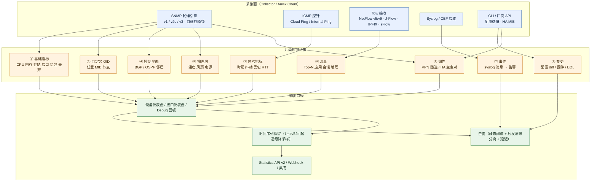
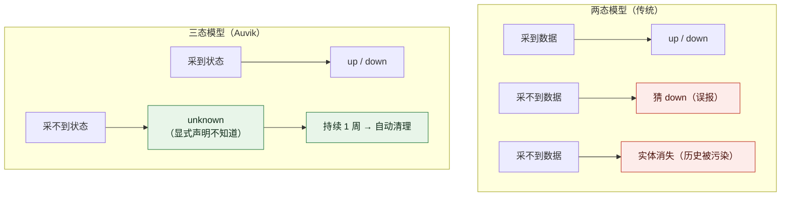

# Auvik 网络设备深度监控 · 功能体系与痛点解法（2023–2026）

> **调研对象**：Auvik（美国，SaaS + 本地采集器的网络管理与网络可观测平台）在「以网络设备本身为观测对象」方向上的深度监控能力——即从「设备通不通」深入到「设备好不好、协议稳不稳、硬件会不会坏、流量被谁吃掉、改了什么」的完整能力集。
> **调研范围**：2023-01 ~ 2026-10 公开发布的官方 Release Notes、官方帮助文档（support.auvik.com）、官方产品页与年度报告。
> **本文口径（重要）**：只收「采集对象=网络设备」的能力。**不含**拓扑自动发现与可视化的绘制逻辑（见《Auvik_功能演进分析_2023-2026》大功能点 1）、**不含**告警引擎的降噪与抑制机制（大功能点 5）、**不含**终端与服务器监控（大功能点 4）、**不含**远程处置与自动化（大功能点 7）。这些能力作为「关联项」在边界段落中被引用，但不计入本文的 9 个大功能点。
> **交付内容**：① 按大功能点分组、逐条标注时间与来源等级的小功能点清单；② 每个大功能点的「用户痛点（P）→ 如何解决（S）→ 功能机制 → 演进历史 → 功能边界」五段式详解。

---

## 一、信源与局限（先看这一段）

采用三级信源交叉验证：

| 等级 | 信源 | 覆盖时段 | 本文用途 |
| --- | --- | --- | --- |
| **A** | Auvik 官方帮助文档 / 官方 Release Notes（support.auvik.com） | 2023-01 ~ 2026-10（页面最后更新至 2026-10-07） | 功能颗粒度、默认阈值、采集机制、容量上限、保留期的**主依据** |
| **B** | Auvik 官方产品页 / 官方博客 / 年度报告（auvik.com、franklyit） | 同期 | 平台级定位、厂商自述收益数字、营销口径 |
| **C** | 第三方媒体与评价平台（G2、PeerSpot、Capterra、Comparitech 等） | 2018 ~ 2026 | 客户体感与短板，**仅用于交叉验证，不作为功能事实来源** |

**已知局限（必须随结论一起读）**：

1. **颗粒度上限**：功能名、发布时间、默认阈值、告警维度可精确到「周次 + 日」；但**采集频率的确切数值、逐指标类别的轮询间隔表、支持设备型号矩阵、采样率配置**等内部参数，官方多未公开（详见附四）。
2. **资料截止**：2026-10-14。2026-W40 之后的 Release Notes 未纳入。
3. **口径冲突四处**，已单列在下一节，**不作为唯一结论使用**。
4. **可证伪性声明**：凡本文写「官方称」「官方口径」处，均有 A/B 级出处；凡属推断处，均显式标注「推断」。二者不混用。

---

## 二、源冲突与判定（四处，并列列出）

遵循「并列列出 + 给出判定」原则，不取平均、不选「看起来合理」的那条。

| # | 冲突项 | 说法 A | 说法 B | 判定与理由 |
| --- | --- | --- | --- | --- |
| 1 | **是否支持 SNMP Trap** | **官方明确不支持**："Auvik currently supports SNMP polling… **Auvik currently does not support SNMP traps.**"（A 级，2024-08-01）；另一官方页再次标注 "Note: Auvik does not support SNMP Traps." | 多家第三方聚合站（websentra / comparitech / gitnux / wifitalents，2026）声称 Auvik「展示 SNMP trap 为告警」 | **以 A 级为判**：当前**不支持** SNMP Trap。第三方多为聚合站二手转述或旧资料。此判定直接影响「事件驱动 vs 轮询驱动」的架构理解——Auvik 的设备侧观测是**主动轮询模型**，事件类能力靠 Syslog 而非 Trap 承接 |
| 2 | **设备覆盖规模** | 官方帮助文档与产品页："more than **15,000 device types from 700+ vendors**"（A/B 级，多处一致） | 早期内部资料转述为「100,000+ 设备型号」 | **以 15,000 / 700+ 为准**。官方语境中 **100,000 只用于「受管网络数」与「Shadow AI 应用数」**，与设备型号数不是一回事。凡引「100,000+ 设备型号」应视为**口径误用** |
| 3 | **轮询频率** | 官方帮助文档："polls for information at a **varying rate up to every 30 seconds**. If data doesn't change, the system **slows down** its polling rate."（A 级） | 官方产品页："Continuous SNMP polling runs by default **every 60 seconds**"（B 级） | **两者并列有效，属不同表述层次**：30 秒是**上限与自适应机制**（旧帮助文档口径），60 秒是**当前对外默认值**（产品页口径）。判定：理解为「默认约 60 秒、可在数据变化时加密至约 30 秒、数据平稳时降频」，但**官方未给出逐指标间隔表**，该理解为推断 |
| 4 | **硬件传感器覆盖数「788,727 台设备」** | 官方《2025 Year in Review》PDF 原文："Auvik monitored the temperature on **788,727 devices**."（B 级，2025-12） | 另一路检索未在 KB/产品页找到该数字 | **采用并标注为「厂商自述、量级参考」**。B 级来源可信但属营销材料，且无口径说明（去重方式、统计时点未知），不可当作精确装机量 |

---

## 三、读法：9 个大功能点全景

本文按**观测维度分层**组织，而非按发布时间。逻辑是：设备深度监控是一条从**基础指标 → 可扩展性 → 体验 → 控制平面 → 物理层 → 韧性 → 事件 → 流量 → 变更**的垂直剖分，每一层回答一类传统 up/down 监控答不了的问题。

| # | 大功能点 | 四字口号 | 小功能点数 | 时间跨度 | 观测维度 |
| --- | --- | --- | --- | --- | --- |
| 1 | [SNMP 深度轮询与设备性能指标监控](#大功能点-1snmp-深度轮询与设备性能指标监控-轮询采集) | 轮询采集 | 20 | 平台早期 → 2026-07 | 基础指标层 |
| 2 | [自定义 SNMP OID 采集（SNMP Poller）](#大功能点-2自定义-snmp-oid-采集snmp-poller-按需扩展) | 按需扩展 | 16 | 2023-03 → 2026-06 | 可扩展性层 |
| 3 | [网络体验指标监控（时延 / 抖动 / Ping 检查）](#大功能点-3网络体验指标监控时延--抖动--ping-检查-体验量化) | 体验量化 | 14 | 2023-11 → 2026-05 | 体验层 |
| 4 | [路由协议层监控（BGP / OSPF）](#大功能点-4路由协议层监控bgp--ospf-协议透视) | 协议透视 | 17 | 2025-03 → 2025-09 | 控制平面层 |
| 5 | [硬件健康与传感器监控](#大功能点-5硬件健康与传感器监控-硬件预警) | 硬件预警 | 11 | 2024-11 → 2025-07 | 物理层 |
| 6 | [VPN 隧道与 HA 冗余监控](#大功能点-6vpn-隧道与-ha-冗余监控-韧性保障) | 韧性保障 | 18 | 2024-02 → 2026-03 | 韧性层 |
| 7 | [日志与事件接入（Syslog 告警 / CEF）](#大功能点-7日志与事件接入syslog-告警--cef-日志可操作) | 日志可操作 | 15 | 2026-03 → 2026-10 | 事件层 |
| 8 | [流量深度分析（TrafficInsights）](#大功能点-8流量深度分析trafficinsights-流量透视) | 流量透视 | 10 | 平台早期 → 2026 | 流量层 |
| 9 | [配置与固件变更可见性](#大功能点-9配置与固件变更可见性-变更留痕) | 变更留痕 | 13 | 平台早期 → 2026-10 | 配置层 |

**合计：9 个大功能点 / 134 条小功能点**（含平台早期即存在的基线能力，标注为「平台早期」）。

**九层与 Auvik 原报告的分工对照**（避免与本系列其它文档重复计数）：

| 本文大功能点 | 对应《Auvik_功能演进分析_2023-2026》 | 边界说明 |
| --- | --- | --- |
| #1 基础指标 | 大功能点 3 的一部分 | 本文只取「设备侧指标采集与阈值工程」，不含告警引擎整体降噪 |
| #2 自定义 OID | 大功能点 3 的一部分 | 本文展开到配置项与告警引擎归属级 |
| #3 体验指标 | 大功能点 3 的一部分（并延伸至大功能点 4 的终端侧） | 本文只做设备侧与探测点侧；终端/服务器体验归大功能点 4 |
| #4 协议层 | 大功能点 3 的一部分 | 本文展开到字段、告警维度、变量与 License |
| #5 硬件传感器 | 大功能点 3 的一部分 | 本文展开到两阶段落地与单位模型 |
| #6 VPN / HA | 大功能点 3 的一部分 | 本文重点补充 HA（原报告未展开） |
| #7 Syslog / CEF | 大功能点 3 的一部分 | 本文展开到容量、分组、清除语义 |
| #8 流量分析 | 原报告未单列 | 本文新增 |
| #9 配置与固件变更 | 原报告分散于 #3 / #11 | 本文按「变更可见性」重新聚合 |

**九层的整体形状**（采集面 → 观测维度 → 输出口径）：

**八类根本痛点 → 由哪几个大功能点承载**：

| 根本痛点 | 承载大功能点 |
| --- | --- |
| 一、只答「通不通」，答不了「好不好」 | #1、#3 |
| 二、协议层故障是视野盲区 | #4 |
| 三、硬件「还在线但快坏了」 | #5 |
| 四、冗余形同虚设（备机、同步、切换） | #6 |
| 五、日志有人在写、没人能查 | #7 |
| 六、带宽被谁吃掉说不清 | #8 |
| 七、「是谁改的、改了什么」无人能答 | #9 |
| 八、厂商私有指标默认采不到 | #2 |

---

# 大功能点 1：SNMP 深度轮询与设备性能指标监控 ——「轮询采集」

## 1.1 小功能点清单

| # | 小功能点 | 发布时间 | 来源等级 | 说明 |
| --- | --- | --- | --- | --- |
| 1.1 | SNMP v1 / v2c / v3 凭据支持 | 平台早期 | A | v3 支持认证 MD5 / SHA / SHA-224/256/384/512；加密 AES-128/192/256、DES、3DES-EDE |
| 1.2 | 只读采集原则 | 平台早期 | A | CLI 仅发只读命令；SNMP 只需只读权限，采集器不写设备 |
| 1.3 | 自适应轮询频率 | 平台早期 | A | 官方口径：以**最高约 30 秒**的变化速率轮询，数据不变则自动降频；产品页对外默认 **60 秒** |
| 1.4 | ICMP 健康检查（可达性判定） | 平台早期 | B | ping 可低至 **1 秒**一次；默认需**连续 3 次失败**才判定设备离线 |
| 1.5 | 设备指纹识别 → 采集模板套用 | 平台早期 | A | 依据 SNMP 返回的 **sysObjectID（System-MIB）** 判定设备类别与型号；识别为特定类别后**停止对该设备做端口扫描**，改按类别套采集模板 |
| 1.6 | 设备级指标：CPU 利用率 | 平台早期 | A | 单位 %；默认告警阈值 > 80% |
| 1.7 | 设备级指标：内存利用率 | 平台早期 | A | 单位 %；默认告警阈值 > 85%（清除 < 80%） |
| 1.8 | 设备级指标：存储利用率 | 平台早期 | A | 单位 %；默认告警阈值 > 80% |
| 1.9 | 接口级指标：利用率（Tx / Rx 分别计算） | 平台早期 → 2026-07 分离 | A | 默认告警阈值 **Tx 或 Rx > 80%**，含 15 分钟 Alert Delay |
| 1.10 | 接口级指标：错包与丢弃率 | 平台早期 | A | 默认告警：**> 100,000 个 / 时间窗**，**且**接口利用率 > 10%（避免空闲口误报） |
| 1.11 | 接口级指标：收发带宽（bps）、单播/组播/广播速率（pps） | 平台早期 | A | Statistics API 明列：Bandwidth(tx/rx/total)、Unicast/Multicast/Broadcast packet rates |
| 1.12 | 接口属性：协商速率、双工、Oper/Admin 状态、Connected to、MAC | 平台早期 | A | 接口仪表盘 Interface details 区；用于利用率口径与拓扑归属 |
| 1.13 | 设备可用性统计：Uptime % 与 Outage 秒数 | 平台早期 | A | Statistics API 提供；对应「设备在线多久」的可量化口径 |
| 1.14 | 告警阈值工程：触发/清除分离、Alert Delay、Auto Clear、布尔条件 | 平台早期 → 2024 强化 | A | 如 Warning 90% 触发 / 85% 清除；延迟可设「N 分钟」或「N 次」；Auto Clear 最短 1 分钟；支持 AND / OR / NOT |
| 1.15 | 接口级「定向」告警：按接口名 / 部分匹配 / 描述 / IP / MAC | 2024-10-26 → 2024-11-16 | A | 2024-W43 开放按名定向，2024-W46 补齐接口通知变量与按 IP/MAC 定向 |
| 1.16 | 单接口 Tx / Rx 分离计算的利用率告警 | 2026-07-06 | A | 2026-W27：利用率告警改为分别计算 Tx 或 Rx；存量告警按新定义重算 |
| 1.17 | 接口状态不一致告警（Admin vs Oper） | 平台早期 | A | 预配置告警 Interface Status Mismatch，含 `$interfaceName` 等通知变量 |
| 1.18 | 设备仪表盘图表组 | 平台早期 | A | Top interface utilization、Device bandwidth、Device utilization、Device packets（bcast/mcast/ucast pps） |
| 1.19 | Statistics API（设备级 / 接口级 / 可用性） | 平台早期 | A | 开放 CPU、内存、存储、带宽、丢包率、丢弃率、Uptime% 等 |
| 1.20 | 指标保留：逐级降采样 | 平台早期 | A | 1 分钟 → 62 天；5 分钟 → 92 天；1 小时 → 731 天；4 小时 → 3660 天；1 天 → 21960 天 |

## 1.2 它对应的用户痛点

> **口径**：本节只写**客户侧可感知的痛**——时间（定位慢、人力被占）、钱（营收损失、SLA 罚金）、人（能力绑在少数个人身上）、合规（审计举证）、组织（跨团队无共享证据）。架构层难点（采什么指标、怎么调度轮询）不属于客户问题，统一写进 1.3 的「架构约束」表。痛点编号 **P1…P4** 与下节解法 **S1…S4** 一一对应。

- **P1｜「通不通」被当成了「好不好」，于是用户投诉时监控是绿的**（时间 / 组织）。接口没 down、设备没离线、ping 也不丢包，但员工反馈视频卡、OA 慢、语音断续。IT 只能反复去现场或逐台敲命令，最后给出「网络没问题，可能是你电脑的事」——**这句话是服务能力被质疑的起点**，也是网络团队在业务侧失去话语权的典型场景。问题不在于没有数据，而在于**传统监控的指标维度与用户体感的维度不是同一套**。
- **P2｜默认阈值没人会调，调错了就只能把告警关掉**（人 / 时间）。阈值太松 → 真故障被淹；太紧 → 一个机房搬迁日收到上千条通知。客户的实际应对是**整体关闭某类告警**，于是可见性缺口自己造了出来。更深一层的问题是：**会调阈值的人是团队里唯一的那个人，他一休假，剩下的人只能选择忽略**——能力绑在个人身上。
- **P3｜「哪台设备的哪个端口、哪个方向、从什么时候开始」说不出来**（时间）。设备级告警只会说「某交换机接口利用率高」，但工程师要知道的是「上联口 Tx 方向」。缺了这一层，定位时间从分钟级退化到小时级——**因为每一步都要登录设备敲命令核对**。
- **P4｜设备自己的资源在悄悄耗尽，等它崩了才知道**（时间 / 钱）。控制平面 CPU 长期 70% 以上、内存缓慢爬升、日志分区写满、会话表逼近上限——这些**都有前兆窗口期（数天到数周）**，但传统监控只在「设备不可达」时才响。前兆期内本可计划内重启或扩容，结果变成计划外中断，落在业务时间上就是**SLA 罚金与营收损失**。

## 1.3 它是如何解决的

**架构约束（由 1.2 的客户问题倒推，不是客户痛点本身）**

| 架构约束 | 由哪条痛点倒推 | 落到了哪些功能 |
| --- | --- | --- |
| 必须**默认就采**，不能「要什么采什么」——否则客户不会为了一个还不知道有没有用的指标去做工程改造 | P1、P4 | 1.5 指纹识别 → 采集模板；1.6–1.12 默认指标集 |
| 必须 **agent-less**：中小客户不会为交换机装代理，也不接受在设备上开写权限 | P1、P4 | 1.1、1.2 只读 SNMP 轮询 |
| 阈值必须**可分层作用域**（全局 / 站点 / 设备类别 / 单设备），且同一指标可有多严重级别 | P2 | 1.14 告警定义与作用域；1.15 接口级定向 |
| 告警必须能表达**「个体」与「方向」**——接口级 + Tx/Rx 级，而不是设备级 | P3 | 1.9、1.15、1.16 |
| 采集频度必须与**设备与管理面的负载**解耦，否则深度监控会自己把网络压出故障 | P4 | 1.3 自适应降频；1.10 的「利用率 > 10% 才触发」 |
| 指标必须**长期可回溯**，因为「什么时候开始变差的」常常比「现在多差」更重要 | P1、P4 | 1.20 逐级降采样（1 分钟 62 天 → 1 天 21960 天） |

- **S1｜用设备指纹把「采集什么」变成自动决策**（→ 解 P1、P4）。Auvik 不要求用户配置采集项，而是先由 SNMP 的 `sysObjectID` 判定设备是哪一类、哪个型号，再**套用该类别的采集模板**；一旦识别为 UPS 这类非网络设备，会**立即停止对它做端口扫描**。对客户的意义有两层：**接上就能看**（无需先做指标梳理），以及**识别精度直接决定下游一切**（识别错 → 指标错 → 告警错 → 路径判断错）。
- **S2｜默认指标集按「体感可归因」来选，而不是按「MIB 里有什么」来选**（→ 解 P1）。默认集覆盖 CPU / 内存 / 存储 / 接口利用率 / 错包 / 丢弃 / 收发带宽 / 包率，恰好构成一条**可归因链**：用户说慢 → 看接口利用率 → 看错包丢弃 → 看设备资源。这条链的意义是**把「说不清」变成「能指认」**，这是 P1 的直接解。
- **S3｜阈值工程化：分层作用域 + 触发/清除分离 + 延迟**（→ 解 P2）。三个机制各自对应一类误用：**分层作用域**解决「一套阈值套全网」；**触发/清除分离**（如 90% 触发、85% 清除）解决抖动导致的翻转；**Alert Delay 与 Auto Clear**（最短 1 分钟）解决「闪一下就叫」。默认值本身也做了防误报设计——接口丢弃告警要求「超 100,000 个**且**利用率 > 10%」，避免深夜空闲链路的少量错包刷屏。
- **S4｜把告警下沉到接口与方向**（→ 解 P3）。2024-W43/W46 让告警可以**指向具体接口**（按名称精确 / 前缀 / 描述部分匹配 / IP / MAC），2026-W27 进一步把利用率告警拆成 **Tx 与 Rx 分别计算**。对客户的意义：告警正文本身就能回答「哪个口、哪个方向」，**不必再登录设备确认第一步**。

> **边界提示**：S3 的阈值是**静态阈值**。Auvik 的「基线」机制（rolling 30 天窗口、取前六个周期均值、按百分比偏差告警）**只作用于告警系统自身的指标**（告警量、解决时长、噪声比、积压），**不作用于 CPU / 内存 / 接口利用率等设备性能指标**。把这两者混为一谈会高估 Auvik 的智能化程度。

## 1.4 功能机制

**机制 1｜采集模型：主动轮询，不是被动接收。** 采集器（本地 OVA / Docker / Windows 服务 / Raspberry Pi）主动向设备发起 SNMP 请求，设备只作响应。官方对此的原文表述是 "Auvik currently supports SNMP polling. This action is initiated by the Auvik collector."。**同一份官方文档紧接着写明不支持 SNMP Trap**——这决定了 Auvik 的设备侧观测是**周期性快照**，事件类能力（设备主动上报）由 Syslog 承接（见 #7）。

**机制 2｜调度：变化驱动的降频。** 官方原文 "The system polls for information at a varying rate up to every 30 seconds. If data doesn't change, the system slows down its polling rate."，即**不是固定周期**，而是由「数据是否变化」反推轮询密度。这与营销口径的「默认 60 秒」并不矛盾：60 秒是平稳期的默认值，30 秒是变化期的上限。**注意：这意味着 Auvik 的指标时间分辨率是变化的**，在解读瞬态尖峰时需谨慎。

**机制 3｜可达性判定与性能采集是两条独立通道。** ICMP 健康检查负责「在不在」（可低至 1 秒、连续 3 次失败判定离线），SNMP 轮询负责「好不好」（约 60 秒）。两条通道分离的好处是：**SNMP 超时不会直接导致误报离线**——官方在故障排查文档中明确，"Short, transient offline alerts usually indicate a temporary polling or reachability problem rather than a confirmed device outage."

**机制 4｜判定链：静态阈值 → 延迟 → 状态机。** 每条告警是一条独立的状态机：满足 trigger → 进入 Alert Delay（N 分钟或 N 次）→ 置为 active → 满足 clear → Auto Clear。告警定义可绑定作用域（设备、站点、设备类别、设备标签），支持布尔组合（AND/OR/NOT）与复合条件。

**机制 5｜容量上限与资源口径。** 官方给出的硬数字：单采集器 **2,000 台设备 / 9,000 个接口**；共享采集器（多站点）建议 **约 200 个站点、≤ 1,500 台设备、≤ 8,000 个接口**；扫描范围建议控制在 **/23 以内**；「管理超过 1,000 台设备或 4,000 个接口」即进入需关注区。**超过接口上限后，Auvik 明确表示 "the collector sizing will no longer matter, as the Auvik system will have issues managing more devices than that under a single site."** —— 这是单站点天花板，不是靠加机器能解的。

**机制 6｜存储：逐级降采样。** 1 分钟粒度硬保留 62 天，之后按 5 分钟 / 1 小时 / 4 小时 / 1 天逐级聚合，最长到 28 天粒度 614,880 天。官方另有一段历史断裂说明："Prior to 2016-09-16, statistics were stored in a format that is not compatible with our current system and cannot be retrieved."

## 1.5 功能演进历史

| 时间 | 事件 | 来源等级 | 说明 |
| --- | --- | --- | --- |
| 平台早期 | SNMP v1/v2c/v3 采集 + 指纹识别 + 默认指标集 | A/B | 地基建成，此后迭代集中在**识别覆盖度**而非指标种类 |
| 2023-12-02 | 新增默认告警 Network Element Uptime | A | 可用性从「图表」变成「告警」 |
| 2024-03-23 | Alerting 2.0 Beta | A | 阈值工程能力（作用域、变量、延迟）重写 |
| 2024-10-05 | Alerting 2.0 GA | A | — |
| 2024-10-26 | 接口告警可按接口名/部分匹配/描述定向 | A | 告警首次下沉到接口 |
| 2024-11-16 | 接口通知变量落地；可按 IP / MAC 定向接口告警 | A | 接口告警可用性完成 |
| 2025-01-25 | 接口通知变量 + 通知合并 | A | 通知侧降噪 |
| 2026-07-06 | 单接口 Tx / Rx 分离的利用率告警 | A | 从「接口级」细化到「方向级」 |
| 2026-10-05 | 官方文档明确「vendor-specific namespace / CLI-only 数据可能采集不到」 | A | 首次较正式地书面承认边界（见 1.6） |

**演进规律**：该功能点的投入**不在「多采指标」，而在「降误报 + 更细作用域 + 承认边界」**。指标集四年基本稳定，变化全部发生在告警的表达力上（设备级 → 接口级 → 方向级）。

## 1.6 功能边界（能做到什么程度）

| 能力 | 做到什么程度 | 做不到什么 | 依据 |
| --- | --- | --- | --- |
| 采样频率 | 设备性能指标约 60 秒（默认），变化期最高约 30 秒；可达性可到 1 秒 | **秒级性能指标**；官方未提供逐指标间隔表，也未见可全局调整默认轮询周期的说明 | A（帮助文档）+ B（产品页） |
| 采集前提 | 需同时满足四条：设备被纳管、SNMP 服务开启、SNMP 可达、凭据有效 | 设备未开 SNMP / 凭据错 / 被 ACL 拦截时**静默无数据**，且不报「采集失败」 | A |
| 数据深度 | 标准 MIB 内的设备/接口指标 + 可用性 | **私有 MIB 中仅经 vendor-specific namespace 或 CLI 才暴露的数据**；官方原文："Auvik may not automatically collect or alert on information exposed only through a vendor-specific namespace or command-line utility." | A（2026-10 文档） |
| 厂商覆盖 | 15,000+ 设备类型 / 700+ 厂商，靠**逐个新增识别**扩张 | 官方明确**不承诺完整支持**："Auvik makes no claims to fully support these devices with core features… such as SNMP, CLI, Configuration Backups, discoverability, and topology mapping."；未识别设备显示为 Generic device | A |
| 事件接收 | 仅轮询（pull） | **不支持 SNMP Trap（push）** —— 设备侧主动告警无法实时进入 | A |
| 阈值形态 | 静态阈值 + 延迟 + 触发/清除分离 | **设备性能指标没有自适应/学习型基线**（基线只用于告警系统自身指标） | A |
| 规模 | 单站点 2,000 设备 / 9,000 接口 | 超限后**加采集器也不能解决**（系统级单站点天花板） | A |
| 特定设备特例 | 依赖设备侧配置 | 例：Zyxel Nebula 模式设备**默认不响应第三方 SNMP**；Meraki 仅支持 device-based 控制器（cloud-based 不支持）；HPE/ProCurve 跨 VPN 时可能因 SNMP 响应源 IP 不匹配**静默失败**（需在设备侧加 `snmp-server response-source dst-ip-of-request`） | A |

> **一句话总结边界**：Auvik 的设备基础指标监控做到了**「零配置就看得见、告警能指到接口和方向」**，但**止步于标准 MIB 与轮询模型**——采集深度取决于「设备厂商把信息放进标准 MIB 了吗」，而不是「Auvik 能不能采」。

---

# 大功能点 2：自定义 SNMP OID 采集（SNMP Poller）——「按需扩展」

## 2.1 小功能点清单

| # | 小功能点 | 发布时间 | 来源等级 | 说明 |
| --- | --- | --- | --- | --- |
| 2.1 | 自定义 SNMP Poller（任意 OID 采集项） | 平台早期 | A | 当 Auvik 默认不采集某 OID 时，用户可自建采集项 |
| 2.2 | SNMP Poller 工作流增强（单位下拉 + 自定义单位） | 2023-03-25 | A | 自建采集项可直接下拉选单位，并支持自定义单位 |
| 2.3 | Poll Period（轮询周期）可调 | 平台早期 | A | 官方原文："Select how often you want Auvik to query the device for this poller." |
| 2.4 | 数据类型：仅 String 或 Numeric | 平台早期 | A | 官方原文："Either a String or a Numeric type is supported." |
| 2.5 | Output Parser（取值解析） | 平台早期 | A | 支持 After / Before / Between 截取，或使用正则表达式 |
| 2.6 | Test Device（配置时试拉验证） | 平台早期 | A | 配置阶段可选一台设备实际拉取该 OID，验证返回值与解析结果 |
| 2.7 | 用途分类：SNMP Poller Only（可告警）/ Serial Number（不可告警） | 平台早期 | A | String 类型的 Use As 二选一；序列号类用于资产属性，不进告警 |
| 2.8 | 每设备最多 1,250 个监控项 | 平台早期 | A | 官方原文："A maximum of 1250 monitors are supported per device." |
| 2.9 | 基于 poller 值创建自定义告警 | 平台早期 | A | 路径：Manage Alerts > Alerts > Create New Alert，按 poller 的 Name 搜索该指标 |
| 2.10 | 告警变量由 poller 设置名生成 | 平台早期（2026-07-29 文档确认） | A | 首词全小写、后续词首字母大写，特殊字符剔除。例："Environmental probe" → `$environmentalProbe` |
| 2.11 | OID Monitors 面板 + Debug > All SNMP Pollers | 平台早期 | A | 首页/设备仪表盘展示映射到该设备的 OID 及当前值；站点级可查全部 poller |
| 2.12 | 自定义指标的展示与保留 | 平台早期 | A/B | Numeric 显示时间序列图，String 显示值表/变更日志；**数据保留 1 年** |
| 2.13 | Global Search 支持按 OID 搜 SNMP Poller | 2024-05-18 | A | 找不到「当初是谁为了什么加的这个 OID」时的检索入口 |
| 2.14 | 删除 poller 自动停用其关联告警 | 平台早期（2026-06-25 文档确认） | A | 恢复/重建后需重新编辑并启用告警 |
| 2.15 | 多站点 poller 设置的继承规则 | 平台早期 | A | 在 multi-site 仪表盘修改会应用到所有子站点；子站点自身修改**不被父级覆盖**；仅 multi-site 创建的设置可 Reset/Restore |
| 2.16 | SNMP Poller API（Pollers 端点） | 平台早期 | A | 有专门的 Pollers API 与「SNMP Poller setting alert conditions」文档 |

## 2.2 它对应的用户痛点

> **口径**：同 1.2。本节只写客户侧可感知的痛；编号 **P1…P4** 与 2.3 的 **S1…S4** 一一对应。

- **P1｜厂商私有指标只能靠人肉登录设备去看**（时间 / 人）。UPS 的电池温度、UPS 自检结果、专有设备的电源模块读数、某个厂商特有的健康计数——这些既不在标准 MIB，Auvik 也不默认采。客户的实际动作是**排班登录设备敲命令、把值抄进 Excel**。这件事的两个后果：**定位时间被拉长**，以及**能力绑在「知道该敲哪条命令」的那个人身上**。
- **P2｜资产属性类的字符串信息进不了台账，审计时对不上**（合规）。设备的序列号、硬件版本号这类**字符串型**信息，通常只能从某个私有 OID 读。拿不到就意味**台账靠人工维护**，而人工台账的必然结局是过期——审计时被问「这台设备的序列号是多少」，答不上来。
- **P3｜采到了原始值，但没人看得懂；而且采完就散落各处、无人巡检**（时间 / 人）。同一个 OID 返回的是原始计数或原始整数，不带单位、不带量纲；即使采进来，也**不会自动出现在任何仪表盘上、不会触发任何告警**。结果是「采了等于没采」——客户花了配置成本，付的却是零回报。
- **P4｜自定义指标越加越多，没人知道「哪台设备采了什么、现在是多少」**（组织 / 举证）。当自定义采集项从 3 个涨到 300 个，谁来加、为什么加、当前值多少、是否还有效，全部失忆。跨团队交接或合规举证时，**没有任何一份权威清单可以拿出来**。

## 2.3 它是如何解决的

**架构约束（由 2.2 倒推）**

| 架构约束 | 由哪条痛点倒推 | 落到了哪些功能 |
| --- | --- | --- |
| 采集项必须**开放到 OID 级**，并把「多久采一次」交给用户 | P1 | 2.1、2.3 |
| 必须能处理**非数值返回**，并把值与「语义类型」绑定 | P1、P2 | 2.4、2.7 |
| 必须能在**不写代码**的前提下把原始返回值变成可读数值 | P3 | 2.2、2.5、2.6 |
| 自建指标必须与告警、面板、检索**打通**，否则等于没采 | P3、P4 | 2.9、2.10、2.11、2.13 |
| 必须有**显式的容量上限与生命周期规则**，避免配置熵增 | P4 | 2.8、2.14、2.15 |

- **S1｜把「采什么、多久采一次」完全开放给用户**（→ 解 P1）。任意 OID + 可自定义的 Poll Period，等于把 Auvik 从「固定指标集的产品」变成「可被客户按自己设备清单塑形的采集平台」。对客户的意义是：**私有指标不必再靠人肉巡检**，而是一次配置、持续采集。
- **S2｜用「类型 + 单位 + 解析器」三件套把原始返回值变成可读数值**（→ 解 P3）。`String / Numeric` 决定存储与展示形态；单位支持**内置下拉 + 自定义单位**（例如 UPS 温度可以定义成自己的单位）；Output Parser 支持 `After / Before / Between` 截取或**正则表达式**，把「字符串里夹着数字」这类常见返回值抠出来。**配置期还提供 Test Device 实际试拉**——把「上线后才发现解析错了」的风险前移。
- **S3｜把字符串型信息按用途分流**（→ 解 P2）。String 类型可声明 `Use As`：`SNMP Poller Only`（参与告警）或 `Serial Number`（**不参与告警**，作为资产属性）。这个设计承认了一个事实：**序列号这类信息是台账数据，不是时序数据**——它不进告警体系，避免把资产字段当指标刷屏。
- **S4｜把自建指标接进告警、面板与检索**（→ 解 P3、P4）。三条通路：① 在告警定义里按 poller 名称搜索该指标作为触发条件，告警变量由 poller 名自动生成（`$environmentalProbe` 这类）；② 首页与设备仪表盘的 **OID Monitors** 列表展示映射到该设备的 OID 及当前值，站点级 `Debug > All SNMP Pollers` 给全量清单；③ 2024-05 起 Global Search 支持**按 OID 搜 poller**——这是 P4 的直接解，因为「当初为什么加这个 OID」终于可检索。删除 poller 会自动停用其关联告警，避免留下指向不存在指标的悬空告警。

> **配套演进（不占 S 编号）**：2023-03 的「单位下拉 + 自定义单位」属于**工作流体验修补**，2026-06-25 的文档补充属于**规则澄清**（多站点继承、删除联动）。它们本身不解决新痛点，但降低了 S2 / S4 的使用门槛。

## 2.4 功能机制

**机制 1｜注册式解析，不是自由文本采集。** 一个 poller 由四要素定义：OID、数据类型（String/Numeric）、单位（Numeric）或用途（String）、可选 Output Parser。这意味着 Auvik 在自定义采集上是**「声明式注册 + 固定管线」**：用户声明从哪读、读出来是什么、怎么切；管线负责轮询、解析、存储、展示、告警。

**机制 2｜轮询周期由用户指定，与默认采集解耦。** 自定义 poller 有自己的 Poll Period（第三方集成文档给出的实操示例为 1 分钟），**这意味着深度监控可以局部加密**：对少数关键 OID 采得比默认 60 秒更勤，而不必整体提高全网轮询密度。这是应对 #1 中「采集负载 vs 采集密度」约束的一种让步机制。

**机制 3｜字符串与数值走不同存储与展示路径。** Numeric → 时间序列图 + 1 年历史；String → 值表 / 变更日志 + 1 年历史。**注意：可告警的只有 Numeric（以及声明为 SNMP Poller Only 的 String）**，`Serial Number` 用途的 String 明确不参与告警。

**机制 4｜告警侧落在旧引擎。** 这是自定义采集最重要的机制约束：**SNMP Poller 告警运行在 Legacy 告警引擎**，因此 **Alerts v2 的 device tag 无法用于限定 poller 告警范围**，必须在站点级**显式选择设备**，或为不同设备组维护多份告警定义。官方原文："a device tag cannot be used to dynamically scope an SNMP Poller alert when that alert is running in the legacy engine."

**机制 5｜变量命名由显示名推导。** 告警变量名不是用户手填，而是由 poller 设置名按固定规则生成（首词小写、后续词首字母大写、剔除连字符与括号）。这减少了配置负担，但**意味着改动 poller 名称会改变变量名**，进而影响已绑定的通知模板。

## 2.5 功能演进历史

| 时间 | 事件 | 来源等级 | 说明 |
| --- | --- | --- | --- |
| 平台早期 | 自定义 SNMP Poller 上线（OID + Poll Period + String/Numeric） | A | 可扩展性地基 |
| 平台早期 | Output Parser（After/Before/Between/正则）+ Test Device | A | 解析能力补齐 |
| 平台早期 | Use As 分类（SNMP Poller Only / Serial Number） | A | 资产属性与指标分流 |
| 2023-03-25 | SNMP Poller 工作流增强：单位下拉 + 自定义单位 | A | 自定义采集首次进入公开 Release Notes |
| 2024-05-18 | Global Search 支持按 OID 搜 SNMP Poller | A | 配置可检索性 |
| 2026-06-25 | 官方文档系统化（多站点继承规则、删除联动、1,250 上限、Test Device） | A | 从「能用」到「有明确规则」 |
| 2026-07-29 | 告警变量命名规则文档化 | A | 通知模板可靠性 |
| 2026-10-05 | 文档明确「device tag 不能限定 poller 告警范围」 | A | 边界书面化 |

**演进规律**：自定义采集**功能面四年几乎没变**，变化全部在**规则文档化与检索性**上。这说明 Auvik 把它定位为「逃生舱口（escape hatch）」——用于兜住默认采集覆盖不到的长尾，而不是主打能力。**也正因如此，它与新告警引擎（Alerts v2）的割裂（tag 不可用）长期未修**。

## 2.6 功能边界（能做到什么程度）

| 能力 | 做到什么程度 | 做不到什么 | 依据 |
| --- | --- | --- | --- |
| 采集对象 | 任意可读 OID（单值） | **不支持表（table）型 OID 的结构化展开**；不支持自定义 MIB 文件导入（第三方用户反馈缺 "full MIB management support"，官方无对应说明） | A（数据类型仅 String/Numeric）+ C（用户反馈） |
| 数值处理 | 单位（内置/自定义）+ After/Before/Between/正则解析 | **未见缩放/偏移（scale / offset / multiplier）参数** —— 原始计数换算成百分比或物理量需在设备侧或解析规则内完成 | A（官方页仅提供单位） |
| 数量上限 | **每设备 1,250 个监控项** | 未找到全站点/全账号的 poller 总数上限说明 | A |
| 告警集成 | 可基于 poller 值建告警 | **跑在 Legacy 引擎**：Alerts v2 的 device tag **无法**限定范围，须显式选设备或复制多份告警；变量名随 poller 名变动 | A（2026-10） |
| 历史保留 | 1 年（Numeric 时序 / String 变更日志） | 长于 1 年的自定义指标趋势无数据 | B |
| 轮询周期 | 用户可设（示例 1 分钟） | 官方**未公开可选项枚举**；未说明能否低于默认周期下限 | A |
| 多站点 | 父级设置下发子站点，子站点可局部覆盖 | 继承关系一旦建立，**子站点不能自行 Reset**（仅 multi-site 创建的设置可 Reset/Restore） | A |

---

# 大功能点 3：网络体验指标监控（时延 / 抖动 / Ping 检查）——「体验量化」

## 3.1 小功能点清单

| # | 小功能点 | 发布时间 | 来源等级 | 说明 |
| --- | --- | --- | --- | --- |
| 3.1 | Cloud Ping Check（云端探测点） | 平台早期 | A | 由 **Auvik 云端**发起 ICMP；默认自动为站点默认网关配置，用于监控互联网连接 |
| 3.2 | Cloud Ping 支持 Public FQDN | 2023-11-04 | A | 探测目标从纯 IP 扩展到域名（明确要求 Public FQDN，不可用本地域名） |
| 3.3 | Cloud Ping 检查间隔调整（5 秒 → 60 秒） | 2025-03-22 | A | 5 秒选项被移除，60 秒成为新的**默认最小间隔**；可选 1 / 5 / 15 / 60 分钟 |
| 3.4 | Cloud Ping 告警支持部分字符串匹配 | 2025-02-08 | A | 创建 cloud ping check 告警时可按名称 part-match 选择多个检查 |
| 3.5 | Internal Ping Check（采集器探测点） | 2023-12 起 → 文档明确 | A | 从**本地采集器**向私网 / 东西向目标发起 ICMP，用于 MPLS / SD-WAN / VPN / 私有光纤场景 |
| 3.6 | Internal Ping Check 的目标与阈值配置 | 2023-12 起 | A | 字段：Source collector / Name / Interval / Target IP(s)（可多个、自动匹配已发现设备）/ Failure-success thresholds |
| 3.7 | Internal Ping 记录 RTT（min/avg/max）与丢包率 % | 2023-12 起 | A | 输出的是可量化指标，而非「通/不通」 |
| 3.8 | Network Latency & Jitter（设备侧时延与抖动） | 2024-11-16 | A | 采集器周期性向被监控设备发 ping，推导 latency 与 jitter；设备仪表盘微件 + 时间窗平均值 |
| 3.9 | 时延/抖动 30 天历史保留 | 2024-11-16 起 | A | "Data on latency and jitter on devices is retained for the last 30 days." |
| 3.10 | 时延/抖动告警（Alerts v2） | 2024-11-16 起 | A | 触发项 `Network Latency` / `Network Jitter`（Alert Type: Device）；可合并或分开、可按 tag 指定设备、可设 Alert Delay |
| 3.11 | Service Statistics v2 API 开放 Internal Ping 指标 | 2026-05-04 | A | `GET /v2/api/stat/service/{statId}`；statId：`internalPingTime`（RTT）、`internalPingPacket`（丢包） |
| 3.12 | Percentage of Occurrences 延迟仅适用于 ping-check 类定义 | 2026-03-02 | A | 该延迟类型只对 Cloud Ping / Internal Ping 生效，侧面确认 ping 检查的告警路径已独立 |
| 3.13 | Internet Connection Is Lost 告警（Critical） | 平台早期 | A/B | Cloud Ping 判定 Down 后触发；官网称其为 critical 级 |
| 3.14 | 设备类型豁免规则 | 2024-11-16 起 | A | PRINTER / UPS / IP_PHONE / PHONE / TABLET / HANDHELD / TELECOMMUNICATIONS / CAMERA **不显示**时延/抖动图 |

## 3.2 它对应的用户痛点

> **口径**：同 1.2。编号 **P1…P5** 与 3.3 的 **S1…S5** 一一对应。

- **P1｜用户说卡，监控全绿——两个「维度」对不上**（时间 / 组织）。设备在线、接口未 down、无丢包，但视频会议卡、语音断续。根因是**可用性 ≠ 体验**：ping 通只证明「包能到达」，不证明「包按时到达」。语音与视频对**抖动**极度敏感、对丢包反而有容忍度——这与传统指标的设计假设**方向相反**。客户的结局是「用户抱怨但监控无异常」的死循环，最终由网络团队背「不解决问题」的名。
- **P2｜出口断没断，只能等用户报**（时间 / 钱）。互联网出口、默认网关、关键公网服务是否可达，传统做法是「有人反馈了再查」。断网这段时间直接对应**营收损失**，也直接对应老板追问时的沉默。
- **P3｜内网 / 专线的质量无人量化，只能拿手工工具测**（时间 / 人）。MPLS、SD-WAN、VPN、私有光纤这类**东西向与站点间链路**的质量，客户以前只能靠 PingPlotter 之类工具手工测、测完截图存本地。既**不可持续**，也**不可追溯**，且**换个人就不会测**。
- **P4｜时延与抖动没有留证，「是网络还是你的电脑」永远说不清**（组织 / 合规）。故障后复盘或与业务方对账时，如果拿不出客观指标曲线，对话只能停在互相猜测。**有数据才谈得上责任归属**，否则每次都是「各说各话」。
- **P5｜抖动的判定规则不透明，误报与漏报同时发生**（时间 / 人）。单次探测失败就报「断网」会刷屏；反过来「任一成功就算 Up」又可能掩盖间歇性劣化。客户要的是**规则可解释、误报可控、且劣化能提前看到**。

## 3.3 它是如何解决的

**架构约束（由 3.2 倒推）**

| 架构约束 | 由哪条痛点倒推 | 落到了哪些功能 |
| --- | --- | --- |
| 必须把「体验」做成**独立于设备状态的指标**，而不是从设备状态推导 | P1 | 3.8、3.9、3.10 |
| 探测点必须覆盖**两个方向**：从云上看「出口」，从采集器看「内网」 | P2、P3 | 3.1、3.5 |
| 指标必须可**长期留存**，否则「什么时候开始变差」无法回答 | P4 | 3.9（30 天）、3.11（API 取数） |
| 判定必须是**状态机 + 阈值**，而不是「一次失败即告警」 | P5 | 3.13、3.6（failure/success 阈值） |
| 数据必须**可导出**，才能进入客户的报表、工单与举证链 | P4 | 3.11 Service Statistics v2 API |

- **S1｜把 ping 产品化：Cloud Ping Check**（→ 解 P2）。云端探测点默认自动挂在站点默认网关，输出丢包与 RTT（含 min / average / max）；Down 定义为**连续 3 次失败**，而**任一次成功即保持 Up**；两个阈值都可改。这意味着「出口断没断」从「等用户报」变成**「系统先发现并通知」**。2023-11 支持 Public FQDN 后，可以探测的不再是 IP，而是**有意义的服务名**（客户侧表述为「我们关心的那个业务有没有通」）。
- **S2｜把探测点搬到采集器：Internal Ping Check**（→ 解 P3）。从本地采集器向私网 / 东西向 IP 发起 ICMP，记录 RTT（min/avg/max）与丢包率；一个检查可配**多个目标 IP**，并自动匹配已发现设备。对客户的意义是**替代了手工 PingPlotter 的巡检动作**——从一个「靠人记得做」的动作，变成「一直在做、有图有历史」的常态指标。
- **S3｜把设备侧的时延与抖动做成独立指标**（→ 解 P1）。2024-11 的 **Network Latency & Jitter** 用采集器周期性向设备发 ping，分别输出 **latency（ms）** 与 **jitter（ms）**。jitter 的算法是**连续两次延迟测量绝对差值的平均**（官方示例：50 ms 与 55 ms → jitter 5 ms）。这一条是**整个功能的转折点**：它把「用户说卡」翻译成「时延从 8 ms 升到 45 ms、抖动从 2 ms 升到 30 ms」，从而打开 1.2 中那段死循环。

  | 层次 | 转换前 | 转换后 |
  | --- | --- | --- |
  | 表达方式 | 「用户说卡」 | 「时延 8→45 ms，抖动 2→30 ms」 |
  | 处理时机 | 等用户投诉 | 投诉之前看到趋势异常 |
  | 责任归属 | 网络？电脑？说不清 | 有客观数据可对照，可留证、可追溯 |

- **S4｜可告警、可留证、可 API 取数**（→ 解 P4、P5）。时延/抖动在 Alerts v2 中有独立触发项（`Network Latency` / `Network Jitter`），**可合并成一条也可拆成两条**——对应「只关心结果」与「要区分成因」两类团队；30 天历史支撑「什么时候开始的」；2026-05 开放 **Service Statistics v2 API**（`internalPingTime` / `internalPingPacket`），使这些指标能进入客户自己的报表与工单系统。
- **S5｜判定规则显式化，防误报**（→ 解 P5）。三条规则构成防误报设计：**连续 N 次失败才判 Down**、**任一次成功即保持 Up**、**failure / success 阈值均可配**。2026-03 又明确 `Percentage of Occurrences` 这类延迟只适用于 ping-check 定义——即 **ping 类告警有自己的延迟语义**（按「多少次里有多少次」判定），而不是简单的持续时间。

> **配套演进（不占 S 编号）**：2025-03 移除 5 秒间隔、统一为 60 秒起，属于**成本侧收敛**（探测密度换存储与探测负载），并非解决客户痛点。

## 3.4 功能机制

**机制 1｜两个探测源，回答两个不同的问题。** Cloud Ping 由 **Auvik 云端**发起，测的是「从互联网到你的出口」；Internal Ping 由**本地采集器**发起，测的是「采集器到内网目标」。**两者不是冗余，而是互补**：同一个 IP 从云侧看是通的、从采集器侧看是断的，恰好指向「出口正常但内网某段有问题」。官方明确 Internal Ping **纯 ICMP、无 SNMP 交互、不影响设备在线状态**——即它与 #1 的可达性判定通道**互不干扰**。

**机制 2｜时延/抖动的线路口径是「设备 ↔ 采集器」。** 这是最容易误解的一点：Latency & Jitter 反映的是**采集器与被监控设备之间这段路径**的往返时延与抖动，**不是端到端体验，也不是设备到设备的路径质量**。它之所以仍然有价值，是因为**接入层到设备的这段通常就是问题所在**（接入链路拥塞、双工不匹配、无线回程），且这段的劣化会向上传导为所有用户的体感。**但把它等同于「用户体感」是错的**——真正的端到端需要 #8 的流量分析或终端侧指标（见大功能点 4）。

**机制 3｜jitter 定义是「连续差值的平均」，不是「标准差」。** 官方给的算法是 Packet Delay Variation 的简化形式：对一系列延迟测量，取**相邻两次的绝对差**再求平均。这是一个**偏保守**的算法：它对高频小幅抖动不敏感，对「一次大跳」敏感。客户在做阈值设定时必须按这个定义来，否则会低估或高估。

**机制 4｜豁免清单是「有意义性」筛选，不是能力缺失。** 官方列出 PRINTER / UPS / IP_PHONE / PHONE / TABLET / HANDHELD / TELECOMMUNICATIONS / CAMERA 八类设备不显示时延/抖动图。原因不是采不到，而是**这些设备的「网络体验」不构成一个有意义的运维对象**（打印机不会抱怨视频卡）。机制上它与「是否显示在线状态与设备带宽图」共用同一个门控条件。

**机制 5｜阈值与判定在告警侧实现，指标侧只负责出数。** 采集侧产出原始 latency / jitter / RTT / packet loss 时间序列，判定完全交给告警定义（threshold + delay + clear）。因此**指标的采集间隔与告警的判定窗口是两个独立参数**——2026-03 把 Occurrence 类延迟限定给 ping-check，正是为了给「按次数判定」提供一条专用通道。

**机制 6｜存储口径差异值得注意。** 时延/抖动 **30 天**；Internal Ping 指标通过 Statistics API 可长期取用（走通用指标保留口径）；而 flow 仅 14 天（见 #8）。**做根因复盘时要注意：体验类指标的历史比基础指标短得多。**

## 3.5 功能演进历史

| 时间 | 事件 | 来源等级 | 说明 |
| --- | --- | --- | --- |
| 平台早期 | Cloud Ping Check 上线（默认网关监控 + Internet Connection Is Lost 告警） | A | 出口可达性产品化 |
| 2023-11-04 | Cloud Ping 支持 Public FQDN | A | 从「监控 IP」到「监控服务」 |
| 2023-12 起 | Internal Ping Check（采集器侧探测 + RTT / 丢包率） | A | 内网与东西向链路量化 |
| 2024-11-16 | **Network Latency & Jitter** 发布（设备级 latency/jitter 指标 + 微件 + 告警） | A | 本功能点的转折点：体验从「主观」变「可量化」 |
| 2024-11-16 | 时延/抖动 30 天保留；八类设备豁免 | A | 口径与门控明确 |
| 2025-02-08 | Cloud Ping 告警支持部分字符串匹配 | A | 批量告警可用性 |
| 2025-03-22 | 移除 5 秒间隔，60 秒成为默认最小间隔 | A | 成本侧收敛（探测密度下调） |
| 2025-02-08 起 | 体验指标下沉到**终端侧**（Endpoint 时延与测速）与**服务器侧** | A | 形成「网络 → 终端 → 服务器」三级体验指标（终端/服务器部分见大功能点 4） |
| 2026-03-02 | Occurrence 类延迟限定给 ping-check 定义 | A | 判定语义细分 |
| 2026-05-04 | Service Statistics v2 API 开放 `internalPingTime` / `internalPingPacket` | A | 数据可外带 |

**演进规律**：一条清晰的「**探测点迁移**」路径——先有**云端**（看出口）→ 再加**采集器**（看内网）→ 再加**设备**（看接入段）→ 最后延伸到**终端与服务器**（看体验的最后一公里）。**每一层都不是替代上一层的，而是补齐上一层的盲区**。同时可以观察到**频率在降、指标在增**：探测从 5 秒放宽到 60 秒，但指标维度从 1 个（通/不通）扩到 4 个（latency / jitter / RTT / loss）。

## 3.6 功能边界（能做到什么程度）

| 能力 | 做到什么程度 | 做不到什么 | 依据 |
| --- | --- | --- | --- |
| 时延/抖动的**路径口径** | 采集器 ↔ 被监控设备这一段 | **不是端到端体验**，**不是设备到设备路径质量**；跨站点、跨运营商、跨云的体验需其它手段 | A |
| 时间分辨率 | 60 秒（默认最小，Cloud Ping 可选 1/5/15/60 分钟）；设备侧时延抖动的采集周期官方**未给确定值** | 官方未披露 latency/jitter 的逐项采集频率；无法据此判断秒级瞬态 | A |
| 历史 | 时延/抖动 30 天 | 30 天以上的体验趋势需靠 #1 的基础指标或外部导出 | A |
| 探测前提 | Cloud Ping 需公网端点响应 ICMP 且白名单放行 Auvik 云探测源 IP；Internal Ping 需采集器到目标 IP 可达且允许 ICMP echo/echo-reply | 目标**禁 ICMP**则功能不可用（这也是官方明确的项目前提） | A |
| Internal Ping 目标类型 | 初版**仅支持 IP**，不支持 FQDN | 官方原文："FQDN is not supported for targets. You must specify IP addresses, not hostnames." | A |
| 适用范围 | 显示在线状态与带宽图的设备 | **八类设备被豁免**（打印机、UPS、IP 电话、手机、平板、手持设备、电信设备、摄像头） | A |
| 误报控制 | 连续 N 次失败判 Down；任一成功即 Up；阈值可改 | 未找到官方对「抖动抖动率」的复合判定（如「15 分钟内抖动超标 N 次」）说明 —— 需借 Occurrence 延迟实现 | A |
| 与在线状态的耦合 | Internal Ping **不影响**设备在线状态判定 | 反过来说，它**不能**用来替代可达性监控（功能分工明确） | A |

> **一句话总结边界**：Auvik 的体验监控做到了**「把主观抱怨翻译成客观指标并留证 30 天」**，但它测的是**接入段与出口段**，不是**端到端用户旅程**。要回答「哪个用户的哪次访问慢了」，需要看 #8 的流量分析，或终端侧能力。

---

# 大功能点 4：路由协议层监控（BGP / OSPF）——「协议透视」

## 4.1 小功能点清单

| # | 小功能点 | 发布时间 | 来源等级 | 说明 |
| --- | --- | --- | --- | --- |
| 4.1 | BGP Route Neighbor Monitoring（Beta） | 2025-05-03（2025-W18） | A | 先以 Beta 发布，Debug > Routes 新增专用 BGP 监控表，可过滤 30 天历史分析邻居稳定性 |
| 4.2 | BGP Beta 阶段支持厂商：Cisco、Juniper | 2025-05-03 | A | 2025-W12 预告 4 月起 Beta 支持 Cisco |
| 4.3 | BGP 告警（GA 配套） | 2025-05-03 | A | Beta 同期即提供告警能力 |
| 4.4 | BGP 采集依据：标准 BGP4-MIB（1.3.6.1.2.1.15） | 2025-05-03 起 | A | "When a supported network device exposes the standard BGP4-MIB over SNMP, Auvik auto-discovers the peers and populates the BGP Neighbors table." |
| 4.5 | 默认对 Routers / Firewalls / L3 switches 尝试 BGP SNMP 查询 | 2025-05-03 起 | A | 无需人工开启，识别为这三类角色即尝试 |
| 4.6 | BGP 采集字段：状态、邻居 IP、Admin 状态、15 分钟内状态变化次数、连接 uptime | 2025-05-03 起 | A | State（Established/Idle/Active/Connect…）、Admin State（Enabled/Disabled）、State Change（15 分钟窗口计数，即 flap 次数）、Connection Uptime（hh:mm:ss） |
| 4.7 | BGP 30 天历史 | 2025-05-03 | A | "…allowing them to filter historical data and analyze peer connection stability over a 30-day period." |
| 4.8 | BGP 支持厂商扩展至 Cisco / Juniper / Fortinet / Huawei | 2025-09-24（文档确认） | A | 前提是设备通过 SNMP 暴露 BGP 数据；可按需继续扩展 |
| 4.9 | BGP 告警维度：State / IP / Admin State / State Change(15min) / Connection Uptime | 2025-05-03 起 | A | 例：State ≠ Established；Uptime < Y 分钟（建议配合更长 Alert Delay） |
| 4.10 | BGP 告警变量（`$bgp` / `$routeNeighbours.*`） | 2025-05-03 起 | A | `peerIp`、`localIp`、`peerRoutingId`、`connectionIsUp`、`connectionUptimeSecs`、`connectionStateChanges15Min`、`bgpOnly.adminStatus` 等 |
| 4.11 | License 分层：BGP 数据仅 Core / Essentials / Performance 可见 | 2025-05-03 起 | A | 低层级站点即使设备响应 MIB 也不展示 |
| 4.12 | OSPF Neighbor Monitoring | 2025-07-12（2025-W28 预告）→ 2025-09-24 文档确认 | A | OSPF-MIB 自动发现，Debug > Routes 新增 OSPF Neighbors 表 |
| 4.13 | OSPF 采集字段：状态、邻居 IP、Router ID、Admin 状态、DR、连接 uptime、状态变化计数、Area ID | 2025-09-24 | A | 覆盖「邻居身份 + 区域归属 + 稳定性」三类信息 |
| 4.14 | OSPF 支持厂商：Cisco / Juniper / Fortinet / Dell PowerConnect / Brocade ICX | 2025-09-24 | A | 同样可按需扩展 |
| 4.15 | OSPF 预配置告警「OSPF Neighbor is Down」 | 2025-09 起 | A | 默认 Severity = Warning；条件 `State != Full`；默认 Alert Delay 5 分钟；Clear 取反 |
| 4.16 | OSPF 告警维度与 License 分层 | 2025-09-24 | A | 同 BGP：仅 Core / Essentials / Performance |
| 4.17 | 官方排查路径：`snmpwalk <device> 1.3.6.1.2.1.15` | 2025-09-24 | A | 用于验证设备是否响应 BGP4-MIB；并需核对 SNMP 凭据与 ACL |

## 4.2 它对应的用户痛点

> **口径**：同 1.2。编号 **P1…P5** 与 4.3 的 **S1…S5** 一一对应。

- **P1｜设备全在线、接口全 up、CPU 正常，但某些网段就是不可达**（时间）。这是最典型的一类「隐形故障」：**BGP / OSPF 邻居中断既不导致设备离线，也不导致接口 down**，它只改变「路由的去向」，因此**完全落在 up/down 监控的视野之外**。客户的表现是「查了两小时，所有设备都正常」，最后发现是某条会话闪了一下、流量走了一条不理想的路径。
- **P2｜「邻居现在是好的」与「邻居一直是好的」是两个结论，但只有前一个看得见**（结论不可信 / 时间）。工程师登录设备敲 `show ip bgp summary` 看到 Established，**无法判断它是不是 10 分钟前刚抖过**。缺少历史，就无法区分「一次偶发」与「持续恶化」，也就无法决定「要不要现在处理」——**决策只能靠猜**。
- **P3｜排路由故障高度依赖专家经验，而专家只有一个**（人）。要看懂邻居表、判断是抖动还是中断、推断路由收敛到了哪里，需要经验。**这份能力绑在个人身上**：他一休假，值班的人只剩「重启设备」这一招。
- **P4｜多出口 / 自建广域网场景下，出口切换不可知**（钱 / 时间）。主出口劣化、流量切到备用出口，业务还在跑但**质量已经变了**，而监控体系一句话都不说。等到用户投诉，才回头发现切换发生在几小时前。
- **P5｜协议监控与排障入口分散，跨协议对照要来回跳**（时间）。BGP 和 OSPF 分属两套命令、两个地方看；想做「同一站点同一时刻两条协议都发生了什么」的对照，只能人肉拼。

## 4.3 它是如何解决的

**架构约束（由 4.2 倒推）**

| 架构约束 | 由哪条痛点倒推 | 落到了哪些功能 |
| --- | --- | --- |
| 必须从**标准 MIB** 出发，而不是依赖 CLI —— 否则覆盖厂商数会被钉死在「我愿意写多少解析规则」上 | P1、P3 | 4.4、4.12（BGP4-MIB / OSPF-MIB） |
| 必须**自动发现**，不能要求用户手工开 → 否则客户根本不知道要开 | P1 | 4.5（按设备角色自动尝试）+ 4.4 / 4.12 的 auto-discover |
| 必须同时给出**状态、抖动频率、历史**三个维度 | P2 | 4.6、4.7（15 分钟窗口计数 + 30 天历史） |
| 必须把「专家脑子里那套判断」固化成**可配置的告警维度** | P3 | 4.9、4.15（5 个维度 + 预配置告警） |
| 必须有**统一入口**，让不同协议在同一处对照 | P5 | 4.1、4.12（统一落在 `Debug > Routes`） |
| 必须能表达「**切换/劣化发生了**」这一事件，而不只是「现在坏了」 | P4 | 4.6 的 uptime + 4.9 的 uptime 维度 |

- **S1｜把标准 BGP4-MIB / OSPF-MIB 变成产品级表格**（→ 解 P1、P3）。设备只要通过 SNMP 暴露标准 MIB，Auvik **自动发现邻居并填充邻居表**，无需用户写任何解析规则。对客户的意义：**协议层的可见性不再取决于「谁会用 CLI」**，而是取决于「设备有没有实现标准 MIB」——这是一个由厂商决定、而非由运维人员技能决定的门槛。
- **S2｜状态 + 抖动 + 历史三件套**（→ 解 P2）。三个维度分别回答三个不同的问题：

  | 维度 | 回答的问题 | 具体能力 |
  | --- | --- | --- |
  | **状态** | 现在坏了吗？ | 邻居是否 Established / Full，状态变化即告警 |
  | **抖动** | 它一直在抖吗？ | **15 分钟窗口的状态变化计数**（`show` 一次绝对看不到的「反复闪断」） |
  | **历史** | 什么时候开始的？ | 30 天历史，可在 Debug > Routes 过滤分析 |

  第三项最容易被忽略但最关键：**没有历史，工程师无法区分偶发与恶化**。这也是 P2 的唯一解。
- **S3｜把专家经验固化成 5 个告警维度**（→ 解 P3、P4）。BGP 侧给出 `State` / `IP` / `Admin State` / `State Change(15 min)` / `Connection Uptime`；其中 **Connection Uptime** 是「切换检测」的直接抓手——uptime 突然变小，说明**会话重建过，也就是发生过切换或中断**（P4）。OSPF 侧同样给出 `State` / `IP` / `State Change Count`，并附一个**开箱即用的预配置告警「OSPF Neighbor is Down」**（Warning 级、条件 ≠ Full、延迟 5 分钟）——**把「要不要告警、定什么阈值」这个最难的决定预先替客户做了**。
- **S4｜统一入口，跨协议对照**（→ 解 P5）。BGP 与 OSPF 监控**都落在 `Debug > Routes`**（站点级 `Site → Debug → All Routes`、设备级 `Device → Debug → Routes`），共享 `$routeNeighbours.*` 变量命名与同一套时间聚合/过滤方式（Last 15 minutes / Last 1 hour 识别 flapping）。这意味着「同一站点同时看两条协议」不再是跨工具的动作。
- **S5｜把「设备没响应」的排查路径写进文档**（→ 解 P1）。官方给出可执行的验证命令 `snmpwalk … 1.3.6.1.2.1.15`，并明确需核对 SNMP 凭据与 ACL。这条看似不起眼的「排查清单」，实际是**协议监控能不能落地的关键**——绝大多数「没有数据」不是功能问题，而是设备侧 MIB 未开或 ACL 未放行。

## 4.4 功能机制

**机制 1｜MIB 驱动，非 CLI 解析。** BGP 走 **BGP4-MIB（OID 1.3.6.1.2.1.15）**，OSPF 走标准 **OSPF-MIB**。这是一个**关键的能力边界决定**：MIB 驱动意味着覆盖广度可以靠「支持厂商名单 + 设备是否实现 MIB」扩张，但**深度被 MIB 的内容锁死**——MIB 里没有的（如 MP-BGP 多地址族的完整视图、策略命中计数）就采不到。

**机制 2｜按设备角色自动尝试，而非全局开启。** Auvik 默认**只对 Routers、Firewalls、Layer 3 switches** 这三类角色尝试 BGP SNMP 查询。这既降低了无谓的轮询负载，也解释了为什么「有些交换机看不到 BGP」——它们没被识别为 L3 角色。

**机制 3｜状态变化按时间分桶聚合，这是抖动可见性的技术核心。** 官方对 BGP 的描述是 "Counts how many times the session state changed within each 15-minute bucket (i.e., flaps)"；对 OSPF 是 "Just like with BGP, OSPF state changes are aggregated over time."。**关键技术点在于「分桶计数」**：轮询只能看到离散快照，如果只存「当前状态」，两次轮询之间的「Established → Idle → Established」会被完全抹掉。**把变化次数按 15 分钟桶累加，等于用低频率采样恢复了高频事件的统计特征**——这是 Auvik 在 60 秒轮询约束下做出「抖动可见」的核心技巧，也是本功能点最值得借鉴的机制设计。

**机制 4｜历史 30 天，支撑「稳定性趋势」判断。** 官方明确 BGP 保留 30 天历史用于「分析对等体会话稳定性」。OSPF 文档**未单独给出保留天数**，仅称状态变化按时间聚合——这是一处**官方口径缺口**，不应假定与 BGP 相同。

**机制 5｜License 门控在展示层。** 官方原文："BGP monitoring is available only on the Core, Essentials and Performance tiers." / "Only sites on Core, Essentials or Performance will receive OSPF data."。机制上这是**展示层门控**：即使设备响应 MIB、数据可能已采，低层级站点也不可见。

**机制 6｜告警变量的字段级映射。** BGP 告警变量直接映射底层字段：`$routeNeighbours.peerIp` / `localIp` / `peerRoutingId` / `connectionIsUp` / `connectionUptimeSecs` / `connectionDowntimeSecs` / `connectionStateChanges15Min` / `bgpOnly.adminStatus` / `bgpOnly.connectionState` / `localRoutingId`。**这套变量让通知正文能自证**（谁的邻居、抖了多少次、当时 uptime 多少），从而免去「收到告警还要去查」的动作。

## 4.5 功能演进历史

| 时间 | 事件 | 来源等级 | 说明 |
| --- | --- | --- | --- |
| 2025-03-22（2025-W12） | 预告 BGP 邻居监控 4 月起 Beta、后续 GA | A | 立项到交付的公开时间线起点 |
| 2025-05-03（2025-W18） | **BGP 邻居监控 Beta + 告警发布**（Cisco / Juniper） | A | Debug > Routes 新增 BGP 表；30 天历史 |
| 2025-05 起 | BGP 正式 GA + 告警维度与变量落地 | A | 从 Beta 到生产可用 |
| 2025-09-24 | BGP 支持厂商扩展至 Cisco / Juniper / **Fortinet / Huawei**；文档系统化 | A | 覆盖多厂商路由器与防火墙 |
| 2025-07-12（2025-W28） | OSPF 邻居监控 Coming Soon 公告 | A | 「同一套机制换一个协议」 |
| 2025-09-24 | OSPF 邻居监控文档确认（字段、厂商、License、告警） | A | 与 BGP 并列为 `Debug > Routes` 下的两张表 |
| 2025-12 | 官方年度回顾确认 OSPF 实现方式（OSPF MIB → 专用邻居表） | A | 官方自述 |

**演进规律（对本功能点尤其重要）**：**先 BGP 后 OSPF，间隔约 2 个月；两者的字段模型、UI 位置、告警模型、License 门控几乎完全一致。** 这说明 Auvik 采用的是一种「**协议抽象层复用**」策略——把「邻居」抽象成统一实体（状态 / 身份 / 稳定性 / 归属），换协议只是换 MIB 与角色识别规则。**对未来可能的 IS-IS、EIGRP 或 BFD 监控，这套骨架可以直接套用**（官方措辞始终是「可按需扩展」）。

## 4.6 功能边界（能做到什么程度）

| 能力 | 做到什么程度 | 做不到什么 | 依据 |
| --- | --- | --- | --- |
| 采集方式 | 标准 MIB（BGP4-MIB / OSPF-MIB）自动发现 | **设备未实现或未开放标准 MIB 则完全不可见**；且需 SNMP 凭据与 ACL 放行 | A |
| 地址族 | BGP 邻居 IP 明确为 **IPv4** | 官方**未说明 IPv6 / MP-BGP 地址族支持**，也未明确区分 eBGP / iBGP | A（口径缺口） |
| 协议覆盖 | BGP、OSPF 两种 | 未见 IS-IS、EIGRP、BFD、RIP 的监控说明 | A |
| 数据维度 | 邻居状态 / admin 状态 / 身份（IP、Router ID、AS 相关）/ 15 分钟状态变化计数 / 连接 uptime / Area / DR 角色 | **不采集路由表规模、路径属性、策略命中、收敛时间**等 —— 这些在 MIB 之外或需 CLI | A |
| 历史 | BGP 明确 30 天 | **OSPF 保留期官方未单列**；不应假定与 BGP 一致 | A |
| 变更能力 | **只读观测** | **不能修改 BGP / OSPF 配置**（采集器全程只读，见 #1 机制 1） | A |
| License | Core / Essentials / Performance | Basic / 低层级站点**看不到**，即使设备已暴露 MIB | A |
| 厂商 | BGP：Cisco / Juniper / Fortinet / Huawei；OSPF：Cisco / Juniper / Fortinet / Dell PowerConnect / Brocade ICX | 国产与白牌设备的覆盖**取决于是否实现标准 MIB 与是否被列入支持名单**（可向官方提交 `snmpwalk` 证据申请新增） | A |
| 判定 | 静态阈值 + 延迟（如 ≠ Establishment / ≠ Full、变化次数 ≥ N、uptime < Y） | **无自适应基线**（同 #1） | A |

> **一句话总结边界**：Auvik 把路由协议监控做到了**「从 CLI 专家的技能变成一张自动填充的表 + 一组可配置告警」**，覆盖了「状态、抖动、历史」三件套；但它**止步于标准 MIB 的字段范围**——路由策略、路径属性、收敛过程这些仍在视野之外。**它的定位是「发现并定位」，不是「协议分析仪」。**

---

# 大功能点 5：硬件健康与传感器监控 ——「硬件预警」

## 5.1 小功能点清单

| # | 小功能点 | 发布时间 | 来源等级 | 说明 |
| --- | --- | --- | --- | --- |
| 5.1 | 风扇与电源组件状态监控（Cisco / HPE 为主） | 2024-11-16（2024-W46） | A | "fan and power supply component statuses will be displayed on the device page, and users can generate alerts in the new alert section" |
| 5.2 | 组件状态告警（首个仅在新告警平台提供的告警） | 2024-11-16 起 | A | 可对 `Fan Component Status` / `Power Supply Component Status` 设 `Not Equal To` `Good` |
| 5.3 | 温度 / 风扇转速 / 电源的时序数据与图表（Coming Soon → 落地） | 2024-11 预告 → 2025-02 起 | A | 2024-W46 列为 Coming Soon；2025-W06 明确 Temperature / Fan Speed / Power Graph Widgets |
| 5.4 | Extreme 系列扩展：VSP / FabricEngine / VOSS | 2025-02-08（2025-W06） | A | 新增 fan/psu 组件状态、风扇转速、板卡温度监控 |
| 5.5 | Extreme SwitchEngine / Summit X-Series 同类支持 | 2025-02-08 | A | 同一批扩展 |
| 5.6 | 基于硬件传感器数据的告警条件（温度 / 风扇转速 / 电源） | 2025-07-12（2025-W28） | A | 触发项位于 **Components on a device** 分区，必须由用户自行创建 v2 告警 |
| 5.7 | 硬件告警的推荐阈值范式（官方示例） | 2025-07-12 | A | 温度 > 37.8 °C(100 °F) 持续 ≥5 分钟触发、< 35 °C 清除；风扇 < 600 RPM 持续 ≥5 分钟触发、> 700 RPM 清除；电源 < 10 V 持续 ≥5 分钟触发、> 10 V 清除 |
| 5.8 | 组件告警支持的单位/指标清单 | 平台早期 | A | CPU core status、CPU utilization、Fan speed(RPM)、Fan status、Fan temperature、PSU current(amp) / power(W·kW) / status / temperature / voltage、Processor temperature、System board temperature 等 |
| 5.9 | 硬件类 Statistics API statId | 平台早期 | A | `Fan/speed`(rpm)、`Temperature`(celsius)、`Power Supply/power`(voltage / current / power)、`System Board/temperature`(celsius) |
| 5.10 | 覆盖策略：按厂商逐步扩充 + 接受客户举证 | 2024-11-16 起 | A | 官方原文："Auvik has been working diligently to add support for many devices… If the data is available via SNMP and it is a common network device, please provide the evidence to your representative." |
| 5.11 | 预配置告警：PSU 状态变化（Critical）、风扇状态变化 | 2025 起 | A | "A PSU Status for a network device has changed"（Power Supply Component Status ≠ Good，delay > 5 分钟） |

## 5.2 它对应的用户痛点

> **口径**：同 1.2。编号 **P1…P4** 与 5.3 的 **S1…S4** 一一对应。

- **P1｜设备「还在线，但快坏了」，而这段时间监控什么都不说**（时间 / 钱）。一颗风扇停转、一个电源模块电压开始跌落、机箱温度悄悄爬升——设备一切正常，直到某天它直接宕机。**硬件故障几乎都有前兆（温度爬升、风扇转速下降），前兆窗口可能长达数周**。本可以计划内更换，最后变成计划外中断；对业务而言，这就是**计划外停机时间与营收损失**。
- **P2｜厂商默认阈值不适用，客户没法自己定**（人 / 时间）。硬件阈值高度依赖环境：南北方的机房温度不同、冬夏不同、不同厂家的传感器位置与量纲也不同。**一个「温度 > 60 °C 告警」的默认值，在南方夏天是天天响的噪音，在北方冬天是真故障却被淹掉。** 而调这些阈值又需要理解传感器语义——**又一次落到少数人头上**。
- **P3｜环境与硬件数据采不到，只能靠现场巡检**（人 / 时间）。机房巡检要么靠人定期去现场看指示灯，要么靠「坏了的设备放在那里等发现」。**巡检质量取决于人是否认真、是否在岗**，与设备实际健康无关。
- **P4｜备件采购与更换计划没有依据**（钱）。哪批设备的电源模块寿命快到了、多少台风扇需要备件、哪些机箱温度长期偏高——没有数据就只能**等坏了再买**，而「等坏了再买」意味着备件库要么空、要么大量积压。

## 5.3 它是如何解决的

**架构约束（由 5.2 倒推）**

| 架构约束 | 由哪条痛点倒推 | 落到了哪些功能 |
| --- | --- | --- |
| 硬件数据必须**先采到、先看见**，不能「先让用户定阈值再采」 | P2、P3 | 5.3 的「先补采集与展示」阶段 |
| 阈值必须**完全交给用户**，因为环境差异无法由厂商预判 | P2 | 5.6（用户自建 v2 告警）+ 5.7 官方**示例**而非默认值 |
| 组件状态必须有**语义判定**（不等于 Good），而不是数值比较 | P1 | 5.2、5.11 |
| 覆盖广度只能靠**逐个厂商啃**，且需要客户侧的举证回路 | P3、P4 | 5.10 覆盖策略 |

- **S1｜先补采集与展示，再谈告警**（→ 解 P2、P3）。硬件监控在 Auvik 里是**明确的两步走**：2024-11 先落地**组件状态可见 + 时序图表**，2025-07 才落地**告警条件**。官方 2024-W46 把「温度/风扇转速/电源的时序数据与图表」明确列为 Coming Soon，2025-02 才随 Extreme 系列落地。**这个顺序本身就是产品判断**：硬件指标与业务指标不同，**客户必须先看到自己环境的基线，才能决定阈值**——先给阈值只会制造噪音。
- **S2｜把阈值决定权完全交给客户，只提供「范式」而非「默认值」**（→ 解 P2）。2025-07 的落地方式是**新增告警触发项，不预置阈值**，在文档里给出**示例**：温度 > 37.8 °C 持续 ≥5 分钟触发、< 35 °C 清除；风扇 < 600 RPM 持续 ≥5 分钟触发、> 700 RPM 清除；电源 < 10 V 持续 ≥5 分钟触发、> 10 V 清除。**注意示例里的「触发/清除留出间隔」（37.8 触发 / 35 清除、600 / 700 RPM）——这正是 #1 里那套防抖动设计在硬件指标上的复用。**
- **S3｜组件状态用「不等于 Good」这种语义判定**（→ 解 P1）。`Fan Component Status ≠ Good` / `Power Supply Component Status ≠ Good` **绕开了「多少转速算坏」这个问题** —— 设备自己知道风扇是好是坏，Auvik 只需要把这个判断结果搬过来。这是**承认「厂商比我更懂自己硬件的健康定义」**的务实设计，也是硬件告警误报率能压低的原因。
- **S4｜覆盖广度靠「逐个厂商啃 + 客户举证回路」**（→ 解 P3、P4）。官方口径是「持续努力增加支持」，并明确给出**举证路径**：如果数据可以通过 SNMP 拿到且是常见网络设备，**请向对接人提供证据**。这条看似被动的机制，实质是**把「覆盖哪些厂商」的决策外包给有需求的大客户**——Auvik 不必猜市场需要什么，只需要响应举证。**对自研产品的启示：这是一个可复制的覆盖扩张机制，成本极低。**

## 5.4 功能机制

**机制 1｜数据源是设备的 SNMP 传感器（entity MIB 类），不是外部探针。** 温度、风扇转速、电压这些值来自设备自身的传感器。**这意味着能力边界由设备决定**：设备不通过 SNMP 暴露传感器 → Auvik 什么都采不到。这与 #1 的「标准 MIB 边界」是同一条约束。

**机制 2｜组件（Component）与传感器（Sensor）是两个不同的告警对象类型。** 从 Alerts v2 的触发项分类可以看出这个区分：
- **Alert Type: Component** —— `Power Supply Component Status`、`Fan Component Status`（**离散健康状态**，取值 Good / 其它）
- **Alert Type: Component Sensor** —— `Component Temperature`、`Fan Speed`、`Power Supply Power`、`Sensor Name`（**连续物理量**，用于阈值比较）

这个区分很关键：**「坏了」和「多热」是两个问题**。前者用语义判定（≠ Good），后者用阈值判定（> 37.8 °C）。

**机制 3｜单位与量纲按传感器类型分别定义。** 官方组件告警支持的单位清单里，同一个电源模块就有四种观测量：`Power supply current(amp)`、`Power supply power(W/kW)`、`Power supply voltage`、`Power supply temperature`；再加上 `Fan speed(RPM)`、`Fan temperature`、`Processor temperature`、`System board temperature`。**说明 Auvik 是按传感器类型建模型，而不是按设备型号建模型**——同一套告警定义理论上可以跨厂商复用。

**机制 4｜先图表、后告警的两阶段落地。** 阶段一（2024-11 → 2025-02）：组件状态可见 + 时序图表（含 Temperature / Fan Speed / Power Graph Widgets）。阶段二（2025-07）：开放告警触发项。**中间隔了约 5 个月**，这段时间是留给客户建立基线的。

**机制 5｜覆盖范围不可预判，只能用「门控可见性」验证。** 官方给出的判断方法很直接：**看设备详情页有没有出现 fan / power supply health widget**。有 → 该型号支持；没有 → 不支持。**这是「按型号逐一手工适配」的必然结果**：官方也**拿不出一份完整的支持型号矩阵**。

## 5.5 功能演进历史

| 时间 | 事件 | 来源等级 | 说明 |
| --- | --- | --- | --- |
| 2024-11-16（2024-W46） | **风扇与电源组件状态监控 + 告警**首发（主要 Cisco / HPE）；温度/风扇转速/电源时序数据列为 Coming Soon | A | 本功能点起点；只解决「坏没坏」，未解决「多热」 |
| 2025-02-08（2025-W06） | Extreme VSP / FabricEngine / VOSS + SwitchEngine / Summit X-Series 扩展；Temperature / Fan Speed / Power Graph Widgets 明确 | A | 覆盖从 2 家扩到 3 家；图表能力到位 |
| 2025-07-12（2025-W28） | **基于硬件传感器数据的告警条件**（温度 / 风扇转速 / 电源）落地，位于 Components on a device 分区，需用户自建 v2 告警 | A | 两阶段走完：从「看得见」到「叫得出」 |
| 2025-12 | 官方年度报告披露「温度指标覆盖 788,727 台设备」 | B | 厂商自述、量级参考（口径未说明） |

**演进规律**：**「先状态、后指标、再告警」的三段式**（2024-11 状态 → 2025-02 指标与图表 → 2025-07 告警），并且**每一段的覆盖厂商都比上一段多但都不完整**。这与 #4（协议监控）的「先 BGP 后 OSPF、骨架复用」不同：**硬件监控没有可复用的抽象骨架**，因为传感器模型在厂商之间差异更大（不同厂商对「板卡温度」的定义都不同），所以只能**一个厂商一个厂商地适配**——这也是为什么它是 Auvik 全部 9 个功能点中**覆盖最不完整、最依赖型号矩阵**的一个。

## 5.6 功能边界（能做到什么程度）

| 能力 | 做到什么程度 | 做不到什么 | 依据 |
| --- | --- | --- | --- |
| 覆盖厂商 | 公开确认：**Cisco、HPE、Extreme**（VSP / FabricEngine / VOSS / SwitchEngine / Summit X）为主 | **官方拿不出完整型号支持矩阵**；判断某型号是否支持只能「去设备页看有没有 widget」 | A |
| 观测量 | 温度（组件/处理器/电源/系统板）、风扇转速与状态、电源电流/功率/电压/状态 | **未找到 PoE 端口功率 / 预算监控的官方支持说明**；官方故障排查文档反而把「PoE 中断或重协商」列为需**在 Auvik 之外**检查的事项 | A |
| 阈值 | 用户自建，支持触发/清除分离与 Alert Delay；官方仅给示例 | **无厂商预置默认阈值**；无自适应基线 | A |
| 数据前提 | 设备通过 SNMP 暴露传感器数据 | 设备不暴露 → 不可见；私有 namespace / CLI-only 的传感器数据同样采不到（同 #1） | A |
| 服务器侧硬件 | **不覆盖**。官方明确：原生 WMI 无法提供完整的硬件健康（RAID 控制器、虚拟磁盘、故障盘、缓存电池、降级阵列、内存模块健康），需依赖 Dell OpenManage / HPE SSA / Lenovo XClarity 等厂商代理 | 「Auvik 说服务器硬件健康」是常见误解 —— **那属于 WMI/agent 边界，且有明确的官方免责** | A（2026-10 文档） |
| 硬件生命周期 | 另见 #9（Aurora 生命周期：EoS / EoSu / 固件对比） | 传感器健康与生命周期是两条独立通路，不互推 | A |

> **一句话总结边界**：Auvik 的硬件监控做到了**「把设备自己的传感器读数搬进平台并让你自己定阈值」**，覆盖 3 家主力厂商 + 逐步扩展；但它**止步于 SNMP 暴露的传感器范围**，且**明确不承诺完整覆盖**。**与本功能点相邻的「服务器硬件健康」和「PoE 供电健康」是两块明确的空白。**

---

# 大功能点 6：VPN 隧道与 HA 冗余监控 ——「韧性保障」

## 6.1 小功能点清单

| # | 小功能点 | 发布时间 | 来源等级 | 说明 |
| --- | --- | --- | --- | --- |
| 6.1 | FortiGate SSL VPN 隧道计数聚合 | 2024-02-24（2024-W08） | A | "Auvik network monitoring now aggregates the VDOM tunnel counts." |
| 6.2 | VPN 隧道列表与字段（Name Phase1/Phase2、Status、Local/Remote Gateway、源/目的 IP 段） | 平台早期 | A | 仅支持 **site-to-site IPsec**；厂商：Cisco（含 Meraki）、Palo Alto、Fortinet、WatchGuard、Sophos XG、SonicWALL |
| 6.3 | VPN 隧道状态列 | 2024-10-19（2024-W42） | A | 对 Cisco / Palo Alto / Fortinet 的**受支持型号**，Tunnels 页出现 Status 列 |
| 6.4 | 隧道「已列但未支持状态」的过渡规则 | 2024-10-19 | A | 隧道表已填充但状态支持未到位的，**状态显示为 "unknown"** 直到支持到位 |
| 6.5 | 按隧道名建告警（Tunnel Name contains / equals） | 2024-11-16（2024-W46） | A | 当初不支持变量，需手动在告警描述里填隧道名；后完善为 Alerts v2 设备级告警 |
| 6.6 | 隧道命名合成（synthetic name） | 2025-04-05（2025-W14） | A | 未能通过 SNMP 等途径取到 phase1/phase2 名称的隧道，自动生成 `sourceIP_destinationIP` 格式的合成名 |
| 6.7 | 停止上报显示 unknown + 陈旧隧道自动清理 | 2025-09-13（2025-W37） | A | 不再从视图消失，改为显示 "unknown"；**陈旧隧道一周后自动清理** |
| 6.8 | Palo Alto 隧道状态监控修复 | 2025-05-03（2025-W18） | A | 修复此前未解析 inactive VPN 隧道的问题，表内应反映全部隧道 |
| 6.9 | 预配置告警：All VPN tunnels are down | 平台早期 | A | Critical 级；条件为 ALL functions: VPN Tunnel Status ≠ Up；delay > 5 分钟 |
| 6.10 | 预配置告警：SSL VPN 会话系列 | 平台早期 | A | 「会话数达上限」（Warning，利用率 100%，清除 < 90%）、「可用会话数」（Informational） |
| 6.11 | VPN 告警变量 | 平台早期 | A | `$vpnTunnels.localGatewayIp`、`remoteGatewayIp`、`tunnelName`、`tunnelStatus` |
| 6.12 | 站点间隧道历史性能数据保留 90 天 | 平台早期 | B | 官方产品页口径（**长于**时延/抖动的 30 天，值得注意） |
| 6.13 | **HA Pair Monitoring**（高可用主备对） | 2026-03-02（2026-W10） | A | 首发仅 Fortinet 防火墙的 Active + Passive HA 对 |
| 6.14 | HA 采集机制：Polling via Active Node（读 HA MIB 表）+ 被动节点状态由主设备上报 | 2026-03-02 | A | 此前部分被动 FortiGate 不响应 ICMP/SNMP，会被显示 offline 甚至进入清理队列 |
| 6.15 | 备机保留在清单并标记在线；HA Pair widget（health / sync state / role） | 2026-03-02 | A | 备机保留在 inventory 与 topology，以防其关联的配置备份丢失 |
| 6.16 | HA 两类告警：HA Role Change (Failover Detected) / HA Sync Status Issue | 2026-03-02 | A | 前者=主备角色互换（说明主机故障）；后者=配置同步失败（**冗余已失效但业务尚未受影响**） |
| 6.17 | HA 告警变量与已知限制 | 2026-03-02 起 | A | `firewallHaInfo.failoverHasHappened` / `syncIsHealthy` / `masterSerialNumber` / `clusterMode`；**Auvik 无法解析厂商特定 HA 日志**，UI 显示哪台为 Active 但**告警变量只暴露 active serial number** |
| 6.18 | 计费影响提示（官方明示） | 2026-03-02 | A | 备机保留并主动监控**可能导致可计费设备数上升** |

## 6.2 它对应的用户痛点

> **口径**：同 1.2。编号 **P1…P6** 与 6.3 的 **S1…S6** 一一对应。

- **P1｜隧道断了，但设备在线——故障视角里「什么都没发生」**（时间 / 钱）。IPsec 隧道中断不影响防火墙上线、不影响接口 up。**对业务而言这就是一条链路断了**（分支与总部失联、门店无法收银、工厂数据传不上去），但监控大盘全绿。等业务报障时，**故障已经持续了不知道多久**。
- **P2｜HA 备机被显示成离线，甚至被当僵尸资产清理掉**（结论不可信 / 钱）。Active/Passive 防火墙的被动节点上报数据少，在很多监控系统里被判「离线」；更糟的是被自动化清理逻辑**从清单里删掉**。后果是三重的：**你以为有冗余，系统告诉你其中一台是坏的**；**设备清单与实际不符**（审计/计费出错）；**换机或故障恢复时找不到那台设备的配置备份**。
- **P3｜主备切换发生了（主机已故障），但没有任何告警**（时间 / 钱）。切换意味着**你已经在单点运行**——冗余已经用掉了。如果没人知道，下一次故障就是彻底中断。而切换本身在设备状态上往往**没有任何可见信号**。
- **P4｜真正致命的「配置同步失败」没人监控**（钱）。HA 主备之间**配置不同步**时，业务照常运行、一切看起来正常，**只有在真正切换的那一刻才会暴露**——而那一刻正是你最不能承受失败的时刻。**这是「冗余能力本身」的失效，不是「服务可用性」的失效**，传统监控完全抓不到。
- **P5｜隧道命名不规范，告警无法针对某条隧道**（时间 / 人）。隧道名如果没配、或不同厂商不同命名习惯，想做「某条重要隧道断了才叫我」就做不到，只能收到「总量级」的告警——**要么全收要么全关**。
- **P6｜隧道「消失」而不是「变未知」，历史断点无法解释**（结论不可信）。当监控在一段时间里收不到数据，隧道从视图里**直接消失**。事后复盘时你无法区分「这条隧道那段时间不存在」和「那段时间没采到数据」——**观测缺口被伪装成了设备状态变化**，这是最危险的一类数据失真。

## 6.3 它是如何解决的

**架构约束（由 6.2 倒推）**

| 架构约束 | 由哪条痛点倒推 | 落到了哪些功能 |
| --- | --- | --- |
| 必须把「隧道」建成**独立实体**，而不是防火墙的一个属性 | P1、P5 | 6.2、6.3、6.5 |
| 必须解决**被动节点不可达**的采集难题 | P2 | 6.14（改从主机侧读 HA MIB） |
| 必须把监控对象从「服务可用性」上移到「**保障能力本身**」 | P3、P4 | 6.16（Failover + Sync 两类告警） |
| 必须为**缺失数据**设计明确的展示语义，而不是让它消失 | P6 | 6.4、6.7 |
| 必须让隧道**可命名、可寻址**，否则无法精确定位告警 | P5 | 6.6（命名合成）+ 6.5（按名告警） |
| 必须把**代价**讲清楚（备机保留会推高计费口径） | P2 | 6.18 官方明示 |

- **S1｜把隧道建成可展示、可告警的独立实体**（→ 解 P1、P5）。隧道有独立的列表、独立的字段（phase1/phase2 名称、状态、本地/远端网关、源/目的 IP 段）和**独立的告警**（`VPN Tunnel is Down`，可按 `Tunnel Name contains` / `equals` 指定隧道或隧道组）。对客户的意义：**只要隧道断，就会有一条指名道姓的告警**，不必等到业务报障。
- **S2｜绕开被动节点不可达：改从主机侧读整个 HA 对**（→ 解 P2）。2026-03 的 HA Pair Monitoring 直面了「被动节点采不到」这个难题，做法是**用 SNMP 从主防火墙读 HA MIB 表**，由**主设备上报整个 HA 对的状态与同步状态**，据此标记备机在线。配套做三件事：**备机保留在 inventory 与 topology**（目的是**防止被动设备关联的配置备份丢失**）、新增 **HA Pair widget**（展示每台防火墙的 health / sync state / role）、设备详情页出现节点微件即代表告警可用。
- **S3｜把「冗余能力」当作监控对象**（→ 解 P3、P4）。两类告警的设计意图非常清楚：

  | 告警 | 触发含义 | 它保护的是什么 |
  | --- | --- | --- |
  | **HA Role Change (Failover Detected)** | 主备角色互换 —— **主机故障了** | 提醒你「**冗余已经用掉，现在处于单点**」 |
  | **HA Sync Status Issue** | 配置同步失败 —— **冗余已失效但业务还没受影响** | 提醒你「**现在修还来得及**」 |

  第二项是本功能点最有价值的设计：**它监控的是「保障能力」而不是「服务可用性」**。传统监控永远看不到这个状态，因为它**在没有故障的时候才是问题**。HA 告警官方建议**不加 Alert Delay**（切换是事实，不需要去抖），清除方式用 No Clear Condition（手动 dismiss）或自定义清除（HA Cluster Sync Healthy = True）。
- **S4｜让隧道可命名、可寻址**（→ 解 P5）。2025-04 起对**未能通过 SNMP 等途径取到名称**的隧道，自动生成 `sourceIP_destinationIP` 格式的**合成名**（官方明确：向后兼容、不影响隧道运行、仅影响显示）。这把「没配名字的隧道」从**不可寻址**变成**可寻址**——告警因此可以精确到某条隧道。
- **S5｜为缺失数据设计显式语义**（→ 解 P6）。两步走：2024-10 先做到「隧道表已填充但状态支持未到位 → 显示 unknown」；2025-09 补上「**停止收到状态数据时不再从视图消失，而显示 unknown；陈旧隧道一周后自动清理**」。对客户的意义是**观测缺口与设备状态被彻底分离**——「unknown」明确表示「我不知道」，而不是伪装成「down」或「不存在」。
- **S6｜把代价讲清楚**（→ 解 P2）。官方在 HA 发布说明里直接写明：备机保留并主动监控**可能导致计费变化**；"If your usage currently exceeds your subscribed device count, this increased visibility of the passive peer may lead to an **increase in billable device count**."。**这是「可见性 vs 成本」的取舍，Auvik 选择把代价明示而非隐藏**——对本报告读者（自研产品）而言，这是一个可借鉴的产品沟通范式。

> **配套演进（不占 S 编号）**：2024-02 的 **FortiGate SSL VPN 隧道计数聚合**（VDOM 维度）与 2025-05 修复的 **Palo Alto inactive 隧道未解析**问题，都属于**采集正确性修补**——它们让 S1 的「隧道实体」在更多厂商上成立，但不引入新的痛点。

## 6.4 功能机制

**机制 1｜隧道状态的数据来源按厂商分两条路。** 官方明确「**Palo Alto 隧道通过 CLI 建立**」，而 Cisco / Fortinet 等走 SNMP 或 API。**这意味着隧道监控的厂商覆盖是「混合数据源」的结果**，也解释了为什么 6.3 的状态列要按「受支持型号」逐家开——每家都要单独适配取数路径。

**机制 2｜「unknown」是一个正式的第三态。** 这是本功能点最值得单独拎出的机制设计。绝大多数监控系统的状态机只有 up / down 两态，导致**采不到数据时只能猜**（猜 down → 误报；猜 up → 漏报；让实体消失 → 制造观测缺口）。Auvik 引入 **unknown** 作为显式第三态，并配套「陈旧隧道一周后清理」的生命周期规则，形成一个完整的缺失数据语义：

**机制 3｜HA 的采集是「单点读、双点用」。** 采集路径只有一条：SNMP 读主设备的 **HA MIB 表**。备机的「在线」是**从主设备上报的 HA 关系推导出来的**，不是直接采到的。这带来两个后果：① **备机不产生额外采集负载**（成本友好）；② **当 HA 关系本身断开或 MIB 不可读时，备机状态会一并失去**（可靠性耦合）。

**机制 4｜HA 告警变量的暴露范围是刻意收窄的。** 官方明确限制："Auvik **cannot parse or interpret vendor-specific HA logs**. Auvik will display which firewall is Active in the UI but will only display the active serial number via Alert variables."。**这是「不看厂商私有日志」这条边界在 HA 上的直接体现**——UI 能给你看，通知模板里给不了，因为要解析日志才能做到。

**机制 5｜隧道监控的保留期比体验指标更长。** 官方产品页称站点间隧道保留 **90 天**历史性能数据——**长于**时延/抖动的 30 天、流量分析的 14 天。这符合「隧道是低频但高后果事件」的特征：**隧道断一次就够严重，因此需要更长的回溯窗口**。

## 6.5 功能演进历史

| 时间 | 事件 | 来源等级 | 说明 |
| --- | --- | --- | --- |
| 2024-02-24（2024-W08） | FortiGate SSL VPN 隧道计数聚合（VDOM 维度） | A | 隧道相关能力起点，从「计数」开始 |
| 2024-10-19（2024-W42） | **VPN 隧道状态列**（Cisco / Palo Alto / Fortinet 受支持型号）；未支持者显示 unknown | A | 从「有多少条」到「哪条 up/down」 |
| 2024-11-16（2024-W46） | 「VPN Tunnel Status is Down」告警，可按隧道名 contains 指定 | A | 隧道告警首次可用（当时无变量） |
| 2025-04-05（2025-W14） | 隧道**命名合成** `sourceIP_destinationIP` | A | 解决不可寻址隧道 |
| 2025-05-03（2025-W18） | 修复 Palo Alto inactive 隧道未解析 | A | 采集正确性修补 |
| 2025-09-13（2025-W37） | 停止上报**显示 unknown**（不再消失）；陈旧隧道一周后清理 | A | 缺失数据语义成型 |
| 2026-03-02（2026-W10） | **HA Pair Monitoring** 发布（Fortinet Active/Passive）；Polling via Active Node、HA widget、两类告警、计费提示 | A | 监控对象从「服务」上移到「保障能力」 |

**演进规律（本功能点最清晰）**：**「从计数 → 到状态 → 到可寻址 → 到缺失语义 → 到冗余能力」五级递进**。前四步都在做同一件事——**把隧道这个实体做扎实**（有数量、有状态、有名字、有缺口语义）；只有第五步（HA）才换了一个监控对象。**顺序不可颠倒**：没有「隧道实体」的扎实，就不会有基于隧道名的告警；没有「unknown 第三态」的机制，HA 备机的「在线」判定就没有可依赖的语义基础。**对自研产品的启示：先做实体、再做语义、最后做判定。**

## 6.6 功能边界（能做到什么程度）

| 能力 | 做到什么程度 | 做不到什么 | 依据 |
| --- | --- | --- | --- |
| 隧道类型 | **仅 site-to-site IPsec** | 未找到 SSL VPN / DMVPN / GRE / VXLAN 隧道状态监控的官方支持说明（SSL VPN 只有**会话数与利用率**，不是隧道状态） | A |
| 隧道厂商 | Cisco（含 Meraki）、Palo Alto、Fortinet、WatchGuard、Sophos XG、SonicWALL | 需逐家「受支持型号」；未支持型号的隧道会出现在表里但状态为 unknown | A |
| HA 厂商 | 首发**仅 Fortinet 防火墙 Active + Passive** | 未覆盖其它厂商的 HA（Palo Alto / Cisco / FortiGate 其它模式）；官方称未来扩展 | A |
| HA 数据深度 | health / sync state / role / failover 事件 | **不解析厂商特定 HA 日志**；**告警变量只暴露 active serial number**，无法在通知中指明具体哪台的序列号 | A |
| 变通路径 | 原生不支持时可尝试 custom OID polling（配合 #2） | **Alerts v2 暂不支持 custom OID 告警** —— 变通路径在告警侧不通 | A |
| 数据前提 | 隧道状态依赖厂商支持的取数路径（SNMP / CLI / API） | 设备未在支持名单 / 固件不支持 → 状态为 unknown | A |
| 计费影响 | 备机保留会推高可计费设备数 | 官方明示：用量已超订阅设备数时，可见性提升**会直接推高账单** | A |
| 历史 | 隧道性能数据 90 天（官方产品页口径） | 未见 HA 状态历史的保留期说明 | B |

> **一句话总结边界**：Auvik 把「隧道」和「HA 对」这两个**最容易被传统监控漏掉的实体**做成了可展示、可告警、有缺失语义的对象，并且在 HA 上做到了**从「服务可用性」到「保障能力」的视角上移**；但覆盖厂商**窄且逐家适配**（隧道 6 家、HA 首发 1 家），数据深度**止步于 MIB 与 API 暴露的字段**，且**备机可见性会把成本显式转嫁给客户**。

---

# 大功能点 7：日志与事件接入（Syslog 告警 / CEF）——「日志可操作」

## 7.1 小功能点清单

| # | 小功能点 | 发布时间 | 来源等级 | 说明 |
| --- | --- | --- | --- | --- |
| 7.1 | Syslog Alerting 公告 | 2026-03-02（2026-W10） | A | 以 Coming Soon 形式公布：可按严重级别与文本模式建告警 |
| 7.2 | Syslog Alerting 正式上线 | 2026-05-04（2026-W19） | A | 设备把 syslog 发给 Auvik 采集器，Alerts v2 中可建告警 |
| 7.3 | 三维过滤：Message content / Severity level / Source device | 2026-05-04 | A | 逐条消息独立评估 |
| 7.4 | 文本匹配运算符：equals / starts with / ends with / contains | 2026-05-04 | A | 首版**无正则表达式**，基于字符串运算符 |
| 7.5 | 单条消息仅评估**前 2 KB（2048 bytes）** | 2026-03-18 | A | 超出部分不参与条件匹配；`Message contains` 仅支持字母数字，避免特殊字符 |
| 7.6 | 消息分组（按 device / severity / facility / tag 等） | 2025-08-27 起文档化 | A | 把相关消息聚为一个告警「incident」；每个唯一分组各生成一次告警；count delay 可跨分组集合应用 |
| 7.7 | Number of Occurrences delay（「N events in T minutes」） | 2026-05-04 | A | 官方示例：「30 interface flaps in 10 minutes」，并明确「Good for: Authentication failures」 |
| 7.8 | Absolute Occurrence Delay（如「10 分钟内 5 次」） | 2026-03-02（2026-W10） | A | 对 polled 与 event-driven（含 syslog）告警均适用 |
| 7.9 | Time Delayed Auto-Dismissal（按时间自动消除） | 2026-03-02（2026-W10） | A | 分「无清除条件」与「自定义清除条件」两类 |
| 7.10 | Syslog 告警**无清除条件**，仅按时间自动清除 | 2026-05-04 | A | 官方原文："Syslog auto-clear: Is time-based only (there is no 'clear condition' for Syslog)." |
| 7.11 | **Direct CEF**（设备直发 CEF） | 2026-08-03（2026-W31） | A | "Auvik now supports Common Event Format (CEF) logs sent directly from devices, **in addition to CEF-over-Syslog**." |
| 7.12 | 容量与速率上限 | 2025-08-27 | A | 站点总量 **700,000 条 / 可计费设备 / 14 天滚动窗口**；每设备 **100 条/秒**（突发至 1,000）；单条 **2 KB 上限**；超限自动删最旧 |
| 7.13 | 保留期 14 天 | 2026-05-13 | A | "Syslog messages processed by Auvik are retained for 14 days." |
| 7.14 | License 前置：Performance / Core | 2026-05-04 | A | "available on Auvik Network Management tenants with the following tiers that include syslog: Performance and Core." |
| 7.15 | 已知限制：无正则、无自定义分组字段、不支持跨消息类型组合告警 | 2026-05-04 | A | 官方明列 |

## 7.2 它对应的用户痛点

> **口径**：同 1.2 —— 本节只写**客户侧可感知**的痛（时间 / 钱 / 人 / 合规 / 组织）。凡是「日志是协议无关的文本」「事件语义与状态语义不同」这类**架构层事实**，一律不在本节出现，而是放到 7.3 的「架构约束」里作为必要性论证。编号 **P1…P6** 与 7.3 的 **S1…S6** 对应（其中 S1 / S3 一条解法同时覆盖多条痛点）。

- **P1｜日志天天在写，出事时却翻不出来**（时间）。设备一直在往日志里写，量很大、散落在成百上千台设备上，**平时没有人看**。等到故障发生了才回头去翻——这时要么**已经过了保留期**，要么在几千条里找不到那条关键的。排查时间被无限拉长，**日志从「本可以提前发现」退化成「事后考古，而且还不一定考得到」**。
- **P2｜真正要紧的那一行，被噪音埋掉了**（人 / 时间）。一次接口 flap、一次认证失败、一颗风扇异常，设备其实都用**一行日志**说了。但这一行混在成千上万行例行输出里，值班的人**不可能逐行看**。于是结局只有一个——**不看了**。最关键的信号被最吵的噪音淹没，等于**没有监控**。
- **P3｜说好留着的日志，真要用时已经没了**（时间 / 举证落空）。客户对日志的期待是「出事时能回看一段完整历史」。但日志恰恰是**唯一会随网络规模线性膨胀**的数据类型，平台必然要给它设配额与保留期。问题出在**越界之后的处理是静默的**：旧消息被悄悄删掉，**没有任何人被通知**。于是客户偏偏在排查最关键的那一刻才发现——**以为有，其实早没了，而且不知道是什么时候没的**。
- **P4｜审计与定责要的是「设备的原话」，不是平台的判断**（合规 / 组织）。认证失败、权限变更、配置改动这类事件，安全与审计要的不是「系统判定此为异常」，而是**设备原始输出的那条消息**——时间、来源、原文一字不差。缺了它，**举证链是断的**；跨团队定责时还会变成「各说各话、没有共享证据」。
- **P5｜告警一多，值班的人就被逼着把它关掉**（人）。客户开日志告警的初衷是**省人**——让系统替值班的人盯着。但只要规则定得细一点，同一起问题的反复消息就会把值班人刷屏；**人被刷麻木之后，最省事的动作就是手动把这类告警关掉**——本意是加一道防线，结果亲手把它拆了。
- **P6｜告警不会自己收尾，人得一直跟着手动销单**（人 / 时间）。同一个问题先报出来、十几秒后设备又自己恢复了——系统只负责「叫」，不负责「收尾」。于是客户这边不断积压**需要人工去确认、去手动关掉的悬空告警**。值班人的时间被这些**毫无信息量的收尾动作**吃掉，**本以为装工具能省人，结果人反被工具绑住**。客户要的其实很简单：**同一起问题只叫一次，而且它会自己结束。**

## 7.3 它是如何解决的

**架构约束（由 7.2 倒推）**

| 架构约束 | 由哪条痛点倒推 | 落到了哪些功能 |
| --- | --- | --- |
| 日志必须从「可查询」升级为「**可触发**」 | P1、P2 | 7.1、7.2、7.3 |
| 必须有**收敛机制**，把 N 条重复消息变成 1 个事件 | P2、P3 | 7.6 分组 + 7.7 / 7.8 频次延迟 |
| 必须在**入口处设限**（容量、速率、长度），否则成本与稳定性都不可控 | P3 | 7.5、7.12 |
| 必须保留**设备原始输出**，而不是只保留判断结果 | P4 | 7.3 + 7.11（CEF 原文解析） |
| 告警的**触发与清除语义必须匹配「事件」而非「状态」** | P5、P6 | 7.10 无清除条件 + 7.9 时间自动消除 + 7.7 / 7.8 频次延迟 |

- **S1｜把 syslog 消息变成可触发告警**（→ 解 P1、P2）。2026-05 上线后，设备把 syslog 发到采集器，Alerts v2 中可以**按消息内容、严重级别、来源设备三个维度**过滤并建告警。对客户的意义：日志从「事后考古」变成「**主动触发**」——**从「我要去翻」变成「它会来找我」**。
- **S2｜三维过滤 + 文本运算符**（→ 解 P2）。`equals / starts with / ends with / contains` 四个运算符覆盖了绝大多数「从一堆日志里挑出某类事件」的需求。官方给出的实操范式很具体：`message contains "Authentication failed"`，以及 Cisco VPN 的认证失败事件 ID `722051` —— **把「我知道要抓什么，但不知道怎么写规则」这个门槛降下来了**。
- **S3｜分组 + 频次延迟：把重复收敛成一次事件**（→ 解 P2、P3）。两个机制叠加：**分组**把相关消息（按 device / severity / facility / tag）聚成一个告警 incident；**频次延迟**要求「T 分钟内出现 N 次」才触发。官方示例「**30 interface flaps in 10 minutes**」是这套设计的典型用例——**它监控的不是单条日志，而是「单位时间内的重复模式」**，这恰好是「事件类数据」里最有信号量的形态。它同时**顺带缓解 P3**：把重复消息在入口处收敛掉，站点总量涨得就慢，**撞上 14 天配额的时点被推迟**——即「历史被静默删掉」这件事来得更晚。
- **S4｜入口处设限：2 KB / 100 条每秒 / 700,000 条每设备每 14 天**（→ 解 P3）。三条限制各有分工：**2 KB 上限**（只评估前 2 KB，超出截断）保证匹配逻辑的可预测性与成本可控；**100 条/秒（突发 1,000）** 防止单台设备刷爆采集器；**700,000 条/14 天滚动**是站点级的总量配额，超限**自动删除最旧消息**。对客户的意义：**上限是明示的、可预期的**——限额多少、超限删的是**最旧**而不是最新，都写在文档里。但必须点破一点：**设限解决的是「平台不被刷爆」，并不解决「客户想留的那段历史被静默删掉」（P3）**——所以「静默」这一层只能靠客户侧另建外部归档来兜底。
- **S5｜CEF 与保留原文**（→ 解 P4）。支持范围从 **CEF-over-Syslog** 扩展到 **设备直发 CEF**（2026-08），官方理由是「确保来自更广泛厂商的安全相关日志被准确捕获与展示」。同时告警变量暴露**原始消息**（Syslog message、Syslog severity）以及设备身份字段（`$system.name/serialNo/vendor/model/deviceClass/softwareVersion`、接口 IP/MAC）——**让通知本身带上举证所需的结构化上下文**。
- **S6｜把告警的触发与消除语义对齐「事件」而非「状态」**（→ 解 P5、P6）。Auvik 的选择是**不给 syslog 告警配清除条件**——官方原文："Syslog auto-clear: Is time-based only (there is no 'clear condition' for Syslog)."。配套两个机制，**分别对上两条痛点**：**Occurrence Delay** 提供「N 次 / T 分钟」的触发门槛（2026-03 的 Absolute Occurrence Delay 对轮询类与事件类均适用），**把单条噪音挡在门外**（→ 解 P5 刷屏）；**Time Delayed Auto-Dismissal** 提供按时间的自动消除（分「无清除条件」与「自定义清除条件」两类），**让瞬时抖动留下的告警自己消失**（→ 解 P6 悬空告警）。对客户的意义：**同一起问题只叫一次，而且它会自己收尾——值班的人不需要守在旁边手动销单。**

> **配套演进（不占 S 编号）**：2026-03 的 **Absolute Occurrence Delay** 与 **Time Delayed Auto-Dismissal** 是**通用告警能力的补齐**（同时作用于轮询类与事件类告警），并非专为日志设计——但它们恰好补上了日志告警最缺的那两块（按次触发、按时消除）。

## 7.4 功能机制

**机制 1｜日志告警的状态机与指标告警不同——这是最关键的设计差异。**

| 维度 | 指标类告警（#1） | 日志类告警（#7） |
| --- | --- | --- |
| 触发 | 条件成立 → Alert Delay → active | 条件成立（含频次条件）→ active |
| 清除 | **有 clear condition**（条件反向成立） | **无 clear condition，仅按时间自动清除** |
| 延迟语义 | 条件持续 N 分钟 / N 次 | Occurrence 型：N 次 / T 分钟 |
| 数据形态 | 状态（连续） | 事件（离散） |

**这个差异是刻意的**：日志是离散事件，「清除」在语义上不存在——「一条认证失败发生了」这件事**不可能变成没发生**。所以 Auvik 用**时间自动消除**代替清除条件。**任何试图给日志告警配 clear condition 的做法都会产生语义错误**（这是自研产品最容易踩的坑）。

**机制 2｜前 2 KB 截断与字符集约束。** 官方原文："Auvik evaluates only the first 2 KB (2048 bytes) of each syslog message when applying alert conditions. Any message content beyond the first 2 KB is not considered."，且 `Message contains` **仅支持字母数字**（避免特殊字符）。**后果**：如果关键信息出现在长消息的后半段（某些厂商的 syslog 会把上下文塞在末尾），匹配会失败；且含有特殊字符的关键词无法用 `contains` 匹配。**这是一条必须提前验证的边界**。

**机制 3｜分组的双面性。** 分组把相关消息聚成一个 incident（降低告警数），但官方也提示「**每个唯一分组各生成一次告警**」——即如果分组维度太细（例如把每条消息都当独立分组），**告警数反而会放大**。**分组维度选择直接决定收敛效果**，这是一个需要客户侧调优的参数，而官方目前**不支持用户自定义分组字段**（限制项）。

**机制 4｜容量配额是「站点 × 滚动窗口」的复合口径。** 限额写成「每**可计费设备** 700,000 条 / **14 天滚动窗口**」——即限额随站点规模变化（设备多则额度大），且按滚动窗口计算。超限处理是**自动删除最旧消息**（不是拒绝新消息），这意味着**在流量突增时，你会先失去历史而不是先失去实时**——对排查有影响（历史窗口被动缩短）。

**机制 5｜Syslog 与轮询是两条并行的观测通道，且互不替代。** 轮询（#1）回答「现在是什么状态」，syslog（#7）回答「刚刚发生了什么」。**同一起故障，两条通道会各给一半**：轮询看到状态变化、syslog 看到原因。这也解释了为什么 Auvik 在**不支持 SNMP Trap**的前提下，仍然能覆盖事件类场景——**用 syslog 承接了「设备主动告知」这一职责**。

**机制 6｜License 门控在功能层。** 官方明确 syslog 告警属于 **Performance 与 Core** 层级包含的能力。**注意：官方文档未提及 syslog 告警需要额外收费或单独许可** —— 即它是层级内的能力，不是加购项（这与 #8 流量分析需 Performance 层级的定位不同）。

## 7.5 功能演进历史

| 时间 | 事件 | 来源等级 | 说明 |
| --- | --- | --- | --- |
| 2025-08-27 | 容量与速率上限文档化（700,000 条 / 14 天、100 条/秒、2 KB） | A | 先有配额，后有告警 |
| 2026-03-02（2026-W10） | Syslog Alerting 公告；同期 Absolute Occurrence Delay 与 Time Delayed Auto-Dismissal | A | 通用告警机制先补齐 |
| 2026-03-18 | 2 KB 截断规则与匹配运算符细节文档化 | A | — |
| 2026-05-04（2026-W19） | **Syslog Alerting 正式上线**（三维过滤、分组、频次延迟、按时间自动清除） | A | 日志从「可查」到「可触发」 |
| 2026-08-03（2026-W31） | **Direct CEF**（设备直发 CEF），在 CEF-over-Syslog 之外扩展解析能力 | A | 覆盖面扩展至更多厂商的安全日志 |

**演进规律**：**「先立配额、再建能力、最后扩格式」**。配额（2025-08）早于告警能力（2026-05）约 9 个月——这说明 Auvik 在开放日志告警之前，**先把成本和稳定性的边界划好**。这是一个非常务实的顺序：**日志是最容易把平台成本结构搞崩的数据类型**，先定配额再开放功能，可以避免上线后被少数大客户刷爆。**对自研产品的启示值得记一笔。**

## 7.6 功能边界（能做到什么程度）

| 能力 | 做到什么程度 | 做不到什么 | 依据 |
| --- | --- | --- | --- |
| 匹配能力 | 字符串运算符（equals / starts with / ends with / contains） | **无正则表达式**（首版明确）；`contains` 仅支持字母数字 | A |
| 消息长度 | 评估前 2 KB | 超出 2 KB 的内容**不参与条件匹配**；> 2 KB 的日志被截断存储 | A |
| 分组 | 官方推荐分组（device / severity / facility / tag 等） | **不支持用户自定义分组字段**；**不支持对不同 syslog 消息类型组合告警** | A |
| 清除语义 | 仅按时间自动清除 | **无 clear condition** —— 不能表达「恢复了」；恢复类语义需另建告警或依赖轮询通道 | A |
| 容量 | 700,000 条 / 可计费设备 / 14 天滚动；100 条/秒/设备（突发 1,000） | 超限**静默丢弃最旧消息**（不告警），历史窗口被动缩短 | A |
| 保留 | 14 天（可另行归档到外部存储延长） | 14 天以上的日志需外部方案；远短于指标保留 | A |
| License | Performance / Core 层级 | 低层级不可用；**未提及额外收费或单独许可** | A |
| 采集前提 | 设备需把 syslog 发到 Auvik 采集器，且 Alerting v2 已启用 | 设备侧 syslog 未配置 → 无任何日志（且不报「采集失败」） | A |
| 与 SNMP Trap | 不适用 | **Auvik 不支持 SNMP Trap**，事件类能力**只能**靠 syslog 承接 | A |

> **一句话总结边界**：Auvik 把日志做到了**「能从一堆事件里按模式把你关心的事捞出来并叫一声」**，用的是**分组 + 频次**这套贴合事件语义的机制；但它**停留在字符串匹配层（无正则、无自定义分组、无法跨类型组合）**，且**保留期只有 14 天**。**它的定位是「设备侧的定向事件告警」，不是 SIEM。**

---

# 大功能点 8：流量深度分析（TrafficInsights）——「流量透视」

## 8.1 小功能点清单

| # | 小功能点 | 发布时间 | 来源等级 | 说明 |
| --- | --- | --- | --- | --- |
| 8.1 | 流协议支持：NetFlow v5/v9、J-Flow、IPFIX、sFlow | 平台早期 | A | 四类流协议 |
| 8.2 | 采集方式：设备开启 flow export 指向 Auvik 采集器 | 平台早期 | A | 采集器接收流数据，云端 TrafficInsights 分析呈现 |
| 8.3 | 流数据保留最多 14 天 | 平台早期（文档 2026-05 确认） | A | "Data from TrafficInsights is retained for a maximum of 14 days." |
| 8.4 | 机器学习识别加密流量中的应用 | 平台早期 | A | 无需解密即可识别 Dropbox、Netflix 等 |
| 8.5 | Top-N 分析：top talkers / source / destination / conversations / ports | 平台早期 | A | — |
| 8.6 | Geolocation 地理映射（世界地图） | 平台早期 | A | 用于识别跨境访问与外联来源 |
| 8.7 | 流量数据叠加到网络地图与设备仪表盘 | 平台早期 | A | 可与设备健康/告警关联，形成「哪台设备的流量异常」 |
| 8.8 | 连续采集，仪表盘几分钟内近实时更新 | 平台早期 | A | 采样频率与保留期随许可层级而异 |
| 8.9 | Bandwidth Utilization 走 SNMP 接口计数器轮询（非采样） | 平台早期 | A | "continuously polls your devices via SNMP to automatically collect bandwidth utilization data from every interface" |
| 8.10 | 自定义 flow 字段：会被接收但**不显示**在仪表盘 | 平台早期 | A | 官方明确的展示边界 |

## 8.2 它对应的用户痛点

> **口径**：同 1.2。编号 **P1…P4** 与 8.3 的 **S1…S4** 一一对应。

- **P1｜「带宽被谁吃掉了」只能看到总量，看不到「谁对谁」**（时间）。接口利用率图只会告诉你「这个口 80%」，不会告诉你**这 80% 是谁和谁之间的什么流量**。客户的实际动作是**逐跳排除**：从上联口开始，一层层往下看哪个口涨了，直到找到那个「下游口」——**这是一个纯粹靠人力堆出来的排查过程**。
- **P2｜加密流量占比越来越高，看不见应用就等于看不见业务**（时间 / 钱）。绝大部分流量已经加密，端口号不再可信（443 上跑的可能是视频、备份、挖矿或数据外传）。**在不做解密的前提下，「这是什么应用」这个问题变得无解**——而业务侧关心的恰恰是应用，不是五元组。
- **P3｜容量规划没有依据，只能等带宽跑满了才扩容**（钱）。什么时候要扩容、扩多少、扩容后能撑多久，如果没有流量构成与增长趋势，就只能**按「跑满即扩」的被动节奏**——而采购周期往往比带宽跑满的时间长，中间那段时间就是**业务拥堵期**。
- **P4｜异常流量与可疑外联发现不了**（钱 / 合规）。数据外传、内网横向扫描、被入侵主机的 C2 回连——这些在流量层面**有明确特征**（异常的目的地分布、异常的会话数、异常的非工作时间流量），但没有 flow 视图就**只能等安全事件发生**。

## 8.3 它是如何解决的

**架构约束（由 8.2 倒推）**

| 架构约束 | 由哪条痛点倒推 | 落到了哪些功能 |
| --- | --- | --- |
| 必须能**从设备侧拿到会话级粒度**，而不只是接口总计数 | P1 | 8.1、8.2（flow 接收） |
| 必须在**不解密**的前提下识别应用 | P2 | 8.4（ML 应用识别） |
| 必须给出**构成与排名**，而不只是总量曲线 | P1、P3 | 8.5（Top-N + conversations + ports） |
| 必须把流量数据**挂到设备与拓扑上**，否则无法定位 | P1、P4 | 8.7（叠加到地图与设备仪表盘）+ 8.6（地理） |
| 必须在**成本约束**下给出可接受的历史窗口 | P3 | 8.3（14 天）+ 8.9（接口计数器走 SNMP，长期保留） |

- **S1｜把 flow 收进平台，并把「会话」变成一等公民**（→ 解 P1）。设备把 flow export 指向采集器，Auvik 提供 **Top talkers / top source / top destination / conversations / ports** 五类视图。**「conversations」是关键**：它把「接口 80%」这个笼统结论，展开成「A 与 B 之间的某个 port 占了 40%」——**从「哪里堵」直接跳到「谁和谁在聊」**。
- **S2｜ML 识别加密流量中的应用**（→ 解 P2）。官方明确用**机器学习识别加密流量中的应用**（如 Dropbox、Netflix），**无需解密**。这在不触碰隐私与加密边界的前提下，把「应用」这个业务侧最关心的维度补了回来——**这是「合规前提下的可用性」的典型取舍**：不解密 → 隐私风险低、成本低，但识别精度不可能达到深度包检测的水平。
- **S3｜Top-N + 地理 + 叠加到设备/地图**（→ 解 P1、P3、P4）。三层组合的价值：**Top-N** 回答「谁最大」；**Geolocation** 回答「到哪去」（跨境外联、云服务出口）；**叠加到网络地图与设备仪表盘** 回答「从哪台设备出去的」。三者叠起来，才能支撑「异常流量定位」与「容量规划」这两个真实场景。**注意 8.7 是把流量挂到设备上的机制**——这让流量分析不再是独立工具，而是**与 #1 的接口指标、#5 的硬件状态共享同一个设备上下文**。
- **S4｜两条数据通路分工：flow 看组成、SNMP 计数器看历史**（→ 解 P3）。这是本功能点最实用的一处理解：**流量分析（flow）只留 14 天**，但**接口带宽利用率走 SNMP 计数器轮询**，因此可以享受 #1 的长期保留（1 分钟 62 天 → 1 天 21960 天）。**换句话说：要「谁在聊」看 flow（14 天），要「长期趋势与容量规划」看 SNMP 计数器（数年）。** 客户若只用 flow 做容量规划，会掉进「14 天窗口不够用」的坑。

## 8.4 功能机制

**机制 1｜两条采集路径，成本与深度完全不同。**

| 路径 | 机制 | 粒度 | 保留 | 覆盖前提 |
| --- | --- | --- | --- | --- |
| **接口计数器轮询（SNMP）** | 采集器轮询接口计数器 | 接口级（总收发/错包/丢弃） | 1 分钟 62 天 → 1 天 21960 天 | 设备开 SNMP（绝大多数设备） |
| **流量分析（flow）** | 设备开启 flow export 指向采集器，采集器接收 | **会话级**（五元组 + 应用 + 地理） | **最多 14 天** | 设备**必须支持** NetFlow/sFlow/IPFIX 等 |

**这是本功能点最重要的机制事实**：深度（会话级）与长度（数年）**不可同时获得**。原因是 flow 的数据量比接口计数高几个数量级，长期存储成本不可接受。

**机制 2｜flow 采集是「采集器接收 + 云端分析」的两段式。** 设备把 flow 指到本地采集器（意味着**流数据不必直接出公网**，采集器可以只做转发/聚合），分析在云端 TrafficInsights 完成。**这解释了为什么需要「设备支持 flow 协议 + 在设备侧配置 export 指向」这两个前提**——流量分析是**客户侧需要动手配置**的功能，不像 #1 那样「接上就能看」。

**机制 3｜应用识别走 ML，不走签名库。** 官方明确是机器学习识别加密流量，而非 DPI 签名匹配。**推论（标注为推断）**：其识别精度依赖流量行为特征，因此对**行为特征不明显的应用**（自研协议、内网应用、小众工具）识别能力会显著下降；且**未在官方文档中看到「自定义应用识别规则」的能力**。**这是一条对自研产品有借鉴意义的边界**：ML 应用识别能覆盖「大牌消费级应用」，但覆盖不了「客户自己的业务系统」。

**机制 4｜自定义 flow 字段「收得到、看不见」。** 官方明确：自定义 flow 字段会被接收，**但不会显示在 TrafficInsights 仪表盘**。这相当于**用展示层限制替代了采集层限制**——采集端保持兼容（不因未知字段报错），展示端保持简洁（只呈现有产品定义的维度）。**代价是：客户如果想看厂商特有字段，没有出口。**

**机制 5｜与告警体系的关系是「指标式」而非「事件式」。** 流量数据叠加在设备仪表盘上，可与设备健康/告警关联；但官方未提供「流量阈值告警」的独立说明——即**流量是「看」的能力，不是「叫」的能力**（对比 #1 的接口利用率告警，那才是「叫」的能力）。客户若需要「某条会话超阈值就叫」，需走 #1 的接口利用率告警或用 #2 自定义 OID。

## 8.5 功能演进历史

| 时间 | 事件 | 来源等级 | 说明 |
| --- | --- | --- | --- |
| 平台早期 | TrafficInsights 上线（NetFlow v5/v9、J-Flow、IPFIX、sFlow + ML 应用识别 + Top-N + 地理） | A | 会话级流量分析成型 |
| 平台早期 | 流数据保留 14 天（文档 2026-05 确认） | A | 成本约束下的窗口选择 |
| 平台早期 | 接口带宽利用率走 SNMP 计数器轮询（长期保留） | A | 与 flow 分工 |
| 2026-05-13 | 保留期表公开确认（flow 14 天 vs 指标数月到数年） | A | 口径明确 |
| 2026 | 第三方（C 级）指出低端/管理型交换机与 SMB 路由器常不支持 flow 协议 | C | 覆盖前提的实际约束 |

**演进规律**：**四年间几乎没有迭代**——流量分析是 Auvik 最「完成态」的功能点之一，能力与保留期自早期定型后未再调整。**这个「静止」本身是信息**：说明 Auvik 认为流量分析的**成本结构（14 天）与能力边界（ML 识别、Top-N）已经达到产品平衡**，没有继续加深的动力（加深意味着与专做 NPM/流量分析的产品正面竞争，而其定位不在那里）。

## 8.6 功能边界（能做到什么程度）

| 能力 | 做到什么程度 | 做不到什么 | 依据 |
| --- | --- | --- | --- |
| 深度 | 会话级（五元组 + 应用 + 地理） | 不看到包内容、不做 DPI、不解密 | A |
| 历史 | **14 天** | 长期流量趋势需靠 SNMP 接口计数器（#1）；14 天窗口不足以做季度/年度容量规划 | A |
| 覆盖前提 | 设备必须支持并开启 flow export 指向采集器 | **低端/管理型交换机与 SMB 路由器常不支持 flow 协议** → 这些设备**只有接口级计数，没有会话级视图** | A / C |
| 应用识别 | ML 识别加密流量中的应用 | **未找到自定义应用识别规则的能力**；对内网自研应用/小众协议的识别能力会下降（推断） | A |
| 自定义字段 | 接收 | **不显示在仪表盘** —— 厂商特有字段无出口 | A |
| 采样率 | 「连续采集、几分钟内近实时」；采样频率随许可层级而异 | **官方未公开采样率配置项与精确定义** | A（口径缺口） |
| License | 需 Performance（Core）层级 | 低层级不可用 | B/C |
| 告警 | 可叠加到设备仪表盘与地图 | 未见独立的「流量阈值告警」说明（流量更偏「看」而非「叫」） | A |
| 计费 | 官方未见「按流量计费」口径 | 官方未找到专门的流量功能定价说明 | A |

> **一句话总结边界**：Auvik 的流量分析做到了**「在不解密的前提下告诉你谁和谁、什么应用、到哪去，并挂到设备与拓扑上」**；但**只有 14 天、只覆盖支持 flow 的设备、自定义字段无出口**。**定位是「设备侧流量的快速归因」，不是长期容量建模平台。**

---

# 大功能点 9：配置与固件变更可见性 ——「变更留痕」

## 9.1 小功能点清单

| # | 小功能点 | 发布时间 | 来源等级 | 说明 |
| --- | --- | --- | --- | --- |
| 9.1 | 自动配置备份（检测到变更后按间隔备份） | 平台早期 | A | 默认 **60 分钟**间隔；可调；设 0 天可全局关闭（**不能按单设备关**） |
| 9.2 | 配置 diff（红=移除/变更、绿=新增/变更、灰=缺失） | 平台早期 | A | 支持任意两版本对比、Next/Previous 跳转 |
| 9.3 | 配置备份**永久保留** | 平台早期 | A | "Configuration backups are kept forever, and are only removed if the device no longer exists in Auvik." |
| 9.4 | 支持范围：SSH 与 API-enabled 设备 | 平台早期 | A | 覆盖 router / switch / firewall / AP；官方口径 700+ 厂商、15,000+ 设备类型 |
| 9.5 | **不自动推送/恢复配置** | 平台早期 | A | 官方原文："No, Auvik doesn't automatically push configurations back to devices."；恢复为人工作业 |
| 9.6 | 配置备份告警 | 平台早期 | A | 预配置告警分类中含 Configuration backup alert |
| 9.7 | FortiGate FortiOS **API 备份**（默认可走 API） | 2025-08-23（2025-W34） | A | UI 用图表区分 CLI 与 API 凭据状态；Fortinet API 用户需 System=Read/Write、其它=Read、启用 REST API Access |
| 9.8 | Fortinet **header-only 认证** | 2026-09-07（2026-W36） | A | 支持更新的 FortiOS 版本（**v7.4.5+ 与 v7.6.1+**），保证持续监控 |
| 9.9 | 预配置告警：Firmware Change on Network Element | 平台早期 | A | 固件版本变化即触发 |
| 9.10 | **Auvik Aurora Device Lifecycle**（Beta） | 2026-05-04（2026-W19） | A | 自动跟踪 **End of Sale (EoS)** 与 **End of Support (EoSu)**；每月更新；每条日期带 **confidence score (0–100)**，**仅显示 ≥ 70 的数据**；支持导出 CSV（含 confidence 与来源链接） |
| 9.11 | Aurora 生命周期覆盖与分层 | 2026-05-04 | A | 当前聚焦**网络基础设施**（交换机、路由器、防火墙、AP）；**Core 订阅**获全厂商数据，**Basic 订阅**只有 Cisco 数据 |
| 9.12 | Cisco 设备的固件对比（与最新推荐版本比对，标出过期/有漏洞的软件） | 2026 起 | A | 官方产品页口径 |
| 9.13 | WMI / 硬件健康边界文档（官方承认采集边界） | 2026-10-05（2026-W40） | A | "Auvik may not automatically collect or alert on information exposed only through a vendor-specific namespace or command-line utility." |

## 9.2 它对应的用户痛点

> **口径**：同 1.2。编号 **P1…P4** 与 9.3 的 **S1…S4** 一一对应。

- **P1｜「是谁改的、改了什么、什么时候改的」没人能答**（时间 / 组织 / 合规）。网络变更在中小规模里**几乎从不进文档**（不像代码有 Git）。故障复盘、跨团队扯皮、审计举证时，缺少变更记录就**只能靠回忆和猜测**——而回忆在组织里是**不可采信的**。这是「网络问题永远说不清」的制度性根源。
- **P2｜最要命的故障发生在「没人知道改过」的时候**（时间 / 钱）。变更引发的故障之所以难定位，不是因为技术难，而是因为**排查的默认假设是「什么都没变」**。在这个前提下，工程师会去查链路、查设备、查终端——**唯独不会去查配置**。定位时间因此成倍拉长。
- **P3｜固件与 EOL 过期设备无人跟踪，安全与维保风险长期累积**（合规 / 钱）。设备在售、在支持、已停产、已停止支持，是四个不同状态，**对应的风险和成本完全不同**（维保可否续、漏洞会不会有补丁、备件还买不买得到）。没有数据就只能**等出事**，而「出事」在安全语境下往往意味着**合规事故**。
- **P4｜配置备份与设备身份脱节**（结论不可信）。设备换了、HA 切换了、序列号变了之后，配置备份**挂在了错误的设备名下**。等到需要恢复时，拿到的是一份**不知道属于谁**的配置——**备份存在但不可用**，这在恢复场景里是最坏的结果。

## 9.3 它是如何解决的

**架构约束（由 9.2 倒推）**

| 架构约束 | 由哪条痛点倒推 | 落到了哪些功能 |
| --- | --- | --- |
| 变更记录必须**自动产生**，不能依赖人工登记 | P1 | 9.1（自动备份）+ 9.2（diff） |
| 必须能把「变化」变成**可被通知的事件** | P2 | 9.6（配置备份告警）+ 9.9（固件变更告警） |
| 必须**长期保留**历史版本，因为复盘的时点不可预知 | P1、P2 | 9.3（永久保留） |
| 生命周期数据必须**标出可靠度**，因为厂商数据质量参差 | P3 | 9.10（confidence score ≥ 70 才显示 + 导出含来源链接） |
| 备份必须与**设备身份**绑定，且优先走更可靠的通道 | P4 | 9.7（API 优先）+ 9.8（认证适配） |

- **S1｜自动备份 + diff + 永久版本历史**（→ 解 P1、P2）。默认**检测到变更后 60 分钟内备份**，diff 用颜色区分「移除/变更」「新增/变更」「缺失」，并支持任意两个版本对比。对客户的意义：**「改了什么」不再需要回忆，打开 diff 就有**。**永久保留**（仅设备从 Auvik 移除时删除）解决了「复盘时点不可预知」这个问题——**上一年的变更今年要查，依然查得到**。
- **S2｜把「变化」做成告警事件**（→ 解 P2）。两条告警通路：**配置备份告警**（备份异常）与 **Firmware Change on Network Element**（固件版本变化）。后者的价值在于**把「变更」这个隐性事件变成显式通知**——排查时不再需要假设「什么都没变」，因为**如果真的变了，你会收到通知**。
- **S3｜生命周期数据带可靠度并聚焦网络基础设施**（→ 解 P3）。Aurora Device Lifecycle（2026-05 Beta）跟踪 **EoS / EoSu**，**每月更新**，并且每一条日期都带 **confidence score (0–100)，只有达到高准确度阈值 70 的数据才展示**，同时支持导出 CSV（含 confidence 与来源链接）。这个设计承认了两个现实：**厂商公开的生命周期数据质量参差**（所以给分并可溯源），以及**客户只关心网络基础设施**（所以 scope 明确限定为交换机/路由器/防火墙/AP）。Cisco 设备还有额外的**固件与最新推荐版本对比**，直接标出过期/有漏洞的软件。
- **S4｜API 优先备份 + 设备身份绑定**（→ 解 P4）。2025-08 起 FortiGate 备份**默认优先走 FortiOS API**（UI 用图标区分 CLI 与 API 凭据状态），2026-09 补上 **header-only 认证**以支持更新的 FortiOS（v7.4.5+ / v7.6.1+）。**为什么这解决 P4**：API 通道绑定的是**设备的权威身份**（含 HA 关系），比 CLI 通道更能保证「备份归属正确」——这也与 #6 中 HA 备机保留在 inventory「**防止其关联的配置备份丢失**」的设计意图一致。

> **边界声明**：**配置备份与「配置推送」是两件事**。官方明确 "No, Auvik doesn't automatically push configurations back to devices."（恢复为人工作业）。**本文只把「变更可见性」纳入设备深度监控范畴**；「推送/回滚」属于变更执行能力，不在本报告口径内。

## 9.4 功能机制

**机制 1｜变更驱动备份，而非定时全量。** 机制是「**检测配置变更 → 在设定间隔后备份**」（默认 60 分钟），而非固定周期抓取。这意味着：**没变更就不产生新版本**，存储效率高、diff 语义干净。**副作用是时间分辨率**：变更发生后最多要等 60 分钟才落成版本，因此**「变更与故障的精确时间对齐」存在最多 1 小时的误差**——这一点在精确归因场景下需要注意。另：官方明确**设 0 天可全局关闭，但不能按单设备关**。

**机制 2｜三种捕获通道，各有适用面。**

| 通道 | 触发条件 | 典型场景 | 限制 |
| --- | --- | --- | --- |
| **SSH / CLI** | 设备开放 SSH 且凭据有效 | 大多数交换机、路由器 | 部分命令解析不理想（第三方用户反馈 "some CLI commands do not translate well with Auvik"） |
| **厂商 API** | 设备支持且启用 API（如 FortiOS REST API） | FortiGate、FortiSwitch（FortiLink） | 需 API 用户与权限（Fortinet 需 System=Read/Write、其它=Read）；认证方式随固件版本变化（故有 2026-09 的 header-only 适配） |
| **混合** | API 取清单/接口，CLI 补拓扑 | FortiSwitch | 官方明确 "REST API collection provides switch inventory and interface information, while **CLI access may be required for additional topology data**" |

**机制 3｜备份永久、指标分级——两种保留哲学并存。** 这是一个值得注意的**内部不一致**（但合理）：**配置备份永久保留**（因为它是**离散事实**，一次变更一份文件，增量成本低）；**指标逐级降采样**（因为是**连续流**，全精度存储成本不可承受）。**理解这条，就能理解 Auvik 的存储策略：对「事实型数据」给足窗口，对「流型数据」做降采样。** 流量分析（14 天）属于后者，配置备份属于前者。

**机制 4｜生命周期数据是「外采」而非「自采」。** Aurora 生命周期数据来自**厂商数据库**，不是从设备上采的。这带来两个后果：① **白牌 / 消费级设备通常没有数据**（厂商不发布）；② **数据可靠度取决于厂商公开程度**，因此必须有 confidence score 与阈值过滤。**这是一条重要的能力来源差异**：它与 #1–#8 全部「从设备采数」的机制**性质不同**，属于**外部数据 enriching**。

**机制 5｜官方承认的采集边界在本文中首次书面化。** 2026-10（2026-W40）的官方文档明确：**原生 WMI 不提供完整的硬件健康监控**（RAID 控制器、虚拟磁盘、故障盘、缓存电池、降级阵列、内存模块健康均需厂商代理），并给出一般性结论：**"Auvik may not automatically collect or alert on information exposed only through a vendor-specific namespace or command-line utility."**。这条虽写在 WMI/服务器语境下，但**它是 Auvik 官方对「vendor-specific namespace / CLI-only 数据」这条边界的首次较正式表述**，对理解全部 9 个功能点的上限都有价值。

## 9.5 功能演进历史

| 时间 | 事件 | 来源等级 | 说明 |
| --- | --- | --- | --- |
| 平台早期 | 自动配置备份 + diff + 永久保留 + 配置备份告警 | A | 变更可见性地基 |
| 平台早期 | Firmware Change on Network Element 告警 | A | 固件变化事件化 |
| 2025-08-23（2025-W34） | FortiGate FortiOS **API 备份**（默认可走 API）；UI 区分 CLI / API 凭据状态 | A | 备份通道从「只有 CLI」到「API 优先」 |
| 2026-05-04（2026-W19） | **Aurora Device Lifecycle Beta**（EoS / EoSu、每月更新、confidence ≥ 70、CSV 导出、tier 分层） | A | 从「配置变更」扩展到「硬件生命周期」 |
| 2026 | Cisco 固件与最新推荐版本对比（标出过期/有漏洞软件） | A | 生命周期数据开始与安全语境挂钩 |
| 2026-09-07（2026-W36） | Fortinet **header-only 认证**（支持 FortiOS v7.4.5+ / v7.6.1+） | A | 认证适配以维持采集连续性 |
| 2026-10-05（2026-W40） | WMI / vendor-specific namespace 边界文档发布 | A | 官方承认采集边界的书面化 |

**演进规律**：**「先做变更留痕（早期）→ 再做通道可靠性（2025-08 / 2026-09）→ 最后做生命周期（2026-05）」**。值得注意的是 2026-09 的 header-only 认证——这是一条**看起来是「维护」实则是「生存」**的迭代：如果不同步适配新版 FortiOS 的认证方式，**该厂商的配置备份会整体失效**。**对自研产品的启示：厂商认证/API 的持续适配是一条常设成本，必须计入维护预算，而不是当成一次性开发。**

## 9.6 功能边界（能做到什么程度）

| 能力 | 做到什么程度 | 做不到什么 | 依据 |
| --- | --- | --- | --- |
| 变更捕获 | 检测到变更后按间隔备份（默认 60 分钟）+ diff + 永久版本历史 | **不能自动推送 / 恢复配置**（恢复为人工作业）；**不能按单设备关闭备份**；变更与故障的时间对齐最多有 1 小时误差 | A |
| 覆盖前提 | SSH 或 API-enabled 设备（router / switch / firewall / AP） | 设备未开放 SSH/API、凭据无效、或 CLI 命令解析不理想时**备份不完整或失败** | A / C |
| 时间分辨率 | 变更后 ≤ 60 分钟落版本 | 秒级/分钟级的变更时序不可得（对精确归因有影响） | A |
| 生命周期数据 | EoS / EoSu，每月更新，confidence ≥ 70 才展示，可导出 | **只覆盖网络基础设施**（交换机/路由器/防火墙/AP）；**白牌与消费级设备通常无数据**；**数据来自厂商数据库，不是设备自采** | A |
| 生命周期分层 | Core 订阅获全厂商数据 | **Basic 订阅只有 Cisco 数据**，需升级解锁 | A |
| 与服务器硬件 | 明确不深度覆盖 | 官方：原生 WMI 不提供完整硬件健康；需 Dell OpenManage / HPE SSA / Lenovo XClarity 等厂商代理 | A |
| 保留 | 配置备份永久 | 官方另有一段历史断裂说明：2016-09-16 前的统计**格式不兼容、不可取回** | A |

> **一句话总结边界**：Auvik 把「变更」做成了**自动产生、可对比、永久留存、可告警**的一等公民，并把视野从「配置变更」扩展到「硬件生命周期」（且诚实标注数据可靠度）；但它**只做「看见变更」，不做「执行变更」**（不推送、不回滚），**时间分辨率到小时级**，且**生命周期数据依赖厂商公开程度**而非设备实际状态。

---

# 附录

## 附一 · 完整时间线（倒序）

| 时间 | 事件 | 归属 | 来源等级 |
| --- | --- | --- | --- |
| 2026-10-05（W40） | 官方文档承认「vendor-specific namespace / CLI-only 数据」采集边界；WMI 硬件健康限制说明 | #1 / #9 | A |
| 2026-09-07（W36） | Fortinet header-only 认证（FortiOS v7.4.5+ / v7.6.1+） | #9 | A |
| 2026-08-03（W31） | Direct CEF（设备直发 CEF），CEF-over-Syslog 之外的解析能力扩展 | #7 | A |
| 2026-07-06（W27） | 单接口 Tx / Rx 分离的利用率告警 | #1 | A |
| 2026-06-25 | 自定义 SNMP Poller 规则系统化（多站点继承、删除联动、1,250 上限、Test Device） | #2 | A |
| 2026-05-13 | 数据保留期表公开（时延/抖动 30 天、flow 14 天、syslog 14 天、配置备份永久） | 全局 | A |
| 2026-05-04（W19） | **Syslog Alerting 正式上线**；Service Statistics v2 API 开放 Internal Ping 指标；**Aurora Device Lifecycle Beta** | #7 / #3 / #9 | A |
| 2026-03-02（W10） | **HA Pair Monitoring**（Fortinet Active/Passive）；Syslog Alerting 公告；Absolute Occurrence Delay；Time Delayed Auto-Dismissal；Occurrence 类延迟限定给 ping-check | #6 / #7 / #3 | A |
| 2025-09-24 | BGP 支持厂商扩至 Cisco / Juniper / Fortinet / Huawei；OSPF 邻居监控文档确认（字段、厂商、License、告警） | #4 | A |
| 2025-09-13（W37） | 隧道停止上报**显示 unknown**（不再消失）+ 陈旧隧道一周后清理；新增若干厂商设备识别 | #6 | A |
| 2025-08-27 | Syslog 容量与速率上限文档化（700,000 条 / 14 天滚动、100 条/秒、2 KB） | #7 | A |
| 2025-08-23（W34） | FortiGate FortiOS **API 备份**（默认 API 优先）；UI 区分 CLI / API 凭据 | #9 | A |
| 2025-07-12（W28） | **OSPF 邻居监控**公告；**硬件传感器告警条件**（温度 / 风扇转速 / 电源）落地 | #4 / #5 | A |
| 2025-05-03（W18） | **BGP 邻居监控 GA + 告警**；修复 Palo Alto inactive 隧道未解析 | #4 / #6 | A |
| 2025-04-05（W14） | 隧道**命名合成** `sourceIP_destinationIP` | #6 | A |
| 2025-03-22（W12） | Cloud Ping 移除 5 秒间隔，**60 秒成为默认最小间隔**；预告 BGP 邻居监控 | #3 / #4 | A |
| 2025-02-08（W06） | Extreme VSP / FabricEngine / VOSS + SwitchEngine / Summit X 硬件扩展（风扇/电源/板卡温度）；Temperature / Fan Speed / Power Graph Widgets；Cloud Ping 告警支持部分字符串匹配 | #5 / #3 | A |
| 2025-01-25 | 接口通知变量 + 通知合并 | #1 | A |
| 2024-12-14（W50） | Aruba Central Wi-Fi AP 支持（Open Beta） | 相邻（无线） | A |
| 2024-11-16（W46） | **Network Latency & Jitter** 发布；**风扇与电源组件状态监控 + 告警**；VPN 隧道按名建告警；接口通知变量落地、可按 IP/MAC 定向接口告警 | #3 / #5 / #6 / #1 | A |
| 2024-10-26（W43） | 接口告警可按接口名 / 部分匹配 / 描述定向 | #1 | A |
| 2024-10-19（W42） | VPN 隧道**状态列**（Cisco / Palo Alto / Fortinet 受支持型号）；未支持者显示 unknown | #6 | A |
| 2024-10-05（W40） | Alerting 2.0 正式 GA（阈值工程能力可用） | #1 | A |
| 2024-05-18 | Global Search 支持按 OID 搜 SNMP Poller | #2 | A |
| 2024-03-23 | Alerting 2.0 Beta | #1 | A |
| 2024-02-24（W08） | FortiGate SSL VPN 隧道计数聚合（VDOM 维度） | #6 | A |
| 2023-12-16 | Auvik AI 聊天机器人（试点） | 相邻（AI） | A |
| 2023-12-02（W48） | Internal Ping Check；Juniper Mist API 支持 GA；Network Element Uptime 默认告警 | #3 / 相邻（无线） / #1 | A |
| 2023-11-04 | Cloud Ping 检查支持 **FQDN / 域名** | #3 | A |
| 2023-03-25 | SNMP Poller 工作流增强（单位下拉 + 自定义单位） | #2 | A |
| 平台早期 | SNMP v1/v2c/v3 采集 + 指纹识别 + 默认指标集 + 自定义 SNMP Poller + 配置备份 + TrafficInsights + Cloud Ping | #1 #2 #3 #8 #9 | A/B |

**时间线读出的两个形态特征**：
1. **2026 年是「事件与冗余年」**（Syslog 告警、HA 主备、CEF）；**2025 年是「协议与硬件年」**（BGP、OSPF、传感器告警）；**2024 年是「体验与告警工程年」**（Latency/Jitter、Alerting 2.0、VPN 状态）。**三年的主题几乎没有重叠**——说明 Auvik 的战略节奏是**按「观测维度」逐层推进，而不是按「客户行业」或「产品线」铺开**。
2. **2023 年只有 3 项与本主题相关**，且都是「补漏」（FQDN、单位下拉）。这是一个**能力储备期**。

## 附二 · 演进规律（四条）

### 规律一：覆盖广度靠「逐个适配」，能力深度靠「复用骨架」

同样是新增一个观测维度，Auvik 走了两条完全不同的路：

| 路径 | 代表 | 机制 | 速度 | 覆盖广度 |
| --- | --- | --- | --- | --- |
| **骨架复用** | BGP → OSPF（间隔 2 个月） | 把「邻居」抽象成统一实体（状态/身份/稳定性/归属），换协议只换 MIB 与角色识别 | 快 | 受「设备是否实现标准 MIB」约束 |
| **逐个适配** | 硬件传感器（Cisco → HPE → Extreme） | 无统一抽象，传感器模型厂商间差异大，一个厂商一个厂商啃 | 慢 | **官方拿不出完整型号矩阵** |

> **对自研的启示**
> **能不能复用，取决于「观测对象能否被抽象成同一个实体」。** BGP 与 OSPF 都能抽象成「邻居」——状态、身份、稳定性、归属四个属性对两者都成立，所以能复用。温度、风扇、电源**也可以**抽象成「组件 + 传感器」这两层（Auvik 的 Alerts v2 里其实已经这么分：Alert Type = Component / Component Sensor），**但适配成本仍高**，因为「什么样的值算异常」在每个厂商、每个型号上都不同。
> **推论**：在自研时，**先问「这个观测对象有没有跨厂商的统一语义」**。有 → 建抽象层，换取扩展速度；没有 → 不要假装有，老实做映射表，并把映射表本身当资产维护。

### 规律二：频率在降，指标在增

| 时间 | 探测/采集密度 | 指标维度 |
| --- | --- | --- |
| 早期 | Cloud Ping 可 5 秒 | 通 / 不通 |
| 2024-11 | 设备侧时延抖动（周期未公开） | latency、jitter（2 个） |
| 2025-03 | **Cloud Ping 5 秒被移除，60 秒成为默认最小** | — |
| 2026 | — | RTT(min/avg/max)、packet loss %（4 个） |

**同一功能点上，Auvik 主动把探测密度降下来（5 秒 → 60 秒），同时把指标维度加上去。** 这不是矛盾，而是**在成本约束下主动选择「要维度不要频率」**。

> **对自研的启示**
> 这是一个**反直觉但极其重要的产品判断**：客户抱怨「卡」时，要的不是「每秒一个点」，而是**「能区分是时延问题还是抖动问题」**。在采集成本受限时，**增加指标维度比提高采样频率的边际价值高得多**。自研 APM 如果也面临 `VictoriaMetrics` 的写入压力，这条排序应当直接借用：**先补维度，再补频率。**

### 规律三：先立配额与骨架，后放能力

| 顺序 | 例证 | 间隔 |
| --- | --- | --- |
| **配额先于能力** | Syslog 容量/速率上限文档化（2025-08）→ Syslog 告警上线（2026-05） | 约 9 个月 |
| **状态先于指标** | 风扇/电源**状态**（2024-11）→ 温度/风扇转速/电源**指标与图表**（2025-02）→ **告警**（2025-07） | 状态→指标 3 个月；指标→告警 5 个月 |
| **实体先于语义** | VPN 隧道**实体**（2024-10 状态列）→ **可寻址**（2025-04 命名合成）→ **缺失语义**（2025-09 unknown 第三态） | 每级约半年 |
| **观测先于判定** | 时延/抖动**先给图表与仪表盘**（2024-11）→ 告警 | 同期但指标采集先于告警定义 |

> **对自研的启示**
> 四条顺序背后是同一个判断：**「先让客户看见自己的基线，再让系统替他做判断」。**
> 直接给默认阈值的产品，得到的是噪音与关停；先给图表、让客户看到「我这儿平时就是 45 °C」，再让他自己定「超过 52 才叫我」的产品，得到的是信任。
> **对自研 APM 的落地建议**：认证类故障（802.1X / Portal）的告警阈值**不要预置**，先给「认证失败率曲线 + 各失败原因的分布」，让客户自己定基线。**这个顺序本身就是产品的可用性设计。**

### 规律四：缺失数据的语义化，是深度监控的分水岭

Auvik 在隧道监控里引入了 **unknown 第三态**（2024-10 雏形 → 2025-09 完整），并配套「陈旧隧道一周后清理」的生命周期规则。**这是 Auvik 全部 9 个功能点中最容易被低估、也最有迁移价值的设计。**

传统两态模型（up/down）在采不到数据时会制造两类错误：**猜 down → 误报**；**让实体消失 → 把观测缺口伪装成状态变化**（后者更危险，因为它污染了历史）。引入 unknown 后，**「我不知道」成为一个有明确展示、有明确生命周期的正式状态**。

> **对自研的启示**
> 自研 APM 采集交换机数据时，**必然会有采不到的时候**（认证协议未开、ACL 拦截、设备不支持该 MIB、采集器负载高）。**这些时刻的处理方式，决定了产品的可信度上限。**
> 两个具体落地动作：① **为「采集失败」建独立的可观测指标**（而不是静默）；② **为「无数据」设计显式的展示语义与生命周期**（unknown + 过期清理），并**在告警侧明确区分「确认故障」与「无法确认」**。这条与用户 memory 中已确立的「第三方止步 MIB 线」边界结论直接呼应——**既然止步于 MIB，就必须把「没读到」这件事本身管理好。**

## 附三 · 对自研 APM AI 助手的对标启示

> 口径：本表把上一节的规律收敛为**可执行的产品判断**。「刚需度」= 行业必备程度；「差异化可能性」= 我方相对 Auvik 的可实现优势。

| # | 启示 | 来源（对应本文） | 为什么重要 |
| --- | --- | --- | --- |
| 1 | **先把「观测对象」抽象成统一实体，再谈多厂商扩展** | #4（邻居实体复用）、#6（隧道实体） | 决定扩展成本是线性还是指数；也是 AI 助手做「同类问题归类」的前提——**没有统一实体，AI 无法跨厂商比对同一件事** |
| 2 | **采不到数据时必须显式声明「不知道」，不能猜也不能让实体消失** | #6 机制 2、附二 规律四 | 直接决定 AI 助手的可信度。AI 若把「无数据」当成「正常」，会输出看似合理实则错误的结论 |
| 3 | **反直觉但关键：优先补指标维度，而不是补采样频率** | #3 机制 2、附二 规律二 | 在存储与采集成本受限时，维度带来的诊断价值远高于频率 |
| 4 | **「先给基线、后给阈值」——不要替客户预置判定** | #5 的两阶段落地、附二 规律三 | 对认证类故障尤其适用：失败率与失败原因的分布，比阈值更早产生价值 |
| 5 | **把「保障能力」纳入监控对象，而不仅是「服务可用性」** | #6 HA Sync Status 告警 | 这是 AI 助手最能做出差异化的地方：**AI 的优势正是「在没有故障时发现隐患」**，而传统阈值监控天生看不见这类问题 |
| 6 | **事件类数据（日志）的告警语义必须与「状态类」区分开** | #7 机制 1（无清除条件、按时间消除） | 给日志类数据配 clear condition 是语义错误；**AI 若把两者混用会持续产出错误结论** |
| 7 | **在开放能力之前先划定价与容量边界** | #7 演进（配额早于能力 9 个月） | 日志/事件类数据最容易把平台成本结构搞崩；先立边界再放能力 |
| 8 | **厂商 API / 认证的持续适配是常设成本，不是一次性开发** | #9（Fortinet header-only 认证） | 不适配 → 该厂商能力强整体失效。**对自研 APM 采集认证协议数据同理**，需计入长期维护预算 |
| 9 | **把「专家经验」固化成可配置维度，而不是做成黑盒 AI** | #4 的 5 个告警维度 + OSPF 预配置告警 | Auvik 的选择是**把「uptime 变小 = 发生过切换」这类判断做成用户可配的显式维度**。对 AI 助手而言，**可解释的固化判断比不可解释的自动结论更容易被运维团队接受** |
| 10 | **覆盖广度可以「外包」给客户举证** | #5 机制 5、#4 的 snmpwalk 证据路径 | 用客户的真实需求驱动适配优先级，比自己猜市场需求成本低得多 |

**明确的「不做清单」（同样重要）**：

| 不做项 | 理由 | 依据 |
| --- | --- | --- |
| **不做设备配置的推送与回滚** | Auvik 官方明确不做（"doesn't automatically push configurations back"），且这属于变更执行而非监控；风险面（误推配置导致全网中断）与收益不成比例 | #9 边界 |
| **不做 SNMP Trap 接收（若已有 syslog 通道）** | Auvik 明确不支持 Trap，而用 syslog 承接事件类场景；**Trap 的解析与厂商差异成本极高，收益与 syslog 高度重叠** | #1 机制 1、#7 机制 5 |
| **不做包级深度检测（DPI）/ 解密** | Auvik 用 ML 在不解密前提下识别应用；DPI 涉及隐私、合规与成本三重负担 | #8 机制 3 |
| **不承诺「全厂商硬件传感器覆盖」** | 连 Auvik 都拿不出完整型号矩阵，只能按需适配 + 客户举证 | #5 机制 5 |
| **不用「学习型基线」替代静态阈值（设备性能指标）** | Auvik 对设备性能指标**没有**自适应基线（基线只用于告警系统自身指标）；对自研而言，基线在一开始就引入会放大误判成本 | #1 边界 |

## 附四 · 待补充与后续跟踪

### 一、官方口径缺口（查不到权威来源，不应推断填充）

| # | 缺口 | 影响 |
| --- | --- | --- |
| 1 | **逐指标类别的轮询间隔表**（接口 / CPU / 配置各自多久一次） | 无法精确判断瞬态故障的可见性；只能知「约 60 秒、变化期最高约 30 秒」 |
| 2 | **Network Latency & Jitter 的采集频率确切值** | 官方仅称 "periodic ping packets"；无法判断秒级瞬态 |
| 3 | **BGP 的地址族边界**（是否支持 IPv6 / MP-BGP）与 **eBGP / iBGP 区分** | 大型网络与 IPv6 场景的适用性无法判断 |
| 4 | **OSPF 的历史保留期** | BGP 明确 30 天，OSPF 未单列，不应假定一致 |
| 5 | **硬件传感器（温度/风扇/电源）的完整支持型号矩阵** | 只能逐台「去设备页看有没有 widget」；无法提前规划 |
| 6 | **自定义 SNMP Poller 是否支持数值缩放（scale / offset）** | 官方页仅提供「单位」；原始计数换算需在设备侧或解析规则内完成 |
| 7 | **TrafficInsights 的采样率配置项** | 无法评估流量分析的精度上限 |
| 8 | **HA 备机是否计入可计费设备** | 官方只给「可能导致计费上升」的定性提示，无定量判定 |
| 9 | **各 tier（Basic / Core / Essentials / Performance）在深度监控功能上的完整许可对照表** | 现有仅零散证据：Syslog 需 Performance/Core；Aurora 多厂商需 Core；TrafficInsights 需 Performance |
| 10 | **「788,727 台设备」的口径**（去重方式、统计时点） | 只能作为「量级参考」使用 |

### 二、下一步跟踪建议

| 优先级 | 跟踪项 | 建议动作 |
| --- | --- | --- |
| 高 | **BGP / OSPF 是否扩展到 IS-IS、EIGRP、BFD** | 若扩展，验证「邻居实体抽象」能否覆盖新协议——这是规律一的最佳验证样本 |
| 高 | **HA Pair Monitoring 是否扩到 Palo Alto / Cisco / 其它 HA 模式** | 验证「从主机侧读冗余关系」这套机制能否跨厂商复用 |
| 高 | **Syslog 告警是否补上正则与自定义分组** | 当前是明确的已知限制；补齐后日志能力的边界会上移一档 |
| 中 | **硬件传感器覆盖厂商是否继续扩张** | 观察是按「厂商逐个啃」还是出现了抽象层（对照规律一） |
| 中 | **是否出现设备性能指标的自适应基线** | 若出现，说明 Auvik 在向 AIOps 方向迁移，是竞争格局信号 |
| 中 | **是否引入 unknown 第三态到其它实体**（接口、协议邻居、传感器） | 若是，说明这条设计从「隧道特例」升级为「平台原则」 |
| 低 | **Aurora 生命周期是否扩到服务器 / 存储 / 虚拟化** | 当前 scope 明确限定网络基础设施 |
| 低 | **是否新增 SNMP Trap 支持（推翻现有 A 级结论）** | 目前 A 级明确不支持；若有 Release Notes 佐证则需更新本文第二节 |

### 三、核对记录

- **P/S 闭环校验**：本文 9 个大功能点各自独立编号（P1…Pn / S1…Sn），逐组通过 `check_ps_closure.py` 静态校验（无悬空痛点、无悬空解法、编号连续）。
- **源冲突**：4 处（SNMP Trap、设备型号覆盖数、轮询频率、硬件传感器覆盖数），已在第二节并列列出并给出判定，未合并、未取平均。
- **收益口径**：文中的量化收益数字（「温度覆盖 788,727 台设备」）均为**厂商自述**，已标注为「量级参考」。
- **成本口径**：文中涉及「计费设备数上升」「报 403 限流」等，均为**出现在客户自己账单或自身业务上**的问题，符合「成本必须是客户的成本才构成客户痛点」的口径。

