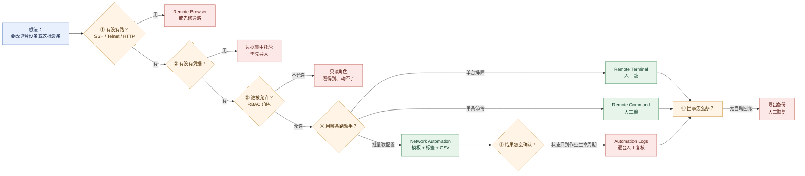
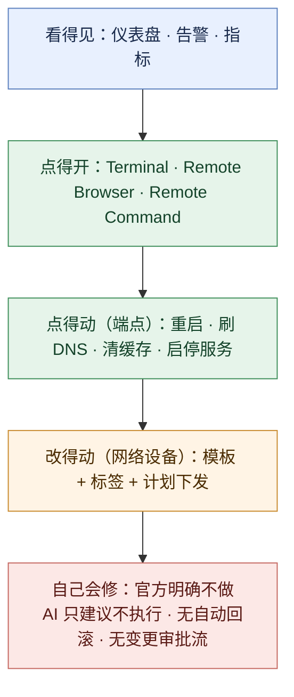

# Auvik 远程配置与一键自动化 —— 功能体系与痛点解法

> **调研对象**：Auvik（Auvik Networks）在「远程访问设备 → 执行动作 → 批量下发配置」这条链路上的能力构成、官方口径、能力边界与演进历史。
> **时间窗**：2023-01 → 2026-10（以官方 Release Notes 与帮助文档可考时间为准）。
> **本文回答三件事**：① 这些能力**解决的是客户在哪一侧、哪一类痛**（时间 / 钱 / 人 / 合规 / 组织）；② 用什么能力去解、**与痛点逐条对应**；③ 对应的**功能机制**是什么。

## 口径声明（与同系列其它报告的分工）

本系列已完成的两篇 Auvik 报告与本篇是**互补关系**，不重叠：

| 报告 | 覆盖 | 与本篇的关系 |
| --- | --- | --- |
| `Auvik-2023-2026-网络设备深度监控-功能体系与痛点解法.md` | 9 个「采集与观测」大功能点（SNMP 轮询 / 自定义 OID / 体验指标 / BGP-OSPF / 硬件传感器 / VPN-HA / Syslog / 流量 / 变更可见性） | 该篇第 9 章讲的是配置的**「看得见」**；本篇讲配置与动作的**「动得了」** |
| `Auvik_功能演进分析_2023-2026.md` 大功能点 7 | 「远程处置与一键自动化」的骨架（Remote Support / Command Runner / Quick Actions / Command Assist） | 该篇偏**终端（Windows / macOS）侧**；本篇聚焦**网络设备侧**，并补齐 **Network Automation（Job Templates / CLI Jobs）** 这一此前未被文档化的能力 |
| **本篇** | 6 个「动作」大功能点：一键直达 / 配置留痕 / 批量配置下发 / 一键动作 / AI 命令助手 / 自动化外延 | — |

> **本文口径（重要）**：只收「**由客户侧发起、对设备或终端产生实际动作**」的能力。**不含**只读观测类能力（见深度监控篇）、**不含**终端发现与拓扑绘制。凡是「平台侧只提供建议、由人执行」的能力（如 AI 命令建议），**纳入本文但明确标注其闸门位置**——因为「闸门在哪」正是本文最有价值的结论。

## 信源与局限说明

| 等级 | 含义 | 本文使用情况 |
| --- | --- | --- |
| **A** | 官方 Release Notes / 官方帮助文档（support.auvik.com）/ 官方产品页 FAQ | 主证据来源，占比约八成 |
| **B** | 官方博客、官方新闻稿、官方部署指南 PDF、官方联合 whitepaper、官方合作伙伴页 | 用于补充定位与上下文 |
| **C** | 第三方媒体与评测平台（NetworkWorld 系、ChannelVision、ChannelE2E、CRN、MSP Today、TechRadar、G2 等） | **仅用于交叉印证**；与官方口径冲突时以官方为准，并显式标注冲突 |

**已知局限（务必连同结论一起理解）**：
1. **Auvik 官方不公开定价层级清单**（定价页只有询价表单），因此「某能力属于哪个订阅层级」在多数条目上**只能给到间接证据**；
2. **`Network Automation` 的官方 KB 出现时间约为 2026-10-13**，而 2026 年全部 10 期 Release Notes（W02–W40）中**均无该功能的发布条目**——即这是一次**未见发布公告的能力上线**，其 GA 状态与版本归属**属待跟踪项**（见附四）；
3. 旧文档 `Auvik_功能演进分析_2023-2026.md` 引用的两组使用次数（远程终端 397,658 次、远程浏览器 270,147 次）在本次全部公开信源中**均未检索到**，本文**不予采用**（详见「源冲突与口径纠正」）。

---

## 读法：6 个大功能点全景

按「**动作的侵入性**」自轻到重排列——这条轴的左侧是「怎么进去」，中间是「改什么」，右侧是「谁来兜底」。

| # | 大功能点 | 四字口号 | 小功能点数 | 时间跨度 | 动作层级 |
| --- | --- | --- | --- | --- | --- |
| 1 | [一键直达设备（远程接入通道）](#大功能点-1一键直达设备远程接入通道-一站直达) | 一站直达 | 14 | 平台早期 → 2026-10 | 进入层（不改任何东西） |
| 2 | [配置留痕与可回退准备（配置备份）](#大功能点-2配置留痕与可回退准备配置备份-退有所据) | 退有所据 | 15 | 平台早期 → 2026-09 | 存档层（只读+留存） |
| 3 | [批量配置下发（Network Automation）](#大功能点-3批量配置下发network-automation-一改百台) | 一改百台 | 14 | ≈2026-10（无发布条目） | 变更层（真改配置） |
| 4 | [一键运维动作（端点侧 Quick Actions）](#大功能点-4一键运维动作端点侧-quick-actions-点一下就好) | 点一下就好 | 9 | 2025-11 → 2026-06 | 处置层（低风险可逆动作） |
| 5 | [AI 命令助手与执行边界（Aurora）](#大功能点-5ai-命令助手与执行边界aurora-建议不动手) | 建议不动手 | 10 | 2026-04 → 2026-10 | 建议层（不执行） |
| 6 | [自动化外延与维护窗口（API / Webhook / 集成）](#大功能点-6自动化外延与维护窗口api--webhook--集成-接得出去) | 接得出去 | 10 | 平台早期 → 2026-06 | 外延层（把动作接出去） |

> 合计 **72 条小功能点 / 26 条痛点 / 26 条解法**（P 与 S 逐节一一对应，校验见文末）。

### 一张图看清「一个动作要过几道关」

Auvik 的动手链路可以被读成**六个连续的关卡**。要注意的是：**它把闸门装在了每一关，而不是只在最后一关**——这正是它与「一键自动修复」类产品的根本分野。



### 一张图看清「动作谱系」到哪一层为止



---

# 大功能点 1：一键直达设备（远程接入通道）——「一站直达」

**这一层不修改任何东西，它决定的是「一个人能不能在三十秒内站到设备面前」。**

## 1.1 小功能点清单

| # | 小功能点 | 发布时间 | 来源等级 | 说明 |
| --- | --- | --- | --- | --- |
| 1.1 | Remote Terminal：浏览器内开设备 CLI | 平台早期 | A | Device Dashboard → 悬停 **Remote Management** → **Terminal**；**默认自动走 SSH**，SSH 不通则按记录的 IP 走 **Telnet** |
| 1.2 | Terminal 按钮的启用条件 | 平台早期 | A | 官方原文：**"The Terminal button is only enabled for devices that allow for connection by SSH or Telnet."** |
| 1.3 | 移除终端自动登录 + 二次认证 | 平台早期 | A | 官方原文：**"we have removed auto-login on the terminal… you'll always be asked to authenticate."** 启动时先要 Auvik 密码 |
| 1.4 | 一次性凭据（用后即焚） | 平台早期 | A | 若检测到设备 SSH 可用但无该设备凭据，则要求一次性输入 SSH 凭据，**"These credentials are wiped from the system after being used."** |
| 1.5 | Remote Browser：开设备 Web 管理页 | 平台早期 | A | 悬停 Remote Management → **Remote Browser** → 选 HTTP / HTTPS 端口 → Start；支持路由/交换/防火墙/无线控制器/AP/NAS 等 |
| 1.6 | Remote Browser **不绕过设备认证** | 平台早期 | A | 官方原文：**"does not bypass device authentication. Users must still authenticate using valid credentials configured on the target device."** |
| 1.7 | Collector 充当中间人（man-in-the-middle） | 平台早期 | B | 三功能（终端 / 隧道 / 远程浏览器）均**经 Collector 中转**；Collector 主动出站连接，**"no inbound firewall ports are exposed"** |
| 1.8 | Remote Tunnel | 平台早期 | A | 第四种远程接入方式；**并发上限：每客户 20 条隧道会话、单客户 5 条个人隧道** |
| 1.9 | Remote Command widget（单行命令） | ≈2022（官方称"launched just last year"） | A | 面向**网络设备**下发**单行**命令（走 SSH）；**非终端**，不支持多命令、不为他人保持会话；**官方定位"排障或收集信息，而非执行命令或修改配置"** |
| 1.10 | 凭据集中托管（云侧） | 平台早期 | A | 官方原文：**"sent to the cloud and stored securely using AES-256 encryption. They're decrypted and made available to the system only as needed…"** |
| 1.11 | 凭据两级作用域 + Retry / Reset | 平台早期 | A | 从 **MSP 仪表盘**添加 → 加到**所有客户**；从**客户仪表盘**添加 → 仅该客户。**"Retry credentials is only available from the client dashboard."**；Reset 仅对预置或 MSP 创建的凭据可用 |
| 1.12 | 远程管理审计日志 | 2025-02-26（文档化） | A | **Audit Log → Remote Management**，字段含设备 / 用户 / 站点 / Date Started / Last Active / **Category（Terminal session 或 Remote Browser session）** / Action / **Direction（Inbound/Outbound）** / Status / Cause / **Data that was sent** |
| 1.13 | Go To Terminal（从排障建议直达终端） | 2026-10-05（W40） | A | 官方原文：**"…the button is enabled only when Auvik has login credentials for the device."** |
| 1.14 | 前置约束：设备 Web 界面用**绝对路径**时远程浏览器显示不全 | 平台早期 → 2026-06 重述 | A | 官方原文：**"cannot be corrected within Auvik."** 属设备侧老实现的固有限制 |

## 1.2 它对应的用户痛点

> **口径**：本节只写**客户侧可感知**的痛（时间 / 钱 / 人 / 合规 / 组织）。「Collector 怎么中转」「凭据怎么加密」这类**架构层事实**一律不在本节出现，而是放到 1.3 的「架构约束」里作为必要性论证。编号 **P1…P5** 与 1.3 的 **S1…S5** 对应（其中 S2 / S3 一条解法同时覆盖多条痛点）。

- **P1｜处理一台设备，真正排查前先要"修路"**（时间 / 人）。工程师要动一台设备，得先挂 VPN、开或装本地终端工具、翻出这台设备的地址和账号口令——**"找资料 + 建通路"的时间，常常比真正排查的时间还长**。站点一多、厂商一杂，这段路的成本还会随设备数线性上涨。
- **P2｜设备口令散落在个人手里，人一走就断**（人 / 合规）。每台设备的登录口令记在某个人的密码本、Excel 或脑子里。**新人接手时不知道该用哪个口令，老员工离职后代管关系随之失联**；审计问一句"谁有权限登录这些设备"，往往答不上来。
- **P3｜为了能远程连设备，网络被迫开了口子**（合规 / 风险）。传统做法是开 VPN、开入站端口、自建跳板机；**每一个口子都是一处风险与一条审计例外**，而中小团队通常没有专职堡垒机，只能"先用着"。
- **P4｜进去了却没有留痕，事后说不清谁做了什么**（合规 / 组织）。谁在什么时候登录过哪台设备、动了什么，事后无法举证；跨团队定责时只能靠回忆，而**回忆在组织里是不可采信的**。
- **P5｜故障在现场，只能等人到现场**（时间 / 钱）。设备在客户机房、弱电间或无人工位，一旦出事**只能派人过去**——MTTR 直接被"路程"绑架，夜间与节假日尤甚。

## 1.3 它是如何解决的

**架构约束（由 1.2 倒推）**

| 架构约束 | 由哪条痛点倒推 | 落到了哪些功能 |
| --- | --- | --- |
| 通路必须由**管理面反向建立**，而不是让客户在自己的防火墙上开洞 | P1、P3 | 1.7 Collector 出站中继 |
| 凭据必须与**个人**解耦，改为**平台集中托管** | P2 | 1.10 云托管 + 1.11 两级作用域 |
| 每次进入都必须**重新证明身份**，且能**归因到具体的人** | P4 | 1.3 二次认证 + 1.4 一次性凭据 + 1.12 审计日志 |
| 入口必须能**从任何地方**到达，而非只在被管网络内可用 | P1、P5 | 1.1 / 1.5 / 1.13 浏览器内直达 |

- **S1｜浏览器内一键直达，不必先"修路"**（→ 解 P1、P5）。Device Dashboard 上悬停 **Remote Management** 即可选 **Terminal**（开 SSH/Telnet 会话）或 **Remote Browser**（开设备 Web 管理页），**不需要挂 VPN、不需要本地装 PuTTY 之类的工具**，也不需要人在被管网络内。官方产品页把它定位为「**secure, one-click SSH or Telnet access to any device**」——替代的正是"本地工具 + VPN"这套组合。
- **S2｜凭据集中托管，让"谁能连"不再依赖某个人的记忆**（→ 解 P1、P2）。所有凭据（SNMP / Login（Telnet / SSH / SSH key）/ WMI / VMware / 厂商 API / 设备 API）**集中存到 Auvik 云并以 AES-256 加密**，按 **MSP 全局**与**单客户**两级作用域绑定；Terminal、配置备份、CLI 作业**共用同一套登录凭据**。对客户的意义：**口令从"个人资产"变成"组织资产"**——新人接手不需要问人，人也走了不等于权限还在。
- **S3｜不开入站端口 + 二次认证 + 权限收敛**（→ 解 P3、P4）。三件事叠加：**Collector 以出站连接作中间人**，客户防火墙**不需要开入站端口**；打开终端前**强制重新输入 Auvik 密码**（已移除自动登录），无该设备凭据时使用**一次性凭据、用后即焚**；**RBAC 把 Remote terminal / Remote browser / Remote tunnel 做成可逐角色开关的权限项**，只读角色在官方权限表中这些项一律为 **No access**。
- **S4｜远程管理审计日志：把"进过门"变成可举证的记录**（→ 解 P4）。**Audit Log → Remote Management** 逐条记录设备、用户、站点、起止时间、**会话类别（Terminal session / Remote Browser session）**、方向（Inbound / Outbound）、状态、原因、**以及在会话中发送的数据**。对客户的意义：**"谁在什么时候站到了哪台设备面前"变成一份可随时调取的台账**。
- **S5｜从建议直接跳进终端，减少一次手工搬运**（→ 解 P1）。2026-10 的 **Go To Terminal**：排障智能体给出命令建议后，可直接点按钮在新标签页打开**对应设备的终端**；官方明确该按钮**仅在 Auvik 已持有该设备登录凭据时可用**——**"能不能一键跳过去"本身就以"凭据是否齐备"为前提**，这既是便利设计，也是一道隐式的权限闸门。

## 1.4 功能机制

**机制 1｜接入走的是「Collector 反向中继」，不是「客户端直连」。** 这是整套远程能力的地基，也是**所有前置条件里最硬的一条**：官方明确「**Remote Browser uses the assigned collector to establish the connection. If the collector cannot reach the device, Remote Browser will not be available.**」——即**设备能不能被连上，取决于那台 Collector 能不能到得了它**，而不是取决于工程师坐在哪里。这解释了三个现象：① 客户防火墙无需开洞（Collector 出站）；② 同一设备在不同站点/不同 Collector 下的可用性可能不同；③ 设备不可达时功能是**整体不可用**，而不是"慢一点"。

**机制 2｜凭据是"一次配置、多处复用"的共享资源。** 官方原文明确 Login 凭据除了连设备，还用于「**the terminal, and configuration backup and restore**」——即**终端、备份、恢复共用同一套登录凭据**。这带来一个容易被忽略的后果：**凭据失效不只影响采集，会同时击穿终端与备份**；反之，配好一次凭据，就同时解锁了三条链路。凭据状态在设备仪表盘上以 KPI 呈现（SNMP / login / WMI / VMware 四类，含"需要凭据 / 正在尝试 / 已具备"等状态），因此**"为什么连不上"通常能先在凭据状态上得到答案**。

**机制 3｜「进去」这件事被刻意做贵。** 与"一键直达"的字面印象相反，Auvik 在**进入环节**上做了三重加码：移除自动登录、打开终端前重认证、无凭据时只给一次性凭据。这套设计的逻辑是：**便利性给到"到达"（不必 VPN、不必装工具），风险控制给到"进入"（每次都要重新证明身份）**。审计日志里的 **Direction（Inbound / Outbound）** 字段说明它不仅记"谁进设备"，也记"谁从设备出来"——即它把会话当成**双向通道**来治理。

**机制 4｜Remote Command widget 与 Remote Terminal 是两种不同定位的东西，不能混用。**

| 维度 | Remote Terminal | Remote Command widget |
| --- | --- | --- |
| 形态 | 交互式终端会话 | **单行命令**，无会话保持 |
| 能发几条 | 任意多条 | **一条** |
| 官方定位 | 排障与操作 | **"troubleshoot or gather information and not for executing commands or changing configurations"** |
| 默认可用角色 | 随 Remote terminal 权限项 | **Super Admin / Admin / Level 2 Tech**（**不含 Level 1 Tech**） |
| 权限开关名 | Device Details and Access → Remote terminal | Device Details and Access → **Auto Login for Remote Command** |

**机制 5｜远程动作的权限是"逐角色开关"，不是"层级一把锁"。** 官方角色页显示：只读角色在 **Remote browser / Remote terminal / Remote tunnel / Configurations / Endpoint monitoring** 等项上一律 **No access**；Admin 与 Super Admin 则含 **Remote terminal (auto login)** 与 **Manage credentials**。也就是说，**客户可以做到"让一线只能看、不能动"**——这在组织上比"按人管"更可靠。

## 1.5 功能边界（能做到什么程度）

| 能力 | 做到什么程度 | 做不到什么 | 依据 |
| --- | --- | --- | --- |
| 接入方式 | SSH / Telnet（终端）；HTTP / HTTPS（远程浏览器） | **未找到官方对串口 / Console / 多跳 / 堡垒机联动**的支持说明 | A |
| 通道依赖 | 经指定 Collector 中继，出站连接、无需开入站端口 | **Collector 到不了设备 → 功能整体不可用**（非降级） | A |
| 老设备 Web 界面 | 支持相对路径的正常界面 | **绝对路径的老界面部分内容加载不全，且"cannot be corrected within Auvik"** | A |
| 凭据 | 集中托管、AES-256、两级作用域、Retry / Reset | **未找到"凭据自动轮换 / 改密后自动重试"的官方说明**；仅手动 Retry | A |
| 认证强度 | 打开终端前重认证 + 一次性凭据用后即焚 + 平台强制 2FA | **未找到官方关于"打开终端强制走企业 SSO"的专门说明** | A |
| 并发上限 | 隧道：**每客户 20 条 / 个人 5 条**（达上限后不可新建） | **终端与远程浏览器未见公开的并发上限说明** | A |
| 审计 | 会话级留痕（设备 / 人 / 时长 / 类别 / 方向 / 发送的数据） | **官方未披露审计日志本身的保留时长**；查询时间窗最长"上月 / 自定义" | A |
| 厂商覆盖 | 官方口径：支持"allow remote management via SSH, Telnet, or web interfaces"的设备 | **未找到"不支持某厂商"的清单式声明**；未识别设备表现为功能不可用 | A / B |

> **一句话总结边界**：Auvik 把**"到达设备"这件事的成本压到了接近零**（不开洞、不装工具、不依赖某个人记口令），代价是**把风险控制集中在"进入"这一瞬间**（重认证 + 一次性凭据 + 逐角色权限 + 会话留痕）。**它的定位是"把每一位工程师的桌面搬到浏览器里"，不是"提供一个能进设备的闸门产品"。**

---

# 大功能点 2：配置留痕与可回退准备（配置备份）——「退有所据」

**这一层仍然不改任何东西，但它决定了「改坏了的时候，手里有没有材料」。**

> **与深度监控篇第 9 章的分工**：那一章讲的是「配置与固件变更**可见性**」（让人知道"变过什么"）；本节讲的是**同一批数据在"动手"语境下的用途**——即**回退的材料**。两者用的是同一套事实，但**痛点与解法完全不同**，故不合并。

## 2.1 小功能点清单

| # | 小功能点 | 发布时间 | 来源等级 | 说明 |
| --- | --- | --- | --- | --- |
| 2.1 | 变更检测后自动备份 | 平台早期 | A | 官方原文：**"The system polls continuously for config changes. When a change is detected, Auvik makes a new backup on the time interval you've specified…"** |
| 2.2 | 默认间隔 **60 分钟** | 平台早期 | A | **"The default backup time is 60 minutes following a detected change."** 可调（Configuration backup period，单位分钟） |
| 2.3 | 备份开关只能**全局**关 | 平台早期 | A | 官方原文：**"The no-backup setting will apply globally to all devices; it can't be changed for a specific device."** |
| 2.4 | 备份**永久保留** | 平台早期 | A | 官方原文（2026-05-13）：**"Configuration backups are kept indefinitely. Backups are only removed when the associated device is deleted from Auvik."** |
| 2.5 | 版本索引（旧版本不被覆盖） | 平台早期 | A | 官方称 **"nothing gets overwritten or lost"**；可对比**任意两个版本**（不限相邻） |
| 2.6 | 配置差异（diff）三色高亮 | 平台早期 | A | 红＝已移除或已变更；绿＝已新增或已变更；灰＝已不存在（配置出现缺口） |
| 2.7 | 导出为**文本格式** | 平台早期 | A | **"Exports are in text format."**；少数设备（如 SonicWALL）仅支持 **Base64** 配置 |
| 2.8 | 存储位置：**云端**，不在 Collector 本地 | 平台早期 | A | **"…are stored in the Auvik cloud, not on the local collector."**；**"The collector does not retain configuration backups long-term."** |
| 2.9 | 预配置告警「Configuration Backup」 | 平台早期 | A | 严重级别 **Informational**；触发条件 **Configuration Backup equal to True**；默认作用于 Tag = Network Device；**无清除条件，靠人工 Dismiss** |
| 2.10 | FortiGate **API 优先**备份 | 2025-08-23（W34） | A | 官方原文：**"We've improved the backup functionality to default to API when available."** UI 用**绿色对勾**表示 CLI 或 API 凭据有效且备份在跑，**钥匙图标**表示凭据有效但未检测到 API 备份 |
| 2.11 | FortiOS **header-only 认证** | 2026-09-07（W36） | A | 官方原文：**"…to support header-only authentication, ensuring continued monitoring for newer FortiOS versions (v7.4.5+ and v7.6.1+)."** |
| 2.12 | 备份通道为设备原生协议 | 平台早期 | A | **"Data transfer uses the device's native protocol, such as: SSH (secure), Telnet, FTP / TFTP"**；且官方提示部分协议**明文传输** |
| 2.13 | HA 备机保留在清单，**以防其配置备份丢失** | 2026-03-02（W10） | A | 官方原文：**"This is done to prevent the loss of configuration backups tied to the passive device."** |
| 2.14 | 备份状态可见 | 平台早期 | A | Documentation → Configurations 列出各设备凭据/备份状态与最后成功时间；设备仪表盘有备份指示器与时间戳 |
| 2.15 | ★ **官方明确不自动把配置推回设备** | 平台早期 → 多次重述 | A | 官方原文：**"No, Auvik doesn't automatically push configurations back to devices."** 与 **"restoring a configuration is a human-in-the-loop process…"** |

## 2.2 它对应的用户痛点

> **口径**：同 1.2。编号 **P1…P5** 与 2.3 的 **S1…S5** 对应。

- **P1｜改坏了，手里没有"上一版"可退**（时间 / 钱）。配置被误改、被别的系统覆盖、或升级后行为异常，想退回上一个已知good状态——**没有备份就只能凭记忆重敲**。恢复时间以小时计，而且**不保证能回到原样**；如果这台设备承担关键业务，这段时间直接对应业务中断。
- **P2｜故障时默认"什么都没变"，于是查错方向全偏**（时间）。因为没人确知配置是否被动过，工程师会去查链路、查终端、查应用——**唯独不查配置**。这个默认假设一旦错了，**排查时间成倍拉长**，而这正是"最要命的故障发生在没人知道改过的时候"。
- **P3｜"谁在什么时候改了什么"拿不出证据**（合规 / 组织）。审计或跨团队定责时，需要的是**变更的时间点与前后差异**；没有它，对话只能停在"各说各话"，**举证链是断的**。
- **P4｜设备换机或 HA 切换后，备份挂在了错误的设备名下**（时间 / 钱）。真需要恢复时，拿到一份**不知道属于谁**的配置——**备份存在但不可用**。在恢复场景里，这是最坏的结果：**你以为有退路，其实退路是错的。**
- **P5｜厂商换了认证方式，备份悄悄停了，没人知道**（时间）。新固件不再支持旧的 API 认证方式后，备份**静默失效**；直到某天真的需要恢复，才发现**最近的那一版根本不存在**——而故障偏偏发生在"需要那一版"的时刻。

## 2.3 它是如何解决的

**架构约束（由 2.2 倒推）**

| 架构约束 | 由哪条痛点倒推 | 落到了哪些功能 |
| --- | --- | --- |
| 备份必须**由变更驱动**而非"按点全量"，否则版本粒度不足以回退 | P1 | 2.1 变更检测触发 + 2.5 版本索引 |
| 「变了」必须是一个**可被通知的事件**，不能靠人去猜 | P2 | 2.9 Configuration Backup 告警 |
| 必须保留**前后差异**，而不只是"又存了一份" | P3 | 2.6 三色 diff + 2.7 文本导出 |
| 备份必须与**设备权威身份**绑定，且优先走更稳的通道 | P4、P5 | 2.10 API 优先 + 2.11 header-only 适配 + 2.13 HA 备机保留 |
| 「有没有退路」必须**随时可见**，不能到用时才知道 | P5 | 2.14 备份状态与最后成功时间 |

- **S1｜变更检测触发备份 + 永久版本，把"上一版"变成常态资产**（→ 解 P1、P2）。系统**持续轮询配置变更**，一旦检测到变更，**在指定间隔（默认 60 分钟）后执行一次新备份**；备份**永久保留**，**只有设备被从 Auvik 删除时才移除**。对客户的意义：**"上一版"不再取决于有没有人记得备份**——它是系统自动攒下来的，且旧版本写进版本索引不被覆盖。这同时回应 P2：因为变更**一定会被记录**，"配置有没有被动过"从猜测变成可查。
- **S2｜差异对比 + 变更告警：把"变了"变成一条通知**（→ 解 P2、P3）。**diff 三色高亮**给出"删了什么、加了什么、哪里出现缺口"，并且**可以对比任意两个版本**（不限相邻）；**Configuration Backup 告警**在检测到变更并完成备份后触发。对客户的意义：**排查时不必再假设"什么都没变"**——如果真的变了，你会收到通知；定责时也不必回忆，**差异本身就是证据**。
- **S3｜API 优先通道 + 设备身份绑定，让"备份归属"不出错**（→ 解 P4、P5）。2025-08 起 FortiGate 备份**默认优先走 FortiOS REST API**（无需 CLI 访问即可取回完整配置，API 只需 System=Read/Write、其余 Read、开启 REST API Access）；UI 用**图标区分 CLI 与 API 凭据状态**，让"备份到底走哪条路"可见。2026-09 补上 **header-only 认证**以适配 FortiOS v7.4.5+ / v7.6.1+。与之配套的是 HA 处理：**备机保留在 inventory 与 topology，目的被官方明确写成"防止其关联的配置备份丢失"**。
- **S4｜备份状态可见：让"静默失效"变成"显式可见"**（→ 解 P5）。设备仪表盘与 Documentation → Configurations 上都有**凭据状态 / 备份状态 / 最后成功登录与备份时间**；FortiGate 场景下还有"钥匙图标＝凭据有效但没有 API 备份"这种**区分通道的中间态**。对客户的意义：**"备份是不是还活着"不用等到需要恢复那天才知道。**
- **S5｜把恢复设计成人工闸门（诚实标注：这是有意的取舍，不是能力缺失）**（→ 解 P1：**部分解决**）。官方明确 **Auvik 不会自动把配置推回设备**，恢复是 **"a human-in-the-loop process where your admins select the desired version and apply it using the device's configuration restore process."**。因此**"可回退"的真实含义是"有材料可退"，而不是"一键回退"**。**这一点必须在做选型或对标时先说清楚**：如果预期是"点一下自动回到上一版"，Auvik 不提供；如果预期是"任何时候都能拿到正确的上一版"，它提供。

## 2.4 功能机制

**机制 1｜备份是"变更驱动 + 间隔节流"，不是"定时全量"。** 官方口径是两段式：**持续轮询检测变更 → 检测到后在指定间隔执行备份**（默认 60 分钟）。这解释了三件事：① **没有变更就没有新版本**（版本数增长与变更频率挂钩，而非与时间挂钩）；② 间隔参数控制的**不是"多久备份一次"，而是"变更后多久落一份"**——官方特意澄清该设置**不改变 Auvik 登录设备的频率**；③ 一天内多次变更可能被合并进一个备份窗口，**回退粒度受该间隔约束**。

**机制 2｜"永久保留"与"指标降采样"是两套存储哲学，这里选了前者。** 配置备份**永久保留**，而指标是逐级降采样的。判据很清楚：**配置是"离散事实"**（一次变更一份文件，增量成本低、且每一份都可能是"救命的上一版"）；**指标是"连续流"**（全精度存储成本不可承受）。**理解这条，就能理解 Auvik 对"事实型数据"与"流型数据"的不同待遇。**

**机制 3｜通道是可替换的，适配是常设成本。** 备份走**设备原生协议**：SSH（安全）、Telnet、FTP / TFTP，官方明确提示部分协议**明文传输**；FortiGate 场景下则通过让设备用 **FTP 把配置文件发回 Collector**（CLI 路线）或走 **REST API**（`POST /api/v2/monitor/system/config/backup?scope=global`）。**通道会随固件版本变化而失效**——2026-09 的 header-only 适配正是因为这个：FortiOS v7.4.5 / v7.6.1 起默认禁止通过 URL 参数传 token。**所以"厂商认证持续适配"是一条常设维护成本，而不是一次性开发。**

**机制 4｜备份与"设备身份"死绑，这既是优点也是脆弱点。** 备份挂在设备上：**好处**是"换机/HA 切换后能对上号"（HA 备机保留即为此）；**代价**是**设备一旦被删除，备份随之消失**。而设备有一个默认的**休眠删除阈值（默认 10 天不响应 ICMP/SNMP 即删除）**——对 HA 被动节点这类"很少响应"的设备，这是一条**会造成备份连带丢失**的真实风险路径，官方也是为此引入 HA 支持。另外，**HA 对中只有 active/primary 节点会被备份**，且官方承认 failover 后若 Auvik 仍指向旧 active，**"backups may silently fail"**。

**机制 5｜预配置告警的清除语义值得注意。** 「Configuration Backup」告警的默认清除条件是 **No Clear Condition - Clear By Dismissing**——即**它不会自己消失，必须有人去关**。这与观测类告警（条件反向成立即清除）不同，因为"一次变更已被备份"是一个**离散事实**，在语义上不存在"恢复"。**它对客户的实际影响是：这类信息级告警会持续累积，需要有清理习惯（或直接被 Dismiss 掉）。**

## 2.5 功能边界（能做到什么程度）

| 能力 | 做到什么程度 | 做不到什么 | 依据 |
| --- | --- | --- | --- |
| 备份触发 | 变更检测后按间隔（默认 60 分钟）自动备份 | **不是定时全量**；无变更则无新版本；回退粒度受间隔限制 | A |
| 开关粒度 | 可全局关闭（间隔设 0） | **不能按单设备关闭**；未找到按站点粒度的开关说明 | A |
| 保留 | **永久保留**，仅随设备删除而移除 | 设备被删除 → **备份一并消失**（休眠设备默认 10 天即可能被删） | A |
| 版本与对比 | 任意两版本 diff、三色高亮、文本导出 | 少数设备仅 Base64；**未找到逐厂商配置格式的完整说明表** | A |
| **恢复** | **导出上一版 + 人工应用（human-in-the-loop）** | **不自动推送配置回设备**；**未找到"从备份恢复"的厂商支持矩阵**；**无自动回滚** | A |
| 通道 | SSH / Telnet / FTP / TFTP / 厂商 API（FortiGate API 优先） | 部分协议**明文**；通道随固件失效（需持续适配） | A |
| HA | 备机保留以防备份丢失；HA 告警可用 | **只备份 active/primary**；failover 后可能**静默失败** | A |
| 许可 | 官方定价文章将配置管理列于**基础层** | 官方**不公开**层级清单；**未找到单独收费证据** | A / C |

> **一句话总结边界**：Auvik 把配置的**"存"**做得很足（永久、可 diff、可导出、状态可见），把配置的**"退"****刻意留给人**。**这是一条有意的安全闸门**：它保证"出事时手里有正确的上一版"，但不保证"出事时不用人做决定"。**做对标时，不要把"有备份"误读成"能回滚"。**

---

# 大功能点 3：批量配置下发（Network Automation）——「一改百台」

> **⚠️ 时间口径提示**：本节所依据的官方 KB（`How to Click and Run CLI Jobs with Auvik Networks Automation`，约 **2026-10-13**）是本次调研中**唯一**一份专述该能力的一手文档；**2026 年全部 10 期 Release Notes（W02–W40）中均无该功能的发布条目**。因此本节事实均为 **A 级文档证据**，但**其发布状态与版本归属属待跟踪项**（见附四）。

## 3.1 小功能点清单

| # | 小功能点 | 发布时间 | 来源等级 | 说明 |
| --- | --- | --- | --- | --- |
| 3.1 | **Template（模板）**：定义"怎么做" | ≈2026-10 | A | 含名称、描述、是否需要 **elevated access**、**按执行顺序排列的 CLI 命令**（一行一条）、**参数占位符** |
| 3.2 | 参数写法与命名 | ≈2026-10 | A | 双花括号包全大写参数名，如 `{{ ACCESS_POINT_VLAN }}`；示例：`{{ INTERFACE_NAME }}`、`{{ SYSLOG_SERVER }}`、`{{ NTP_SERVER }}` |
| 3.3 | **Job（作业）**：定义"在哪、何时、对谁" | ≈2026-10 | A | 「**One immediate or scheduled execution of a selected template**」 |
| 3.4 | **Tag**：保存的设备查询 | ≈2026-10 | A | 可用属性：**Device type / vendor / model / software version / name**；用 **AND** 收窄、**OR** 取并集；**仅在所选站点范围内求值** |
| 3.5 | 站点范围是外层边界 | ≈2026-10 | A | Tag 或规则**不能把范围外站点的设备拉进来** |
| 3.6 | 作业五步流程 | ≈2026-10 | A | ① 选并复核模板 → ② 选站点范围 → ③ 选设备 → ④ **CSV 提供逐设备参数值** → ⑤ 立即运行或创建计划 |
| 3.7 | **CSV 逐设备参数** | ≈2026-10 | A | 下载 CSV → 逐台填值 → 保留 Auvik 的识别信息 → 上传 → 复核；**必填参数为空的设备会被跳过不执行** |
| 3.8 | 立即运行 / **计划（scheduled）** | ≈2026-10 | A | 计划用调度控件设置重复方式；**目标按每次运行时的条件重新求值**（官方 "Scheduled target disclosure"） |
| 3.9 | **Automation Logs** 与导出 | ≈2026-10 | A | 记录作业状态、跨站点情况、开始时间与时长、选择条件、**每台设备捕获的输出**；状态四态：**In progress / Completed / Incomplete / Canceled**；可导出 **CSV / JSON** |
| 3.10 | **权限分离**：管模板 ≠ 跑作业 | ≈2026-10 | A | 官方原文：**"A user may be allowed to run an existing template without being allowed to create or edit one."** |
| 3.11 | 前置条件（四项） | ≈2026-10 | A | ① 站点为 **Advanced 或 Performance** 订阅；② 设备**由 Auvik 管理且有可用 CLI 凭据**；③ 需 elevated access 时**须已在 Discovery settings 配置**；④ 设备仪表盘**备份指示为绿色** |
| 3.12 | **"仅 SNMP 监控 ≠ 合格"** | ≈2026-10 | A | 官方原文：**"Being monitored through SNMP does not make a device eligible for a CLI job."** |
| 3.13 | 官方安全红线：**不支持需要密码的作业** | ≈2026-10 | A | 官方原文：**"The current template workflow does not encrypt or securely store those values. Jobs that require a password or other secret supplied by the script are not supported through this workflow."** |
| 3.14 | 官方风险提示 | ≈2026-10 | A | **"Network impact warning: Scripts and commands may modify device configurations or otherwise affect your network environment."** 并要求 **"Treat every CLI job as an action against a real device."** |

## 3.2 它对应的用户痛点

> **口径**：同 1.2。编号 **P1…P5** 与 3.3 的 **S1…S5** 对应。

- **P1｜同一处改动，要在几十上百台设备上重复做**（时间 / 人）。改 NTP、Syslog、SNMP 参数，加一条统一 ACL，批量改接口描述——**每一台都要登进去敲一遍**。一百台就是一百次重复劳动，而且**在中途被打断时极易漏掉几台**，漏掉的那几台日后会成为"配置漂移"的隐患。
- **P2｜每个站点的值还不一样，没法一份配置抄到底**（时间）。不同站点的 VLAN、网段、描述各不相同，手工改时必须**逐台核对参数**；错一个参数，可能就是一处业务中断。这件事**越熟练的人越容易因为"凭手感"而出错**。
- **P3｜同样的操作，不同人做出来的结果不一样**（组织 / 质量）。手工操作**高度依赖当班人的熟练度**：快的人几分钟，慢的人十几分钟甚至做错；更麻烦的是**无法复现"上一次是怎么做的"**——没有可复用的载体，经验留在个人身上。
- **P4｜批量变更只能排在夜里，而夜里没人愿意守着**（人 / 时间）。批量变更要放在维护窗口，**执行与值守都要人力**；一旦夜里出问题，往往等不到人处理，第二天才发现某几台设备处于异常状态。
- **P5｜做完之后，谁成功谁失败说不清**（组织 / 举证）。批量操作**缺少逐台结果记录**，事后无法确认"哪些设备真的改成了"。于是只能**再登一遍逐台抽查**——批量操作省下的时间，又在核对阶段还回去了。

## 3.3 它是如何解决的

**架构约束（由 3.2 倒推）**

| 架构约束 | 由哪条痛点倒推 | 落到了哪些功能 |
| --- | --- | --- |
| 「怎么做」与「对谁做」必须**分离成两个可复用对象** | P1、P3 | 3.1 Template + 3.4 Tag |
| 逐设备差异必须能**声明式传入**，而不是靠人手改 | P2 | 3.2 参数占位符 + 3.7 CSV 逐设备参数值 |
| 执行必须**可调度**，不必有人在现场守着 | P4 | 3.8 计划执行 |
| 执行必须有**逐台回执**，否则无法确认 | P5 | 3.9 Automation Logs（含每台设备输出）+ CSV/JSON 导出 |
| 模板管理与作业执行必须**权限分离** | P3 | 3.10 两套权限 |

- **S1｜模板：把"怎么做"沉淀成可复用资产**（→ 解 P3）。Template 把**命令序列 + 参数占位符**固化成一份可复用定义，**在创建它的层级建一次、在符合权限与订阅的子站点反复运行**。对客户的意义：**经验从"人的手感"变成"平台的资产"**——上一次怎么做的，这套模板就是答案；换个人执行，结果一样。
- **S2｜标签：用属性筛出"该改的那批设备"**（→ 解 P1）。Tag 是**保存的设备查询**，可按 **Device type / vendor / model / software version / name** 组合条件，**AND 收窄、OR 取并集**，运行前还能**复核匹配清单**。对客户的意义：**"这一百台"不再靠人列名单**，而是由属性自动算出来；而站点范围作为外层边界，**保证不会越界改到别的站点**。
- **S3｜CSV 逐设备参数：差异一次填清，不留给人去记**（→ 解 P2）。作业准备时**下载 CSV、逐台填写参数值、上传执行**；**必填参数为空的设备会被自动跳过**（宁可不改，也不错改）。对客户的意义：**"每台不一样的地方"被集中在一张表里一次性核对**，而不是在执行时凭记忆逐台敲。
- **S4｜计划执行：把"夜里守着"变成"排好就跑"**（→ 解 P4）。作业可**立即运行，也可创建计划**，让批量变更在维护窗口自动执行，**不需要有人在现场守着**。配套的诚实提示：**计划的目标设备按每次运行时的条件重新求值**（官方 "Scheduled target disclosure"），因此**目标清单可能随设备增减而变化**；且**修改模板或标签会停掉该计划**并给出通知（避免"改了模板却还在按旧逻辑跑"）。
- **S5｜逐台回执与导出：让"做完了"变成可核对的事实**（→ 解 P5）。**Automation Logs** 记录作业状态、跨站点情况、起止时间与时长、设备选择条件，以及**每台设备捕获的输出**，并可**导出 CSV / JSON** 用于批量复核与留档。对客户的意义：**批量操作从"我点了运行"变成"我有每台设备的执行记录"**。

## 3.4 功能机制

**机制 1｜三层抽象：Template（怎么做）→ Tag（对谁做）→ Job（在哪何时做）。** 官方术语表把这套模型说得很清楚：**Template** = 可复用定义（含命令与参数）；**Job** = 对某模板的一次立即或计划执行；**Tag** = 在所选站点范围内求值的已保存设备查询；**Parameter value** = 作业准备时为参数提供的逐设备取值。**这套三层拆分的价值在于：变更需求变化时，通常只需要改其中一层**——加设备改 Tag，改命令改 Template，改时间改 Job。

**机制 2｜"合格设备"的判定链比想象中长。** 一台设备要能进作业，需要连续通过：**站点订阅层级（Advanced / Performance）→ Auvik 管理状态 → 可用 CLI 凭据 → 是否需要 elevated access 且已在 Discovery settings 配好 → 备份指示器为绿色**。官方专门澄清了最容易误解的一条：**"仅通过 SNMP 被监控不等于具备 CLI Job 资格"**——**一台在 Auvik 里显示正常的交换机，完全可能因为没配 CLI 访问而不可作业**。**备份指示灯是"CLI 访问可用"的一个实用信号**（绿色表示 Auvik 具备运行 CLI 模板所需的访问）。

**机制 3｜官方在"机密"上画了一条硬红线。** 官方明确**不建议**在模板或参数 CSV 中放密码、SNMP community、SNMPv3 凭据、共享密钥等；并直接承认**当前模板工作流不加密、不安全存储这些值**，因此**"需要脚本提供密码的作业不受支持"**，且预告"未来版本将支持安全使用密码"。**这条边界的实际含义是：涉及凭据下发的配置变更（如改 SNMP community 串）无法用这套工作流完成**。

**机制 4｜状态只描述"作业生命周期"，不判断"改动是否生效"。** 官方原文：**"Job status describes the job lifecycle. It does not interpret every device's CLI response or confirm that the intended change occurred. A completed job can still contain an invalid-command message or other device-side error."** 四态语义需仔细区分：**Completed** = Auvik 处理完了（**不代表命令成功**）；**Incomplete** = 未按预期完成全部应做工作；**Canceled** = 正常完成前停止（**需复核哪些设备已收到命令**）。**这正是"逐台复核输出"被写进官方安全操作清单的原因。**

**机制 5｜官方安全操作清单本身就是一份"人工闸门清单"。** 官方给出的安全操作实践包括：**"Treat every CLI job as an action against a real device."**、模板聚焦单一已知作业并写清描述、**针对确切的设备系列与软件版本核对命令**、**新模板或改动过的模板先在一台代表性设备上验证**、**即使状态是 Completed 也要复核逐台输出**、**绝不把密码放进模板/参数/CSV**。**这份清单的存在本身说明：这套能力的设计前提是"人负责最后一次核对"。**

**机制 6｜与配置备份的关系是"前置信号"，不是"自动回滚"。** 执行作业前，官方把**备份指示器为绿色**列为就绪信号（说明 CLI 访问可用）；但**官方从未提供"作业失败后自动回滚"**——配置恢复始终是导出 + 人工应用。**"作业执行"与"配置恢复"是两个独立能力，不存在自动闭环。**

## 3.5 功能边界（能做到什么程度）

| 能力 | 做到什么程度 | 做不到什么 | 依据 |
| --- | --- | --- | --- |
| 命令下发 | 模板化多命令序列、逐设备参数、批量与计划执行 | **不支持需要密码 / 机密的作业**（模板工作流不加密存储） | A |
| 目标选择 | Tag 保存查询（类型/厂商/型号/版本/名称），站点范围内求值 | **未找到目标数量上限的官方说明**；范围外站点不可选 | A |
| 执行 | 立即运行 / 计划执行 | **未说明时区处理、并发还是串行、失败时继续/中止/重试、作业超时** | A |
| 结果确认 | Automation Logs 记录作业状态 + 逐台输出，可导出 CSV/JSON | **状态不校验命令是否成功、不解读设备响应**；Completed 仍可能含设备侧错误 | A |
| 回滚 | — | **无自动回滚**；恢复仍为导出 + 人工应用 | A |
| 变更治理 | 有官方风险提示与安全操作清单 | **未找到变更审批流 / 维护窗口约束 / 变更日历的官方机制** | A |
| 设备资格 | 站点需 Advanced/Performance；设备需 CLI 凭据（+ elevated enable）；备份指示绿色 | **仅 SNMP 监控的设备不合格**；需 elevated access 却未预配则不合格 | A |
| 发布状态 | 有 A 级 KB（约 2026-10-13 出现） | **2026 年 10 期 Release Notes 中均无发布条目**——GA 状态与版本归属**待跟踪** | A |

> **一句话总结边界**：Auvik 终于把「批量改配置」做出来了，但做得很克制：**模板 + 标签 + CSV 这套结构与它 15 年积累的设备识别能力天然咬合**，而它同时在三个地方设了闸门——**不放机密（so 不支持改凭据类变更）、不判成败（so 必须逐台复核）、不回滚（so 出事仍靠人）**。**它给的是"可重复、可审计的批量执行"，不是"无人值守的配置自动化"。**

---

# 大功能点 4：一键运维动作（端点侧 Quick Actions）——「点一下就好」

> **为什么这一节不叫"网络设备的一键动作"**：本次调研**未找到** Auvik 面向交换机 / AP / 防火墙提供"端口重启、PoE 端口下电重上、接口 enable/disable、清空计数器、设备重启"这类**一键按钮**的任何官方文档。**Auvik 真正做成"一键"的动作，发生在服务器与工作站上。** 这个不对称本身就是本报告最有价值的发现之一（见 4.5）。

## 4.1 小功能点清单

| # | 小功能点 | 发布时间 | 来源等级 | 说明 |
| --- | --- | --- | --- | --- |
| 4.1 | One-Click Actions 雏形（**启停服务**） | 2026-02-03（W04） | A | 官方原文：**"Now you can stop and start services directly from the Server dashboard… Stay tuned for more convenient one-click remediation actions."** |
| 4.2 | Quick Actions 成套发布 | 2026-06-01（W23） | A | 官方原文：**"Restart, shut down, sleep, or lock a machine / Renew a DHCP lease / Flush the DNS cache / Clear temporary files / Empty the recycle bin / Start or stop Windows services"** |
| 4.3 | 动作完整清单（官方 KB） | 2026-05-09 | A | System：**Reboot / Shut Down / Sleep / Lock（Lock 仅 macOS）**；Network：**Renew DHCP Lease / Flush DNS Cache**；服务启停：Server Dashboard → Services 表 |
| 4.4 | 执行前提示「部分动作不可逆」 | 2026-05-09 | A | 官方原文：**"Review any warnings (some actions are not reversible). Click 'CONFIRM AND RUN' to run the action."** |
| 4.5 | 全部动作进审计日志 | 2026-05-09 | A | 官方原文：**"All Quick Actions are recorded in the User Activity logs for auditability."** |
| 4.6 | 前置条件（三项） | 2026-05-09 | A | ① 已安装 **Auvik Endpoint Agent**；② 账户已启用 **Server Monitoring**；③ 角色具备"在 Servers 上运行命令"的权限 |
| 4.7 | Command Runner（端点单行命令） | 2025-11-03（W45） | A | 面向服务器/工作站下发**命令或 PowerShell**，**无需发起远程会话**；受 RBAC 限制；可审计"命令何时发出、会话何时开关" |
| 4.8 | Command Runner 支持面与权限 | 2025-10-29 | A | Windows（PowerShell / cmd）与 macOS（仅 Terminal）；命令**一次一条**；默认含 **Super Admin / Admin / Level 2 Tech / Level 1 Tech** |
| 4.9 | 明确限制项 | 2026-05-09 | A | **Lock 不支持 Windows**；服务启停**仅限 Windows Servers**；**Auvik Agent 服务不能由 Auvik 停止**；**Disabled 服务不能由 Auvik 启动** |

## 4.2 它对应的用户痛点

> **口径**：同 1.2。编号 **P1…P4** 与 4.3 的 **S1…S4** 对应。

- **P1｜修一个终端问题，要先打断使用者**（人）。员工报"电脑上不了网"，传统流程是开远程桌面**接管对方的屏幕**——**对方被迫停下手上的工作，还得在旁边看着你操作他自己的电脑**。而这个问题可能只需要刷一下 DNS 缓存。**手段与问题严重不匹配，代价由使用者承担。**
- **P2｜"知道怎么修"和"修好了"之间，隔着十步操作**（时间 / 人）。刷 DNS 缓存、续租 DHCP、清临时文件、重启某个服务——**方法所有人都知道，但每次都要登进去、一步步点**。这类工作**占了工单量的大头，却没有任何判断价值**。
- **P3｜处置质量取决于当班的是谁**（组织 / 质量）。熟练的人 3 分钟、不熟练的人 15 分钟甚至做错；**无法保证"每个用户都被同样地处理好"**，也无法向上解释"为什么这次慢了"。
- **P4｜网络设备上的小改动，仍然只能"登进去敲"**（时间 / 人）。网络设备没有现成的一键动作——改一个 NTP、加一条 ACL、处理一次"端口假死"，**都只能靠人带着账号登录设备、在命令行里敲**。这类动作数量多、单项价值低，却持续占用工程师的时间，**夜间与远端场景更难安排**。

## 4.3 它是如何解决的

**架构约束（由 4.2 倒推）**

| 架构约束 | 由哪条痛点倒推 | 落到了哪些功能 |
| --- | --- | --- |
| 必须存在**比"接管屏幕"更轻**的处置手段，且不必打断使用者 | P1 | 4.7 Command Runner（不下发会话） |
| 高频固定动作必须被**压缩成一次点击** | P2 | 4.2 / 4.3 Quick Actions |
| 每次动作必须**留痕**，否则"质量"无法被解释与追责 | P3 | 4.5 / 4.7 审计日志 |
| 网络设备侧需要**命令行级别**的替代路径 | P4 | 4.7 同源的 Command Runner 思路 + 1.9 Remote Command widget + 3.1 Network Automation |

- **S1｜Quick Actions：把"十步操作"压成一次点击**（→ 解 P2、P3）。在设备仪表盘上直接执行**重启 / 关机 / 睡眠 / 锁定、续租 DHCP、刷 DNS、清临时文件、清回收站、启停 Windows 服务**。对客户的意义：**不需要"知道怎么修"也能修**——动作是成品，执行者不必具备排障经验，**处置质量与人的熟练度解耦**。
- **S2｜Command Runner：不下发远程会话，就不必打断使用者**（→ 解 P1）。可以**直接向服务器或工作站下发命令（含 PowerShell），而不发起远程会话**——官方原文正是 **"without initiating a remote session"**。对客户的意义：**"轻手段"终于存在了**——一个刷 DNS 的问题，不再需要动用"接管屏幕"这个最重的手段，**用户的隐私与工作节奏都不被打断**。
- **S3｜动作全量进审计日志**（→ 解 P3）。官方原文：**"All Quick Actions are recorded in the User Activity logs for auditability."**；Command Runner 可查看"命令何时发出、会话何时开关"。对客户的意义：**"谁在什么时候对哪台机器做了什么"可回查**——质量与责任都有了载体。
- **S4｜网络设备侧的替代路径：单行命令 + 批量作业**（→ 解 P4）。网络设备侧没有一键按钮，但有**两条替代路径**承接"改配置 / 发命令"这一层：**Remote Command widget**（1.9，单行命令，不必开完整会话）与 **Network Automation**（3.1，把要敲的命令变成模板，批量、可计划）。**需要诚实标注的是**：**"一键端口重启 / PoE 下电重上"这类硬动作官方并未提供**；官方在一篇教育行业博客中，把"若 power cycle 一个 PoE AP 能解决常见问题，能不能把这件事自动化"作为**倡议**提出，而非已具备的按钮。**这部分仍然要靠人敲命令。**

## 4.4 功能机制

**机制 1｜自动化的取舍标准是「可逆 / 幂等」，不是「高频」。** 观察 Quick Actions 的完整清单会发现高度一致的共同点：

```
重启 / 关机 / 睡眠 / 锁定       → 可恢复
续租 DHCP                      → 幂等，重复执行无副作用
刷新 DNS 缓存                  → 幂等
清理临时文件 / 清空回收站       → 幂等，不破坏业务数据
启动 / 停止 Windows 服务        → 可逆
```

**全部是幂等或可逆的运维动作**——即使误操作，代价也可控。与之对照，**配置变更、路由调整、批量推送**这类高风险动作，Auvik **至今没有做成一键自动化**，只做到"模板 + 人工确认 + 逐台复核"。**这条边界的启示是可以直接照抄的：自动化优先落在"恢复性动作"，谨慎对待"变更性动作"。**

**机制 2｜"侵入性分层"是刻意的产品结构。** Auvik 没有一上来做全自动修复，而是给出**侵入性递增的工具阶梯**：

| 层级 | 手段 | 是否打断使用者 | 典型场景 |
| --- | --- | --- | --- |
| 轻 | **Command Runner / Remote Command widget** | 不打断 | 诊断、查状态、单条命令 |
| 中 | **Quick Actions（端点）** | 不打断 | 常见问题的标准化处置 |
| 重 | **Remote Support（终端接管屏幕）/ Remote Terminal（设备 CLI）** | 打断 / 需要会话 | 复杂问题、需要全程人工介入 |

**分层设计的价值在于"用最轻的手段解决最轻的问题"**：能一条命令解决的，就不开会话；能一键动作解决的，就不接管屏幕。

**机制 3｜Quick Actions 依赖 Agent，Remote Command 依赖凭据——两者的前置条件不同。** Quick Actions 要求**已安装 Endpoint Agent + 启用 Server Monitoring**；而 Remote Command widget / Network Automation 要求**设备有 CLI 凭据（可能还需 elevated enable）**。**这解释了一个常见困惑："为什么服务器上有一键按钮，交换机上没有"——因为它们走的是两套完全不同的通道（Agent 侧 vs 设备侧），能做的事自然不同。**

**机制 4｜官方对"不能做什么"写得比"能做什么"更细。** 例如 **"Auvik Agent 服务不能由 Auvik 停止"**、**"Disabled 服务不能由 Auvik 启动"**——这类约束说明**产品刻意回避了可能"把自己锁死"或"制造无法自动恢复的状态"的动作**。**这是一种"不做危险动作"的保守设计取向**，与机制 1 的取舍标准一致。

## 4.5 功能边界（能做到什么程度）

| 能力 | 做到什么程度 | 做不到什么 | 依据 |
| --- | --- | --- | --- |
| 端点一键动作 | 重启/关机/睡眠/锁定、续租 DHCP、刷 DNS、清临时文件、清回收站、启停服务 | **Lock 不支持 Windows**；服务启停**仅 Windows Servers**；**Auvik Agent 服务不能被 Auvik 停止**；Disabled 服务不能启动 | A |
| 端点命令 | Command Runner 单行（含 PowerShell）；**不必发起远程会话** | 命令**一次一条**；macOS 仅 Terminal | A |
| **网络设备一键动作** | — | **未找到端口重启 / PoE 下电重上 / 接口 enable-disable / 清空计数器 / 设备重启的官方支持说明**；官方博客仅将其作为**倡议**提出 | A |
| 网络设备命令 | Remote Command widget 单行；Network Automation 批量模板 | **Remote Command 明确"不是终端窗口"、不为他人保持会话、"not for executing commands or changing configurations"** | A |
| 审计 | 动作全量进 User Activity；Command Runner 可查会话开关 | **官方未列 Quick Actions 日志的具体字段**；未说明是否记录命令原文 | A |
| 许可 | 角色须具备"在 Servers 上运行命令" | **未找到 Quick Actions 所属订阅层级的官方说明** | A |

> **一句话总结边界**：Auvik 的一键动作**只做到了"端点上的可逆小动作"**，网络设备侧仍是"命令与模板"而不是"按钮"。**这不是能力不足，是取舍**——判据是**"动作是否幂等 / 可逆"**。**对做自研的人来说，这条取舍线比动作清单本身更有价值。**

---

# 大功能点 5：AI 命令助手与执行边界（Aurora）——「建议不动手」

## 5.1 小功能点清单

| # | 小功能点 | 发布时间 | 来源等级 | 说明 |
| --- | --- | --- | --- | --- |
| 5.1 | Aurora（Agentic AI）正式发布 | 2026-04-29 | B | 官方新闻稿将其定位为 **See / Tell / Do** 框架中的 **"Do"** 阶段 |
| 5.2 | **Command Assist**（Command Runner 内） | 2026-05（Beta）→ 2026-09（GA） | A | 自然语言描述意图，在 Command Runner 面板内给出应执行的命令 |
| 5.3 | **Remote Terminal Assist** | 2026-07-06（W27，Open Beta）→ 2026-08-03（W31） | A | 远程终端内提供**厂商感知**的 CLI 命令建议；可把终端输出交给 Aurora 分析 |
| 5.4 | **命令风险三级** | ≈2026-10 | A | **Reversible**（只读或低影响）/ **Warning**（不可逆但安全）/ **Dangerous**（如关设备、擦 flash） |
| 5.5 | 人工确认机制 | ≈2026-10 | A | 生成后需选 **Use Command**（**插入终端但不执行**）或 **Copy**；官方要求 **"Always review commands before executing them"** |
| 5.6 | **Go To Terminal** | 2026-10-05（W40） | A | 排障智能体给出命令后，**一键跳转到对应设备终端**；**仅在已有该设备登录凭据时可用** |
| 5.7 | **AI 明确不自动执行** | 2026-06-01（W23） | A | 官方原文：**"Aurora will provide troubleshooting guidance and hypotheses, but it will not perform automated remediation actions."** |
| 5.8 | **AI 严格只读**（FAQ） | ≈2026-10 | A | 官方原文：**"Does Auvik AI (Aurora) automatically run commands on my devices? No…"**；**"Can Auvik AI (Aurora) make changes to my network configuration? No. Auvik AI (Aurora) is strictly read-only and diagnostic."** |
| 5.9 | 人类在环（Human-in-the-loop）定位 | ≈2026-10 | A | 官方 AI 页原文：**"Review, approve, or reject Auvik Aurora's AI-recommended actions before execution—so you stay in control while moving faster."** |
| 5.10 | W40 GA 的五个 Agent | 2026-10-05 | A | Alert Creation Agent / Alert Insights Agent / Troubleshooting Agent / **Remote Terminal Agent** / **Remote Command Agent** |

## 5.2 它对应的用户痛点

> **口径**：同 1.2。编号 **P1…P4** 与 5.3 的 **S1…S4** 对应。

- **P1｜命令记不住，各厂商语法还不一样**（时间 / 人）。要查接口丢包，Cisco 敲什么、HPE 敲什么、Fortinet 敲什么、华为敲什么**全不一样**。初级工程师只能查资料或**升级给资深同事**——而**升级链本身就是 MTTR 的主要来源**：等待响应、交接上下文、重复描述问题，每一步都在叠加时间。
- **P2｜拿到输出也读不懂，于是"有工具也不敢用"**（时间 / 人）。命令本身好办，难的是**判断输出意味着什么**。这层能力同样绑在少数人身上；而如果 AI 一上来就说"我来帮你改"，使用者的第一反应不是感激，而是**"我不敢让它动"**——**信任缺失会让能力归零**。
- **P3｜"看到建议"和"能动手的地方"是断开的**（时间）。看到建议后，还要自己找到那台设备、翻出账号、开一个终端，再把命令粘过去——**建议与执行之间又是一次手工搬运**，而这一步恰恰是"最不想干"的一步。
- **P4｜组织需要一个"能解释的边界"来批准 AI 上线**（合规 / 组织）。安全与合规要问的不是"AI 准不准"，而是**"它会不会自己动手改我的网络"**。如果这个问题答不清楚，**AI 能力在受监管环境里根本无法获批上线**。

## 5.3 它是如何解决的

**架构约束（由 5.2 倒推）**

| 架构约束 | 由哪条痛点倒推 | 落到了哪些功能 |
| --- | --- | --- |
| 建议必须**厂商感知**，而不是通用命令知识 | P1 | 5.2 / 5.3 厂商感知命令建议 |
| 建议必须携带**风险等级**，让"敢不敢执行"有依据 | P2 | 5.4 三级风险标注 |
| AI 必须只做**建议主体**，不能成为**执行主体** | P2、P4 | 5.6 / 5.7 / 5.8 / 5.9 |
| 建议与执行入口必须**在同一界面闭环**，且**以凭据为前提** | P3 | 5.6 Go To Terminal |

- **S1｜厂商感知的命令建议，补的是"命令语言"，不是"判断能力"**（→ 解 P1）。**Remote Terminal Assist / Remote Command Agent** 在终端内或 Command Runner 内给出**上下文相关**的命令建议。它对症解决的是**"这台 Cisco 而不是那台 HPE 上该敲什么"**——即把 15 年积累的设备型号与 CLI 命令上下文变成可用建议。对客户的意义：**初级工程师不必先升级给资深同事**，MTTR 中最贵的那一段（等待与交接）被压缩。
- **S2｜风险三级标注，把"敢不敢"变成可见的判断依据**（→ 解 P2）。命令被分为 **Reversible / Warning / Dangerous**，其中"Dangerous"的官方示例直接写着 **"shutting down the device or erasing flash storage"**。对客户的意义：**执行者不必靠经验判断这条命令有多危险**——风险等级是给出来的，这降低了"不敢用"的心理门槛，同时也降低了误操作概率。
- **S3｜AI 只建议、不执行，把闸门明确画在"人"这一侧**（→ 解 P2、P4）。三重表述高度一致：**官方 FAQ** 明确"不会在你的设备上运行命令，只建议诊断命令，你需手动执行并把输出贴回来"；**"严格只读与诊断"**；**新闻稿** 明确"提供排障指引与假设，但**不会执行自动修复动作**"。交互上，生成的命令只能被 **Use Command（插入但不执行）** 或 **Copy**。对客户的意义：**这条边界是可以直接拿去合规审查的**——**"AI 不会改我的网络"是一句官方承诺，而不是产品说明的引申。**
- **S4｜Go To Terminal：把建议带到终端，但"能不能跳"由凭据决定**（→ 解 P3）。Troubleshooting Agent 给出命令后，可点 **Go To Terminal** 在新标签页打开**对应设备**的终端；官方明确该按钮**仅在 Auvik 已持有该设备登录凭据时可用**。对客户的意义：**建议与执行在同一个界面闭环**，同时**凭据本身成了一道隐式权限闸门**——没有凭据的人，不会被"一键带入"到设备面前。

## 5.4 功能机制

**机制 1｜"只读"不是功能限制，而是产品立场。** 官方把三件事同时说死：**不自动运行命令**、**不做自动修复**、**严格只读与诊断**。这不是逐步演进中"还没做"，而是**用"人类在环"作为卖点**——官方 AI 页把 **"Review, approve, or reject… before execution—so you stay in control while moving faster"** 作为价值主张。**理解这一点很重要：它的竞品逻辑不是"比谁更自动"，而是"比谁在保持自动化的同时不失控"。**

**机制 2｜AI 补的是"技能缺口"，不是"决策缺口"。** 官方反复强调的背景是**技能缺口**：要处理的事情变多了，能处理的人没变多。因此 AI 的落点全部在**"命令语言"**上——命令怎么写（Command Assist）、这台设备该敲什么（Terminal Assist）、这条命令危不危险（风险三级）。**它刻意不碰"该不该改、改成什么"这类决策**。**对自研产品的启示：AI 的第一落点应该是"降低操作门槛"，而不是"替人做决定"——后者的上线阻力要大得多。**

**机制 3｜风险分级是把"不可逆"从人的经验里抽出来。** 用风险等级替代"我得先想想这条命令危险不危险"，本质上是在**把资深工程师的判断标准产品化**。三级里的中间态 **Warning（"不可逆但安全"）** 尤其值得注意——它承认存在**"回不去了，但不会造成损害"**的动作（官方举例是"确认告警"），这比简单的"读/写二分"更贴近真实运维。

**机制 4｜"上次能力"与"这次能力"共享同一套凭据与权限。** Go To Terminal 的可用性条件（**需有 Remote Terminal 权限 + 需已有该设备登录凭据**）说明：**AI 层没有自己的权限体系，它复用底层能力的权限与凭据**。这带来两个推论：① **AI 不会成为权限体系的旁路**（不能靠 AI 绕开 RBAC）；② **凭据齐备度直接决定了 AI 能力的可用面**。

## 5.5 功能边界（能做到什么程度）

| 能力 | 做到什么程度 | 做不到什么 | 依据 |
| --- | --- | --- | --- |
| 建议 | 厂商感知的命令建议、终端输出解读 | **不执行任何命令**；不自动修复；严格只读 | A |
| 交互 | Use Command（插入不执行）/ Copy；风险三级标注 | 需人工执行与确认；**未找到"AI 自动串联多步"的能力说明** | A |
| 跳转 | Go To Terminal 一键打开对应设备终端 | **仅在已有该设备登录凭据时可用**；需具备 Remote Terminal 权限 | A |
| 覆盖面 | 五个 Agent 于 2026-10-05 GA | 官方仅称"available across various subscription tiers"，**未逐一对应层级** | A |
| 合规可用性 | 官方口径可支撑"AI 不改配置"的合规表述 | **未找到第三方对"AI 不执行"的独立验证**（属厂商自述） | A / — |

> **一句话总结边界**：Auvik 的 AI **被刻意做成了"副驾"，而不是"司机"**——它解决技能缺口（命令怎么写），不解决决策（该不该改），并且**把"不自动执行"当成承诺而非缺陷**。**对自研 APM 的 AI 助手来说，这条边界值得直接借用：先用 AI 降低操作门槛，同时把"不自动动手"讲清楚——上线阻力会小一个量级。**

---

# 大功能点 6：自动化外延与维护窗口（API / Webhook / 集成）——「接得出去」

## 6.1 小功能点清单

| # | 小功能点 | 发布时间 | 来源等级 | 说明 |
| --- | --- | --- | --- | --- |
| 6.1 | REST API（Inventory / Alert / Statistics / Site / Billing 等） | 平台早期 | A | 官方定位为 **"pull various data points from Auvik"**；鉴权为 **Basic Auth（用户名 + API key）**，需 TLS 1.2+ |
| 6.2 | API 版本 v1 / v2 | 平台早期 → 2026 | A | v2 覆盖 Device / Interface / Service Statistics；**"v1 APIs remain supported, and migration to v2 is optional"** |
| 6.3 | API 速率限制 | 平台早期 | A | **2500 requests / 5 分钟**；超限返回 429 |
| 6.4 | **API 以只读为主** | 平台早期 | A | Agent 清单中的写操作仅见 **Dismiss an alert** 与 **Tenants 编辑**（"API Access Only" 角色的可编辑项仅 `API – Tenants`） |
| 6.5 | Webhooks（出站） | 平台早期 | A | 官方原文：**"Webhooks fire when alerts trigger or clear."**；payload 含 alertId / severity / status / entityId / entityName / companyId / correlationId 等 |
| 6.6 | Webhook 鉴权与变换 | 平台早期 | A | 支持 **No Auth / Header / Basic Auth / OAuth 2.0（client credential）**；支持 **JSONata** 变换 payload；URL 必须 HTTPS；**仅 MSP/global 仪表盘可管理** |
| 6.7 | RMM / PSA / ITSM 集成 | 平台早期 → 2026 | A | 官方清单含 **ConnectWise Automate / Manage / RMM / PSA、Autotask、Datto RMM、HaloPSA、ServiceNow、Freshdesk、PagerDuty、Opsgenie、Slack、Teams、IT Glue、Liongard、BrightGauge** 等 |
| 6.8 | 集成方向：**工单与库存同步** | 平台早期 | A | ConnectWise Manage 官方原文：**"Automatically sync Auvik inventory to configurations in ConnectWise Manage, and bi-directionally sync tickets."** |
| 6.9 | **维护窗口（Maintenance Window）** | 平台早期 | A | 官方原文：**"During a maintenance window, any active alerts will continue to trigger but you'll stop receiving notifications by email or to an integration."**；有 **Maintenance History**（记录谁设置的） |
| 6.10 | 维护窗口重叠规则 | 2025-06-28（W25） | A | 官方原文：**"When one maintenance window fully overlaps another for the same set of devices, the longer window will now take precedence."** |

## 6.2 它对应的用户痛点

> **口径**：同 1.2。编号 **P1…P3** 与 6.3 的 **S1…S3** 对应。

- **P1｜网络平台、工单系统、值班系统各自为政，人在中间搬运**（时间 / 组织）。告警在 Auvik 里，工单在 PSA 里，值班通知在 PagerDuty / Teams 里。**一次故障要在几个系统之间手工搬运信息**：复制告警去建单、建完单再回去看设备、处理完再回填工单。**搬运时间不算在任何人的工作量里，却真实吃掉响应时间。**
- **P2｜想让外部系统自动做点什么，却没有"触发源"**（时间）。网络出问题后，希望自动建单、自动通知、自动跑一段既有的外部流程（比如自动开一个变更评审）——但**如果平台不把事件"说出来"，外部系统就无从触发**，只能靠人盯着屏幕。
- **P3｜计划内变更期间，告警照样把人刷屏**（人）。维护窗口内做计划内变更，**告警本身是预期的**，但通知照发——值班人被一堆"已知会发生的告警"刷屏，**真正的异常反而淹没在其中**。更糟的是：**被刷麻了之后，人开始忽略这段窗口内的所有告警。**

## 6.3 它是如何解决的

**架构约束（由 6.2 倒推）**

| 架构约束 | 由哪条痛点倒推 | 落到了哪些功能 |
| --- | --- | --- |
| 平台必须能把事件**推出去**（outbound），而不是等人来拉 | P1、P2 | 6.5 Webhooks |
| 与工单 / 值班系统的对接必须是**双向**的，否则仍要搬运 | P1 | 6.7 / 6.8 RMM-PSA 集成（库存 + 工单双向） |
| "哪些告警不该打扰人"必须能**按时段声明** | P3 | 6.9 / 6.10 维护窗口 |

- **S1｜Webhook：把告警变成外部自动化的触发器**（→ 解 P1、P2）。Webhooks **在告警触发或清除时发出**，payload 携带告警与实体信息（含跳回 Auvik UI 的链接），支持 **Header / Basic / OAuth 2.0** 三种鉴权与 **JSONata** 变换。官方对其定位的表述很直接：**"Turn your network monitoring into the trigger for broader automation across your entire operation's stack."** 对客户的意义：**"网络出事了"这件事终于可以被外部世界感知并驱动后续流程**。
- **S2｜PSA / ITSM 集成：消除"搬运"这一段**（→ 解 P1）。与 ConnectWise Manage / Autotask / Datto RMM / HaloPSA / ServiceNow 等集成，官方口径是**库存同步到 PSA + 工单双向同步**。对客户的意义：**告警到工单、处理结果回填，不必人手工搬**——同一件事只在一个人看得见的地方发生。
- **S3｜维护窗口：让"已知会发生"的告警不再打扰人**（→ 解 P3）。维护窗口内**告警照常触发，但停止对外通知**（邮件与集成）；**重叠窗口以较长者为准**；并保留 **Maintenance History**（记录"谁设的"）。对客户的意义：**计划内变更期间，值班人不会被预期内的告警刷屏**，注意力留给真正的异常；同时**"谁在什么时候开了免打扰"也是可查的**。

## 6.4 功能机制

**机制 1｜"能读不能写"是 API 层的刻意设计。** 官方把 API 定位为 **"pull various data points"**；在全部已知端点中，**写操作只出现在 Dismiss an alert 与 Tenants（租户）编辑**上，**未找到任何可经 API 触发远程终端、执行命令、创建作业或推送配置的端点**。**这意味着：Auvik 的自动化外延是"把数据交出去"，而不是"把控制权交出去"。** 客户可以让外部系统知道发生了什么，**但没法让外部系统替它动设备**——动手必须回到 Auvik 界面里、经过 RBAC 与凭据两道闸门。

**机制 2｜Webhook 只推告警，且"变更类事件"也被包装成告警。** 官方口径是 **"Webhooks fire when alerts trigger or clear."**——**它不推送通用的设备/接口/配置变更事件流**；像固件变更、默认路由变化、配置备份、新设备发现这类事件，**是以普通告警的形式下发的**（附带的是文本描述，而非结构化的变更字段列表）。**实际影响**：想做"变更驱动的自动化"时，**拿到的是"一条告警"，而不是"一份变更单据"**——需要在外部自行解析。

**机制 3｜维护窗口只管"通知"，不管"检测"。** 官方原文写得很清楚：窗口内**告警仍会触发**，只是**停止对外通知**。这是一个重要的语义区分——**维护窗口不是"降噪开关"，而是"免打扰开关"**：数据照收、告警照记，只是不叫人。**配套的代价是**：如果维护窗口内真的发生了非预期故障，**它同样不会通知你**——窗口本身需要被谨慎设置。

**机制 4｜集成方向的真相：**RMM / PSA 集成主要解决"信息同一"，而不是"动作下发"**。官方集成清单里的能力集中在三类：**展示嵌合**（在 ConnectWise Automate 里看 Auvik 面板）、**库存同步**（Inventory → PSA configuration）、**工单双向同步**；另有反向用途——**用 RMM 的脚本能力批量部署 Auvik 的采集器 / Agent**。**未找到"从 Auvik 跳转到 RMM 并在端点上执行脚本"的官方支持说明。** 换句话说：**Auvik 把自己定位成"信息源"，把"动手"留给 RMM。**

**机制 5｜官方没有任何"变更审批"载体。** 本次调研**未找到** Auvik 提供**变更审批流 / CAB / 变更日历 / SLA 管理**的官方支持说明。平台侧能提供的替代物只有三样：**RBAC（限制谁能动手）**、**审计日志（事后归因）**、**维护窗口（按时段免打扰）**。**也就是说：变更治理的"制度层"完全留给客户自己的流程，平台只提供"权限 + 留痕 + 窗口"这三块砖。** 这一点在与 ITIL 系产品对标时必须说清楚。

## 6.5 功能边界（能做到什么程度）

| 能力 | 做到什么程度 | 做不到什么 | 依据 |
| --- | --- | --- | --- |
| API | 读为主；速率 2500 req/5min；v1/v2 | **写操作仅 Dismiss Alert 与 Tenants**；**未找到触发终端/命令/作业/推送配置的端点** | A |
| Webhook | 告警触发/清除时出站，多种鉴权 + JSONata | **只推告警**，不推通用变更事件流；变更类事件以告警形式下发、无结构化变更字段 | A / B |
| RMM / PSA | 库存同步 + 工单双向 + 面板嵌合 | **未找到"从 Auvik 触发 RMM 在端点上执行脚本"的官方说明**；**未在官方清单中找到 Kaseya VSA / NinjaOne / Syncro / Atera** | A |
| 维护窗口 | 抑制通知（数据与告警照常）；重叠取较长；有历史 | **不是"降噪"，窗口内的非预期故障同样不通知** | A |
| 变更治理 | 提供 RBAC + 审计 + 维护窗口三块砖 | **未找到变更审批流 / CAB / 变更日历 / SLA 管理的官方机制** | A |
| 许可 | Aurora 文档出现 Essentials / Performance / Core / Advanced 四个层级名 | **官方定价页不公开层级清单**；**未找到逐能力对应层级的官方说明** | A / C |

> **一句话总结边界**：Auvik 的自动化外延是**"单向的"**——**信息可以出去，控制权不出去**。它鼓励外部系统来读、来建单、来通知，但**动手的入口始终锁在 Auvik 自己的界面里，且要过 RBAC 与凭据两道闸门**。变更治理层面，**它只提供砖（权限 / 审计 / 窗口），不提供房子（审批流）**。

---

# 附一 完整时间线（倒序）

| 时间 | 事件 | 归属 | 来源等级 |
| --- | --- | --- | --- |
| ≈2026-10-13 | **Network Automation（Job Templates / CLI Jobs）KB 出现**；**未见于任何 Release Note** | #3 | A |
| 2026-10-05（W40） | **Go To Terminal**；**五个 AI Agent GA**（Alert Creation / Alert Insights / Troubleshooting / **Remote Terminal** / **Remote Command**）；新增预配置告警 New Network Device Discovered | #5 / #1 | A |
| 2026-09-07（W36） | Fortinet API **header-only 认证**（适配 FortiOS v7.4.5+ / v7.6.1+） | #2 | A |
| 2026-08-03（W31） | Remote Terminal Assist KB 文档；Collector Dashboard（Phase 1，只读） | #5 | A |
| 2026-07-06（W27） | Remote Terminal Assist（Open Beta）列入 Coming Soon | #5 | A |
| 2026-06-18 | 设备详情/批量编辑文档更新（批量编辑仅限 device type 与 management status） | #4 | A |
| 2026-06-01（W23） | **Quick Actions 成套发布**；官方明确 **"Aurora…will not perform automated remediation actions"** | #4 / #5 | A |
| 2026-05-13 | 数据保留期表公开；**配置备份永久保留**官方原文；**API Access Only** 角色可写项仅 `API – Tenants` | #2 / #6 | A |
| 2026-05-09 | **Quick Actions 官方 KB**（动作清单 + 前置条件 + 审计 + "部分动作不可逆"提示） | #4 | A |
| 2026-05-04（W19） | Syslog Alerting 正式上线（接入类，属深度监控篇） | 相邻 | A |
| 2026-04-29 | **Aurora 发布**，官方确立 **See / Tell / Do** 框架，"Do"阶段指向命令语法辅助与自动修复方向 | #5 | B |
| 2026-03-02（W10） | **HA 备机保留在 inventory，以防其关联的配置备份丢失**；HA 两类告警 | #2 | A |
| 2026-02-03（W04） | **One-Click Actions 雏形**：Server 仪表盘启停服务 | #4 | A |
| 2025-11-03（W45） | **Command Runner 发布**（端点单行命令，不必发起远程会话，含审计） | #4 | A |
| 2025-10-29 | Command Runner KB（Windows + macOS；默认含 Level 1 Tech） | #4 | A |
| 2025-08-23（W34） | **FortiGate FortiOS API 备份默认 API 优先**；UI 用图标区分 CLI / API 凭据状态 | #2 | A |
| 2025-06-28（W25） | Remote Support 的**用户同意流程与会话日志**（端点侧）；**维护窗口重叠取较长者** | #4 / #6 | A |
| 2025-02-26 | **远程管理审计日志**文档化（会话类别 / 方向 / 发送的数据） | #1 | A |
| 2024-11-19 | Remote Terminal / Remote Browser KB 更新（默认 SSH、Telnet 兜底、Duplicate 多窗口） | #1 | A |
| 2024-04-02 | **凭据云托管 + AES-256** 官方说明 | #1 | A |
| 平台早期 | Remote Terminal / Remote Browser / Remote Tunnel / **Remote Command widget** / 配置备份（含 diff 与永久保留）/ REST API / Webhooks / 维护窗口 / 凭据集中托管 | #1 #2 #4 #6 | A |

---

# 附二 演进规律（含对自研的启示）

**规律 1｜顺序是「先能进 → 再能存 → 再能批量改 → 最后才是 AI 建议」。**
Remote Terminal / Remote Browser（平台早期）→ 配置备份（平台早期）→ Command Runner（2025-11）→ Quick Actions（2026-02 → 06）→ **Network Automation（≈2026-10）** → AI 辅助（2026-04 → 10）。**每一步都在前一步的"材料"上叠加**：没有凭据托管就开不了终端；没有备份就没人敢批量改配置；**没有备份绿色指示灯，"能不能跑作业"就没有判据**。**对自研的启示**：AI 助手要"动手"，前置条件是**采集、凭据、留痕三块底座**——跳过它们直接做自动化，会得到一个没人敢用的功能。

**规律 2｜自动化先落在"端点"，网络设备排在最后——判据是"有没有一个可控的执行体"。**
Quick Actions / Command Runner（端点）比 Network Automation（网络设备）**早了近一年**。差别不在难度，而在**执行体的性质**：端点有 **Auvik Endpoint Agent**，命令发下去有明确的执行载体与回执通道；网络设备只有 **CLI**，命令发出去之后**能不能确认生效要人去看**——所以官方只能做到"不判成败 + 逐台复核"。**对自研 APM 的启示：设计自动化时，先问"这个动作有没有一个能返回确定性结果的执行体"。有，就可以自动化；没有，就只能做到"批量执行 + 人工确认"。**

**规律 3｜每一次能力扩张，都是"加闸门"而不是"减闸门"。**
把三件事放在一起看：**AI 上线（2026）的同时官方明确它不执行**；**批量改配置上线（≈2026-10）的同时明确它不判成败、不放机密、不回滚**；**恢复能力从始至终要求人工**。**这不是能力不足，而是同一套产品立场**——**"把人的效率提上去，但不把人的判断拿走"**。**对自研的启示**：面向运维场景的 AI 产品，**"我做了什么、我不做什么"的声明本身就是产品的一部分**；先立边界再谈能力，客户的接受度反而更高。

**规律 4｜厂商侧认证/API 的持续适配是常设成本，不是一次性开发。**
2026-09 的 **header-only 认证**是一条看起来像"维护"、实则是"生存"的迭代——**不适配，该厂商的配置备份与 API 采集会整体失效**。同一条规律在前一篇报告中也出现过（FortiGate API 备份的引入）。**对自研的启示**：厂商认证/接口适配必须计入**长期维护预算**，否则会出现"某天某个厂商的能力静默消失"。

**规律 5｜能力可以"静默上线"，版本口径需要自己维护。**
`Network Automation` 有完整 A 级 KB、却**没有任何 Release Note 条目**。**这说明厂商文档与发布公告并不同步**。**对自研对标工作的启示**：做竞品跟踪时，**不能只订阅 Release Notes**——帮助中心的新增/更新文章是另一条独立的发现渠道；同时对外引用时要标注"文档可考时间"而非"发布时间"。

**规律 6｜深度能力大量复用同一套底座。**
凭据托管、设备身份、备份状态指示、审计日志、RBAC 权限项——这五样东西**同时被终端、备份、批量作业、AI 跳转所复用**。**"备份指示灯同时也是 CLI 就绪指示灯"** 就是最典型的例子。**对自研的启示**：底座做一次，能力复用到很多处；反之，**底座缺一块，会同时卡住很多个上层功能**。

---

# 附三 对自研 APM AI 助手的对标启示

| # | 启示 | 来源（本文条目） | 为什么重要 |
| --- | --- | --- | --- |
| 1 | **动作要按"侵入性"分层，不要做一个大按钮** | #4 机制 2 | 客户按风险选手段；分层设计让"最轻的问题用最轻的手段"，同时天然限制了"误触最重动作"的概率 |
| 2 | **自动化的取舍标准是"幂等 / 可逆"，不是"高频"** | #4 机制 1 | 这条判据可以直接照抄：先自动化"重启 / 刷新 / 清理"类动作，变更类动作只做"批量执行 + 人工确认" |
| 3 | **「能回退」与「自动回退」是两个产品** | #2 S5 / #2.5 | 做选型与需求评审时先说清楚，否则会被误读为缺功能；反过来，若自研做自动回退，**要额外承担"误回退"的风险设计** |
| 4 | **批量执行必须带"逐台回执"，并且要明确"状态 ≠ 成功"** | #3 S5 / 机制 4 | Auvik 的 Completed 仍可能含设备侧错误。**自研若把"作业完成"直接当成"变更成功"展示，会系统性误导用户** |
| 5 | **执行类能力必须复用底层权限与凭据，不能自建旁路** | #5 机制 4 | Go To Terminal 的可用条件说明 AI 层没有独立权限体系。**自研 AI 助手若自己管一套权限，会成为审计的口子** |
| 6 | **AI 第一落点应是"降低操作门槛"，而非"替人做决定"** | #5 机制 2 / S1 | Auvik 明确只补"命令怎么写"，不碰"该不该改"。**这直接决定上线阻力大小** |
| 7 | **"AI 不自动执行"要写成显式承诺，而不是默认行为** | #5 S3 / 机制 1 | 官方 FAQ、新闻稿、AI 页三处口径一致。**受监管客户需要的是一句可引用的承诺** |
| 8 | **为"采不到 / 做不到"设计显式语义与独立状态** | #1.5 / #3.5 | 老设备 Web 界面加载不全、仅 SNMP 设备不可作业、作业状态不判成败——**官方都写明了边界**。自研若不写，AI 助手会把"不可用"当成"正常" |
| 9 | **平台能力应先立配额与边界，再开放动作** | #3 界表 | 与深度监控篇中"先立配额再开放日志告警"是同一条规律的两处体现 |
| 10 | **变更治理别指望平台给全套** | #6 机制 5 | Auvik 只给 RBAC + 审计 + 维护窗口。**自研若面向 ITIL 诉求的客户，审批流需要另做**——但也可以明确不做，把它留给客户的 ITSM |

---

# 源冲突与口径纠正

以下是本次调研中发现的**必须显式标注**的口径问题（沿用本系列"源冲突并列 + 给出判定"的做法）：

| # | 冲突/疑点 | 各方说法 | 判定 |
| --- | --- | --- | --- |
| 1 | **远程终端 / 远程浏览器的使用次数** | 旧文档引用「远程终端 397,658 次」「远程浏览器 270,147 次」，但**本次在全部公开信源中均未检索到**（含官方 2025 Year in Review PDF、2026-01-21 新闻稿、各期 Release Notes、官方博客） | **不采用**。旧文档若继续引用，需标注为"未验证" |
| 2 | **Network Automation 的发布状态** | 有 A 级 KB（≈2026-10-13），但 **2026 年 10 期 Release Notes（W02–W40）逐篇核对均无该功能条目** | **判为"文档可考、发布未公告"**；GA 状态与版本归属列入待跟踪 |
| 3 | **API 是否只读** | 官方**未给出"API 只读"的总声明**；但官方端点清单中写操作仅见 **Dismiss an alert** 与 **Tenants 编辑**，另有第三方集成商文档明确"Auvik 的公开 API 除 dismiss alert 外只读" | **判为"以读为主，写面极窄"**；并以"未找到可触发终端/命令/作业/配置推送的端点"作为结论表述 |
| 4 | **订阅层级命名** | 官方定价页**不公开层级清单**；Aurora 文档使用 **Essentials / Performance / Core / Advanced**；第三方资料使用 **Basic / Core**；`Network Automation` KB 用 **Advanced / Performance** | **不合并**。本文一律以**具体 KB 原文为准**（如"站点须为 Advanced 或 Performance"），不做层级体系的统一推断 |
| 5 | **预设角色数量** | 官方 KB 写 **"six roles"** 却列出 **7 个名称**；官方安全白皮书称 **"seven preset roles"** | **判为官方页面自身不一致**；本文只引用角色名，不引用数量 |
| 6 | **是否存在配置部署 / 设备重启能力** | 第三方（zoftware 等）称 Auvik 具备 "configuration deployment tools" 与 "device reboot capabilities"；**官方明确"不自动推送配置回设备"**，且**未找到网络设备一键重启的官方说明** | **不采信第三方（C 级）**，以官方 A 级为准 |

---

# 附四 待补充与后续跟踪

| # | 待跟踪项 | 为什么需要 | 建议信源 |
| --- | --- | --- | --- |
| 1 | **Network Automation 的发布公告与版本归属** | 目前只有 KB 可考，**无 Release Note**；GA / 预览状态不明 | 跟踪 W41+ Release Notes |
| 2 | **官方 Configuration backup 文章中的 "Safety reboots" 章节正文** | 该节标题存在于官方目录但正文未抓取到；**可能与"通过 Auvik 重启设备以应用配置"相关**——若成立，将改变"网络设备无一键动作"的结论边界 | 官方 KB（需完整渲染） |
| 3 | **网络设备是否有一键端口动作**（bounce / PoE 下电重上） | 目前结论是"未找到"，但官方博客把"自动 power cycle PoE AP"作为**倡议**提出——**倡议与上线之间可能只差时间** | Release Notes 持续跟踪 |
| 4 | **终端 / 远程浏览器的并发上限** | 官方只给了隧道的 20 / 5 上限；**终端与浏览器的并发约束未知**，影响规模评估 | 官方 KB / 支持问答 |
| 5 | **远程管理审计日志的保留时长** | 官方只说明查询时间窗（最长"上月 / 自定义"），**保留期不明**——直接影响合规审计的可用性 | 官方 KB |
| 6 | **Quick Actions 是否记录命令原文** | 官方仅称"记入 User Activity"，**字段未列**；影响审计深度 | 官方 KB |
| 7 | **凭据是否支持自动轮换 / 改密后自动重试** | 目前仅有手动 Retry / Reset；若无轮换，**凭据过期会同时击穿采集、终端与备份三条链路** | 官方 KB / API 文档 |
| 8 | **Network Automation 的时区 / 并发 / 失败处理 / 超时** | KB 完全未提，**这四项直接决定批量作业在生产环境的可用性** | 官方 KB 更新 |
| 9 | **"10K users / 62% weekly"（Remote Command widget）的独立复核** | 官方自述数据，**无第三方复核** | 官方年度报告 / 第三方调研 |
| 10 | **各能力与订阅层级的官方对应关系** | 定价页不公开，**多数结论只能给间接证据** | 官方定价页改版 / 销售资料 |

---

# 五条最该记住的边界（若只读一段，读这段）

> 1. **Auvik 不自动把配置推回设备。** 恢复是 `human-in-the-loop`：导出上一版 + 人工应用。**"有备份"不等于"能回滚"。**
> 2. **网络设备没有"一键端口动作"。** 端口重启、PoE 下电重上、接口 enable/disable 均**未找到官方支持**；一键动作只做到了端点（服务器 / 工作站）上的可逆小动作。
> 3. **AI 严格只读。** 不运行命令、不做自动修复、不改配置——官方三处口径一致。**它的落点是"降低操作门槛"，不是"替人决策"。**
> 4. **API 基本只读。** 数据可以出去，**控制权不出去**：未找到任何可经 API 触发终端、命令、作业或配置推送的端点。
> 5. **变更治理只有三块砖：RBAC、审计日志、维护窗口。** **未找到变更审批流 / CAB / 变更日历 / SLA 管理**——制度层留给客户自己的流程。

> **一句话收口**：Auvik 在这条链路上的选择很清楚——**把人送到设备面前的速度做到最快，把"人做判断"这件事保留在每一道关口**。它做的是**"可重复、可审计、可追溯的动手能力"**，而不是**"无人值守的自动修复"**。**这个立场，比它的任何单项功能都更值得对标。**

---

# 校验说明

**P/S 闭环校验**（按章节切分后逐节运行本系列通用校验脚本）：

| 大功能点 | 痛点 P | 解法 S | 结果 |
| --- | --- | --- | --- |
| 1 一键直达设备 | P1…P5 | S1…S5 | `[OK]` 闭环通过 |
| 2 配置留痕与可回退准备 | P1…P5 | S1…S5 | `[OK]` 闭环通过 |
| 3 批量配置下发 | P1…P5 | S1…S5 | `[OK]` 闭环通过 |
| 4 一键运维动作 | P1…P4 | S1…S4 | `[OK]` 闭环通过 |
| 5 AI 命令助手与执行边界 | P1…P4 | S1…S4 | `[OK]` 闭环通过 |
| 6 自动化外延与维护窗口 | P1…P3 | S1…S3 | `[OK]` 闭环通过 |

**6/6 通过**：无悬空痛点、无悬空解法、编号连续。其中 **1.3 的 S2 / S3** 与 **3.3 的 S1、S3** 属"一条解法覆盖多条痛点"，已在各自口径行显式标注。

**痛点写法自检**（按本系列约定）：本节所有 P 条目均落在**客户侧可感知**的五类损失上——**时间**（排查/恢复慢、人力被占）、**钱**（业务中断、营收损失）、**人**（能力绑个人、离职即流失）、**合规**（审计举证、权限例外）、**组织**（跨团队无共享证据、质量不可解释）。凡属**架构层事实**（凭据如何加密、通道如何中转、状态机如何设计）一律不出现在 P 段落，而是放进对应 S 段的「架构约束」表作为必要性论证。

**反向自检（解法不悬空）**：每一节 S 段中出现的功能与机制，均能指回该节某条 P——例如 #3 的「CSV 逐设备参数」指回 P2（各站点值不同）、#5 的「风险三级」指回 P2（拿到输出也不敢用）、#6 的「维护窗口」指回 P3（计划内变更把值班人刷屏）。**未把"技术演进/生态配套"写成解法。**


