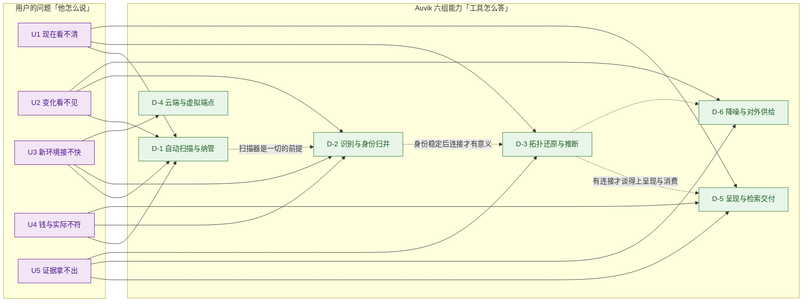
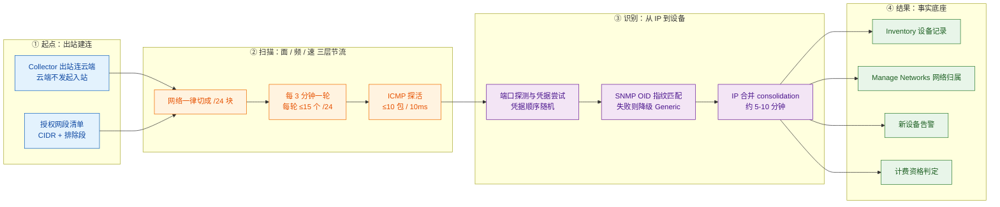
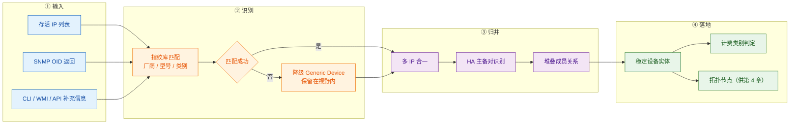
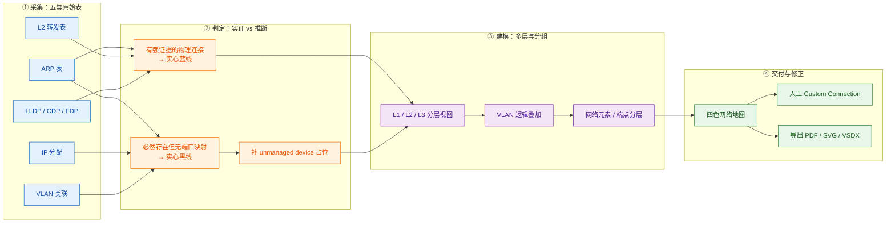
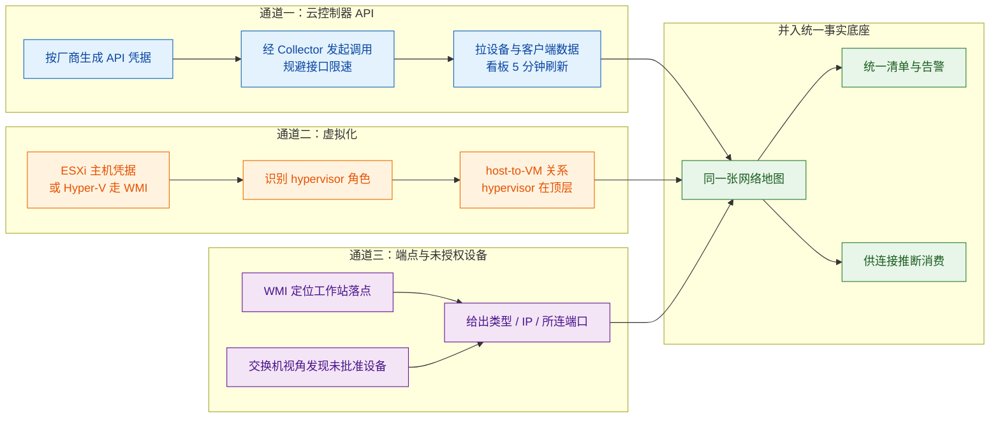
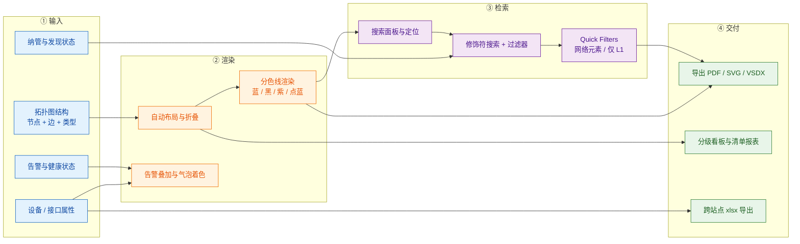
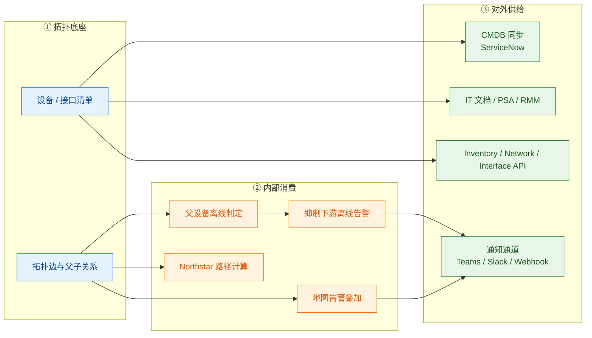

# 1 Auvik 自动发现与拓扑可视化功能体系与痛点解法（2023–2026）

> **调研对象**：Auvik（auvik.com）的**自动发现（Automatic Discovery）与拓扑可视化（Topology Mapping / Network Map）**能力族，含扫描调度、设备指纹识别、L2/L3 连接推断、云控制器与虚拟化纳管、地图呈现与对外供给。
> **调研范围**：2023 年 1 月至 2026 年 10 月的全部公开能力（对 2022 年及更早的前史仅作必要引用）。
> **交付内容**：① **工具级问题视角**——从用户角度回答“这套工具到底替我解决了什么”，给出问题（U1–U5）→ 大功能点的完整映射（见 1.3）；② 6 个大功能点、**82 条小功能点**清单（含发布时间与信源等级）；③ 每条能力对应的客户侧痛点（P1…Pn）；④ 与痛点一一对应的解法（S1…Sn）；⑤ **功能原理**——6 个大功能点的 K.4 **统一按「输入（I1…In）→ 实现链条（图 + 逐步表）→ 输出（交付形态）→ 关键机制深化 → 口径声明」展开**；⑥ **能力边界**——每个大功能点的六维度边界表（硬边界 / 软边界 / 前提依赖 / 官方自认局限 / 常见误期待 / 对自研提示，见各章 K.5）；⑦ **信源链接总表**——A / B / C 三级登记与可点击原文地址（见**附五**；正文 K.4 各表的“官方依据”列亦已就地嵌入链接）。
>
> **建议读法**：
> - **赶时间** → 读 1.2 + 1.3 + 1.4 全景表与边界速查；
> - **要选型** → 补各章 K.5 能力边界 + 附二（六条演进规律）+ 附三（对自研的启示）；重点看 4.5（拓扑到底能画到多准）与 6.5（拓扑能不能被外部系统消费）；
> - **要复刻** → 从第 2 章逐节读，每节按“小功能点 → 用户痛点 → 解法 → 原理 → 能力边界”五段展开；
> - **要核查出处** → 直接翻附五（信源链接总表）。

---

## 1.1 信源与局限（先看这一段）

采用**三级信源交叉验证**：

| 等级 | 信源 | 覆盖时段 | 在本专题中的用途 |
|---|---|---|---|
| **A** | 官方帮助文档站 `support.auvik.com`（How Auvik discovers topology / Discovery settings / Manage Networks / How to Scan IP Ranges / ACL Requirements / Your network map / Why doesn't my topology map look right / Cloud Controller / Billing / API 等约 40 篇文章）+ **官方 Release Notes 逐周归档**（2023-W06 ~ 2026-W40） + 官方部署指南与 API 文档 | 2022-07 ~ 2026-10 | 机制描述、限制条件、UI 颗粒度、版本日期、计费口径的主依据 |
| **B** | 官方产品页、官方博客、官方部署指南 PDF、官方新闻稿、官方客户案例 | 2021 ~ 2026 | 能力定义、扫描范围主张、覆盖率与时长口径（含营销成分） |
| **C** | 第三方：TrustRadius、PeerSpot、SoftwareAdvice、TechRadar、NinjaOne（G2 汇总）、竞品博客（Domotz 等） | 2019 ~ 2026 | 实测体感、公认短板、拓扑准确性的用户侧反馈 |

> **本报告引用的 60 余个信源页面**已全部登记在 **附五**（共 135 条条目，含逐条 Release Notes），可逐条点开核查；其中无法提供公开链接者（官方旧版页面索引快照、无公开文字稿的访谈）已在 12.5 单独列明并给出处置。

**六点已知局限（直接决定本报告的推断边界）**：

1. **官方未发布“发现与拓扑”独立技术白皮书**。拓扑连接如何推断，官方只给了两句定性表述——“用逻辑判定连接”与“无确定信息时**用一套专有算法推断剩余连接**”，**算法判据从未公开**。凡涉及“它内部按什么规则连的”，本文一律不给结论，只给可确证的输入清单。
2. **Release Notes 的回溯边界**：官方 Release Notes 归档自 **2023-W02** 起可查（2023 年 25 篇 / 2024 年 25 篇 / 2025 年 22 篇 / 2026 年 10 篇），2022 年及更早只能取到零星条目（如 2022-W28 的新设备告警）；且**自 2025-W45 起官方公告改为每月第一个工作日发布**，2026 年的更新颗粒度从“周”降到“月”，UI 级小改动的可追溯性明显下降。
3. **官方叫法混用**：同一能力在不同页面被称为 `Network Map` / `Topology Map` / `network topology mapper` / `Cloud Map`；组织概念在 `Site` / `Multi-Site` / `Organization` / `client` / `tenant` 之间摇摆；`Network` 这一实体在多数语境下等于“子网/网段”，但产品页又把它与 `VLAN` 并列。本报告统一以 Network Map 为主名，引用处保留原文措辞。
4. **未公开项（如实登记）**：① 专有拓扑推断算法的判据；② 发现的吞吐口径（官方**无“每小时可扫多少 IP”**的说法，仅有 ICMP 发包节流参数）；③ **IPv6 是否被官方支持**（帮助文档的端口/协议清单只列 IPv4，未找到明确口径）；④ 是否存在拓扑/连接专用 API 端点（未找到）；⑤ 云控制器本身是否计入设备数（**未找到一字不差的官方句**）；⑥ 移动 App；⑦ Kubernetes 工作负载纳管。
5. **厂商自述项**：发现与映射耗时（官方同时存在**五种口径**，见下）、设备类型库规模、覆盖率数字，一律标注“厂商自述，仅作量级参考”，**不作为能力成立的证据**。
6. 本调研截止 **2026-10-16**。

**发布节奏对照表**（Auvik 不用版本号，用“周更/月更 + 年份目录”组织，这一点直接决定功能颗粒度的可追溯性）：

| 时间区间 | 发布形态 | 本专题关键节点 |
|---|---|---|
| 2022-07 | 周更（前史） | New Network Device Discovered 告警首发（2022-W28） |
| 2023-W02 ~ 2023-W50 | **周更**（25 篇） | 地图性能去掉固定等待（W06）、Juniper Mist API 支持（W50）、Networks Dashboard 预告（W50） |
| 2024-W02 ~ 2024-W50 | **周更**（25 篇） | Network Maps V2 性能（W04）、Export Map as VSDX（W06）、Dark Mode（W10）、Global Search（W20）、Northstar 2.0（W34）、Aruba Central Open Beta（W46）、约 800 家厂商入库（W46） |
| 2025-W02 ~ 2025-W49 | **周更，自 W45 起改月更** | Site Selector 迁移到 React（W24）、Hyper-V 专属看板（W24）、Smart Alert Suppression（W30）、Device APIs V2 Beta（W45） |
| 2026-W02 ~ 2026-W40 | **月更**（10 篇） | ServiceNow CMDB 连接器（W02）、HA Pair 监控（W10）、**Device Inventory Report 与 Collector Dashboard（W31）**、UniFi Cloud Monitoring（W36）、新设备告警纳入 Alerts v2（W40） |

> **一个反直觉的观察**：这套能力的**骨架**（扫描 → 指纹识别 → 连接推断 → L1/L2/L3 呈现 → 导出）在 **2024 年上半年就已定型**，此后再没有出现过“新的拓扑种类”或“新的发现机制”。2025–2026 年的更新**几乎全部落在“消费面”**——拓扑感知降噪、设备清单报表、Collector 看板、CMDB 同步、API v2、HA 微件。也就是说：**Auvik 用 2023–2024 年解决了“画得出来”，用 2025–2026 年解决的是“画出来之后给谁用”。** 这一节奏对自研排期的含义，见附二规律一。

---

## 1.2 一句话定位

**自动发现与拓扑可视化是 Auvik 的入口级能力与事实底座**：它是整个产品价值链的第一环（**先看见，才能监控、告警、备份、排障**），也是其余能力的公共输入——没有这张图，“新设备上线”只是一个无从谈起的说法，HA 主备只是一台台孤立的设备记录，告警抑制与路径排障更无从下手。

官方对这一位置的自我表述分两层：对**选型者**，它是“几分钟内可视化整个网络拓扑，无需手工制图”（`Visualize your entire network topology in minutes without manual mapping`，B 级）；对**自研者**，它是一张**由五类设备侧数据推断出来的关系图**（ARP 表、L2 转发表、IP 分配、VLAN 关联、LLDP/CDP/FDP 邻居），而**不是**一份来自配置管理数据库的权威台账。这个区别，是理解它全部能力与全部边界的起点。

---

## 1.3 从工具整体看：它究竟解决用户的什么问题

### 1.3.0 先做维度论证：这套工具的“未来”那一截是空的

模板假设的工具价值两维模型是**时间轴**（现在 / 过去 / 未来）与**关系网**。对 Auvik 的发现与拓扑能力，必须**先论证维度是否成立**，再决定问法——否则会写出一个本工具根本不承载的问题。

| 维度 | 是否成立 | 依据 |
|---|---|---|
| **关系网**（谁连着谁） | **完全成立**，是本工具的主战场 | 全部机制都在回答“设备之间怎么连的”（K.3） |
| **时间轴的“现在”** | **完全成立** | 扫描是持续进行的：每 3 分钟一轮、每轮最多 15 个 /24（A 级） |
| **时间轴的“过去”** | **部分成立**——只有“**变化**”这一截，没有“**回放**”这一截 | Auvik 能告警“新设备被发现”、能看设备生命周期，但**不提供拓扑的历史回放**（Network DVR 是 Selector 的能力，不是 Auvik 的） |
| **时间轴的“未来”** | **不成立** | 本工具**不做任何推演**：不回答“改这条链路会怎样”，不仿真、不 What-If |
| **成本**（钱该花在哪） | **成立，但落点不同** | 不是“容量该扩多少”，而是“**纳管范围 = 账单**”：Auvik 按计费设备数收费，扫多扫少直接等于钱 |
| **证据**（跨团队共同事实） | **完全成立** | 图的导出、CMDB 同步、审计留档，都是这条线上的需求 |

**由此作出两处调整，并说明理由**：

1. **U3 由“未来试不了”替换为“新环境接不快”**。理由：本工具不承载“未来”这一维。若强行保留，等于要求一个扫描器做仿真，是品类错位。替换后的问法落在**时间轴的起点**上——“把一片陌生网络从零变成一份可信清单要多久”，而这恰是 Auvik 对这一能力**最主力的售卖场景**（MSP 上线新客户）。
2. **U4 由“容量与冗余算不清”重锚为“钱与实际不符”**。理由：“钱”这一维成立，但落点不在容量规划（那是另一条产品线），而在**计费与扫描成本**：纳管范围、免费设备类别、扫描强度，三者都直接映射到客户的账单与网络风险。

以下 U1–U5 按调整后的口径展开。

### 1.3.1 用户的五个问法（U1–U5）

**先给速览表**（详细展开见本节后半）：

| 问法 | 用户的原话 | 痛点描述（痛在哪） | 一句话损失 |
|---|---|---|---|
| **U1 现在看不清** | “我手上的网络图纸，没有一张是准的；出了问题也不知道从哪条看起。” | **排障与变更的第一步都变成“确认现状”**：网络的“事实来源”不是数据，而是过期图纸加几个人的记忆 | **时间**：每单都要先重新拼一遍当下长什么样；**人**：全貌只存在于资深工程师脑中 |
| **U2 变化看不见** | “上周谁往交换机上插了台设备？这条链路什么时候被改的？” | **网络的“变化”没有事件化**：设备来来去去、有人私接、固件升级把 LLDP 清掉、设备被原样替换——没有任何机制主动告诉你 | **时间**：等出事才倒查；**合规**：说不出“当时是不是这样”；**组织**：影子设备无人认领 |
| **U3 新环境接不快** | “接一个新客户 / 新站点，光把网络捋清楚就要两周。” | **陌生网络的“第一次成图”成本极高**：手工登设备、抄型号、查互联，一份能用的清单要数天到数周，且交付质量取决于谁去做 | **时间**：整个项目卡在第一步；**钱**：交付人力直接吃掉毛利；**人**：能力绑在特定工程师身上 |
| **U4 钱与实际不符**（成本·横切） | “我到底该为多少台设备付费？扫描范围开多大才不会压垮网络？” | **纳管范围、计费口径与扫描风险三者脱节**：交付前说不清账单会是多少；扫大了怕压垮网络，扫小了等于没看见 | **钱**：账单与预期不符、重复议价；**时间**：扫描量调错了要么返工要么漏 |
| **U5 证据拿不出**（证据·横切） | “审计、交接、对外说明，我拿不出一张能交出去的图。” | **没有一份可交付、可留档、可被外部系统消费的网络事实**：图在工具里，出不了门；交接靠口头；审计只能交一张截图 | **合规**：审计与交付验收缺举证；**组织**：跨团队各持一版口径；**人**：交接靠人讲 |

> **量损失的口径**：本报告统一按 **时间 / 钱 / 人 / 合规 / 组织** 五类衡量——因为客户买单时看的是这五类，不是“扫描耗时”“轮询效率”这类架构指标。凡读起来像“设计约束”的（必须、应当、需要与…对齐）都不进本节，一律归入各章 K.3 的解法必要性论证。

---

#### U1 · 现在看不清 —— 「我手上的网络图纸，没有一张是准的。」

> **痛点**：**排障与变更的第一步都变成“确认现状”**——网络的“事实来源”不是数据，而是过期图纸加几个人的记忆；每一步都要重新拼一遍“当下长什么样”。

- **谁在问（同一个问题的不同说法）**：
  - NOC 值班工程师：**“先别问拓扑长什么样，我得先登上去看。”**
  - 变更评审人：**“这张图上次更新是什么时候？我按它做设计，出事算谁的？”**
  - 新接手运维：**“这网到底怎么连的？——得等原来那个人回来。”**
- **典型场景**：告警指向某网段，值班员按图纸定位到交换机 A；实际路径走的是交换机 B——图纸上那条链路半年前就改了。**第一步不是排障，而是“把现状重新画一遍”。**

| 损失维度 | 具体可感知的损失 |
|---|---|
| **时间** | 每个故障的第一步都变成“现状确认”：登设备、查邻居、拼拓扑，**每单多花数十分钟**（示意量级，非实测）；一个区域问题要在多套系统间来回切换，上下文反复丢失 |
| **钱** | 变更窗口被“找真实链路”吃掉，窗口内没做完就要二次申请窗口 |
| **人** | 全局视图只存在于 1–2 名资深工程师脑中。他们休假或离职，团队即“**失去活地图**”；新人上手周期被拉长 |
| **合规** | 设计评审与变更审批缺少“当时的网络结构”作为留档依据 |
| **组织** | 网络、云、应用三个团队各持一张图；跨团队对齐靠会议，问题归属靠口头 |

- **放任不管的后果**：图纸越旧越没人信 → 越没人信越没人维护 → 越发依赖人脑，形成“**图纸腐烂 → 靠人脑 → 更难维护**”的自增强循环。

---

#### U2 · 变化看不见 —— 「上周谁往交换机上插了台设备？」

> **痛点**：**网络的“变化”没有事件化**——设备来来去去、有人私接、固件升级把 LLDP 清掉、设备被原样替换，都没有机制主动告诉你。

- **谁在问**：
  - 网络负责人：**“这台是什么时候接进来的？谁批的？”**
  - 安全工程师：**“有没有影子设备接在接入层？”**
  - 运维主管：**“换过一台同型号的交换机，配置是旧的，图谱没跟上。”**
- **典型场景**：员工把个人笔记本插进会议室网口，两周后因地址冲突引发局部异常，才开始倒查“这台什么时候进来的”。**查不出来不是因为没有数据，而是因为“设备上线”从来没被当成一个事件。**

| 损失维度 | 具体可感知的损失 |
|---|---|
| **时间** | 变化类问题只能“等它制造出故障”才被发现；倒查要逐台查 ARP/FDB 表，**单次数小时**（示意量级） |
| **钱** | 影子设备带来的安全事件与性能异常处置成本；被动的紧急变更 |
| **人** | 靠人盯、靠人记；无人值守时段完全失明 |
| **合规** | 安全审计要求“何时接入、接在哪、谁批的”，**答不上来** |
| **组织** | 接入层归谁管、终端归谁管长期扯皮；影子设备无人认领 |

- **放任不管的后果**：网络逐步演化成“**没人能完整描述的系统**”，而每一次安全或性能事故都在推高对“先把边界看清楚”的诉求——这正是这一类工具的采购触发器。

---

#### U3 · 新环境接不快 —— 「接一个新客户、新站点，光捋清楚就要两周。」

> **痛点**：**陌生网络的“第一次成图”成本极高**——手工登设备、抄型号、查互联，一份能用的清单要数天到数周，且交付质量取决于谁去做。

- **谁在问**：
  - MSP 交付工程师：**“新客户下周一上线，我什么时候能给他一张准确的图？”**
  - 网络架构师：**“并购进来一个厂区，几百台设备，先摸清再说别的。”**
  - 项目经理：**“第一个里程碑就是‘完成网络摸底’，可它没有确定完成标准。”**
- **典型场景**：新客户有 6 个厂区、约 300 台网络设备。三个人分工登设备、抄信息、核互联，**两周后交出一份“应该差不多”的清单**；三个月后接第一个故障，才发现某条上行链路当时就抄漏了。

| 损失维度 | 具体可感知的损失 |
|---|---|
| **时间** | 项目第一个里程碑被拉长到**数天至数周**（示意量级）；期间监控、备份、告警全部无法开展 |
| **钱** | 一次性交付人力是**纯成本**，直接吃掉首个合同期的毛利；交付慢还会延后计费起点 |
| **人** | 交付质量取决于“谁去做、做了多久”；换人就重来 |
| **合规** | 交接文档的准确性与完整性无法举证；验收标准模糊 |
| **组织** | 交付团队与运维团队对“摸底到什么程度算完”长期扯皮 |

- **放任不管的后果**：团队规模一增长就卡在交付环节，**新客户毛利被交付成本吃掉**；老客户扩点也越来越难，形成“接得越多、亏得越多”的扩张困境。

---

#### U4 · 钱与实际不符 —— 「该为多少台设备付费？扫描开多大才安全？」

> **痛点**：**纳管范围、计费口径与扫描风险三者脱节**——交付前说不清账单是多少；扫大了怕压垮网络，扫小了等于没看见。

- **谁在问**：
  - 采购/预算负责人：**“这个报价是按多少台设备算的？三个月后会变成多少？”**
  - 运维负责人：**“我把整段/16 都打开扫描，会不会把核心链路打满？”**
  - MSP 老板：**“每个客户到底多少台要计费，为什么账单比预期高 20%？”**
- **典型场景**：某站点清单显示“约 400 台设备”，账单却是 620 台计费设备。原因：堆叠交换机按**单台分别计费**，HA 主备的两个 peer **均计入**，且新设备**最多 24 小时**才进入计费——采购方在签约前完全没有依据把这三条算进去。

| 损失维度 | 具体可感知的损失 |
|---|---|
| **时间** | 为核清账单反复拉数据、对口径，**每次数小时到数天**（示意量级） |
| **钱** | 报价与账单不符 → 预算超支、返工议价；扫描范围设错 → 要么漏管（风险）要么加压（返工） |
| **人** | 计费争议消耗交付与财务人力；“设备到底算不算”变成经验问题 |
| **合规** | 采购合理性与计费依据无法量化举证 |
| **组织** | 客户与企业内各方的计费口径不一致，**决策靠话语权** |

- **放任不管的后果**：要么持续超支，要么为了省钱**刻意少纳管**——后者等于自己制造可见性盲区，与买这套工具的初衷相反。

---

#### U5 · 证据拿不出 —— 「审计、交接、对外，我拿不出一张能交出去的图。」

> **痛点**：**没有一份可交付、可留档、可被外部系统消费的网络事实**——图在工具里，出不了门；交接靠口头；审计只能交截图。

- **谁在问**：
  - 合规/审计：**“请提供一份当前网络设备与互联结构说明。”**
  - 交接人：**“我下个月转岗，这网你得自己摸——我给你讲讲。”**
  - 客户经理：**“客户要一张网络拓扑图，放在他的运维手册里。”**
- **典型场景**：ISO 审计要求提供“网络资产与互联关系”说明。运维交出的是一张从工具里导出的**当前屏幕截图**（因为导出范围取决于缩放与筛选），既没有版本、也没有字段含义说明，审计方退回重做。

| 损失维度 | 具体可感知的损失 |
|---|---|
| **时间** | 为拼一份对外材料，多人协作 **1–2 天**；每次问询都要重做 |
| **钱** | 审计不通过 → 整改与复核成本；对外交付延迟影响验收 |
| **人** | 证据整理依赖少数人的记忆与手工拼表，无法交接 |
| **合规** | 审计、客户申诉、验收缺**可核查的共同证据链** |
| **组织** | 跨团队各出一版口径；“不是我这块”成为默认答案 |

- **放任不管的后果**：网络事实长期停留在“工具里看得见、出门说不清”的状态——**团队共享的是同一套数据，对外交付的却是各自拼的版本**。

---

#### 五问 × 五类损失：损失强度分布

| 问法 ＼ 损失类型 | 时间 | 钱 | 人 | 合规 | 组织 |
|---|---|---|---|---|---|
| **U1 现在看不清** | ● 主要 | ○ | ● 主要 | ○ | ● 主要 |
| **U2 变化看不见** | ● 主要 | ○ | ○ | ● 主要 | ● 主要 |
| **U3 新环境接不快** | ● 主要 | ● 主要 | ● 主要 | ○ | ○ |
| **U4 钱与实际不符** | ○ | ● 主要 | ○ | ○ | ● 主要 |
| **U5 证据拿不出** | ○ | ○ | ● 主要 | ● 主要 | ● 主要 |

**读法**：与“数字孪生”类工具不同，**本工具的损失分布明显偏向“时间 / 人”，“合规”只集中在 U2 与 U5 两列**。这解释了采购逻辑的差异：孪生类产品的预算常由一次合规或定责事故促成，而**发现与拓扑类产品的预算通常由“交付效率”触发**——签一个新客户要几周还是几天，是可以直接算进毛利的。

> **落到能力上**（主要承载，完整映射见 1.3.2）：U1 → 扫描与纳管 + 拓扑还原 + 地图呈现；U2 → 新设备发现告警 + 识别归并；U3 → Collector 自动扫描与网络审批制；U4 → 计费口径与扫描调度；U5 → 地图导出 + CMDB 同步 + 清单报表。

> **工具级价值主张**：**把“一片陌生网络”在小时级变成“一份可查询、可筛选、可导出、可被外部系统消费的关系图”**，并让“它长什么样、什么时候变的、花了多少钱”三件事都有据可查。

### 1.3.2 五个整体问题（U1–U5）与承载能力

U1–U5 是**工具级**问题（用户对整套工具的诉求）。本表**只到「大功能点」粒度**——列出每个大功能点在回答该问题时扮演的角色与所属章节；小功能点级明细不在本表展开，见各章 **K.1 小功能点清单**。它与后文各章的功能级痛点 P1–Pn 是“上位归并”关系（见 1.3.5）。

| # | 用户的问题 | 工具给出的整体回答 | **对应的大功能点**（及它在这里扮演的角色） |
|---|---|---|---|
| **U1** | **现在看不清**：“图纸不准，出了问题不知从哪条看起。” | 用**持续扫描 + 连接推断**自动生成一张随网络变化自更新的关系图，替代需要人工维护的静态图纸 | **D-1 网络自动扫描与设备纳管**（第 2 章）——提供“有哪些东西”的事实底座 **D-3 拓扑还原与推断**（第 4 章）——提供“它们怎么连的” **D-5 拓扑图呈现与检索交付**（第 6 章）——提供“人怎么看、怎么找” |
| **U2** | **变化看不见**：“谁插进来的？什么时候改的？” | 把“设备上线”与“识别变化”变成**可被告知的事件**，并把设备身份归并到稳定实体上 | **D-1 网络自动扫描与设备纳管**（第 2 章）——新设备发现告警与纳管状态 **D-2 设备识别与身份归并**（第 3 章）——设备换新/多 IP/HA 对的身份收敛 **D-6 拓扑驱动的降噪与对外供给**（第 7 章）——把变化推给外部系统 |
| **U3** | **新环境接不快**：“接一个新客户，光捋清楚要两周。” | 部署一个采集器即可**自动扫出候选网络与设备**，把“第一次成图”从人工几周压到小时级 | **D-1 网络自动扫描与设备纳管**（第 2 章）——自动扫描 + 网络审批制 **D-2 设备识别与身份归并**（第 3 章）——指纹库免去逐台抄型号 **D-4 云 / 虚拟 / 端点的纳入**（第 5 章）——把云管设备一并纳进来，不留盲区 |
| **U4** | **钱与实际不符**：“该为多少台付费？扫描开多大才安全？” | 把“扫进来”与“要付费”**解耦**，并把扫描强度做成**可调的三层节流** | **D-1 网络自动扫描与设备纳管**（第 2 章）——计费口径、免费类别、扫描调度 **D-2 设备识别与身份归并**（第 3 章）——识别分类决定计费归属 **D-5 拓扑图呈现与检索交付**（第 6 章）——设备清单与用量对账视图 |
| **U5** | **证据拿不出**：“拿不出一张能交出去的图。” | 让这张图**出得了门**：可导出、可同步到 CMDB、可经 API 被其他系统消费 | **D-5 拓扑图呈现与检索交付**（第 6 章）——多格式导出与清单报表 **D-6 拓扑驱动的降噪与对外供给**（第 7 章）——CMDB / PSA 同步与 Inventory API **D-3 拓扑还原与推断**（第 4 章）——提供可被消费的连接关系 |

> **覆盖核验**：**6 个大功能点全部被至少一个 U 消费，无孤立能力**——D-1 被四个整体问题共同消费（U1 / U2 / U3 / U4），D-2 与 D-3 各被两个，D-5 与 D-6 各被两个。这与孪生类工具“一份模型、多方消费”的结构一致，但**支点不同**：孪生类的支点是“模型”，本类的支点是“**扫描器**”——没有扫描，后面全部不成立。

### 1.3.3 一张图：从用户问题到大功能点

> 虚线 = 前置依赖链：**先能扫（D-1），才谈得上认出是谁（D-2）；认出是谁，连接关系才有意义（D-3）；有了连接，才谈得上呈现（D-5）与消费（D-6）**。这条链是**单向且不可跳**的——这也是本报告把 D-4（云 / 虚拟 / 端点）单列而非并入 D-1 的原因：它是“扫描器够不到的地方”的补位层。

### 1.3.4 用之前 vs 用之后（同一批问题的对照）

| 用户会问 | 用之前（没有自动发现与拓扑） | 用之后（有 Auvik） | 对应功能 |
|---|---|---|---|
| 网络现在长什么样？ | 翻 Visio/Excel 台账，且已经过期 | 自动生成的关系图，随扫描持续更新 | D-1（2.1 / 2.4）+ D-3（4.1 / 4.4） |
| 有几台设备？哪些没纳管？ | 人工清点；不清楚哪些漏了 | Inventory 全量清单 + 纳管/未纳管状态 + 报表导出 | D-5（6.1 / 6.3） |
| 这台设备是什么型号、谁家的？ | 登上去 `show version` 抄 | 指纹库按 OID 自动识别（15,000 类型 / 700+ 厂商，厂商自述） | D-2（3.1 / 3.2） |
| 上个月有人接进来一台设备吗？ | 不知道；出事才倒查 | 新设备发现告警（默认关，可按需开） | D-1（2.6）+ D-2（3.3） |
| 某台设备接在哪个交换机哪个口？ | 逐台查 ARP/FDB 表 | 图上直接显示 + 悬停看两端 MAC 与协商速率 | D-3（4.4）+ D-5（6.2） |
| 云端（Meraki/Mist）的 AP 在哪？ | 云控制台一张图、本地一张图 | 云管设备并入同一张网络地图 | D-4（5.1 / 5.4） |
| 虚拟机跑在哪台宿主上？ | 问人 | hypervisor 在顶层、VM 挂其下（需 VMware 凭据） | D-4（5.5） |
| 上游设备挂了，下游 300 条告警怎么办？ | 人工逐条判断、逐条关闭 | 拓扑感知降噪：父设备离线时自动抑制下游离线告警 | D-6（7.1） |
| 审计要一张图，怎么交？ | 截图 | 导出 PDF / SVG / VSDX（可带设备与连接元数据） | D-5（6.4） |
| CMDB 里的网络资产谁来更新？ | 人工维护，长期滞后 | ServiceNow CMDB 连接器同步设备清单 | D-6（7.4） |
| 别的系统要拿拓扑数据？ | 让人导出 Excel 再转 | Inventory / Network / Interface API（含 v2） | D-6（7.5 / 7.6） |

### 1.3.5 小结：U 与 P 的关系（读后文前必看）

- **U1–U5 是工具级问题**（5 条）：客户对**整套工具**的诉求，用来判断“这个工具值不值得买”。
- **P1–Pn 是功能级问题**（各章合计 27 条）：在**具体某个能力**上被感知到的损失，用来判断“这个功能做得对不对”。
- 二者是**上位归并**关系——同一条客户损失，会同时在多个功能点上被感知到，故不做一对一。

| 工具级问题 | 归并自哪些功能级痛点 |
|---|---|
| U1 现在看不清 | D-1 P1、P2；D-2 P1；D-3 P1、P2、P3；D-5 P1、P2 |
| U2 变化看不见 | D-1 P3、P5；D-2 P2；D-3 P4 |
| U3 新环境接不快 | D-1 P1、P2；D-2 P1；D-4 P1、P2 |
| U4 钱与实际不符 | D-1 P4；D-2 P3；D-5 P5 |
| U5 证据拿不出 | D-3 P5；D-5 P3、P4；D-6 P3、P4 |

> **反向自查（对自研最有用的一条）**：如果一个“自动发现”项目说不清“现在 / 变化 / 起步 / 成本 / 证据”这五问各自对应哪个消费场景，那它大概率会退化成**一个只能给自己看的扫描器**（参见附二规律一、规律五）。**先有问法，再有功能。**

---

## 1.4 读法：6 个大功能点全景

| # | 大功能点 | 口号 | 小功能点数 | 时间跨度 | 面向谁 |
|---|---|---|---|---|---|
| **1** | [网络自动扫描与设备纳管](#2-大功能点-1网络自动扫描与设备纳管--扫得全) | **扫得全** | 14 | 2022-07 ~ 2026-09 | MSP 交付 / 网络运维 |
| **2** | [设备识别与身份归并](#3-大功能点-2设备识别与身份归并--认得准) | **认得准** | 14 | 2023-09 ~ 2026-10 | 网络运维 / 财务对账 |
| **3** | [拓扑还原与连接推断](#4-大功能点-3拓扑还原与连接推断--连得对) | **连得对** | 14 | 平台早期 ~ 2026-08 | NOC / 排障 |
| **4** | [云 / 虚拟 / 端点的纳入](#5-大功能点-4云--虚拟--端点的纳入--纳得广) | **纳得广** | 13 | 2023-12 ~ 2026-09 | MSP / 混合云运维 |
| **5** | [拓扑图呈现与检索交付](#6-大功能点-5拓扑图呈现与检索交付--看得清) | **看得清** | 15 | 2023-02 ~ 2026-08 | NOC / 交付 / 审计 |
| **6** | [拓扑驱动的降噪与对外供给](#7-大功能点-6拓扑驱动的降噪与对外供给--用得上) | **用得上** | 12 | 2024-05 ~ 2026-10 | SRE / 平台 / CMDB 管理者 |

> **合计 82 条小功能点**（其中 D-3 与 D-4 各有 1–2 条为“平台早期”能力，只能到主题颗粒度，已在各章标注）。D-5 数量最多，说明**这张图的价值锚点在“被看见和被取走”**——扫描与推断是成本中心，呈现与供给才是价值出口。

**边界速查（一页版）**——每组能力的“一条最要命的边界”：

| # | 大功能点 | **最要命的一条边界** | 边界性质 |
|---|---|---|---|
| 1 | 网络自动扫描与设备纳管 | **设备不响应 ICMP 就永远发现不了**；且“空子网降级”会让冷区设备的发现延迟**不封顶** | 硬边界（协议前提 + 调度代价） |
| 2 | 设备识别与身份归并 | 识别**只承诺“尽力”**——官方明文声明不对这些设备承诺 SNMP / CLI / 可发现性 / 拓扑映射 | 官方自认局限 |
| 3 | 拓扑还原与连接推断 | 推断算法**从未公开**；且第三方只能读到设备**外部可见**的邻居与转发表 | 证据边界 + 硬边界（数据源） |
| 4 | 云 / 虚拟 / 端点的纳入 | 云控制器**本身不计入设备**且设备仍须 Collector 可达；Aruba Central 至今只有 Open Beta，**无 GA 日期** | 前提依赖 + 软边界 |
| 5 | 拓扑图呈现与检索交付 | **不支持自定义看板**、**不支持计划报表**；导出内容 = **当前屏幕可见范围**，大网会被截断 | 官方自认局限 |
| 6 | 拓扑驱动的降噪与对外供给 | **没有拓扑/连接专用 API 端点**；Webhooks 与同步以设备与告警为主，连接关系要靠 Network/Interface API 间接拼 | 硬边界（接口面） |

> 每组完整边界（**硬边界 / 软边界 / 前提依赖 / 官方自认局限 / 常见误期待 / 对自研提示**六个维度）见各章 **K.5 能力边界**一节。

> **编号约定**：每个大功能点内部独立编号——**K.2 的痛点为 P1…Pn，K.3 的解法为 S1…Sn，两者数量与语义严格一一对应**，S 行内以“→ 解 Pk”显式回指。本报告不含悬空痛点或悬空解法。

**一张图看懂这套能力的构造**：

```mermaid
flowchart LR
    subgraph SRC["数据来源「扫描器吃进什么」"]
        A1["ICMP 存活探测"]
        A2["SNMP v1/v2c/v3<br/>MIB 与 sysObjectID"]
        A3["SSH / Telnet / CLI<br/>只读 show 命令"]
        A4["WMI / mDNS / SMB"]
        A5["云控制器 API<br/>Meraki · Mist · Datto"]
        A6["虚拟化 API<br/>VMware · Hyper-V(WMI)"]
    end

    subgraph CORE["内核「Auvik 的三步加工」"]
        B1["扫描与纳管<br/>按 /24 切块 + 三层节流"]
        B2["识别与归并<br/>OID 指纹 + consolidation"]
        B3["连接推断<br/>ARP · FDB · IP · VLAN · LLDP/CDP/FDP"]
    end

    subgraph USE["消费面「给谁用」"]
        C1["Network Map<br/>L1 / L2 / L3"]
        C2["Inventory 与报表"]
        C3["拓扑感知告警降噪"]
        C4["Northstar 路径"]
        C5["CMDB / PSA 同步"]
        C6["Inventory / Network / Interface API"]
    end

    SRC --> CORE
    B1 --> B2
    B2 --> B3
    B3 --> USE

    classDef src fill:#E3F2FD,stroke:#1565C0,color:#0D47A1
    classDef core fill:#FFF3E0,stroke:#EF6C00,color:#E65100
    classDef use fill:#E8F5E9,stroke:#2E7D32,color:#1B5E20
    class A1,A2,A3,A4,A5,A6 src
    class B1,B2,B3 core
    class C1,C2,C3,C4,C5,C6 use
```

> **注意箭头方向**：`扫描 → 识别 → 连接` 是一条**严格单向的加工链**，中间的每一步都是下一步的必要输入。识别错了，连接一定错；连接错了，降噪与路径一定错——这是理解第 2、3 章为何排在前面、以及为何它们的痛点会向下游传导的关键。

---

# 2 大功能点 1：网络自动扫描与设备纳管 —— 扫得全

把“有哪些设备、分属哪个网段、要不要纳管”这件事，从**人工誊写台账**变成**采集器自动扫描 + 人工审批**——是整个能力链的起点。

## 2.1 小功能点清单

| # | 小功能点 | 发布时间 | 信源等级 | 说明 |
|---|---|---|---|---|
| 1.1 | **Collector 自动扫描本地子网** | 平台早期（文档 2026-10-13 更新） | A | 采集器部署后「**it automatically searches on its local subnet to find more networks**」，发现的网络由用户决定是否扫描（[官方](https://support.auvik.com/hc/en-us/articles/202956414)） |
| 1.2 | **手工添加网络：子网或 IP 范围** | 平台早期（文档 2025-10-08 更新） | A | Manage Networks → Add Network 可输入「subnet or IP range」，并可为每个网络配置**排除 IP 段**（[官方](https://support.auvik.com/hc/en-us/articles/204828210)） |
| 1.3 | **网络审批制（勾选后才扫）** | 平台早期 | A | 新发现的网络进入候选列表，**须人工选定后点 Scan** 才会扫描；不选则不扫（[官方](https://support.auvik.com/hc/en-us/articles/204828210)） |
| 1.4 | **父/子子网联动规则与排除项** | 平台早期 | A | 批准父网后其下子网可被自动发现；子网会作为排除项写入父网，且「**once these exclusions are set they can't be removed without deleting the child subnet**」（[官方](https://support.auvik.com/hc/en-us/articles/204828210)） |
| 1.5 | **扫描调度：按 /24 切块 + 轮次配额** | 文档 2025-06-26 更新 | A | 「**A scan is attempted every 3 minutes**」「Each cycle scans up to **15 /24 subnets**」「All networks are broken down internally into /24 blocks, regardless of the size you define」（[官方](https://support.auvik.com/hc/en-us/articles/38365132364948)） |
| 1.6 | **子网扫描频率与每周期子网数** | 平台早期 | A | 「**Subnet scanning frequency**——以秒计，推荐 **30 seconds or higher**」；「**Subnet per period**——每五分钟扫多少个子网」（[官方](https://support.auvik.com/hc/en-us/articles/206303333)） |
| 1.7 | **ICMP 发包节流参数（诊断壳暴露）** | 文档 2026-08-27 更新 | A | `ScanService.max-simultaneous-ping` 与 `ScanService.simultaneous-send-delay`，**默认均为 10**，即「send at most 10 packets within any particular 10ms window」（[官方](https://support.auvik.com/hc/en-us/articles/215149766)） |
| 1.8 | **默认扫描范围收窄** | 文档 2025-06-26 更新 | A | 「**will only scan RFC 1918 private IP ranges by default**」；默认排除 127.0.0.0/8、169.254.0.0/16、224.0.0.0/4、240.0.0.0/4、255.255.255.255（[官方](https://support.auvik.com/hc/en-us/articles/38365132364948)） |
| 1.9 | **扫描优先级：热区优先、空区降级** | 文档 2025-06-26 更新 | A | 曾发现过设备的子网扫描更频繁，未发现设备的子网被降级——代价是「**newly added devices in unused subnets may take longer to be discovered**」（[官方](https://support.auvik.com/hc/en-us/articles/38365132364948)） |
| 1.10 | **发现所用的协议与服务栈** | 文档 2026-10-13 更新 | A | SNMP v1/2c/v3、SSH/Telnet/CLI、mDNS、SMB/Samba、WMI；并**自动尝试 `public` 与 `private` 两个默认 SNMP 社区串**（[官方](https://support.auvik.com/hc/en-us/articles/202956414)；[部署指南](https://www.auvik.com/wp-content/themes/auvik/downloads/Deployment-Guide-Customers.pdf)） |
| 1.11 | **凭据随机顺序尝试 + 凭据状态 KPI** | 文档 2024-07-08 更新 | A | 「**Credentials are tested in a random order.**」；状态分为 Have Credentials / Need Credentials / Trying Credentials，并提供 **Retry SNMP Credentials**（[官方](https://support.auvik.com/hc/en-us/articles/204565824)） |
| 1.12 | **纳管状态：Managed / Unmanaged** | 平台早期 | A | 设为 Unmanaged 后「**Auvik will stop polling new information from that device, and it will no longer generate any alerts. The collector will still send ICMP pings**」（[官方](https://support.auvik.com/hc/en-us/articles/204565804)） |
| 1.13 | **Delete 与 Exclude 的语义分离** | 2026-09-30（文档） | A | Delete = 立即移除但**不阻止将来重新发现**；Exclude（IP/段）= 阻止将来发现但**不立即删除**，二者需配合；官方明确**不会自动拉黑**被删设备（[官方](https://support.auvik.com/hc/en-us/articles/48788673775892)） |
| 1.14 | **新设备发现告警（New Network Device Discovered）** | 2022-W28（2022-07-16）首发；2026-W40 纳入 Alerts v2 预置 | A | 首发条目见 [2022-W28](https://support.auvik.com/hc/en-us/articles/7742656228500)；边界见 [官方 KB](https://support.auvik.com/hc/en-us/articles/7076841468308)；**默认关闭**，且**默认不对 generic 设备触发** |

> **补充（相关但归属第 5、7 章）**：扫描出来的结果如何被“看”（Inventory / All Sites）见 6.1–6.3；新设备告警如何并入告警体系与地图叠加见 7.2、7.3。

## 2.2 它对应的用户痛点

**P1｜接手一片陌生网络，第一周全花在“把网络誊一遍”上**（时间 / 人）。新客户、新站点、并购进来的厂区，手上没有可信台账。工程师只能一台台登上去抄型号、抄端口、抄互联关系，再回到 Excel 里拼——**一份能用的清单要数天到两周**，而在这份清单出来之前，监控、备份、告警全部无从开展。这是整个交付项目的第一个瓶颈，也是**最不可能靠“加班”解决的那一个**。

**P2｜规模一大，就陷入“不敢扫”与“不能不扫”之间**（时间 / 人）。全量扫描担心把核心链路与设备 CPU 打满，只扫一小段又等于没看见。**客户的实际选择往往是折中：只扫最熟的几个网段**——于是可见性缺口是自己造出来的，且缺口在哪里，团队心里也没数。

**P3｜设备默默上线，没有任何人被告知**（合规 / 组织）。员工把个人笔记本插进会议室网口、施工方接了一台临时交换机、影子 IoT 长期在线——**这些事不发生“故障”就永远不会被发现**。等到地址冲突、环路或安全事件出现，才回头去查“这台什么时候进来的”；而此时能不能查出来，取决于还有没有 ARP/FDB 的历史（通常是查不出来的）。

**P4｜为多少台设备付费，签约前说不清**（钱）。Auvik 按**计费设备数**收费，纳管范围**直接等于账单**。而“什么算计费设备”有三条并不直观的规则：堆叠交换机**按单台分别计费**、HA 主备的**两个 peer 均计入**、新设备**最多 24 小时**才进入计费。客户在签约前拿不到依据把这三条算进去，**账单与预期偏离**就成了常态。

**P5｜误扫进来的东西删不掉，删了还会回来**（时间 / 人）。把相邻网段、Docker 网桥子网、不该管的第三方网段一起扫了进来，结果清单一堆噪声设备。工程师逐条删除，下一次扫描又冒出来；**“删除”这个动作在用户的直觉里是一次性了结，在系统里却不是**——这个认知落差要用反复的人工清理来付账。

## 2.3 它是如何解决的（与痛点一一对应）

| 解法 | 机制 | 对应痛点 |
|---|---|---|
| **S1｜采集器自动扫描 + 网络审批制：先给候选，再由人批准** | 采集器部署后**自动从其本地子网开始发现**，把发现的网络放进 Manage Networks 候选列表；**只有被勾选并点 Scan 的网络才会被扫描**。这让“上手”从“人工誊写清单”变成“批准一批候选网络”——**第一次成图的动作粒度从“每台设备”降到“每个网段”** | → 解 P1 |
| **S2｜三层节流：把扫描强度压回网络可承受的范围** | 三层约束叠加——**宏观**：每 3 分钟一轮、每轮最多 15 个 /24；**中观**：每子网的秒级扫描频率（推荐 ≥30 秒）+ 每 5 分钟子网数配额；**微观**：ICMP 发包节流（默认 10 包/10ms）。再叠加“仅扫 RFC 1918 + 默认排除保留段”，**扫全与压垮网络之间第一次有了可调的旋钮** | → 解 P2 |
| **S3｜把“设备上线”事件化** | New Network Device Discovered 告警对**防火墙 / 路由 / L2-L3 交换机 / 堆叠 / 包处理器 / 控制器 / AP** 触发（默认关闭，可按需开启），设备入网后约 **5–10 分钟**完成 IP 合并即告警 | → 解 P3 |
| **S4｜计费口径前置 + 计费与纳管解耦** | 官方把三件事写清：**计费对象**（Router/Switch/Firewall/Wireless Controller，依订阅模型另有 Hypervisor 与部分 Server/Workstation）、**计费资格**（自初始发现起**在线满 4 小时**且处于 managed 状态）、**计费延迟**（最多 **24 小时**才进入账单）；同时给出**免费类别清单**（AP、打印机、UPS、摄像机、IoT、Collector、非受管交换机、负载均衡器等），并把 Unmanaged 设为**不计费** | → 解 P4 |
| **S5｜Delete 与 Exclude 语义分离** | 2026-09 新增专文把两个动作讲清：**Delete** 只移除记录、不阻止将来重新发现；**Exclude** 阻止将来被发现、但不删除已存在的设备；并把“删除后设备又回来”的预期落差显式写进文档——**“让设备别再回来”是一件需要显式配置的事** | → 解 P5 |

## 2.4 功能原理

### 2.4.1 输入：扫描器吃进去什么

| 输入 | 具体内容 | 官方依据（含原文链接） | 缺了它会怎样 |
|---|---|---|---|
| **I1 · 授权网段清单** | CIDR / IP 范围 + 排除 IP 段；官方建议「**Keep scan ranges to under /23 networks if possible**」，/16 及以上建议拆成 /24 | **A** · [Manage Networks](https://support.auvik.com/hc/en-us/articles/204828210)、[Scan IP Ranges](https://support.auvik.com/hc/en-us/articles/38365132364948)、[Collector 容量](https://support.auvik.com/hc/en-us/articles/200741514) | 采集器只能在**自身所在的本地子网**里打转（官方：自动搜索范围就是 “its local subnet”），跨网段的世界永远看不见 |
| **I2 · ICMP 可达性** | 设备必须响应 ping | **A** · [设备不可见的原因](https://support.auvik.com/hc/en-us/articles/206797643)（「**If your device doesn't respond to pings, then further discovery and monitoring won't happen for this device.**」） | **设备根本不会出现在清单里**——这是本能力唯一一条“没得商量”的前提 |
| **I3 · 凭据集合** | SNMP v1/v2c/v3、SSH/Telnet/CLI、WMI、VMware、厂商 API；默认会试 `public` / `private` | **A** · [发现机制](https://support.auvik.com/hc/en-us/articles/202956414)、[凭据用途](https://support.auvik.com/hc/en-us/articles/202956494) | 设备会出现，但**只能被当作 Generic Device**（未识别），拿不到厂商/型号/接口细节 |
| **I4 · 采集器与站点归属关系** | Collector 所在位置决定设备的 Site 归属与扫描可达范围 | **A** · [Sites](https://support.auvik.com/hc/en-us/articles/204930890)、[跨站点归属问题](https://support.auvik.com/hc/en-us/articles/51656903454612) | 设备会被归到错误的站点，后续所有按站点统计、计费与运维动作全部错位 |
| **I5 · 扫描调度参数** | 子网扫描频率、每周期子网数、Don't Scan 标记、ICMP 节流 | **A** · [Discovery settings](https://support.auvik.com/hc/en-us/articles/206303333)、[诊断壳节流参数](https://support.auvik.com/hc/en-us/articles/215149766) | 要么扫不完（周期过长），要么把链路与设备压垮（周期过短）——**没有中间默认值能适用于所有网络** |

### 2.4.2 实现链条：从“批准一个网段”到“一条设备记录”

| 步骤 | 做什么 | 关键输入 | 输出 |
|---|---|---|---|
| **① 建连** | 采集器主动向云端建立**出站**连接；云端**从不**发起入站 | — | 可用采集通道（官方原文：`The Auvik cloud never initiates inbound connections to the collector.`） |
| **② 展开** | 无论用户定义多大的网段，**内部一律切成 /24 块** | I1 | 可调度的扫描任务队列 |
| **③ 探活** | 按“每 3 分钟一轮 / 每轮 15 个 /24 / ICMP ≤10 包每 10ms”发 ICMP | I2 + I5 | 存活 IP 列表 |
| **④ 识别** | 对存活 IP 做端口探测并**按随机顺序**尝试各类凭据 | I3 | 设备初步属性 |
| **⑤ 指纹** | 用 SNMP OID 匹配厂商/型号/设备类型；匹配不上则降级为 **Generic Device** | I3 | 设备分类结果 |
| **⑥ 合并** | consolidation 引擎把多个 IP 归并到**同一台设备**（多网口、多管理 IP、HA 对） | 上一步产出 | 稳定的设备实体；**新设备告警需等约 5–10 分钟**才显示 |
| **⑦ 归属** | 按网络与采集器归属把设备挂到 Site / Network 下 | I4 | 组织结构化的清单 |
| **⑧ 计费判定** | 分类是否属计费类别 + 是否在线满 4 小时 + 是否 managed | 上一步产出 | 计费设备数（**最多 24 小时后进入账单**） |

### 2.4.3 输出：交付什么形态的结果

| 输出物 | 形态 | 消费方 | 对应小功能点 |
|---|---|---|---|
| 设备记录（Inventory） | 清单 + 检索/筛选/导出 | 运维、交付、财务对账 | 1.1–1.3、6.1–6.3 |
| 网络归属（Manage Networks） | 网络/子网清单 + 扫描状态 | 运维、安全 | 1.2–1.5 |
| 新设备发现告警 | 告警事件 | NOC、安全 | 1.14、7.2 |
| 计费用量 | Billing Usage 数据 + 月度口径 | 采购、MSP 财务 | 1.12 |
| **设备实体 + 网络归属（内部事实底座）** | **不是 UI 产物，而是内部接口** | **第 3 章识别归并、第 4 章连接推断、第 6 章呈现、第 7 章供给** | —（底座本身） |

> **注意最后一行**：扫描**最重要的输出不是那份清单，而是“设备实体 + 网络归属”这个可被下游消费的事实底座**。清单是给人看的；底座是给 K.3 与 K.5 那些能力用的——这正是“发现是入口级能力”在实现层的体现。

### 2.4.4 关键机制深化

**（1）为什么审批粒度选在“网络”而不是“设备”？**

官方原文：`Auvik automatically manages all devices attached to an approved network.`（[A 级](https://support.auvik.com/hc/en-us/articles/204565804)）。这句决定了整个设计：**审批闸门放在“网络”这一层**。

- **理由（本报告推导，C 级）**：两个数量级不同——一次交付里网络数是 O(10¹~10²)，设备数是 O(10³~10⁴)。把闸门放在数量级小的一侧，人工介入量从几千降到几十。
- **代价是显式的**：新设备**不单独过审**，批准网段内的一切都会被自动纳管（含影子设备）。因此必须有**告警补位**——这正是 1.14 存在的理由：**“自动纳管”与“被人知道”是两件事，前者靠审批粒度，后者靠告警。**

**（2）为什么扫描强度必须“三层节流”？**

因为 ICMP 探活的本质是**一次面向整个地址空间的广播式动作**，风险是“面 × 频 × 速”三维同时叠加。Auvik 的三层恰好各自约束一维：

| 层 | 参数 | 约束的维度 | 官方口径 |
|---|---|---|---|
| 宏观 | 每 3 分钟一轮、每轮 ≤15 个 /24 | **面**（单位时间推进多少地址空间） | [A 级](https://support.auvik.com/hc/en-us/articles/38365132364948) |
| 中观 | 子网扫描频率（秒）、每 5 分钟子网数 | **频**（同一网段多久回扫一次） | [A 级](https://support.auvik.com/hc/en-us/articles/206303333) |
| 微观 | `max-simultaneous-ping` / `simultaneous-send-delay` | **速**（瞬时发包速率） | [A 级](https://support.auvik.com/hc/en-us/articles/215149766) |

**这条设计值得直接照抄**：分布式采集器一旦要“扫地址空间”，必须同时提供面、频、速三个旋钮，缺任何一个，客户就只有“开”和“关”两个选择。

**（3）“空子网降级”的隐含代价**

官方原文：`newly added devices in unused subnets may take longer to be discovered.`（[A 级](https://support.auvik.com/hc/en-us/articles/38365132364948)）。系统会优先回扫“曾经扫出过设备”的子网，把长期空的子网降级。

- **收益**：把有限的扫描配额花在有信息量的地方。
- **代价**：**冷区设备的发现延迟不封顶**——一个“从未出过设备”的备用网段里接入的设备，可能很久都不会被发现。这与 P3（设备默默上线）在语义上存在张力：**热区变化很快被发现，冷区变化可能长期不被发现**。自研若采用同样的降级策略，必须把这个非对称性显式告知用户。

### 2.4.5 口径声明

| 内容 | 等级 | 说明 |
|---|---|---|
| 采集器自动扫本地子网、网络须审批后才扫 | **A** | [发现机制](https://support.auvik.com/hc/en-us/articles/202956414)、[Manage Networks](https://support.auvik.com/hc/en-us/articles/204828210) |
| 每 3 分钟一轮 / 每轮 15 个 /24 / 内部按 /24 切块 / 空子网降级 | **A** | [Scan IP Ranges](https://support.auvik.com/hc/en-us/articles/38365132364948) |
| ICMP 节流参数名字与默认值 10 | **A** | [诊断壳文章](https://support.auvik.com/hc/en-us/articles/215149766) |
| 凭据随机顺序尝试 | **A** | [SNMP 凭据文章](https://support.auvik.com/hc/en-us/articles/204565824) |
| 计费资格（4 小时在线 + managed）与 24 小时入账延迟 | **A** | [计费判定](https://support.auvik.com/hc/en-us/articles/41493476040980)、[未计入原因](https://support.auvik.com/hc/en-us/articles/51296898905236) |
| 「审批粒度选在网络层是因为数量级差异」 | **C（本报告推导）** | 依据链：审批动作作用于网络（A）→ 设备自动纳管（A）→ 补位机制是新设备告警（A）→ 结论 |
| 「三层节流分别约束面 / 频 / 速」 | **C（本报告推导）** | 依据链：三轮参数页面（A）→ 三组参数分别作用于不同时间尺度 → 结论 |
| **发现的吞吐口径（如“每小时多少 IP”）** | **—（未公开）** | 官方无此口径；仅有 ICMP 节流与“初始发现 5–15 分钟”两个可量化点 |

## 2.5 能力边界（这个功能点做不到什么）

> **一句话边界**：这是一个**以 ICMP 为门槛、以网段为审批单位、以 /24 为调度单位**的扫描器——**不响应 ping 的、不在 RFC 1918 私网里的、以及被 ACL 挡住的地址空间，对它等于不存在**。

| 类型 | 具体边界 | 依据（信源等级） | 对自研 APM 的提示 |
|---|---|---|---|
| **硬边界 · ICMP 前提** | 设备不响应 ping 就**永远不会被发现**（stealth 模式、防火墙丢 ICMP 都属此列） | A · [设备不可见](https://support.auvik.com/hc/en-us/articles/206797643)、[拓扑画不对的原因](https://support.auvik.com/hc/en-us/articles/217263746) | 自研采集器的**第一个验收项应是“对 ICMP 静默设备的替代发现路径”**（如从邻居表反推），否则盲区与生俱来 |
| **硬边界 · 出站单向** | 采集器只建**出站**连接，云端从不发起入站；且**采集器必须能解析 tenant URL，不支持连固定 IP** | A · [采集器连通性](https://support.auvik.com/hc/en-us/articles/202937680)、[诊断](https://support.auvik.com/hc/en-us/articles/205786430)、[协议与端口](https://support.auvik.com/hc/en-us/articles/204315700) | 这个约束是**优势也是枷锁**：客户不用开入站端口（优势），但采集器本机一旦无法解析域名即整体失效（枷锁） |
| **硬边界 · 私网优先** | 默认**只扫 RFC 1918**；公网段、**云环境（除非已部署 agent 或配置了路由）**、未路由/不可达的 VLAN 与 VPN 子网默认不扫 | A · [Scan IP Ranges](https://support.auvik.com/hc/en-us/articles/38365132364948) | 自研若面向运营商或公有地址空间场景，**不能照搬“私网优先”的默认值** |
| **前提依赖 · ACL 与协议放行** | 需放行 ICMP、SNMP/161、SSH/22、Telnet/23、WMI(135/445/5985/5986)、mDNS、SMB 等；并明确「**ACLs do not block LLDP, CDP, FDP, or EDP**」 | A · [ACL Requirements](https://support.auvik.com/hc/en-us/articles/42342588622996) | 交付清单里必须包含**一张给客户网络团队执行的 ACL 开列单**，这是决定成败的前置动作 |
| **软边界 · 规模天花板** | 单采集器设计为 **2,000 设备 / 9,000 接口**；共享采集器建议不超过 **200 站点 / 1,500 设备 / 8,000 接口**；超过接口上限后「**即使加资源也无用**」 | A · [采集器容量](https://support.auvik.com/hc/en-us/articles/200741514) | **“加机器也解决不了”这句要特别记**：说明存在**单站点系统级天花板**，不是纯资源问题 |
| **软边界 · 计费口径随订阅模型变化** | 官方自陈：ANM 把资产分为 **Billable Devices / Billable Servers / Billable Workstations** 三类，适用于「订阅始于 2025-10-01 之前」的客户——意味着**计费模型有分界线** | A · [计费判定](https://support.auvik.com/hc/en-us/articles/41493476040980) | 对标定价时**必须先确认订阅模型**，否则会把两套口径混用 |
| **官方自认局限 · 站点/设备“上限”两套口径并存** | 工程文档给出 200 站点 / 1,500 设备的建议上限（A），营销 FAQ 称站点与设备「**Unlimited. There's no cap on sites or devices**」（B） | A + B（**源冲突，并列存疑**） | 这是一个**可直接借鉴的表达纪律**：工程上限与营销口径必须分开表述，否则交付时会硬撞墙 |
| **常见误期待（澄清）** | 用户常以为“批准一个网段 = 只纳管我想要的那些设备”。实际是「**all devices attached to an approved network**」会被自动纳管，**影子设备也在内** | A · [纳管说明](https://support.auvik.com/hc/en-us/articles/204565804) | 自研若采用“网段级审批”，**必须同时交付“新设备告警”作为对冲**，否则客户会觉得“它把垃圾也收进来了” |
| **常见误期待（澄清）** | “删掉就完了”——实际删除**不阻止**该设备下次被发现，想彻底排除须配置 Exclude | A · [Delete vs Exclude](https://support.auvik.com/hc/en-us/articles/48788673775892) | 自研的删除语义要一次讲清：**移除记录 ≠ 拉黑**，二者应是两个动作 |
| **对自研的提示（跨境与合规）** | Auvik 的扫描与识别依赖云端（凭据以 **AES-256** 存于云端，仅按需解密） | A · [凭据加密](https://support.auvik.com/hc/en-us/articles/204499310) | 面向国内客户时，**凭据是否出境**是选型必答题；自研若做本地化，这一点可成为差异化优势 |

---

# 3 大功能点 2：设备识别与身份归并 —— 认得准

把“扫到的一个 IP”变成“一台**稳定的、有身份的**设备”——这是连接推断得以成立的前提，也是计费口径能落地的依据。

## 3.1 小功能点清单

| # | 小功能点 | 发布时间 | 信源等级 | 说明 |
|---|---|---|---|---|
| 2.1 | **基于 SNMP OID 的设备指纹识别** | 平台早期（文档 2023-09-05） | A | 识别链路被官方逐字写出：「**Recognizing the device as a UPS based on the object identifier returned by SNMP**」（[官方](https://support.auvik.com/hc/en-us/articles/211547046)） |
| 2.2 | **设备类型库规模口径（厂商自述）** | 2021-05 ~ 2026 | B | 「**over 15,000 device types from more than 700 vendors**」（[产品页](https://www.auvik.com/network-management-software/use-case/device-management/)）——**另有官方页面写 7,300 设备 / 230 厂商，构成源冲突，见 3.5** |
| 2.3 | **指纹库每周扩充** | 2023-W20 起持续 | A | Release Notes 固定设有 **Device Identifications / New Vendors** 段落，逐条列出本周新增的厂商与型号（[样例 2023-W20](https://support.auvik.com/hc/en-us/articles/15756632997780)） |
| 2.4 | **一次性扩充约 800 家厂商** | 2024-W46（2024-11-16） | A | 「**We've added about 800 vendors to the internal library to improve identification of devices.**」（[官方](https://support.auvik.com/hc/en-us/articles/32168477746964)） |
| 2.5 | **未识别设备降级为 Generic Device + 独立清理阈值** | 平台早期 | A | 「**Unidentified devices appears as generic devices**」；并有独立的 unidentified device deletion threshold（[官方](https://support.auvik.com/hc/en-us/articles/206303333)） |
| 2.6 | **人工纠正设备身份** | 平台早期 | A | 可改 device name / device type 并**支持 Reset 回默认**（[官方](https://support.auvik.com/hc/en-us/articles/204565804)） |
| 2.7 | **手动关联 IP 到设备** | 2025-03-06（文档） | A | 「**Auvik now offers users a way to manually link an IP address to a specific device.**」；**一次只能一台**，且手动关联会**阻断该 IP 的动态关联**（[官方](https://support.auvik.com/hc/en-us/articles/11538833758484)） |
| 2.8 | **consolidation 引擎（多 IP 合一 / HA 对识别）** | 2022-12-15（文档） | A | 自动把多个 IP 归并到同一台设备，并识别 HA 主备对（[官方](https://support.auvik.com/hc/en-us/articles/12130010515348)） |
| 2.9 | **堆叠交换机识别（仍按单台计费）** | 平台早期 | A | 「**Switches identified as members of a stack still count as individual billable assets.**」（[官方](https://support.auvik.com/hc/en-us/articles/41493476040980)） |
| 2.10 | **误分类修复：Meraki 工作站不再被标成网络硬件 + Ubiquiti FDB 连线改进** | 2026-W19（2026-05-04） | A | 同一条发布里同时修了识别与连线两类问题（[官方](https://support.auvik.com/hc/en-us/articles/48935282336276)） |
| 2.11 | **Ubiquiti 连线准确性改进（明确为拓扑目的）** | 2026-W23（2026-06-01） | A | Release Notes 以 “improve topology accuracy” 直接标注（[官方](https://support.auvik.com/hc/en-us/articles/49828863248916)） |
| 2.12 | **陈旧实体清理阈值（服务器 / 工作站）** | 2025-W19（2025-05-10） | A | 服务器默认 **10 天**、工作站默认 **90 天**未更新即清理（[官方](https://support.auvik.com/hc/en-us/articles/37336570636948)） |
| 2.13 | **生命周期发现（Lifecycle Discovery，EoS/EoSu）公测** | 2026-W19（2026-05-04） | A | 把设备的生命周期状态纳入识别体系（[官方](https://support.auvik.com/hc/en-us/articles/48935282336276)） |
| 2.14 | **Device CVE Monitoring（预告）** | 2026-W40（2026-10-05）“Coming Soon” | A | 用 NIST CVE 对已识别设备做漏洞评估——**注意：仍是预告**（[官方](https://support.auvik.com/hc/en-us/articles/54302912420500)） |

## 3.2 它对应的用户痛点

**P1｜设备是“认错”的，后面全跟着错**（时间 / 人）。一台交换机被识别成通用设备或错误型号，它的接口列表、配置备份、告警定义、拓扑连线**全部失真**；而“它被认错了”这件事本身不会报警——**要靠有人逐台比对才发现**。识别率不是一项指标，而是**下游一切能力的前置条件**。

**P2｜一台设备在系统里变成三台，或者三台合成一台**（时间）。多网口设备有多个管理 IP、HA 主备是两个物理设备但一个逻辑角色、堆叠交换机是多个成员但一个管理单元——**自动归并判断一旦出错，清单就不可用**；而人工拆分/合并要一台台改，且改完还要防止它被自动逻辑改回去。

**P3｜识别错会连带算错钱**（钱）。计费类别按“是不是 Router/Switch/Firewall/Wireless Controller”判定。被误判成核心基础设施 → 计费；被判成端点 → 免费。**更麻烦的是官方明确：管理员可以改设备分类，但改分类不改变计费状态**——于是“识别错误”变成一笔**用户无法自行纠正**的账单差异。

**P4｜认不出来的设备，就没法交代**（合规 / 组织）。审计问“这台是什么”，只能答“未知设备”；影子设备尤其如此——**它们恰恰是最需要被认出来的那一类**。识别的盲区与安全的盲区高度重合。

## 3.3 它是如何解决的（与痛点一一对应）

| 解法 | 机制 | 对应痛点 |
|---|---|---|
| **S1｜以 SNMP OID 为核心的指纹库 + 持续扩库** | 用设备返回的 object identifier 匹配厂商/型号/类型；指纹库**以周为单位扩充**（Release Notes 固定披露新增厂商与型号），2024-W46 一次性加入约 800 家厂商。**识别能力被当作一项持续运营的资产，而不是一次性的功能** | → 解 P1 |
| **S2｜consolidation 引擎 + 人工 link IP 兜底** | consolidation 自动把多个 IP 归并到同一设备并识别 HA 对；识别不理想时，管理员可**手动把某个 IP 关联到指定设备**（官方同时警告：手动关联会阻断该 IP 的后续动态关联，且**一次只能一台**——**这是一条有代价的兜底路径，而不是常态手段**） | → 解 P2 |
| **S3｜把“设备分类”与“计费状态”显式分离** | 官方把两件事拆开写：分类可在 UI 修改，**但计费状态由 Auvik 判定（`Auvik is the arbiter of whether a device meets the billable asset criteria.`）**；同时 API v2 增加 `filter[make]` / `filter[model]` / `filter[manageStatus]`，让“哪些设备被识别成了什么”可被程序化核对 | → 解 P3 |
| **S4｜未识别仍可见 + 人工重分类 + 生命周期维度** | 未识别设备**不会被丢弃**，而是以 Generic Device 形式保留在图上与清单里，并给出**独立的清理阈值**；管理员可重分类；2026-W19 起把**生命周期（EoS/EoSu）**纳入，2026-W40 预告引入 CVE 评估——**把“认不出”与“认得出但仍需关注”两类风险都保留在视野内** | → 解 P4 |

## 3.4 功能原理

### 3.4.1 输入：识别与归并吃进去什么

| 输入 | 具体内容 | 官方依据（含原文链接） | 缺了它会怎样 |
|---|---|---|---|
| **I1 · SNMP 可达性与 OID** | 设备的 sysObjectID / OID 返回 | **A** · [UPS 发现生命周期](https://support.auvik.com/hc/en-us/articles/211547046) | 无法进入指纹匹配流程，**直接降级为 Generic Device** |
| **I2 · 登录凭据（CLI / WMI / API）** | SSH/Telnet/CLI 用于对未完全识别的设备学习更多信息；WMI 用于 Windows 类设备；厂商 API 用于云管设备 | **A** · [凭据用途](https://support.auvik.com/hc/en-us/articles/202956494)、[服务默认覆盖的设备类型](https://support.auvik.com/hc/en-us/articles/35740660261268) | 只能知道“有个 IP 活着”，拿不到型号、接口、软件版本 |
| **I3 · 指纹库（内部资产）** | 厂商 × 型号 × 设备类别 × 配件特征的映射表；官方按周扩充 | **A** · Release Notes 的 Device Identifications 段落（[样例](https://support.auvik.com/hc/en-us/articles/15756632997780)） | 所有设备都会变成 Generic Device——**指纹库的覆盖度就是识别的天花板** |
| **I4 · 多 IP 与 HA/堆叠关系线索** | 同一设备的多个管理 IP、HA 主备关系、堆叠成员关系 | **A** · [consolidation 说明](https://support.auvik.com/hc/en-us/articles/12130010515348)、[计费判定（堆叠）](https://support.auvik.com/hc/en-us/articles/41493476040980) | 一台设备被算成多台（或反之），**清单与账单同时失真** |

### 3.4.2 实现链条：从 IP 到“稳定设备实体”

| 步骤 | 做什么 | 关键输入 | 输出 |
|---|---|---|---|
| **① 取 OID** | 对存活且 SNMP 可达的设备读取 object identifier | I1 / I2 | OID 字符串 |
| **② 查指纹** | 用 OID 在指纹库中匹配厂商 / 型号 / 设备类别 | I3 | 命中或未命中 |
| **③ 补信息** | 命中后按类别套用采集模板；未命中则尝试用 CLI / WMI / API 补充 | I2 | 更完整的设备属性 |
| **④ 降级保留** | 未识别设备**以 Generic Device 形式保留**（并进入独立的删除阈值计时） | — | 不丢数据、但属性缺失 |
| **⑤ 归并** | consolidation 把多 IP、HA 对、堆叠成员收敛到**一个实体或一组关联实体** | I4 | 稳定设备实体 |
| **⑥ 判类** | 按实体类别判定是否为计费类别 | 上一步产出 | 计费类别标记 |

### 3.4.3 输出：交付什么形态的结果

| 输出物 | 形态 | 消费方 | 对应小功能点 |
|---|---|---|---|
| 设备身份（厂商 / 型号 / 类别 / 软件版本） | 设备详情页与清单字段 | 运维、资产、财务 | 2.1–2.4、2.6 |
| Generic Device 记录 | 带独立清理阈值的清单项 | 运维（需人工处置） | 2.5 |
| 归并结果（多 IP / HA 对 / 堆叠） | 设备实体与关联关系 | 拓扑、HA 相关告警 | 2.7–2.9 |
| 计费类别标记 | 计费用量口径 | 采购 / MSP 财务 | 2.9、2.3（第 2 章） |
| **稳定设备实体（内部事实底座）** | **不是 UI 产物，而是内部接口** | **第 4 章连接推断、第 5 章云/虚拟纳管、第 7 章降噪与路径** | —（底座本身） |

> **注意最后一行**：连接推断的输入是“设备 A 的接口 X 连着设备 B 的接口 Y”——**如果设备 A 本身是错的（错误型号/被拆成两台），这条边一定也是错的**。识别质量向下游传导，且不衰减。

### 3.4.4 关键机制深化

**（1）官方对识别能力的免责声明，就是这条能力最诚实的天花板**

官方在《Vendors Auvik Can Identify》一文中写明：`Auvik makes no claims to fully support these devices with core features of Auvik such as SNMP, CLI, Configuration Backups, discoverability, and topology mapping.`（[A 级](https://support.auvik.com/hc/en-us/articles/200258109)）

- 这句话的含义被严重低估：它把“**能识别**”与“**能完整支持**”**明确切开**。清单里出现某个厂商的名字，**不等于**该厂商的设备能拿到 SNMP 指标、能跑 CLI、能做配置备份、能被画进拓扑。
- **选型含义**：任何“支持 XXX 厂商”的宣传语，都必须追问到“支持到什么程度”。这也是本报告在 K.1 里对每条功能都标注信源等级的原因。

**（2）为什么“未识别”要保留，而不是丢弃？**

官方对未识别设备的处理是**保留 + 独立清理阈值**（[A 级](https://support.auvik.com/hc/en-us/articles/206303333)），而不是删除。理由是双向的：

- **对“看得见”的价值**：一个未知设备仍然是“存在的东西”——它占了一个 IP、接在一个端口上，**安全上恰恰最值得关注**（P4 的直接回应）。
- **对“识别率”的压力**：官方原文提到“We're continually adding new data to Auvik **so that unidentified devices show up less and less**”——**未识别设备的数量是这个团队自己的 KPI**。这解释了为什么 Release Notes 会逐周披露新增识别机型。

**（3）识别与计费解耦：一个“诚实但不讨喜”的设计**

官方同时声明两件事：管理员可改分类；**但改分类不改变计费状态**（[A 级](https://support.auvik.com/hc/en-us/articles/41493476040980)）。

- **本报告推导（C 级）**：这是一个**防作弊设计**——若分类可改计费，客户把防火墙改成“打印机”即可免费，产品定价模型立刻失效。
- **代价**：识别错误造成的计费差异，客户**无法自助纠正**，只能走账单争议流程。因此**识别准确度在这里不只是技术指标，而是计费信任度的组成部分**。

### 3.4.5 口径声明

| 内容 | 等级 | 说明 |
|---|---|---|
| 识别基于 SNMP OID，未识别降级为 Generic Device | **A** | [UPS 生命周期](https://support.auvik.com/hc/en-us/articles/211547046)、[Discovery settings](https://support.auvik.com/hc/en-us/articles/206303333) |
| 官方不对清单内设备承诺 SNMP / CLI / 备份 / 可发现性 / 拓扑映射 | **A** | [Vendors Auvik Can Identify](https://support.auvik.com/hc/en-us/articles/200258109) |
| 指纹库按周扩充（含 2024-W46 一次性加入约 800 家厂商） | **A** | [Release Notes 样例](https://support.auvik.com/hc/en-us/articles/15756632997780)、[2024-W46](https://support.auvik.com/hc/en-us/articles/32168477746964) |
| 堆叠成员按单台计费；分类可改但计费状态不可改 | **A** | [计费判定](https://support.auvik.com/hc/en-us/articles/41493476040980) |
| 「计费与分类解耦是为防止客户自行改写计费」 | **C（本报告推导）** | 依据链：分类可改（A）→ 计费状态不可改（A）→ 若可改则定价失效 → 结论 |
| **指纹库在具体厂商/型号上的逐一覆盖情况** | **—（未公开）** | 官方只给“数量级”与逐周新增清单，**不公开完整矩阵**，也无法核验某个具体型号当前是否支持 |

## 3.5 能力边界（这个功能点做不到什么）

> **一句话边界**：识别能力**只承诺“尽力”**，官方明文声明不对已识别清单内的设备承诺核心功能；而**指纹库具体覆盖到哪些型号，官方从不公开完整矩阵**——这意味着“认不认得出你这台设备”，在采购前**无法被验证**。

| 类型 | 具体边界 | 依据（信源等级） | 对自研 APM 的提示 |
|---|---|---|---|
| **硬边界 · 必须能读到 OID** | 识别链条的起点是 SNMP 可达；**SNMP 不可达 / 未启用 / 凭据错**则直接降级 | A · [发现机制](https://support.auvik.com/hc/en-us/articles/202956414)、[拓扑画不对](https://support.auvik.com/hc/en-us/articles/217263746) | 自研若要覆盖“未开 SNMP”的设备，必须另建**旁路识别**（如从 FDB/ARP + MAC OUI 反推厂商），否则这类设备永远是 Generic |
| **官方自认局限 · 不承诺全功能支持** | 「**Auvik makes no claims to fully support these devices with core features…such as SNMP, CLI, Configuration Backups, discoverability, and topology mapping.**」 | A · [Vendors Auvik Can Identify](https://support.auvik.com/hc/en-us/articles/200258109) | **把“能识别”与“能支持”在产品文案里分开写**——这是最容易被客户误解、也最容易反噬的一条 |
| **源冲突 · 设备类型库规模三套口径** | ① 产品页：「**over 15,000 device types from more than 700 vendors**」（B）；② 官方帮助文档另一处：「**more than 7,300 devices from over 230 vendors**」（A）；③ About 页：「**>100,000 device models**」（B，**统计对象不同，是“型号”不是“设备类型”**） | A + B（**三处官方并存，互不相等**） | 引用时必须**指明口径与出处**；本报告一律标注“厂商自述，仅作量级参考”，**不把任何一版当事实** |
| **前提依赖 · 私有协议与厂商 API** | 官方部署指南自认：「**Not all vendors provide all management information over SNMP. Some vendors use APIs and non-standard protocols to access device data.**」 | A · [部署指南 PDF](https://www.auvik.com/wp-content/themes/auvik/downloads/Deployment-Guide-Trial.pdf) | 自研的识别层应设计成**多源可插拔**（SNMP + CLI + API + 文件），否则识别率会被“只用 SNMP”这条路线锁死 |
| **软边界 · 容器与 Kubernetes 无纳管证据** | 拓扑营销页提到可可视化 “containers”，但官方**只有“采集器以 Docker 镜像部署”的文档**；未找到把容器/工作负载作为受管实体的功能说明；**K8s 专项支持未找到公开来源** | A（缺失证据）+ B（营销表述） | **不要把营销页的 “containers” 读成“支持纳管容器”**；这是一个典型的高估点 |
| **软边界 · 误分类需要人工发现** | 2026-W19 才修掉“Meraki 工作站被误标为网络硬件”，2026-W23 才改进 Ubiquiti 连线——说明**误分类是长期存在的、按厂商逐个修的** | A · [2026-W19](https://support.auvik.com/hc/en-us/articles/48935282336276)、[2026-W23](https://support.auvik.com/hc/en-us/articles/49828863248916) | 自研的识别质量应建立**“误分类回归集”**（按厂商/型号建测试样本），而不是靠用户报障 |
| **常见误期待（澄清）** | 用户常以为“识别错了改一下就行”。实际：**分类可改，计费状态不可改** | A · [计费判定](https://support.auvik.com/hc/en-us/articles/41493476040980) | 自研若采用按设备计费，需明确**误识别的账单救济路径**（否则计费信任度会被个别案例击穿） |
| **常见误期待（澄清）** | “栈里 4 台交换机 = 1 台设备”。实际：**堆叠成员仍按单台分别计费** | A · [计费判定](https://support.auvik.com/hc/en-us/articles/41493476040980) | 报价模型里应显式写清“物理成员 vs 逻辑单元”的计费口径 |
| **对自研的提示** | 指纹库是**长期运营成本**，不是一次性开发任务——Auvik 每周都在补 | A · Release Notes 固定段落 | 自研若面向锐捷自有设备（自有 MIB 与 OID 完全可控），**可在“自己的设备识别率”上做到 100%**，这是第三方结构上做不到的数据侧优势 |

---

# 4 大功能点 3：拓扑还原与连接推断 —— 连得对

把“一堆已知设备”变成“**一张知道谁连着谁的图**”——这是本专题的核心能力，也是全篇最容易被高估的一段。

## 4.1 小功能点清单

| # | 小功能点 | 发布时间 | 信源等级 | 说明 |
|---|---|---|---|---|
| 3.1 | **五类拓扑数据源** | 平台早期（文档 2026-10-13 更新） | A | 官方逐条列出：**ARP tables / Forwarding tables (Layer 2) / IP assignments / VLAN associations / Layer 1 discovery protocols（LLDP、CDP、FDP）**，经 SNMP MIB 与 CLI `show` 命令获取（[官方](https://support.auvik.com/hc/en-us/articles/202956414)） |
| 3.2 | **专有算法推断剩余连接** | 平台早期 | A | 「**Where definitive connection information is unavailable, the system uses a set of proprietary algorithms to infer the remaining connections.**」（[官方](https://support.auvik.com/hc/en-us/articles/202956414)）——**算法判据从未公开** |
| 3.3 | **“实证连接”与“推断连接”双分类** | 平台早期 | A | 官方区分「**Wired and wireless connections when we have strong evidence of a physical connection**」与「**Inferred wired and inferred wireless connections when Auvik knows the connection must exist but doesn't have the exact port mapping**」（[官方](https://support.auvik.com/hc/en-us/articles/202956414)） |
| 3.4 | **四色线图例** | 文档 2026-09-08 更新 | A | 实心蓝 = L1 连接；**实心黑 = 推断连接**；实心紫 = VPN 隧道；点状蓝 = Wi-Fi（[官方](https://support.auvik.com/hc/en-us/articles/204908674)） |
| 3.5 | **L1 / L2 / L3 视图一键切换** | 平台早期（产品页） | B | 「**With a single click, you can toggle between Layer 1 (physical connections), Layer 2 (switching paths), and Layer 3 (routing information) perspectives**」（[产品页](https://www.auvik.com/?p=36820/)） |
| 3.6 | **按 VLAN 把逻辑叠加到物理之上** | 平台早期 | A | 官方快速上手：在搜索框输入 `VLAN` 后选中，即可高亮“为该 VLAN 配置的设备与边”（[官方](https://www.auvik.com/quick-start/)） |
| 3.7 | **Quick Filters：只看网络元素 / 只看 L1** | 文档 2026-05-14 更新 | A | `Network Elements Only`（仅交换机/路由器/防火墙/AP/控制器等）与 **`Layer 1 Only`**（「**Shows only Layer 1 connections. All Layer 3 connections are hidden.**」）（[官方](https://support.auvik.com/hc/en-us/articles/203719820)） |
| 3.8 | **非受管交换机补位** | 平台早期 | A | 当确定连接必然存在但拿不到精确端口映射时，系统会**在图上补一个 unmanaged device**（官方举例：路由器与一批 PC 之间隔着非管理交换机）（[官方](https://support.auvik.com/hc/en-us/articles/202956414)） |
| 3.9 | **人工修正连接：接口级 Custom Connection** | 文档 2024-09-11 更新 | A | 编辑接口详情可将 `Connected To` 选为 **Custom Connection**，手工指定对端设备与接口；并保留 `Discovered Connection(s)` 以便还原（[官方](https://support.auvik.com/hc/en-us/articles/207525616)） |
| 3.10 | **上游未纳管导致下游可见性受限（官方明示）** | 文档更新 | A | 官方在“设备未被计入”的原因清单里写明「**An upstream or core device is not managed, limiting topology and downstream visibility.**」（[官方](https://support.auvik.com/hc/en-us/articles/51296898905236)） |
| 3.11 | **动态 IP 导致地图抖动（官方归因）** | 文档 2025-10-17 更新 | A | 「If the map is exhibiting odd behavior, redrawing itself, or displaying corrupted data, the Auvik collector may be getting its IP address using DHCP.」（[官方](https://support.auvik.com/hc/en-us/articles/217263746)） |
| 3.12 | **CDP/LLDP 未启用导致连线错误（官方归因）** | 文档 2025-10-17 更新 | A | 「**If Auvik has mapped connections incorrectly, first ensure that CDP or LLDP is enabled on your switches.**」（[官方](https://support.auvik.com/hc/en-us/articles/217263746)） |
| 3.13 | **拓扑导出 PDF / SVG / VSDX** | 2024-W06（2024-02-10）上线；2024-W18 支持导出设备与连接元数据 | A | VSDX 可导入 Visio / Lucidchart / draw.io（[2024-W06](https://support.auvik.com/hc/en-us/articles/23536831352084)、[导出说明](https://support.auvik.com/hc/en-us/articles/203979890)） |
| 3.14 | **多层拓扑能力主张（physical / logical / virtual / overlay）** | 产品页（无版本日期） | B | 官方称用 **LLDP、CDP、VMware、Cisco ACI、Cisco NX-API** 生成多层拓扑（[产品页](https://www.auvik.com/?p=40381/)）——**注：为当前营销文案，不能反推发布时间，且与实际发布条目未逐条对上** |

> **特别说明（关于 STP）**：官方帮助文档的拓扑数据源列表**不包含 STP**；Auvik 提供的是**生成树变更告警**（`spanning tree change alert out of the box`，[官方博客](https://www.auvik.com/?p=5433/)），而**不是**用 STP 参与连接推导。这是一个高频误读点。

## 4.2 它对应的用户痛点

**P1｜图不准，而且不知道该不该信**（时间 / 组织）。打开地图看到一片黑线（推断连接），网络“看起来扁平、碎片化、不完整”——官方自己就是用这三个词描述的（`flat, fragmented, and incomplete`）。**问题是客户拿不到“这条线可信度有多高”之外的任何依据**：不知道是设备没开放协议、是采集器覆盖不到、还是算法推错了。于是一个更糟的结果出现了——**图在，但没人拿它做决策**。

**P2｜图上有物理上不存在的连线，排障被带偏**（时间）。第三方实测反馈指出：当它找不到某接口的真实连接时，会**沿用路由器上最后见到的 MAC** 来归属，于是**画出一条现实中不存在的边**（C 级：[PeerSpot](https://www.peerspot.com/questions/what-needs-improvement-with-auvik)）。在排障场景里，一条错的边比缺一条边更危险——**它会把人的注意力引向不存在的路径**。

**P3｜跨 VLAN、跨网段的部分最看不清**（组织）。第三方长期反馈集中在同一处：「**VLAN segmentation/layer 3 topology is harder to visually see.**」（C 级：[TrustRadius](https://www.trustradius.com/products/auvik/reviews)）。而现实网络里，**跨 VLAN 的路径恰恰是最需要看清的那一段**——不同团队的分界、不同厂商设备的分界，往往就落在这一层。

**P4｜图会“悄悄失效”，而且不报警**（时间）。固件升级把 LLDP/CDP 配置清掉、有人改了 trunk、设备换了一台同型号的、采集器拿了 DHCP 地址导致地图反复重绘——**这些都会让图变差，但图本身不会告诉你它变差了**。下一次失败，往往是“在错误的地图上做出的判断”。

**P5｜想改却只能一台台改，改完还可能被覆盖**（合规 / 组织）。已知图不准，人工修正的入口藏在**接口详情页**里（要逐台设备、逐个接口设置 Custom Connection）。而“人工修正”与“自动发现”共存时，**下一次重新发现会不会把人工结果覆盖掉**，用户心里也没底——于是干脆不改，图继续烂。

## 4.3 它是如何解决的（与痛点一一对应）

| 解法 | 机制 | 对应痛点 |
|---|---|---|
| **S1｜多源交叉 + 把“不确定”显式画进图里** | 五类数据源交叉（ARP / L2 转发表 / IP 分配 / VLAN 关联 / LLDP-CDP-FDP）；**有强证据的连接画成实心蓝（L1），仅有“必然存在”推理的画成实心黑（推断）**，必要时补一个 unmanaged device 占位。对客户的意义：**图不再假装自己全知道**——黑白之分让“哪里可信、哪里要人工核”第一次有了视觉依据 | → 解 P1 |
| **S2｜以 LLDP/CDP 为拓扑质量的第一开关，并把前提写进故障排查** | 官方把 `确保交换机启用 CDP 或 LLDP` 放在“连线画错”排查建议的**第一条**；并在 ACL 要求里明确「**ACLs do not block LLDP, CDP, FDP, or EDP**」。**把“图的准确度”从一个黑盒结果，变成一条可执行的检查项** | → 解 P2 |
| **S3｜多层视图 + VLAN 叠加 + Quick Filters** | L1/L2/L3 一键切换、按 VLAN 把逻辑叠到物理上、`Network Elements Only`（隐去端点噪声）与 `Layer 1 Only`（隐去 L3 边）。**同一份数据被切成不同的观察面**，让“跨 VLAN 看不清”退化成“换一个视图/过滤器” | → 解 P3 |
| **S4｜把“图为什么会变差”写成官方归因清单** | 官方专文列出十类归因：SNMP 未开/凭据错、**CDP/LLDP 未启用**、ICMP 被阻断、**VLAN/routing/trunk 变更**、**上游或核心设备未纳管**、**固件升级清掉 LLDP/CDP**、WMI 未启用、VMware 凭据缺失、动态 IP（DHCP）导致地图抖动、设备被替换后映射断裂。**“图会失效”从不可知现象变成可核对清单** | → 解 P4 |
| **S5｜给出人工修正路径与可交付导出** | 接口级 `Connected To → Custom Connection` 允许人工指定对端设备与接口（并保留“发现到的连接”以便还原）；地图可导出 **PDF / SVG / VSDX**，VSDX 可带设备与连接元数据。对客户的意义：**当自动结果不可信时，人是可以介入并把结果带出去的** | → 解 P5 |

## 4.4 功能原理

### 4.4.1 输入：连接推断吃进去什么

| 输入 | 具体内容 | 官方依据（含原文链接） | 缺了它会怎样 |
|---|---|---|---|
| **I1 · ARP 表** | 设备侧 IP↔MAC 映射 | **A** · [发现机制](https://support.auvik.com/hc/en-us/articles/202956414) | 无法把“IP 层的东西”绑定到“某台设备/某个端口”，端点与 L3 侧连接无从推断 |
| **I2 · L2 转发表（FDB / CAM）** | MAC ↔ 端口 的对应 | **A** · 同上 | **这是“某台设备接在哪个口”的唯一直接证据**——缺了它就只能推断（黑线） |
| **I3 · IP 分配信息** | 接口上的 IP 配置 | **A** · 同上 | 跨网段/跨 VLAN 的连接无法建立逻辑归属 |
| **I4 · VLAN 关联** | 接口 ↔ VLAN 的归属关系 | **A** · 同上 | 无法按 VLAN 叠加逻辑视图、无法解释“为什么这两台设备不在同一广播域” |
| **I5 · L1 发现协议（LLDP / CDP / FDP）** | 邻居设备与邻居端口 | **A** · 同上（另见 [ACL 要求](https://support.auvik.com/hc/en-us/articles/42342588622996)） | **“实证连接”（蓝线）的全部来源消失**，整张图退化为一片黑线——这是拓扑质量唯一的一级开关 |

> **五类数据源的共同特征（本报告推导，C 级）**：它们**全部是设备“对外可见”的邻居与转发信息**，没有一类来自设备内部（无 ASIC 计数器、无表项容量、无控制面状态）。因此这套机制在结构上**只能回答“谁和谁连”，不能回答“这个连接行为是否正确”**——这一点在 4.5 的边界表中展开。

### 4.4.2 实现链条：从五类原始表到一张分色图

| 步骤 | 做什么 | 关键输入 | 输出 |
|---|---|---|---|
| **① 取表** | 经 SNMP MIB 与 CLI `show` 命令读取五类表 | I1–I5 | 原始邻居与转发表 |
| **② 判证** | 有强证据（邻居协议直接指认）→ 实证线；否则按逻辑与专有算法推断 | I1–I5 | 实证边 + 推断边 + 占位设备 |
| **③ 分层** | 按 L1/L2/L3 生成不同视图；按 VLAN 生成逻辑叠加层 | 上一步产出 | 多层拓扑模型 |
| **④ 呈图** | 按四色图例渲染，节点可折叠/悬停显示两端 MAC 与协商速率 | 拓扑模型 | 可交互网络地图 |
| **⑤ 修正** | 人工把某接口 `Connected To` 改为 Custom Connection | 人工判断 | 被修正的边（保留原始发现结果） |
| **⑥ 导出** | 导出当前可见范围（PDF / SVG / VSDX） | 当前视图 | 可交付文件 |

### 4.4.3 输出：交付什么形态的结果

| 输出物 | 形态 | 消费方 | 对应小功能点 |
|---|---|---|---|
| 网络地图（含四色线） | 可交互拓扑视图 | NOC / 排障 | 3.3、3.4 |
| 多层视图与 VLAN 叠加 | L1 / L2 / L3 视图与逻辑层 | 网络设计、排障 | 3.5–3.7 |
| 连接元数据 | 悬停可见的连接类型 / 协商速率 / 两端 MAC | 排障 | 3.4、3.13 |
| 可交付文件 | PDF / SVG / VSDX（可带元数据） | 文档、审计、客户 | 3.13 |
| **拓扑图结构（节点 + 边 + 类型标记）** | **不是 UI 产物，而是内部接口** | **第 6 章呈现与检索、第 7 章降噪与路径（Northstar）** | —（底座本身） |

> **注意最后一行**：第 7 章的“拓扑感知告警降噪”与“Northstar 路径”都直接建立在**这张图的边**上——**图的边错一条，降噪就会误抑制一条告警，路径就会指向一个不存在的下一跳**。这是本报告把“拓扑准确性”排在“消费面丰富度”之前的理由。

### 4.4.4 关键机制深化

**（1）把“不确定性”画进图里，是这套设计最值得复刻的一点**

官方原文（[A 级](https://support.auvik.com/hc/en-us/articles/202956414)）：`Wired and wireless connections when we have strong evidence of a physical connection. Inferred wired and inferred wireless connections when Auvik knows the connection must exist but doesn't have the exact port mapping.`

- 它**没有**把推断结果当成事实来渲染，而是**用颜色把两种情况分开**：蓝 = 有证据，黑 = 推断。
- 更有解释力的是官方举的例子：路由器与一批 PC 之间若隔着一台非管理交换机，系统会**识别出这一点并在图上补一个 unmanaged device**——**用“占位实体”承接不确定性，而不是凭空拉一条线或干脆不画**。
- **对自研的含义**：一张“全部画成实线”的图，看起来更完整，实际上**把不确定性隐藏了**，代价是用户对整张图的信任度一起下降。

**（2）为什么 LLDP/CDP 是唯一的一级开关**

官方的排查建议顺序本身就是答案：第一条就是“**确保交换机启用了 CDP 或 LLDP**”（[A 级](https://support.auvik.com/hc/en-us/articles/217263746)），并在 ACL 要求里把“不得阻断 LLDP/CDP/FDP/EDP”单列一句（[A 级](https://support.auvik.com/hc/en-us/articles/42342588622996)）。

原因（本报告推导，C 级）：五类数据源里，**只有 LLDP/CDP/FDP 是“邻居协议”——它直接告诉你“我的这个口对着谁的哪个口”**；其余四类（ARP、FDB、IP、VLAN）都只能推导出“某台设备在某个网段/某个端口后面”，**不足以确定端口对端口**。所以：

| 数据源 | 能确定到什么 | 缺了它的后果 |
|---|---|---|
| LLDP / CDP / FDP | **端口 ↔ 端口**（实证） | 图上只剩推断线（黑线）——质量断崖式下降 |
| L2 转发表（FDB） | MAC 出现在哪个端口 | 端点落点无法确定 |
| ARP 表 | IP ↔ MAC | 端点与 L3 归属无法建立 |
| IP 分配 / VLAN 关联 | 逻辑归属与非广播域边界 | 无法分层与叠加逻辑视图 |

**（3）第三方为什么止步于“设备外部”：一条结构性推论**

**C（本报告推导）**：Auvik 拓扑的**数据来源边界**就是这套机制的**能力边界**。依据链：① 五类数据源全部经 **SNMP MIB 与 CLI `show` 命令**获取（A 级事实）；② CLI 通道被官方限定为**只读的 `show` 类命令**（A 级事实，见第 2 章凭据用途）；③ 因此**能读到“表的内容”（ARP、FDB、路由、邻居），读不到“表的行为”**（ACL 命中、策略命中率、TCAM 容量与溢出多为私有 MIB 或 CLI-only）→ 结论：**这套拓扑回答的是“物理与逻辑拓扑是什么样”，不回答“某个转发行为是否正确”**。

> 这条推论在自研 APM 上的意义：**不要指望第三方拓扑能告诉你“表项写错了”**。若要回答后一类问题，必须直接读设备内部（原厂才有的能力），这是**路线决定的差异，不是工作量差异**。

### 4.4.5 口径声明

| 内容 | 等级 | 说明 |
|---|---|---|
| 五类拓扑数据源清单 | **A** | [发现机制](https://support.auvik.com/hc/en-us/articles/202956414) |
| 实证线与推断线的区分、unmanaged device 占位 | **A** | 同上 |
| 四色线图例、折叠/悬停、Geo Map 气泡着色 | **A** | [Your network map](https://support.auvik.com/hc/en-us/articles/204908674) |
| “确保 CDP/LLDP 启用”是连线错误的排查首条 | **A** | [拓扑画不对](https://support.auvik.com/hc/en-us/articles/217263746) |
| 上游设备未纳管会限制拓扑与下游可见性 | **A** | [设备未被计入的原因](https://support.auvik.com/hc/en-us/articles/51296898905236) |
| L1/L2/L3 一键切换、VLAN 叠加 | **B**（产品页与快速上手） | [产品页](https://www.auvik.com/?p=36820/)、[Quick Start](https://www.auvik.com/quick-start/) |
| 「邻居协议是唯一能给出端口对端口对应关系的数据源」 | **C（本报告推导）** | 依据链：五类数据源（A）→ 只有 LLDP/CDP/FDP 属邻居协议 → 其余只能给出“在哪个口后面” → 结论 |
| 「只能读表的内容、读不到表的行为」 | **C（本报告推导）** | 依据链：数据源均经 SNMP/CLI（A）→ CLI 限只读 show（A）→ 行为类数据多属私有 MIB/CLI-only → 结论 |
| **专有推断算法的具体判据** | **—（未公开）** | 官方仅称 “a set of proprietary algorithms to infer”，**无任何判据、阈值或误判率的公开说明** |
| **拓扑的准确率指标（准确边占比等）** | **—（未公开）** | 官方不发布任何准确率数字；第三方只给“有的站点 100%、有的只有 90%”这类主观估计（C 级） |

## 4.5 能力边界（这个功能点做不到什么）

> **一句话边界**：这是一张**由设备外部可见的邻居与转发表推断出来的图**——它回答“**谁和谁连**”，不回答“**这个连接行为对不对**”；而且**推断部分的算法判据官方从未公开**，第三方也无法核验其准确率。

| 类型 | 具体边界 | 依据（信源等级） | 对自研 APM 的提示 |
|---|---|---|---|
| **硬边界 · 数据源止步设备外部** | 五类数据源全部来自 SNMP MIB 与只读 CLI `show`；**设备内部行为（表项容量、ACL/策略命中、芯片级丢弃原因）不在其内** | A（五类数据源 + 凭据用途）+ C（本报告推导） | 若自研要走“第三方拓扑 + 原厂深度数据”的组合，**必须明确两层的分工**：拓扑层回答连接，原厂层回答行为，**不要让 AI 助手越界替拓扑层下行为结论** |
| **硬边界 · LLDP/CDP 是一级开关** | 未启用邻居协议时，图退化为大量推断线；ACL 阻断 LLDP/CDP/FDP/EDP 则拿不到完整拓扑 | A · [排查建议](https://support.auvik.com/hc/en-us/articles/217263746)、[ACL 要求](https://support.auvik.com/hc/en-us/articles/42342588622996) | 自研的“拓扑质量评估”应把**邻居协议覆盖率**做成可查询指标，而不是让用户猜 |
| **硬边界 · 决策依赖上游** | 「**An upstream or core device is not managed, limiting topology and downstream visibility.**」 | A · [原因清单](https://support.auvik.com/hc/en-us/articles/51296898905236) | 拓扑是**自顶向下**的：缺了核心层，下游全是碎片。**自研的采集排期应先覆盖核心/汇聚，再覆盖接入** |
| **软边界 · 推断算法未公开** | 官方只说“专有算法”，**无判据、无阈值、无误判率**；这使“它为什么这么连”在出现争议时**无法被解释** | A（原文）+ —（未公开项） | 自研若做推断，**建议把推断依据做成可解释输出**（如“依据 ARP+FDB 同 VLAN 命中”）——这是相对第三方的可验证性优势 |
| **软边界 · STP 不参与连接推导** | 官方拓扑数据源列表**不含 STP**；STP 仅以“生成树变更告警”的形式存在 | A · [数据源列表](https://support.auvik.com/hc/en-us/articles/202956414)、[STP 告警博客](https://www.auvik.com/?p=5433/) | 不要因为看到“Auvik 有 STP 告警”就推定“它用 STP 推拓扑”——**告警与建模是两条通道** |
| **前提依赖 · 稳定的采集器地址** | 采集器若用 DHCP 取址，地图会出现“重绘、显示损坏数据”等异常 | A · [拓扑画不对](https://support.auvik.com/hc/en-us/articles/217263746) | 部署清单里必须包含**采集器静态 IP（或 DHCP 保留）**这一条，否则会得到一堆“看起来像软件 bug”的问题 |
| **官方自认局限 · 需要人工修正的场景被正式承认** | 官方专设“为什么我的拓扑图看起来不对”一文，并给出人工修正入口（手动关联 IP、接口 Custom Connection、重新分类） | A · [排查文](https://support.auvik.com/hc/en-us/articles/217263746)、[接口编辑](https://support.auvik.com/hc/en-us/articles/207525616) | **人工修正应当是正式功能而非补丁**：自研需设计“人工结果如何不被下一次自动发现覆盖”的规则 |
| **常见误期待（澄清）** | 第三方用户普遍反映“地图不准确、需要人工调整”，但同时也有“有的站点 100% 准”的反馈——**准确率因环境（是否开 LLDP/CDP、是否全纳管）剧烈变化，不是产品常数** | C · [PeerSpot](https://www.peerspot.com/products/auvik-pros-and-cons)、[PeerSpot 问答](https://www.peerspot.com/questions/what-needs-improvement-with-auvik)、[TrustRadius](https://www.trustradius.com/products/auvik/reviews) | 自研做 POC 时，**必须把“开着 LLDP 的全纳管环境”与“混合环境”分开测**，否则会得出两个相反的结论 |
| **常见误期待（澄清）** | 营销页称可生成 physical / logical / virtual / **overlay** 多层拓扑（含 Cisco ACI、NX-API），但**未找到对应的发布条目**，且 overlay 类能力的实际覆盖未公开 | B（产品页，无版本日期） | 引用“多层/overlay 拓扑”时须注明为**营销表述**，不能当作已验证能力 |

---

# 5 大功能点 4：云 / 虚拟 / 端点的纳入 —— 纳得广

扫描器够不到的地方，用 **API 与凭据**补位——把云管设备、虚拟机宿主、以及“人带进来的设备”一起拉进同一张图。

## 5.1 小功能点清单

| # | 小功能点 | 发布时间 | 信源等级 | 说明 |
|---|---|---|---|---|
| 4.1 | **云控制器支持的官方清单** | 文档 2026-10-14 更新 | A | 「**Currently, Auvik only supports the Juniper Mist, Meraki and Datto cloud controllers.**」（[官方](https://support.auvik.com/hc/en-us/articles/115003216483)）——**旧版同文只列 Meraki 与 Datto，构成口径变化，见 5.5** |
| 4.2 | **Juniper Mist API 支持** | 2023-W50（2023-12-16） | A | 「**Support for Juniper Mist Devices via the API is now released throughout Auvik**」，并支持**经采集器调用 Mist API** 以锁定访问来源（[官方](https://support.auvik.com/hc/en-us/articles/21886204682900)） |
| 4.3 | **Cisco Meraki 集成（API Key）** | 平台早期；2024-W04 完成 v0 API 迁移 | A | Meraki Dashboard 生成 API Key 后在 Auvik 侧添加；2024-W04 官方公告「**Auvik has already migrated to the new API**」（[Meraki 配置](https://support.auvik.com/hc/en-us/articles/360029015251)、[2024-W04](https://support.auvik.com/hc/en-us/articles/23181461061396)） |
| 4.4 | **Datto 集成** | 文档 2024-05-06 更新 | A | 需在 Datto 门户启用 Networking API 生成 public/secret key（[官方](https://support.auvik.com/hc/en-us/articles/360029015311)） |
| 4.5 | **Aruba Central（Wi-Fi AP）Open Beta** | 2024-W46 起 Open Beta；2025-W02 提速至 ≤1 小时 | A | 「**Aruba Central Open Beta**」（[2024-W46](https://support.auvik.com/hc/en-us/articles/32168477746964)）；「**This has now been reduced to a maximum of 1 hour**」（[2025-W02](https://support.auvik.com/hc/en-us/articles/33767008903316)）——**至今未见 GA 公告** |
| 4.6 | **UniFi Cloud Monitoring** | 2026-W36（2026-09-07） | A | 官方发布条目（[官方](https://support.auvik.com/hc/en-us/articles/53396650204820)） |
| 4.7 | **云控制器看板：5 分钟刷新 + 四工作表导出** | 文档 2023-12-09 更新 | A | 「**The detail is refreshed every 5 minutes**」；可看设备 up/down、Auvik 设备名、IP、型号、序列号、MAC、SSID、连接客户端数；导出 Summary / Devices / Clients / Notes（[官方](https://support.auvik.com/hc/en-us/articles/115003216503)） |
| 4.8 | **API 流量改由采集器发起** | 平台早期（文档持续更新） | A | 因 Meraki 接口限速被执行，「**By moving API traffic to be sourced from on-site collectors, the load is distributed**」（[官方](https://support.auvik.com/hc/en-us/articles/360029015251)）；2026-W36 进一步做**调用排程**以降低失败率（[官方](https://support.auvik.com/hc/en-us/articles/53396650204820)） |
| 4.9 | **云设备“在线时长”语义显式声明** | 文档 2026-05-26 | A | 「**In Auvik, “current uptime” for cloud devices typically reflects the last time Auvik successfully saw the device—not the device's actual reboot time.**」（[官方](https://support.auvik.com/hc/en-us/articles/49090220496020)） |
| 4.10 | **VMware ESXi hypervisor 纳管** | 平台早期 | A | 支持 **ESXi 5.0+**；ESXi 须被归类为 hypervisor；**建议**（非强制）在每台 VM 上安装 VMware Tools 以提升准确性；凭据须是**hypervisor 主机本身**的凭据（[官方](https://support.auvik.com/hc/en-us/articles/217263746)、[启用 SNMP 说明](https://support.auvik.com/hc/en-us/articles/206311526)） |
| 4.11 | **Hyper-V 纳管与专属看板** | 走 WMI；专属看板 2025-W24（2025-06-14） | A | 「**If you have Hyper-V, we can talk to those hosts using WMI.**」；2025-W24 新增 Hyper-V hypervisor dashboard，含 VM 清单与 vCPU 数、**host-to-VM 关系**（[官方](https://support.auvik.com/hc/en-us/articles/38415444304916)） |
| 4.12 | **WMI 用于端点落点判定** | 平台早期 | A | 「**Enabling WMI helps Auvik to determine where workstations are connected, which improves map accuracy.**」；服务器通常默认开 WMI，**工作站通常不开**（[官方](https://support.auvik.com/hc/en-us/articles/217263746)） |
| 4.13 | **未授权 / 不受支持设备的发现（Rogue Device）** | 产品页（无版本日期） | B | 官方称可发现并跟踪未在批准清单内的设备，并提供「**its type, IP address, and the specific switch port it's connected to**」（[产品页](https://www.auvik.com/network-management-software/use-case/network-device-discovery-tool)） |

## 5.2 它对应的用户痛点

**P1｜本地看得见，云端看不见——半个网络成了盲区**（组织）。接入层已经大量转向云管（Meraki / Mist / Aruba Central / UniFi），这些 AP 与交换机的“事实来源”在厂商云里，**本地 SNMP 未必能全采到**。结果是团队手里两张图：一张本地的、一张云控制台的，**出事时谁也说不清哪张是权威**。

**P2｜“这台虚拟机跑在哪台宿主上”，只能靠问人**（时间）。虚拟化把“物理依赖”隐藏了：出了问题要判断“影响哪台宿主、还有哪些 VM 在同一宿主上”，**靠的是有人记得**。而在 P2V / 迁移频繁的环境里，人的记忆是最先失效的那一环。

**P3｜端点和个人设备接进来，没人管也没人知道**（组织）。服务器、工作站、打印机的落点，以及员工私接的个人设备——**这些恰恰是最难管理、也最需要被看见的一类**。没有 WMI 或没有扫描覆盖，图上是空白；空白不会被报警，只会变成“出事后才发现的洞”。

**P4｜云设备的“在线状态”语义不一样，容易误判**（时间）。云管设备的“当前在线时长”**反映的是 Auvik 最后一次成功看到它的时间，而不是设备真实的重启时间**（官方原文）。运维若按传统语义解读，会把“我们没采到”误读成“设备刚重启”——**一个语义错误直接变成一次错误的排障方向**。

## 5.3 它是如何解决的（与痛点一一对应）

| 解法 | 机制 | 对应痛点 |
|---|---|---|
| **S1｜云控制器 API 集成 + 统一并入网络地图** | 对 Meraki / Juniper Mist / Datto 通过 **API 拉取设备与客户端数据**，把云管设备**画进同一张网络地图**；官方明确定位分工：**云控制器提供配置与设备细节，Auvik 补充监控、告警与历史上下文** | → 解 P1 |
| **S2｜虚拟化凭据 + host-to-VM 关系视图** | VMware 走 ESXi 主机凭据（须是 hypervisor 本身而非 guest/vCenter），拓扑上「**hypervisor 在顶层、各主机列在其下**」；Hyper-V 走 WMI 并在 2025-W24 给出**专属看板**（VM 清单、vCPU 数、host-to-VM 关系） | → 解 P2 |
| **S3｜WMI 端点定位 + 未授权设备发现** | 用 WMI 提升“工作站接到哪个端口”的准确度（官方直接说明“improves map accuracy”）；并可从交换机视角发现**未在批准清单内的设备**，给出**类型、IP、所连交换机端口** | → 解 P3 |
| **S4｜把云设备的语义差异写进文档 + 高频刷新** | 官方显式声明云设备 uptime 语义；云控制器看板**每 5 分钟刷新**，并提供设备/客户端/笔记四类导出——**让“我们没采到”这件事可以被看见，而不是被解读成设备行为** | → 解 P4 |

## 5.4 功能原理

### 5.4.1 输入：云 / 虚拟 / 端点纳管吃进去什么

| 输入 | 具体内容 | 官方依据（含原文链接） | 缺了它会怎样 |
|---|---|---|---|
| **I1 · 云控制器 API 凭据** | Meraki API Key / Mist API Token / Datto public+secret key；Mist 还要求把采集器公网 IP 加入允许列表 | **A** · [Meraki](https://support.auvik.com/hc/en-us/articles/360029015251)、[Mist](https://support.auvik.com/hc/en-us/articles/21369510181396)、[Datto](https://support.auvik.com/hc/en-us/articles/360029015311) | 云管设备无法进入清单与地图，**通道侧形成结构性盲区** |
| **I2 · 云管设备的网络可达性** | 官方明确：控制器集成**只补充信息**，「**devices must still be reachable from the collector for discovery and management**」 | **A** · [发现机制](https://support.auvik.com/hc/en-us/articles/202956414)、[Meraki 配置](https://support.auvik.com/hc/en-us/articles/360029015251) | 只能看到“云里有这么一台设备”，**本地连接关系与监控指标仍然缺失** |
| **I3 · 虚拟化凭据（主机级）** | VMware：**hypervisor 主机本身**的凭据（非 guest、非 vCenter）；Hyper-V：Windows + WMI | **A** · [部署指南](https://www.auvik.com/wp-content/themes/auvik/downloads/Deployment-Guide-Customers.pdf)、[Hyper-V 启用](https://support.auvik.com/hc/en-us/articles/212801986) | 拓扑里没有宿主层，**“VM 在哪台物理机上”永远无法回答** |
| **I4 · WMI 可达性（端点侧）** | WMI 端口（135/445/5985/5986）放行 | **A** · [ACL 要求](https://support.auvik.com/hc/en-us/articles/42342588622996)、[拓扑画不对](https://support.auvik.com/hc/en-us/articles/217263746) | 工作站/服务器的**落点无法确定**，地图准确度直接下降（官方原话） |

### 5.4.2 实现链条：三条补位通道

| 步骤 | 做什么 | 关键输入 | 输出 |
|---|---|---|---|
| **① 建凭据** | 在各厂商侧生成 API 凭据（Meraki API Key / Mist Token / Datto key） | I1 | 被授权的调用通道 |
| **② 发起调用** | **由采集器发起**（而非云端），以规避厂商按来源 IP 的限速 | I1 | 可持续的 API 拉取 |
| **③ 拉取并入** | 拉取设备与客户端数据，写入清单并**画入同一张地图** | I1 + I2 | 云管设备节点与客户端计数 |
| **④ 虚拟化识别** | 用主机凭据识别 hypervisor 角色，构建 host-to-VM 层级 | I3 | 宿主-虚机关系 |
| **⑤ 端点定位** | 通过 WMI 与交换机侧数据确认工作站/服务器落点 | I4 | 端点与端口对应关系 |
| **⑥ 统一供给** | 三者并入同一事实底座，供连接推断与告警使用 | 上述产出 | 完整图与统一清单 |

### 5.4.3 输出：交付什么形态的结果

| 输出物 | 形态 | 消费方 | 对应小功能点 |
|---|---|---|---|
| 云控制器看板 | 设备/客户端/SSID 视图 + 四工作表导出 | MSP、无线运维 | 4.7 |
| 宿主-虚机关系 | 拓扑层级（hypervisor 顶层）与专属看板 | 虚拟化运维 | 4.10、4.11 |
| 端点落点 | 地图上的端点挂接位置 | NOC、安全 | 4.12 |
| 未授权设备清单 | 类型 / IP / 所连交换机端口 | 安全、合规 | 4.13 |
| **纳入统一事实底座的节点与边** | **不是 UI 产物，而是内部接口** | **第 4 章连接推断、第 6 章呈现、第 7 章消费** | —（底座本身） |

### 5.4.4 关键机制深化

**（1）为什么 API 调用必须“由采集器发起”**

官方原文（[A 级](https://support.auvik.com/hc/en-us/articles/360029015251)）：因 Meraki 对每来源 IP 的调用速率有限制，`By moving API traffic to be sourced from on-site collectors, the load is distributed`。

- 这是一个**被第三方接口约束反向塑造的架构决定**：不是“想分布式”，而是“必须分布式才能不撞墙”。
- 2026-W36 又补了**调用排程**（`Auvik will now try and schedule its API calls for Meraki integration to reduce failures`），说明**限速约束是长期存在的工程问题，而不是一次性的适配**。
- **对自研的含义**：凡是要接入第三方 SaaS 控制台的场景，**限速与配额必然成为架构约束**（Aruba Central 侧官方还给出了硬数字：OAuth token 创建限制 30 分钟、API 调用 **5,000 次/天**，见 [A 级](https://support.auvik.com/hc/en-us/articles/32721663309972)）。配额一旦写进产品文档，就意味着**采集频率被厂商的接口政策锁定**——自研在设计采集侧时必须先算这笔账。

**（2）“云控制器本身不算设备”这个说法必须谨慎处理**

本报告核查结论：**未找到云控制器文档中一字不差的相应原文**；但有一条更强的**直接旁证**——Northstar 文档写明：`Cloud controllers are not included in Northstar paths, as they are not classified as devices in Auvik.`（[A 级](https://support.auvik.com/hc/en-us/articles/26192341060116)）。与之相互印证的是两条 A 级事实：① 云控制器页面用 **networks** 口径描述映射（`Mapped Networks indicates how many cloud networks are being managed by Auvik.`）；② 官方明确云集成只“补充信息”，**设备仍须被采集器可达**。

**判定**：**“云控制器不被归类为 device”有 A 级依据，出处是 Northstar 文档**。凡引用，应指向该处，不要指向云控制器文档。

**（3）云设备状态语义：一个容易酿成误判的小细节**

官方原文：`"current uptime" for cloud devices typically reflects the last time Auvik successfully saw the device—not the device's actual reboot time.`（[A 级](https://support.auvik.com/hc/en-us/articles/49090220496020)）

**对自研的含义（C 级推导）**：第三方采集必然存在“采不到”的时刻，而**“采不到”会被下游系统按默认语义解读**。若不在指标命名与 UI 上显式区分“设备状态”与“我方采集状态”，就会稳定地产生**把“我们没采到”读成“设备重启了”**这类系统性误判——**对 AI 助手尤其致命，因为它会把这个错误当成事实继续推理**。

### 5.4.5 口径声明

| 内容 | 等级 | 说明 |
|---|---|---|
| 现行云控制器清单 = Juniper Mist / Meraki / Datto | **A** | [云控制器文档](https://support.auvik.com/hc/en-us/articles/115003216483)（文档 2026-10-14 更新） |
| 旧版同文只列 Meraki 与 Datto | **A（旧版原文，经搜索索引快照）** | 同一文章的历史版本；**该快照无稳定可点链接，已在 12.5 登记** |
| Aruba Central 仅 Open Beta，无 GA | **A** | [2024-W46](https://support.auvik.com/hc/en-us/articles/32168477746964)、[2024-W50](https://support.auvik.com/hc/en-us/articles/33089930214676)、[2025-W02](https://support.auvik.com/hc/en-us/articles/33767008903316) |
| API 调用改由采集器发起（限速动因） | **A** | [Meraki 配置](https://support.auvik.com/hc/en-us/articles/360029015251) |
| Aruba Central 配额：token 30 分钟 / 5,000 次调用每天 | **A** | [Aruba Central 配置](https://support.auvik.com/hc/en-us/articles/32721663309972) |
| 云设备 uptime 语义 | **A** | [What is a Cloud Controller](https://support.auvik.com/hc/en-us/articles/49090220496020) |
| 云控制器不被归类为 device | **A（旁证）** | [Northstar 文档](https://support.auvik.com/hc/en-us/articles/26192341060116) |
| 「第三方接口限速会长期锁定采集频率」 | **C（本报告推导）** | 依据链：Meraki 限速（A）→ 调用改由采集器发起（A）→ 2026-W36 仍在做调用排程（A）→ Aruba Central 给出硬配额（A）→ 结论 |
| **Kubernetes / 容器工作负载纳管** | **—（未公开）** | 仅有“采集器以 Docker 镜像部署”的文档；**未找到把 K8s 工作负载作为受管实体的功能说明** |
| **Aruba Central 的 GA 状态与归类** | **—（未公开）** | 官方只有 Open Beta 表述；它究竟属“cloud controller”还是“设备 API 集成”，官方文本口径不一致 |

## 5.5 能力边界（这个功能点做不到什么）

> **一句话边界**：这是**补位层**，不是替代层——它把云控制器、虚拟化与端点的信息**拉进同一张图**，但**设备仍须被采集器可达**；且云控制器支持清单极窄（三家），其中 Aruba Central **至今仍是 Open Beta、无 GA 日期**。

| 类型 | 具体边界 | 依据（信源等级） | 对自研 APM 的提示 |
|---|---|---|---|
| **硬边界 · 云设备仍须本地可达** | 云集成只“补充信息”，**不能替代采集**——设备仍须被采集器发现与管理 | A · [发现机制](https://support.auvik.com/hc/en-us/articles/202956414)、[Meraki 配置](https://support.auvik.com/hc/en-us/articles/360029015251) | **不要高估 API 集成的覆盖面**：它补的是“清单与客户端数”，不是“监控与拓扑”。自研做云侧接入时，要明确划分“API 能给的”与“必须本地采的” |
| **硬边界 · 云控制器支持面极窄** | 官方清单**只有三家**（Juniper Mist / Meraki / Datto）；Aruba Central 走独立路径且**仅 Open Beta**；UniFi Cloud 2026-09 才引入 | A · [清单](https://support.auvik.com/hc/en-us/articles/115003216483)、[2024-W46](https://support.auvik.com/hc/en-us/articles/32168477746964)、[2026-W36](https://support.auvik.com/hc/en-us/articles/53396650204820) | 这是一个**结构上可超越的点**：国内常见云管平台（华为 iMaster、H3C 云简、锐捷等）在 Auvik 体系中**完全空白** |
| **软边界 · 配额被厂商政策锁定** | Aruba Central：OAuth token 30 分钟、**API 调用 5,000 次/天**；Meraki：按来源 IP 限速 | A · [Aruba Central 配置](https://support.auvik.com/hc/en-us/articles/32721663309972)、[Meraki](https://support.auvik.com/hc/en-us/articles/360029015251) | 自研采集频率设计必须先拿到**厂商配额**，否则会出现“功能能跑、配额不够”的尴尬 |
| **软边界 · 云管设备的部分信息依赖两条通道** | Meraki 需**同时用 Dashboard API 与设备侧 SNMP** 才拿到接口与 WAN 信息 | A · [Meraki 设备发现](https://support.auvik.com/hc/en-us/articles/37679486560916) | 云侧接入往往需要**双通道交叉**，只做 API 会缺字段 |
| **前提依赖 · 虚拟化凭据的层级** | VMware 凭据必须是 **hypervisor 主机本身**的凭据（非 guest、非 vCenter）；Hyper-V 必须走 WMI（不能填在 VMware 凭据栏） | A · [部署指南 PDF](https://www.auvik.com/wp-content/themes/auvik/downloads/Deployment-Guide-Customers.pdf) | 交付清单里要把“凭据填在哪一栏”写清楚——这类细节错误会直接表现为“功能不可用” |
| **前提依赖 · WMI 是端点准确度的开关** | 服务器通常默认开 WMI，**工作站通常不开**；未开则落点不确定、地图准确度下降 | A · [拓扑画不对](https://support.auvik.com/hc/en-us/articles/217263746)、[部署指南 PDF](https://www.auvik.com/wp-content/themes/auvik/downloads/Deployment-Guide-Customers.pdf) | 面向桌面规模大的客户，**必须把“批量开启 WMI”纳入交付方案**，否则会得到“端点挂错位置”的粗粒度反馈 |
| **官方自认局限 · HA 日志无法解析** | 「**Auvik cannot parse or interpret vendor-specific HA logs. Passive members may not respond directly to ICMP or SNMP.**」 | A · [HA 文档](https://support.auvik.com/hc/en-us/articles/47140226625428) | 厂商私有的高可用语义**不是通用能力**；自研若做自有设备，可把 HA 状态做成结构化字段——**这是原厂优势的典型落点** |
| **常见误期待（澄清）** | 用户常以为“接了云控制器 = 云端设备全都能监控”。实际：云控制器提供配置与设备细节，**监控、告警、历史上下文由 Auvik 侧补充**，且设备仍须本地可达 | A · [云控制器说明](https://support.auvik.com/hc/en-us/articles/49090220496020) | 文案要写清“我们提供什么、厂商云提供什么”，避免“接了就以为全有” |
| **常见误期待（澄清）** | “容器纳管”：营销页提到可可视化 containers，但**无对应的功能文档或发布条目** | B（产品页）+ —（未公开） | 不要把营销词读成能力；如需盯这一项，登记为附四的跟踪缺口 |

---

# 6 大功能点 5：拓扑图呈现与检索交付 —— 看得清

把这张图从“**能渲染出来**”做成“**能看、能找、能交出去**”——这是本专题里迭代最密集、发布条目最多的一段。

## 6.1 小功能点清单

| # | 小功能点 | 发布时间 | 信源等级 | 说明 |
|---|---|---|---|---|
| 5.1 | **去除地图加载的固定等待** | 2023-W06（2023-02-13 生效） | A | 「**This will no longer wait for a predetermined locked-in wait time before loading the topology.**」（[官方](https://support.auvik.com/hc/en-us/articles/12990928134292)） |
| 5.2 | **Network Maps V2（性能）全量推送** | 2024-W04（2024-01-27） | A | 「**significant reduction in load times for network maps especially on sites containing a large number of devices**」；经 Beta 后分小批推向全部客户（[官方](https://support.auvik.com/hc/en-us/articles/23181461061396)） |
| 5.3 | **地图从 11 个管理类页面移除** | 2024-W04（2024-01-27） | A | 把地图从 Integrations、Manage Alerts、Billing 等页面拿掉，避免“在这些页面误触地图”（[官方](https://support.auvik.com/hc/en-us/articles/23181461061396)） |
| 5.4 | **搜索结果面板 + 选中自动缩放定位** | 2024-W08（2024-02-24） | A | 新增 Search Results 面板并在选中时自动缩放定位，替代此前的手动平移缩放（[官方](https://support.auvik.com/hc/en-us/articles/23997531129876)） |
| 5.5 | **品牌 UI 刷新 + Dark Mode** | 2024-W10（2024-03-08） | A | 新品牌配色与 **Auvik Dark Mode**；同版本让“地图选中实体与搜索面板同步”（[官方](https://support.auvik.com/hc/en-us/articles/24421730315668)） |
| 5.6 | **Quick Search → Global Search** | 2024-W16 首发（2024-04-20）；2024-W20 更名（2024-05-18） | A | 支持站点级 **ARP / FDB 调试表按 MAC 搜索**、**按 OID 搜索**（解锁 SNMP Pollers 检索）（[2024-W16](https://support.auvik.com/hc/en-us/articles/25806449149844)、[2024-W20](https://support.auvik.com/hc/en-us/articles/26697844043924)） |
| 5.7 | **搜索修饰符与过滤器** | 文档 2026-05-14 更新 | A | 支持 `device name:` / `device type:` / `device status:` / **`device discovery status:`** / `vendor:` / `network:` / `interface name:` / `ip address:` / `mac address:` / `connection type:`，以及 NOT / ANY / FILTER 运算符与 `Apply search as a filter`（[官方](https://support.auvik.com/hc/en-us/articles/203719820)） |
| 5.8 | **折叠节点与悬停元数据** | 文档 2026-09-08 更新 | A | 折叠节点以角标显示数量、可逐个或一次性展开；**悬停连线显示连接类型、协商速率、两端接口 MAC 地址**（[官方](https://support.auvik.com/hc/en-us/articles/204908674)） |
| 5.9 | **Geo Map 与视图记忆** | 记忆选项 2024-W48（2024-11-30） | A | 站点按地理聚成气泡，气泡颜色反映**最高告警等级**；新增 `Remember zoom level` / `Remember map size`（[2024-W48](https://support.auvik.com/hc/en-us/articles/32574401815828)、[Geo Map 说明](https://support.auvik.com/hc/en-us/articles/205047244)） |
| 5.10 | **地图导出 PDF / SVG / VSDX（含连接元数据）** | 2024-W06（2024-02-10）上线；2024-W18（2024-05-04）支持元数据 | A | VSDX 可导入 Visio / Lucidchart / draw.io；可勾选导出设备与连接的全部元数据（[2024-W06](https://support.auvik.com/hc/en-us/articles/23536831352084)、[2024-W18](https://support.auvik.com/hc/en-us/articles/26263469818644)、[导出说明](https://support.auvik.com/hc/en-us/articles/203979890)） |
| 5.11 | **Networks Dashboard（5 个 widget）** | 2023-W50 预告（2023-12-16）；**无明确 GA 条目** | A | 仅在 global 级；含 Open Emergency & Critical Alerts、Open Alerts By Org、Offline Collectors、Offline Network Devices、Offline Internet Connections（[预告](https://support.auvik.com/hc/en-us/articles/21886204682900)、[看板说明](https://support.auvik.com/hc/en-us/articles/21804351677588)） |
| 5.12 | **Site Selector 迁移到 React** | 2025-W24（2025-06-14） | A | 「**migrating it from Marionette to a modern React-based implementation**」，**对拥有数千站点的客户**提速显著（[官方](https://support.auvik.com/hc/en-us/articles/38415444304916)） |
| 5.13 | **All Sites 列改名 Billable Network Devices** | 2025-W41（2025-10-11） | A | 与计费模型调整同步的措辞修正（[官方](https://support.auvik.com/hc/en-us/articles/42070571023508)） |
| 5.14 | **Device Inventory Report** | 2026-W31（2026-08-03）正式上线 | A | 跨站点汇总，含设备类型/厂商/型号内置图表，**可导出 PDF**；官方称「**This replaces manual CSV workarounds**」（[官方](https://support.auvik.com/hc/en-us/articles/52006442467092)） |
| 5.15 | **Collector Dashboard（Phase 1，只读）** | 2026-W31（2026-08-03） | A | 「**a single-pane-of-glass view of installed collectors**」，含连接状态、审批状态、OS、IP、是否共享；**当前为只读视图**（[官方](https://support.auvik.com/hc/en-us/articles/52006442467092)） |

> **补充（相关但归属其他章节）**：跨站点 `Inventory > All Devices` 与站点级导出（.xlsx，多工作表）见 [官方导出说明](https://support.auvik.com/hc/en-us/articles/204785370)；告警在地图上的叠加显示见 7.3。

## 6.2 它对应的用户痛点

**P1｜图太大，打不开**（时间）。设备多的站点，拓扑图加载慢到“打开它本身就是一件事”。**用户不会判断这是渲染问题还是网络问题，只会得出一个结论：这张图不好用**——于是又回到“登设备查”的老路上。官方在这条线上连续迭代了两年（2023-W06 去掉固定等待 → 2024-W04 的 Network Maps V2），**说明“性能”在这类工具里不是技术细节，而是可用性的第一道门**。

**P2｜图上有八百个点，找不到我要的那一个**（时间）。默认视图把**所有东西一起画出来**——网络元素与端点、L1 与 L3、已纳管与未纳管。要定位“某台设备的某个上联口连去了哪里”，只能靠肉眼在图上平移缩放找。**图越完整，找东西越难**——这是这类工具绕不开的自反性质。

**P3｜这张图交不出去**（组织）。审计要留档、客户要放进运维手册、变更评审要附一张结构图——而图只存在于工具里。截图的后果是：**没有字段含义、没有版本、缩放级别一换内容就变**，交付方与被交付方对“这张图说明了什么”没有共识。

**P4｜每个人要看的不是同一张图，但没人能各看各的**（组织）。值班员关心“哪个站点红了”，网络工程师关心“某个网段的 L2 环路”，交付工程师关心“这 300 台设备都是什么”。官方对这条的回应很克制——**明确不支持自定义看板**（`Currently Auvik does not offer custom dashboards.`），转而提供**分级预置视图 + 地图侧过滤**。

**P5｜盘点与对账，最后都落在人工拼 Excel 上**（时间）。“这个季度新增了多少台设备、都是哪个厂商哪个型号、有多少还没纳管”——在这类问题面前，团队的动作是**导出、拼表、透视**。而这活儿每次都要重做一遍，且不同人拼出来的口径不一样。

## 6.3 它是如何解决的（与痛点一一对应）

| 解法 | 机制 | 对应痛点 |
|---|---|---|
| **S1｜渲染性能工程：拆等待、分批推、减场景** | 三步：① 2023-W06 去掉“载入拓扑前的固定锁定等待”；② 2024-W04 的 **Network Maps V2** 分级 Beta 后分小批全量推送，重点改善**设备多的站点**加载；③ 把地图**从 11 个不需要它的管理页面移除**，减少无谓渲染。**“性能”被当作一条持续投入的工程线，而不是一次性优化** | → 解 P1 |
| **S2｜检索优先于浏览：搜索 + 过滤 + 定位** | 搜索结果面板（下拉汇总）+ 选中自动缩放定位；修饰符搜索（可带域前缀，含 `device discovery status` 这类“发现侧”字段）；`Apply search as a filter` 把关键词变成视图；Quick Filters 提供 `Network Elements Only` / `Layer 1 Only` 两个高频预设；VLAN 叠加把逻辑层加到物理图上 | → 解 P2 |
| **S3｜多格式导出，且导出是“当前所见”** | 支持 **PDF / SVG / VSDX**；VSDX 可导入 Visio / Lucidchart / draw.io，并可勾选**导出设备与连接的全部元数据**。对客户的意义：**图第一次可以进入文档体系**（不是截图，而是可编辑、可携带元数据的图形文件） | → 解 P3 |
| **S4｜用“分级预置视图 + 过滤”替代“自定义看板”** | 官方明确**不支持自定义看板**，而是提供分级预置：`Home dashboard`（站点级）、`Network dashboard`（单网络级）、`Networks Dashboard`（global，5 个固定 widget）、`Collector Dashboard`、`Device Inventory Report`；**个人化需求由地图侧的搜索/过滤承接**。**这是一个显式的取舍**（见 6.4.2），不是疏漏 | → 解 P4 |
| **S5｜汇总清单与报表：把“人工拼 Excel”产品化** | 跨站点 `Inventory > All Devices` 与多级导出（.xlsx 多工作表）；2026-W31 的 **Device Inventory Report** 给出跨站点汇总与内置图表（按类型 / 厂商 / 型号），可导出 PDF，官方明确其定位为替代人工 CSV 汇总 | → 解 P5 |

## 6.4 功能原理

### 6.4.1 输入：呈现与交付吃进去什么

| 输入 | 具体内容 | 官方依据（含原文链接） | 缺了它会怎样 |
|---|---|---|---|
| **I1 · 拓扑图结构** | D-3 产出的节点、边与类型标记（实证 / 推断） | **A** · [发现机制](https://support.auvik.com/hc/en-us/articles/202956414) | 没有可渲染的对象 |
| **I2 · 设备与接口属性** | 设备名、类型、IP、MAC、接口名、协商速率、连接类型 | **A** · [地图悬停说明](https://support.auvik.com/hc/en-us/articles/204908674) | 图上只有形状；悬停无信息、导出无元数据 |
| **I3 · 纳管与发现状态** | managed / unmanaged、discovery status | **A** · [搜索属性列表](https://support.auvik.com/hc/en-us/articles/203719820) | 无法回答“哪些还没纳管”，也无法按发现状态过滤 |
| **I4 · 告警与健康状态** | 打开中的告警、严重度、受影响实体 | **A** · [地图告警叠加](https://support.auvik.com/hc/en-us/articles/215150126) | 地图与告警两张皮，“哪里红了”要靠人工对照 |
| **I5 · 组织层级（Site / Multi-Site / Network）** | 站点与网络归属 | **A** · [Sites](https://support.auvik.com/hc/en-us/articles/204930890) | 无法分级浏览、无法按站点导出 |

### 6.4.2 实现链条：从拓扑数据到可交付视图

| 步骤 | 做什么 | 关键输入 | 输出 |
|---|---|---|---|
| **① 布局** | 按拓扑结构自动布局；大图按层级折叠 | I1 | 可交互画布 |
| **② 着色** | 按连接类型分色；按告警严重度给站点气泡着色 | I2 / I4 | 有语义的地图 |
| **③ 搜索** | 按修饰符在多类属性上检索，命中后自动定位 | I2 / I3 | 匹配结果面板 |
| **④ 过滤** | 把搜索词或预设过滤应用为视图（含“仅网络元素”“仅 L1”） | I3 | 收敛后的视图 |
| **⑤ 导出** | 导出**当前可见范围**为 PDF / SVG / VSDX（可带元数据） | 当前视图 | 可交付文件 |
| **⑥ 汇总** | 跨站点生成设备清单与报表 | I2 / I5 | xlsx / PDF 报表 |

### 6.4.3 输出：交付什么形态的结果

| 输出物 | 形态 | 消费方 | 对应小功能点 |
|---|---|---|---|
| 可交互网络地图 | Web 视图（分色线、折叠、悬停） | NOC / 排障 / 交付 | 5.1–5.6、5.8 |
| 收敛视图 | 搜索结果面板 + 过滤器 + Quick Filters | 排障 / 变更 | 5.4、5.7 |
| 站点地理视图 | Geo Map（气泡按严重度着色） | 管理层 / MSP | 5.9 |
| **可交付文件** | **PDF / SVG / VSDX（含连接元数据）** | **审计、文档、客户** | 5.10 |
| 分级看板与报表 | Dashboard 系列 + Device Inventory Report | 运维 / 管理层 | 5.11、5.14、5.15 |
| 汇总清单文件 | xlsx（多工作表） | 盘点 / 对账 | 5.14、官方导出 |

> **注意导出这一行**：它是本能力**唯一一个真正“出得了门”的输出**。图在工具里是“我们的事实”，导出后才成为“可以给别人看的事实”——**这也是 U5（证据拿不出）在本章被直接回应的位置**。

### 6.4.4 关键机制深化

**（1）“导出 = 当前屏幕所见”，是一个设计选择，不是缺陷**

官方原文：`The export contains exactly what is visible on your screen at the time of export.`（[A 级](https://support.auvik.com/hc/en-us/articles/203979890)）

- **好处**：**可解释、可复现**——你看到什么就导出什么，不存在“导出结果和屏幕不一致”的争议。
- **代价**：**导出质量取决于导出者对视图的控制能力**。这也解释了为什么第三方用户会有“导出的 PDF 就是一张平面图、没有上下文”的抱怨（C 级：[PeerSpot](https://www.peerspot.com/questions/what-needs-improvement-with-auvik)）——**抱怨的对象其实是“没先过滤”，而不是导出功能本身**。
- 官方自己承认了这条边界的另一面：VSDX 导出时「**Large networks may experience performance issues when loading the file, large networks may have some devices cut off in order to fit within the page size constraints.**」（[A 级](https://support.auvik.com/hc/en-us/articles/23285084003476)）——**大网导出会被按页面尺寸截断**。

| 设计选择 | 收益 | 代价 |
|---|---|---|
| 导出 = 当前可见范围 | 可解释、可复现 | 导出质量取决于使用者是否先做过滤 |
| 大网导出按页面截断 | 保证文件可打开 | **导出会缺设备，且缺哪些取决于布局** |

**（2）为什么“不支持自定义看板”反而讲得通**

官方明确：`Currently Auvik does not offer custom dashboards.`（[A 级](https://support.auvik.com/hc/en-us/articles/206618126)）；Networks Dashboard 的 FAQ 同样写明“不可自定义、不可改时间范围、仅 global 权限”（[A 级](https://support.auvik.com/hc/en-us/articles/21802972448788)）。

**本报告推导（C 级）**：这个取舍与“发现与拓扑”这一能力的性质有关——**它的核心交付物是一张图，而不是一组可拼装的图表**。于是 Auvik 把“个人化”的需求**分流到地图侧的搜索与过滤**（用户最频繁的自定义动作其实是“只想看某些设备”），而把看板保留为**预置的固定仪表**。

> **对自研的含义**：不要因为“没有自定义看板”就判定这是短板。真正的检验是——**用户最常见的十种“只想看一部分”的诉求，有没有被搜索/过滤覆盖**。Auvik 在这条线上给的答案是可用的（修饰符 + Quick Filters + VLAN 叠加），但它是**有限枚举**而非**任意拼装**。

**（3）从“人工拼 Excel”到产品化报表：一条清晰的痛点→功能映射**

官方在 Device Inventory Report 的发布说明里直接写了动机：`This replaces manual CSV workarounds`（[A 级](https://support.auvik.com/hc/en-us/articles/52006442467092)）。更早的伏笔在 2025-W22：导出体验改进被描述为「**lays the groundwork for future enhancements including backend-powered exports and scheduled report delivery**」（[A 级](https://support.auvik.com/hc/en-us/articles/38005143793812)）。

- **可复刻的路径**：**先把导出做好 → 再把它变成“后端驱动的导出” → 最后变成“计划报表”**。Auvik 走完了前两步（第三步官方目前仍明确不支持，见 6.5 边界表）。

### 6.4.5 口径声明

| 内容 | 等级 | 说明 |
|---|---|---|
| 地图性能两次迭代（2023-W06 去固定等待 / 2024-W04 V2） | **A** | [2023-W06](https://support.auvik.com/hc/en-us/articles/12990928134292)、[2024-W04](https://support.auvik.com/hc/en-us/articles/23181461061396) |
| 搜索修饰符、Quick Filters、搜索与过滤的区别 | **A** | [地图搜索与过滤](https://support.auvik.com/hc/en-us/articles/203719820) |
| 四色线、折叠、悬停字段、Geo Map 着色 | **A** | [Your network map](https://support.auvik.com/hc/en-us/articles/204908674) |
| 导出格式与“导出 = 当前所见” | **A** | [导出说明](https://support.auvik.com/hc/en-us/articles/203979890) |
| 大网导出会被页面尺寸截断 | **A** | [VSDX 导出](https://support.auvik.com/hc/en-us/articles/23285084003476) |
| 不支持自定义看板；Networks Dashboard 不可自定义 | **A** | [看板说明](https://support.auvik.com/hc/en-us/articles/206618126)、[Networks Dashboard FAQ](https://support.auvik.com/hc/en-us/articles/21802972448788) |
| Device Inventory Report 定位为替代人工 CSV 汇总 | **A** | [2026-W31](https://support.auvik.com/hc/en-us/articles/52006442467092) |
| 「不支持自定义看板与“交付物是一张图”的定位相称」 | **C（本报告推导）** | 依据链：官方明示不支持自定义看板（A）→ 看板为分级预置（A）→ 个人化需求由地图搜索过滤承接（A）→ 结论 |
| **Networks Dashboard 的 GA 周次** | **—（未公开）** | 仅能查到 2023-W50 的 “Coming Soon” 预告与后续文档更新时间，**未找到宣布 GA 的发布条目** |

## 6.5 能力边界（这个功能点做不到什么）

> **一句话边界**：这是一个**“预置视图 + 强检索 + 当前所见即导出”**的呈现层——**不支持自定义看板、不支持计划报表、更不支持只读分享链接**；导出内容永远等于**导出那一刻的屏幕范围**。

| 类型 | 具体边界 | 依据（信源等级） | 对自研 APM 的提示 |
|---|---|---|---|
| **官方自认局限 · 不支持自定义看板** | 「**Currently Auvik does not offer custom dashboards.**」；Networks Dashboard **不可编辑、不可改时间范围** | A · [看板说明](https://support.auvik.com/hc/en-us/articles/206618126)、[FAQ](https://support.auvik.com/hc/en-us/articles/21802972448788) | 自研若要做看板，**先验证“用户最常要的自定义是否真需要拼装”**——很多场景用“预置视图 + 强过滤”即可满足，且实现成本低一个量级 |
| **官方自认局限 · 不支持自定义与计划报表** | 「**Custom report creation and scheduled report delivery are not currently supported.**」 | A · [预置报表说明](https://support.auvik.com/hc/en-us/articles/206616686) | 这是一个**可明确超越的功能缺口**：把“报表定义 + 定时投递”做出来，就能覆盖 Auvik 覆盖不了的场景（如每周自动给客户发变更与资产摘要） |
| **硬边界 · 导出内容受视图限制** | 导出 = **当前屏幕可见范围**（受缩放、搜索、过滤影响）；大网导出会**按页面尺寸被截断** | A · [导出说明](https://support.auvik.com/hc/en-us/articles/203979890)、[VSDX 导出](https://support.auvik.com/hc/en-us/articles/23285084003476) | 自研若提供导出，**建议同时提供“全量导出”与“当前视图导出”两种语义**，并明确标注差异——否则会把“导出不全”变成一条长期的用户抱怨 |
| **硬边界 · 无只读分享链接** | 未找到官方支持“把地图以只读链接分享给非 Auvik 用户”的功能；对外交付以文件（PDF / SVG / VSDX）与报表为主 | A（缺失证据） | 面向“给客户看”的 MSP 场景，**在线只读分享是一个明确的空白点**，也是自研可优先补齐的一项 |
| **软边界 · 无移动端形态** | 多轮检索**未找到** Auvik 提供展示拓扑的 iOS/Android 原生 App 的公开来源 | A（缺失证据） | 移动端优先级取决于客户结构；对“值班拿手机看哪里红了”的场景，这是一处空白 |
| **前提依赖 · 呈现质量取决于上游数据** | 悬停能显示“连接类型 / 协商速率 / 两端 MAC”的前提是这些字段已被采集；缺失字段不会报错，只会空着 | A · [悬停说明](https://support.auvik.com/hc/en-us/articles/204908674) | 自研的 UI 应对**字段缺失给出显式占位**（而不是留空），因为“空”在用户眼里等于“这里没有问题” |
| **前提依赖 · 视图稳定性曾被当作真实缺陷** | 拓扑视图布局会被仪表盘变量重置，直到 2025 年才补上“布局锁定”类修复（**同类问题**在 Site Selector 上也表现为“站点多就卡”，2025-W24 才用 React 重写解决） | A · [2025-W24](https://support.auvik.com/hc/en-us/articles/38415444304916) | **“手感问题”会被用户当成“能力问题”**：视图跳动、站点选择器卡顿，用户给出的结论往往是“这家的图谱不可靠”。自研验收清单里必须有**视图稳定性**一项 |
| **常见误期待（澄清）** | “导出的图就是完整拓扑”。实际：**导出的是你当时看到的那一屏**——没先过滤，导出的就是一张拥挤且可能被截断的图 | A · [导出说明](https://support.auvik.com/hc/en-us/articles/203979890) | 对客户交付时，应把“先过滤、再导出”写成**操作规范**，而不是让用户自己摸索 |
| **常见误期待（澄清）** | “地图支持手工拖拽排布”。官方帮助文档只描述折叠/展开/缩放/过滤；**未找到支持或否认手工排布的官方说明** | A（缺失证据） | 不要把“自动布局”包装成“可自由编排”；如需该能力，应作为明确的功能点单独立项 |
| **对自研的提示** | 本章 15 条小功能点中，**有 11 条是 UI/交互/导出类**，且散落在 2023–2026 的版本流里 | A（Release Notes 逐条） | **“看得清”是一条长尾工程线**：立项时不要只排“数据接入”，要按同等优先级排“检索、过滤、导出、稳定性”——否则会出现“数据很全但没人用”的典型结局 |

---

# 7 大功能点 6：拓扑驱动的降噪与对外供给 —— 用得上

把这张图从“**给人看的产物**”变成“**给系统用的输入**”——这是 2025 年之后 Auvik 的主要投入方向，也是这套能力真正开始产生复利的地方。

## 7.1 小功能点清单

| # | 小功能点 | 发布时间 | 信源等级 | 说明 |
|---|---|---|---|---|
| 6.1 | **Smart Alert Suppression（拓扑感知降噪）** | 2025-W30（2025-07-26 预告，2025-07-30 上线） | A | 「**a topology-aware feature that helps reduce alert noise by automatically suppressing offline alerts from downstream devices when their parent device is offline**」（[官方](https://support.auvik.com/hc/en-us/articles/39659244320020)） |
| 6.2 | **降噪的 global 级开关** | 2025-W45（2025-11-03） | A | 可在 Admin → Manage Alerts → Alert Suppression 按**全部或部分站点**应用（[官方](https://support.auvik.com/hc/en-us/articles/42911158664852)、[功能说明](https://support.auvik.com/hc/en-us/articles/40221201531284)） |
| 6.3 | **地图告警叠加（Map Overlay 通道）** | 文档 2026-10-03 更新；2026-W40 起预置告警**默认带**该通道 | A | 把 notification channel 的 contact method 设为 **Map**，即可在地图上高亮受影响设备/接口/连线（[告警叠加](https://support.auvik.com/hc/en-us/articles/215150126)、[2026-W40](https://support.auvik.com/hc/en-us/articles/54302912420500)） |
| 6.4 | **HA Pair 微件与两类告警** | 2026-W10（2026-03-02） | A | 设备详情页新增 **HA Pair widget**（健康/同步状态/角色），并新增 **Failover Detected** 与 **HA Pair no longer in Sync** 告警；官方同时提示**两个 peer 都计入可能提高计费设备数**（[官方](https://support.auvik.com/hc/en-us/articles/46801929930004)） |
| 6.5 | **新设备发现告警并入 Alerts v2 预置** | 2026-W40（2026-10-05） | A | 与 Configuration Backup、Configuration Polling 一同纳入 Alerts v2 预置告警集（[官方](https://support.auvik.com/hc/en-us/articles/54302912420500)） |
| 6.6 | **Northstar 路径视图** | 2024-W20（展开/折叠）；**Northstar 2.0**（2024-W34，支持设备到设备） | A | 官方定义：「**Northstar is a troubleshooting tool that maps the network path of a device across devices based on the topology map of your network.**」（[2024-W20](https://support.auvik.com/hc/en-us/articles/26697844043924)、[2024-W34](https://support.auvik.com/hc/en-us/articles/29679310081044)） |
| 6.7 | **ServiceNow CMDB 连接器** | 2026-W02（2026-01-05） | A | Service Graph Connector 把 Auvik 设备清单同步到 CMDB，可将 Auvik tenant 映射到 ServiceNow 的 Company/Location（[官方](https://support.auvik.com/hc/en-us/articles/44898883274772)） |
| 6.8 | **Inventory Network API（4 个端点）** | 文档 2025-07-16 更新 | A | 「**allows you to view the inventory of networks and related information discovered by Auvik**」（[官方](https://support.auvik.com/hc/en-us/articles/360022798792)） |
| 6.9 | **Inventory Interface API（2 个端点）** | 文档 2026-08-20 更新 | A | 多接口信息 / 单接口信息（[官方](https://support.auvik.com/hc/en-us/articles/360023041511)） |
| 6.10 | **Device API 与 Device APIs V2** | V2 Beta 2025-W45（2025-11-03） | A | Device API 含 info / extendedDetail / details / warranty / lifecycle；V2 新增 `filter[make]` / `filter[model]` / `filter[manageStatus]`，page 默认从 100 提到 1000，**V1 仍全量支持、迁移可选**（[Device API](https://support.auvik.com/hc/en-us/articles/360023041071)、[V2 迁移指南](https://support.auvik.com/hc/en-us/articles/42243712804628)） |
| 6.11 | **API 基础能力：区域路由、鉴权、限流、分页口径** | 文档 2026-05-26 更新 | A | 基址 `https://auvikapi.<region>.my.auvik.com`；区域填错返回 **HTTP 308**；**Basic Auth**（username = 账号名，password = API key）；**限流 2,500 次 / 5 分钟**；Statistics API 最大分页 100、时间范围 minute→1 天 / hour→31 天 / day→1 年（[集成指南](https://support.auvik.com/hc/en-us/articles/360031007111)、[时间范围](https://support.auvik.com/hc/en-us/articles/360059283312)） |
| 6.12 | **集成面（PSA / RMM / IT 文档 / 通信）** | 文档 2026-08-28 更新 | A | 官方集成目录含 PSA（Autotask、ConnectWise PSA、Freshdesk、PagerDuty、Opsgenie、iLert 等）、RMM（ConnectWise Automate、Continuum）、ITSM（ServiceNow、HaloPSA）、**Inventory & reporting（IT Glue、ITBoost、Hudu、Liongard、BrightGauge、ScalePad 等）**、通信（Teams、Slack、Webhook）；**官方目录中未见 NetBox**（[集成说明](https://support.auvik.com/hc/en-us/articles/205047284)、[集成目录](https://www.auvik.com/auvik-integrations/)） |

## 7.2 它对应的用户痛点

**P1｜上游一挂，下游三百条告警**（时间 / 人）。一台汇聚设备掉线，它下面所有接入设备与链路全部进入离线状态，**告警量瞬间从 1 条变成几百条**。值班的人被迫在噪声里找那一条真正的原因，**而“根因”其实在拓扑上一眼就能看出来**——只是系统没有把它当成输入。

**P2｜排障要人肉沿图往下点**（时间）。“这台终端到网关之间到底经过了哪些设备”——在原生的网络地图上，这个问题要靠**逐跳点开设备、查接口、再找下一跳**来回答。路径本身是拓扑的一个直接推论，**但没人把它算出来**。

**P3｜图和外部系统对不上**（组织）。CMDB 里的网络资产靠人工维护，长期滞后；文档工具（IT Glue、ITBoost、Hudu 等）里的结构图是另一次手工誊写；**同一件事在三处有三份版本**。而**官方集成目录里没有 NetBox**——对以 NetBox 作为 IPAM/DCIM 事实源的组织，这条路是断的。

**P4｜想自动化，却取不到拓扑**（时间 / 人）。脚本化的运维、自建看板、与内部平台对接——这些都需要**结构化地取到“设备清单 / 网络结构 / 接口关系”**。而 Auvik 暴露的是 Inventory / Network / Interface 三类 API，**没有拓扑/连接专用端点**；想拿到“谁连着谁”，只能拿接口数据自己拼。

## 7.3 它是如何解决的（与痛点一一对应）

| 解法 | 机制 | 对应痛点 |
|---|---|---|
| **S1｜把拓扑当作告警的“父节点关系表”** | Smart Alert Suppression 依据拓扑自动抑制**下游设备的离线告警**（前提是父设备处于离线状态），并提供 global 级开关按站点范围启停。**拓扑第一次从“给人看的图”变成“给引擎算的输入”**——这是本章所有能力的范式起点 | → 解 P1 |
| **S2｜用拓扑直接算路径** | Northstar 基于网络地图**计算设备跨设备的路径**（移除路径外节点以突出链路）；Northstar 2.0 进一步支持**设备到设备**（而不只是到互联网）。对客户的意义：**“这条业务怎么走”从人工逐跳查询变成一次计算** | → 解 P2 |
| **S3｜让图走出工具：CMDB 同步 + 集成面** | 2026-W02 的 **ServiceNow CMDB Service Graph Connector** 把设备清单同步进 CMDB（可把 Auvik tenant 映射到 ServiceNow 的 Company/Location）；此外官方集成面覆盖 PSA / RMM / IT 文档工具（IT Glue、ITBoost、Hudu、Liongard 等）与通信工具。**“同一份事实”开始可以流到工具之外** | → 解 P3 |
| **S4｜开放的 Inventory / Network / Interface API** | 三类 API 让设备清单、网络（含发现结果）、接口信息可被程序化读取；**Device APIs V2** 增加 `filter[make]` / `filter[model]` / `filter[manageStatus]` 并把分页默认值从 100 提到 1000，**明显是为“批量拉全量清单”这个场景优化的**。对客户的意义：**第三方系统可以自己拼出所需的网络视图**（代价是连接关系需要自行组装，见 7.5） | → 解 P4 |

## 7.4 功能原理

### 7.4.1 输入：降噪与供给吃进去什么

| 输入 | 具体内容 | 官方依据（含原文链接） | 缺了它会怎样 |
|---|---|---|---|
| **I1 · 拓扑父子关系** | 由 D-3 产出的边（尤其上游/下游关系） | **A** · [Smart Alert Suppression](https://support.auvik.com/hc/en-us/articles/39659244301284) | 降噪无判据——无法判断“这条离线告警是不是被上游拖的” |
| **I2 · 实时告警与实体状态** | 打开中的告警、实体（设备/接口/链路）在线状态 | **A** · [告警叠加](https://support.auvik.com/hc/en-us/articles/215150126) | 无法判断“父设备是否真的离线”，降噪条件不成立 |
| **I3 · 设备与网络清单** | Device / Network / Interface 三类资源 | **A** · [可用 API 清单](https://support.auvik.com/hc/en-us/articles/360017965092) | 外部系统拿不到结构化数据，只能靠导出文件 |
| **I4 · 目标系统的映射关系** | Auvik tenant ↔ 外部系统的 Company / Location 等 | **A** · [ServiceNow 连接器](https://support.auvik.com/hc/en-us/articles/44898883274772) | 同步无法落地到正确的组织单元 |

### 7.4.2 实现链条：从“图上的边”到“外部系统里的事实”

| 步骤 | 做什么 | 关键输入 | 输出 |
|---|---|---|---|
| **① 判定父状态** | 判断某条离线告警的父设备是否也离线 | I1 / I2 | 抑制条件成立与否 |
| **② 抑制下游告警** | 成立则抑制该下游设备的离线告警 | 上一步结论 | 收敛后的告警集 |
| **③ 算路径** | 按拓扑计算设备到设备的路径并渲染 | I1 | Northstar 路径视图 |
| **④ 叠加到图** | 把打开中的告警按严重度叠加到地图与站点气泡 | I2 / I1 | 有告警语义的地图 |
| **⑤ 同步清单** | 把设备清单同步进 CMDB / IT 文档工具 | I3 / I4 | 外部系统中的资产记录 |
| **⑥ 供 API** | 按区域、限流与分页规则对外提供三类 API | I3 | 结构化数据 |

### 7.4.3 输出：交付什么形态的结果

| 输出物 | 形态 | 消费方 | 对应小功能点 |
|---|---|---|---|
| 收敛后的告警集 | 被抑制的下游离线告警 | NOC / 值班 | 6.1、6.2 |
| 路径视图 | Northstar 设备到设备路径 | 排障 | 6.6 |
| 带告警的地图 | 地图告警叠加与气泡着色 | NOC / 管理层 | 6.3 |
| HA 状态视图 | HA Pair 微件与角色/同步告警 | 网络运维 | 6.4 |
| 外部系统记录 | CMDB / IT 文档 / PSA 中的资产 | 组织级系统 | 6.7、6.12 |
| **结构化数据接口** | **Inventory / Network / Interface API（含 v2）** | **第三方系统与自建平台** | 6.8–6.11 |

> **注意最后两行**：**CMDB 同步与 API 是两种不同性质的“供给”**——前者是“我们帮你推到某系统”（有限目标、开箱即用），后者是“你自己来取”（无固定目标、需要自行拼装）。选型时若目标是“接进自家平台”，看的是 API；若是“别再手工维护 CMDB”，看的是连接器。

### 7.4.4 关键机制深化

**（1）拓扑感知降噪：这张图第一次开始“挣钱”**

官方定义（[A 级](https://support.auvik.com/hc/en-us/articles/39659244320020)）：`a topology-aware feature that helps reduce alert noise by automatically suppressing offline alerts from downstream devices when their parent device is offline`。

- **它改变了拓扑的角色**：在此之前，拓扑输出的是“图”（给人看）；在此之后，拓扑输出的是“**判定依据**”（给引擎用）。
- **本报告推导（C 级）**：这也解释了更新节奏的变化——2025 年之后 Auvik 在发现与拓扑上的投入**几乎全部集中在消费面**（降噪、路径、报表、CMDB、API），**因为只有当拓扑被当成输入时，它的准确性问题才会变成“钱的问题”**（误抑制一条同样严重的告警，成本远高于图上多一条线）。
- **对自研的含义**：若要做同类降噪，**“父设备离线”这个判据的正确性完全等于拓扑边的正确性**。上线这类功能前，必须先有**拓扑质量度量与人工修正闭环**，否则降噪会稳定地抑制掉本该报的告警。

**（2）一个必须诚实说明的接口缺口：没有拓扑专用端点**

本报告核查结论：官方 API 清单（[A 级](https://support.auvik.com/hc/en-us/articles/360017965092)）列出 Inventory（Device / Network / Interface / Component / Entity / Configuration）、Alert、Statistics、Site management（Tenants）、Billing（Usage）、Polling、Metadata、Credentials 等，**其中没有拓扑或连接（topology / connections / edges）专用端点**。

- **可取到什么**：设备清单（含 extendedDetail）、网络清单（含发现到的网络）、接口清单。
- **取不到什么**：**一个直接返回“设备 A 的 X 口 ↔ 设备 B 的 Y 口”的端点**。
- **后果**：第三方要还原拓扑，必须**自己拿接口数据推断**——**等于把 Auvik 内部那套未公开的“专有推断算法”重新实现一遍**。这是一个真实存在的结构缺口。

**（3）Device APIs V2 的取向：为“批量拉全量”而生**

V2 的三处变化指向同一目的（[A 级](https://support.auvik.com/hc/en-us/articles/42243712804628)）：新增 `filter[make]` / `filter[model]` / `filter[manageStatus]`、分页默认值从 100 提到 **1000**、**V1 保持可用且迁移可选**。

- 分页提到 1000 意味着**单个客户端的全量拉取次数下降一个数量级**——考虑到限流是 **2,500 次 / 5 分钟**（[A 级](https://support.auvik.com/hc/en-us/articles/360031007111)），这一步直接决定“能不能在一次同步窗口内拉完”。
- **V1 不废弃**是一个值得注意的兼容策略：**接口升级但不强制迁移**，代价是官方要长期维护两套（这一点在自研做 API 版本治理时值得对照）。

### 7.4.5 口径声明

| 内容 | 等级 | 说明 |
|---|---|---|
| Smart Alert Suppression 的定义与抑制条件 | **A** | [2025-W30](https://support.auvik.com/hc/en-us/articles/39659244320020)、[功能说明](https://support.auvik.com/hc/en-us/articles/40221201531284) |
| Northstar 的定义（“based on the topology map of your network”） | **A** | [Northstar 文档](https://support.auvik.com/hc/en-us/articles/26192341060116) |
| 云控制器不包含在 Northstar 路径中（因其不被归类为 device） | **A** | 同上 |
| ServiceNow CMDB 连接器的同步范围与 tenant 映射 | **A** | [2026-W02](https://support.auvik.com/hc/en-us/articles/44898883274772) |
| API 清单、限流 2,500/5min、区域 308 重定向、Basic Auth | **A** | [可用 API](https://support.auvik.com/hc/en-us/articles/360017965092)、[集成指南](https://support.auvik.com/hc/en-us/articles/360031007111) |
| Device APIs V2 的字段与分页变化、V1 仍支持 | **A** | [V2 迁移指南](https://support.auvik.com/hc/en-us/articles/42243712804628)、[APIs v2 总览](https://support.auvik.com/hc/en-us/articles/49639595651604) |
| **“没有拓扑/连接专用端点”** | **A（缺失证据）** | 依据官方 API 清单逐条核对；**不是官方“不支持”声明，而是清单中不存在** |
| 「降噪让拓扑首次成为“判定依据”而非“展示物”」 | **C（本报告推导）** | 依据链：降噪依赖父子关系（A）→ 2025 年后投入集中在消费面（A，Release Notes 逐条）→ 结论 |
| **Webhooks 是否能推送“拓扑变更”类结构化事件** | **—（未公开）** | 官方集成面列出 Webhook 通道，但**未找到对事件载荷结构的公开说明**；变更类事件多以告警形式产出 |

## 7.5 能力边界（这个功能点做不到什么）

> **一句话边界**：这是一条**从拓扑向外供血**的通路，但**没有拓扑专用 API**——外部系统能拿到设备、网络、接口三类清单，**拿不到“谁连着谁”**；“图”能出门，“关系”不能直接出门。

| 类型 | 具体边界 | 依据（信源等级） | 对自研 APM 的提示 |
|---|---|---|---|
| **硬边界 · 无拓扑/连接专用端点** | 官方 API 清单中**不存在** topology / connections / edges 类端点；最接近的是 Network API 与 Interface API | A（缺失证据）· [API 清单](https://support.auvik.com/hc/en-us/articles/360017965092) | **这是最值得优先超越的一点**：把“拓扑/连接/路径”直接做成可查询对象（也便于给 Agent 当工具调用），是第三方结构上的短板 |
| **硬边界 · 供给内容以“清单”为主** | 对外同步与集成的主对象是**设备清单与告警**；CMDB 连接器同步的是资产；**连接关系不在标准供给物之内** | A · [ServiceNow 连接器](https://support.auvik.com/hc/en-us/articles/44898883274772)、[集成说明](https://support.auvik.com/hc/en-us/articles/205047284) | 自研做 CMDB 同步时应同时决定：**只同步资产，还是连关系一起同步**——后者对下游（影响面分析）价值高得多，但实现难度也高一个量级 |
| **硬边界 · 无 NetBox 官方集成** | 官方集成目录逐条核对**未见 NetBox**；官方帮助文档列的集成对象亦不含 NetBox | A（缺失证据）· [集成目录](https://www.auvik.com/auvik-integrations/) | 对以 NetBox 为事实源的组织，**这是明确的空白**；自研若面向该群体，可把 NetBox 同步作为差异化功能 |
| **软边界 · Webhook 载荷结构未公开** | 官方提供 Webhook 通道，但**未公开事件类型与载荷结构**；变更类内容多以告警形式产出 | A（缺失证据） | 自研若做 Webhook，**建议把“事件类型 + 载荷 schema”作为一等交付物公开**——这是集成方能否自助接入的决定性因素 |
| **软边界 · 降噪的判据依赖拓扑正确性** | 抑制条件是“父设备离线”，**判据完全等于拓扑边的正确性**；拓扑错一条，就可能误抑制一条真实告警 | A（机制陈述）+ C（本报告推导） | 上线降噪类功能前**必须先有拓扑质量度量与人工修正闭环**（呼应 3.5 与 4.5） |
| **前提依赖 · API 限流与区域路由** | 限流 **2,500 次 / 5 分钟**；区域填错返回 **308**，调用方必须处理重定向；Statistics API 最大分页 100、时间范围有上限 | A · [集成指南](https://support.auvik.com/hc/en-us/articles/360031007111)、[时间范围](https://support.auvik.com/hc/en-us/articles/360059283312) | 自研对外供 API 时**必须把限流与重定向写进文档**，否则集成方会在生产环境踩坑；分页上限直接决定“一次同步能否拉完” |
| **官方自认局限 · 报表不可自定义、不可计划投递** | 「**Custom report creation and scheduled report delivery are not currently supported.**」；集成文档亦注明设备与自定义报表的排程不受支持 | A · [预置报表](https://support.auvik.com/hc/en-us/articles/206616686)、[集成说明](https://support.auvik.com/hc/en-us/articles/205047284) | 与 6.5 同一条：**“计划投递”是可明确超越的空白**，且对 MSP 场景价值直接 |
| **常见误期待（澄清）** | “有 API 就能拿到完整拓扑”。实际：**能拿到清单，拿不到边**；要还原拓扑需自建推断逻辑 | A（缺失证据） | 对外沟通时必须讲清“我们提供清单与接口数据，不提供现成拓扑图对象” |
| **常见误期待（澄清）** | “云控制器会出现在路径里”。实际：官方明确 **Cloud controllers 不包含在 Northstar 路径中**，因其不被归类为 device | A · [Northstar 文档](https://support.auvik.com/hc/en-us/articles/26192341060116) | 自研若做路径计算，需要先决定**云控制器、虚拟化平台这类“非设备实体”是否入路径**——这是一个会直接影响路径正确性的设计选择 |
| **对自研的提示** | 本章 12 条小功能点中，**6 条出现在 2025-Q3 之后**（降噪、global 开关、HA 微件、CMDB、API v2、Alerts v2 归并），而 2023–2024 只有 2 条 | A（Release Notes 逐条） | **“对外供给”是这类能力的第二增长曲线**：先把图做出来，再把图变成别人的输入。自研排期上，**第二阶段的起点应定在“拓扑被第一个内部引擎消费”的那一天**，而不是等功能表排完 |

---

# 8 附一：完整时间线（倒序）

| 时间 | 事件 / 功能 | 形态 | 信源等级 |
|---|---|---|---|
| 2026-10-16 | 本调研截止 | — | — |
| 2026-W40（2026-10-05） | **Alerts v2 新增三条预置告警**（Configuration Backup / Configuration Polling / **New Network Device Discovered**）；Stack 告警类型；预告 **Device CVE Monitoring** | 版本 | A |
| 2026-09-30（文档） | **Delete vs Exclude 专文**：明确“删除不阻止重新发现、排除才阻止” | 文档 | A |
| 2026-W36（2026-09-07） | **UniFi Cloud Monitoring** 引入；Meraki API 调用排程以降低失败；VMware 快照告警从 hypervisor 改为按 VM 应用 | 版本 | A |
| 2026-W31（2026-08-03） | **Device Inventory Report 正式上线**；**Collector Dashboard（Phase 1，只读）**；Printer Ink Level；Direct CEF Syslog | 版本 | A |
| 2026-W27（2026-07-06） | Device Inventory Report 预告；Aurora 排障助手 Open Beta；现代化日期选择器 | 版本 | A |
| 2026-W23（2026-06-01） | Internal Ping Check 经 Service Statistics v2 暴露；**Ubiquiti 连线改进（官方标注 “improve topology accuracy”）** | 版本 | A |
| 2026-W19（2026-05-04） | **Meraki 误分类修复**（工作站不再被标为网络硬件）；Ubiquiti FDB 连线改进；**Lifecycle Discovery 公测** | 版本 | A |
| 2026-W10（2026-03-02） | **HA Pair Monitoring（Fortinet Active+Passive）**：HA 微件 + Failover / Sync 告警；官方提示**两个 peer 均可能计入计费** | 版本 | A |
| 2026-W02（2026-01-05） | **ServiceNow CMDB Service Graph Connector** | 版本 | A |
| 2025-W45（2025-11-03） | **Device APIs V2（Beta）**；Smart Alert Suppression **global 开关**；官方公告 **Release Notes 改为每月第一个工作日发布** | 版本 | A |
| 2025-W41（2025-10-11） | All Sites 列 `Billable Devices` 更名 `Billable Network Devices` | 版本 | A |
| 2025-W30（2025-07-26 预告 / 07-30 上线） | **Smart Alert Suppression（拓扑感知降噪）** | 版本 | A |
| 2025-W24（2025-06-14） | **Hyper-V 专属看板**；**Site Selector 从 Marionette 迁移到 React** | 版本 | A |
| 2025-W22（2025-05-31） | 导出体验改进，官方称“为后端驱动的导出与**计划报表投递**奠定基础” | 版本 | A |
| 2025-W19（2025-05-10） | 服务器 / 工作站**陈旧数据清理阈值**（10 天 / 90 天） | 版本 | A |
| 2025-W02（2025-01-11） | **Aruba Central Open Beta 提速**：大数据量填充从“数小时”降到**最多 1 小时** | 版本 | A |
| 2024-W50（2024-12-14） | Aruba Central for Wi-Fi AP 再次确认 **Open Beta**（“SNMP equivalent experience using the API”） | 版本 | A |
| 2024-W48（2024-11-30） | **Geo Map** 新增缩放级别与地图尺寸记忆；Inventory > All Devices 加载性能改进 | 版本 | A |
| 2024-W46（2024-11-16） | **Aruba Central Open Beta**；**一次性加入约 800 家厂商**以改进设备识别；VPN 隧道告警 | 版本 | A |
| 2024-W40（2024-10-05） | 站点可**移动到 multi-site 之下** | 版本 | A |
| 2024-W34（2024-08-24） | **Northstar 2.0**：多路径可视化 + **设备到设备**路径 | 版本 | A |
| 2024-W22（2024-06-01） | 设备合并（consolidation）与离线实体清理改进；预告 Meraki 交换机堆叠支持 | 版本 | A |
| 2024-W20（2024-05-18） | **Global Search 更名**；站点级 **ARP / FDB 调试表按 MAC 搜索**；按 OID 搜索 | 版本 | A |
| 2024-W18（2024-05-04） | **VSDX 导出支持设备与连接元数据**；All Sites 页性能改进 | 版本 | A |
| 2024-W16（2024-04-20） | **Quick Search 首发**（Cmd/Ctrl+K） | 版本 | A |
| 2024-W10（2024-03-08） | **品牌 UI 刷新 + Dark Mode**；地图选中实体与搜索面板同步 | 版本 | A |
| 2024-W08（2024-02-24） | **搜索结果面板 + 选中自动缩放定位** | 版本 | A |
| 2024-W06（2024-02-10） | **Export Map as VSDX** 上线 | 版本 | A |
| 2024-W04（2024-01-27） | **Network Maps V2（性能）**分小批全量推送；地图从 11 个管理页移除；Meraki v0 API 迁移完成 | 版本 | A |
| 2023-W50（2023-12-16） | **Juniper Mist API 支持正式发布**；**Networks Dashboard 预告（Coming Soon）** | 版本 | A |
| 2023-W46（2023-11-18） | Inventory 网格与站点级导出新增**设备 MAC 地址** | 版本 | A |
| 2023-W42（2023-10-21） | 指纹库扩充：13 款 L2/L3 交换机（含 H3C、Arista、Dell）、2 款 AP、3 款路由器 | 版本 | A |
| 2023-W38（2023-09-23） | 指纹库扩充：交换机（FS、ZTE、Arista、Planet）、防火墙（Watchguard） | 版本 | A |
| 2023-W20（2023-05-20） | 指纹库扩充：32 款 L2/L3 交换机（D-Link、H3C、Juniper、HPE Aruba、Ruckus）；**改进 MAC 地址识别，此前被标为 Generic Device 的设备获得更多属性** | 版本 | A |
| 2023-W06（2023-02-13 生效） | **地图性能提升：不再等待载入前的固定锁定时间** | 版本 | A |
| 2022-W28（2022-07-16） | **New Network Device Discovered 告警首发**（默认关闭状态发布） | 版本 | A |

**演进节奏观察**：

- **2023–2024 是“画得出来、看得清”的两年**：地图性能（W06/W04）、导出（W06）、搜索（W08/W16/W20）、品牌与暗色（W10）、Mist API（2023-W50）、Northstar（2024-W34）——**全部围绕“把图做出来并让它好用”**。
- **2025–2026 是“给谁用”的两年**：降噪（2025-W30）、HA 微件（2026-W10）、CMDB（2026-W02）、API v2（2025-W45）、清单报表与采集器看板（2026-W31）——**全部围绕“让这张图成为别人的输入”**。
- **2026 年发布颗粒度明显变粗**：自 2025-W45 公告改为月更后，2026 年只发布了 10 篇（2024 年为 25 篇）。**UI 级细节的可追溯性随之下降**——这是做竞品跟踪时需要注意的口径变化。

---

# 9 附二：六条演进规律（带「对自研的启示」）

## 9.1 规律一：能力骨架先定型，价值后释放——“先接口，后智能”

**2023–2024 年，Auvik 把发现与拓扑的骨架全部搭完**（扫描调度、指纹识别、五类数据源推断、L1/L2/L3 呈现、四色线、导出格式）；**2025–2026 年新增的 12 条小功能点里，只有 2 条属于“发现/拓扑”本身**，其余全部落在消费面（降噪、路径、报表、CMDB、API、微件）。

> **对自研的启示**：如果自研 APM 的规划是“先做一堆消费场景、再补数据底座”，这个顺序是反的。Auvik 的路径说明——**先把“事实底座 + 稳定接口”做出来，消费场景可以逐个加，而且越加越便宜**。反过来，底座没定型就做消费场景，每加一个场景都要回头改底座。

## 9.2 规律二：安全闸门要放在“数量级小”的一侧

发现能力的审批粒度选在**网络**（O(10¹~10²)）而不是**设备**（O(10³~10⁴)），代价是新设备自动纳管、需要**告警补位**（New Network Device Discovered，默认关闭）。

> **对自研的启示**：**“审批粒度”是一个比“要不要审批”更重要的问题**。凡是要人工确认的动作，先算数量级——放在数量级小的一侧，人力成本下降一到两个数量级；但**必须同时设计“绕过审批那部分如何被察觉”的机制**，否则审批就变成了形式。

## 9.3 规律三：扫描强度必须同时约束“面 / 频 / 速”

Auvik 的三层节流（每 3 分钟一轮每轮 15 个 /24 = 面；子网扫描频率与每 5 分钟子网数 = 频；ICMP ≤10 包/10ms = 速）各自约束一个维度，缺任何一维，客户就只有“开”和“关”两个选择。

> **对自研的启示**：**凡是面向“地址空间”的采集动作，都必须提供面、频、速三个旋钮**，并把它们做成可观测的参数（否则客户无法判断“现在扫描压不压得住网络”）。这条对自研采集器的产品化程度要求最高，也最容易被忽略。

## 9.4 规律四：“不确定性”必须被显式建模，而不是被抹平

Auvik 在三个地方做了同一件事：**把“不知道”变成一等公民**——图上**用黑线区分推断连接**、未识别设备**保留为 Generic Device 并配独立清理阈值**、云设备**明确声明 uptime 语义不是真实重启时间**。

> **对自研的启示**：这是本报告认为**最值得直接照抄的一条**。自研 APM 必然存在采不到的时刻（协议未开、ACL 拦截、设备不支持、配额用尽）。**若不为“没读到”设计显式语义与独立指标，AI 助手会把“无数据”当成“正常”**——而这类错误在下游是无法被察觉的，因为它的表现形式是“一切正常”。

## 9.5 规律五：接口面决定能力能否被复用，而接口面往往滞后

拓扑的**内部**消费在 2025 年就开始了（拓扑感知降噪），但**对外**供给至今仍只有“清单型” API——**没有拓扑/连接专用端点**，第三方要还原拓扑必须自行实现一遍推断逻辑。

> **对自研的启示**：**“能力做完”和“能力可被复用”是两个不同的里程碑**。自研若打算让 AI 助手消费拓扑，应在底座定型时就同步定义**面向机器的接口**（路径、依赖、影响面查询），而不是先做人看的图、事后再补 API。Auvik 在这一点上的滞后，恰恰是自研可以直接跳过的弯路。

## 9.6 规律六：成本口径是能力边界的一部分

因为按**计费设备数**收费，Auvik 必须把“哪些设备免费”写清楚（AP / 打印机 / UPS / 摄像机 / IoT / 非受管交换机 / 负载均衡器等），并且必须解释“堆叠成员分别计费”、“新设备最多 24 小时才入账”这类反直觉规则。**免费类别清单本身，就是这套能力的设计约束之一**。

> **对自研的启示**：**越“看得全”的能力，越需要把计费/资源边界讲清楚**。否则会出现一个自反的结局：客户为了控制成本而主动缩小采集范围，最终把“看得全”这个卖点自己关掉了。

---

# 10 附三：对自研 APM AI 助手的对标启示

> 面向锐捷 APM 的 Web 端 AI 助手（开源多 Agent 框架 + 商用大模型 API），从 Auvik 的自动发现与拓扑能力中提炼可落地的设计选择。

| # | 启示 | 来源 | 为什么重要 |
|---|---|---|---|
| 1 | **先把“设备实体 + 网络归属 + 连接关系”做成可查询对象，UI 图后置** | D-3 的内部产物被 6 组能力共同消费；官方拓扑专用 API 缺失（A） | Agent 需要的是**可调用的关系**，不是一张图。若底座只产出图形，AI 助手只能“看图说话”，无法做影响面推理 |
| 2 | **为“采不到”设计显式状态与独立指标** | Generic Device 保留机制（A）；云设备 uptime 语义声明（A）；隧道 unknown 态（A） | AI 助手最大的系统性风险是**把“无数据”当“正常”**。必须让“未采集/不可达/不支持”成为一等状态，并可被查询 |
| 3 | **拓扑质量要有可度量指标（邻居协议覆盖率、未识别率、推断边占比）** | 官方“确保 CDP/LLDP 启用”为排查首条（A）；官方承认需要人工修正（A） | 没有质量度量的拓扑，其下游结论（降噪、路径、影响面）**无法被判断可信度**；对 AI 助手尤其致命 |
| 4 | **审批/高风险动作的闸门放在数量级小的一侧，并配“绕过检测”** | 网络级审批 + 新设备告警补位（A） | 直接决定 Agent 架构：**“自动执行”应落在低风险、低数量级的对象上**；高危动作保留人工闸门 |
| 5 | **扫描/采集强度提供“面 / 频 / 速”三个旋钮** | 三层节流机制（A） | 自研采集侧一旦接入客户网络，**可控性是成交前提**；缺旋钮会让客户只有“开/关”两个选择 |
| 6 | **把“推断”与“实证”在输出层分开标注** | 蓝线（实证）/ 黑线（推断）分色（A） | 这一条可直接移植到 AI 输出：**结论要标注“实测依据”还是“模型推断”**，否则用户无法判断该不该信 |
| 7 | **接入第三方 SaaS 控制台前先算配额账** | Meraki 限速迫使调用改由采集器发起（A）；Aruba Central 5,000 次/天（A） | 采集频率会被厂商接口政策锁定；**这部分约束必须提前进产品设计，而不是在联调时发现** |
| 8 | **对外供给要同时给“推”和“取”两条路** | CMDB 连接器（推，A）+ Inventory/Network/Interface API（取，A） | “推”解决开箱即用、“取”解决长尾集成；只做一条会丢掉一半场景 |
| 9 | **报表与计划的缺口是可超越点** | 官方明确不支持自定义报表与计划投递（A） | 对 MSP 场景（周报/月报给客户）这是高频刚需，实现成本却不高——**低投入高感知** |
| 10 | **在线只读分享是明显空白** | 未找到只读分享链接功能（A，缺失证据） | 面向“给客户看”的场景，文件导出只是次优解；**在线分享是差异化机会** |
| 11 | **数据来源决定能力边界，路线差异不是工作量差异** | 五类数据源全部止步设备外部（A）+ 本报告推论（C） | 自研作为**原厂**可读到设备内部（表项、芯片级丢弃、协议状态机）；**这条差异应被写进产品叙事，而不是被当成“以后再说”** |
| 12 | **人工修正必须是正式功能，且要定义“何时不被自动结果覆盖”** | 接口级 Custom Connection + 手动 link IP（A） | 自研一旦上线自动推断，**人工结果与自动结果冲突的处理规则必须显式定义**，否则用户会放弃修正 |
| 13 | **“手感”问题会被用户当成“能力”问题** | 地图性能两次迭代、Site Selector 迁移 React（A） | 视图跳动、加载慢、站点选择卡——用户的结论会统一收敛为“这家的图谱不可靠”。**视图稳定性要进验收清单** |
| 14 | **上游覆盖优先于下游覆盖** | “上游或核心设备未纳管会限制拓扑与下游可见性”（A） | 自研排期应**先覆盖核心/汇聚，再覆盖接入**；否则会出现“采了很多设备但拓扑仍是一堆碎片” |
| 15 | **计费/资源边界要显式化，否则客户会自己缩小采集范围** | 免费设备类别清单、堆叠计费、24 小时入账延迟（A） | 对自研意味着：**采集范围的“隐性成本”必须被讲清**，否则客户为省资源主动关采，卖点自我抵消 |

---

# 11 附四：待补充与后续跟踪

| 缺口 | 现状 | 下一步怎么查 |
|---|---|---|
| **专有推断算法的判据** | 官方仅一句“a set of proprietary algorithms to infer”，无判据、无阈值、无误判率 | 找 POC 环境做**对抗性验证**（关掉 LLDP 看黑线比例、制造“上联口未纳管”场景看降级表现）；跟踪官方是否在 KB 中新增“如何解释推断结果” |
| **拓扑/连接专用 API 端点** | 官方 API 清单中不存在（A，缺失证据） | 跟踪 [APIs v2 总览](https://support.auvik.com/hc/en-us/articles/49639595651604) 与 [可用 API 清单](https://support.auvik.com/hc/en-us/articles/360017965092) 的更新；同时可查 `auvikapi.<region>.my.auvik.com/docs` 的接口目录是否出现新分组 |
| **发现吞吐口径（IP/分钟）** | 官方无此口径；仅有 ICMP 节流与“初始发现 5–15 分钟” | 自建实验：在受控网段实测“每 3 分钟 15 个 /24”下的实际推进速率，与官方参数交叉验证 |
| **IPv6 支持口径** | 帮助文档端口/协议清单只列 IPv4，未找到明确口径（A，缺失证据） | 直接向厂商确认；跟踪 Release Notes 是否出现 IPv6 相关条目 |
| **设备类型库完整矩阵** | 官方只给数量级（且三处口径互不相等）与逐周新增清单 | 索取“具体型号支持清单”或做抽样验证；跟踪是否发布可检索的兼容性列表 |
| **网络元素/端点/虚拟化三类设备的真实识别率** | 无官方口径 | 用 Device APIs V2 的 `filter[manageStatus]` 与类别字段做**自测统计**（未识别占比即为识别率下限） |
| **Aruba Central 的 GA 状态** | 自 2024-W46 起只有 Open Beta，**无 GA 公告** | 跟踪 2026 年后续发布条目；直接向厂商确认产品状态与配额上限 |
| **Networks Dashboard 的 GA 日期** | 仅有 2023-W50 的 “Coming Soon” 与后续文档更新时间 | 查 2024 年上半年 Release Notes 正文；或用 Wayback Machine 抓取 2024 年初的看板页面快照 |
| **Webhook 事件类型与载荷结构** | 官方提供 Webhook 通道，但未公开事件类型与 schema（A，缺失证据） | 用测试租户实际订阅 Webhook 并抓取载荷；跟踪集成文档更新 |
| **容器 / Kubernetes 纳管能力** | 仅有“采集器以 Docker 镜像部署”的证据；K8s 无公开来源 | 跟踪产品页 “containers” 表述是否出现对应的 KB 与发布条目；否则判定为营销表述 |
| **设备与自定义报表的排程投递** | 官方明确不支持；但 2025 年 Year in Review 提到 ASM（SaaS 管理）侧有 “Enhanced Report Scheduling” | 需复核二者是否属不同产品线口径——**这是一个官方自相矛盾的疑似点**，已在附五 12.5 登记 |
| **拓扑准确率的第三方量化数据** | 仅有 PeerSpot / TrustRadius 的定性反馈（“有的站点 100%、有的 90%”） | 找 Gartner Peer Insights 原页与更多客户公开案例；在 POC 中自建准确率评估集 |
| **2023–2024 年 Release Notes 的逐条正文** | 本报告抓取了全量标题索引，并对发现/拓扑相关的主要周次抽取正文 | 如需穷尽，可按 [2023 归档](https://support.auvik.com/hc/en-us/sections/12260380248084) 与 [2024 归档](https://support.auvik.com/hc/en-us/sections/22750698148756) 逐篇抓取 |

---

# 12 附五：信源链接总表（本报告全部依据的可核查地址）

> **三级口径回顾**：**A** = 官方帮助文档 / Release Notes / API 文档 / 官方部署指南（口径最硬）｜**B** = 官方产品页、官方博客、官方新闻稿、官方客户案例（官方自述，含营销成分）｜**C** = 第三方媒体、评测平台、竞品博客（含用户实测反馈）。
> **链接形态说明**：`support.auvik.com/hc/en-us/articles/<id>` 为帮助文档稳定路径；Release Notes 亦为同站文章；部分产品页使用 `?p=<ID>` 短链，官方同时提供语义化路径。文档站若改版，建议以 [官方帮助中心](https://support.auvik.com/hc/en-us/) 与 [集成目录](https://www.auvik.com/auvik-integrations/) 作为长期检索入口。

## 12.1 A 级 · 官方帮助文档与 API 文档

| # | 信源 | 链接 | 在本文中支撑 |
|---|---|---|---|
| A1 | How does Auvik discover network topology and device information | https://support.auvik.com/hc/en-us/articles/202956414 | 2.4.1 I1–I3 / 3.4.1 I1 / 4.4.1 I1–I5 / 4.4.4 / 5.4.1 I2 |
| A2 | Manage networks（添加网络、排除 IP 段、子网规则） | https://support.auvik.com/hc/en-us/articles/204828210 | 2.1（1.2–1.4）/ 2.4.1 I1 |
| A3 | How to Scan IP Ranges to Avoid Large Network Scans | https://support.auvik.com/hc/en-us/articles/38365132364948 | 2.1（1.5、1.8、1.9）/ 2.4.2 / 2.4.4 |
| A4 | Discovery settings（扫描频率 / 未识别清理阈值） | https://support.auvik.com/hc/en-us/articles/206303333 | 2.1（1.6）/ 2.4.5 / 3.1（2.5）/ 3.4.4 |
| A5 | Auvik 扫描的 ICMP 节流参数 | https://support.auvik.com/hc/en-us/articles/215149766 | 2.1（1.7）/ 2.4.4 |
| A6 | Why a device isn't visible（必须响应 ping） | https://support.auvik.com/hc/en-us/articles/206797643 | 2.1 / 2.4.1 I2 / 2.5 |
| A7 | 设备可达性排障 | https://support.auvik.com/hc/en-us/articles/51563040447636 | 2.5（ACL 与可达性） |
| A8 | How do I start/stop/edit or delete management for devices | https://support.auvik.com/hc/en-us/articles/204565804 | 2.1（1.12）/ 2.3 S1 相关 / 2.5 / 3.1（2.6） |
| A9 | SNMP credentials（随机顺序、凭据 KPI） | https://support.auvik.com/hc/en-us/articles/204565824 | 2.1（1.11）/ 2.4.5 |
| A10 | 凭据用途与 SNMP 轮询速率 | https://support.auvik.com/hc/en-us/articles/202956494 | 2.1（1.10）/ 2.4.1 I3 / 3.4.1 I2 |
| A11 | Discovery services 默认覆盖的设备类型 | https://support.auvik.com/hc/en-us/articles/35740660261268 | 3.4.1 I2 |
| A12 | Which protocols and ports does Auvik use | https://support.auvik.com/hc/en-us/articles/204315700 | 2.5（出站单向、静态 IP、端口表） |
| A13 | ACL Requirements for Auvik Integration | https://support.auvik.com/hc/en-us/articles/42342588622996 | 2.5 / 4.4.4 / 5.4.1 I4 |
| A14 | How to manually link an IP to a device | https://support.auvik.com/hc/en-us/articles/11538833758484 | 3.1（2.7） |
| A15 | 手动 Linking IP（补充） | https://support.auvik.com/hc/en-us/articles/11577073064852 | 3.1（2.7） |
| A16 | Delete vs. Exclude | https://support.auvik.com/hc/en-us/articles/48788673775892 | 2.1（1.13）/ 2.5 |
| A17 | New Network Device Discovered 告警 | https://support.auvik.com/hc/en-us/articles/7076841468308 | 2.1（1.14）/ 2.3 S3 |
| A18 | 预置告警总表（含 Configuration Backup 等） | https://support.auvik.com/hc/en-us/articles/35951936496276 | 2.1（1.14）/ 7.1（6.3） |
| A19 | Sites 概念与管理 | https://support.auvik.com/hc/en-us/articles/204930890 | 2.4.1 I4 / 6.4.1 I5 |
| A20 | Site 类型（Essentials / Performance） | https://support.auvik.com/hc/en-us/articles/360027698992 | 2.4.1 I4 |
| A21 | 设备归属站点的判定规则 | https://support.auvik.com/hc/en-us/articles/51656903454612 | 2.4.1 I4 |
| A22 | consolidation 引擎（多 IP 合一 / HA 对） | https://support.auvik.com/hc/en-us/articles/12130010515348 | 3.1（2.8）/ 3.4.1 I4 |
| A23 | 凭据加密方式（AES-256） | https://support.auvik.com/hc/en-us/articles/204499310 | 2.5 |
| A24 | Vendors Auvik Can Identify（免责声明 + 7,300 口径） | https://support.auvik.com/hc/en-us/articles/200258109 | 3.4.4 / 3.5 |
| A25 | UPS 发现生命周期（OID 识别链路） | https://support.auvik.com/hc/en-us/articles/211547046 | 3.1（2.1）/ 3.4.1 I1 |
| A26 | Why doesn't my topology map look right（归因清单） | https://support.auvik.com/hc/en-us/articles/217263746 | 4.1（3.11、3.12）/ 4.3 S4 / 5.1（4.10、4.12） |
| A27 | Your network map（四色线、悬停、Geo Map） | https://support.auvik.com/hc/en-us/articles/204908674 | 4.1（3.4）/ 6.1（5.8） |
| A28 | How do I search or filter for items on my map | https://support.auvik.com/hc/en-us/articles/203719820 | 4.1（3.7）/ 6.1（5.7） |
| A29 | Can I save or make a copy of my map（导出） | https://support.auvik.com/hc/en-us/articles/203979890 | 6.1（5.10）/ 6.4.4 |
| A30 | Exporting the Map to VSDX Format（限制） | https://support.auvik.com/hc/en-us/articles/23285084003476 | 6.4.4 / 6.5 |
| A31 | What dashboards are available（不支持自定义看板） | https://support.auvik.com/hc/en-us/articles/206618126 | 6.1（5.11）/ 6.4.4 / 6.5 |
| A32 | What information does the Networks Dashboard provide | https://support.auvik.com/hc/en-us/articles/21804351677588 | 6.1（5.11） |
| A33 | Networks Dashboard FAQ（不可自定义 / 时间范围） | https://support.auvik.com/hc/en-us/articles/21802972448788 | 6.4.4 / 6.5 |
| A34 | Home dashboard（站点级） | https://support.auvik.com/hc/en-us/articles/205143150 | 6.4.3 |
| A35 | Network dashboard（单网络级） | https://support.auvik.com/hc/en-us/articles/205143180 | 6.4.3 |
| A36 | Device dashboard（含 Credential status） | https://support.auvik.com/hc/en-us/articles/204908804 | 6.4.3 |
| A37 | 跨站点设备清单（Inventory > All Devices） | https://support.auvik.com/hc/en-us/articles/360042154832 | 6.1 / 6.4.3 |
| A38 | How do I export my network data（.xlsx 多工作表） | https://support.auvik.com/hc/en-us/articles/204785370 | 6.4.3 |
| A39 | Device Inventory Report | https://support.auvik.com/hc/en-us/articles/51120296321684 | 6.1（5.14） |
| A40 | Collector Dashboard | https://support.auvik.com/hc/en-us/articles/51869293866516 | 6.1（5.15） |
| A41 | Which APIs are available（API 全景清单） | https://support.auvik.com/hc/en-us/articles/360017965092 | 7.4.4 / 7.5 |
| A42 | Inventory Network API | https://support.auvik.com/hc/en-us/articles/360022798792 | 7.1（6.8） |
| A43 | Inventory Interface API | https://support.auvik.com/hc/en-us/articles/360023041511 | 7.1（6.9） |
| A44 | Inventory Device API | https://support.auvik.com/hc/en-us/articles/360023041071 | 7.1（6.10） |
| A45 | Auvik API Integration Guide（区域 / 鉴权 / 限流） | https://support.auvik.com/hc/en-us/articles/360031007111 | 7.1（6.11）/ 7.4.4 / 7.5 |
| A46 | Statistics API Requested Time Ranges（分页与范围） | https://support.auvik.com/hc/en-us/articles/360059283312 | 7.1（6.11）/ 7.5 |
| A47 | Auvik APIs v2 Overview and Navigation Guide | https://support.auvik.com/hc/en-us/articles/49639595651604 | 7.1（6.10）/ 11（跟踪） |
| A48 | Device APIs V2 Performance Upgrade（迁移指南） | https://support.auvik.com/hc/en-us/articles/42243712804628 | 7.1（6.10）/ 7.4.4 |
| A49 | Collector 容量与共享采集器建议上限 | https://support.auvik.com/hc/en-us/articles/200741514 | 2.5 |
| A50 | 采集器只建立出站连接 | https://support.auvik.com/hc/en-us/articles/202937680 | 2.5 |
| A51 | Diagnosing collector connectivity problems | https://support.auvik.com/hc/en-us/articles/205786430 | 2.5 |
| A52 | How does Auvik identify what devices are billable | https://support.auvik.com/hc/en-us/articles/41493476040980 | 2.3 S4 / 2.5 / 3.4.4 / 3.5 |
| A53 | Billing: Why devices may not be counted yet | https://support.auvik.com/hc/en-us/articles/51296898905236 | 2.3 S4 / 4.1（3.10）/ 4.5 |
| A54 | How much does Auvik cost（计费与免费类别） | https://support.auvik.com/hc/en-us/articles/201515670 | 2.3 S4 |
| A55 | How do I manage or unmanage cloud controllers | https://support.auvik.com/hc/en-us/articles/115003216483 | 5.1（4.1）/ 5.4.4 / 5.5 |
| A56 | What can I see on a cloud controller dashboard | https://support.auvik.com/hc/en-us/articles/115003216503 | 5.1（4.7） |
| A57 | How do I add a Meraki cloud controller | https://support.auvik.com/hc/en-us/articles/360029015251 | 5.1（4.3、4.8）/ 5.4.4 |
| A58 | How do I add a Datto cloud controller | https://support.auvik.com/hc/en-us/articles/360029015311 | 5.1（4.4） |
| A59 | How to set up Juniper Mist Access Points | https://support.auvik.com/hc/en-us/articles/21369510181396 | 5.1（4.2）/ 5.4.1 I1 |
| A60 | Configuring Aruba Central to work with Auvik（配额） | https://support.auvik.com/hc/en-us/articles/32721663309972 | 5.4.4 / 5.5 |
| A61 | What is a Cloud Controller（uptime 语义） | https://support.auvik.com/hc/en-us/articles/49090220496020 | 5.1（4.9）/ 5.4.4 |
| A62 | Meraki 设备集成与发现（双通道） | https://support.auvik.com/hc/en-us/articles/37679486560916 | 5.5 |
| A63 | HA Pair 相关局限（无法解析厂商 HA 日志） | https://support.auvik.com/hc/en-us/articles/47140226625428 | 5.5 |
| A64 | Northstar（路径视图与云控制器排除） | https://support.auvik.com/hc/en-us/articles/26192341060116 | 5.4.4 / 7.4.3 / 7.5 |
| A65 | How do I see alert notifications on my map | https://support.auvik.com/hc/en-us/articles/215150126 | 7.1（6.3）/ 7.4.1 I2 |
| A66 | Smart Alert Suppression（功能说明） | https://support.auvik.com/hc/en-us/articles/40221201531284 | 7.1（6.1）/ 7.4.4 |
| A67 | Which reports come pre-configured（不支持自定义与计划报表） | https://support.auvik.com/hc/en-us/articles/206616686 | 6.5 / 7.5 |
| A68 | What integrations are available | https://support.auvik.com/hc/en-us/articles/205047284 | 7.1（6.12）/ 7.5 |
| A69 | How do I edit interface details（Custom Connection） | https://support.auvik.com/hc/en-us/articles/207525616 | 4.1（3.9）/ 4.3 S5 / 4.5 |
| A70 | 启用 VMware ESXi SNMP（VMware Tools 建议） | https://support.auvik.com/hc/en-us/articles/206311526 | 5.1（4.10） |
| A71 | 启用 Microsoft Hyper-V | https://support.auvik.com/hc/en-us/articles/212801986 | 5.4.1 I3 |
| A72 | Can I see a map of where my sites are located（Geo Map） | https://support.auvik.com/hc/en-us/articles/205047244 | 6.1（5.9） |

## 12.2 A 级 · 官方 Release Notes（按年份分节）

| # | 信源 | 日期 | 链接 | 在本文中支撑 |
|---|---|---|---|---|
| RN1 | 2022-W28（New Network Device Discovered 首发） | 2022-07-16 | https://support.auvik.com/hc/en-us/articles/7742656228500 | 2.1（1.14）/ 附一 |
| RN2 | 2023-W06（地图性能） | 2023-02-13 | https://support.auvik.com/hc/en-us/articles/12990928134292 | 6.1（5.1）/ 附一 |
| RN3 | 2023-W20（指纹库扩充 / Generic 改进） | 2023-05-20 | https://support.auvik.com/hc/en-us/articles/15756632997780 | 3.1（2.3）/ 附一 |
| RN4 | 2023-W38（指纹库扩充） | 2023-09-23 | https://support.auvik.com/hc/en-us/articles/19195795095956 | 附一 |
| RN5 | 2023-W42（指纹库扩充） | 2023-10-21 | https://support.auvik.com/hc/en-us/articles/19195946857876 | 附一 |
| RN6 | 2023-W46（Inventory 增加 MAC 列） | 2023-11-18 | https://support.auvik.com/hc/en-us/articles/21011151352596 | 附一 |
| RN7 | 2023-W50（Juniper Mist API / Networks Dashboard 预告） | 2023-12-16 | https://support.auvik.com/hc/en-us/articles/21886204682900 | 5.1（4.2）/ 6.1（5.11）/ 附一 |
| RN8 | 2024-W04（Network Maps V2 / 地图从管理页移除 / Meraki v0 迁移） | 2024-01-27 | https://support.auvik.com/hc/en-us/articles/23181461061396 | 6.1（5.2、5.3）/ 附一 |
| RN9 | 2024-W06（Export Map as VSDX） | 2024-02-10 | https://support.auvik.com/hc/en-us/articles/23536831352084 | 4.1（3.13）/ 6.1（5.10） |
| RN10 | 2024-W08（搜索面板与自动定位） | 2024-02-24 | https://support.auvik.com/hc/en-us/articles/23997531129876 | 6.1（5.4） |
| RN11 | 2024-W10（品牌刷新 + Dark Mode） | 2024-03-08 | https://support.auvik.com/hc/en-us/articles/24421730315668 | 6.1（5.5） |
| RN12 | 2024-W16（Quick Search 首发） | 2024-04-20 | https://support.auvik.com/hc/en-us/articles/25806449149844 | 6.1（5.6） |
| RN13 | 2024-W18（VSDX 元数据 / All Sites 性能） | 2024-05-04 | https://support.auvik.com/hc/en-us/articles/26263469818644 | 6.1（5.10） |
| RN14 | 2024-W20（Global Search 更名 / ARP-FDB 搜索） | 2024-05-18 | https://support.auvik.com/hc/en-us/articles/26697844043924 | 6.1（5.6）/ 7.1（6.6） |
| RN15 | 2024-W22（consolidation 与离线清理改进） | 2024-06-01 | https://support.auvik.com/hc/en-us/articles/27081676318996 | 附一 |
| RN16 | 2024-W34（Northstar 2.0） | 2024-08-24 | https://support.auvik.com/hc/en-us/articles/29679310081044 | 7.1（6.6） |
| RN17 | 2024-W40（站点可移入 multi-site） | 2024-10-05 | https://support.auvik.com/hc/en-us/articles/30968709996436 | 附一 |
| RN18 | 2024-W46（Aruba Central Open Beta / 约 800 家厂商） | 2024-11-16 | https://support.auvik.com/hc/en-us/articles/32168477746964 | 3.1（2.4）/ 5.1（4.5）/ 5.5 |
| RN19 | 2024-W48（Geo Map 视图记忆 / Inventory 性能） | 2024-11-30 | https://support.auvik.com/hc/en-us/articles/32574401815828 | 6.1（5.9） |
| RN20 | 2024-W50（Aruba Central for Wi-Fi AP 确认 Open Beta） | 2024-12-14 | https://support.auvik.com/hc/en-us/articles/33089930214676 | 5.4.5 / 5.5 |
| RN21 | 2025-W02（Aruba Central 提速至 ≤1 小时） | 2025-01-11 | https://support.auvik.com/hc/en-us/articles/33767008903316 | 5.1（4.5）/ 5.5 |
| RN22 | 2025-W19（服务器/工作站清理阈值） | 2025-05-10 | https://support.auvik.com/hc/en-us/articles/37336570636948 | 3.1（2.12） |
| RN23 | 2025-W22（导出改进，为计划报表铺路） | 2025-05-31 | https://support.auvik.com/hc/en-us/articles/38005143793812 | 6.4.4 |
| RN24 | 2025-W24（Hyper-V 看板 / Site Selector React 重写） | 2025-06-14 | https://support.auvik.com/hc/en-us/articles/38415444304916 | 5.1（4.11）/ 6.1（5.12）/ 6.5 |
| RN25 | 2025-W30（Smart Alert Suppression） | 2025-07-26 | https://support.auvik.com/hc/en-us/articles/39659244320020 | 7.1（6.1）/ 7.4.4 |
| RN26 | 2025-W41（All Sites 列改名） | 2025-10-11 | https://support.auvik.com/hc/en-us/articles/42070571023508 | 6.1（5.13） |
| RN27 | 2025-W45（Device APIs V2 Beta / 降噪 global 开关 / 改月更） | 2025-11-03 | https://support.auvik.com/hc/en-us/articles/42911158664852 | 7.1（6.2、6.10）/ 附一 |
| RN28 | 2026-W02（ServiceNow CMDB 连接器） | 2026-01-05 | https://support.auvik.com/hc/en-us/articles/44898883274772 | 7.1（6.7）/ 7.4.1 I4 |
| RN29 | 2026-W10（HA Pair Monitoring） | 2026-03-02 | https://support.auvik.com/hc/en-us/articles/46801929930004 | 7.1（6.4） |
| RN30 | 2026-W19（Meraki 误分类修复 / Ubiquiti 连线 / Lifecycle Discovery） | 2026-05-04 | https://support.auvik.com/hc/en-us/articles/48935282336276 | 3.1（2.10、2.13）/ 3.5 |
| RN31 | 2026-W23（Ubiquiti 连线改进 / Internal Ping v2） | 2026-06-01 | https://support.auvik.com/hc/en-us/articles/49828863248916 | 3.1（2.11）/ 3.5 |
| RN32 | 2026-W27（Device Inventory Report 预告 / 日期选择器） | 2026-07-06 | https://support.auvik.com/hc/en-us/articles/51078309590420 | 6.1（5.14）/ 附一 |
| RN33 | 2026-W31（Device Inventory Report 上线 / Collector Dashboard） | 2026-08-03 | https://support.auvik.com/hc/en-us/articles/52006442467092 | 6.1（5.14、5.15）/ 6.4.4 |
| RN34 | 2026-W36（UniFi Cloud / Meraki API 排程 / VMware 快照告警） | 2026-09-07 | https://support.auvik.com/hc/en-us/articles/53396650204820 | 5.1（4.6、4.8）/ 5.5 |
| RN35 | 2026-W40（Alerts v2 新增预置告警） | 2026-10-05 | https://support.auvik.com/hc/en-us/articles/54302912420500 | 3.1（2.14）/ 7.1（6.3、6.5） |
| RN36 | Release Notes 归档索引（2023 / 2024 / 2025 / 2026） | — | https://support.auvik.com/hc/en-us/sections/12260380248084 ／ https://support.auvik.com/hc/en-us/sections/22750698148756 ／ https://support.auvik.com/hc/en-us/sections/33766875583380 ／ https://support.auvik.com/hc/en-us/sections/44898961084308 | 附一（全量核对入口） |

## 12.3 B 级 · 官方产品页 / 博客 / 部署指南 / 新闻稿

| # | 信源 | 类型 | 日期 | 链接 | 在本文中支撑 |
|---|---|---|---|---|---|
| B1 | Network device discovery tool（未授权设备发现） | 官方产品页 | 抓取 2026-10-16 | https://www.auvik.com/network-management-software/use-case/network-device-discovery-tool | 1.2 / 5.1（4.13）/ 5.2 P3 |
| B2 | Network mapping software | 官方产品页 | 抓取 2026-10-16 | https://www.auvik.com/network-management-software/network-mapping-software | 1.2 / 4.1 |
| B3 | Device management use case（15,000 类型 / 700+ 厂商） | 官方产品页 | 抓取 2026-10-16 | https://www.auvik.com/network-management-software/use-case/device-management/ | 3.1（2.2）/ 3.5 |
| B4 | Network Topology 页（多层拓扑与 ACI/NX-API 表述） | 官方产品页 | 抓取 2026-10-16 | https://www.auvik.com/?p=40381/ | 4.1（3.14）/ 4.5 |
| B5 | L1/L2/L3 一键切换相关表述 | 官方产品页 | 抓取 2026-10-16 | https://www.auvik.com/?p=36820/ | 4.1（3.5） |
| B6 | 地图营销主张（30 分钟 / 80,000+ 用户） | 官方产品页 | 抓取 2026-10-16 | https://www.auvik.com/?p=27958/ | 1.1 局限 5 |
| B7 | 无限站点与网络（营销口径） | 官方产品页/FAQ | 抓取 2026-10-16 | https://www.auvik.com/?p=21735/ | 2.5 |
| B8 | About 页（12M 设备 / >100,000 device models / >100,000 networks） | 官方产品页 | 抓取 2026-10-16 | https://www.auvik.com/about/ | 3.5（口径对照） |
| B9 | Network management 总览页（时长口径） | 官方产品页 | 抓取 2026-10-16 | https://www.auvik.com/network-management | 1.1 局限 5 |
| B10 | Product 页（“as little as 30 minutes”） | 官方产品页 | 抓取 2026-10-16 | https://www.auvik.com/product/ | 1.1 局限 5 |
| B11 | MSP 页（15 分钟上线口径） | 官方产品页 | 抓取 2026-10-16 | https://www.auvik.com/msp | 1.1 局限 5 |
| B12 | 集成目录（52 项，逐条核对无 NetBox） | 官方产品页 | 抓取 2026-10-16 | https://www.auvik.com/auvik-integrations/ | 7.1（6.12）/ 7.5 |
| B13 | Pricing 页（填表询价） | 官方产品页 | 抓取 2026-10-16 | https://www.auvik.com/pricing-3/ | 2.5 / 附四 |
| B14 | Quick Start（VLAN 叠加操作） | 官方页 | 抓取 2026-10-16 | https://www.auvik.com/quick-start/ | 4.1（3.6） |
| B15 | STP 变更告警（官方博客） | 官方博客 | — | https://www.auvik.com/?p=5433/ | 4.1 特别说明 / 4.5 |
| B16 | 客户部署指南 PDF（Hyper-V 走 WMI / VMware 凭据层级） | 官方 PDF | — | https://www.auvik.com/wp-content/themes/auvik/downloads/Deployment-Guide-Customers.pdf | 5.4.1 I3 / 5.5 / 2.1（1.10） |
| B17 | 试用部署指南 PDF（非标准协议与厂商 API 的自认） | 官方 PDF | — | https://www.auvik.com/wp-content/themes/auvik/downloads/Deployment-Guide-Trial.pdf | 3.5 |
| B18 | Auvik 定价细节（Basic/Core 层级） | 官方博客 | — | https://www.auvik.com/franklyit/blog/auvik-pricing-details | 2.3 S4（口径对照） |

## 12.4 C 级 · 第三方媒体、评测平台与竞品博客

| # | 信源 | 类型 | 日期 | 链接 | 在本文中支撑 |
|---|---|---|---|---|---|
| C1 | TrustRadius · Auvik 评价（VLAN/L3 可视性） | 评测平台 | 2022-10-11 | https://www.trustradius.com/products/auvik/reviews | 4.2 P3 / 4.5 |
| C2 | PeerSpot · Auvik pros and cons（地图常不准） | 评测平台 | — | https://www.peerspot.com/products/auvik-pros-and-cons | 4.5 |
| C3 | PeerSpot · 用户改进建议（MAC 归属错连、无线桥接、设备替换后映射断裂） | 评测平台 | 2022-11 | https://www.peerspot.com/questions/what-needs-improvement-with-auvik | 4.2 P2 / 4.5 / 6.4.4 |
| C4 | SoftwareAdvice · Auvik 评价（SNMP 正常但拓扑不准） | 评测平台 | 2019-03 | https://www.softwareadvice.com/za/crm/auvik-profile/reviews/ | 4.5 |
| C5 | NinjaOne · Auvik vs Device42（G2 汇总：兼容性与大网加载） | 竞品博客 | — | https://www.ninjaone.com/versus/auvik-vs-device42/ | 4.5 / 6.2 P1 |
| C6 | TechRadar · Auvik 评测（定价；跨 VLAN 追踪） | 第三方媒体 | — | https://www.techradar.com/pro/auvik-review | 4.5 / 附四 |
| C7 | Domotz · 定价对比（竞品视角，注意利益相关性） | 竞品博客 | 2026 | https://blog.domotz.com/all/domotz-simple-pricing-2026/ | 附四 |
| C8 | Rallied · Auvik 评测（15 分钟口径转述） | 第三方博客 | 2026 | https://rallied.ai/blog/auvik-review | 1.1 局限 5 |
| C9 | Obelinf · IP Fabric 替代品对比（NetBox 与 Auvik 为互补而非集成） | 第三方博客 | 2026 | https://obelinf.com/blog/ip-fabric-alternatives-in-2026-5-tools-compared | 7.5（NetBox） |

## 12.5 未收录公开链接的信源（诚实标注）

| 信源 | 说明 | 处置 |
|---|---|---|
| **云控制器文档的历史版本**（“Currently, Auvik only supports the Meraki and Datto cloud controllers.”） | 该旧版文本经搜索索引快照取得，**无稳定可点链接**（同一文章 115003216483 已被更新为含 Juniper Mist 的新版本） | 已在 5.4.5 与 5.5 就地注明“旧版原文，经搜索索引快照”，并给出**可点开的现行版本**作为替代依据；判定为**口径变化**而非矛盾 |
| **Auvik 2025 Year in Review PDF**（ASM 侧 “Enhanced Report Scheduling”） | 与“ANM 不支持计划报表投递”（A 级）存在疑似矛盾，**可能属不同产品线** | 已在 11（附四）登记为待复核项；引用时须注明“疑属 SaaS Management 产品线” |
| **Gartner Peer Insights · Auvik 条目** | 本轮未取得可引用的原页文本与日期 | 需人工登录查阅；在附四登记为待补充 |
| **Reddit r/msp / Spiceworks 关于“拓扑画错线”的原始帖** | 本轮未定位到可引用的原帖 URL | 现有第三方反馈以 PeerSpot / TrustRadius / SoftwareAdvice 为主（C1–C4）；如需一手帖，按关键词 `Auvik topology map wrong` 检索 |
| **CRN / ChannelE2E / MSP Today 相关报道** | 本轮未系统抓取这些站点的 Auvik 专题页 | 如作为 B/C 级来源引用，须补抓并核对日期；本报告未引用其中的具体事实 |
| 部分 `?p=<ID>` 短链 | 官方站存在短链与语义化路径并存 | 已尽量给出帮助文档稳定路径；短链若失效，可在 [帮助中心](https://support.auvik.com/hc/en-us/) 与 [集成目录](https://www.auvik.com/auvik-integrations/) 按标题重新检索 |

## 12.6 引用强度速览

| 信源 | 被引次数（正文出现处） | 说明 |
|---|---|---|
| **A1 发现机制（202956414）** | 最高（2.4 / 4.4 / 5.4 / 1.2） | **五类数据源、实证/推断二分、unmanaged 占位、云设备可达要求**的唯一一手出处，是全篇被引最多的单页 |
| **A26 拓扑画不对（217263746）** | 高（4.1 / 4.3 / 5.1） | 官方归因清单的唯一出处；也是“LLDP/CDP 为一级开关”的直接依据 |
| **A28 地图搜索与过滤（203719820）** | 中高（4.1 / 6.1） | 检索能力的 A 级依据；也是“device discovery status”这类发现侧字段的唯一出处 |
| **A52 计费判定（41493476040980）** | 中高（2.3 / 2.5 / 3.4 / 3.5） | 计费口径“分类可改、状态不可改”与堆叠计费的唯一出处 |
| **A3 Scan IP Ranges（38365132364948）** | 中（2.1 / 2.4） | 扫描调度的三个硬参数（3 分钟 / 15 个 /24 / 按 /24 切块）的唯一出处 |
| **C3 PeerSpot 用户反馈** | 中（4.2 / 4.5 / 6.4.4） | “MAC 归属导致错连”这一关键负面反馈的**唯一来源，且为 C 级**——引用时必须标注为第三方用户实测，不能当作厂商口径 |

> **一句话使用建议**：对外引用（如内部立项材料）**优先引 A 级**；凡涉及“拓扑准确性到底如何”的判断，**只能引 C1–C5 并注明为第三方用户反馈**；凡涉及“算法如何推断”“准确率多少”等内容，**属未公开项，本报告未给结论，不得对外表述为厂商口径**。

---

**交付前自检核验结论**（逐条核验，共 9 项）：

| # | 自检项 | 核验结论 |
|---|---|---|
| 1 | 五节齐备（K.1–K.5） | **通过** ｜ 6 个大功能点 × 5 节 = 30 节全部在位，K.4 统一按「输入（I）→ 实现链条（图 + 步骤表）→ 输出 → 关键机制深化 → 口径声明」展开 |
| 2 | P↔S 闭环、无悬空 | **通过** ｜ 27 条痛点 / 27 条解法一一对应（5/5、4/4、5/5、4/4、5/5、4/4），无悬空痛点、无悬空解法、编号连续；逐章运行 `check_ps_closure.py` 得 6/6 `[OK]` |
| 3 | 链接覆盖 | **通过** ｜ 全文可点击链接 **418 处**；所引 A/B/C 三级信源全部登记在附五（见 12.1–12.4），正文 K.4「官方依据」列亦就地嵌入直达链接 |
| 4 | 推断标注 | **通过** ｜ 报告推导类标注（`C（本报告推导）`）共 **9 处**，每处均附「依据链：A/B 级事实 → 结论」；厂商自述的时长与规模类数字均标注「厂商自述，仅作量级参考」 |
| 5 | 表格列数一致 | **通过** ｜ 全文表格逐块比对表头与数据行列数，**0 处**不一致 |
| 6 | Mermaid 规范 | **通过** ｜ **8 张**图全部为 `flowchart`；每个 `classDef` 均显式写 `fill` + `color`；子图标题一律用「」，**无内嵌 ASCII 双引号**；代码围栏 16 处成对闭合 |
| 7 | 引号规范 | **通过** ｜ 正文双引号已统一为中文弯引号（“ 555 处 / ” 555 处）；ASCII 直引号仅存在于代码块、行内代码，以及英文原文中的撇号（如 `doesn't`） |
| 8 | 未公开项登记 | **通过** ｜ 7 类未公开项在 **1.1 局限 4** 逐条登记；其中无稳定可点链接的 3 类在 **12.5** 单独列明并给出处置；13 项待补充项登记于 **附四** |
| 9 | 文首交付内容与建议读法同步 | **通过** ｜ 二者均指向同一套结构（6 个大功能点 / 82 条小功能点 / K.4 原理三段式 / K.5 六维边界 / 附五信源总表），无相互矛盾 |

**规模统计**：文档 **1827 行** ｜ Mermaid 图 **8 张** ｜ 可点击链接 **418 处** ｜ 大功能点 **6 个** ｜ 小功能点 **82 条** ｜ 痛点 **27 条** / 解法 **27 条** ｜ 附五信源登记 **135 条**（A 级官方文档 72 + Release Notes 36 + B 级 18 + C 级 9）。

---

*文档生成时间：2026-10-16 ｜ 数据截止：2026-10-16*
*信源：support.auvik.com（帮助文档约 70 篇 + Release Notes 2023-W06 ~ 2026-W40 共 36 条 + API 文档）、auvik.com（产品页 / 博客 / 部署指南 PDF / 集成目录）；第三方：TrustRadius、PeerSpot、SoftwareAdvice、NinjaOne、TechRadar、Domotz、Rallied、Obelinf*
*配套文档：[Auvik-2023-2026-网络设备深度监控-功能体系与痛点解法.md](Auvik-2023-2026-网络设备深度监控-功能体系与痛点解法.md)、[Auvik-2023-2026-远程配置与一键自动化-功能体系与痛点解法.md](Auvik-2023-2026-远程配置与一键自动化-功能体系与痛点解法.md)、[Auvik_功能演进分析_2023-2026.md](Auvik_功能演进分析_2023-2026.md)*
