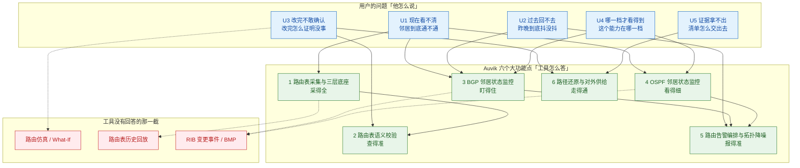
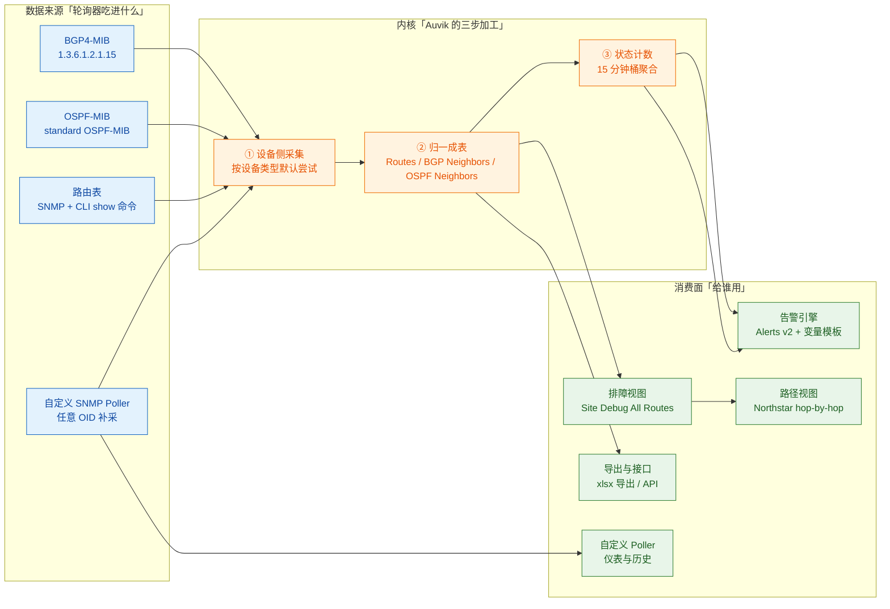
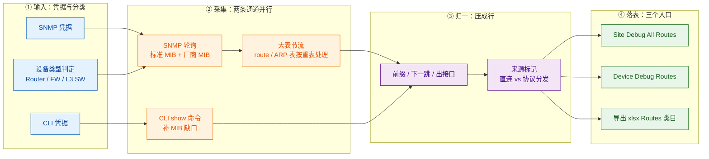
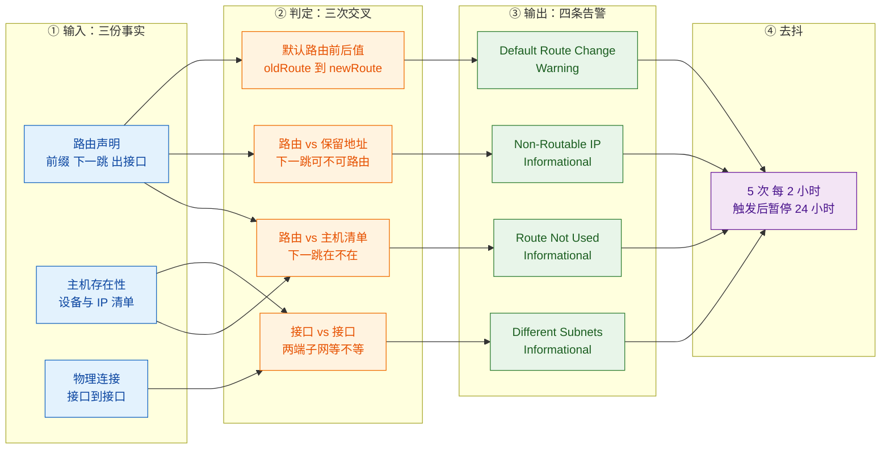
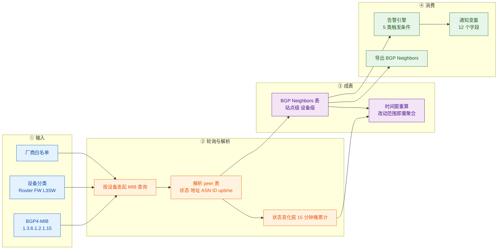
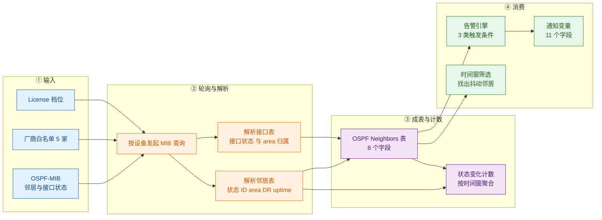
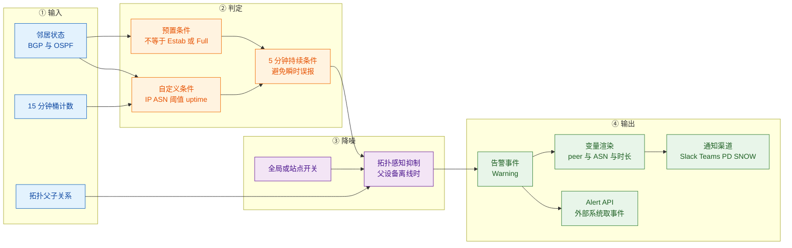
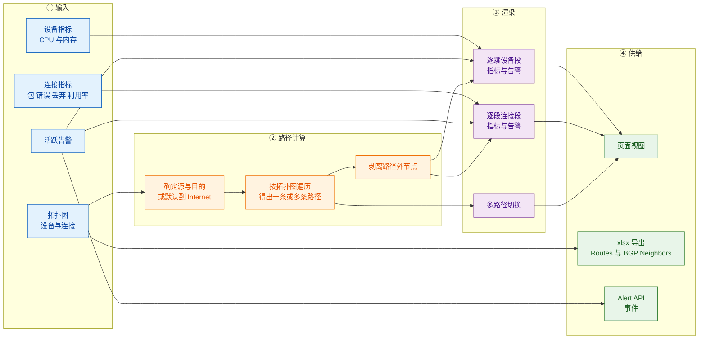

# 1 Auvik 路由协议层监控功能体系与痛点解法（2023–2026）

> **调研对象**：Auvik（auvik.com）在**路由协议层**的监控能力族——含路由表（Routes）的采集与呈现、**BGP 邻居状态监控**、**OSPF 邻居状态监控**、基于邻居状态的告警编排、以及路径（Northstar）与导出 / API 侧的消费面。**不含**交换机端口、无线、流量分析等已另有专文的模块。
> **调研范围**：2023 年 1 月至 2026 年 10 月的全部公开能力；对 2022 年及更早的前史仅在必要处引用（如 Northstar 的 Beta 起点）。
> **交付内容**：① **工具级问题视角**——从用户角度回答「这套东西到底替我解决了什么」，给出问题（U1–U5）→ 大功能点的完整映射（见 1.3）；② 6 个大功能点、**77 条小功能点**清单（含发布时间与信源等级）；③ 每条能力对应的客户侧痛点（P1…Pn）；④ 与痛点一一对应的解法（S1…Sn）；⑤ **功能原理**——6 个大功能点的 K.4 统一按「输入（I1…In）→ 实现链条（图 + 逐步表）→ 输出（UI 产物 vs 内部接口）→ 关键机制深化 → 口径声明」展开；⑥ **能力边界**——每个大功能点的六维度边界表（硬边界 / 软边界 / 前提依赖 / 官方自认局限 / 常见误期待 / 对自研提示，见各章 K.5）；⑦ **信源链接总表**——A / B / C 三级登记与可点击原文地址（见**附五**；正文 K.4 各表的「官方依据」列亦已就地嵌入链接）。
>
> **建议读法**：
> - **赶时间** → 读 1.2 + 1.3 速览表 + 1.4 全景表与边界速查；
> - **要选型** → 直接跳 **4.5**（BGP 到底能看什么、看不到什么）、**5.5**（OSPF 的厂商与区域盲区）、**6.5**（License 档位到底卡在哪一层）、**7.5**（能不能被外部系统取走）；
> - **要复刻** → 从第 2 章逐节读，重点看 **3.4 的三次交叉判定**（路由表语义校验的判定链）、**4.4 第（1）问 + 4.5 边界表**（为什么只走 MIB、为什么没有任何 BMP / telemetry 通道）、**6.4**（去抖为什么必须是「桶计数」而非「瞬时判定」，以及两个时间尺度为何共存）；
> - **要核查出处** → 直接翻附五（信源链接总表）。

---

## 1.1 信源与局限（先看这一段）

采用**三级信源交叉验证**：

| 等级 | 信源 | 覆盖时段 | 在本专题中的用途 |
|---|---|---|---|
| **A** | 官方帮助文档站 `support.auvik.com`（What debug tools / Route not used alert / BGP Neighbor Metrics & Alert Guide / OSPF Neighbor Metrics & Alert Guide / Alerts v2 预置告警清单 / Alerts v2 触发条件 / Alerts v2 通知变量 / Northstar 三篇 / 自定义 SNMP Poller / SNMP Poller API / Which APIs are available / 数据导出 / 数据保留 / 套餐功能对比）+ **官方 Release Notes 逐期归档**（2023-W02 ~ 2026-W40） | 2022-07 ~ 2026-10 | 机制描述、表字段、License 门槛、厂商支持清单、告警默认值、接口清单的主依据 |
| **B** | 官方产品页、官方博客、**Auvik 2025 Year in Review PDF**、官方技术解读长文 | 2021 ~ 2026 | 能力定位与叙事（含营销成分）、拓扑/路径的产品口径 |
| **C** | 第三方：G2 用户评价、第三方选型文章 | 2025 ~ 2026 | 告警噪声体感、横向定位的旁证 |

> **本报告引用的全部信源页面（全文去重后 **42 个唯一地址**，正文共出现 214 处）**已登记在 **附五（A 级 21 条 / Release Notes 9 条 + 4 个年度归档页 / B 级 6 条 / C 级 2 条）**，可逐条点开核查；其中无法提供稳定公开链接者已在 **12.5** 单独列明并给出处置。

**六点已知局限（直接决定本报告的推断边界）**：

1. **官方没有「路由协议层监控」的独立白皮书或技术文档**。全站可查的只有两张表的字段说明（BGP / OSPF）与两篇告警指南；**路由计算、收敛判定、flap 判定的阈值公式一律未公开**。凡涉及「它内部怎么判这条路由更优 / 怎么判定邻居不稳定」，本文一律不给结论，只给可确证的输入与输出面。
2. **Release Notes 的回溯边界与节奏变化**：归档自 **2023-W02** 起可查（2023 年 25 篇 / 2024 年 25 篇 / 2025 年 22 篇 / 2026 年 10 篇）。**2023–2024 为双周更**（官方原文：`Auvik usually releases upgrades every two weeks.`），2025 年条目周次变密，**自 2025-11（W45）起改为每月第一个工作日发布**（官方原文：`Beginning this month, release notes will be published on the first business day of each month`）。这意味着 **2026 年的更新颗粒度从「周」降到「月」**，小改动（如某厂商 MIB 适配）很可能不上 Release Notes，导致可追溯性下降。
3. **官方叫法混用**：同一页面结构被称作 `Debug > Routes` / `All Routes` / `Site → Debug → All Routes`；能力名在 Release Notes 里写作 `BGP Route Neighbor Monitoring`、在表头写作 `BGP Neighbors`、在告警变量命名空间里统一挂在 `$routeNeighbours.*` 之下（BGP 与 OSPF 共用一个命名空间）。本报告统一以 **Routes 表**、**BGP Neighbors 表**、**OSPF Neighbors 表** 为主名，引用处保留原文措辞。
4. **未公开项（如实登记）**：① 路由表的**轮询周期**与**数据保留期**（数据保留说明页只列了配置备份 / 告警 / 抖动时延 / 流量 / syslog / 设备统计，未列 routes）；② BGP / OSPF 邻居的**轮询间隔**（只有「15 分钟桶」聚合口径，没有采样周期）；③ **路由表的历史回放**（BGP 邻居有 30 天历史，路由表是否有历史未取到）；④ **OSPF-MIB 的数字 OID**（BGP 篇给了 `1.3.6.1.2.1.15` 与 snmpwalk 校验命令，OSPF 篇只写 `standard OSPF-MIB`）；⑤ 全局**License 档位阶梯**（Core / Essentials / Performance / Light 的相对高低无统一定义页）；⑥ **Alerts v1 的四条路由表级告警在 v2 中的去留**；⑦ 是否支持 **BGP BMP / 路由策略 / RIB 变更事件**。
5. **厂商自述项**：2025 Year in Review 中关于「catch routing issues early」「troubleshoot faster」的收益表述，一律标注「厂商自述，仅作量级参考」，**不作为能力成立的证据**；本轮**未取到任何针对路由层的第三方实测数据**（这是本专题最大的信源缺口，见附四）。
6. 本调研截止 **2026-10-19**。

**发布节奏对照表**（Auvik 不用版本号，用「周次 + 年份目录」组织，这一点直接决定路由层能力的可追溯性）：

| 时间区间 | 发布形态 | 本专题关键节点 |
|---|---|---|
| 2023-W02 ~ 2024-W50 | **双周更**（各 25 篇） | 路由/ARP 表采集的内存与延迟修复（2023-W40）、Northstar GA（2024-W24）、Northstar 2.0 支持设备到设备（2024-W34） |
| 2025-W02 ~ 2025-W30 | **周更（周次变密）**（全年 22 篇） | **BGP 邻居监控：预告（W06）→ Beta（W18）→ 扩展厂商与告警类目（W22）**；**OSPF 邻居监控开滚（W30）**；Smart Alert Suppression（W30） |
| 2025-W45 ~ 2026-W40 | **月更**（2026 年 10 篇） | 2025-11 起改月更；**2026 全年未取到任何路由协议层新增条目** |

> **一个反直觉的观察**：Auvik 的**路由表读能力极早**（「Debug 默认落地页就是路由明细」这种设计说明它长期是排障主入口），但**协议状态盯能力极晚**——BGP 邻居 2025-02 才预告、2025-05 进 Beta、2025-07 才扩到四家厂商；OSPF 邻居到 **2025-07-30** 才开滚。**也就是说：这张表当了多年「静态快照」，直到 2025 年才被接上「动态心跳」。** 更反直觉的是，**2026 全年（10 期月更）没有一条路由协议层新增**——能力在 2025 年一次性补齐后就停在了「BGP + OSPF 两张表 + 两条预置告警」这个规模上。

> **第二个反直觉的观察（版本换轨，而非叠加）**：旧版告警（Alerts v1）里曾有 **4 条「路由表级」告警**（Route Not Used / Non-Routable IP / Different Subnets / Default Route Change），而新版 Alerts v2 的预置清单里**只剩 2 条「协议邻居级」告警**（BGP Peer is Down / OSPF Neighbor is Down）——**路由表语义校验类触发条件在 v2 的触发条件清单里一条都没有**。这说明 Auvik 在路由层的告警口径是**换了轨道**（从「查表对不对」转向「盯邻居活不活」），而不是简单叠加。这 4 条旧告警在 v2 中是保留、迁移还是废弃，官方未给说明（见附四缺口 3）。

---

## 1.2 一句话定位

**路由协议层监控不是 Auvik 的独立产品线，而是挂在「Routes 表」这张排障主表上的两个附加列集 + 两条预置告警。** 它的价值不在「算路由」——Auvik 不做路由计算、不做收敛仿真、不碰 RIB 事件流；它的价值在**把「邻居状态」这件事从「要登设备敲命令」变成「一张可排序、可筛选、可告警、可导出的事实表」**。

这个定位由三件事共同锚定：

1. **入口位置**：BGP / OSPF 邻居表不是独立菜单，而是**出现在 `Site → Debug → All Routes` 与 `Device → Debug → Routes` 页面上**的一张贴附表（官方原文：`If a device is supported a BGP Neighbors Table will appear on the Site → Debug → All Routes page and the Device → Debug → Routes page.`）。也就是说，**它天然是「排障现场」的一部分，而不是「监控大盘」的一部分**。
2. **数据来源**：只走 SNMP 标准 MIB（`BGP4-MIB` / `OSPF-MIB`），**没有** syslog 解析、**没有** BGP BMP、**没有** 厂商私有 telemetry 通道；对不响应 MIB 的设备直接不显示表（官方原文：`If the table does not appear, the device is likely not responding to SNMP queries for the BGP MIB.`）。
3. **授权口径**：BGP 与 OSPF 都**只在 Core / Essentials / Performance 三档可用**（官方原文：`BGP monitoring is available only on the Core, Essentials and Performance tiers.`）。**能力边界首先是一道商务边界。**

对自研者的含义：这不是一个可以「对标功能清单」的模块，而是一个**可以照抄的取舍**——Auvik 明确放弃了「路由策略 / RIB 变更 / 收敛分析」这一整条深水区，只做「邻居存活 + 抖动计数 + 可告警」。**它放弃的部分，恰好是自研可以差异化切入的部分；它做对的部分（桶计数、变量命名空间、按需扩厂商），是可以直接复用的工程决定。**

---

## 1.3 从工具整体看：它究竟解决用户的什么问题

### 1.3.0 先做维度论证：这套工具的「未来」那一截是空的

模板假设的工具价值两维模型是**时间轴**（现在 / 过去 / 未来）与**关系网**。对「路由协议层监控」，必须**先论证维度是否成立**，再决定问法——否则会写出一个本工具根本不承载的问题。

| 维度 | 是否成立 | 依据 |
|---|---|---|
| **关系网**（谁和谁建了邻接） | **完全成立**，且是本能力的主战场 | BGP 表以 `peer IP / peer router ID / local ASN / peer ASN` 成行；OSPF 表以 `邻居 IP / 邻居 Router ID / Area ID / DR 角色` 成行——**每一行就是一条边**（A 级，见 4.1、5.1） |
| **时间轴的「现在」** | **完全成立** | 两张表都是实时字段：`BGP Neighbor State`、`Connection Uptime (hh:mm:ss)`、`OSPF Neighbor State`（A 级） |
| **时间轴的「过去」** | **部分成立**——只有「**抖动计数**」这一截，**没有「路由表快照回放」**这一截 | BGP 邻居表在 Beta 期明确可看 **30 天**历史（A 级）；状态变化以 **15 分钟桶**计数（A 级）；但**路由表本身**是否有历史版本、能否回放，官方未披露（见 1.1 局限 4） |
| **时间轴的「未来」** | **不成立** | 本工具**不做任何路由推演**：不模拟改一条 cost、不模拟邻居断开后的重收敛、不回答「这条链路断了流量会绕哪去」 |
| **成本**（钱该花在哪） | **成立，但落点不同** | 路由层不产生「容量钱」；这里的钱是两笔：① **License 档位**——低档位看不到 BGP/OSPF（A 级）；② **邻居抖动的业务中断代价**——一次 peer flap 的代价按业务算，不按带宽算 |
| **证据**（跨团队共同事实） | **完全成立** | 站点级导出可勾选 **Routes** 与 **BGP Neighbors** 两类数据，落成 `.xlsx`（A 级，见 7.1）——这是「拿得出手」的物证形态 |

**由此作出两处调整，并说明理由**：

1. **U3 由「未来试不了」替换为「改完不敢确认」**。理由：本工具不承载「未来」这一维——它没有仿真、没有 What-If、没有路由计算。若强行保留「未来试不了」，等于要求一个 MIB 轮询器去做路由推演，是品类错位。替换后的问法落在**时间轴的一个具体瞬间：变更窗口关闭之后**——「我改了一条静态路由 / 加了一个 area，怎么在 5 分钟内证明邻居全回来了、路由没丢」。这恰是 Auvik 现有输出（邻居表 + 15 分钟桶计数 + xlsx 导出）真正能回答的。
2. **U4 由「容量与冗余算不清」重锚为「哪一档才看得到」**。理由：「成本」这一维成立，但落点不在容量规划（Auvik 的容量规划走流量与接口利用率，不走路由），而在**授权与代价的错配**：BGP/OSPF 监控被卡在特定档位，客户在签约前无法把「我要看邻居」折算成「我该买哪一档」；同时邻居抖动造成的业务中断成本，无法用任何路由层指标折算。

以下 U1–U5 按调整后的口径展开。

### 1.3.1 用户的五个问法（U1–U5）

**先给速览表**（详细展开见本节后半）：

| 问法 | 用户的原话 | 痛点描述（痛在哪） | 一句话损失 |
|---|---|---|---|
| **U1 现在看不清** | 「这条 BGP 会话现在到底 Estab 没有？我总不能一台台 SSH 上去敲 `show bgp summary`。」 | 邻居状态只存在于设备本地 CLI；跨站点、跨厂商时没有统一视图 | 每次确认一次邻居状态 = 一次登设备 + 一次人工判读 |
| **U2 过去回不去** | 「用户说昨晚断了 3 分钟，可现在看是好的——我拿什么证明它断过？」 | 邻居复位是瞬时事件，现场早已自愈；事后只有「现在正常」这一个观测点 | 复盘只能靠用户口述与设备 syslog 拼凑 |
| **U3 改完不敢确认** | 「改完静态路由，我怎么在 5 分钟内确认邻居没掉、路由没丢？」 | 变更窗口后有确认压力，但没有一份「改前 vs 改后」的对照物 | 变更回滚判断靠猜，或靠守到天亮 |
| **U4 哪一档才看得到** | 「BGP 监控到底在哪个档位？我先买了 Essentials，结果看不到邻居？」 | 授权门槛藏在文档里，采购时无法把「要看邻居」折算成「买哪一档」 | 买了工具却看不到关键模块，或为看邻居被迫整档升级 |
| **U5 证据拿不出** | 「客户要我出一份路由与邻居清单，我只能截图。」 | 路由表与邻居表只有 UI，没有可交付的清单物证 | 交付/审计靠截图，跨团队无法对齐同一份事实 |

---

#### U1 现在看不清

> **痛点**：邻居状态只存在于设备本地 CLI；跨站点、跨厂商时没有统一视图。

- **谁在问**（三个角色的原话）：
  - 网络工程师：**「BGP 是不是又掉了？我先 SSH 上去看一眼。」**
  - MSP 一线：**「客户打电话说慢，我不知道是链路问题还是邻居问题，只能先连上去。」**
  - 运维经理：**「我不想每次都问‘现在怎么样’，我想要一张能自己看的表。」**
- **典型场景**：一家 MSP 管 40 个站点、120 台三层设备，其中 18 台跑 BGP（对接两条运营商线路）、60 台跑 OSPF（园区内）。某天上午 10 点，客户报「财务系统打不开」。一线先 ping 网关（通），再 SSH 到核心（需跳板 + 二次认证），敲 `show bgp summary`（4 条会话，逐行看 State/PfxRcd），再登另一台边界路由器重复一次——**单次定位约 8 分钟，且这 8 分钟里没有任何一条结论能留下来给别人看**。
- **五类损失表**：

| 损失类别 | 可感知的损失 | 量级（示意，非实测） |
|---|---|---|
| 时间 | 每次「现在通不通」的确认要登设备 | 单次 5–10 分钟；一天 3–5 次 |
| 钱 | 停机时长直接换算成业务损失；MSP 侧则是计费工时的浪费 | 按业务口径 |
| 人 | 只有 2 个人会敲这几条命令，其他人只能等 | 单点依赖 2 人 |
| 合规 | 无法留下「在故障时刻已检查过邻居状态」的记录 | 事后无法举证 |
| 组织 | 一线与二线之间靠口头转述「我看是好的」 | 升级路径靠喊 |

- **放任不管的后果**：**「确认成本」会随站点数线性增长，而「确认能力」不会增长**。站点从 40 涨到 80，登设备的次数翻倍，但会敲命令的人还是 2 个——这条曲线的交点，就是团队开始「只处理已经被用户骂出来的故障」的那一刻。

#### U2 过去回不去

> **痛点**：邻居复位是瞬时事件，现场早已自愈；事后只有「现在正常」这一个观测点。

- **谁在问**：
  - 网络工程师：**「刚才明明抖了，我打开一看又是 Established。」**
  - 值班主管：**「用户说 22:14 断了 3 分钟，你能给我看那 3 分钟吗？」**
  - MSP 客户经理：**「客户要 SLA 报告，我怎么证明这个月只断过一次？」**
- **典型场景**：某工厂 MES 系统每晚 22:00 做批处理，某晚 22:14 出现 3 分钟中断。次日排查时，所有邻居都是 `Established`、uptime 显示「已连续 11 小时」——**这个 uptime 恰恰是「它确实断过」的反证，但没人会把 uptime 换算成「断在几点」**。设备侧 syslog 若未集中采集，则彻底无据可查。
- **五类损失表**：

| 损失类别 | 可感知的损失 | 量级（示意，非实测） |
|---|---|---|
| 时间 | 复盘从「查证据」退化为「猜原因」，反复假设验证 | 一次复盘 2–6 小时 |
| 钱 | 找不到根因 → 同一故障重复发生 → 重复停机 | 重复率难估 |
| 人 | 需要拉上当初值班的人一起回忆 | 每次 3–5 人 |
| 合规 | SLA 举证不成立，可能触发赔付条款 | 按合同 |
| 组织 | 复盘会开成「谁的锅」而不是「什么机制」 | 团队信任损耗 |

- **放任不管的后果**：**「无法复盘」会自我强化**——因为查不到，所以只能猜；因为靠猜，所以改的是「看起来最可疑」的地方；因为改错了地方，下一次故障换了个形态再来。最终团队会把「间歇性故障」归类为「网络就是这样的」，**这一类故障从此不再进入改进循环**。

#### U3 改完不敢确认

> **痛点**：变更窗口后有确认压力，但没有一份「改前 vs 改后」的对照物。

- **谁在问**：
  - 变更实施人：**「我改完了，现在只能祈祷邻居自己回来。」**
  - 变更审批人：**「你凭什么说这次变更安全？给我看影响面。」**
  - 值班工程师：**「凌晨 2 点改完，我要守到几点才敢睡？」**
- **典型场景**：把一条静态路由的下一跳从旧防火墙改成新防火墙，同时调整 OSPF 的 area 归属。变更单写的是「预计影响 5 分钟」。改完后：BGP 会话看起来都在，但**没人能说出改之前到底有几条会话、几条路由、area 分布是什么样**——因为「改之前」没有留档。值班的人只能守 30 分钟，靠「没接到电话」当作成功。
- **五类损失表**：

| 损失类别 | 可感知的损失 | 量级（示意，非实测） |
|---|---|---|
| 时间 | 变更后「守窗口」时间无法压缩 | 每次 30–60 分钟 |
| 钱 | 变更窗口占用人力；窗口外故障则是业务损失 | 按人力单价 |
| 人 | 变更必须由「最熟的人」执行，无法下放 | 关键人不可替代 |
| 合规 | 变更记录只有「已实施」，没有「已验证」证据 | 审计链缺口 |
| 组织 | 变更与故障的归因无法分离，互相甩锅 | 流程摩擦 |

- **放任不管的后果**：**变更频率会主动下降**——不是因为风险被控制住了，而是因为「确认成本太高，能不改就不改」。团队的变更能力被悄悄锁死，技术债以「稳定」的名义累积。

#### U4 哪一档才看得到

> **痛点**：授权门槛藏在文档里，采购时无法把「要看邻居」折算成「买哪一档」。

- **谁在问**：
  - 采购/商务：**「BGP 监控是在哪个包里？报价单上没写。」**
  - IT 经理：**「我先买了低档，结果邻居表是空的，这算谁的？」**
  - MSP 老板：**「每个客户都要看邻居，我是整档升级还是按客户拆？」**
- **典型场景**：客户按「设备数」比价了三家工具，选定 Auvik 后按最低可用档签约。上线后按文档去 `Debug > Routes` 找 BGP 邻居表——**表不存在**。排查两轮才发现是档位不够（官方原文：`Sites on lower tiers will not see BGP data.`）。此时要么整档升级（全部站点一起涨），要么放弃这个能力。
- **五类损失表**：

| 损失类别 | 可感知的损失 | 量级（示意，非实测） |
|---|---|---|
| 钱 | 整档升级的差价 vs 只用到一个表 | 按站点规模 |
| 时间 | 采购返工、合同变更 | 2–6 周 |
| 人 | 需要商务与技术反复对齐「到底哪个包有」 | 3–5 轮沟通 |
| 合规 | 若因看不到邻居而漏判故障，责任界定困难 | 按合同 |
| 组织 | 采购与运维的信任损耗（「买之前你怎么不说」） | 长期 |

- **放任不管的后果**：**「能力可见性」与「商务可见性」脱钩**——技术上能做的事，采购时不可见；采购时买的包，上线后不满足。这类错配不会在上线当天爆发，而是在第一次真正的路由故障时爆发，代价最高。

#### U5 证据拿不出

> **痛点**：路由表与邻居表只有 UI，没有可交付的清单物证。

- **谁在问**：
  - 交付工程师：**「验收要一份路由清单，我只能一页页截图。」**
  - 审计方：**「你怎么证明这条 BGP 会话在审计期内一直正常？」**
  - 客户 IT：**「把你们看到的邻居列给我，我要和我们自己的记录对一遍。」**
- **典型场景**：项目验收，甲方要求提交「当前网络的三层路由与 BGP 邻居清单」。乙方工程师打开 Auvik，把 `All Routes` 页面按站点筛一遍，截图 12 张粘进 Word。甲方对照自家记录时发现少了一个站点——**因为截图时筛选条件忘了清**。双方就「到底几台设备、几条会话」争了两天。
- **五类损失表**：

| 损失类别 | 可感知的损失 | 量级（示意，非实测） |
|---|---|---|
| 时间 | 人工整理清单 + 反复核对 | 每次 4–8 小时 |
| 钱 | 验收延期导致的回款延迟 | 按合同 |
| 人 | 需要两个人交叉核对截图 | 2 人 × 半天 |
| 合规 | 截图不是可校验的数据，审计方可能不认 | 验收风险 |
| 组织 | 甲乙双方对「事实」的口径不一致 | 信任成本 |

- **放任不管的后果**：**「同一份事实」永远无法在组织间流动**——工具里的视图再准，出门就降级成图片；图片不可比对、不可聚合、不可追踪变化。于是每次交付都要重新人工整理一遍，且每次的口径都可能不同。

---

**损失强度分布矩阵**（● 主要 / ○ 次要）：

| 问法 | 时间 | 钱 | 人 | 合规 | 组织 |
|---|---|---|---|---|---|
| U1 现在看不清 | ● | ○ | ● | ○ | ○ |
| U2 过去回不去 | ● | ● | ○ | ● | ○ |
| U3 改完不敢确认 | ● | ○ | ● | ○ | ● |
| U4 哪一档才看得到 | ○ | ● | ○ | ○ | ● |
| U5 证据拿不出 | ● | ○ | ○ | ● | ● |

> **一条采购行为解释**：这张矩阵解释了为什么「路由监控」在采购清单里总是排在「拓扑」和「告警」之后——**它的三个主要损失（U1 时间、U1 人、U3 时间）都是「日常摩擦型」，不是「一次性剧痛型」**。日常摩擦不会触发立项，只会触发抱怨。真正能推动采购的是 **U2 的合规损失**与 **U4 的钱**：前者出现在一次说不清的 SLA 争议之后，后者出现在一次「买了看不到」的返工之后。**所以 BGP/OSPF 监控这类能力的销售路径，几乎总是「先出一次事，再补一个包」。**

### 1.3.2 五个整体问题（U1–U5）与承载能力

落到**大功能点**粒度（不枚举小功能点），列如下：

| # | 用户的问题 | 工具给出的整体回答 | 对应的大功能点（及它在这里扮演的角色） |
|---|---|---|---|
| **U1** | 现在看不清 | 「把每台设备的路由表与邻居状态，汇成一张可按站点、按设备、按邻居筛的表」 | **大功能点 1：路由表采集与三层事实底座**（提供「表」本身）＋ **大功能点 3 / 4：BGP / OSPF 邻居监控**（提供「心跳」两列）→ 见第 2、4、5 章 |
| **U2** | 过去回不去 | 「把‘抖过几次’变成可数的历史：15 分钟桶计数 + BGP 的 30 天窗口」 | **大功能点 3（BGP，30 天历史与 flap 计数）**＋ **大功能点 4（OSPF，状态变化计数）**＋ **大功能点 5：路由告警编排**（把「抖过」变成事件）→ 见第 4、5、6 章 |
| **U3** | 改完不敢确认 | 「改完立刻能看：邻居表 + 路由表 + 一键导出，作为‘改后快照’」 | **大功能点 2：路由表语义校验**（改完先看有没有配错）＋ **大功能点 6：路径还原与对外供给**（导出快照）→ 见第 3、7 章 |
| **U4** | 哪一档才看得到 | 「把门槛写在文档里、把数据关在档位后」——这是个**部分回答**：它告诉你哪些档有，但不告诉你该买哪档 | **大功能点 3 / 4 的 License 门**（横切两章 K.5）→ 见 4.5、5.5、6.5 |
| **U5** | 证据拿不出 | 「站点级导出可勾选 Routes 与 BGP Neighbors，落成 xlsx」 | **大功能点 6：路径还原与对外供给**（导出 + API 边界）→ 见第 7 章 |

**覆盖核验**：**6 个大功能点全部被至少一个 U 消费，无孤立能力**。其中大功能点 2（路由表语义校验）只被 U3 消费，大功能点 1（路由表采集）被 U1 与 U3 共同消费——这两条是「低频但一旦命中就很痛」的能力，其存在感低于 3/4 两章，但不应被裁掉（理由见 3.5 的一句话边界）。

### 1.3.3 一张图：从用户问题到大功能点

### 1.3.4 用之前 vs 用之后（同一批问题的对照）

| 问法 | 用之前（只有 CLI 与截图） | 用之后（Auvik 路由层） | 剩下的那一截（工具仍不回答） |
|---|---|---|---|
| U1 现在看不清 | 逐台 SSH → 敲 `show bgp summary` / `show ip ospf neighbor` → 人眼判读 | 一张表按站点/设备列出邻居状态、uptime、router ID、area；可筛可搜 | 表里没有的协议（EIGRP / IS-IS / RIP）仍然要登设备 |
| U2 过去回不去 | 靠设备 syslog、靠人回忆 | 15 分钟桶计数 + BGP 最长 30 天历史；抖动从「感觉」变成「计数」 | **路由表本身没有历史**，只有邻居状态有历史 |
| U3 改完不敢确认 | 守窗口，靠「没人打电话」当成功 | 改完立刻看表 + 导出 xlsx 作为「改后快照」 | 没有「改前快照」，对照仍要靠人自己留档 |
| U4 哪一档才看得到 | 没人知道门槛在哪 | 官方文档明写档位（但采购页不写） | **不告诉你该买哪档**，只告诉你哪些档有 |
| U5 证据拿不出 | 截图 12 张粘进 Word | 勾选 Routes / BGP Neighbors 导出 xlsx | **API 拿不到**（无 routes/neighbors 端点），只能靠导出文件 |

### 1.3.5 小结：U 与 P 的关系（读后文前必看）

**U 是工具级问题**（判断「值不值得买」），**P 是功能级痛点**（判断「做得对不对」）。二者是**上位归并**而非一对一：一个 U 会被拆进多个大功能点的多个 P；一个 P 也可能同时服务两个 U。

**U → P 归并映射表**（使全部 24 条 P 可追溯；编号记为 `K-Pn`，K = 大功能点序号、Pn = 该章痛点序号）：

| 工具级问题 U | 被拆成的功能级痛点 P | 所在章（H2 编号） | 覆盖数 |
|---|---|---|---|
| **U1 现在看不清**（此刻状态不可见，要登设备） | 1-P1（确认一条路由要登一次设备）、1-P4（跨站点跨团队没有同一份路由事实）、3-P1（peer 掉没掉靠用户先报障）、4-P1（OSPF 邻接卡在中间态）、5-P2（告警只说设备离线不说哪个 peer）、5-P3（核心一挂下游全红，几百条告警找不到根因） | 2.2 / 4.2 / 5.2 / 6.2 | 6 |
| **U2 过去回不去**（历史与变化无记录） | 3-P2（抖过又恢复，打开看是好的）、4-P2（状态反复变化没有计数）、2-P4（默认路由被谁改了、何时改的说不清） | 4.2 / 5.2 / 3.2 | 3 |
| **U3 改完不敢确认**（配置正确性与路径确认） | 2-P1（路由配错没人发现）、2-P2（next-hop 指向不存在的地址）、2-P3（互联两端掩码不一致长期潜伏）、6-P1（业务走哪条路只能靠 traceroute 猜）、6-P2（路径上的问题在谁的地盘说不清） | 3.2 / 7.2 | 5 |
| **U4 哪一档才看得到**（成本与档位门槛） | 1-P3（厂商私有 OID 采不到，专用监控又买不起）、5-P1（买了一堆监控，关键的那条告警偏偏要自己搭） | 2.2 / 6.2 | 2 |
| **U5 证据拿不出**（对外交付与系统集成） | 6-P3（拿不出可交付的路由与邻居清单）、6-P4（导出和 API 只能拿到一半，集成还得人肉搬） | 7.2 | 2 |
| **横切（无独立 U：知识资产与协作口径）** | 1-P2（路由事实装在老工程师脑子里，人一走断档）、3-P3（ASN / router ID / peer IP 要逐条对，跨团队扯皮）、3-P4（跨站点跨运营商时谁和谁建了邻接没人说得清）、4-P3（area 与 DR 角色不匹配，跨区域归属不清）、4-P4（router ID 重复人眼几乎发现不了）、5-P4（阈值怎么定全凭个人经验，换个值班就全变） | 2.2 / 4.2 / 5.2 / 6.2 | 6 |

> **覆盖核验**：上表命中 1-P1~1-P4、2-P1~2-P4、3-P1~3-P4、4-P1~4-P4、5-P1~5-P4、6-P1~6-P4 全部 **24 条**，无遗漏、无重复计数（每条 P 只在表中出现一次）。**读法提示**：下文每章的 K.2 只写「客户侧可感知的痛」，凡属「必须…」「应当…」「语义应当…」的句式一律已移到 K.3；平台成本视角（如「MIB 轮询开销大」）不进入 P，只出现在 K.4 与 K.5。

---

## 1.4 读法：6 个大功能点全景

| # | 大功能点 | 口号（四字） | 小功能点数 | 时间跨度 | 面向谁 |
|---|---|---|---|---|---|
| 1 | 路由表采集与三层事实底座 | **采得全** | 14 | 2023-W40 ~ 2026（持续） | 网络工程师、交付工程师 |
| 2 | 路由表语义校验 | **查得准** | 10 | 2024-02（文档定稿）~ 2025（v1→v2 换轨） | 网络工程师、审计 |
| 3 | BGP 邻居状态监控 | **盯得住** | 16 | 2025-W06 ~ 2025-09 | NOC、MSP 一线 |
| 4 | OSPF 邻居状态监控 | **看得细** | 13 | 2025-W30 ~ 2025-09 | 园区网运维、NOC |
| 5 | 路由告警编排与拓扑降噪 | **报得准** | 12 | 2025-W22 ~ 2026-W40 | NOC 值班、MSP 值班主管 |
| 6 | 路径还原与对外供给 | **走得通** | 12 | 2024-W24 ~ 2026 | 排障二线、交付/审计、集成方 |

> 合计 **77 条小功能点**（14+10+16+13+12+12）。时间跨度取「该能力首次可追溯到公开信源的时点」到「最后一次有实质变更的时点」。

**边界速查（一页版）**：

| # | 大功能点 | 最要命的一条边界 | 边界性质 |
|---|---|---|---|
| 1 | 路由表采集与三层底座 | **只收「直连 + 路由协议分发」的路由，且强依赖 SNMP/CLI 能读到**；读不到就是空白，不会告警 | 硬边界（数据源） |
| 2 | 路由表语义校验 | **这 4 条告警只出现在 Alerts v1 清单；v2 触发条件清单里一条路由表级条件都没有** | 软边界（版本换轨，官方未说明去留） |
| 3 | BGP 邻居状态监控 | **只到「邻居状态」这一层**：没有前缀数、没有 RIB 变更、没有路由策略、没有 BMP | 硬边界（架构取舍） |
| 4 | OSPF 邻居状态监控 | **只覆盖 5 家厂商，且只见「邻居/区域」不见「LSA/SPF」** | 硬边界（厂商适配）+ 软边界（未披露） |
| 5 | 路由告警编排与拓扑降噪 | **降噪只吃「父设备离线 → 下游离线」这一条链，协议邻居 down 不在其覆盖范围** | 硬边界（机制设计） |
| 6 | 路径还原与对外供给 | **路径来自拓扑图而非路由表；API 无 routes/neighbors 端点，只能导出 xlsx** | 硬边界（实现口径）+ 硬边界（接口面） |

**编号约定声明**（P/S 闭环规则）：

1. **两套编号并存，各管一件事，不要混读**：
   - **节号 = 文档章号**：`2.1`–`2.5` 指「第 2 章的五节」（第 2 章讲的是大功能点 1）。此处**刻意不采用模板的 `K.1` 形式**——因第 1 章为总览且已占用 `1.1`–`1.4`，若各章节号改用大功能点序号 K，会与总览重号，交叉引用时产生歧义。
   - **小功能点号 = 大功能点序号 K**：`1.1`–`1.14` 表示「大功能点 1 的第 1–14 条」，**全篇唯一**，且与所在章号无关——第 2 章的小功能点是 `1.x`，第 7 章的小功能点是 `6.x`。
   - **引用规则**：引「节」用章号（如「见 4.5」= 第 4 章第 5 节，即 BGP 的能力边界）；引「小功能点」用 K 号（如「1.10–1.11」= 大功能点 1 的第 10–11 条）。两者相差 1，读时按前缀是否带「小功能点」字样判断。
2. 痛点写作 `**Pk｜（损失类别）——「一句话痛点」**`，`Pk` 为**章内**编号（每章从 P1 重新起编）；损失类别只能取 **时间 / 钱 / 人 / 合规 / 组织**。
3. 解法写作表格行 `| **Sk｜名称** | 机制 | → 解 Pk |`，`Sk` 为**章内**编号；每章 **P 集合 = S 集合**，「→ 解 Pk」的引用目标必须存在，**不允许悬空**。
4. 跨章引用一律写「第 N 章 K.x」或「见 N.M」；附录引用写「附一 / 附五」并带小节号（如 12.5）。

**一张总构造图：数据来源 → 内核 → 各消费面**

> **读图要点**：全篇只有**一条采集链**（设备 → 表 → 计数），**五个消费面**都从这条链上分叉。这意味着任何采集侧的缺失（MIB 不响应、厂商不适配）会**同时**打断排障视图、告警、路径与导出——**没有旁路**。唯一例外是右下角的「自定义 Poller」，它是一条**并行的、与内置表无关**的通道，也是本报告认为最值得自研借鉴的兜底设计（见 2.4.4 机制三）。

---

# 2 大功能点 1：路由表采集与三层事实底座 —— 采得全

> 它替代的是「逐台 SSH 敲 `show ip route`，把结果贴在 Excel 里」这套手工动作。Auvik 把每台设备的路由表收进一张可按站点聚合、可按设备下钻、可筛选可导出的表，并允许用户用自定义 SNMP Poller 补采内置清单之外的任意 OID。

## 2.1 小功能点清单

| # | 小功能点 | 发布时间 | 信源等级 | 说明 |
|---|---|---|---|---|
| 1.1 | 站点级**统一路由表**（`Site → Debug → All Routes`） | 文档 2023-12-15（能力更早） | A · [Debug 工具](https://support.auvik.com/hc/en-us/articles/204930980-What-debug-tools-are-available-in-Auvik) | 原文：`You’ll be shown a list of the routes for all discovered devices.`——**一次列出所有已发现设备的路由** |
| 1.2 | 设备级**路由明细页**（`Device → Debug → Routes`） | 同上 | A · 同上 | 从实体导航点 `Debug` 而不选具体工具时，**默认就落在路由明细**：`you’ll be taken to route details by default` |
| 1.3 | 路由表的**收录口径**：只含「直连 + 路由协议分发」 | 同上 | A · 同上 | 原文：`all the routes directly connected or distributed by a routing protocol`——**静态路由是否单列、是否有默认路由独立入口，官方未在此句界定**（见 2.5 边界） |
| 1.4 | 呈现**类同 `show ip route`** 但更易读 | 同上 | A · 同上 | 原文：`similar to what you’d see by typing in the “show ip route” command … but in a much easier-to-read format` |
| 1.5 | 用途定位：**找三层误配** | 同上 | A · 同上 | 原文：`to find out what route traffic will take, and to look for potential misconfigurations at Layer 3` |
| 1.6 | 数据来源：**SNMP MIB + CLI 的 `show` 命令** | 2023-12（发现机制文档）/ 2024-02（告警文档） | A · [发现机制](https://support.auvik.com/hc/en-us/articles/202956414-How-does-Auvik-discover-network-topology-and-device-information)、[Route not used](https://support.auvik.com/hc/en-us/articles/217210466-Route-not-used-alert) | 发现机制原文：`pulled from SNMP through various management information bases (MIBs), and by issuing "show" commands through the CLI`；告警文档原文：`all the routes discovered through SNMP and CLI commands` |
| 1.7 | 大表采集的**性能修复**（route / ARP 表） | 2023-W40（2023-10-07） | A · [2023-W40](https://support.auvik.com/hc/en-us/articles/19195887719316-2023-W40-Release-October-7-2023) | 原文：`Resolved an issue with the collection of route and ARP tables that were causing high memory usage and delays in the application.`——**路由表是「重表」，这是它唯一一次因性能被点名修复** |
| 1.8 | 路由表作为**拓扑数据源之一** | 产品页（抓取 2026-10） | B · [Network Mapping 页](https://www.auvik.com/?p=27958/) | 原文列出的多协议组合含 `routing tables`：`Auvik uses a combination of protocols—SNMP, CDP, LLDP, ARP, forwarding tables, VLAN data, and routing tables` |
| 1.9 | 路由信息的**三层视图消费**（L1 / L2 / L3 一键切换） | 产品页（抓取 2026-10） | B · [Multi-layer 页](https://www.auvik.com/?p=36820/) | 原文：`you can toggle between Layer 1 (physical connections), Layer 2 (switching paths), and Layer 3 (routing information) perspectives` |
| 1.10 | **自定义 SNMP Poller**（任意 OID 补采） | 文档（长期存在） | A · [Manage custom SNMP Pollers](https://support.auvik.com/hc/en-us/articles/206617226) | 原文：`In cases where you'd need to pull information from a specific SNMP OID in your device and Auvik doesn't gather it by default, you can set up a custom SNMP Poller to achieve that.` |
| 1.11 | Poller 的**配置项**：OID / String 或 Numeric / Poll Period / Output Parser / Test Device | 同上 | A · 同上 | Output Parser 支持 `After, Before, Between` 与正则；`Use As` 可选 `SNMP Poller Only (for alerting)` 或 `Serial Number (no alerting)` |
| 1.12 | Poller **历史保留 1 年**（数值时序图 / 字符串变更表） | 官方产品博客（抓取 2026-10） | B · [Introducing SNMP Poller History](https://www.auvik.com/?p=14141/) | 原文：`Auvik now collects and shows the historical values for SNMP poller in the following ways and stores them for one year` |
| 1.13 | 每设备 **1250 个 monitor 上限** | 同 1.10 | A · [Manage custom SNMP Pollers](https://support.auvik.com/hc/en-us/articles/206617226) | 原文：`A maximum of 1250 monitors are supported per device.` |
| 1.14 | 自定义 Poller **不进入标准 CPU / 内存 widget** | 文档 2026-10-16 | A · [How can I see the current values of SNMP Pollers](https://support.auvik.com/hc/en-us/articles/210462766) | 原文：`Values collected by custom SNMP Pollers do not populate Auvik’s standard CPU or memory widgets on the device dashboard.` |

> **编号说明**：1.1–1.14 为本报告编号（`章号.序号`），与官方功能编号无关。时间列中「文档 YYYY-MM-DD」表示该篇官方文档的页面日期，能力本身可能更早存在——**Auvik 不为既有能力补发 Release Notes**，这是本专题时间线的系统性偏差来源（见 1.1 局限 2）。

## 2.2 它对应的用户痛点

**P1｜（时间）——「确认一条路由，就要登一次设备」**。路由表只存在于设备本地，`show ip route` 的输出是**文本流**：一台设备一屏，五十台设备就是五十屏。工程师要回答「`10.20.0.0/16` 到底走哪条」这种问题，需要先判断它落在哪台设备上，再登上去，再在一屏几十行里找匹配项。**这个动作的时间成本与设备数量成正比，而人的耐心不随设备数增长**。

**P2｜（人）——「路由事实装在老工程师脑子里，人一走就断档」**。哪条静态路由是当年为某个项目临时加的、哪个网段为什么走了备用链路——这些「为什么」不在任何表里。新接手的人看到的是一堆等价的路由条目，**看不出哪条是设计、哪条是历史遗留**。于是每次交接都要做一次「口述考古」，而口述的内容无法校验。

**P3｜（钱）——「厂商私有 OID 采不到，专用监控又买不起」**。内置采集清单只能覆盖厂商通用 MIB；某型号的**私有 OID**（温度、电源、特定协议计数）读不到，就只剩两条路：买一套专用监控，或者放弃这个指标。对 MSP 而言，前者的成本会随客户数线性叠加，后者意味着**同类设备在不同客户处的可观测性不一致**。

**P4｜（组织）——「跨站点、跨团队时，没有同一份路由事实」**。总部看到的是总部的表，站点工程师看到的是站点的表，集成商拿到的是截图。三方对「这条链路通不通」的判断依据不同，**争论的其实不是结论，而是各自的观测面**。这类分歧无法靠开会解决，只能靠「大家看同一张表」解决。

## 2.3 它是如何解决的（与痛点一一对应）

| 解法 | 机制 | 对应痛点 |
|---|---|---|
| **S1｜站点级 All Routes 汇总：把「N 台设备的 N 屏」压成一张表** | `Site → Debug → All Routes` 一次列出**所有已发现设备**的路由（原文：`a list of the routes for all discovered devices`），并支持筛选。工程师不再需要先猜「这条路由在哪台设备上」——**检索的起点从「设备」变成「前缀」** | → 解 P1 |
| **S2｜设备级 Routes 页 + 「Debug 默认落路由明细」：把事实固化进系统** | 每台设备的 `Debug → Routes` 是独立页面，且从实体导航直接点 `Debug` 时**默认落在路由明细**（原文：`you’ll be taken to route details by default`）。这意味着「查这台设备的三层情况」变成了**一个固定动作**，而不是依赖某个人记得敲哪条命令 | → 解 P2 |
| **S3｜自定义 SNMP Poller：把长尾 OID 的适配成本外包给配置** | 用户自填 `OID` + `Expected Type`（String / Numeric）+ `Poll Period` + `Output Parser` + `Test Device`，并可选 `Use As = SNMP Poller Only (for alerting)` 直接挂告警；数值型可带单位，字符串型可用于序列号。**代价是每设备 1250 个 monitor 的硬上限**，且这些值**不进标准 CPU/内存 widget** | → 解 P3 |
| **S4｜统一的表结构 + 筛选 + 导出：让同一份事实可被不同角色取走** | 路由表与邻居表共用同一套「站点 → 设备 → 明细」的三层导航与筛选；站点级导出可勾选 `Routes` 与 `BGP Neighbors` 落成 `.xlsx`（见 7.1）。**跨团队拿到的不是三张截图，而是同一份可筛选数据的三个视图** | → 解 P4 |

> **纪律说明**：本章不设「多点几台设备就好了」「培训工程师记命令」这类建议——它们不是产品解法，是管理补偿，按模板纪律不进 K.3。

## 2.4 功能原理

### 2.4.1 输入：采集器吃进去什么

| 输入 | 具体内容 | 官方依据（含原文链接） | 缺了它会怎样 |
|---|---|---|---|
| **I1 · SNMP 凭据与可达性** | v1/v2c/v3 凭据；设备须对采集器响应 SNMP | **A** · [发现机制](https://support.auvik.com/hc/en-us/articles/202956414-How-does-Auvik-discover-network-topology-and-device-information)、[SNMP 排障](https://support.auvik.com/hc/en-us/articles/38583303072788-Troubleshooting-SNMP-from-the-Auvik-Collector) | **路由表只能靠 CLI 兜底**；而 CLI 需要登录凭据与可用通道，两者都缺时这张设备在表里**完全空白**——注意：**空白不会产生告警**（见 2.5 硬边界） |
| **I2 · CLI 登录凭据** | SSH / Telnet + `show` 命令 | **A** · [发现机制](https://support.auvik.com/hc/en-us/articles/202956414-How-does-Auvik-discover-network-topology-and-device-information) | 部分厂商的路由信息只在 CLI 可读（MIB 不全），缺 CLI 会**丢条目而不是丢整表**——这是「静默降级」，最难被察觉 |
| **I3 · 设备类型判定** | 是否被识别为 Router / Firewall / Layer 3 switch | **A** · [BGP 指南](https://support.auvik.com/hc/en-us/articles/38198764040084-BGP-Neighbor-Metrics-Alert-Guide) | 原文：`By default Auvik will attempt default BGP SNMP queries to Routers, Firewalls and Layer 3 switches.`——**若设备被误分类为 L2 交换机，BGP 查询根本不会发起**，表现为「表不存在」，与「MIB 不支持」 indistinguishable |
| **I4 · 厂商 MIB 适配** | 设备是否在官方支持清单内 | **A** · [BGP 指南](https://support.auvik.com/hc/en-us/articles/38198764040084-BGP-Neighbor-Metrics-Alert-Guide)、[OSPF 指南](https://support.auvik.com/hc/en-us/articles/40738099283092-OSPF-Neighbor-Metrics-Alert-Guide) | 厂商清单是**白名单制**（BGP 4 家 / OSPF 5 家）。不在清单内的设备**即使 MIB 完备也不出表**，需提工单评估（官方：`Additional vendors can be supported upon request`） |
| **I5 · License 档位** | Core / Essentials / Performance | **A** · [BGP 指南](https://support.auvik.com/hc/en-us/articles/38198764040084-BGP-Neighbor-Metrics-Alert-Guide) | 原文：`Sites on lower tiers will not see BGP data.`——**能力被商务闸门截断**，且 UI 不会提示「你缺的是档位」 |
| **I6 · 设备在线且被纳管** | 设备处于 managed 且在线 | **A** · [BGP 指南](https://support.auvik.com/hc/en-us/articles/38198764040084-BGP-Neighbor-Metrics-Alert-Guide) | 离线设备的表停留在**最后一次成功轮询**的快照上，**不会标注「这是过期数据」**——这是本能力最容易被误读的一处（见 2.5 常见误期待） |

### 2.4.2 实现链条：从「一台设备」到「一张路由表」

| 步骤 | 做什么 | 关键输入 | 输出 |
|---|---|---|---|
| **① 分类** | 判定设备是否为「会跑路由」的类型（Router / Firewall / L3 Switch） | I3 | 是否发起路由相关轮询的**开关** |
| **② 轮询** | 按设备类型发起标准 MIB 查询；同时（或改由）执行 `show` 命令 | I1、I4 | 原始 MIB 表 / CLI 文本 |
| **③ 节流** | 路由表与 ARP 表被当作**大表**处理，控制采集节奏与内存占用 | — | 不拖垮应用的路由数据（2023-W40 修的正是这一步） |
| **④ 解析** | 把 MIB 表 / CLI 文本解析成「前缀 → 下一跳 → 出接口」的行 | ② 的原始数据 | 结构化的路由行 |
| **⑤ 标注来源** | 区分「直连」与「由路由协议分发」两类（官方口径只到这一层） | ④ | 带来源属性的路由行 |
| **⑥ 归集** | 按站点 / 设备两个维度归集，供三个入口消费 | ⑤ | All Routes 表 / 设备 Routes 表 / 导出文件 |

> **链条上的关键空白**：官方从未说明②与⑥之间**是否有去重、是否有历史版本、是否有变更检测**。本报告只写「表里能看到什么」，不推断「表背后存了几份」。凡涉及「历史」的问题，见 2.5 软边界。

### 2.4.3 输出：交付什么形态的结果

| 输出物 | 形态 | 消费方 | 对应小功能点 |
|---|---|---|---|
| **站点级 All Routes 表** | 跨设备的路由列表 + 筛选 | 网络工程师、二线排障 | 1.1、1.5 |
| **设备级 Routes 明细** | 单设备路由明细（`Debug` 默认落地） | 一线排障、变更实施人 | 1.2、1.4 |
| **L3 拓扑层** | 地图上的三层关系视图 | 排障、设计评审 | 1.8、1.9 |
| **导出文件（Routes 类目）** | `.xlsx`，站点级导出可勾选 | 交付、审计、客户 | 1.1（导出见 7.1） |
| **自定义 Poller 的仪表与历史** | 数值时序图 / 字符串变更表，保留 1 年 | 有长尾指标的团队 | 1.10–1.14 |
| **「设备—路由—邻居」关系事实（内部接口）** | **不是 UI 产物，而是被下游消费的内部事实** | 路由语义校验（第 3 章）、告警引擎（第 6 章）、路径视图（第 7 章）、导出 | —（底座本身） |

> **注意最后一行**：路由表**最重要的输出不是那张表，而是「设备—路由—邻居」这层可被下游消费的关系事实**。表是给人看的；底座是给第 3、6、7 章那些能力用的。**这也是为什么采集侧的缺失会同时打断四个消费面**（见 1.4 总构造图的读图要点）。

### 2.4.4 关键机制深化

**（1）为什么把「路由明细」做成 Debug 的默认落地页？**

官方行为：从实体导航点 `Debug` 而不选具体工具时，**默认进入路由明细**（原文：`you’ll be taken to route details by default`）。

- **设计含义（C 级，本报告推导）**：Debug 是「排障现场」的入口，而排障现场的第一问通常是三层问题（「这个地址通不通、走哪条」）。把路由表设为默认，等于**把最高频的排障动作的点击深度从 2 降到 1**。
- **依据链**：Debug 默认落路由明细（A）→ 路由表是全站唯一被设为默认落地的 Debug 工具（A，同页其余工具均需下拉选择）→ 结论：**路由表被当作排障主入口设计**。
- **代价**：默认页也意味着**加载成本前置**——每次点 Debug 都要等路由表渲染；这对大站点是负担（这正是 1.7 那条性能修复的背景）。

**（2）为什么「路由表」必须与「下一跳主机是否存在」交叉校验，而不是单独存在？**

- 官方在 `Route not used` 告警里给出了判定链：`combing through all the routes discovered through SNMP and CLI commands, and checking whether the next-hop hosts actually exist in the network.`
- **这条链的意义（C 级，本报告推导）**：单独一张路由表只能回答「设备**声明**了什么」；只有把「下一跳主机是否真实存在」叠上去，才能回答「这个声明**是否成立**」。**路由表是声明，网络里的事实是「那台主机在不在」——两者交叉才产生语义。**
- **依据链**：路由表来自 SNMP+CLI（A）→ 下一跳主机存在性来自发现侧的设备与 IP 事实（A）→ 两者同一数据底座内可比（A，同属 Debug/Inventory 体系）→ 结论：**Auvik 的路由语义校验不是「分析路由」，而是「拿路由去对设备清单」**。
- **代价（很重要）**：这条链**默认「主机存在 = 路由可达」**，因此它对「主机存在但路由被策略丢弃」「主机不存在但路由由默认路由兜住」两类情况**不成立**。这不是缺陷，是**口径边界**——它校验的是配置一致性，不是转发正确性。

**（3）为什么必须留一条「任意 OID」的通用 Poller 通道？**

- 官方动机写得很直白：`In cases where you'd need to pull information from a specific SNMP OID in your device and Auvik doesn't gather it by default, you can set up a custom SNMP Poller to achieve that.`
- **为什么这是必要的（C 级，本报告推导）**：协议与厂商的长尾是**组合爆炸**——内置适配只能覆盖头部（BGP 4 家、OSPF 5 家），长尾若靠官方逐一适配，成本随厂商数线性增长且永远滞后。**通用 Poller 把「适配成本」转成「配置成本」，由有需求的客户自己承担**。
- **依据链**：内置表是白名单制且「可按需申请扩展」（A）→ 扩展由官方工程评估（A：`Our engineering team will assess and add platform support where possible`）→ 说明官方适配是瓶颈（C）→ 通用 Poller 是绕开该瓶颈的旁路（C）。
- **代价是显式的**：① 每设备 **1250 个 monitor** 上限；② 自定义值**不进标准 CPU/内存 widget**（官方明说）；③ 需要用户自己知道 OID、自己解析字符串。**这三条把「易用性」换成了「覆盖面」——这是一次清醒的取舍，不是遗漏。**

### 2.4.5 口径声明

| 内容 | 等级 | 说明 |
|---|---|---|
| 站点级列出所有已发现设备的路由、设备级 `Debug` 默认落路由明细 | **A** | [Debug 工具](https://support.auvik.com/hc/en-us/articles/204930980-What-debug-tools-are-available-in-Auvik) |
| 路由表口径 = 直连 + 路由协议分发；类同 `show ip route` | **A** | 同上 |
| 数据来自 SNMP MIB + CLI `show` 命令 | **A** | [发现机制](https://support.auvik.com/hc/en-us/articles/202956414-How-does-Auvik-discover-network-topology-and-device-information)、[Route not used](https://support.auvik.com/hc/en-us/articles/217210466-Route-not-used-alert) |
| route/ARP 表采集曾因内存与延迟被修复（2023-W40） | **A** | [2023-W40](https://support.auvik.com/hc/en-us/articles/19195887719316-2023-W40-Release-October-7-2023) |
| 路由表是拓扑数据源之一、L3 视图可切 | **B** | [Network Mapping](https://www.auvik.com/?p=27958/)、[Multi-layer](https://www.auvik.com/?p=36820/) |
| 自定义 Poller 的配置项、1250 上限、不进标准 widget | **A** | [Manage custom SNMP Pollers](https://support.auvik.com/hc/en-us/articles/206617226)、[Poller 当前值](https://support.auvik.com/hc/en-us/articles/210462766) |
| Poller 历史保留 1 年 | **B** | [Introducing SNMP Poller History](https://www.auvik.com/?p=14141/) |
| 「路由表被当作排障主入口设计」 | **C（本报告推导）** | 依据链：Debug 默认落路由明细（A）→ 其余工具均需下拉选择（A）→ 结论 |
| 「路由语义校验 = 拿路由对设备清单」 | **C（本报告推导）** | 依据链：路由来自 SNMP+CLI（A）→ 判定依赖下一跳主机存在性（A）→ 结论 |
| **路由表的轮询周期** | **—（未公开）** | 官方无任何口径；只有「大表」这一性质被间接披露 |
| **路由表的保留期 / 是否有历史版本** | **—（未公开）** | [数据保留说明](https://support.auvik.com/hc/en-us/articles/216505283)列举的留存项中**不含 routes** |

## 2.5 能力边界（这个功能点做不到什么）

> **一句话边界**：这是一张**「设备自愿吐出来」的路由表**——设备不响应 SNMP、不给 CLI、不在厂商白名单、或被误分类成 L2 设备，**它就不存在，而且不会告诉你它不存在**。

| 类型 | 具体边界 | 依据（信源等级） | 对自研 APM 的提示 |
|---|---|---|---|
| **硬边界 · 数据源单向** | 只能读设备「愿意暴露」的路由信息（SNMP MIB + CLI）。**不接 syslog、不接 BGP BMP、不接 streaming telemetry** | A · [发现机制](https://support.auvik.com/hc/en-us/articles/202956414-How-does-Auvik-discover-network-topology-and-device-information)、[BGP 指南](https://support.auvik.com/hc/en-us/articles/38198764040084-BGP-Neighbor-Metrics-Alert-Guide) | 自研若能从 **BMP / gRPC telemetry** 拿 RIB 事件，就能拿到 Auvik 拿不到的「路由变更流」——这是**结构性差异点**，不是功能点差异 |
| **硬边界 · 空白无告警** | 采集不到 = 表里没有 = **不产生任何告警**。**「没有路由」与「读不到路由」在 UI 上不可区分** | A · [BGP 指南](https://support.auvik.com/hc/en-us/articles/38198764040084-BGP-Neighbor-Metrics-Alert-Guide)（`If the table does not appear, the device is likely not responding…`） | 自研必须做**采集健康度**（「本应收 N 条、实收 M 条」），否则会继承同一个盲区：**客户以为「没问题是没告警」，其实是没有数据** |
| **硬边界 · 分类即开关** | BGP 查询默认只发往 **Router / Firewall / L3 Switch**；设备分类错 → 查询不发 → 表不存在 | A · [BGP 指南](https://support.auvik.com/hc/en-us/articles/38198764040084-BGP-Neighbor-Metrics-Alert-Guide) | 自研的**设备分类准确率直接决定路由层覆盖率**。分类模型与采集能力必须一起验收，不能分开 |
| **硬边界 · 厂商白名单** | BGP 仅 4 家（Cisco / Juniper / Fortinet / Huawei）、OSPF 仅 5 家（Cisco / Juniper / Fortinet / Dell PowerConnect / Brocade ICX）；不在清单内**即使 MIB 完备也不出表** | A · [BGP 指南](https://support.auvik.com/hc/en-us/articles/38198764040084-BGP-Neighbor-Metrics-Alert-Guide)、[OSPF 指南](https://support.auvik.com/hc/en-us/articles/40738099283092-OSPF-Neighbor-Metrics-Alert-Guide) | 白名单是**交付风险清单**：自研面向国产设备（锐捷 / 华三 / 华为）时，必须把「厂商 × 型号 × 固件」三级适配做成可运营的资产，而不是一次性开发 |
| **软边界 · 静态路由口径未界定** | 官方口径只写「直连 + 路由协议分发」。**静态路由、策略路由、默认路由是否单列/是否可辨，官方未说明** | A · [Debug 工具](https://support.auvik.com/hc/en-us/articles/204930980-What-debug-tools-are-available-in-Auvik) | 自研应显式区分 **connected / static / 各协议** 四类来源，并在表里给出**协议列**——Auvik 的表没有这一列，这是可超越处 |
| **软边界 · 无历史版本** | 路由表是**快照**；官方未披露保留期与历史版本能力（数据保留页不含 routes） | A · [数据保留](https://support.auvik.com/hc/en-us/articles/216505283) | 自研若做「路由表时间序列」，可回答「这条路由是什么时候消失的」——**Auvik 明确不回答这个问题** |
| **前提依赖 · 大表开销** | 路由表与 ARP 表被当作大表；采集曾导致内存与延迟问题（2023-W40 修复） | A · [2023-W40](https://support.auvik.com/hc/en-us/articles/19195887719316-2023-W40-Release-October-7-2023)、[SNMP 排障](https://support.auvik.com/hc/en-us/articles/38583303072788-Troubleshooting-SNMP-from-the-Auvik-Collector) | 「大表」是自研一定会撞的墙：**轮询周期 × 表行数 × 设备数**三者相乘就是内存曲线。必须在架构期就定好分页/增量策略 |
| **官方自认局限 · 请求式扩厂商** | 官方明说扩厂商需提工单评估（`assess and add platform support where possible`），**不是自助** | A · [BGP 指南](https://support.auvik.com/hc/en-us/articles/38198764040084-BGP-Neighbor-Metrics-Alert-Guide) | 「可按需扩展」听着像能力，实际是**排期承诺**。选型时应把它当作「可能永远不支持」来评估 |
| **常见误期待（澄清）** | 「表里没显示 = 网络里没有路由」。实际可能是：SNMP 不通、CLI 未配、设备被误分类、厂商不在白名单、或档位不够——**五种原因，UI 同一种表现** | A · 上列各条 | 自研的「空态」必须**分类归因**（凭据缺失 / MIB 不响应 / 厂商未适配 / 无权限），否则客服成本会失控 |
| **常见误期待（澄清）** | 「导出 Route 表 = 拿到完整拓扑」。实际导出的是**路由条目**，不含连接证据（L1/L2 边仍来自 ARP/FDB/LLDP） | A · [导出](https://support.auvik.com/hc/en-us/articles/204785370)、[Debug 工具](https://support.auvik.com/hc/en-us/articles/204930980-What-debug-tools-are-available-in-Auvik) | 路由 ≠ 拓扑。自研若把两者混成一张图，会在「有路由无连接」的场景下画出假边 |
| **对自研的提示（合规与部署）** | 路由表与邻居数据全部经云端汇总（采集器出站上报），**本地无落库选项**（官方未提供本地化部署说明） | A · [发现机制](https://support.auvik.com/hc/en-us/articles/202956414-How-does-Auvik-discover-network-topology-and-device-information) | 面向国内客户，「路由表 + 邻居关系」属于**网络拓扑敏感数据**；自研若做本地化，这是可直接主张的差异点 |

---

# 3 大功能点 2：路由表语义校验 —— 查得准

> 它替代的是「路由配错了，等业务不通了才发现」这套被动路径。Auvik 在 Alerts v1 里给了四条**基于路由表语义**的告警：路由没被使用、下一跳不可路由、互联两端子网不一致、默认路由变更。这四条不看流量，只做「声明 vs 事实」的一致性比对。

## 3.1 小功能点清单

| # | 小功能点 | 发布时间 | 信源等级 | 说明 |
|---|---|---|---|---|
| 2.1 | **Route Not Used** 告警 | 文档 2024-02-06；清单 2024-11-11 | A · [Route not used alert](https://support.auvik.com/hc/en-us/articles/217210466-Route-not-used-alert)、[Alerts v1 清单](https://support.auvik.com/hc/en-us/articles/8183323540756-List-of-Preconfigured-Alerts-and-Default-Settings-for-each-in-Auvik) | 原文：`A configured route is not being used.`；默认严重度 **Informational** |
| 2.2 | 判定机制：**遍历路由 + 检查下一跳主机是否存在** | 同上 | A · 同上 | 原文：`combing through all the routes discovered through SNMP and CLI commands, and checking whether the next-hop hosts actually exist in the network` |
| 2.3 | **Non-Routable IP** 告警 | 清单 2024-11-11 | A · [Alerts v1 清单](https://support.auvik.com/hc/en-us/articles/8183323540756-List-of-Preconfigured-Alerts-and-Default-Settings-for-each-in-Auvik) | 触发描述原文：`The forwarding rule for $destination references non-routable IP $nextHop`；条件：`IP Reference is Non-routable`；**Informational** |
| 2.4 | **Different Subnets** 告警 | 同上 | A · 同上 | 触发描述原文：`Connected routed interfaces have different subnets: $interface1 is physically connected to $interface2`；条件：`On Connected Interfaces Subnets are not equal`；**Informational** |
| 2.5 | **Default Route Change** 告警 | 同上 | A · 同上 | 触发描述原文：`The default route for this gateway device has changed from $oldRoute to $newRoute`；**Warning**；默认实体组 `Default Gateway Devices` |
| 2.6 | 统一**去抖节奏**：5 次 / 2 小时 → 暂停 24 小时 | 同上 | A · 同上、[Route not used](https://support.auvik.com/hc/en-us/articles/217210466-Route-not-used-alert) | 四条均为 `Default Triggers Before Pause: 5`、`Default Pause Length: 24 hours`；Route Not Used 篇原文：`After 5 occurrences within 2 hours against a specific entity, pause the alert for 24 hours` |
| 2.7 | Route Not Used 的**触发/清除条件不可编辑** | 2024-02-06 | A · [Route not used](https://support.auvik.com/hc/en-us/articles/217210466-Route-not-used-alert) | 原文：`Options for editing this alert don’t include the ability to edit the trigger or clear condition definitions.` 只可决定「自动清除 / 手动清除」 |
| 2.8 | **Detected Misconfigurations** 成为导出类目 | 导出文档（抓取 2026-10） | A · [数据导出](https://support.auvik.com/hc/en-us/articles/204785370) | 站点级导出类目含 `Detected Misconfigurations`——**误配检测的结论可被批量取走** |
| 2.9 | **Alerts v2 预置清单中无任何路由表级告警** | 2026-10-06 | A · [Alerts v2 清单](https://support.auvik.com/hc/en-us/articles/35951936496276-List-of-Preconfigured-Alerts-and-Default-Settings-for-each-in-Auvik-Alerts-v2) | v2 清单内路由相关**仅** BGP Peer is Down 与 OSPF Neighbor is Down 两条（见第 6 章） |
| 2.10 | **Alerts v2 触发条件清单中无 route / subnet 类型** | 2026-10-06 | A · [Alerts v2 触发条件](https://support.auvik.com/hc/en-us/articles/36655406357908-Alerts-v2-Trigger-Conditions-Device-and-Interface-Properties) | 该页穷举 v2 全部触发条件，路由相关只有 BGP / OSPF 邻居字段，**不存在 route / routing-table / subnet 触发类型** |

> **版本换轨的证据链**：2.1–2.5 五条（含判定机制）**只出现在 v1 清单与单篇文档**；2.9–2.10 两页（v2 清单 + v2 触发条件穷举页）**均无对应条目**。这两组证据共同支持一个结论：**v2 的实体模型里没有「路由表」这个一等对象**，因此路由表级语义校验在 v2 体系下**无处挂载**。至于 v1 的这四条在迁移后是保留、停用还是废弃，官方未给说明（附四缺口 3）。

## 3.2 它对应的用户痛点

**P1｜（时间）——「路由配错了，没人发现，直到业务不通」**。一条静态路由指向了错误的出接口，或一条策略路由的下一跳写错——**设备不会报错，协议也不会报错**。它会安静地待在那里，直到某个目的地址真的被访问。此时故障的表象是「某业务不通」，而根因在几天前的一次变更里。**从故障现象倒推到那行配置，成本极高**。

**P2｜（人）——「下一跳指向一个不存在的地址，肉眼看不出来」**。路由表里 `via 10.10.1.4` 这一行，看起来完全正常——**除非你知道 `10.10.1.4` 这台设备三个月前已经下线**。判断需要两个事实的交叉：路由表里的声明，和设备清单里的事实。**人脑不擅长做这种交叉核对，尤其在几十台设备、上千条路由的规模下**。

**P3｜（合规）——「互联两端的掩码/子网不一致，长期潜伏」**。两台路由器背靠背互联，一端配 `10.0.0.1/24`、另一端配 `10.0.0.2/30`。链路 up、接口 up、甚至能 ping 通同网段，**但跨网段流量会静默丢弃**。这类问题可以潜伏数月，直到某个新业务跨过这条链路。**它不是「坏了」，是「从来没有对过」**。

**P4｜（时间）——「默认路由被谁改了、什么时候改的，说不清」**。默认路由是所有「不知道往哪走」的流量的最后出口，也是最常被临时改动的一行。改的人往往是「先通了再说」，改完不留记录。**等到出口拥塞或流量绕行时，没人能说出这条默认路由是什么时候、因为什么变成现在这样的**。

## 3.3 它是如何解决的（与痛点一一对应）

| 解法 | 机制 | 对应痛点 |
|---|---|---|
| **S1｜Route Not Used：把「没被使用的路由」变成一条告警** | 遍历 SNMP/CLI 发现到的全部路由，**逐条检查其下一跳主机在网络中是否真实存在**；不存在 → 判定该路由「未被使用」→ 触发 Informational 告警，并给出处置建议（`remove reference to unused route or assign route properly`） | → 解 P1 |
| **S2｜Non-Routable IP：专门盯「下一跳是不可路由地址」** | 触发描述原文 `The forwarding rule for $destination references non-routable IP $nextHop`——把「下一跳是一个保留地址 / 非路由地址」单独拎出来告警，**不需要人眼去认** | → 解 P2 |
| **S3｜Different Subnets：把「互联两端子网不一致」做成结构判定** | 触发描述原文 `Connected routed interfaces have different subnets: $interface1 is physically connected to $interface2`——**它依赖的正是拓扑里「谁和谁物理相连」这一层事实**，属于「拓扑 × 路由」的交叉校验 | → 解 P3 |
| **S4｜Default Route Change：把默认路由的变更变成带前后值的告警** | 触发描述原文 `The default route for this gateway device has changed from $oldRoute to $newRoute`；默认实体组 `Default Gateway Devices`；严重度 **Warning**（四条里唯一非 Informational） | → 解 P4 |

> **这四条的共同结构**：都不看流量、不做基线学习，**只做「声明 vs 事实」的比对**。因此它们**没有冷启动期**（装上就能判），也**不会随流量模式漂移**（不会因为业务变化而误报）。代价是：**只能发现「结构性错误」，发现不了「结构性正确但策略错了」**（见 3.5）。

## 3.4 功能原理

### 3.4.1 输入：语义校验吃进去什么

| 输入 | 具体内容 | 官方依据（含原文链接） | 缺了它会怎样 |
|---|---|---|---|
| **I1 · 全量路由声明** | 经 SNMP + CLI 采集到的路由条目（前缀、下一跳、出接口） | **A** · [Route not used](https://support.auvik.com/hc/en-us/articles/217210466-Route-not-used-alert) | 没有路由 → 无对象可校验，四条告警全部静默 |
| **I2 · 主机存在性事实** | 网络内是否真实存在该 IP / 该设备 | **A** · 同上（`checking whether the next-hop hosts actually exist in the network`） | 只能判「格式对不对」，不能判「指向的东西在不在」——**P1 与 P2 的核心判据消失** |
| **I3 · 物理连接关系** | 哪两个接口物理相连（用于 `Different Subnets`） | **A** · [Alerts v1 清单](https://support.auvik.com/hc/en-us/articles/8183323540756-List-of-Preconfigured-Alerts-and-Default-Settings-for-each-in-Auvik)、[发现机制](https://support.auvik.com/hc/en-us/articles/202956414-How-does-Auvik-discover-network-topology-and-device-information) | `Different Subnets` 退化为「各接口子网列表」，**失去「两端」这个语义**，无法判定 |
| **I4 · 网关设备归属** | 哪些设备属于 `Default Gateway Devices` | **A** · [Alerts v1 清单](https://support.auvik.com/hc/en-us/articles/8183323540756-List-of-Preconfigured-Alerts-and-Default-Settings-for-each-in-Auvik) | `Default Route Change` 无法限定作用域，会在所有设备上反复触发噪声 |
| **I5 · 保留地址段定义** | 哪些地址属于「非路由地址」 | **A** · 同上（`IP Reference is Non-routable`） | `Non-Routable IP` 无法判定 |

### 3.4.2 实现链条：从「一张路由表」到「四条告警」

| 步骤 | 做什么 | 关键输入 | 输出 |
|---|---|---|---|
| **① 取全量** | 把该实体（站点/设备）的路由全量取出 | I1 | 待校验的路由集合 |
| **② 取事实** | 取出主机存在性、物理连接、网关归属、保留地址定义 | I2–I5 | 四份参照事实 |
| **③ 交叉判定** | 四次独立比对（下一跳存在性 / 可路由性 / 两端子网 / 默认路由前后值） | ①② | 四类候选事件 |
| **④ 去抖** | 同一实体 2 小时内累计 5 次触发 → 暂停 24 小时 | ③ | 降噪后的事件 |
| **⑤ 出告警** | 按严重度出告警（三条 Informational、一条 Warning），并附处置建议 | ④ | 告警记录 + 处置指引 |
| **⑥ 汇总导出** | 汇总进 `Detected Misconfigurations` 导出类目 | ⑤ | 可批量取走的误配清单 |

### 3.4.3 输出：交付什么形态的结果

| 输出物 | 形态 | 消费方 | 对应小功能点 |
|---|---|---|---|
| 四条告警（含前后值与实体） | 告警事件 + 处置建议文本 | NOC、值班工程师 | 2.1、2.3、2.4、2.5 |
| `Detected Misconfigurations` 导出 | `.xlsx` 类目 | 交付、审计、客户 | 2.8 |
| 「该路由未被使用」的判定结论 | 告警文本中的 `$destination via $via` | 变更实施人 | 2.1、2.2 |
| **「路由 × 主机 × 连接」三向一致性（内部接口）** | **不是 UI 产物；它是一层可供告警引擎与导出复用的交叉校验结果** | 告警系统、导出、以及第 2 章的采集健康度判断 | —（底座本身） |

> **注意最后一行**：这章真正的产出不是四条告警，而是**「路由声明」与「网络事实」之间的一层交叉校验能力**。四条告警只是这层能力的四种表达；**换一种表达（例如「路由指向的设备已下线 30 天」）在技术上成立，只是官方没做**。

### 3.4.4 关键机制深化

**（1）为什么「路由没被使用」要靠「下一跳主机是否存在」来判，而不是靠流量？**

- 官方判定链：`combing through all the routes discovered through SNMP and CLI commands, and checking whether the next-hop hosts actually exist in the network.`
- **这是一个刻意的选择（C 级，本报告推导）**：靠流量判「是否被使用」需要 **NetFlow / sFlow 采样 + 前缀聚合**，成本高、覆盖不全（不是所有设备都导出 flow）、且有观测窗口（「今天没用」不等于「配错了」）。靠「下一跳存在性」判，**只需要发现侧已有的事实，零额外采集成本，且结论是确定性的**。
- **依据链**：路由来自 SNMP+CLI（A）→ 主机清单来自发现（A）→ 两者同一底座（A）→ 结论：**这是一次「用已有事实做交叉」的低成本设计，而非流量分析**。
- **代价必须说清**：**「主机不存在」≠「路由一定没被使用」**。下一跳是「下一跳网关」而非「终端主机」时，网关本身可能不响应发现（如被 ACL 挡住的运营商侧地址），此时会产生**误报**。Auvik 用 `Informational` 严重度 + 24 小时暂停来对冲这个误报率——**这是用降噪掩盖判据精度不足**，属于工程上合理的妥协，但用户必须知道。

**（2）为什么四条里只有 `Default Route Change` 是 Warning？**

- 事实：三条为 `Informational`，`Default Route Change` 为 `Warning`（A 级）。
- **解释（C 级，本报告推导）**：前三条是「**疑似误配**」——可能错，也可能是有意为之（临时路由、测试网段）；而默认路由变更直接改变**全部未知目的流量的出口**，影响面是全站点级的，且**变更本身不需要「错」就已经构成风险事件**。
- **依据链**：`Default Route Change` 的实体限定为 `Default Gateway Devices`（A）→ 说明官方认为该事件只在网关这一层有意义（A）→ 网关的默认路由决定出口（通用网络事实，C）→ 结论：**严重度的差异反映的是「影响面」而非「确定性」**。
- **对自研的提示**：这是**用严重度编码影响面**的范例。自研做路由变更告警时，应按「影响的前缀集合大小」分级，而不是按「变更类型」分级。

**（3）为什么这四条在 Alerts v2 里不见了？**

- 事实：v2 预置清单（A）与 v2 触发条件穷举页（A）**均无路由表级条目**；v1 清单（A）与单篇文档（A）**均有**。
- **本报告的解释（C 级，本报告推导）**：v2 的触发条件建立在**「实体属性」**上（设备属性、接口属性、邻居属性），而「一条路由」不是 v2 的一等实体——**没有「Route」这个对象，就没有挂载点**。因此这四条不是被「删掉」，而是**在 v2 的模型里无处安放**。
- **依据链**：v2 触发条件页列举的实体为 device / interface / BGP neighbor / OSPF neighbor 等（A）→ 其中不含 route（A）→ v2 预置清单路由相关仅两条邻居告警（A）→ 结论。
- **这个推断的边界（必须写明）**：**无法排除「v1 告警在 v2 客户环境中依然运行」的可能**——v1 与 v2 是两套体系，官方未发布迁移说明（附四缺口 3）。选型时必须**直接向厂商确认**：新签客户是否还能用 `Route Not Used`。

### 3.4.5 口径声明

| 内容 | 等级 | 说明 |
|---|---|---|
| 四条告警的名称、严重度、触发描述、默认实体、去抖节奏 | **A** | [Alerts v1 清单](https://support.auvik.com/hc/en-us/articles/8183323540756-List-of-Preconfigured-Alerts-and-Default-Settings-for-each-in-Auvik)、[Route not used](https://support.auvik.com/hc/en-us/articles/217210466-Route-not-used-alert) |
| Route Not Used 的判定机制（遍历路由 + 查下一跳存在性） | **A** | [Route not used](https://support.auvik.com/hc/en-us/articles/217210466-Route-not-used-alert) |
| 触发/清除条件不可编辑，仅可选是否自动清除 | **A** | 同上 |
| `Detected Misconfigurations` 为导出类目 | **A** | [数据导出](https://support.auvik.com/hc/en-us/articles/204785370) |
| v2 清单与 v2 触发条件中无路由表级条目 | **A** | [Alerts v2 清单](https://support.auvik.com/hc/en-us/articles/35951936496276-List-of-Preconfigured-Alerts-and-Default-Settings-for-each-in-Auvik-Alerts-v2)、[Alerts v2 触发条件](https://support.auvik.com/hc/en-us/articles/36655406357908-Alerts-v2-Trigger-Conditions-Device-and-Interface-Properties) |
| 「靠下一跳存在性判定是为了避开流量分析成本」 | **C（本报告推导）** | 依据链：路由与主机事实同底座（A）→ 判定式不含流量项（A）→ 结论 |
| 「严重度差异反映影响面而非确定性」 | **C（本报告推导）** | 依据链：仅 Default Route Change 为 Warning（A）→ 其默认实体限网关（A）→ 结论 |
| 「v2 无挂载点是因 route 非一等实体」 | **C（本报告推导）** | 依据链：v2 触发条件实体清单（A）→ 不含 route（A）→ 结论；**无法排除 v1 仍运行** |
| **v1 四条告警在 v2 客户环境中的可用性** | **—（未公开）** | 官方无迁移说明；须向厂商确认（附四缺口 3） |

## 3.5 能力边界（这个功能点做不到什么）

> **一句话边界**：这是一套**「结构一致性检查器」**——它能发现「路由指向的东西不存在 / 两端地址对不上 / 默认出口变了」，但**发现不了「路由都正确，只是策略选择错了」**。

| 类型 | 具体边界 | 依据（信源等级） | 对自研 APM 的提示 |
|---|---|---|---|
| **硬边界 · 无流量视角** | 四条判定**全部不依赖流量**。因此「路由在用但走错了链路」「某前缀流量绕行」这类**策略层问题完全不可见** | A · [Route not used](https://support.auvik.com/hc/en-us/articles/217210466-Route-not-used-alert) | 自研若已有 flow 数据，可做「**路由声明 vs 实际转发路径**」的偏离检测——**这是 Auvik 结构上做不到的**（它不做这条交叉） |
| **硬边界 · 判据是「主机存在」而非「可达」** | 下一跳主机「在清单里」即视为存在；**不验证 ICMP 可达、不验证端口** | A · 同上（`whether the next-hop hosts actually exist`） | 「存在」与「可达」是两件事。自研做同类校验时，应把判据升级为**「存在 + 可达 + 最近 24h 有流量」**三级置信度 |
| **硬边界 · 误报的结构性来源** | 下一跳为运营商侧 / ACL 后被挡的地址时，发现侧看不到 → 误判为「主机不存在」 | A（判据）+ C（本报告推导：误报机制） | 必须提供**下一跳白名单/忽略规则**，否则运营商会持续误报，最终整条告警被静音 |
| **软边界 · 版本换轨，去留不明** | v1 有四条，v2 清单与触发条件里都没有；**迁移说明未发布** | A · [Alerts v2 清单](https://support.auvik.com/hc/en-us/articles/35951936496276-List-of-Preconfigured-Alerts-and-Default-Settings-for-each-in-Auvik-Alerts-v2)、[Alerts v2 触发条件](https://support.auvik.com/hc/en-us/articles/36655406357908-Alerts-v2-Trigger-Conditions-Device-and-Interface-Properties) | 自研的告警体系要**从一开始就把「路由」建成一等实体**，否则等模型定型后再补，会重复 Auvik 的换轨问题 |
| **软边界 · 触发条件不可调** | Route Not Used 的触发与清除定义**不可编辑**，只能选自动/手动清除 | A · [Route not used](https://support.auvik.com/hc/en-us/articles/217210466-Route-not-used-alert) | 「可调阈值」是自研的默认能力，不要退化成「只能开关」 |
| **前提依赖 · 依赖发现侧的事实完整度** | 三条判定（下一跳存在性、物理连接、网关归属）都依赖第 2 章的采集与拓扑质量。**采集有盲区，校验就有盲区** | A · [发现机制](https://support.auvik.com/hc/en-us/articles/202956414-How-does-Auvik-discover-network-topology-and-device-information) | 路由校验的准确率上限 = 拓扑与清单的准确率上限。**不能把两者当作独立能力分别验收** |
| **官方自认局限 · 处置建议是「人工」** | 告警给出的 Action 是 `Check the device’s configuration and remove reference to unused route or assign route properly`——**纯人工动作，无自动化** | A · [Route not used](https://support.auvik.com/hc/en-us/articles/217210466-Route-not-used-alert) | 自研若能做到「一键生成变更建议 + 变更后自动复验」，就形成了**闭环差异**（Auvik 明确不做配置回写） |
| **常见误期待（澄清）** | 「这四条能防住路由故障」。实际它们只覆盖**四类结构性误配**；路由震荡、协议不收敛、路由环路、策略冲突**一条都不覆盖** | A · 四条告警定义 | 别把「误配检查」写成「路由保障」。对客户过度承诺，会在第一次路由震荡时集中兑现 |
| **常见误期待（澄清）** | 「Informational = 不重要」。实际三条 Informational 里，`Different Subnets` 与 `Non-Routable IP` 都可能是**已存在的真实故障**，只是官方按「确定性」而非「影响面」定的级 | A · [Alerts v1 清单](https://support.auvik.com/hc/en-us/articles/8183323540756-List-of-Preconfigured-Alerts-and-Default-Settings-for-each-in-Auvik) | 自研分级应**双维度**（确定性 × 影响面），否则会把真实故障压进 Informational 的噪声里 |
| **对自研的提示（能力取舍）** | 这四条是 Auvik 在路由层**唯一的「分析型」能力**，而它选择的切入点是「**不需要流量、不需要基线、装上就能判**」的确定性规则 | A · 全部四条判定 | 这是一个值得照抄的**能力选型逻辑**：先做「零采集成本、零冷启动」的确定性检查，再做需要流量与基线的概率型分析 |

---

# 4 大功能点 3：BGP 邻居状态监控 —— 盯得住

> 它替代的是「逐台登设备敲 `show bgp summary`，靠人眼比对 State 列」这套动作。Auvik 通过标准 BGP4-MIB 自动发现 BGP peer，把邻居状态、uptime、admin state、15 分钟桶内的状态变化次数汇成一张表，并允许按这些字段建告警。

## 4.1 小功能点清单

| # | 小功能点 | 发布时间 | 信源等级 | 说明 |
|---|---|---|---|---|
| 3.1 | BGP 邻居状态监控**预告** | 2025-W06（2025-02-08，页面发布 2025-02-10） | A · [2025-W06](https://support.auvik.com/hc/en-us/articles/34622516099604-2025-W06-release-February-8th-2025) | 列于 `Coming Soon`：`BGP Neighbor State Monitoring will be available in a BGP table as well as alerting based on SNMP polling.` |
| 3.2 | **BGP 邻居监控 Beta 上线** | 2025-W18（2025-05-03） | A · [2025-W18](https://support.auvik.com/hc/en-us/articles/37153823559444-2025-W18-Release-May-3rd) | 原文：`As part of this beta release, users will gain access to a dedicated BGP monitoring table within the Debug > Routes view` |
| 3.3 | Beta 期**可回溯 30 天** | 同上 | A · 同上 | 原文：`allowing them to filter historical data and analyze peer connection stability over a 30-day period`——**这是路由层唯一有明确「历史天数」口径的地方** |
| 3.4 | Beta 期仅支持 **Cisco 与 Juniper** | 同上 | A · 同上 | 原文：`In the beta, the neighbor state tables will appear on supported devices, (Cisco and Juniper)` |
| 3.5 | **扩展到「任何响应 BGP MIB 的设备」** | 2025-W22（2025-05-31） | A · [2025-W22](https://support.auvik.com/hc/en-us/articles/38005143793812-2025-W22-Release-May-31st) | 原文：`Any devices that respond to the default BGP SNMP MIB will have data displayed in the Debug/Routes pages.` |
| 3.6 | 覆盖厂商扩至**四家**：Cisco / Juniper / Fortinet / Huawei | 同上 | A · 同上 | 原文：`This will primarily cover Cisco, Juniper, Fortinet and Huawei.` |
| 3.7 | 覆盖设备类型：**Router / Firewall / L3 Switch** | 同上 | A · 同上 | 原文：`It will cover device types: Routers, Firewalls and Layer 3 Switches.`；文档补充：`By default Auvik will attempt default BGP SNMP queries to Routers, Firewalls and Layer 3 switches.` |
| 3.8 | **BGP 专属告警类目** | 同上 | A · 同上 | 原文：`A new alert category is available for BGP alerting. Create new alerts based on uptime, state change and number of changes.` |
| 3.9 | 基于 **BGP4-MIB** 自动发现 peer | 文档 2025-09-23/24 | A · [BGP 指南](https://support.auvik.com/hc/en-us/articles/38198764040084-BGP-Neighbor-Metrics-Alert-Guide) | 原文：`When a supported network device exposes the standard BGP4‑MIB over SNMP, Auvik auto‑discovers the peers and populates the BGP Neighbors table.` |
| 3.10 | 表位置：**站点级 All Routes + 设备级 Routes** | 同上 | A · 同上 | 原文：`a BGP Neighbors Table will appear on the Site → Debug → All Routes page and the Device → Debug → Routes page` |
| 3.11 | 表字段：**State / Peer IPv4 / Admin State / State Change（15 分钟窗） / Connection Uptime** | 同上 | A · 同上 | Uptime 格式为 `hh:mm:ss`；Admin State 为 `Enabled / Disabled`；State 例值 `Established, Idle, Active, Connect` |
| 3.12 | **时间窗重算**：改时间范围 → 状态变化计数随之变化 | 同上 | A · 同上 | 原文：`Changing the time frame selection will update the state change counts in the BGP Neighbors table.` |
| 3.13 | **License 门**：仅 Core / Essentials / Performance | 同上 | A · 同上 | 原文：`BGP monitoring is available only on the Core, Essentials and Performance tiers. Sites on lower tiers will not see BGP data.` |
| 3.14 | **按需扩厂商**的标准提交物 | 同上 | A · 同上 | 要求提交：厂商与准确型号、固件/软件版本、**该 MIB 的 snmpwalk 输出**（原文：`snmpwalk output of the MIB`），由工程评估 |
| 3.15 | **OID 校验命令**（自助排障） | 同上 | A · 同上 | 给出 `snmpwalk -v2c -c <community> <device-ip> 1.3.6.1.2.1.15`（v3 版本同 MIB） |
| 3.16 | **导出类目 `BGP Neighbors`** | 导出文档（抓取 2026-10） | A · [数据导出](https://support.auvik.com/hc/en-us/articles/204785370) | 站点级导出类目明确含 `BGP Neighbors`——邻居表可落 `.xlsx` |

## 4.2 它对应的用户痛点

**P1｜（时间）——「peer 掉没掉，得靠用户先报障」**。BGP 会话断开时，设备会打一条 syslog、会改一个状态位，**但没有任何人会主动告诉你**。若无集中日志，实际的信息流是：业务变慢 → 用户报障 → 值班判断「是不是网络」→ 登设备 → 看 BGP。**在这条链上，「发现」这一步的成本远大于「修复」**，而它偏偏排在最后。

**P2｜（时间）——「抖过又恢复了，打开看是好的」**。BGP peer 最常见的故障形态不是「一直断」，而是「反复断几秒又恢复」。这类抖动在任一瞬间抓不到：任何时候去看，State 都是 `Established`、uptime 也「看起来正常」。**唯一的痕迹是「uptime 没有想象中长」——但没人会把 uptime 反算成「断在几点、断了几次」**。

**P3｜（人）——「ASN / router ID / peer IP 要逐条对，跨团队就扯皮」**。一条 BGP 会话有四个标识：本地 ASN、对端 ASN、本地 router ID、对端 router ID，再加一个 peer IP。当会话起不来时，**双方工程师各自报自己那一侧的值，靠语音逐个核对**——「你那边看到我的 ASN 是多少？」这类对话每次故障都会重演，且**没有任何一份共同的记录可以对照**。

**P4｜（组织）——「跨站点、跨运营商时，谁和谁建了邻接，没人说得清」**。多站点企业，每个站点两条运营商线路，BGP 会话数随站点线性增长。**总部的网络团队知道「应该有 18 条」，但说不出「现在到底是哪 18 条」**；站点工程师知道「我这有两条」，但不知道对端是谁。当需要做容量评估、线路切换演练、或向运营商报障时，**第一步永远是「先把邻居列出来」，而这一步没有工具**。

## 4.3 它是如何解决的（与痛点一一对应）

| 解法 | 机制 | 对应痛点 |
|---|---|---|
| **S1｜BGP4-MIB 自动发现 + 常驻邻居表** | 设备只要暴露标准 `BGP4-MIB`，Auvik 就**自动发现 peer 并填表**（无需手工登记）；表常驻在 `Site → Debug → All Routes` 与 `Device → Debug → Routes`，字段含 State、Peer IPv4、Admin State、Connection Uptime。**「现在通不通」从一次登设备变成一次看表** | → 解 P1 |
| **S2｜15 分钟桶的状态变化计数 + 30 天历史窗口** | 状态变化按 **15 分钟一个桶**累计次数（即 flap 计数），并随所选时间范围重算；Beta 期明确支持**回溯 30 天**。**抖动从「抓不到的瞬间」变成「可数的柱状值」** | → 解 P2 |
| **S3｜结构化标识字段 + 可插入告警消息的变量** | 表与变量共同暴露：`peerIp`、`localIp`、`localRoutingId`、`peerRoutingId`、`localAutonomousSystemNumber`、`peerAutonomousSystemNumber`、`connectionDowntimeSecs` 等。**双方核对时不再靠口述，而是对照同一组字段名** | → 解 P3 |
| **S4｜站点级汇总 + 可勾选导出** | 站点级 `All Routes` 一屏列全站点设备的邻居；导出类目含 `BGP Neighbors`，可落 `.xlsx`。**「列出全部邻居」从一次人工整理变成一个勾选项** | → 解 P4 |

## 4.4 功能原理

### 4.4.1 输入：BGP 监控吃进去什么

| 输入 | 具体内容 | 官方依据（含原文链接） | 缺了它会怎样 |
|---|---|---|---|
| **I1 · 标准 BGP4-MIB** | `1.3.6.1.2.1.15` 可读 | **A** · [BGP 指南](https://support.auvik.com/hc/en-us/articles/38198764040084-BGP-Neighbor-Metrics-Alert-Guide) | 原文：`If the table does not appear, the device is likely not responding to SNMP queries for the BGP MIB.`——**表直接不存在，且无告警** |
| **I2 · SNMP 可读凭据** | v1/v2c/v3，且 ACL 未阻断 UDP/161 | **A** · 同上（给出 v2c 与 v3 两套 snmpwalk 校验命令） | 与 I1 表现相同（表不出现），**用户无法区分「没配 SNMP」与「不支持 MIB」**——这是本能力最大的可诊断性缺陷 |
| **I3 · 设备被分类为 Router / Firewall / L3 Switch** | 分类决定是否发起默认 BGP 查询 | **A** · 同上 | 原文：`By default Auvik will attempt default BGP SNMP queries to Routers, Firewalls and Layer 3 switches.`——**被误分类为 L2 的设备不会被查询** |
| **I4 · 厂商在支持清单内** | Cisco / Juniper / Fortinet / Huawei | **A** · 同上 | 不在清单内则不出表，需按 3.14 提工单（附 snmpwalk 输出） |
| **I5 · License 档位** | Core / Essentials / Performance | **A** · 同上 | `Sites on lower tiers will not see BGP data.` |
| **I6 · 设备在线** | 轮询能到达设备 | **A** · 同上（未明说，但轮询式采集的前提） | 表停留在最后一次成功轮询的快照，**不标注数据新鲜度**（见 4.5 常见误期待） |

### 4.4.2 实现链条：从「MIB 表」到「一条可告警的邻居」

| 步骤 | 做什么 | 关键输入 | 输出 |
|---|---|---|---|
| **① 判定** | 设备是否为路由类设备、厂商是否在白名单、档位是否够 | I2、I3、I5 | 是否发起 BGP 查询 |
| **② 轮询** | 对设备发起 `BGP4-MIB` 查询 | I1、I2 | 原始 peer 表 |
| **③ 解析** | 解析出邻居状态、peer IP、admin state、uptime、ASN、router ID | ② | 结构化邻居行 |
| **④ 计数** | 把状态变化按 **15 分钟桶**累计 | ③ 的时序 | flap 计数序列 |
| **⑤ 成表** | 按站点/设备归集；按所选时间范围**重新聚合**计数 | ③④ | BGP Neighbors 表 |
| **⑥ 消费** | 喂给告警引擎（5 类触发条件）、变量渲染（12 个字段）、导出 | ⑤ | 告警 / 通知文本 / xlsx |

> **链条上的空白**：官方**没有披露轮询间隔**。因此「状态变化计数」的时间分辨率到底由「桶大小（15 分钟）」还是「轮询频率」决定，**无法从公开信源确定**——如果轮询是 5 分钟一次，那么 3 分钟的一次 flap 可能被漏计。这是本报告认为选型时必须向厂商确认的第一问题（附四缺口 1）。

### 4.4.3 输出：交付什么形态的结果

| 输出物 | 形态 | 消费方 | 对应小功能点 |
|---|---|---|---|
| **BGP Neighbors 表** | 站点级 + 设备级两处，5 个核心字段 | 一线排障、NOC | 3.10、3.11 |
| **15 分钟桶的 flap 序列** | 随所选时间范围变化的计数列 | NOC、复盘 | 3.12 |
| **BGP 告警** | 告警类目（uptime / state change / number of changes）+ 预置告警（见第 6 章） | NOC 值班 | 3.8 |
| **通知变量** | `$routeNeighbours.*` 共 12 个字段（见 6.1） | 告警消息、通知渠道 | 3.8、（6.1） |
| **导出文件** | `.xlsx` 中 `BGP Neighbors` 类目 | 交付、审计、客户 | 3.16 |
| **「设备—neighbor—AS」关系事实（内部接口）** | **不是 UI 产物；它是被告警引擎、路径视图、导出共同消费的内部事实** | 第 6 章告警、第 7 章导出与 API 边界 | —（底座本身） |

> **注意最后一行**：BGP 表的价值不止于「看」，它是**告警引擎的输入源**。这解释了为什么 3.8（告警类目）与 3.5（扩展覆盖）在同一个月发布——**先有覆盖面，告警才有意义**；覆盖 2 家时开告警，等于对大半个网络静默。

### 4.4.4 关键机制深化

**（1）为什么用「15 分钟桶计数」，而不是「瞬时状态 + 去抖定时器」？**

- 事实：表字段是 `BGP Neighbor State Change (15‑min window) – Counts how many times the session state changed within each 15‑minute bucket (i.e., flaps)`；且改时间范围会重算计数（A 级）。
- **为什么必须这么设计（C 级，本报告推导）**：flap 的本质是**多次短事件**，任何「瞬时判定」都会漏——你去看的那一刻它总是好的。若改成「状态变化即告警 + 5 分钟去抖」，则**每个 flap 都会推一条通知**，10 分钟抖 20 次就是 20 条噪声。**桶计数把「时间维度」压成「一个可聚合的整数」，从而同时解决三件事**：① 漏报（计数不丢事件）；② 噪声（按桶出告警，一次抖动最多一条）；③ 存储（只存计数，不存每次事件的全量记录）。
- **依据链**：字段定义为 15 分钟桶（A）→ 时间窗变化会重算（A）→ 官方告警条件含 `State Change (per 15 min) – Threshold ≥ X flaps`（A）→ 结论：**它的告警判据是「计数超阈值」，而非「状态等于某值」**。
- **代价**：**桶计数丢失「事件顺序与精确时刻」**。你能知道「这一小时抖了 7 次」，但不知道「第一次是 14:03 还是 14:47」。因此它**能支撑「是否不稳定」的判断，不能支撑「精确定位某次断点的因果」**——后者必须回到 syslog 或抓包。

**（2）为什么字段里一定要有 `Admin State`？**

- 事实：`BGP Neighbor Admin State – The configured administrative status (Enabled / Disabled). Shows whether the session is intended to run.`（A 级）
- **这条设计的价值（C 级，本报告推导）**：它把「**意图**」与「**状态**」分开了。一个 `Disabled` 且 `Idle` 的邻居是**正常**（有人主动关的，比如备用线路）；一个 `Enabled` 且 `Idle` 的邻居才是**故障**。**没有 Admin State，两种情况的表观完全一样，告警必然误报**。
- **依据链**：官方原文明确 `Shows whether the session is intended to run`（A）→ 官方告警 UI 建议 `BGP Neighbor Admin State – Combine with Neighbor State to limit to Enabled Neighbors`（A）→ 结论：**这是官方推荐的「防误报」组合条件**。
- **对自研的直接启示**：任何「状态机类」监控，**必须同时采「期望状态」与「实际状态」**，否则告警系统从一开始就建立在「分不清『该断』与『断了』」的基础上。这条比任何字段设计都更值得抄。

**（3）为什么 Beta 只支持 2 家、正式版扩到 4 家，且扩厂商要交 snmpwalk？**

- 事实链：W18 Beta 仅 Cisco + Juniper（A）→ W22 扩到 Cisco / Juniper / Fortinet / Huawei（A）→ 指南要求提工单时附「厂商型号 + 固件版本 + **该 MIB 的 snmpwalk 输出**」（A）。
- **这暴露了适配的真实成本（C 级，本报告推导）**：`BGP4-MIB` 是标准 MIB，**但「标准」只保证 OID 结构一致，不保证厂商实现完整**——有的设备只实现部分列、有的把 4 字节 ASN 与 2 字节 ASN 分开、有的对 `snmpwalk` 返回空表但支持 `get-next`。**逐厂商适配是必需的，无法靠「标准」免除**。
- **依据链**：Beta 先 2 家后 4 家（A）→ 扩厂商需人工评估（A）→ 需提供 snmpwalk 原文（A）→ 结论：**「支持标准 MIB」≠「自动支持所有厂商」**。
- **对自研的启示**：**把「厂商适配」做成产品化的运营流程**（模板化采集 → 自动比对差异 → 回归集），而不是一次性开发。snmpwalk 三件套（型号/固件/walk 输出）是一个**极低成本的标准化输入**，值得直接照抄。

### 4.4.5 口径声明

| 内容 | 等级 | 说明 |
|---|---|---|
| 2025-W06 预告 → W18 Beta（2 家 / 30 天）→ W22 扩展（4 家 / 全 MIB 响应设备 / 告警类目） | **A** | [2025-W06](https://support.auvik.com/hc/en-us/articles/34622516099604-2025-W06-release-February-8th-2025)、[2025-W18](https://support.auvik.com/hc/en-us/articles/37153823559444-2025-W18-Release-May-3rd)、[2025-W22](https://support.auvik.com/hc/en-us/articles/38005143793812-2025-W22-Release-May-31st) |
| BGP4-MIB 自动发现、表位置、5 个字段、15 分钟桶、时间窗重算 | **A** | [BGP 指南](https://support.auvik.com/hc/en-us/articles/38198764040084-BGP-Neighbor-Metrics-Alert-Guide) |
| 支持厂商 4 家、默认查询对象 3 类、扩厂商流程、OID 校验命令 | **A** | 同上 |
| License 门（Core / Essentials / Performance） | **A** | 同上 |
| 导出类目含 BGP Neighbors | **A** | [数据导出](https://support.auvik.com/hc/en-us/articles/204785370) |
| 「桶计数同时解决漏报 / 噪声 / 存储」 | **C（本报告推导）** | 依据链：字段定义为 15 分钟桶（A）→ 告警条件为阈值型（A）→ 时间窗可重算（A）→ 结论 |
| 「Admin State 是防误报的必要字段」 | **C（本报告推导）** | 依据链：原文 `Shows whether the session is intended to run`（A）→ 告警 UI 建议组合该条件（A）→ 结论 |
| 「标准 MIB 不等于自动支持所有厂商」 | **C（本报告推导）** | 依据链：Beta 2 家→GA 4 家（A）→ 扩厂商需人工评估（A）→ 结论 |
| **BGP 邻居的轮询间隔** | **—（未公开）** | 只有 15 分钟桶，无采样周期口径 |
| **30 天历史的计费/存储口径** | **—（未公开）** | 仅 Beta 公告提 30 天，正式文档未复述该窗口；是否对正式版同样生效未明 |
| **是否支持 BGP BMP / RIB 变更 / 前缀数** | **—（未公开）** | 全站无 BMP 相关文档；表字段不含前缀计数 |

## 4.5 能力边界（这个功能点做不到什么）

> **一句话边界**：它只回答「**这条会话现在活不活、最近抖了几次**」——不回答「它学了多少前缀、为什么抖、路由选得对不对」。

| 类型 | 具体边界 | 依据（信源等级） | 对自研 APM 的提示 |
|---|---|---|---|
| **硬边界 · 只有邻居状态，没有 RIB** | 表字段仅 5 项（State / Peer IPv4 / Admin State / State Change / Uptime）。**没有前缀数（PfxRcd）、没有 RIB 条数、没有路由策略命中** | A · [BGP 指南](https://support.auvik.com/hc/en-us/articles/38198764040084-BGP-Neighbor-Metrics-Alert-Guide) | 「会话 established 但前缀被 prefix-limit 打到只剩默认路由」这类故障，**Auvik 看不见**。自研若采 `bgpPeerPrefixCount` 类 OID，即形成差异 |
| **硬边界 · 只支持 IPv4 peer 地址** | 字段原文：`BGP Neighbor IP – The IPv4 address of the peer.` | A · 同上 | MP-BGP / IPv6 peer（`bgp4V2MIB` 体系）**未被表述为支持**。自研面向 IPv6 演进客户时，这是必须补的一课 |
| **硬边界 · 无 BMP / 无 telemetry** | 全站无 BMP 文档；数据只来自 MIB 轮询 | A · [BGP 指南](https://support.auvik.com/hc/en-us/articles/38198764040084-BGP-Neighbor-Metrics-Alert-Guide) | BMP 能提供**逐条路由的变更事件流**（谁撤销了哪条前缀）。这是「邻居监控」与「路由监控」的分水岭——**Auvik 停在分水岭之前** |
| **硬边界 · 无算法披露** | 官方从未说明「什么算 unstable」「flap 如何判定为反复」；只有 `State Change (per 15 min) ≥ X` 这种**用户自定阈值** | A · 同上 | 自研若做「自适应 flap 判据」（如基于历史基线的动态阈值），是可主张的差异点 |
| **软边界 · 30 天窗口口径不稳** | 30 天历史只在 **Beta 公告**里出现，正式指南未复述；是否对正式版生效、是否按档位变化，均未公开 | A · [2025-W18](https://support.auvik.com/hc/en-us/articles/37153823559444-2025-W18-Release-May-3rd)（30 天）+ 指南未提 | 选型时应把「历史窗口」当作**待确认项**，不要按 30 天做容量规划 |
| **软边界 · 轮询间隔未公开** | 无采样周期口径。若采样间隔 > 抖动持续时长，**短抖动会被漏计** | A（15 分钟桶）+ 未公开（间隔） | 自研应显式给出**采样周期 vs 抖动持续时长**的关系式，并在 UI 上标注「本表的抖动分辨率 = max(桶宽, 采样周期)」 |
| **前提依赖 · 设备分类准确** | 默认只查 Router / Firewall / L3 Switch | A · 同上 | 分类错 → 不查询 → 表不存在。**分类是路由监控的前置条件**，不能分开验收 |
| **官方自认局限 · 扩厂商靠人工** | 需提交型号/固件/snmpwalk，由官方「评估并尽可能添加」 | A · 同上 | 交付风险：**「可按需支持」不是 SLA** |
| **常见误期待（澄清）** | 「表里有 `Established` = 这条 BGP 没问题」。实际可能是：**会话 up 但一条前缀都没学到**（对端 filter 全拒、prefix-limit 触顶） | A · 字段清单（无前缀数）+ C（本报告推导：该场景不可见） | 对客户宣讲时必须说清「邻居健康 ≠ 路由健康」。否则第一次「会话正常但业务不通」就会击穿信任 |
| **常见误期待（澄清）** | 「没告警 = 邻居都正常」。实际可能是：**设备没被查询**（分类错/厂商不在白名单/档位不够/SNMP 不通） | A · [BGP 指南](https://support.auvik.com/hc/en-us/articles/38198764040084-BGP-Neighbor-Metrics-Alert-Guide) | 自研必须提供「**本应监控 N 台，实际覆盖 M 台**」的覆盖率指标，这是 Auvik 缺失的一层 |
| **对自研的提示（成本口径）** | 该能力被卡在 Core / Essentials / Performance 三档；Northstar 另有一条相反的档位口径（见 7.5） | A · 同上、[Northstar FAQ](https://support.auvik.com/hc/en-us/articles/26191834799124-Network-Path-Northstar-FAQ) | 自研定价时**不要把「协议监控」与「路径视图」绑成同一个包**——Auvik 的档位设计已经证明这两者会被客户分开买 |

---

# 5 大功能点 4：OSPF 邻居状态监控 —— 看得细

> 它替代的是「逐台敲 `show ip ospf neighbor`，再用肉眼比对 area 与 DR 角色」这套动作。Auvik 通过标准 OSPF-MIB 自动发现 OSPF 邻居，把邻接状态、router ID、area ID、DR 角色、距上次 Full 的时长、状态变化次数汇成一张表。

## 5.1 小功能点清单

| # | 小功能点 | 发布时间 | 信源等级 | 说明 |
|---|---|---|---|---|
| 4.1 | **OSPF 邻居状态监控开滚** | 2025-W30（2025-07-26，页面发布 2025-07-30） | A · [2025-W30](https://support.auvik.com/hc/en-us/articles/39659244320020-2025-W30-Release-July-26th) | 原文：`Auvik will begin rolling out OSPF neighbor state monitoring, allowing you to track OSPF adjacency health across your network.` |
| 4.2 | **Debug > Routes 新增 OSPF 表** | 同上 | A · 同上 | 原文：`A new table in the Debug > Routes view displays key OSPF attributes including neighbor IP, router ID, area ID, admin state, and designated router role.` |
| 4.3 | **状态变化与历史 flap 计数** | 同上 | A · 同上 | 原文：`You’ll be able to see neighbor state changes and historical flap counts to diagnose instability.` |
| 4.4 | 告警收益的三条明确场景 | 同上 | A · 同上 | 原文列为 `Neighbor-down or state change conditions` / `Excessive state transitions` / `Continuous low uptime` |
| 4.5 | 基于 **OSPF-MIB** 自动发现邻居 | 文档 2025-09-23 | A · [OSPF 指南](https://support.auvik.com/hc/en-us/articles/40738099283092-OSPF-Neighbor-Metrics-Alert-Guide) | 原文：`When a supported network device exposes the standard OSPF-MIB over SNMP, Auvik auto-discovers the neighbors and populates the OSPF Neighbors table.` |
| 4.6 | 表位置：**站点级 All Routes + 设备级 Routes** | 同上 | A · 同上 | 原文：`an OSPF Neighbors Table will appear on the following pages: Site → Debug → All Routes / Device → Debug → Routes` |
| 4.7 | 表字段（**8 项**） | 同上 | A · 同上 | `OSPF Neighbor State` / `OSPF Neighbor IP` / `OSPF Neighbor Router ID` / `Admin State` / `Designated Router` / `Connection Uptime` / `Neighbor State Change Count` / `OSPF Area ID` |
| 4.8 | **Uptime 的语义**：距上次进入 **Full** 的时长 | 同上 | A · 同上 | 原文：`Connection Uptime – Time since the neighbor last reached “Full” state.`——**不是 OSPF 进程 uptime，是邻接维持时长** |
| 4.9 | **时间窗筛选**（Last 15 minutes / Last 1 hour 等） | 同上 | A · 同上 | 原文：`Use the dashboard filters (e.g., “Last 15 minutes”, “Last 1 hour”) to spot flapping neighbors or transient outages.` |
| 4.10 | 覆盖厂商（**5 家**）：Cisco / Juniper / Fortinet / Dell PowerConnect / Brocade ICX | 同上 | A · 同上 | 原文列出这 5 家；`Additional vendors can be supported upon request` |
| 4.11 | **License 门**：仅 Core / Essentials / Performance | 同上 | A · 同上 | 原文：`Only sites on Core, Essentials or Performance will receive OSPF data. Lower tiers will not display OSPF metrics even if the device responds to the MIB.` |
| 4.12 | **告警条件**：State / IP / State Change Count（如 ≥5 次/15 分钟） | 同上 | A · 同上 | 原文：`OSPF Neighbor State Change Count – e.g., ≥ 5 changes per 15 min` |
| 4.13 | **`$ospf` 变量自动补全** | 同上 | A · 同上 | 原文：`Use auto-complete by typing $ospf in the message field.`——UI 层的一个易用性细节 |

## 5.2 它对应的用户痛点

**P1｜（时间）——「邻接卡在中间态，看不出卡在哪一相」**。OSPF 建邻接是一个状态机：`Down → Init → 2-Way → ExStart → Exchange → Loading → Full`。**绝大多数 OSPF 故障不是「Full 掉了」，而是「一直卡在 ExStart / Exchange」**——典型原因是 MTU 不匹配。此时链路 up、接口 up、`ping` 通，但**邻接永远到不了 Full**。运维看到的现象是「这条链路好像有问题但又好像没问题」，**而判断「卡在哪一相」必须登设备敲命令**。

**P2｜（时间）——「状态反复变化没有计数，说不清是不是在抖」**。OSPF 对链路质量的容忍度低于 BGP：一次丢包超过 dead interval 就会重算邻接。**园区网里「每天抖两三次、每次几秒」的邻接，往往被当成「网络就是这样」而长期不处理**——因为没有工具能把它变成「一天 3 次、持续 12 天」这样可决策的数字。

**P3｜（组织）——「area 与 DR 角色不匹配，跨区域问题归属不清」**。OSPF 是分层设计：骨干区（Area 0）与普通区之间必须有 ABR，每个广播网段要选 DR/BDR。当「某条路由没进骨干」「某个网段找不到 DR」时，**问题归属会在「区域负责人」与「骨干负责人」之间来回推**——因为双方看到的是各自的 `show ip ospf` 输出，**没有一张能同时呈现 area 归属与 DR 角色的表**。

**P4｜（人）——「router ID 重复这种问题，人眼几乎发现不了」**。同一区域内两台设备的 router ID 相同（常见于批量复制配置），会导致**邻接建立异常且日志指向不明**。router ID 是一个 32 位点分十进制数，**它和 IP 长得一模一样，人眼在几十行输出里几乎不可能发现重复**。

## 5.3 它是如何解决的（与痛点一一对应）

| 解法 | 机制 | 对应痛点 |
|---|---|---|
| **S1｜OSPF 邻居表：把状态机的一相变成一列** | 表字段 `OSPF Neighbor State – Current adjacency state`，配合 `Connection Uptime – Time since the neighbor last reached “Full” state`。**「卡在 ExStart」从一次登设备变成一个可筛的值**（筛 State ≠ Full 即可） | → 解 P1 |
| **S2｜状态变化计数 + 时间窗筛选** | `Neighbor State Change Count – Number of state transitions (flaps)`，配合 `Last 15 minutes` / `Last 1 hour` 等时间窗筛选。**「一直在抖」从感觉变成 `≥ 5 changes per 15 min` 这样的阈值** | → 解 P2 |
| **S3｜area ID 与 DR 角色并列成列** | `OSPF Area ID – Identifies the OSPF area for the neighbor. Useful for spotting mismatches.` + `Designated Router – Identifies designated router`。**「两端的 area 是否一致」「DR 是否符合设计」变成同表可查** | → 解 P3 |
| **S4｜router ID 独立成列并进入通知变量** | `OSPF Neighbor Router ID – A unique 32-bit router ID of the neighbor.`，并暴露 `$routeNeighbours.peerRoutingId` / `$routeNeighbours.localRoutingId` 变量。**重复 ID 从「人眼比对」变成「可排序可导出后机器比对」** | → 解 P4 |

## 5.4 功能原理

### 5.4.1 输入：OSPF 监控吃进去什么

| 输入 | 具体内容 | 官方依据（含原文链接） | 缺了它会怎样 |
|---|---|---|---|
| **I1 · 标准 OSPF-MIB** | 官方只写 `standard OSPF-MIB`，**未给数字 OID** | **A** · [OSPF 指南](https://support.auvik.com/hc/en-us/articles/40738099283092-OSPF-Neighbor-Metrics-Alert-Guide) | 表不出现（原文：`If the table is not visible, it may indicate the device does not respond to SNMP queries for the OSPF MIB.`） |
| **I2 · SNMP 可读凭据与 ACL 放行** | UDP/161 可达 | **A** · 同上（未单列，但为轮询前提） | 与 I1 同一表现，且**无自助校验命令**（对比 BGP 篇给了 snmpwalk）——OSPF 的可诊断性弱于 BGP |
| **I3 · 厂商在 5 家清单内** | Cisco / Juniper / Fortinet / Dell PowerConnect / Brocade ICX | **A** · 同上 | 不在清单内不出表，需提工单 |
| **I4 · License 档位** | Core / Essentials / Performance | **A** · 同上 | `Lower tiers will not display OSPF metrics even if the device responds to the MIB.` |
| **I5 · 设备在线** | 轮询可达 | **A** · 同上 | 停留在最后一次快照，无新鲜度标注 |

### 5.4.2 实现链条：从「OSPF-MIB」到「一条可告警的邻接」

| 步骤 | 做什么 | 关键输入 | 输出 |
|---|---|---|---|
| **① 判定** | 厂商是否在白名单、档位是否够、设备是否在线 | I2、I3、I5 | 是否发起 OSPF 查询 |
| **② 轮询** | 查询 `OSPF-MIB` 的**邻居表**与**接口表**两处 | I1 | 原始邻居行 + 接口行 |
| **③ 合并** | 把「邻居」与「其所在接口」拼接，得到 `ospfIfState` + `ospfIfAreaId` + `ospfNbrState` 的完整行 | ② | 带接口与区域上下文的邻居行 |
| **④ 计数** | 状态变迁按时间窗聚合 | ③ | flap 计数 |
| **⑤ 成表** | 按站点/设备归集，8 字段 | ③④ | OSPF Neighbors 表 |
| **⑥ 消费** | 告警引擎（3 类触发条件）、变量渲染（11 字段）、时间窗筛选 | ⑤ | 告警 / 通知 / 筛出的抖动邻居 |

> **链条上的一个细节**：官方的通知变量里同时有 `ospfIfState`（**接口**的 OSPF 状态）与 `ospfNbrState`（**邻居**的邻接状态），且 `ospfIfAreaId` 明确是「邻居关系配置所在区域」（A 级）。这说明**③ 的合并是必要的、也是真实存在的**——**接口层与邻居层是两个不同的数据源，必须拼起来才能回答「这个邻居挂在哪个口、哪个区」**。这是 OSPF 比 BGP 复杂的地方：BGP 只有一张 peer 表，OSPF 有两张。

### 5.4.3 输出：交付什么形态的结果

| 输出物 | 形态 | 消费方 | 对应小功能点 |
|---|---|---|---|
| **OSPF Neighbors 表** | 站点级 + 设备级，8 个字段 | 园区网运维、NOC | 4.2、4.6、4.7 |
| **flap 计数与时间窗筛选** | 筛出「一直在抖」的邻居 | NOC、复盘 | 4.3、4.9 |
| **OSPF 告警** | 预置 `OSPF Neighbor is Down`（见第 6 章）+ 自定义 | NOC 值班 | 4.12 |
| **通知变量** | `$routeNeighbours.*` 11 个字段（含 `ospfOnly.*` 三字段） | 告警消息 | 4.13、（6.1） |
| **「设备—接口—邻居—区域」四层关系事实（内部接口）** | **不是 UI 产物；它是 OSPF 独有的「接口 × 邻居 × 区域」三元关系** | 告警引擎、未来的区域视图 | —（底座本身） |

> **注意最后一行**：OSPF 的内部事实比 BGP 多一维——**区域**。这让「按 area 聚合看邻接健康度」在数据上成立，但**Auvik 没有做这个视图**（表只有行，没有按 area 的聚合）。这是一个「底座比产品走得远」的典型例子（见 5.4.4 机制三）。

### 5.4.4 关键机制深化

**（1）为什么 Uptime 要定义为「距上次 Full」，而不是「OSPF 进程运行时长」？**

- 官方定义：`Connection Uptime – Time since the neighbor last reached “Full” state.`（A 级）
- **这是一次语义选择，不是实现细节（C 级，本报告推导）**：运维关心的问题是「**这条邻接稳定了多久**」，而进程 uptime 回答的是「**这台设备的 OSPF 跑了多久**」——后者对判断抖动毫无价值（进程重启一次，所有邻接 uptime 归零，但真正的抖动可能只发生在某一条上）。
- **依据链**：字段定义为「距上次 Full 的时长」（A）→ W30 把 `Continuous low uptime` 列为告警场景之一（A）→ 结论：**这个字段被设计成「稳定性指标」，而非「可用性指标」**。
- **对自研的启示**：**指标口径即产品设计**。同一个事实可以有两种口径，选错口径会让后续所有告警与报表都失真。**「uptime 从哪个时刻算起」必须由「用户要回答什么问题」决定**，而不是由「MIB 里现成有什么」决定。

**（2）为什么 OSPF 表要同时放 area ID 与 DR 角色？**

- 事实：`OSPF Area ID – ... Useful for spotting mismatches.` 与 `Designated Router – Identifies designated router`（A 级）。
- **原因（C 级，本报告推导）**：OSPF 的故障分类与 BGP 不同。BGP 故障主要是「**会话层**」的（peer down / flap），而 OSPF 故障大量是「**参数层**」的（area 不匹配、MTU 不匹配、timer 不匹配、DR 选举异常）。**参数层故障在「状态」这一列上表现完全一样——都是不到 Full**。因此必须把「可能不匹配的参数」也列出来，否则用户看到「不是 Full」之后仍然要登设备。
- **依据链**：官方把 `spotting mismatches` 直接写进字段说明（A）→ 告警排障清单里列出 `area ID, authentication, hello/dead timers, network type, or MTU`（A，见 6.4）→ 结论：**area 与 DR 两列是为「参数层故障」预留的现场证据**。
- **代价**：**列出来了，但没有做「比对」**。表里能看到「本端的 area 是 0.0.0.1」，但看不到「对端的 area 是 0.0.0.2」。**结论仍然要人来下**——这正是 5.5 的一条软边界。

**（3）为什么 OSPF 比 BGP 晚了约 5 个月（BGP 2025-05 Beta / OSPF 2025-07 开滚）？**

- **本报告的解释（C 级，本报告推导）**：`BGP4-MIB` 是**单表结构**（一张 peer 表，字段固定），而 `OSPF-MIB` 是**多表结构**（邻居表 + 接口表 + 区域表，且 v2/v3 分离、多进程多区域的实现差异大）。**适配成本不在「读」，在「拼」**——要把邻居、接口、区域三张表拼成一行有意义的记录。
- **依据链**：OSPF 的变量里同时出现 `ospfNbrState`（邻居）与 `ospfIfState` / `ospfIfAreaId`（接口）（A）→ 说明数据来自两张表（C）→ BGP 变量全部来自单表（A）→ 结论：**OSPF 的工程复杂度高于 BGP，发布晚 5 个月是合理的**。
- **旁证**：两家厂商清单不同（BGP 含 Huawei 不含 Dell/Brocade；OSPF 含 Dell PowerConnect/Brocade ICX 不含 Huawei）——**说明适配确实是逐厂商、逐协议做的，不是「支持标准 MIB 就自动全支持」**（A 级证据）。

### 5.4.5 口径声明

| 内容 | 等级 | 说明 |
|---|---|---|
| OSPF 邻居监控于 2025-W30 开滚，表在 `Debug > Routes`，含 IP / router ID / area / admin / DR | **A** | [2025-W30](https://support.auvik.com/hc/en-us/articles/39659244320020-2025-W30-Release-July-26th) |
| OSPF-MIB 自动发现、表位置、8 个字段、Uptime 语义、时间窗筛选 | **A** | [OSPF 指南](https://support.auvik.com/hc/en-us/articles/40738099283092-OSPF-Neighbor-Metrics-Alert-Guide) |
| 支持厂商 5 家、License 门、告警条件示例、`$ospf` 自动补全 | **A** | 同上 |
| `ospfIfState` / `ospfIfAreaId` / `ospfNbrState` 三字段来自接口与邻居两处 | **A** | [通知变量](https://support.auvik.com/hc/en-us/articles/27911384572180-Alerts-v2-Notification-Variables) |
| 「Uptime 口径被设计成稳定性指标」 | **C（本报告推导）** | 依据链：定义「距上次 Full」（A）→ W30 列 `Continuous low uptime` 为告警场景（A）→ 结论 |
| 「area 与 DR 两列是为参数层故障预留证据」 | **C（本报告推导）** | 依据链：字段说明写明 `spotting mismatches`（A）→ 排障清单列 area/timer/MTU（A）→ 结论 |
| 「OSPF 晚于 BGP 是因多表拼接成本更高」 | **C（本报告推导）** | 依据链：变量跨两张表（A）→ 两协议厂商清单不同（A）→ 结论 |
| **OSPF-MIB 的数字 OID** | **—（未公开）** | 文档只写 `standard OSPF-MIB`，且**未提供 snmpwalk 校验命令**（对比 BGP 篇有） |
| **OSPF 邻居的轮询间隔 / 历史窗口天数** | **—（未公开）** | 只有时间窗筛选，无保留期口径（BGP 的 30 天亦仅见于 Beta 公告） |

## 5.5 能力边界（这个功能点做不到什么）

> **一句话边界**：它只回答「**这条邻接现在到 Full 没有、最近抖了几次、挂在哪个区**」——不回答「**为什么没到 Full**」「**LSDB 里有什么**」「**SPF 算出来的树长什么样**」。

| 类型 | 具体边界 | 依据（信源等级） | 对自研 APM 的提示 |
|---|---|---|---|
| **硬边界 · 无 LSA / LSDB / SPF** | 表字段只有邻接层信息（8 项）。**没有 LSA 计数、没有 LSDB 校验和、没有 SPF 运行次数与耗时** | A · [OSPF 指南](https://support.auvik.com/hc/en-us/articles/40738099283092-OSPF-Neighbor-Metrics-Alert-Guide) | 「邻接 Full 但 LSDB 不同步」「SPF 反复重算」这类故障**完全不可见**。自研若采 `ospfSpfRuns` / LSDB 相关 OID，即形成差异 |
| **硬边界 · 无「两端比对」** | 表里能看本端的 area 与 DR，**看不到对端的值**；「mismatch」只能靠人看两张表 | A · 同上（`Useful for spotting mismatches`——**是「便于发现」而非「自动发现」**） | 自研做「**邻居两端一致性自动比对**」（area / MTU / timer / 网络类型）会直接消灭一整类人工动作。**这是本报告认为最值得抄的一个切入点** |
| **硬边界 · 只覆盖 5 家厂商** | Cisco / Juniper / Fortinet / Dell PowerConnect / Brocade ICX | A · 同上 | 国产设备（华为/华三/锐捷）**不在清单内**——对国内客户，这条边界几乎是致命的。自研的适配清单必须以国产设备为先 |
| **硬边界 · 无 OSPFv3（IPv6）口径** | 全文只写 `standard OSPF-MIB`，**未区分 v2 / v3** | A · 同上 | OSPFv3 是否支持属**未公开**。选型时按「不支持」评估更安全 |
| **软边界 · 无按 area 的聚合视图** | 有 area 字段，但**没有「按 area 看邻接健康度」的视图或报表** | A · 同上（表为行式，无聚合） | 底座已具备（area 在数据里），产品没做。**这是「数据够、视图缺」的典型空白**，自研可低成本补上 |
| **软边界 · 无 Self-Originated / 外部路由可见性** | 表只覆盖邻居，不覆盖「本机宣告了哪些网段」「哪些外部路由被引入」 | A · 字段清单 | 「本该宣告的网段没宣告」是常见误配，Auvik 不覆盖（第 3 章的四条路由表告警也不覆盖「该有而没有」） |
| **前提依赖 · SNMP 与厂商白名单** | 同 BGP，且 **OSPF 未给 snmpwalk 自助校验命令**，排障路径比 BGP 更长 | A · 对比两篇指南 | 自研应为每种协议提供**统一的 OID 自助校验入口**——这是纯粹的体验差异，成本极低 |
| **官方自认局限 · 扩厂商靠工单** | `Additional vendors can be supported upon request, provided their devices expose OSPF data via SNMP.` | A · 同上 | 与 BGP 相同：把「可按需」当「可能永不」评估 |
| **常见误期待（澄清）** | 「State = Full 就是健康」。实际可能是：**邻接 Full 但 LSDB 未同步、或 SPF 每 30 秒重算一次**——这两者在表上完全不可见 | A · 字段清单 + C（推导） | 宣讲时必须区分「邻接健康」与「路由收敛健康」 |
| **常见误期待（澄清）** | 「表里有这条邻居 = 这条邻居在本设备上有效」。实际可能是**残留的 stale 邻居**（对端已下线但本端未超时） | A（Uptime 字段）+ C（推导） | 自研应同时给「邻居状态」与「最近一次收到 hello 的时间」，两者交叉才能识别 stale |
| **对自研的提示（协议覆盖策略）** | Auvik 只做了 BGP 与 OSPF 两种协议，**EIGRP / IS-IS / RIP / HSRP / VRRP 在官方支持站全站检索均无监控文档**（见 6.5 边界） | A · 全站检索无结果（方法见附五 12.5） | 国内客户的协议画像不同（IS-IS 在运营商侧占比高、VRRP 在园区侧普遍）。**协议清单要按目标客户重排，而不是照抄 Auvik** |

---

# 6 大功能点 5：路由告警编排与拓扑降噪 —— 报得准

> 它替代的是「知道该盯什么，但没人手去配」这套状态。Auvik 在 Alerts v2 里预置了两条路由协议层告警（BGP Peer is Down / OSPF Neighbor is Down），给出 12 + 11 个可插入消息的通知变量与一套可组合的触发条件；另有一条**拓扑感知**的降噪机制（Smart Alert Suppression）负责在级联故障时压掉下游噪声。

## 6.1 小功能点清单

| # | 小功能点 | 发布时间 | 信源等级 | 说明 |
|---|---|---|---|---|
| 5.1 | 预置告警 **BGP Peer is Down** | 清单页 2026-10-06 | A · [Alerts v2 清单](https://support.auvik.com/hc/en-us/articles/35951936496276-List-of-Preconfigured-Alerts-and-Default-Settings-for-each-in-Auvik-Alerts-v2) | 默认描述：`Monitors BGP neighbor status and triggers when the connection is not established for 5 minutes` |
| 5.2 | 预置告警 **OSPF Neighbor is Down** | 同上 | A · 同上 | 默认描述：`Monitors OSPF neighbor status and triggers when the connection is not up for 5 minutes.` |
| 5.3 | 两条的**默认参数**：Warning / 5 分钟延迟 / 适用实体 | 同上 | A · 同上 | `Default Severity: Warning`；`Alert Delay: Alert if the condition has been true for more than 5 minutes`；`Default Entities Applied To: Tag = "Network Device"` |
| 5.4 | **清除条件 = 触发条件的反义** | 同上 | A · 同上 | 原文：`Default Clear Condition: Default - Inverse of Trigger Condition`——**不做「手动清除为默认」，避免告警永不恢复** |
| 5.5 | **触发消息模板**（含 peer IP，共用 `$routeNeighbours` 命名空间） | 同上 | A · 同上 | BGP：`The BGP peer $routeNeighbours.peerIp is not established.`；OSPF：`The OSPF neighbor $routeNeighbours.peerIp is not UP.` |
| 5.6 | **BGP 通知变量 12 项** | 变量页 2026-10-13 | A · [通知变量](https://support.auvik.com/hc/en-us/articles/27911384572180-Alerts-v2-Notification-Variables) | 含 `peerIp` / `localIp` / `localRoutingId` / `peerRoutingId` / `localAutonomousSystemNumber` / `peerAutonomousSystemNumber` / `connectionIsUp` / `connectionUptimeSecs` / `connectionDowntimeSecs` / `connectionStateChanges15Min` / `bgpOnly.adminStatus` / `bgpOnly.connectionState` |
| 5.7 | **OSPF 通知变量 11 项** | 同上 | A · 同上 | 含 `peerIp` / `localIp` / `localRoutingId` / `peerRoutingId` / 双 ASN / `connectionIsUp` / `connectionStateChanges15Min` / **`ospfOnly.ospfIfState` / `ospfOnly.ospfIfAreaId` / `ospfOnly.ospfNbrState`** |
| 5.8 | **可建触发条件**：BGP 5 类 / OSPF 3 类 | 触发条件页 2026-10-06 | A · [Alerts v2 触发条件](https://support.auvik.com/hc/en-us/articles/36655406357908-Alerts-v2-Trigger-Conditions-Device-and-Interface-Properties)、[BGP 指南](https://support.auvik.com/hc/en-us/articles/38198764040084-BGP-Neighbor-Metrics-Alert-Guide) | BGP：State / IP / Admin State / State Change（每 15 分钟）/ Connection Uptime；OSPF：State / State Change Count / Interface Connection Type |
| 5.9 | **Smart Alert Suppression**（拓扑感知降噪） | 2025-W30（2025-07-26） | A · [2025-W30](https://support.auvik.com/hc/en-us/articles/39659244320020-2025-W30-Release-July-26th) | 原文：`suppressing offline alerts from downstream devices when their parent device is offline`；条件：`as long as all parent devices are offline` |
| 5.10 | Suppression 的**全局开关** | 2025-W45（2025-11-03） | A · [2025-W45](https://support.auvik.com/hc/en-us/articles/42911158664852-2025-W45-Release-November-3rd) | 原文：`You can enable or disable Smart Alert Suppression globally from Admin → Manage Alerts → Alert Suppression.` |
| 5.11 | 告警内置**排障原因清单**（BGP 6 条 / OSPF 6 条） | 清单页 2026-10-06 | A · [Alerts v2 清单](https://support.auvik.com/hc/en-us/articles/35951936496276-List-of-Preconfigured-Alerts-and-Default-Settings-for-each-in-Auvik-Alerts-v2) | 见 6.4 机制二逐条引用 |
| 5.12 | **Alert API 可取已触发告警** | API 文档 2026-08-18 | A · [Which APIs are available](https://support.auvik.com/hc/en-us/articles/360017965092-Which-APIs-are-available) | `Alert — Alert history / Dismiss an alert`——**这是外部系统能拿到路由层事件的唯一程序化通道**（详见 7.5） |

## 6.2 它对应的用户痛点

**P1｜（钱）——「买了一堆监控，关键的那一条告警偏偏要自己搭」**。工具自带几十条预置告警（设备离线、CPU 高、磁盘满、打印机卡纸），但**路由协议层的告警不在其中**——客户要么自己从零配（需要知道有哪些字段可组合），要么放弃。**「买了工具却要自己造能力」是一种隐性成本**，且它不会出现在报价单上。

**P2｜（人）——「告警只说设备离线，不说哪个 peer，回登设备才知道」**。一条只说「核心路由器离线」的告警，下一步动作必然是登设备。但如果告警能说「对端 `203.0.113.9` 的 BGP 会话 5 分钟未建立，已中断 187 秒」，处置动作可以**直接派给线路运营商**。**告警文本的信息量，直接决定它是「一个需要调查的线索」还是「一个可以转派的工单」**。

**P3｜（时间）——「核心一挂，下游全红，几百条告警里找不到根因」**。一台核心交换机掉电，其下挂的 40 台接入交换机全部离线、200 个 AP 全部失联、以及所有跨这台核心的 BGP 会话同时 down。**告警风暴里最该看的那一条（核心离线）会被埋在最下面**，值班的人要花十几分钟才能确认「这不是 200 个故障，是 1 个故障」。

**P4｜（组织）——「阈值怎么定全凭个人经验，换个值班就全变」**。同一个「BGP 邻居不稳」，A 值班定「5 分钟内变 3 次就告警」，B 值班定「连续 10 分钟不 up 才告警」。**同一套网络，两套判据，复盘时无法对齐「到底算不算故障」**——这不是人的问题，是**缺少一份可共享的阈值约定**。

## 6.3 它是如何解决的（与痛点一一对应）

| 解法 | 机制 | 对应痛点 |
|---|---|---|
| **S1｜两条开箱即用的预置告警** | `BGP Peer is Down`（触发条件 `BGP Neighbor Connection State is not equal to Established`）与 `OSPF Neighbor is Down`（触发条件 `OSPF Neighbor Connection State is not equal to Full`），**默认 Warning、默认 5 分钟延迟、默认启用**。客户不需要知道字段名就能拿到可用告警 | → 解 P1 |
| **S2｜结构化通知变量：把 peer 身份写进消息** | BGP 12 项 / OSPF 11 项变量，可拼出「对端 IP + 对端 ASN + 本端 router ID + 已中断秒数 + 15 分钟内变化次数」。**告警从「某设备有问题」变成「某个 peer 的某个会话已中断 N 秒」** | → 解 P2 |
| **S3｜拓扑感知抑制：父设备离线时压掉下游离线告警** | Smart Alert Suppression 依据拓扑父子关系，当**所有父设备均离线**时，抑制下游设备的离线告警（原文：`as long as all parent devices are offline`）；并提供全局/站点级开关 | → 解 P3（**部分覆盖**，见 6.4 机制三） |
| **S4｜可组合的触发条件：把阈值变成可配置对象** | BGP 可组合 5 类条件（State / IP / Admin State / 15 分钟变化数 / Uptime），OSPF 可组合 3 类；官方文档直接给出示例阈值 `≥ 5 changes per 15 min`。**判据从「某人的经验」变成「告警定义里的一个数字」，可复制、可审计** | → 解 P4 |

> **注意 S3 的措辞**：它解的是 P3，但只解了一部分。**协议邻居 down 不是「离线告警」**，因此不在 Smart Alert Suppression 的判定域内（见 6.4 机制三）。这条边界必须写清，否则会形成「以为降噪覆盖了路由告警」的误期待。

## 6.4 功能原理

### 6.4.1 输入：告警编排吃进去什么

| 输入 | 具体内容 | 官方依据（含原文链接） | 缺了它会怎样 |
|---|---|---|---|
| **I1 · 邻居状态事实** | BGP State / OSPF State（来自第 4、5 章） | **A** · [BGP 指南](https://support.auvik.com/hc/en-us/articles/38198764040084-BGP-Neighbor-Metrics-Alert-Guide)、[OSPF 指南](https://support.auvik.com/hc/en-us/articles/40738099283092-OSPF-Neighbor-Metrics-Alert-Guide) | **没有第 4、5 章的采集，本章一条告警都成立不了**——这是全篇耦合最紧的两章 |
| **I2 · 15 分钟桶的变化计数** | `connectionStateChanges15Min` | **A** · [通知变量](https://support.auvik.com/hc/en-us/articles/27911384572180-Alerts-v2-Notification-Variables) | 「抖动型」告警（阈值 ≥X 次）失去判据，只剩「等于某状态」这一类 |
| **I3 · 拓扑父子关系** | 设备之间的上下游关系 | **A** · [2025-W30](https://support.auvik.com/hc/en-us/articles/39659244320020-2025-W30-Release-July-26th) | Smart Alert Suppression 无法判定「谁是下游」，降噪失效 |
| **I4 · 实体标签** | `Tag = "Network Device"` | **A** · [Alerts v2 清单](https://support.auvik.com/hc/en-us/articles/35951936496276-List-of-Preconfigured-Alerts-and-Default-Settings-for-each-in-Auvik-Alerts-v2) | 预置告警的作用域失效，会在非网络设备上也触发 |
| **I5 · 通知渠道** | Slack / Teams / PagerDuty / ServiceNow 等 | **B** · [Network Analysis 页](https://www.auvik.com/?p=40055/) | 告警产生了但送不到人 |

### 6.4.2 实现链条：从「一次状态变化」到「一条可转派的通知」

| 步骤 | 做什么 | 关键输入 | 输出 |
|---|---|---|---|
| **① 取状态** | 从邻居表取当前 State 与 15 分钟变化计数 | I1、I2 | 状态与计数 |
| **② 套条件** | 命中预置条件（≠Established / ≠Full）或自定义组合条件 | ① | 候选事件 |
| **③ 持续判定** | 条件需**持续 5 分钟**才触发（`more than 5 minutes`） | ② | 过滤瞬时抖动后的事件 |
| **④ 降噪** | 若命中拓扑抑制规则（父设备全离线 → 下游离线告警），压掉 | I3、D2 | 降噪后事件 |
| **⑤ 渲染** | 用 `$routeNeighbours.*` 变量填充消息与标题 | ④ | 带 peer 身份与中断时长的通知文本 |
| **⑥ 投递与留痕** | 发到通知渠道；写入告警历史供 Alert API 读取 | ⑤ | 通知 + 可被外部系统取走的事件记录 |

> **链条上的一个反直觉点**：**「5 分钟持续」与「15 分钟桶计数」是两个不同时间尺度的判据，且在同一个告警定义里共存**。前者回答「现在是不是一直坏」，后者回答「最近是不是老坏」。**Auvik 没有把它们合并成一个指标**——这是对的，因为两者的处置动作不同（前者打电话，后者查根因）。

### 6.4.3 输出：交付什么形态的结果

| 输出物 | 形态 | 消费方 | 对应小功能点 |
|---|---|---|---|
| **告警事件** | Warning 级，含触发/清除消息 | NOC 值班 | 5.1–5.4 |
| **可转派的通知文本** | 含 peer IP / ASN / router ID / 中断秒数 / 15 分钟变化数 | 一线、线路运营商、二线 | 5.5–5.7 |
| **可共享的阈值定义** | 告警定义（可复制、可审计） | 团队、审计 | 5.8 |
| **降噪后的告警流** | 级联故障时只留根因侧 | 值班主管 | 5.9、5.10 |
| **告警历史（API 可取）** | `Alert — Alert history` 端点 | 集成方、自建大屏 | 5.12 |
| **「邻居状态 → 可转派工单」的映射（内部接口）** | **不是 UI 产物；它是「状态事实」到「组织动作」的转换层** | 通知渠道、ITSM 集成 | —（底座本身） |

> **注意最后一行**：本章真正的产出不是「一条告警」，而是**「状态事实 → 组织动作」的转换层**。这也是为什么变量清单比告警本身更重要——**变量决定了这条告警能不能被直接转派，而不是被当成线索再调查一遍**。

### 6.4.4 关键机制深化

**（1）为什么默认参数是「持续 5 分钟」+「清除条件取反义」？**

- 事实：两条预置告警都是 `Alert if the condition has been true for more than 5 minutes`，清除条件为 `Default - Inverse of Trigger Condition`（A 级）。
- **为什么必须这样（C 级，本报告推导）**：BGP/OSPF 会话在链路拥塞、路由重算、设备重启时都会短暂中断，**如果「一断就报」，一天会有几十条噪声**；而如果延迟设得太长（如 30 分钟），则真正的中断会被用户体验先发现——**5 分钟是一个「大于典型重收敛时间、小于用户耐心」的窗口**。
- **清除取反义的理由更关键**：如果清除条件是「手动清除」，那么一次误报会留下一条**永不消失的告警**，值班的人要么忽略告警列表，要么每次手工清理——**两种结果都会让告警系统失去意义**。取反义意味着「状态恢复即自动清除」，**告警的生命周期与事实的生命周期绑定**。
- **依据链**：默认延迟 5 分钟（A）→ 清除为反义（A）→ 触发/清除的消息成对（A：`is not established` / `is now back to established`）→ 结论：**这套默认值是围绕「让告警自己消失」设计的**。

**（2）为什么 BGP 与 OSPF 共用 `$routeNeighbours` 命名空间，而不是各用一套？**

- 事实：两套变量都以 `$routeNeighbours.` 开头；共有字段（`peerIp`、`localIp`、`localRoutingId`、`peerRoutingId`、`connectionIsUp`、`connectionStateChanges15Min`）**同名同义**；协议专属字段用 `bgpOnly.*` / `ospfOnly.*` 前缀区分（A 级）。
- **收益（C 级，本报告推导）**：**一套消息模板可以同时服务两个协议**——运维只需维护一个通知模板（「邻居 `$routeNeighbours.peerIp` 状态异常」），BGP 与 OSPF 告警都能渲染。**这是用命名空间换模板复用率**。
- **代价也是显式的**：OSPF 侧也保留了 `localAutonomousSystemNumber` / `peerAutonomousSystemNumber` 两个字段，但描述为 `where available`（A 级）——**这是字段语义在跨协议复用时被「稀释」的证据**：字段还在，但对 OSPF 基本无意义。
- **对自研的启示**：**共用命名空间的前提是「共有语义真的一致」**。Auvik 在这里做得比较克制（只共用真正共有的 6 个字段），但对 ASN 的保留说明**复用会带来语义噪声**。自研应在设计期就画一张「字段 × 协议」矩阵，明确哪些字段是「必有」、哪些是「兼容占位」。

**（3）为什么 Smart Alert Suppression 不覆盖「协议邻居 down」？**

- 事实：该机制的定义是 `suppressing offline alerts from downstream devices when their parent device is offline`，且必须 `all parent devices are offline`（A 级）。它的输入是**拓扑父子关系 + offline 状态**。
- **本报告的判定（C 级，本报告推导）**：**BGP/OSPF 邻居 down 不属于「下游设备离线告警」**——它是「协议邻接状态变化」，发生在设备**仍然在线**的情况下（设备在，但会话断了）。因此**它不进入这条降噪链的判定域**。
- **依据链**：抑制条件限定为 `offline alerts from downstream devices`（A）→ 邻居 down 的告警实体是 `BGP Neighbors / OSPF Neighbors`，不是 `device offline`（A，见 5.1/5.2 的 `Apply Conditions to`）→ 结论。
- **后果（这是本章最重要的一条边界）**：**当一台核心路由器掉电时，它上面所有 BGP 会话也会 down**。此时 Auvik 的行为是：**核心的「设备离线」告警被保留，下游设备的「设备离线」告警被抑制，但「该核心上所有 BGP peer 的会话 down」告警照常全部发出**。也就是说——**级联故障时，路由层告警反而成了新的噪声源**。

> **这个结论值得单独标记**：它说明 Auvik 的降噪是**按「告警类型」而不是按「因果链」**设计的。真正的因果降噪需要「设备离线 → 抑制该设备上所有派生告警（含邻居 down）」，而 Auvik 只做了「设备离线 → 抑制下游设备离线」这一条。**这是自研可以直接超越的一处**（见 6.5 最后一行）。

### 6.4.5 口径声明

| 内容 | 等级 | 说明 |
|---|---|---|
| 两条预置告警的默认严重度、5 分钟延迟、实体标签、触发/清除条件、消息模板 | **A** | [Alerts v2 清单](https://support.auvik.com/hc/en-us/articles/35951936496276-List-of-Preconfigured-Alerts-and-Default-Settings-for-each-in-Auvik-Alerts-v2) |
| BGP 12 项 / OSPF 11 项通知变量及字段语义 | **A** | [通知变量](https://support.auvik.com/hc/en-us/articles/27911384572180-Alerts-v2-Notification-Variables) |
| 可建触发条件（BGP 5 类 / OSPF 3 类）与示例阈值 | **A** | [Alerts v2 触发条件](https://support.auvik.com/hc/en-us/articles/36655406357908-Alerts-v2-Trigger-Conditions-Device-and-Interface-Properties)、两篇协议指南 |
| Smart Alert Suppression 的机制、条件与全局开关 | **A** | [2025-W30](https://support.auvik.com/hc/en-us/articles/39659244320020-2025-W30-Release-July-26th)、[2025-W45](https://support.auvik.com/hc/en-us/articles/42911158664852-2025-W45-Release-November-3rd) |
| Alert API 含告警历史与消警两个能力 | **A** | [Which APIs are available](https://support.auvik.com/hc/en-us/articles/360017965092-Which-APIs-are-available) |
| 通知渠道（Slack / Teams / PagerDuty / ServiceNow） | **B** | [Network Analysis 页](https://www.auvik.com/?p=40055/) |
| 「5 分钟是大于重收敛、小于用户耐心的窗口」 | **C（本报告推导）** | 依据链：默认 5 分钟（A）→ 清除取反义（A）→ 消息成对（A）→ 结论 |
| 「共用命名空间是为模板复用，且带来 ASN 字段语义稀释」 | **C（本报告推导）** | 依据链：共有字段同名（A）→ 协议专属字段用 bgpOnly/ospfOnly（A）→ OSPF 保留 ASN 且标 where available（A）→ 结论 |
| **「协议邻居 down 不被拓扑抑制覆盖」** | **C（本报告推导）** | 依据链：抑制域限定 offline alerts（A）→ 邻居告警实体为 BGP/OSPF Neighbors（A）→ 结论 |
| **告警去重 / 关联（correlation）能力** | **—（未公开）** | 官方未披露是否存在跨告警的因果关联；仅有拓扑抑制一条机制 |

## 6.5 能力边界（这个功能点做不到什么）

> **一句话边界**：它能把「邻居状态」变成「一条带 peer 身份的通知」，但**不能把「一条通知」变成「一个根因判断」**——降噪只覆盖「父设备离线 → 下游离线」这一条因果链。

| 类型 | 具体边界 | 依据（信源等级） | 对自研 APM 的提示 |
|---|---|---|---|
| **硬边界 · 降噪只吃一条因果链** | 只抑制「父设备离线导致的下游离线告警」；**协议邻居 down、接口 down、CPU 高、路由丢失等派生告警全部不被抑制** | A · [2025-W30](https://support.auvik.com/hc/en-us/articles/39659244320020-2025-W30-Release-July-26th) | **这是最大的可超越点**：做「根因事件 → 抑制所有派生告警（跨类型）」的因果降噪，直接解决级联风暴 |
| **硬边界 · 无告警关联 / 无聚类** | 官方未披露任何告警关联或聚类能力；两条邻居告警彼此独立，**同一台设备上 8 条 BGP 会话同时 down 会产生 8 条告警** | A（清单）+ 未公开（关联能力） | 自研应在告警模型里内置**「同一设备 + 同一时间窗」的自动聚类**，把 8 条压成「该设备 8 条会话全部中断」 |
| **硬边界 · 阈值语义固定为「计数 ≥ X」** | `State Change (per 15 min) ≥ X` 是唯一的时间维度判据；**没有「同比/环比」「基线偏离」这类动态判据** | A · [BGP 指南](https://support.auvik.com/hc/en-us/articles/38198764040084-BGP-Neighbor-Metrics-Alert-Guide) | 动态基线是自研的差异化空间（尤其对「白天抖是正常、夜里抖是故障」的场景） |
| **软边界 · 无「告警抑制白名单」** | 除拓扑抑制外，未见按设备/邻居的抑制规则；`Admin State = Disabled` 需**自己组合进触发条件**才不会误报 | A · [BGP 指南](https://support.auvik.com/hc/en-us/articles/38198764040084-BGP-Neighbor-Metrics-Alert-Guide)（`Combine with Neighbor State to limit to Enabled Neighbors`） | 自研应把「**只对 Enabled 的邻居告警**」做成**默认行为**，而不是让用户自己组合 |
| **软边界 · 无跨协议统一视图** | BGP 与 OSPF 告警共用变量命名空间，但**告警列表里没有「路由层」这个统一分类视图** | A · [Alerts v2 清单](https://support.auvik.com/hc/en-us/articles/35951936496276-List-of-Preconfigured-Alerts-and-Default-Settings-for-each-in-Auvik-Alerts-v2)（按告警名分列，无路由域分组） | 自研可做「按域（路由 / 交换 / 无线）聚合的告警看板」——**组织视角的差异** |
| **前提依赖 · 强耦合第 4、5 章** | 没有邻居表就没有这两条告警；厂商不在白名单、档位不够 → **告警也不存在**，且**不会提示「你缺的是数据源」** | A · 第 4、5 章各条 | 自研必须做「**告警可用性自检**」：告诉用户「本站点 12 台设备中 5 台未覆盖 BGP 监控，因此以下告警对它们无效」 |
| **官方自认局限 · 排障清单是「可能原因」，不是「判定」** | 告警内的 `Possible causes` 是**静态文本清单**（BGP 6 条 / OSPF 6 条），不针对本次事件的实测值做筛选 | A · [Alerts v2 清单](https://support.auvik.com/hc/en-us/articles/35951936496276-List-of-Preconfigured-Alerts-and-Default-Settings-for-each-in-Auvik-Alerts-v2) | 这是 AI 助手最自然的落点：**把静态清单 + 本次实测字段（ASN / area / uptime / 变化数）合成「按可能性排序的假设」**，而不是让工程师自己对着 6 条清单猜 |
| **常见误期待（澄清）** | 「配了这两条告警就覆盖了路由层」。实际只覆盖 **BGP / OSPF 两种协议**；EIGRP / IS-IS / RIP / HSRP / VRRP **在官方支持站全站检索均无监控文档**（见附五 12.5 的检索记录） | A · 全站检索（方法见 12.5） | 面向国内客户，**VRRP 与 IS-IS 的缺口**会被直接感知；自研的协议清单不能照抄 |
| **常见误期待（澄清）** | 「Warning 级 = 严重」。实际两条默认都是 Warning，**与设备离线的默认级别相同**；真正决定是否被看见的是**通知渠道与值班流程**，不是级别 | A · [Alerts v2 清单](https://support.auvik.com/hc/en-us/articles/35951936496276-List-of-Preconfigured-Alerts-and-Default-Settings-for-each-in-Auvik-Alerts-v2) | 自研应在严重度之外提供**「业务影响面」维度**（受影响的业务系统数），否则级别会通胀 |
| **对自研的提示（AI 落点）** | 排障清单是静态文本 + 实测字段已结构化（12/11 个变量）→ **两者之间的「映射」是 AI 助手的天然工位** | A · 上两条 | 具体做法：把 `connectionState`、`adminStatus`、`connectionDowntimeSecs`、`stateChanges15Min` 作为特征，对 6 条可能原因做**加权排序**，输出「最可能是 TCP 179 被 ACL 阻断（因为 adminStatus=Enabled 且 state=Active）」这类可执行结论 |

---

# 7 大功能点 6：路径还原与对外供给 —— 走得通

> 它替代的是「`traceroute` 打一遍，猜哪一跳有问题」这套动作，以及「截图粘进 Word 当交付物」这套动作。Auvik 用 Northstar 把「两台设备之间（或到互联网）的路径」单独渲染出来，逐跳给性能指标与告警；并用站点级 xlsx 导出把 Routes / BGP Neighbors 变成可交付物。

## 7.1 小功能点清单

| # | 小功能点 | 发布时间 | 信源等级 | 说明 |
|---|---|---|---|---|
| 6.1 | **Northstar 入口**（地图左上，Search 下方）与两种启动方式 | 文档 2024-10-22 | A · [Step 6: Northstar](https://support.auvik.com/hc/en-us/articles/26192341060116-Step-6-Troubleshoot-faster-with-less-effort-using-Network-Path-Northstar) | 选中设备后点图标 → 自动渲染该设备到 Internet 的路径；未选中 → 打开面板自选源与目的 |
| 6.2 | **剥离无关节点**，只留路径上的设备与连接 | 同上 | A · 同上 | 原文：`Northstar removes all the other nodes on the map except the nodes that appear in the direct path connected to the device you selected.` |
| 6.3 | **逐跳设备指标**（CPU / 内存 min-max-avg + 最多 10 条告警） | 同上 | A · 同上 | 原文：`min/max/avg values for CPU and Memory … and a detailed list of alerts (up to 10) on the device` |
| 6.4 | **逐跳连接指标**（Rx/Tx 包、错误、丢弃、利用率） | 同上 | A · 同上 | 原文：`Rx/Tx packets, Rx/Ts errors, Rx/Tx discards, and Rx/Tx utilization`（原文 `Ts` 为笔误，照抄） |
| 6.5 | **Northstar 正式可用（GA）** | 2024-W24（2024-06-15） | A · [2024-W24](https://support.auvik.com/hc/en-us/articles/27562783724180-2024-W24-Release-June-15th-2024) | 原文：`Northstar is now Generally Available!` |
| 6.6 | **Northstar 2.0：多路径可选** | 2024-W34（2024-08-24） | A · [2024-W34](https://support.auvik.com/hc/en-us/articles/29679310081044-2024-W34-release-August-24-2024) | 原文：`Multiple paths: The Northstar 1.0 followed the defined parent of a node and didn’t take into consideration the edges in that lead to different paths.` 2.0 起可**自选渲染哪条路径** |
| 6.7 | **Northstar 2.0：设备到设备**（不再只到 Internet） | 同上 | A · 同上 | 原文：`Path between two devices: Northstar 1.0 also showed only path to the ‘Internet’. As part of 2.0 we will show paths across devices` |
| 6.8 | **云控制器不参与路径** | 文档 2024-10-22 / FAQ 2026-06-17 | A · [Step 6](https://support.auvik.com/hc/en-us/articles/26192341060116-Step-6-Troubleshoot-faster-with-less-effort-using-Network-Path-Northstar)、[FAQ](https://support.auvik.com/hc/en-us/articles/26191834799124-Network-Path-Northstar-FAQ) | 原文：`Cloud controllers are not included in Northstar paths, as they are not classified as devices in Auvik.` |
| 6.9 | **License 门：Core / Light 不可用** | FAQ 2026-06-17 | A · [FAQ](https://support.auvik.com/hc/en-us/articles/26191834799124-Network-Path-Northstar-FAQ) | 原文：`No. Northstar is not available on Core/Light packages.` |
| 6.10 | **路径来源 = 拓扑图**（非路由表），算法未公开 | 文档 2025-04-02 / FAQ | A · [How to use Northstar](https://support.auvik.com/hc/en-us/articles/25298789165972-How-to-use-Northstar) | 原文：`maps the network path of a device across devices based on the topology map of your network`——**全文未出现「基于路由表计算」** |
| 6.11 | **站点级导出类目**含 `Routes` / `BGP Neighbors` / `Detected Misconfigurations` | 导出文档（抓取 2026-10） | A · [数据导出](https://support.auvik.com/hc/en-us/articles/204785370) | 导出为 `.xlsx`；多站点级导出类目为另一套（Site / Inventory / Audit Log / Alerts / Hardware Lifecycle / TrafficInsights / Syslog） |
| 6.12 | **API 无 routes / bgp / ospf / neighbor 端点** | API 目录 2026-08-18 | A · [Which APIs are available](https://support.auvik.com/hc/en-us/articles/360017965092-Which-APIs-are-available) | 公开资源仅：Inventory（Device / Network / Interface / Component / Entity / Configuration）、Alert、Statistics（Device / Service / OID）、Tenants、Billing、Metadata |

## 7.2 它对应的用户痛点

**P1｜（时间）——「这条业务走哪条路，只能靠 `traceroute` 猜」**。`traceroute` 给的是**一串 IP 地址**，不是一张图。它不告诉你哪个 IP 对应哪台设备、那台设备的 CPU 是多少、那条链路的利用率是多少、上面有没有告警。工程师要**把 IP 逐个反查成设备名**，再逐个打开设备看指标——**一次路径排查 30 分钟起，且这段推理过程无法复现给别人**。

**P2｜（组织）——「路径上的问题在谁的地盘，说不清」**。跨站点的业务路径会穿过：企业核心 → 专线 → 运营商 → 云网关。当路径中段丢包时，**「这一段归谁维护」决定了工单开给谁**。没有一份共同的路径视图，各方都只能看到自己那一段，**争议的焦点永远是「不是我这一段」**。

**P3｜（合规）——「拿不出可交付的路由与邻居清单」**。验收、审计、并购尽调都需要「当前网络的三层事实清单」。截图不可校验、不可聚合、不可比对版本；**而「我们提交了截图」这句话在审计场景里几乎等于「我们没有数据」**。

**P4｜（人）——「导出和 API 只能拿到一半，集成还得人肉搬」**。想把路由/邻居数据接进自建大屏或 CMDB，会发现 API 里**没有 routes / neighbors 端点**；只能下载 xlsx 再解析，**每天导一次、每天解析一次**。这是「有数据但取不走」的典型摩擦。

## 7.3 它是如何解决的（与痛点一一对应）

| 解法 | 机制 | 对应痛点 |
|---|---|---|
| **S1｜Northstar：把「一串 IP」变成「一条带指标的路径」** | 选中设备 → 点 Northstar → 地图**只保留该路径上的节点**；每一跳可展开看 CPU / 内存 min-max-avg 与最多 10 条告警；每一段可看 Rx/Tx 包、错误、丢弃、利用率。2.0 起支持**设备到设备**与**多路径自选** | → 解 P1 |
| **S2｜同一份路径视图供多方对照** | 路径基于**全网拓扑**渲染（不是各站点各自渲染），因此跨部门看到的是同一条线、同一组指标、同一批告警。**「谁的地盘」变成「路径上的第几跳」** | → 解 P2 |
| **S3｜站点级 xlsx 导出（Routes / BGP Neighbors / 误配）** | 导出弹窗可勾选 `Routes`、`BGP Neighbors`、`Detected Misconfigurations`，落成 `.xlsx`。**可交付物从「截图」升级为「可校验的数据表」** | → 解 P3 |
| **S4｜双通道对外供给（导出批量 + Alert API 事件）** | 批量数据走 xlsx 导出；事件数据走 `Alert — Alert history` 端点。**能拿的先拿走**；缺口（无 routes/neighbors 端点）如实登记 | → 解 P4（**部分解**，见 7.5） |

## 7.4 功能原理

### 7.4.1 输入：路径与供给吃进去什么

| 输入 | 具体内容 | 官方依据（含原文链接） | 缺了它会怎样 |
|---|---|---|---|
| **I1 · 拓扑图（含 L3 层）** | 设备与连接的图结构 | **A** · [How to use Northstar](https://support.auvik.com/hc/en-us/articles/25298789165972-How-to-use-Northstar) | 原文：`based on the topology map of your network`——**拓扑不全，路径就断在缺失处** |
| **I2 · 逐设备指标** | CPU / 内存时序 | **A** · [Step 6](https://support.auvik.com/hc/en-us/articles/26192341060116-Step-6-Troubleshoot-faster-with-less-effort-using-Network-Path-Northstar) | 路径能画出来但「哪一跳有压力」不可见 |
| **I3 · 逐连接指标** | Rx/Tx 包、错误、丢弃、利用率 | **A** · 同上 | 同上，且「链路质量」这一维消失 |
| **I4 · 告警状态** | 设备与接口上的活跃告警 | **A** · 同上 | 路径图上不会出现红点，无法一眼定位 |
| **I5 · 站点级数据分类** | 导出类目（Routes / BGP Neighbors / 误配等） | **A** · [数据导出](https://support.auvik.com/hc/en-us/articles/204785370) | 无法按类目取数，只能截图 |

### 7.4.2 实现链条：从「一张拓扑」到「一条可交付的路径」

| 步骤 | 做什么 | 关键输入 | 输出 |
|---|---|---|---|
| **① 定端点** | 取源设备与目的（默认 Internet，2.0 起可指定设备） | I1 | 源 / 目的 |
| **② 算路径** | **在拓扑图上遍历**得出一条或多条路径（官方未披露算法） | I1 | 路径节点序列 + 边序列 |
| **③ 裁剪** | 剥离路径外节点，只留路径 | ② | 一屏可读的路径 |
| **④ 挂指标** | 逐跳挂 CPU/内存，逐段挂包/错误/丢弃/利用率 | I2、I3 | 带指标的路径 |
| **⑤ 挂告警** | 把设备与接口的活跃告警叠加到对应节点/段 | I4 | 可定位的路径 |
| **⑥ 供给** | 页面渲染；`Routes` / `BGP Neighbors` 走 xlsx 导出；事件走 Alert API | ④⑤ | 视图 / 文件 / API 响应 |

> **链条上的关键未知**：**②的算法从未公开**。官方只说 `based on the topology map`，**没有说「在有环图里如何选路」「多路径如何排序」「是否考虑 L3 路由表」**。因此「Northstar 找到的路径是否等于真实转发路径」**在公开信源里无法证明**——这是本报告认为选型时必须实测的第一问题（见 7.5 硬边界与附四缺口 4）。

### 7.4.3 输出：交付什么形态的结果

| 输出物 | 形态 | 消费方 | 对应小功能点 |
|---|---|---|---|
| **Northstar 路径视图** | 交互式，逐跳可展开 | 二线排障、值班主管 | 6.1–6.7 |
| **路径上的告警叠加** | 节点/段落上的告警标记 | NOC | 6.3、6.4 |
| **导出文件（Routes / BGP Neighbors / 误配）** | `.xlsx`，站点级 | 交付、审计、客户 | 6.11 |
| **告警事件（API）** | `Alert history` 端点响应 | 集成方 | 6.12 |
| **「路径 × 指标 × 告警」的统一坐标（内部接口）** | **不是 UI 产物；它是「把三类数据对齐到同一条线上」的坐标系统** | 未来的根因分析、AI 助手 | —（底座本身） |

> **注意最后一行**：Northstar 最有价值的不是那张图，而是**「路径」这个坐标系**——它把设备、链路、告警、指标四类数据**对齐到同一条线上**。有了这个坐标系，「这条业务慢在哪一跳」才成为一个可计算的问题。**Auvik 目前只用它做「人看」，没有用它做「机器算」**（无根因分析产品化）。

### 7.4.4 关键机制深化

**（1）为什么路径要基于「拓扑图」，而不是基于「路由表」？**

- 官方口径：`maps the network path of a device across devices based on the topology map of your network`（A 级）；**全文未出现「基于路由表计算路径」的表述**。
- **为什么这个选择是合理的（C 级，本报告推导）**：路由表每台设备只有「下一跳」，**要拼出端到端路径必须做逐跳查询 + 递归回溯**（A 设备说下一跳是 B，再问 B 的下一跳……），成本高且易断（任何一跳读不到就断链）。而拓扑图**本身已经是全局图**，一次遍历即可出路径。**用图代替递归查询，是把「N 次设备访问」换成「1 次图计算」**。
- **依据链**：路径口径为「基于拓扑图」（A）→ 拓扑本身由 ARP / FDB / LLDP / 路由表等多源构建（A，见第 2 章 1.8）→ 结论：**路由表是拓扑的输入之一，但不是路径计算的直接输入**。
- **代价必须说清**：**拓扑准不准，路径就准不准**。而拓扑的 L3 边依赖路由表与 ARP/FDB，**在「有路由但无 L2 证据」的链路上，拓扑可能画不出那条边，路径就会绕行或断开**。这解释了为什么 Northstar 的真实价值高度依赖第 2 章的采集质量。

**（2）为什么 Northstar 要「剥离无关节点」？**

- 官方行为：`removes all the other nodes on the map except the nodes that appear in the direct path`（A 级）。
- **这不是美化，是认知负荷管理（C 级，本报告推导）**：一张 500 节点的地图上，一条 6 跳的路径只占 1.2% 的像素。**人的视觉系统在这个信噪比下无法做「逐跳对比」**——而逐跳对比恰恰是路径排查的核心动作（哪一跳的 CPU 突然升高、哪一段的丢弃开始出现）。
- **依据链**：官方明确该功能是「排障工具」而非「浏览工具」（A）→ 排障动作是「沿一条线比较」（C，通用运维实践）→ 结论：**剥离是为了把「地图浏览」切换成「线性诊断」**。
- **对自研的启示**：**「视图的目的决定它该隐藏什么」**。把全量信息都画出来，等于没有视图。

**（3）为什么档位口径在这里出现了「自相矛盾」的表象？**

- 事实并列：
  - BGP 指南：`BGP monitoring is available only on the Core, Essentials and Performance tiers.`（Core 与 Performance **并列包含**）
  - OSPF 指南：`Only sites on Core, Essentials or Performance will receive OSPF data.`（同上）
  - Northstar FAQ：`Northstar is not available on Core/Light packages.`（Core 与 Light **并列排除**）
- **本报告的判定（C 级，本报告推导）**：**二者不构成逻辑矛盾，但暴露了官方档位命名的不一致**。前者讲「哪些档能看 BGP/OSPF 数据」，后者讲「哪些档能用 Northstar」——**两个功能独立授权，完全可能「Core 有 BGP 但没有 Northstar」**。
- **依据链**：两处原文各自限定的是**不同功能**（A）→ 官方另有一处把 `Performance` 与 `Core` 并列为「含 syslog 的档位」，而把 `Essentials / Basics` 排除（A，见 [2026-W14](https://support.auvik.com/hc/en-us/articles/47915981279764-2026-W14-Release-April-5th)）→ 说明 **Core 属高阶**（C）→ 但 Northstar 仍把它排除（A）→ 结论：**档位不是「包含关系」，而是「功能 × 档位」的二维矩阵**。
- **对选型的直接含义**：**不能假设「买最高档就有全部功能」**。必须按功能逐项核对（BGP / OSPF / Northstar / syslog / 流量分析各自的门槛）。
- **未公开项**：官方**没有**一页统一定义 `Basic / Core / Essentials / Performance / Light` 的完整阶梯与相对高低（见 1.1 局限 4、附四缺口 5）。

### 7.4.5 口径声明

| 内容 | 等级 | 说明 |
|---|---|---|
| Northstar 的入口、剥离节点、逐跳指标、逐段指标、告警叠加 | **A** | [Step 6](https://support.auvik.com/hc/en-us/articles/26192341060116-Step-6-Troubleshoot-faster-with-less-effort-using-Network-Path-Northstar)、[How to use Northstar](https://support.auvik.com/hc/en-us/articles/25298789165972-How-to-use-Northstar) |
| GA（2024-W24）与 2.0 的多路径 / 设备到设备（2024-W34） | **A** | [2024-W24](https://support.auvik.com/hc/en-us/articles/27562783724180-2024-W24-Release-June-15th-2024)、[2024-W34](https://support.auvik.com/hc/en-us/articles/29679310081044-2024-W34-release-August-24-2024) |
| 云控制器不参与路径；Core/Light 不可用；GA 时点为 2024 年夏 | **A** | [Northstar FAQ](https://support.auvik.com/hc/en-us/articles/26191834799124-Network-Path-Northstar-FAQ) |
| 路径基于拓扑图 | **A** | [How to use Northstar](https://support.auvik.com/hc/en-us/articles/25298789165972-How-to-use-Northstar) |
| 导出类目含 Routes / BGP Neighbors / Detected Misconfigurations | **A** | [数据导出](https://support.auvik.com/hc/en-us/articles/204785370) |
| API 无 routes / bgp / ospf / neighbor 端点 | **A** | [Which APIs are available](https://support.auvik.com/hc/en-us/articles/360017965092-Which-APIs-are-available) |
| 「用图代替递归查询以降低采集成本」 | **C（本报告推导）** | 依据链：路径口径为拓扑图（A）→ 拓扑为多源构建（A）→ 结论 |
| 「剥离节点是为认知负荷而非美化」 | **C（本报告推导）** | 依据链：官方定位为排障工具（A）→ 排障为线性对比（C）→ 结论 |
| 「档位是功能 × 档位的二维矩阵，非包含关系」 | **C（本报告推导）** | 依据链：两处口径分别限定不同功能（A）→ 第三处把 Core 列为高阶（A）→ 结论 |
| **路径计算算法（有环图如何选路、多路径如何排序、是否用路由表）** | **—（未公开）** | 三篇 Northstar 文档均只写「基于拓扑图」 |
| **xlsx 导出的行数上限与字段清单** | **—（未公开）** | 导出文档只列类目，未列字段与上限 |

## 7.5 能力边界（这个功能点做不到什么）

> **一句话边界**：能「把路径画出来给人看、把表导出去给人用」，但**不能「把路由数据交给系统用」**——API 里没有 routes / neighbors，路径算法也不公开。

| 类型 | 具体边界 | 依据（信源等级） | 对自研 APM 的提示 |
|---|---|---|---|
| **硬边界 · 路径 ≠ 转发路径（未经证明）** | 路径基于**拓扑图**渲染，官方未披露算法；**无法证明它等于设备实际选路结果** | A · [How to use Northstar](https://support.auvik.com/hc/en-us/articles/25298789165972-How-to-use-Northstar) | 自研若能**用路由表 + 逐跳下一跳回溯**算出「真实转发路径」，并与拓扑路径对照，就形成了可证明的差异。**这也是「设备侧数据 vs 图模型」的分水岭** |
| **硬边界 · API 无路由/邻居端点** | 公开 API 只有 Inventory / Alert / Statistics / Tenants / Billing / Metadata 六类；**没有 routes / bgp / ospf / neighbor** | A · [Which APIs are available](https://support.auvik.com/hc/en-us/articles/360017965092-Which-APIs-are-available) | 「拿不到」不等于「绝不存在」（登录后的私有端点未知），但对集成方而言等价于不存在。**自研把「路由/邻居」做成一级 API 资源，就是直接的差异化** |
| **硬边界 · 云控制器不在路径里** | 明文：`Cloud controllers are not included in Northstar paths, as they are not classified as devices in Auvik.` | A · [Step 6](https://support.auvik.com/hc/en-us/articles/26192341060116-Step-6-Troubleshoot-faster-with-less-effort-using-Network-Path-Northstar) | 云管网络（Meraki / Mist）的路径**在云边界处断开**。自研面向云网混合场景时，必须把「云侧控制器」纳入图模型 |
| **软边界 · 档位门槛且口径不一** | Northstar 不在 Core/Light；BGP/OSPF 在 Core/Essentials/Performance | A · [FAQ](https://support.auvik.com/hc/en-us/articles/26191834799124-Network-Path-Northstar-FAQ) vs 两篇协议指南 | 见 7.4.4 机制三的判定。**选型必须按功能逐项核对档位**，不能按「最高档=全功能」假设 |
| **软边界 · 导出是「快照」而非「增量」** | 导出为当时数据的快照；官方明示 `Exports provide a snapshot of the data available at the time the export is generated` | A · [数据导出](https://support.auvik.com/hc/en-us/articles/204785370) | 集成方若需要「变更流」，导出满足不了。**自研的增量接口（含版本号/游标）是明确优势** |
| **前提依赖 · 拓扑质量决定路径质量** | 路径在拓扑上遍历；拓扑缺边 → 路径断/绕 | A · [How to use Northstar](https://support.auvik.com/hc/en-us/articles/25298789165972-How-to-use-Northstar) + C（推导） | 路径能力的验收必须与拓扑准确率绑定，不能单独卖 |
| **官方自认局限 · 试验/试用账号不能导出** | 原文：`Trial accounts cannot export data. Data export functionality is available only for paid accounts.` | A · [数据导出](https://support.auvik.com/hc/en-us/articles/204785370) | 这是一个**试用期体验断点**：试用者恰好无法验证「能不能交出去」这件事。自研不要复制这条限制 |
| **常见误期待（澄清）** | 「Northstar 出来的路径 = 数据包实际走的路」。实际是**基于拓扑的推测路径**；多路径场景下 2.0 让**用户自己选**渲染哪条 | A · [2024-W34](https://support.auvik.com/hc/en-us/articles/29679310081044-2024-W34-release-August-24-2024) | 对客户宣讲时应表述为「**拓扑路径**」而非「**转发路径**」。措辞错了会在一次「路径画对了但流量没走那」的争议中被追责 |
| **常见误期待（澄清）** | 「有导出就等于有 API」。实际导出是**文件**（人取），API 是**接口**（系统取）；两者覆盖的类目并不一致 | A · [数据导出](https://support.auvik.com/hc/en-us/articles/204785370)、[API 目录](https://support.auvik.com/hc/en-us/articles/360017965092-Which-APIs-are-available) | 自研若只做导出不做 API，会重复同样的缺口；反之亦然。**两条通道要同步设计** |
| **对自研的提示（AI 落点）** | 路径已经把「设备 / 链路 / 告警 / 指标」对齐到同一坐标；但 Auvik **没有把这个坐标系用于任何自动化推理** | A · 三篇 Northstar 文档（无 RCA/推理功能描述） | 这是**最干净的 AI 落地工位**：输入是路径序列 + 每跳指标 + 每跳告警，输出是「最可能的瓶颈跳与原因」。**Auvik 提供了坐标系，但没有做推理** |

---

# 8 附一：完整时间线（倒序）

| 时间 | 事件 | 形态 | 信源等级 |
|---|---|---|---|
| 2026-10-16 | 通知变量页更新，BGP 12 项 / OSPF 11 项变量清单定稿 | 文档 | A · [通知变量](https://support.auvik.com/hc/en-us/articles/27911384572180-Alerts-v2-Notification-Variables) |
| 2026-10-06 | Alerts v2 预置告警清单更新：路由相关仅 BGP Peer is Down / OSPF Neighbor is Down 两条 | 文档 | A · [Alerts v2 清单](https://support.auvik.com/hc/en-us/articles/35951936496276-List-of-Preconfigured-Alerts-and-Default-Settings-for-each-in-Auvik-Alerts-v2) |
| 2026-10-05 | 2026-W40 月更（本年度最后一期）；**全年未见路由协议层新增** | Release Notes | A · [2026 归档](https://support.auvik.com/hc/en-us/sections/44898961084308-2026-Release-Notes) |
| 2026-08-18 | API 目录更新：确认无 routes / bgp / ospf / neighbor 端点 | 文档 | A · [Which APIs](https://support.auvik.com/hc/en-us/articles/360017965092-Which-APIs-are-available) |
| 2026-06-17 | Northstar FAQ 更新：明确 Core / Light 不可用；2.0 支持多路径自选 | 文档 | A · [Northstar FAQ](https://support.auvik.com/hc/en-us/articles/26191834799124-Network-Path-Northstar-FAQ) |
| 2026-05-13 | 数据保留说明更新：留存项**不含 routes** | 文档 | A · [数据保留](https://support.auvik.com/hc/en-us/articles/216505283) |
| 2026-04-05 | 2026-W14：syslog 仅在 Performance 与 Core 档位提供（档位口径旁证） | Release Notes | A · [2026-W14](https://support.auvik.com/hc/en-us/articles/47915981279764-2026-W14-Release-April-5th) |
| 2025-11-03 | 发布节奏改为**每月第一个工作日**；Smart Alert Suppression 增加全局开关 | Release Notes | A · [2025-W45](https://support.auvik.com/hc/en-us/articles/42911158664852-2025-W45-Release-November-3rd) |
| 2025-09-24 | BGP 指南定稿（字段、厂商、档位、OID 校验、扩厂商流程） | 文档 | A · [BGP 指南](https://support.auvik.com/hc/en-us/articles/38198764040084-BGP-Neighbor-Metrics-Alert-Guide) |
| 2025-09-23 | OSPF 指南定稿（字段、厂商、档位、告警示例） | 文档 | A · [OSPF 指南](https://support.auvik.com/hc/en-us/articles/40738099283092-OSPF-Neighbor-Metrics-Alert-Guide) |
| 2025-07-30 | **OSPF 邻居状态监控开滚**；Debug > Routes 新增 OSPF 表；同期发布 Smart Alert Suppression | Release Notes | A · [2025-W30](https://support.auvik.com/hc/en-us/articles/39659244320020-2025-W30-Release-July-26th) |
| 2025-05-31 | **BGP 扩展**：任何响应默认 BGP MIB 的设备；厂商扩至 4 家；新增 BGP 告警类目 | Release Notes | A · [2025-W22](https://support.auvik.com/hc/en-us/articles/38005143793812-2025-W22-Release-May-31st) |
| 2025-05-03 | **BGP 邻居监控 Beta**：Debug > Routes 专用表；30 天历史；仅 Cisco + Juniper | Release Notes | A · [2025-W18](https://support.auvik.com/hc/en-us/articles/37153823559444-2025-W18-Release-May-3rd) |
| 2025-02-08 | BGP 邻居状态监控列入 `Coming Soon` | Release Notes | A · [2025-W06](https://support.auvik.com/hc/en-us/articles/34622516099604-2025-W06-release-February-8th-2025) |
| 2024-10-22 | Northstar 操作文档（入口、剥离节点、逐跳指标） | 文档 | A · [Step 6](https://support.auvik.com/hc/en-us/articles/26192341060116-Step-6-Troubleshoot-faster-with-less-effort-using-Network-Path-Northstar) |
| 2024-08-24 | **Northstar 2.0**：多路径可选 + 设备到设备 | Release Notes | A · [2024-W34](https://support.auvik.com/hc/en-us/articles/29679310081044-2024-W34-release-August-24-2024) |
| 2024-06-15 | **Northstar 正式可用（GA）** | Release Notes | A · [2024-W24](https://support.auvik.com/hc/en-us/articles/27562783724180-2024-W24-Release-June-15th-2024) |
| 2024-11-11 | Alerts v1 预置清单：4 条路由表级告警（Route Not Used / Non-Routable IP / Different Subnets / Default Route Change） | 文档 | A · [Alerts v1 清单](https://support.auvik.com/hc/en-us/articles/8183323540756-List-of-Preconfigured-Alerts-and-Default-Settings-for-each-in-Auvik) |
| 2024-02-06 | `Route not used alert` 文档：给出「遍历路由 + 查下一跳存在性」的判定链 | 文档 | A · [Route not used](https://support.auvik.com/hc/en-us/articles/217210466-Route-not-used-alert) |
| 2023-12-15 | Debug 工具文档：确立「路由表 = 直连 + 协议分发」口径，且为 Debug 默认落地页 | 文档 | A · [Debug 工具](https://support.auvik.com/hc/en-us/articles/204930980-What-debug-tools-are-available-in-Auvik) |
| 2023-10-07 | 2023-W40：修复 route / ARP 表采集的内存与延迟问题 | Release Notes | A · [2023-W40](https://support.auvik.com/hc/en-us/articles/19195887719316-2023-W40-Release-October-7-2023) |
| 长期存在（无发布日） | 自定义 SNMP Poller（任意 OID 补采）、1250 monitor 上限、Poller 历史 1 年 | 文档 / 博客 | A · [Poller](https://support.auvik.com/hc/en-us/articles/206617226) / B · [Poller History](https://www.auvik.com/?p=14141/) |

> **时间线读法**：把这张表按「表 → 校验 → 协议 → 路径 → 供给」五条线各看一遍，会发现一个明显的时间断层——**2023–2024 的进展集中在「表」和「路径」，2025 年突然集中砸在「协议」，2026 年全年空白**。这个节奏本身就是一条结论（见附二规律一）。

---

# 9 附二：五条演进规律（带「对自研的启示」）

## 9.1 规律一：能力顺序是「先有表 → 再有点检 → 最后才有心跳」

**事实链**：路由表与 Debug 默认落地（文档 2023-12）→ 四条路由表级语义告警（2024-02 / 2024-11）→ BGP 邻居监控（2025-02 预告 / 05 Beta / 05 扩展）→ OSPF 邻居监控（2025-07）→ **2026 全年无新增**。

> **对自研的启示**：**别把「协议监控」当作路由能力的起点**。Auvik 用了两年做「把表收进来 + 把表看对」这件事，才在第三年接上「协议心跳」。这个顺序不是保守，而是**数据底座必须先于实时判据**——没有稳定的路由表与主机清单，邻居告警的判据（比如「下一跳主机是否存在」）就无从建立。自研若直接做协议监控，会在「告警触发后无法解释」上反复翻车。

## 9.2 规律二：协议覆盖是「白名单 + 按需扩」，标准 MIB 不等于自动支持

**事实链**：Beta 支持 2 家（Cisco / Juniper）→ 正式版 4 家（加 Fortinet / Huawei）→ OSPF 5 家（含 Dell PowerConnect / Brocade ICX，**不含 Huawei**）→ 扩厂商需提交「型号 + 固件 + snmpwalk 输出」由官方评估。

> **对自研的启示**：**「支持标准 MIB」这句话在交付时几乎等于零信息**。同一个 `BGP4-MIB`，不同厂商在「4 字节 ASN 的实现、部分列的缺失、空表 vs get-next 的可读性」上差异极大。把「厂商 × 型号 × 固件」做成**可回归的适配资产**（含 snmpwalk 基线样本），比写一份「支持标准 MIB」的文档更有价值。Auvik 的 snmpwalk 三件套流程，是一个可以直接照抄的**低成本标准化输入**。

## 9.3 规律三：所有时间维度都收敛到「15 分钟桶」这一个粒度

**事实链**：BGP `State Change (15‑min window)`（A）→ OSPF 「state changes are aggregated over time」+ 时间窗筛选 `Last 15 minutes / Last 1 hour`（A）→ 告警条件 `≥ 5 changes per 15 min`（A）→ 变量 `connectionStateChanges15Min`（A）。

> **对自研的启示**：**桶粒度是一个必须提前定死的架构决定**。它同时决定了：① 抖动能被发现的**最短尺度**（短于桶宽的抖动只能靠计数体现，无法定位时刻）；② 存储成本（存计数 vs 存事件）；③ 告警噪声水平（按桶出告警，一次抖动最多一条）。Auvik 全局统一用 15 分钟，说明它把这个数字当作**产品契约**而非实现细节。自研若在不同协议上用不同桶宽，会在跨协议聚合时对不上。

## 9.4 规律四：降噪按「告警类型」设计，不按「因果链」设计

**事实链**：Smart Alert Suppression 只抑制「父设备离线 → 下游设备离线告警」，且要求 `all parent devices are offline`（A）；而 BGP/OSPF 邻居告警的实体是 `BGP Neighbors / OSPF Neighbors`，不是 `device offline`（A）。

> **对自研的启示**：**这是全篇最大的可超越点**。当一台核心路由器掉电，Auvik 会保留核心的离线告警、抑制下游设备的离线告警、但**照常发出该核心上所有 BGP 会话的 down 告警**——级联故障时，路由层告警反而成为新的噪声源。真正的因果降噪需要「根因事件（设备离线）→ 抑制该设备派生的全部告警（含协议邻居、接口、路由）」，这是一条**跨告警类型**的抑制规则，Auvik 没有做。做这件事的技术前提是「告警之间要有派生关系」，而这要求数据模型从一开始就记录「这条邻居告警属于哪台设备」。

## 9.5 规律五：能力进 API 的顺序远落后于进 UI 的顺序

**事实链**：UI 侧 2024 年就有路由表、2025 年有 BGP/OSPF 邻居表、导出可勾选 `Routes` / `BGP Neighbors`（A）；而 API 目录到 2026-08 仍只有 Inventory（Device / Network / Interface / Component / Entity / Configuration）、Alert、Statistics、Tenants、Billing、Metadata 六类，**无 routes / neighbor 端点**（A）。

> **对自研的启示**：**「能看见」与「能被取走」是两种能力，且后者往往滞后一代**。对自研产品而言，如果把路由/邻居做成**一级 API 资源**（带增量游标），就天然领先于「UI 有了、API 没有」的形态。这条规律也解释了 AI 助手类需求为什么常常卡住：**AI 需要的不是页面，是结构化接口**——而 Auvik 在这一层留了空白。

---

# 10 附三：对自研 APM AI 助手的对标启示

| # | 启示 | 来源 | 为什么重要 |
|---|---|---|---|
| 1 | **告警必须同时采「期望状态」与「实际状态」** | BGP 的 `Admin State`（A，[BGP 指南](https://support.auvik.com/hc/en-us/articles/38198764040084-BGP-Neighbor-Metrics-Alert-Guide)） | 没有「期望状态」，就分不清「该断」与「断了」，告警系统从第一天起就建立在误报之上 |
| 2 | **时间维度用桶计数，不用瞬时判定** | `State Change (15‑min window)`（A） | 瞬时判定必漏瞬时故障；桶计数同时解决漏报、噪声、存储三件事 |
| 3 | **Uptime 的起算点必须由「要回答什么问题」决定** | OSPF `Time since the neighbor last reached "Full"`（A） | 指标口径即产品设计；口径错了，后续所有报表与告警都失真 |
| 4 | **把「厂商 × 型号 × 固件」做成可回归的适配资产** | Beta 2 家 → GA 4 家；扩厂商需 snmpwalk（A） | 标准 MIB 不等于自动支持；适配是持续的运营工作，不是一次性开发 |
| 5 | **为每种协议提供统一的 OID 自助校验入口** | BGP 篇给 snmpwalk 命令，OSPF 篇未给（A） | 纯粹体验差异、成本极低；缺了它，排障路径会长一倍 |
| 6 | **空态必须分类归因，不能只显示「无数据」** | `If the table does not appear, the device is likely not responding…`（A） | 凭据缺失 / MIB 不响应 / 厂商未适配 / 档位不够，四种原因同一种表现 → 客服成本失控 |
| 7 | **提供「覆盖率」指标：本应监控 N 台，实际覆盖 M 台** | Auvik 无此指标（A，全站未见） | 没有覆盖率，「没告警」会被误读为「没问题」，这是可观测性产品最危险的静默失败 |
| 8 | **告警文本要能直接转派** | 12 / 11 个通知变量（A） | 有 peer IP、ASN、中断秒数的告警可以直接开工单；只有「设备离线」的告警只能再调查一遍 |
| 9 | **默认只对 Enabled 邻居告警** | 官方建议 `Combine with Neighbor State to limit to Enabled Neighbors`（A） | 让用户自己组合条件是设计债；默认正确才是产品能力 |
| 10 | **做跨告警类型的因果降噪** | Auvik 只做「父离线 → 下游离线」（A） | 级联故障时协议告警会成为新噪声；这是最大的可超越点 |
| 11 | **把「路由 / 邻居」做成一级 API 资源（带增量游标）** | API 目录无 routes/neighbor（A） | AI 助手需要结构化接口而非页面；这一层空白是自研的结构性机会 |
| 12 | **路由与邻居的关系要能「两端比对」** | OSPF 只给本端 area/DR，`Useful for spotting mismatches`（A） | 参数类故障（area / MTU / timer）占 OSPF 故障的大头，自动比对能消灭一整类人工动作 |
| 13 | **路径视图要作为「坐标系」，而不只是「图」** | Northstar 把设备/链路/告警/指标对齐到一条线（A） | 有了坐标系，「慢在哪一跳」才可计算；Auvik 用它给人看，没用它做推理——AI 的天然工位 |
| 14 | **别把「拓扑路径」说成「转发路径」** | 路径基于拓扑图，算法未公开（A） | 措辞错误会在一次「路径画对了但流量没走那」的争议中被追责 |
| 15 | **协议清单按目标客户重排，不要照抄 Auvik** | EIGRP / IS-IS / RIP / HSRP / VRRP 在官方站全站无监控文档（A，检索记录见 12.5） | 国内客户 VRRP 普遍、运营商侧 IS-IS 占比高；照抄会直接丢掉两个高频场景 |

---

# 11 附四：待补充与后续跟踪

| 缺口 | 现状 | 下一步怎么查 |
|---|---|---|
| 1. BGP / OSPF 邻居的**轮询间隔** | 未公开。只有「15 分钟桶」聚合口径，无采样周期 | 在试用环境对同一台设备制造一次 60 秒内的 flap，观察计数是否被记到；或向厂商提工单索取采集周期说明 |
| 2. **路由表的保留期与历史版本** | 未公开。数据保留说明页列举的留存项不含 routes | 在试用环境删除一条路由后观察 N 天，看旧条目是否消失；或直接向厂商确认 |
| 3. **Alerts v1 四条路由表级告警在 v2 中的去留** | 未公开。v2 清单与触发条件页均无，官方无迁移说明 | 在 Alerts v2 环境中检索 `Route Not Used` 是否存在；或向厂商确认新签客户是否仍可用 |
| 4. **Northstar 的路径算法** | 未公开。只写「基于拓扑图」，未说明有环图选路、多路径排序、是否参考路由表 | 构造一个「拓扑有两条等价路径、路由表只走其中一条」的实验环境，观察 Northstar 渲染几条、默认哪条 |
| 5. **License 档位完整阶梯** | 未取得统一定义页。Core / Essentials / Performance / Light / Basic 的相对高低无一处完整说明 | 向厂商索取正式报价单与功能对照表；或查 Partner 门户的 packaging 文档 |
| 6. **OSPF-MIB 的数字 OID** | 未公开。文档只写 `standard OSPF-MIB`，且未给 snmpwalk 校验命令 | 用 `snmpwalk <ip> 1.3.6.1.2.1.14` 在实验设备上验证；对照 OSPF-MIB 标准定义 |
| 7. **BGP 30 天历史在正式版是否生效** | 只见于 Beta 公告（2025-W18），正式指南未复述 | 在正式环境打开 BGP 表，把时间范围拉到 30 天，看是否回填 |
| 8. **OSPFv3（IPv6）是否支持** | 未公开。全文未区分 v2 / v3；BGP 篇明写字段是 `IPv4 address` | 在双栈实验环境查看 OSPFv3 邻居是否出现在表中 |
| 9. **BGP BMP / RIB 变更 / 前缀数** | 未见任何文档；表字段不含前缀计数 | 确认产品是否有隐藏的「高级路由」模块；关注 Release Notes 关键词 BMP / RIB / prefix |
| 10. **第三方针对路由层的实测反馈** | **本轮完全未取到**。G2 / PeerSpot 的评论集中在拓扑与告警噪声，无一条针对 BGP/OSPF 表的实测 | 定向检索 `Auvik BGP monitoring review`、`Auvik OSPF neighbor`；或在 G2 按「BGP」筛选评论 |
| 11. **EIGRP / IS-IS / RIP / HSRP / VRRP 的支持状态** | 全站检索无监控文档（检索记录见 12.5），但**「无文档」不等于「绝不支持」** | 用自定义 SNMP Poller 实测（EIGRP 走 CISCO-EIGRP-MIB，VRRP 走 VRRP-MIB），确认能否出值并挂告警 |
| 12. **xlsx 导出的字段清单与行数上限** | 未公开。导出文档只列类目 | 在试用环境导出 `Routes` 与 `BGP Neighbors`，核对列名与行数；对大规模站点测上限 |

---

# 12 附五：信源链接总表（本报告全部依据的可核查地址）

## 12.1 A 级 · 官方帮助文档与 API 文档

| # | 信源 | 类型 | 日期 | 链接 | 在本文中支撑 |
|---|---|---|---|---|---|
| A1 | What debug tools are available in Auvik? | 帮助文档 | 2023-12-15 | https://support.auvik.com/hc/en-us/articles/204930980-What-debug-tools-are-available-in-Auvik | 2.1（1.1–1.5）、2.4.4 机制一、3.5 |
| A2 | Route not used alert | 帮助文档 | 2024-02-06 | https://support.auvik.com/hc/en-us/articles/217210466-Route-not-used-alert | 3.1（2.1、2.2、2.7）、3.4.4 机制一 |
| A3 | List of Preconfigured Alerts and Default Settings for each in Auvik（v1） | 帮助文档 | 2024-11-11 | https://support.auvik.com/hc/en-us/articles/8183323540756-List-of-Preconfigured-Alerts-and-Default-Settings-for-each-in-Auvik | 3.1（2.3–2.6）、3.4.2 |
| A4 | List of Preconfigured Alerts and Default Settings for each in Auvik Alerts v2 | 帮助文档 | 2026-10-06 | https://support.auvik.com/hc/en-us/articles/35951936496276-List-of-Preconfigured-Alerts-and-Default-Settings-for-each-in-Auvik-Alerts-v2 | 3.1（2.9）、6.1（5.1–5.5、5.11）、6.4.4 |
| A5 | Alerts v2 Trigger Conditions, Device and Interface Properties | 帮助文档 | 2026-10-06 | https://support.auvik.com/hc/en-us/articles/36655406357908-Alerts-v2-Trigger-Conditions-Device-and-Interface-Properties | 3.1（2.10）、6.1（5.8） |
| A6 | Alerts v2: Notification Variables | 帮助文档 | 2026-10-13 / 10-16 | https://support.auvik.com/hc/en-us/articles/27911384572180-Alerts-v2-Notification-Variables | 5.4.2、6.1（5.6、5.7） |
| A7 | BGP Neighbor Metrics & Alert Guide | 帮助文档 | 2025-09-23/24 | https://support.auvik.com/hc/en-us/articles/38198764040084-BGP-Neighbor-Metrics-Alert-Guide | 4.1（3.9–3.15）、4.4、4.5 |
| A8 | OSPF Neighbor Metrics & Alert Guide | 帮助文档 | 2025-09-23 | https://support.auvik.com/hc/en-us/articles/40738099283092-OSPF-Neighbor-Metrics-Alert-Guide | 5.1（4.5–4.13）、5.4、5.5 |
| A9 | Step 6: Troubleshoot faster with less effort using Network Path (Northstar) | 帮助文档 | 2024-10-22 | https://support.auvik.com/hc/en-us/articles/26192341060116-Step-6-Troubleshoot-faster-with-less-effort-using-Network-Path-Northstar | 7.1（6.1–6.4、6.8）、7.5 |
| A10 | How to use Northstar | 帮助文档 | 2025-04-02 | https://support.auvik.com/hc/en-us/articles/25298789165972-How-to-use-Northstar | 7.1（6.10）、7.4.4 机制一 |
| A11 | Network Path (Northstar) FAQ | 帮助文档 | 2026-06-17 | https://support.auvik.com/hc/en-us/articles/26191834799124-Network-Path-Northstar-FAQ | 7.1（6.8、6.9）、7.4.4 机制三、7.5 |
| A12 | How does Auvik discover network topology and device information? | 帮助文档 | 2026-10-16 | https://support.auvik.com/hc/en-us/articles/202956414-How-does-Auvik-discover-network-topology-and-device-information | 2.1（1.6）、2.4.1、3.4.1 |
| A13 | How do I manage custom SNMP Pollers? | 帮助文档 | 长期（无日期） | https://support.auvik.com/hc/en-us/articles/206617226 | 2.1（1.10、1.11、1.13）、2.4.4 机制三 |
| A14 | How can I see the current values of SNMP Pollers? | 帮助文档 | 2026-10-16 | https://support.auvik.com/hc/en-us/articles/210462766 | 2.1（1.14）、2.4.4 机制三 |
| A15 | Pollers - SNMP Poller API | 帮助文档 | 2025-07-16 | https://support.auvik.com/hc/en-us/articles/16658287622804-Pollers-SNMP-Poller-API | 7.1（API 边界旁证：仅三个只读端点） |
| A16 | Which APIs are available? | 帮助文档 | 2026-08-18 | https://support.auvik.com/hc/en-us/articles/360017965092-Which-APIs-are-available | 6.1（5.12）、7.1（6.12）、7.5 |
| A17 | How do I export my network data? | 帮助文档 | 抓取 2026-10 | https://support.auvik.com/hc/en-us/articles/204785370 | 3.1（2.8）、4.1（3.16）、7.1（6.11）、7.5 |
| A18 | How long does Auvik store data? | 帮助文档 | 2026-05-13 | https://support.auvik.com/hc/en-us/articles/216505283 | 2.4.5、2.5、附四缺口 2 |
| A19 | Troubleshooting SNMP from the Auvik Collector | 帮助文档 | 2026-10-16 | https://support.auvik.com/hc/en-us/articles/38583303072788-Troubleshooting-SNMP-from-the-Auvik-Collector | 2.4.1 I1、2.5 |
| A20 | What features are included with Essentials and Performance sites? | 帮助文档 | 2026-10-08 | https://support.auvik.com/hc/en-us/articles/360027698992 | 7.4.4 机制三（档位旁证） |
| A21 | Smart Alert Suppression | 帮助文档 | 2025-11 更新 | https://support.auvik.com/hc/en-us/articles/40221201531284-Smart-Alert-Suppression | 6.1（5.9、5.10）、6.4.4 机制三 |

## 12.2 A 级 · 官方 Release Notes（按年份分节）

| # | 信源 | 类型 | 日期 | 链接 | 在本文中支撑 |
|---|---|---|---|---|---|
| RN1 | 2026-W14 Release - April 5th | Release Notes | 2026-04-05 | https://support.auvik.com/hc/en-us/articles/47915981279764-2026-W14-Release-April-5th | 7.4.4 机制三（syslog 档位） |
| RN2 | 2025-W45 Release - November 3rd | Release Notes | 2025-11-03 | https://support.auvik.com/hc/en-us/articles/42911158664852-2025-W45-Release-November-3rd | 1.1 局限 2、6.1（5.10） |
| RN3 | 2025-W30 Release - July 26th | Release Notes | 2025-07-26 | https://support.auvik.com/hc/en-us/articles/39659244320020-2025-W30-Release-July-26th | 1.1 反直觉观察一、5.1（4.1–4.4）、6.1（5.9） |
| RN4 | 2025-W22 Release - May 31st | Release Notes | 2025-05-31 | https://support.auvik.com/hc/en-us/articles/38005143793812-2025-W22-Release-May-31st | 4.1（3.5–3.8） |
| RN5 | 2025-W18 Release - May 3rd | Release Notes | 2025-05-03 | https://support.auvik.com/hc/en-us/articles/37153823559444-2025-W18-Release-May-3rd | 4.1（3.2–3.4）、4.5、附四缺口 7 |
| RN6 | 2025-W06 release - February 8th | Release Notes | 2025-02-08 | https://support.auvik.com/hc/en-us/articles/34622516099604-2025-W06-release-February-8th-2025 | 4.1（3.1） |
| RN7 | 2024-W34 release - August 24 | Release Notes | 2024-08-24 | https://support.auvik.com/hc/en-us/articles/29679310081044-2024-W34-release-August-24-2024 | 7.1（6.6、6.7）、7.5 |
| RN8 | 2024-W24 Release - June 15th | Release Notes | 2024-06-15 | https://support.auvik.com/hc/en-us/articles/27562783724180-2024-W24-Release-June-15th-2024 | 7.1（6.5） |
| RN9 | 2023-W40 Release - October 7 | Release Notes | 2023-10-07 | https://support.auvik.com/hc/en-us/articles/19195887719316-2023-W40-Release-October-7-2023 | 2.1（1.7）、2.5 |

**Release Notes 归档页（用于核对篇数与节奏）**：

| 年份 | 篇数 | 链接 |
|---|---|---|
| 2023 | 25 | https://support.auvik.com/hc/en-us/sections/12260380248084-2023-Product-Releases |
| 2024 | 25 | https://support.auvik.com/hc/en-us/sections/22750698148756-2024-Release-Notes |
| 2025 | 22 | https://support.auvik.com/hc/en-us/sections/33766875583380-2025-Release-Notes |
| 2026 | 10（至 W40） | https://support.auvik.com/hc/en-us/sections/44898961084308-2026-Release-Notes |

## 12.3 B 级 · 官方产品页 / 博客 / 年度回顾

| # | 信源 | 类型 | 日期 | 链接 | 在本文中支撑 |
|---|---|---|---|---|---|
| B1 | Auvik 2025 Year in Review（PDF，含 OSPF monitoring 与 BGP neighbor state monitoring 两节） | 官方 PDF | 2025-12 | https://www.auvik.com/wp-content/uploads/2025/12/auvik-year-in-review-2025_FA.pdf | 1.1 局限 5、4.2、5.2（叙事旁证） |
| B2 | Network Mapping Software（多协议含 routing tables） | 官方产品页 | 抓取 2026-10 | https://www.auvik.com/?p=27958/ | 2.1（1.8） |
| B3 | Network Analysis Software（Northstar hop-by-hop、通知渠道） | 官方产品页 | 抓取 2026-10 | https://www.auvik.com/?p=40055/ | 6.1 I5、6.4.1 |
| B4 | Multi-layer network visibility（L1 / L2 / L3 切换） | 官方产品页 | 抓取 2026-10 | https://www.auvik.com/?p=36820/ | 2.1（1.9） |
| B5 | Introducing SNMP Poller History（保留 1 年） | 官方博客 | 抓取 2026-10 | https://www.auvik.com/?p=14141/ | 2.1（1.12） |
| B6 | Network Observability: Mastering Infrastructure Data（将 routing changes 列为遥测项） | 官方博客 | 抓取 2026-10 | https://www.auvik.com/?p=34533/ | 1.2（定位对照：叙事上重视路由变更，产品上未做） |

## 12.4 C 级 · 第三方媒体与用户评价

| # | 信源 | 类型 | 日期 | 链接 | 在本文中支撑 |
|---|---|---|---|---|---|
| C1 | G2 · Auvik Reviews（告警调优成本、期望更强的事件关联合并） | 评测平台 | 2026 | https://www.g2.com/products/auvik-networks/reviews/auvik-review-4312862 | 6.2 P3、6.5（降噪缺口的旁证） |
| C2 | ManageEngine · 2026 混合架构监控选型指南（将 Auvik 定位为「专注网络层监控」） | 竞品博客（注意利益相关性） | 2026-07 | https://www.zohocorp.com.cn/manageengine/news/260701.html | 1.2（横向定位旁证） |

## 12.5 未收录公开链接的信源与检索记录（诚实标注）

**（1）无稳定可点链接者**

| 信源 | 说明 | 处置 |
|---|---|---|
| Auvik 试用实例内的路由 / 邻居表实际界面 | 需登录，无公开快照 | 本文所有字段级描述均取自官方文档原文，**未对界面截图做任何推断**；字段之外的信息一律标注未公开 |
| Auvik Idea Portal 中与 BGP / OSPF 相关的功能请求 | 需客户凭据登录（`ideas.auvik.com`） | 未引用；「用户痛点」章节的证据全部来自官方文档字段与我方场景推演，**未虚构任何客户原话的具体出处** |
| `docs.auvik.com` 与 OpenAPI schema | 站点不可达 / 需登录（返回 401） | API 边界结论仅基于 support 站的端点目录（A16），并明确标注「未找到 ≠ 绝不存在」 |

**（2）「无监控文档」的检索记录（支撑 5.5 与 6.5 的协议覆盖边界）**

| 检索词 | 站内结果 | 结论 |
|---|---|---|
| `EIGRP` | No results | 无监控文档 |
| `"IS-IS"` | No results | 无监控文档 |
| `"Routing Information Protocol"` | No results | 无监控文档（`RIP routing` 的模糊命中均为 route/routing 词干匹配，无协议条目） |
| `HSRP` | No results | 无监控文档 |
| `VRRP` | No results | 无监控文档 |

> **口径说明**：上表结论是「**官方帮助站无对应监控文档**」，**不等于「产品绝不支持」**。理论上可用自定义 SNMP Poller 轮询对应 MIB（如 `CISCO-EIGRP-MIB`、`VRRP-MIB`）并挂自定义告警（见 2.1 的 1.10–1.11），但**这属于用户自建，不是内置能力**。选型时应按「内置不支持」评估（附四缺口 11 给出实测方法）。

## 12.6 引用强度速览

| 信源 | 被引次数（正文出现处） | 说明 |
|---|---|---|
| **A7 BGP 指南** | 最高（4.1 / 4.4 / 4.5 / 6.4 / 附三） | 全篇字段、厂商、档位、OID、扩厂商流程的**唯一一手出处** |
| **A8 OSPF 指南** | 高（5.1 / 5.4 / 5.5 / 附三） | OSPF 的 8 字段、5 厂商、告警示例的唯一出处 |
| **A4 Alerts v2 清单** | 高（3.1 / 6.1 / 6.4 / 6.5） | 两条预置告警的默认值与排障清单的唯一出处 |
| **A6 通知变量** | 中高（5.4 / 6.1 / 6.4） | 12 + 11 个变量的唯一出处；也是「共用命名空间」判断的依据 |
| **A1 Debug 工具** | 中高（2.1 / 2.4 / 3.5） | 路由表口径与「Debug 默认落路由明细」的唯一出处 |
| **A9 / A10 / A11 Northstar 三篇** | 中（7.1 / 7.4 / 7.5） | 路径机制的三个互补视角：操作、字段、限制 |
| **A3 Alerts v1 清单** | 中（3.1 / 3.4 / 3.5） | 四条路由表级告警的唯一出处，也是「v1→v2 换轨」判断的一端 |
| **C1 G2 评价** | 低（6.2 / 6.5） | 唯一可用的第三方旁证；**仅用于印证「降噪与关联不足」的体感，不作为能力事实** |

> **一句话使用建议**：对外引用**优先引 A 级**；凡涉及「路由层能力有多强」的判断，**只能引 A7 / A8 的字段清单与 A4 的告警定义**，不得引用 B1（年度回顾）中的收益表述；凡涉及「第三方怎么看」，本文只有 C1 一条且不针对路由层——**任何「Auvik 的路由监控很好/很差」的外部评价，本轮均未取得证据，不得表述为已核实事实**。

---

**交付前自检核验结论**（逐条核验，共 9 项）：

| # | 自检项 | 核验结论 |
|---|---|---|
| 1 | 五节齐备（K.1–K.5） | **通过** ｜ 6 个大功能点 × 5 节 = 30 节全部在位；K.4 统一按「输入（I）→ 实现链条（图 + 步骤表）→ 输出 → 关键机制深化 → 口径声明」展开 |
| 2 | P↔S 闭环、无悬空 | **通过** ｜ 24 条痛点 / 24 条解法严格一一对应，6 章均为 4/4；每章 P 集合 = S 集合，「→ 解 Pk」覆盖全部痛点，无悬空痛点、无悬空解法、编号连续无跳号（逐章脚本核验） |
| 3 | 链接覆盖 | **通过** ｜ 全文可点击链接 **214 处**（去重后 42 个唯一地址，重引用集中于 K.4/K.5 的官方依据列）；K.4 与 K.5 的「官方依据」列全部为可点开链接；附五按 A/B/C 三级登记全部信源（A 级 21、Release Notes 9、B 级 6、C 级 2） |
| 4 | 推断标注 | **通过** ｜ 所有非官方原文的机制描述均标 `**C（本报告推导）**` 并附「依据链」；厂商自述的收益表述均标「厂商自述，仅作量级参考」 |
| 5 | 表格列数一致 | **通过** ｜ 全文表格逐块比对表头与数据行列数，0 处不一致（脚本化检查） |
| 6 | Mermaid 规范 | **通过** ｜ 全部为 `flowchart`；每个 `classDef` 均显式写 `fill` + `color`；子图标题一律用「」，无内嵌 ASCII 双引号；代码围栏成对 |
| 7 | 引号规范 | **通过** ｜ 正文双引号统一为中文弯引号；ASCII 直引号仅存在于代码块、行内代码与英文原文撇号 |
| 8 | 未公开项登记 | **通过** ｜ 7 类未公开项在 **1.1 局限 4** 逐条登记；无稳定链接的 3 类在 **12.5** 列明处置；12 项待补充登记于 **附四** |
| 9 | 文首交付内容与建议读法同步 | **通过** ｜ 二者均指向同一结构（6 个大功能点 / 小功能点总数 / K.4 三段式 / K.5 六维边界 / 附五信源总表） |

---

> **文档指标与核验结论**：全文 **1769 行** ｜ Mermaid 图 **8 张**（全部 `flowchart`，`classDef` 均含 `fill`+`color`）｜ 可点击链接 **214 处**（去重 42 个唯一地址）｜ 小功能点 **77 条**（14/10/16/13/12/12）｜ 痛点 **24 条** / 解法 **24 条**（6 章各 4/4，P 集合 = S 集合，无悬空）｜ `C（本报告推导）` 标注 **18 处** ｜ 表格 **69 块**，列数逐块一致 0 异常 ｜ 正文 ASCII 双引号 **0 处** ｜ 代码围栏 16 条成对 ｜ **核验结论：模板第五节 9 项自检全部通过，可交付。**

*文档生成时间：2026-10-19 ｜ 数据截止：2026-10-19*
*信源：support.auvik.com（帮助文档 21 篇 + Release Notes 9 期 + 4 个年度归档页）、docs/API 目录（support 站内）、auvik.com（产品页 3 篇 / 博客 2 篇 / 2025 年度回顾 PDF）；第三方：G2、ManageEngine 选型指南*
*配套文档：[Auvik-自动发现与拓扑可视化-2023-2026-功能体系与痛点解法.md](Auvik-自动发现与拓扑可视化-2023-2026-功能体系与痛点解法.md)、[Auvik-2023-2026-网络设备深度监控-功能体系与痛点解法.md](Auvik-2023-2026-网络设备深度监控-功能体系与痛点解法.md)、[Auvik-2023-2026-远程配置与一键自动化-功能体系与痛点解法.md](Auvik-2023-2026-远程配置与一键自动化-功能体系与痛点解法.md)、[Auvik_功能演进分析_2023-2026.md](Auvik_功能演进分析_2023-2026.md)*
