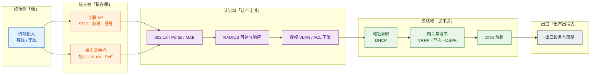
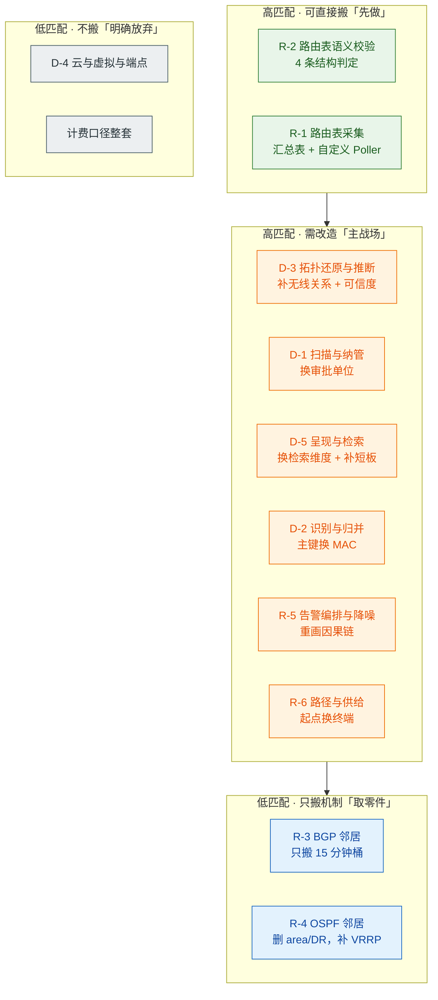
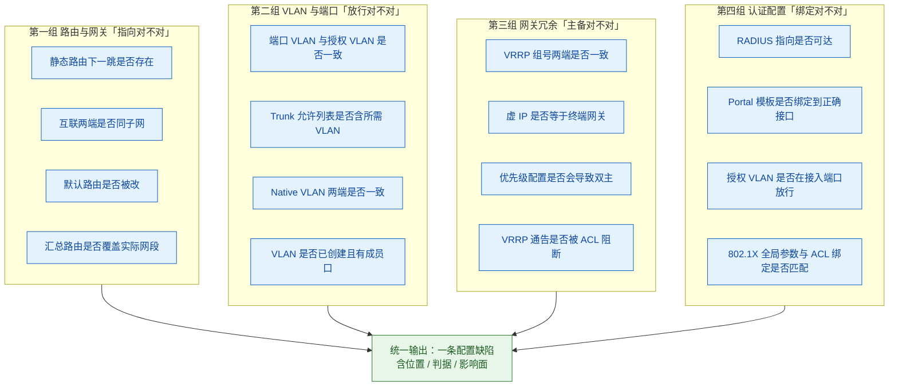
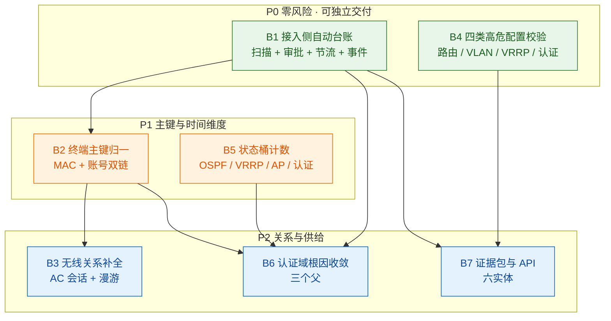

# Auvik 自动发现·拓扑可视化·路由协议监控 → 园区业务借鉴评估

> **评估对象**：Auvik 的两组能力族——**自动发现与拓扑可视化**（6 个大功能点 / 82 条小功能点 / 27 条功能级痛点）与**路由协议层监控**（6 个大功能点 / 77 条小功能点 / 24 条功能级痛点）。两组原始事实与全部可核查链接见两份源报告。
> **评估目的**：回答两个问题——① 这些功能特点对应园区的哪些问题特点；② 怎么借鉴才能解决园区的问题。
> **评估口径**：园区 = 企业/校园的**接入网**（AP、接入交换机、汇聚、出口、认证域），**不含**数据中心 fabric 与运营商骨干。所有「园区问题特点」均为**基于园区业务经验的判断**，不是外部调研结论；凡涉及 Auvik 侧的事实，均可回溯到源报告的具体章节，本文不做二次发挥。

---

# 0 结论先行

**一句话**：这两组能力**值得借鉴的不是功能清单，而是三条加工链**——「扫描 → 识别 → 连接」的设备事实链、「表 → 状态 → 告警」的协议观测链、「拓扑 → 父节点 → 抑制」的降噪链。**功能大半要改，链条全部可搬。**

**三个必须先立的判断**（后文全部论证都挂在这三条上）：

| # | 判断 | 含义 |
|---|---|---|
| **1** | **园区的拓扑主体不是「设备-设备」，而是「终端-接入点」** | Auvik 的图节点是设备、边是物理/逻辑连接；园区排障要回答的是「这个人现在接在哪、卡在哪一段」。直接搬会得到一张**漂亮但用不上的设备图** |
| **2** | **园区的高价值区不在 BGP，在「配置语义校验 + 状态桶计数」** | Auvik 最亮的是 BGP 邻居监控（16 条小功能点），但园区几乎不跑 BGP；真正能立刻见效的是它的 **Route Not Used / Different Subnets 判定逻辑**与 **15 分钟桶计数机制** |
| **3** | **园区的降噪因果链与 Auvik 完全不同，必须重画** | Auvik 只做「父设备离线 → 下游离线告警抑制」；园区的噪声主源是**认证失败风暴、AP 反复上下线、PoE 异常**，这三条都不在 Auvik 的抑制范围内 |

**七个借鉴件与优先级**（详见第 3 章）：

| 优先级 | 借鉴件 | 一句话 | 依赖 |
|---|---|---|---|
| **P0** | **B1 接入侧自动台账** | 把「扫描 + 审批制 + 三层节流 + 新设备事件」搬成园区资产底座 | 无 |
| **P0** | **B4 园区四类高危配置校验** | 复用 Auvik 的「结构一致性检查器」逻辑，扩展到 VLAN / VRRP / 认证 | 无（可独立交付） |
| **P1** | **B2 终端主键归一** | 把「设备身份归并」的主键从 OID 换成 MAC | B1 |
| **P1** | **B5 状态桶计数与历史窗口** | 把 BGP 的 15 分钟桶机制搬到 OSPF / VRRP / AP 在线率 | 无 |
| **P2** | **B3 无线关系补全** | 补 Auvik 的无线盲区：AP-客户端关联必须从 AC 取 | B1、B2 |
| **P2** | **B6 认证域根因收敛** | 把「父子抑制」改造成「认证链路收敛」 | B1、B2 |
| **P2** | **B7 证据包与对外供给** | 导出 + 自建 API（Auvik 自己也没有路由/拓扑 API） | B1、B4 |

**一条最重要的反面提醒**：Auvik 有两个**明确的短板**恰恰是园区的**刚需**——**不支持自定义看板**（园区角色多：网络/安全/后勤/外包，必须分角色视图）、**导出内容 = 当前屏幕所见**（园区审计与验收需要完整清单，不是截图）。这两处**不能学**，学了就是把缺陷一起搬进来。

---

# 1 判据：园区问题特点（先立标尺）

不先立标尺就做映射，结果一定是「Auvik 有的都说好」。本章先回答「园区到底难在哪」，第 2 章的映射才有判据。

## 1.1 园区与 Auvik 原生场景的六条结构性差异

Auvik 的主力场景是 **MSP 托管的企业网 / 多站点网络**——设备可管、变更低频、有 NOC 值守、按设备计费。园区与它在这六条上系统性不同，**每一条都直接决定某个能力能不能搬**。

| # | 维度 | Auvik 原生场景 | 园区实际 | 对借鉴的影响 |
|---|---|---|---|---|
| **1** | **计费模型** | 按**纳管设备数**计费，扫多扫少 = 账单多少 | 设备**买断制**，软件随设备交付 | Auvik 的「计费口径前置 / 计费与纳管解耦 / 免费设备类别」整套逻辑**不适用**，直接删 |
| **2** | **拓扑主体** | 设备与设备之间的**物理/逻辑连接** | **终端 ↔ 接入点 ↔ 网关**的**会话关系** | 拓扑推断的五类数据源（ARP/FDB/IP/VLAN/LLDP）**方法可搬**，但建模对象要换，节点必须含终端 |
| **3** | **协议栈重心** | 三层为主：BGP（多出口/运营商）、OSPF | **二层 + 认证（802.1X / Portal / MAB）+ 静态路由 + 少量 OSPF + VRRP** | **BGP 邻居监控价值极低**；OSPF 邻居有价值但要补 VRRP；路由表语义校验价值**最高** |
| **4** | **设备质量** | 企业级可管设备为主，SNMP/CLI 齐全 | 接入层大量**廉价、哑、不跑 LLDP** 的交换机；AP 只暴露有限指标 | 拓扑推断在园区**天然残缺**，必须显式建模「不知道」，不能假装知道 |
| **5** | **变更频率** | 周/月级，有计划窗口 | **日级**，且大量由**外包施工**执行，配置漂移常态化 | Auvik「图悄悄失效不报警」的缺点在园区被**放大数倍**；必须有「图可信度」指标 |
| **6** | **值守模式** | NOC 有人盯屏 | **无人值守**（夜间/假期/分校區），告警是唯一感知手段 | 告警质量 >> 告警数量；「抑制」比「聚合」更重要 |

> **这六条的用法**：第 2 章每个能力项都要过一遍这六条，任何一条判「不成立」，该能力项就进入「不可搬」或「需改造」。

## 1.2 园区的八个问题特点

> **口径声明**：以下八条是**园区业务的共性特征**，用于给功能找落点；不是统计结论，也不替代具体客户的工单分布。凡引用到具体机制时，本文只引用源报告的 A 级事实。

| 编号 | 园区问题特点 | 具体表现 | 主要损失类别 |
|---|---|---|---|
| **A1** | **故障高频、短时、自愈** | 用户报障时现象往往已消失；「现在看是好的」是常态 | 时间、人 |
| **A2** | **一半问题在认证与策略，不在转发面** | 关联上 AP 但认证不过、认证过但授权 VLAN 错、Portal 跳转失败 | 时间、组织 |
| **A3** | **终端是一等公民，设备只是通道** | 同一句「上不了网」，可能落在终端、AP、接入、网关、DHCP、DNS、出口任一段 | 时间、组织 |
| **A4** | **接入层设备廉价、哑、不跑 LLDP** | 拓扑推断缺关键边；低端交换机连 SNMP 都不全 | 时间 |
| **A5** | **无线侧无邻居协议，关系不可推断** | AP 与客户端之间没有 LLDP/CDP；关联关系只在 AC/云管里 | 时间、人 |
| **A6** | **变更频繁、外包施工、配置漂移** | 同一栋楼三个施工队，VLAN/ACL/认证模板各改一版 | 组织、合规 |
| **A7** | **无人值守，告警是唯一感知手段** | 夜间 AP 批量掉线无人知；次日投诉才知道 | 时间、合规 |
| **A8** | **多代际设备混杂，固件能力参差** | 老接入 + 新 AP 共存；同一功能在不同固件上字段不同 | 时间、钱 |

**这八条与两份源报告的对应关系（一眼版）**：

| 园区特点 | 最相关的 Auvik 能力 |
|---|---|
| A1 高频短时自愈 | 状态桶计数（R-3 / R-4）、历史窗口 |
| A2 认证与策略为主 | **无对应能力**（Auvik 完全不做认证）→ 必须自研，仅「拓扑降噪」可借骨架 |
| A3 终端为一等公民 | 设备识别与身份归并（D-2）→ 主键需换 |
| A4 哑设备多 | 拓扑还原与连接推断（D-3）→ 必须建模「不确定」 |
| A5 无线关系不可推断 | **无对应能力**（Auvik 不建模 AP-客户端）→ 必须自研 |
| A6 变更频繁 | 路由表语义校验（R-2）、新设备发现告警（D-1） |
| A7 无人值守 | 拓扑降噪（D-6）、告警编排（R-5） |
| A8 多代际混杂 | 识别指纹库（D-2）、自定义 SNMP Poller（R-1） |

> **注意 A2 与 A5 两行是「无对应能力」**——这不是遗漏，是结论：**园区最痛的两件事，Auvik 一件都没做**。这两处只能自研，且必须自研，否则借鉴完仍然解决不了园区的核心问题。

## 1.3 园区「上不了网」的七段分解链

园区排障的难点不在单点，而在**一句话要拆成七段**。这张图是后文所有「借鉴件」的落点坐标系。

> **这张图的三个用法**：
> 1. **定位**：任何一个「上不了网」的报障，先确定卡在第几段——这是园区版的「拓扑定位」。
> 2. **判能力覆盖**：Auvik 的两组能力覆盖的是 **A2（部分）/ N2（全部）/ O1（部分）**；**A1、U1–U3、N1、N3 基本空白**。这就是为什么「照搬 Auvik 解不了园区问题」。
> 3. **定借鉴顺序**：先补覆盖度最高的段（N2 路由与网关），再补终端归属（A1/A2），最后才做跨段收敛。

## 1.4 一条准入判据：什么才算「园区可借鉴」

任何一条 Auvik 能力，必须同时通过三问才进入「可搬」：

1. **对象问**：它处理的对象在园区**存在**吗？（例：BGP 邻居——只在多出口场景存在，园区多数不存在）
2. **数据问**：它依赖的数据源在园区**拿得到**吗？（例：LLDP 邻居——接入层哑设备拿不到）
3. **价值问**：它解决的痛，在园区的**损失类别**里排得上前三吗？（例：计费口径——园区买断制，无此痛）

三问有一问答「否」，就进入**需改造**或**不可搬**。第 2 章的全部判定都按这三问执行。

---

# 2 第一问：功能特点 ↔ 园区问题特点

本章把两组共 **12 个能力项**逐条过一遍。每个能力项给四列：**Auvik 解决的痛 → 园区对应的问题 → 匹配度 → 判定（可搬 / 需改造 / 不可搬）**。

> **匹配度定义**：**高** = 问题形态几乎同构，机制可直接搬；**中** = 问题存在但落点不同，需改对象或改数据源；**低** = 问题在园区弱存在或不存在。

## 2.1 自动发现与拓扑可视化：六组能力的映射

### D-1 网络自动扫描与设备纳管（扫得全）

| Auvik 解决的痛 | 园区对应的问题 | 匹配度 |
|---|---|---|
| 接手陌生网络，第一周全花在「把网络誊一遍」 | 新校区/新楼栋交付，几百台 AP 与接入交换机靠 Excel 台账，摸底要两周 | **高** |
| 规模一大，陷入「不敢扫」与「不能不扫」之间 | 园区核心/汇聚是生产网，白天全量扫描会触发 IDS 与 CPU 告警；不扫又不知道有什么 | **高** |
| 设备默默上线，没有任何人被告知 | 私接路由器、随身 WiFi、施工队临时交换机——园区是重灾区，比办公网严重得多 | **高** |
| 为多少台设备付费，签约前说不清 | 园区买断制，无按设备计费 | **低** |
| 误扫进来的东西删不掉，删了还会回来 | 园区同样存在：错误网段扫进打印机/IoT，删了下一轮又回来 | **中** |

**判定：需改造（主体可搬，计费部分删除）**
- 可搬：**扫描 + 网络审批制**（先给候选网段，人批准后才扫）、**三层节流**（面/频/速）、**新设备发现事件化**、**Delete 与 Exclude 语义分离**。
- 删除：计费口径、免费设备类别、按设备计费的对账视图。
- 改造：**审批单位从「网段」改为「楼栋/楼层」**——园区的网段归属由楼栋决定，运维脑子里的组织单元是「3 号楼 4 层」，不是 `10.20.34.0/24`。

### D-2 设备识别与身份归并（认得准）

| Auvik 解决的痛 | 园区对应的问题 | 匹配度 |
|---|---|---|
| 设备是「认错」的，后面全跟着错 | 老接入交换机型号识别错 → 拉不到指标 → 该楼层「瞎了」 | **高** |
| 一台设备在系统里变成三台，或者三台合成一台 | 一台 AP 有管理 IP + CAPWAP 地址；一台终端有 IPv4/IPv6/多 SSID 会话 | **高** |
| 识别错会连带算错钱 | 园区无此痛（不计费），但**识别错会连带算错「覆盖率」** | **低→中**（换了个落点） |
| 认不出来的设备，就没法交代 | 哑终端（打印机、摄像头、IoT）认不出来，台账永远不全 | **高** |

**判定：需改造（主键必须换）**
- 可搬：**以指纹为核心的识别库 + 持续扩库**、**consolidation 归并引擎**、**未识别仍可见 + 人工重分类**。
- 改造：**归并主键从「OID/序列号」扩展为「MAC 优先、序列号兜底」**——园区要回答的是「这个人在哪」，人是靠 MAC 与账号识别的，不是靠 OID。
- 删除：分类与计费状态分离（无计费）。

### D-3 拓扑还原与连接推断（连得对）

| Auvik 解决的痛 | 园区对应的问题 | 匹配度 |
|---|---|---|
| 图不准，而且不知道该不该信 | 园区图更不准：哑接入不跑 LLDP，无线段完全缺失 | **高**（但难度更高） |
| 图上有物理上不存在的连线，排障被带偏 | 园区常见：AP 上联口与接入端口对不上，图上画出「幽灵链路」 | **高** |
| 跨 VLAN、跨网段的部分最看不清 | 园区正是三层到接入（每楼栋一个三层网关），这段天然看不清 | **高** |
| 图会「悄悄失效」，而且不报警 | 园区变更频繁，图失效速度是 Auvik 场景的数倍 | **高** |
| 想改却只能一台台改，改完还可能被覆盖 | 园区同样：人工修正的连接关系，下次扫描被覆盖 | **中** |

**判定：需改造（方法全搬，对象必须扩）**
- 可搬：**多源交叉（ARP / FDB / IP / VLAN / LLDP）**、**把「不确定」显式画进图里**（这条是 Auvik 最值得学的一条设计）、**把「图为什么会变差」写成归因清单**、**人工修正路径**。
- 改造：**必须补「AP ↔ 客户端」关系**——Auvik 完全不建模无线关联，而这是园区排障的第一现场。数据源不在设备侧，在 **AC / 云管**。
- 改造：**把「图可信度」做成一级指标**（哪些边有 LLDP 证据、哪些是 FDB 推断、哪些是人工补录），而不是藏在图例里。

### D-4 云 / 虚拟 / 端点的纳入（纳得广）

| Auvik 解决的痛 | 园区对应的问题 | 匹配度 |
|---|---|---|
| 本地看得见，云端看不见 | 园区**不用 Meraki / Mist**，无此场景 | **低** |
| 「这台虚拟机跑在哪台宿主上」，只能靠问人 | 虚拟化在数据中心侧，不在园区接入侧 | **低** |
| 端点和个人设备接进来，没人管也没人知道 | 园区对应的是**手机 / IoT / 哑终端**，不是 Windows PC，**没有 WMI** | **中**（问题同构，手段不同） |
| 云设备的「在线状态」语义不一样，容易误判 | 园区若接云管 AP，同样存在「云在线 ≠ 本地可达」 | **中** |

**判定：不可搬（能力本身），但「补位层」思想可搬**
- 不搬：Meraki/Mist/Datto 云控集成、VMware/Hyper-V、WMI 端点定位。
- 可搬的**思想**：Auvik 把 D-4 单列为「扫描器够不到的地方的补位层」。园区的补位对象是**无线客户端、IoT、哑终端**——它们同样「扫描器够不到」，必须另设通道（AC 会话表、DHCP 租约、认证日志）。

### D-5 拓扑图呈现与检索交付（看得清）

| Auvik 解决的痛 | 园区对应的问题 | 匹配度 |
|---|---|---|
| 图太大，打不开 | 一个校区几千台 AP + 上千台接入，图必然打不开 | **高** |
| 图上有八百个点，找不到我要的那一个 | 园区是**按「人/房间/楼栋」找**，不是按 IP 找——检索维度完全不同 | **高**（维度要换） |
| 这张图交不出去 | 验收、审计、交接都要一张能交出去的图 | **高** |
| 每个人要看的不是同一张图，但没人能各看各的 | 园区角色更多：网络/安全/后勤/外包/校方管理，**比 Auvik 场景更需要分角色视图** | **高**（Auvik 此处是短板） |
| 盘点与对账，最后都落在人工拼 Excel 上 | 园区资产盘点同样靠拼表 | **高** |

**判定：需改造，且要**反向补齐 Auvik 的短板**
- 可搬：**渲染性能工程（拆等待、分批推、减场景）**、**检索优先于浏览**、**多格式导出**、**汇总清单与报表**。
- **不能学**：`不支持自定义看板`（改用「分级预置视图 + 过滤」）——园区角色多，预置视图不够用；`导出 = 当前屏幕所见`——园区审计要完整清单。
- 改造：**检索维度从「IP / 设备名」改为「楼栋 / 楼层 / 房间 / 人 / MAC」**。这是园区版最容易被忽略、但最影响可用性的一处。

### D-6 拓扑驱动的降噪与对外供给（用得上）

| Auvik 解决的痛 | 园区对应的问题 | 匹配度 |
|---|---|---|
| 上游一挂，下游三百条告警 | 园区更严重：一台汇聚挂 → 几十台 AP + 几百客户端 | **高** |
| 排障要人肉沿图往下点 | 园区同样，但要沿「认证链」往下点，不是沿设备 | **中** |
| 图和外部系统对不上 | 园区多数**没有 CMDB**，对应的是资产系统 / 工单系统 | **中**（对象要换） |
| 想自动化，却取不到拓扑 | 园区若要与自研 APM / AI 助手打通，同样缺拓扑 API | **高** |

**判定：需改造**
- 可搬：**把拓扑当作告警的「父节点关系表」**（这条是核心）、**拓扑直接算路径**、**开放的清单类 API**。
- 改造：**父子关系表要扩成「依赖关系表」**——园区的一条告警可能有三个「父」：物理父（上游设备）、认证父（RADIUS）、服务父（DHCP/DNS）。Auvik 只有物理父。
- 必须自建：**拓扑/连接专用 API**（Auvik 自己也没有，外部系统「拿得到设备清单，拿不到谁连着谁」）。

## 2.2 路由协议监控：六组能力的映射

### R-1 路由表采集与三层事实底座（采得全）

| Auvik 解决的痛 | 园区对应的问题 | 匹配度 |
|---|---|---|
| 确认一条路由，就要登一次设备 | 园区核心/汇聚几十台三层设备，查一条明细路由要逐台登 | **高** |
| 路由事实装在老工程师脑子里，人一走就断档 | 园区同样：哪条静态路由指向哪台出口，只有一两个人清楚 | **高** |
| 厂商私有 OID 采不到，专用监控又买不起 | 园区私有 MIB 更多（厂商自有 AP/AC 指标），商用监控按设备收费极贵 | **高** |
| 跨站点、跨团队没有同一份路由事实 | 多校区/多楼栋，路由口径各说各话 | **高** |

**判定：可搬（几乎不改）**
- 这是**整份路由报告里最可直接搬的一组**：站点级汇总表、设备级明细、统一表结构 + 筛选 + 导出、**自定义 SNMP Poller**（任意 OID + 输出解析 + 告警联动）。
- 对锐捷尤其成立：原厂可以直接用私有 MIB，不需要「自定义 Poller」这种用户侧兜底手段，能力更强。

### R-2 路由表语义校验（查得准）

| Auvik 解决的痛 | 园区对应的问题 | 匹配度 |
|---|---|---|
| 路由配错了，没人发现，直到业务不通 | 园区静态路由多（到各 VLAN、到出口、到分校），配错率高且无人校验 | **高** |
| 下一跳指向一个不存在的地址，肉眼看不出来 | 园区常见：静态路由指向已下线的防火墙/出口设备 | **高** |
| 互联两端的掩码/子网不一致，长期潜伏 | 园区常见：核心-汇聚互联、出口-防火墙互联，两端掩码不一致 | **高** |
| 默认路由被谁改了、什么时候改的，说不清 | 园区默认路由是重大变更对象，往往没有审计留痕 | **高** |

**判定：可搬（**本报告最高性价比的一组**）**
- 四条判定逻辑（Route Not Used / Non-Routable IP / Different Subnets / Default Route Change）**可以直接复用**，因为它们的判据是**结构性的、与协议无关**——「下一跳主机是否存在」「两端是否同子网」在园区同样是硬判据。
- 但要注意源报告记录的一处硬事实：**这四条只出现在 Alerts v1 清单；Alerts v2 的预置清单只剩 2 条协议邻居级告警，触发条件穷举页里没有任何 route/subnet 类型**。也就是说 Auvik **自己在往后退**。这反而说明：这块**它没做透**，是留给自研的空间。

### R-3 BGP 邻居状态监控（盯得住）

| Auvik 解决的痛 | 园区对应的问题 | 匹配度 |
|---|---|---|
| peer 掉没掉，得靠用户先报障 | 园区多数**不跑 BGP**（除非多出口对接运营商） | **低** |
| 抖过又恢复了，打开看是好的 | 园区同样的「抖动不可见」问题，但载体是 OSPF / VRRP / AP，不是 BGP | **中**（痛同构，对象不同） |
| ASN / router ID / peer IP 要逐条对 | 园区无此场景 | **低** |
| 跨站点、跨运营商时，谁和谁建了邻接，没人说得清 | 仅多出口场景成立 | **低** |

**判定：能力不可搬，机制必须搬**
- 不搬：BGP4-MIB 轮询、4 家厂商适配、peer/ASN 字段。
- **必须搬的机制**：**15 分钟桶的状态变化计数**（`connectionStateChanges15Min`）+ **30 天历史窗口** + **结构化标识字段进告警消息**。这三条是园区最缺的「抖动可证」能力，只是载体要从 BGP 换成 OSPF / VRRP / AP 在线率。
- 源报告的一条关键结论直接适用：**「5 分钟持续」与「15 分钟桶计数」是两个不同时间尺度，Auvik 刻意不合并**——园区照搬这个分离，才能同时回答「现在是不是一直坏」与「最近是不是老坏」。

### R-4 OSPF 邻居状态监控（看得细）

| Auvik 解决的痛 | 园区对应的问题 | 匹配度 |
|---|---|---|
| 邻接卡在中间态，看不出卡在哪一相 | 园区核心-汇聚-出口常跑 OSPF；MTU 不一致、认证不匹配、网络类型不匹配导致的卡中间态非常常见 | **高** |
| 状态反复变化没有计数，说不清是不是在抖 | 园区同样缺「抖动可证」 | **高** |
| area 与 DR 角色不匹配，跨区域问题归属不清 | 园区多为**单区域**，DR 意义小 | **低** |
| router ID 重复这种问题，人眼几乎发现不了 | 园区同样存在 router ID 重复（复制配置时最常见） | **中** |

**判定：需改造（保留状态与计数，删掉 area/DR，补 VRRP）**
- 保留：**状态字段 + 状态变化计数 + 距上次 Full 时长**（这三列对园区完全成立）。
- 降级：area ID 与 DR 角色（园区单区域为主，保留字段但不作为主判据）。
- **必须补**：**VRRP 主备状态**——园区三层网关普遍用 VRRP，而 Auvik **明确不支持 HSRP / VRRP**（源报告记录：全站检索 0 命中）。这是园区比 Auvik 原生场景**多出来的一段**。

### R-5 路由告警编排与拓扑降噪（报得准）

| Auvik 解决的痛 | 园区对应的问题 | 匹配度 |
|---|---|---|
| 买了一堆监控，关键的那一条告警偏偏要自己搭 | 园区同样：通用监控不覆盖「认证失败率」「AP 离线」「PoE 异常」 | **高** |
| 告警只说设备离线，不说哪个 peer，回登设备才知道 | 园区同样：告警只说「AP 离线」，不说「哪个 SSID / 哪个楼栋 / 影响多少终端」 | **高** |
| 核心一挂，下游全红，几百条告警里找不到根因 | 园区更严重，但噪声主源不同（认证风暴、AP 反复上下线、PoE） | **高**（机制）/ **低**（因果链） |
| 阈值怎么定全凭个人经验，换个值班就全变 | 园区同样 | **高** |

**判定：机制可搬，因果链必须重画**
- 可搬：**两条预置告警 + 可组合触发条件 + 结构化通知变量**（把身份写进消息）。
- **必须重画**：Auvik 的抑制只覆盖「**父设备离线 → 下游离线**」这一条链，源报告明确写了它**不覆盖协议邻居 down**（因为邻居 down 常先于设备离线，抑制会掩盖根因）。园区要补的因果链是：
  - 「**AC 离线 → 该 AC 下所有 AP 告警抑制**」
  - 「**RADIUS 不可达 → 全域认证失败告警收敛为一条**」
  - 「**汇聚离线 → 其下所有接入/AP 告警抑制**」（这条与 Auvik 同构，可直接搬）

### R-6 路径还原与对外供给（走得通）

| Auvik 解决的痛 | 园区对应的问题 | 匹配度 |
|---|---|---|
| 这条业务走哪条路，只能靠 traceroute 猜 | 园区路径是「终端 → AP → 接入 → 汇聚 → 核心 → 出口」，**起点是终端** | **高**（但 Auvik 只到设备） |
| 路径上的问题在谁的地盘，说不清 | 园区同样：卡在认证域还是网络域，跨团队扯皮 | **高** |
| 拿不出可交付的路由与邻居清单 | 园区验收/审计同样要清单 | **高** |
| 导出和 API 只能拿到一半，集成还得人肉搬 | 园区若接自研 APM / AI 助手，同样缺接口 | **高** |

**判定：需改造（思想可搬，现成能力不可搬）**
- 可搬：**「基于拓扑图算路径」而非「基于路由表算路径」** 这个选择——源报告确认 Northstar 走的是拓扑图，云控制器不参与。园区路径同样更适合从拓扑算，因为园区的「路径」含无线段，路由表根本表达不了。
- **必须扩**：路径**起点从「IP」改为「终端」**，且**必须包含无线段**（AP 关联、漫游）。
- **必须自建**：对外 API。源报告确认 Auvik **没有任何 routes / bgp / ospf / neighbor 端点**，只能导 xlsx。自研若不建 API，「AI 助手取数」这条路走不通。

## 2.3 匹配度总览

把 12 个能力项按「匹配度 × 可搬性」放到一张图上，可以直接看出投入次序。

| 象限 | 能力项 | 处理原则 |
|---|---|---|
| **Q1 可直接搬** | R-1、R-2 | 逻辑不改，换数据源即交付；**R-2 是零风险首选** |
| **Q2 需改造** | D-1、D-2、D-3、D-5、R-5、R-6 | 方法搬、对象换；**D-3 是难度最高但价值最大的一项** |
| **Q3 只取零件** | R-3、R-4 | 不要整套能力，只取「桶计数 + 状态字段 + 历史窗口」 |
| **Q4 明确放弃** | D-4、计费口径 | 搬了只会增加维护成本 |

## 2.4 三处反直觉：Auvik 的短板恰是园区的刚需

这三处是本次评估最值得记住的部分——**照着功能清单抄，会把短板一起抄进来**。

| # | Auvik 的短板（源报告已确认） | 为什么在园区是刚需 | 正确做法 |
|---|---|---|---|
| **1** | **不支持自定义看板、不支持计划报表**，用「分级预置视图 + 过滤」代替 | 园区角色比 Auvik 场景更多：网络运维、安全、后勤、外包施工、校方管理，**五类人要看五种图** | 保留「预置视图」作为默认，但**必须开放自定义视图 + 定时报表** |
| **2** | **导出内容 = 当前屏幕所见**，大网会被截断 | 园区审计与验收要的是**完整清单**，截图式导出会被退回重做 | 导出必须**与视图解耦**：导「全量数据」，不是导「当前画面」 |
| **3** | **没有任何路由 / 拓扑专用 API**，「图能出门，关系不能直接出门」 | 园区要接自研 APM 与 AI 助手，**AI 取数必须走 API**；没有 API 就没有 AI 助手 | **API 与 UI 同批设计**，而不是「先做 UI，API 以后再说」（源报告记录：Auvik 能力进 API 的顺序远落后于进 UI） |

> **一句总结**：Auvik 的这两个短板都源于同一个设计取向——**它优先服务「人看图」，而不是「系统取数」**。园区（尤其要接 AI 助手）必须反过来：**先保证数据能被系统消费，再考虑人怎么看**。

---

# 3 第二问：如何借鉴才能解决园区的问题

本章给出 **7 个借鉴件**。每个借鉴件统一四段：**① Auvik 的机制（可回溯到源报告章节）→ ② 园区为什么需要 → ③ 怎么改造 → ④ 交付物与边界**。

> **读法**：如果你只关心「先做什么」，直接看 3.1 与 3.4（两个 P0）；如果你关心「和别人已经做过的东西有什么不同」，看第 6 章。

## 3.1 B1 接入侧自动台账（借鉴 D-1 扫描与纳管）

### ① Auvik 的机制

三件事构成了它的扫描骨架（详见《自动发现》第 2 章 K.3）：

1. **网络审批制**：扫描不是「给个网段就扫」，而是**先产出候选网络，由人批准后才纳入扫描范围**。这把「误扫生产网」的风险从「事后补救」变成「事前阻断」。
2. **三层节流**：同时约束 **面**（并发扫描的网段数）、**频**（同一网段的扫描周期）、**速**（单轮扫描的目标数上限）。源报告记录的形态是「每 3 分钟一轮、每轮最多 15 个 /24」。
3. **新设备发现事件化**：把「设备上线」从「下次看图才知道」变成一条**可被告知的事件**（该告警默认关闭，需按需开启——这一点很重要，说明官方自己也知道全量开会吵）。

此外还有两条设计细节值得抄：**Delete 与 Exclude 语义分离**（删掉 vs 永不扫进来，是两件事）、**空子网降级**（连续无发现的网段降低扫描频率，代价是冷区设备发现延迟不封顶）。

### ② 园区为什么需要

对应 **A4（哑设备多）+ A6（变更频繁）+ A7（无人值守）**：

- 园区新楼栋交付时，台账来源是「施工队的 Excel + 老人的记忆」，**没有任何一份是扫描出来的**。
- 私接设备在园区是**结构性问题**（学生/员工私接路由器、随身 WiFi、施工队临时交换机），不是偶发事件。Auvik 的「新设备发现事件」直接对应这个痛点。
- 园区白天不能全量扫（会触发 IDS、拉高接入交换机 CPU），**三层节流是必须项，不是优化项**。

### ③ 怎么改造

| 改造点 | Auvik 原做法 | 园区做法 | 理由 |
|---|---|---|---|
| **审批单位** | 按网段（`/24`）批准 | **按「楼栋 / 楼层」批准**，网段作为附属信息 | 运维的组织单元是楼栋，不是 CIDR |
| **扫描时机** | 持续扫描（3 分钟一轮） | **分级时段**：办公时段只做轻量存活探测；全量端口/表项采集放在夜间窗口 | 园区是生产网，白天扫描的业务风险远高于 MSP 场景 |
| **新设备告警** | 默认关闭，按需开启 | **默认开启，但分级**：核心/汇聚区段立即告警；接入区段按日汇总 | 园区私接是常态，全关等于失明；全开等于噪声 |
| **Exclude 语义** | 支持（永不扫进来） | **必须保留，且要能按「设备类型」排除** | 园区有大量不该纳管的设备：打印机、门禁、摄像头、医疗设备 |
| **计费相关** | 计费口径、免费类别、对账视图 | **全部删除** | 园区买断制，无此模型 |

### ④ 交付物与边界

**交付物**：
- 一张**「应管 / 已管 / 未管」三态清单**——这是园区资产治理的起点，比「发现了几台设备」有用得多。
- 一条**新设备上线事件流**（含首次发现时间、接入位置、MAC、类型），可推给工单系统。

**边界**（继承 Auvik 的硬边界，园区同样成立）：
- **不响应 ICMP 的设备永远发现不了**——园区大量 IoT 设备禁 ping，这条边界会直接导致漏管。
- 被动扫描加不进来：Auvik 是**主动扫描**，不做流量旁路发现。园区若要覆盖禁 ping 设备，**必须另设通道**（DHCP 租约、认证日志、交换机 FDB），这已超出 Auvik 能力范围。

> **一句话**：B1 借的是「**审批制 + 三层节流 + 事件化**」这三个机制，不是它的扫描器实现。

## 3.2 B2 终端主键归一（借鉴 D-2 识别与身份归并）

### ① Auvik 的机制

- **以 OID 指纹为核心的识别库**，靠持续扩库覆盖型号（厂商自述 15,000 类型 / 700+ 厂商）。
- **consolidation 引擎**：把「同一台物理设备的多条记录」合并成一个实体——典型场景是**多 IP、HA 主备、设备换新**。
- **人工兜底**：认不出来的，允许人工 link IP、人工重分类，且**未识别设备仍然可见**（不隐藏、不丢弃）。
- 一条重要的设计原则：**把「设备分类」与「计费状态」显式分离**——分类错了不至于算错钱。

### ② 园区为什么需要

对应 **A3（终端是一等公民）+ A8（多代际混杂）**：

- 园区排障的第一句话是「**这个人在哪**」，而不是「这台设备是什么型号」。若身份主键仍是设备 OID，系统永远回答不了这个问题。
- 一台终端在园区会产生**多条身份记录**：有线会话、无线会话、多 SSID、IPv4/IPv6、认证账号、DHCP 租约。**不归并就是一堆碎片**。
- 多代际设备（老接入 + 新 AP）导致同一指标在不同固件上字段不同，**识别错就连带拉不到指标**。

### ③ 怎么改造

**主键体系要重建**，这是与 Auvik 最大的分歧：

| 对象 | Auvik 主键 | 园区主键 | 说明 |
|---|---|---|---|
| **网络设备** | OID / 序列号 | **序列号优先，MAC 兜底** | 序列号跨固件稳定；OID 只用于识别型号，不用于标识个体 |
| **终端** | 无此概念 | **MAC 为主键，认证账号为辅助键** | 同一 MAC 可能换账号（共享终端），同一账号可能多 MAC（一人多设备）——**两条链都要建，不能只留一条** |
| **AP** | 视为普通设备 | **序列号 + MAC + 所属 AC** 三元组 | AP 会漫游、会换 AC，只有三元组能稳定标识 |

**归并规则要显式化**（这是 Auvik 没做、园区必须做的一层）：

| 归并场景 | 判据 | 风险 |
|---|---|---|
| 一终端多 IP | 同 MAC、不同 IP、时间窗重叠 | 低（直接合） |
| 一终端多会话 | 同 MAC、不同 SSID/端口、时间窗重叠 | 低（保留多会话，归一到一实体） |
| 设备换新 | 同位置、同角色、序列号变 | **中**——可能是替换，也可能是新增；**必须人工确认，不能自动合** |
| MAC 随机化 | 同账号、MAC 每次不同 | **高**——手机隐私 MAC 会让「一终端」变成「N 终端」，**必须用账号兜底** |

### ④ 交付物与边界

**交付物**：
- **终端身份主表**（MAC / 账号 / 首次出现 / 最近出现 / 归属人 / 归属位置）。
- **归并置信度字段**——每条归并给出依据（同 MAC / 同账号 / 人工确认），不允许「静默合并」。

**边界**：
- **MAC 随机化会击穿 MAC 主键**（iOS/Android 默认开启）。这不是可以回避的技术细节，是园区必须正面处理的现实：**MAC 主键只在「同一会话周期内」可靠**，跨周期必须靠账号。
- 哑终端（打印机、摄像头）**没有账号**，只能靠 MAC + 位置，识别率天然受限。

> **一句话**：B2 借的是「**归并引擎 + 未识别仍可见 + 置信度显式化**」这三个设计，主键必须自己重建。

## 3.3 B3 无线关系补全（补 Auvik 的空白）

### ① Auvik 的机制——以及它为什么在这里是空白

Auvik 的拓扑推断依赖五类**设备侧**数据：ARP 表、L2 转发表（FDB）、IP 分配、VLAN 关联、LLDP/CDP/FDP 邻居。

**这五类数据里，没有一类能表达「哪个客户端关联在哪个 AP 上」**——因为：
- AP 与客户端之间**没有邻居协议**（LLDP 是设备间的）；
- 客户端的 MAC 会出现在 AC 的会话表里，**但不出现在 AP 的 FDB 里**（无线不是二层转发）；
- Auvik 的 `D-4 云/虚拟/端点` 处理的是云控设备与虚拟机，**不处理无线客户端**。

所以这是一个**结构性空白**，不是「还没做」。（此判断为本文推导：源报告的五类推断数据源均不含无线关联，且 D-4 的补位对象是云控设备与虚拟机、不含无线客户端；两份源报告全文未见 AP-客户端关系的机制描述。）

### ② 园区为什么需要

对应 **A5（无线关系不可推断）+ A3（终端是一等公民）**：

- 园区接入以**无线为主**（具体占比因客户而异，本文不引用未经核实的比例）。**没有 AP-客户端关系，拓扑图在园区只覆盖了一半的接入面**。
- 「这个用户上不了网」的第一步是确认「他连在哪个 AP 上、信号如何、有没有漫游」——这一步 Auvik 帮不上。
- 反过来，**AP 故障的影响面**也只能靠这层关系算：「这台 AP 挂了影响多少人」。

### ③ 怎么改造

**数据源要换，且必须多源交叉**：

| 数据源 | 能拿到什么 | 局限 |
|---|---|---|
| **AC / 云管会话表** | 客户端 MAC ↔ AP ↔ SSID ↔ 频段 ↔ 信号 | 需要 AC 接口或云管 API；跨 AC 漫游要拼接 |
| **认证日志（RADIUS）** | 账号 ↔ MAC ↔ 接入设备 ↔ 授权结果 | 只有认证时刻的快照，不含实时信号 |
| **DHCP 租约** | MAC ↔ IP ↔ 租期 ↔ relay 地址 | relay 地址能反推接入网段，但精度到网段不到 AP |
| **交换机 FDB** | MAC ↔ 端口（有线侧） | 无线侧无效 |
| **AP 自身指标** | 关联数、信道、噪声 | 通常不含逐客户端明细 |

**改造要点**：
1. **主通道走 AC**，不试图从设备侧推断（推不出来）。
2. **把「无线段」画成一种新的边类型**——不是物理连接，是**关联关系**，且**有时效性**（关联会变）。图上要能区分「实线=物理连接」与「虚线=当前关联」。
3. **漫游要能被看见**：同一 MAC 在两个 AP 之间切换的时间序列，是园区排障的关键证据（对应 A1「高频短时自愈」）。

### ④ 交付物与边界

**交付物**：
- **「终端 → AP → 接入端口 → 网关」四段定位链**——这是园区版拓扑的核心查询，一条 SQL/一次点击就能出结果。
- **AP 影响面视图**：某 AP 离线时，受影响的终端清单（含历史关联）。

**边界**：
- 依赖 AC 接口能力。**AC 不提供的字段，系统里就不可能有**——这条与 Auvik 的「设备不响应就永远发现不了」是同一条硬边界，只是换了个位置。
- 关联关系是**快照**，不是历史全量。要做「漫游轨迹」，必须**自己按桶落库**（这就接到 B5 了）。

> **一句话**：B3 是**必须自研**的一块，Auvik 没有任何可借的实现；能借的只有它的「多源交叉 + 不确定性显式化」方法论。

## 3.4 B4 园区四类高危配置校验（借鉴 R-2 路由表语义校验）

### ① Auvik 的机制

四条判定的共同特征：**都是结构一致性检查，不依赖协议语义**。

| 告警 | 判定逻辑（源报告已核实的原文口径） | 为什么能成立 |
|---|---|---|
| **Route Not Used** | 遍历 SNMP 与 CLI 发现的所有路由，检查**下一跳主机是否真的存在于网络中** | 「指向一个不存在的地址」是硬错误，与路由协议无关 |
| **Non-Routable IP** | 检查路由的下一跳是否为**不可路由地址** | 同上 |
| **Different Subnets** | 检查**互联两端是否在同一子网** | 掩码/子网不匹配是结构性错误 |
| **Default Route Change** | 监控**默认路由的变更**，带前后值 | 「出口变了」是重大事件，只需比对 |

**这四条的价值不在「告警」，在于它定义了一类思路：把「配置对不对」变成「结构上自洽不自洽」。**

### ② 园区为什么需要

对应 **A6（变更频繁、外包施工、配置漂移）+ A2（认证与策略为主）**：

- 园区配置由**多个施工队**改，改完没人复核；配置漂移是常态而不是例外。
- 园区最痛的四类配置错误，**恰好都能用「结构一致性」判据检出**——因为它们都是「两边对不上」或「指向不存在的东西」。

### ③ 怎么改造：从「1 类」扩到「4 类 × N 条」

这是本次评估中**改造收益最高**的一项。园区版应做成四组校验规则：

**改造的三条原则**：

1. **判据必须是「可判定的」**——只做「A 与 B 是否一致」「X 指向的对象是否存在」这类**确定性判定**。凡需要「猜业务意图」的（如「这个 ACL 写得合不合理」）不做，否则误报会摧毁信任。这一点直接继承 Auvik 的克制。
2. **每条缺陷必须带影响面**——「3 号楼 4 层 12 端口授权 VLAN 未放行」比「发现 1 处 VLAN 不一致」有用十倍。
3. **校验要在变更后自动触发**，而不是定时全量扫——园区变更频繁，定时扫的滞后窗口太长。

**为什么第四组（认证）是园区独有的**：Auvik 完全不做认证，这一组没有任何可借实现。但它的**判定形式**（「绑定是否一致」「指向是否可达」）与前三组完全相同，所以可以直接套用同一套引擎。

### ④ 交付物与边界

**交付物**：
- **配置缺陷清单**（位置 / 判据 / 影响面 / 首次发现时间 / 是否已修复）。
- **变更后自动复核报告**——这是园区交付里最能体现价值的一份东西：**「你改完了，我告诉你有没有改错」**。

**边界**：
- 只能检**结构性错误**，检不出**策略性错误**（如「这条 ACL 拦错了人」）。这与 Auvik 的边界完全一致：**「发现不了路由都正确、只是策略选择错了」**。
- 依赖配置采集能力。**采不到配置的设备，一条都校验不了**——这是前置依赖，不是可选项。

> **一句话**：B4 借的是「**结构一致性检查器**」这个范式 + 四条现成判据，然后把它从「路由」扩到「VLAN / VRRP / 认证」。**这是整份评估里投入产出比最高的一项，且可以完全独立交付。**

## 3.5 B5 状态桶计数与历史窗口（借鉴 R-3 / R-4 的机制）

### ① Auvik 的机制

源报告记录了两个必须一起看的设计：

1. **15 分钟桶计数**（`connectionStateChanges15Min`）：不是「记录每次变化」，而是「**每 15 分钟统计一次变化次数**」。这同时解决了三件事——漏报（桶内有变化就计数）、噪声（不逐次告警）、存储（粒度固定）。
2. **两个时间尺度刻意不合并**：告警的「持续 5 分钟」回答「现在是不是一直坏」；「15 分钟桶计数」回答「最近是不是老坏」。**Auvik 没有把它们合成一个指标。**

### ② 园区为什么需要

对应 **A1（高频短时自愈）+ A7（无人值守）**：

- 园区最典型的困境是「**报障时已经好了**」。没有计数，「抖过」这件事永远无法证明。
- 无人值守时段的变化，只能靠事后看计数发现。

### ③ 怎么改造：把桶计数从「协议」扩到「园区五类对象」

| 对象 | 计数指标 | 桶宽建议 | 用途 |
|---|---|---|---|
| **OSPF 邻居** | 状态变化次数 | 15 分钟（可直接沿用） | 「昨晚抖了几次」 |
| **VRRP 主备** | 主备切换次数 | 15 分钟 | 「网关为什么总切」 |
| **AP** | 上下线次数 | 15 分钟 | 「这台 AP 是不是在反复重启」 |
| **接入端口** | up/down 次数 | 15 分钟 | 「这个口是不是接触不良」 |
| **认证** | 失败次数 / 失败率 | **5 分钟**（认证是高频事件，15 分钟太粗） | 「是不是认证风暴」 |

**改造要点**：
1. **桶宽要按对象分档**，不能全用 15 分钟——Auvik 只用一种桶宽是因为它只监控协议邻居；园区的对象时间尺度差异很大（认证秒级、AP 分钟级）。
2. **必须同时保留「原始事件」与「桶计数」**——桶计数用于判定与告警，原始事件用于事后取证。**只留桶计数会丢掉排障细节**。
3. **历史窗口要显式声明**。源报告记录了一处重要事实：**BGP 的 30 天历史只出现在 Beta 公告里，正式指南未复述**——这说明「历史窗口」在厂商侧是个模糊承诺。园区必须把窗口写进产品口径，不能含糊。

### ④ 交付物与边界

**交付物**：
- **抖动排行表**（按对象类型排序，含「近 24h / 7d / 30d」三档）。
- **「抖过」证据链**：从计数下钻到原始事件，再下钻到当时的邻居/端口状态。

**边界**：
- 计数精度**受采样周期约束**。源报告的硬事实：Auvik **未公开 BGP/OSPF 的轮询间隔**，只有一个 15 分钟聚合口径。这意味着**若采样间隔 > 抖动持续时长，短抖动会被漏计**。园区必须在 UI 上标注「本表的抖动分辨率 = max(桶宽, 采样周期)」，否则会给出虚假的精确感。

> **一句话**：B5 是**最便宜、见效最快**的一项——不需要新数据源，只需要在已有采集上加一层桶聚合。

## 3.6 B6 认证域根因收敛（改造 R-5 的降噪链）

### ① Auvik 的机制与它的边界

- **拓扑感知抑制**：把拓扑当作**告警的父节点关系表**——父设备离线时，抑制其下游的离线告警。
- 源报告明确记录了一条关键边界：**它只覆盖「父设备离线 → 下游离线」这一条因果链，不覆盖协议邻居 down**。理由也记录得很清楚：**邻居 down 常先于设备离线，抑制会掩盖根因**。
- 另一条：**告警消息必须带结构化身份**（peer IP / router ID 进消息体），否则收到告警还要回登设备确认。

### ② 园区为什么需要

对应 **A2（认证与策略为主）+ A7（无人值守）**：

- 园区最大的告警噪声源不是设备层级，是**认证域**：RADIUS 一挂，全域认证失败；AC 一挂，其下所有 AP 报离线。
- 这类噪声的特点是**一个根因产生成百上千条子告警**，且**子告警分属不同团队**（网络组看 AP、安全组看认证），互相不知道对方也在响。

### ③ 怎么改造：从「一个父」扩到「三个父」

Auvik 的父子关系只有**物理父**。园区的依赖关系必须显式建三张表：

| 父类型 | 关系 | 失效表现 | 收敛规则 |
|---|---|---|---|
| **物理父** | 上游设备 → 下游设备 | 汇聚离线 → 其下接入与 AP 告警 | 抑制下游「离线」类告警（**与 Auvik 同构，可直接搬**） |
| **认证父** | RADIUS / AC → 全域认证与会话 | RADIUS 不可达 → 全域认证失败 | 收敛为**一条**「认证域故障」，子告警折叠 |
| **服务父** | DHCP / DNS → 网段内终端 | DHCP 池耗尽 → 整网段终端拿不到地址 | 收敛为「网段级地址服务故障」 |

**三条必须遵守的规则**（这是从 Auvik 的边界教训里直接推出来的）：

1. **「先于父失效」的子告警不能抑制**。Auvik 不抑制邻居 down 就是因为这个。园区同理：**认证失败可能在 RADIUS 挂之前就出现**（配置错误），不能一律折叠。
2. **抑制必须可展开**。折叠成一条之后，必须能一键展开看全部子告警——否则根因判断会变成「黑箱」。
3. **告警消息必须带影响面**：「AP 离线」要变成「AP 离线，影响 23 个终端，位于 3 号楼 4 层」。

### ④ 交付物与边界

**交付物**：
- **依赖关系表**（物理 / 认证 / 服务三列），这是整个降噪的底座。
- **告警收敛视图**：一条根因 + 折叠的 N 条子告警 + 影响面。

**边界**：
- 收敛的准确性**完全取决于依赖关系表的准确性**。关系错了，收敛就是「把不相干的告警压掉」，比不收敛更危险。所以 **B6 必须排在 B1/B2 之后**（先有可信的拓扑与身份，才谈得上依赖关系）。
- 不能做「根因判断」。这与 Auvik 的边界一致：**它能把状态变成通知，不能把通知变成根因结论**。AI 助手要做的正是在这之上加一层判断，而不是替代这一层。

> **一句话**：B6 借的是「**拓扑即父节点表**」这个骨架，「父」的定义必须自己重写——园区有三个父。

## 3.7 B7 证据包与对外供给（改造 D-6 / R-6）

### ① Auvik 的机制与它的短板

- **导出**：多格式（PDF / SVG / VSDX），但**导出内容 = 当前屏幕可见范围**，大网会被截断。
- **同步**：CMDB（ServiceNow）连接器，把设备清单同步出去。
- **API**：有 Inventory / Network / Interface 三类**清单** API；**没有任何拓扑/连接专用端点**，也**没有任何 routes / bgp / ospf / neighbor 端点**。
- 源报告的一句结论最传神：**「图能出门，关系不能直接出门」**。

### ② 园区为什么需要

对应 **A6（变更频繁）+ A7（无人值守）+ 验收/审计场景**：

- 园区验收要一份**完整清单**，不是截图。
- 园区要接自研 APM 与 AI 助手，**AI 取数只能走 API**——这是本文与「纯功能借鉴」最大的分歧点。

### ③ 怎么改造：三个出口，一个都不能少

| 出口 | 面向谁 | 内容 | 与 Auvik 的差异 |
|---|---|---|---|
| **完整导出** | 人（验收/审计/交接） | 全量清单（设备/连接/终端/配置缺陷），**与当前视图无关** | **反向补齐 Auvik 短板**：导出与视图解耦 |
| **事件流** | 系统（工单/告警平台） | 设备上线、连接变化、配置缺陷新增/修复 | 比 Auvik 的 Webhook 更细，需含「变化前/后」 |
| **查询 API** | 系统（自研 APM / AI 助手） | 设备、连接、终端、邻居、路由、配置缺陷**六类实体** | **Auvik 完全没有**，这是自研的差异化 |

**改造要点**：
1. **API 与 UI 同批设计**。源报告记录了一条演进规律：**Auvik 的能力进 API 的顺序远落后于进 UI**。园区若复制这条路，AI 助手会永远缺数据。
2. **API 返回值必须带「数据质量」字段**——覆盖度、置信度、采样周期。这与前文 B2 的「归并置信度」是同一件事的两个面：**系统消费数据时，必须知道这份数据有多可信**。
3. **导出必须可分页/分片**。园区设备量大，一次性导出会 OOM。

### ④ 交付物与边界

**交付物**：
- 一份**可交付的证据包**：当前网络清单 + 连接关系 + 配置缺陷 + 数据质量声明。
- 一套**六实体 API**（设备 / 连接 / 终端 / 邻居 / 路由 / 配置缺陷）。

**边界**：
- **导出的是「事实」，不是「结论」**。证据包里不应包含「根因判断」——那是 AI 助手的职责，混进证据包会让审计方无法区分事实与推断。
- 数据质量声明不能省。**没有质量声明的清单，在审计场景里等同于没有清单。**

> **一句话**：B7 是唯一一项「Auvik 做得不够、我们必须做得更好」的借鉴件——因为它决定了这套东西能不能被 AI 助手消费。

---

# 4 明确不借鉴的部分

照抄清单的最大风险不是「抄错」，是**把别人的场景约束当成自己的需求**。

| # | 不借鉴项 | 为什么不搬 | 搬了会怎样 |
|---|---|---|---|
| **1** | **按设备计费的全套逻辑**（计费口径前置、免费类别、对账视图） | 园区是设备买断制，软件随设备交付 | 增加一套无人使用的计费模型，且会让「纳管范围」被误当成「账单范围」 |
| **2** | **Meraki / Mist / Datto 云控集成** | 园区不用这三家云管 | 纯维护负担 |
| **3** | **VMware / Hyper-V 虚拟化纳管** | 虚拟化在数据中心侧，不在园区接入侧 | 拉进一批与园区排障无关的节点，污染拓扑 |
| **4** | **WMI 端点定位** | 园区终端以手机 / IoT / 哑终端为主，Windows PC 不是主体 | 装不上去、用不起来 |
| **5** | **BGP 邻居监控整套能力**（BGP4-MIB、4 家厂商适配、ASN/peer 字段） | 园区绝大多数不跑 BGP | 做一个 90% 客户用不上的模块（**只搬 15 分钟桶机制，见 B5**） |
| **6** | **OSPF 的 area ID 与 DR 角色列** | 园区多为单区域 | 增加了字段，但没人看（保留字段即可，不作为主判据） |
| **7** | **「不支持自定义看板、用预置视图代替」** | 这是 Auvik 的**短板**，不是设计选择 | 园区五类角色被迫共用一套视图，可用性直接崩 |
| **8** | **「导出 = 当前屏幕所见」** | 这是 Auvik 的**缺陷** | 审计被退回，验收拿不出完整清单 |
| **9** | **「先做 UI、API 以后再说」的演进路径** | 源报告已证实这条路导致 API 长期滞后 | AI 助手永远取不到数据 |

> **一个判断口诀**：**Auvik 的「机制」可以搬，「场景假设」不能搬；Auvik 的「克制」可以学，「短板」不能学。**
> 前者如「不确定就显式画出来」（克制且正确），后者如「不支持自定义看板」（是产品取舍的欠账）。

---

# 5 落地路线：三期，依赖不可跳

| 期 | 借鉴件 | 为什么这个顺序 | 验收指标（不要用「功能上线」验收） |
|---|---|---|---|
| **P0** | B1、B4 | 两者**互不依赖**，且都不需要可信拓扑即可交付；B4 甚至只需要配置采集一个数据源 | B1：应管/已管/未管三态清单的**覆盖率达 95%**；B4：**变更后自动复核覆盖率 100%**，缺陷误报率 < 5% |
| **P1** | B2、B5 | B2 是 B3/B6 的前置；B5 不需要新数据源，可并行 | B2：**同一终端 7 天内归并正确率 > 98%**；B5：抖动分辨率在 UI 上显式可见 |
| **P2** | B3、B6、B7 | 三者都依赖前面的可信数据；B7 最后做，因为它要供给的正是前面的产物 | B3：**四段定位链一次查得率 > 90%**；B6：根因折叠后**可展开率 100%**；B7：六实体 API 全部可用且带质量字段 |

**为什么不能先做 B6（根因收敛）**：收敛的准确性完全取决于依赖关系表的准确性，而依赖关系表来自 B1+B2。**顺序颠倒会做出一个「把所有告警都压掉」的系统**——比不做更糟。这一条与源报告记录的降噪边界教训完全同构。

---

# 6 与既有评估的分工

这个工作空间已有多份园区借鉴评估，必须说清本文的位置，避免重复建设。

| 文档 | 切入对象 | 与本文的关系 |
|---|---|---|
| **本文** | Auvik 的**发现/拓扑**与**路由协议监控** | — |
| `DigitalTwin-园区业务借鉴评估` | 数字孪生 / DVR / 路径依赖 / What-If | 本文的 **B1（台账）+ B3（无线关系）** 是它的**建模数据来源**；它的「六层模型」是本文 B2 的上位 |
| `VisualTraceroute-园区业务借鉴评估` | Obkio 的可视化 traceroute | 本文的 **B5（桶计数）** 与它的「常驻采集」重叠；本文 **B3** 的漫游轨迹可直接喂给它 |
| Kentik 取证三件套评估 | 设备侧只读取证 | 本文 **B4（配置校验）** 与它的「配置快照 + diff」是同一件事的两个阶段（本文判「对不对」，它存「是什么」） |
| Catchpoint 合成测试评估 | 主动拨测 | 本文 **B6（认证域收敛）** 与它的「四层收敛 + 失败分类」互补：本文用被动数据收敛，它用主动拨测定位 |

> **一句话定位**：**本文提供的是「被动事实底座」**——扫描、拓扑、配置、状态计数。主动拨测（Catchpoint）、状态重放（DigitalTwin / DVR）、逐段 traceroute（Obkio）都是在它之上做**定位与推演**的消费层。**底座不牢，上层全部失效。**

---

# 附 A 依据索引

本文所有 Auvik 侧事实均可回溯到两份源报告，不做二次发挥。

| 本文引用 | 源报告位置 |
|---|---|
| 扫描 + 审批制 + 三层节流 + 新设备事件 + Delete/Exclude | 《自动发现》2.3（S1–S5）、2.5 一句话边界 |
| 指纹库、consolidation、未识别仍可见、分类与计费分离 | 《自动发现》3.3（S1–S4）、3.5 |
| 五源交叉推断、不确定性显式化、LLDP 为质量开关、图失效归因 | 《自动发现》4.3（S1–S5）、4.5 |
| 云/虚拟/端点补位层、Aruba Central 仅 Open Beta | 《自动发现》5.3、5.5 |
| 渲染性能工程、检索优先、导出=当前所见、不支持自定义看板 | 《自动发现》6.3（S1–S5）、6.5 |
| 拓扑即父节点表、无拓扑专用 API、CMDB 同步 | 《自动发现》7.3（S1–S4）、7.5 |
| 站点级路由汇总、设备级明细、自定义 SNMP Poller | 《路由》2.3（S1–S4）、2.5 |
| 四条结构判定（Route Not Used / Non-Routable IP / Different Subnets / Default Route Change） | 《路由》3.3（S1–S4）、3.5 |
| 15 分钟桶计数、30 天窗口、两尺度不合并 | 《路由》4.3（S1–S4）、4.4 第（1）问、4.5 |
| OSPF 状态字段、计数、area/DR、router ID | 《路由》5.3（S1–S4）、5.5 |
| 预置告警、结构化通知变量、父子抑制的边界、不覆盖邻居 down | 《路由》6.3（S1–S4）、6.4 第（3）问、6.5 |
| Northstar 基于拓扑图、无 routes/neighbor API、xlsx 导出 | 《路由》7.3（S1–S4）、7.4 第（1）问、7.5 |
| v1 四条告警 → v2 只剩 2 条（换轨） | 《路由》3.1、3.4 第（3）问 |
| HSRP/VRRP 全站 0 命中 | 《路由》12.5 检索记录 |
| 能力进 API 顺序落后于进 UI | 《路由》9.5、附二规律五 |

# 附 B 待验证清单（本文中属于判断、尚未被数据验证的部分）

| # | 待验证项 | 为什么重要 | 建议验证方式 |
|---|---|---|---|
| 1 | 园区故障中「认证与策略类」的实际占比（本文称「一半」） | 若占比远低于一半，B4/B6 的优先级要下调 | 拉取近 12 个月工单分类统计 |
| 2 | 园区三层设备中跑 OSPF 的比例 | 决定 R-4 改造的覆盖面 | 抽样统计现网配置 |
| 3 | 园区接入层不跑 LLDP 的设备占比 | 决定 B3 拓扑可信度的天花板 | 现网 MIB 抽样 |
| 4 | **MAC 随机化在园区终端中的实际比例** | **直接决定 B2 主键策略是否成立** | 抓取 AC 会话表，统计同账号多 MAC 的分布 |
| 5 | 配置缺陷的历史命中率（四组规则各自的误报率） | 决定 B4 能否直接上线 | 用历史配置跑一遍离线验证 |
| 6 | AC 接口能提供的客户端字段清单 | 决定 B3 的可实现边界 | 逐厂商核查 AC API/SNMP 能力 |

---

*文档生成时间：2026-10-19 ｜ 依据数据截止：2026-10-19（两份源报告的调研截止日）*
*源报告：[Auvik-自动发现与拓扑可视化-2023-2026-功能体系与痛点解法.md](../Auvik/Auvik-自动发现与拓扑可视化-2023-2026-功能体系与痛点解法.md)、[Auvik-路由协议层监控-2023-2026-功能体系与痛点解法.md](../Auvik/Auvik-路由协议层监控-2023-2026-功能体系与痛点解法.md)*
