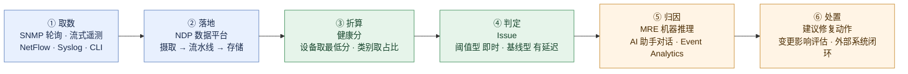
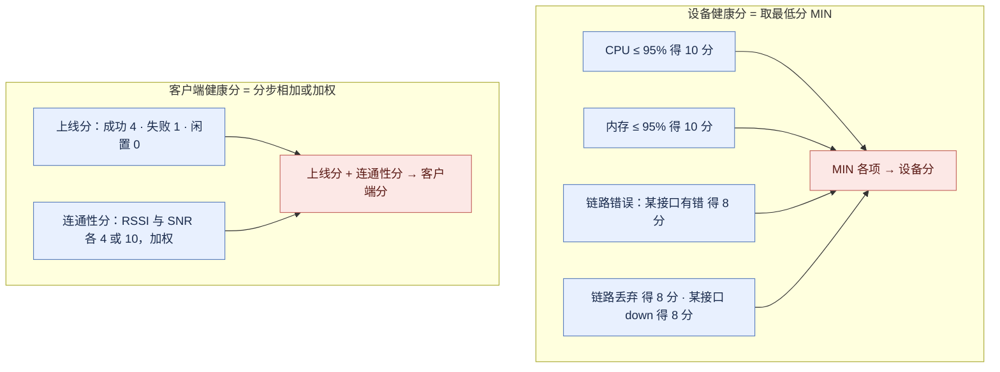

# Cisco Catalyst Center Assurance 端到端体验可观测 —— 功能体系与痛点解法

> **调研对象**：Catalyst Center 的 **Assurance（保障）** 这一条能力线——从「把数据收上来」到「把问题说清楚」的完整链路，含健康分体系、遥测采集与数据底座、客户端接入旅程、应用体验与外部路径、基线化智能、根因与处置、权限与报表。
> **时间窗**：2023-01 → 2026-10（以官方 Release Notes / 用户指南 / 数据表可考时间为准）。
> **本文回答五件事**：① 这条线上有哪些**大功能点**，各自包含哪些**小功能点**；② 它们分别解决客户在**哪一侧的痛**（时间 / 钱 / 人 / 合规 / 组织）；③ 用哪些能力去解，与痛点**逐条对应**；④ 对应的**功能机制**是什么（怎么算出来的、数据从哪来、闸门装在哪）；⑤ 这条线四年间**怎么长出来的**。

## 口径声明（与同系列其它报告的分工）

本文是 `Catalyst-Center-2023-2026-功能体系与痛点解法.md`（下称**主报告**）的**下钻篇**，两者互补、不重叠：

| 文档 | 覆盖 | 与本文的关系 |
| --- | --- | --- |
| **主报告** 大功能点 5（Assurance 端到端体验可观测 / 看得全） | 16 条小功能点的**全景清单**与痛点-解法概要 | 本文把它**拆开重写**：补上「功能机制」与「演进情况」两段，并把原先散在其它组的关联能力（AI 基线、Issues/MRE、遥测配置）收进同一条链路 |
| **主报告** 大功能点 4（AI Network Analytics / 辨得清）、7（事件关联与根因 / 找得准） | 基线与根因的骨架 | 本文只保留**它们与 Assurance 相接的那部分**（健康分里的基线、Issue 的两种类型、MRE 的覆盖面）；不重复其独立叙事 |
| **本篇** | 7 个「保障」大功能点：一分数清 / 取数有据 / 接入可见 / 里外贯通 / 先觉于变 / 顺着证据走 / 各得其所 | — |

> **本文口径（重要）**：只收「**为了让网络状态被看见、被读懂、被定位**」的能力。**不含**只做配置动作的自动化能力（见姊妹篇《园区自动化与配置闭环》），**不含**无线射频专项（主报告大功能点 6）与安全分段（大功能点 9）。凡涉及「平台侧只给建议、由人执行」的能力（如建议修复动作），**纳入本文但标注其闸门位置**——因为「闸门在哪」正是这类产品最有价值的结论。

## 信源与局限说明

| 等级 | 含义 | 本文使用情况 |
| --- | --- | --- |
| **A** | 官方用户指南（Catalyst Assurance UG 2.3.7 / 3.1.x / 3.2.x）/ 官方 Release Notes / 官方数据表 / 官方 FAQ 与隐私数据表 / 官方支持文档（cisco.com/c/en/us/support）/ 官方 Cisco Live 材料 | 主证据来源，约占七成 |
| **B** | 官方博客与官方社区（作者为 Cisco 员工）/ 官方 CVD 与验证设计文档 / 主流行业媒体 | 补充定位、机制细节与部署约束 |
| **C** | 第三方技术站与备考站（open-exam-prep、nhprep、pinglabz 等）、聚合媒体 | **仅用于交叉印证**；与官方口径冲突时以官方为准，并显式标注冲突 |

**已知局限（务必连同结论一起理解）**：

1. **Assurance 的数据保留期存在两处官方口径**：官方 FAQ 表述为「本地网络遥测保留 **14 天**」，而官方支持文档表述为「Catalyst Center Assurance 数据保留**最多 30 天**」，第三方备考站则写作「14 / 30 天」。本文**并列呈现，不做平均**，判定见 A2.4（机制 4）。
2. **数据管道的中间件构成来自 B/C 级信源**（Kafka → Flink → Redis / Elasticsearch）。3.3.1 官方包清单可佐证「Network Data Platform」确由 **Base Analytics / Data Ingestion / Pipeline / Storage Management / Caching Infra** 等独立包组成（A 级），但具体中间件选型未经官方文档正式确认，**按「量级参考」理解**。
3. **微服务底座与集群共识机制**（Cisco Maglev + Kubernetes、3 节点集群 Raft 共识）来自 C 级备考站，与官方「3 节点集群」的规模口径方向一致，但**未经 A 级文档确认**。
4. **AI 能力的可用状态普遍落后叙事**：AI Assistant 在 Catalyst Center 侧为**申请制 beta**；AI Canvas 与 Catalyst Center 的整合在第三方公开矩阵中仍标为 **Q4 2026**；Experience Metrics 的扩展形态为 **2026-06 beta**。**不得当作已 GA 的通用能力引用**。
5. **厂商自述收益 ≠ 第三方验证**。官方口径中的「MTTR 从小时降到分钟」「秒级诊断」等一律标注**量级参考**。
6. **客户体感主要来自 C 级**。抱怨集中在「许可复杂且贵」「界面学习曲线陡」「与第三方设备集成不足」，与主报告一致。
7. **资料截止 2026-10-14。** 3.3.1（2026-09-09）仍为**受控可用（controlled availability）**版本，需联系思科销售申请访问。

**版本节奏对照表**（用于把功能对齐到时间窗）：

| 版本线 | 与本主题相关的关键节点 |
| --- | --- |
| 2.3.7.x（维护线） | 2.3.5.x 引入 Network Reasoner 与 LAN Automation 并发；2.3.7 引入 Telemetry Status / IPDT / Per-SSID 过滤 / 第三方 MIB-II 纳管；2.3.7.7 引入 Event Analytics 预览版；2.3.7.9 MLO 客户端；2.3.7.10 Wi-Fi 7 客户端健康；2.3.7.11 起 AI Assistant 申请制 beta |
| 3.1.x | 3.1.3 ISE 认证失败可见性 / SRBAC / 报表调度；3.1.5 Beta 首页 + Rule-Based Compliance；3.1.6 合规摘要逐条违规 |
| 3.2.x | 3.2.2 Beta 首页转正 / 自定义站点角色 / 无线 IPv6 / 户外区域（beta）；3.2.x 无线网络服务分析（AAA / DHCP） |
| 3.3.x | 3.3.1（2026-09-09）Flexible Report 新增 Network Interface 实体 / 一批新 Assurance 事件 |

---

## 读法：7 个大功能点全景

按「**一条数据从产生到被处置**」的先后顺序排列——左侧是取数与折算，中间是读懂，右侧是定位与协作。

| # | 大功能点 | 四字口号 | 小功能点数 | 时间跨度 | 在链路中的位置 |
| --- | --- | --- | --- | --- | --- |
| 1 | 健康分体系与 360 视图 | 一分数清 | 15 | 平台早期 → 2026-09 | 折算层（把数据变成分数） |
| 2 | 遥测采集与数据底座 | 取数有据 | 17 | 平台早期 → 2026-09 | 取数层（决定上层有没有数） |
| 3 | 客户端接入旅程与基础服务链路 | 接入可见 | 14 | 平台早期 → 2026-05 | 读懂层（用户侧） |
| 4 | 应用体验与自建网络之外 | 里外贯通 | 14 | 平台早期 → 2026-08 | 读懂层（应用侧） |
| 5 | 基线化智能与主动洞察 | 先觉于变 | 14 | 2023 起 → 2026-08 | 判读层（什么叫“不正常”） |
| 6 | 问题根因与协作处置 | 顺着证据走 | 16 | 2023 起 → 2026-08 | 定阶层（把现象变成结论） |
| 7 | 权限切分与趋势报表 | 各得其所 | 11 | 2023-12 → 2026-09 | 组织层（谁能看、看多久） |

> 合计 **101 条小功能点 / 41 条痛点 / 41 条解法**（P 与 S 逐组一一对应，校验见文末）。

### 一张图看清「从遥测到一条可处置的问题」

Assurance 的六段链路，缺任何一段，后面的能力都会“看起来有、实际空转”。**这也解释了为什么客户最常见的问题不是“功能没有”，而是“数据没上来”**。



### 一张图看清「两个都叫健康分，算法却不同」

这是本文最重要的机制发现：**设备健康分取“最差的那一项”，客户端健康分是“分步相加/加权”**。同一个界面上的两个分数，背后是两套完全不同的算术——误以为都是加权平均，会读错整个面板。



---

# 大功能点 1：健康分体系与 360 视图 —— 「一分数清」

**这一层不产生数据，它决定的是「同一批数据，能不能变成一句话说得清的结论」。**

## 1.1 小功能点清单

| # | 小功能点 | 发布时间 | 来源等级 | 说明 |
| --- | --- | --- | --- | --- |
| 1.1 | 网络健康分（Network Health） | 平台早期，持续 | A | 健康设备数（8–10 分）÷ 该范围设备总数，**每 5 分钟计算一次**，**维护模式设备不计入分母** |
| 1.2 | 设备类别健康分 | 平台早期，持续 | A | 按 Access / Core / Distribution / Router / Wireless 分类分别计算占比 |
| 1.3 | 个体设备健康分 = **MIN** | 平台早期，持续 | A | 取 **系统健康、数据面连通性、控制面连通性** 三项的**最小值**，非平均值 |
| 1.4 | 交换机健康分 = **MIN**（五参数） | 平台早期，持续 | A | 取 **CPU、内存、链路错误、链路丢弃、链路状态** 五项的最小分 |
| 1.5 | 健康分区间语义 | 平台早期，持续 | A | **8–10 良好 / 4–7 一般 / 1–3 差 / 0 无数据**（0 亦对应维护模式） |
| 1.6 | KPI 阈值可配置 + 可排除 | 平台早期，持续 | A | 位置 **Assurance > Settings > Health Score Settings**；可调阈值，也可把某个 KPI **排除出健康分计算** |
| 1.7 | 健康分设置对第三方设备不适用 | 2.3.7 起 | A | 官方明确：健康分设置不适用于第三方设备 |
| 1.8 | 可定制健康分 + Top 10 全局问题 | 平台早期，持续 | A | 全局问题高亮，按站点 / 设备列表 / 客户端列表 / 拓扑下钻，附建议修复动作 |
| 1.9 | Device 360 | 平台早期，持续 | A | 单设备的时间线视图：可达性、遥测状态、历史问题、事件、性能统计 |
| 1.10 | Client 360 | 平台早期，持续 | A | 单客户端：连接旅程、事件时间线、RF 环境指标 |
| 1.11 | Application 360 / Application Assurance | 平台早期，持续 | A | 应用维度的可见性与洞察（详见大功能点 4） |
| 1.12 | 健康时间轴滑块（回溯） | 平台早期，持续 | A | 把时间轴拖回历史任意一点，看当时设备/客户端/应用的状态 |
| 1.13 | 客户端健康分（有线 / 无线两套） | 平台早期，持续 | A | 有线与无线的算法不同（详见大功能点 3） |
| 1.14 | 应用健康分（VoS 加权） | 平台早期，持续 | A | 丢包 / 时延 / 抖动的加权平均（详见大功能点 4） |
| 1.15 | 增强首页 / Beta 首页 | 3.1.5（beta）→ 3.2.2（正式） | A | 更细颗粒度的网络概览：状态变化、监控、合规与通知、设备高级特性 |

## 1.2 它对应的用户痛点

> **口径**：本节只写**客户侧可感知**的痛（时间 / 钱 / 人 / 合规 / 组织）。「加权还是取最小值」「五分钟算一次」这类是**设计约束**，一律放到 1.4 的「功能机制」里作为必要性论证。编号 **P1…P6** 与 1.3 的 **S1…S6** 对应。

- **P1｜「网络好不好」说不成一句话**（时间 / 组织）。上级问「今天网络怎么样」，团队只能说「还行」或发一堆截图；**没有一个人人认得的刻度**，跨团队沟通的成本落在每一次会议上。
- **P2｜平均值把单点恶化抹平了**（时间 / 钱）。用平均口径看板时，一处持续严重的链路错误会被大量正常设备“稀释”掉——**看板是绿的，故障是真的**，等到用户报障才回头查。
- **P3｜故障现场已经过去，证据留不住**（时间）。用户报障时问题往往已自行恢复/漂移，事后只能靠回忆对时间点；**「当时到底是什么状态」拿不到**，复盘变成猜。
- **P4｜排障在多个孤立页面之间来回跳**（时间 / 人）。从设备跳到客户端，再跳到应用，上下文靠人手工拼；新人接手时不知道该看哪个页面。
- **P5｜「是谁不好受」定位不到人**（组织 / 时间）。只知道「某台交换机有问题」，不知道这台设备上的谁、在用什么应用受影响；**网络团队拿不出“体验受损名单”**。
- **P6｜没有刻度就没有优先级**（时间 / 人）。每天几十上百条问题，先看哪条靠感觉和老经验；**紧急度成了个人判断，而不是共同口径**。

## 1.3 它是如何解决的

**架构约束（由 1.2 倒推）**

| 架构约束 | 由哪条痛点倒推 | 落到了哪些功能 |
| --- | --- | --- |
| 必须给所有实体一套**统一刻度**，否则跨团队无法对话 | P1、P6 | 1.1–1.5 四类健康分与区间语义 |
| 聚合口径**不能取平均**，否则单点会被稀释 | P2 | 1.3 / 1.4 设备健康分取 MIN |
| 状态必须**可回溯**，因为故障现场不可复现 | P3 | 1.12 时间轴滑块 + 1.9 / 1.10 的历史曲线 |
| 排查必须以**实体**为主线纵向串起来，而非按告警横向列 | P4 | 1.9 / 1.10 / 1.11 三类 360 视图 |
| 体验必须被折进同一个刻度，否则“设备正常但用户难受”无法表达 | P5 | 1.13 客户端健康分、1.14 应用健康分 |
| 阈值必须是**客户的**阈值，不是厂商的默认值 | P6 | 1.6 阈值可配 + 可排除 KPI |

- **S1｜用一套 0–10 刻度把“好”说成一个数**（→ 解 P1）。网络、设备、客户端、应用四类实体都用 1–10 分（分数越高越好），并统一定义 **8–10 良好 / 4–7 一般 / 1–3 差**。客户侧的收益很具体：**同一句话能贯穿管理层汇报与工程师晨会**——把「今天网络怎么样」变成「87%，两处黄色」。
- **S2｜聚合取“最差项”而不是平均**（→ 解 P2）。设备健康分被定为 **MIN（系统健康, 数据面连通性, 控制面连通性）**，交换机进一步细到 **MIN（CPU, 内存, 链路错误, 链路丢弃, 链路状态）**。**设计意图直接对应 P2**：只要有一个 KPI 严重退化，设备就是差的——**不让平均值替一台快挂的交换机背书**。代价见 1.4 机制 2。
- **S3｜时间轴滑块把“当时”钉住**（→ 解 P3）。360 视图里的时间轴可拖回历史任一点，查看该时刻的设备状态、客户端旅程、应用指标。官方支持文档明确 Assurance 数据保留窗口（口径并列见 A2.4）；**在窗口之内，“当时发生了什么”是可复查的，不是靠回忆的**。
- **S4｜把横向告警清单换成纵向实体时间线**（→ 解 P4）。Device 360 把可达性、遥测状态、历史问题、生成事件、性能统计**合并进一条时间线**；官方定位 Client 360 为「从任意角度、任意上下文查看设备与客户端连通性，包含不同时刻、不同应用的拓扑、吞吐与时延」。**排查的起点从“看告警”变成“看这个设备/这个人”**，同一页里能把上下文走完。
- **S5｜让“体验”也能被打分**（→ 解 P5）。客户端健康分把上线过程与连接质量折成分数，应用健康分把丢包/时延/抖动折成分数（详见大功能点 3、4）。**这一步把“设备都正常但用户难受”这种最难交接的状态变成了可展示的对象**。
- **S6｜阈值可调、KPI 可排除**（→ 解 P6）。客户可在 **Health Score Settings** 里改阈值，也可把某个 KPI **排除**出健康分计算；官方 Cisco Live 材料给出的默认值示例：Air Quality 2.4GHz < 60% 为差、CPU > 90% 为差。**同一条刻度因客户而异，这让“差”反映的是这家客户自己的标准**。

> **边界**：
> - **健康分设置不适用于第三方设备**（A 级官方口径）。第三方设备（MIB-II 纳管）能进清单与拓扑，但**不在同一套健康分刻度内**——「多厂商统一视图」在这里是有上限的。
> - **MIN 规则的副作用**：单个 KPI 可以拖死整台设备的分数。一台 CPU/内存全优但某一个接入口有 CRC 错误的交换机，健康分显示为“差”。**这正是设计意图，但会与直觉冲突**，是客户误读面板的最常见原因。
> - **0 分有两种含义**：无数据（采集没上来）与维护模式。前者是故障，后者是人为静默，**在排查第一步必须先分清**。

## 1.4 功能机制

**机制 1｜三层聚合，规则不同。** 健康分不是一个算法，是**三套**：① **个体设备分** = MIN（各 KPI 子分）；② **设备类别分** = 该类别 8–10 分设备数 ÷ 该类别设备总数（剔除维护模式）；③ **网络分** = 8–10 分设备数 ÷ 全部设备数（剔除维护模式）。②③ 是**占比口径**，① 是**短板口径**。这意味着：**网络分下降一定是“差设备变多了”，而设备分下降一定“某个具体 KPI 崩了”**——两个分数回答的是不同问题。

**机制 2｜MIN 的工程含义与代价。**

| 参数 | 阈值与映射 | 说明 |
| --- | --- | --- |
| CPU 利用率 | ≤ 95% 得 10 分；> 95% 得 1 分 | 断崖式映射，中间无过渡 |
| 内存利用率 | ≤ 95% 得 10 分；> 95% 得 1 分 | 同上 |
| 链路错误（Rx/Tx） | 某物理基础设施口有错 → 8；全部链路 down → 1；否则 10 | **只统计基础设施链路** |
| 链路丢弃 | 某物理基础设施链路有丢包 → 8；全部丢包 → 1；否则 10 | 同上 |
| 链路状态 | 某物理基础设施口 down → 8；全部 down → 1；否则 10 | 同上 |
| 设备间链路可用性 | 全部 up → 良好；全部 down → 差 | 计入物理堆叠口、设备互联链路、面向 fabric edge 的 port channel |

「基础设施链路」的官方定义是**连接 Catalyst Center 所管网络设备（交换机、路由器、无线控制器、AP）的拓扑链路**——即**只算机房内的骨架，不算接到终端的那一段**。这解释了为什么“某个用户口物理断线”不会拖低交换机健康分。

**机制 3｜五类实体各有自己的 KPI 集合。**

| 实体类型 | 系统健康 | 数据面连通性 | 控制面连通性 |
| --- | --- | --- | --- |
| 交换机（接入 / 汇聚） | CPU、内存 | 链路错误、链路状态、（堆叠口/设备互联/面向 edge 的 port channel） | — |
| 无线（WLC） | 内存、free timers、free Mbufs | WQE pool、packet pools、链路错误 | 到 Control Plane node 的连通性 |
| 无线（AP） | CPU、内存 | RF 指标：接口、噪声、空口质量、射频利用率 | — |
| 路由器 | CPU、内存 | 链路错误 | — |
| Fabric 设备 | CPU、内存 | — | 到 Control Plane node 的连通性 |

> 注意：**fabric 设备的健康分要靠启用 SNMP Collector metrics 才会填充**（A 级官方口径）。这是“分数算不出来”最常见的配置类原因。

**机制 4｜维护模式是刻意的“免打扰开关”。** 处于维护模式的设备**既不计入分母，也不参与自身健康分计算**。它的意义是：**给计划内变更留出合法窗口**，让“我今天在动这台设备”不污染全网分数。反过来读也成立——**看板变绿未必是真好，可能只是把设备全设成了维护模式**。

**机制 5｜健康分与“问题”是两套东西——不能互相替代。** 健康分是**连续读数**（每 5 分钟重算），Issue 是**离散事件**（有起点、有结束、可标注）。健康分回答“现在几分”，Issue 回答“发生了什么、要做什么”（大功能点 6）。**客户常犯的错误是盯着分数做排障**——分数只会告诉你“这里不对”，不会告诉你“为什么”。

## 1.5 功能的演进情况

| 阶段 | 变化 | 来源等级 | 意味着什么 |
| --- | --- | --- | --- |
| 2.3.x（2023–2024） | 四类健康分（网络 / 设备 / 客户端 / 应用）与 360 视图体系成型；MIN 规则确立 | A | **体系一次成型、四年未改**——这是这条线“稳”的信号，也说明它已是行业公认做法 |
| 2.3.7（2023-12 起） | KPI 阈值与“是否计入健康分”可配置；明确第三方设备不适用健康分设置 | A | 从“厂商默认”走向“客户自己定义什么算差” |
| 3.1.3（2025-04 前后） | 站点级 RBAC（SRBAC）覆盖 Assurance 面板 | A | 健康分开始按组织边界切分（详见大功能点 7） |
| 3.1.5（2026-04-01 文档） | Beta 首页出现 | A | 信息密度上提：状态变化、合规与通知上第一屏 |
| 3.2.2（2026-05-05） | Beta 首页转为正式；站点用户可自定义角色 | A | 首页与权限同时“转正” |
| 3.3.1（2026-09-09） | Flexible Report 新增 **Network Interface** 实体（Trend / TopN / Summary / Distribution） | A | 健康分的数据开始**模型化对外输出**，不再只是界面上的一个数字 |

> **演进读数**：**健康分本身四年几乎没动，动的全是“谁能看、看多细、怎么导出”。** 这说明厂商判断“刻度已定”，投入转向了组织化与数据出口。

---

# 大功能点 2：遥测采集与数据底座 —— 「取数有据」

**这一层决定的是「上面所有能力，到底有没有数据可用」。客户最常见的“功能失效”，九成出在这里。**

## 2.1 小功能点清单

| # | 小功能点 | 发布时间 | 来源等级 | 说明 |
| --- | --- | --- | --- | --- |
| 2.1 | 多协议采集（SNMP / 流式遥测 / NetFlow / Syslog / CLI / API / IP SLA） | 平台早期，持续 | A | 官方支持文档逐项列出，各司其职（见 2.4 机制 1） |
| 2.2 | SNMP 轮询采集设备与清单健康 | 平台早期，持续 | A | 可达性、CPU、内存、接口统计、软件版本 |
| 2.3 | 无线流式遥测（NETCONF/YANG） | 平台早期，持续 | A | **Assurance 的核心数据源**：近实时流式传输 AP 与客户端级数据 |
| 2.4 | 模型驱动遥测（MDT：gRPC / NETCONF / RESTCONF + YANG） | 平台早期，持续 | C | 支持周期性（cadence）与变更驱动（on-change）两种订阅 |
| 2.5 | 有线终端数据采集（IPDT） | 平台早期，持续 | A | 开启后接入端口上的终端可见；**trunk 口与 port channel 上的终端不可见** |
| 2.6 | 应用识别（AVC / CBAR）与 NetFlow 采集 | 平台早期，持续 | A | 可用 Catalyst Center 作 NetFlow 收集器，或经 Cisco Telemetry Broker（CTB）中转 |
| 2.7 | 遥测全局配置 | 平台早期，持续 | A | **Design > Network Settings > Telemetry**：SNMP Trap、Syslog、应用可见性、NetFlow/CTB、IPDT、无线遥测 |
| 2.8 | Telemetry Status 面板 | 2.3.7 起 | A | 一眼看出「遥测到底通没通」；状态不佳时**每 6 小时自动复检**（覆盖交换机、路由器、WLC） |
| 2.9 | 强制推送遥测配置（Force Configuration Push） | 2.3.7 起 | A | Inventory 中选设备 → Update Telemetry Settings → Force Configuration Push |
| 2.10 | Network Reasoner（Assurance Telemetry Analysis） | 2.3.5.x 起；2.3.7 起可从 Device 360 直接启动 | A | 机器推理逐步校验设备与平台两侧的 Assurance 配置；结果含逐项检查明细 |
| 2.11 | 数据底座（Network Data Platform） | 平台早期，持续 | A（包结构）/ B（中间件） | 摄取 → 流水线 → 存储 → 缓存；3.3.1 包清单可见其独立组件化 |
| 2.12 | 感知与推理组件（Assurance – Sensor / Automation – Sensor / RCA Collector） | 3.3.1 包清单 | A | 传感器已成为**独立版本化的交付件** |
| 2.13 | 本地遥测保留（14 天 / 最多 30 天，两处官方口径并列） | 平台早期，持续 | A | 见 2.4 机制 4 的判定 |
| 2.14 | 云遥测去标识化 + 客户选择加入（opt-in） | 平台早期，持续 | A | 默认不发送；开启 AI Network Analytics 才启用 |
| 2.15 | 产品使用遥测（可 opt-out） | 平台早期，持续 | A | 用于思科改进设备生命周期管理，客户可在平台内关闭 |
| 2.16 | AI 云数据用量 | 平台早期，持续 | A | **< 500 AP 约 150–200 MB/天；1800 AP 约 500–700 MB/天** |
| 2.17 | 明确不支持 NAT 后的设备 | 平台早期，持续 | A | 官方限制条款原文：Assurance 不支持经 NAT 连接的设备 |

## 2.2 它对应的用户痛点

> **口径**：只写客户侧可感知的痛。「Kafka 还是别的中间件」「多久算一次」这类设计约束放到 2.4。编号 **P1…P7** 与 2.3 的 **S1…S7** 对应。

- **P1｜「看不到」往往不是没告警，而是根本没取到数**（时间 / 人）。仪表盘一片空白或 0 分，客户分不清是**设备没事**还是**采集断了**；一份「什么都没报」的看板既不能证明安全，也不能证明有问题，排查从“先证明工具在工作”开始。
- **P2｜五分钟一次的轮询抓不住瞬时异常**（时间 / 钱）。微突发、瞬时干扰、间歇性上线失败都发生在两次轮询之间；**等问题能被轮询看到时，影响已经产生了**。
- **P3｜“网慢”还是“应用慢”要拿流量说话，可流量维度是空的**（时间）。应用识别与 NetFlow 没打开，应用面板没有数据，网络团队与应用团队的对质缺证据。
- **P4｜有线终端在网管里“看不见”**（组织 / 时间）。只知道端口是 up，不知道这个端口上接着谁；**有线用户的报障只能到现场找线**。
- **P5｜无线排障要登 WLC 敲 show**（时间 / 人）。AP 与客户端级数据都在控制器里，网管界面上看不到，现场人员遇到无线问题只能联系会敲命令的人。
- **P6｜数据出网被合规卡住**（合规）。安全部门不允许把网络数据送往境外云；**“要不要开 AI”于是变成了一次合规评审，而不是一次功能开关**。
- **P7｜数据留多久不可控，且说不清**（时间 / 合规）。30 天前的故障要复盘时数据可能已不在；**“留多久”这件事本身，官方就给了两个口径**（见 2.4 机制 4）。

## 2.3 它是如何解决的

**架构约束（由痛点倒推）**

| 架构约束 | 由哪条痛点倒推 | 落到了哪些功能 |
| --- | --- | --- |
| 「采集是否正常」本身必须是一个可查的状态，而不是隐含前提 | P1 | 2.8 Telemetry Status 面板 + 2.9 强制推送 + 2.10 Network Reasoner |
| 抓瞬时异常必须用**推送**而不是**轮询** | P2 | 2.3 无线流式遥测 + 2.4 MDT |
| 应用维度必须由**流数据 + 应用识别**构成，不能靠端口流量代理 | P3 | 2.6 AVC / CBAR + NetFlow / CTB |
| 有线终端必须由**接入设备上报**才能被看见 | P4 | 2.5 IPDT |
| 无线内部数据必须从控制器**流出来**，而不是等人工登录读取 | P5 | 2.3 无线遥测（WLC 为 managed + telemetry up 为前提） |
| 数据出网必须**可分级、可拒绝、可区域化** | P6 | 2.14 三层数据分类 + opt-in + 区域云选择 |
| 保留期必须**可被客户管理**（能删、能控） | P7 | 2.13 本地保留 + 客户可执行删除 |

- **S1｜把“采集是否正常”做成一个可查的状态**（→ 解 P1）。**Telemetry Status 面板**（2.3.7 起）直接显示遥测通没通，**状态不佳时每 6 小时自动复检**，覆盖交换机、路由器与 WLC；配置没推上去时可用 **Force Configuration Push** 强制重推。客户侧的收益：**“看板为什么是空的”从一道推理题变成一次点击**。
- **S2｜无线数据改成流式推送**（→ 解 P2、P5）。WLC 与 Catalyst Center 之间用 **NETCONF/YANG 流式遥测**近实时传输 **AP 与客户端级数据**：客户端上线与漫游事件、RSSI/SNR、AP 射频统计、WLC 内部健康计数器。前提条件是 **WLC 处于 managed 状态且 telemetry 状态为 up**（可用 `show telemetry connection all` 核对）。**这一步同时解决了两个痛**：抓得住瞬时事件（P2），且不用登设备敲命令（P5）。
- **S3｜把应用流数据接进来**（→ 解 P3）。在站点级开启应用可见性（**AVC / CBAR**），NetFlow 可由 **Catalyst Center 直接接收**，也可经 **Cisco Telemetry Broker（CTB）** 中转（此时 Catalyst Center 必须被 CTB 配为目的地，否则应用体验功能不工作）。接口/WLAN 的选取有**自动算法**与**旧版打标签（tagging）算法**两种，**打标签算法优先**。
- **S4｜让有线终端现身**（→ 解 P4）。开启 **IPDT**（Catalyst Center Wired Endpoint Data Collection）后，**接入端口上的终端在平台内可见**。**边界必须讲清**：**trunk 口与 port channel 上的终端不可见**——这决定了“有线可见性”的覆盖率上限。
- **S5｜用机器推理自查采集链路**（→ 解 P1）。**Network Reasoner** 跑一串机器推理步骤，**同时校验网络设备侧与 Catalyst Center 侧**的 Assurance 配置，输出逐项检查结果；2.3.7 起可从 **Device 360** 直接启动。**这是把“排障经验”固化成工具的一条很典型的做法**，也是本系列反复看到的模式（与 MRE 同源）。
- **S6｜把数据出网做成三层可选项**（→ 解 P6）。官方 FAQ 明确 Catalyst Center 采集**三类数据**：① **本地网络遥测**（留在本地设备，不传任何其它服务器，**不上云**）；② **去标识化云遥测**（**默认不发送**，客户 opt-in 后才用于 AI Network Analytics）；③ **产品使用遥测**（可 opt-out）。AI Network Analytics 更进一步：**网络事件数据在离开本地前完成去标识化**，且**可选 EU 或 US 区域云**，提交到云的数据留在所选区域。
- **S7｜把“留多久”和“能不能删”交给客户**（→ 解 P7）。官方隐私数据表写明：**数据由客户 Admin 控制**，可通过系统级命令删除日志文件、通过 SQL 查询删除库存/拓扑库中的终端数据元素（如 IP/MAC）；云侧网络事件数据的保留期为 **5 年**，客户可向 TAC 提交提前删除请求。**客户侧的意义是：保留期不是平台说了算，是可执行、可申请的操作项。**

> **边界**：
> - **Assurance 不支持经 NAT 连接的设备**（A 级官方限制条款）——这是一条硬性排除项，多租户/地址重叠场景要特别注意。
> - **IPDT 的可见性覆盖不到 trunk 与 port channel**，因此**“有线终端全可见”在现实中不成立**。
> - **AI 链路依赖云连通性**：官方支持文档把“云连接失败”列为**最高频的 TAC 工单类型**；2.3.5.x 起平台会自动做云连通性检查，排障路径是查 `ai-network-analytics` 命名空间下的服务日志。
> - **MIB-II 纳管的第三方设备不进健康分体系**（与 1.3 边界呼应），它们在平台上提供的是**在线时长、拓扑位置与清单**，不是内部状态。

## 2.4 功能机制

**机制 1｜七种采集方式，各管一段。**「多协议采集」不是堆料，是**分工**：

| 采集方式 | 拿到的数据 | 粒度 | 主要用途 |
| --- | --- | --- | --- |
| SNMP 轮询 | 可达性、CPU、内存、接口统计、软件版本 | 分钟级 | 设备与清单的基础健康 |
| 流式遥测（NETCONF/YANG） | AP 与客户端级事件、RSSI/SNR、射频统计、WLC 内部计数器 | 近实时 | **无线体验与客户端旅程的主数据源** |
| NetFlow + AVC/CBAR | 应用流量、丢包、时延、抖动 | 流级 | 应用体验与大功能点 4 |
| Syslog | 系统与运行日志 | 事件级 | 事件、“启动 vs 运行配置”合规触发 |
| CLI | 补充采集与配置读取 | 按需 | 兜底与配置相关能力 |
| API | 平台与外部系统数据 | 按需 | 集成 |
| IP SLA | 路径与时延探测 | 探测周期 | 路径类指标 |

**机制 2｜从设备到界面的四段管道。** 网络遥测从路由器 / 交换机 / WLC / 传感器出发，经采集器进入**分布式消息中间件**，再由**实时分析流水线**处理，结果存入**缓存 + 检索存储**，最后经 API 供界面使用；上下文数据（ISE/pxGrid、DNS、AAA、DHCP、拓扑、清单、位置、策略、IPAM）并行汇入。3.3.1 的官方包清单可佐证这套底座是**独立组件化的**（Network Data Platform 的 Core / Data Ingestion / Pipeline / Storage Management / Caching Infra 各自独立版本）。**工程含义**：**采集断、管道堵、存储慢，会分别表现为不同类型的功能失效**——这也是为什么厂商要把遥测状态单独做成面板。

**机制 3｜Assurance 有一套“前置条件清单”，不满足就静默失效。**

| 层级 | 前置条件 |
| --- | --- |
| 设备级 | 可管理性为 **Managed**；可达性为 **Reachable**；已分配到站点 |
| 站点级（Design > Network Settings > Telemetry） | Catalyst Center 被设为 SNMP trap 服务器、Syslog 服务器、NetFlow 收集器 |
| 有线客户端 | 启用 **IPDT** |
| 无线 | 启用 **Wireless Telemetry**（会向设备下发遥测命令；关闭即停止采集） |
| 应用 | 网络设备上启用应用遥测（Application Telemetry / CBAR） |
| AI 能力 | Settings > External Services 启用 + 到云主机的出站 HTTPS（TCP 443） |

> 这张表值得单独记住：**客户说“Assurance 不好用”时，九成是在这六行里缺了一行**。它也是“机制即门槛”的典型——**能力不缺，缺的是把前置条件全部对齐**。

**机制 4｜数据保留期的口径冲突与判定。** 三处口径并列：

| 来源 | 口径 | 等级 |
| --- | --- | --- |
| 官方 FAQ | 本地网络遥测保留 **14 天**，且不外传、不上云 | A |
| 官方支持文档 | Catalyst Center Assurance 数据保留**最多 30 天** | A |
| 第三方备考站 | 时间回溯窗口 **14 / 30 天** | C |

**判定**：两者**不是同一口径的分歧，更可能是“数据类型”的分歧**——FAQ 说的是广义的**本地网络遥测**（含各类采集数据）的基础保留期，支持文档说的是**Assurance 特定数据**的可回溯窗口。本文的处理方式是**并列呈现**：做容量与合规规划时按 14 天理解更保守，做故障复盘规划时按 30 天理解更宽松，**以实际部署为准**。

**机制 5｜云侧的“去标识化 + 区域选择 + 用量”三件套。**

| 维度 | 官方口径 |
| --- | --- |
| 去标识化时点 | 网络事件数据**在本地、传输前**完成去标识化 |
| 区域选择 | 可选 **EU 或 US** 云；提交数据留在所选区域云内 |
| 用量 | < 500 AP 约 **150–200 MB/天**；1800 AP 约 **500–700 MB/天** |
| 许可归属 | AI Network Analytics 属 **Advantage** 软件许可，作为组件融入 Assurance 界面 |
| 默认可选 | **默认不发送云遥测**，客户 opt-in |

**机制 6｜传感器已经是一个独立交付件。** 3.3.1 包清单中同时存在 **Assurance – Sensor**、**Automation – Sensor** 与 **RCA Collector** 三个独立版本号。**这意味着“感知”在架构上被拆成了可独立演进的组件**——对关注自研架构的人，这是一个有价值的信号：**采集/感知层正在从功能里剥离出来变成平台件**。

## 2.5 功能的演进情况

| 阶段 | 变化 | 来源等级 | 意味着什么 |
| --- | --- | --- | --- |
| 平台早期 | 七种采集方式与 NDP 底座成型；Assurance 前置条件清单确立 | A/B | 底座先于功能 |
| 2.3.5.x（2024） | Network Reasoner 出现；云连通性自动检查 | A | 从“能采”走向“能自查采得对不对” |
| 2.3.7（2023-12 起） | **Telemetry Status 面板** + Force Configuration Push + IPDT + Per-SSID 过滤；第三方 MIB-II 纳管 | A | **采集可见性成为一等公民**——这是这条线最重要的一次转向 |
| 2.3.7.7 | Event Analytics 预览版；第三方设备端口视图 | A | 数据开始被“模式化”呈现 |
| 3.2.2（2026-05-05） | 无线网络全面支持 IPv6（含应用可见性、应用策略、AAA 等） | A | 采集链路跟上 IPv6 园区 |
| 3.3.1（2026-09-09） | 传感器成为独立版本化包；Network Data Platform 组件化；新增 URWB / Fabric / CAA 等一批 Assurance 事件 | A | 感知层与数据平台层**平台化** |

> **演进读数**：这条线的演进主线**不是“采得更多”，而是“让采集可被诊断”**。从早期“能采就行”，到 2.3.7 把遥测状态做成面板，再到 3.3.1 把传感器拆成独立组件——**方向始终是降低“采不到却发现不了”的风险**。这也是给自研最直接的一条启示：**如果只做采集不做采集的可观测性，客户的所有问题都会以“功能不好用”的形式反馈回来。**

---

# 大功能点 3：客户端接入旅程与基础服务链路 —— 「接入可见」

**这一层回答的是最具体的那个问题：「这个人，为什么连不上/不好用」。**

## 3.1 小功能点清单

| # | 小功能点 | 发布时间 | 来源等级 | 说明 |
| --- | --- | --- | --- | --- |
| 3.1 | Client 360 | 平台早期，持续 | A | 单客户端的连接旅程、事件时间线与 RF 环境指标 |
| 3.2 | 客户端上线四阶段漏斗 | 平台早期，持续 | C | 关联（Association）→ 认证（802.1X/AAA）→ 地址（DHCP）→ 域名（DNS） |
| 3.3 | Client 360 事件时间线 | 平台早期，持续 | C | 漫游（换 AP）、换频段（2.4 / 5 / 6 GHz）、重传等历史事件 |
| 3.4 | RF 环境指标 | 平台早期，持续 | A | 客户端所在位置的实时 RSSI、SNR、信道利用率 |
| 3.5 | 无线客户端健康分算法 | 平台早期，持续 | A | 见 3.4 机制 4 的映射表 |
| 3.6 | 有线客户端健康分算法 | 平台早期，持续 | A | 链路 up + 认证授权成功 + 取得 IP → 10 分；有链路错误 → 6 分 |
| 3.7 | 客户端排除清单（Exclusion List） | 2.3.7 | A | 按 MAC 排除客户端（可绑定到指定 WLC），并支持编辑与删除 |
| 3.8 | Per-SSID filtering | 2.3.7 | A | 排除非关键 SSID 的数据，让监督与排障聚焦业务关键无线网络 |
| 3.9 | 无线客户端时延洞察 | 2.3.7 | A | 按位置 / AP / 频段拆解客户端时延 |
| 3.10 | ISE 认证失败可见性 | 3.1.3（3.1.6 社区口径覆盖有线与无线） | A | 在 Assurance 的 Client 面板、Client 360、Events 页、AAA 页直接看到认证失败详情 |
| 3.11 | 无线网络服务分析（AAA / DHCP） | 3.2.x | A | 把认证、授权、计费与 DHCP 服务健康集中呈现，显示受影响的服务器 / 站点 / 用户 |
| 3.12 | MLO（多链路操作）客户端支持 | 2.3.7.9 | A | 客户端可跨 2.4 / 5 / 6 GHz 连接并提升可靠性 |
| 3.13 | Wi-Fi 7 客户端健康 | 2.3.7.10 | A/B | Client Health Dashboard 支持 Wi-Fi 7 客户端 |
| 3.14 | 无线地图频段 UI 增强 | 2.3.7.9 | A | 与 MLO 同批的界面增强 |

## 3.2 它对应的用户痛点

> **口径**：只写客户侧可感知的痛。「四步漏斗要不要加第五步」这类设计约束放到 3.4。编号 **P1…P6** 与 3.3 的 **S1…S6** 对应。

- **P1｜用户只会说「网慢」或「连不上」**（时间 / 人）。报障信息停在「某栋楼、某个人、某个时段」，从这种描述出发，排查要一路从终端问到交换机，**每一步都要先确认“不是这里的问题”**。
- **P2｜「卡在哪一步」说不出来**（时间）。是没关联上、认证没过、还是没拿到地址？**上线是一个四步串行的过程，任一步失败表现都是“连不上”**，不拆开就只能反复试。
- **P3｜认证类故障要在两个系统之间来回跑**（时间 / 人）。失败原因在认证系统里，工程师要么登录认证平台看实时日志、抄下时间点，再回网管对日志——**取证动作本身就在消耗排障时间**。
- **P4｜同一个 SSID 里，非关键流量盖住关键业务**（时间）。监督大屏被访客网络的数据刷屏，真正要盯的生产 SSID 淹没在里面。
- **P5｜新制式终端没有基线可比**（时间）。Wi-Fi 7 / MLO 客户端进来后，健康分与图表看不懂是设备问题还是终端太新。
- **P6｜认证与地址服务慢，锅最后甩给网络**（组织）。AAA 或 DHCP 是外部系统，但用户感知到的只有「网连不上」——**没有一份双方都认的证据**，跨团队定责就变成了立场之争。

## 3.3 它是如何解决的

**架构约束（由痛点倒推）**

| 架构约束 | 由痛点倒推 | 落到了哪些功能 |
| --- | --- | --- |
| 排查必须以**客户端**为主语组织，否则永远从“网慢”开始 | P1 | 3.1 Client 360 |
| 上线过程必须被拆成**可指认的步骤**，失败要停在具体一步 | P2 | 3.2 四阶段漏斗 + 3.3 事件时间线 |
| 认证证据必须**展示在网管侧**，不能要求跨系统取证 | P3、P6 | 3.10 ISE 认证失败可见性 |
| 服务健康（AAA / DHCP）必须与网络健康**同屏呈现** | P6 | 3.11 无线网络服务分析 |
| 统计口径必须能**剔除噪声源** | P4 | 3.8 Per-SSID filtering + 3.7 排除清单 |
| 新制式必须有**对应的健康口径**，否则新终端是盲区 | P5 | 3.12 MLO + 3.13 Wi-Fi 7 |

- **S1｜以客户端为主语的 360 视图**（→ 解 P1）。Client 360 把**连接旅程、事件时间线、RF 环境**三块并到一页：从“这个终端什么时候上线的、在哪几个 AP 之间漫游过、信号有多好”一路看到“它现在在用什么应用”。**排查的入口从“哪台设备报警了”变成“是哪个人不好受”**。
- **S2｜四阶段漏斗把“卡在哪”钉在具体一步**（→ 解 P2）。上线被拆成**关联 → 认证 → 地址 → 域名**四步；某一步失败时，Assurance **直接显示上线过程停在哪一步**。**一步定位取代四步轮询**，这是这条线里降低时间成本最直接的一处。
- **S3｜把认证证据搬进 Assurance**（→ 解 P3、P6）。3.1.3 起可在 **Client 面板、Client 360、Issues and Events 的 Events 标签、Network Services 的 AAA 标签**直接看到认证失败详情，**无需登录认证系统界面**。这一步把“跨系统取证”压缩成“同屏可见”，是本组里对时间成本贡献最大的一条。
- **S4｜把 AAA / DHCP 服务健康集中呈现**（→ 解 P6）。**无线网络服务分析**把 AAA 与 DHCP 健康放进一个视图，并显示**受影响的服务器、站点与用户**。**关键是“受影响的是谁”这一列**：它把“服务慢了”从抽象指标变成受影响名单，跨团队沟通时有了共同材料。
- **S5｜用过滤器把噪声移出统计**（→ 解 P4）。**Per-SSID filtering** 让监督与排障只聚焦业务关键无线网络；**客户端排除清单**可按 MAC 把已知的非关键/测试终端排除。**“看得少”有时就是“看得清”**——这两条不起眼，但决定了监督大屏有没有用。
- **S6｜给新制式补上健康口径**（→ 解 P5）。**MLO 客户端**（2.3.7.9）与 **Wi-Fi 7 客户端健康**（2.3.7.10）陆续补齐，客户端面板跟上终端代际。**这条演进本身说明了一个规律：终端制式换代时，“能不能看见”要先于“能不能优化”。**

> **边界**：
> - **认证可见性是“只读镜像”，不是策略迁移**。Assurance 侧看得到失败，但**策略仍在认证系统侧配置**；它消除的是切换成本，不改变职责边界。
> - **有线的可见性依赖 IPDT**（见大功能点 2），且 **trunk / port channel 上的终端不可见**——有线客户端旅程的覆盖率天然低于无线。
> - **四阶段漏斗的细节来自 C 级备考材料**，其“四步”划分与官方行为一致（官方文档也以关联/认证/DHCP/DNS 描述上线过程），但**具体步骤命名与边界以部署版本为准**。
> - **新制式的健康口径有版本前提**：Wi-Fi 7 / MLO 需要对应的 AP、WLC 与 IOS XE 版本配合。

## 3.4 功能机制

**机制 1｜客户端健康分是“分步加起来”的——与设备健康分完全不同。**

| 客户端类型 | 算法 | 分数取值 |
| --- | --- | --- |
| **有线** | 上线分 + 连通性分 | 正常 10；上线成功但有链路错误 → 6 |
| **无线（上线分）** | 成功 = 4；失败 = 1；闲置 = 0 | 1–4 |
| **无线（连通性分）** | RSSI 与 SNR 各驱动一个分，**加权平均** | 0 / 4 / 10 |
| **无线（合计）** | 上线分 + 连通性分，范围 1–10；**inactive 客户端为 0** | 1–10 |

> 这是本文第二个关键机制发现：**同一界面上，设备分取 MIN（短板逻辑），客户端分取相加/加权（累加逻辑）**。为什么不同？因为**设备是“要么能干活要么不能”，客户端是“能不能上网 + 上得好不好”两件事的组合**——上线分回答“进得来吗”，连通性分回答“进来了好不好用”。**读错这一点，会把“上线失败”和“信号差”混为一谈。**

**机制 2｜四个步骤，四类证据。** 把漏斗与证据来源对齐，就能理解为什么会“卡在某一步”：

| 步骤 | 判断依据 | 失败时的典型表现 |
| --- | --- | --- |
| 关联（Association） | 客户端是否成功关联到 AP | 一直转圈、反复重试；多见于射频/认证配置 |
| 认证（802.1X/AAA） | 认证授权是否成功 | 明确报认证失败；证据在认证系统侧（→ 3.10 的价值所在） |
| 地址（DHCP DORA） | 是否取得 IP | 关联成功但无地址；多见于地址池/中继/DHCP 服务 |
| 域名（DNS） | 域名能否解析 | 能上内网不能上外网；**最容易被误判为“网络没问题”** |

**机制 3｜RF 指标 → 分数的映射（无线的“好”是分档的，不是连续的）。**

| 指标 | 阈值 | 结果 |
| --- | --- | --- |
| RSSI | ≤ −72 dBm | 连通性分 4（一般） |
| RSSI | > −72 dBm | 连通性分 10（良好） |
| SNR | ≤ 9 | 连通性分 4（一般） |
| SNR | > 9 | 连通性分 10（良好） |
| 重传率 | > 50% | 判为差 |
| 数据率（802.11 a/b/g） | < 5 Mbps | 判为差 |

> 注意 **RSSI 与 SNR 各出一个分再加权**，且分档只有“良好/一般”两档——**这两项是“够用/不够用”的判断，不是精细度量**。找“到底差多少”要看具体指标值，不能只看分数。

**机制 4｜排除清单与过滤器的“减法”设计。** 排除清单按 MAC 生效、**可绑定到指定 WLC**（即同一 MAC 在不同控制器上可分别处理）；Per-SSID filtering 在监督与排障视图上生效。两者共同的设计逻辑是：**统计口径默认“全都要”，但客户需要能把噪声源从统计里摘出去**——这与大功能点 1 里“KPI 可排除出健康分”是同一种思路，**“可排除”是产品成熟度的一个标志**。

**机制 5｜服务链路是“平台外的第三方依赖”，因此必须被显式建模。** AAA 与 DHCP 既可能是思科设备也可能是第三方服务器；官方口径明确无线网络服务分析**覆盖思科与第三方服务器**。**这一点很重要**：它承认了**基础服务不在园区网管的能力半径内**，于是采取“只观测、不接管”的姿态——观测量（时延、交易量、受影响站点与用户、可配置的数据报告时长）而非控制。

## 3.5 功能的演进情况

| 阶段 | 变化 | 来源等级 | 意味着什么 |
| --- | --- | --- | --- |
| 平台早期 | Client 360、四阶段旅程、RF 指标成型 | A/C | 无线客户端的体验可观测先于有线 |
| 2.3.7（2023-12 起） | **Per-SSID filtering**、无线客户端时延洞察、客户端排除清单 | A | 从“看得到”到“过滤出想看的” |
| 2.3.7.9 | **MLO** 客户端支持 + 无线地图频段 UI | A | 跟上 Wi-Fi 6E / 7 的频段结构 |
| 2.3.7.10 | **Wi-Fi 7 客户端健康** | A/B | 终端代际跟进 |
| 3.1.3（2025-04 前后） | **ISE 认证失败可见性**（3.1.6 社区口径覆盖有线与无线） | A | **这条线最重要的一次“消除跨系统取证”** |
| 3.2.x | **无线网络服务分析**（AAA / DHCP） | A | 把基础服务从“外部依赖”变成“可观测对象” |
| 3.2.2（2026-05-05） | 无线全面支持 IPv6（含 AAA、基于 IP 的访问控制策略、移动组等） | A | 客户端旅程跟上 IPv6 园区 |

> **演进读数**：三段时间很清楚——**先有客户端可见（平台早期）→ 再做过滤与新制式覆盖（2.3.7 一代）→ 最后把认证与服务证据搬进来（3.1.3 / 3.2.x）**。最后一步的价值最高：**它把“网络团队的排障”和“其他系统的排障”从两个工位合并成一个界面**。

---

# 大功能点 4：应用体验与自建网络之外 —— 「里外贯通」

**这一层回答的是「用户说系统慢，到底是网的错还是应用的错，以及自建网络之外那段路谁负责」。**

## 4.1 小功能点清单

| # | 小功能点 | 发布时间 | 来源等级 | 说明 |
| --- | --- | --- | --- | --- |
| 4.1 | Application 360 / Application Assurance | 平台早期，持续 | A | 应用维度的可见性与洞察，与 Client 360 配合回答“终端体验好不好” |
| 4.2 | 应用健康分（VoS 加权） | 平台早期，持续 | A | 丢包 / 时延 / 抖动的加权平均；公式见 4.4 机制 1 |
| 4.3 | 应用体验指标表 | 3.1.x | A | 名称、健康分、用量字节、平均吞吐、DSCP（观测值 vs 期望值）、最大/平均丢包、网络时延、抖动 |
| 4.4 | 应用健康时间线滑块 | 3.1.x | A | 时间范围可选 3 小时 / 24 小时 / 7 天，并可用箭头回看最多 30 天 |
| 4.5 | 应用健康分的适用边界 | 平台早期，持续 | A | 官方明确：**Catalyst 9000 系列交换机与 AireOS 无线控制器无应用健康分**（不轮询所需 KPI） |
| 4.6 | Application Visibility 数据口径限制 | 3.1.x | A | C9200 / C9300 / AireOS 导出的应用可见性数据**只有应用名称、用量与吞吐** |
| 4.7 | NetFlow 概要（导出器可下钻） | 3.1.x | A | Summary 卡片显示 NetFlow 包总数、导出器数量，点击可看设备名、包计数、记录数、速率限制丢包 |
| 4.8 | Webex 集成 | 2023–2026 持续 | A | 把网络性能与协作体验关联，获得通话质量可见性 |
| 4.9 | Microsoft Teams 集成 | 2023–2026 持续 | A | 与 Webex 同类的协作应用拆解 |
| 4.10 | ThousandEyes 增强集成 | 2025–2026 | A | 按服务商 / 位置 / 接口定位问题，获得端到端路径与指标 |
| 4.11 | ThousandEyes Enterprise Agent 的部署与管理 | 3.1.3 | A | 可从 **Health > Application** 面板内安装与管理，免去跨平台操作 |
| 4.12 | Agent 载体与许可前提 | 持续 | A | Agent 可装在 **C9300 / C9400** 交换机上（Docker），**需 Advantage 订阅** |
| 4.13 | 三类 ThousandEyes 测试 | 持续 | A | agent-to-server（抖动/丢包/时延）、Web HTTP server（响应时间）、agent-to-agent（抖动/丢包/时延） |
| 4.14 | Experience Metrics（统一体验指标） | 2026-06（beta），持续扩展 | A | 把数千个基础设施信号收敛为跨**有线 / 无线 / WAN / 应用**的统一体验视图 |

## 4.2 它对应的用户痛点

> **口径**：只写客户侧可感知的痛。「应用健康分怎么算」放到 4.4。编号 **P1…P6** 与 4.3 的 **S1…S6** 对应。

- **P1｜「网络慢」还是「应用慢」举证不清**（时间 / 组织）。业务方报「系统慢」，网络团队与应用团队**互相举证**，各自手里都只有一半证据；**跨团队定责变成了立场之争而非事实之争**。
- **P2｜用户在用 SaaS，路径在自建网络之外**（时间 / 钱）。用户走互联网、走 SaaS、走云，这段路不在自己的网管里；出了事只能猜「是不是运营商」，**既拿不到路径也拿不到指标**。
- **P3｜同一个应用的体验只能靠“体感”**（时间）。缺一个能展示、能对比、能追溯的量化口径；**“是不是比上周差了”这种问题答不上来**。
- **P4｜「什么时候开始的、持续了多久」说不清**（时间）。间歇性劣化没有时间线可回看，**复盘时只能描述现象而非过程**。
- **P5｜协作应用（会议）的质量问题最难定位**（时间 / 组织）。视频卡顿可能出在网络、终端或服务侧，三方各说各话，而会议是**用户感受最强烈、投诉最强烈的场景**。
- **P6｜多域信号各说各话**（组织）。有线、无线、WAN、应用各自有口径，**凑不成一个“用户体验”**，跨域问题就变成三张图各看一半。

## 4.3 它是如何解决的

**架构约束（由痛点倒推）**

| 架构约束 | 由痛点倒推 | 落到了哪些功能 |
| --- | --- | --- |
| 应用体验必须**被折成数字**，否则无法作为证据 | P1、P3 | 4.2 应用健康分 |
| 可见性必须能**延伸到自建网络之外** | P2 | 4.10–4.13 ThousandEyes 集成 |
| 应用指标必须**可回看时间线** | P4 | 4.4 应用健康时间线滑块 |
| 协作应用必须有**开箱口径**，不能落在通用指标之外 | P5 | 4.8 / 4.9 Webex 与 Teams 集成 |
| 多域信号必须能被**收敛成一个体验视图** | P6 | 4.14 Experience Metrics |
| 面板内必须能**完成外部能力的接入**，否则集成有名无实 | P2、P3 | 4.11 面板内安装 Agent |

- **S1｜把应用体验折成 1–10 分**（→ 解 P1、P3）。**应用健康分**由丢包、网络时延、抖动三项加权得出（换算链见 4.4 机制 1），并配一张指标表（用量、平均吞吐、DSCP 观测值与期望值、最大/平均丢包、时延、抖动）。**这一步把“系统慢”变成“这个应用 4 分，主因是抖动”**——口径一旦统一，跨团队的争论就变成了同一张表的读数。
- **S2｜把可见性推到自建网络之外**（→ 解 P2）。**ThousandEyes 增强集成**让 IT 能按**服务商、位置、接口**定位问题，并获得**端到端路径与指标**；合成测试从交换机侧的 Agent 出发，测到应用服务。**客户侧的意义是：从“猜是不是运营商”变成“看得到是哪一段”。** 代价是引入一个独立产品与许可（见边界）。
- **S3｜应用健康时间线可回看**（→ 解 P4）。应用健康面板的时间线支持 **3 小时 / 24 小时 / 7 天**选择，并可用箭头**回看最多 30 天**；**ThousandEyes 测试分数被关联到同一条时间线上**。**两种数据（网络遥测与合成测试）落在同一个时间轴上**，这是“什么时候开始变差”能被回答的关键。
- **S4｜协作应用开箱集成**（→ 解 P5）。**Webex 与 Microsoft Teams** 集成把网络性能与协作体验关联（官方口径：获得通话质量可见性、快速排查影响用户的问题）。**它并不替代协作平台自己的质量分析，而是把“网络这一侧”对上“会议这一侧”**——对 P5 的解法是提供一份被双方接受的证据。
- **S5｜把多域信号收敛为一个体验视图**（→ 解 P6）。**Experience Metrics** 把数千个基础设施信号收敛成**跨有线、无线、WAN 与应用的统一视图**，并配 AI 根因分析（自动定位认证、DHCP、DNS 等问题）与闭环自动化（与 AI 助手、Agentic Actions 集成）。**它回答的是“用户到底感受如何”这个跨域问题的统一口径。**
- **S6｜在应用面板内完成外部 Agent 的部署与测试配置**（→ 解 P2、P3）。3.1.3 起，**ThousandEyes Enterprise Agent 的安装与测试配置可在 Catalyst Center 的应用健康面板内完成**（此前需在 ThousandEyes 侧手工收集信息、回填、再回平台配测试）。**集成“能不能落地”取决于摩擦成本——把流程收进一个界面，是这条解法成立的前提。**

> **边界**：
> - **应用健康分有明确的“适用空白区”**：官方明确 **Catalyst 9000 系列交换机与 AireOS 无线控制器没有应用健康分**，因为它们不轮询所需 KPI；C9200 / C9300 / AireOS 导出的应用可见性数据**只有应用名称、用量与吞吐**。**“应用体验”在部分接入设备上是打折的。**
> - **应用体验的深度与思科生态强相关**：Application 360 的价值与 Webex / Teams / ThousandEyes 的绑定程度正相关；**非思科应用与自研系统的体验仍要回到应用侧工具**。
> - **ThousandEyes 是独立产品**：集成不随备份恢复与灾备迁移保留，**需重做**（A 级 Release Notes 明确）。
> - **Experience Metrics 的扩展形态为 beta**，不得按通用能力引用；**Agent 部署有硬件与许可前提**（C9300 / C9400 + Advantage）。

## 4.4 功能机制

**机制 1｜应用健康分是一条完整的换算链。** 它不是“三项指标卷起来平均”这么简单，而是一条五段的流水线：

> ① 从流记录（flow record）取得 **抖动、时延、丢包** 三项 KPI → ② 由记录的 **DSCP 值**确定该应用的 **Traffic Class** → ③ 用 **CVD（思科验证设计）阈值**把三项 KPI 数值换算成 **VoS（服务验证）分数** → ④ 依 **RFC 4594** 确定三项的**权重** → ⑤ 取**加权平均**得到应用健康分。

公式形式为：

> 应用健康分 =（时延权重 × 时延 VoS + 抖动权重 × 抖动 VoS + 丢包权重 × 丢包 VoS）÷（三项权重之和）

**这条链的工程含义极重要**：**同一个丢包率，对不同 Traffic Class 的应用（语音 vs 普通数据）算出来的分数不同**。也就是说，**应用健康分是按“这类应用本该达到什么水平”来评分的，不是按绝对值**——这与大功能点 5 的“个性化基线”是同一设计哲学的另一处体现。

**机制 2｜为什么部分设备算不出应用健康分。** 官方给出的原因是**这些设备不轮询健康分所需的 KPI**。更细的口径是：**C9200 / C9300 交换机与 AireOS 无线控制器导出的应用可见性数据只有“应用名称、用量、吞吐”三项**——缺少算分必需的丢包/时延/抖动。**这解释了一条容易被忽略的规则：应用健康分的覆盖率取决于采集能力，而不是取决于平台愿不愿意做。**

**机制 3｜ThousandEyes 集成是“双产品互认”，不是单向数据注入。**

| 环节 | 机制 |
| --- | --- |
| 载体 | Agent 作为容器（Docker）部署在 **C9300 / C9400** 交换机上，由 Catalyst Center 的**引导式工作流**批量部署 |
| 采集 | Agent 周期性执行**三类合成测试**（到服务器、到 HTTP 服务、到另一 Agent） |
| 汇入 | 测试结果**关联到应用健康时间线滑块**；Summary 卡片显示 Agent / 测试 / 活跃告警数量 |
| 双向 | 可从应用体验视图**切换到 ThousandEyes 控制台**做专项分析 |
| 前提 | **需 Advantage 订阅**；**集成不随备份恢复与灾备迁移保留** |

**机制 4｜两类“看不见”的分工。** 这是本文给出的一个判断框架：

| 问题类型 | 主责能力 | 为什么 |
| --- | --- | --- |
| 网络侧的应用体验劣化（丢包/时延/抖动来自园区内） | **Application 360 / 应用健康分**（基于流数据与设备遥测） | 数据源在自己的网内，粒度可控 |
| 路径侧的应用体验劣化（劣化发生在互联网 / SaaS / 云） | **ThousandEyes 合成测试** | 需要网外的观测点，只有合成测试能覆盖 |

**这两者不是替代关系而是接力关系**：先用应用健康分判断“是不是网内的问题”，再用合成测试判断“网外哪一段”。**把两者混为一谈，就会出现“网内一切正常但用户体验差”的不可能结论。**

**机制 5｜Experience Metrics 与 Application Assurance 的分工。** 前者是**跨域统一体验层**（收敛有线/无线/WAN/应用多域信号，配 AI 根因与闭环）；后者是**设备侧的应用维度视图**（谁在用、用了多少、体验几分）。**一个是“把多个域折成一个体验”，一个是“在设备域里看应用”**——部署规划时容易重复投入，值得分清。

## 4.5 功能的演进情况

| 阶段 | 变化 | 来源等级 | 意味着什么 |
| --- | --- | --- | --- |
| 平台早期 | Application 360 / Application Assurance 与 VoS 加权算法成型；Webex / Teams 集成 | A | 应用维度先做成“评分 + 生态集成” |
| 3.1.3（2025-04 前后） | 应用健康面板内可安装与管理 **ThousandEyes Enterprise Agent** | A | **把外部能力的接入摩擦降到“一个面板之内”** |
| 3.1.x | 应用体验指标表 + 时间线滑块（3 小时 / 24 小时 / 7 天 / 回看 30 天） | A | 指标可回看，问题可追溯 |
| 3.2.2（2026-05-05） | 无线 IPv6 支持应用可见性与应用策略 | A | 采集链路跟上协议演进 |
| 2026-06 | **Experience Metrics** 扩展形态进入 beta（Expanded Experience Metrics） | A | 从“应用维度”走向“统一体验维度” |
| 2026-08 | 官方把 Experience Metrics 定位为「跨域遥测聚合 + AI 根因 + 与 Agentic Actions 闭环」 | A | 体验指标被纳入 AgenticOps 主线 |

> **演进读数**：这条线走的是**“从评分到证据、从网内到网外”**两步：先有应用健康分（把体验折成数字）与生态集成（让数据流进来），再把可见性推到自建网络之外（ThousandEyes），最后收敛为跨域统一体验（Experience Metrics）。**时间顺序值得注意：思科先做“分数”，再做“外部数据源”，最后才做“统一视图”——因为统一视图的前置条件是各域都有独立的评分口径。**

---

# 大功能点 5：基线化智能与主动洞察 —— 「先觉于变」

**这一层回答的是最难的那个问题：「什么才算不正常」。阈值答不了，只有基线能答。**

## 5.1 小功能点清单

| # | 小功能点 | 发布时间 | 来源等级 | 说明 |
| --- | --- | --- | --- | --- |
| 5.1 | AI 驱动个性化基线（Green Band） | 2023 起持续 | A/B | 为特定清单/站点建立**动态统计基线**（移动平均），随时间自适应演进 |
| 5.2 | 4 周滚动基线 | 3.x 口径 | B | 用 4 周滚动窗口构建对环境（出勤与设备密度变化）的预测性理解 |
| 5.3 | AI 驱动异常检测与降噪 | 2023 起持续 | A | 官方口径：忽略无害异常以降低噪声，区分真假瓶颈 |
| 5.4 | AI 预测性分析与主动洞察 | 3.x 口径 | A | 官方举例：预测 Wi-Fi 干扰上升、上线延迟、办公流量负载上升 |
| 5.5 | AI 驱动问题检测（偏离基线的 issue） | 持续 | A | 连接类（上线）与**应用体验类（吞吐类）**问题；类型枚举见 5.4 机制 2 |
| 5.6 | 趋势偏离（Trend Deviations） | 持续 | A | 判定全局模式（趋势）及其偏离，产出系统生成的洞察 |
| 5.7 | AP 性能建议（AP Performance Advisories） | 持续 | A | 识别**持续给客户端带来差体验**的 AP，给出根因与建议动作 |
| 5.8 | 对等体比较（Peer Comparisons） | 持续 | A | 就选定 KPI，比较本网络与同类网络的表现 |
| 5.9 | 网络间比较（Network Comparisons） | 持续 | A | 比较站点、楼栋、AP 型号、客户端类型等两个网络的 KPI |
| 5.10 | 网络热力图 AP 比较 | 持续 | A | 按月比较网内所有 AP，识别趋势 |
| 5.11 | AI 增强 RRM | 2.3.7 起明确 | A | 评估历史射频经验、预测趋势并给配置建议 |
| 5.12 | RRM 模拟器 | 2.3.7 起 | A | 可在设计阶段建模并验证建议后再落地 |
| 5.13 | 云学习平台 + 去标识化跨客户数据集 | 持续 | A | 本地采集 → 去标识化 → 与聚合数据集关联 → 生成该网络专属基线 |
| 5.14 | 许可与部署前提 | 持续 | A | 属 **Advantage** 软件许可；需到云的 HTTPS 连通（支持代理）；知识库需更新 |

## 5.2 它对应的用户痛点

> **口径**：只写客户侧可感知的痛。「模型怎么训练」放到 5.4。编号 **P1…P5** 与 5.3 的 **S1…S5** 对应。

- **P1｜静态阈值下，告警洪水与告警失踪同时发生**（时间 / 人）。周一早高峰上千人同时上线，上线失败率自然升高，被固定阈值报成严重告警；而真正的缓慢劣化**因为没越过阈值而始终沉默**。**团队最终对告警失去信任，改为“有事再看”。**
- **P2｜性能退坡是慢的，等到用户抱怨已经晚了**（时间 / 钱）。无线干扰爬升、上线变慢、负载上升都是缓慢过程；**等业务方报障时，问题已经影响了可用性**，处理方式也从“调优”变成“救火”。
- **P3｜「我们和同类比差在哪」没有答案**（组织 / 钱）。站点之间、楼栋之间缺可比口径；**容量与优化的投入缺少依据**，预算申请只能靠感觉。
- **P4｜哪些 AP 长期让用户体验差，没人排出来**（时间）。散落在各处的差体验不会自动聚成一个结论；**“长期表现差”的 AP 混在平均数里，永远排不到整改清单前面**。
- **P5｜调优靠老师傅经验，且只能在生产上试**（时间 / 钱）。射频参数改完才知道行不行；**一次“试试看”的成本是一次真实的用户体验下降**。

## 5.3 它是如何解决的

**架构约束（由痛点倒推）**

| 架构约束 | 由痛点倒推 | 落到了哪些功能 |
| --- | --- | --- |
| 「异常」的参照物必须是**该网络自己的正常**，不能是固定数 | P1 | 5.1 个性化基线 + 5.2 4 周滚动基线 |
| 需要“提前于用户感知”的时间量，就必须做**趋势预测** | P2 | 5.4 预测性分析与主动洞察 |
| 可比性必须**被造出来**：同一套 KPI、同一套分层口径 | P3 | 5.8 / 5.9 / 5.10 对等与网络比较 |
| 差体验必须能被**聚合成对象**（而不是散在数据里） | P4 | 5.7 AP 性能建议 |
| 调优必须支持**先模拟后下发** | P5 | 5.11 AI 增强 RRM + 5.12 RRM 模拟器 |

- **S1｜把“正常”的定义从阈值改成该网络自己的基线**（→ 解 P1）。平台为特定清单/站点构建**动态统计基线**（官方技术口径为 **4 周滚动**移动平均），并随环境演进**自适应更新**。**客户侧的收益是具体的：环境变了不用重新调阈值，基线自己跟上去**；配合**异常检测与降噪**，无害波动被忽略、真问题被突出。
- **S2｜预测性洞察把窗口提前**（→ 解 P2）。官方口径包括**预测 Wi-Fi 干扰上升、上线延迟、办公流量负载上升**，以及用 KPI 驱动建模回答“当前表现是否偏离预期”。**它把“事后救火”前移到“容量与覆盖规划”**——这是本组里唯一能改变事件性质的解法（从故障变成计划）。
- **S3｜把可比性造出来**（→ 解 P3）。**对等体比较**回答“我们和同类网络差在哪”，**网络间比较**回答“站点 A 与站点 B 差在哪”（可按站点、楼栋、AP 型号、客户端类型），**网络热力图**按月横向比较网内 AP。**投入依据来自横向可比，而横向可比是产品替客户造出来的**——这也是这批功能最容易被低估的价值。
- **S4｜把散落的差体验聚成结论**（→ 解 P4）。**AP 性能建议**主动识别**持续给客户端带来差体验**的 AP，并给出根因与建议动作。**它把“长期表现差”从需要人工统计的问题，变成一个平台主动产出的清单。**
- **S5｜先模拟后下发**（→ 解 P5）。**AI 增强 RRM** 评估历史射频经验、预测趋势并给出配置建议，**配 RRM 模拟器**允许管理员在设计阶段建模验证后再落地。官方口径称其目标是“把所有站点与位置都管起来，不再需要耗时的 RF 调优”。**“先模拟、后下发”这一点，与自研 AI 助手的“改动前验证”属于同一类设计范式。**

> **边界**：
> - **基线是冷启动的**：新建站点/新清单需要时间积累才有可用的“正常”定义，**短期上线的新网络拿不到同等价值**（要至少积累 4 周量级的窗口）。
> - **AI 链路依赖云连通**：异常检测链路与云端 AI 相关，**对数据出网有硬约束的客户（政府、气隙环境）不适用本组解法**——这解释了为什么思科后来要单独做本地 MCP 这条路。
> - **AI 问题不即时**：AI 生成的问题需经云端批处理再被本地轮询摄取，**最多延迟 5 小时**（A 级官方口径）。**AI 能力不能当实时告警用**。
> - **“去标识化”是厂商自述口径**（B 级厂商声明），未见独立第三方审计结论，**量级参考**。
> - **比较的前提是可比**：站点之间的 KPI 对比受站点规模、终端构成影响，官方未给出归一化方法的细节。

## 5.4 功能机制

**机制 1｜Green Band 是一个“云 + 本地”的混合模型，四段式。**

> ① 本地从设备、用户、应用持续采集数据 → ② **在本地完成去标识化** → ③ 经加密通道送云，与**跨客户的聚合去标识化数据集关联**，由云上的机器学习模型生成**该网络专属的行为基线** → ④ 基线与实际表现比对，产出问题与洞察，**解密后返回并直接显示在 Assurance 界面**。

**设计要点**：基线是**“该网络 + 该站点 + 该时刻”三者共同定义**的，而不是一个全局模型套给所有客户。**官方明确说明跨客户聚合数据的作用是“构建比单站点模型更准的行为模型”**——这是它必须联网的根因，也是它无法在气隙环境里工作的根因。

**机制 2｜AI 问题的类型是枚举的（这也划出了它的能力边界）。**

| 类别 | 具体问题类型 |
| --- | --- |
| 连接类（上线类） | 过度耗时、过度失败、关联耗时、关联失败、认证耗时、认证失败、DHCP 耗时、DHCP 失败 |
| 应用体验类 | 总射频吞吐、媒体应用吞吐、云应用吞吐、协作应用吞吐、社交应用吞吐 |

> 注意两个前提：**连接类问题的前提是 AP 已正确分配到站点**；**应用体验类问题的前提是 WLC 上启用了应用可见性与控制（AVC）**——因为吞吐类问题依赖 AVC 数据做基线与异常检测。**“AI 化的能力”同样受制于前置条件，这一点与遥测层完全一致。**

**机制 3｜基线的时间结构决定它既能减误报也能减漏报。**

| 时间维度 | 作用 |
| --- | --- |
| 时段基线 | 早高峰上线失败率天然升高 → 不被报成异常（**减误报**） |
| 4 周滚动 | 出勤结构与设备密度的缓慢变化 → 能被识别为“结构变化”而非“正常波动”（**减漏报**） |

官方技术文给了一个很能说明问题的案例：某站点检测到**相比 4 周基线多出 26 个客户端**——可能是临时峰值，也可能是出勤结构永久变化；**若不建模就不会被发现，直到性能退化**。**这正是“静态阈值不可能做到的事”。**

**机制 4｜主动洞察 + 累计建议 = 从“发现”到“该改什么”的落点。** 本组里只有两项功能给出**具体配置建议**（而非仅报告异常）：**AI 增强 RRM**（射频配置建议 + 模拟器验证）与 **AP 性能建议**（识别持续差体验的 AP + 根因 + 建议动作）。**注意“建议”的闸门位置：平台给建议，人来做决定**——与主报告里“AI 只建议不执行”的结论一致。

**机制 5｜“RRM 模拟器”值得单独看。** 它是本组里唯一一处**明确支持“在生产之前验证”** 的设计：AI 给建议 → 在模拟器里建模 → 验证后才落地。**对自研的直接启示**：只要涉及“AI 给配置建议”，**“模拟/预演”这一步是从“建议”走向“可信”的必经环节**——否则客户的第一反应永远是“我不敢让它改”。

## 5.5 功能的演进情况

| 阶段 | 变化 | 来源等级 | 意味着什么 |
| --- | --- | --- | --- |
| 2023 起 | 个性化基线（Green Band）、异常检测与降噪、AI 增强 RRM 陆续明确 | A/B | 基线先于 AI 助手出现——**智能化的第一站是“判断什么算异常”** |
| 3.1.x | 趋势偏离、AP 性能建议、对等/网络比较成型 | A | 从“检测异常”扩到“横向比较 + 主动建议” |
| 3.2.x | AI 问题类型枚举明确（连接类 8 项、应用体验类 5 项）；5 小时延迟特性明确 | A | 能力边界被文档化，**这是成熟的表现** |
| 3.3.1（2026-09-09） | AI Network Analytics 以独立包版本（4.1.23）交付 | A | 智能能力**组件化、可独立演进** |
| 2026-06 | Agentic Actions、Deep Reasoning、Expanded Experience Metrics 进入 beta | A | 从“给洞察”走向“给动作” |
| 2026-07 | Agent Digital Twin（Catalyst Fabric）进入 alpha | A | 数字孪生是“先模拟后下发”的极致形态，但**距生产尚远** |
| 2026-08 | AI Canvas 在 Catalyst Center 侧的可用时间被公开矩阵标为 Q4 2026 | A | AI 能力与本地平台的整合仍在途 |

> **演进读数**：这条线的顺序是**基线（2023）→ 比较与建议（3.1.x）→ 边界文档化（3.2.x）→ 组件化（3.3.1）→ 给动作（2026 beta）**。**每一步都比叙事慢半拍到一拍**：Cisco Live 发布的是愿景，落到“客户能用的功能”普遍滞后 12–18 个月——这与主报告的结论一致。

---

# 大功能点 6：问题根因与协作处置 —— 「顺着证据走」

**这一层决定的是「发现异常之后，团队能不能走到同一个结论上」。**

## 6.1 小功能点清单

| # | 小功能点 | 发布时间 | 来源等级 | 说明 |
| --- | --- | --- | --- | --- |
| 6.1 | Issues and Events（问题与事件） | 平台早期，持续 | A | Assurance 提供**系统引导**与**自助**两条排障路径 |
| 6.2 | 系统引导排障的工作方式 | 3.2.x | A | 关联多个 KPI，用测试与传感器的结果判定根因，再给出可能动作；**焦点是突出问题而非监控数据** |
| 6.3 | 阈值型问题（Threshold-based） | 持续 | A | 由 Assurance 直接检测 |
| 6.4 | AI 驱动问题（AI-Driven） | 持续 | A | 由 AI Network Analytics 基于对预测基线的偏离触发（见大功能点 5） |
| 6.5 | 问题类型枚举 | 3.2.x | A | 连接类 8 项 + 应用体验类 5 项（见 5.4 机制 2） |
| 6.6 | Machine Reasoning Engine（MRE，机器推理引擎） | 2023 起持续 | A | 把人的知识封装为全自动推理引擎，做复杂根因分析并（手动或自动）执行纠正动作 |
| 6.7 | MRE 的知识库来源 | 持续 | A | 由**云托管的知识库**驱动，知识库由思科网络专家构建，**需持续更新** |
| 6.8 | MRE 覆盖的排障场景 | 持续 | A | **有线客户端、二层环路（Layer 2 Loop）、PoE** |
| 6.9 | 二层环路问题的机制化排障 | 3.2.x | A | 可查看涉及的 VLAN 与端口、涉及的设备 |
| 6.10 | 二层环路排障的规模约束 | 3.2.x | A | VLAN 数上限 **10**；每 VLAN 设备数上限 **30** |
| 6.11 | 二层环路的明确排除项 | 3.2.x | A | **MRE 不对由非受管设备、虚拟机等拓扑外实体引起的环路做根因分析** |
| 6.12 | Event Analytics | 2.3.7.7 | A | 用**热力图**呈现事件：按严重级别统计 syslog 数量、追踪有线/无线的可达性翻转 |
| 6.13 | 建议修复动作 | 持续 | A | 问题详情中给出建议的修复动作（**平台给建议，人来执行**） |
| 6.14 | Network Reasoner | 2.3.5.x 起 | A | 机器推理校验（详见大功能点 2） |
| 6.15 | AI Assistant 对 Assurance 的消费 | 2.3.7.11 起申请制 beta | A | 自然语言做监控查询与排障（如“排查影响有线客户端的认证问题”） |
| 6.16 | AI Canvas 与 AI Packet Analyzer | 2026 | A | 多角色协作排障工作区；抓包分析工具（官方称训练于 100 万+ 抓包数据） |

## 6.2 它对应的用户痛点

> **口径**：只写客户侧可感知的痛。「推理引擎怎么写」放到 6.4。编号 **P1…P6** 与 6.3 的 **S1…S6** 对应。

- **P1｜告警列表不等于问题清单**（时间 / 人）。几百条告警里哪些是**同一个问题的多种表现**，靠人手工合并；合并得对不对，取决于当时的疲劳程度。
- **P2｜知道「哪里不对」但不知道「为什么」**（时间）。从指标异常到根因之间是断的，**中间那段推理只能由人来补**。
- **P3｜跨团队各执一词，没有共享证据**（组织）。复盘时各说各话，结论取决于谁的声音大；**没有一份双方都认可的记录**。
- **P4｜专家经验集中在少数人身上**（人）。复杂故障的处理能力绑定在个别资深工程师身上，**他一休假，问题就排队**。
- **P5｜事件的时间分布看不出来**（时间）。“是不是每天同一时间犯”这类问题，只能靠人翻日志做时间统计。
- **P6｜变更前的「影响面」靠猜**（时间 / 钱）。改这条策略会影响谁、影响多大范围，**没有执行前的评估手段**。

## 6.3 它是如何解决的

**架构约束（由痛点倒推）**

| 架构约束 | 由痛点倒推 | 落到了哪些功能 |
| --- | --- | --- |
| 必须把**多源信号关联成一条问题**，而不是罗列告警 | P1 | 6.1 / 6.2 系统引导排障（多 KPI + 测试 + 传感器） |
| 推理过程必须**部分被机器承接**，否则根因永远要人补 | P2、P4 | 6.6 MRE + 6.7 云托管知识库 |
| 产出物必须是**可展示的诊断包**，而非一句结论 | P3 | 6.13 建议修复动作 + 诊断范围（谁受影响、发生在哪） |
| 事件必须支持**按时间与模式聚合** | P5 | 6.12 Event Analytics 热力图 |
| 处置链路要能**接上 AI 与外部流程** | P2、P6 | 6.15 AI Assistant / 6.16 AI Canvas / AI PackET 分析 |

- **S1｜把告警关联成“一条问题”**（→ 解 P1）。官方对 Assurance 的定位是「**为大量问题提供系统引导式排障**：关联多个 KPI，用测试与传感器的结果判定根因，再给出可能动作」；并明确「**焦点是突出问题，而不是监控数据**」「**经常做的是 L3 支持工程师的工作**」。**这句话值得原样记住**——它说明产品目标不是“展示更多数据”，而是**替代一部分专家判断**。
- **S2｜把专家经验封装成推理引擎**（→ 解 P2、P4）。**MRE** 把人的知识与经验封装为**全自动推理引擎**，由**云托管的知识库**驱动（知识库由思科网络专家构建，需持续更新）。**客户侧的收益是双重的**：根因推理这本“隐性知识”变成可执行的流程（P2），且能力不再只绑在个人身上（P4）。
- **S3｜产出可展示的诊断结论**（→ 解 P3）。官方技术文给出的典型形态是：把早高峰的偏离识别为“相对基线的统计偏离”，直接给出诊断包——**谁受影响、发生了什么（如认证超时）、集中在哪（具体楼层与 Top 10 受影响 AP）**。**这三段式（谁 / 什么 / 哪里）是跨团队沟通最小的可用单元**；有了它，复盘不再依赖立场。
- **S4｜用热力图把日志变成模式**（→ 解 P5）。**Event Analytics**（2.3.7.7）用热力图分类展示事件数量：**按严重级别统计 syslog 数量、追踪有线与无线的可达性翻转**。**这一步把“翻日志”换成“看分布”**，是“是不是每天同一时间犯”这类问题的标准答案。
- **S5｜用自然语言与 AI 对话式排障**（→ 解 P2、P3）。**AI Assistant** 在 Assurance 上的用法是自然语言查询与排障（官方示例：“排查影响有线客户端的认证问题”）；**AI Canvas** 提供多角色协作工作区；**AI Packet Analyzer** 面向抓包级分析。**这三样都还处在 beta / 分阶段放量阶段**，但方向明确：**把“提问”作为排障入口**。
- **S6｜把变更影响评估前置**（→ 解 P6）。2026 年官方公布的 agentic 能力中包括：**对提议的变更评估实时拓扑、配置与遥测，在执行前识别影响与爆炸半径**。**注意这是对主报告一处边界的重要更新**——主报告判定「配置预览 ≠ 变更影响面分析」，而 2026 的能力发布**正在把这条边界往回推**（详见 6.5 演进）。

> **边界**：
> - **AI 问题不即时（最多 5 小时延迟）**，而阈值型问题即时——**AI 能力不能当实时告警使用**（见大功能点 5）。
> - **MRE 的覆盖面很窄**：官方明确的场景只有**有线客户端、二层环路、PoE** 三类。**“机器推理”是方向，但当下能自动化的场景屈指可数。**
> - **MRE 对二层环路有明确的拓扑前提**：不对**非受管设备、虚拟机等拓扑外实体**引起的环路做根因分析；且规模上限为 **10 个 VLAN / 每 VLAN 30 台设备**。**这意味着真实的大型环路故障很可能超出它的推理范围。**
> - **建议修复动作仍是“建议”**：平台给动作，人来做决定与执行（与主报告“AI 只建议不执行”的结论一致）。
> - **AI 助手、AI Canvas、AI Packet Analyzer 的可用状态**均为 beta 或分阶段放量，**不得当作已 GA 能力**。

## 6.4 功能机制

**机制 1｜两条排障路径，边界很清楚。**

| 路径 | 适用 | 机制 |
| --- | --- | --- |
| **系统引导（system-guided）** | 大量已知形态的问题 | 关联多 KPI + 测试 + 传感器 → 判根因 → 给可能动作 |
| **自助（self-guided）** | 非标准问题、需要人工探索 | 由工程师在 360 视图与时间线上自行下钻 |

**机制 2｜两类问题的“时效差”是这条线最重要的工程事实。**

| 问题类型 | 触发方式 | 时效 |
| --- | --- | --- |
| 阈值型（Threshold-based） | Assurance 本地检测 | **即时** |
| AI 驱动型（AI-Driven） | 云端批处理后由本地轮询摄取 | **最多延迟 5 小时** |

**为什么重要**：这意味着**同一个界面上并列的两类问题，实际上有完全不同的时效等级**。用 AI 问题做 SLA 告警会系统性偏晚；而这也解释了为什么“阈值”在 AI 时代没有被取消——**它承担了“即时”这一档职责**。**（给自研的推论：基线与阈值不是替代关系，是两档时效的分工。）**

**机制 3｜MRE 的四段推理结构。**

> ① 云托管的知识库（思科专家构建的网络运维知识）→ ② 推理引擎（把知识组织成可执行的工作流）→ ③ 对具体问题实例做复杂根因分析（如二层环路：定位涉及 VLAN 与端口、关联设备）→ ④ **手动或自动**执行纠正动作。

**“手动或自动”这个措辞是关键**：官方描述里纠正动作可以是自动执行，但**实际闸门位置由客户设定**——这也是本系列反复出现的模式。

**机制 4｜Event Analytics 把“日志”换成“分布”。** 它做两件事：**按严重级别统计 syslog 数量**、**追踪有线与无线的可达性翻转**，并都以热力图呈现。**热力图的价值不在好看，而在于它把“逐条读”变成“看聚集”**——同一时间段、同一严重级别的聚集，就是模式。

**机制 5｜AI 与 Assurance 的分层协作。** 把 2026 年的 AI 能力按“它消费什么、它产出什么”排列，可以看出清晰的分层：

| 能力 | 消费 | 产出 | 闸门 |
| --- | --- | --- | --- |
| AI Network Analytics | 去标识化的遥测与基线 | AI 驱动问题与洞察 | 只报告 |
| Network Reasoner / MRE | 设备与平台配置、问题实例 | 推理结论与建议动作 | 建议（可配自动） |
| AI Assistant | 平台数据 + 自然语言提问 | 查询结果与排障引导 | 只回答 |
| AI Canvas | 多域实时遥测 + 多角色协作 | 协作式排障工作区 | 协作 |
| AI Packet Analyzer | 抓包数据 | 秒级诊断与根因 | 只分析 |
| 变更影响评估 | 实时拓扑 / 配置 / 遥测 | 影响面与爆炸半径 | 执行前评估 |

> **这张表本身就是一条结论：思科的 AI 排障能力是“一个数据底座 + 多个不同闸门的入口”**，而不是一个统一的“AI 排障开关”。**对自研 APM AI 助手的启示**：与其做一个大而全的助手，不如**先定义清楚每个能力消费什么数据、产出的结论谁来用、闸门装在哪**。

## 6.5 功能的演进情况

| 阶段 | 变化 | 来源等级 | 意味着什么 |
| --- | --- | --- | --- |
| 2023 起 | Machine Reasoning Engine 与云托管知识库成型（有线客户端 / L2 环路 / PoE） | A | **机器推理先落地在“结构清晰、边界明确”的场景里** |
| 2.3.5.x（2024） | Network Reasoner 出现（先用在采集链路自查） | A | 机器推理先用于“平台自身的体检” |
| 2.3.7.7 | Event Analytics 预览版；Image Update 增强同批 | A | 事件呈现方式从列表转向分布 |
| 2.3.7.11（2026-07 前后） | AI Assistant 进入**申请制 beta** | A | 对话式入口开始，但限于申请制 |
| 3.2.x | 问题分类与 MRE 覆盖范围明确；**AI 问题 5 小时延迟特性文档化** | A | 边界被写进文档 |
| 2026-02（Cisco Live EMEA） | AgenticOps 扩展：能解释现状、安全排障、验证变更、持续优化 | A | 叙事升级为“验证变更”与“持续优化” |
| 2026-06 | Agentic Actions、Deep Reasoning 进入 beta | A | 从“给洞察”走向“给动作” |
| 2026-08 | AI Canvas 在 Catalyst Center 侧标为 Q4 2026；**变更影响与爆炸半径评估**公布 | A | **主报告“配置预览 ≠ 变更影响面分析”的边界开始被推进** |

> **演进读数**：**机器推理是这条线里最“老”也最“窄”的能力**——它 2023 年就有，但覆盖面至今仍是三类场景。与此同时，**变化最快的是“入口”**：从 360 视图 → Event Analytics 热力图 → 自然语言助手 → 多角色协作工作区。**能力没变多，入口在变多。** 这对自研是一个提醒：**AI 排障的增量价值，常常来自“把结论送到谁的面前”，而不是“推理得更深”。**

---

# 大功能点 7：权限切分与趋势报表 —— 「各得其所」

**这一层决定的是「同一份好数据，能不能真的被用起来」——包括谁能看、看多少、怎么带出系统。**

## 7.1 小功能点清单

| # | 小功能点 | 发布时间 | 来源等级 | 说明 |
| --- | --- | --- | --- | --- |
| 7.1 | 站点级 RBAC（SRBAC） | 3.1.3 | A | 把访问范围限制到指定站点：用户只看到自己范围内的设备、客户端、拓扑、全局问题与健康分设置 |
| 7.2 | 自定义站点角色 | 3.2.2 | A | 可为站点用户创建自定义角色，精确分配 Field Notice / EoX / 安全公告 / 缺陷识别 / Network Reasoner 的读写权 |
| 7.3 | 站点视图切换 | 3.1.x | A | 用户在不同站点拥有不同权限，**可在站点视图之间切换而无需重新认证** |
| 7.4 | 预置与可定制报表 | 3.1.3 | A | 从一组预置报表出发并支持自定义 |
| 7.5 | 报表灵活调度 | 3.1.3 | A | 支持调度与配置项；官方用例：**容量规划**（设备利用情况）、**模式变化**（使用模式趋势变化） |
| 7.6 | 报表模板（含能源管理） | 3.1.3 | A | 报表模板集合，含 Energy Management 模板 |
| 7.7 | Flexible Report 的 Network Interface 实体 | 3.3.1 | A | 新增实体，可产出 **Trend / TopN / Summary / Distribution** 四类报表 |
| 7.8 | 报表与事件的通知投递 | 3.3.x | A | 可配置邮件目的地接收事件与报表通知 |
| 7.9 | 通知渠道建议 | 3.3.x | A | 官方建议：**若预期告警量大，用 webhook 而非邮件** |
| 7.10 | 增强首页 / Beta 首页 | 3.1.5 → 3.2.2 | A | 更细颗粒度概览：网络状态变化、监控、合规与通知、设备高级特性 |
| 7.11 | 新增 Assurance 事件集 | 3.3.1 | A | URWB 相关（PER / MCS / LER / RSSI 阈值）、流量引导策略配置失败、Fabric 控制面节点与 WLC 失联、C9800 HA SSO 备机 down |

## 7.2 它对应的用户痛点

> **口径**：只写客户侧可感知的痛。「角色模型怎么设计」放到 7.4。编号 **P1…P5** 与 7.3 的 **S1…S5** 对应。

- **P1｜权限不敢放开，共享视图变成一个人截图**（组织）。全网视图交给谁都不放心，结果**本该是“共享”的看板退化成了“某个人每周发一次截图”**。
- **P2｜多地团队各管一块，看板管不了边界**（组织 / 合规）。某地团队看到异地的问题，既是越权，也让责任边界变模糊；**权限与服务范围不匹配，是共享视图落地的最大障碍**。
- **P3｜「什么时候该扩容」没有趋势依据**（钱 / 时间）。靠经验判断何时扩 AP、何时扩上行，**投入缺少数据支撑，超配与欠配都会发生**。
- **P4｜月度汇报要人工拼数据**（时间 / 人）。报表靠手工从各页面截图、拼表、再整理格式；**这件事每月重复，且无法保证口径一致**。
- **P5｜「使用模式变了」静悄悄地发生**（时间）。混合办公导致出勤结构与流量模式持续变化，**没有人在跟踪，直到某个环节突然撑不住**。

## 7.3 它是如何解决的

**架构约束（由痛点倒推）**

| 架构约束 | 由痛点倒推 | 落到了哪些功能 |
| --- | --- | --- |
| 权限粒度必须**细到组织边界**（站点），而不是全平台一刀切 | P1、P2 | 7.1 站点级 RBAC + 7.2 自定义站点角色 |
| 查看范围必须能**随人切换**，否则多地角色无法共存 | P2 | 7.3 站点视图切换（免重新认证） |
| 趋势数据必须**可被定时带出系统**，而不是只在界面上 | P3、P4 | 7.4 / 7.5 报表与调度 |
| 报表必须**实体化与多形态**，否则无法支撑不同汇报需要 | P4 | 7.7 Flexible Report 实体（四种形态） |
| 变化必须被**顶到第一屏**，而不是等客户去查 | P5 | 7.10 增强首页（状态变化） |

- **S1｜把访问范围切到组织边界**（→ 解 P1、P2）。**站点级 RBAC** 把可见范围限制到指定站点：用户只看到自己范围内的设备、客户端、拓扑、全局问题与健康分设置。**权限切得开，共享视图才是真的共享**——否则“共享”只能靠截图这种最不安全的方式实现。
- **S2｜角色可以自定义且可细到功能项**（→ 解 P2）。3.2.2 起可为站点用户创建**自定义角色**，精确分配 **Field Notice / EoX / 安全公告 / 缺陷识别 / Network Reasoner** 等能力的读写权。**它解决的是“同一个人在不同站点有不同职责”这种真实组织形态**。
- **S3｜报表从预置走向调度与实体化**（→ 解 P3、P4）。**预置 + 可定制报表**配合**灵活调度**覆盖容量规划与模式变化两类用例；3.3.1 进一步把 **Network Interface** 做成可产出 **Trend / TopN / Summary / Distribution** 四类报表的**实体**。**这一步的意义是数据模型化**：报表不再是从界面“抄下来的”，而是从数据实体“生成出来的”——口径才能稳定。
- **S4｜把通知送到会被人看到的地方**（→ 解 P4）。报表与事件可经邮件投递；官方同时给出明确建议：**若预期告警量大，用 webhook 而不是邮件**。**这条“官方建议”本身很有价值**——它承认了邮件渠道在大体量下的失效，也说明这对产品已经历过规模化客户的检验。
- **S5｜把「变化」顶到第一屏**（→ 解 P5）。**增强首页（3.1.5 beta → 3.2.2 正式）** 提供更细颗粒度的网络概览：**网络状态变化、监控、合规与通知、设备高级特性**。**“状态变化”被专门列为一栏**，正是对 P5 的回答：**不是等客户去查趋势，而是把“变了”作为第一类信息推给客户。**

> **边界**：
> - **站点级 RBAC 的粒度到站点**。跨站点角色的组合管理（例如“三个站点同一角色”这种批量授权）**仍是客户自己的活**，在超大规模组织里会成为管理负担。
> - **报表的“数据可回溯窗口”受保留期约束**（见大功能点 2）——**报表能生成多久的历史，取决于数据留了多久**。
> - **权限只切了“可见范围”，没有切“数据来源”**：站点级用户看到的是同一套采集数据的一个切片，**不改变采集侧的全网性**。
> - **通知渠道的推荐是官方口径而非硬性限制**，但方向值得采信。

## 7.4 功能机制

**机制 1｜权限是两级模型。** 系统级角色（在平台范围内定义能力）+ **站点级角色**（在站点范围内定义能力）；3.2.2 起站点用户可自定义角色。**关键设计点是“免重新认证的站点切换”**——用户在多个站点有不同权限时，切换视图不需要重新登录。**这是“多地组织共用一个平台”的技术前提**：如果切换角色要重新登录，多地客户就只能给每个团队开独立账号，共享平台的意义随之消失。

**机制 2｜报表的三层形态，对应三种成熟度。**

| 形态 | 说明 | 面向 |
| --- | --- | --- |
| 预置报表 | 开箱即用 | 常见用例快速上手 |
| 可定制 + 调度 | 客户自定义并定时产出 | 常规运营（容量规划、模式变化） |
| Flexible Report 实体 | **Network Interface** 等实体化的多形态报表（Trend / TopN / Summary / Distribution） | 需要稳定口径与二次加工的场景 |

**机制 3｜通知渠道的演进路径：邮件 → webhook。** 官方原话的意思是**大告警量场景下用 webhook 替代邮件**。这是一个典型的“产品被规模化客户教育过”的痕迹：小规模时邮件够用，规模上去后邮件渠道变成噪声源。**工程含义**：**通知渠道的选择取决于体量，而不是取决于功能偏好**——这对任何做告警触达的产品都是同一条规律。

**机制 4｜“首页”承担的是“注意力的分配”。** Beta 首页把**网络状态变化、监控、合规与通知、设备高级特性**放进概览。**注意它的取舍**：不是把最多的指标塞进去，而是**把“发生了什么变化”和“需要我处理什么”放在最前面**。**这与大功能点 1 里“Top 10 全局问题”是同一设计思想的两处体现**：**首页的价值在于排序，不在于数量。**

**机制 5｜新事件集反映的是“产品覆盖面”在扩张。** 3.3.1 新增的 Assurance 事件（URWB 无线回传的 PER / MCS / LER / RSSI 阈值、流量引导策略配置失败、Fabric 控制面节点与控制器失联、C9800 HA SSO 备机 down）**每一类都对应一个新的被观测对象**：工业无线回传、策略下发结果、Fabric 控制面冗余、无线控制器冗余。**“新增事件”是判断产品扩张方向最直接的指标**——它比功能清单更诚实，因为**只有真正被采集、被建模的对象才能产生事件**。

## 7.5 功能的演进情况

| 阶段 | 变化 | 来源等级 | 意味着什么 |
| --- | --- | --- | --- |
| 3.1.3（2025-04 前后） | **站点级 RBAC** + 报表与调度；报表模板含能源管理 | A | 权限与报表**同批出现**——说明“给组织用”是成对的需求 |
| 3.1.5（2026-04-01 文档） | Beta 首页 | A | 注意力分配方式升级 |
| 3.2.2（2026-05-05） | Beta 首页转正 + **自定义站点角色** | A | 首页与权限同时成熟 |
| 3.3.1（2026-09-09） | **Network Interface 实体报表**（四形态）+ 报表邮件 + 一批新 Assurance 事件 | A | 数据出口**实体化**，观测面继续扩张 |

> **演进读数**：这条线的演进**与功能无关，与组织有关**。前三年客户问的是“能不能看到”，2025 年之后问的是“**能不能只给该看的人看、能不能定时交给管理层**”——**权限与报表从 3.1.3 起成批出现，正说明产品已经进入“从工具到平台”的阶段**。**对自研的启示：当客户开始问权限切分与报表导出，说明产品已跨过“能用”的门槛。**

---

## 附录

### 附一 完整时间线（倒序）

| 时间 | 事件 | 来源等级 |
| --- | --- | --- |
| 2026-09-09 | **3.3.1** 发布（受控可用）：Flexible Report 新增 Network Interface 实体；新增 URWB / 流量引导 / Fabric CP 失联 / C9800 HA SSO 备机 down 等 Assurance 事件；AI Network Analytics 独立包 4.1.23；传感器独立包 | A |
| 2026-08 | AI Canvas 在 Catalyst Center 侧可用时间标为 Q4 2026；**变更影响与爆炸半径评估**公布；MCP Server 路线出现 | A |
| 2026-07 | Agent Digital Twin（Catalyst Fabric）进入 alpha；AI Assistant 申请制 beta | A |
| 2026-06 | Agentic Actions、Deep Reasoning、**Expanded Experience Metrics** 进入 beta；Cloud Control 受控可用（US） | A |
| 2026-05-05 | **3.2.2**：Beta 首页转正；自定义站点角色；无线全面 IPv6（含 AAA、应用可见性与应用策略） | A |
| 2026-04-01（文档） | **3.1.5**：Beta 首页；Rule-Based Compliance；**3.1.3** 文档更新（ISE 认证失败可见性、SRBAC、报表调度、能源管理） | A |
| 2026-02 | **Cisco Live EMEA（Amsterdam）**：AgenticOps 扩展（解释现状、安全排障、验证变更、持续优化）；Experience Metrics 定位明确 | A |
| 2025 年中以来 | 3.1.x 平台大改版（UX 与后端重构）；SRBAC / 合规策略 / 能源管理随之上线 | A |
| 2024-09 | 官方社区举行 Assurance 专题 AMA（Arpita Dash / Prateek Upadhyay / Udhay R.） | A |
| 2024 | 2.3.5.x：Network Reasoner 出现；云连通性自动检查 | A |
| 2024 | 官方 Cisco Live 材料（BRKOPS-2121）展示健康分 KPI 与阈值配置界面 | A |
| 2023-12-20 | **2.3.7 首版**：Telemetry Status 面板、IPDT、Per-SSID filtering、第三方 MIB-II 纳管、健康分 KPI 可配置 | A |
| 2023-06 | Cisco Live：DNA Center 更名 **Catalyst Center**；Networking Cloud 平台叙事 | A |
| 2023 起 | AI 驱动个性化基线（Green Band）、异常检测与降噪、MRE（有线客户端 / L2 环路 / PoE）成型 | A/B |
| 平台早期 | 四类健康分与 360 视图体系、七种采集方式、NDP 数据底座、应用健康分 VoS 算法 | A/B |

### 附二 演进规律（四条）

**规律一：这条线上“能算分”先于“能做事”。**
四类健康分与 360 视图在平台早期即成型，且 **MIN 规则四年未变**。之后所有演进都在做同一件事：**让这个分数更可信**（基线化）、**更细**（客户端/应用分）、**更组织化**（权限）、**更可带走**（报表/API）。**「刻度先定，再谈智能」**——这是这条线最稳定的结构。

> **对自研的启示**：如果要在 APM 里做体验可观测，**先把自己那套“什么算差”的刻度定义清楚并稳定下来**，再叠加基线、AI 与组织化能力。**刻度一变，前面所有积累都要重做。**

**规律二：每一层能力的价值，都被它的“前置条件”卡住——而前置条件本身成了产品能力。**
遥测要对齐六项前置条件、应用健康分依赖 AVC、AI 问题依赖云连通、AI 上线问题依赖 AP 分配到站点。**客户遇到的不是“功能不好用”，而是“条件没对齐”**；所以厂商最终把“条件是否对齐”本身做成了功能（Telemetry Status、Network Reasoner、Force Configuration Push）。

> **对自研的启示**：**把采集前置条件做成可诊断的一等功能**，而不是文档里的一段说明。这是这条线四年里最“便宜”也最有效的一处设计。

**规律三：AI 不是替代阈值，而是与阈值分工。**
阈值型问题**即时**，AI 驱动问题**最多延迟 5 小时**；阈值回答“越线了吗”，基线回答“这算不算异常”。**两者是两档时效、两种判断逻辑的分工，不是新旧替代。**

> **对自研的启示**：设计 AI 告警时要**明确它在时效阶梯上的位置**，不要让它与规则告警抢同一个位置。

**规律四：叙事与可用状态之间，稳定存在 12–18 个月的落差。**
AgenticOps 于 2025-06 发布，而 Catalyst Center 侧 AI Assistant 到 2.3.7.11（2026 年）才是申请制 beta；AI Canvas 在第三方公开矩阵中仍标 Q4 2026；Experience Metrics 的扩展形态 2026-06 才 beta。**每一次 Cisco Live 都是一次愿景发布，落地要等一年。**

> **对自研的启示**：**读厂商 PPT 时要问“这是 GA 还是 beta”**；做竞品对标时，**以 Release Notes 为准，不以主题演讲为准**。

### 附三 对自研 APM AI 助手的对标启示

| # | 启示 | 来源 | 为什么重要 |
| --- | --- | --- | --- |
| 1 | **先定义刻度，再谈智能**：健康分体系四年未变，所有智能能力都长在这套刻度上 | 1.5 演进读数 | 刻度不稳定，则基线、比较、告警都无法累积 |
| 2 | **聚合口径要与语义匹配**：设备取 MIN（短板），客户端取加权（累加），不是一套算法套所有实体 | 1.4 机制 1 / 3.4 机制 1 | 用错口径会让看板“系统性说错话” |
| 3 | **把采集的可观测性做成一等功能**：Telemetry Status + 6 小时自检 + 强制重推 + Network Reasoner | 2.3 S1、S5 | 客户反馈的“不好用”，多半是“没采到且不知道” |
| 4 | **前置条件清单要显性化**：设备状态 / 站点设置 / IPDT / 无线遥测 / 应用遥测 / 云连通 六行表 | 2.4 机制 3 | 决定“功能有没有数”的最实际的一页 |
| 5 | **数据出网要可分级、可拒绝、可区域化**：本地层 / 云层 opt-in / 产品遥测 opt-out；区域云可选 | 2.3 S6 | 对政企与金融客户，这是 AI 能力的准入条件而非附加项 |
| 6 | **跨系统取证要收回自己界面**：认证失败可见性与服务分析 | 3.3 S3、S4 | 是降低 MTTR 性价比最高的一类功能 |
| 7 | **“系统引导 + 诊断包”优于“更多图表”**：谁受影响 / 发生了什么 / 集中在哪 | 6.3 S3 | 这三段式是跨团队沟通的最小可用单元 |
| 8 | **AI 问题要标注时效等级**：AI 与阈值分属两档时效，不能共用 SLA | 6.4 机制 2 | 否则 AI 告警会系统性迟到 |
| 9 | **机器推理先用在“结构清晰、边界明确”的场景**：MRE 只覆盖 3 类，且 L2 环路有 10 VLAN / 30 设备上限 | 6.1 / 6.2 边界 | 覆盖面诚实，比覆盖面大更重要 |
| 10 | **AI 给建议时必须配“预演”**：RRM 模拟器、变更影响与爆炸半径评估 | 5.3 S5 / 6.3 S6 | 没有预演，客户第一反应永远是“不敢让它改” |
| 11 | **权限粒度要贴组织边界，且要免重认证切换** | 7.3 S1、7.4 机制 1 | 决定多地组织能否共用一套平台 |
| 12 | **报表要实体化，通知要按体量选渠道**：大告警量用 webhook 而非邮件 | 7.4 机制 2、3 | 数据出口的能力决定数据能否真正进入决策 |

### 附四 待补充与后续跟踪

**待补充（受信源所限）**：

1. **Assurance 本地数据保留期的最终口径**（14 天 vs 30 天）——需以实际部署的官方文档或 TAC 答复为准确认。
2. **微服务底座细节**（Cisco Maglev + Kubernetes、3 节点 Raft 共识、Kafka / Flink / Redis / ES 的具体角色）——目前为 C 级，需 A 级文档佐证。
3. **Experience Metrics 的正式 GA 时间与功能清单**——2026-06 为 beta，与 Catalyst Center 的整合时点未定。
4. **AI Canvas 在 Catalyst Center 侧的 GA 时点**——公开矩阵标 Q4 2026，需官方确认。
5. **四阶段漏斗的官方步骤定义**（Association → 802.1X/AAA → DHCP → DNS）——当前细节主要来自 C 级备考材料。
6. **变更影响与爆炸半径评估的具体判定逻辑**——2026 年公布为能力方向，机制细节未见文档。

**后续跟踪（下一个观察窗口）**：

1. **3.3.1 转为普遍可用（GA）后的完整功能清单**（当前为受控可用）。
2. **Agentic Actions / Deep Reasoning 在 Catalyst Center 侧的正式放量时间与闸门设定**。
3. **Agent Digital Twin 的可用形态与覆盖范围**（当前 alpha，且先支持 Catalyst Fabric）。
4. **健康分体系是否会在 AI 时代改变 MIN 规则**（本文判断短期不会，需跟踪）。
5. **AI 驱动问题的延迟是否收敛**（当前最多 5 小时；若显著改善，AI 告警的定位会变化）。
6. **AI Network Analytics 的区域云选项是否扩展**（当前 EU / US），以及是否出现本地化推理路径。
7. **Sensor 包的独立演进路线**——感知层是否会开放给客户自定义或第三方扩展。

---

## P/S 闭环校验

本文采用与同系列一致的约定：痛点写 `- **Pn｜标题**：…`，解法写 `- **Sn｜标题**（→ 解 Pn）…`，每组内 P 与 S 数量一致、双向引用闭合。

```bash
python scripts/check_ps_closure.py "Catalyst-Center-2023-2026-Assurance端到端体验可观测-功能体系与痛点解法.md"
```

| 大功能点 | 小功能点数 | P 数 | S 数 |
| --- | --- | --- | --- |
| 1 健康分体系与 360 视图 | 15 | 6 | 6 |
| 2 遥测采集与数据底座 | 17 | 7 | 7 |
| 3 客户端接入旅程与基础服务链路 | 14 | 6 | 6 |
| 4 应用体验与自建网络之外 | 14 | 6 | 6 |
| 5 基线化智能与主动洞察 | 14 | 5 | 5 |
| 6 问题根因与协作处置 | 16 | 6 | 6 |
| 7 权限切分与趋势报表 | 11 | 5 | 5 |
| **合计** | **101** | **41** | **41** |

> 每组内 P/S 一一对应；无悬空痛点、无悬空解法；编号在各组内从 1 连续（与同系列报告体例一致）。
