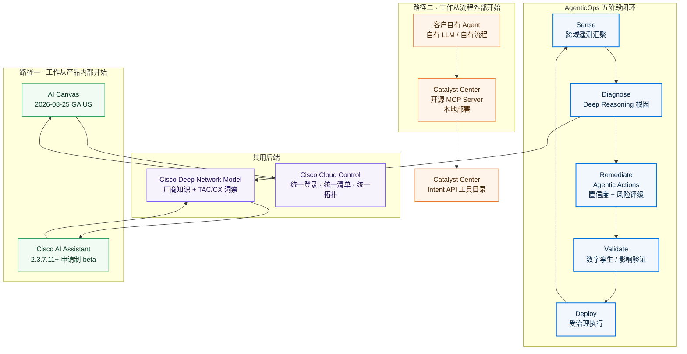

# Cisco Catalyst Center 功能体系与痛点解法（2023–2026）

> **调研对象**：Cisco Catalyst Center —— 思科园区与分支网络的**本地自托管**网络管理与保障平台（前身 Cisco DNA Center，2023-06 更名）。整条能力线围绕「设计 / 策略 / 供给 / 保障」四段展开，覆盖有线与无线、IT 与 OT、园区与分支，并提供 SD-Access（软件定义接入）IBN 的控制器能力。
> **调研范围**：**2023-01 ~ 2026-10** 公开发布的产品功能与能力增强，覆盖 **2.3.7.x 维护线（2.3.7.1 → 2.3.7.11.71047.100）** 与 **3.1.3 / 3.1.5 / 3.1.6 / 3.2.1 / 3.2.2 / 3.2.3 / 3.3.1** 两条主线，以及 Catalyst Center Global Manager、Meraki 与 Catalyst Center Global Overview、Cisco AI Assistant / AI Canvas / Cisco Cloud Control 等与 Catalyst Center 直接相关的外围平台。
> **交付内容**：① 按大功能点分组、标注时间与小功能点清单（表格）；② 每个大功能点的「用户痛点 → 如何解决」详解（P/S 编号一一对应）。
> **必须前置说明的一件事**：Catalyst Center 是**原厂自带网管（L1）**——它的能力上限不是「功能做得多少」，而是**「思科设备内部只对它开放」**。本报告反复出现的两条边界都源自这一点：① 它能读到自家设备的表项、协议状态机与 telemetry，第三方平台读不到；② 它对**非思科设备只做到 MIB-II**（2.3.7 起支持纳管），因此「多厂商统一管理」这条叙事在思科这里是有明确上限的。忽略这条边界，会把本报告误读成一份「功能更多」的产品清单。

## 信源与局限（先看这一段）

采用**三级信源交叉验证**：

| 等级 | 信源 | 覆盖时段 | 用途 |
| --- | --- | --- | --- |
| A | 官方 Release Notes / 官方用户指南与管理员指南 / 官方数据表（Data Sheet）/ **官方 EoL-EoS 公告** / 官方 FAQ / 官方 AI Assistant 说明页 / 官方 DevNet 文档与 MCP 仓库 / 官方财务披露 | 2023-12 ~ 2026-10 | 功能颗粒度、版本号、日期、规模上限、生命周期事实的主依据 |
| B | 官方博客（blogs.cisco.com / 官方社区技术文，作者为 Cisco 员工）/ 官方社区“新版本要点”帖 / 官方虚拟活动与 Cisco Live 议程材料 / 主流行业媒体（TechTarget、Techzine、451 Research 转载） | 2023-06 ~ 2026-10 | 平台级发布的主题、日期与机制细节 |
| C | 第三方评价与聚合平台（Gartner Peer Insights、IT Central Station、rfp.wiki、渠道商与许可顾问站点、第三方技术博客） | 2023-01 ~ 2026-10 | 客户真实体感、价格抓取与交叉验证 |

**已知局限**：

1. **思科不提供统一的产品发布日索引。** 官方支持页只给“文档更新日”，Release Notes 首版日期与“实际 GA 日”经常不一致（例：3.1.3 的文档更新日为 2026-04-01，但升级指南与社区帖显示首个 3.x 于 2025 年年中开始受控放量）。本报告对**只能反推的日期一律标注“约”**，对“文档更新日”与“社区口径 GA 日”并列呈现。
2. **3.2.x 未完全 GA。** 3.2.2 的 Release Notes 明确写“controlled availability release，需联系思科销售申请访问”；官方法文博客（2026-07）亦称“3.2.x 当前处于 Controlled Availability”。**凡属 3.2.x 的功能，本文一律标注为“受控可用”而非“普遍可用”**。
3. **AI 能力多为 beta 或申请制。** Catalyst Center AI Assistant 需**申请开通 + 激活特性 + 云端连通**；AI Canvas 在 Catalyst Center 侧参照 2026-01 口径仍为 alpha/beta 量级。**不得当作已 GA 的通用能力引用**。
4. **Gartner Magic Quadrant 正文在付费墙后**，本报告只能以「第三方评分 + 客户评论摘要」并列方式呈现市场位置，**无法直接核验 MQ 象限与厂商名单**。
5. **价格信息以 C 级聚合站抓取为主。** 思科不公开 Catalyst 硬件与订阅的完整价目，成交价走渠道报价；本文价格仅作**量级参考**，不可用于预算测算。
6. **厂商自述收益 ≠ 第三方验证。** 思科大量使用营销口径（“排障时间从小时降到秒”、“精度提升 >20%”、“AP 省电 20%”）。本文对**所有量化收益一律标注“量级参考”**，第三方验证单独标注来源。
7. **规模数据以官方数据表为准。** 渠道商页面出现“3 节点集群支持 25,000 台设备”的说法，与官方数据表（10,000 台）冲突——**本文取官方数据表口径并列此冲突**（见附四）。
8. **资料截止 2026-10-14。** 3.3.1（2026-09-09）是本时间窗内最新版本；Cloud Control / AI Canvas 的 GA 时点为 US 区域 2026-08-25，**非全球同步**。

**版本节奏对照表**（用于把功能对齐到时间窗）：

| 版本线 | 起点 | 终点（本时间窗内） | 定位 |
| --- | --- | --- | --- |
| 2.3.7.x（维护线） | 2.3.7 首版 2023-12-20 | 2.3.7.11.71047.100 GA 2026-07-08（2026-08-12 成为推荐版） | **长期维护主战场**，2024–2026 的绝大多数客户仍在线上跑这条线 |
| 3.1.x | 3.1.3（2025 年年中受控放量） | 3.1.6 三个维护包（至 3.1.6-75524.200） | 平台大改版第一代：UX 与后端重构 + SRBAC / 合规策略 / 能源管理 |
| 3.2.x | 3.2.1（xFSU 编排） | 3.2.3（2026-09-21） | **受控可用**；Ubuntu KVM、SD-Access 静默主机、LAN 自动化 OSPF |
| 3.3.x | 3.3.1（2026-09-09） | — | 支持 DN3 / DN4 双代物理设备 |
| 外围 | Global Manager 1.3.1（2025-12-06） | Global Manager 1.4.1（2026-05-22） | 多实例单点（最多 25 控制器 / 20 并发用户） |

> **源冲突提示 1（版本跳号）**：2.3.7 之后**不存在 2.4 / 2.5 / 2.6 主版本**，直接跳到 3.1.x。第三方聚合站出现的“Catalyst Center 2.4.1 / 2.4.2”实为 **ServiceNow 应用（Cisco Catalyst app）的版本号**，不是 Catalyst Center 产品版本。本文按官方版本线口径处理。
> **源冲突提示 2（3.1.3 的可迁移性）**：官方社区答复明确“3.1.3 **无迁移、无备份恢复、无升级**，仅面向绿地环境；迁移能力将在 3.1.5 之后以 Platform Refresh 提供”；另有帖子称“2.3.7.7 是最低可备份版本”。本文以**官方升级指南 + 社区答复并列**呈现，判定为：**3.1.3 = 绿地专用，3.1.5 起才有迁移路径**。
> **源冲突提示 3（DN3 停售 vs. 3.3.1 仍支持 DN3）**：DN3 第三代设备 EoS 公告于 **2026-07-02** 发布、最后下单 **2026-12-31**，而 **3.3.1（2026-09-09）数据表仍将 DN3 列为受支持硬件**。两者不矛盾——**停售停的是新采购，不是存量运行**（存量支持到 2031-12-31）。但当心“用 DN3 起新集群”的采购决策。

## 公司速览

| 维度 | 内容 |
| --- | --- |
| 公司 / 成立 / 总部 | Cisco Systems, Inc.，1984 年由斯坦福科学家创立，总部美国加州圣何塞；全球员工规模 10 万级 |
| 定位 | 企业网络基础设施厂商；Cyber Vision/Catalyst 系列定位**园区与分支的一体化网络平台**，Catalyst Center 是其中的**管理与保障控制台** |
| 产品谱系位置 | 设备（Catalyst 9000 / C9000 Smart Switches / 无线 AP 与 9800 WLC）＋ **控制器（Catalyst Center，本地自托管）** ＋ 云管（Meraki Dashboard）＋ 观测（ThousandEyes / Splunk / AppDynamics）＋ 安全（ISE / Secure Network Analytics / Talos） |
| 技术栈 | 南向：SNMP / MIB-II、NETCONF / RESTCONF / YANG、gNMI telemetry、CLI、PnP；北向：Intent API（REST）；东向：Events & Notifications / Webhook；西向：Integration API（ITSM）；AI 侧：Cisco Deep Network Model + Cisco 云（AI Network Analytics / AI Assistant / AI Canvas）；自动化侧：Python SDK、Ansible collection、Terraform provider、MCP server |
| 部署形态 | 专用物理设备（DN1 / **DN2** / **DN3** / **DN4**）＋ 虚拟设备（**VMware ESXi** / **AWS** / **Azure** / **Ubuntu KVM**）；**本地自托管为唯一形态**，云侧能力（AI、Cloud Control）为“外挂”，不改变本地控制面 |
| 关键规模（A 级，官方数据表） | 3 节点 DN3-XL 集群：**设备 10,000**（堆叠 / StackWise Virtual / VSS / WLC HA SSO 对计为 1 台）、**AP 25,000**、**并发终端 300,000**、**14 天瞬态终端 750,000**、**物理端口 768,000**、**物理+逻辑端口 200 万**、**NetFlow 25 万 flows/s** |
| SD-Access 规模（A 级，3.2.3 数据表） | Fabric 站点 500 / 500 / 1000 / 2000（按设备档位）；每站点 L3 VN 64 / 64 / 128 / 256；每站点 fabric 设备 500 / 500 / 600 / 3000；基于组的策略 25,000；接入合约 500；可扩展组 4,000 |
| 关键财务（A 级，FY2025 年报） | FY2025（截至 2025-07-26）营收 **$566.5 亿（+5%）**；GAAP 净利 **$104.5 亿**；Q4 网络产品收入 **$76.3 亿（+12%）**；FY2025 **AI 基础设施订单 > $20 亿**；FY2026 指引 $590–600 亿 |
| 生态规模（B 级，官方博客 2025-06） | 管理平台接入 **3,500 万+ 网络设备**、承载 **10 亿+ 客户端**；服务 **85% 的 Fortune 500**；Catalyst Center ＋ Meraki 合计 **1,600+ API 端点**、应用市场 **350+ 应用** |
| 资质与合规（A 级，官方 FAQ） | **SOC 2 Type 2**、**ISO 27001**、**FIPS 140-2**、Cisco Secure Development Lifecycle |
| 客户体感（C 级，混合） | Gartner Peer Insights Catalyst Center 评分 **4.8/5（188 条评分，5 星占 78%）**；正面集中在“单一控制台、自动化与保障、TAC 支持”；负面高度集中在**“许可复杂且贵”“界面学习曲线陡”“软件缺陷多”“与第三方设备及 Meraki 集成不足”**；IT Central Station 口径 2026-09 mindshare **4.2%**，较上年 **9.5%** 明显下滑 |

**一句话看懂四年演进**：

> **2023 改名字**（DNA Center → Catalyst Center，随 Networking Cloud 把多条产品线收进一个平台叙事）→ **2023–2024 补地基**（2.3.7 线把自动化、保障、事件分析、无线排障一块块补齐，把“看得全、配得对”做扎实）→ **2025 换平台**（3.x 平台大改版：UX 与后端重构，补上 SRBAC、规则化合规、能源管理，同时付出“2.3.7 无法直接升级”的代价）→ **2025–2026 上智能**（AgenticOps：AI Assistant、AI Canvas、Deep Network Model、MCP Server，把“问得懂”推向“做得动”）。
>
> 贯穿全程的第五条线是**“思科生态内的深度”**：SD-Access 绑 ISE、应用体验绑 ThousandEyes/Webex、分段绑 TrustSec/SGT。**它的深，来自身份（原厂），不来自能力。**

---

## 读法：12 个大功能点全景

| # | 大功能点 | 口号 | 小功能点数 | 时间跨度 |
| --- | --- | --- | --- | --- |
| 1 | 平台品牌、交付形态与统一管理 | 合得拢 | 15 | 2023-06 ~ 2026-09 |
| 2 | 版本体系与升级范式重构 | 升得动 | 15 | 2023-12 ~ 2026-09 |
| 3 | 园区自动化与配置闭环（Day-0 → Day-N） | 配得对 | 20 | 2023-12 ~ 2026-09 |
| 4 | AI Network Analytics 基线化智能运维 | 辨得清 | 8 | 2023 起持续 ~ 2026 |
| 5 | Assurance 端到端体验可观测 | 看得全 | 16 | 2023-12 ~ 2026-09 |
| 6 | 无线排障与射频运营 | 抓得住 | 16 | 2023-12 ~ 2026-09 |
| 7 | 事件关联、根因与网络缺陷识别 | 找得准 | 11 | 2023-12 ~ 2026-04 |
| 8 | 生成式 AI 助手与 AgenticOps | 做得动 | 16 | 2025-06 ~ 2026-08 |
| 9 | 零信任工作空间与分段策略（SecOps） | 分得开 | 15 | 2023-12 ~ 2026-09 |
| 10 | 可持续性与能源管理 | 省得下 | 7 | 2023-12 ~ 2026-09 |
| 11 | 开放平台、API 与生态集成 | 接得上 | 15 | 2023-12 ~ 2026-09 |
| 12 | 许可与商业模式重构 | 买得值 | 11 | 2023-06 ~ 2026-08 |

> **合计约 165 个小功能点。**
> **读法提示**：第 1–2 组回答“它是什么、怎么装、怎么升”（**客户最容易低估、也最容易踩坑的两组**——2.3.7 → 3.x 的迁移代价就藏在这里）；第 3 组是**白天干活**的一组（配置与自动化）；第 4–7 组是**故障来了怎么办**的一组（基线、体验、无线、根因），也是与自研 APM 最直接可比的一组；第 8 组是**最新、变化最快**的一组，全部集中在 2025-06 之后；第 9–10 组是“安全”与“省电”两条政策驱动线；第 11–12 组回答“接不接得上、敢不敢买”。

---

# 大功能点 1：平台品牌、交付形态与统一管理 —— 合得拢

## 1.1 小功能点清单

| # | 小功能点 | 发布时间 | 来源等级 | 说明 |
| --- | --- | --- | --- | --- |
| 1.1 | Cisco DNA Center → **Cisco Catalyst Center** 更名 | 2023-06（Cisco Live US 2023） | B | 随 **Cisco Networking Cloud** 战略一并宣布；官方口径明确“能力与功能不变，只是改名”，过渡期两名并存 |
| 1.2 | Cisco Networking Cloud 战略发布 | 2023-06 | B | 把 DNA Center / Meraki Dashboard / Nexus Dashboard 等收敛到**一个云管 + 一个本地管**两个平台；统一 SSO、统一设计语言（统一字体/配色/菜单/工作流） |
| 1.3 | Catalyst 许可简化：硬件 + 软件 + 支持合并为**单一 SKU** | 2023-06 宣布（先交换机） | B | 官方称后续扩展到其余产品线；DX 许可（DNA Essentials/Advantage）继续作为功能分层 |
| 1.4 | Catalyst Center **2.3.7** 首发 | 2023-12-20（Release Notes 首版日） | A | 本时间窗内 2.3.7.x 维护线的起点，也是绝大多数存量客户的实际版本 |
| 1.5 | **Cloud Monitoring for Catalyst**（Meraki 云管侧纳管 Catalyst 交换机） | 2023-06 起 | B | 云管与本地管并行的第一步；Meraki 侧暴露 CLI show 命令便于排障 |
| 1.6 | **Catalyst Center OVA for VMware ESXi**（不额外收费） | 2.3.7.7 起 | A | 官方口径：支持物理设备的关键特性与用例，兼具易安装、见效快与 ESXi 原生高可用 |
| 1.7 | 虚拟化/云部署形态扩展到 **AWS** | 2.3.7 线内（官方数据表列为受支持形态） | A | 与 ESXi 并列的第二形态 |
| 1.8 | 虚拟化/云部署形态扩展到 **Microsoft Azure** | 2025-06（Cisco Live San Diego）宣布 | B | 官方 Cisco Live 2025 recap 列为 Catalyst Center 侧创新之一 |
| 1.9 | 虚拟化/云部署形态扩展到 **Ubuntu KVM** | 3.2.3（2026-09-21） | A | 3.2.3 数据表明确四形态：ESXi / AWS / Azure / Ubuntu KVM |
| 1.10 | **第三代物理设备 DN3**（DN3-HW-APL / -L / -XL，32/56/80 核） | 2023-11 起（2.3.7 线内） | A/C | 官方数据表按 DN3-HW-APL-XL 给出规模上限 |
| 1.11 | **第四代物理设备 DN4**（DN4-HW-APL / -L / -XL，32/48/72 核） | 2026-08-27（数据表更新日） | A | 3.3.1 起支持 DN3 与 DN4 双代 |
| 1.12 | 一代设备 **DN1（M4）停售停服** | EoS 公告 2024-05-10 | A | 官方社区口径：**DN1 的软件支持止于 2.3.7.9**，因此 DN1 无法迁往 3.x |
| 1.13 | 二代设备 **DN2 停售停服** | EoS 公告 2023-11-07 | A | 3.2.3 数据表仍列 DN2 为受支持硬件 |
| 1.14 | **Catalyst Center Global Manager 1.3.1** 发布 | 2025-12-06 首发（文档 2026-04-02 更新） | A | 多实例单点（SPoG）：最多 **25 个控制器 / 20 个并发用户**；最小支持版本 2.3.7.9 / 2.3.7.10 / 3.1.3 / 3.1.5 |
| 1.15 | **Global Manager 1.4.1** 与 **Meraki–Catalyst Center Global Overview GA** | 1.4.1：2026-05-22；Global Overview GA：**2025-12-17** | A/B | Global Overview 在 **Meraki Dashboard** 内统一 Meraki 云管与 Catalyst Center 本地的资产、健康与告警，SSO 交叉跳转，**无需额外许可** |

## 1.2 它对应的用户痛点

> **口径**：本节只写客户侧可感知的痛（时间 / 钱 / 人 / 合规 / 组织），不写“两套数据模型怎么对齐”“管理面怎么分片”这类架构层问题。痛点编号 P1…Pn 与下节解法 S1…Sn 一一对应。

- **P1｜网管不是一个，是一堆**。同一张网络，云管一套、本地管一套、安全一套、观测一套，跨域故障时运维要在几个控制台之间来回切换才能拼出全貌，光“找对入口”就消耗时间。（时间 / 人）
- **P2｜换平台等于推倒重来**。把本地管理迁到新平台往往意味着重新部署采集、重建策略与视图，迁移窗口本身就是一次风险敞口，于是很多团队干脆长期不动。（时间 / 钱）
- **P3｜本地部署必须自备机房与硬件**。管理平台要占机柜、要电源、要采购周期；新园区上线时，管理平台的到货时间会成为整条项目的关键路径。（时间 / 钱）
- **P4｜集团多实例各自为政，没有统一视图**。全球或集团型客户按区域建了多个控制器，总部要看全网健康只能逐个登录，出跨区事件时缺少一份被各方承认的共同证据。（组织 / 时间）
- **P5｜云管与本地管的资产清单对不上**。一部分交换机上了云、一部分留在本地，两边的设备清单、健康口径、告警严重级别不一致，盘点与审计时对不上账。（组织 / 合规）

## 1.3 它是如何解决的

**架构约束（由痛点倒推）**

| 架构约束 | 由哪条痛点倒推 | 落到了哪些功能 |
| --- | --- | --- |
| 管理面必须有统一的品牌、导航与 API 语义，跨控制台切换才可能变少 | P1 | Networking Cloud 战略、DNA Center → Catalyst Center 更名、统一设计语言（B 级）、统一 API 与 SDK |
| 既有本地部署不能被“替换掉”，只能被“接入” | P2 | Global Overview 交叉跳转而不搬数据；本地面板保留完整管理能力（B 级口径） |
| 交付形态必须可选项化，才能摆脱专用硬件绑定与采购周期 | P3 | OVA/ESXi（1.6）、AWS（1.7）、Azure（1.8）、Ubuntu KVM（1.9）、DN2/DN3/DN4 多代并存 |
| 多实例之上必须再有一层“汇总面”，且必须共享同一套实体标识 | P4 | Global Manager（站层级统一、全局搜索、SSO 跨控制器导航、RBAC）；Global Overview 统一多 Meraki 组织 + 多 Catalyst Center |
| 云管与本地管要产出同一份资产口径，才谈得上“一个视图” | P5 | Meraki Dashboard 与 Catalyst Center 的 Global Overview（统一资产、健康、告警、合规）、共享许可证与统一支持（Cisco Networking Subscription） |

- **S1｜品牌与平台归一：一个名字 + 一套设计语言**（→ 解 P1）。2023-06 把 DNA Center 更名为 **Catalyst Center**、Viptela SD-WAN 更名为 Catalyst SD-WAN，并把 SSO、跨平台导航、统一设计系统作为 Networking Cloud 的第一阶段交付。**客户端的直接收益是“不同控制台长得一样、入口一致”，减少了“找入口”的时间**。注意：这是**导航层统一，不是数据层统一**——三套平台仍是三套数据面。
- **S2｜联邦而非替换：Global Overview 与 Global Manager**（→ 解 P2）。两条路径并行：① **Meraki 与 Catalyst Center Global Overview（2025-12-17 GA）**把 Catalyst Center 作为“组织”接入 Meraki Dashboard，单点登录后交叉跳转到 Catalyst Center 做深度排障，**官方明确无需额外许可**；② **Global Manager（2025-12 首发）**直接面向“多个 Catalyst Center 实例”的场景，把区域级控制器聚成一个单点。**两者都不要求客户替换既有本地部署**——这是对 P2 的直接回应。
- **S3｜交付形态可选项化**（→ 解 P3）。自 2.3.7.7 提供 **ESXi OVA**（不额外收费），随后补齐 **AWS**（2.3.7 线）、**Azure**（2025-06 宣布）、**Ubuntu KVM**（3.2.3）。**客户可以用既有虚拟化平台起一套控制器，把管理平台的采购周期从“等硬件”压到“导入 OVA / 实例”**。代价是虚拟形态的功能并非与物理设备完全等价（例：3.2.2 的 Disaster Recovery 包**仅物理设备可用，虚拟设备不可用**）。
- **S4｜多实例之上的汇总面**（→ 解 P4）。Global Manager 提供：控制器注册（按 Member ID + IP/FQDN 登记）、全局搜索（跨控制器搜设备/终端/用户）、**SSO 跨控制器导航**、控制面拓扑可视化、站层级统一、EoX/EoS 可见性、RBAC、可定制情境面板（最多选 15 个 dashlet，共 32 个预置 dashlet），以及**面向管理面健康度的 API**。**它把“逐台登录”变成“一个入口 + 一次搜索”，管理规模上限从“单控制器”变成“25 个控制器 × 各自规模”**。
- **S5｜统一盘点口径**（→ 解 P5）。Global Overview 在同一界面里提供跨 Meraki 组织与 Catalyst Center 的统一资产、统一健康、统一告警与合规工作流，并配以**共享许可与统一支持（Cisco Networking Subscription）**。**这是思科对“云管/本地管撕裂”这一客户抱怨的正面回应**。

> **边界**：
> - **“统一”停在导航层与资产层，没到配置层。** 从 Meraki Dashboard 可以交叉跳进 Catalyst Center 做深度排障，但 Catalyst Center 的完整设计/策略/供给仍在本地完成；三类平台仍是三套控制面。
> - **Global Manager 的规模上限很硬**：**25 个控制器、20 个并发用户**（A 级）。这决定了它服务的是“区域级汇总”，不是“超大规模单点”。
> - **虚拟设备的功能面小于物理设备**：Disaster Recovery 仅物理设备可用（A 级）。
> - **硬件代际是硬约束**：DN1 软件支持止于 2.3.7.9，因此 **DN1 无法迁往 3.x**（B 级）；DN3 最后下单 **2026-12-31**，DN4 的 -L/-XL 核心数低于 DN3 同档（B 级渠道解读），扩容规划必须重新核算。
>
> **配套演进**：2023-06 的“许可单一 SKU”属商业口径重构（详见第 12 组）；DN3 → DN4 的硬件换代属生命周期管理（详见「附一」「附四」），二者均不构成客户痛点的解法，故不列入 S 列表。

---

# 大功能点 2：版本体系与升级范式重构 —— 升得动

## 2.1 小功能点清单

| # | 小功能点 | 发布时间 | 来源等级 | 说明 |
| --- | --- | --- | --- | --- |
| 2.1 | **2.3.7.x 长维护线**（2.3.7.1 → 2.3.7.11.71047.100） | 2023-12-20 ~ 2026-07-08（文档更新至 2026-09-10） | A | 约 2.5 年持续交付 SMU；官方**推荐版**反复更新（2.3.7.9 → 2.3.7.10.70209.10 → **2.3.7.11.71047.100**） |
| 2.2 | 2.3.7.6：ISE FQDN 可编辑、任务可手动停止、IPAM 同步可选、**v2 系统通知事件**、Smart Call Home → Smart Transport | 2.3.7.6 | A | v1 系统通知事件被弃用并引入 v2（对已订阅事件的外部系统有改造要求） |
| 2.3 | 2.3.7.7：**升级摘要报告**（Upgrade Summary Report） | 2.3.7.7 | A | 可查看最近一次平台与应用的升级结果 |
| 2.4 | 2.3.7.9：**混合 HA 集群**（DN2 + DN3 混编三节点集群） | 2.3.7.9 | A | 官方虚拟活动与 Release Notes 均列为该版要点 |
| 2.5 | 2.3.7.10：PRP（并行冗余协议）、**ISSU**（C9400 fabric 节点 + 9800 WLC 不中断升级）、brownfield 自动发现、**260+ 新 API**、Ansible 集合扩到 **31 个工作流**、Wi-Fi 7 AP 支持 | 2.3.7.10（2025-11-03 成为推荐版） | A/B | 客户原文强调“升级期间不中断服务” |
| 2.6 | 2.3.7.11.71047.100 **GA** 并成为最新推荐版 | 2026-07-08 GA / 2026-08-12 推荐 | A | 该版开始带 **AI Assistant**（申请制 beta） |
| 2.7 | **3.1.3**（平台大改版首版） | 2025 年年中受控放量（文档更新日 2026-04-01） | A/B | 官方法文博客称 3.x 是“重大更新，带来 SRBAC、Rule-Based Compliance、Energy Management、AI Assistant 以及 UX 与后端重构” |
| 2.8 | **2.3.7 → 3.1.x 无直接升级路径** | 3.1.3 起（文档明确） | A | 因平台重大变更，**必须重装镜像（reimage）+ 从 2.3.7 备份恢复**；提供 “Catalyst Center 3.x upgrade package” 安装向导简化流程；**2.3.7.7 为最低可备份版本** |
| 2.9 | **3.1.3 仅面向绿地环境**（无迁移、无备份恢复、无升级） | 3.1.3 | B | 官方社区答复原文口径；实验室 POC 优先 |
| 2.10 | **Platform Refresh** 迁移工作流 GA | 3.1.5 | B | 用于把既有 **DN2 / DN3** 硬件从 2.3.7.x 迁到 3.x；**DN1 不支持** |
| 2.11 | **跨版本备份与恢复**（3.x 起） | 3.1.6 起明确 | A/B | 官方社区口径：3.1.3 / 3.1.5 的备份可恢复到 3.1.6 及之后版本；**备份计划（backup schedule）不随升级迁移** |
| 2.12 | **3.1.6 / 3.2.1 / 3.2.2 / 3.2.3 / 3.3.1** 逐版发布 | 3.1.6-75205/75405.100/75524.200；3.2.2 **2026-05-05**；3.2.3 **2026-09-21**；3.3.1 **2026-09-09** | A | 3.2.x 为 **Controlled Availability**（需销售申请） |
| 2.13 | **3.1.3 破坏性变更**：设备周期性重同步最小间隔 **25 分钟 → 6 小时** | 3.1.3 | A | 官方给出的理由是减少不必要的同步、避免系统变慢；**已设置低于 6 小时的设备会被自动上调** |
| 2.14 | 官方升级准备工具链：**Validation Tool**（设备健康与升级就绪检查，含 AURA 工具）＋ Compatibility Matrix ＋ 升级时长估算 | 2025-10 官方课程（B） | A/B | 官方建议**提前 5–7 天**完成兼容性核对、校验、备份 |
| 2.15 | 安全与合规基线：**FIPS 140-2 / SOC 2 Type 2 / ISO 27001 / Cisco SDL**；受影响的安全公告按版本修复 | 持续 | A | 同一窗口内可见多条安全公告（如 2025-11-13 两条、2026-07-06 任意文件读取）与 Field Notice（如 2026-05-13 证书 EKU 问题，建议升级） |

## 2.2 它对应的用户痛点

> **口径**：本节只写客户侧可感知的痛，不写“平台架构为什么要重构”这类设计约束。P1…Pn 与下节 S1…Sn 一一对应。

- **P1｜升级窗口不可控，业务要陪着停机**。控制器升级往往要占掉整个维护窗口，期间自动化、保障、策略下发都停摆；万一同窗口还有设备侧升级，窗口根本不够用。（时间 / 钱）
- **P2｜升级等于重装重配**。跨大版本升级后，历史数据、自定义报表、集成配置、备份计划都要重新建立或重录，工程师要花时间把“原来有的东西”再做一遍。（时间 / 人）
- **P3｜版本碎片化，支持与复现都要对齐版本**。同一集团里 2.3.7.7 / 2.3.7.9 / 2.3.7.10 / 3.1.3 并存，同一个缺陷在不同版本表现不同，开 TAC 工单、做兼容性矩阵、复现问题都要先对齐版本号。（组织 / 时间）
- **P4｜升级失败没有退路**。控制器是“配置的唯一真相源”，一旦升级失败又回不去，最坏情况是按手抄的配置重建整个管理面。（时间 / 钱）
- **P5｜硬件代际到期逼着做整体迁移，但迁移手段不存在**。DN1 / DN2 停售停服，客户被迫整体换代；而首版 3.x 连“迁移”这件事都不支持，等于把客户卡在中间。（钱 / 时间）

## 2.3 它是如何解决的

**架构约束（由痛点倒推）**

| 架构约束 | 由哪条痛点倒推 | 落到了哪些功能 |
| --- | --- | --- |
| 升级必须“可预演、可评估、可回退”，否则窗口不可控 | P1、P4 | Validation Tool / AURA 预检查、Compatibility Matrix、升级时长估算、备份强制前置 |
| 平台重构必须与“客户数据存活”解耦 | P2、P4 | 3.x 起跨版本备份与恢复（reimage 后 restore，而非重建） |
| 服务周期必须用“同一版本线上持续交付”来对冲跨版本迁移代价 | P3 | 2.3.7.x 长维护线（2.5 年，SMU 连续交付） |
| 迁移能力必须作为独立工作流交付，且必须限定硬件代际 | P5 | Platform Refresh（3.1.5 GA），仅 DN2/DN3 |
| 破坏性行为必须显式公告并给出替代路径 | P3 | 3.1.3 resync 间隔 25 分钟 → 6 小时的破坏性变更说明；v1→v2 事件迁移说明 |

- **S1｜升级前的“预检查 + 可预估 + 摘要留痕”工具链**（→ 解 P1）。官方提供 **Validation Tool**（Appliance Infrastructure Status / Upgrade Readiness Status 两组校验集）、**Compatibility Matrix** 与**升级时长估算**，官方建议提前 **5–7 天**完成兼容性核对、健康校验与全量备份；升级后可用 **Upgrade Summary Report**（2.3.7.7 起）核对本次平台与应用的升级结果。**客户可以把“赌一次窗口”变成“按清单确认后再动手”**。
- **S2｜跨版本备份与恢复**（→ 解 P2、P4）。自 3.x 起，**3.1.3 / 3.1.5 的备份可恢复到 3.1.6 及之后版本**（同规则向后适用）。这条对客户的意义是具体的：**跨大版本迁移时不必重建管理面数据，而是“重装镜像 + 恢复备份”**。官方同时明确了两个缺口：**备份计划不随升级迁移**，且 3.1.3 完全不支持迁移。
- **S3｜用长维护线对冲跨版本迁移**（→ 解 P3）。2.3.7.x 从 2023-12 一直维护到 2026-09（文档仍在更新），官方**反复刷新推荐版**（2.3.7.9 → 2.3.7.10.70209.10 → 2.3.7.11.71047.100）。**客户在一整条版本线上持续拿到缺陷修复与形态扩展（ESXi OVA、Wi-Fi 7 AP、混合 HA 集群、ISSU、260+ 新 API），从而把“必须跨大版本”的压力向后推。**
- **S4｜Platform Refresh 迁移工作流**（→ 解 P5）。3.1.5 起把“从 2.3.7.x 迁到 3.x”沉淀为一个独立工作流，用于把既有 **DN2 / DN3 硬件**纳入 3.x。**边界同样明确：DN1 硬件不在支持范围**（软件支持止于 2.3.7.9）。这条解法把 P5 的“无路可走”变成了“有路，但旧硬件无路”。
- **S5｜混合 HA 集群，延后硬件换代**（→ 解 P5、P3）。2.3.7.9 支持 **DN2 + DN3 混编三节点集群**用于高可用。**客户可以在不整体更换硬件的前提下扩容/重建高可用集群**，把“要么全换、要么不动”的二选一拆成了过渡路径。

> **边界**：
> - **2.3.7 → 3.x 的迁移成本是真实存在的**：官方措辞是“无升级工作流，属迁移或新装”，且 3.1.3 完全不能迁移。**这是本报告中最容易被客户低估的一条成本。**
> - **跨版本恢复是“同构恢复”**：备份计划不迁移、部分应用状态需重建；3.2.2 的 Disaster Recovery 包**仅物理设备**可用。
> - **推荐版策略本身带来运维负担**：同一条 2.3.7.x 线上有 .9 / .10 / .11 三个“推荐版”，客户仍要判断“跟哪一版”。
> - **3.2.x 处于受控可用**：想验新特性要走销售申请，属“非普遍可用”状态。
>
> **配套演进**：3.x 的 UX 与后端重构、DN3 → DN4 的硬件换代、安全公告的版本修复节奏，属平台与生命周期演进，不作为客户痛点的解法，统一放在「附一」「附二」处理。

---

# 大功能点 3：园区自动化与配置闭环（Day-0 → Day-N）—— 配得对

## 3.1 小功能点清单

| # | 小功能点 | 发布时间 | 来源等级 | 说明 |
| --- | --- | --- | --- | --- |
| 3.1 | Plug and Play / 零接触开局（PnP、ZT） | 既有能力，2023–2026 持续扩展 | A | 设备上电接入即自动纳管并下发配置，免现场实施与预配置 |
| 3.2 | **Day-0 自动化扩展**：AVC、**NETCONF**、QoS 自动配置写入 Day-0 模板 | 2.3.7 | A | 新设备加入站点时自动套用；官方口径是“把配置正确性前移到部署时” |
| 3.3 | **Catalyst 9800 无线控制器支持 PnP** | 2.3.7 | A | 无线控制器纳入零接触开局范围 |
| 3.4 | **LAN Automation 支持 5 个并发会话**（每站点 1 个） | 2.3.7 | A | 官方明确此前只允许单会话同时运行 |
| 3.5 | **LAN Automation 支持 OSPF** | 3.2.3 | A | 为 LAN underlay 供给提供 OSPF 选项 |
| 3.6 | **Configuration Visibility and Control**：Configuration Preview 可对**所有受支持工作流**强制启用 | 2.3.7 | A | 由“部分工作流可选”变为“可全局强制”；展示**前后配置差异（before / after）与完整 CLI** |
| 3.7 | 规划中的配置变更**转发到 ServiceNow ITSM 审批**后再下发 | 2.3.7 | A | 变更走标准方法，审批链路与配置下发闭环 |
| 3.8 | **Image Update 五步工作流 + 顺序/并行混合编排** | 2.3.7 | A | 可指定批量升级中哪些设备串行、哪些并行以及先后顺序（核心/汇聚/接入分层升级尤其有用） |
| 3.9 | **xFSU 自动编排**（Catalyst 9300） | 3.2.1 | B | 自动做预检查、资格校验与设备间排序，把快速升级框架的编排交给平台 |
| 3.10 | **ISSU 支持**（C9400 作为 Fabric 节点 + 9800 WLC 不中断升级） | 2.3.7.10 | A | 客户原文强调“升级软件不中断网络服务” |
| 3.11 | **Brownfield 自动发现**与存量配置洞察 | 2.3.7.10 | A/B | 官方升级亮点原文：可自动发现存量基础设施、洞察既有配置、简化自动化任务 |
| 3.12 | **Device Details 配置工作流**：存量设备的二层配置查看、过滤与编辑 | 2.3.7 | A | 可读写 VLAN、STP、发现协议（CDP/LLDP）、端口配置等（此前仅能改端口 shut/no shut、描述、VLAN） |
| 3.13 | **第三方设备支持（MIB-II 标准）** | 2.3.7 | A | 可将支持标准 MIB-II 的非思科设备纳入清单与拓扑，获得设备在线时长等信息 |
| 3.14 | **Rule-Based Compliance Policies**（自定义配置规则并周期性全网评估） | 3.1.5 | A | 规则可用字符串比较、正则、表达式求值；作用于配置、CLI show 输出与设备属性；支持变量、多条件、违规消息与严重级别 |
| 3.15 | 合规违规呈现与合规摘要 | 3.1.5 / 3.1.6 | A | 合规摘要中展示逐条违规结果；官方举例：禁用 Telnet、必须用外部 AAA、至少 2 台 NTP、控制台连接策略、口令策略 |
| 3.16 | **Trunk 端口 allowed / native VLAN 配置** | 3.1.3 | A | 补上二层供给的一处常见缺口 |
| 3.17 | **重叠 IP 地址池**（CIDR 子网重叠开关） | 3.1.5 | A | 动态地址分配时提供更大灵活性（多租户/隔离场景） |
| 3.18 | 模板中心 / CLI 模板 / Model Config Editor / Feature Templates | 既有能力，持续演进 | A | 意图化模板体系，支持变量与要素模板 |
| 3.19 | 任务可**手动停止**（Tasks 窗口） | 2.3.7.6 | A | 对跑偏的批量任务可中止，而不是等它跑完 |
| 3.20 | AP Refresh 工作流增强（新 AP 自动检测、仅复制旧配置的 Assurance 场景） | 2.3.7.4 | A | 换 AP 场景的引导式流程 |

## 3.2 它对应的用户痛点

> **口径**：本节只写客户侧可感知的痛，不写“配置模型怎么建模”“差异怎么算”这类设计约束。P1…Pn 与下节 S1…Sn 一一对应。

- **P1｜配置靠人工敲，量大且易错**。几百上千台接入交换机的同类配置，靠工程师逐台敲 CLI，一次批量变更要反复核对；**官方口径称约 80% 的网络中断由变更引起**。（时间 / 钱）
- **P2｜变更前不知道“会被改成什么样”**。工具一按就下发，出事才知道改了哪几行；变更评审时拿不出可读的差异说明。（时间 / 钱）
- **P3｜变更没有审批与留痕，审计时说不清**。谁在什么时候改了什么、有没有走过变更流程，事后只能翻终端记录，审计与合规举证困难。（合规 / 组织）
- **P4｜存量设备纳管后看不清既有配置，不敢让平台接管**。已有网络的配置是历史堆积，平台只能读不能改，工程师不敢把自动化开到生产。（时间 / 人）
- **P5｜混入非思科设备后，资产与拓扑对不上**。多厂商环境里，一部分设备进不了平台，盘点与拓扑只剩半个视图，出问题时找不到设备归属。（组织 / 时间）
- **P6｜合规检查靠人工，标准落不了地**。安全基线（禁用 Telnet、AAA 外部认证、NTP 数量等）靠人抽查，不同人查法不同，整改无法闭环。（合规 / 人）

## 3.3 它是如何解决的

**架构约束（由痛点倒推）**

| 架构约束 | 由哪条痛点倒推 | 落到了哪些功能 |
| --- | --- | --- |
| 批量变更必须由“意图 + 模板”生成，而不是由人写命令 | P1 | PnP/ZT、Day-0 自动配置（AVC/NETCONF/QoS）、模板体系、LAN Automation |
| 下发前必须给出可读的差异证据 | P2 | Configuration Preview 强制化（前后对比 + 完整 CLI） |
| 下发必须可与外部变更管理流程对齐 | P3 | ServiceNow ITSM 审批前置、Audit Logs、Upgrade Summary Report |
| 存量网络必须“先看清、再接管”，且读写权限要渐进 | P4 | Brownfield 自动发现、Device Details 二层配置读写、任务可停止 |
| 资产管理必须给“非思科设备”留出明确入口 | P5 | 第三方 MIB-II 设备纳管（清单 / 拓扑 / 在线时长） |
| 合规必须可表达为规则并持续评估，而非一次性人工检查 | P6 | Rule-Based Compliance Policies + 合规摘要与违规详情 |

- **S1｜意图化模板 + 零接触开局**（→ 解 P1）。**PnP / ZT** 让新设备上电即纳管并套用站点配置；2.3.7 把 **AVC / NETCONF / QoS** 纳入 **Day-0 模板**，使“部署时”就写对；**LAN Automation 支持 5 个并发会话**，官方明确此前只允许单会话；3.2.1 进一步把 **C9300 的 xFSU 编排**（预检查、资格校验、设备间排序）交给平台；2.3.7.10 的 **ISSU** 让 C9400 fabric 节点与 9800 WLC 升级期间业务不中断。**这一组把“配置正确性”从人手上移到平台**。
- **S2｜下发前的强制差异预览**（→ 解 P2）。**Configuration Visibility and Control** 把 **Configuration Preview** 从“部分工作流的可选项”变成“**可对所有受支持工作流强制**”，展示**前后配置差异与完整 CLI**。配合 **Image Update 五步工作流 + 顺序/并行编排**，客户在把变更推给核心/汇聚/接入之前，能先看到“每台设备会被改成哪几行、按什么顺序改”。
- **S3｜与 ITSM 的变更审批闭环**（→ 解 P3）。规划中的配置变更可**先转发到 ServiceNow ITSM 审批再下发**；配合 Audit Logs、Tasks 与 Upgrade Summary Report 形成留痕。**这条解法把平台的“技术正确”接上了企业的“流程合规”**，同时让变更责任有据可查。
- **S4｜存量网络先看清再接管**（→ 解 P4）。**Brownfield 自动发现**（2.3.7.10）自动识别存量基础设施并给出既有配置洞察；**Device Details 配置工作流**（2.3.7）允许查看、过滤与编辑存量设备的 **VLAN / STP / CDP / LLDP / 端口**等二层配置；**Trunk 端口的 allowed/native VLAN** 在 3.1.3 补齐；跑错的任务可在 Tasks 窗口**手动停止**。**客户可以从“只读观察”逐步走到“受控编辑”，而不是一次性把生产交出去。**
- **S5｜给第三方设备一个明确的纳管入口**（→ 解 P5）。2.3.7 起支持**纳管支持标准 SNMP MIB-II 的第三方设备**，提供设备在线时长、拓扑可见性与发现/清单能力，官方定位是“简化多厂商环境运维，为网络设备与防火墙提供单一可见性来源”。**这条解法的边界必须说清楚：它是 MIB-II 层面的纳管，不是设备内部可见性。**
- **S6｜合规表达为规则并持续评估**（→ 解 P6）。**Rule-Based Compliance Policies**（3.1.5）允许用字符串比较、正则与表达式编写规则，作用于配置、CLI show 输出与设备属性，支持变量、多条件、违规消息与严重级别，并周期性全网评估，结果呈现在合规摘要中。官方给出的规则示例本身就是“安全基线检查”：**禁用 Telnet、登录认证必须走外部 AAA、至少 2 台 NTP、控制台连接策略、口令策略**。**这把合规从“抽查”变成“可复用的规则资产”。**

> **边界**：
> - **第三方设备只到 MIB-II**。官方措辞是“第三方设备支持（标准 SNMP MIB2）”，提供的是在线时长、拓扑与清单层面的可见性。**它不解决“读表项、读命中率、读设备内部”**——这条线与原厂身份直接绑定（详见「附二」）。
> - **配置预览 ≠ 变更影响面分析**。它告诉你“会改成什么”，不告诉你“改完谁会受影响”。
> - **P4 只被部分解决**：客户实证仍在抱怨“**无法把交换机当前配置与模板比对，找出缺失的命令行**”（C 级）。也就是说，“敢不敢让平台接管生产”这个问题，在存量复杂环境里没有被完全回答。
> - **合规规则的维护是客户自己的活**：规则要人写、要人维护版本，平台只提供评估引擎。
>
> **配套演进**：IPAM 集成（同步可选）、重叠 IP 池、v1→v2 系统通知事件迁移、260+ 新 API 与 Ansible 31 工作流等，属集成与开发体验演进，部分内容划入第 11 组；此处不重复计为解法。

---

# 大功能点 4：AI Network Analytics 基线化智能运维 —— 辨得清

## 4.1 小功能点清单

| # | 小功能点 | 发布时间 | 来源等级 | 说明 |
| --- | --- | --- | --- | --- |
| 4.1 | **AI 驱动个性化基线（Green Band）** | 2023 起持续（含 3.2.x 口径） | A/B | 为特定清单/站点建立**动态统计基线**（移动平均），随时间自适应演进，用于区分“正常波动”与“真问题” |
| 4.2 | **4 周滚动基线** | 3.x 口径 | B | 官方社区技术文口径：用 4 周滚动基线构建对环境（如办公出勤与设备密度变化）的预测性理解 |
| 4.3 | **AI 异常检测与降噪** | 2023 起持续 | A | 官方口径：忽略无害异常以降低噪声；区分真假瓶颈 |
| 4.4 | **AI 预测性分析与主动洞察** | 3.x 口径 | A | 官方举例：预测 Wi-Fi 干扰上升、上线（onboarding）延迟、办公流量负载上升 |
| 4.5 | **站点/对等比较与热力图趋势** | 2023 起持续 | A/B | 单视图可定制 KPI，用于理解设备/用户/应用健康；支持站点之间与“对等体（peers）”比较 |
| 4.6 | **AI 增强 RRM**（AI-Enhanced RRM） | 2.3.7 起明确 | A | 评估历史 RF 经验、预测趋势并给出配置建议；**配 RRM 模拟器**，可在设计阶段建模并验证建议后再落地 |
| 4.7 | **AI 驱动加速修复**（机器推理引擎支撑的根因变量识别） | 2023 起持续 | A | 官方口径：识别与根因最相关的关键变量，结合机器推理引擎做复杂根因分析并快速执行纠正动作 |
| 4.8 | **云连接 + 数据匿名化**（AI 分析数据送 Cisco AIOps 云） | 2023 起持续 | A/B | 官方社区技术文口径：送往 Cisco AIOps 云的数据**在处理前严格匿名化**；跨客户匿名数据用于构建比单站点模型更准的行为模型 |

## 4.2 它对应的用户痛点

> **口径**：本节只写客户侧可感知的痛，不写“阈值为什么不准”“模型怎么训练”这类设计约束。P1…Pn 与下节 S1…Sn 一一对应。

- **P1｜告警洪泛，真问题被噪声淹没**。一次峰值异常能触发几百条同源告警，团队被迫先做“告警分类”再谈排障，真正的问题被推迟发现。（时间 / 人）
- **P2｜静态阈值跟不上环境变化**。办公出勤、设备密度、应用组合天天在变，固定阈值要么大面积误报、要么对真问题沉默，团队对告警逐渐失去信任。（时间 / 人）
- **P3｜性能退化是渐进的，等用户抱怨时已经晚了**。无线干扰、上线变慢、负载上升都是缓慢爬坡的过程，等业务方报障时，问题已经影响了可用性。（时间 / 钱）
- **P4｜说不出“我们和同类站点比差在哪”**。同一个园区内不同楼栋、不同站点之间缺乏可比口径，容量与优化投入缺少依据。（组织 / 时间）

## 4.3 它是如何解决的

**架构约束（由痛点倒推）**

| 架构约束 | 由哪条痛点倒推 | 落到了哪些功能 |
| --- | --- | --- |
| 判定“异常”必须相对“该网络自己的正常”而言 | P2 | AI 驱动个性化基线（Green Band）、4 周滚动基线 |
| 降噪必须建在“事件关联 + 基线偏离”之上，而不是阈值上 | P1 | 异常检测与降噪、事件关联（与第 7 组联动） |
| 需要“提前于用户感知”的时间量，就必须做趋势预测 | P3 | 预测性分析与主动洞察、AI 增强 RRM 的趋势学习 |
| 可比性必须造出来：同一套 KPI、同一套分层口径 | P4 | 站点/对等比较、单视图可定制 KPI、RRM 模拟器建模 |

- **S1｜个性化基线（Green Band）取代固定阈值**（→ 解 P2）。平台为特定清单/站点构建**动态统计基线**（官方技术文亦给出 **4 周滚动基线**口径），并随环境演进自适应。**客户侧的收益是具体的：环境变了不用重新调阈值，基线自己跟上去**。
- **S2｜把“统计偏离”变成可处置的事件**（→ 解 P1）。官方技术文给了一个典型案例：某关键设施在早高峰出现偏离，传统环境会触发“认证失败”告警风暴；平台把它识别为“相对基线的统计偏离”，直接给出诊断包——**谁受影响、发生了什么（如 AAA 超时）、集中在哪（具体楼层与 Top 10 受影响 AP）**。**这一步把“噪声”换成了“可执行的诊断结论”，并与第 7 组的 Event Analytics / Machine Reasoning Engine 形成一条链路。**
- **S3｜预测性洞察把窗口提前**（→ 解 P3）。官方口径包括**预测 Wi-Fi 干扰上升、上线延迟、办公流量负载上升**，以及用 KPI 驱动建模回答“当前表现是否偏离预期”（技术文举例：相对 4 周基线多出 26 个终端——可能是临时峰值，也可能是出勤结构变化，若不建模就不会被发现，直到性能退化）。**它把“事后救火”提前到“容量与覆盖规划”。**
- **S4｜站点/对等比较 + RRM 模拟器**（→ 解 P3、P4）。单视图可定制 KPI 支持**站点之间与对等体之间比较**；**AI 增强 RRM** 评估历史 RF 经验、预测趋势、给出配置建议，并配**模拟器**允许管理员在设计阶段建模验证后再落地。官方口径称其目标是“**把所有站点与位置都管起来，不再需要耗时的 RF 调优**”。**“先模拟、后下发”这一点，与自研 AI 助手的“改动前验证”是同一类设计。**

> **边界**：
> - **基线是冷启动的**：新建站点/新清单需要时间积累才有可用的“正常”定义，短期上线的新网络拿不到同等价值。
> - **AI 能力的部分链路依赖云连接**：AI Network Analytics 的异常检测链路与云端 AIOps 相关（官方技术文明确“数据在送往 Cisco AIOps 云前匿名化”）。**对数据出网有硬约束的客户（政府、气隙环境）不适用本组解法**——这也解释了为什么思科后来要单独做本地 MCP 这条路（见第 8 组）。
> - **“匿名化”是厂商自述口径**：本文标注为 B 级厂商声明，未见独立第三方审计结论，**量级参考**。
> - **比较的前提是可比**：站点之间的 KPI 对比受站点规模、终端构成影响，官方未给出归一化方法的细节。

---

# 大功能点 5：Assurance 端到端体验可观测 —— 看得全

## 5.1 小功能点清单

| # | 小功能点 | 发布时间 | 来源等级 | 说明 |
| --- | --- | --- | --- | --- |
| 5.1 | 网络与客户端健康仪表盘 + 可定制健康分 | 既有能力，持续演进 | A | 高亮 Top 10 全局问题，可按站点/设备/客户端/拓扑下钻；给出建议修复动作 |
| 5.2 | **Device 360 / Client 360** | 既有能力，持续演进 | A | 从任意角度与上下文查看设备/客户端连通性，含拓扑、吞吐、时延的历史对比 |
| 5.3 | **Application 360 / Application Assurance** | 既有能力，持续演进 | A | 应用维度可见性与洞察，与 Client 360 配合回答“终端体验好不好” |
| 5.4 | Webex / Microsoft Teams 协作平台开箱集成 | 2023–2026 持续 | A | 用于拆解“应用与网络交互”的复杂度 |
| 5.5 | **无线网络服务分析**（AAA / DHCP） | 3.2.x 口径 | A | 把认证、授权、计费与 DHCP 服务健康集中呈现，显示受影响服务器/站点/用户 |
| 5.6 | **Wireless client latency insights**（按位置/AP/频段拆解时延） | 2.3.7 | A | 内置于 Wi-Fi 6 仪表盘 |
| 5.7 | **Per-SSID filtering** | 2.3.7 | A | 排除非关键 SSID 的数据，监督与排障时聚焦业务关键无线网络 |
| 5.8 | **ISE 认证失败可见性**（有线与无线客户端） | 3.1.3 | A | 不必登录 ISE GUI 即可在 Assurance 的客户端面板、事件页、AAA 页看到认证失败详情 |
| 5.9 | Client Health Dashboard 支持 **Wi-Fi 7 客户端** | 2.3.7.10 | A/B | 官方升级亮点之一 |
| 5.10 | **站点级 RBAC（SRBAC）** 覆盖 Assurance 面板 | 3.1.3（3.2.2 扩展） | A | 按站点范围限制可访问的仪表盘与部件；3.2.2 起可为站点用户自定义角色（Field Notice / EoX / 安全公告 / 缺陷识别 / Network Reasoner 的读写权） |
| 5.11 | **增强首页 / Beta 首页** | 3.1.5（beta）→ 3.2.2（正式） | A | 更细颗粒度的网络概览：网络状态变化、监控、合规与通知、设备高级特性 |
| 5.12 | **MLO（多链路操作）客户端**支持与无线地图 Wi-Fi 频段 UI 增强 | 2.3.7.9 | A | 客户端可跨 2.4 / 5 / 6 GHz 连接并提升可靠性 |
| 5.13 | **Enhanced Experience Metrics**（beta） | 2026-06 | B | 官方 451 Research 报道口径：可把数千个基础设施信号收敛为**跨有线/无线/WAN 的统一体验视图** |
| 5.14 | **ThousandEyes 增强集成**（按服务商/位置/接口定位问题，端到端路径与指标） | 2025–2026 数据表口径 | A | 把可见性延伸到自建网络之外 |
| 5.15 | 从 **Health > Application** 面板安装与管理 ThousandEyes Enterprise Agent | 3.1.3 | A | 免去单独部署管理企业级 Agent |
| 5.16 | 预置与可定制报表 + 灵活调度（含 **Energy Management 报表模板**） | 3.1.3 | A | 容量规划、使用模式变化等用例 |

## 5.2 它对应的用户痛点

> **口径**：本节只写客户侧可感知的痛，不写“数据怎么归集”“指标怎么建模”这类设计约束。P1…Pn 与下节 S1…Sn 一一对应。

- **P1｜用户只会说“网慢”**。报障信息停在“某个楼、某个人、某个时段”，排查要从终端一路问到交换机，说不清责任环节。（时间 / 人）
- **P2｜认证类故障要在两个系统之间来回查**。802.1X / Portal / MAC 无感知的失败原因常在认证系统里，工程师要登录认证控制台、抄下时间点、再回网管对日志。（时间 / 人）
- **P3｜分不清“网络问题还是应用问题”**。业务方报“系统慢”，网络团队与应用团队互相举证，缺一份被双方接受的证据。（时间 / 组织）
- **P4｜跨团队没有共享视图**。不同团队看不同仪表盘，事件复盘时各说各话；权限又不敢全开，只能靠人转发截图。（组织）
- **P5｜自建网络之外的体验无从观测**。用户走互联网、走 SaaS、走云，这段路径不在自己的网管里，出了事只能猜“是不是运营商”。（时间 / 钱）
- **P6｜容量规划靠拍脑袋**。什么时候该扩 AP、什么时候该扩上行，缺少以趋势为依据的时间点判断。（钱 / 时间）

## 5.3 它是如何解决的

**架构约束（由痛点倒推）**

| 架构约束 | 由哪条痛点倒推 | 落到了哪些功能 |
| --- | --- | --- |
| 排查必须能“顺着一个实体往下钻”，而不是顺着告警列表 | P1 | Device 360 / Client 360 / Application 360 + 健康分下钻 |
| 认证链路的证据必须并到网管侧，否则永远要跨系统 | P2 | ISE 认证失败可见性（客户端面板 / 事件页 / AAA 页）、AAA 与 DHCP 服务分析 |
| 应用与网络的口径必须能在同一个界面对齐 | P3 | Application 360 / Application Assurance、Webex 与 Teams 集成 |
| 权限要能按组织边界切分，团队才敢共用同一个视图 | P4 | 站点级 RBAC（SRBAC）、自定义站点角色 |
| 可见性必须能延伸到自建网络之外 | P5 | ThousandEyes 增强集成与 Enterprise Agent 管理 |
| 规划必须有可回溯的趋势数据 | P6 | 报表与调度、Enhanced Experience Metrics（beta）|

- **S1｜以“实体”为轴的 360 视图**（→ 解 P1）。**Device 360 / Client 360 / Application 360** 把连通性、拓扑、吞吐与时延按时间与上下文串起来，配合可定制**健康分**与 Top 10 问题下钻。官方定义 Device 360 为“从任何角度、任何上下文查看设备与客户端连通性，包含不同时刻、不同应用的拓扑、吞吐与时延”，**本质是把“从一个告警出发的横向清单”换成“从一个实体出发的纵向时间线”**。
- **S2｜把认证证据搬进 Assurance**（→ 解 P2）。3.1.3 起可在 Assurance 内直接看到 **ISE 认证失败详情**（Health 仪表盘 Client 标签、Client 360 窗口、Issues and Events 的 Events 标签、Network Services 的 AAA 标签），无需登录 ISE GUI；**无线网络服务分析**把 AAA 与 DHCP 服务健康集中呈现，并显示受影响服务器、站点与用户。**这是“消除跨控制台取证”最直接的一条**，对以认证方向为主的排障场景价值最高。
- **S3｜在同一界面对齐应用与网络口径**（→ 解 P3）。**Application 360 / Application Assurance** 提供应用维度可见性，官方措辞是“快速把网络问题与应用问题隔离”，并配 Webex / Microsoft Teams 开箱集成。**它的价值在于产出一份“双方都认”的证据，而不是替代应用侧 APM。**
- **S4｜按组织边界切权限**（→ 解 P4）。**站点级 RBAC（SRBAC）** 把访问范围限制到指定站点，用户只看到自己范围内的设备、客户端、拓扑、全局问题与健康分设置（3.1.3）；3.2.2 起支持为站点用户创建自定义角色，精确分配 Field Notice / EoX / 安全公告 / 缺陷识别 / Network Reasoner 的读写权。**权限切得开，共享视图才是真的共享，而不是“谁都看全网”。**
- **S5｜把可见性推到自建网络之外**（→ 解 P5）。**ThousandEyes 增强集成**让 IT 能按**服务商、位置、接口**定位问题，并获得端到端路径与指标；3.1.3 起可直接从 Health > Application 面板安装与管理 **ThousandEyes Enterprise Agent**。**这一条正面回应了“自建网络之外那段路看不见”的痛点**，代价是引入 ThousandEyes 这一独立产品与许可。
- **S6｜趋势数据与统一体验指标**（→ 解 P6）。预置与可定制报表支持灵活调度（容量规划、使用模式变化）；**Enhanced Experience Metrics（beta，2026-06）**把数千个基础设施信号收敛为跨有线/无线/WAN 的统一体验视图。**前者回答“什么时候扩”，后者回答“用户到底感受如何”。**

> **边界**：
> - **应用体验的深度依赖思科生态**：Application 360 的价值与 Webex / Teams / ThousandEyes 的绑定程度正相关；**非思科应用与自研系统的体验仍要回到应用侧工具**。
> - **Enhanced Experience Metrics 仍是 beta**，不得按通用能力引用。
> - **ISE 认证失败可见性是“只读镜像”**：它减少了跨系统切换，不改变“策略仍在 ISE 侧配置”这一事实。
> - **Wi-Fi 7 / MLO 客户端可见性有版本前提**：需对应 AP/WLC 与 IOS XE 版本配合。
> - **站点级 RBAC 的粒度到站点**：跨站点角色的组合管理在超大规模组织里仍是客户自己的活。

---

# 大功能点 6：无线排障与射频运营 —— 抓得住

## 6.1 小功能点清单

| # | 小功能点 | 发布时间 | 来源等级 | 说明 |
| --- | --- | --- | --- | --- |
| 6.1 | **Intelligent Capture**（智能抓包） | 既有能力，持续演进 | A | 面向客户端-AP 链路的按需抓包与诊断 |
| 6.2 | **Over-the-Air Sniffer** | 2.3.7 | A | 在 Intelligent Capture 之上扩展为**整射频抓包**：一次可听最多 **2 个 AP、任意频段**的全部报文；用**楼层图**按无线射频、RSSI、客户端数选择邻近射频 |
| 6.3 | 频谱分析（Spectrum Analysis） | 既有能力 | A | 干扰源识别 |
| 6.4 | **AP Auto-Locate**（AP 自动定位） | 2025–2026 数据表口径 | A | 校验并定位装错的 AP，官方定位为“从此外不必关心 AP 到底装在哪” |
| 6.5 | **Wireless 3D Analyzer** | 既有能力，持续演进 | A | 三维无线传播与地图体验，可跨楼层可视化信号传播；结合 Cisco Spaces 做 3D 客户端定位；支持“加/移 AP”模拟 |
| 6.6 | Wi-Fi 7 AP 支持（9176D1 / 9176I / 9178I；9172H / 9172I） | 2.3.7.10 / 3.1.3 | A | 3.1.3 明确支持 IOS XE 17.17.1 及以上的 9172H / 9172I |
| 6.7 | **AP Power Save Mode + 省电洞察** | 2.3.7 | A | 关闭射频、降低空间流与端口速率、关闭 USB；官方称非高峰时段**省电约 20%**（量级参考）；可配置日历档（定义非高峰时段）并查看未配置设备 |
| 6.8 | **AP 加速度计 / 动态高度上报** | 3.2.2 | A | 显示倾角信息、监控 AP 朝向；2D/3D 地图的 Elevation 字段自动显示倾角（仅部分型号，默认关闭） |
| 6.9 | **AP Zone 优化 + PnP 的 AP Zone 支持** | 3.2.2 | A | 面向大规模无线的效率优化；升级后需重新供给 9800 WLC 以启用 |
| 6.10 | **AP Priming** | 3.1.3 | A | 预配置 AP 归属的无线控制器，AP 启动后自动加入首选控制器 |
| 6.11 | **AP Refresh 工作流增强** | 2.3.7.x 维护线（约 2.3.7.4） | A | 支持仅复制旧配置的 Assurance 场景、按交换端口自动检测新 AP 的开关 |
| 6.12 | **2D 地图标签增强** | 3.2.2 | A | 每个 AP 最多 4 种标签、规划中 AP 最多 2 种 |
| 6.13 | **AFC / 标准功率 6GHz + AP 地理定位参数** | 2.3.7.x 维护线（约 2.3.7.4）/ 3.1.3 | A | 3.1.3 起可在 AP 配置工作流中查看与编辑用于 AFC 的地理定位参数；`Standard Power Service` 开关按 FCC 要求激活 6GHz 的 AFC |
| 6.14 | **AI Packet Analyzer** | 2026-02（Cisco Live Amsterdam） | B | 官方口径：训练于 **100 万+ 抓包**，把“曾需数周专家分析”的客户端连接问题在秒级定位根因（量级参考） |
| 6.15 | AP 镜像**带外（out-of-band）下载** | 3.2.2 | A | 由 WLC 通过 HTTPS 把镜像推给 AP，提升 AP 镜像升级效率 |
| 6.16 | WLC 供给优化：跳过 AP 供给、AP 组 RFS 选择性转换 | 3.2.2 | A | 重供给 WLC 时若无 AP 相关变更则跳过对应命令，减少下发扰动 |

## 6.2 它对应的用户痛点

> **口径**：本节只写客户侧可感知的痛，不写“抓包怎么做”“频谱怎么算”这类设计约束。P1…Pn 与下节 S1…Sn 一一对应。

- **P1｜无线问题难复现，抓包要现场 + 专用工具**。用户报“某个区域断断续续”，等人到现场、架起抓包设备，问题已经过去了；事后复盘没有证据。（时间 / 人）
- **P2｜RF 调优靠个人经验，专家一离职能力就断档**。信道与功率的调整依赖少数人的手感，既不可复制也不可验证；调整本身还带风险。（人 / 时间）
- **P3｜AP 装错位置或被移动后没人发现**。设计图纸与实际部署不一致，覆盖评估失准；换 AP、加 AP 的场景下尤其混乱。（时间 / 钱）
- **P4｜AP / WLC 升级期间业务受影响**。镜像分发与激活集中在维护窗口，批次大、时间长，用户能感知到中断。（时间 / 钱）
- **P5｜6GHz 与标准功率的合规要求不满足会违规**。FCC 等监管要求标准功率设备必须启用 AFC，配置不对就是合规风险。（合规 / 钱）

## 6.3 它是如何解决的

**架构约束（由痛点倒推）**

| 架构约束 | 由哪条痛点倒推 | 落到了哪些功能 |
| --- | --- | --- |
| 抓包必须“随时可发起、不依赖现场人员” | P1 | Intelligent Capture、Over-the-Air Sniffer（整射频、楼层图选源）、AI Packet Analyzer |
| RF 决策必须可复现、可验证、可交回平台 | P2 | AI 增强 RRM + RRM 模拟器（设计-模拟-下发-验证闭环） |
| 位置必须由平台自己核实，而不是靠人工记录 | P3 | AP Auto-Locate、加速度计/倾角上报、3D Analyzer |
| 镜像与配置下发必须可增量、可跳过、可带外 | P4 | ISSU、带外 AP 镜像下载、跳过 AP 供给、AP 组 RFS 选择性转换、AP Priming |
| 监管合规要求必须成为配置项的一部分 | P5 | AFC 支持、Standard Power Service 开关、AP 地理定位参数 |

- **S1｜从“客户端-AP 一条链路”扩展到“整个射频”**（→ 解 P1）。**Intelligent Capture** 提供按需抓包；**Over-the-Air Sniffer（2.3.7）**把它扩展到**一次最多听 2 个 AP、任意频段的全部报文**，并允许在**楼层图上按射频、RSSI、客户端数**选择要听的邻近射频，官方列出的用例包括：整信道级无线客户端性能与连接问题、无线流量性能与安全分析、**来自非法 AP 的威胁识别**。2026-02 又引入训练于**100 万+ 抓包**的 **AI Packet Analyzer**，官方称把曾需数周的专家分析压缩到秒级（量级参考）。**这条解法把“现场取证”变成了“后台补证”。**
- **S2｜RF 决策交回平台并可先模拟**（→ 解 P2）。**AI 增强 RRM** 评估历史 RF 经验、预测趋势、给出配置建议，配**模拟器**允许在不影响生产的前提下建模验证后再落地；官方目标口径是“**管所有站点与位置，免去耗时的 RF 调优**”。**“先模拟、后下发”与自研助手的“改动前验证”同构。**
- **S3｜位置由平台自己核实**（→ 解 P3）。**AP Auto-Locate** 校验并定位装错的 AP（官方定位是面向 Wi-Fi 7 升级与刷新的场景）；3.2.2 引入 **AP 加速度计**显示倾角、监控朝向，2D/3D 地图自动带出倾角；**Wireless 3D Analyzer** 用三维传播与热力图支持“加/移 AP”的模拟。**三者合起来把“设计图纸 vs 现场实际”这条裂缝缝上了。**
- **S4｜把升级扰动做小，而不是把窗口做大**（→ 解 P4）。**ISSU**（2.3.7.10）支持 C9400 fabric 节点与 9800 WLC 不中断升级；3.2.2 引入 **AP 镜像带外下载**（由 WLC 经 HTTPS 推给 AP）、**跳过 AP 供给**（重供给 WLC 时检测到无 AP 相关变更则跳过命令）与 **AP 组 RFS 选择性转换**。**客户侧的直接收益是“同一维护窗口能装更多设备”，而不是“要申请更长的窗口”。**
- **S5｜把监管要求做成可配置项**（→ 解 P5）。2.3.7.4 起提供 **Standard Power Service** 开关，按 FCC 要求在 RF Profile 内为 6GHz 激活 **AFC**；3.1.3 进一步支持在 AP 配置工作流中查看与编辑**用于 AFC 的 AP 地理定位参数**，并在 AP 360 的 RF 标签内呈现 **Radio 2（6GHz）的 AFC 支持**。**合规从“交付后补丁”变成“供给时的一项配置”。**

> **边界**：
> - **抓包能力仍受设备与固件约束**：OTA Sniffer 明确“一次最多 2 个 AP”，且部分能力仅适用于 Catalyst 9800 系列 WLC。
> - **AI Packet Analyzer 是云侧能力**（2026-02 发布口径），对云连通性有要求。
> - **省电 20% 是厂商自述**（量级参考），实际节电取决于射频/端口配置与出勤模式。
> - **AP Zone 优化的生效需要重供给 WLC**：升级到 3.2.2 后必须重新供给 9800 控制器（若无其他意图变更则不会推新配置）。
> - **不在网管视野内的无线问题仍抓不到**：非法 AP、客户端侧问题、有线侧干扰源需要设备与安全侧工具配合。

---

# 大功能点 7：事件关联、根因与网络缺陷识别 —— 找得准

## 7.1 小功能点清单

| # | 小功能点 | 发布时间 | 来源等级 | 说明 |
| --- | --- | --- | --- | --- |
| 7.1 | **Event Analytics**（AI 事件关联） | 2.3.7 | A | 用 AI 关联海量事件，回答：事件何时最集中、哪些优先级最高、哪些类型最常见 |
| 7.2 | 事件关联的**影响面定位** | 2.3.7 | A | 展示某个事件影响了哪些站点、设备与用户，便于快速分诊 |
| 7.3 | 事件**热力图**（按严重级别统计 syslog、跟踪有线/无线可达性变化） | 2.3.7 | A | 从“按时间排列的事件列表”升级为“按严重级别与可达性变化的热力图” |
| 7.4 | 事件数据**保留期延长到 60 天** | 2.3.7 | A | 官方明确需要云连接 |
| 7.5 | **Machine Reasoning Engine（机器推理引擎）** | 既有能力，持续演进 | A | 全自动推理引擎，用 AI 做根因分析与纠正动作；可全自动或引导式手工工作流 |
| 7.6 | **Contextual RCA**（从 Activity Logs 直接发起上下文根因分析并下载日志） | 3.1.3 | A | 针对供给失败等场景，不必再人工拼日志 |
| 7.7 | **Network Reasoner**（设备级问题推理） | 3.1.x 用户指南 | A | 用户指南单列章节：“Troubleshoot Network Devices Using Network Reasoner” |
| 7.8 | **Network Bug Identifier / 缺陷检测** | 2.3.7.9（API 口径） | A | 新增 Compliance API：缺陷检测试用、扫描、按设备统计受影响缺陷数 |
| 7.9 | **安全公告（Security Advisories）与现场通知（Field Notices）识别** | 3.1.x | A | 作为可被 SRBAC 控制的独立能力项出现 |
| 7.10 | **EoX（EoL/EoS）状态可见性** | 3.2.x / Global Manager | A | 硬件与软件组件的生命周期状态可见 |
| 7.11 | 事件通知订阅与 webhook（**v1 → v2 系统通知事件**） | 2.3.7.6 | A | 旧系统通知事件被弃用，引入 v2；需相应更新订阅 |

## 7.2 它对应的用户痛点

> **口径**：本节只写客户侧可感知的痛，不写“事件怎么聚合”“推理怎么实现”这类设计约束。P1…Pn 与下节 S1…Sn 一一对应。

- **P1｜告警风暴里定根因靠经验，一线顶不住**。一个根因能衍生出成百上千条告警，一线工程师只能按严重级别先挑着看，判断“从哪儿下手”本身就消耗掉大半时间。（时间 / 人）
- **P2｜同一个根因在多个系统里重复开单**。网络、安全、ITSM 各开一张工单，多个团队重复做同样的调查，跨团队协调成本高。（组织 / 时间）
- **P3｜设备级问题（软件缺陷、安全公告）不知道影响面**。等安全公告发布、等漏洞被利用、等缺陷在现场爆发，才回头查“我们有多少设备受影响”。（合规 / 时间）
- **P4｜事件与变更脱节，出事后没人说得出“最近改了什么”**。故障时间点与变更记录分离在两个人手里，复盘时只能靠回忆。（组织 / 时间）
- **P5｜事件只留几天，事后复盘取不到数据**。事件保留期短于复盘周期，月度/季度回顾拿不到当时的事件明细。（合规 / 时间）

## 7.3 它是如何解决的

**架构约束（由痛点倒推）**

| 架构约束 | 由哪条痛点倒推 | 落到了哪些功能 |
| --- | --- | --- |
| 必须先“收敛”再“呈现”，否则列表越长越无效 | P1 | Event Analytics（相关性排序、优先级、频率分布）+ 热力图 |
| 结论必须自带“谁受影响”，才可能被别的团队接受 | P2 | 影响面定位（站点/设备/用户）、ITSM 事件订阅与闭环（与第 11 组联动） |
| 设备级风险必须能按资产清单反查 | P3 | Network Bug Identifier、安全公告与 Field Notice 识别、EoX 可见性 |
| 事件必须能与变更活动并置 | P4 | Contextual RCA（从 Activity Logs 发起）、Machine Reasoning Engine、AI Assistant 的“昨天改了什么”类用例 |
| 复盘需求决定保留期下限 | P5 | 事件保留期 60 天（需云连接） |

- **S1｜把“事件流”收敛成“可处置的少数”**（→ 解 P1）。**Event Analytics（2.3.7）** 用 AI 关联事件并回答三个问题：**何时最集中、哪些优先级最高、哪些类型最常见**；呈现方式从“按时间排列的列表”升级为**热力图**（按严重级别统计 syslog、跟踪有线/无线可达性变化）；并可显示**某事件影响了哪些站点、设备与用户**以便快速分诊。**这一步把“按严重级别挑着看”换成“按相关性排序看”。**
- **S2｜把根因推理沉淀为引擎而非个人经验**（→ 解 P1、P4）。**Machine Reasoning Engine** 是官方反复强调的定位——“全自动推理引擎，用 AI 做根因分析与纠正动作”，并允许按组织接受度选择**全自动**或**引导式手工**；**Contextual RCA（3.1.3）** 允许从 **Activity Logs** 直接发起上下文根因分析并下载日志；**Network Reasoner** 覆盖设备级问题推理。**这条解法把“资深工程师的判断路径”做成了产品功能**，是“人能走、知识留下”的关键一步。
- **S3｜用资产清单反查设备级风险**（→ 解 P3）。**Network Bug Identifier**（2.3.7.9 起提供 API：创建试用、触发扫描、按设备统计受影响缺陷数）、**安全公告与 Field Notice 识别**、**EoX 可见性** 共同构成“我们有多少设备踩在这条公告上”的答案。**它把安全与缺陷响应从“被动等爆发”变成“按清单排查”。**
- **S4｜让事件走出网管、进入工单流**（→ 解 P2）。事件与通知可**订阅并推送给外部系统（v2 系统通知事件）**，配合 ServiceNow / PagerDuty 集成实现“事件 → 工单 → 状态回传”的双向闭环（机制详见第 11 组）。**客户侧的收益是：同一个根因不再被三个系统各开一张单。**
- **S5｜把保留期拉长到能支撑复盘**（→ 解 P5）。**Event Analytics 把事件数据保留期延长到 60 天**，官方明确这一点“给用户更大可见性”，代价是**需要云连接**。**这是“事后复盘”能否成立的硬前提**——60 天覆盖了月度复盘窗口，但覆盖不了季度与年度审计。

> **边界**：
> - **Event Analytics 依赖云连接**（官方明确要求），气隙/禁外网环境不可用。
> - **60 天仍是有限窗口**：季度与年度复盘、监管长周期取证仍需外部归档。
> - **Machine Reasoning Engine 是“建议 + 引导”，不是无人值守**：官方措辞是“支持全自动或引导式手工工作流以适配组织接受度”。
> - **缺陷/公告识别以思科自己的公告库为边界**：非思科设备的缺陷与公告不在范围内。
>
> **配套演进**：v1 → v2 系统通知事件迁移、SRBAC 对 Field Notice/EoX 等能力的读写控制，属集成与权限演进；MCP 事件接入（第 8 组）后，事件还可被客户自己的 Agent 消费。

---

# 大功能点 8：生成式 AI 助手与 AgenticOps —— 做得动

> **这是全报告与自研 APM AI 助手最直接可比的一组，也是唯一一组全部集中在 2025-06 之后的能力。** 阅读时请把“发布时间线”与“可用状态”分开看：**同一件事可能同时存在“已 GA”“beta / 申请制”“alpha”“受控可用”四种状态**。

## 8.1 小功能点清单

| # | 小功能点 | 发布时间 | 来源等级 | 说明 |
| --- | --- | --- | --- | --- |
| 8.1 | **Cisco AI Assistant**（Meraki Dashboard 侧 Public Beta → GA） | 2025-06 发布 → 后续 GA | B | 对话式界面：自然语言提问 → 定位关键问题、诊断根因、辅助配置 |
| 8.2 | **Catalyst Center AI Assistant（beta，申请制）** | **2.3.7.11** 起（2026-03 前后） | A | 官方 FAQ 原文：beta 特性、有限可用、**需特性激活**，须联系思科销售申请 |
| 8.3 | AI Assistant 入口与云注册路径 | 2.3.7.11 | A | `System > Settings > External Services > Cisco Catalyst Cloud` 用 cisco.com 账号注册；随后从 Catalyst Center Sense 横幅 `Launch`，或 `Help > Cisco DNA Sense`，后续会话从右上角图标进入 |
| 8.4 | AI Assistant **三类用例**：Monitoring / Troubleshooting / Documentation | 2.3.7.11 / 3.2.3 | A | 官方示例问题：`Show me all the switches that rebooted today`（监控）、`Troubleshoot the authentication issue impacting wired client <...>`（排障）、`How do I push configuration using CLI templates?`（文档） |
| 8.5 | AI Assistant **数据口径**：不用于训练；数据主要在美国处理与存储；覆盖所有许可层级但功能跟随底层特性层级 | 官方 AI Assistant 说明页 | A | 官方原文：客户内容与系统信息“无论物理位置均主要在美国处理与存储”，包含提示词数据与分析用的部署数据 |
| 8.6 | **Cisco Deep Network Model**（专为网络训练的 LLM） | 2025-06 | B | 官方自述：基于思科数十年网络知识（含 TAC / CX 洞察）训练，网络任务上比通用模型**精度与准确率高出 >20%**（量级参考），且**不使用客户数据训练** |
| 8.7 | **Cisco AI Canvas**（多数据、多角色的生成式工作区） | 2026-06 受控可用 → **2026-08-25 GA**（US） | A/B | 一个共享的生成式 AI 工作区，用于构建自定义仪表盘、跨域故障排查与实时协作；含**共享证据、结论、笔记与调查历史**，跨班次交接不丢上下文 |
| 8.8 | **Cisco Cloud Control**（统一运维平台） | **2026-06-02** 发布（US 受控可用，7 月扩至更多区域） | A/B | 单点登录统一 Meraki / Catalyst Center / Nexus Dashboard / Security Cloud Control / Splunk；统一资产清单与实时拓扑；**权益绑既有订阅、不额外收费** |
| 8.9 | **AgenticOps 五阶段循环**：sense → diagnose → remediate → validate → deploy | 2026-07（451 Research 报道） | B | 官方叙事：把“检测-理解-修复”之间的时间与低效关掉，形成持续感知与闭环 |
| 8.10 | **Agentic Actions for Networking**（beta） | 2026-06 | B | 官方口径：给出带**置信度评分与风险评级**的建议修复动作，支持一键执行 |
| 8.11 | **Deep Reasoning**（跨域遥测根因关联） | 2026-07 报道口径 | B | 跨域关联网络、云、互联网、安全遥测以定位复杂问题根因 |
| 8.12 | **数字孪生（Digital Twin）** | alpha，2026-07 | B | 仿真设备配置、操作系统与连通性，**变更上生产前先验证**；先支持思科设备，非思科设备在架构评估中 |
| 8.13 | **Catalyst Center 开源 MCP Server**（beta） | **2026-08** | A | Cisco 官方 DevNet 仓库（`catc-mcp-oss`）：把 Catalyst Center 工具目录暴露为本地 MCP 端点，覆盖**清单、设备健康、无线体验、软件与合规数据** |
| 8.14 | MCP 的**安全边界**（官方明确写出） | 2026-08 | A | 官方原文要点：**不增加授权层、不强制只读**；工具目录由生成的 API 操作构成，**可能包含改配置的操作**；建议使用**专用最小权限账号**、端点保持私有（示例绑定 127.0.0.1） |
| 8.15 | Meraki 托管 MCP Server / Meraki 开源 MCP Server | 2026-08 | A | 三条路径并存：托管（省运维）、开源自托管（可改可控）；官方给出的选择原则是“**工作从思科产品内部开始 → 用 AI Assistant；工作从围绕产品的流程开始 → 用 MCP**” |
| 8.16 | **Cisco IQ**（AI 驱动的服务交付引擎） | 2025-11 宣布 → GA | B | 官方口径：提供全部思科资产与配置的实时、基准化视图；**3,000+ 客户已入驻** |

## 8.2 它对应的用户痛点

> **口径**：本节只写客户侧可感知的痛，不写“模型怎么选”“工具怎么编排”这类设计（或技术）问题。P1…Pn 与下节 S1…Sn 一一对应。

- **P1｜会取数的人少，问一个问题要半天**。想确认“昨天有多少交换机重启”，要么自己写查询、要么让懂平台的人做一张看板，业务节奏等不起。（时间 / 人）
- **P2｜排障能力绑在资深工程师身上，人走了就断档**。判断路径在少数人脑子里，一线无法独立完成首轮排障，人力被反复占用在重复劳动上。（人 / 钱）
- **P3｜跨域故障要在几个厂商的控制台之间拼证据**。网络、安全、云、可观测各一套界面，出事时先花时间“把证据凑齐”，而不是“把问题解决”。（时间 / 组织）
- **P4｜想让 AI 干活，但取数接口要自己写胶水**。要用自有模型与自有工作流，就得为每个平台的每个 API 写适配，并且随 API 演进长期维护。（钱 / 时间）
- **P5｜不敢把生产变更交给 AI**。一旦 AI 误操作，责任在谁？缺少“风险评级、逐步放开、可审计”的机制，团队宁可不用。（组织 / 合规）
- **P6｜数据不能出内网，公有 AI 服务用不了**。政府、气隙、受监管行业不能把运行数据送到厂商托管服务，于是“SaaS 侧 AI”能力再强也与自己无关。（合规 / 组织）

## 8.3 它是如何解决的

**架构约束（由痛点倒推）**

| 架构约束 | 由哪条痛点倒推 | 落到了哪些功能 |
| --- | --- | --- |
| 提问必须先落到“平台里的实体”，否则答案不可信 | P1、P3 | AI Assistant（需明确 site / client / device 的提示规范）、基于平台自身实体模型作答 |
| 领域知识必须内建在模型里，而不是靠提示词临时喂 | P2 | **Cisco Deep Network Model**（基于思科自身知识库与 TAC/CX 洞察训练） |
| 跨域取证必须共享同一份证据与同一套权限 | P3、P5 | AI Canvas 共享工作区（证据/结论/笔记/调查历史）、Cloud Control 统一登录与统一清单 |
| AI 与外部系统之间必须有标准接口，而不是每家一套胶水 | P4 | **MCP Server**（Catalyst Center 开源、Meraki 托管/开源三条路径） |
| 自主度必须可以按组织信任度分级放开，并留下审计 | P5 | Agentic Actions（置信度 + 风险评级）、AgenticOps 五阶段循环、数字孪生先行验证、分阶段放开自主度 |
| 对数据出网受限的环境必须给出本地路径 | P6 | Catalyst Center **本地自托管 MCP Server**（可在与控制器同一安全边界内运行） |
| 数据治理口径必须前置公布，才可能被安全与合规团队放行 | P5、P6 | 官方 AI Assistant 说明页（不用于训练、数据主要在美处理与存储）、Terms & Conditions 与 Trust/Privacy 设置 |

- **S1｜把“取数”变成自然语言，而不是查询语句**（→ 解 P1）。**Catalyst Center AI Assistant** 支持直接在平台 UI 内以自然语言提问，官方给出三类用例与示例问题：**Monitoring**（`Show me all the switches that rebooted today in this network`、`What are the security advisories affecting my device?`）、**Troubleshooting**（`Troubleshoot the authentication issue impacting wired client <...>`、`Show me all the association failures for access point <...>`）、**Documentation**（`How do I push a configuration using CLI templates?`）。官方还给出了**提问规范**：涉及站点必须带站点名（否则按全局范围回答），涉及终端或设备必须带 `client` / `device` 字样以便定位实体。**“必须显式指定实体”这一条是这类助手的通用前提，也是最容易被忽略的工程设计点。**
- **S2｜把领域知识压进模型**（→ 解 P2）。**Cisco Deep Network Model** 是思科自述“专为真实网络复杂度构建”的 LLM，**基于思科自身知识库（含 TAC 与 CX 洞察）训练，不使用客户数据训练**，官方称在网络任务上比通用模型精度高 >20%（**量级参考**）。**它的战略含义大于技术含义：这是原厂唯一能做、第三方做不了的一件事——用厂商自己几十年积累的故障与排障知识训练模型。**
- **S3｜共享证据的“多人多 Agent”工作区**（→ 解 P3、P5）。**AI Canvas** 定位为“共享、同步的工作区，让操作员与 AI Agent 基于同一份证据、结论、笔记与调查历史协同”，**并在协作与交接时保留上下文**——官方强调“另一位操作员可以接着调查而不必从头重建”；配套 **Cloud Control** 把 Meraki / Catalyst Center / Nexus Dashboard / Security Cloud Control / Splunk 收到**一个登录、一份清单、一张实时拓扑**之下，跨域遥测汇入以 Splunk 技术构建的公共数据层。**客户侧收益：跨域故障不再靠“截图 + 会议”拼证据。**
- **S4｜用 MCP 把能力交给客户自己的 Agent**（→ 解 P4、P6）。2026-08 起思科提供三条 MCP 路径：**Meraki 托管 MCP**、**Meraki 开源 MCP**、**Catalyst Center 开源 MCP**。Catalyst Center 的 MCP Server 在本地运行，暴露覆盖清单、设备健康、无线体验、软件与合规的工具目录，官方给出两条关键安全说明：**① 它不增加授权层、不强制只读，工具目录可能包含会改配置的操作；② 应使用专用最小权限账号，端点保持私有，不要暴露在不可信网络**。官方给出的选型原则是：**“工作从思科产品内部开始 → 用 AI Assistant；工作从围绕产品的流程开始 → 用 MCP。”** 对受监管与气隙环境，**本地部署的 Catalyst Center MCP 是可运行的那条路**（官方同时提示：自托管 Meraki MCP 并不能让 Meraki Dashboard 变成气隙，因为实时数据仍需连云）。
- **S5｜把自主度做成可分级、可审计的阶梯**（→ 解 P5）。**AgenticOps** 被官方描述为五阶段闭环（**sense → diagnose → remediate → validate → deploy**）；**Agentic Actions for Networking（beta，2026-06）** 对建议修复动作给出**置信度评分与风险评级**；**数字孪生（alpha，2026-07）** 允许在生产前仿真验证；官方明确“自主度应随信心与运维信任逐步扩大，并在**清晰、可审计的护栏**内”。**这条解法真正回答的是“敢不敢用”：不是靠承诺，而是靠“风险评级 + 先模拟 + 逐步放开 + 留痕”。**
- **S6｜数据治理口径前置公布**（→ 解 P6）。官方在 AI Assistant 说明页明确写清四件事：**是否用于训练（不用于训练）**、**数据存储与处理位置（主要在美国，无论物理位置）**、**是否需高级许可（所有许可层级可用，但功能跟随底层特性层级）**、**是否必须联网（是，云连通是前提）**。**这四条是安全与合规团队放行的最小信息集**——先公布，再谈能力。

**AgenticOps 的闭环与两条并行路径**（读图用）：

> **边界（本组是全报告边界最多的一组，请逐条读）**：
> - **Catalyst Center AI Assistant 仍是 beta 且为申请制**：官方 FAQ 原文写明“beta 特性、有限可用、需特性激活”，**须联系思科销售申请、填写表单获取对应版本**。**不得当作已 GA 的通用能力引用。**
> - **必须有云连通**：官方明确“活跃的云连通是该特性运行的前提”。**离线/气隙环境用不了 AI Assistant 本体。**
> - **数据主要在美国处理与存储**：官方原文——“无论你的物理位置如何，与 Catalyst Center 使用相关的客户内容与客户系统信息**主要在美国处理与存储**，这同时适用于提示词数据与用于提供上下文的部署数据”。**对数据驻留有硬要求的客户，这是一个必须提前确认的合规问题。**
> - **MCP Server 不强制只读**：官方原文明确“不增加授权层、不强制只读访问”，工具目录**可能包含更改配置的操作**。**这意味着 MCP 的权限边界完全由客户自己用账号与网络控制来画**——这是一条“能力越大，责任越在客户”的设计。
> - **AI Canvas 的 GA 有区域与产品边界**：US 区域 2026-08-25；且其“共享工作区”的价值与 Cloud Control 是否可用强相关。
> - **数字孪生仍是 alpha，且先支持思科设备**。
> - **Deep Network Model 的“精度高 20%”是厂商自述**（量级参考），未见第三方评测。
> - **Cloud Control / AI Canvas “含在既有订阅内”是官方与第三方报道的一致口径**，但**“无需额外许可”不等于“无需额外前提”**：它要求客户已经购买相应产品线（权益随购买量解锁）。
>
> **配套演进**：Cisco IQ（服务交付侧）、Cloud Control Studio（2026 年稍后的 Agent Builder / App Builder / Marketplace）、Meraki 侧 MCP 托管服务等，属交付体系与生态配套，不构成客户痛点的直接解法，统一放在「附一」「附二」处理。

---

# 大功能点 9：零信任工作空间与分段策略（SecOps）—— 分得开

## 9.1 小功能点清单

| # | 小功能点 | 发布时间 | 来源等级 | 说明 |
| --- | --- | --- | --- | --- |
| 9.1 | **基于组的访问策略与分段**（可视化矩阵） | 既有能力，持续演进 | A | 在矩阵里组合“用户/终端组 × 应用/资源”并下发策略；平台据此配置**分段与微分段**，同时支持 fabric 与非 fabric 网络 |
| 9.2 | **SD-Access（软件定义接入）fabric** | 既有能力，持续演进 | A | 宏观/微观分段、L3 虚拟网络、IP 池、anycast 网关 |
| 9.3 | **SD-Access 静默主机发现** | 3.2.3 | A | 在 anycast 网关上配置静默主机发现，提升终端可达性 |
| 9.4 | **SD-Access 自定义角色 RBAC** | 3.1.3 | A | 可为用户创建“可创建并管理 SD-Access fabric”的自定义角色 |
| 9.5 | **站点级 RBAC（SRBAC）** | 3.1.3（3.2.2 扩展自定义站点角色） | A | 按区域/站点/楼栋/楼层粒度控制访问与任务分配 |
| 9.6 | **AI Endpoint Analytics** | 既有能力，持续演进 | A | 深度包检测等方法识别接入端点，用 AI 归入逻辑分组，按分类下发策略；并可自动化隔离 |
| 9.7 | **端点信任分（trust score）与异常行为检测** | 既有能力 | A | 检测终端行为异常并维护信任分，快速暴露潜在安全问题 |
| 9.8 | **Rogue Management + aWIPS** | 3.1.3 起作为独立应用包（Rogue Management Application） | A | 非法 AP 检测与遏制、无线入侵检测与签名、位置感知取证、恶意 AP 处置 |
| 9.9 | **Cisco ISE 集成**（认证与策略服务器） | 既有能力，持续演进 | A | 终端画像、用户/设备认证与访问策略执行；3.1.3 起在 Assurance 内直接看认证失败 |
| 9.10 | **Cyber Vision Center 集成** | 3.2.2 | A | 支持从 Catalyst Center 部署 Cisco Cyber Vision Center，用于工业/IoT 侧安全监控与管理 |
| 9.11 | **加密流量分析（ETA）** | 既有能力 | A | 无需解密即可检测加密流量中的恶意软件 |
| 9.12 | 软件与配置**合规监控**（EoX / 安全公告 / Field Notice） | 既有能力，持续演进 | A | 用合规检查推进补丁与配置一致性，降低暴露面 |
| 9.13 | **多集群单 ISE**（Author Node / Reader Node） | 3.2.2 | A | 一个集群作为 Author 节点经 ISE 向其他集群共享 SD-Access 与 GBP 策略 |
| 9.14 | 应用策略：Application Visibility & Control（AVC）、CBAR、QoS 策略设置 | 2.3.7.9（API 口径） | A | 可按应用身份（NBAR2）分类并下发策略；支持批量启停遥测与 CBAR |
| 9.15 | 流量复制策略与流量牵引策略 | 3.1.x 用户指南 | A | 为安全分析设备提供流量复制/牵引的意图化配置 |

## 9.2 它对应的用户痛点

> **口径**：本节只写客户侧可感知的痛，不写“策略怎么翻译成配置”这类设计约束。P1…Pn 与下节 S1…Sn 一一对应。

- **P1｜分段策略靠人工在每台设备上敲 ACL**。一次组织调整要改几十台设备的 ACL，改动量大、回退困难，很多人因此宁可不开分段。（时间 / 钱）
- **P2｜IoT 与非标终端认不出来，只能一刀切或全放行**。摄像头、传感器、医疗设备说不清是什么，安全策略要么挡住业务、要么放开风险。（合规 / 时间）
- **P3｜非法 AP 与无线入侵发现晚、处置靠人**。等到安全事件发生才发现有伪造 AP 在位，定位与取证还要靠人工现场排查。（合规 / 时间）
- **P4｜权限没有边界，谁都能改全网**。平台里没有站点/角色的访问边界，运维人员默认能看到并改动全部网络，一旦误操作影响面就是全网。（合规 / 组织）
- **P5｜多校区多集群各自维护策略，无法统一治理**。每个区域一套策略，跨区一致性与全局合规无法保证。（组织 / 时间）

## 9.3 它是如何解决的

**架构约束（由痛点倒推）**

| 架构约束 | 由哪条痛点倒推 | 落到了哪些功能 |
| --- | --- | --- |
| 策略必须以“组”为表达单位，再由平台翻译成设备配置 | P1 | 基于组的策略与分段矩阵、SD-Access fabric、流量复制/牵引策略 |
| 终端必须先被“认出来”才谈得上按类授权 | P2 | AI Endpoint Analytics、端点信任分、ISE 集成（画像） |
| 无线侧的威胁发现必须与有线侧的处置连起来 | P3 | Rogue Management + aWIPS（含位置感知取证与恶意 AP 处置）、ETA |
| 权限必须能按组织边界与操作类型切分 | P4 | 站点级 RBAC（SRBAC）、SD-Access 自定义角色、3.2.2 的自定义站点角色 |
| 多集群之间必须能共享同一套策略定义 | P5 | 多集群单 ISE（Author / Reader 节点） |

- **S1｜策略以“组 × 资源”表达，由平台翻译成配置**（→ 解 P1）。在**可视化矩阵**里组合用户/终端组与应用/资源，平台据此配置**分段与微分段**，官方明确“同时适用于 fabric 与非 fabric 网络”，并支持“清晰可视化源组与目的组之间的策略与分段”。**客户侧的直接收益：一次组织调整改的是矩阵，不是几十台设备的 ACL。**
- **S2｜先认终端，再给权限**（→ 解 P2）。**AI Endpoint Analytics** 用深度包检测等方法在终端接入时识别，用 AI 归入逻辑分组并按分类下发策略，官方定位是“**大幅简化医院、制造等大规模场景的 IoT 终端入网与供给**，并立即识别未授权终端”；配合**信任分与异常行为检测**形成“识别 → 分类 → 授权 → 隔离”的链路。**它把“说不清是什么设备”变成“平台先给个分类，人再修”。**
- **S3｜无线威胁的检测与处置进入同一平台**（→ 解 P3）。**Rogue Management 与 aWIPS** 提供非法 AP 检测与遏制、无线入侵威胁检测与缓解、详细威胁分析、全网非法 AP 全局视图与“最高优先级威胁”排序；3.1.3 起以**独立应用包**形式交付（含 quick start guide 与应用事件通知）。配合 **ETA**（加密流量中检测恶意软件）。**客户侧收益：无线侧威胁从“事后听说”变为“平台排序后推送”。**
- **S4｜按站点与角色切权限**（→ 解 P4）。**站点级 RBAC** 支持在区域/站点/楼栋/楼层粒度上创建细粒度访问控制，并按角色分配任务与多个资源域（官方定位为“理想适用于有本地 IT 团队的全球/分布式部署”）；**SD-Access 自定义角色**（3.1.3）单独控制 fabric 的创建与管理权。**这条解法的实质是把“默认全网权限”改成“最小必要权限”。**
- **S5｜多集群共享一套策略定义**（→ 解 P5）。3.2.2 的**多集群单 ISE**：一个集群作为 **Author 节点**，经 Cisco ISE 向其他集群（**Reader 节点**）共享 SD-Access 与基于组的策略，实现跨集群统一管理。**它把“每个区域一套策略”变成“一处定义、多处执行”。**

> **边界**：
> - **强绑思科生态，且 SD-Access 强绑 ISE**。客户实证（C 级）明确抱怨：“**由于与其他 NAC 平台不兼容，SD-Access 只能配合 ISE 使用**”。**这是本组最硬的一条边界，也是第三方与多厂商策略产品的主要攻击面。**
> - **全栈安全能力要叠加多个许可**：SD-Access 完整安全栈需要 Catalyst Center + ISE 相应许可（C 级）。
> - **站点级 RBAC 的边界是“站点”**：跨站点角色的组合与维护由客户自己承担。
> - **Rogue Management 作为独立应用包**：需单独安装与配置，不是开箱即有。

---

# 大功能点 10：可持续性与能源管理 —— 省得下

## 10.1 小功能点清单

| # | 小功能点 | 发布时间 | 来源等级 | 说明 |
| --- | --- | --- | --- | --- |
| 10.1 | **PoE 分析** | 既有能力，持续演进 | A | PoE 设备与供电洞察：功耗、运行状态，以及 PoE 交换机自身功耗与**热耗散导致的功率损失** |
| 10.2 | **AP Power Save Mode + 省电洞察** | 2.3.7 | A | 非高峰时段关闭射频、降低空间流与端口速率、关闭 USB；官方称**省电约 20%**（量级参考）；可查看哪些设备尚未配置 |
| 10.3 | **Energy Management 仪表盘** | 3.1.3 | A | 提供能耗模式洞察：更策略化的能源使用、降低运营成本、降低碳足迹 |
| 10.4 | **能源消耗 / 成本 / 碳排 / 碳强度数据与站点比较** | 3.1.3 | A | 官方用户指南章节：查看网络设备能耗、查看节能、跨站点比较能源 |
| 10.5 | **Energy Management 报表模板** | 3.1.3 | A | 通过“网络设备报表”一次性导出能耗、成本、碳排放与碳强度数据 |
| 10.6 | **Energy Management API** | 2025-06（Cisco Live San Diego） | B | 官方列为 Catalyst Center 侧的新创新之一 |
| 10.7 | 智能建筑 / IoT 环境传感器连接与管理 | 既有能力，持续演进 | A | 连接、保护并管理各类 IoT 设备与环境传感器 |

## 10.2 它对应的用户痛点

> **口径**：本节只写客户侧可感知的痛，不写“能耗怎么估算”这类设计约束。P1…Pn 与下节 S1…Sn 一一对应。

- **P1｜要交可持续性报告，但拿不到设备级数据**。集团要求上报能耗与碳排，IT 只能按设备额定功率估算，报出去的数字连自己都不信。（合规 / 钱）
- **P2｜设备长期满功率运行，空闲时段也在耗电**。夜间与非高峰时段，AP 与 PoE 端口保持满配状态，电费与碳排被白白消耗。（钱）
- **P3｜PoE 容量规划靠估算，接新设备时不敢上**。供电预算与实际功耗脱节，新上摄像头/AP/传感器的供电容量靠经验判断，容易出现供电不足或过度预留。（钱 / 时间）

## 10.3 它是如何解决的

**架构约束（由痛点倒推）**

| 架构约束 | 由哪条痛点倒推 | 落到了哪些功能 |
| --- | --- | --- |
| 报告要成立，就必须有“设备级能耗 → 成本 → 碳排”的可追溯链路 | P1 | Energy Management 仪表盘、能耗/成本/碳排/碳强度数据、报表模板与 API |
| 节能必须能按日历自动执行，而不是靠人手动关 | P2 | AP Power Save Mode（日历档定义非高峰时段）+ 省电洞察 |
| 供电规划需要实测口径的功耗数据 | P3 | PoE 分析（含交换机自身功耗与热耗散损失） |

- **S1｜把能耗做成“可上报的数字”**（→ 解 P1）。**Energy Management（3.1.3）** 提供能耗模式洞察、能耗/成本/碳排/碳强度的查看与**跨站点比较**，并配 **报表模板** 与 **API**（2025-06）。官方定位：“更策略化地使用能源、显著降低运营成本、减少碳足迹”。**客户侧收益：可持续性报告从“按额定功率估算”变成“按平台数据上报”。**
- **S2｜把省电做成策略而不是动作**（→ 解 P2）。**AP Power Save Mode** 可按日历档（定义非高峰时段）自动关闭射频、降低空间流与端口速率、禁用 USB；官方称非高峰时段**省电约 20%**（**量级参考**）；**省电洞察**让管理员看到已启用模式下的实际节电，并识别**尚未配置该模式的设备**。**“看到谁没配”这一点比“省了多少”更有操作性。**
- **S3｜把 PoE 供电讲清楚**（→ 解 P3）。**PoE 分析**提供 PoE 设备与功耗洞察，**并包含 PoE 交换机自身功耗与热耗散导致的功率损失**；官方把它定位为 Cisco 智能建筑组合的一部分，用于“监控 PoE 设备并辅助 PoE 基础设施的容量规划”。**它把供电规划从“按端口数估算”改成“按实测功耗规划”。**

> **边界**：
> - **能耗数字是估算模型**：由设备功率特征推导，不是计量表读数。**本文按“厂商口径的估算值”处理，不可直接用于对外合规申报的最终数值**。
> - **价值主线是“报告与规划”，不是“直接省钱”**：官方措辞集中在“策略化能源使用、降低碳足迹、辅助容量规划”；实际电费节省取决于设备构成与出勤模式。
> - **省电 20% 是厂商自述**（量级参考），且依赖 AP 型号与射频配置。
> - **Energy Management 的 API 在 Cisco Live 2025 才公布**，成熟度晚于仪表盘能力。

---

# 大功能点 11：开放平台、API 与生态集成 —— 接得上

## 11.1 小功能点清单

| # | 小功能点 | 发布时间 | 来源等级 | 说明 |
| --- | --- | --- | --- | --- |
| 11.1 | 三向接口：**Intent API（北向）/ Integration API（西向）/ Events & Notifications（东向）** | 既有能力，持续演进 | A | Intent API 为策略抽象的业务意图接口；西向对接 ITSM；东向可订阅事件并回调外部系统 |
| 11.2 | **1,000+ API 操作**（官方 DevNet 口径） | 持续 | A | 覆盖设备生命周期、供给、软件管理、合规、清单 |
| 11.3 | **1,600+ API 端点**（Catalyst Center + Meraki 合计）与 **350+ 应用**市场 | 2025-06 | B | 官方口径，对应 Cisco Networking App Marketplace（原 Meraki Marketplace） |
| 11.4 | 单版本 **新增 260+ API** 与库更新 | 2.3.7.10 | A/B | 官方升级亮点原文 |
| 11.5 | **Python SDK / Ansible certified collection（31 个工作流）/ Terraform provider** | 2.3.7.10 起明确强化 | A/B | Ansible 集合含无线设计、网络配置（profile）、保障问题等工作流 |
| 11.6 | **Webhook 事件通知订阅** | 持续 | A | 第三方应用可接收 Assurance、自动化与任务类工作流的通知 |
| 11.7 | **ServiceNow ITSM 集成**（Cisco Catalyst app，**2.4.2**） | 持续，2.4.2 为当前口径 | A | CMDB 同步（以 Catalyst Center 清单为真相源）、网络事件监控、自动化事件、**闭环变更审批**、工单富化（含网络与用户上下文，减少重复单） |
| 11.8 | **PagerDuty 集成** | 2.3.7.x 文档 | A | 把事件通知订阅到 PagerDuty |
| 11.9 | **Webex 集成** | 2.3.7.x 文档 | A | 事件通知订阅到 Webex；协作体验语境下的联动 |
| 11.10 | **Splunk 集成** | 持续 | A | 与 Splunk 平台联动（含后续 Cloud Control 的公共数据层） |
| 11.11 | **ThousandEyes 集成**（含 Enterprise Agent 管理） | 3.1.3 起增强 | A | 按服务商/位置/接口定位问题，并把 Agent 管理收敛到平台上 |
| 11.12 | **IPAM 集成**（同步可选、可改服务器名/URL/账号/密码） | 2.3.7.6 | A | 双向 IP 网格同步与第三方 IPAM 对接 |
| 11.13 | **Developer Toolkit / Runtime Dashboard / API Catalog** | 3.x | A | 平台内直接访问 API 目录、试调与运行态信息 |
| 11.14 | **API 级速率限制治理** | 3.2.3 数据表 | A | 速率限制按特定 API 级别管理 |
| 11.15 | **Cisco Workflows**（免费低代码）+ **MCP Server**（第 8 组） | 2025–2026 | B/A | 免许可的低代码工作流模板，可跨域乃至跨厂商通过 API 编排；MCP 见 8.13–8.15 |

## 11.2 它对应的用户痛点

> **口径**：本节只写客户侧可感知的痛，不写“接口怎么设计”这类设计约束。P1…Pn 与下节 S1…Sn 一一对应。

- **P1｜网管是孤岛，工单与审批仍在 ITSM 里靠人搬**。网管里看到的问题要人工复制到工单系统，审批通过的变更又要人工回到网管执行，来回搬运既慢又容易漏。（时间 / 组织）
- **P2｜自建自动化没接口，或一升级脚本就废**。没有稳定的接口与 SDK，脚本只能靠界面模拟；接口一变，脚本全废。（钱 / 时间）
- **P3｜外部系统不知道“刚刚出了什么事”**。事件要人去查、去截图通知，值班交接靠口头，跨团队协同滞后。（时间 / 组织）
- **P4｜跨厂商系统接不进来，ITSM 里只看得到半边**。安全设备、存储、IPAM、非思科网络设备各自为政，工单里只能看到网络部分的上下文。（组织 / 合规）

## 11.3 它是如何解决的

**架构约束（由痛点倒推）**

| 架构约束 | 由哪条痛点倒推 | 落到了哪些功能 |
| --- | --- | --- |
| 平台必须同时提供“命令式接口”与“事件式接口”，自动化才可能闭环 | P1、P3 | Intent API（北向）+ Integration API（西向）+ Events & Notifications（东向）+ Webhook |
| 自动化必须以 SDK / IaC 形式沉淀，而不是界面脚本 | P2 | Python SDK、Ansible certified collection、Terraform provider、260+ 新 API |
| 外部系统必须具备“以平台清单为真相源”的对接模式 | P1、P4 | ServiceNow CMDB 同步（清单为真相源）、工单富化与闭环状态回传 |
| 生态必须向外开放，且要有可发现的分发渠道 | P4 | 350+ 应用市场、Cisco Workflows、MCP Server、Developer Toolkit |

- **S1｜三向 API + SDK / IaC**（→ 解 P2）。平台同时提供**北向 Intent API**（策略抽象的业务意图接口）、**西向 Integration API**（对接 ITSM）与**东向 Events & Notifications**；配套 **Python SDK、Ansible certified collection、Terraform provider**。2.3.7.10 单版本新增 **260+ API**，Ansible 集合扩到 **31 个工作流**。**客户侧收益：自动化从“点界面”变成“调接口 / 用 IaC 描述”，并且脚本资产有官方库承接。**
- **S2｜与 ITSM 的闭环：事件 → 工单 → 审批 → 执行 → 回写**（→ 解 P1）。**Cisco Catalyst app（当前 2.4.2）** 提供四类能力：**CMDB 同步**（以 Catalyst Center 清单为真相源）、**网络事件监控**（事件推送到 ServiceNow REST 端点并据配置创建事件/问题/变更单）、**自动化事件**（镜像更新、配置变更、组策略变更等触发变更单）、**工单富化**（用网络与用户上下文丰富工单，官方明确这有助于**关联与去重**）。闭环体现在三处：**工单状态随网管侧事件状态更新、ITSM 侧状态/处理人变更回传到 Assurance 事件面板、变更批准后镜像分发与激活并回写状态直至关单**。**这是本组对客户价值最直接的一条。**
- **S3｜事件订阅与回调**（→ 解 P3）。平台支持为特定事件（Assurance 与自动化/SWIM 事件）设置通知处理器，外部系统可据此自动响应（官方举例：设备不合规时触发软件升级）；也支持把内部事件（如为 ITSM 定制的 Assurance 事件）外推。**客户侧收益：外部系统从“等被查”变成“被推送”。**
- **S4｜生态开放与可发现的分发**（→ 解 P4）。官方列出的开箱集成包括 **ISE、Secure Network Analytics、Umbrella、Cisco Spaces、ThousandEyes、Webex、Splunk**，第三方包括 **ServiceNow、PagerDuty**，技术伙伴包含 **Intel、Apple、Samsung**（用于终端侧深度洞察）；分销侧有 **350+ 应用** 的 Networking App Marketplace 与免费的**低代码 Cisco Workflows**；交付侧出现**三条 MCP 路径**把能力交给客户自建 Agent（第 8 组）。**这条解法把“只看得到网络那半边”的边界向外推——但推出多远，取决于对端是否愿意接。**

> **边界**：
> - **API 有速率限制**，且 3.2.3 起明确“速率限制按特定 API 级别管理”——**高频轮询类集成要重新设计取数节奏**。
> - **P4 只被部分解决**：第三方**设备**仍只到 MIB-II（第 3 组），第三方**系统**需对端提供接口与配合，思科不替对端做适配。
> - **部分集成强绑思科许可**：ThousandEyes、Splunk、ISE 均为独立产品。
> - **单版本 260+ API 是“新增多”而非“存量优化”**：接口数量的增长本身也意味着 API 变更（含弃用与 Sunset）会持续发生——2.3.7.9 与 3.1.3 均出现 API 弃用/Sunset 公告。**集成方需要持续跟进。**

---

# 大功能点 12：许可与商业模式重构 —— 买得值

## 12.1 小功能点清单

| # | 小功能点 | 发布时间 | 来源等级 | 说明 |
| --- | --- | --- | --- | --- |
| 12.1 | **Catalyst 许可简化**：硬件 + 软件 + 支持合并为单一 SKU | 2023-06 宣布（先交换机） | B | 官方口径为“统一硬件、软件与支持许可为单一 SKU”，后续扩展到其余产品线 |
| 12.2 | 分层体系：**Cisco DNA Essentials / Advantage / Premier** | 长期 | A | Essentials 含集中管理、自动化与供给、安全连接；Advantage 叠加 SD-Access、分析与保障、策略与安全、位置分析、**Cisco AI Network Analytics**；Premier 为最高层 |
| 12.3 | **Cisco Networking Subscription（CNS）许可类型支持**：**CNS Essentials / CNS Advantage** | 2.3.7.9 | A | 官方 Release Notes 明确新增两类 CNS 许可；许可管理器同步增强 |
| 12.4 | **DNA Premier 新合同停售** | 2025-08-19 起不可新购；**可续约/扩容至 2026-08-19** | A/C | 来源为 Cisco Offer Description 引述（A 级文件）+ 许可顾问整理（C 级） |
| 12.5 | 计量口径：**按设备订阅（per device）**，设备须有活跃订阅才能被 Catalyst Center 纳管 | 长期 | A | 官方 Offer 口径：“符合条件的设备需挂载活跃的 Catalyst Subscription 才能在 Catalyst Center 中被管理” |
| 12.6 | **许可管理器增强**：已购/已用/可用、即将到期与不合规许可、设备页的许可转换与移除、报表下钻 | 2.3.7.9 | A | 无线控制器可点 AP 数链接查看 AP 许可与合规详情 |
| 12.7 | **HA DNA 许可**为可选配套许可（非独立计量单位） | 长期 | A | 高可用需额外购买配套许可 |
| 12.8 | 设备与许可分开购买（硬件不由 Catalyst Center Offer 管辖） | 长期 | A | 思科设备单独采购 |
| 12.9 | **AI Assistant 覆盖所有许可层级**（功能跟随底层特性层级） | 2.3.7.11 起 | A | 官方原文：AI Assistant 对所有许可层级可用，但其内部功能受所调用底层特性的层级限制 |
| 12.10 | **Cloud Control 与 AI Canvas 含在既有订阅中，不额外收费** | 2026-06 / 2026-08 | A/B | 官方与第三方报道一致；权益随已购思科产品解锁 |
| 12.11 | 定价量级参考（**C 级，仅供量级判断**） | 2026 年口径 | C | Essentials 约 **$65–130 / 接入交换机 / 年**；Advantage 约 **$120–230**；三年期 Essentials ≈ **$2,592/设备**、Advantage ≈ **$6,948/设备** |

## 12.2 它对应的用户痛点

> **口径**：本节只写客户侧可感知的痛，不写“许可计量怎么设计”这类问题。P1…Pn 与下节 S1…Sn 一一对应。

- **P1｜账单不可预测，续约就是一次预算冲击**。多层级、多项目、多计量叠加，采购与财务很难预测三年总支出；到续约节点价格上浮，预算被动。（钱 / 组织）
- **P2｜买了高端层，功能却没被用起来**。为全部设备买了高一层，但真正用到的只是其中几项；没人能说清“哪些设备在用哪些能力”。（钱）
- **P3｜层级边界不清，评估时不知道该不该升级**。做方案时无法准确判断某个能力属于哪一层，报价反复往返。（组织 / 时间）
- **P4｜“AI 是新成本”的预期阻碍落地**。团队默认新的 AI 能力一定另行收费，于是在预算阶段就先自我否决。（钱 / 组织）
- **P5｜许可、硬件、服务三张账单，采购与财务对不齐**。设备在渠道买、许可在另一条线买、服务合同又是第三份，对账与资产核查耗费大量人力。（组织 / 钱）

## 12.3 它是如何解决的

**架构约束（由痛点倒推）**

| 架构约束 | 由哪条痛点倒推 | 落到了哪些功能 |
| --- | --- | --- |
| 账单要可预测，采购单位必须收敛、且与设备一一对应 | P5、P1 | 单一 SKU 合并、按设备订阅、设备与许可分开购买 |
| 层级数量要收敛，边界要稳定 | P3 | DNA 三层 → CNS 两层（Essentials / Advantage）、Premier 停售时间表 |
| 客户必须能自助看清“谁在用、用在哪、什么时候到期” | P2 | 许可管理器增强（购买/使用/可用、即将到期、不合规、设备页转换与移除） |
| 新能力的定价姿态必须先明确，才可能被预算接纳 | P4 | AI Assistant 覆盖所有层级、Cloud Control / AI Canvas 不额外收费 |

- **S1｜采购单位收敛：单一 SKU + 按设备**（→ 解 P5）。2023-06 起把硬件、软件与支持合并为**单一 SKU**（先交换机）；计量口径为**按设备订阅**，一台设备需挂载活跃订阅才可被纳管。**客户侧的收益是“一个设备对应一条可预测的订阅”，而不是硬件、许可、服务三条线各算一遍。**
- **S2｜层级收敛与明确退场时间**（→ 解 P3）。许可层级从 **DNA 三层**（Essentials / Advantage / Premier）收敛为 **CNS 两层**（CNS Essentials / CNS Advantage，2.3.7.9 起支持）；**Premier 自 2025-08-19 起不可新购、可续约扩容至 2026-08-19**。**给了客户一个明确的“层级会变少”的预期与时间表**，减少方案阶段的反复确认。
- **S3｜许可自助可见**（→ 解 P2）。**许可管理器**在 2.3.7.9 增强为：总览页显示已购/已用/可用 CNS 许可，许可页显示总量、即将到期与不合规明细，设备页支持**许可层级转换与移除**，报表页可下钻到具体设备与 AP 的许可与合规详情。**“买了没用起来”这件事第一次变成可查的**。
- **S4｜AI 能力不另收许可费**（→ 解 P4）。官方明确 **AI Assistant 对所有许可层级可用**（功能跟随底层特性层级）；**Cloud Control 与 AI Canvas 含在既有订阅中、不额外收费**。**这条对客户的意义是预算层面的：AI 不是新预算项，而是既有订阅的能力升级。**
- **S5｜面向续约期的路径说明**（→ 解 P1）。官方文件给出 **Premier 的停售与续约窗口**（新购止于 2025-08-19、续约扩容止于 2026-08-19），并在 2.3.7.9 提供**许可层级转换**能力。**它不消除涨价，但把“续约时才发现要变”变成“提前两年可规划”。**

> **边界（本组必须读）**：
> - **没有公开价目表**。思科发布的是许可结构与订购规则，**绝大多数 Catalyst 硬件与订阅价格走渠道报价**（C 级）。本文给出的数字**只能用于量级判断，不能用于预算**。
> - **“不额外收费”不等于“零前提”**：Cloud Control / AI Canvas 的权益**随你买的思科产品解锁**——买得少，能用的就少。
> - **AI Assistant 的“覆盖所有层级”有附带条件**：官方原文明确“**其内部功能受所调用底层特性的层级限制**”。即：助手人人可用，“助手能做的事”仍按层级分。
> - **客户体感仍是负面为主**：第三方评价中“**许可复杂且贵**”是最高频的抱怨（C 级），且此抱怨在 2023–2026 窗口内**没有明显反转**。**许可重构解决了“可预测性”，没有解决“贵”。**
> - **Premier 停售对存量客户是续约压力**：2026-08-19 之后不可再续 Premier，客户需要在这一天之前完成层级规划。

---

## 附录

### 附一 · 完整时间线（倒序）

| 日期 | 事件 | 类型 | 等级 |
| --- | --- | --- | --- |
| 2026-09-22 | 3.3.1 / 3.2.3 数据表更新 | 文档 | A |
| 2026-09-21 | Catalyst Center **3.2.3** 发布（Ubuntu KVM、SD-Access 静默主机发现、LAN 自动化 OSPF） | 版本 | A |
| 2026-09-10 | 2.3.7.x Release Notes 更新（新增 9800 WLC 保障限制说明） | 文档 | A |
| 2026-09-09 | Catalyst Center **3.3.1** 发布（支持 DN3 / DN4） | 版本 | A |
| 2026-08-27 | **DN4 数据表**更新 | 硬件 | A |
| 2026-08-25 | **Cisco Cloud Control / AI Canvas GA**（美国 Intersight East） | 平台 | A |
| 2026-08-12 | 2.3.7.**11.71047.100** 成为官方推荐版 | 版本 | A |
| 2026-08-04 | **Catalyst Center 开源 MCP Server**（beta）发布，Meraki 三条 MCP 路径同时开放 | AI | A |
| 2026-07-08 | 2.3.7.11.71047.100 **GA** | 版本 | A |
| 2026-07-06 | Catalyst Center 任意文件读取漏洞安全公告 | 安全 | A |
| 2026-07-02 | **DN3 第三代设备 EoS/EoL 公告**（最后下单 2026-12-31，最后支持 2031-12-31） | 生命周期 | A |
| 2026-07-01 | 451 Research 报道：AgenticOps 五阶段循环、Agentic Actions（beta）、数字孪生（alpha）、Cisco IQ GA | AI | B |
| 2026-06-30 / 07-28 / 08-12 | 3.2.2 Release Notes 多次更新（IPv6 限制、安全服务插入限制、固件与 AP 带外更换指引） | 文档 | A |
| 2026-06-05 | 2.3.7.11 已知问题补充：**DR 环境下使用 AI Assistant 须逐集群注册 Cisco Catalyst Cloud** | AI | A |
| 2026-06-02 | **Cisco Cloud Control 发布**（US 受控可用，7 月扩至更多区域） | 平台 | A/B |
| 2026-05-22 | **Global Manager 1.4.1** | 平台 | A |
| 2026-05-05 | Catalyst Center **3.2.2** 发布（受控可用） | 版本 | A |
| 2026-04-02 | Global Manager 1.3.1 文档更新（兼容性版本刷新） | 文档 | A |
| 2026-04-01 | 3.1.3 / 3.1.5 文档更新日 | 文档 | A |
| 2026-03-03 | 2.3.7.11 包列表与已修复缺陷公布 | 版本 | A |
| 2026-02 | **Cisco Live Amsterdam**：AgenticOps 扩展；**AI Assistant 在 Catalyst Center 开放 beta**（申请早期访问）；**AI Packet Analyzer**（100 万+ 抓包训练） | AI | B |
| 2026-02-03 | 官方社区技术文：Catalyst Center AI 架构（绿色基线、跨学习、KPI 建模） | 机制 | B |
| 2026-01-28 | Tech Field Day：AI Assistant 在 Meraki **GA**、在 Catalyst Center **open beta**；统一平台与“一次构建、两次部署” | 平台 | B |
| 2026-01-05 | 2.3.7.x 已知问题：访客 SSID 复用既有 ISE 门户的限制 | 文档 | A |
| 2025-12-17 | **Meraki 与 Catalyst Center Global Overview GA** | 平台 | A |
| 2025-12-06 | **Global Manager 1.3.1** 首发（最多 25 控制器 / 20 并发用户） | 平台 | A |
| 2025-11-13 | 两条安全公告（XSS、虚拟设备权限提升） | 安全 | A |
| 2025-11-03 | 2.3.7.**10**.70209.10 成为推荐版 | 版本 | A |
| 2025-11 | **Cisco IQ** 宣布 | 服务 | B |
| 2025-08-19 | **DNA Premier 新合同停售**（可续约/扩容至 2026-08-19） | 商业 | A/C |
| 2025-06 | **Cisco Live San Diego**：AgenticOps、AI Assistant（Meraki Public Beta）、AI Canvas（coming soon）、**Deep Network Model**、Global Manager、Azure VA、Energy Management API、1,600+ API / 350+ 应用 | AI / 平台 | B |
| 2025-04-29 / 2025-06-12 | 2.3.7.x 已知限制（无线 QoS 每流量类 3 个应用、Wi-Fi 7 AP 许可要求） | 文档 | A |
| 2025-03-03 | 2.3.7.9 平台 API 变更（应用类 API、应用策略 API、IMC API、合规/缺陷检测 API） | API | A |
| 2025 年年中 | **Catalyst Center 3.1.3** 受控放量（首个 3.x，绿地专用） | 版本 | A/B |
| 2024-09-20 | **Catalyst Center 2.3.7 Release Overview** 发布通告 | 版本 | A |
| 2024-05-10 | **DN1（M4）设备 EoS/EoL 公告**（软件支持止于 2.3.7.9） | 生命周期 | A |
| 2023-12-20 | **Catalyst Center 2.3.7 Release Notes 首版**（2.3.7.x 维护线起点） | 版本 | A |
| 2023-11-07 | **DN2 二代设备 EoS/EoL 公告** | 生命周期 | A |
| 2023-06 | **Cisco Live US 2023**：DNA Center → Catalyst Center 更名、Cisco Networking Cloud、Catalyst 许可单一 SKU、Cloud Monitoring for Catalyst | 品牌 / 战略 | B |

### 附二 · 演进规律

**规律一：能力扩张靠“补格子”，平台更替靠“换地基”，二者节奏不同步。**

2023–2026 的绝大部分功能增强都发生在 **2.3.7.x 这条老线上**（ESXi OVA、Wi-Fi 7、混合 HA、ISSU、260+ API），而唯一改变地基的 **3.x 平台大改版**在同期只带来 SRBAC、规则化合规、能源管理三块“补课型”能力，却付出了“不能直接升级”的代价。**判断一家原厂网管的成熟度，不能只看它最新版本号有多新，要看“它把新能力交付在客户实际在跑的版本上，还是交付在一个客户还没迁过去的新地基上”。**

**规律二：AI 这条线在 18 个月内从“外挂”走到“操作模型”，但可用状态始终落后于叙事 12–18 个月。**

2025-06 发布 AgenticOps 与 AI Assistant（Meraki Public Beta）→ 2026-02 Catalyst Center AI Assistant 才开放申请制 beta → 2026-06 Cloud Control 受控可用 → 2026-08 AI Canvas GA（仅 US）。**同一时间点，客户能实际用上的东西，与发布会 PPT 上写的东西，相差约一年。** 本报告已对所有 AI 能力单独标注可用状态，**这是引用任何“厂商 AI 能力”时最容易被忽略的一层口径。**

**规律三：原厂网管的护城河是“身份”，不是“功能”。**

把 1–12 组逐条拆开会发现：**能形成排他性的，只有三类**——① 读设备内部（本报告未展开，属设备侧；官方口径可对比 Arista 的“≈2,000 条 show 命令”）；② 用原厂自己的知识库训练模型（Deep Network Model 基于 TAC / CX 洞察）；③ 与自家生态深度耦合（SD-Access 绑 ISE、应用体验绑 ThousandEyes/Webex、分段绑 TrustSec/SGT）。**其余功能基本都是行业可复制的“标配”，差别只在完成度。**

**规律四：第三方设备的边界，思科自己也只做到 MIB-II。**

2.3.7 引入“第三方设备支持（标准 SNMP MIB2）”，官方措辞限定在“设备在线时长、拓扑可见性、发现与清单”。**这与设备侧分层的结论一致：读得到“设备的信息”，读不到“设备的内部”。** 原厂网管最该被引用的那句话，仍然是 Arista 官方关于“一台设备流出的状态≈连续输出最多 2,000 条 show 命令”的对比。

**规律五：客户抱怨的分布，四年里几乎没变。**

2023–2026 的第三方评价中，高频负面前三始终是：**许可复杂且贵、界面学习曲线陡、软件缺陷多**（另有“与第三方设备/Meraki 集成不足”“无法把当前配置与模板比对”“SD-Access 只能配 ISE”）。**功能清单越长，这些抱怨越显得重要——因为它们恰好落在“客户每天要面对的那一层”，而功能清单落在“厂商想展示的那一层”。**

> **对自研的启示（引述框）**
>
> 1. **把能力交付在客户实际在跑的版本上。** Catalyst Center 最值得学的一点，是它允许新能力先落到长维护线（2.3.7.10 拿到 Wi-Fi 7 与 ISSU），而不是强迫客户先迁平台。**“新能力必须配新平台”是自研产品最容易犯的结构性错误。**
> 2. **AI 叙事要配“可用状态”标签。** 请在自己的产品文档里，把每个 AI 能力标注为 `beta / 申请制 / 受控可用 / GA` 与前置条件（是否需联网、数据落在哪）。**Catalyst Center 官方 FAQ 把“数据主要在美国处理与存储”“不用于训练”写在了台面上**——这是安全与合规团队放行的最小信息集，少一条就走不下去。
> 3. **“问得懂”的工程关键在实体消歧。** 官方明确要求提问带站点名、带 `client` / `device` 关键字，否则按全局范围回答。**这条规则应当写进自研助手的提示工程规范：先要求用户显式锚定实体，再回答。**
> 4. **本地部署的 MCP 是气隙与受监管环境唯一可行的那条路。** 思科同时给出“托管 / 开源自托管”两条路径，并明确“工作从产品内部开始用 Assistant、工作从流程外部开始用 MCP”。**这个二分法可以直接搬进自研 APM 的技术选型讨论。**
> 5. **权限边界要明说，不要默默放宽。** 思科在 MCP 文档里直白写了“不增加授权层、不强制只读、工具目录可能包含改配置的操作，请用最小权限账号、端点保持私有”。**这种“把风险写在文档里”的做法，比事后被客户发现更有信用。**

### 附三 · 对自研 APM AI 助手的对标启示

| # | 启示 | 来源（本报告对应条目） | 为什么重要 |
| --- | --- | --- | --- |
| 1 | **把“取数”能力做成 MCP 工具目录，而不是让模型自由生成查询** | 8.13 / 8.14 | 工具目录 = 有边界的取数面，可审计、可授权、可限权；自由生成查询则无法治理，也无法保证口径一致 |
| 2 | **为“实体锚定”设计交互协议**：未指定站点/设备/终端时，助手必须反问或声明按全局范围回答 | 8.3（官方提问规范） | 这是“答案可信”的前置条件；也是自研助手最容易做出“看起来很聪明但答错对象”的地方 |
| 3 | **数据治理口径必须前置公布**：是否用于训练、数据存储与处理位置、是否需联网、是否需要高级许可 | 8.4 / 8.6 | 安全与合规团队放行的最小信息集；缺失任一条，企业客户不会开权限 |
| 4 | **权限边界必须明写**：MCP/工具层是否强制只读、工具集是否含写操作、建议使用最小权限账号与私有端点 | 8.14 | 客户对“AI 能改生产”的恐惧只有两种解法：① 技术上不可写 ② 文档上写清楚并要求最小权限。含糊其辞最致命 |
| 5 | **可用状态与能力一起交付**：每个 AI 能力标注 beta / 申请制 / 受控可用 / GA 及前置条件 | 8.2 / 8.7 / 8.12 / 8.16 | 直接决定客户能不能把它写进方案与预算；也是避免“演示可用、生产不可用”争议的唯一办法 |
| 6 | **自主度做成阶梯**：建议 + 置信度 + 风险评级 → 数字孪生预演 → 受治理执行 | 8.9 / 8.10 / 8.12 | 受治理自动化是行业共识路径；“先模拟后执行”是拿下生产环境许可的关键一步 |
| 7 | **私有基线比阈值告警更有价值**：按站点/清单建动态基线，并把“统计偏离”直接转成诊断包（谁受影响、发生了什么、集中在哪） | 4.1 / 4.2 / 4.3 | 这是“降噪”真正落地的方式；也是把 APM 从“给图”升级为“给结论”的最短路径 |
| 8 | **事件保留期是“事后复盘”的硬前提**：明确保留窗口，并说明超窗后的归档方案 | 7.4 | 60 天覆盖月度复盘、覆盖不了季度与审计；自研产品若以“根因分析”为卖点，保留期必须与复盘周期对齐 |
| 9 | **把认证链路的证据并进主视图**：AAA 服务分析 + 认证失败详情 + 认证失败事件关联 | 5.8 / 5.5 / 7.1 | 对以 802.1X / Portal / MAC 无感知为焦点的 APM 场景，这是价值最高、也最容易被忽略的一条 |
| 10 | **新能力优先交付在客户实际在跑的版本线上** | 1.6 / 2.1 / 2.5 | 直接决定能力能否被用起来；“必须先升级平台”会显著降低能力的实际触达率 |
| 11 | **合同与试点要写清“边界条件”**：容量上限、形态差异（虚拟 vs 物理）、硬件代际限制、受控可用版本 | 1.10 / 2.9 / 2.10 / 6.6 | Catalyst Center 的教训是：虚拟设备不支持 Disaster Recovery、DN1 无法迁 3.x、3.1.3 不能迁移——**这些都在合同与验收阶段变成争议** |
| 12 | **给“人走了知识还在”设计显式承载物**：把专家的判断路径沉淀为推理引擎/规则资产，而非培训文档 | 7.5 / 3.14 / 6.5 | MRD 与规则化合规是这一点的两个具体形态；对“根因分析”类产品，这是可售卖的差异化 |

### 附四 · 待补充与后续跟踪

**待补充（本报告未能取到 A 级一手依据的部分）**

1. **3.1.3 / 3.1.5 的精确 GA 日期未取到官方一手记录。** 官方公开的是“文档更新日”（2026-04-01）与 EoL/升级指南的版本表；社区帖显示 3.1.3 于 2025 年年中受控放量、3.1.5 进入 FCS 分阶段放量。**本文对这两个日期一律标“约”或并列口径。**
2. **2.3.7 首版（2023-12-20）到 2.3.7.4 之间的逐版功能差异未逐一核实。** 本报告的 2.3.7.x 增量集中在 .5 → .11（有官方管理员指南与升级页面的逐版说明），更早的补丁版本内容未展开。
3. **Catalyst Center 对设备内部（ASIC/表项/协议状态机）的可见性深度未经官方口径核实。** 本报告只给出“原厂身份 → 设备内部开放”这一定性结论，**未取得类似 Arista “≈2,000 条 show 命令”的可比量化表述**；建议后续从思科设备侧文档（而非网管文档）求证。
4. **AI Canvas 在 Catalyst Center 侧的确切可用状态未取到官方一手口径。** 已知：2026-01 口径为 alpha/open beta，2026-06 Cloud Control 受控可用、2026-08-25 AI Canvas GA（US，含 Splunk 侧 GA 描述），**但“Catalyst Center 内嵌 AI Canvas”的 GA 状态未见官方明确表述**。
5. **规模数据的冲突未完全消解。** 官方 3.2.3 / 3.3.1 数据表给出 3 节点 DN3-XL 集群 **10,000 台设备**；渠道商页面宣称 3 节点集群“最高 25,000 台设备”。**本文取官方数据表口径**，但**未取到 DN4 各档的官方规模表**（DN4 数据表 2026-08-27 更新，本文未逐项读取）。

**后续跟踪（建议在 2027-Q1 回顾）**

| 跟踪项 | 关注什么 | 为什么重要 |
| --- | --- | --- |
| **2.3.7.x 的 EoL 时间表** | 官方是否发布 2.3.7.x 软件的 EoS 公告；推荐版是否迁移到 3.1.6 | 决定存量客户的强制迁移窗口 |
| **3.2.x / 3.3.x 是否转 GA** | 受控可用是否放开；3.3.x 之后是否出现 3.4 或 4.x | 影响“该不该等”的决策 |
| **Catalyst Center AI Assistant 的 GA 与区域** | 是否脱离“申请制 beta”；数据处理是否增加区域选项 | 对国内与受监管客户是“能不能用”的分水岭 |
| **MCP Server 是否扩展到写操作/工具治理层** | 官方是否引入只读模式、工具级权限、审计日志 | 决定自研 Agent 对接思科数据的安全模型 |
| **DN4 的规模表与实际交付** | DN4 -L / -XL 的核心数下降是否影响规模上限 | 影响 2027 年扩容规划与 TCO |
| **Cloud Control 与中国区可用性** | 是否进入中国区、以何种形态（本地/混合） | 对国内客户的方案设计有决定性影响 |
| **“设备侧”原始分层的更新** | 本报告结论需与 `设备侧公司全景-产品叙事分层与可见性边界.md` 中的 L1 定义保持一致 | 保持系列报告口径一致 |

---

> **本报告体例说明**：① 时间一律 `YYYY-MM-DD`，只能到月/季度的标 `YYYY-MM` 或 `YYYY Qn`；② 功能行均带 A/B/C 信源等级；③ 量化收益区分“厂商自述”与“第三方验证”，厂商自述一律标“量级参考”；④ 源冲突并列列出并给出判定，不取平均；⑤ **成本类问题只有出现在客户自己的账单上时才计为客户痛点**；⑥ P1…Pn 与 S1…Sn 在每个大功能点内一一对应，无悬空痛点、无悬空解法。
