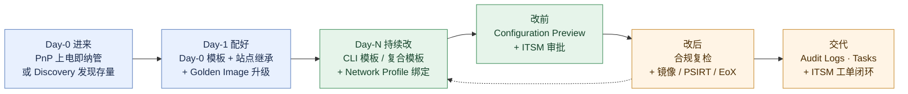
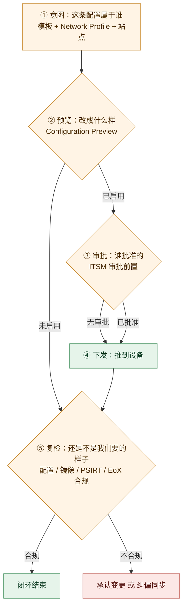

# Cisco Catalyst Center 园区自动化与配置闭环 —— 功能体系与痛点解法

> **调研对象**：Catalyst Center 的 **Day-0 → Day-N 自动化与配置闭环**这条能力线——从设备上电被纳管，到配置被生成、预览、审批、下发、复检、纠偏，再到版本升级与任务留痕的完整链路。
> **时间窗**：2023-01 → 2026-10（以官方 Release Notes / 用户指南 / 数据表可考时间为准）。
> **本文回答五件事**：① 这条线上有哪些**大功能点**，各自包含哪些**小功能点**；② 它们分别解决客户在**哪一侧的痛**（时间 / 钱 / 人 / 合规 / 组织）；③ 用哪些能力去解，与痛点**逐条对应**；④ 对应的**功能机制**是什么（配置怎么生成、差异怎么算、闸门装在哪）；⑤ 这条线四年间**怎么长出来的**。

## 口径声明（与同系列其它报告的分工）

本文是 `Catalyst-Center-2023-2026-功能体系与痛点解法.md`（下称**主报告**）的**下钻篇**，两者互补、不重叠：

| 文档 | 覆盖 | 与本文的关系 |
| --- | --- | --- |
| **主报告** 大功能点 3（园区自动化与配置闭环 / 配得对） | 20 条小功能点的**全景清单**与痛点-解法概要 | 本文把它**拆开重写**：补上「功能机制」与「演进情况」两段，并把原先散在其它组的关联能力（零接触开局、存量发现、模板体系、SWIM、任务编排）收进同一条链路 |
| **主报告** 大功能点 2（版本体系与升级范式 / 升得动）、11（开放平台与集成 / 接得上） | 平台升级与集成能力的骨架 | 本文只保留**与“设备侧配置与版本”直接相接的那部分**（SWIM 与镜像合规、ITSM 闭环与任务留痕）；平台自身的版本迁移不在本文范围 |
| **姊妹篇**《Assurance 端到端体验可观测》 | 「看得见、读得懂」那一条线 | 本文负责「动得了、改得对」；两篇合起来才是园区的完整闭环（**看得见 → 改得对 → 复检回到看得见**） |
| **本篇** | 7 个「动作」大功能点：上电即管 / 先找后管 / 意图成文 / 改前有据 / 升得有序 / 铺底自动 / 动而可查 | — |

> **本文口径（重要）**：只收「**由客户侧发起、以设备为对象、产生或校验配置与版本状态**」的能力。**不含**只读观测能力（见姊妹篇）、**不含**无线射频调优（主报告大功能点 6）、**不含**安全分段策略的建模（主报告大功能点 9，但本文收其“下发与合规”部分）。凡涉及「平台侧只给建议/只给预览、由人决定」的能力，**纳入本文并明确标注闸门位置**——因为「闸门在哪」正是这条线最有价值的结论。

## 信源与局限说明

| 等级 | 含义 | 本文使用情况 |
| --- | --- | --- |
| **A** | 官方用户指南（Catalyst Center UG 2.3.7 / 3.1.x / 3.2.x、管理员指南）/ 官方 Release Notes / 官方数据表 / 官方支持文档 / 官方 FAQ / 官方验证设计（CVD）与验证方案（Validated Profile） | 主证据来源，约占七成 |
| **B** | 官方 Cisco Live 材料 / 官方社区「新版本要点」帖（作者为思科员工）/ 官方社区技术答复 / 主流行业媒体 | 补充机制细节、版本增强与部署约束 |
| **C** | 第三方技术站与备考站、社区用户帖 | **仅用于交叉印证**；与官方口径冲突时以官方为准，并显式标注冲突 |

**已知局限（务必连同结论一起理解）**：

1. **思科不提供统一的产品发布日索引**。官方支持页只给「文档更新日」，与「实际 GA 日」经常不一致；3.2.x 与 3.3.1 均处于**受控可用（controlled availability）**，需联系销售申请。本文对只能反推的日期一律标注「约」。
2. **SWIM 的“无回滚”结论来自官方社区 AMA（思科员工答复）**，属 B 级；与其他 A 级材料的表述（Golden Image 机制）一致，可互相印证。
3. **Network Profile 与站点绑定的若干硬性规则**（一次一个 profile 对应一个站点、绑定期间不可编辑、profile 绑定时设备数是绝对的）**来自 B/C 级社区实践帖**，与官方用户指南描述的机制方向一致，但**具体边界以部署版本为准**。
4. **4 小时 / 24 小时的合规检查周期存在两处口径**：官方用户指南表述为「计划任务每天 23:00 运行，对过去 7 天未检查的设备触发」，另有 B 级社区文表述为「默认每 24 小时自动检查一次」。本文**并列呈现**（见 4.4 机制 3）。
5. **厂商自述收益 ≠ 第三方验证**。官方口径中的「约 80% 网络中断由变更引起」「部署时间从数小时降到数分钟」等一律标注**量级参考**。
6. **客户体感主要来自 C 级**。抱怨集中在「许可复杂且贵」「界面学习曲线陡」「与第三方设备集成不足」「无法把交换机当前配置与模板比对找出缺失命令」，与主报告一致。
7. **资料截止 2026-10-14。** 3.3.1（2026-09-09）为受控可用版本。

**版本节奏对照表**（用于把功能对齐到时间窗）：

| 版本线 | 与本主题相关的关键节点 |
| --- | --- |
| 2.3.7.x（维护线） | 2.3.7 首版起：PnP 扩展（9800 WLC）、Day-0 模板扩展（AVC/NETCONF/QoS）、**Configuration Preview 可全局强制**、ITSM 审批、Image Update 五步工作流与顺序/并行编排、Device Details 二层配置读写（beta）、第三方 MIB-II 纳管、LAN Automation 5 并发会话；2.3.7.4 AP Refresh 增强、CTS 在点到点链路禁用；2.3.7.5 LAN Automation 发现深度/超时/匹配模式；2.3.7.6 任务可手动停止；2.3.7.7 **Visibility and Control of Configurations 页面** + YANG→CLI 预览；2.3.7.10 **ISSU**、Brownfield 自动发现 |
| 3.1.x | 3.1.3 Trunk 端口 allowed/native VLAN、重叠 IP 池；3.1.5 **Rule-Based Compliance Policies** + 重叠 IP 池；3.1.6 合规摘要逐条违规 |
| 3.2.x | 3.2.1 **xFSU 自动编排**（C9300）；3.2.2 无线与企业网 IPv6、**Visibility and Control 覆盖 policy-extended node 升级**、**OTA AP 镜像下载**、多集群单 ISE；3.2.3 LAN Automation 支持 OSPF |
| 3.3.x | 3.3.1（2026-09-09）**解耦模板配置与 network profile**（不绑 profile 供给即跳过合规检查）；DN4 设备家族 |

---

## 读法：7 个大功能点全景

按「**一台设备的一生**」排列——左侧是它怎么进来，中间是它被怎么改，右侧是改完怎么交代。

| # | 大功能点 | 四字口号 | 小功能点数 | 时间跨度 | 在链路中的位置 |
| --- | --- | --- | --- | --- | --- |
| 1 | 零接触开局（PnP / ZT） | 上电即管 | 16 | 平台早期 → 2026-09 | 纳管层（设备怎么进来） |
| 2 | 带外与存量发现（Discovery / Brownfield） | 先找后管 | 14 | 平台早期 → 2026-05 | 纳管层（存量怎么进来） |
| 3 | 意图与模板体系（Day-N 配置生成） | 意图成文 | 18 | 平台早期 → 2026-10 | 生成层（配置从哪来） |
| 4 | 变更前预览与合规闭环 | 改前有据 | 21 | 平台早期 → 2026-08 | 校验层（改得对不对） |
| 5 | 软件镜像生命周期（SWIM） | 升得有序 | 18 | 平台早期 → 2026-09 | 版本层（版本谁来管） |
| 6 | LAN Automation 与园区 Fabric 铺底 | 铺底自动 | 19 | 平台早期 → 2026-09 | 铺底层（新园区怎么建） |
| 7 | 任务编排、留痕与外部系统闭环 | 动而可查 | 16 | 平台早期 → 2026-10 | 交代层（改完怎么证明） |

> 合计 **122 条小功能点 / 44 条痛点 / 44 条解法**（P 与 S 逐组一一对应，校验见文末）。

### 一张图看清「一台设备的生命周期」

Day-0 是“进来”，Day-1 是“配好”，Day-N 是“持续改”，最后一格是“改完能交代”。**这张图上每一处断点，都是一次客户事故。**



### 一张图看清「一次配置变更要过的五道关」

要注意的是：**这五道关并不是每道都强制**。客户可以选择只过第一道（模板）与第四道（下发），也可以把三道闸门全部打开。**「你能开几道闸」正是这套产品的可配置深度所在。**



---

# 大功能点 1：零接触开局（PnP / ZT）—— 「上电即管」

**这一层决定的是「一台设备从开箱到被管起来，需要几个人到现场」。**

## 1.1 小功能点清单

| # | 小功能点 | 发布时间 | 来源等级 | 说明 |
| --- | --- | --- | --- | --- |
| 1.1 | Plug and Play 零接触开局 | 平台早期，持续 | A | 设备上电接入即自动纳管并下发配置，免现场实施与预配置 |
| 1.2 | 内置 PnP Agent（IOS XE 内嵌） | 平台早期，持续 | A | 设备侧组件，通过 HTTPS 用开放 PnP 协议与平台的 PnP 进程通信 |
| 1.3 | DHCP Option 43 发现 | 平台早期，持续 | A | 分号分隔的 ASCII 串，给出 PnP 服务器地址、传输协议与端口 |
| 1.4 | Option 43 字段语义 | 平台早期，持续 | A | 见 1.4 机制 2 的逐字段拆解 |
| 1.5 | DNS 发现 | 平台早期，持续 | C | 通过 `pnpserver.` 域名前缀解析 PnP 服务器 |
| 1.6 | Cisco Cloud PnP Connect | 平台早期，持续 | C | 经云侧中转的红irection 方式，依托硬件 SUDI（802.1AR 证书）建立信任 |
| 1.7 | PnP 启动 VLAN（pnp startup-vlan） | 平台早期，持续 | A | 出厂重置设备**默认用 VLAN 1**做 PnP 管理；可经上游交换机配置专用启动 VLAN，由 CDP 告知新设备 |
| 1.8 | 安全 onboarding 的证书前提 | 平台早期，持续 | A | 平台 SSL 证书的 **SAN 字段必须包含设备使用的 IP 或 FQDN** |
| 1.9 | PnP 前置条件 | 平台早期，持续 | A | Catalyst Center 2.3.7.9 或更高；IOS XE 16.12.x 或更高；到平台的网络连通；DHCP 已配 Option 43 |
| 1.10 | 出厂默认设备的复位方式 | 平台早期，持续 | A | `pnpa service reset`（IOS XE 16.12.1 起可复位到出厂状态） |
| 1.11 | Catalyst 9800 无线控制器支持 PnP | 2.3.7 | A | 无线控制器纳入零接触开局范围 |
| 1.12 | AP 与无线控制器的 PnP onboarding（含 IPv6） | 3.2.2 | A | 无线侧零接触开局完整化 |
| 1.13 | Onboarding / Day-0 模板 | 平台早期，持续 | A | 与 PnP 配合，在设备 onboarding 过程中套用初始配置 |
| 1.14 | Day-0 模板的能力限制 | 2.3.7 | A | **不允许绑定 source / system 变量**（如 DHCP、DNS、syslog 服务器）；不支持特殊关键字；**整份配置原样下发** |
| 1.15 | AP Refresh 工作流增强 | 2.3.7.4 | A | 换 AP 场景的引导式流程，支持仅复制旧配置的 Assurance 场景、按交换端口自动检测新 AP |
| 1.16 | 设备替换 / RMA 工作流 | 平台早期，持续 | A | 替换交换机、路由器与 AP：恢复 IOS 软件、配置与许可；**并在外部运营系统（认证系统、证书服务器、平台清单）中完成替换** |

## 1.2 它对应的用户痛点

> **口径**：本节只写**客户侧可感知**的痛（时间 / 钱 / 人 / 合规 / 组织）。「PnP 协议怎么走」「Option 43 怎么编码」这类**设计约束**一律放到 1.4 的「功能机制」里。编号 **P1…P6** 与 1.3 的 **S1…S6** 对应。

- **P1｜新设备到货要人到现场开箱配置**（时间 / 钱）。一台设备在上电前要预配、贴标签、登记台账；**站点越多，“到现场”这件事的成本越不可控**。
- **P2｜同样的开箱配置要在几百台上重复几百次**（时间）。每台都敲一遍，且**每次都有敲错的机会**；一次批量上线就是一次体力活。
- **P3｜靠 Excel 加本地 TFTP 传配置，错了也发现不了**（钱 / 时间）。配置是“推下去就不管”的，**错行静默生效**，往往在业务出问题时才被发现。
- **P4｜换设备（RMA）等于重新配一遍**（时间 / 人）。换硬件要重配、重发许可，**还要同步更新认证系统与证书服务器**——一次 RMA 变成一次多系统的协同作业。
- **P5｜现场没有网络工程师**（人 / 钱）。弱电间、分支机构上电后无人能配，只能等专职人员到场；**部署进度被人员排期绑架**。
- **P6｜新接入设备的合法身份无法自动确认**（合规）。物理接入就可能成为被管设备，**缺少“这台设备该不该被接纳”的自动校验**。

## 1.3 它是如何解决的

**架构约束（由 1.2 倒推）**

| 架构约束 | 由痛点倒推 | 落到了哪些功能 |
| --- | --- | --- |
| 开局必须**反向建立**：由设备主动呼叫平台，而不是平台去找设备 | P1、P5 | 1.1 / 1.2 / 1.3 PnP Agent + Option 43 |
| 配置必须**从模板生成**，而不是逐台输入 | P2 | 1.13 Onboarding / Day-0 模板 |
| 开局流量必须与生产流量**隔离**，且开局后自动拆除 | P1、P6 | 1.7 PnP 启动 VLAN |
| 接入必须**可验身份**，不能只靠“接上了就算” | P6 | 1.6 Cloud PnP Connect + 1.8 证书 SAN 校验 |
| 换硬件必须是一条**流程**，而不是一次手工操作 | P4 | 1.16 RMA 工作流 + 1.15 AP Refresh |
| 自动化的“原样下发”特性必须被**明确约束**，否则错误会被自动化 | P3 | 1.14 Day-0 模板的能力限制（不允许变量） |

- **S1｜让设备自己找上门，上电即纳管**（→ 解 P1、P5）。出厂默认的设备上电后会**主动发起 DHCP 请求**，DHCP 服务器用 **Option 43** 告知 PnP 服务器在哪里；设备随后经 HTTPS 连上平台、完成身份与配置下发。**这条链的关键是方向：平台不需要先能访问到设备**，因此**弱电间、新楼、分支机构都不需要先有专职人员在场**。
- **S2｜用 Day-0 模板替代逐台开箱配置**（→ 解 P2）。**Onboarding 模板**定义设备上线时要套用的初始配置（接口、VLAN、基础安全设置等），与 PnP 配合后，**新设备接上网络即套用统一配置**。**“统一”这件事的价值不只是省时间**：它让“这批设备的基线是一样的”成为可陈述的事实。
- **S3｜把开局流量关进一个临时 VLAN**（→ 解 P1、P6）。默认情况下出厂重置设备用 **VLAN 1** 做 PnP 管理，**生产环境建议改成专用启动 VLAN**：在上游交换机上配置 `pnp startup-vlan`，由 CDP 告知新设备；下游设备随后**关闭 VLAN 1 的 DHCP、在启动 VLAN 上启用 DHCP、更新 trunk 允许新 VLAN**。**开局流量与生产流量天然分离，且开局结束后这条临时通道即失效。**
- **S4｜把身份校验做进接入链条**（→ 解 P6）。安全 onboarding 要求**平台证书的 SAN 字段包含设备将使用的 IP 或 FQDN**（配置 Option 43 时用的是 IP 就校验 IP，用 FQDN 就校验 FQDN）；HTTPS 场景下还涉及 **Trustpool 证书包**（Option 43 的 T 字段）与 NTP（Z 字段）。**接入不再是“插上线就行”，而是一次带证书校验的互信。**
- **S5｜把换硬件做成一条流程**（→ 解 P4）。**RMA / 设备替换工作流**覆盖交换机、路由器与 AP：恢复 IOS 软件、配置与许可，**并在外部运营系统（认证系统、证书服务器、平台清单）中一并完成替换**；**AP Refresh** 工作流（2.3.7.4 增强）在无线侧提供同类能力。**这条解法的关键不是“恢复配置”，而是“把跨系统的收尾一次做完”。**
- **S6｜用限制把“自动化的错误”关在门外**（→ 解 P3）。Day-0 模板被明确限制：**不允许绑定 source / system 变量、不支持特殊关键字**，因为**整份配置会被原样下发（包括写错的行）**。官方原话直白得罕见——**“请确保 Day-0 模板里的配置是正确的，因为它会把整份配置原样推下去”**。**这条限制看似是缺陷，实则是把“人必须审过”这道闸门留在了 Day-0 环节。**

> **边界**：
> - **Day-0 模板不支持变量**，因此**它不能承载“随站点变化”的配置**——这是它与 Day-N 模板最本质的分工，也是最容易踩的坑（详见 3.4 机制 5）。
> - **PnP 有许可前提**：部分平台（如 IE5000 系列）的 PnP onboarding 需要 Essentials 许可（B 级）。
> - **开局流量依赖 VLAN 1 或专用启动 VLAN 的可达性**：网络侧的 DHCP 与路由必须先配好，**PnP 零接触的不是“网络”，而是“设备的配置”**。
> - **证书 SAN 是硬前提**：SAN 里没有设备使用的 IP/FQDN，安全 onboarding 会失败（A 级官方文档专门给出了浏览器与 openssl 两条校验方法）。

## 1.4 功能机制

**机制 1｜PnP 是“设备主动找平台”的逆向模型。** 这决定了三件事：① **平台不需要能主动连到新设备**（因此 NAT 后、无路由的新设备也能开局）；② **发现必须借助已有基础设施**（DHCP / DNS），所以“零接触”的前提是“网络已经通”；③ **平台的身份必须可被设备校验**，因此证书 SAN 成了硬性要求。

**机制 2｜Option 43 串的逐字段拆解。** 这是这条线里最“硬”的一段机制：

| 字段 | 含义 | 取值 |
| --- | --- | --- |
| `5` | PnP 子选项标识 | 固定为 5 |
| `A` | 模式 | A = Active（设备主动发起通信） |
| `1` | PnP Agent 模板版本 | 1 |
| `N` | 调试开关 | N = 关闭调试；D = 打开调试 |
| `B` | 服务器地址类型 | 1 = 主机名；2 = IPv4；3 = IPv6 |
| `2` | （接在 B 后面）具体地址类型值 | 见上行 |
| `K` | 传输协议 | 4 = HTTP；5 = HTTPS |
| `4` | （接在 K 后面）具体协议值 | 见上行 |
| `I` | PnP 服务器地址或 FQDN | 例：`10.127.212.43` 或 `catc1.cisco.com` |
| `J` | TCP 端口 | 例：`80` |
| `T` | （可选）Trustpool 证书包 URL | **HTTPS 场景必需** |
| `Z` | （可选）NTP 服务器 IP | **使用 Trustpool 安全时必需** |

**完整示例**：`option 43 ascii 5A1D;B2;K4;I10.127.212.43;J80;` —— 含义是「PnP 子选项 5、Active 模式、模板版本 1、关闭调试、服务器地址类型为 IPv4、传输协议为 HTTP、服务器地址 10.127.212.43、端口 80」。**这张表值得背下来**：客户现场“PnP 起不来”的问题，九成在这串字符的某一节上。

**机制 3｜从设备上电到被纳管的四个环节。**

> ① **DHCP 发现**：出厂默认设备无启动配置 → PnP Agent 启动 → 在所有 up/up 的物理接口上发起 DHCP（默认关联 VLAN 1，因此请求的是 VLAN 1 的地址）→ ② **拿到 PnP 服务器信息**：DHCP 服务器回 Option 43（或经 DNS / Cloud PnP 解析）→ ③ **建立互信**：设备经 HTTPS 连上 PnP 服务器，完成身份认证与识别 → ④ **拉配置与镜像**：进入 PnP 清单，套用 Day-0 模板；若该设备类型已指定 Golden Image，则**一并向该镜像升级**。

**机制 4｜为什么开局 VLAN 要能“用完即拆”。** VLAN 1 是出厂默认的 PnP 管理 VLAN，但**生产环境不会把 VLAN 1 留在主干上**。专用启动 VLAN 的做法是：**开局期间临时存在，开局完成后上游取消、下游不再使用**。**这个设计解决了一个真实矛盾**：既要有网（新设备得有地址才能找平台），又不能让这个“开局用的临时网络”长期存在（那会是一个永久的、不受管的二层域）。

**机制 5｜PnP 与 LAN Automation 的分工容易被混淆。**

| 维度 | PnP（本文大功能点 1） | LAN Automation（本文大功能点 6） |
| --- | --- | --- |
| 目标 | **把设备纳管并套配置** | **把 underlay 网络建起来** |
| 是否建路由 | 不建（只套 Day-0 模板里的内容） | **建**（自动配 IS-IS / OSPF，含 loopback） |
| 是否需种子设备 | 不需要 | **需要**（primary seed 充当临时 DHCP） |
| 典型场景 | 任意平台的零接触纳管 | SD-Access / L3 路由接入的 underlay 铺底 |

**两者共用同一套 PnP 组件**——LAN Automation 本质上是“PnP + 自动建 underlay”，理解这一点，第 6 组会顺很多。

## 1.5 功能的演进情况

| 阶段 | 变化 | 来源等级 | 意味着什么 |
| --- | --- | --- | --- |
| 平台早期 | PnP 与 Option 43 机制成型；Day-0 模板与 RMA 工作流 | A | 零接触先解决“怎么把设备管起来” |
| 2.3.7（2023-12 起） | **9800 无线控制器纳入 PnP**；Day-0 模板扩展（AVC / NETCONF / QoS）；**Day-0 模板的能力限制被明确文档化** | A | 从“能开局”到“开局能带多少配置” |
| 2.3.7.4 | AP Refresh 工作流增强（仅复制旧配置的 Assurance 场景、按端口自动检测新 AP） | A | 换 AP 场景开始有引导式流程 |
| 3.2.2（2026-05-05） | **AP 与无线控制器的 PnP onboarding**，且**支持 IPv6** | A | 无线侧零接触完整化，并跟上 IPv6 园区 |
| 3.3.1（2026-09-09） | 变更历史中加入**带外 AP 替换指引**；支持 DN4 设备家族 | A | 替换流程继续细化 |

> **演进读数**：这条线四年几乎“没变过骨”——**机制（Option 43）自 DNA Center 时代就是这套，演进集中在覆盖面（无线纳入、IPv6 支持）与替换流程（RMA / AP Refresh / 带外替换）**。这提示一件事：**零接触开局是个“一次做对、长期收益”的能力**，它的价值不来自迭代速度，而来自**协议级的标准性**。

---

# 大功能点 2：带外与存量发现（Discovery / Brownfield）—— 「先找后管」

**绿地的设备靠 PnP 进来，存量网络只能靠“找”。这一层决定的是「平台对既有网络的理解深度」。**

## 2.1 小功能点清单

| # | 小功能点 | 发布时间 | 来源等级 | 说明 |
| --- | --- | --- | --- | --- |
| 2.1 | 多种发现方式 | 平台早期，持续 | A | 支持 **IP 地址范围 / CIDR 网段 / CDP / LLDP** 四种入口 |
| 2.2 | 发现使用的协议 | 平台早期，持续 | A | CDP；LLDP（端点）；**IPDT 与 ARP 表**（主机发现）；**LLDP-MED**（IP 电话与部分服务器）；SNMP v2 / v3 |
| 2.3 | 凭据体系 | 平台早期，持续 | A | CLI、SNMP 读写、HTTP(S) 读写、CLI enable 口令，均在 **Design** 阶段集中定义 |
| 2.4 | 周期性重扫与“单一真相源” | 平台早期，持续 | A | 初次发现后**周期性扫描网络**，形成设备与镜像版本的“单一真相源” |
| 2.5 | 设备打标签 | 平台早期，持续 | A | 按平台 ID、IOS 版本、位置等打标签分组，支撑批量操作 |
| 2.6 | 站点层级（Global → Area → Building → Floor） | 平台早期，持续 | A | 支持地理化地图与楼层平面图；**设备不能分配到 Area（只能到 Building / Floor）** |
| 2.7 | 层级继承 | 平台早期，持续 | A | 网络设置（AAA / DHCP / DNS / NTP / syslog / SNMP 等）可在全局或站点级定义，**被分配到该站点的设备自动继承** |
| 2.8 | 设备可控性（Device Controllability） | 平台早期，持续 | A | 供给设备时**平台自动下发管理所需的命令**（如遥测相关），并可预览 |
| 2.9 | **Brownfield 自动发现与存量配置洞察** | 2.3.7.10 | A/B | 官方升级亮点：可自动发现存量基础设施、洞察既有配置、简化自动化任务 |
| 2.10 | Device Details 配置工作流（二层配置读写） | 2.3.7（beta） | A | 可查看、过滤与编辑存量设备的 **VLAN / STP / CDP-LLDP 等发现协议 / 端口配置** |
| 2.11 | Trunk 端口 allowed / native VLAN 配置 | 3.1.3 | A | 补上二层供给的一处常见缺口 |
| 2.12 | 第三方设备支持（标准 MIB-II） | 2.3.7 | A | 可将支持标准 MIB-II 的非思科设备纳入清单与拓扑，获得设备在线时长等信息 |
| 2.13 | 第三方设备端口视图 | 2.3.7.7 | A | 可在平台内查看第三方设备的端口情况（官方示例为第三方防火墙） |
| 2.14 | 户外区域（Outdoor Areas） | 3.2.2（beta） | A | 可作为站点元素，用物理地址或经纬度定义；**仅 AP 可分配到户外区域** |

## 2.2 它对应的用户痛点

> **口径**：只写客户侧可感知的痛。「发现用几个协议」这类设计约束放到 2.4。编号 **P1…P6** 与 2.3 的 **S1…S6** 对应。

- **P1｜存量网络是历史堆积，平台进来只能“看一半”**（时间）。老设备有的进得来、有的进不来，**清单不完整，后面的自动化就没有可靠的作用域**。
- **P2｜存量设备的配置没人敢动，自动化开不起来**（时间 / 人）。既有配置里藏着多年积累的例外与特例，**平台只能读不能改，工程师不敢把生产交出去**——于是自动化永远停在试点。
- **P3｜多厂商环境里资产与拓扑对不上**（组织 / 时间）。一部分设备不在这张图上，**出问题时说不清设备归属**，盘点与拓扑只剩半个视图。
- **P4｜设备放错站点会继承错误的配置**（钱 / 时间）。自动化会“正确地”把错配置推到错设备上——**机制没坏，作用域错了**，这类事故最难排查。
- **P5｜同一个变更要按平台 / 版本 / 位置分批做**（时间）。没有可靠的分组口径，只能手工挑设备、分批执行。
- **P6｜平台为了采集往设备里塞了命令，客户不知道塞了什么**（合规）。设备配置被平台“顺手改了”，**变更审计时说不清这些行的来源**。

## 2.3 它是如何解决的

**架构约束（由痛点倒推）**

| 架构约束 | 由痛点倒推 | 落到了哪些功能 |
| --- | --- | --- |
| 发现必须支持**多种入口**，因为存量网络的形态不可预期 | P1 | 2.1 / 2.2 四种发现方式 + 五种发现协议 |
| 存量设备必须支持**“先看清、再渐进接管”** | P2 | 2.9 Brownfield 发现 + 2.10 Device Details 读写 |
| 非思科设备必须有**明确的纳管入口** | P3 | 2.12 第三方 MIB-II + 2.13 端口视图 |
| 作用域必须**由层级与标签共同约束**，不能只靠人工选设备 | P4、P5 | 2.6 站点层级 + 2.7 继承 + 2.5 标签 |
| 平台下发的命令必须**可见可审** | P6 | 2.8 设备可控性（可预览） |

- **S1｜用多种入口适配各种存量形态**（→ 解 P1）。发现支持**IP 范围、CIDR 网段、CDP、LLDP** 四种入口，协议层面覆盖 CDP、LLDP、LLDP-MED、IPDT/ARP 与 SNMPv2/v3。**为什么需要这么多**：新楼可以按网段扫，老楼只能顺着 CDP/LLDP 邻居爬——**“怎么找”这件事在存量网络里没有统一答案**。
- **S2｜把“看清存量”做成一个独立能力**（→ 解 P2）。**Brownfield 自动发现**（2.3.7.10）自动识别存量基础设施并给出既有配置洞察；**Device Details 配置工作流**允许**查看、过滤与编辑**存量设备的 VLAN、STP、发现协议与端口配置。**客户可以从“只读观察”逐步走到“受控编辑”，而不是一次性把生产交出去**——这是这套机制最重要的设计取向。
- **S3｜给第三方设备一个明确入口，并说清它到哪为止**（→ 解 P3）。2.3.7 起支持**纳管支持标准 SNMP MIB-II 的第三方设备**，提供**设备在线时长、拓扑位置、发现与清单**能力，并可在平台内查看其端口。**边界必须说清：这是 MIB-II 层面的纳管，不是设备内部可见性**——第三方设备**不进健康分体系**（见姊妹篇），也读不到表项与命中率。
- **S4｜用层级与继承约束作用域**（→ 解 P4）。站点层级（**Global → Area → Building → Floor**）不是装饰，**它决定了设备继承哪一套网络设置**；配合标签（平台 / 版本 / 位置）形成双重作用域。**这条解法针对的是那类“机制没坏、作用域错了”的事故**——把设备放对位置，是自动化安全的前置条件。
- **S5｜用标签把“分批”变成声明式**（→ 解 P5）。设备可按平台 ID、IOS 版本、位置等打标签，**批次由标签声明，而不是由人逐台勾选**。**这条解法看似简单，但它把“这次改哪些”从操作变成了定义**——可复查、可复用。
- **S6｜把平台下发的命令暴露出来**（→ 解 P6）。**设备可控性（Device Controllability）** 会在供给设备时自动下发管理所需命令，并**支持预览**。**客户侧的意义是：平台“顺手改了什么”是可见的**，审计时能指认来源，而不是发现一堆来路不明的配置行。

> **边界**：
> - **第三方设备只到 MIB-II**：能力上限是**清单 / 拓扑 / 在线时长 / 端口可见**，**不提供内部状态**；健康分设置对其不适用（与主报告及姊妹篇结论一致）。
> - **存量接管的深度有限**：客户实证仍在抱怨「无法把交换机当前配置与模板比对，找出缺失的命令行」（C 级）。**“敢不敢让平台接管生产”这个问题，在存量复杂环境里没有被完全回答。**
> - **设备不能分配到 Area**，只能到 Building / Floor——层级建模时要按这个约束规划。
> - **户外区域（beta）限制明确**：仅 AP 可分配；**不能作为无线控制器的物理站点**，但可在控制器供给时选为 AP 管理位置。

## 2.4 功能机制

**机制 1｜发现是“凭据驱动”的，顺序不可颠倒。**
必须先 **Design** 阶段定义好网络设置与设备凭据（CLI、SNMP、HTTP(S)、enable），**发现才有可用的凭据**。这意味着：**发现失败的第一排查项不是“网络不通”，而是“凭据对不对”**。这也是为什么“设计 → 发现 → 供给”这条顺序在 Catalyst Center 里是硬的。

**机制 2｜层级是控制面，不是分组标签。**
官方与社区材料反复强调同一点：**设备放错站点会继承错误的 intent，即使每个模板都语法正确**。典型失败形态有三种：分支交换机拿到另一个分支的配置、无线控制器关联到别的楼栋的 profile、地址池在非预期的位置被消耗。**共同点是“执行引擎没有报错”**。因此这条机制的正确用法是：**在供给之前校验站点与设备元数据，而不是在供给之后纠偏。**

**机制 3｜设备可控性 = 平台替客户改配置，但把改动显性化。**
平台为了采集与管理需要，会向设备下发命令（遥测设置是典型例子）。**机制上它可预览**；**语义上它是“平台的合法越权”**——客户授权平台做这件事，换取远程管理与采集能力。**这是一处需要客户明确知情的能力**，也是合规审计中最常被问到的一处。

**机制 4｜三种接管深度的渐进路径。**

| 深度 | 能力 | 风险 |
| --- | --- | --- |
| **看得见** | 发现 + 清单 + 拓扑 + 在线时长（含第三方 MIB-II） | 最低 |
| **可编辑** | Device Details 二层配置读写（VLAN / STP / 发现协议 / 端口 / Trunk VLAN） | 中 |
| **可供给** | 模板 + Network Profile + 站点继承（第 3 组） | 最高 |

**客户可以在这三层里选择停在哪里**——这是这套设计对 P2 的正面回应。**同时也说明：如果客户停在第一层，前面所有自动化能力都不产生价值。**

**机制 5｜发现协议的选择决定了“能看到什么”。**

| 协议 | 主要用途 |
| --- | --- |
| CDP / LLDP | 网络设备之间的邻居关系（拓扑骨架） |
| LLDP-MED | **IP 电话与部分服务器**的发现 |
| IPDT + ARP | **主机（终端）**发现 |
| SNMP v2 / v3 | 设备属性与状态读取（含第三方设备） |

**这张表解释了一个常见困惑**：为什么“网络设备都发现了、终端却看不到”——因为**终端依赖 IPDT 与 ARP，而 IPDT 需要在站点级单独开启，且 trunk 与 port channel 上的终端不可见**（与姊妹篇的采集前置条件完全对应）。

## 2.5 功能的演进情况

| 阶段 | 变化 | 来源等级 | 意味着什么 |
| --- | --- | --- | --- |
| 平台早期 | 四种发现入口 + 五种协议 + 凭据体系 + 站点层级继承 | A | 存量纳管的基础设施先建好 |
| 2.3.7（2023-12 起） | **第三方 MIB-II 支持**；Device Details 二层配置工作流（beta） | A | **“多厂商”与“存量可编辑”两条线同时开闸** |
| 2.3.7.7 | 第三方设备端口视图；Device Details 的 VLAN / STP / 端口示例文档化 | A | 第三方纳管的可见性细化 |
| 2.3.7.10 | **Brownfield 自动发现与存量配置洞察** | A/B | 从“能发现”到“能洞察既有配置” |
| 3.1.3（2025-04 前后） | Trunk 端口 allowed / native VLAN | A | 补齐二层供给缺口 |
| 3.2.2（2026-05-05） | **户外区域（beta）**；无线与企业网 IPv6 | A | 站点模型开始覆盖室外场景 |

> **演进读数**：这条线的演进顺序是**“先纳管（平台早期）→ 再纳第三方（2.3.7）→ 再做存量洞察（2.3.7.10）→ 再补细节（3.1.3 / 3.2.2）”**。值得注意的是 **2.3.7 这一版同时开了“第三方”与“存量可编辑”两条线**——这说明厂商在那一次版本里，**集中回答了“我们怎么服务非绿地客户”这个战略问题**。

---

# 大功能点 3：意图与模板体系（Day-N 配置生成）—— 「意图成文」

**这一层决定的是「配置到底由谁来写」——由工程师逐台写，还是由“意图 + 模板”生成。**

## 3.1 小功能点清单

| # | 小功能点 | 发布时间 | 来源等级 | 说明 |
| --- | --- | --- | --- | --- |
| 3.1 | CLI 模板（模板编辑器） | 平台早期，持续 | A | 交互式模板编辑窗口，用参数化元素或变量设计模板 |
| 3.2 | 两种模板语言：Jinja2 与 Apache Velocity（VTL） | 平台早期，持续 | A | 均支持变量替换、条件逻辑与循环 |
| 3.3 | 模板类型：普通（regular）与复合（composite） | 平台早期，持续 | A | **复合模板把多个普通模板按顺序串成一个逻辑流**，一次操作完成 |
| 3.4 | Day-0（onboarding）模板与 Day-N 模板 | 平台早期，持续 | A | Day-0 用于 PnP 开局；Day-N 用于设备已在清单后的持续配置 |
| 3.5 | 三类变量：绑定变量 / 系统变量 / 普通变量 | 平台早期，持续 | A | 见 3.4 机制 2 |
| 3.6 | 项目（Project） | 平台早期，持续 | A | 模板的组织单元（类似文件夹） |
| 3.7 | 模板版本控制 | 平台早期，持续 | A | **保存（staged）与提交（committed）两态**；Template History 标签可查版本 |
| 3.8 | 内置模板模拟器 | 平台早期，持续 | A | 填入变量值，**预览渲染结果**后再下发 |
| 3.9 | 模板属性视图 | 平台早期，持续 | A | 名称 / 项目 / 类型 / 版本 / 提交状态 / 供给状态 / 潜在设计冲突 / 关联 profile 数 |
| 3.10 | 供给状态的可视化 | 平台早期，持续 | A | 正常 / 最新版本未供给 / 供给失败，各以不同图标与计数呈现 |
| 3.11 | 阻止列表命令（Blocked list commands） | 平台早期，持续 | A | 阻止危险命令进入模板 |
| 3.12 | 设计与运行期冲突检测 | 平台早期，持续 | A | 检测模板潜在设计冲突与运行时冲突 |
| 3.13 | Network Profile（网络配置档）绑定 | 平台早期，持续 | A | 模板 → 关联到 Network Profile → profile 关联到站点 → 供给设备 |
| 3.14 | Network Profile 的规则边界 | 平台早期，持续 | B/C | 至少一个标签匹配；profile 可关联多个站点，但**一个站点同一时间只能有一个 profile**；**绑定期间 profile 不可编辑** |
| 3.15 | 全局与站点级的 SSID 与射频 profile | 平台早期，持续 | A | 可全局创建并在站点级定制 |
| 3.16 | 模板位置迁移 | 2.3.7.x 起 | A | 从 **Tools > Template Editor** 迁到 **Design > CLI Templates** |
| 3.17 | 官方对“模板 vs 意图”边界的约束 | 平台早期，持续 | A | 官方明确：**模板不要覆盖平台推送的网络意图配置**；IP-MAC 绑定这类应用**要素模板（feature template）** |
| 3.18 | 解耦模板配置与 Network Profile | 3.3.1 | A | 可为**少量设备**在不关联 profile 的情况下直接供给 CLI 模板；**此时跳过合规检查** |

## 3.2 它对应的用户痛点

> **口径**：只写客户侧可感知的痛。「模板怎么渲染」放到 3.4。编号 **P1…P7** 与 3.3 的 **S1…S7** 对应。

- **P1｜几百上千台同类设备靠逐台敲命令**（时间 / 钱）。一次批量变更要反复核对，且**每多一台设备，出错概率就多一份**。
- **P2｜同一个配置在十几个分支各写一遍**（时间 / 组织）。复制粘贴出来的差异**没人会发现**，直到某个分支出了不一样的问题。
- **P3｜模板改了版本，不知道哪些设备还在用旧版**（时间 / 合规）。版本散落在各处，**“现在生产上跑的是哪一版”这个问题答不上来**。
- **P4｜一个变量填错，会“正确地”错到很多台设备**（钱 / 时间）。**自动化的错误具备放大能力**——手工只错一台，模板里错一次就是一批。
- **P5｜写模板前不知道渲染出来是什么样**（时间 / 钱）。**只能在生产上试**，试错成本由用户承担。
- **P6｜模板会覆盖平台自己推的意图配置**（时间）。两套机制打架，**改完一个功能坏掉另一个**，且很难定位是谁干的。
- **P7｜总有个别设备需要“就走个例外”，但流程不允许**（时间 / 人）。为了少数设备开一条旁路，**要么放弃流程、要么放弃设备**。

## 3.3 它是如何解决的

**架构约束（由痛点倒推）**

| 架构约束 | 由痛点倒推 | 落到了哪些功能 |
| --- | --- | --- |
| 配置必须由**意图 + 模板**生成，而不是由人写命令 | P1 | 3.1 / 3.2 / 3.3 模板体系与两种语言 |
| 配置必须能**模块化复用**，而不是整份复制 | P2 | 3.3 复合模板 + 3.6 项目 |
| 模板必须**有版本，且版本状态可见** | P3 | 3.7 版本控制 + 3.9 / 3.10 提交与供给状态 |
| 变量必须**可控、可预览**，错误要在下发前被发现 | P4、P5 | 3.8 模拟器 + 3.5 三类变量 + 3.11 阻止列表 |
| 模板与平台意图之间必须有**明确边界** | P6 | 3.17 官方边界约束（用要素模板而非 CLI 模板） |
| 必须允许“少数设备的例外”，但**例外要付代价** | P7 | 3.18 解耦供给（跳过合规检查） |

- **S1｜用意图化模板替代逐台命令**（→ 解 P1）。**CLI 模板**允许用参数化元素或变量设计配置；**复合模板**把一个基础模板、一个站点模板、一个角色模板**按顺序串成一次操作**。**官方给出的论证不是“更快”，而是“一致、可审计、可重复”**——一台设备上手工敲往往比模板快，**模板的价值在于几十上百台的确定性与可追溯性**。
- **S2｜模块化 + 项目，把配置做成可复用的积木**（→ 解 P2）。官方最佳实践明确建议：**按设备角色（核心 / 汇聚 / 接入）分类，再拆成模块化配置块**（如 OSPF 块、BGP 块、QoS 块），并**识别出与角色无关的通用块**（基础配置、管理协议、访问策略）跨角色复用。**“避免把所有配置塞进一个巨型模板”是官方原话。**
- **S3｜把模板当代码来管版本**（→ 解 P3）。模板有**保存与提交两态**：保存只是暂存，**提交才产生新版本并进入历史**；**未提交的模板无法供给到设备**（A 级官方口径）。Template History 可查版本。**机制上像 Git，但完全内置于平台**——**要放进外部版本控制必须手动导出**。同时，模板列表直接呈现**提交状态与供给状态**（成功 / 未供给最新版 / 失败），“现在跑的是哪一版”因此可查。
- **S4｜下发前先渲染一遍**（→ 解 P4、P5）。模板编辑器提供**内置模拟器**：填入变量值，**预览渲染结果**。配合**变量分类**（哪些要人填、哪些平台自动给、哪些模板内部用）与**阻止列表命令**，把“填错变量”的风险提前暴露。**这是这条线上成本最低、收益最直接的一道闸门。**
- **S5｜把模板与意图的分工写进产品约束**（→ 解 P6）。官方明确警告：**模板不要覆盖平台推送的网络意图配置**；对于 **IP-MAC 绑定**这类**平台本身就在管理的配置**，应使用**要素模板（feature template / 意图化模板）**而不是 CLI 模板。**这条约束的意义是划清两套供给机制的势力范围**——否则客户会在“CLI 模板”和“意图配置”之间反复自我覆盖。
- **S6｜模板与 profile 用标签与站点双重绑定**（→ 解 P2、P3）。模板通过 **Network Profile** 落地：**profile 与站点关联，模板与 profile 关联**，供给时选择站点与 profile 即可；profile 与模板的关联**可用标签辅助匹配**。**关键设计意图是分离两件事**——「什么配置代表这个角色」与「这个角色应该在哪里生效」。分离之后，**同一套配置可以铺到多个站点，而改动只改一处**。
- **S7｜给例外留一条有代价的出口**（→ 解 P7）。3.3.1 引入**解耦**：为**一台或少数设备**配置不适用于同站点其他设备的特定配置时，**可以不关联 Network Profile 直接供给 CLI 模板**；官方同时明确——**不关联 profile 供给模板时，合规检查被跳过**。**这条解法很能说明产品哲学**：**例外被允许，但例外不受保护**——想要灵活性，就放弃合规背书。

> **边界**：
> - **Network Profile 的耦合很硬**：一个站点同一时间只能有一个 profile；**profile 与站点关联期间不可编辑**（需先解除全部站点关联，改完再关联）；有 B/C 级实践指出 **profile 关联的设备数是“绝对的”**（为两个型号建的 profile，每次部署就必须恰好推给两台）。**这些规则会让“标准化的代价”以另一种方式出现。**
> - **模板属性在关联 profile 后不可编辑**（名称之外的属性需先解除关联）；**模板内容本身（命令与变量）仍可编辑**。
> - **Day-0 模板不能绑变量**（见 1.4 机制 3 与 3.4 机制 5），也不能带特殊关键字。
> - **版本控制不出平台**：要在 Git 里管模板，必须手动导出。
> - **解耦供给的代价是跳过合规检查**——这是“灵活性”与“可证明性”之间的明确取舍，不是缺陷。

## 3.4 功能机制

**机制 1｜模板的“编译”链路。**

> 模板（含变量与逻辑）+ 变量取值（绑定变量由人填、系统变量由平台填、普通变量来自模板内部）→ **渲染**出该设备的配置 → 与 **Network Profile 与站点**的作用域匹配（决定推给哪些设备）→ 与设备当前配置比较 → 生成配置与差异 → 下发（可经预览与审批，见第 4 组）。

**关键点**：**模板本身只是“函数”，站点与 profile 决定“调用参数”，设备决定“输入”**。三者缺一，模板就只是一个文本文件。

**机制 2｜三类变量，来源与用途完全不同。**

| 变量类型 | 由谁提供 | 典型内容 | 用途 |
| --- | --- | --- | --- |
| **绑定变量（Binding）** | **工程师在供给时填**（界面或 API） | 主机名、管理 IP、VLAN ID、站点代码 | 让同一模板在不同设备上有不同取值 |
| **系统变量（System）** | **平台从清单自动生成** | 设备平台、序列号、当前软件版本 | 无需人工输入，配置随设备实际状态变化 |
| **普通变量（Regular）** | **模板内部定义** | 中间结果、常量 | 模板内部的复用与计算 |

**官方建议**：变量命名与数据类型要在开头定好，后期返工代价很大。**Day-0 模板被禁止使用 source / system 变量（如 DHCP、DNS、syslog 服务器）**——**这是它与 Day-N 模板最本质的差别：Day-0 不接受“随设备变化”的输入。**

**机制 3｜版本控制的两态语义（这是最容易踩的坑）。**

| 操作 | 效果 | 后果 |
| --- | --- | --- |
| **保存（save）** | 暂存改动 | **不能供给**；列表显示“已修改未提交”的警告图标 |
| **提交（commit）** | 生成新版本并进入历史 | 可供给；列表显示“最新版本已提交”的对勾 |

**为什么这个设计重要**：它把“改模板”与“用新版本”分成了两步，**在批量环境里，这两步之间正是评审窗口**。理解这一点，就不会出现“我明明改了模板但设备没变”这类误判。

**机制 4｜Network Profile 是“配置角色 ↔ 站点”的粘合层。** 它把“什么配置代表这个角色”和“这个角色应该在哪里生效”分开；**代价是它引入了新的失效模式**：改了模板，所有引用它的 profile 都会受影响；站点关联错了，正确的 profile 会到错误的设备上；profile 太宽，一次小改动会有很大的爆炸半径（B/C 级社区材料的表述）。**因此变更评审的问题清单里必须加上关系题**：哪些 profile 引用了这个模板、哪些站点用了这些 profile、涉及哪些设备。

**机制 5｜Day-0 与 Day-N 的能力对比（一张表说清）。**

| 维度 | Day-0 / Onboarding 模板 | Day-N 模板 |
| --- | --- | --- |
| 触发时机 | 设备 onboarding（与 PnP 配合） | 设备已在清单之后，供给时应用 |
| 变量绑定 | **不允许**绑定 source / system 变量 | 允许三类变量 |
| 特殊关键字 | **不支持** | 支持 |
| 下发方式 | **整份配置原样下发**（含错误行） | 与设备当前配置比较，**默认只推新增配置** |
| 数据来源 | 需要外部机制（DHCP / TFTP 等）配合 | 平台清单与站点继承 |
| 典型用途 | 开局基线 | 持续变更、固件相关、全网策略 |

**“原样下发”与“默认只推新增”这两条差异，是理解两类模板行为区别的钥匙。**

**机制 6｜3.3.1 的解耦设计含义。** 官方给出解耦的原因很具体：**如果你要给一台或少数设备配置不适用于同站点其他设备的特定配置**。这条功能的存在本身说明两件事：① **真实网络里“例外”是常态**，标准化的模型必然要留出口；② **产品选择用“放弃合规检查”来给例外定价**。**对自研的启示**：任何“声明式配置”系统都要回答“例外怎么办”——**最诚实的做法不是禁止例外，而是让例外变得可识别、有代价。**

## 3.5 功能的演进情况

| 阶段 | 变化 | 来源等级 | 意味着什么 |
| --- | --- | --- | --- |
| 平台早期 | CLI 模板 / 复合模板 / 两类语言 / 三类变量 / 版本控制 / 模拟器 / Network Profile 成型 | A | **这一层的骨架一次成型，四年基本未动** |
| 2.3.7 起 | 模板位置迁至 **Design > CLI Templates**；Day-0 模板的能力限制被明确文档化 | A | 界面归一，边界写清 |
| 3.1.x | Network Profile 与站点层级配合的实践被大量文档化 | A/B | 机制不变，用法规范化 |
| 3.1.5（2026-04-01 文档） | 重叠 IP 地址池（与配置生成的地址分配相关） | A | 供给灵活性提升 |
| 3.3.1（2026-09-09） | **解耦模板配置与 Network Profile** | A | **四年来这一层最重要的一次变化：给例外开口子** |

> **演进读数**：**这一层是整篇文档里最“稳定”的一层**——模板、变量、profile、版本控制四件事从早期就是这套结构。**4 年只改了两次：位置与解耦。** 这个稳定性本身是一条结论：**“意图 + 模板 + 作用域”是网络自动化的一个已经收敛的设计**。对自研来说，**这里没有多少“创新空间”，有的是“必须做对”的基本功**。

---

# 大功能点 4：变更前预览与合规闭环 —— 「改前有据」

**这一层是这条线的核心：它把“自动化”从“跑得快”变成“改得对”。**

## 4.1 小功能点清单

| # | 小功能点 | 发布时间 | 来源等级 | 说明 |
| --- | --- | --- | --- | --- |
| 4.1 | Configuration Preview（配置预览） | 2.3.7 | A | 展示**前后配置差异（before / after）与完整 CLI**，供评审后再推送到设备 |
| 4.2 | 预览的强制化 | 2.3.7 | A | 从“部分工作流可选”变为**可对所有受支持工作流强制启用** |
| 4.3 | 开关位置 | 2.3.7.7 | A | **Settings > System Configuration > Visibility and Control of Configurations**，同页可启用 Configuration Preview 与 ITSM 审批 |
| 4.4 | 供给时的预览入口 | 2.3.7.7 | A | 供给特定设备时出现 **Generate configuration preview** 选项 |
| 4.5 | YANG 配置转 IOS CLI 预览 | 2.3.7.7 | A | 对 **C9800 系列 WLC（IOS XE 17.13.1 或更高）** 可从 YANG 配置生成 IOS CLI，提升可读性 |
| 4.6 | 覆盖范围扩展至策略扩展节点升级 | 3.2.2 | A | 策略扩展节点的升级也支持“预览 + ITSM 校验” |
| 4.7 | 配置合规：网络意图合规 | 平台早期，持续 | A/B | 对比设备当前状态与 **Design 阶段定义的网络服务**（NTP / DHCP / DNS 等），确认其在整个站点层级中保持不变 |
| 4.8 | 配置合规：CLI 意图合规 | 平台早期，持续 | A/B | 对比设备与 **Network Profile 中定义的 CLI 模板（Jinja / Velocity）** |
| 4.9 | 配置合规：启动配置 vs 运行配置 | 平台早期，持续 | A | 检测 RAM 中运行配置与 NVRAM 中保存配置的差异 |
| 4.10 | 带外变更的检测时效 | 3.1.x | A | **启动 vs 运行的合规在带外变更后 2 分钟内触发**（前提：平台被配为 syslog 服务器） |
| 4.11 | 合规检查的三种触发 | 3.1.x | A | **自动**（监听 inventory / SWIM 等服务的事件与通知）、**手动**、**计划** |
| 4.12 | 计划检查的时间口径 | 3.1.x | A | 计划任务每天 23:00 运行，**对过去 7 天未检查的设备**触发 |
| 4.13 | 软件镜像合规 | 3.1.x | A | 对比设备运行镜像与已标记的 **Golden Image**；镜像变化时**立即触发**检查 |
| 4.14 | 堆叠与 Fabric 的镜像合规细化 | 3.1.x | A | 交换机堆叠可校验主交换机与成员；Fabric 设备还需与 **SD-Access 兼容矩阵**对照 |
| 4.15 | PSIRT 漏洞合规 | 3.1.x | A | 高优先级安全公告的受影响设备识别，支持优先整改 |
| 4.16 | EoX 生命周期合规 | 3.1.x | A | 硬件模块与软件的生命周期里程碑 |
| 4.17 | 合规只覆盖“平台主动管理的实体” | 3.1.x | A | 只对**此前受管配置元素的移除或修改**报不合规；**新增的带外改动可能不报** |
| 4.18 | Rule-Based Compliance Policies（规则化合规策略） | 3.1.5 | A | 用字符串比较、正则与表达式编写规则，周期性全网评估 |
| 4.19 | 规则的作用对象与要素 | 3.1.5 | A | 作用于**配置、CLI show 命令输出、设备属性**；支持变量、多条件、违规消息、严重级别、Impact 与 Suggested fix |
| 4.20 | 规则的规模上限 | 3.1.5 | A | 见 4.4 机制 3 的限额表 |
| 4.21 | Configuration Drift 可见性（版本对比） | 平台早期，持续 | A | 可视化对比任意两个设备配置版本，**准确追溯每一次配置变更** |

## 4.2 它对应的用户痛点

> **口径**：只写客户侧可感知的痛。「差异怎么算」放到 4.4。编号 **P1…P7** 与 4.3 的 **S1…S7** 对应。

- **P1｜变更前不知道“会被改成什么样”**（时间 / 钱）。工具一按就下发，**出事之后才知道改了哪几行**；而官方口径称**约 80% 的网络中断由变更引起**（量级参考）。
- **P2｜变更评审拿不出可读的差异说明**（合规 / 组织）。主管能做的只有签字，**评审变成了形式**。
- **P3｜变更没有审批与留痕**（合规 / 组织）。谁在什么时候改了什么、有没有走过变更流程，事后只能翻终端记录。
- **P4｜生产上有人手工改了配置，没人知道**（钱 / 时间）。带外变更静默存在；**更糟的是它会在下一次下发时被覆盖，或在下一次重启时丢失**。
- **P5｜安全基线（禁 Telnet、外部 AAA、NTP 数量）靠人抽查**（合规 / 人）。**不同人查法不同、覆盖不全、整改无法闭环**。
- **P6｜“跑着的版本不是我们说好的版本”**（合规 / 钱）。镜像、补丁、已知漏洞与生命周期状态散在各处，**“我们的合规状态如何”这个问题没有单一答案**。
- **P7｜合规检查本身会变成新负担**（人 / 时间）。规则太多、跑不过来、误报多——**工具变成需要被管理的对象**。

## 4.3 它是如何解决的

**架构约束（由痛点倒推）**

| 架构约束 | 由痛点倒推 | 落到了哪些功能 |
| --- | --- | --- |
| 下发之前必须给出**可读的差异证据** | P1、P2 | 4.1 / 4.2 配置预览（前后差异 + 完整 CLI） |
| 下发必须可与**外部变更管理流程**对齐 | P3 | 4.3 ITSM 审批前置 |
| 带外变更必须**持续被检测**，且要快到能对上现场 | P4 | 4.9 / 4.10 启动 vs 运行 + 2 分钟触发 |
| 合规必须**可表达为规则并持续评估**，而非一次性抽查 | P5 | 4.18 / 4.19 规则化合规 |
| 版本、漏洞与生命周期必须纳入**同一套合规视图** | P6 | 4.13–4.16 镜像 / PSIRT / EoX 合规 |
| 规则必须有**限额**，否则检查本身成为负担 | P7 | 4.20 规模上限 |
| 不合规必须能**被处置**，而不只是被标红 | P5 | 合规复核的两条出路（承认 / 纠偏） |

- **S1｜改造前给你 before / after**（→ 解 P1、P2）。**Configuration Preview** 展示**受影响的配置行与完整 CLI**，并在推送到设备前供评审；它**可对所有受支持工作流强制启用**（从“部分可选”变成“全局强制”）。官方对它的描述直白：**「让主管在推送前，在前后对照窗口里看到受影响的配置行」**；对 C9800 还可**从 YANG 配置生成 IOS CLI** 提升可读性。**这是本组里最直接的一处“把不可见变可见”。**
- **S2｜把审批装在下发之前**（→ 解 P3）。在同一个开关页面（**Visibility and Control of Configurations**）可同时启用**配置预览与 ITSM 审批**。**这条解法把平台的“技术正确”接上了企业的“流程合规”**——变更既有技术证据，又有流程记录。
- **S3｜持续比对启动与运行配置**（→ 解 P4）。**启动 vs 运行配置合规**检测 NVRAM 与 RAM 的差异，**在带外变更后 2 分钟内触发**（前提：平台被配为 syslog 服务器）。**“有没有人手工改过”从一句疑问变成了一个自动检查项**，且时效足以对上一次变更窗口。
- **S4｜把安全基线写成规则**（→ 解 P5）。**Rule-Based Compliance Policies**（3.1.5）允许用**字符串比较、正则与表达式**编写规则，作用于**配置、CLI show 输出与设备属性**，支持变量、多条件、违规消息与严重级别；官方示例本身就是安全基线清单：**禁用 Telnet、登录必须走外部 AAA、至少 2 台 NTP、控制台连接策略、口令策略、DHCP 租期、ACL 日志开关、失败登录跟踪**。**这一步把“合规”从一次抽查变成一份可复用的规则资产。**
- **S5｜把版本、漏洞与生命周期拉进同一张合规视图**（→ 解 P6）。合规分三类：**配置合规**（意图偏离 + 启动/运行差异）、**硬件与软件合规**（镜像版本 + EoX 状态，含堆叠与 Fabric 兼容矩阵）、**漏洞合规**（PSIRT 高优先级公告）。**“我们的合规状态如何”因此有了单一入口。**
- **S6｜给规则引擎设限额**（→ 解 P7）。官方给出明确的规模上限（见 4.4 机制 3），并说明理由：**规则化合规必须保持灵活性，但也必须有边界以防过载**。**这是产品替客户划的一条“别把合规做成负担”的红线**——很少见地把“上限”写进文档并给出理由。
- **S7｜不合规给两条出路**（→ 解 P5）。检出偏差后可**承认变更（若是有意的临时修复）或纠偏同步回意图状态**（B 级社区材料口径）；配置合规的纠偏动作是**把运行配置同步到启动配置**（A 级数据表口径）。**允许“承认”这一点很关键**：它承认了带外变更有时是合法的，把工具从“警察”降级为“记录者”。

> **边界**：
> - **配置预览 ≠ 变更影响面分析**。它告诉你「会改成什么」，**不告诉你「改完谁会受影响」**。这条边界在 2026 年被 AI 侧的变更影响评估能力部分推进（见 5.5 演进与附一）。
> - **合规只覆盖“平台主动管理的实体”**：官方明确——**只有此前受管配置元素的移除或修改才会被标为不合规，新增的带外添加可能不会被报告**。**因此“合规绿”不等于“配置干净”。**
> - **带外变更的 2 分钟时效有前提**：平台必须被配为 syslog 服务器。
> - **规则的编写与版本维护仍是客户自己的活**：平台只提供评估引擎。
> - **3.3.1 的解耦供给会跳过合规检查**——例外的代价（见第 3 组 S7）。

## 4.4 功能机制

**机制 1｜预览是“渲染 + 比对”，不是“影响面推演”。**

> 模板渲染出**目标配置** → 与设备**当前配置**比对 → 生成**差异集合与完整 CLI** → 展示给评审人 → 通过后才推送。

**它回答的问题**：这次会改哪几行。
**它不回答的问题**：改完谁会受影响、会不会引起路由震荡、爆炸半径多大。
**（2026 年变化）**：官方公布的 agentic 能力中包括**对提议变更评估实时拓扑、配置与遥测，在执行前识别影响与爆炸半径**——**这正是“配置预览”缺的那一半**。截至资料截止日，该能力处于 beta / 分阶段放量。

**机制 2｜合规的三层对象与三种触发（对照表）。**

| 合规类型 | 检查对象 | 触发方式 | 判定与边界 |
| --- | --- | --- | --- |
| **网络意图合规** | 设备当前状态 vs Design 的网络服务（NTP / DHCP / DNS 等） | 自动 / 手动 / 计划 | 确认全局设置在整个站点层级中保持不变 |
| **CLI 意图合规** | 设备 vs Network Profile 中的 CLI 模板 | 自动 / 手动 / 计划 | **不关联 profile 供给的配置不受此检查**（3.3.1） |
| **启动 vs 运行配置** | NVRAM vs RAM | **带外变更后 2 分钟内触发**（需 syslog） | 检出后给出带外变更的详细报告 |
| **软件镜像合规** | 运行镜像 vs Golden Image | **镜像变化时立即触发** | 覆盖堆叠（主 + 成员）与 Fabric（对照兼容矩阵） |
| **PSIRT 合规** | 设备 vs 关键安全公告 | 自动 | 非合规设备可列明细 |
| **EoX 合规** | 硬件模块与软件生命周期 | 自动 | 支撑硬件更新与软件升级排期 |

**关键细节**：镜像合规对交换机堆叠的判定不止“是否跑 Golden Image”——**当 Golden 标记不适用时，还会要求成员交换机与主交换机版本一致**（A 级官方口径）。

**机制 3｜规则引擎的规模限额（官方给定，附带理由）。**

| 类别 | 系统限额 | 单个实体限额 |
| --- | --- | --- |
| 策略（Policies） | **500** | — |
| 规则（Rules） | **5,000** | **单策略最多 20 条规则** |
| 变量（Variables） | **12,500**（约 50% 规则使用变量，平均 5 个/规则） | **单规则最多 10 个变量** |
| 条件（Conditions） | **25,000**（平均 5 个条件/规则） | **单规则最多 10 个条件** |

**官方给出的理由是“必须灵活，但也必须有边界以防过载”**——**这是一条很罕见的、把工程约束写成产品承诺的文档段落**。它同时给了客户一个容量规划的依据：**如果按满配算，500 策略 × 20 规则 = 10,000 条规则已超出 5,000 的系统上限**，所以真实部署要在“策略数”与“每策略规则数”之间做取舍。

**机制 4｜规则的作用面与操作符（这是“能查什么”的边界）。**

| 维度 | 取值 |
| --- | --- |
| 作用对象（Scope） | **配置（Configuration）** / **设备命令输出（show 命令）** |
| 操作符 | 包含该字符串 / 不包含该字符串 / 匹配该表达式 / 不匹配该表达式 / **求值表达式** |
| 绑定维度 | 软件类型（IOX / IOS-XE / Cisco Controllers）、设备家族（路由器 / 交换机 / 无线控制器）、设备系列或具体型号 |
| 附加信息 | 违规消息、严重级别、**Impact（影响说明）**、**Suggested fix（建议修复）** |

**注意两个细节**：①**规则只在匹配所选条件的设备上运行**；②选到设备家族或系列层级时，**该家族/系列下的所有设备都适用**。**“Impact + Suggested fix”这两个字段值得注意**——它意味着规则产出不止“不合规”，还包括“影响是什么、建议怎么改”，**这是把合规从“警察”变成“顾问”的一步**。

**机制 5｜合规闭环到底闭合到哪一步。**

> 检查（自动 / 手动 / 计划）→ 检出非合规 → 在清单中高亮非合规设备 → **下钻看到逐行差异（改了什么、加了什么、删了什么）** → **两条出路：承认变更（有意为之）或纠偏（同步回意图状态）**。

**缺口在哪**：**规则的编写、版本管理与阈值维护仍是客户的活**；纠偏动作本身**不改变“配置为什么会被改”这件事**（例如有人为了救火手工改了口令策略，纠偏会把他的修复覆盖掉）。**官方数据表把这类能力定位为“降低人工介入与错误”，而不是“消灭带外变更”**——这个定位是诚实的。

**机制 6｜合规检查的周期口径存在两处表述（并列呈现）。**

| 来源 | 口径 | 等级 |
| --- | --- | --- |
| 官方用户指南 | **计划任务每天 23:00 运行**，对**过去 7 天未检查**的设备触发合规 | A |
| B 级社区文 | **默认每 24 小时自动检查一次** | B |

**判定**：两者不冲突——**自动检查是持续触发的（监听 inventory / SWIM 事件），计划检查是每日兜底**；社区文的“24 小时”更像是对“兜底周期”的概括表述。**做运营规划时以“自动 + 每日兜底 + 带外 2 分钟”三层理解最稳妥。**

## 4.5 功能的演进情况

| 阶段 | 变化 | 来源等级 | 意味着什么 |
| --- | --- | --- | --- |
| 平台早期 | 合规审计与纠正（运行配置同步到启动配置）；Configuration Drift 版本对比 | A | **先有“事后发现”，后有“事前预防”** |
| 2.3.7（2023-12 起） | **Configuration Preview 可全局强制**；ITSM 审批前置 | A | **从“看得到”走向“审得过”**——这是本组最重要的一次变化 |
| 2.3.7.6 | 任务可手动停止 | A | 变更过程可控 |
| 2.3.7.7 | **Visibility and Control of Configurations 页面**（预览 + ITSM 审批同页开关）；**YANG→CLI 预览** | A | 闸门有了统一的控制面板 |
| 3.1.3（2025-04 前后） | Trunk 端口 VLAN 补齐；报表能力（合规状态可被带出） | A | 合规进入报表 |
| 3.1.5（2026-04-01 文档） | **Rule-Based Compliance Policies** | A | **合规从“内置检查项”变成“客户可编程”**——这是本组第二次重要变化 |
| 3.1.6（2026-07-06） | 合规摘要中逐条展示违规结果 | A | 结果的呈现细化 |
| 3.2.2（2026-05-05） | Visibility and Control **覆盖 policy-extended node 升级** | A | 闸门覆盖面扩大 |
| 3.3.1（2026-09-09） | 解耦模板与 profile（**例外跳过合规**）；DN4 支持 | A | 承认例外的存在，并为其定价 |
| 2026-08 | AI 侧**变更影响与爆炸半径评估**公布 | A | **开始补“配置预览”缺的那一半** |

> **演进读数**：这条线有两次质变——**第一次是 2.3.7 把“预览 + 审批”装在下发之前（从被动变主动），第二次是 3.1.5 把合规规则交给客户编写（从固定检查变可编程）**。两次质变之间隔了两年多，**中间填的全是覆盖面（YANG→CLI、堆叠、Fabric、策略扩展节点）**。**这个节奏说明：“把闸门装在哪里”比“闸门有多智能”更早被解决，也更难被超越。**

---

# 大功能点 5：软件镜像生命周期（SWIM）—— 「升得有序」

**这一层决定的是「版本这件事，是网络团队最大的风险源，还是一个可管理的例行工作」。**

## 5.1 小功能点清单

| # | 小功能点 | 发布时间 | 来源等级 | 说明 |
| --- | --- | --- | --- | --- |
| 5.1 | SWIM 集中镜像仓库 | 平台早期，持续 | A | 集中管理镜像的导入、存储与部署；从官网导入后即可标记 |
| 5.2 | Golden Image（黄金镜像）标记 | 平台早期，持续 | A | 可按**设备家族**或**设备角色**标记标准版本 |
| 5.3 | 四阶段升级工作流 | 平台早期，持续 | A | ① 升级前就绪检查 → ② 镜像分发 → ③ 激活（需重启）→ ④ 升级后校验 |
| 5.4 | 分发与激活分离 | 平台早期，持续 | A | **生产时间把镜像分发到 flash，非业务时间再激活** |
| 5.5 | 单作业并发规模 | 平台早期，持续 | A | **一次最多 100 台设备同时升级**（官方称无性能衰减） |
| 5.6 | KGV 镜像完整性校验 | 平台早期，持续 | A | 对比导入镜像的软硬件平台校验和与 **Known Good Values** 文件中的值 |
| 5.7 | KGV 文件的获取与更新 | 平台早期，持续 | A | 位置 **System > Settings > Integrity Verification**；**默认每天自动抓取** |
| 5.8 | 自定义前置 / 后置检查 | 平台早期，持续 | A | 可输入检查命令、指定设备类型与执行时机（分发 / 激活的前后） |
| 5.9 | 自定义检查的失败行为 | 平台早期，持续 | A | **分发前后检查失败 → 中止整个工作流**；**激活后检查失败 → 不中止**（记录在检查标签下） |
| 5.10 | 无直接回滚 | 平台早期，持续 | B | 需**把旧版本重新标记为 Golden Image，再走一次 SWIM 升级回去** |
| 5.11 | 补丁类型覆盖 | 平台早期，持续 | A | SMU（软件维护更新）、ROMMON、AP Service Pack、AP Device Pack、子包、CPLD |
| 5.12 | Image Update 五步工作流 | 2.3.7 | A | 官方五步流程，支持设备激活顺序编排 |
| 5.13 | 顺序 / 并行混合编排 | 2.3.7 | A | 可指定批量升级中哪些设备串行、哪些并行及先后顺序 |
| 5.14 | 单个升级活动可中止 | 2.3.7.7 | A | 串行列表内可中止选中的活动（失败时尤其有用） |
| 5.15 | 计划升级（维护窗口） | 平台早期，持续 | A | 可安排到用户定义的日期与时间 |
| 5.16 | xFSU 自动编排（延伸快速软件升级） | 3.2.1 | A | 对 **C9300**（IOS XE 17.18.2 或更高）自动做预检查、资格校验与设备间排序 |
| 5.17 | ISSU（不中断软件升级） | 2.3.7.10 | A | 对 **C9800 无线控制器**：同一主版本线内、不中断数据转发；**不支持降级或跨主版本升级** |
| 5.18 | AP 滚动升级与 OTA 镜像下载 | 平台早期 → 3.2.2 | A | N+1 双控制器下 AP 分批升级；3.2.2 起可由控制器经 HTTPS 向 AP 分发镜像（带外传输） |

## 5.2 它对应的用户痛点

> **口径**：只写客户侧可感知的痛。「镜像怎么校验」放到 5.4。编号 **P1…P6** 与 5.3 的 **S1…S6** 对应。

- **P1｜升级窗口被“等着激活”占满**（钱 / 时间）。一台台升级，业务停一整晚；**窗口时长直接等于停机时长**。
- **P2｜跑着的不是我们说好的那个版本**（合规 / 钱）。版本不一致，安全举证与合规检查都要人工核对；**“我们的镜像合规状态如何”没有单一答案**。
- **P3｜升级失败或升错版本没有退路**（钱 / 时间）。只能现场救，**一次失败可能演变成一次事故**。
- **P4｜几百台交换机的升级顺序靠人排**（时间）。先核心还是先接入？谁和谁能并行？**排错顺序本身就是一次风险**。
- **P5｜无线升级必然断连**（钱 / 时间）。会议中断、漫游掉线——**用户感受最强的场景恰是最难做到“不中断”的场景**。
- **P6｜升级“做完”不等于“做对”**（时间 / 钱）。升完没人验证，**问题在第二天业务高峰时才暴露**。

## 5.3 它是如何解决的

**架构约束（由痛点倒推）**

| 架构约束 | 由痛点倒推 | 落到了哪些功能 |
| --- | --- | --- |
| 分发（耗时但无感）与激活（瞬间但需重启）必须**解耦** | P1 | 5.4 分发与激活分离 + 5.15 计划窗口 |
| “该跑什么版本”必须是一个**可标记、可比对的基准** | P2 | 5.2 Golden Image |
| 镜像必须**可验完整性**，升级必须**可设检查与熔断** | P3、P6 | 5.6 KGV + 5.8 / 5.9 自定义检查与失败行为 |
| 批量升级的**顺序必须可编排、可自动编排** | P4 | 5.13 顺序/并行混合 + 5.16 xFSU |
| 部分平台必须支持**不中断升级** | P5 | 5.17 ISSU + 5.18 AP 滚动升级与 OTA |
| 升级必须**可被事后验收** | P6 | 5.3 阶段四（升级后校验）+ 5.9 检查记录 |

- **S1｜把“下载”和“重启”拆成两件事**（→ 解 P1）。镜像**可以在生产时间预先分发到设备的 flash**，而**激活（需要重启）安排到非业务时间**。**客户侧的意义是直接的：升级窗口从“下载 + 重启”缩短为“重启”**，官方口径称为“显著减少整体升级时长”（量级参考）。**这是本组里性价比最高的一条机制。**
- **S2｜把“该跑的版本”变成可标记的基准**（→ 解 P2）。导入镜像后**标记为 Golden Image**，可针对**设备家族**或**设备角色**；平台随后**把每台设备当前镜像与 Golden 对比**，不一致即标记为过时。**“版本合规”从人工盘点变成一个自动比对的结论**，并与第 4 组的镜像合规直接打通。
- **S3｜给升级装上“刹车”**（→ 解 P3、P6）。官方机制有两条：① **KGV 完整性校验**——导入时对比镜像的软硬件平台校验和与 KGV 文件中的值，不匹配即提示无法验证；② **自定义前置 / 后置检查**——可自定义命令、设备类型与执行时机，且**分发前后检查失败会中止整个工作流**。**“能中止”这件事在自动化里极其关键**：它把“批量升级”从不可挽回变成了可刹车。
- **S4｜顺序与并行的混合编排**（→ 解 P4）。官方口径是**可指定哪些设备串行、哪些并行及先后顺序**（核心 / 汇聚 / 接入分层升级尤其有用），并**可中止串行列表中的单个活动**；3.2.1 起 **xFSU** 把 C9300 的预检查、资格校验与设备间排序**交给平台自动完成**。**这一组把“升级的编排能力”从人的经验迁移到平台**。
- **S5｜在不中断这件事上分平台下药**（→ 解 P5）。三条不同路径：**ISSU**（C9800，同主版本内不中断数据转发）、**xFSU**（C9300，快速升级）、**AP 滚动升级**（N+1 双控制器下，主控预载镜像到候选 AP，AP 分批升级并暂挂到第二控制器，全部迁移后主控重启，AP 再分批回归；**用 RRM 邻居图选候选，并含 client steering 把客户端挪开**）。**注意“不中断”的覆盖面**：它依赖平台型号与架构（HA 对、N+1 控制器），**不是所有设备都能“不倒”**。
- **S6｜把升级的“验收”写进流程**（→ 解 P6）。四阶段工作流的**第四阶段就是升级后校验**（官方口径如 CPU 使用率、路由概要等）；自定义检查的结果记录在检查标签下。**“升完要验”从一句建议变成了流程里的一步**——这一步的价值在跨版本、跨平台升级时最明显。

> **边界**：
> - **没有直接回滚能力**（B 级官方社区口径）：要回退必须**把旧版本重新标记为 Golden，再走一次 SWIM 升级**——**“降级”本质上是一次“升级”**。这在紧急故障时会显著延长恢复时间。
> - **ISSU 的适用面很窄**：仅 C9800 系列；需**主备控制器均处于 install 模式并从相应的包启动**；**同一主版本线内支持，不支持降级或跨主版本升级**。
> - **xFSU 有硬性前提**：**C9300 且 IOS XE 17.18.2 或更高**；**C9350 堆叠系统的 xFSU 尚不可用**（官方明确“预期在后续版本提供”）。
> - **SWIM 使用内部 flash**：从 SD 卡启动的交换机需**改回从内部 flash 启动**；**IE 交换机（IOS XE 17.9.x 或更早）若插有 SD 卡，需确保卡上无镜像**，否则 SMU 与 SWIM 都不工作。
> - **单作业 100 台的上限**是并发规模，不是“一次能升多少台”——大规模升级仍需分批策划。

## 5.4 功能机制

**机制 1｜SWIM 的“作业”模型。**

> **一个作业 = 一批设备 + 一个目标版本 + 一组检查 + 一个执行编排**。作业内部有**四个可以分别安排时间与编排顺序的阶段**（预检查 / 分发 / 激活 / 后检查）；**自定义检查可以挂在“分发前 / 分发后 / 激活前 / 激活后”四个时点上**。并发上限为 100 台。

**这张“时点 × 阶段”的网格是理解 SWIM 的关键**——客户的编排能力，本质上就是在这张网格上做选择。

**机制 2｜“没有回滚”的真实含义。** 官方口径的逻辑链是：**Golden Image 代表“我们要去的版本”**，因此“回到旧版本”在语义上就是**把旧版本标记为新的 Golden，然后升级过去**。**这意味着**：① 回退不是一次原子操作，而是**一次完整的升级流程**（同样要过预检查、分发、激活、后检查）；② **回退的时间成本与升级等同**；③ 因此**“升级前留足时间窗”比“指望快速回滚”更现实**。**这是一条应当写进变更方案里的机制事实。**

**机制 3｜KGV 校验的位置与失败语义。**

| 环节 | 机制 |
| --- | --- |
| 校验时点 | **镜像导入时** |
| 校验内容 | 所导入镜像的**软件与硬件平台校验和** vs **KGV 文件中该平台的值** |
| 失败表现 | 镜像下方显示**“无法验证（Unable to verify）”** |
| KGV 文件位置 | **System > Settings > Integrity Verification** |
| 获取方式 | 缺失时可手动上传，或从思科信任中心获取；**平台默认每天自动尝试抓取** |

**工程含义**：**“无法验证”是网络受限环境的常见现象，不是镜像有问题**——这一点如果没有文档支撑，会被误判为镜像损坏。

**机制 4｜自定义检查的失败行为有明确的不对称性（这一条非常重要）。**

| 检查时点 | 失败后果 | 为什么这样设计 |
| --- | --- | --- |
| **分发前 / 分发后** | **中止整个后续工作流**（镜像可能已拷到 flash，但工作流停在复制之后，激活不再执行） | 设备**尚未被改变**，中止是安全的 |
| **激活后** | **不中止任务**（任务仍标记为成功，但把检查失败记录在检查标签下） | 设备**已经升级并投入运行**，中止没有意义且会造成状态混乱 |

**“能不能中止”取决于“设备有没有已经被改变”**——这是一个可以直接搬到自研产品里的判断原则。

**机制 5｜AP 滚动升级的完整机制（这是“不中断”的样板）。**

> ① 主控制器下载软件镜像并**预载到候选 AP** → ② 这些 AP **分批升级并重启**，重启期间**暂挂到第二控制器**以保持客户端连接不中断 → ③ 全部 AP 迁移完成后，**主控制器重启** → ④ AP **分批回归**主控制器。

**两个配套机制值得注意**：**候选 AP 由 RRM 邻居 AP 图选出**（保证覆盖连续性），**并含客户端引导（client steering）把客户端从待升级 AP 挪走**。**这是一个“用冗余换不中断”的典型设计**——它的前提是 N+1 的控制器架构。

**机制 6｜升级前的前置条件清单（B 级整理，但对现场极有用）。**

| 类别 | 前置条件 |
| --- | --- |
| 平台侧 | 存在健康的备份；硬件健康；防火墙端口已放通；用校验工具跑预检查（2.3.5.x 起；更早版本用 AURA）；DNS 可解析到平台域名 |
| 版本侧 | 确认目标版本与升级路径（官方支持 **N-2** 路径，即**不能直接跨两个以上大版本升级**） |
| 设备侧 | 设备兼容性确认（尤其是 SD-Access） |
| 环境侧 | 推荐使用 Chrome 浏览器；**一旦开始升级，没有切回旧版本的选项** |

> **“没有切回旧版本的选项”** 是对 SWIM 无回滚的另一处印证——**它在两个层面成立：不能中止平台升级，也不能让设备“撤销”升级。**

## 5.5 功能的演进情况

| 阶段 | 变化 | 来源等级 | 意味着什么 |
| --- | --- | --- | --- |
| 平台早期 | Golden Image、四阶段工作流、KGV、自定义检查、分发激活分离、100 台并发 | A | **骨架与今天一致——SWIM 的基本机制四年未变** |
| 2.3.7（2023-12 起） | **Image Update 五步工作流 + 顺序/并行混合编排** | A | 编排能力从“单台顺序”走向“分层可编排” |
| 2.3.7.6 | 任务可手动停止 | A | 跑偏可中止 |
| 2.3.7.7 | 单个升级活动可中止（串行列表内） | A | 编排粒度进一步细化 |
| 2.3.7.10 | **ISSU**（C9400 作为 Fabric 节点 + C9800 不中断升级） | A | **“不中断”首次进入产品** |
| 3.2.1（2026） | **xFSU 自动编排**（C9300） | A | 从“人工编排”到“平台自动编排” |
| 3.2.2（2026-05-05） | **OTA AP 镜像下载**（控制器经 HTTPS 向 AP 分发镜像） | A | 无线侧升级链路优化 |
| 3.3.1（2026-09-09） | 支持 DN4 设备家族；变更历史加入**带外 AP 替换指引** | A | 支撑新硬件与替换流程 |
| IOS XE 26.1.1 | **xFSU 扩展至 C9300 的 BGP EVPN 部署**（含独立与堆叠的 EVPN leaf 角色）；**C9350 堆叠的 xFSU 仍不可用** | A | “不中断”的覆盖面仍在逐平台推进 |

> **演进读数**：SWIM 的演进是**一条“围绕'不中断'逐平台推进”的曲线**——从“所有升级都要重启”（平台早期）→ ISSU（2.3.7.10，只覆盖 C9800）→ xFSU（3.2.1，覆盖 C9300）→ EVPN 场景扩展（IOS XE 26.1.1），**且至今仍有“堆叠场景不可用”的空白**。**这条曲线说明：“不中断升级”不是一次性能力，而是一个按平台、按场景逐个补齐的长期工程**——对自研的启示是，**别把“不中断”当作一个开关来承诺。**

---

# 大功能点 6：LAN Automation 与园区 Fabric 铺底 —— 「铺底自动」

**这一层解决的是“新园区从零到能跑”这件事——underlay 的路由与地址，谁来配。**

## 6.1 小功能点清单

| # | 小功能点 | 发布时间 | 来源等级 | 说明 |
| --- | --- | --- | --- | --- |
| 6.1 | LAN Automation | 平台早期，持续 | A | SD-Access underlay 的 **PnP 零接触自动化**，按 L3 路由接入设计原则建 underlay |
| 6.2 | 复用 PnP 组件 | 平台早期，持续 | A | 基于 **Cisco Network PnP 进程**（在平台上）与 **PnP IOS Agent**（在设备内，经 HTTPS 走开放 PnP 协议） |
| 6.3 | 种子设备（Primary / Peer Seed） | 平台早期，持续 | A | 预先配置好到平台的 IP 可达 + SSH 与 SNMP 凭据，并已在清单中 |
| 6.4 | 临时 DHCP 服务 | 平台早期，持续 | A | 主种子设备成为**临时 DHCP 服务器**，向被发现的设备发送 offer/ack |
| 6.5 | 自动配置 IS-IS underlay | 平台早期，持续 | A | 为发现设备配 IS-IS（含 loopback），加入 IS-IS 域交换链路状态 |
| 6.6 | 停止时的 L2 → L3 转换 | 平台早期，持续 | A | 停止 LAN Automation 时**移除临时 VLAN1/DHCP 作用域**，把 Edge 与种子间的 L2 连接**转成 L3** |
| 6.7 | 并发会话 | 2.3.5.x | A | **最多 5 个 LAN Automation 会话并发，每站点 1 个** |
| 6.8 | 专用 landing page | 2.3.5.x | A | 独立的 LAN Automation 落地页与新工作流 |
| 6.9 | 点到点链路禁用 CTS 强制 | 2.3.7.4 | A | LAN automated 设备的点到点链路上禁用 CTS Enforcement |
| 6.10 | 发现深度（Discovery Depth） | 2.3.7.5 | A | 指定可被发现的层级，**默认 2，最大 5** |
| 6.11 | 会话超时（Session Timeout） | 2.3.7.5 | A | 可为 LAN Automation 会话设置超时 |
| 6.12 | 设备匹配模式：严格 / 宽松 | 2.3.7.5 | A | 严格=只限提供的设备列表；宽松=序列号匹配则分配主机名与 loopback IP |
| 6.13 | 编辑已发现设备（主机名） | 2.3.7.5 | A | 可在编辑窗口修改发现设备的主机名 |
| 6.14 | 添加 / 删除 L3 链路 | 2.3.7.x | A | 支持通过自定义管理链路（删除仅对先前由 LAN Automation 配置的链路允许） |
| 6.15 | 与 Golden Image 联动 | 平台早期，持续 | A | 若设备类型已定义 Golden Image，**被发现的设备会自动升级到该镜像** |
| 6.16 | LAN Automation 支持 OSPF | 3.2.3 | A | underlay 路由协议除 IS-IS 外可选 OSPF |
| 6.17 | LAN Automation 支持 IPv6 | 3.2.2 | A | 支持单栈（仅 IPv6）部署 |
| 6.18 | 专用 LAN 类型 IP 池 | 平台早期，持续 | A | **须先创建并分配到站点**，否则无法启动 |
| 6.19 | 管理口不可用 | 平台早期，持续 | A | **不支持交换机管理口（G0/0）**；建议执行前拔掉管理口线缆 |

## 6.2 它对应的用户痛点

> **口径**：只写客户侧可感知的痛。「IS-IS 怎么配」放到 6.4。编号 **P1…P6** 与 6.3 的 **S1…S6** 对应。

- **P1｜新园区 / 新楼的 underlay 要一台台配路由与地址**（时间 / 钱）。**工期长、依赖人力**，而上层业务要等 underlay 就绪才能上。
- **P2｜手工建出来的 underlay 不一致**（时间 / 人）。每层配置略有差异，**日后排障时“这块为什么不一样”无从回答**。
- **P3｜IP 地址规划与分配靠 Excel**（时间 / 钱）。冲突与遗漏是常态，**而且往往是上线之后才被发现**。
- **P4｜设备型号与版本混杂，新设备跑的可能不是 Golden Image**（合规 / 时间）。**上线即不合规**，还要回头补升级。
- **P5｜一个站点铺底要停业务**（钱）。或者只能按部就班等窗口，**进度被窗口绑住**。
- **P6｜多站点并行开工时互相干扰**（时间）。一条流程跑不完第二条，**并行开工变成排期难题**。

## 6.3 它是如何解决的

**架构约束（由痛点倒推）**

| 架构约束 | 由痛点倒推 | 落到了哪些功能 |
| --- | --- | --- |
| underlay 必须**被自动发现、自动配置**，而不是人工逐台 | P1、P2 | 6.1–6.5 零接触发现 + 自动 IS-IS |
| 地址必须从**专用池自动分配** | P3 | 6.4 临时 DHCP + 6.18 专用 LAN 池 |
| 铺底必须能**同时把版本对齐** | P4 | 6.15 与 Golden Image 联动 |
| 铺底过程必须能**先建后切**，减少停机 | P5 | 6.6 停止时才做 L2 → L3 转换 |
| 多站点必须能**并行开工** | P6 | 6.7 5 个并发会话（每站点 1 个） |
| 自动发现必须**有闸门**，不能无边界扩散 | P2、P3 | 6.10–6.12 深度 / 超时 / 匹配模式 |

- **S1｜零接触发现 + 自动配 IS-IS，把 underlay 一键铺出来**（→ 解 P1、P2）。**LAN Automation** 用 PnP 组件自动发现并纳管出厂默认的交换机，**为它们配置 IS-IS、加入 IS-IS 域、并纳入清单**。官方定位是“建立起坚实的、无错误的 underlay 基础”，其设计原则就是 **L3 路由接入（routed access）**。**“无错误”与“一致”这两件事，正是人工逐台配置最难保证的。**
- **S2｜让种子设备临时充当 DHCP，地址从专用池自动分配**（→ 解 P3）。启动后**主种子设备成为临时 DHCP 服务器**，向被发现的设备发 offer/ack；**新设备从池中拿到地址后经 PnP 连上平台、接受配置**；**停止时移除临时作用域**。**地址的分配与回收都由平台控制，Excel 退出这个环节。**
- **S3｜发现即对齐版本**（→ 解 P4）。若某设备类型已定义 **Golden Image**，**被发现的设备会一并升级到该镜像**。**“新设备一上线就合规”因此成为默认行为**，而不是后续的补救动作——这与第 5 组的镜像合规是同一条链。
- **S4｜先建后切，把停机压到最小**（→ 解 P5）。关键机制是：**LAN Automation 运行期间，Edge 与种子之间的连接仍是 L2；直到“停止”动作触发，才转换为 L3（IS-IS）**。**“停止”这一步因此是一次受控的切换点**——客户可以选在合适的时间点做这次切换。
- **S5｜5 个并发会话（每站点 1 个）**（→ 解 P6）。2.3.5.x 起支持**同时启动最多 5 个 LAN Automation 会话，每站点一个**（此前只允许单会话运行）。**这条能力直接对应“多站点并行开工”的现实需求**——但它也设了“每站点 1 个”的边界，避免同一站点的多次会话互相打架。
- **S6｜给自动发现装三道闸**（→ 解 P2、P3）。**发现深度**（默认 2 层、最大 5 层）限定能爬多深；**会话超时**限定会话存活多久；**严格 / 宽松匹配模式**决定“是只认名单里的设备，还是序列号对得上就分配主机名与 loopback”。**三个参数合起来，把“自动发现”限定在可控范围内**——这是自动化能进生产的前提。

> **边界**：
> - **不支持管理口（G0/0）**：官方明确要求**执行前拔掉管理口线缆**——这一条在现场经常被忽略，而它会导致发现异常。
> - **必须先建好专用 LAN 类型 IP 池并分配到站点**，否则 LAN Automation 无法启动。
> - **双种子是“强烈推荐”而非必需**：若使用第二个种子设备，**必须在启动前在两个种子之间配好点到点 L3 路由链路**。
> - **IS-IS 是默认且长期唯一的 underlay 路由协议**：OSPF 支持到 3.2.3 才出现；IPv6 支持到 3.2.2 才出现（且仅单栈）。
> - **“删除 L3 链路”有前提**：仅允许删除此前由 LAN Automation 配置过的链路——**平台对自己建的东西才敢拆**。

## 6.4 功能机制

**机制 1｜LAN Automation 的三段式。**

> ① **发现**：平台向种子设备推送带 **Option 43（PnP 信息）的 DHCP 配置** → 主种子成为临时 DHCP 服务器 → 新设备从池中取地址、经 PnP 协议连上平台 → ② **配置 underlay**：平台下发配置（含 IS-IS），并为在两个种子上配置 loopback 地址；IS-IS 邻接通过临时 VLAN1 连接建立 → ③ **转 L3**：停止 LAN Automation → 移除临时 VLAN1 / DHCP 作用域 → **Edge 与种子（两个）之间的链路转为 L3**。

**注意第 ③ 步的一个细节**：LAN Automation 用**从 CDP 收集的信息**来判断 Edge 与两个种子的连接关系，**并据此把发现到的链路配置为 L3**。因此**执行前应检查拓扑页，确认链路都按预期显示**，否则可能转不干净。

**机制 2｜种子的角色与双种子的必要性。**

| 角色 | 职责 |
| --- | --- |
| **主种子（Primary Seed）** | 充当**临时 DHCP 服务器**；发现并引导设备；配 loopback 与 IS-IS |
| **对等种子（Peer Seed，可选但强烈推荐）** | 保证**两个种子上配置一致**；用于把 Edge 双上行转成 L3 |

**双种子的价值在“一致性”**：只有单种子时，Edge 到第二种子的那条链路不会被正确转成 L3。官方还要求**两种子之间预先配好点到点 L3 链路**——**这是一处必须手动完成的准备工作，也是“零接触”里少见的例外。**

**机制 3｜“临时 DHCP”这个设计为什么聪明。**

| 属性 | 说明 |
| --- | --- |
| 谁提供服务 | **主种子设备**（不是外部 DHCP 服务器） |
| 何时存在 | **LAN Automation 运行期间** |
| 何时消失 | **停止 LAN Automation 时自动移除** |
| 池从哪来 | **Design 中预留的 LAN 类型 IP 池**，并已分配到站点 |

**它的好处**：① **不需要在网络里预先部署一套 DHCP**；② **作用域是临时的**，不会在生产里留下一个长期存在的地址服务；③ **它同时完成了“发现”与“地址分配”两件事**。**这是“用已有设备临时承担服务角色”的一个很典型的设计**——代价是**种子的角色被临时改写**，因此官方强烈建议谨慎选择种子设备。

**机制 4｜三道闸的参数化控制。**

| 参数 | 取值范围 / 默认 | 作用 |
| --- | --- | --- |
| Discovery Depth | 默认 **2**，最大 **5** | 限定从种子往下能发现几层 |
| Session Timeout | 可配置 | 会话存活时间上限 |
| 设备匹配模式 | **严格（Strict）** | 只发现提供的设备列表内的设备 |
| 设备匹配模式 | **宽松（Relaxed）** | 序列号匹配即分配主机名与 loopback IP |
| Hostname Prefix | 可配置 | 给新设备统一命名前缀 |

**这五个参数合起来就是“这次铺底的边界声明”**——**深度决定范围、超时决定时长、匹配决定准入、前缀决定命名**。对自研的启示：**自动化能力要能落地，必须提供一组“限定它范围”的参数。**

**机制 5｜LAN Automation 与 PnP 的关系（一张图说清）。**

> **LAN Automation ＝ PnP（发现与纳管）＋ 自动配 underlay 路由（IS-IS / OSPF）＋ 受控的 L2→L3 切换。**

因此它**继承 PnP 的全部机制**（Option 43、VLAN 1 起步、HTTPS、证书），只在其上叠加了“建路由”与“切换”两件事。**理解这一点，“为什么 LAN Automation 不支持管理口”这个限制就顺理成章了**——因为 PnP 是在**所有 up/up 的物理接口**上请求地址，而管理口不在这个逻辑里。

**机制 6｜“停止”是一个必须被认真对待的动作。** 停止 LAN Automation 触发三件事：**删除临时作用域、把 L2 连接转 L3、移除临时配置**。官方给出了明确的操作前检查：**确认被发现设备已加入清单、确认拓扑页上链路显示符合预期**，然后再停止。**“停止”因此不是“结束”，而是“提交”**——这也是它值得被单独理解的原因。

## 6.5 功能的演进情况

| 阶段 | 变化 | 来源等级 | 意味着什么 |
| --- | --- | --- | --- |
| 平台早期 | LAN Automation 机制成型：PnP 起底 + 临时 DHCP + IS-IS + 停止时转 L3 | A | **机制四年未变**，含官方部署指南的完整前置条件与排障 |
| 2.3.5.x（2024） | **5 个并发会话**（每站点 1 个）+ 专用 landing page | A | 从“单会话”走向“多站点并行” |
| 2.3.7.4（2023-12 起） | 点到点链路禁用 CTS 强制 | A | 与安全策略的兼容性处理 |
| 2.3.7.5 | **发现深度**（默认 2 / 最大 5）+ **会话超时** + **严格 / 宽松匹配** + 编辑主机名 | A | **自动化加了“边界参数”**——这是本组最重要的一次变化 |
| 2.3.7.x | 添加 / 删除 L3 链路 | A | 铺底后的链路可管理 |
| 3.2.2（2026-05-05） | **支持 IPv6**（单栈） | A | 跟上 IPv6 园区 |
| 3.2.3（2026-09-21） | **支持 OSPF** | A | underlay 路由协议从单一 IS-IS 走向可选 |

> **演进读数**：这条线的演进有很清晰的两段——**第一段是“加规模”（2.3.5.x 的 5 并发），第二段是“加边界”（2.3.7.5 的深度/超时/匹配模式）**，然后是**协议与地址族的补齐（IPv6 / OSPF）**。**“先让它能跑，再让它跑得可控，最后让它跑得广”**——这是自动化能力成熟的一条通用路径。

---

# 大功能点 7：任务编排、留痕与外部系统闭环 —— 「动而可查」

**这一层决定的是「改完之后，能不能证明这次改是合规的、是被批准的、是有人负责的」。**

## 7.1 小功能点清单

| # | 小功能点 | 发布时间 | 来源等级 | 说明 |
| --- | --- | --- | --- | --- |
| 7.1 | 任务可手动停止 | 2.3.7.6 | A | 对跑偏的批量任务可中止，而不是等它跑完 |
| 7.2 | 单个活动可中止 | 2.3.7.7 | A | 串行活动列表中可中止选中项 |
| 7.3 | Audit Logs（审计日志） | 平台早期，持续 | A | 记录配置与模板等变更动作，可按类别筛选定位“谁在什么时候推了什么” |
| 7.4 | ServiceNow ITSM 闭环 | 平台早期，持续 | A | 基于网络事件**自动创建、更新与关闭工单** |
| 7.5 | ITSM 审批前置 | 2.3.7.7 | A | 与配置预览同页开关，变更先经 ITSM 审批再下发 |
| 7.6 | PagerDuty 集成 | 平台早期，持续 | A | 实时告警与值班响应，加速处置 |
| 7.7 | IPAM 集成 | 平台早期，持续 | A | 与外部 IPAM 同步 IP 池；**开箱支持 Infoblox 与 BlueCat**，并提供开放 API |
| 7.8 | RMA / 设备替换工作流 | 平台早期，持续 | A | 恢复 IOS 软件、配置与许可，并在外部运营系统中完成替换 |
| 7.9 | 北向 REST API | 3.3.1 口径 **1000+** | A | 覆盖发现、清单、拓扑、SWIM、PnP、无线、SD-Access、应用策略、模板编程、命令执行器、Assurance、事件通知等 |
| 7.10 | Events & Notifications + Webhook | 平台早期，持续 | A | 事件驱动的集成，接收 Assurance、自动化等各类工作流的通知 |
| 7.11 | Python SDK / Ansible collection / Terraform provider | 平台早期，持续 | A | 基础设施即代码路径 |
| 7.12 | Upgrade Summary Report | 平台早期，持续 | A | 升级结果汇总报告 |
| 7.13 | MCP Server | 2026-08 | A | **开源、本地部署**；官方明确「不增加授权层、不强制只读、工具目录可能包含改配置的操作」 |
| 7.14 | Catalyst Center Global Manager（CCGM） | 3.1.x（兼容 2.3.7.9+） | A | 多实例单点：认证一次看到所有站点、清单与告警，按需跳转到具体实例 |
| 7.15 | Meraki 与 Catalyst Center Global Overview | 3.1.x（兼容 2.3.7.10+） | A | 云侧集中汇总两个环境的状态、告警与运营洞察，支持免重复认证跳转 |
| 7.16 | 多集群与单 ISE 集成（Author / Reader Node） | 3.2.2 | A | 一个集群（Author）经 ISE 集中管理并与其它集群（Reader）共享 SD-Access 与 GBP 策略 |

## 7.2 它对应的用户痛点

> **口径**：只写客户侧可感知的痛。「日志怎么存」放到 7.4。编号 **P1…P6** 与 7.3 的 **S1…S6** 对应。

- **P1｜批量任务跑偏了只能等它跑完**（时间）。发现错误时已经推了一部分，**“停止”这个按钮不存在**。
- **P2｜出了事没有人能说清“谁在什么时候改了什么”**（合规 / 组织）。**审计举证困难**，责任变成组织猜谜。
- **P3｜网络变更与企业变更流程是两张皮**（组织 / 合规）。网络团队自己一套流程，**企业 ITSM 里没有对应记录**，两边的“已批准”互相不认。
- **P4｜工单靠人开、人关**（人 / 时间）。网络侧修完了工单还挂着；或反过来工单关了问题还在——**人工同步必然漏**。
- **P5｜想让网络动作触发流程外的系统，但没有入口**（时间）。只能靠人搬数据，**“闭环”停在纸面**。
- **P6｜多个平台实例各自为政**（组织 / 时间）。多地部署要逐个登录、逐个看，**没有统一视图**。

## 7.3 它是如何解决的

**架构约束（由痛点倒推）**

| 架构约束 | 由痛点倒推 | 落到了哪些功能 |
| --- | --- | --- |
| 批量动作必须**能被中断**（任务级与活动级） | P1 | 7.1 / 7.2 任务与活动可停止 |
| 每个动作必须**可归因到人** | P2 | 7.3 Audit Logs |
| 变更必须能与**外部变更管理流程**双向对齐 | P3 | 7.4 / 7.5 ITSM 集成与审批前置 |
| 工单状态必须**由事件驱动自动同步** | P4 | 7.4 自动创建 / 更新 / 关闭 |
| 必须提供**多层次的开放接口**，让动作能出系统 | P5 | 7.9–7.13 API / 通知 / IaC / MCP |
| 多实例必须能被**单点汇总** | P6 | 7.14–7.16 多实例与多集群治理 |

- **S1｜让批量动作可以中止**（→ 解 P1）。**任务可手动停止**（2.3.7.6）针对跑偏的批量任务；**单个活动可中止**（2.3.7.7）进一步细化到串行列表内的选中项。**“可中断”是自动化能进生产的前提之一**——一个不能被停止的自动化，客户不会把它用在关键设备上。
- **S2｜把动作留痕**（→ 解 P2）。**Audit Logs** 记录配置与模板等变更，可按类别筛选，定位“谁在什么时候推了什么”。**这是“责任可归因”的最小实现**——比“事后回忆”强，但比“完整变更档案”弱（见边界）。
- **S3｜与 ITSM 的双向闭环**（→ 解 P3、P4）。官方口径：**与 ServiceNow 集成实现闭环自动化，基于网络事件自动创建、更新与关闭工单**；与 **PagerDuty** 集成做实时告警与值班响应。**这条解法把“网络侧的事实”变成“ITSM 侧的状态”**，两边不再各说各话。
- **S4｜审批前置，而不是事后补单**（→ 解 P3）。**ITSM 审批前置**（2.3.7.7，与配置预览同页开关）：规划中的配置变更可**先转发到 ITSM 审批再下发**。**“前置”与“事后同步”的区别很大**——前者是真正的闸门，后者只是记录。
- **S5｜提供多层次的开放接口**（→ 解 P5）。官方口径包括 **1000+ 北向 REST API**（覆盖发现、清单、拓扑、SWIM、PnP、无线、SD-Access、模板编程、命令执行器、Assurance、事件通知等）、**事件与通知（webhook）**、**Python SDK / Ansible collection / Terraform provider**，以及 2026-08 出现的 **MCP Server**（开源、本地部署）。**接口层次的意义**：不同团队用不同方式接入——脚本、编排工具、IaC、AI 助手各有其路。
- **S6｜把多个实例汇成一个视图**（→ 解 P6）。三条路径：**Catalyst Center Global Manager**（本地单点，兼容 2.3.7.9+）、**Meraki 与 Catalyst Center Global Overview**（云侧汇总，兼容 2.3.7.10+）、**多集群与单 ISE 集成**（借 ISE 在集群间共享策略与 SD-Access）。**三条路面向三种不同的治理偏好**：坚持本地、接受云侧汇总、或借身份系统做策略中枢。

> **边界**：
> - **MCP 的官方定位值得逐字注意**：官方明确 MCP **不增加授权层、不强制只读、工具目录可能包含改配置的操作**，并要求使用**最小权限账号 + 私有端点**。**这是一处必须让客户明确知情的能力边界**——“接了 MCP 就等于把一部分动手能力交出去”。
> - **官方选型二分法**（可直接搬用）：**工作从产品内部开始 → 用 AI Assistant；工作从流程外部开始 → 用 MCP**。
> - **ITSM 集成的两种形态不重叠**：审批前置（变更之前）与工单同步（事件之后）解决的是不同问题；只做后者等于只记录不设闸。
> - **Audit Logs 不是完整的变更档案**：它记录动作，但**不替代配置版本历史与合规检查**；完整举证需要三者合力。
> - **多实例治理的代价各不相同**：Global Manager 需本地部署且管理面仍分散；Global Overview 需接受云侧；多集群单 ISE 需依赖 ISE 作为策略中枢（**并意味着客户必须部署 ISE**）。

## 7.4 功能机制

**机制 1｜留痕的三个层次（三者不可互相替代）。**

| 层次 | 载体 | 回答的问题 | 时效 |
| --- | --- | --- | --- |
| **任务级** | Tasks 窗口 | 这次批量操作跑到哪一步、成功了几台 | 作业期间 |
| **变更级** | Audit Logs | 谁在什么时候推了什么配置或模板 | 长期 |
| **流程级** | ITSM（ServiceNow） | 这次变更有没有走过审批、工单现在什么状态 | 长期 |

**三者合起来才算“可举证”**：任务级证明“做了什么”，变更级证明“谁做的”，流程级证明“谁批准的”。**只做其中一层，都会在审计时缺一环。**

**机制 2｜ITSM 集成的两种用法，位置完全不同。**

| 用法 | 位置 | 触发 | 作用 |
| --- | --- | --- | --- |
| **审批前置** | 下发**之前** | 配置变更提交时 | **闸门**——没批准就不下发 |
| **工单同步** | 事件**之后** | 网络事件发生时 | **记录**——自动创建 / 更新 / 关闭工单 |

**这两种用法的组合才是闭环**：**前置审批保证“该批的才改”，后置同步保证“改了就有记录”**。只做后置，等于给事后补单开了绿灯。

**机制 3｜开放接口的四类用法与各自的受众。**

| 类别 | 具体 | 面向谁 |
| --- | --- | --- |
| **北向 REST API** | **1000+** 端点，覆盖清单 / SWIM / PnP / 模板编程 / 命令执行器等 | 自研工具、平台对接 |
| **事件与通知** | Webhook | 运维平台、告警中枢 |
| **基础设施即代码** | Python SDK、Ansible collection、Terraform provider | 平台工程 / DevOps 团队 |
| **AI 助手路径** | MCP Server（开源、本地部署） | AI 助手与智能体 |

**关键在“本地部署 + 开源”这一条**：MCP Server 走本地，正是为了解决**数据不出网与气隙环境**那部分客户的问题（与姊妹篇里“AI 能力依赖云连接”的边界相互呼应）。**这是一个很典型的“用本地化组件绕开云端约束”的产品策略。**

**机制 4｜MCP 的闸门设定（官方口径，可直接引用）。**

| 维度 | 官方表述 |
| --- | --- |
| 授权层 | **不增加授权层** |
| 读写 | **不强制只读** |
| 工具目录 | **可能包含改配置的操作** |
| 要求 | **最小权限账号 + 私有端点** |

**这条口径的诚实程度值得称道**：它没有把 MCP 包装成“安全只读的 AI 接口”，而是**明确告诉你它可能改配置**，并把防护责任交回客户（最小权限账号、私有端点）。**对自研的启示：与其给 AI 接口加一层“我们很安全”的宣称，不如把权限边界说清楚。**

**机制 5｜多实例治理的三条路径与代价。**

| 路径 | 形态 | 兼容前提 | 代价 |
| --- | --- | --- | --- |
| **Global Manager** | 本地单点 | Catalyst Center 2.3.7.9 或更高 | 需额外部署；管理面仍在各实例 |
| **Global Overview** | 云侧汇总（Meraki 与 Catalyst Center） | Catalyst Center 2.3.7.10 或更高 | 接受云侧；与 Meraki 生态绑定 |
| **多集群 + 单 ISE** | 借 ISE 共享策略 | 3.2.2 | **必须部署 ISE**；策略中枢绑定在身份系统上 |

**这三条路的存在本身说明一个问题**：**Catalyst Center 的定位是“本地自托管的单园区控制台”，“多地多实例”不是它的原生形态**——所以它用三种不同的补丁方式来回应。**对自研的启示：如果目标客户天然是多地域的，多实例治理应当做进架构，而不是事后补。**

## 7.5 功能的演进情况

| 阶段 | 变化 | 来源等级 | 意味着什么 |
| --- | --- | --- | --- |
| 平台早期 | Audit Logs、ServiceNow / PagerDuty 集成、IPAM（Infoblox / BlueCat）、RMA 工作流、Upgrade Summary Report | A | **留痕与集成从早期就有**——这条线不是后来补的 |
| 2.3.7.6（2023-12 起） | 任务可手动停止 | A | 自动化开始“可中断” |
| 2.3.7.7 | 单个活动可中止；**ITSM 审批前置**（与配置预览同页） | A | **闸门与留痕合并到同一个控制面板** |
| 3.1.x | **Global Manager**（兼容 2.3.7.9+）；**Meraki Global Overview**（兼容 2.3.7.10+） | A | 多实例治理出现两条路 |
| 3.2.2（2026-05-05） | **多集群与单 ISE 集成**（Author / Reader Node）；Smart Licensing 经本地 SSM 上报 | A | 第三条治理路径（借身份系统） |
| 3.3.1（2026-09-09） | 北向 REST API 口径达 **1000+**；新增 Clients / Connectivity / URWB 等 API | A | 接口面持续扩张 |
| 2026-08 | **MCP Server**（开源、本地部署）出现 | A | **AI 助手从产品内部走向流程外部** |

> **演进读数**：这条线的演进可以概括为**“从记录到闸门，再到外延”**——早期只有留痕与工单同步（记录），2.3.7.7 把审批前置（闸门），3.1.x 之后是多实例治理与开放接口的扩张（外延），2026 年则通过开源本地 MCP 把动作**交给外部智能体**。**最后一格值得警惕也值得学习**：当厂商开始提供“把你的平台接给别的智能体”的通道时，**意味着它承认了“未来一部分操作不会从我的界面发起”**——这是产品姿态上的一次转变。

---

## 附录

### 附一 完整时间线（倒序）

| 时间 | 事件 | 来源等级 |
| --- | --- | --- |
| 2026-10-07 | 3.3.1 文档更新受支持固件细节 | A |
| 2026-10-05 前后 | MCP Server 出现（开源、本地部署）；官方给出“产品内部 vs 流程外部”的选型二分法 | A |
| 2026-09-21 | **3.2.3**：LAN Automation 支持 **OSPF** | A |
| 2026-09-09 | **3.3.1** 发布（受控可用）：**解耦模板配置与 Network Profile**（不绑 profile 供给即跳过合规检查）；支持 DN4 设备家族 | A |
| 2026-08 | AI 侧**变更影响与爆炸半径评估**公布；MCP 路径明确 | A |
| 2026-06-02 | Cisco Cloud Control 受控可用（US） | A |
| 2026-05-05 | **3.2.2**：Visibility and Control **覆盖策略扩展节点升级**；**OTA AP 镜像下载**；多集群单 ISE；无线与企业网 IPv6；**户外区域（beta）** | A |
| 2026-04-01（文档） | **3.1.5**：Rule-Based Compliance Policies；重叠 IP 池；Beta 首页 | A |
| 2026-07-06 | **3.1.6**：合规摘要逐条展示违规 | A |
| 2026 | **3.2.1**：**xFSU 自动编排**（C9300） | A |
| 2025-04 前后（文档） | **3.1.3**：Trunk 端口 allowed / native VLAN；站点级 RBAC | A |
| 2024-07 前后 | 官方举行 **SWIM 专题 AMA**（Golden Image、无回滚、自定义检查、100 台并发、KGV 等机制口径） | B |
| 2024-03 | 官方举行 **PnP 与 LAN Automation 专题 AMA**（完整开局流程与前置条件） | B |
| 2024 | 3.2.x 进入受控可用；SD-Access 与 LAN Automation 增强材料（Cisco Live） | A/B |
| 2023-12-20 | **2.3.7 首版**：**Configuration Preview 可全局强制** + ITSM 审批；Image Update 五步工作流与顺序/并行编排；9800 纳入 PnP；Day-0 模板扩展（AVC / NETCONF / QoS）；**第三方 MIB-II 纳管**；Device Details 二层配置读写（beta） | A |
| 2023-12 起 | 2.3.7.4 AP Refresh 增强 + CTS 在点到点链路禁用；2.3.7.5 LAN Automation 发现深度 / 超时 / 匹配模式 / 编辑主机名；2.3.7.6 **任务可手动停止**；2.3.7.7 **Visibility and Control 页面** + YANG→CLI 预览 + 单个活动可中止 + 第三方端口视图；2.3.7.10 **ISSU** + **Brownfield 自动发现** | A |
| 2023-06 | Cisco Live：DNA Center 更名 **Catalyst Center**；Networking Cloud 平台叙事 | A |
| 2022 前后 | 2.3.5.x：LAN Automation **5 个并发会话** + 专用 landing page；SSL 校验工具引入（更早版本用 AURA） | A/B |
| 平台早期（DNA Center 时代） | CLI / 复合模板与两类语言；三类变量；模板版本控制与模拟器；Network Profile；站点层级与继承；Golden Image 与 SWIM 四阶段；KGV；合规审计与纠正；Audit Logs；ServiceNow / PagerDuty / IPAM 集成；RMA 工作流 | A |

### 附二 演进规律（四条）

**规律一：这条线可以分成“稳”与“动”两半，边界很清楚。**
**稳的**：模板与变量体系（第 3 组）、SWIM 基本机制（第 5 组）、LAN Automation 三段式（第 6 组）、PnP 的 Option 43（第 1 组）——**四年来骨架未变**。**动的**：合规的规则化（3.1.5）、预览与审批的强制化（2.3.7.7）、不中断升级的平台覆盖（ISSU → xFSU → EVPN）、自动化边界参数（2.3.7.5）、例外出口（3.3.1）。

> **对自研的启示**：**“配置由意图生成 + 作用域由层级决定 + 版本由一个基准比对”这三件事已经被业界收敛**，不必重新发明；**真正需要持续投入的是“边界参数”与“闸门位置”**——它们才是客户敢不敢用的决定因素。

**规律二：这条线的每一次质变，都是“把闸门往前挪”。**
早期：改完才发现（事后合规）→ 2.3.7：改之前先看（配置预览）→ 2.3.7.7：看之前先批（ITSM 审批前置）→ 3.1.5：把“什么算不合格”交给客户定义（规则化合规）→ 3.3.1：给例外留出口但取消其合规背书（解耦供给）→ 2026：改动之前评估影响与爆炸半径。

> **对自研的启示**：**闸门前移是自动化产品最可靠的演进方向**。每往前挪一格，客户的风险感知就降一档。**而“把闸门往前挪”的具体做法，在本系列中反复出现同一个词：预览（preview）。**

**规律三：能力与其“前置条件”是成对出现的，且前置条件会被参数化。**
LAN Automation 不支持管理口、需先建 LAN 类型 IP 池、双种子需预配点到点链路；SWIM 需内部 flash、IE 交换机需清空 SD 卡、KGV 缺失会“无法验证”；模板需先提交才能供给；合规需平台被设为 syslog 服务器才能 2 分钟触发。

> **对自研的启示**：**把前置条件做成“可诊断项”而不是文档里的一段话**——这与姊妹篇（Assurance 侧把遥测状态做成面板）是同一个结论，也是本系列至今最一致的一条经验。

**规律四：厂商对“自动化能改配置”这件事的态度，是逐层放开并逐层加价的。**
CLI 模板 → 配置预览 → ITSM 审批 → 合规复检 →（3.3.1）允许不绑 profile 的例外但跳过合规 →（2026）MCP 明确“不强制只读、可能包含改配置的操作”。**每一步都在“给更多自由”的同时“把责任划清楚”。**

> **对自研的启示**：**不要用“我们很安全”来卖自动化能力**，而应当**把能力的边界、代价与闸门写清楚**——Catalyst Center 把“不强制只读”直接写进官方说明，这种诚实本身就是信任的来源。

### 附三 对自研 APM AI 助手的对标启示

| # | 启示 | 来源 | 为什么重要 |
| --- | --- | --- | --- |
| 1 | **“意图 + 模板 + 作用域”是被验证的设计，直接复用不必重造** | 第 3 组 3.5 演进读数 | 4 年只改了两次，说明设计已收敛 |
| 2 | **变量必须分类**（人填 / 平台给 / 模板内部），并明确哪类不允许出现在哪个环节 | 3.4 机制 2 | Day-0 禁变量正是“错误原样下发”的教训 |
| 3 | **模板必须有“暂存 / 提交”两态**，两态之间就是评审窗口 | 3.4 机制 3 | 批量环境里，“改了”与“用了”必须分开 |
| 4 | **下发前必须有渲染预览**，这是成本最低的一道闸 | 3.3 S4 / 4.3 S1 | 一行预览能省掉一次生产事故 |
| 5 | **“预览”与“影响面分析”要分开承诺**：预览答“改成什么”，影响面答“会影响谁” | 4.4 机制 1 | 混为一谈会导致过度承诺 |
| 6 | **合规要能表达为规则，并给规则设上限** | 4.3 S4、S6 / 4.4 机制 3 | 有上限的合规才不会被合规本身拖垮 |
| 7 | **合规的判定边界要写清**：只对“平台主动管理的实体”报告，新增带外改动可能不报 | 4.2 边界 | “合规绿”不等于“配置干净” |
| 8 | **升级这类高风险动作必须支持“可中断”**（任务级与活动级） | 7.3 S1 | 不能停止的自动化，客户不敢用在关键设备上 |
| 9 | **失败熔断的判断原则：看设备有没有已经被改变** | 5.4 机制 4 | 可直接搬用的设计原则 |
| 10 | **“无回滚”要提前说清**，并把它写进变更方案的时间预算 | 5.4 机制 2 | 回退等于再升一次，时间成本常被低估 |
| 11 | **“不中断”是按平台、按场景逐个补齐的长期工程，不是一个开关** | 5.5 演进读数 | 避免在能力承诺上过度乐观 |
| 12 | **留痕要三层齐备**：任务级 / 变更级 / 流程级，缺一层审计就缺一环 | 7.4 机制 1 | 可举证性是 To B 自动化的门槛 |
| 13 | **闸门“前置”与“后置”是两件事**：前置是闸门，后置只是记录 | 7.4 机制 2 | 只做工单同步等于给事后补单开绿灯 |
| 14 | **给 AI 接口要认真写权限边界**（是否只读、是否新增授权层、可能有哪些危险工具） | 7.3 边界 / 7.4 机制 4 | 诚实说明边界比安全宣称更可信 |
| 15 | **允许例外，但让例外有代价且可识别** | 3.3 S7 | 禁止例外只会把例外推到系统之外 |
| 16 | **多地域能力应当做进架构，而不是事后补** | 7.4 机制 5 | 三条补救路径的存在正说明原生形态不支持 |

### 附四 待补充与后续跟踪

**待补充（受信源所限）**：

1. **Network Profile 与站点绑定的精确规则**（一站点一 profile、关联期间不可编辑、设备数“绝对”）——当前主要来自 B/C 级社区材料，需官方用户指南逐条佐证。
2. **合规自动检查的精确周期**（用户指南“每天 23:00 + 过去 7 天未检查”与社区“每 24 小时”两处口径）——本文并列处理，需实际部署验证。
3. **SWIM 无回滚的官方书面表述**——目前依据官方社区 AMA（思科员工答复）与“平台升级无切回选项”两条，需 A 级文档正式确认。
4. **3.2.x / 3.3.1 的精确 GA 日**——两者均为受控可用，官方仅给文档更新日。
5. **配置预览生成的差异算法细节**（如何与设备当前配置比对、如何处理上下文相关命令）——未见官方文档说明。
6. **“删除 L3 链路”的完整前置条件与安全边界**。

**后续跟踪（下一个观察窗口）**：

1. **3.3.1 转为普遍可用后的完整清单**，以及“解耦供给”是否会在后续版本中扩展（例如支持小批量例外而不完全放弃合规）。
2. **xFSU 在 C9350 堆叠场景的支持时间**（官方称“预期后续版本提供”）。
3. **变更影响与爆炸半径评估的正式可用状态与判定机制**——这是补上“配置预览缺的那一半”的关键能力。
4. **ISSU 是否扩展到 C9800 之外的平台**（当前仅 C9800）。
5. **MCP Server 的工具目录公开范围**（官方已提示可能含改配置操作），以及客户实际采用的权限收敛做法。
6. **多实例治理三条路径的收敛趋势**（本地单点 / 云侧汇总 / 借 ISE）——是否会出现统一的架构答案。
7. **IPv6 在配置闭环上的完整度**（3.2.2 已支持 LAN Automation IPv6 与无线 IPv6，但 Day-0 / Day-N 模板与合规规则的 IPv6 支持面未见完整说明）。

---

## P/S 闭环校验

本文采用与同系列一致的约定：痛点写 `- **Pn｜标题**：…`，解法写 `- **Sn｜标题**（→ 解 Pn）…`，每组内 P 与 S 数量一致、双向引用闭合。

```bash
python scripts/check_ps_closure.py "Catalyst-Center-2023-2026-园区自动化与配置闭环-功能体系与痛点解法.md"
```

| 大功能点 | 小功能点数 | P 数 | S 数 |
| --- | --- | --- | --- |
| 1 零接触开局（PnP / ZT） | 16 | 6 | 6 |
| 2 带外与存量发现（Discovery / Brownfield） | 14 | 6 | 6 |
| 3 意图与模板体系（Day-N 配置生成） | 18 | 7 | 7 |
| 4 变更前预览与合规闭环 | 21 | 7 | 7 |
| 5 软件镜像生命周期（SWIM） | 18 | 6 | 6 |
| 6 LAN Automation 与园区 Fabric 铺底 | 19 | 6 | 6 |
| 7 任务编排、留痕与外部系统闭环 | 16 | 6 | 6 |
| **合计** | **122** | **44** | **44** |

> 每组内 P/S 一一对应；无悬空痛点、无悬空解法；编号在各组内从 1 连续（与同系列报告体例一致）。
