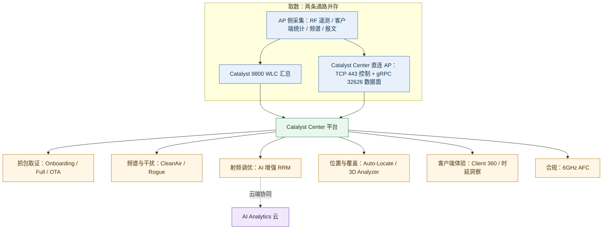
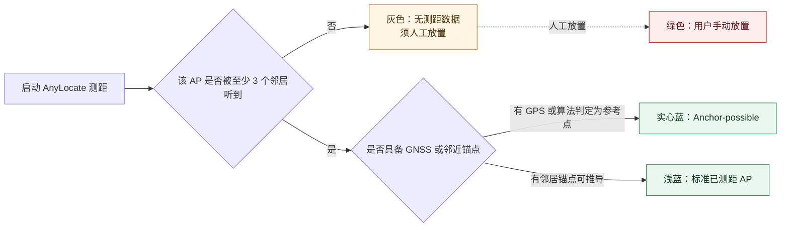
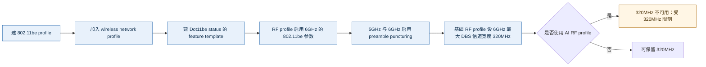

# Cisco Catalyst Center 无线排障与射频运营 —— 功能体系与痛点解法

> **调研对象**：Catalyst Center 的 **无线排障与射频运营** 这一条能力线——从「AP 侧把证据采上来」到「射频参数被自动调优」的完整链路，含抓包取证、频谱与干扰、射频自动调优、AP 位置与三维覆盖、AP 与 WLC 生命周期运维、客户端体验量化、6GHz 标准功率与合规。
> **时间窗**：2023-01 → 2026-10（以官方 Release Notes / 用户指南 / 支持文档 / 数据表可考时间为准）。
> **本文回答五件事**：① 这条线上有哪些**大功能点**，各自包含哪些**小功能点**；② 它们分别解决客户在**哪一侧的痛**（时间 / 钱 / 人 / 合规 / 组织）；③ 用哪些能力去解，与痛点**逐条对应**；④ 对应的**功能机制**是什么（数据从哪来、在哪儿算、闸门装在哪、上限是多少）；⑤ 这条线四年间**怎么长出来的**。

## 口径声明（与同系列其它报告的分工）

本文是 `Catalyst-Center-2023-2026-功能体系与痛点解法.md`（下称**主报告**）的**下钻篇**，两者互补、不重叠：

| 文档 | 覆盖 | 与本文的关系 |
| --- | --- | --- |
| **主报告** 大功能点 6（无线排障与射频运营 / 抓得住） | 16 条小功能点的**全景清单**与痛点-解法概要 | 本文把它**拆开重写**：补上「功能机制」与「演进情况」两段，并把原先散在其它组的关联能力（AP Zone、AP Refresh、AP Priming、Wi-Fi 7 型号、监管激活）收进同一条链路 |
| **姊妹篇**《Assurance 端到端体验可观测》（7 个大功能点 / 101 条小功能点） | 有线与无线**共用的**保障链路：健康分、遥测底座、客户端接入旅程、应用体验、基线智能、根因处置、权限报表 | 本文**不重写**保障骨架；凡涉及「无线客户端健康分怎么算」这类跨端机制，只保留与无线排障直接相关的那一段并标注指向 |
| **姊妹篇**《园区自动化与配置闭环》（7 个大功能点 / 122 条小功能点） | Day-0 → Day-N 的配置动作链路：PnP、发现、模板、变更前预览、SWIM、LAN Automation、任务编排 | 本文只保留**无线专属**的那部分（AP Zone、AP Priming、AP Refresh、AP 镜像带外下载、WLC 供给优化）；通用的模板与合规体系不重复 |
| **本篇** | 7 个「无线排障与射频运营」大功能点：抓得到 / 看得见 / 调得准 / 放得对 / 换得顺 / 量得清 / 合得上 | — |

> **本文口径（重要）**：只收「**让无线这件事被采到、被看见、被调好、被合规**」的能力。**不含**有线的路径追踪与流分析（属主报告大功能点 5 / 7），**不含**安全分段与零信任（主报告大功能点 9），**不含**能源管理与 PoE 分析（主报告大功能点 10，尽管 AP 省电与它有交集——本文只保留「AP Power Save 的配置与效果口径」这一段并注明）。凡涉及「平台侧给出建议、由人确认」的能力（如 AI 增强 RRM 的变更落地），**纳入本文并标注闸门位置**——因为「闸门在哪」正是这类产品最有价值的结论。

## 信源与局限说明

| 等级 | 含义 | 本文使用情况 |
| --- | --- | --- |
| **A** | 官方用户指南（Catalyst Assurance UG 2.3.7 / Catalyst Center UG 3.1.x / 3.2.x / 3.3.x）/ 官方 Release Notes（3.1.3 / 3.2.2 / 3.3.1）/ 官方支持文档（cisco.com/c/en/us/support，含 226132 无线排障、225718 AP Refresh、225868 AP Auto-Locate 最佳实践）/ 官方数据表（Solution Overview、3.2.3 DS、3.3.1 DS）/ 官方技术参考（AFC、AI-Enhanced RRM Deployment Guide）/ 官方 9800 配置指南（17.15/17.17/17.18/26.1 频谱分析、17.17 AFC）/ 官方 FAQ（AFC、2.3.7 Release Overview） | 主证据来源，约占八成 |
| **B** | 官方博客与官方社区（作者为 Cisco 员工，如 6GHz Standard Power 与 AFC 讲解帖、Catalyst Center Expert Insights AMA、Cisco Live 材料 BRKXAR-1723）/ 官方 Cisco Live 发布稿（含 ThousandEyes 侧对 AI Packet Analyzer 的官方说明） | 补充定位、机制细节与部署约束 |
| **C** | 第三方技术站与备考站（open-exam-prep、pinglabz、toolify、渠道商与聚合站） | **仅用于交叉印证**；与官方口径冲突时以官方为准，并显式标注冲突 |

**已知局限（务必连同结论一起理解）**：

1. **AI Packet Analyzer 的量化收益是 B 级厂商口径**。官方口径为「训练于 100 万+ 抓包，把曾需数周的专家分析压缩到秒级」，来源是 Cisco Live Amsterdam 2026 的发布材料与 Cisco 官方博客；**无第三方验证，一律按「量级参考」理解**。其产品化状态亦为「发布中」而非全面 GA。
2. **AI-Enhanced RRM 的云端数据保留期存在口径差**。官方 Deployment Guide 未直接给出保留天数，第三方备考站表述为「连续采集 + 14 天数据库」。本文**按 C 级处理**，并保留「传统 RRM 使用最近 10 分钟数据」这一 A 级对照。
3. **AI-Enhanced RRM 的变更频率不受「仅夜间维护窗口」约束**。第三方备考站明确纠正了这一常见误解（run period 为 30 分钟，且关键事件可随时触发）；本文采用该口径但标注为 C 级，因为官方 Deployment Guide 只描述「busy hours 与 sensitivity」而未逐条列出触发时机。
4. **AP Auto-Locate 与 Cisco Spaces 强耦合**。核心机制文档位于 Cisco Spaces 侧（Device Placement / AnyLocate）而非 Catalyst Center 用户指南。Catalyst Center 侧只承担「AP 配置工作流 + 地图呈现」的角色。**引用时须区分两侧归属**，否则会把第三方组件的能力误算到 Catalyst Center 头上。
5. **AP 省电 20% 是厂商自述**（来源包含 Cisco 内部工程测试），Cisco Live 材料另给出「非高峰关闭 1,000 个 AP 约省 66,000 kWh、约占总能耗 60%」——两者**均为内部测试口径**，本文并列呈现并标注量级参考。
6. **Intelligent Capture 的可用性受部署形态限制**。官方明确 iCAP **仅支持 local 或 FlexConnect 模式的 AP，且不支持 SD-Access 部署**。这条边界常被忽略，直接决定「哪些客户用得上」。
7. **3.2.x 为受控可用（controlled availability）**。3.2.2 的 Release Notes 明确要求联系思科销售申请访问；**凡属 3.2.x 的无线功能，本文一律标注为「受控可用」而非「普遍可用」**。
8. **资料截止 2026-10-14。** 3.3.1（2026-09-09）为本时间窗内最新版本。

**版本节奏对照表**（用于把功能对齐到时间窗）：

| 版本线 | 与本主题相关的关键节点 |
| --- | --- |
| 2.3.7.x（维护线） | 2.3.7 引入 **Over-the-Air Sniffer**、AP 省电洞察、Per-SSID 过滤、无线客户端时延洞察；2.3.7.4 前后引入 Standard Power Service（AFC）；2.3.7.5 AP Refresh 增强；2.3.7.9 MLO；**2.3.7.10 Wi-Fi 7 客户端健康 + 9176D1/9176I/9178I 型号支持 + ISSU** |
| 3.1.x | 3.1.3 **AP Priming**、9172H/9172I Wi-Fi 7、9176D1/9176I 的 XOR、**AFC 地理定位参数进入 AP 配置工作流**、WLC 配置变更同步优化 |
| 3.2.x | 3.2.2（受控可用）**AP 加速度计与倾角上报**、**AP Zone 优化 + PnP AP Zone**、**AP 镜像带外下载**、WLC 供给优化、2D 地图标签增强、AP Ethernet 报表实体、6GHz 高干扰事件 |
| 3.3.x | 3.3.1 **9177D/E/I 支持**、**监管激活（解决国家码）**、无线地图与站点导入导出权限下放、5GHz DBS 信道宽度改 min/max、网络配置档上限 250 |

---

## 读法：7 个大功能点全景

按「**证据如何产生 → 如何被读懂 → 如何被处置**」的先后顺序排列——左侧是采集与取证，中间是读懂，右侧是调优与合规。

| # | 大功能点 | 四字口号 | 小功能点数 | 时间跨度 | 在链路中的位置 |
| --- | --- | --- | --- | --- | --- |
| 1 | 抓包取证：Intelligent Capture 直连通道与按需抓包 | 抓得到 | 15 | 平台早期 → 2026-10 | 取证层（把证据采下来） |
| 2 | 频谱与干扰治理 | 看得见 | 16 | 平台早期 → 2026-09 | 判读层（射频上有什么在捣乱） |
| 3 | 射频自动化调优：AI-Enhanced RRM | 调得准 | 18 | 2023 起 → 2026-09 | 决策层（参数该改成什么） |
| 4 | AP 位置与三维覆盖 | 放得对 | 18 | 平台早期 → 2026-05 | 基线层（AP 到底在哪、覆盖够不够） |
| 5 | AP 与 WLC 生命周期运维 | 换得顺 | 21 | 2024 起 → 2026-09 | 供给层（设备怎么换、怎么上） |
| 6 | 无线客户端体验量化 | 量得清 | 14 | 平台早期 → 2026-09 | 度量层（体验好不好，拿数字说话） |
| 7 | 6GHz 标准功率与合规 | 合得上 | 18 | 2023 起 → 2026-09 | 合规层（监管要求是否满足） |
| — | **合计** | — | **120** | — | — |

> **读法提示**：第 1–2 组回答「**出了问题，证据从哪来**」——这是与自研 APM 最直接可比的一组，也是「原厂 vs 第三方」差距最明显的一组（详见附录三）；第 3 组是**唯一真正闭环到自动执行**的一组（识别 → 建议 → 模拟 → 下发）；第 4 组是**所有无线结论的地基**（位置错则 RF 结论全错）；第 5 组是日常运维的苦活；第 6 组是把无线体验翻译成可汇报数字的一组；第 7 组是**政策驱动**的一组，也是客户「不得不做」的一组。

> **一张图看清这条线的主脉**：左侧两条取数通路，右侧六类消费方式。

---

# 大功能点 1：抓包取证：Intelligent Capture 直连通道与按需抓包 —— 抓得到

## 1.1 小功能点清单

| # | 小功能点 | 发布时间 | 来源等级 | 说明 |
| --- | --- | --- | --- | --- |
| 1.1 | **Intelligent Capture（iCAP）直连通道** | 平台早期，持续演进 | A | AP 与 Catalyst Center 建立**点对点直连**（不经 WLC 中转），平台据此取得 WLC 层拿不到的数据 |
| 1.2 | iCAP 端口与传输口径 | 平台早期 | A | **TCP 443** 用于 AP 向平台发起 HTTPS 连接；**TCP 32626** 建立 gRPC 通道，承载 AP/客户端统计与抓包数据。两端若有防火墙须放行 |
| 1.3 | iCAP 订阅清单机制 | 平台早期 | A | 设备侧以订阅项控制采集开关：Full Pkt Capture / Partial Pkt Capture / Anomaly Event / Stats / AP Operational Data / Sensor Message / RRM Operational Data / Client Events / aWIPS Forensic Pkts |
| 1.4 | **Onboarding Packet Capture**（入网抓包，原 Client Schedule Capture） | 平台早期 | A | 记录客户端入网全程报文：**802.11 管理帧**（关联与认证请求）、**DHCP**、**EAP**（802.1X 认证），并**按 5 秒采样**同步收集客户端 RF 统计 |
| 1.5 | Onboarding 的会话时隙上限 | 平台早期 | A | 全平台共 **16 个时隙**（实时与定时共享），**每个客户端占 1 个时隙**，每个客户端最多启用 **3 台 WLC**；超限报错，须先停或等其完成 |
| 1.6 | Onboarding 的时长与调度 | 平台早期 | A | 默认 **30 分钟**，可设至 **8 小时**；可立即启动或定时后跑；数据落在 Client 360 > Intelligent Capture |
| 1.7 | Client 360 内嵌的抓包视图 | 平台早期 | A | 客户端维度的抓包与 RF 统计在 Client 360 内查看，与连接事件、会话详情同屏 |
| 1.8 | PCAP 导出与 Completed Captures | 平台早期 | A | 会话结束后进入 Completed Captures，可**导出 PCAP** 供后续分析 |
| 1.9 | **AP Statistics Capture**（AP 统计采集） | 平台早期 | A | 采集三类数据：**AP radio 统计、WLAN 统计、AP client 统计**；数据实时展示在 Device 360 页 |
| 1.10 | AP Stats 的规模与作用域 | 平台早期 | A | 支持**最多 1000 个 AP**；可对指定 AP 启用，也可对**某台 WLC 下所有 AP 全局启用**；启用后 Catalyst Center 把对应配置推给 WLC |
| 1.11 | **Anomaly Capture**（异常采集，含四个子能力） | 平台早期 | A | 含 Anomaly Detection、Anomaly Packet Capture、Anomaly Individual Reports、Anomaly Summary Reports 四部分 |
| 1.12 | 异常行为的自动检出与标记 | 平台早期 | A | 对已启用的 AP，**自动检测并标记**异常客户端行为（入网失败、认证问题、异常关联模式），在客户端维度的 Intelligent Capture（Onboarding 与 Full）中呈现 |
| 1.13 | **OTA Sniffer Capture**（整射频抓包） | 2.3.7（2024-09 发布稿） | A | 在 Intelligent Capture 之上扩展：从「单个客户端与 AP 之间的报文」扩展到 **一整块射频**——一次最多听 **2 个 AP**、**任意频段**的全部报文 |
| 1.14 | OTA 的射频选择与模式切换 | 2.3.7 | A | 指定 **radio / 信道宽度 / 信道**；被选的 AP 在各自 radio/slot 上进入 **sniffer 模式**（该 slot 期间不服务客户端）；可在**楼层图上按射频、RSSI、客户端数**选择邻近射频 |
| 1.15 | OTA 的时长、状态与文件下载 | 2.3.7 | A | **默认运行 15 分钟**后自动停用，可随时手动停；运行状态在 Assurance > Settings > Intelligent Capture Settings > OTA Sniffer Capture 查看，完成后在 Completed Captures 下载文件 |

## 1.2 它对应的用户痛点

> **口径**：本节只写客户侧可感知的痛，不写「抓包怎么实现」「gRPC 通道怎么建」这类设计约束。P1…Pn 与下节 S1…Sn 一一对应。

- **P1｜无线问题转瞬即逝，人到了问题没了**。用户报「某个区域断断续续」，等人到现场、架上抓包设备，现象已经过去；事前没有采集、事后没有证据，只能等下次复发。（时间）
- **P2｜取证要专用工具加专家，一线做不了**。抓包与分析长期是少数无线专家的活；一线工程师接单后只能转派，排障链路被人为拉长。（人 / 时间）
- **P3｜「某个客户端上不去网」，说不清卡在哪一步**。关联？认证？拿 IP？三个阶段的现象在用户描述里是同一句话，团队只能靠反复试错缩小范围。（时间）
- **P4｜异常客户端行为偶发且无规律，没法预置监控**。入网失败、认证异常、异常关联模式这类行为发生在个别客户端、个别时刻，人工根本盯不过来，问题反复出现也没有留痕。（人 / 时间）
- **P5｜整信道、整射频级别的问题没有取证手段，只能猜**。当问题不是「一个客户端」而是「一个区域的一批客户端」时，逐客户端的抓包不在适用范围内，团队只能凭经验推断是干扰、拥塞还是配置。（时间）
- **P6｜担心常开采集影响生产，于是「出了问题才开」，结果又抓不到**。客户对长期开启采集有性能与容量顾虑，只能被动响应；而被动响应必然错过现象发生的那一刻。（时间 / 组织）

## 1.3 它是如何解决的

**架构约束（由痛点倒推）**

| 架构约束 | 由哪条痛点倒推 | 落到了哪些功能 |
| --- | --- | --- |
| 采集能力必须「随时可发起、不依赖现场人员」 | P1 | iCAP 直连通道、Onboarding / Full Packet Capture |
| 分析门槛必须从专家下移到一线 | P2 | PCAP 一键导出、Client 360 内嵌视图、Anomaly 自动标记 |
| 必须能按「入网阶段」切分证据 | P3 | Onboarding Packet Capture（分抓 802.11 / DHCP / EAP，并同步采 RF 统计） |
| 必须有常开的轻量层，自动发现异常 | P4 | Anomaly Capture（检测 + 抓包 + 个体报告 + 汇总报告）、AP Statistics Capture |
| 采集对象必须能从「客户端」上升到「射频」 | P5 | OTA Sniffer Capture（2 AP、任意频段、整射频） |
| 采集必须分层，重负载能力按需启用并设硬闸门 | P6 | 订阅分层（Stats / Anomaly 常开 vs 抓包按需）+ 16 时隙 / 1000 AP 上限 |

- **S1｜把取数通道改成 AP 与平台直连**（→ 解 P1）。**Intelligent Capture（iCAP）** 在 Catalyst Center 与 AP 之间建立**直接通信链路**，AP 可直连平台；平台由此能拿到 **WLC 层根本不具备的 AP 侧数据**（抓包数据、AP 与客户端统计、频谱数据）。传输上分两条：**TCP 443** 走 HTTPS 控制连接，**TCP 32626** 走 gRPC 承载统计与抓包数据面。**这条解法把「现场取证」变成了「后台取证」**——采集不再依赖人到现场。

- **S2｜把分析门槛压到一线可用**（→ 解 P2）。抓包会话可**立即启动或定时后跑**，完成后进入 **Completed Captures** 并**导出 PCAP**；数据同时内嵌在 **Client 360 > Intelligent Capture**，与连接事件、会话详情同屏。一线工程师不再需要「先转派给专家」，而是拿到现成证据再决定是否升级。**门槛降低的代价是深度**：PCAP 仍是原始文件，深度关联分析仍需专业能力（见边界）。

- **S3｜按入网阶段切分证据**（→ 解 P3）。**Onboarding Packet Capture** 精确抓取客户端入网时交换的报文序列：**802.11 管理帧**（关联请求、认证请求）、**DHCP** 报文、**802.1X 认证用的 EAP** 报文，并**按 5 秒采样**同步收集客户端 RF 统计。默认在**该客户端最后连接的 WLC** 上启用，最多可选 **3 台 WLC** 以覆盖漫游场景。**结论落到客户侧就是一句话**：失败发生在关联、认证还是拿 IP 阶段，不再靠猜。

- **S4｜常开一层轻量采集，自动发现异常**（→ 解 P4）。**AP Statistics Capture** 采集 AP radio / WLAN / AP client 三类统计（最多 **1000 个 AP**，可按 AP 或按 WLC 全局启用）；**Anomaly Capture** 进一步把「检测」与「留证」连起来——对已启用的 AP **自动检测并标记**入网失败、认证问题、异常关联模式等行为，并与客户端维度的 Onboarding / Full 抓包**互相印证**，从而在无需人工逐会话监控的前提下还原异常事件的确切顺序。

- **S5｜把采集对象从「客户端」升到「射频」**（→ 解 P5）。**OTA Sniffer Capture（2.3.7）** 一次可听**最多 2 个 AP、任意频段**的**全部报文**，并允许在**楼层图上按射频、RSSI、客户端数**选择要听的邻近射频。官方列出的用例有三类：**整信道级的无线客户端性能与连接问题、无线流量的性能与安全分析、来自非法 AP 的威胁识别**。被选 AP 在各自 radio/slot 上进入 **sniffer 模式**——**这是一次通道占用，代价是被占用的那个 slot 期间不服务客户端**。

- **S6｜把能力分层，重负载按需启用并设硬闸门**（→ 解 P6）。平台把采集拆成两层：**轻量常开层**（AP Stats、Anomaly，按 AP 或按 WLC 全局开启，上限 1000 AP）与**重负载按需层**（Onboarding / Full 抓包、OTA Sniffer）。按需层带明确闸门：Onboarding 与 Full 抓包共享**全平台 16 个时隙**（每客户端 1 个、每客户端最多 3 台 WLC），默认 **30 分钟**最长 **8 小时**；OTA Sniffer **默认 15 分钟**后自动停用。**这些闸门本身就是产品答案**——它承认「采集是有代价的」，并用配额而不是让客户自己拿捏。

## 1.4 功能机制

**机制 1：iCAP 是「第二取数面」，不是 WLC 的转发**。官方表述很明确：无线设备与客户端的健康信息**通常**来自 WLC，而 iCAP 提供的是 Catalyst Center 与 AP 之间的**直接通信链路**，使平台能访问**WLC 拿不到的 AP 侧数据**。通道建立的前提是 AP 能连到平台：**TCP 443**（AP 发起 HTTPS 至平台）与 **TCP 32626**（gRPC，承载 AP/客户端统计与抓包数据）。上层以「订阅项」细分采集内容：Full Pkt Capture、Partial Pkt Capture、Anomaly Event、Stats、AP Operational Data、Sensor Message、RRM Operational Data、Client Events、aWIPS Forensic Pkts。

**机制 2：三种抓包各自锁定的数据面不同**。

| 抓包类型 | 抓什么 | 默认 / 上限 | 作用域闸门 | 读取位置 |
| --- | --- | --- | --- | --- |
| **Onboarding Packet Capture** | 802.11 管理帧（关联 / 认证）+ DHCP + EAP；同时按 5 秒采样采客户端 RF 统计 | 默认 30 分钟，最长 8 小时 | 全平台 **16 时隙**；每客户端 1 时隙；每客户端最多 **3 台 WLC**；默认落在该客户端最后连接的 WLC | Client 360 > Intelligent Capture |
| **Full Packet Capture** | 某个客户端在无线上的**连续完整数据**，可下钻到数据报文与管理报文 | 最多 **1 GB** 连续数据，滚动保留最新数据到该上限；时长同为 30 分钟 – 8 小时 | 与 Onboarding 共享 16 时隙 | Client 360；完成后可导 PCAP |
| **OTA Sniffer Capture** | **整块射频**上该 radio + 信道 + 信道宽度内的**全部 Wi-Fi 数据报文** | **默认 15 分钟**自动停用，可手动停 | 一次最多 **2 个 AP**；被选 AP 的 radio/slot 进入 sniffer 模式 | Assurance > Settings > Intelligent Capture Settings > OTA Sniffer Capture |

**机制 3：时隙是平台级配额，且由 WLC 强制执行**。官方明确：**共 16 个时隙分配给抓包会话（实时与定时共享）**，每个客户端在一个会话中占 1 个时隙，且每个客户端最多在 3 台 WLC 上启用；尝试启动第 17 个实时会话会直接报错。要再排会话，必须**先停掉正在跑的把时隙腾出来，或等某个会话完成**。此外——**当 Catalyst Center 配置抓包会话时，平台不知情的实时或定时会话（例如直接在 WLC 上配的部分抓包）会被移除**。这是「平台是唯一编排者」这一设计取向的直接后果。

**机制 4：Anomaly 是「常开检测 + 按需取证」的缝合点**。Anomaly Capture 四个子能力中，**Anomaly Detection** 负责持续判定，**Anomaly Packet Capture** 负责留证，**Individual / Summary Reports** 负责呈现。启用范围与 AP Stats 一致：**可对指定 AP（最多 1000）或对某台 WLC 下的全部 AP 全局启用**。启用后平台**持续**收集与该 AP 关联客户端的异常行为，并把它与客户端 ID 维度的 Onboarding / Full 抓包**对齐**，从而「让管理员追踪导致异常的事件确切顺序」。**这句话是本节最有价值的机制结论：异常检测不单独成篇，它的价值必须由抓包来兑现。**

**机制 5：订阅与开关的运维纪律（易踩的坑）**。官方给出三条 iCAP 最佳实践，全部是「开关时序」问题：
- **新增 WLC 后**要**先关闭** iCAP 全局设置、**再重新开启**，否则新控制器上不会下发配置；
- **删除 WLC 前**要**关闭**所有 iCAP 设置；
- **升级受管 WLC 或重装 Catalyst Center 前**要**关闭**所有 iCAP 设置，升级完成后再开。

**机制 6：部署形态的硬边界**。iCAP **仅支持处于 local 或 FlexConnect 模式的 AP**，且**不支持 SD-Access 部署**。这一条直接决定「谁用得上」——SD-Access 客户拿不到这条直连能力。

## 1.5 演进情况

| 阶段 | 时间 | 演进内容 | 判断 |
| --- | --- | --- | --- |
| **第一阶段：建立直连** | 平台早期 | iCAP 直连通道成型（TCP 443 + gRPC 32626），采集订阅化；Onboarding Packet Capture（原 Client Schedule Capture）与 Full Packet Capture 提供客户端维度取证 | 解决「取证要不要人到现场」——答案是不要 |
| **第二阶段：常开与自动化** | 平台早期延续 | AP Statistics Capture（最多 1000 AP）与 Anomaly Capture（四子能力）上线，把「人工逐会话盯」换成「平台持续判 + 自动留证」 | 采集从「按需」走向「常开 + 按需」两层 |
| **第三阶段：从客户端升到射频** | **2.3.7（2024-09 发布稿）** | **OTA Sniffer**：一次听最多 2 个 AP、任意频段的全部报文，楼层图选源；官方用例明确包含非法 AP 威胁识别 | 采集对象跨过「单客户端」这条线，进入区块级取证 |
| **第四阶段：AI 接手读包** | **2026-02（Cisco Live Amsterdam）** | **AI Packet Analyzer**：作为 Proactive PCAP 的 AI 增强，用「上下文 PCAP 模型」把客户端失败事件与配置数据结合做根因分析，可在 dashboard 内直接分析抓包文件；官方口径为训练于 100 万+ 抓包、把数周分析压缩到秒级（量级参考，B 级） | 采集端四年基本定型，**变化点转移到「谁来读」**——从人读改为模型读 |

**演进规律小结**：这条线四年的主轴是「**证据链的下沉**」——第一年解决「能不能远程采」，第二年解决「能不能常开采」，第三年解决「能不能采到射频这一层」，第四年解决「采完谁来读」。**采集能力本身在 2.3.7 之后就基本停止扩张**，此后所有增量都在分析侧。这对自研的含义是：**采集不是护城河，解读才是**。

---

# 大功能点 2：频谱与干扰治理 —— 看得见

## 2.1 小功能点清单

| # | 小功能点 | 发布时间 | 来源等级 | 说明 |
| --- | --- | --- | --- | --- |
| 2.1 | **Spectrum Analysis 的三类图** | 平台早期 | A | 官方明确聚合为三种图：**Persistence（持续图）**、**Waterfall（瀑布图）**、**Interference and Duty（干扰与占空比图）** |
| 2.2 | 频谱数据的时间窗口与刻度 | 平台早期 | A | Persistence 与 Waterfall 均以 **5 分钟**为窗口；Waterfall 以强度为 X 轴、时间为 Y 轴；Persistence 用透明度表示信号数据的新旧（越旧越透明） |
| 2.3 | 干扰严重度与类型判定 | 平台早期 | A | Interference and Duty 图以圆表示干扰：圆心为严重度、半径为受影响频段范围；**严重度取值 0–100**；干扰类型由 **Cisco CleanAir** 依据 RF 特征（RF signature）判定 |
| 2.4 | **Live Spectrum Analysis**（实时频谱） | 平台早期 | A | 实时检视 AP radio 的频谱；**可配置时长 10 分钟**，之后可按需延长；**使用 radio 2 时给出 2.4GHz 与 5GHz 的合并干扰视图**，用 radio 0/1 时只能看到该 radio 覆盖的那部分频谱 |
| 2.5 | 按需频谱分析的型号前提 | 平台早期 | A | 频谱分析**要求 AP 型号支持**；不支持的型号无法执行 |
| 2.6 | 频谱分析的入口与 CLI 口径 | 平台早期 | A | GUI：Provision > Inventory > 选 AP > 360 视图 > Intelligent Capture > Spectrum Analysis > 选 radio > 启停；CLI：`icap subscription ap rf spectrum enable` 与 `icap subscription ap rf spectrum slot <n>` |
| 2.7 | **AP 360 / Device 360 的 radio 级 KPI** | 平台早期 | A | 展示**信道利用率、客户端数、吞吐（Rx/Tx 速率）、重试、噪声、空口质量（air quality）**等 radio 级指标 |
| 2.8 | AP 360 的 Tx power 与信道历史 | 平台早期 | A | 展示 **Tx power 趋势、信道分配历史、AP radio 运行状态、按类型（数据/管理）的 Tx 帧计数、按客户端/报文数的 Top SSID** |
| 2.9 | AP 360 的邻居 / Rogue / 干扰源视图 | 平台早期 | A | 列出附近全部 **neighbor、rogue、interferer** 设备及其 **RSSI、受影响信道、SSID、客户端数、Tx power、严重度指数**，并提供 **RSSI–信道**可视化散点图 |
| 2.10 | 邻居数据的存储口径 | 平台早期 | A | 官方明确：**Catalyst Center 每个 5 分钟区间只存 RSSI 最高的 10 个邻居**——这是一条容易被忽略的截断规则 |
| 2.11 | **DFS tab** | 平台早期 | A | 针对 AP 的 **5GHz radio**，提供 **DFS（动态频率选择）雷达事件**信息 |
| 2.12 | **Rogue Management 与 aWIPS** | 平台早期 | A | 检测未授权 AP 带来的威胁，并检测与缓解无线入侵威胁；提供详细威胁分析与全网 rogue AP 的**全局视图**，突出最高优先级威胁 |
| 2.13 | **Rogue AP 楼层图** | 3.2.3 数据表口径 | A | 在楼层图上查看**过去 1 小时**内全部 rogue AP 的**精确位置与威胁级别** |
| 2.14 | **Threat 360** | 平台早期 | A | 单个威胁的详情视图，含**地图定位**与**全部受影响客户端** |
| 2.15 | Rogue / aWIPS 的事件与告警通道 | 3.3.1 | A | 事件 **NETWORK-THREATS-ROGUE-01** 与 **NETWORK-THREATS-AWIPS-01**；3.3.1 起这两类事件**支持邮件通知**（官方同时建议高告警量场景改用 webhook） |
| 2.16 | **6GHz 高干扰 / 噪声事件** | 3.2.2（受控可用） | A | 事件 **NETWORK-DEVICES-3-115** 增强：AP 可位于楼层或户外区域；当站点内 **6GHz AP 遭遇高干扰或噪声**时触发 |

## 2.2 它对应的用户痛点

> **口径**：本节只写客户侧可感知的痛。P1…Pn 与下节 S1…Sn 一一对应。

- **P1｜性能下降但找不到「谁在捣乱」，只能怀疑**。用户体感变差，但网管界面上一片绿色；团队只能在「信道拥塞」「干扰」「客户端问题」之间反复排查。（时间）
- **P2｜非 Wi-Fi 干扰源根本不在普通网管视野内**。微波炉、蓝牙设备、无线摄像头、医疗设备都在 2.4/5GHz 里发信，但不遵守 802.11 规则，传统网管工具既看不见也识别不出。（时间 / 人）
- **P3｜私接无线路由带来安全与合规风险，却定位不到**。非法 AP 一旦接入，既是数据外泄风险也是审计问题；但「谁接的、接在哪一层、影响哪些客户端」通常说不清。（合规 / 钱）
- **P4｜排查干扰要带专业频谱仪去现场**。频谱分析在传统做法里是「带着仪器去楼层量」的活，成本高、周期长，且只能在问题发生时进行。（人 / 钱）
- **P5｜6GHz 频段的干扰与噪声缺乏主动告知**。6GHz 是新频段，客户对它的干扰特征缺少经验，且缺少「这个站的 6GHz 出问题了」的主动提醒。（时间）

## 2.3 它是如何解决的

**架构约束（由痛点倒推）**

| 架构约束 | 由哪条痛点倒推 | 落到了哪些功能 |
| --- | --- | --- |
| 干扰必须被「测量并分类」，不能只报结果指标 | P1 | Spectrum Analysis 三类图 + 严重度 0–100 |
| 必须能识别**非 Wi-Fi** 发射源 | P2 | Cisco CleanAir 依据 RF 特征判定干扰类型 |
| 未授权 AP 必须可定位、可评级、可举证 | P3 | Rogue/aWIPS、Rogue AP 楼层图（过去 1 小时）、Threat 360、ROGUE-01/AWIPS-01 事件 |
| 频谱能力必须摆脱对现场仪器的依赖 | P4 | 按需频谱分析 + Live Spectrum Analysis（10 分钟可延长） |
| 新频段需要有主动事件而非仅被动查询 | P5 | NETWORK-DEVICES-3-115（6GHz 高干扰/噪声） |

- **S1｜把干扰「画出来」并量化严重度**（→ 解 P1）。**Spectrum Analysis** 把 AP 采集到的频谱数据聚合成三类图：**Persistence** 画每个信道每个信号的幅度-功率比（蓝=单个信号、红=多信号，透明度=数据新旧，窗口 **5 分钟**）；**Waterfall** 画该信道全部分析过的信号（强度为 X 轴、时间为 Y 轴，蓝低红高，同样 5 分钟窗口）；**Interference and Duty** 画每个信道带检测到的干扰严重度并标出干扰类型，**严重度取值 0–100**，圆的大小代表受影响频段范围。**客户侧的直接收益是：从「怀疑有干扰」变成「哪条信道、多严重、什么类型」。**

- **S2｜用 RF 特征识别非 Wi-Fi 发射源**（→ 解 P2）。官方口径是：平台依据 **Cisco CleanAir** 技术从 **RF signature** 判定干扰类型。因此「微波炉 / 蓝牙 / 无线摄像头」这类不遵守 802.11 的发射源能被分类呈现，而不只是表现为「空口质量差」。**这条是最能体现原厂优势的一条**——识别能力内嵌在 AP 芯片与固件侧，第三方平台无法通过 MIB 读取（见附录三）。

- **S3｜把未授权 AP 做成「可定位、可评级、可告警」的闭环**（→ 解 P3）。**Rogue Management 与 aWIPS** 提供全网 rogue AP 的全局视图并突出最高优先级威胁；**Rogue AP 楼层图**给出**过去 1 小时**内全部 rogue AP 的**精确位置与威胁级别**；**Threat 360** 呈现单个威胁的详情、地图定位与**全部受影响客户端**；事件侧由 **NETWORK-THREATS-ROGUE-01** 与 **NETWORK-THREATS-AWIPS-01** 承担，**3.3.1 起支持邮件通知**（官方建议高告警量时改用 webhook）。**「受影响客户端名单」是合规举证的落地物**——审计要的往往不是「有没有威胁」，而是「哪些终端被暴露过」。

- **S4｜把频谱能力做成在线服务而非现场作业**（→ 解 P4）。**Live Spectrum Analysis** 可实时检视 AP radio 的频谱，**时长可配 10 分钟**并可延长；**用 radio 2 时给出 2.4GHz 与 5GHz 的合并干扰视图**，用 radio 0/1 时只能看到该 radio 覆盖的部分（这是一条明确的机制边界，误用会得出片面结论）。按需频谱分析则从 **Device 360 > Intelligent Capture > Spectrum Analysis** 直接发起，**前提是 AP 型号支持**。**频谱从「现场仪器」变成「平台上的一个按钮」**，代价是分辨率与专业仪器的差距（官方未给出对比口径）。

- **S5｜让 6GHz 的问题主动找你**（→ 解 P5）。**NETWORK-DEVICES-3-115** 在站点内 **6GHz AP 遭遇高干扰或噪声**时触发；3.2.2 同时把该事件的作用域从「必须在地板上」扩展到「AP 可位于楼层或户外区域」。**这是一条「政策跟着频段成熟度走」的能力**：6GHz 刚上量时客户没经验，平台先把「出问题」这件事变成主动事件。

> **边界**：
> - **频谱数据不等于全网 RF 现状**：Live Spectrum 用 radio 0/1 时只是局部频谱，只有 radio 2 才给 2.4+5GHz 合并视图；6GHz 的频谱视图与 radio 2 的关系需按型号确认。
> - **邻居数据被截断**：每个 5 分钟区间**只保留 RSSI 最高的 10 个邻居**——做小区别墅类高密度邻区分析时可能不够。
> - **Rogue AP 楼层图的时间窗只有 1 小时**：超出窗口的历史定位不留存。
> - **告警通道的容量约束**：官方对 ROGUE/AWIPS 事件建议高告警量场景改用 webhook 而非邮件。
> - **频谱分析要求 AP 型号支持**，且相关 CLI 依赖 iCAP 订阅体系——即**仍受第 1 组的部署形态边界约束**（local / FlexConnect，不支持 SD-Access）。

## 2.4 功能机制

**机制 1：三类图是同一份频谱数据流的三种投影**。AP 在启用频谱分析后把频谱数据发往 Catalyst Center，平台把它聚合成三类图。因此三张图的时间窗与刻度是**统一约定**的：Persistence 与 Waterfall 均为 **5 分钟**窗口；Persistence 用颜色深浅表示信号数量、用透明度表示数据新鲜度；Waterfall 把强度与时间分置两轴；Interference and Duty 则切换到「按信道带汇总」的口径，**把连续频谱压缩成 0–100 的严重度 + 干扰类型标签**。**理解这一点很关键**：严重度不是测出来的原始量，而是平台对频谱数据的**再加工结论**。

**机制 2：CleanAir 与 Spectrum Intelligence 是两个层级**。按官方与社区一致的表述，Cisco 的频谱能力分两层：
- **Spectrum Intelligence（频谱智能）**：所有 Catalyst AP 都能用 Wi-Fi 芯片本身在监测频段上尽可能取样，由于无法解码非 Wi-Fi 信号，转而分析其**带宽、跳频序列、占空比、信号强度、时间特征**等模式，从而**推测**是哪种设备或协议；
- **CleanAir**：更高端的 AP 内嵌**专用的可编程射频芯片**（Wi-Fi 4/5 时代叫 CleanAir 芯片；9120/9130 系列是新一代软件定义无线电承担该职能），内含专用频谱分析仪，能在 AP 正在发信的同时进行**连续高分辨率**频谱分析——Wi-Fi 射频发信时会淹没信道，本身无法同时监测，这正是 CleanAir 芯片存在的理由。

**对客户的实践含义**：CleanAir 无性能代价（唯一例外是启用 BLE 检测会给 2.4GHz 带来约 10% 丢包），而在没有专用芯片的 AP 上，频谱智能会有轻微性能代价（需更多离信道时间）。**结论：同一份「频谱分析」功能，在不同 AP 型号上的能力与代价并不相同。**

**机制 3：AP 360 的 RF 数据是「KPI + 邻区 + 事件」三层拼装**。AP 360 的 RF tab 把三份数据放在一起：
1. **radio 级 KPI**：信道利用率、客户端数、吞吐、重试、噪声、空口质量、无线时延按客户端分布、Tx power、按 SSID 的 Tx drops Top 客户端；
2. **邻区与威胁表**：neighbor / rogue / interferer 的 RSSI、受影响信道、SSID、客户端数、Tx power、严重度指数，配 RSSI–信道散点图；条目支持 Band（2GHz / 5GHz）与 Type（All / Neighbor / Rogue）与 **RSSI Range（0 到 −100 dBm）** 过滤，可导出 CSV；
3. **专项 tab**：5GHz radio 的 **DFS tab** 给雷达事件；**Radio 2（6GHz）** 在 **STANDARD POWER MODE** 段给 AFC 集成信息。

**机制 4：DFS 与 radar 事件是「被动合规」而非「主动优化」**。5GHz 上检测到雷达信号必须让出信道——这是监管义务。DFS tab 把这类事件呈现出来，使「某 AP 为什么会突然换信道」有一个可查的解释。**这正是第 3 组 AI 增强 RRM 中「关键事件可以绕过低敏感度设置」的输入之一**。

**机制 5：Rogue 视图的数据源是无线扫描而非配置比对**。Rogue AP 的判定来自 AP 侧的无线监听（扫描到的、不在授权清单内的 SSID/BSSID），aWIPS 则在此基础上加入入侵特征。因此**「检测得到」与「定位得准」是两件事**：定位依赖楼层图与 AP 位置信息，而这正好压在第 4 组（AP 位置与三维覆盖）之上——**位置错，则 rogue 定位也错**。

## 2.5 演进情况

| 阶段 | 时间 | 演进内容 | 判断 |
| --- | --- | --- | --- |
| **第一阶段：把频谱搬进平台** | 平台早期 | Spectrum Analysis 三类图 + CleanAir 干扰类型判定 + Live Spectrum（10 分钟）进入平台；按需频谱分析可由 Device 360 直接发起 | 频谱从现场仪器变为平台按钮 |
| **第二阶段：邻区与威胁成表** | 平台早期延续 | AP 360 RF tab 整合 radio KPI、Tx power 趋势、信道历史、neighbor/rogue/interferer 表与 RSSI–信道图；明确「每 5 分钟只存 RSSI 最高 10 个邻居」 | 数据从「图」走向「可过滤、可导出的表」 |
| **第三阶段：威胁运营化** | 3.2.3 前后 | Rogue AP 楼层图（过去 1 小时的位置与威胁级别）、Threat 360（地图 + 受影响客户端） | Rogue 从「列表」变成「可定位、可举证」 |
| **第四阶段：告警与频段覆盖补齐** | 3.2.2 / 3.3.1 | **NETWORK-DEVICES-3-115** 扩展为覆盖 6GHz 高干扰/噪声且支持户外区域；**ROGUE-01 / AWIPS-01 事件支持邮件**（3.3.1） | 从「被动查询」补上「主动事件」这一环 |

**演进规律小结**：这条线的变化不是「新增能力」，而是**同一份底层数据被反复重新组织**——先是图（看得懂），再是表（筛得动），再是地图与威胁对象（定得住），最后是事件（推得出）。**四年来频谱测量的核心技术（CleanAir）没有变，变的是呈现与消费方式**。对自研的含义：频谱类能力如果做不了芯片级，就**不要在测量层竞争，要在组织与消费层竞争**（详见附录三）。

---

# 大功能点 3：射频自动化调优：AI-Enhanced RRM —— 调得准

## 3.1 小功能点清单

| # | 小功能点 | 发布时间 | 来源等级 | 说明 |
| --- | --- | --- | --- | --- |
| 3.1 | **传统 RRM 的算法谱系** | 2005 起（AireOS/Aironet），持续演进 | A | 官方口径：RRM 自 2005 年随 AireOS 与 Aironet 引入，管理 Wi-Fi 1–6 及 6E 的 RF 复杂度；算法含 **DCA（动态信道分配）、TPC（发射功率控制）**，以及后续加入的 **FRA（灵活射频架构）、DBS（动态带宽选择）** |
| 3.2 | RF Group 与 Group Leader 机制 | 2005 起 | A | 传统 RRM 在 9800 上作为进程运行；它**基于每个 AP 与其邻居之间的动态测量**管理 RF Group，数据存在 **Group Leader 控制器的本地数据库**中 |
| 3.3 | 传统 RRM 的数据窗口 | 2005 起 | A | 运行时**取最近 10 分钟**采集的数据，并基于当前网络状况做温和优化 |
| 3.4 | **AI-Enhanced RRM 的分布式架构** | 2023 起持续演进 | A | 作为**分布式 RRM 服务**运行：AP 的 RF 遥测由 Catalyst WLC 采集 → 经 Catalyst Center → 送往 **Cisco AI Analytics Cloud** 存储；RRM 算法在**云端**针对这些遥测数据运行；AI 把配置变更信息返回 Catalyst Center，后者维护与 9800 的控制连接并把**逐 AP 的配置变更**下发 |
| 3.5 | AI 云的角色定位 | 2023 起 | A | 官方原话：**Cisco AI Analytics Cloud 的角色相当于今天控制器上的 WLC RF Group Leader，但具备远为强大的存储、算力与智能分析** |
| 3.6 | **AI RF Profile** | 2023 起 | A（C 级补充细节） | 档案选择 **2.4 / 5 / 支持的 6GHz 频段**、定义站点时区下的 **busy hours**、选择 **sensitivity**，并**至少启用 FRA / DCA / TPC / DBS 中的一个服务** |
| 3.7 | **30 分钟运行周期** | 2023 起 | C | 第三方备考站口径：AI-Enhanced RRM 以**每 30 分钟**为一个 run period 反复评估；dashboard 的 **Latest** 视图即当前 30 分钟周期（网络安静或已优化时可能显示无变更），**趋势视图**展示更长区间的变更与性能 |
| 3.8 | **Busy-hour Sensitivity 三档** | 2023 起 | C | **High**：只要有 RF 改进机会就优化；**Medium**：降低优化频次；**Low**：推迟非关键变更，但**仍允许关键事件**（DFS、ED-RRM、jammer、持续严重的同频干扰）触发变更 |
| 3.9 | 关键事件不受低敏感度抑制 | 2023 起 | C | 即上条中的低档例外清单——这是「保守」与「失效」之间的分界线 |
| 3.10 | **RRM Changes / Insights / Headlines 视图** | 2023 起 | A | Day-1 视图集合含 **Summary / Headlines、Insights、RRM Changes、FRA Changes、RRM Performance** |
| 3.11 | **同频干扰与频谱利用视图** | 2023 起 | A | 含 **Co-Channel Interference、Utilization per Channel and AP、Radios per Channel、RF Coverage** |
| 3.12 | **RRM Simulator（射频模拟器）** | 2023 起 | A | 官方口径：模拟器允许管理员**对这些建议建模并验证对设计的影响**；部署指南中给出 5 步操作流程 |
| 3.13 | **站点分组与站点时区** | 2023 起 | A | 站点层级（尤其 Building/Sites）用于把一组 AP 分组以展示 dashboard 数据并套用 AI RF Profile；**须配置站点时区**（部署步骤 Step 4） |
| 3.14 | RF Group Mode 与信道/功率前提 | 2023 起 | A | 成员 WLC 各频段的 **RRM Group Mode 须设为 Automatic**；同时所有 radio 的**信道分配与发射功率须为 Global（Automatic）模式**，不能是静态值，否则会产生**重复的虚假 RRM 变更请求** |
| 3.15 | **Device Controllability 闸门** | 2023 起 | A | 部署步骤 Step 3 明确要求**启用 Device Controllability**——这是 AI 建议能否落到设备上的开关 |
| 3.16 | 首次部署 RF Profile 的中断风险 | 2023 起 | A（C 级补充） | 初次部署 AI RF Profile 可能**重置 CAPWAP 并造成瞬时业务中断**，官方建议把该次供给安排在非业务时段；**该一次性风险不等同于后续所有 AI-RRM 决策的风险** |
| 3.17 | 云端不可用时的优雅回退 | 2023 起 | C | 第三方口径：若 AI Analytics 云出现故障或临时不可用，系统**优雅回退到控制器内的 Auto leader 模式**，保持网络管理不中断 |
| 3.18 | 支持 AP 型号与版本矩阵 + 迁移建议 | 2023 起 | A | 部署指南表 2 逐型号给出**最低 / 推荐 IOS XE 版本**（Aironet 1540–4800、Catalyst 9105/9115/9117/9120、CW9162/9163/9166/9172I/9172H/9176/9178/9179、IW6300、IW9165/9167）；并**建议在从传统 RRM 迁移时对所有频段执行一次 DCA 重启**以重算邻居 |

## 3.2 它对应的用户痛点

> **口径**：本节只写客户侧可感知的痛。P1…Pn 与下节 S1…Sn 一一对应。

- **P1｜信道与功率调优靠个人手感，专家一走能力就断档**。RF 调优长期是少数人的经验活，参数取值的依据留在个人脑子里；人员流动即能力流失。（人）
- **P2｜调优不可复现、不可验证，改完不知道更好还是更坏**。改前没有基线模型、改后没有对照，团队只能凭体感判断，也说不出「为什么这么调」。（时间 / 钱）
- **P3｜动态环境让人工调优追不上**。人数变化、新干扰、装修改格局都在持续改变 RF 条件，而人工巡检的节奏天然滞后于变化。（时间 / 人）
- **P4｜改 RF 配置有风险，于是不敢动**。RF 参数影响面大（一个改动可能波及整个楼层的信道复用与功率平衡），团队倾向于「能不动就不动」，问题被长期搁置。（时间 / 组织）
- **P5｜多站点调优是重复劳动，规模化做不动**。每个站点、每个楼层的 RF 条件都得单独调，站点越多，人工调优的边际成本越高。（人 / 钱）
- **P6｜自动化 RF 涉及云端与数据边界，客户要能讲清楚**。把 RF 遥测送出本地、由云端算法给建议，这条链路涉及合规审查与内部沟通成本；如果平台不把数据流与回退机制说清楚，项目就卡在审批上。（合规 / 组织）
- **P7｜「改不改 RF」的争议缺共同依据**。网络团队、RF 专项团队、业务方对「要不要调」意见不一，缺少一份大家都认的量化依据，决策被拖成扯皮。（组织）

## 3.3 它是如何解决的

**架构约束（由痛点倒推）**

| 架构约束 | 由哪条痛点倒推 | 落到了哪些功能 |
| --- | --- | --- |
| RF 决策必须从个人经验搬到平台上 | P1 | AI-Enhanced RRM 服务化 + AI RF Profile 模板化 |
| 决策必须可建模、可验证、可回看 | P2 | **RRM Simulator** + RRM Changes / FRA Changes 变更留痕 |
| 决策必须能跟上变化速度 | P3 | 30 分钟 run period + 云端算法 + busy-hour sensitivity |
| 改动必须有闸门与风险提示 | P4 | **Device Controllability** + 首次部署 CAPWAP 中断提醒 + 站点时区/分组 |
| 一套策略必须能覆盖多站点 | P5 | 站点层级分组 + 站点时区 + AI RF Profile 按站点套用 |
| 数据流必须可解释、可回退 | P6 | 明确的两段式数据流（本地协调 + 云端算法）+ 云端不可用回退 Auto leader |
| 必须有客观的共享依据 | P7 | Insights / RRM Performance / Co-Channel Interference / RF Coverage 视图 |

- **S1｜把 RF 决策从个人手上搬到平台上**（→ 解 P1）。**AI-Enhanced RRM** 把 AI/ML 引入 Cisco RRM 产品族算法并运行在云侧，通过 **Catalyst Center（本地设备）作为服务协调点**；官方定位是「**现有的 9800 RRM 站点可以无缝迁移到这一智能集中式服务**」。决策依据从「某个人的手感」变成「平台对历史 RF 经验的评估 + 趋势预测 + 配置建议」。**注意这是「迁移」而非「重做」**：传统算法谱系（DCA / TPC / FRA / DBS）被保留，AI 改变的是**决策层**而非算法本身。

- **S2｜让改动先建模再落地**（→ 解 P2）。**RRM Simulator** 允许管理员**对 AI 给出的建议建模并验证其对设计的影响**，再决定是否落地；同时 **RRM Changes** 与 **FRA Changes** 视图把「改了什么」留痕，配合 **RRM Performance** 形成「改前—改后」的对照。**这与自研助手最该复刻的一点同构**：改动前可验证、改动后可归因。**边界**：模拟器验证的是「设计层面的影响」，而非生产环境下的真实后果。

- **S3｜让决策节奏跟上变化节奏**（→ 解 P3）。系统以 **30 分钟为运行周期**反复评估（第三方口径），并在 **busy hours** 内由 **sensitivity** 调节改动倾向：**High** 只要有改进机会就动手、**Medium** 降低频次、**Low** 推迟非关键变更但仍放行关键事件（**DFS、ED-RRM、jammer、持续严重同频干扰**）。**这里的机制设计值得单独记住**：它用「敏感度」表达保守程度，同时用「关键事件白名单」保证安全底线不被保守策略吃掉——**这是一个可以直接借用的闸门设计范式**。

- **S4｜把改动风险做成显式闸门**（→ 解 P4）。三处闸门：① **Device Controllability** 是 AI 建议能否落到设备上的总开关（部署 Step 3 明确要求启用）；② **首次部署 AI RF Profile 可能重置 CAPWAP** 造成瞬时中断，须安排在非业务时段；③ 站点时区（Step 4）决定 busy hours 落在什么真实时段——**时区错则整个调优窗口错**。**把「风险在什么时刻、因什么动作出现」说清楚，本身就是让客户敢动的前提。**

- **S5｜用站点分组让一套策略覆盖多站点**（→ 解 P5）。AI-Enhanced RRM 以 **Building / Sites 为分组单位**来展示 dashboard 数据并套用 AI RF Profile，配合**站点时区**，使同一份策略可以在结构相似的站点上复用。官方目标口径是「**IT 现在可以管所有站点与位置，免去耗时的 RF 调优**」。**对多站点客户的直接收益是：调优从「逐站点项目」变成「一份模板 + 站点差异化时区」。**

- **S6｜把数据流与回退讲清楚**（→ 解 P6）。数据流是**两段式**且官方有成文描述：AP → WLC（采集遥测）→ Catalyst Center（聚合与协调）→ Cisco AI Analytics Cloud（存储 + 算法）→ 返回 Catalyst Center → **由 Catalyst Center 下发到 AP**。关键澄清三点：① **CAPWAP 隧道仍在 AP 与 WLC 之间，云并不直接与 AP 建隧道**；② **控制连接由 Catalyst Center 维护**，云只是计算方；③ 云不可用时可**优雅回退到控制器的 Auto leader 模式**。**这三句话就是客户过合规审查时需要的答复口径。**

- **S7｜用一套视图当共同依据**（→ 解 P7）。**Insights / Headlines** 给结论、**RRM Changes / FRA Changes** 给改动记录、**RRM Performance** 给效果、**Co-Channel Interference / Utilization per Channel and AP / Radios per Channel / RF Coverage** 给现状。**争议从「我觉得该调」变成「数据说哪里没覆盖、哪里同频打架」。** 这是把 RF 议题从人的层面搬到数据层面的关键一步。

> **边界**：
> - **信道与功率有静态值就会产生虚假变更请求**：若 radio 的信道或功率被设为静态值（而非 Global/Automatic），系统可能**反复生成虚假的 RRM 变更请求**。容许一部分 radio 保持静态（AI 只管其余 radio），但这会让 dashboard 噪声上升。
> - **RF 档案不下发等于没启用**：在 Catalyst Center 里创建 AI RF Profile **本身不会改变控制器**——档案必须被**分配并供给到站点与设备**才生效。
> - **迁移需重算邻居**：从传统 RRM 迁移到 AI-Enhanced RRM 时，官方**建议**对所有频段执行一次 DCA 重启（`ap dot11 {24ghz | 5ghz | 6ghz} rrm dca restart`），以让 AI 重新计算邻居并高效分配信道。
> - **型号与版本门槛**：官方表 2 逐型号规定最低与推荐 IOS XE 版本；部分新型号（如 CW9172 系列、CW9179）还额外要求 Catalyst Center **2.3.7.10 / 3.1.3 / 3.1.5 以上**。
> - **数据保留期口径存疑（C 级）**：第三方表述为「连续采集 + 14 天数据库」，官方 Deployment Guide 未直接给出天数。
> - **许可门槛**：AI Network Analytics 属 **Advantage** 订阅（见主报告大功能点 12 口径），非 Essentials 可得。

## 3.4 功能机制

**机制 1：两套「RF Group Leader」的关系是替换而非叠加**。传统架构下，RF Group 的动态测量数据存在 **Group Leader 控制器的本地数据库**里，运行时取最近 **10 分钟**数据；AI 架构下，**AI Analytics 云承担了 Group Leader 的角色**（官方原话：相当于今天控制器上的 WLC RF Group Leader，但存储、算力与智能分析强得多）。站点上线时，**Catalyst Center 接过该站点 AI 管理环境的协调者角色，参与的控制器以远端成员身份出现**。**这意味着：启用 AI-Enhanced RRM 是一次「Leader 迁移」，迁移的可靠性因此成为首要风险点**——这也解释了为什么官方要提供「云不可用时回退到 Auto leader」的机制。

**机制 2：一次 RF 变更要穿过五道关**。把分散在部署指南与第三方描述中的环节串起来：

**机制 3：busy hours + sensitivity 是一个「时窗 × 力度」的二维开关**。AI RF Profile 里要定义站点时区下的 busy hours（高活跃时段），并选择 sensitivity。两者组合的语义是：

| Sensitivity | 在 busy hours 内的行为 | 何时仍然动手 |
| --- | --- | --- |
| **High** | 只要有 RF 改进机会就优化 | 任何时候 |
| **Medium** | 降低优化频次 | 任何时候 |
| **Low** | 推迟非关键变更 | **DFS、ED-RRM、jammer、持续严重同频干扰** |

**这张表是本节最可复用的机制**：它把「保守」定义为「减少无谓改动」，而不是「什么都不做」——用一份白名单把安全与合规类事件永久豁免。**自研助手若要引入任何「自动优化」能力，这张表可以直接复用为设计模板。**

**机制 4：AI RF Profile 是「档案即策略」的载体**。档案承载三类信息：**频段**（2.4 / 5 / 支持的 6GHz）、**时间**（站点时区下的 busy hours）、**力度**（sensitivity）+ **服务订阅**（至少一个：FRA / DCA / TPC / DBS）。**注意 320MHz 信道宽度在 AI RF profile 中不可用**（见第 5 组 Wi-Fi 7 条目）——这构成「AI 调优」与「Wi-Fi 7 极宽信道」之间的一个实际取舍：**要 AI 管，就得放弃部分 6GHz 极宽信道能力。**

**机制 5：Day-1 视图的九类数据来自同一个云端结论**。Summary/Headlines、Insights、RRM Changes、FRA Changes、RRM Performance、Co-Channel Interference、Utilization per Channel and AP、Radios per Channel、RF Coverage——这些视图都在回答同一个问题的不同侧面：**「云上的模型认为这个站点现在应该怎么变，以及变了之后怎么样」**。其中 **Radios per Channel 与 Co-Channel Interference** 是理解 AI 决策动机的两把钥匙（信道复用是否合理、有没有同频打架），**RF Coverage** 则直接指向「要不要加 AP」这一资本支出决策。

## 3.5 演进情况

| 阶段 | 时间 | 演进内容 | 判断 |
| --- | --- | --- | --- |
| **第一阶段：算法成熟期（前 AI 时代）** | 2005 – 2022 | RRM 自 2005 年随 AireOS/Aironet 引入，算法从 DCA / TPC 扩展到 FRA / DBS；RF Group 与 Group Leader 机制确立；数据窗口固定为最近 10 分钟 | 「本地 + 短期数据 + 温和优化」是其稳定特征 |
| **第二阶段：RF 决策上云** | 2023 起持续演进 | **AI-Enhanced RRM** 作为分布式 RRM 服务落地：遥测经 Catalyst Center 上云，算法在云侧运行，AI Analytics 云**取代** RF Group Leader 角色 | 变量从「算法」换成「数据规模与算力」 |
| **第三阶段：可模拟、可审计** | 2023 起延续 | **RRM Simulator** 落地，配套 **RRM Changes / FRA Changes / RRM Performance** 变更留痕与效果视图 | 从「自动改」升级到「可验证地自动改」 |
| **第四阶段：站点级覆盖与工具化** | 2023 起延续 | 站点层级（Building/Sites）+ 站点时区成为 AI 调优的必需前提；**AI RF Profile 升级路径**（basic RF profile → AI RF profile）出现；部署指南给出 5 步模拟器流程与逐型号版本矩阵 | 从「一个功能」变成「一套有部署方法论的工程」 |
| **第五阶段：与 Wi-Fi 7 时代的取舍暴露** | 2026 | **320MHz 信道宽度在 AI RF profile 中不可用**；3.3.1 把 5GHz/6GHz 的 DBS 信道宽度改为 **min/max 双值**（IOS XE 26.2.1+），并明确升级后若 RF profile 的 DBS 值两侧不一致会产生**合规不匹配**、需重新供给 WLC 同步 | **AI 调优与极宽信道开始出现能力冲突**——这是一个值得跟踪的信号 |

**演进规律小结**：这条线四年的主轴是「**决策位置从设备搬到云，同时把可控性一层层补回来**」——先是把决策搬走（2023），再把模拟与留痕补上（同期的 Simulator 与 Changes 视图），再把闸门明确（Device Controllability + 首次部署提醒 + 回退机制），最后处理与新一代 Wi-Fi 的能力冲突（2026 的 320MHz 与 DBS 双值）。**「先搬走、再补控制」这个次序，是任何打算引入云端决策能力的团队都该记住的路径依赖。**

---

# 大功能点 4：AP 位置与三维覆盖 —— 放得对

## 4.1 小功能点清单

| # | 小功能点 | 发布时间 | 来源等级 | 说明 |
| --- | --- | --- | --- | --- |
| 4.1 | **AP Auto-Locate（AP 自动定位）** | 2025–2026 数据表口径 | A | 官方定位：通过**校验并定位装错的 AP**，让 IT 更快部署与维护 Wi-Fi 网络；面向 **Wi-Fi 7 升级与刷新**场景；官方话术是「从此不必再关心 AP 到底装在哪」 |
| 4.2 | 自动定位的技术组合 | 2025–2026 | A | 组合多种测距技术：核心为 **FTM（Fine Timing Measurement，精细定时测量）** 与 **GNSS（全球导航卫星系统）**；**无 GNSS 时须每层人工放置若干锚点** |
| 4.3 | 锚点 AP 的数量要求 | 2026-05（最佳实践文档 Rev 1.0） | A | 须保证网络中有**至少 4–5 个锚点 AP**，其位置通过 GPS 或按已知相对位置人工放置确定；锚点作为参考点推算其余 AP 的相对位置 |
| 4.4 | **Ranging（测距）过程与代价** | 2026-05 | A | 测距会把选定区域 AP 的信道切到**公共信道**并用 FTM 测距；官方明确**该过程对性能有影响，必须安排在维护窗口**；约 **10 分钟**完成；AP 移动或新增后需重跑 |
| 4.5 | Ranging Scope 的范围建议 | 2026-05 | A | 建议**一次不超过 250 个 AP**（按 site tag 或选定的 AP 子集）；site tag 建议**按楼层或楼栋**配置；一次测距过多会导致部分 AP 无测距数据、操作不完整 |
| 4.6 | 邻居表与测距数据的填充时间 | 2026-05 | A | 须**留出 15 分钟**让邻居表与测距数据填充完成；同时须保证 5GHz 上至少一个 WLAN 处于激活状态，**6GHz 为推荐项（可提升测距精度）** |
| 4.7 | **AP 颜色键（Ranging 状态语义）** | 2026-05 | A | **实心蓝 = Anchor-possible**（由算法判定，通常是边缘 AP）；**浅蓝 = 标准已测距 AP**；**灰 = 无测距数据**；**绿 = 用户手动放置** |
| 4.8 | 孤立与视距不足的处理 | 2026-05 | A | 若 AP 孤立、或被其他 AP 听到的邻居**不足 3 个**，则不产生测距数据（地图上显示为灰色），须**人工放置**；靠近窗户或有清晰天空视距有利于 GPS 模块取星 |
| 4.9 | 自动定位的支持平台与版本 | 2026-05 | A | AP 侧：Catalyst 9100 家族（9130 / 9136 / 9164 / 9166 系列），**最低 IOS XE 17.12.1**；控制器侧：9800 系列 **IOS XE 17.12.x**；Spaces 侧：Connector 3 + Location Service **3.1.0.94 或更高**；须有 Cisco Spaces 云账号 |
| 4.10 | 自动定位的使用前提 | 2026-05 / A 级 Spaces 配置指南 | A | ① 9800 须连到 Spaces Connector 且两者都在 Spaces 云账号内；② 楼层须有 **Rich maps**；③ **site tag 为必需项**（**default site tag 不支持**）；④ 须先生成 **FTM 测距数据**；⑤ 须在 WLC 上启用「基于测距的地理定位推导」与「AP 测距参数」 |
| 4.11 | **Map Service 冲突边界** | 2026-05 | A | 若 Catalyst Center 的地图已存在于 Cisco Spaces，则 **AnyLocate 地图不能发布到 Map Service**——须**先删除 CatC 楼层图**才能发布 AnyLocate 结果 |
| 4.12 | 自动定位的诊断命令集 | 2026-05 | A | WLC 侧：`show ap geolocation ranging capability` / `summary` / `gnss-capable summary` / `ranging request` / `ranging report` / `ranging status`；AP 侧：`show ap name <ap> geo ranging status`；Spaces 侧：`show spaces endpoint connection detail` / `key authentication` / `key access` |
| 4.13 | **AP 加速度计与倾角上报** | 3.2.2（受控可用） | A | 可启用 AP 加速度计以**显示倾角信息、监控 AP 朝向**；**默认关闭**；**仅限 9166D1 / 9176I / 9176D1 / 9178I 系列**；Provision > Inventory 的 Devices 表新增 **Sensor Accelerometer Tilt (Degrees)** 列，View Device Details > Configuration 可展开看 **x / y / z 三轴坐标** |
| 4.14 | **动态 AP 高度上报** | 3.2.2 | A | 对 **2D 与 3D 无线地图**，Elevation 字段会**自动显示**已启用且受支持硬件 AP 的倾角 |
| 4.15 | **Wireless 3D Analyzer** | 既有能力，持续演进 | A | 三维无线传播与地图体验：进入办公空间的虚拟表示，**跨楼层可视化 Wi-Fi 信号传播**；官方口径为可分析**数百万个空间 RF 数据点** |
| 4.16 | 三维空间内的模拟能力 | 既有能力 | A | 支持**加 AP / 移 AP** 的覆盖模拟；可**造一面虚拟墙**看对信号传播的影响；官方说明其收益是**减少 AP 过度部署** |
| 4.17 | 与 Cisco Spaces 的 3D 客户端定位集成 | 既有能力 | A | 通过集成 Cisco Spaces 的 **3D 客户端定位图**提供客户端体验洞察 |
| 4.18 | **2D 地图标签增强 + 热力图前提** | 3.2.2（标签）/ 既有 | A | 2D 无线地图中**每个 AP 最多显示 4 种标签、规划中的 AP 最多 2 种**；热力图要准确，须在建站层级（Town > Building > Floor + 楼层图）后**在图上放置 AP、画墙与障碍、定义 AP 高度与朝向**，可切 3D 视图并开关 2.4 / 5 / 6GHz 频段 |

## 4.2 它对应的用户痛点

> **口径**：本节只写客户侧可感知的痛。P1…Pn 与下节 S1…Sn 一一对应。

- **P1｜AP 装错位置或被移动后没人发现**。设计图纸与实际部署不一致，覆盖评估因此失准；换 AP、加 AP 的场景下尤其混乱。（时间 / 钱）
- **P2｜设计与实际不一致，图纸对不上现场**。楼层图是 RF 结论的坐标系；一旦 AP 位置记录不实，之后所有「覆盖够不够」「哪个区域差」的判断都建立在错误坐标上。（组织 / 时间）
- **P3｜加 AP / 移 AP 只能凭经验估算**。扩容或改格局时缺少可验证的模拟手段，结果往往是为了保险而多装——**过度部署是直接的资本支出浪费**。（钱）
- **P4｜Wi-Fi 7 大批量替换时，位置核对是人工苦活**。一次性替换成百上千个 AP 时，逐个核对位置与朝向不现实，且核对结果还是纸面记录。（时间 / 人）
- **P5｜楼层内 AP 的高度与朝向没人记录**。热力图的准确性依赖 AP 安装高度与朝向，但这些参数通常不在交付物里；调平时天花高度一变，热力图就失真。（时间）

## 4.3 它是如何解决的

**架构约束（由痛点倒推）**

| 架构约束 | 由哪条痛点倒推 | 落到了哪些功能 |
| --- | --- | --- |
| 位置必须由平台自己核实，而不是靠人工记录 | P1 | AP Auto-Locate（FTM + GNSS 自动核实与定位） |
| 地图坐标系必须可校正、可人工兜底 | P2 | AP 颜色键 + 人工放置 + 地图 overlay 旋转对齐 |
| 扩容决策必须能先模拟后决定 | P3 | Wireless 3D Analyzer（加/移 AP、虚拟墙模拟） |
| 批量刷新必须能一次性成批处理 | P4 | AP Auto-Locate 面向 Wi-Fi 7 刷新场景 + Ranging Scope 250 AP/批 |
| 安装姿态必须由设备自报 | P5 | AP 加速度计 + 动态 AP 高度上报（Elevation 字段） |

- **S1｜让平台自己核实位置**（→ 解 P1）。**AP Auto-Locate** 组合 **FTM 测距**与 **GNSS** 完成自定位，官方定位正是「**校验并定位装错的 AP**」，且明确面向 **Wi-Fi 7 升级与刷新**场景。**客户侧的直接收益是：位置这件事从「交付时记录一次」变成「平台持续可核实」。** 配套的 **AP 加速度计（3.2.2）** 进一步把 AP 的**朝向/倾角**也纳入可观测范围，而**动态高度上报**让倾角自动进入 2D 与 3D 地图的 Elevation 字段。

- **S2｜把地图做成可校正的工作面**（→ 解 P2）。AP Auto-Locate 的初始放置是**无锚的**（基于 AP 之间的相对距离），因此官方明说「这可能不是真实位置，而只是按距离关系聚在一起的 AP 簇」，**可能需要人工旋转整个 AP overlay 才能与楼层图对齐**。平台用**颜色键**把「可信度」直接画在图上（实心蓝 = Anchor-possible、浅蓝 = 标准已测距、**灰 = 无测距数据需人工放置**、绿 = 人工放置），并给出**诊断命令集**帮助定位「为什么这个 AP 是灰的」。**这套设计承认「自动定位一定会有缺口」，并把缺口显式暴露出来而不是掩盖。**

- **S3｜让扩容决策先模拟后落地**（→ 解 P3）。**Wireless 3D Analyzer** 提供三维传播可视化与**加/移 AP 的模拟**，还可以**造一面虚拟墙**看信号传播的变化，官方明确的收益是「**精确的覆盖规划减少 AP 的过度部署**」。**这是本节最直接对应「钱」的一条**：它的价值不在于让网络更好，而在于**让客户少买不需要的 AP**。

- **S4｜把刷新做成批量能力**（→ 解 P4）。自动定位的支持范围明确覆盖 Catalyst 9100 家族（**IOS XE 17.12.1+**），并以 **Ranging Scope** 的方式支持批量：建议**一次不超过 250 个 AP**、site tag **按楼层或楼栋**配置。**这条批量设计有一个必须接受的代价**——测距过程**会把选定区域的 AP 信道切到公共信道**，因此官方要求「**必须安排在维护窗口**」，且约需 **10 分钟**（另需 **15 分钟**等邻居表与测距数据填充）。**客户拿到的是一句话：刷新期需要预留一个受控窗口，而不是零成本自动完成。**

- **S5｜让安装姿态由设备自报**（→ 解 P5）。**AP 加速度计**在 3.2.2 引入，可显示倾角并监控朝向；**默认关闭**，且**仅支持 9166D1 / 9176I / 9176D1 / 9178I 系列**。启用后 **Provision > Inventory** 的 Devices 表新增 **Sensor Accelerometer Tilt (Degrees)** 列，View Device Details > Configuration 可展开看 **x / y / z 三轴**；**2D 与 3D 地图的 Elevation 字段随后自动显示倾角**。**从「没人记录」到「图上自带」，姿态参数第一次成为可运营数据。**

> **边界**：
> - **自动定位是破坏性操作**：Ranging 会切信道，官方明确要求排在维护窗口，并建议避开网络繁忙时段。
> - **default site tag 不支持**：自动定位**不支持 default site tag**——绿地环境若沿用默认标签，功能直接不可用。
> - **地图存在性冲突**：CatC 地图已存在于 Cisco Spaces 时，AnyLocate 地图**不能**发布到 Map Service，须先删 CatC 楼层图。
> - **每层必须有锚点**：无 GNSS 时每层须人工放锚点；官方建议**至少 4–5 个**，且锚点应位于建筑角落、天空视距良好。
> - **精度高度依赖现场条件**：官方直言精度**高度依赖孤立度与视距**，可能需要**人工复核物理空间**并在系统放置后**做人工干预**；此外 **AP 位置对后续资产与位置追踪有下游影响**（RTLS 以 AP 为位置参考点）。
> - **加速度计型号受限**：仅 4 个型号系列支持，且默认关闭。
> - **本组能力与 Cisco Spaces 强耦合**：核心文档在 Spaces 侧，Catalyst Center 承担配置与呈现角色，采购与部署时须一并考虑 Spaces 组件。

## 4.4 功能机制

**机制 1：FTM 为什么比 RSSI 更适合测距**。官方在 Cisco Spaces 配置指南中给出直接判断：**FTM 测距数据比 RSSI 更稳健、精度更好**。原因是 RSSI 受发射功率、天线朝向、人体与墙体吸收影响极大，只能粗略反映距离；FTM 则通过往返时间测量距离。这也解释了为什么自动定位的前提包括「启用 AP 测距参数（FTM 协议支持）」与「启用基于测距的地理定位推导」。

**机制 2：整套流程是「锚点定位 + 相对测距 + 人工收敛」三段**。

| 段 | 做什么 | 依赖 | 客户侧需配合的动作 |
| --- | --- | --- | --- |
| **锚点段** | 用 GPS/GNSS 或人工按已知相对位置确定 **4–5 个锚点 AP** 的绝对位置 | 内置 GPS 型号或 USB GNSS 模块；角落 AP 需天空视距 | 确认锚点位置的准确性 |
| **测距段** | 把选定区域 AP 切到公共信道，用 FTM 测出 AP 间距离；无锚时先给出**纯相对位置**的 AP 簇 | 至少 3 个可听邻居；5GHz 至少一个激活 WLAN（6GHz 推荐）；site tag 非 default | **预留维护窗口**（约 10 分钟 + 15 分钟填充） |
| **收敛段** | 把相对位置映射到 Rich map，必要时人工旋转 overlay、手动放置灰色 AP | Rich maps；楼层图尺寸准确 | 核对楼层图尺寸是否与物理空间一致，并做人工复核 |

**机制 3：颜色键是一份「可信度地图」**。这张图的价值在于它把「哪些 AP 的位置可信」直接编码进视觉：

**机制 4：Wireless 3D Analyzer 的输入不是「遥测」而是「建筑与布局」**。官方与社区一致的口径是：要拿到准确热力图，必须完成一整套**建模动作**——建站层级（Town > Building > Floor + 楼层图）、**在图上放置 AP（屋顶或墙面）**、**画墙与障碍**、**定义 AP 高度与朝向**。完成后可开关 2.4 / 5 / 6GHz 频段看覆盖范围，可切 3D 视图；热力图旁边同时给出 AP 实时状态（客户端数、噪声等）。**理解这一点很关键：3D Analyzer 的准确性取决于建模质量，而不是数据量**——这与第 1–3 组的「遥测驱动」完全是两种范式。

**机制 5：位置是所有下游结论的坐标系**。官方明确指出：**AP 位置对后续资产与位置追踪有下游影响**，因为 RTLS 以 AP 位置作为参考点。把这条与本文其它组串起来就得到一条重要的因果链：**AP 位置错 → 热力图错 → 覆盖结论错 → Rogue AP 定位错 → 客户端定位错 → RTLS 资产定位错**。**这是把「放得对」排在第 4 组（而非附属功能）的原因。**

## 4.5 演进情况

| 阶段 | 时间 | 演进内容 | 判断 |
| --- | --- | --- | --- |
| **第一阶段：手工建模时代** | 平台早期 | 2D/3D 楼层图 + 手工放置 AP + 画墙 + 定义高度朝向；热力图与 3D 传播可视化（Wireless 3D Analyzer） | 位置完全依赖人工记录 |
| **第二阶段：姿态可观测** | **3.2.2（受控可用）** | **AP 加速度计与倾角上报**（限 4 个型号、默认关闭）、**动态高度上报**（Elevation 字段自动显示倾角）、2D 地图标签增强（AP 4 种 / 规划 AP 2 种） | 从「AP 在哪」扩展到「AP 装成什么样」 |
| **第三阶段：位置自动核实** | **2025–2026（数据表口径）** | **AP Auto-Locate** 进入官方数据表：FTM + GNSS 自定位，面向 Wi-Fi 7 升级与刷新；配套最佳实践文档（**Rev 1.0 于 2026-05-07**）给出锚点、批量、颜色键、诊断命令与冲突边界 | **位置从「人工记录项」变成「平台可自核实项」** |

**演进规律小结**：这条线只用了两步就完成了从「人工」到「自动」的跨越，但两步的方向不同——**第二步（3.2.2）先把「姿态」这一维补上，第三步（2025–2026）才解决「坐标」这一维**。这个次序有实际含义：**姿态（倾角）是单设备就能自报的，坐标（绝对位置）必须有外部参照（GNSS 或人工锚点）**。凡是「需要外部参照」的自动化，落地难度都会显著高于「设备自报」类自动化——这是本组最可迁移的一条判断。

---

# 大功能点 5：AP 与 WLC 生命周期运维 —— 换得顺

## 5.1 小功能点清单

| # | 小功能点 | 发布时间 | 来源等级 | 说明 |
| --- | --- | --- | --- | --- |
| 5.1 | **AP Refresh 工作流增强** | 2.3.7.5（维护线） | A | 支持**Assurance 用例**：新 AP 在刷新后**不做供给，只把旧配置复制过去**；并新增**按交换端口自动检测新 AP** 的开关 |
| 5.2 | AP Refresh 的使用边界 | 2.3.7.5 | A | **若新 AP 是通过 PnP 上线的，Assurance 用例与自动检测均不支持**；替换须满足旧 AP 在清单中标记为不可达、新 AP 可达等前提；**不可用「更换设备（RMA）」工作流**做 AP 刷新（该工作流要求新 AP 与旧 AP 的 PID 完全相同） |
| 5.3 | **AP Priming（AP 预置）** | 3.1.3 | A | 使用户可**预配置 AP 加入指定的无线控制器**，使 AP **启动后自动加入其首选控制器** |
| 5.4 | AP Priming Profile 的规模化用途 | 3.1.3 / AFC 技术参考 | A | 除「指定首选控制器」外，**AFC 文档明确 AP priming profile 可用于规模化部署时的 AP 地理定位配置** |
| 5.5 | **AP Zone 优化** | 3.2.2（受控可用） | A | 面向**大规模无线部署**的效率优化 |
| 5.6 | **PnP 的 AP Zone 支持** | 3.2.2 | A | 可对**通过 PnP 认领的 AP** 应用 AP Zone 配置 |
| 5.7 | AP Zone 的配置模型 | 3.2.x 用户指南 | A | 在 Design > Network Profiles > Add Profile > Wireless > **AP Zones** 中配置；每个 AP Zone 含 **Device Tags + RF Profile + SSID**；可为同一 AP 配多个 Zone |
| 5.8 | AP Zone 的生效前提 | 3.2.2 / 3.2.x 用户指南 | A | **从早期版本升级到 3.2.2 后，必须重新供给所有 9800 系列 WLC 才能启用该优化**；若**无其他意图变更，重供给不会推送新配置**；此外，**若 AP Zone 已供给到 AP 后又要更新其配置，须重新供给 WLC（AP 不必重供给）** |
| 5.9 | **AP 镜像带外下载** | 3.2.2 | A | 由 **WLC 通过 HTTPS 把镜像推送给 AP**，提升 AP 镜像升级效率（与「AP 自己去取」相对） |
| 5.10 | **Intuitive skip AP provisioning** | 3.2.2 | A | 重供给 WLC 时，若检测到 **AP 相关配置无变更，则跳过对应的 AP 命令** |
| 5.11 | **Selective AP group RFS translate** | 3.2.2 | A | 优化 AP 相关配置（**AP 标签映射、RF tags、flex 或 RF profile**）的重供给过程 |
| 5.12 | 换出变更不会自动纠正 | 3.2.2 | A | 对 AP 相关配置的**带外变更不会在重供给时被自动纠正**，**除非合规报告明确标记**；若要纠正须执行**无线控制器重新同步 + 合规运行**；关闭该特性需联系 TAC |
| 5.13 | WLC 配置变更的同步优化 | 3.1.3 | A | 早期版本中 WLC 配置变更会同步 WLC 及其关联 AP；**自 3.1.3 起，WLC 配置变更只同步 WLC 本体**，不再更新其关联 AP 的配置与状态 |
| 5.14 | **无线地图导入/导出权限下放** | 3.3.1 | A | 早期仅 **Super-Admin** 可从 Network Hierarchy 导入导出无线地图；3.3.1 起**任何拥有 site-based 自定义角色的用户**均可（需 **Wireless Maps > Read**（导出）与 **Wireless Maps > Write**（导入）权限组） |
| 5.15 | 站点导入/导出权限下放 | 3.3.1 | A | 同类放宽：需 **Network Management > Hierarchy > Read**（导出）与 **Write**（导入） |
| 5.16 | **Wi-Fi 7 AP 型号支持（第一批）** | 2.3.7.10 / 3.1.3 | A | **9176D1 / 9176I / 9178I** 自 **IOS XE 17.15.2** 起支持，且支持 6GHz 的 **320MHz** 信道宽度；**9172H / 9172I** 自 **IOS XE 17.17.1** 起支持 |
| 5.17 | **Wi-Fi 7 AP 型号支持（第二批）** | 3.3.1 | A | **9177D / 9177E / 9177I** 自 Catalyst Center 3.3.1 起支持，可配 Wi-Fi 7（**IOS XE 26.2.1+**）、启用桥接与 mesh 角色，并支持 **slot 2 在 5GHz / 6GHz 之间的双频（XOR）** |
| 5.18 | Wi-Fi 7 的配置步骤链 | 2.3.7 用户指南 | A | 须依次：创建 **802.11be profile** → 加入 wireless network profile → 建 Dot11be status 的 feature template → 在 RF profile 启用 **6GHz 的 802.11be 参数** → 在 5GHz / 6GHz 启用 **preamble puncturing** → 将基础 RF profile 的 6GHz **最大 DBS 信道宽度设为 320MHz** |
| 5.19 | **320MHz 在 AI RF Profile 中不可用** | 2.3.7 用户指南 | A | 官方明确注记：**320MHz 信道宽度在 AI RF profile 中不可用**——这是「AI 调优」与「Wi-Fi 7 极宽信道」之间的硬取舍 |
| 5.20 | **XOR 双频支持** | 3.1.3 / 3.3.1 | A | **9176D1 / 9176I** 自 **IOS XE 17.17.1** 起支持 **slot 0 的 2.4GHz 与 5GHz 双频（XOR）**（若跑 17.15.2 则 slot 0 只支持 2.4GHz）；**9177D/E/I** 支持 **slot 2** 的 5GHz / 6GHz 切换 |
| 5.21 | 网络配置档上限与 5GHz DBS 变更 | 3.3.1 | A | 无线/交换/路由**网络配置档上限提升至 250 个**；另：IOS XE 26.2.1+ 的控制器上，**5GHz DBS 信道宽度改为 min/max 双值**（新 5GHz 基础与 AI RF profile 默认 40MHz 双值；新 6GHz 默认 80MHz 双值），升级后旧档案按规则迁移，**两侧不一致会产生合规不匹配**需重新供给 WLC |

## 5.2 它对应的用户痛点

> **口径**：本节只写客户侧可感知的痛。P1…Pn 与下节 S1…Sn 一一对应。

- **P1｜换 AP 要人工重配，批量刷新耗人耗时**。AP 更换原本是「拆下装上、再逐台配一遍」，批量刷新时人力成本被 AP 数量线性放大。（时间 / 人）
- **P2｜AP 起来后加入哪台控制器不确定**。新 AP 上电后落到哪台 WLC 不由设计决定，需要人工干预或反复调整。（时间 / 组织）
- **P3｜大规模无线扩容时供给效率低**。站点/AP 数量一上来，逐站点、逐 AP 的供给动作就成为瓶颈。（时间 / 钱）
- **P4｜AP 镜像升级要占维护窗口，业务受影响**。AP 造型与镜像升级集中在维护窗口内完成，窗口长度直接决定能装多少台。（时间 / 钱）
- **P5｜重供给 WLC 会推一堆无关命令，扰动大**。每次重供给都全量下发，即使只有个别意图变更，也会对设备造成不必要的扰动。（时间 / 组织）
- **P6｜地图与站点导入导出被卡在少数人手上，协作慢**。只有 Super-Admin 能操作地图与站点的导入导出，日常协作被行政权限卡住。（组织）

## 5.3 它是如何解决的

**架构约束（由痛点倒推）**

| 架构约束 | 由哪条痛点倒推 | 落到了哪些功能 |
| --- | --- | --- |
| 换 AP 必须能「只搬配置不重配」 | P1 | AP Refresh 工作流的两条增强（Assurance 用例 + SwitchPort 自动检测） |
| AP 上线目标必须可预先指定 | P2 | AP Priming（预配置首选控制器） |
| 大规模供给必须靠策略匹配而非逐台操作 | P3 | AP Zone + PnP 的 AP Zone 支持（按 device tag 与 site 自动分配 RF profile） |
| 镜像分发必须能走带外、由平台侧推送 | P4 | AP 镜像带外下载（WLC 经 HTTPS 推送） |
| 下发必须增量、可跳过 | P5 | skip AP provisioning + Selective AP group RFS translate + WLC 同步优化 |
| 协作必须按角色而非按超级权限 | P6 | 无线地图与站点导入导出权限下放到 site-based 自定义角色 |

- **S1｜让换 AP 变成「只搬配置」**（→ 解 P1）。**AP Refresh 工作流（2.3.7.5）** 新增两处增强：一是支持 **Assurance 用例**——新 AP 刷新后**不做供给，只把旧配置复制到新 AP**；二是新增**按交换端口（SwitchPort）自动检测新 AP** 的开关。**客户侧的直接收益是：刷新从「装机 + 配置」两步压成「装机」一步。** 边界同样明确：**若新 AP 走 PnP 上线，这两项增强都不适用**——也就是说，**这条路只对「手工上线的替换场景」开放**。

- **S2｜让 AP 的上线目标可预先指定**（→ 解 P2）。**AP Priming（3.1.3）** 允许**预配置 AP 加入指定的无线控制器**，使 AP **启动后自动加入其首选控制器**。它还有第二个用途：**AFC 文档明确 AP priming profile 可用于规模化部署时的地理定位配置**——即同一个「预置档案」既承载「加入哪台 WLC」，也承载「6GHz 标准功率所需的位置参数」。**这是「一份档案承载多类意图」的典型设计**，对自研的含义是：**预置类能力应设计成可扩展的档案，而不是绑定单一用途的开关。**

- **S3｜用策略匹配替代逐台供给**（→ 解 P3）。**AP Zone（3.2.2）** 面向大规模部署做效率优化，并支持 **PnP 认领的 AP 直接套用**。配置模型是「**Device Tags + RF Profile + SSID**」的组合，供给时平台**依据 AP 的 device tag 与所属站点自动选择对应 AP Zone 并分配 RF profile**；一个 AP 若配了两个 Zone 可选；无 Zone 则可直接选 RF profile。**客户侧拿到的是「按标签自动落位」**，而不是逐台指定参数——**这正是把 N 台操作压成 1 条规则的关键。**

- **S4｜把镜像推送改到带外**（→ 解 P4）。**AP 镜像带外下载（3.2.2）** 由 **WLC 通过 HTTPS 把镜像推送给 AP**，替代 AP 自行取镜像的路径，官方定位是「提升 AP 镜像升级效率」。**这是把「窗口内能装多少台」这件事直接改善的一类改动**——客户收益不体现在功能清单上，而体现在维护窗口的压缩上。**注意它不是回滚机制**：AP 镜像升级本身没有直接回滚路径（见边界）。

- **S5｜把下发做成增量、可跳过**（→ 解 P5）。三处机制协同：① **Intuitive skip AP provisioning**——重供给 WLC 时若检测到 **AP 相关配置无变更就跳过对应 AP 命令**；② **Selective AP group RFS translate**——优化 AP 标签映射、RF tags、flex 或 RF profile 的重供给过程；③ **WLC 配置变更的同步优化（3.1.3）**——WLC 配置变更**只同步 WLC 本体**，不再连带更新其关联 AP 的配置与状态。**同时有一条必须记住的副作用**：**AP 相关带外变更在重供给时不会被自动纠正**，除非**合规报告明确标记**；要纠正须执行**无线控制器重新同步 + 合规运行**。

- **S6｜把导入导出权限从「超级管理员」下放**（→ 解 P6）。**3.3.1** 起，**任何拥有 site-based 自定义角色的用户**都可以从 Network Hierarchy 导入导出无线地图（需 **Wireless Maps > Read / Write**）与站点（需 **Network Management > Hierarchy > Read / Write**），而不再仅限 Super-Admin。**这是「权限粒度跟着职责走」的一步**——日常做地图维护的人不必再借超级管理员的账号。

> **边界**：
> - **AP Zone 生效需要一次「空跑」**：升级到 3.2.2 后**必须重新供给所有 9800 WLC** 才能启用 AP Zone 优化；官方同时说明「若无其他意图变更，重供给不会推送新配置」——**即这一次重供给是「必须做但不会产生配置差异」的动作**，容易被漏掉。
> - **AP Zone 更新需要再供给 WLC**：Zone 已供给到 AP 后若要修改配置，须**重新供给 WLC**（AP 不必重供给）。
> - **AP 镜像升级没有直接回滚**：AP 镜像升级无直接回滚路径（须重标 Golden 镜像再升一次），因此**带外下载解决的是「快」，不解决「错了怎么办」**。
> - **320MHz 与 AI RF Profile 二选一**：官方明确 320MHz 在 AI RF profile 中不可用——**要 AI 管射频，就放弃 6GHz 的最宽信道**。
> - **5GHz DBS 双值带来的合规不匹配**：3.3.1 起 DBS 信道宽度改为 min/max 双值；若 RF profile 的 DBS 值在控制器与 Catalyst Center 两侧不一致，**会产生合规不匹配，须人工比对并重新供给 WLC**。
> - **Wi-Fi 7 型号各有版本门槛**：9176D1/9176I/9178I 需 IOS XE 17.15.2+；9172H/9172I 需 17.17.1+；9177D/E/I 需 26.2.1+ 且需 Catalyst Center 3.3.1。
> - **XOR 的 slot 限制**：9176D1/9176I 的 XOR 作用于 **slot 0**，且若跑 17.15.2 则 slot 0 只支持 2.4GHz；9177D/E/I 的 XOR 作用于 **slot 2**，且**不能用 6GHz Radio Parameters 窗口设置 slot 2 的射频参数**，须改用 Dual-Band (XOR) 窗口。

## 5.4 功能机制

**机制 1：AP Refresh 的两条路径由「新 AP 怎么上线」决定**。

| 路径 | 适用设计方式 | 做什么 | 不支持的情形 |
| --- | --- | --- | --- |
| **自动化用例** | 通过网络设置、无线设置、网络配置档与受管 AP 位置等**基于意图**的设计 | 旧 AP 与新 AP 可接到同一 WLC；或旧 AP 在 WLC A 而新 AP 预期加入 WLC B；含经 PnP 上线新 AP 的流程 | — |
| **Assurance 用例** | 直接通过 **WLC 的 WebUI/CLI** 或 Catalyst Center 的**按设备配置**设计 | 复制旧配置到新 AP；若标签来源为「位置」或「AP」，平台在刷新后为新 AP 建立**静态标签映射** | **新 AP 未与旧 AP 所在的 WLC 关联时**；**新 AP 经 PnP 上线时** |

**机制 2：AP Zone 是一个「标签 → 参数」的匹配器**。供给时的匹配逻辑：**依据 AP 的 device tag 与 site → 选中对应 AP Zone → 自动分配 RF profile → 套用 Zone 内的 SSID**。两个 Zone 并存时由人选择；无 Zone 时退化为直接选 RF profile。**这个机制的意义在于把「意图」翻译成「标签」**：运维人员只需维护 AP 的标签与所属站点，参数由规则推导。

**机制 3：一次 WLC 重供给现在要判断三件事**。3.2.2 之后，重供给 WLC 的决策链条是：
1. **AP 相关配置有没有变**？没变 → **跳过 AP 命令**（skip AP provisioning）；
2. **变的是哪一类**？标签映射 / RF tags / flex 或 RF profile → 走 **Selective RFS translate** 优化路径；
3. **有没有带外变更需要纠正**？**不会自动纠正**，除非**合规报告已明确标记**；要纠正须走**重新同步 + 合规运行**。

**这三步的合并含义是：重供给从「全量下发」变成了「条件下发」，但代价是「平台不再替你兜底带外变更」。**

**机制 4：Wi-Fi 7 的上线要穿过六道配置**。官方给出的启用链条是线性的、不可跳步的：

**机制 5：XOR（双频灵活射频）是「把 radio 交给人分配」**。FRA 在传统 RRM 里是自动把富余的 2.4GHz radio 转成 5GHz；而 XOR（双频）允许**同一个 slot 在两种频段之间切换**——9176D1/9176I 的 **slot 0** 可在 2.4GHz 与 5GHz 间 XOR，9177D/E/I 的 **slot 2** 可在 5GHz 与 6GHz 间 XOR。**硬约束**：9177D/E/I 上**不能用 6GHz Radio Parameters 窗口设置 slot 2**，必须改用 **Dual-Band (XOR) Radio Parameters** 窗口；9176D1/9176I 若跑 17.15.2 则 slot 0 **只支持 2.4GHz**。

## 5.5 演进情况

| 阶段 | 时间 | 演进内容 | 判断 |
| --- | --- | --- | --- |
| **第一阶段：换 AP 的手工时代** | 2024 前后 | AP Refresh 工作流成型（含自动化与 Assurance 两条路径）；2.3.7.5 为其增加 Assurance 用例（只复制配置不供给）与 SwitchPort 自动检测开关 | 「少配一遍」是第一步 |
| **第二阶段：上线目标可预置** | **3.1.3** | **AP Priming** 落地；同时 WLC 配置变更的同步范围收窄为「只同步 WLC 本体」 | 从「上线后再归属」变成「上线前已归属」 |
| **第三阶段：大规模供给与镜像效率** | **3.2.2（受控可用）** | **AP Zone 优化 + PnP AP Zone 支持**、**AP 镜像带外下载**、**skip AP provisioning + Selective RFS translate**、AP 加速度计与地图标签增强 | 这一年集中解决「N 台设备」的量级问题 |
| **第四阶段：Wi-Fi 7 型号铺开 + 权限细化** | 2.3.7.10 → 3.3.1 | 型号支持分三批铺开（9176 系 → 9172 系 → 9177 系）；XOR 从 slot 0 扩到 slot 2；**3.3.1 把地图与站点导入导出权限下放**，并把网络配置档上限提到 250；5GHz DBS 改为 min/max 双值 | 从「能管」进入「管得细」——**权限与参数粒度同时细化** |

**演进规律小结**：这条线的四年主线是「**把 N 台设备当成 1 台来管**」——先让单台少配一遍（AP Refresh），再让单台上线前已知归属（AP Priming），再让一批设备靠标签自动落位（AP Zone），最后把镜像分发与配置下发也做成增量（带外下载 + skip + selective）。**每一次进展都把「靠人记住的参数」换成「平台里的规则」。** 与之相伴的代价在 3.2.2 之后浮现：**规则越自动，带外变更就越不被兜底**——官方明确「带外变更不会自动纠正除非合规标记」。这是自动化程度提高后的新运维要求。

---

# 大功能点 6：无线客户端体验量化 —— 量得清

## 6.1 小功能点清单

| # | 小功能点 | 发布时间 | 来源等级 | 说明 |
| --- | --- | --- | --- | --- |
| 6.1 | **Client Health 全局概览** | 平台早期 | A | 提供**所有站点**的无线客户端统计的全局概览；官方列举的关键指标含**入网性能、RSSI、SNR、漫游活动、按 SSID 与按 radio 的分布、数据速率、物理连接状态** |
| 6.2 | 客户端历史趋势的时间窗 | 平台早期 | A | 可按站点过滤，并查看**最长回溯 30 天**的历史趋势；入口：Assurance > Dashboard > Health > Client |
| 6.3 | **Client 360** | 平台早期 | A | 以客户端 MAC 为检索键进入；展示**该客户端专有的详细统计**：入网历史、连接事件、RF 指标、会话详情——作用域**严格限于单个客户端** |
| 6.4 | **Wireless Client Latency Insights** | 2.3.7（2024-09 发布稿） | A | **Wi-Fi 6 Dashboard 新增客户端时延分解**：按**位置、接入点、频段**三层拆解，帮助判断「问题在哪、影响多大、怎么解」 |
| 6.5 | RF tab 中的客户端时延分布 | 平台早期 | A | AP 360 的 RF tab 提供 **wireless latency by client distribution** 图表 |
| 6.6 | **Per-SSID Filtering** | 2.3.7 | A | 可**排除指定 SSID 的数据**，从而在监控与排障时聚焦业务关键网络、降低问题定位时间 |
| 6.7 | 按 SSID 的失败发送统计 | 平台早期 | A | RF tab 与 Intelligent Capture 中提供 **Top Clients with Tx drops per SSID**（按 SSID 的 Tx 丢包 Top 客户端） |
| 6.8 | **Wi-Fi 7 客户端健康** | 2.3.7.10 | A | **Client Health Dashboard 开始支持 Wi-Fi 7 客户端**，提供其性能与潜在问题的洞察 |
| 6.9 | **MLO 客户端支持** | 2.3.7.9 / 2.3.7.10 | A | 支持 **Multiple Link Operation 客户端跨 2.4GHz / 5GHz / 6GHz**连接，可靠性与性能提升 |
| 6.10 | 客户端 RF 统计的采样本体 | 平台早期 | A | Onboarding 抓包过程中**按 5 秒采样**采集客户端 RF 统计，用于还原入网瞬间的信号条件（与第 1 组共用同一数据面） |
| 6.11 | **无线网络服务分析（AAA / DHCP）** | 平台早期 → 3.2.x | A | 在 Assurance > Dashboard > Health > Network services 下提供 **AAA / DHCP / DNS** 事务的可见性（由 WLC 上报）；覆盖 **Cisco 与全部第三方服务器**，突出表现最差的服务服务器、站点级影响与终端用户影响范围 |
| 6.12 | per-radio 与 per-SSID 的分布视角 | 平台早期 | A | Client Health 与 RF tab 均提供按频段（radio）与按 SSID 的客户端/报文分布 |
| 6.13 | **AP Ethernet Interface 报表实体** | 3.2.2（受控可用） | A | Flexible Report 新增实体 **AP Ethernet Interface**，可生成 **TX Errors、RX Errors、TX Utilization、AP Name、AP MAC** 等属性报表；该实体数据覆盖**过去 30 天** |
| 6.14 | Client 与 Flexible 报表的时限 | 3.2.2 | A | 可生成**部分 Client 报表与 Flexible 报表的过去 180 天**数据 |

## 6.2 它对应的用户痛点

> **口径**：本节只写客户侧可感知的痛。P1…Pn 与下节 S1…Sn 一一对应。

- **P1｜用户说「网慢」，但拿不出这是不是无线侧的锅**。业务侧投诉混着无线、有线、应用、终端四类原因，无线团队既无法自证清白，也无法证明问题确实在自己这边。（时间 / 组织）
- **P2｜单个客户端的间歇性问题无从查起**。一个人偶尔连不上、偶尔掉线，没有账号维度的连续记录，只能等它再犯。（时间 / 人）
- **P3｜海量 SSID 里，业务关键网络的问题被噪声淹没**。企业普遍并存多个 SSID（办公、访客、IoT、生产），排障时最有价值的业务网络反而被淹没在无关数据里。（时间）
- **P4｜客户端时延的来源分不清**。用户体感慢，但到底是楼层位置差、某台 AP 异常、还是某个频段拥塞，没有可拆解的依据，只能靠逐个变量试。（时间）
- **P5｜Wi-Fi 7 客户端上线后，没有对应的健康视图**。新终端持续入场，如果平台不随之扩展，新的问题类型就落在监控盲区里。（时间）
- **P6｜无线体验的好坏没法向上汇报，也拿不出可导出的数据**。管理层要看趋势与证据，而排障界面的截图说服力有限；缺少可定期产出的报表。（组织）

## 6.3 它是如何解决的

**架构约束（由痛点倒推）**

| 架构约束 | 由哪条痛点倒推 | 落到了哪些功能 |
| --- | --- | --- |
| 无线侧必须能自证，且指标口径统一 | P1 | Client Health 全局概览（入网性能 / RSSI / SNR / 漫游 / 分布 / 速率 / 物理连接状态） |
| 必须能有「以单个客户端为中心」的完整视图 | P2 | Client 360（入网历史 / 连接事件 / RF 指标 / 会话详情） |
| 数据必须可被业务维度裁剪 | P3 | Per-SSID Filtering、按 SSID 的 Tx 丢包 Top 客户端 |
| 时延必须能按维度拆解 | P4 | Wireless Client Latency Insights（位置 / AP / 频段）+ RF tab 客户端时延分布 |
| 新终端形态必须被及时纳入 | P5 | 2.3.7.10 起 Wi-Fi 7 客户端健康；MLO 跨频段支持 |
| 必须能产出可对外分发的报表 | P6 | AP Ethernet Interface 报表实体；Client/Flexible 报表最长 180 天 |

- **S1｜把无线体验拆成一组可查的指标**（→ 解 P1）。**Client Health** 分区给出**所有站点**的无线客户端统计全局概览，指标集是官方明确列举的：**入网性能、RSSI、SNR、漫游活动、按 SSID 与按 radio 的分布、数据速率、物理连接状态**，并可按站点过滤查看**最长 30 天**的历史趋势。**这套指标的意义在于它让无线团队的结论有了统一口径**——「你说慢」被翻译成「该站点该 SSID 的入网性能与 RSSI 分布如何」。

- **S2｜把「以客户端为中心」的视图做齐**（→ 解 P2）。**Client 360** 以**客户端 MAC** 为检索键，展示**严格限定于该单个客户端**的详细统计：**入网历史、连接事件、RF 指标、会话详情**。它与第 1 组的抓包能力**共用同一数据面**（Onboarding 抓包即按 **5 秒采样**采集客户端 RF 统计），因此「看到异常」与「抓出证据」是同一条链路上的两步。**客户侧收益：间歇性问题从「等它再犯」变成「有历史可比对」。**

- **S3｜让业务维度成为第一筛选条件**（→ 解 P3）。**Per-SSID Filtering（2.3.7）** 允许**排除指定 SSID 的数据**，官方口径是「在大型无线网络中滤掉噪声、聚焦业务关键网络，从而缩短问题解决时间」。配套的 **Top Clients with Tx drops per SSID** 把关注点直接落到「哪个 SSID 下哪些客户端发送失败最多」。**这是一条低成本高收益的能力**——它不改数据，只改视角。

- **S4｜把时延拆到可归因的粒度**（→ 解 P4）。**Wireless Client Latency Insights（2.3.7）** 把客户端时延**按位置、接入点、频段三层分解**，官方表述是「容易知道问题在哪、影响是什么、如何应对」；AP 360 的 RF tab 另提供 **wireless latency by client distribution**。**三层拆解的机制含义**：位置维指向覆盖（→ 第 4 组），AP 维指向单设备或射频参数（→ 第 3 组），频段维指向频谱与信道规划（→ 第 2 组）。**换句话说，这一条是把前三组的结论汇总成交付物的那一层。**

- **S5｜把新终端形态及时纳入监控**（→ 解 P5）。**2.3.7.10** 起 **Client Health Dashboard 支持 Wi-Fi 7 客户端**；**MLO（Multiple Link Operation）客户端**可跨 **2.4GHz / 5GHz / 6GHz** 连接。**这条演进的含义是：客户端健康分与统计口径必须随 PHY 代际更新**——Wi-Fi 7 的多链路特性会让「单频段 RSSI」这类传统指标的解释力下降。

- **S6｜把体验变成可导出的报表**（→ 解 P6）。**AP Ethernet Interface 报表实体（3.2.2）** 可生成含 **TX Errors、RX Errors、TX Utilization、AP Name、AP MAC** 的报表（该实体数据覆盖**过去 30 天**）；同时 **Client 报表与 Flexible 报表可生成最长过去 180 天**的数据。**对客户的价值在于「可交付性」**：排障结论从截图变成可定期产出的报表。

> **边界**：
> - **Client Health 趋势窗口为 30 天**，超出窗口的历史客户端统计不留存。
> - **AP Ethernet Interface 实体数据同样只覆盖 30 天**，与 Client/Flexible 报表的 180 天窗口不同——两者窗口不一致，做长期对账时须注意。
> - **无线网络服务分析只有 AAA / DHCP（及 DNS）三类事务**，且由 WLC 上报，属「服务侧可见性」而非「全链路事务追踪」。
> - **Per-SSID Filtering 是视角裁剪而非数据裁剪**：它改变的是呈现范围，不改变采集范围，因此**不能用来降低平台负载**。
> - **客户端层面仍有盲区**：客户端侧本身的问题（驱动、终端策略、省电行为）不在平台视野内，须与终端侧工具配合。

## 6.4 功能机制

**机制 1：客户端指标的采样与保留是两条不同口径**。RF 统计在入网抓包场景下**按 5 秒采样**（用于还原入网瞬间条件）；而 Client Health 的趋势视图**最长回溯 30 天**（用于观察长期分布）。**两者不是同一份数据**：前者是高频短窗，后者是聚合长窗。做「入网时刻」与「长期趋势」的对照时，必须知道它们来自不同管道。

**机制 2：无线网络服务分析把「服务侧故障」独立成一条线**。当用户症状指向具体网络服务而非无线本身（认证失败、拿不到 IP、域名解析失败）时，平台在 **Assurance > Dashboard > Health > Network services** 下按 **AAA / DHCP / DNS** 给出 WLC 上报的事务可见性，并覆盖 **Cisco 与全部第三方服务器**，突出**表现最差的服务服务器、站点级影响与终端用户影响范围**。**这条线的价值在于切分责任**：它让「不是无线的问题」这句话第一次有了数据支撑——这正是 P1 的组织侧痛点。

**机制 3：客户端健康分与设备健康分不是同一套算法**。这一点在姊妹篇《Assurance 端到端体验可观测》中已系统展开：**设备健康分走 MIN（取各项最低）**，而**客户端健康分走「分步相加或加权」**——上线分（成功 4 / 失败 1 / 闲置 0）+ 连通性分（RSSI 与 SNR 各按 4 或 10 加权）。**本文不重复其推导**，但必须提醒：**在无线排障语境下看到「健康分」时，先确认说的是哪一种**，否则会出现「设备分很高但客户端分很低」这类看似矛盾的读数。

**机制 4：四层视图构成一条「从现象到归因」的阶梯**。本节的功能不是并列的，而是有先后依赖的：

| 层 | 视图 | 回答的问题 | 指向哪一组 |
| --- | --- | --- | --- |
| 现象层 | Client Health 全局概览与 30 天趋势 | 哪个站点、哪类指标异常 | 本组 |
| 个体层 | Client 360 | 是哪个客户端、什么时候、什么事件序列 | 第 1 组（抓包取证） |
| 拆解层 | Wireless Client Latency Insights（位置 / AP / 频段） | 该异常应归因到覆盖、设备还是频谱 | 第 2 / 3 / 4 组 |
| 服务层 | 无线网络服务分析（AAA / DHCP / DNS） | 是不是无线的问题 | 责任切分 |

## 6.5 演进情况

| 阶段 | 时间 | 演进内容 | 判断 |
| --- | --- | --- | --- |
| **第一阶段：建立客户端视角** | 平台早期 | Client Health 全局概览（8 类指标 + 30 天趋势）、Client 360、RF tab 的客户端时延分布与按 SSID 的 Tx 丢包 Top 客户端 | 无线体验第一次有统一指标口径 |
| **第二阶段：可裁剪、可拆解** | **2.3.7（2024-09）** | **Per-SSID Filtering**（聚焦业务关键网络）、**Wireless Client Latency Insights**（按时延的位置 / AP / 频段三层分解） | 从「看得到」走向「按业务维度聚焦、按归因维度拆解」 |
| **第三阶段：跟随终端代际** | 2.3.7.9 / 2.3.7.10 | **MLO 客户端**支持；**Client Health Dashboard 支持 Wi-Fi 7 客户端** | 监控口径随 PHY 代际同步更新 |
| **第四阶段：可交付化** | **3.2.2（受控可用）** | **AP Ethernet Interface 报表实体**（数据 30 天）；**Client / Flexible 报表最长回溯 180 天** | 体验数据从「界面查看」走向「可定期产出」 |

**演进规律小结**：这条线的四年只做了一件事的四个版本——**把「体验」逐步变成「可测量的东西」**：先建立指标（第一段），再允许按业务与归因维度裁剪（第二段），再跟上终端代际（第三段），最后让它可对外分发（第四段）。**注意它的次序与第 1 组恰好相反**：第 1 组是「先采得全、再让人读」，本组是「先定义口径、再扩数据」。**这个差别说明「量化」与「取证」是两种不同的产品逻辑——前者从口径出发，后者从数据出发。**

---

# 大功能点 7：6GHz 标准功率与合规 —— 合得上

## 7.1 小功能点清单

| # | 小功能点 | 发布时间 | 来源等级 | 说明 |
| --- | --- | --- | --- | --- |
| 7.1 | **AFC（自动频率协调）与标准功率定义** | 2023 起 | A | AFC 是**基于云的频谱共享协调系统**，用于在 6GHz 频段与既有使用者协调频谱共享，使 Wi-Fi 6E/7 AP 能在 6GHz 以**标准功率（SP）**运行（室内与户外皆可） |
| 7.2 | 标准功率的量化边界 | 2023 起 | A | **SP** 允许 AP 在 6GHz 以最大 **EIRP 36 dBm**、最大功率谱密度 **23 dBm/MHz** 运行；官方明确 **FCC 要求户外 AP 使用 6GHz 时必须为 SP 模式**，室内可 SP 或 LPI |
| 7.3 | **Standard Power Service 开关** | 2.3.7.4 前后（维护线） | A | 在 **6GHz RF Profile** 上启用：GUI 为 Configuration > Tags & Profiles > RF/Radio > RF tab 勾选 **Standard-Power Service**；CLI 为 `ap dot11 6ghz rf-profile <name>` + `tx-power standard` |
| 7.4 | AP 高度参数 | 2023 起 | A | 需配置 AP 的**离地高度**：范围 **−100 ~ 1000 米**，并需填**容差（不确定高度）**，范围 **1 ~ 100 米** |
| 7.5 | GNSS 外置天线线缆长度 | 2023 起 | A | 可填线缆长度，范围 **1 ~ 100 米、默认 10 米**；官方建议使用思科提供的外置天线时**保持默认 10 米**；仅部分支持外置天线的型号可配 |
| 7.6 | **内置 GPS/GNSS 的型号** | 2023 起 | A | 官方 FAQ 口径：**CW9163E、CW9176I、CW9176D1、CW9178I、CW9179F** 内置 GPS（另一份技术参考另列 9177I/D/E 亦内置）；其余型号通过外置 **USB GPS 模块**提供位置 |
| 7.7 | GNSS 模块与天线的订购信息 | 2023 起 | A | GNSS 模块产品号 **CW-ACC-GPS1=**；外置天线产品号 **CW-ANT-GPS2-S-00**（另一处文档给 **CW-ANT-GPS1-M-00**，最长 10 米） |
| 7.8 | **锚点 AP 与位置推导** | 2023 起 | A | 每层**只需少量 AP 带 GNSS**（锚点，建议位于建筑角落且天空视距良好），其余 AP 通过**地理位置推导**获得位置：**有线方式建议每台交换机至少 1 个带 GNSS 模块的 AP（再加 1 个做冗余）**；**无线方式建议至少一跳邻居带 GNSS 模块** |
| 7.9 | 推导位置的精度差异 | 2023 起 | A | 官方口径：**多数情况下通过无线方式推导的位置不确定度更小**，控制器会自动选择使不确定度最小的方法；而**通过交换机/堆叠上的 CDP/LLDP 连接推导出的位置自动带 200 米不确定区域** |
| 7.10 | **AFC 的授权周期与宽限期** | 2023 起（社区官方帖） | A | 对 SP 设备，**AFC 授权每 24 小时需要重新获取一次**；若连接中断，**自上次授权起有 24 小时宽限期**，超过后 SP 设备可能被暂停，或在可能的情况下回落 LPI |
| 7.11 | SP 到 LP 的自动回落 | 2023 起 | A | 若**与 AFC 系统无连接**，或**收到的 Tx power 值极低**，AP 可能**自动从标准功率模式切换到低功率模式**作为兜底；对混合模式 AP，若 AFC 授予的 SP 功率 ≥ 低功率，则无线电切到 SP |
| 7.12 | SP 模式的频谱代价 | 2023 起（社区官方帖） | A | 启用 SP 会**减少可用频谱集**：**跨入 UNII-6 或 UNII-8 的信道或其一部分将失去访问**；官方提醒不要因为「可以开就开」而在普通室内办公区盲目启用 SP |
| 7.13 | AFC 的监控位置 | 2023 起 | A | 控制器侧：9800 WebUI 的 **Monitoring > Services > AFC** 与 **Monitoring > Wireless > Access Point Statistics > AFC Statistics**；AP 级：**360 视图的 AFC tab** |
| 7.14 | **Catalyst Center 的 AFC 支持口径** | 官方 FAQ | A | 官方明确：**Catalyst Center 通过 AP 工作流中的地理定位配置支持 AFC 以启用 6GHz 标准功率**，并通过 **AP 360 的 RF tab** 支持监控 |
| 7.15 | AFC 的许可要求 | 官方 FAQ | A | **AFC 包含在 Cisco DNA Essentials（Catalyst）/ Meraki Enterprise 中**——注意这与 AI-Enhanced RRM 需 Advantage 的门槛不同 |
| 7.16 | **型号 × 地区 × IOS XE 版本矩阵** | 官方 AFC 技术参考 | A | 美国（FCC）支持 **UNII-5 / UNII-7**，最低 **IOS XE 17.12.3**；加拿大（ISED）支持 **UNII-5 / UNII-6 / UNII-7**，最低 **17.17.1**；型号可用性逐条给出（如 9176I/D1/9178I 自 17.15.2+（US）、9172 系列自 17.17.1+、9171I/9174I/9174E 自 17.18.2+、9177 系列自 26.2.1+） |
| 7.17 | **Site Survey Mode 与 GNSS 校验** | **IOS XE 26.2.1** | A | 自 26.2.1 起，**Site Survey Mode 支持 GNSS**，用于在拟定的 AP 位置**验证卫星锁定是否稳定**——这是 AFC 合规 6GHz 标准功率运行的前置条件；**勘测期间 6GHz 无线电不以标准功率运行**（那需要正式的 AFC 响应） |
| 7.18 | **监管激活（Regulatory Activation）** | 3.3.1 | A | 当 WLC 关联的 AP **无法通过标准地理定位或邻近方法获得国家码**时，AP 无线电将无法工作；Catalyst Center 可用**从 Meraki dashboard 获取的监管激活文件**解决这些 AP 的国家码（**非 fabric 部署**） |

## 7.2 它对应的用户痛点

> **口径**：本节只写客户侧可感知的痛。P1…Pn 与下节 S1…Sn 一一对应。

- **P1｜监管要求是硬的，配错就是违规**。FCC 等监管机构要求户外 AP 使用 6GHz 时必须为标准功率模式，配置不当即为合规风险；而这类要求不由客户的技术偏好决定。（合规 / 钱）
- **P2｜标准功率需要精确地理定位，人工录入量大且易错**。AFC 要求提供 AP 的经纬度与高度，若逐台人工录入，成百上千台 AP 的录入既是工作量也是错误来源。（时间 / 人）
- **P3｜定位参数漏配会让射频直接不可用或功率受限**。高度、容差、天线线缆长度这些参数不在常规交付物里，漏配的后果是 6GHz 射频功率受限甚至不可用，而现场往往很难第一时间判断原因。（时间 / 合规）
- **P4｜授权有有效期，超期会影响业务，但缺乏可见性**。AFC 授权需要周期性续期，若无人知晓何时到期，就可能出现「6GHz 突然不能用了」而找不到原因。（合规 / 时间）
- **P5｜监管要求随地区与版本变化，升级后容易配置不一致**。不同监管域（如美国 UNII-5/7 与加拿大 UNII-5/6/7）的可用频段与最低版本不同；升级后若两侧配置不一致，会以「合规不匹配」的形式暴露出来。（合规 / 组织）

## 7.3 它是如何解决的

**架构约束（由痛点倒推）**

| 架构约束 | 由哪条痛点倒推 | 落到了哪些功能 |
| --- | --- | --- |
| 监管要求必须成为「供给时的一项配置」而非交付后补丁 | P1 | Standard-Power Service 开关（6GHz RF Profile）+ AFC 云协调 |
| 位置获取必须能规模化，不能逐台手工录入 | P2 | GNSS 锚点 + 位置推导（有线 / 无线两种）+ AP priming profile 批量化 |
| 参数必须集中可查可改 | P3 | AP 地理定位参数进入 AP 配置工作流；AP 360 RF tab 呈现 |
| 授权状态必须可见 | P4 | AP 360 AFC tab（状态 / Last Response Time / Expiration）；AFC 监控页 |
| 地区与版本差异必须显式化 | P5 | 型号 × 地区 × IOS XE 版本矩阵；监管激活；合规不匹配提示 |

- **S1｜把监管要求做成配置项**（→ 解 P1）。在 **6GHz RF Profile** 上启用 **Standard-Power Service**，即按 FCC 要求在 6GHz 为合规 AP 激活 **AFC**；**SP 的量化边界是 EIRP 最大 36 dBm、功率谱密度最大 23 dBm/MHz**。官方同时明确 **FCC 要求户外 AP 使用 6GHz 时必须为 SP**，室内可 SP 或 LPI。**客户侧收益：合规从「交付后写文档」变成「供给时的一个开关」。**

- **S2｜用锚点加推导替代逐台录入**（→ 解 P2）。位置获取的官方推荐做法是：**每层只需少量 AP 带 GNSS**（锚点，建议在建筑角落且天空视距良好），**其余 AP 通过地理位置推导获得位置**；有线方式建议**每台交换机至少 1 个带 GNSS 模块的 AP（再加 1 个冗余）**，无线方式建议**至少一跳邻居带 GNSS 模块**。官方特别指出：**多数情况下无线方式推导的位置不确定度更小**，控制器会自动选择使不确定度最小的方式；而**通过交换机上的 CDP/LLDP 推导出的位置自动带 200 米不确定区域**。**这条机制把「N 台录入」压成「每交换机 1 台 + 自动推导」。**

- **S3｜把定位参数收进配置工作流**（→ 解 P3）。**3.1.3** 起 Catalyst Center 支持**在 AP 配置工作流中查看与编辑用于 AFC 的 AP 地理定位参数**；**AFC 技术参考另明确 AP priming profile 可用于规模化部署时的地理定位配置**。参数本体是：**离地高度 −100 ~ 1000 米 + 容差 1 ~ 100 米**、**GNSS 外置天线线缆长度 1 ~ 100 米（默认 10 米）**。**从「散落在现场记录里」到「平台上的一个字段」，这是可运维的前提。**

- **S4｜把授权状态做成可见的字段**（→ 解 P4）。**AP 360 的 RF tab** 在 Radio 2（6GHz）的 **STANDARD POWER MODE** 段提供 **AFC 状态、Last Response Time、Expiration 以及 AFC 定义的位置详情（位置类型、经纬度等）**；控制器侧另有 **Monitoring > Services > AFC** 与 **AP Access Point Statistics > AFC Statistics**。配合机制侧的明确口径——**AFC 授权每 24 小时需重新获取一次，断连后有 24 小时宽限期，超期可能被暂停或回落 LPI**——客户因此可以在平台上看「还剩多久」。**「Expiration 字段」是这条解法最实在的交付物。**

- **S5｜把地区与版本差异显式化**（→ 解 P5）。官方 AFC 技术参考给出**地区 × 频段 × 最低 IOS XE 版本**的矩阵（美国 FCC：UNII-5/7，17.12.3+；加拿大 ISED：UNII-5/6/7，17.17.1+），并逐型号列出 US / Canada 的可用版本；**3.3.1 引入监管激活**，可用从 Meraki dashboard 获取的激活文件解决「AP 无法通过标准地理定位或邻近方法获得国家码」导致的无线电不可用；**IOS XE 26.2.1 起 Site Survey Mode 支持 GNSS**，可在拟定位置验证卫星锁定（SP 运行的前置条件）。**另有两条必须知道的代价**：① **SP 会减少可用频谱集**——跨入 UNII-6 或 UNII-8 的信道或其一部分将失去访问；② **AI RF profile 不支持 320MHz**（见第 5 组），而 **6GHz 的极宽信道正是 SP 的核心吸引力之一**。

> **边界**：
> - **AFC 需要云连通**：9800 需具备到 AFC 服务的连通性，**除基本 IP 配置与可选 HTTP 代理外无需额外配置**——但断网即触发 24 小时倒计时。
> - **SP 不是「越宽越好」**：官方提醒即使「能开」，在普通室内办公区启用 SP 也未必划算，因为**可用信道集变小**；且**单个 AP 功率过高会吸走邻近 AP 的客户端**，导致「最响的那个很忙、其余没业务」。
> - **户外只能用 SP**：官方明确户外 AP 仅工作于 SP 模式，其 RF profile 的标准功率配置**不被评估**。
> - **室内 AP 需外置 GNSS 模块**：除内置 GPS 的型号外，室内 AP 需 USB GNSS 模块（**CW-ACC-GPS1=**）；并非所有 AP 都需插模块。
> - **推导精度有硬底线**：经交换机 CDP/LLDP 推导的位置**自动带 200 米不确定区域**——在需要高精度定位的场景（如资产追踪）中不可用。
> - **许可门槛因能力而异**：**AFC 属 DNA Essentials**，而 **AI-Enhanced RRM 属 Advantage**——同一个 6GHz 场景下，合规能力与 AI 调优能力的许可层级不同，采购时须分开核算。
> - **US 与 Canada 的频段集合不同**：加拿大包含 **UNII-6**，美国不含——跨国部署时不能用同一套信道假设。
> - **监管激活不支持 fabric 部署**（3.3.1 口径）。

## 7.4 功能机制

**机制 1：AFC 的职责边界常被误解**。官方社区帖说得很直接：**AFC 负责按地理位置给出允许的信道列表、信道宽度与最大功率限制**，以确保 Wi-Fi 不与持照的既有使用者冲突；**AFC 完全不参与 Wi-Fi 6E AP 之间的相互协调**——**那仍然是 RRM 的职责**，AFC 给出的允许信道与上限被 RRM 直接消费，用于做无干扰的信道分配。**这条边界的实践含义**：AFC 解决「能不能用、能用多大功率」，RRM 解决「怎么分配」。**客户方如果指望 AFC 顺带解决同频干扰，会失望。**

**机制 2：SP 与 LPI 是两种不同的合规身份，且可以动态切换**。

| 维度 | 标准功率（SP） | 低功率室内（LPI） |
| --- | --- | --- |
| 最大 EIRP | **36 dBm** | 未在本文引用的官方口径中给出具体值 |
| 最大功率谱密度 | **23 dBm/MHz** | 同上 |
| 可用场景 | 室内与**户外（户外必须）** | 仅室内 |
| 频谱范围 | 受限：**跨入 UNII-6 / UNII-8 的信道或部分失去访问** | 更完整的室内可用频谱 |
| 依赖 | **AFC 授权（每 24 小时续期）** | 无需 AFC |
| 动态切换 | 无 AFC 连接或授予功率极低 → **自动回落 LP** | 若获授予 SP 且 ≥ LP，则**切到 SP** |

**机制 3：位置推导是「精度换工作量」的连续谱**。官方给出三种精度层级，客户必须在成本与精度之间选点：

**机制 4：24 + 24 是两个不同的时钟**。**第一个 24 小时是续期周期**——SP 设备需每 24 小时重新获取一次 AFC 授权；**第二个 24 小时是宽限期**——自上次授权时刻起算，若连接中断，超过宽限期后 SP 设备可能被暂停或回落 LPI。**这两个数字必须分开记**：前者是正常运行的节奏，后者是故障容忍的窗口。**平台侧对应的可见性字段是 AP 360 AFC tab 的 Last Response Time 与 Expiration。**

**机制 5：监管激活是「国家码」的兜底路径**。AP 无线电的频段能力**在工厂即被分配到某个监管域**，国家码用于在该域内指定具体国家。当 AP **无法通过标准地理定位或邻近方法获得国家码**时，**射频不可用**——这是现场最容易被误解为「硬件坏了」的一类故障。**3.3.1 的监管激活**允许用**从 Meraki dashboard 获取的监管激活文件**解决国家码（**非 fabric 部署**）。**这条机制暴露了一个跨平台依赖**：Cisco Catalyst Center 解决国家码时，依赖 Meraki 侧的产物。

## 7.5 演进情况

| 阶段 | 时间 | 演进内容 | 判断 |
| --- | --- | --- | --- |
| **第一阶段：把 AFC 做成基础设施** | 2023 起 | AFC 与 Standard Power 在 **IOS XE 17.12.3**（Catalyst）与 Meraki MR 30.7+ 落地；**Standard Power Service 开关**进入 6GHz RF Profile；明确 36 dBm EIRP / 23 dBm/MHz PSD 与「户外必须 SP」的监管口径 | 合规从文档变成配置 |
| **第二阶段：参数化与规模化** | 2.3.7.4 前后 → 3.1.3 | AP 高度（−100 ~ 1000 米）与容差（1 ~ 100 米）参数成型；**3.1.3 把 AP 地理定位参数收进 AP 配置工作流**；**AP priming profile 可承载规模化地理定位配置** | 从「能配」到「能批量配」 |
| **第三阶段：状态可见** | 平台早期延续 | AP 360 的 RF tab 提供 **AFC 状态、Last Response Time、Expiration 与位置详情**；控制器侧提供 AFC 监控页与 per-AP AFC 统计 | 授权状态第一次成为「可看的一个字段」 |
| **第四阶段：地区扩展与勘测前置** | 2026 | **IOS XE 26.2.1 起 Site Survey Mode 支持 GNSS**，把「卫星锁定是否稳定」提前到勘测阶段验证；官方 AFC 技术参考给出**加拿大（UNII-5/6/7，17.17.1+）**与逐型号的 US/Canada 版本矩阵；**3.3.1 引入监管激活**处理国家码缺失 | 监管覆盖从美国扩到更多地区，并把失败前置到设计阶段 |

**演进规律小结**：这条线的四年主轴是「**把一项监管义务工程化**」——第一年把它变成配置开关，第二年把参数变成可批量下发的工作流，第三年把授权状态变成可见字段，第四年把失败模式（卫星锁定不稳、国家码缺失）前置到勘测与激活环节。**它最值得借鉴的地方不是技术，而是路径**：任何一个「不得不做的合规要求」，其产品化路径都是**开关 → 参数 → 批量 → 可见 → 前置**这五步。**这条路径可以直接套用到自研产品面对的合规要求上。**

---

## 附录

### 附一 完整时间线（倒序）

| 时间 | 版本 / 场合 | 事件 | 归属组 |
| --- | --- | --- | --- |
| 2026-10-14 | — | **资料截止日** | — |
| 2026-09-21 | Catalyst Center 3.2.3 | 3.2.3 发布（数据表口径含 Rogue AP 楼层图：过去 1 小时位置与威胁级别） | 2 |
| 2026-09-09 | Catalyst Center 3.3.1 | 支持 **9177D / 9177E / 9177I**（IOS XE 26.2.1+，slot 2 的 5/6GHz XOR）；**监管激活**（用 Meraki 监管文件解决国家码，非 fabric）；**无线地图与站点导入导出权限下放**到 site-based 角色；**5GHz DBS 改为 min/max 双值**；网络配置档上限提至 **250**；ROGUE-01 / AWIPS-01 事件支持邮件；新增 URWB 事件族（NETWORK-DEVICES-4-401 ~ 404） | 1 / 2 / 5 / 7 |
| 2026-08 | 官方口径 | 3.2.x 被描述为 Controlled Availability | — |
| 2026-05-07 | 支持文档 Rev 1.0 | **AP Auto-Locate 最佳实践**发布：锚点 4–5 个、Ranging Scope ≤250 AP、约 10 分钟 + 15 分钟填充、AP 颜色键、诊断命令集、Map Service 冲突边界 | 4 |
| 2026-05-05 | Catalyst Center 3.2.2 | 首版发布（**受控可用**）：**AP 加速度计与倾角上报**、**AP Zone 优化 + PnP AP Zone**、**AP 镜像带外下载**、**skip AP provisioning + Selective RFS translate**、**2D 地图标签增强**、**AP Ethernet Interface 报表实体**、**6GHz 高干扰/噪声事件（NETWORK-DEVICES-3-115）** | 2 / 4 / 5 / 6 |
| 2026-02-09 ~ 02-13 | Cisco Live EMEA Amsterdam | **AI Packet Analyzer**（Proactive PCAP 的 AI 增强，上下文 PCAP 模型结合失败事件与配置数据）、**Wireless Active Testing**（9172H 作合成客户端 + ThousandEyes Endpoint Agent）、AgenticOps（实时 experience metrics + 自动无线/WAN 调整） | 1 |
| 2025-12-06 | Global Manager 1.3.1 | 多实例单点（与本主题弱相关，仅记录版本节奏） | — |
| 2025 年年中起 | Catalyst Center 3.1.3 | 受控放量：**AP Priming**；**9172H / 9172I** Wi-Fi 7 支持；**9176D1 / 9176I 的 slot 0 XOR**；**AFC 地理定位参数进入 AP 配置工作流**；WLC 配置变更**只同步 WLC 本体** | 3 / 5 / 7 |
| 2025-07-08 | 官方社区 AMA | Cisco 员工答复汇总 AP Power Save Mode 与 PoE 仪表板口径（省电约 20%、非高峰时段、日历档案） | 5 |
| 2025 | 数据表口径 | **AP Auto-Locate** 进入官方数据表与 Solution Overview（面向 Wi-Fi 7 升级与刷新） | 4 |
| 2024 年（2.3.7.5） | 2.3.7.x 维护线 | **AP Refresh 工作流增强**：Assurance 用例（只复制旧配置）+ 按 SwitchPort 自动检测新 AP 的开关 | 5 |
| 2024-09 | 2.3.7 发布稿 | **Over-the-Air Sniffer**（整射频、最多 2 个 AP、任意频段、楼层图选源）、**AP 省电洞察**、**Per-SSID Filtering**、**无线客户端时延洞察**（按位置 / AP / 频段分解）；**9176D1 / 9176I / 9178I Wi-Fi 7 支持**（IOS XE 17.15.2+，6GHz 320MHz）与 Wi-Fi 7 六步配置链（**320MHz 在 AI RF profile 中不可用**） | 1 / 2 / 5 / 6 |
| 2024 | 2.3.7.9 / 2.3.7.10 | **MLO 客户端**支持；**2.3.7.10 起 Client Health Dashboard 支持 Wi-Fi 7 客户端**；ISSU 支持 C9400 fabric 节点与 9800 | 6 |
| 2023-12-20 | Catalyst Center 2.3.7 首版 | 2.3.7 维护线起点 | — |
| 2023 起 | IOS XE 17.12.3 / Meraki MR 30.7+ | **AFC 与 Standard Power**（EIRP 36 dBm / PSD 23 dBm/MHz；户外必须 SP；US 支持 UNII-5/7）；**Standard Power Service 开关**进入 6GHz RF Profile | 7 |
| 2023-06 | — | Cisco DNA Center **更名为 Catalyst Center** | — |
| 2023-03 | DNA Center | **Power Save Insights** 上线（量省电 + 找出未配置设备） | 5 |
| 2005 起 | AireOS / Aironet | **传统 RRM** 引入：DCA、TPC 起步，后扩展 FRA、DBS；RF Group 与 Group Leader 机制确立；数据窗口固定为**最近 10 分钟** | 3 |

### 附二 演进规律

**规律 1：无线这条线的四年是「取数 → 判读 → 决策 → 度量 → 合规」五段依次点亮，而不是齐头并进**。2023 年先做物理取数与合规开关（iCAP 底座、AFC、Power Save Insights）；2024 年集中做判读与度量（OTA Sniffer、Per-SSID、时延洞察、客户端健康）；2025 年做决策（AI-Enhanced RRM 服务化与模拟器）与位置（Auto-Locate）；2026 年做 AI 读包（AI Packet Analyzer）与地区扩展（监管激活、9177 系列）。

> **对自研的启示**：如果照抄功能清单，会得到一份「什么都想做」的路线图。**更合理的读法是照抄它们的时序**——先保证「取得到数」（这是所有能力的共同前置），再做「让人读懂」，最后才做「自动决策」。跳步会导致**决策没有可靠输入**，也就是「AI 很强但数据很脏」。

**规律 2：越靠近设备的层，护城河越深且越不可复制**。四年间真正没有被追赶的能力集中在一个位置：**AP 芯片与固件侧的测量与判定**——CleanAir 的 RF 特征识别、iCAP 的直连数据面（含 gRPC 私有通道）、AP 加速度计、AFС 的 GNSS 位置、以及 320MHz/XOR 这类 PHY 能力。而「呈现层」的能力（视图、报表、列表）几乎每年都在被重新组织——**能被重组的东西，说明门槛不高。**

> **对自研的启示**：**不要在有线侧与无线侧同时选择「测量层」作为战场**。在无线侧，第三方拿不到芯片级数据（本文第 2 组的 CleanAir 识别、第 1 组的 iCAP 通道都是原厂独占）；在**有线侧**（锐捷 APM 的主战场），则可采集的数据（sFlow / IPFIX / SNMP / 遥测 / 配置）**是所有厂商都能拿到的同一份原料**。因此差异化必须来自「**同一份原料的不同加工方式**」，而不是「拿到别人拿不到的数据」——这与原厂在无线侧的处境恰好相反。

**规律 3：自动化的每一步进展，都伴随着「解除平台兜底责任」**。3.2.2 引入 skip AP provisioning 与 Selective RFS translate 之后，官方同时明确：**AP 相关带外变更不会在重供给时被自动纠正，除非合规报告明确标记**。同类现象还有：iCAP 配置会话时**会移除平台不知情的 WLC 侧抓包会话**；AI-Enhanced RRM 要求信道与功率必须设为 Global（Automatic），否则产生**虚假变更请求**。

> **对自研的启示**：**「平台越自动 → 平台越要求现场标准化」是必然结果**，而不是产品做得不好的表现。设计自动化能力时，必须同步设计两件配套物：① **偏离检测**（哪些设备不在预期状态）与 ② **偏离裁决权**（谁来纠正、以什么为凭据）。这也是为什么 Catalyst Center 把「合规报告明确标记」作为自动纠正的**唯一触发条件**——它把裁决权交给了规则，而不是运维人员的直觉。

**规律 4：越需要「外部参照」的自动化，落地越晚、约束越多**。同一批功能里，**设备自报类**（AP 加速度计倾角、AP Stats）落地成本低、限制少；**需要外部参照类**（AP 绝对位置需要 GNSS 或人工锚点、AFC 需要云端授权、AI RRM 需要云侧集群）都伴随明显的工程约束：锚点 4–5 个、一次 ≤250 AP、需维护窗口、需云连通、需 24 小时续期、需 Device Controllability 放行。

> **对自研的启示**：排序时用这条判据**预估落地难度**——「能不能只靠设备自己上报」是最强的可行性分界线。**凡是设计方案中出现「需要客户额外提供一个参照物」的，工期与阻力要按量级上调。**

**规律 5：产品把「闸门」放在哪里，比它有多少功能更能说明它的定位**。本文出现的闸门有七处：iCAP 的 16 时隙 / 1000 AP 上限、OTA Sniffer 的 15 分钟自动停用、Device Controllability、AI RF profile 必须被供给才生效、首次 RF profile 部署的 CAPWAP 中断提醒、AFC 的 24 小时授权 + 24 小时宽限、AP Auto-Locate 的「必须安排在维护窗口」。

> **对自研的启示**：**这些闸门是这份报告最有价值的部分**——它们是被厂商承认的「代价清单」。自研能力若对外承诺「自动决策」，**建议把同类闸门写进产品设计而不是留给客户踩坑**：配额（多少并发）、时效（多久自动停）、审批（谁放行）、风险窗（哪些动作会中断业务）。**闸门写得清楚，客户才敢打开。**

### 附三 对自研 APM AI 助手的对标启示

| # | 启示 | 来源 | 为什么重要 |
| --- | --- | --- | --- |
| 1 | **把「订阅分层」写进采集架构**：常开轻量层（统计 / 异常检测，按对象或按控制器启用，有规模上限）+ 按需重载层（抓包，有并发配额与时限） | 第 1 组：AP Statistics Capture（1000 AP）、Anomaly Capture、16 时隙、30 分钟–8 小时、OTA 默认 15 分钟 | 采集成本必须由产品给出上限，否则客户在「怕影响生产」与「怕抓不到」之间反复摇摆，最终倾向关闭一切 |
| 2 | **证据的质量由「采样口径」而非「数据量」决定**：入网类问题要抓 802.11 管理帧 + DHCP + EAP，并**同步采 5 秒粒度的 RF 统计** | 第 1 组：Onboarding Packet Capture 的取样设计 | 只抓报文不带当时 RF 条件，无法还原「为什么失败」；只采指标不带报文，无法定位「失败在哪一步」。**两者必须成对** |
| 3 | **「常开检测 + 按需取证」要缝合，而不是并列** | 第 1 组：Anomaly Capture 四子能力与客户端 ID 维度的 Onboarding / Full 抓包对齐 | 异常检测若不能一键下钻到证据，其结论仍然需要人来验证，价值会被折半 |
| 4 | **把「改动前后的对照」做成产品能力**：模拟验证 + 变更留痕 + 效果视图三件套 | 第 3 组：RRM Simulator + RRM Changes / FRA Changes + RRM Performance | 这是「AI 建议是否可信」的唯一可交付证据，也是把技术争议转化成数据讨论的唯一路径 |
| 5 | **照抄「敏感度 + 关键事件白名单」的二维闸门** | 第 3 组：busy-hour sensitivity（High / Medium / Low）+ 低档仍放行 DFS / ED-RRM / jammer / 持续严重同频干扰 | **可直接复用的设计模板**：用敏感度表达保守程度，用白名单保证安全底线不被保守策略吃掉。**自研的自动优化能力建议直接采用这一范式** |
| 6 | **数据流必须能用三句话说清，并给出回退路径** | 第 3 组：AP → WLC → 平台 → 云 → 回传平台 → 下发；CAPWAP 仍在 AP–WLC 之间；云不可用回退 Auto leader | 云端决策类能力真正的阻力不在技术而在**审批**。这三句话就是过审所需的口径 |
| 7 | **合规要求的产品化路径是五步：开关 → 参数 → 批量 → 可见 → 前置** | 第 7 组：Standard-Power Service 开关 → 高度/容差/线缆参数 → AP 配置工作流与 priming profile → AP 360 AFC tab（状态 / Last Response Time / Expiration）→ Site Survey Mode + 监管激活 | 这是一条**可复制的路径**：任何「不得不做」的合规项，都可以按这五步排期 |
| 8 | **「有有效期的事物」必须在界面上给出剩余时间** | 第 7 组：AFC Expiration 字段 + 24 小时授权 + 24 小时宽限；以及 16 时隙、15 分钟自动停用 | 客户最怕的不是能力受限，而是**不知道什么时候会失效**。倒计时是最低成本的可观测性 |
| 9 | **指标口径必须与设备健康分区分，并明确「不是同一套算法」** | 第 6 组与姊妹篇《Assurance 端到端体验可观测》：设备分走 MIN、客户端分走分步相加/加权 | 混用口径会产生「设备分很高但客户端分很低」这类看起来矛盾、实际正确的读数，进而摧毁使用者对分数的信任 |
| 10 | **让「聚焦」成为一等能力**：可按业务维度（SSID）裁剪视角，并按归因维度（位置 / AP / 频段）拆解指标 | 第 6 组：Per-SSID Filtering、Wireless Client Latency Insights 三层分解 | 在数据量大的场景里，**筛选能力比新增指标更能缩短定位时间**，且实现成本低 |
| 11 | **位置是无线类结论的坐标系，要单独成组对待** | 第 4 组：AP 位置错 → 热力图错 → 覆盖结论错 → Rogue 定位错 → 客户端定位错 → RTLS 资产定位错 | 自研做任何「按区域聚合」的分析（区域健康、区域痛点）时，**位置数据的可信度是前置风险项**，须先解决再谈上层结论 |
| 12 | **明确「第三方一律止步 MIB 线」这一反向结论，并据此收缩承诺** | 第 2 组：CleanAir 的 RF 特征识别依赖 AP 芯片与固件；iCAP 依赖私有 gRPC 通道（TCP 32626） | 自研产品面向**多厂商环境**时，须在文档与销售口径中**显式区分「自家设备可做到什么、他家设备只能做到什么」**。原厂的护城河恰好是不开放的那部分，**不要承诺跨厂商的等价能力** |

### 附四 待补充与后续跟踪

1. **AI Packet Analyzer 的 GA 状态与验证收益待跟踪**。当前为 Cisco Live Amsterdam 2026（2026-02）发布口径，**无第三方验证**；「训练于 100 万+ 抓包」「数周压缩到秒级」按量级参考理解。待跟踪：是否进入正式 GA、是否有独立的准确率/召回口径。
2. **AI-Enhanced RRM 的数据保留期需 A 级确认**。第三方备考站表述为「连续采集 + 14 天数据库」，官方 Deployment Guide 未直接给出天数——**这是本文唯一按 C 级处理的核心机制数字**。
3. **AP Auto-Locate 的能力归属需在引用时区分**。核心机制（Device Placement / AnyLocate、锚点、Ranging Scope、诊断命令）位于 **Cisco Spaces 侧文档**，Catalyst Center 承担配置与呈现角色。**做能力对标时须区分「Catalyst Center 提供的」与「Spaces 提供的」（后者通常需额外许可与云服务）**。
4. **320MHz 与 AI RF Profile 的取舍是否会放宽**。官方当前明确 320MHz 在 AI RF profile 中不可用。待跟踪：后续版本是否解除该限制——若解除，说明 AI 射频管理已能覆盖极宽信道调度；若长期保留，则「要 AI 管」与「要最宽信道」会继续是一道选择题。
5. **3.2.x / 3.3.x 的 GA 时点与迁移路径**。3.2.2 为受控可用；3.3.1 已发布但 Global Manager 等外围平台的配套节奏需持续跟踪。
6. **Cisco Spaces 的许可与成本未纳入本文**。AFC 的位置推导、AP Auto-Locate、3D 客户端定位都不同程度依赖 Spaces；**这部分成本与许可层级是选型时的隐藏项**，本文未做采集。
7. **6GHz LPI 的量化上限未取得官方口径**。本文只核到 SP 的数值（EIRP 36 dBm / PSD 23 dBm/MHz），LPI 的具体 EIRP 上限未在本次所引官方文档中给出明确数值，**不做推测**。
8. **源冲突记录（并列不取平均）**：
   - **内置 GPS 型号清单**：AFC 官方 FAQ 列 **CW9163E / CW9176I / CW9176D1 / CW9178I / CW9179F**；AFC 技术参考另列 **9177I / 9177D / 9177E** 亦内置。**判定：两份文件均为官方，按型号批次差异理解，可能反映不同文档更新时点，本文并列呈现。**
   - **AP 省电收益**：2.3.7 发布稿与官方 AMA 口径为「非高峰省约 20%」；Cisco Live 材料（BRKXAR-1723）给出「非高峰关闭 1,000 个 AP 约省 66,000 kWh、约占总能耗 60%」。**两者均为 Cisco 内部工程测试口径，场景不同（前者为单 AP 省电比例，后者为批量关闭的站点级占比），本文并列呈现，均按量级参考理解。**
   - **GNSS 外置天线产品号**：一处为 **CW-ANT-GPS2-S-00**，另一处为 **CW-ANT-GPS1-M-00**（最长 10 米）。**判定：可能为不同批次或不同用途（模块配套 / 延长线）的编号，本文并列。**
   - **AP Zone 更新后的重供给范围**：两处官方口径一致——**须重新供给 WLC，AP 不必重供给**，本文按此处理。
9. **URWB（工业无线回程）事件族是否属本文范畴待定**。3.3.1 新增 NETWORK-DEVICES-4-401 ~ 404（PER / MCS / LER / RSSI 超阈值），面向 URWB AP 节点与链路。**本次未纳入本文（属工业无线回程专项）**，如后续需要，建议单列或并入「无线排障」的工业分支。
10. **AI Assistant 能否直接消费抓包数据待验证**。本文第 1 组已确认 AI Packet Analyzer 可在 dashboard 内分析抓包文件；但**它是否已与 Catalyst Center AI Assistant 的自然语言入口打通，本次未取得 A 级确认**。

---

## P/S 闭环校验表

| # | 大功能点 | 小功能点数 | 痛点数 | 解法数 | 闭环 |
| --- | --- | --- | --- | --- | --- |
| 1 | 抓包取证：Intelligent Capture 直连通道与按需抓包（抓得到） | 15 | P1 6 | S1 6 | ✓ |
| 2 | 频谱与干扰治理（看得见） | 16 | P1 5 | S1 5 | ✓ |
| 3 | 射频自动化调优：AI-Enhanced RRM（调得准） | 18 | P1 7 | S1 7 | ✓ |
| 4 | AP 位置与三维覆盖（放得对） | 18 | P1 5 | S1 5 | ✓ |
| 5 | AP 与 WLC 生命周期运维（换得顺） | 21 | P1 6 | S1 6 | ✓ |
| 6 | 无线客户端体验量化（量得清） | 14 | P1 6 | S1 6 | ✓ |
| 7 | 6GHz 标准功率与合规（合得上） | 18 | P1 5 | S1 5 | ✓ |
| — | **合计** | **120** | **40** | **40** | **全部闭环** |

> **校验说明**：每组内 P1…Pn 与 S1…Sn 独立编号且一一对应，无悬空痛点、无悬空解法。各组痛点-解法映射关系取自各节 `## N.2` 与 `## N.3` 的显式引用（`（→ 解 Pn）`）。
