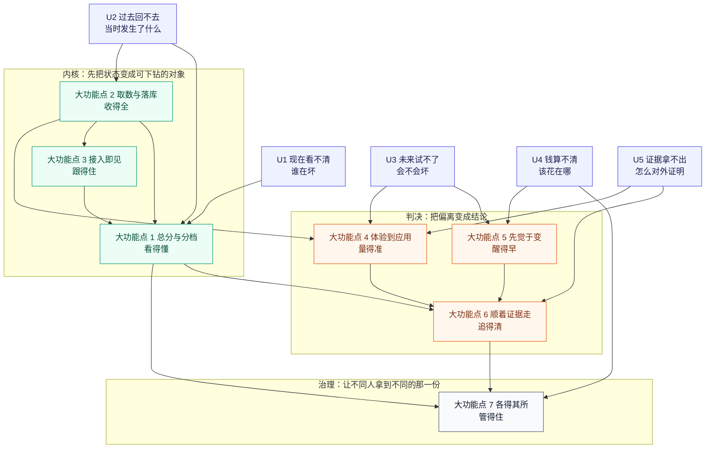
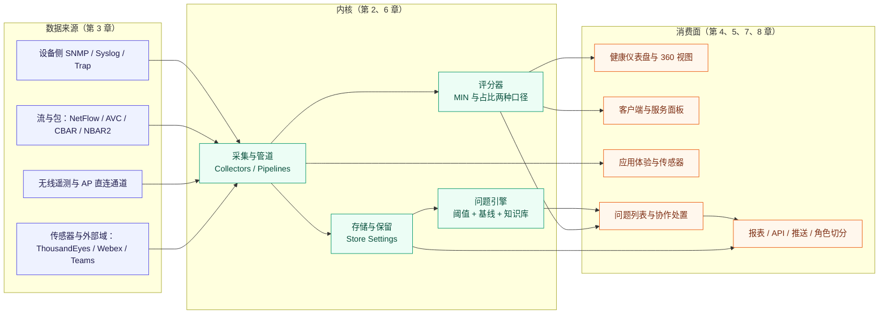
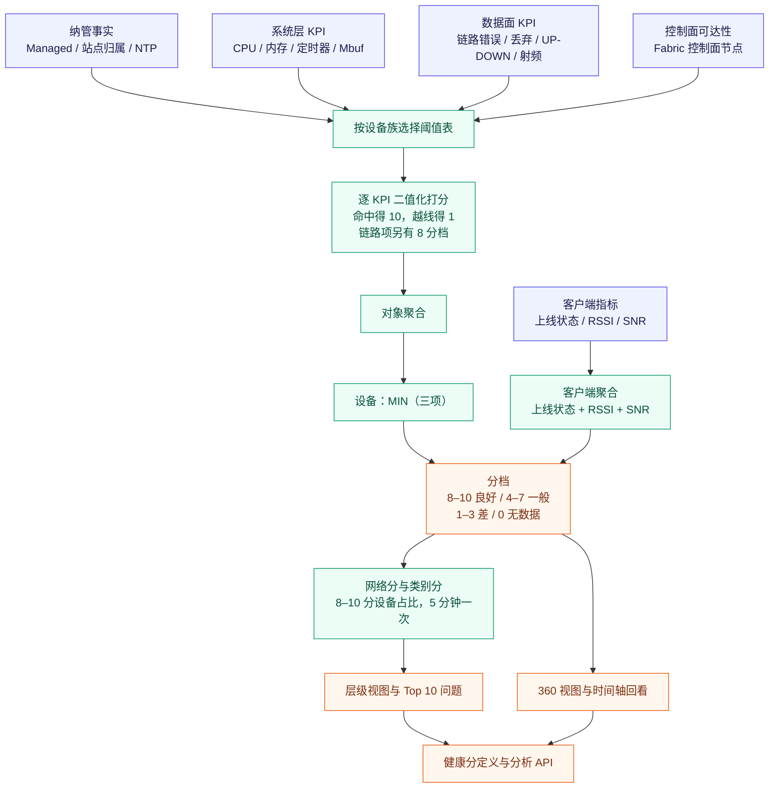
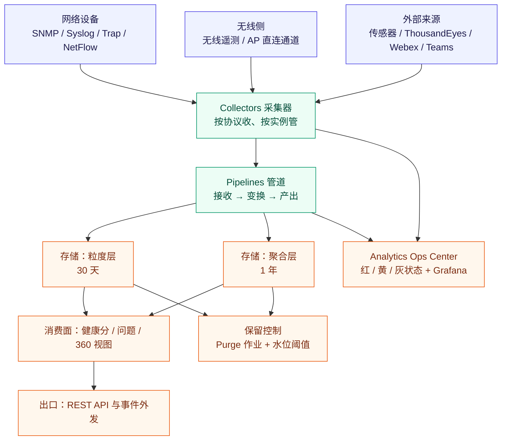
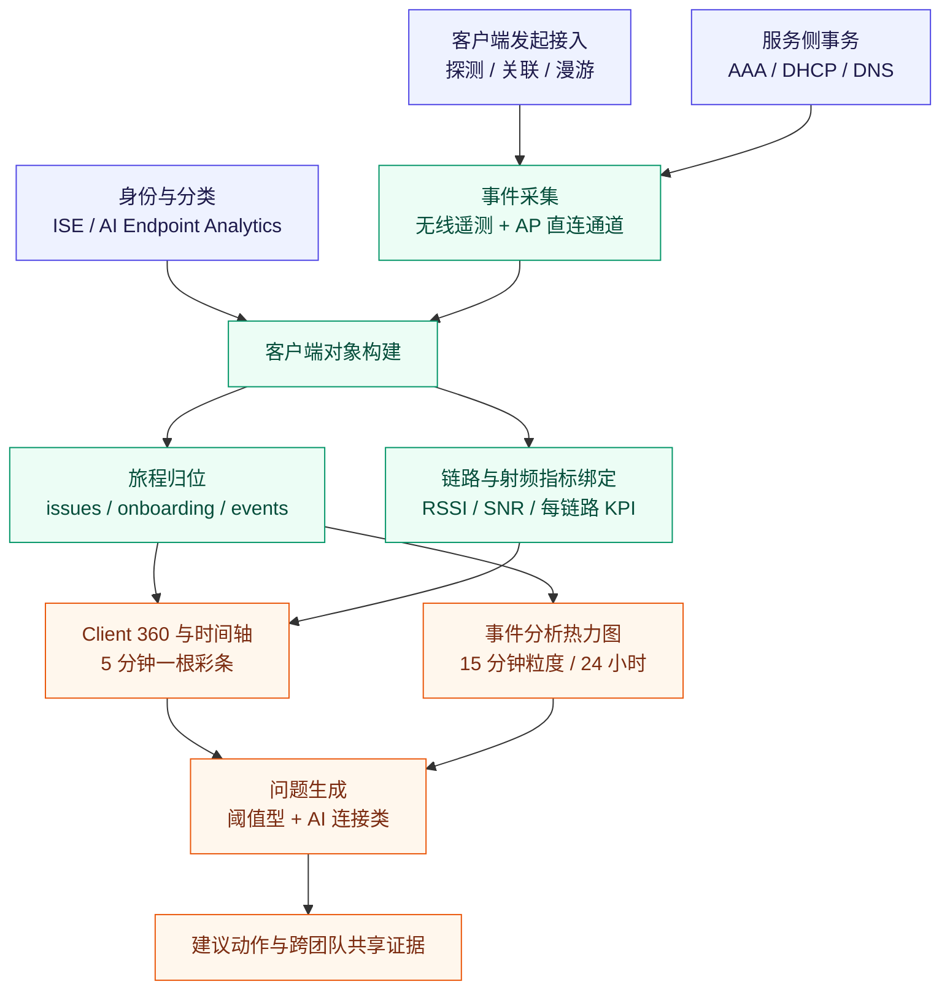
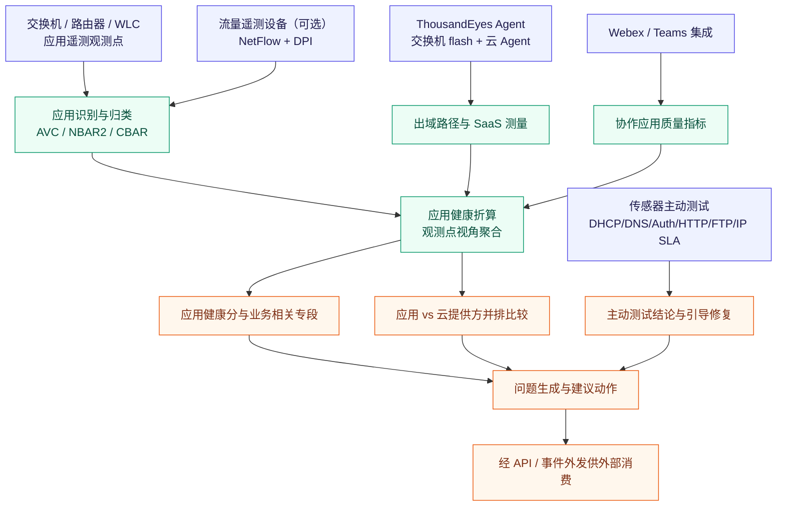
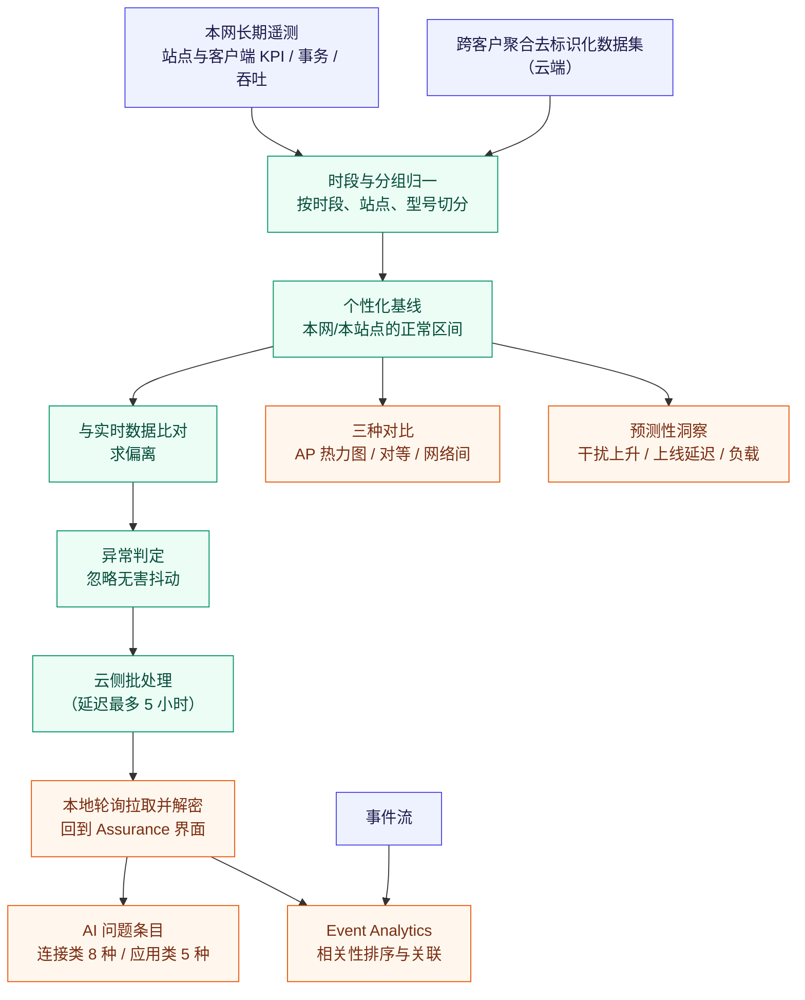
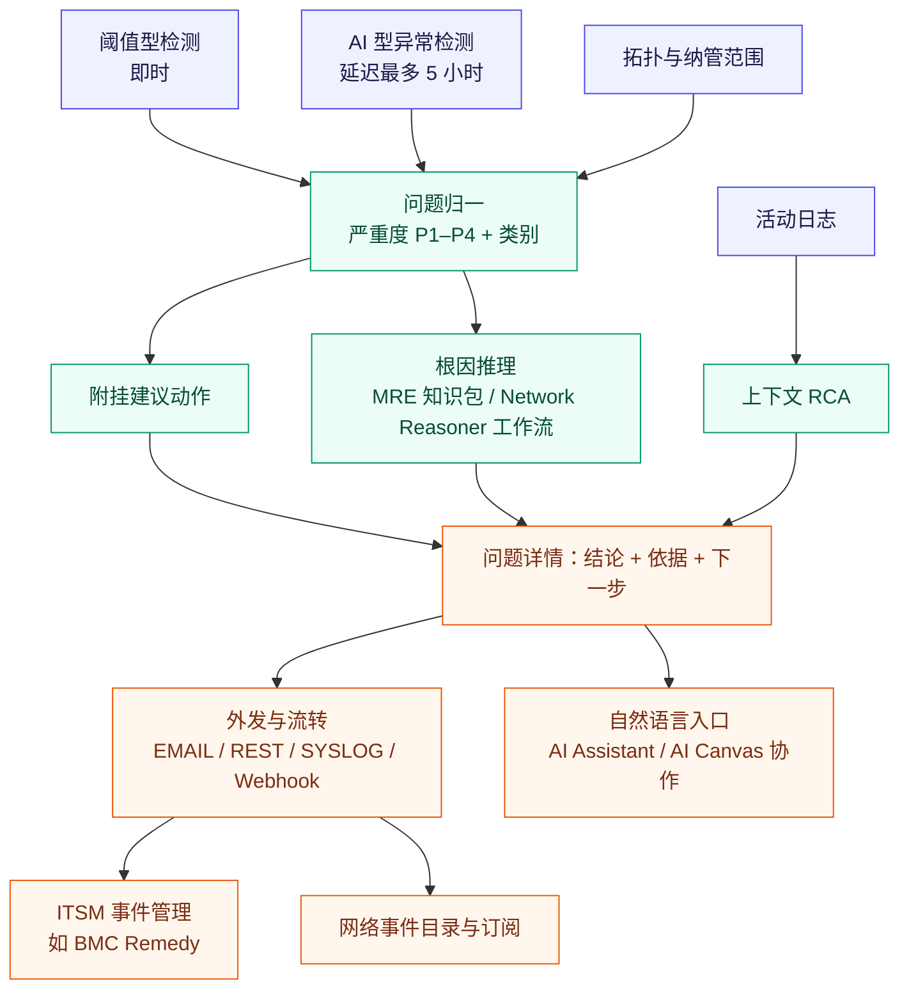
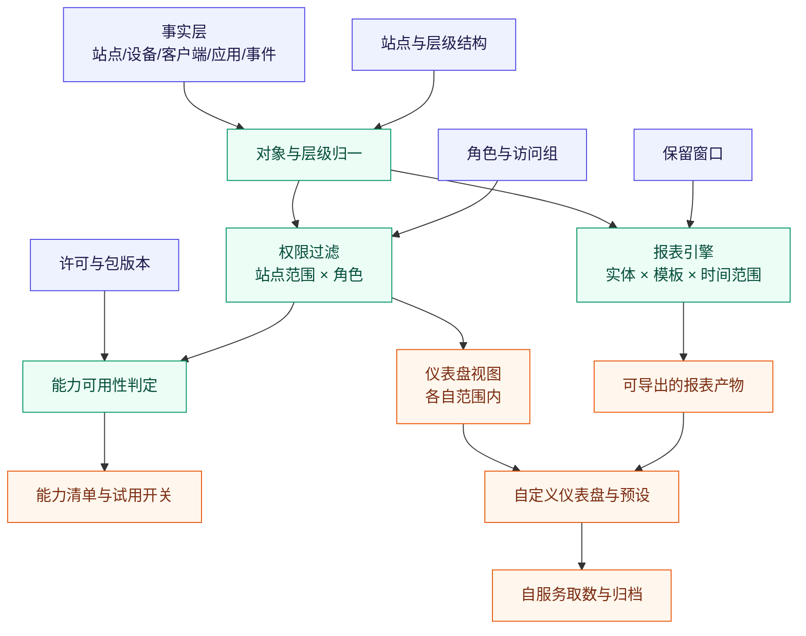

# 1 Catalyst Center Assurance 端到端体验可观测 功能体系与痛点解法（2023–2026）

> **调研对象**：Cisco Catalyst Center（cisco.com）的 **Assurance（保障）应用族**——即“从遥测采集到一条可处置的问题”的全链路能力，含健康分体系、360 视图、遥测底座、客户端接入旅程、应用体验、基线化智能、根因推理与协作处置、切分与报表。
> **调研范围**：2023-12（2.3.7 首发）至 2026-10（3.3.x 在售版本）的公开能力；早于 2023 年的 DNA Assurance 能力仅在“演进前史”处作为对照出现，不计入小功能点。
> **交付内容**：① **工具级视角**——Assurance 作为一个工具，究竟替客户解决了什么（U1–U5 五问 + 损失矩阵 + U→P 归并映射，见 1.3）；② 7 个大功能点、**116 条小功能点**清单（含发布时间与信源等级）；③ 每条能力对应的**客户侧痛点**（P1…Pn，损失类别限定为时间/钱/人/合规/组织）；④ 与痛点**一一对应**的解法（S1…Sn，逐行回指「→ 解 Pk」）；⑤ 各章 **K.4 功能原理**——统一按「输入（I1…In，含“缺了它会怎样”必要性论证）→ 实现链条（Mermaid + 逐步表）→ 输出（区分 UI 产物与内部接口）→ 关键机制深化 → 口径声明」展开；⑥ 各章 **K.5 能力边界**六维度（硬边界 / 软边界 / 前提依赖 / 官方自认局限 / 常见误期待 / 对自研提示）；⑦ **信源链接总表**（附五，A/B/C 三级全量登记），正文每处依据均就地嵌入可点击链接；⑧ 完整时间线、演进规律与对自研 APM AI 助手的对标启示（附一至附四）。
>
> **建议读法**：
> **赶时间** → 读 1.2 一句话定位 + 1.3.1 速览表 + 1.4 全景总表与边界速查表；
> **要选型** → 补 1.3 五个问法（判断“值不值得买”）+ 各章 K.5 能力边界 + 附二演进规律 + 附三对标启示；
> **要复刻** → 从第 2 章起逐章读，重点看各章 **K.4.1 输入表**（判断“我手上有没有这些数据”）、**K.4.2 实现链条**（判断“哪一步我做不到”）与 **K.4.x 口径声明**（区分官方口径与本报告推导）；
> **要核查出处** → 直接翻 **附五 信源链接总表**。

---

## 1.1 信源与局限（先看这一段）

采用**三级信源交叉验证**。凡标注“A/B/C”处，均可点开链接核对原文。

| 等级 | 信源 | 覆盖时段 | 在本专题中的用途 |
|---|---|---|---|
| **A** | 官方文档站：Assurance 用户指南（2.3.7 / 3.1.x / 3.2.x）、Catalyst Center 用户指南与管理员指南、Platform 用户指南、逐版本 Release Notes、官方数据表与白皮书（Telemetry Data White Paper、FAQ）、DevNet API Changelog | 2022 ~ 2026-10 | 功能颗粒度、健康分算法、版本与日期、API 面、量级上限的**唯一权威依据** |
| **B** | 官方产品资料页 / 官方发布公告 / 官方博客 | 2023-01 ~ 2026-09 | 产品级价值主张、AIOps 叙事、能力打包口径、新特性首发口径 |
| **C** | 第三方媒体、行业研究（托管于 Cisco Newsroom 的分析师报告）、社区问答、第三方培训与解析 | 2019 ~ 2026 | 补实现细节、跨域边界判断、第三方解读；**不作为能力成立的独立证据** |

> **全部信源的原文地址**已登记在 **附五**；其中无法提供公开链接或未取到精确日期者，已在 1.1 第 3/4 点与附四中单独列明。

**六点已知局限（直接决定本报告的推断边界）**：

1. **官方未发布 Assurance 的独立技术白皮书**。“内部怎么算”的部分主要来自用户指南的算法披露（这部分很实）、管理员指南的设置项、以及 API 定义文件（Ansible SDK 模块的 KPI 枚举）三者的交叉拼接；凡拼接处均显式标注。
2. **官方未公开“客户端健康分”的合成公式**。用户指南只写它是 `onboarding status / RSSI / SNR` 的 **aggregate（聚合）**，未给出权重、也未给出分档算式；第三方备考资料给出的“相加/加权”表述**无法在官方文档中确证**，本报告不采用（见 2.4.4 与 4.4 口径声明）。
3. **部分版本未取到精确 GA 日期**：3.2.1（仅由 2026-07-08 官方博客确认其存在）、3.2.3、Global Manager 系列不在本报告范围。已在 1.1 版本表与附四登记为缺口，不做推测。
4. **官方叫法混用**：2024 年前后 Cisco 将 DNA Center 更名为 Catalyst Center，文档路径、包名、事件名（`NETWORK-*`、`dna/intent/api`）与部分中文资料仍保留 DNA 措辞；本报告统一以 Catalyst Center 为主名，引用处保留原文。
5. **收益类数字均为厂商自述**（如“减少 MTTR”“top 10 问题”“200+ 新 API”），仅作量级参考，**不作为能力成立的证据**。
6. 本调研截止 **2026-10-16**。

**版本号对照表**（本报告涉及的主干版本；日期以 Release Notes 的 “Initial release” 行或 DevNet API Changelog 为准）：

| 版本 | 时间 | 本报告相关的 Assurance 侧要点 |
|---|---|---|
| 2.3.7（首发） | 2023-12-20 | Event Analytics（事件保留提升至 60 天，需云连通）、Over the Air Sniffer、AP 节能洞察、Per-SSID 过滤、无线客户端时延洞察、200+ 新 API |
| 2.3.7.4 | 2023-12-20（API）/ 2024 年持续更新 | 标准功率服务与 AFC 开关进入 RF Profile；AI-Enhanced RRM 规模调配指引 |
| 2.3.7.5 / 2.3.7.6 / 2.3.7.7 | 2024-04-08 / 2024-08-02 / 2024-11-18 | 无线侧配置能力增强；2.3.7.x 文档持续修订（Assurance 数据保留口径两处并存的问题在此区间可见） |
| 2.3.7.9 / 2.3.7.10 | 2025-03-03 / 2025-08-28 | 应用类 API 扩展（趋势/汇总分析）；Wi-Fi 7 AP（CW9172I/H、CW9179）支持门槛 |
| 3.1.3 | 2025-06-16 | **AFC 进入 AP 360**、**Assurance 支持站点级角色访问控制（SRBAC）**、**ISE 认证失败可见性内嵌**、上下文 RCA、**ThousandEyes 企业 Agent 从 Health > Application 管理** |
| 3.1.5 / 3.1.6 | 2025-10-01 / 2025-12-18 | 3.1.x 线延续（含规则化合规、重叠 IP 池等非本专题能力） |
| 3.2.1 | 2026（精确日期未公开） | 官方博客确认存在（ServiceNow CMDB 同步增强）；Assurance 侧变更未取到 |
| 3.2.2 | 2026-05-05 | **设备与客户端健康增强**（引入 retries、WLC HA 对失败、移动隧道状态）、**有线客户端抓包**、**OTA Sniffer 多射频/多 AP 同时抓包**、**客户端断连追踪**、**Client 360 支持 Wi-Fi 7/MLO**、室内外站点类型、客户端与灵活报表回溯 **180 天** |
| 3.2.3 | 2026-09-21 | 文档发布（本报告未取到该版本新增能力条目） |
| 3.3.1 | 2026-09-09 | **AI Assistant 成为 Catalyst Center 交付组件**、AI Network Analytics 升至 4.1.23、URWB 与 HA SSO 相关新事件、灵活报表新增 Network Interface 实体 |

> **一条反直觉的观察**：这条产品线在 2023–2025 年**主要不是靠“新功能”前进，而是靠“把已经采到的数据换一种用法”前进**。2.3.7（2023-12）到 3.1.3（2025-06）跨了 18 个月，但 Assurance 侧的实质新加法并不多（AFC 进 AP 360、SRBAC、ISE 失败可见性、上下文 RCA）；真正的密集升级出现在 **2026 年**（3.2.2 的健康增强、3.3.1 的 AI Assistant）。**也就是说：前两年在建数据底座与视图，第三年才把智能体放上去。** 对自研的启示很直接——没有 30 天粒度、5 分钟步长的历史底数，再好的 AI 层也是空中楼阁。

---

## 1.2 一句话定位

> Assurance 不是一个“监控大盘”，而是 Catalyst Center 的**判决层**：它把网络里采到的原始遥测，**按设备/客户端/应用/站点四种对象折算成 1–10 分的健康分与一条条可处置的问题**，并用 **360 视图**把“分数掉的哪一格”与“那一格的现场”接在一起。

必须首先分清的三条内部界线（这是理解它能力上限的前提）：

| 维度 | 传统阈值派 | **AI 基线派（AI Network Analytics）** | **知识库推理派（MRE）** |
|---|---|---|---|
| 触发依据 | 固定 KPI 阈值（可调） | 与**个性化基线**的偏离（云侧批处理） | 专家知识库中的**工作流**（knowledge packs） |
| 典型时延 | 即时/接近即时 | **最多 5 小时**（云侧批处理后再被本地拉取） | 依工作流而定 |
| 覆盖对象 | 有线/无线/客户端/应用/传感器 | 连接类 8 种 + 应用体验类 5 种 | 有线客户端、二层环路、PoE |
| 数据出域 | 否 | **去标识化后上传云**（Advantage 许可） | 知识包下载到本地执行 |

**这条分界线极其重要**：Assurance 的“聪明”程度**不由算法决定，而由数据出域许可与知识库更新速度决定**。凡不便出域的场景（金融、政企强合规），AI 基线派直接失效，只剩阈值派可用——这正是自研 APM 可以做差异化的位置。

---

## 1.3 从工具整体看：Assurance 究竟解决用户的什么问题

1.2 回答的是“它是什么”；这一节回答一个更实际的问题——**如果我是客户，这个工具到底替我解决了什么？**

先给结论：把 Assurance 当作**一个工具**（而不是七个功能组的拼盘）来看，它对用户的价值只落在两个维度上——**时间轴**与**关系网**。时间轴上用户有三种问法（**现在好不好 / 过去发生了什么 / 接下来会不会坏**），关系网上还有两条横切线（**成本**：这份“体验”值多少钱、钱该投在哪；**证据**：跨团队能不能拿同一份证据说话）。**七个大功能组，全部是在回答这五个问法。**

> **量损失的口径**：本报告统一按 **时间 / 钱 / 人 / 合规 / 组织** 五类衡量——因为客户买单时看的是这五类，不是“采集步长”“索引效率”这类架构指标。凡读起来像“设计约束”的（必须、应当、需要与…对齐）都不进本节，一律归入各章 K.3 的解法必要性论证。

### 1.3.1 用户的五个问法（U1–U5）

**先给一张速览表**（详细展开见本节后半）：

| 问法 | 用户的原话 | 痛点描述（痛在哪） | 一句话损失 |
|---|---|---|---|
| **现在（U1）** | “网络到底好不好？哪一层坏了？谁受影响？” | **没有一张“总体账”**：设备、客户端、应用、服务各是一本账，出问题时先要人工把四本账拼成一本——而在拼的过程中业务还在受损 | **时间**：告警到定位之间的人工拼账；**人**：拼账能力只存在于少数人头上 |
| **过去（U2）** | “两小时前那一下到底发生了什么？给我还原出来。” | **故障现场留不下来**：留下的只有数值曲线，没有当时的客户端状态、射频条件与事件序列；间歇性问题只能等它下次再出现 | **时间**：复盘靠回忆拼凑、间歇故障抓不到；**合规**：SLA 争议时说不清“当时网络是什么样” |
| **未来（U3）** | “这么用下去，什么时候会出问题？改之前我怎么知道会不会变坏？” | **只有静态阈值、没有本网基线**：同一个 7% 的上线失败率，在早高峰是正常、在凌晨是异常，阈值分不出来——于是要么天天误报、要么把真异常调没了 | **时间**：告警疲劳吞掉真正的信号；**钱**：过度扩容或漏配造成的采购偏差 |
| **成本（U4·横切）** | “这份体验投入产出怎么算？云上用量谁付？” | **体验好坏与花销对不上账**：哪些站点该加 AP、哪些设备在空耗电、AI 能力的云用量与许可边界说不清 | **钱**：CapEx/OpEx 归口不清、许可超配；**组织**：网络团队与财务/采购对不齐 |
| **证据（U5·横切）** | “这是不是我们网络的问题？对外我怎么证明？” | **跨域问题没有共同证据**：网络、云、应用、ISP 各看各的图；对客户与对监管时，“我们这一段没问题”成为默认答案 | **组织**：无法指着同一份证据定责；**合规**：审计与对外举证缺链 |

---

#### U1 · 现在看不清 —— 「网络到底好不好？哪一层坏了？」

> **痛点**：**没有一张“总体账”**——设备、客户端、应用、服务各是一本账，出问题时先要人工把四本账拼成一本。

- **谁在问（同一个问题的不同说法）**：
  - NOC 值班工程师：**“我先要知道是谁在坏，而不是看 500 条告警。”**
  - 网络主管：**“今天能不能一句话告诉我，是设备坏了还是体验坏了？”**
  - 业务侧接口人：**“用户说卡，我只想知道是网络的事还是他们终端的事。”**
- **典型场景**：周一早高峰，三个站点同时报“上楼慢”。值班员先看设备健康（全绿），再看客户端健康（一栋楼掉到 5 分），再去查 AAA 服务面板（认证耗时抬升）——**三次切换、三个页面，才拼出“认证慢导致上线慢”这一条结论**（示意量级，非实测）。
- **五类损失表**：

| 损失维度 | 具体可感知的损失 |
|---|---|
| **时间** | 告警到定位之间的“人工拼账”环节，每次故障都要重做一遍；跨页面切换导致上下文反复丢失 |
| **钱** | 定位慢等于业务恢复慢，直接对应可用性损失与 SLA 罚金（示意量级，非实测） |
| **人** | “能一句话说清谁在坏”的人只有少数几个，能力无法沉淀为可交接的资产 |
| **合规** | 缺少按对象分档的健康记录，事后难以说明“我们当时是如何判断优先级的” |
| **组织** | 网络团队与业务/终端团队就“是不是网络的问题”反复拉扯，因为各自只看得到自己那一本账 |

- **放任不管的后果**：告警越多→值班员越依赖经验直觉→只处理“看起来严重”的→真正的体验退化被长期忽略→业务侧自行绕过 IT 采购替代方案，网络团队丧失话语权。

---

#### U2 · 过去回不去 —— 「把两小时前那一下还原出来。」

> **痛点**：**故障现场留不下来**——留下的只有数值曲线，没有当时的客户端状态、射频条件与事件序列。

- **谁在问**：
  - 一线工程师：**“客户说十分钟前卡了一下，现在好了——我拿什么看？”**
  - 复盘会议主持：**“会上我们只能放两条曲线，谁也说不清当时客户端在哪个阶段失败。”**
  - 审计/合规接口人：**“三个月前那次 SLA 争议，你能给出当时的证据吗？”**
- **典型场景**：某会议室视频会议断续 30 秒后自愈。想复盘，需要同时具备：那一刻的射频条件（干扰/噪声/利用率）、客户端的上线与漫游事件序列、AP 与 WLC 的事件日志。**其中任一环节没被留在数据里，复盘就只能停在“推测”**。
- **五类损失表**：

| 损失维度 | 具体可感知的损失 |
|---|---|
| **时间** | 间歇性故障只能“等它下次再出现”；复盘会开成“回忆会”，无法产出可执行的改进项 |
| **钱** | 无法复现就无法根治，同一故障反复发生，累计损失远超单次（示意量级，非实测） |
| **人** | 复盘质量取决于当班人记不记得，经验无法转化为组织资产 |
| **合规** | SLA 与服务等级争议缺少“当时现场”作为举证材料 |
| **组织** | “不是网络问题”与“就是你网络问题”长期无法用证据收口 |

- **放任不管的后果**：无法复现→只能做加固式“填坑”→变更越改越复杂→下一次故障的爆炸半径更大，形成**“越不敢动、越容易坏”**的循环。

---

#### U3 · 未来试不了 —— 「什么时候会坏？改之前怎么知道？」

> **痛点**：**只有静态阈值、没有本网基线**——同一个数值在不同时间、不同站点含义完全不同，阈值分不出来。

- **谁在问**：
  - 容量规划工程师：**“按这个增长，三个月后哪个站点会顶到天花板？”**
  - 变更评审人：**“改之前我只有一份设计文档，没有它对本网体验影响的判断。”**
  - 运维主管：**“误报太多，工程师开始无视告警了。”**
- **典型场景**：周一 9:00 大量员工同时到场，上线尝试量骤增，失败率抬到 7%。**静态阈值下这是“严重告警”，而对该网络在这个时段是正常行为**（第三方备考资料以同一场景说明误报成因）。运维被教成“忽略早高峰告警”之后，真正的异常也一起被忽略。
- **五类损失表**：

| 损失维度 | 具体可感知的损失 |
|---|---|
| **时间** | 告警疲劳导致真异常被静默；预测缺位使问题只能等发生后再处理 |
| **钱** | 容量该扩不扩（事后紧急采购溢价）或不该扩而扩（过度采购） |
| **人** | 阈值该设多少成为“资深工程师的个人判断”，随人走 |
| **合规** | 无法展示“我们基于本网历史做出了预警与处置决策” |
| **组织** | 扩容评审会上各说各话，因为缺少一个双方都认的基线事实 |

- **放任不管的后果**：误报→静默→漏报→事故；且**阈值会被人为反复上调**，最后系统退化为“只报断电”。

---

#### U4 · 钱算不清（横切） —— 「投入产出与云用量算不清。」

> **痛点**：**体验好坏与花销对不上账**——该在哪个站点投钱没有依据，AI 能力的许可与云用量边界也不透明。

- **谁在问**：
  - IT 财务接口人：**“AI Network Analytics 是 Advantage 许可里的，我们到底买了没、云用量多少？”**
  - 站点负责人：**“凭什么先给别的楼加 AP？”**
  - 运维主管：**“哪些设备该进维护窗口、哪些该下线，我没有依据。”**
- **典型场景**：年度预算会上，两个楼栋都要扩容。**唯一能拿出的证据是“用户投诉件数”**，而不是“这两个楼栋的客户端健康分与射频利用率趋势对比”。
- **五类损失表**：

| 损失维度 | 具体可感知的损失 |
|---|---|
| **时间** | 预算评审反复开会，因为缺少可比的量化依据 |
| **钱** | 采购预算按“嗓门大小”分配；云侧用量与许可层级的边界不清，存在超配或能力闲置 |
| **人** | 网络团队无法用业务语言证明自己的价值 |
| **合规** | 能源/碳排等治理指标缺少可导出的设备级依据 |
| **组织** | 站点之间资源分配的公平性争议长期无法用数据裁决 |

- **放任不管的后果**：投入持续按投诉声量分配→做得好的站点得不到追加投入、做得差的持续追加→**资源错配自我强化**。

---

#### U5 · 证据拿不出（横切） —— 「对外我怎么证明？」

> **痛点**：**跨域问题没有共同证据**——网络、云、应用、ISP 各看各的图。

- **谁在问**：
  - 服务交付经理：**“客户说我们慢，我能拿出什么？”**
  - SecOps 工程师：**“这个是不是攻击导致的？网络侧有没有痕迹？”**
  - 应用团队：**“到底是我们应用的问题还是网络的问题？”**
- **典型场景**：业务系统响应慢，应用团队与网络团队各自给出“我方无异常”的结论。**因为双方的数据在各自域内截断：网络侧的路径追踪止于自域边界，出域之后是云与 ISP 的盲区**（第三方解析对同一边界的独立表述）。
- **五类损失表**：

| 损失维度 | 具体可感知的损失 |
|---|---|
| **时间** | 跨域问题在团队之间来回转派，MTTR 被组织边界拉长 |
| **钱** | 因无法定责而承担的赔付或补偿；重复购买重叠工具 |
| **人** | 工程师大量时间消耗在“自证清白”而非解决 |
| **合规** | 对监管/客户举证缺链，事件报告只能定性不能定量 |
| **组织** | 无共享证据链→每次事件都要重新谈判责任边界，无制度沉淀 |

- **放任不管的后果**：组织内形成**“工具墙”**——每个团队维护一套自证清白的工具，成本叠加而无人负责端到端结果。

---

#### 损失强度分布矩阵

| 问法 | 时间 | 钱 | 人 | 合规 | 组织 |
|---|---|---|---|---|---|
| **U1 现在看不清** | ● | ○ | ● | ○ | ● |
| **U2 过去回不去** | ● | ○ | ● | ● | ○ |
| **U3 未来试不了** | ● | ● | ● | ○ | ○ |
| **U4 钱算不清** | ○ | ● | ● | ○ | ● |
| **U5 证据拿不出** | ● | ● | ○ | ● | ● |

> **一条采购行为解释**：**U1 与 U5 的“组织”格为 ●，决定了这类产品几乎不可能由单一团队独立完成采购决策**——它天然要跨网络、安全、应用三条线共同立项；而 **U3/U4 的“钱”格为 ●，说明第二笔预算（AI 能力、扩容、云用量）的触发器是预算季而不是故障**。因此“先买视图、后加智能”是客户真实的下单节奏，也是厂商把 AI 能力放在 Advantage 许可里的商业理由。

---

### 1.3.2 五个整体问题（U1–U5）与承载能力

**注意：本节只落到大功能点粒度，不枚举小功能点。**

| # | 用户的问题 | Assurance 给出的整体回答 | 对应的大功能点（及其在这里扮演的角色） |
|---|---|---|---|
| **U1** | 现在到底好不好、谁在坏 | 用四种对象（设备/客户端/应用/站点）的 1–10 分健康分把“好不好”变成一个可下钻的数 | **大功能点 1 总分与分档**（主责：把状态变成分数与分档）；**大功能点 2 取数与落库**（底座：分数之所以算得出来）；**大功能点 3 接入即见**（把“用户体验”落到客户端与服务上）（→ 第 2/3/4 章） |
| **U2** | 两小时前发生了什么 | 把每一格分数的历史与那一刻的现场对象化，可沿时间轴回看 | **大功能点 1 总分与分档**（主责：360 视图与时间轴）；**大功能点 2 取数与落库**（决定能回看多久）；**大功能点 3 接入即见**（客户端侧事件序列）；**大功能点 6 顺着证据走**（把现场变成结论）（→ 第 2/3/4/7 章） |
| **U3** | 接下来会不会坏、改之前怎么知道 | 用本网个性化基线替代静态阈值，并给出对比与预测性洞察 | **大功能点 5 先觉于变**（主责：基线与异常检测）；**大功能点 4 体验到应用**（把体验变化量化为可比对象）；**大功能点 2 取数与落库**（基线的原料）（→ 第 6/5/3 章） |
| **U4** | 钱该花在哪、云用量多少 | 把体验与能耗、站点、报表对上账，并明确能力的许可层级与云侧用量量级 | **大功能点 7 各得其所**（主责：报表、切分与设置）；**大功能点 5 先觉于变**（云用量与许可边界）；**大功能点 1 总分与分档**（提供可比的量化对象）（→ 第 8/6/2 章） |
| **U5** | 对外怎么证明 | 让问题、事件、问题域边界成为可导出的、可共享的证据对象 | **大功能点 6 顺着证据走**（主责：问题定性、根因与协同）；**大功能点 4 体验到应用**（承担“自域之外”的可见性）；**大功能点 3 接入即见**（客户端侧证据）；**大功能点 7 各得其所**（导出与权限）（→ 第 7/5/4/8 章） |

> **覆盖核验**：**7 个大功能点全部被至少一个 U 消费，无孤立能力**（大功能点 1/2/3/4/5/6/7 分别在 U1–U5 中出现）。

### 1.3.3 一张图：从用户问题到大功能点

### 1.3.4 用之前 vs 用之后（同一批问题的对照）

| 问题 | 用之前（只靠设备轮询与工具拼装） | 用之后（Assurance 这一层） | 仍然留下的缺口 |
|---|---|---|---|
| U1 谁在坏 | 设备可达/不可达 + 各工具各自告警；体验好坏靠投诉 | 设备/客户端/应用/服务四种对象各自有 1–10 分与分档，可下钻到站点与 360 视图 | **第三方设备不参与健康分设置**；非纳管终端/网元仍不在账上 |
| U2 当时发生了什么 | 只有曲线；事件散落在 syslog 工具里 | 分数带时间轴，可回看（**最多 30 天粒度数据**，聚合数据 1 年）并叠加当时的问题与事件 | 超过保留窗口即不可回溯；**AI 类问题存在最多 5 小时入库延迟** |
| U3 会不会坏 | 静态阈值 + 人工经验 | 个性化基线 + 异常检测 + 对比与预测性洞察 | **需数据出域到云**；云端批处理导致延迟；不能替代变更前仿真 |
| U4 钱花在哪 | 投诉件数与部门博弈 | 可比的健康分/利用率趋势、能耗报表、云用量量级口径 | **云用量的精确计费口径未公开**；能耗为设备侧估算 |
| U5 怎么证明 | 各团队自证清白 | 问题/事件/路径可导出，事件可推送至邮件、REST、SYSLOG、Webhook | **路径追踪止于自域边界**；出域后需第三方（如 ThousandEyes）补位 |

### 1.3.5 小结：U 与 P 的关系（读后文前必看）

**U 是工具级问题**（判断“值不值得买”），**P 是功能级痛点**（判断“做得对不对”）。二者是**上位归并**而非一对一：一个大功能点内部的 P，通常同时服务多个 U；一个 U 也同时被多个大功能点的 P 支撑。

| 章 | 大功能点 | 主要服务的 U | 该章痛点编号 |
|---|---|---|---|
| 第 2 章 | 1 总分与分档 | U1 / U2 / U4 | P1–P6 |
| 第 3 章 | 2 取数与落库 | U1 / U2 / U3 | P1–P6 |
| 第 4 章 | 3 接入即见 | U1 / U2 / U5 | P1–P5 |
| 第 5 章 | 4 体验到应用 | U3 / U5 | P1–P5 |
| 第 6 章 | 5 先觉于变 | U3 / U4 | P1–P6 |
| 第 7 章 | 6 顺着证据走 | U2 / U5 | P1–P7 |
| 第 8 章 | 7 各得其所 | U4 / U5 | P1–P5 |

> **可追溯性声明**：各章 P 均可回溯到至少一个 U（上表即归并映射）；反过来，**全部 40 条 P 已被上述 U 完全消费，无孤立痛点**。各章 P 编号在该章内独立，与该章 S 编号严格一一对应（规则见 1.4）。

---

## 1.4 读法：7 个大功能点全景

### 全景总表

| # | 大功能点 | 口号（四字） | 小功能点数 | 时间跨度 | 面向谁 |
|---|---|---|---|---|---|
| 1 | 健康分体系与 360 视图 | 看得懂 | 18 | 2023-12 ~ 2026-09 | NOC 值班、网络主管、业务接口人 |
| 2 | 遥测采集与数据底座 | 收得全 | 18 | 2023-12 ~ 2026-09 | 平台运维、架构师、合规/安全 |
| 3 | 客户端接入旅程与网络服务 | 跟得住 | 16 | 2024-01 ~ 2026-05 | 无线工程师、服务台、ISE 管理员 |
| 4 | 应用体验与自域之外 | 量得准 | 16 | 2023-12 ~ 2026-09 | 应用团队、业务接口人、无线工程师 |
| 5 | 基线化智能与主动洞察 | 醒得早 | 16 | 2023-12 ~ 2026-09 | 运维主管、容量规划、平台架构 |
| 6 | 问题定性、根因与协同处置 | 追得清 | 18 | 2023-12 ~ 2026-10 | 专家工程师、NOC、SecOps/ITSM |
| 7 | 切分、设置与报表 | 管得住 | 14 | 2023-12 ~ 2026-09 | IT 管理者、多站点运营、审计 |

> 小功能点合计 **116 条**；各章 P/S 合计 **40 / 40**，逐章一一对应。

### 边界速查（一页版）

| # | 大功能点 | 最要命的一条边界 | 边界性质 |
|---|---|---|---|
| 1 | 健康分体系与 360 视图 | **健康分设置不适用于第三方设备**，且设备分取“最低分”而非平均——一个坏 KPI 就能把设备打成 Poor | 硬边界（数据源与算法口径决定） |
| 2 | 遥测采集与数据底座 | 粒度数据只留 **30 天**（FAQ 与数据表另有“14 天”口径，见 3.5）；且**不支持的采集方式就没有数据** | 硬边界 + 源冲突 |
| 3 | 客户端接入旅程与网络服务 | 客户端分类信息**依赖 ISE 或 AI Endpoint Analytics**；非纳管终端不在账上 | 前提依赖 |
| 4 | 应用体验与自域之外 | **路径追踪与传感器测试止于自域边界**，出域后的云与 ISP 是盲区（需 ThousandEyes 补位） | 硬边界（架构决定） |
| 5 | 基线化智能与主动洞察 | AI 问题**最多延迟 5 小时**入库；能力绑在 **Advantage 许可**且**需数据出域到云** | 官方自认局限 + 前提依赖 |
| 6 | 问题定性、根因与协同处置 | MRE **只对平台已知拓扑内的实体**做根因分析；二层环路规模上限 VLAN ≤10、每 VLAN 设备 ≤30 | 官方自认局限 |
| 7 | 切分、设置与报表 | 报表与健康分设置受角色与许可约束；**精确云用量计费口径未公开** | 软边界（官方未披露） |

### 编号约定声明（P/S 闭环规则）

1. **P 编号**：各章内以 `P1…Pn` 逐条列出客户侧痛点，每条格式为 `**Pk（损失类别）——「一句话痛点」**`，损失类别只取 **时间 / 钱 / 人 / 合规 / 组织** 五类。
2. **S 编号**：各章内以 `S1…Sn` 逐条给出解法，**数量与语义必须与 P 一一对应**；解法表中每行必须显式写「**→ 解 Pk**」。
3. **无悬空**：不允许出现“没有解法回应的痛点”，也不允许出现“指不回任何客户痛的解法”；技术演进、生态配套、定价机制类内容若指不回客户痛，一律移入 K.4 或 K.5，不混入 S。
4. **章内独立**：P/S 编号在**每一章内从 1 重新开始**，跨章不连续；阅读时以“章号 + P 号”为唯一标识（如 2.2 的 P3 与 3.2 的 P3 是两条不同的痛点）。
5. **小功能点编号（与小节号基准不同，务必分清）**：**小节号取 H1 号**（第 2..8 章），**小功能点编号取大功能点号**（第 1..7 章）——即 `大功能点 K：…`（H1 为 K+1）名下的小功能点写作 `K.1 … K.n`（如“大功能点 2：遥测采集与数据底座”位于 `# 3`，其小功能点编为 `2.1 … 2.18`），各章独立编号、跨章不连续。
6. 全文 P/S 闭环由脚本 `check_ps_closure.py` 的同构逻辑核验，**核验结论见文末**。

### 一张总构造图：数据来源 → 内核 → 各消费面

# 2 大功能点 1：健康分体系与 360 视图 —— 看得懂

> **它替代了什么**：替代“把设备可达性当健康、把用户投诉当体验”的旧判断方式——把“好不好”从一个形容词，变成一个**按对象分档、可下钻、可回看**的数。

## 2.1 小功能点清单

| # | 小功能点 | 发布时间 | 信源等级 | 说明 |
|---|---|---|---|---|
| 1.1 | 设备健康分取“三项最低分” | 2.3.7 系列（2023-12 ~ 2025-08） | [A](https://www.cisco.com/c/en/us/td/docs/cloud-systems-management/network-automation-and-management/catalyst-center-assurance/2-3-7/b_cisco_catalyst_assurance_2_3_7_ug/b_cisco_catalyst_assurance_2_3_6_ug_chapter_0110.pdf) | 原文：`Device Health Score = MIN (System Health, Data Plane Connectivity, Control Plane Connectivity)` |
| 1.2 | 交换机/路由器 KPI 阈值 | 同上 | [A](https://www.cisco.com/c/en/us/td/docs/cloud-systems-management/network-automation-and-management/catalyst-center-assurance/2-3-7/b_cisco_catalyst_assurance_2_3_7_ug/b_cisco_catalyst_assurance_2_3_6_ug_chapter_0110.pdf) | CPU ≤95% 得 10、>95% 得 1；内存同理；链路错误“某基础设施接口有错得 8 / 全 down 得 1 / 否则 10”；链路丢弃同构；WAN 连通 up=10、down=1 |
| 1.3 | AP 独立阈值 | 同上 | [A](https://www.cisco.com/c/en/us/td/docs/cloud-systems-management/network-automation-and-management/catalyst-center-assurance/2-3-7/b_cisco_catalyst_assurance_2_3_7_ug/b_cisco_catalyst_assurance_2_3_6_ug_chapter_0110.pdf) | CPU/内存 90%；射频利用率 70%；干扰 2.4G 50% / 5G·6G 20%；噪声 −81 / −83 dBm；空口质量 60% / 75%；链路错误 1% |
| 1.4 | 无线控制器独立阈值 | 同上 | [A](https://www.cisco.com/c/en/us/td/docs/cloud-systems-management/network-automation-and-management/catalyst-center-assurance/2-3-7/b_cisco_catalyst_assurance_2_3_7_ug/b_cisco_catalyst_assurance_2_3_6_ug_chapter_0110.pdf) | 内存 90%；空闲定时器 20%；空闲 Mbuf 20%；WQE 池与包池按阈值；链路错误 1%；控制面节点可达性 |
| 1.5 | 网络分与类别分改“占比”口径 | 3.2.x（2026-05 文档） | [A](https://www.cisco.com/c/en/us/td/docs/cloud-systems-management/network-automation-and-management/catalyst-center-assurance/3-2-x/cisco-catalyst-assurance-user-guide-3-2-x/b_cisco_catalyst_assurance_3_2_x_ug_chapter_0110.html) | 原文：`8–10 分设备数 ÷ 总数（剔除维护模式）`；**每 5 分钟计算一次** |
| 1.6 | 维护模式全排除 | 2.3.7 系列 | [A](https://www.cisco.com/c/en/us/td/docs/cloud-systems-management/network-automation-and-management/catalyst-center-assurance/2-3-7/b_cisco_catalyst_assurance_2_3_7_ug/b_cisco_catalyst_assurance_2_3_6_ug_chapter_0110.pdf) | 维护中的设备及其关联客户端一并排除：不做健康采集、不采接口统计、不触发问题、不计入站点分 |
| 1.7 | 客户端健康分（聚合口径） | 2.3.7 系列 | [A](https://www.cisco.com/c/en/us/td/docs/cloud-systems-management/network-automation-and-management/catalyst-center-assurance/2-3-7/b_cisco_catalyst_assurance_2_3_7_ug/b_cisco_catalyst_assurance_2_3_6_ug_chapter_0111.pdf) | 原文：`an aggregate of the client's onboarding status, RSSI, and SNR`；1–10 分，**0 = 不活跃**，断连显示 `--` |
| 1.8 | 客户端分按用户 ID 取其名下最小值 | 2.3.7 系列 | [A](https://www.cisco.com/c/en/us/td/docs/cloud-systems-management/network-automation-and-management/catalyst-center-assurance/2-3-7/b_cisco_catalyst_assurance_2_3_7_ug/b_cisco_catalyst_assurance_2_3_6_ug_chapter_0111.pdf) | 原文：按用户 ID 检索时，显示该用户所关联全部受监控客户端中的最低分 |
| 1.9 | Wi-Fi 7 / MLO 客户端多链路 KPI | 3.2.2（2026-05-05） | [A](https://www.cisco.com/c/en/us/td/docs/cloud-systems-management/network-automation-and-management/catalyst-center/3-2-x/release-notes/cisco-catalyst-center-release-notes-322.html) | Client 360 支持 Wi-Fi 7；**每条链路 4 个 KPI（RSSI、SNR、空间流、信道）**，5 分钟粒度窗口 |
| 1.10 | Device 360 时间轴回看 | 支持文档（2026 修订版） | [A](https://www.cisco.com/c/en/us/support/docs/wireless/catalyst-9800-series-wireless-controllers/226132-troubleshoot-wireless-issues-with.html) | 把可达性、遥测状态、历史问题、事件、性能统计收在一条时间轴上；**支持回看最多 30 天** |
| 1.11 | 健康分设置（阈值与纳入项可改） | 3.2.x（2026-05） | [A](https://www.cisco.com/c/en/us/td/docs/cloud-systems-management/network-automation-and-management/catalyst-center-assurance/3-2-x/cisco-catalyst-assurance-user-guide-3-2-x/b_cisco_catalyst_assurance_3_2_x_ug_chapter_0110.html) | 入口 `Assurance > Health > Health Score Settings`；**至少保留 1 个 KPI**；**不适用于第三方设备**；可 `Use Default` 恢复 |
| 1.12 | 健康阈值与问题阈值“同步”开关 | 3.2.x（2026-05） | [A](https://www.cisco.com/c/en/us/td/docs/cloud-systems-management/network-automation-and-management/catalyst-center-assurance/3-2-x/cisco-catalyst-assurance-user-guide-3-2-x/b_cisco_catalyst_assurance_3_2_x_ug_chapter_0110.html) | 原文限定：该同步**仅对“无线控制器”设备类别**生效 |
| 1.13 | 健康分定义 API | 3.1.3（2025-06-16） | [A](https://developer.cisco.com/docs/catalyst-center/3-1-3/api-changelog) | `Update health score definitions`；SDK 侧路径为 `POST /dna/intent/api/v1/health_scoreDefinitions/${id}` 与 `/bulkUpdate` |
| 1.14 | 设备族 KPI 全量枚举 | SDK 文档（持续维护） | [A](https://docs.ansible.com/projects/ansible/13/collections/cisco/dnac/assurance_device_health_score_settings_workflow_manager_module.html) | 六个设备族：`ROUTER` / `SWITCH_AND_HUB` / `WIRELESS_CONTROLLER` / `UNIFIED_AP` / `WIRELESS_CLIENT` / `WIRED_CLIENT`；其中 **WIRELESS_CLIENT 仅两个 KPI：Connectivity RSSI、Connectivity SNR** |
| 1.15 | Fabric 健康分需先启 SNMP Collector | 3.2.x（2026-05） | [A](https://www.cisco.com/c/en/us/td/docs/cloud-systems-management/network-automation-and-management/catalyst-center-assurance/3-2-x/cisco-catalyst-assurance-user-guide-3-2-x/b_cisco_catalyst_assurance_3_2_x_ug_chapter_0110.html) | 原文：否则 Fabric 设备的健康分无法正确填充 |
| 1.16 | 虚拟网络健康与 Virtual Network 360 | 2.3.7 系列 | [A](https://www.cisco.com/c/en/us/td/docs/cloud-systems-management/network-automation-and-management/catalyst-center-assurance/2-3-7/b_cisco_catalyst_assurance_2_3_7_ug/m_monitor-and-troubleshoot-sd-access-fabric-networks.html) | VN 分 = 健康设备占比；VN 类别分 = 子类 KPI 分的**最小值**；VN 服务含 BGP 会话、组播（外部 RP）、默认路由注册、VN 控制面 |
| 1.17 | 层级视图与 Top 10 全局问题 | 数据表（2026-09-22） | [B](https://www.cisco.com/c/en/us/products/collateral/networking/catalyst-center-3-3-1-ds.html) | 按站点/设备表/客户端表/拓扑下钻；突出 Top 10 全局问题 |
| 1.18 | 健康分可自定义（厂商口径） | 数据表（2.3.7 版） | [B](https://www.cisco.com/c/en/us/products/collateral/cloud-systems-management/dna-center/nb-06-dna-center-data-sheet-cte-en.html) | 原文：`Users can customize how the health score is computed.` |

## 2.2 它对应的用户痛点

- **P1（时间）——「要说清‘谁在坏’，我得先把四本账拼成一本。」**
  设备、客户端、应用、网络服务各自有各自的状态面。故障来了，值班员的第一动作不是排障，而是**把这四本账在脑子里拼一次**：设备绿但客户端分低，说明问题在接入侧；客户端分低但应用分正常，说明问题在无线侧。这一步没有工具替他做，且每次故障都要重做。

- **P2（人）——「能不能一眼看懂，取决于今天当班的是谁。」**
  “一分变低意味着什么”的解释权，落在少数资深工程师身上。他们休假、轮岗或离职，团队就失去“读分的人”。新人在同一个看板前看到的是同一组数字，却推不出下一步动作。

- **P3（组织）——「同一件事，三条线给我三个优先级。」**
  网络线看设备健康、无线线看射频与客户端、业务线看应用可用性。三份数据都“对”，但**优先级排序互不认账**。跨团队会议因此长期消耗在“谁的账更算数”上，而不是解决方案上。

- **P4（时间）——「分数掉了，我不知道它为什么掉，只能一层层点进去猜。」**
  缺一个把“分数—KPI—阈值”三段打通的可解释入口时，工程师只能从页面点进去看是哪项红了，再靠经验猜是哪条链路、哪个客户端。**分档能看见，成因看不见**，定位时间被拉长。

- **P5（合规）——「评分口径是黑盒，对外解释不了我们的判断依据。」**
  当健康分被写进 SLA 讨论、月度运营报告或内部考核时，“为什么这台设备是 3 分”必须有可复述的口径。若口径不可查、不可复现，报告只能定性描述，无法作为可审计的举证材料。

- **P6（钱）——「阈值一刀切：维护窗口里的设备照报坏，真正的坏又被淹没。」**
  计划内停机与真实故障混在一张盘上，主管看到的是“总在报警”。为了让报表好看，团队要么习惯性忽略告警，要么反复解释——**每一次解释都是一次人工成本**。

## 2.3 它是如何解决的（与痛点一一对应）

| 解法 | 机制 | 对应痛点 |
|---|---|---|
| **S1｜把状态折算成四种对象的分档数** | 设备/客户端/应用/站点四类对象各给 1–10 分并分档（8–10 良好、4–7 一般、1–3 差、0 无数据或不适用），使“谁在坏”变成一次读表 | → 解 P1 |
| **S2｜分数与现场同屏（360 视图 + 时间轴）** | Device 360 把可达性、遥测状态、历史问题、事件、性能统计收进一条时间轴，支持回看最多 30 天；客户端/虚拟网络 360 同构 | → 解 P2 |
| **S3｜把层级与可见范围交回组织** | 站点/建筑/楼层层级视图 + 站点级角色访问控制（SRBAC），让三条线在看同一批对象的前提下各自只看到自己那一份 | → 解 P3 |
| **S4｜把评分口径显式化并可复原** | `Health Score Settings` 暴露 KPI 名称、是否纳入计算、当前阈值与最后修改时间；可 `Use Default` 一键回默认；KPI 枚举经 API 全量可见 | → 解 P4 |
| **S5｜把维护模式从“故障”里摘出去** | 维护模式设备及其关联客户端全排除：不计分、不采接口统计、不触发问题；同时 360 视图在维护窗口内显示横幅并记录事件 | → 解 P6 |
| **S6｜分数与站点分析 API 化** | 健康分定义、站点健康、站点分析趋势、Top-N 实体、总体网络健康等均有可调用接口，使“我们凭什么这么判断”可被复现与留档 | → 解 P5 |

## 2.4 功能原理

### 2.4.1 输入：健康分吃进去什么

| 输入 | 具体内容 | 官方依据（含原文链接，标 A/B/C） | 缺了它会怎样 |
|---|---|---|---|
| **I1 纳管事实** | 设备 Managed/Reachable 状态、已分配站点、NTP 同步 | [A](https://www.cisco.com/c/en/us/td/docs/cloud-systems-management/network-automation-and-management/catalyst-center-assurance/2-3-7/b_cisco_catalyst_assurance_2_3_7_ug.pdf)（2.3.7 Assurance UG “Basic setup workflow”） | 设备不进账本，分数永久停在“无数据”；站点分无法归口 |
| **I2 系统层 KPI** | 交换机/路由器/AP：CPU、内存；无线控制器另加空闲定时器、空闲 Mbuf | [A](https://www.cisco.com/c/en/us/td/docs/cloud-systems-management/network-automation-and-management/catalyst-center-assurance/2-3-7/b_cisco_catalyst_assurance_2_3_7_ug/b_cisco_catalyst_assurance_2_3_6_ug_chapter_0110.pdf) | “系统健康”维度直接消失，设备分只剩数据面一项 |
| **I3 数据面 KPI** | 拓扑内**基础设施链路**的错误率、丢弃率、UP/DOWN；交换机 Inter-device Link Availability；AP 的射频利用率/干扰/噪声/空口质量；WLC 的 WQE 池与包池 | [A](https://www.cisco.com/c/en/us/td/docs/cloud-systems-management/network-automation-and-management/catalyst-center-assurance/2-3-7/b_cisco_catalyst_assurance_2_3_7_ug/b_cisco_catalyst_assurance_2_3_6_ug_chapter_0110.pdf) | 分数只能反映“设备自己累不累”，不能反映“链路好不好”——而链路才是多数体验问题的现场 |
| **I4 控制面可达性** | Fabric 设备到控制面节点的可达性；无线控制器到控制面节点服务器 | [A](https://www.cisco.com/c/en/us/td/docs/cloud-systems-management/network-automation-and-management/catalyst-center-assurance/3-2-x/cisco-catalyst-assurance-user-guide-3-2-x/b_cisco_catalyst_assurance_3_2_x_ug_chapter_0110.html) | Fabric 设备分数出现系统性盲区（Edge/Border 与控制面共存的情形另有例外条款） |
| **I5 客户端侧指标** | 上线状态、RSSI、SNR；Wi-Fi 7/MLO 下为每链路 4 个 KPI | [A](https://www.cisco.com/c/en/us/td/docs/cloud-systems-management/network-automation-and-management/catalyst-center-assurance/2-3-7/b_cisco_catalyst_assurance_2_3_7_ug/b_cisco_catalyst_assurance_2_3_6_ug_chapter_0111.pdf) | 客户端分无从计算——“用户体验”这一层整体缺位 |
| **I6 维护与层级上下文** | 维护窗口状态（含由关联设备带入的维护态）、站点/建筑/楼层归属、室外区域类型 | [A](https://www.cisco.com/c/en/us/td/docs/cloud-systems-management/network-automation-and-management/catalyst-center-assurance/2-3-7/b_cisco_catalyst_assurance_2_3_7_ug/b_cisco_catalyst_assurance_2_3_6_ug_chapter_0110.pdf) + [A](https://www.cisco.com/c/en/us/td/docs/cloud-systems-management/network-automation-and-management/catalyst-center/3-2-x/release-notes/cisco-catalyst-center-release-notes-322.html) | 计划内停机被算成故障；且无法回答“是哪个站点在坏” |

### 2.4.2 实现链条：从原始遥测到一个分档数

| 步骤 | 做什么 | 关键输入 | 输出 |
|---|---|---|---|
| 1 | 采集纳管事实 | I1 | 进入账本的设备清单与站点归属 |
| 2 | 按**设备族**选择阈值表 | I1 + 设备族判定 | 该设备适用的 KPI 集合与阈值 |
| 3 | 逐 KPI 二值化打分 | I2/I3/I4 | 每项 KPI 的 10 / 8 / 1 分（链路类有三档） |
| 4 | 对象聚合 | 各 KPI 分 | **设备分 = MIN(系统健康, 数据面连通性, 控制面连通性)** |
| 5 | 客户端聚合 | I5 | 客户端分 = 上线状态 / RSSI / SNR 的聚合值 |
| 6 | 分档与着色 | 聚合分 | 8–10 良好、4–7 一般、1–3 差、0 无数据 |
| 7 | 类别/网络聚合 | 设备分 + I6 | 健康设备占比（每 5 分钟） |
| 8 | 出视图与接口 | 以上全部 | 层级视图、360 视图、定义与分析 API |

### 2.4.3 输出：交付什么形态的结果

| 输出物 | 形态 | 消费方 | 对应小功能点 |
|---|---|---|---|
| 四类对象的分数与分档 | **UI 产物**（数值 + 颜色） | 值班工程师、主管、业务接口人 | 1.1–1.5、1.7–1.9、1.16–1.18 |
| 360 视图（时间轴 + 分栏） | **UI 产物**（页面） | 排障工程师、专家 | 1.10、1.16 |
| 维护状态与分档横幅、维护事件 | **UI 产物** + 系统状态日志 | 值班工程师、审计 | 1.6 |
| `health_scoreDefinitions` 定义集（KPI 名、是否纳入、阈值、最后修改） | **内部接口**（REST：读 / 改 / 批量改 / 计数） | 外部自动化（如 Ansible 集合）、自研集成、配置基线工具 | 1.11–1.14 |
| 站点健康、站点分析趋势、Top-N 实体、总体网络健康 | **内部接口**（REST） | 报表引擎、第三方看板、容量分析 | 1.17 |

> **哪个输出才是真正被其他能力消费的**：不是 UI 上的那个数字，而是 **`health_scoreDefinitions` 定义集**与**站点/设备分析类接口**。前者决定“外部世界如何反过来修改这套评分规则”，后者决定“分数能否离开界面进入客户的报表与自动化”——**这两条接口的存在，才使健康分从“一个页面”变成“一个可被引用的数据源”**。

### 2.4.4 关键机制：为什么必须这么设计

**机制一：设备分必须取 MIN，不能取平均。**
官方原文：`The Individual Device Health Score is the minimum score of these KPI metric health scores`，用户指南并再次强调 `A network device's health score is the lowest score from all its included KPI scores`（[A](https://www.cisco.com/c/en/us/td/docs/cloud-systems-management/network-automation-and-management/catalyst-center-assurance/3-2-x/cisco-catalyst-assurance-user-guide-3-2-x/b_cisco_catalyst_assurance_3_2_x_ug_chapter_0110.html)）。
**为什么必须这样**：设备健康是“能否服务”的问题，不是“平均表现”的问题。CPU 10 分、内存 10 分、链路错误 1 分，取平均会得到 7 分（“一般”），而实际状态是“链路在大量报错”——**平均会把致命项抹平**。取 MIN 的代价同样明确：一个非关键 KPI 越线即可把整台设备打成 Poor。这是“安全优先于好看”的口径选择。

**机制二：类别分与网络分改用“占比”，而不是平均分。**
官方原文：`90% (health score) = 90 (network devices with health score from 8 to 10) ÷ 100 (total number of network devices - devices in maintenance mode)`，且 `The score is calculated every 5 minutes`（[A](https://www.cisco.com/c/en/us/td/docs/cloud-systems-management/network-automation-and-management/catalyst-center-assurance/3-2-x/cisco-catalyst-assurance-user-guide-3-2-x/b_cisco_catalyst_assurance_3_2_x_ug_chapter_0110.html)）。
**为什么必须这样**：两套口径回答的是两个不同的问题——个体分回答“这台设备能不能用”，类别分回答“这个站点还剩多少可用容量”。若类别分用平均，**10 台设备里坏 1 台与 100 台里坏 1 台会得出相同的数字**，掩盖了规模差异。用占比则直接等价于“可用比例”，也更便于向业务解释。

**机制三：客户端分是“聚合”，与设备分不同构。**
官方只给出一句措辞：客户端分是 `an aggregate of the client's onboarding status, RSSI, and SNR`（[A](https://www.cisco.com/c/en/us/td/docs/cloud-systems-management/network-automation-and-management/catalyst-center-assurance/2-3-7/b_cisco_catalyst_assurance_2_3_7_ug/b_cisco_catalyst_assurance_2_3_6_ug_chapter_0111.pdf)），而可配置的客户端 KPI 只有两项——`Connectivity RSSI` 与 `Connectivity SNR`（[A](https://docs.ansible.com/projects/ansible/13/collections/cisco/dnac/assurance_device_health_score_settings_workflow_manager_module.html)）。
**为什么这个区别重要**：**设备分与客户端分必须用两套话术解释**。把设备分那条“取最低分”的规则套到客户端上，是常见的误述；官方从未公布客户端分的权重与算式。
**C（本报告推导）**：既然客户端的可配置 KPI 只有 RSSI 与 SNR，那么“上线状态”在实现上**不是按 KPI 阈值参与打分，而是先决定客户端是否进入评分体系**（0 分 = 不活跃、`--` = 已断连）。依据链：A 级原文“客户端分 = 上线状态的聚合” → A 级 KPI 枚举中 `WIRELESS_CLIENT` 仅含 RSSI/SNR（**不含“上线状态”这一 KPI**）→ 结论：上线状态承担的是“是否可评”的门控角色，而非一个可调阈值的评分项。**该结论为推断，官方未披露。**

**机制四：阈值必须按设备族分开，不能统一。**
官方文档为交换机/路由器给出 95% 的 CPU/内存阈值，为 AP 单独给出 90%，AP 还额外引入射频利用率（70%）、干扰（2.4G 50% / 5G·6G 20%）、噪声（−81 / −83 dBm）、空口质量（60% / 75%）等射频专属项（[A](https://www.cisco.com/c/en/us/td/docs/cloud-systems-management/network-automation-and-management/catalyst-center-assurance/2-3-7/b_cisco_catalyst_assurance_2_3_7_ug/b_cisco_catalyst_assurance_2_3_6_ug_chapter_0110.pdf)）。
**为什么必须分开**：一套统一阈值在两类设备上必然同时出错——按交换机口径评 AP 会漏掉射频侧的退化，按 AP 口径评交换机则会把正常水位判成异常。**“阈值必须绑定设备类型”这一决策，是自研时最容易省掉、也最容易被客户追问的一项。**
**C（本报告推导）**：5G/6G 干扰阈值（20%）显著严于 2.4G（50%），与两类频段的固有噪声基底差异方向一致。依据链：A 级阈值表 → 2.4G 频段干扰源数量与共存复杂度天然更高 → 结论：该差异是刻意设置的工程补偿，而非笔误。官方未解释该差异的成因。

### 2.4.5 口径声明（哪些是官方说的，哪些是本报告推的）

| 内容 | 等级 | 说明 |
|---|---|---|
| 设备分 = MIN（系统健康、数据面连通性、控制面连通性） | **A** | 2.3.7 与 3.2.x Assurance UG 原文一致 |
| 各设备族的 KPI 阈值数值（95%/90%/70%/50%/20%/−81/−83 dBm/60%/75%/1% 等） | **A** | 2.3.7 UG 原文表格 |
| 网络分与类别分 = 8–10 分设备占比，每 5 分钟计算 | **A** | 3.2.x UG 原文 |
| 维护模式全排除（含其关联客户端） | **A** | 2.3.7 UG 原文 |
| 客户端分是“聚合”口径 | **A** | 原文用词 `aggregate` |
| 客户端分的**权重与算式** | **未公开** | 官方未披露；本报告不采用第三方给出的“相加/加权”表述 |
| 上线状态在客户端分中承担“门控”而非评分项 | **C（本报告推导）** | 依据链见 2.4.4 机制三 |
| 5G/6G 干扰阈值严于 2.4G 系刻意工程补偿 | **C（本报告推导）** | 依据链见 2.4.4 机制四 |
| “健康分可自定义”这句厂商表述 | **B** | 来自官方数据表，未给出可改项清单；可改项以 A 级 UG 与 API 为准 |
| 健康分设置“不适用于第三方设备” | **A** | 3.2.x UG 原文 |

## 2.5 能力边界（这个功能点做不到什么）

> **一句话边界**：健康分只能告诉你**“在它管得着的对象里，谁按它的口径变成了坏”**——它既看不见第三方设备，也不等于用户体感。

| 类型 | 具体边界 | 依据（信源等级） | 对自研 APM 的提示 |
|---|---|---|---|
| **硬边界** | **健康分设置不适用于第三方设备**——第三方设备可见（可达性与拓扑），但评分规则改不了 | [A](https://www.cisco.com/c/en/us/td/docs/cloud-systems-management/network-automation-and-management/catalyst-center-assurance/3-2-x/cisco-catalyst-assurance-user-guide-3-2-x/b_cisco_catalyst_assurance_3_2_x_ug_chapter_0110.html) | 若自研要做“统一评分”，第三方对象只能给“可见性分”不能给“健康分”，否则口径不可解释 |
| **硬边界** | 设备分**取 MIN 不取平均**：单个非关键 KPI 越线即可把设备打成 Poor，无法通过调低重要性“忽略”某一项（只能整体排除该 KPI） | [A](https://www.cisco.com/c/en/us/td/docs/cloud-systems-management/network-automation-and-management/catalyst-center-assurance/3-2-x/cisco-catalyst-assurance-user-guide-3-2-x/b_cisco_catalyst_assurance_3_2_x_ug_chapter_0110.html) | 自研若采用 MIN，必须同时提供“排除项”开关，否则客户会被噪声淹没 |
| **硬边界** | 客户端分与设备分**不同构**，不能共用同一句解释；且客户端分只有 RSSI/SNR 两个可调 KPI | [A](https://docs.ansible.com/projects/ansible/13/collections/cisco/dnac/assurance_device_health_score_settings_workflow_manager_module.html) | 自研的“体验分”要单独设计说明文档与调参入口，别让客户拿设备分的话术来问 |
| **软边界** | 客户端分的**权重与算式未公开**；本报告无法给出“为什么是 5 分而不是 6 分”的可复述口径 | [A](https://www.cisco.com/c/en/us/td/docs/cloud-systems-management/network-automation-and-management/catalyst-center-assurance/2-3-7/b_cisco_catalyst_assurance_2_3_7_ug/b_cisco_catalyst_assurance_2_3_6_ug_chapter_0111.pdf)（仅 `aggregate` 一词） | **自研可直接把这条做成差异点**：公布体验分算式，客户就能拿它对外举证 |
| **软边界** | 3.2.1、3.2.3 等版本在 Assurance 侧的具体变更条目**未取到**；健康分相关改动是否落在其中无法判定 | 本报告 1.1 局限第 3 点 | 精细选型时须以目标版本的 Release Notes 为准，不可用“相邻版本”推断 |
| **前提依赖** | Fabric 设备健康分**必须先启用 SNMP Collector**，否则分数不正确 | [A](https://www.cisco.com/c/en/us/td/docs/cloud-systems-management/network-automation-and-management/catalyst-center-assurance/3-2-x/cisco-catalyst-assurance-user-guide-3-2-x/b_cisco_catalyst_assurance_3_2_x_ug_chapter_0110.html) | 自研的“分数不对”类工单，第一条排查项应写“采集器是否启用”，而非算法 |
| **前提依赖** | 设备须处于 `Managed`、可达、且已分配到站点；全平台与设备需 NTP 同步 | [A](https://www.cisco.com/c/en/us/td/docs/cloud-systems-management/network-automation-and-management/catalyst-center-assurance/2-3-7/b_cisco_catalyst_assurance_2_3_7_ug.pdf) | 上线检查清单（Onboarding Checklist）应作为交付物的一部分，避免“买了看不到数” |
| **官方自认局限** | 官方明确“健康分设置不适用于第三方设备”，并明确**至少须保留一个 KPI**、被排除的 KPI 显示 `NA` | [A](https://www.cisco.com/c/en/us/td/docs/cloud-systems-management/network-automation-and-management/catalyst-center-assurance/3-2-x/cisco-catalyst-assurance-user-guide-3-2-x/b_cisco_catalyst_assurance_3_2_x_ug_chapter_0110.html) | 客户问“能不能全排除”时，答案是“不能”——这条要写进产品限制说明 |
| **官方自认局限** | 阈值“同步”能力**仅限无线控制器**类别，不可推广到其他设备族 | [A](https://www.cisco.com/c/en/us/td/docs/cloud-systems-management/network-automation-and-management/catalyst-center-assurance/3-2-x/cisco-catalyst-assurance-user-guide-3-2-x/b_cisco_catalyst_assurance_3_2_x_ug_chapter_0110.html) | 自研若要“健康阈值与告警阈值合并维护”，注意这是常见需求，但客群会立刻问“为什么只有这一类能同步” |
| **常见误期待（澄清）** | **健康分 ≠ 用户体感**。分数是设备/链路/射频指标的折算，不含“业务是否可完成”；端到端到应用的判断要落到第 5 章的应用与传感器能力 | [B](https://www.cisco.com/c/en/us/products/collateral/networking/catalyst-center-3-3-1-ds.html) + [C](https://www.pinglabz.com/catalyst-center-and-thousandeyes-what-problem-does-this-actually-solve/) | 自研产品文案必须把“设备健康”与“体验健康”分两栏写，否则客户会按后者验收前者 |
| **常见误期待（澄清）** | **分数不是实时逐秒**：网络/类别分每 5 分钟计算一次，AI 类问题更是最多延迟 5 小时（见第 6 章） | [A](https://www.cisco.com/c/en/us/td/docs/cloud-systems-management/network-automation-and-management/catalyst-center-assurance/3-2-x/cisco-catalyst-assurance-user-guide-3-2-x/b_cisco_catalyst_assurance_3_2_x_ug_chapter_0110.html) | 客户会问“多久能反映出来”，这个数字必须写进 SLA 讨论材料 |
| **对自研的提示** | 官方把“评分口径”本身做成了**可配置对象 + 可调用 API**（定义集可读写、可批量改）。这意味着客户不会只买“默认算法”，而会买“能改且能审计的算法” | [A](https://developer.cisco.com/docs/catalyst-center/3-1-3/api-changelog) | 自研的健康分若只做成后端常量，未来每一个客户都会提“改阈值”的需求，且无法批量治理 |

# 3 大功能点 2：遥测采集与数据底座 —— 收得全

> **它替代了什么**：替代“出事再登设备敲命令”的取数方式——把“现场”变成**事先持续落库、事后可回看**的数据资产。

## 3.1 小功能点清单

| # | 小功能点 | 发布时间 | 信源等级 | 说明 |
|---|---|---|---|---|
| 2.1 | 多协议采集配置 | 2.3.7 系列（2023-12 ~ 2025-08） | [A](https://www.cisco.com/c/en/us/td/docs/cloud-systems-management/network-automation-and-management/catalyst-center-assurance/2-3-7/b_cisco_catalyst_assurance_2_3_7_ug.pdf) | 官方流程名即含四种来源：`Configure syslog, SNMP traps, NetFlow Collector servers, and wired client data collection using telemetry` |
| 2.2 | 有线客户端数据采集 | 2.3.7 系列 | [A](https://www.cisco.com/c/en/us/td/docs/cloud-systems-management/network-automation-and-management/catalyst-center-assurance/2-3-7/b_cisco_catalyst_assurance_2_3_7_ug.pdf) | 基于遥测的有线客户端数据采集，是“有线客户端也进健康账”的前提 |
| 2.3 | 流式遥测 | 数据表（2.3.7 版） | [B](https://www.cisco.com/c/en/us/products/collateral/cloud-systems-management/dna-center/nb-06-dna-center-data-sheet-cte-en.html) | 原文：设备向平台发送**近实时**遥测；事件与 KPI **可导出**并经由事件驱动通知外发 |
| 2.4 | 无线遥测与 AP 直连通道 | 数据表（2.3.7 版） | [B](https://www.cisco.com/c/en/us/products/collateral/cloud-systems-management/dna-center/nb-06-dna-center-data-sheet-cte-en.html) | 原文：AP 与平台间的**直接通信链路**，可取到“**无线控制器拿不到的那些数据**”（抓包、AP 与客户端统计、频谱数据） |
| 2.5 | 应用遥测开关（AVC / CBAR / NBAR2） | 2.3.7.10（2025-08-28） | [A](https://www.cisco.com/c/en/us/td/docs/cloud-systems-management/network-automation-and-management/Catalyst-Center-Platform-Documentation/2-3-7/user-guide/b-cisco-catalyst-center-platform-ug-2-3-7/m-new-and-changed-ug-2-3-7.html) | API：`enableAppTelemetry` / `disableAppTelemetry` / `enableCbar` / `disableCbar`；按设备批量开关 |
| 2.6 | Day-0 自动配置 AVC / NETCONF / QoS | 2.3.7（2023-12） | [B](https://www.cisco.com/c/en/us/products/collateral/cloud-systems-management/dna-center/nb-06-cat-center-release-announcement-cte-en.html) | 原文：AVC/NETCONF/QoS 可写入 Day-0 模板，**新设备入站即自动配置**——把“采集前提”前移到上线动作里 |
| 2.7 | Data Platform 四大件 | 2.3.7 系列 | [A](https://www.cisco.com/c/en/us/td/docs/cloud-systems-management/network-automation-and-management/catalyst-center/2-3-7/user_guide/b_cisco_catalyst_center_user_guide_237/b_cisco_dna_center_ug_2_3_7_chapter_010001.pdf) | `Collectors`（采集器）/ `Pipelines`（流式管道）/ `Store Settings`（保留）/ `Task Managers`（任务管理器，含 Last Heart Beat 与空闲槽位） |
| 2.8 | Analytics Ops Center | 2.3.7 系列 | [A](https://www.cisco.com/c/en/us/td/docs/cloud-systems-management/network-automation-and-management/catalyst-center/2-3-7/user_guide/b_cisco_catalyst_center_user_guide_237/b_cisco_dna_center_ug_2_3_7_chapter_010001.pdf) | 图形化展示数据如何流经采集器与管道，并给 **Grafana 面板**；组件状态以**红=错误 / 黄=警告 / 灰=正常**着色；指标窗口默认**最近 30 分钟** |
| 2.9 | 采集器匿名化开关 | 3.2.x（2026-05 文档） | [A](https://www.cisco.com/c/en/us/td/docs/cloud-systems-management/network-automation-and-management/catalyst-center/3-2-x/user-guide/cisco-catalyst-center-user-guide-3-2-x/b_cisco_catalyst_center_ug_3_1_x_chapter_010001.html) | 无线采集器可勾选 `Anonymize`，以**单向哈希**打散 Client Health 中的主机名与用户 ID（不可解密）；**必须在发现设备之前勾选** |
| 2.10 | 存储与保留设置页 | 2.3.7 系列 / 3.2.x | [A](https://www.cisco.com/c/en/us/td/docs/cloud-systems-management/network-automation-and-management/catalyst-center/3-2-x/user-guide/cisco-catalyst-center-user-guide-3-2-x/b_cisco_catalyst_center_ug_3_1_x_chapter_010001.html) | `Data Purge Schedule` 看历史清理作业；`Data Retention & Purge Configuration` 看保留策略；`Metric Graph Store` 暴露**最大容量与低/高水位阈值** |
| 2.11 | 分层保留策略（官方白皮书口径） | 白皮书 v7.0（2024-05） | [A](https://www.cisco.com/c/dam/en/us/td/docs/cloud-systems-management/network-automation-and-management/dna-center/tech_notes/product_telemetry/Cisco_Telemetry_Data_White_Paper.pdf) | Assurance：本地 **30 天粒度数据 / 1 年聚合数据**；云侧 **5 年**；本地存放点为 on-prem US East / Frankfurt |
| 2.12 | FAQ 保留口径（与 2.11 冲突） | FAQ 页面（当前版） | [A](https://www.cisco.com/c/dam/en/us/products/collateral/cloud-systems-management/dna-center/nb-06-dna-center-faq-cte-en.pdf) | 原文：本地网络遥测“**available for a period of 14 days**”，且不出本地、不上云 |
| 2.13 | 网络时光回溯 | 数据表（2.3.7 版） | [B](https://www.cisco.com/c/en/us/products/collateral/cloud-systems-management/dna-center/nb-06-dna-center-data-sheet-cte-en.html) | 原文：可回看**最多 14 天**的设备/客户端时间线，用于理解事发时的网络状态 |
| 2.14 | 事件保留提升至 60 天 | 2.3.7（2023-12） | [B](https://www.cisco.com/c/en/us/products/collateral/cloud-systems-management/dna-center/nb-06-cat-center-release-announcement-cte-en.html) | 原文：Event Analytics 使事件数据保留提升到 **60 天**；**需要云连通** |
| 2.15 | 采集异常自查入口 | 2.3.7 系列 / 3.2.x | [A](https://www.cisco.com/c/en/us/td/docs/cloud-systems-management/network-automation-and-management/catalyst-center/2-3-7/user_guide/b_cisco_catalyst_center_user_guide_237/b_cisco_dna_center_ug_2_3_7_chapter_010001.pdf) | 官方列出的三类自查症状：**Assurance 缺数据**、**健康分不准**、**清单里显示已监控但 Assurance 里未监控** |
| 2.16 | 上线前置条件清单 | 2.3.7 系列 | [A](https://www.cisco.com/c/en/us/td/docs/cloud-systems-management/network-automation-and-management/catalyst-center-assurance/2-3-7/b_cisco_catalyst_assurance_2_3_7_ug.pdf) | 设备须 `Managed`、可达、分配到站点；平台与设备 NTP 同步；平台须被设为 syslog / SNMP trap / NetFlow 的接收方 |
| 2.17 | 第三方设备可见性 | 2.3.7（2023-12） | [B](https://www.cisco.com/c/en/us/products/collateral/cloud-systems-management/dna-center/nb-06-cat-center-release-announcement-cte-en.html) | 原文：可加入**任何支持 SNMP MIB-II 标准**的设备，获得可达性、清单与拓扑可见性 |
| 2.18 | 流量遥测设备（补充采集） | 数据表（2.3.7 版） | [B](https://www.cisco.com/c/en/us/products/collateral/cloud-systems-management/dna-center/nb-06-dna-center-data-sheet-cte-en.html) | 面向“只有二层设备”或“第三方交换机不支持遥测”的分支：补采 NetFlow/AVC/NBAR2，并可做 DPI 以支撑 AI Endpoint Analytics |

## 3.2 它对应的用户痛点

- **P1（时间）——「出事那一刻没数据，事后我只能再去触发一次。」**
  间歇性故障、已自愈的故障、已回滚的变更——它们的共同点是**现场只存在于那几十秒里**。取数若依赖“人登设备去抓”，则必然错过；而错过一次就意味着这一轮排障只能靠推测收尾。

- **P2（钱）——「采多了撑不住，采少了出事没证据，我不知道该采到什么粒度、留多久。」**
  采集粒度与保留时长直接映射到存储成本。团队实际面对的是两难：按峰值容量买存储则长期空置，按均值买则在事故周被打满。**这个取舍在多数方案里由厂商写死，客户只能接受。**

- **P3（合规）——「要让数据出域才有智能能力，法务一票否决。」**
  基线化、对比、预测这些能力依赖云端算力与跨客户聚合数据。凡数据出域受限的组织，会在选型阶段直接砍掉这部分能力——**不是不想要，而是不敢要**。

- **P4（人）——「采集到底有没有在工作，只有平台管理员知道。」**
  业务侧最常问的一句话是“为什么这个站点没数据”。此时团队要做的是**判断故障出在哪里**：是设备没上报、是平台没接、还是管道挂了。若平台自身不可观测，这个判断只能靠重启服务试。

- **P5（组织）——「数据只在网络团队手里，别的团队取不到。」**
  容量团队要趋势、报表团队要明细、SecOps 要事件流——如果数据只能通过界面被人肉查看，**每一次跨团队请求都会变成一次手工导出**，并随之产生“导出的是哪个时间点”的口径争议。

- **P6（时间）——「第三方设备根本没有数据，端到端视图天然缺一块。」**
  真实网络是混合的：老交换机、第三方防火墙、工业设备。这些对象如果完全不在账上，任何“端到端”的结论都要在客户心里打折。

## 3.3 它是如何解决的（与痛点一一对应）

| 解法 | 机制 | 对应痛点 |
|---|---|---|
| **S1｜多协议 + 流式 + 直连通道三层采集** | SNMP / syslog / trap / NetFlow 覆盖常规面；流式遥测提供近实时推送；AP 与平台直连通道取到控制器拿不到的数据 | → 解 P1 |
| **S2｜保留策略分层且客户可见** | 粒度数据与聚合数据分层保留（30 天 / 1 年），云侧 5 年；`Store Settings` 与 `Metric Graph Store` 暴露策略与容量水位，清理作业可查 | → 解 P2 |
| **S3｜数据出域可控 + 本地匿名化** | 云侧遥测**默认不外发**、由客户选择加入；上传前**去标识化**；采集器侧可对主机名/用户 ID 做单向哈希；云区域明确到 US East / EU Central | → 解 P3 |
| **S4｜把采集自身做成可观测对象** | Data Platform 用采集器/管道/任务三张视图 + Grafana 面板呈现健康，并给出三类症状的自查路径 | → 解 P4 |
| **S5｜数据出口 API 化与事件外发** | 设备/客户端/应用/站点分析均以 REST 出口；事件可经邮件、REST、SYSLOG、Webhook（及 `NO_operation`）外发 | → 解 P5 |
| **S6｜第三方设备纳入与外部补采** | 支持 MIB-II 的设备可直接纳入清单与拓扑；无遥测能力的场景用流量遥测设备补采（并可做 DPI） | → 解 P6 |

## 3.4 功能原理

### 3.4.1 输入：这套底座吃进去什么

| 输入 | 具体内容 | 官方依据（含原文链接，标 A/B/C） | 缺了它会怎样 |
|---|---|---|---|
| **I1 平台侧接收配置** | 平台被设为 syslog / SNMP trap / NetFlow 接收方；遥测配置文件下发到设备；AVC/CBAR 开关状态 | [A](https://www.cisco.com/c/en/us/td/docs/cloud-systems-management/network-automation-and-management/catalyst-center-assurance/2-3-7/b_cisco_catalyst_assurance_2_3_7_ug.pdf) | 设备“有人发、无人收”——采集器空转，Assurance 大面积显示无数据 |
| **I2 设备侧能力与状态** | `Managed`/可达状态、NTP 同步、IOS XE 版本对遥测的支持程度 | [A](https://www.cisco.com/c/en/us/td/docs/cloud-systems-management/network-automation-and-management/catalyst-center-assurance/2-3-7/b_cisco_catalyst_assurance_2_3_7_ug.pdf) | 时间戳错位导致事件与分数对不上；老版本设备只能走轮询，体验侧数据缺失 |
| **I3 站点与层级归属** | 设备/客户端挂到站点、建筑、楼层（含室外区域） | [A](https://www.cisco.com/c/en/us/td/docs/cloud-systems-management/network-automation-and-management/catalyst-center/3-2-x/release-notes/cisco-catalyst-center-release-notes-322.html) | 数据“有但没有归口”，站点级问题与对比全部失效 |
| **I4 采集器与管道定义** | collector 配置集合、pipeline 的计算链（接收 → 变换 → 产出） | [A](https://www.cisco.com/c/en/us/td/docs/cloud-systems-management/network-automation-and-management/catalyst-center/2-3-7/user_guide/b_cisco_catalyst_center_user_guide_237/b_cisco_dna_center_ug_2_3_7_chapter_010001.pdf) | 原始数据只是“到了”，没有变成分数与问题所需的形态 |
| **I5 存储与保留策略** | 保留时长、清理计划、`Metric Graph Store` 容量上限与低/高水位 | [A](https://www.cisco.com/c/en/us/td/docs/cloud-systems-management/network-automation-and-management/catalyst-center/3-2-x/user-guide/cisco-catalyst-center-user-guide-3-2-x/b_cisco_catalyst_center_ug_3_1_x_chapter_010001.html) | 无水位控制时表现为“某天开始历史数据突然断层”，且成因不可解释 |
| **I6 外发与隐私设置** | 云连通开关、去标识化上传、采集器匿名化、匿名化与设备发现的先后顺序 | [A](https://www.cisco.com/c/en/us/td/docs/cloud-systems-management/network-automation-and-management/catalyst-center/3-2-x/user-guide/cisco-catalyst-center-user-guide-3-2-x/b_cisco_catalyst_center_ug_3_1_x_chapter_010001.html) | 隐私要求无法落地；或“补勾匿名化”后新旧数据口径不一致（见机制三） |

### 3.4.2 实现链条：从设备上报到可分档的历史

| 步骤 | 做什么 | 关键输入 | 输出 |
|---|---|---|---|
| 1 | 设备按协议上报（推送或响应轮询） | I1、I2 | 原始遥测流与日志流 |
| 2 | 采集器接收并按实例归集 | I1、I4 | 已归一来源的数据流 |
| 3 | 管道执行变换（清洗、富化、聚合、派生 KPI） | I4、I3 | 可供评分与判问题的结构化数据 |
| 4 | 写入存储（粒度层 / 聚合层） | I5 | 可回看的历史区间 |
| 5 | 保留与清理 | I5、R1 | 可控的存储占用与清理记录 |
| 6 | 供消费面读取 | 全部 | 健康分、问题、360 视图、报表 |
| 7 | 经 API 与事件外发流出口 | I6 | 被外部系统消费的数据 |
| 8 | 自监控与告警 | I4、O1 | 采集健康状态与三类症状定位路径 |

### 3.4.3 输出：交付什么形态的结果

| 输出物 | 形态 | 消费方 | 对应小功能点 |
|---|---|---|---|
| 评分与判问题所需的 KPI / 事件数据集 | **内部数据**（不直接面向人） | 健康分计算、问题引擎、报表 | 2.1–2.6、2.11–2.14 |
| Analytics Ops Center 视图与 Grafana 面板 | **UI 产物**（页面 + 外挂面板） | 平台运维、交付工程师 | 2.7、2.8、2.15 |
| 保留策略与清理记录、水位配置 | **UI 产物** + 配置对象 | 平台运维、合规 | 2.10–2.12 |
| 事件外发流（邮件 / REST / SYSLOG / Webhook） | **内部接口**（出站通道） | ITSM、SIEM、自研平台 | 2.3、2.14 |
| 数据出口 REST API（设备/客户端/应用/站点分析） | **内部接口**（入站查询） | 报表引擎、第三方看板、自研集成 | 2.5、2.16–2.18 |

> **哪个输出才是真正被其他能力消费的**：**事件外发流**与**数据出口 REST API** 才是这一章的“主产物”。Analytics Ops Center 是给人看的（解决“采集是否健康”这一管理问题），而前者决定了这套底座能不能**长到客户的 ITSM/SIEM/自研体系里**——这也正是“数据底座”与“监控产品”的分水岭。

### 3.4.4 关键机制：为什么必须这么设计

**机制一：必须把“采集”与“变换”分成两层（Collectors 与 Pipelines）。**
官方对两者的定义是分开的：Collectors `collects a variety of network telemetry and contextual data in real time`；Pipelines `encapsulates an entire series of computations`，把外部输入变换为有用情报（[A](https://www.cisco.com/c/en/us/td/docs/cloud-systems-management/network-automation-and-management/catalyst-center/2-3-7/user_guide/b_cisco_catalyst_center_user_guide_237/b_cisco_dna_center_ug_2_3_7_chapter_010001.pdf)）。
**为什么必须这样**：设备的种类、协议与上报节奏差异极大（有的秒级推送、有的分钟级轮询），而“分数与问题”需要的是**统一语义**。把两者耦合成“每种设备一条直连链路”，会让每新增一种设备就要改动评分侧代码。分层之后，**变化被挡在管道这一段**——这也解释了为什么官方要为管道单独提供状态、异常与阶段视图。

**机制二：保留期必须分层，粒度与时长不可兼得。**
官方白皮书把 Assurance 数据分成两层：本地 **30 天粒度数据 + 1 年聚合数据**，云侧 5 年（[A](https://www.cisco.com/c/dam/en/us/td/docs/cloud-systems-management/network-automation-and-management/dna-center/tech_notes/product_telemetry/Cisco_Telemetry_Data_White_Paper.pdf)）。
**为什么必须这样**：故障复盘需要 5 分钟级甚至更细的现场；容量与趋势分析需要跨季度甚至跨年的对比。两者的存储代价相差一个数量级以上。**“粒度近、聚合远”是可行解，而“全粒度全时长”在客户预算内不成立**——自研若承诺后者，等于把一个不可交付的承诺写进了合同。

**机制三：匿名化必须前置，因为它不可逆。**
官方原文强调：`If you want to anonymize your data, make sure that you check the Anonymize check box before you discover devices with the Discovery tool. If you anonymize the data after you discover devices, the new data coming into the system is anonymized, but the existing data is not anonymized.`（[A](https://www.cisco.com/c/en/us/td/docs/cloud-systems-management/network-automation-and-management/catalyst-center/3-2-x/user-guide/cisco-catalyst-center-user-guide-3-2-x/b_cisco_catalyst_center_ug_3_1_x_chapter_010001.html)）
**为什么必须这样**：哈希是单向的，**先入库再打散**意味着历史数据仍可反查真实身份，合规承诺落空；而“新旧混合”更糟——同一份报表里一半可识别、一半不可识别，客户无法解释。**这条约束把“隐私开关”从界面选项变成了部署流程的一部分**，是自研极易忽略的一处交付风险。

**机制四：采集的健康必须能被单独观测，否则故障归因会跑偏。**
官方把三类典型症状直接写进文档：Assurance 缺数据、健康分不准、清单显示已监控而 Assurance 显示未监控（[A](https://www.cisco.com/c/en/us/td/docs/cloud-systems-management/network-automation-and-management/catalyst-center/2-3-7/user_guide/b_cisco_catalyst_center_user_guide_237/b_cisco_dna_center_ug_2_3_7_chapter_010001.pdf)）。
**为什么必须这样**：这三类症状的外在表现相同（“看不到数”），但根因完全不同（没采到 / 算错 / 状态不同步）。**没有这条自查路径，团队会把采集问题当算法问题查，把算法问题当网络问题查**——这是运维时间消耗最大的隐性来源。

### 3.4.5 口径声明（哪些是官方说的，哪些是本报告推的）

| 内容 | 等级 | 说明 |
|---|---|---|
| 保留期 = 本地 30 天粒度 + 1 年聚合；云侧 5 年 | **A** | Telemetry Data White Paper v7.0（2024-05）分 solution 表格 |
| 保留期 = 本地网络遥测 14 天 | **A** | FAQ 原文；与上一行**冲突** |
| 两处保留期口径的判定 | **C（本报告推导）** | 判定以“30 天粒度 / 1 年聚合”为准。依据链：白皮书版本更高且按 solution 分表（v7.0，2024-05）→ 支持文档（2026 修订）写明 Device 360 可回看“最多 30 天” → 官方社区中 Cisco 员工答复称保留期在较新版本中已延长、旧文档为历史版本 → 结论：14 天应视为**过时表述或仅指某一历史界面**。**两处原文均已并列保留，不做隐去。** |
| 事件保留提升至 60 天且需云连通 | **B** | 官方发布公告措辞；未在白皮书中列为数据类别 |
| 匿名化 = 单向哈希、不可解密、必须前置 | **A** | 3.2.x 用户指南原文 |
| 云侧遥测“默认不外发、客户选择加入” | **A** | FAQ 原文 |
| 云区域为 US East / EU Central | **A** | 安装指南的必需 FQDN 列表（Kairos 主机）+ 白皮书存放点 |
| 平台内部中间件（网络数据平台的组件构成、消息中间件选型） | **未公开** | 官方仅以包名（如 `Network Data Platform *` 系列）出现在版本包清单中，**不披露内部组件与拓扑**；本报告不采用第三方猜测 |
| “采集器/管道分层能隔离设备差异”这一必要性论证 | **C（本报告推导）** | 依据链见 3.4.4 机制一；官方只描述分层事实，未给出设计理由 |

## 3.5 能力边界（这个功能点做不到什么）

> **一句话边界**：这个底座**只能装进“平台采得到的东西”**——采不到的协议、不支持的设备、已过保留期的历史，就是不存在。

| 类型 | 具体边界 | 依据（信源等级） | 对自研 APM 的提示 |
|---|---|---|---|
| **硬边界** | **数据的存在性由采集能力决定**：不支持遥测的设备只能轮询；既无遥测又不便补采的场景（如第三方交换机）只能靠外部采集设备 | [A](https://www.cisco.com/c/en/us/td/docs/cloud-systems-management/network-automation-and-management/catalyst-center-assurance/2-3-7/b_cisco_catalyst_assurance_2_3_7_ug.pdf) + [B](https://www.cisco.com/c/en/us/products/collateral/cloud-systems-management/dna-center/nb-06-dna-center-data-sheet-cte-en.html) | 采集覆盖率必须作为交付指标写进方案（“纳管率”与“采到率”是两回事） |
| **硬边界** | **保留期之外不可回溯**：粒度数据与聚合数据两层各有窗口，超出即删除，且无“冷归档”承诺 | [A](https://www.cisco.com/c/dam/en/us/td/docs/cloud-systems-management/network-automation-and-management/dna-center/tech_notes/product_telemetry/Cisco_Telemetry_Data_White_Paper.pdf) | 客户若要求“一年前那次事故的原始数据”，正确答案是“只能给聚合层”，须提前写清 |
| **硬边界** | 匿名化**不可回退**：一旦以哈希方式入库，用户级排障能力永久受限 | [A](https://www.cisco.com/c/en/us/td/docs/cloud-systems-management/network-automation-and-management/catalyst-center/3-2-x/user-guide/cisco-catalyst-center-user-guide-3-2-x/b_cisco_catalyst_center_ug_3_1_x_chapter_010001.html) | 隐私开关应设计为“部署期一次性决策 + 影响面提示”，不要做成随手可点的开关 |
| **软边界** | **两处官方保留期口径未统一**（14 天 vs 30 天粒度/1 年聚合），客户在合同与合规材料中援引哪个都能被对方质疑 | [A](https://www.cisco.com/c/dam/en/us/products/collateral/cloud-systems-management/dna-center/nb-06-dna-center-faq-cte-en.pdf) + [A](https://www.cisco.com/c/dam/en/us/td/docs/cloud-systems-management/network-automation-and-management/dna-center/tech_notes/product_telemetry/Cisco_Telemetry_Data_White_Paper.pdf) | **自研的最大机会点之一**：把保留期口径唯一化、界面化（客户自己看到“数据到哪天”），可以省掉客户大量内部沟通 |
| **软边界** | 平台内部数据底座的**组件构成未公开**，无法判断其扩展性与容量模型 | 本报告 1.1 局限第 1 点 | 选型时不要用“架构相似”做假设；只能按官方给的容量水位与包版本反推 |
| **前提依赖** | 设备须 `Managed`、可达、**已分配到站点**；平台与设备 **NTP 同步**；平台须被设为 syslog / SNMP trap / NetFlow 的接收方 | [A](https://www.cisco.com/c/en/us/td/docs/cloud-systems-management/network-automation-and-management/catalyst-center-assurance/2-3-7/b_cisco_catalyst_assurance_2_3_7_ug.pdf) | 把这四项做成“上线自检清单”并纳入交付验收，可显著降低首期工单量 |
| **前提依赖** | 事件 60 天保留与 Event Analytics **需要云连通** | [B](https://www.cisco.com/c/en/us/products/collateral/cloud-systems-management/dna-center/nb-06-cat-center-release-announcement-cte-en.html) | 不能出网的环境要在方案阶段就说明“哪些能力会消失”，而非上线后解释 |
| **官方自认局限** | 官方文档直接承认三类运维症状存在（缺数据 / 分数不准 / 清单与保障状态不一致） | [A](https://www.cisco.com/c/en/us/td/docs/cloud-systems-management/network-automation-and-management/catalyst-center/2-3-7/user_guide/b_cisco_catalyst_center_user_guide_237/b_cisco_dna_center_ug_2_3_7_chapter_010001.pdf) | 自研应把这三类症状各配一条**自查路径**，而不是等客户来报“看不到数” |
| **常见误期待（澄清）** | **“接了 SNMP 就有全部体验数据”是误解**：设备健康可轮询得到，客户端与应用侧数据需要无线遥测、应用遥测（AVC/CBAR）等额外前提 | [A](https://www.cisco.com/c/en/us/td/docs/cloud-systems-management/network-automation-and-management/catalyst-center-assurance/2-3-7/b_cisco_catalyst_assurance_2_3_7_ug.pdf) | 售前材料应把“要开哪些开关”列成表，避免“买了看不到” |
| **常见误期待（澄清）** | **第三方设备只有“可见性”级数据**（可达性、清单、拓扑），不进入健康分体系 | [B](https://www.cisco.com/c/en/us/products/collateral/cloud-systems-management/dna-center/nb-06-cat-center-release-announcement-cte-en.html) + [A](https://www.cisco.com/c/en/us/td/docs/cloud-systems-management/network-automation-and-management/catalyst-center-assurance/3-2-x/cisco-catalyst-assurance-user-guide-3-2-x/b_cisco_catalyst_assurance_3_2_x_ug_chapter_0110.html) | 混合厂商环境下，“统一评分”只能覆盖自有设备，这是行业共性缺口 |
| **对自研的提示** | 官方把**保留策略、容量水位、清理作业**都做成了客户可见对象，并提供采集侧自监控 | [A](https://www.cisco.com/c/en/us/td/docs/cloud-systems-management/network-automation-and-management/catalyst-center/3-2-x/user-guide/cisco-catalyst-center-user-guide-3-2-x/b_cisco_catalyst_center_ug_3_1_x_chapter_010001.html) | 这四项属于“看不见但天天被问”的能力，自研应先做，再做上层智能 |

# 4 大功能点 3：客户端接入旅程与网络服务 —— 跟得住

> **它替代了什么**：替代“用户说上不去、工程师从关联状态开始一步步试”的排障方式——把一次接入拆成**可看、可定位到具体环节**的旅程。

## 4.1 小功能点清单

| # | 小功能点 | 发布时间 | 信源等级 | 说明 |
|---|---|---|---|---|
| 3.1 | Client 360 可折叠分区 | 2.3.7 系列（2023-12 ~ 2025-08） | [A](https://www.cisco.com/c/en/us/td/docs/cloud-systems-management/network-automation-and-management/catalyst-center-assurance/2-3-7/b_cisco_catalyst_assurance_2_3_7_ug/b_cisco_catalyst_assurance_2_3_6_ug_chapter_0111.pdf) | 原文所列分区含 **issues、onboarding、event viewer、path trace、application experience** |
| 3.2 | 客户端时间轴事件彩条 | 2.3.7 系列 | [A](https://www.cisco.com/c/en/us/td/docs/cloud-systems-management/network-automation-and-management/catalyst-center-assurance/2-3-7/b_cisco_catalyst_assurance_2_3_7_ug/b_cisco_catalyst_assurance_2_3_6_ug_chapter_0111.pdf) | **绿条=成功事件、红条=失败事件**；**每一根条代表 5 分钟**，一个窗口内可产生多个重大事件；可跳 `See Full List` |
| 3.3 | 客户端详情字段 | 2.3.7 系列 | [A](https://www.cisco.com/c/en/us/td/docs/cloud-systems-management/network-automation-and-management/catalyst-center-assurance/2-3-7/b_cisco_catalyst_assurance_2_3_7_ug/b_cisco_catalyst_assurance_2_3_6_ug_chapter_0111.pdf) | 无线侧含 OS 版本、设备 MAC 与 RCM、IPv4/IPv6、桥接虚拟机、VLAN ID、连接状态、**平均时延**、最后可见时间、接入设备、SSID、最后位置 |
| 3.4 | 客户端分类信息（需外部依赖） | 2.3.7 系列 | [A](https://www.cisco.com/c/en/us/td/docs/cloud-systems-management/network-automation-and-management/catalyst-center-assurance/2-3-7/b_cisco_catalyst_assurance_2_3_7_ug/b_cisco_catalyst_assurance_2_3_6_ug_chapter_0111.pdf) | 原文：要看设备类型/用户名/主机 OS/主机名，**必须集成 Cisco ISE，或部署并启用 Cisco AI Endpoint Analytics** |
| 3.5 | PoE 设备视角 | 2.3.7 系列 | [A](https://www.cisco.com/c/en/us/td/docs/cloud-systems-management/network-automation-and-management/catalyst-center-assurance/2-3-7/b_cisco_catalyst_assurance_2_3_7_ug/b_cisco_catalyst_assurance_2_3_6_ug_chapter_0111.pdf) | 支持 PoE 的设备额外展示 **IEEE Class、协商功率等级、PoE 状态** |
| 3.6 | 网络服务面板（AAA / DHCP / DNS） | 支持文档（2026 修订版） | [A](https://www.cisco.com/c/en/us/support/docs/wireless/catalyst-9800-series-wireless-controllers/226132-troubleshoot-wireless-issues-with.html) | 入口 `Assurance > Dashboard > Health > Network services > AAA/DHCP/DNS`；呈现 **WLC 上报**的这些事务 |
| 3.7 | ISE 认证失败内嵌可见 | 3.1.3（2025-06-16） | [A](https://www.cisco.com/c/en/us/td/docs/cloud-systems-management/network-automation-and-management/catalyst-center/3-1-x/release_notes/cisco-catalyst-center-release-notes-313.html) | 原文：无需登录 ISE 界面，即可在 Client 选项卡、Client 360、Events 选项卡与 Network Services > AAA 四处看到 ISE 认证失败详情 |
| 3.8 | ISE 认证步骤展开 | 3.1.x（2025 文档） | [A](https://www.cisco.com/c/en/us/td/docs/cloud-systems-management/network-automation-and-management/catalyst-center-assurance/3-1-x/b_cisco_catalyst_assurance_3_1_x_ug/m_view_and_manage_events.html) | 事件滑出面板中可点 `Show ISE Events` 查看 AAA 服务器已完成的认证步骤 |
| 3.9 | 事件查看器与“连接设备事件” | 3.1.x（2025 文档） | [A](https://www.cisco.com/c/en/us/td/docs/cloud-systems-management/network-automation-and-management/catalyst-center-assurance/3-1-x/b_cisco_catalyst_assurance_3_1_x_ug/m_view_and_manage_events.html) | 该面板**最多显示 10,000 条**连接设备事件；**表内最多导出 5,000 条** CSV；可用 `+_15 mins` 时段与小部件级设备页签过滤 |
| 3.10 | 事件分析仪表盘 | 3.1.x（2025 文档） | [A](https://www.cisco.com/c/en/us/td/docs/cloud-systems-management/network-automation-and-management/catalyst-center-assurance/3-1-x/b_cisco_catalyst_assurance_3_1_x_ug/m_view_and_manage_events.html) | 以热力图呈现 syslog 数量与可达性变迁；**15 分钟粒度、最长覆盖 24 小时**；可分类切换 Syslog / 可达性变迁 / 客户端上线 / 射频事件 |
| 3.11 | 客户端健康 30 天趋势 | 支持文档（2026 修订版） | [A](https://www.cisco.com/c/en/us/support/docs/wireless/catalyst-9800-series-wireless-controllers/226132-troubleshoot-wireless-issues-with.html) | Client Health 提供站点级全局视图（上线表现、RSSI、SNR、漫游活动、按 SSID 与按射频分布、数据速率、物理连接状态），可按站点过滤并查看**过去 30 天**趋势 |
| 3.12 | 有线客户端主动抓包 | 3.2.2（2026-05-05） | [A](https://www.cisco.com/c/en/us/td/docs/cloud-systems-management/network-automation-and-management/catalyst-center/3-2-x/release-notes/cisco-catalyst-center-release-notes-322.html) | 原文：可直接从 Assurance 发起抓包，用于排查有线客户端的连通性或流量问题 |
| 3.13 | 客户端断连追踪与通知 | 3.2.2（2026-05-05） | [A](https://www.cisco.com/c/en/us/td/docs/cloud-systems-management/network-automation-and-management/catalyst-center/3-2-x/release-notes/cisco-catalyst-center-release-notes-322.html) | 原文：可追踪客户端断网事件并接收断连通知 |
| 3.14 | AI 驱动连接类问题 | 2.3.7 系列 | [A](https://www.cisco.com/c/en/us/td/docs/cloud-systems-management/network-automation-and-management/catalyst-center-assurance/2-3-7/b_cisco_catalyst_assurance_2_3_7_ug/b_cisco_catalyst_assurance_2_3_6_ug_chapter_01001.html) | 八类：上线**耗时/失败**、关联**耗时/失败**、认证**耗时/失败**、DHCP **耗时/失败**（须 AP 已正确分配到站点） |
| 3.15 | Per-SSID 过滤 | 2.3.7（2023-12） | [B](https://www.cisco.com/c/en/us/products/collateral/cloud-systems-management/dna-center/nb-06-cat-center-release-announcement-cte-en.html) | 原文：可将不关心的 SSID 数据过滤掉，聚焦业务关键无线网络，减少问题定位时间 |
| 3.16 | 无线客户端时延洞察 | 2.3.7（2023-12） | [B](https://www.cisco.com/c/en/us/products/collateral/cloud-systems-management/dna-center/nb-06-cat-center-release-announcement-cte-en.html) | 原文：Wi-Fi 6 仪表盘提供**按位置、按 AP、按频段**的客户端时延拆解 |

## 4.2 它对应的用户痛点

- **P1（时间）——「用户说‘上不去网’，我不知道他卡在哪一步。」**
  “连不上”在客户端侧至少有四种完全不同的成因：没关联上、认证没过、拿不到 IP、域名解析不了。**症状相同，处理人和处理路径完全不同**（无线、安全、网络服务、DNS）。不拆开，就只能从第一步开始逐个排除。

- **P2（组织）——「服务台、无线、安全三方各查一段，工单在团队之间转。」**
  认证问题尤其典型：服务台看客户端、无线看射频与关联、安全看 ISE 日志。**三方看的数据源不同、时间戳口径不同**，于是“不是我们这段的问题”成为每一次转派的默认结论，工单在组织边界上损耗掉大部分 MTTR。

- **P3（时间）——「客户端的问题现场只剩曲线，没有事件序列。」**
  客户端交互是事件型的（关联、漫游、认证、断连），而这些事件在传统监控里很少被按客户端串起来。结果是：有曲线可看，**却拼不出“那 30 秒里发生了什么”的顺序**。

- **P4（人）——「同样是断连，是终端自己的问题还是网络的问题，我判不了。」**
  判断这类问题需要三个事实：这台设备是什么（设备类型/主机 OS）、它接在哪个 AP 的哪个频段上（多链路下还有每条链路的 RSSI/SNR）、它是不是随机 MAC。**这三项都依赖额外数据源**，缺任何一项，结论都只能写成“疑似”。

- **P5（合规）——「用户级排障数据涉及隐私，采集与留存需要清晰边界。」**
  客户端数据天然带用户标识（用户名、主机名、MAC、位置）。当平台要从“看设备”走到“看人”时，**必须能说清采了什么、存在哪、谁能看、能不能匿名化**——否则这一层能力在合规评审阶段就会被整体否决。

## 4.3 它是如何解决的（与痛点一一对应）

| 解法 | 机制 | 对应痛点 |
|---|---|---|
| **S1｜把一次接入拆成旅程分区** | Client 360 以可折叠分区呈现 issues / onboarding / event viewer / path trace / application experience，把“上不去网”归位到具体环节 | → 解 P1 |
| **S2｜把服务侧事务与安全侧步骤拉到同一屏** | Network Services 面板呈现 WLC 上报的 AAA/DHCP/DNS 事务；ISE 认证失败与认证步骤内嵌在 Client 360 与事件滑出面板 | → 解 P2 |
| **S3｜客户端事件时间轴 + 事件分析双面** | 时间轴以 5 分钟一根彩条（绿成红败）给出事件顺序；事件分析用热力图回答“什么时候最多”，最长 24 小时、15 分钟粒度 | → 解 P3 |
| **S4｜补齐“这台设备是谁、接在哪、链路如何”** | 客户端详情字段（OS/MAC/RCM/VLAN/平均时延/接入设备/SSID/位置）+ 分类信息（依赖 ISE 或 AI Endpoint Analytics）+ Wi-Fi 7 多链路 KPI | → 解 P4 |
| **S5｜把隐私边界做成可配置项** | 采集器侧的匿名化（主机名与用户 ID 单向哈希）+ 数据最小化范围（按站点过滤、Per-SSID 过滤）+ 站点级角色切分（跨章见第 8 章） | → 解 P5 |

## 4.4 功能原理

### 4.4.1 输入：客户端视角吃进去什么

| 输入 | 具体内容 | 官方依据（含原文链接，标 A/B/C） | 缺了它会怎样 |
|---|---|---|---|
| **I1 客户端与网络的交互事件** | 关联/去关联、认证、DHCP、DNS、漫游、断连等事件序列 | [A](https://www.cisco.com/c/en/us/support/docs/wireless/catalyst-9800-series-wireless-controllers/226132-troubleshoot-wireless-issues-with.html) | 时间轴为空，只剩“当前是否在线”这一瞬时状态 |
| **I2 无线侧射频与链路指标** | RSSI、SNR、数据速率、重传、噪声、信道利用率；Wi-Fi 7 下为每链路 4 个 KPI | [A](https://www.cisco.com/c/en/us/td/docs/cloud-systems-management/network-automation-and-management/catalyst-center-assurance/2-3-7/b_cisco_catalyst_assurance_2_3_7_ug/b_cisco_catalyst_assurance_2_3_6_ug_chapter_0111.pdf) | 无法区分“连不上”与“连上了但很差”——而这两类问题的处置方向相反 |
| **I3 网络服务事务（服务侧视角）** | WLC 上报的 AAA、DHCP、DNS 事务结果 | [A](https://www.cisco.com/c/en/us/support/docs/wireless/catalyst-9800-series-wireless-controllers/226132-troubleshoot-wireless-issues-with.html) | 认证/IP/解析类故障只剩“失败”二字，无法归因到是策略错、地址池空、还是解析超时 |
| **I4 身份与分类数据** | 设备类型、用户名、主机 OS、主机名；ISE 侧认证事件与步骤 | [A](https://www.cisco.com/c/en/us/td/docs/cloud-systems-management/network-automation-and-management/catalyst-center-assurance/2-3-7/b_cisco_catalyst_assurance_2_3_7_ug/b_cisco_catalyst_assurance_2_3_6_ug_chapter_0111.pdf) | 客户端呈现为“匿名 MAC”，无法与用户报障对应，也无法做同类问题聚合 |
| **I5 站点与位置上下文** | 客户端所属站点、最后已知位置、接入 AP 与频段 | [A](https://www.cisco.com/c/en/us/support/docs/wireless/catalyst-9800-series-wireless-controllers/226132-troubleshoot-wireless-issues-with.html) | “哪个楼层在坏”无法回答，站点级横向对比失效 |
| **I6 隐私与过滤配置** | 匿名化开关（须在发现设备前）、Per-SSID 过滤、站点过滤范围 | [A](https://www.cisco.com/c/en/us/td/docs/cloud-systems-management/network-automation-and-management/catalyst-center/3-2-x/user-guide/cisco-catalyst-center-user-guide-3-2-x/b_cisco_catalyst_center_ug_3_1_x_chapter_010001.html) + [B](https://www.cisco.com/c/en/us/products/collateral/cloud-systems-management/dna-center/nb-06-cat-center-release-announcement-cte-en.html) | 合规评审无法通过，或数据里塞满不关心的 SSID 噪声 |

### 4.4.2 实现链条：从一次关联请求到“卡在哪一步”

| 步骤 | 做什么 | 关键输入 | 输出 |
|---|---|---|---|
| 1 | 采集客户端接入相关事件 | I1、I2 | 按客户端归集的事件流 |
| 2 | 采集服务侧事务结果 | I3 | AAA/DHCP/DNS 事务记录 |
| 3 | 关联身份与分类 | I4 | 有名字、有类型的客户端对象 |
| 4 | 旅程归位与链路指标绑定 | I2、I5 | 分区的客户端 360 数据 |
| 5 | 呈现时间轴与事件分析 | 上一步 | 顺序 + 频次两个视角 |
| 6 | 生成问题（阈值型 / AI 型） | 全部 | 问题条目与严重度 |
| 7 | 给出建议动作并供协作 | 问题条目 | 可转派、可共享的证据 |

### 4.4.3 输出：交付什么形态的结果

| 输出物 | 形态 | 消费方 | 对应小功能点 |
|---|---|---|---|
| Client 360 页面（分区 + 时间轴 + 详情） | **UI 产物**（页面） | 服务台、无线工程师 | 3.1–3.5、3.8、3.11 |
| 网络服务面板（AAA/DHCP/DNS） | **UI 产物**（页面） | 网络服务/ISE 管理员 | 3.6、3.7 |
| 事件查看器与事件分析仪表盘 | **UI 产物**（页面 + 热力图） | 值班工程师、专家 | 3.9、3.10 |
| 客户端健康与趋势数据 | **UI 产物** + 可导出的数据集 | 主管、报表 | 3.11、3.15、3.16 |
| 客户端抓包产物（PCAP） | **UI 产物**（文件导出） | 专家、TAC | 3.12 |
| 客户端/事件类 REST 查询接口 | **内部接口** | 报表引擎、第三方看板、自研集成 | 3.9、3.11 |

> **哪个输出才是真正被其他能力消费的**：真正进入其他能力的是**事件流与客户端对象本身**——它同时被“客户端健康分”（第 2 章）、“AI 连接类问题”（第 6 章）与“路径追踪/应用体验”（第 5 章）消费。**UI 页面只是它的一个呈现面**；这一点在自研时最容易做反：先做页面，后补数据模型，结果每一个上层能力都要重新解析一遍原始事件。

### 4.4.4 关键机制：为什么必须这么设计

**机制一：上线必须按“阶段”呈现，而不是按“指标”呈现。**
官方把 `onboarding` 作为 Client 360 的独立分区（[A](https://www.cisco.com/c/en/us/td/docs/cloud-systems-management/network-automation-and-management/catalyst-center-assurance/2-3-7/b_cisco_catalyst_assurance_2_3_7_ug/b_cisco_catalyst_assurance_2_3_6_ug_chapter_0111.pdf)）；而第三方的系统性解析把它明确表述为四段漏斗：**Association → 802.1X 认证 → DHCP 地址分配 → DNS 解析**（[C](https://open-exam-prep.com/study-guides/cisco-350-401/assurance-programmability/catalyst-center-assurance-ai)）。
**为什么必须这样**：四段对应**四个不同的责任方**（无线、安全、地址服务、DNS）。按指标呈现只能告诉工程师“现象是什么”，按阶段呈现才能告诉他“该找谁”。**这是把技术数据翻译成组织动作的关键一步**，也是绝大多数自研可观测产品缺的一环。

**机制二：客户端“是谁”必须依赖外部数据源，这是架构选择而非疏漏。**
官方原文：`To view client device classification information (such as device type, username, host OS, and hostname), Catalyst Center must be integrated with Cisco ISE, or Cisco AI Endpoint Analytics must be deployed and enabled in Catalyst Center.`（[A](https://www.cisco.com/c/en/us/td/docs/cloud-systems-management/network-automation-and-management/catalyst-center-assurance/2-3-7/b_cisco_catalyst_assurance_2_3_7_ug/b_cisco_catalyst_assurance_2_3_6_ug_chapter_0111.pdf)）
**为什么必须这样**：网络设备本身**不知道终端是什么**——它只知道 MAC 与射频条件。身份来自 AAA 体系。**把身份解析交给专业组件，是“各管一段”的合理切分**；代价是：没有 ISE 或 AI Endpoint Analytics 的环境，客户端只能是“匿名 MAC”，服务台无法用“用户名”检索。这条依赖**必须在选型阶段确认**，否则上线后才发现“少了最关键的那一列”。

**机制三：事件要分“顺序”与“频次”两个面——因为二者回答的问题互斥。**
事件查看器提供**时序**（最多 10,000 条、可导出 5,000 条、可 `+_15 mins` 过滤）；事件分析提供**频次与分布**（热力图、15 分钟粒度、最长 24 小时）（[A](https://www.cisco.com/c/en/us/td/docs/cloud-systems-management/network-automation-and-management/catalyst-center-assurance/3-1-x/b_cisco_catalyst_assurance_3_1_x_ug/m_view_and_manage_events.html)）。
**为什么必须这样**：排单个客户端看的是**顺序**（先关联失败还是先认证失败）；判断“这是不是一个正在扩大的问题”看的是**分布**（同一时刻多个站点是否同时出现同一事件）。**用一个界面同时承载两种读法，会同时降低两者的可用性**。自研时常见错误是做一个“万能列表”，结果两个问题都答不好。

**机制四：客户端健康分的时间轴必须与设备健康分共用同一把尺子。**
客户端时间轴同样以 **5 分钟**为一格（官方原文：`Each vertical bar represents 5 minutes of time`，[A](https://www.cisco.com/c/en/us/td/docs/cloud-systems-management/network-automation-and-management/catalyst-center-assurance/2-3-7/b_cisco_catalyst_assurance_2_3_7_ug/b_cisco_catalyst_assurance_2_3_6_ug_chapter_0111.pdf)），而网络/类别健康分的计算周期也是 **5 分钟**（见第 2 章）。
**为什么必须这样**：只有粒度一致，“客户端分掉了”与“设备分掉了”才能在同一时间轴上对齐，进而支持“设备先坏还是客户端先坏”这类因果推断。**若两侧粒度不同（例如一侧 5 分钟、一侧 1 分钟），跨对象关联在数据层面就已经不成立**——这是自研做“端到端”时最容易忽略的隐性契约。

### 4.4.5 口径声明（哪些是官方说的，哪些是本报告推的）

| 内容 | 等级 | 说明 |
|---|---|---|
| Client 360 分区含 onboarding / event viewer / path trace 等 | **A** | 2.3.7 用户指南原文列举 |
| 时间轴 5 分钟一根彩条、绿成红败 | **A** | 用户指南原文 |
| 事件面板 10,000 条上限、导出 5,000 条、15 分钟时段过滤 | **A** | 3.1.x 用户指南原文 |
| 事件分析 15 分钟粒度、最长 24 小时 | **A** | 3.1.x 用户指南原文 |
| 客户端分类依赖 ISE 或 AI Endpoint Analytics | **A** | 用户指南原文 |
| 客户端健康趋势可回溯 30 天 | **A** | 支持文档原文 |
| AI 连接类八种问题 | **A** | 用户指南原文 |
| 「四段漏斗」这一命名与段序（关联→认证→DHCP→DNS） | **C** | 来自第三方备考资料的系统化表述；**官方文档只把 onboarding 作为一个分区**，未以该四段命名 |
| 客户端分与设备分共用 5 分钟粒度属“刻意对齐” | **C（本报告推导）** | 依据链：A 级“彩条 = 5 分钟” → A 级“网络/类别健康分每 5 分钟计算” → 结论：两侧粒度一致，支持同一时间轴上的跨对象对齐。官方未说明该一致性是否为设计意图 |
| Per-SSID 过滤与客户端时延洞察的价值表述 | **B** | 官方发布公告；未给出量化的降噪比例 |

## 4.5 能力边界（这个功能点做不到什么）

> **一句话边界**：它只能看见**关联到平台纳管设备上的、且被允许采集的客户端**——不纳管的终端、被匿名化的身份、以及终端自身的内部状态，都不在账上。

| 类型 | 具体边界 | 依据（信源等级） | 对自研 APM 的提示 |
|---|---|---|---|
| **硬边界** | **对象范围受限于纳管设备**：客户端必须关联到平台可管的 AP/交换机才会被观测；纯第三方接入设备下的客户端不可见 | [A](https://www.cisco.com/c/en/us/support/docs/wireless/catalyst-9800-series-wireless-controllers/226132-troubleshoot-wireless-issues-with.html) | 混合接入环境下“客户端全量覆盖率”要在合同里写成区间值，而不是 100% |
| **硬边界** | **匿名化后不可做身份级排障**：主机名与用户 ID 被单向哈希，服务台无法再按用户名检索 | [A](https://www.cisco.com/c/en/us/td/docs/cloud-systems-management/network-automation-and-management/catalyst-center/3-2-x/user-guide/cisco-catalyst-center-user-guide-3-2-x/b_cisco_catalyst_center_ug_3_1_x_chapter_010001.html) | 若自研同时面向“强隐私行业”与“服务台场景”，必须设计两套目录：匿名视图与授权视图 |
| **硬边界** | 客户端分析是**网络侧推断**，不是终端自身视角（端侧洞察仅覆盖受支持的机型/平台） | [B](https://www.cisco.com/c/en/us/products/collateral/cloud-systems-management/dna-center/nb-06-dna-center-data-sheet-cte-en.html) | 客户问“是不是终端问题”时，网络侧能给的只是“从网络看它表现如何”，这个措辞差异要写进文案 |
| **软边界** | 官方未以图表形式给出上线阶段的**标准拆分与判定口径**；四段式属第三方系统化表述 | [C](https://open-exam-prep.com/study-guides/cisco-350-401/assurance-programmability/catalyst-center-assurance-ai) | **自研可把“阶段判定规则”文档化并公开**——这是客户最容易验收、竞争对手最难含糊的一块 |
| **软边界** | 3.2.1 / 3.2.3 在客户端侧的变更条目未取到，无法确认是否有增量 | 本报告 1.1 局限第 3 点 | 版本级选型必须逐版本核对 Release Notes |
| **前提依赖** | 客户端分类**必须**有 ISE 集成或 AI Endpoint Analytics；缺少则该列为空 | [A](https://www.cisco.com/c/en/us/td/docs/cloud-systems-management/network-automation-and-management/catalyst-center-assurance/2-3-7/b_cisco_catalyst_assurance_2_3_7_ug/b_cisco_catalyst_assurance_2_3_6_ug_chapter_0111.pdf) | 交付清单里应把“身份源”列为前置依赖项，而非可选项 |
| **前提依赖** | AI 连接类问题要求 **AP 已正确分配到站点**；应用体验类问题要求 **AVC 已在无线控制器启用** | [A](https://www.cisco.com/c/en/us/td/docs/cloud-systems-management/network-automation-and-management/catalyst-center-assurance/2-3-7/b_cisco_catalyst_assurance_2_3_7_ug/b_cisco_catalyst_assurance_2_3_6_ug_chapter_01001.html) | “为什么没有 AI 问题”的第一排查项就是这两条，应写进运维手册 |
| **官方自认局限** | 事件面板与导出存在显式上限（10,000 条 / 5,000 条），属官方明示的平台限制 | [A](https://www.cisco.com/c/en/us/td/docs/cloud-systems-management/network-automation-and-management/catalyst-center-assurance/3-1-x/b_cisco_catalyst_assurance_3_1_x_ug/m_view_and_manage_events.html) | 大批量取证场景不能依赖界面导出，需走 API 分批拉取——这在自研设计时应作为默认能力 |
| **常见误期待（澄清）** | **“事件分析”不等于长期取证**：热力图最长 24 小时，长期事件依赖 60 天事件保留（且需云连通） | [A](https://www.cisco.com/c/en/us/td/docs/cloud-systems-management/network-automation-and-management/catalyst-center-assurance/3-1-x/b_cisco_catalyst_assurance_3_1_x_ug/m_view_and_manage_events.html) + [B](https://www.cisco.com/c/en/us/products/collateral/cloud-systems-management/dna-center/nb-06-cat-center-release-announcement-cte-en.html) | 把“能看多久”与“能看多细”拆成两行写进产品说明，可避免验收争议 |
| **常见误期待（澄清）** | **客户端健康分不是终端体验评分**：它由网络侧指标聚合，无法反映应用内部耗时 | [A](https://www.cisco.com/c/en/us/td/docs/cloud-systems-management/network-automation-and-management/catalyst-center-assurance/2-3-7/b_cisco_catalyst_assurance_2_3_7_ug/b_cisco_catalyst_assurance_2_3_6_ug_chapter_0111.pdf) | 自研若做“体验分”，必须显式声明“网络段体验”还是“端到端体验” |
| **对自研的提示** | 官方把“失败发生在哪一步”做成了第一公民（步级归位 + 绿/红序列 + 服务侧事务同屏） | [A](https://www.cisco.com/c/en/us/td/docs/cloud-systems-management/network-automation-and-management/catalyst-center-assurance/3-1-x/b_cisco_catalyst_assurance_3_1_x_ug/m_view_and_manage_events.html) | 认证类问题（如 802.1X / Portal / MAC 无感知）恰好是**步级归位**最有效的场景，可作为自研首个差异化落点 |

# 5 大功能点 4：应用体验与自域之外 —— 量得准

> **它替代了什么**：替代“网络说网络正常、应用说应用正常”的相互自证——把“卡”变成一个**有观测点、可并排比较、能指向问题域**的数。

## 5.1 小功能点清单

| # | 小功能点 | 发布时间 | 信源等级 | 说明 |
|---|---|---|---|---|
| 4.1 | 应用健康仪表盘 | 数据表（2.3.7 版） | [B](https://www.cisco.com/c/en/us/products/collateral/cloud-systems-management/dna-center/nb-06-dna-center-data-sheet-cte-en.html) | 原文：呈现全网应用总体健康，**含“业务相关应用”专段**，异常带建议修复 |
| 4.2 | 应用观测点（网络设备侧） | 官方解决方案指南（2019-10，更新至 2.3.7.0） | [B](https://www.cisco.com/c/en/us/td/docs/solutions/CVD/Campus/dnac-application-assurance-design-guide-2019oct.pdf) | 原文：观测点建立在**路由器、交换机、无线控制器**上，启用后向平台提供应用遥测 |
| 4.3 | 与云应用提供方视角并排比较 | 官方解决方案指南 | [B](https://www.cisco.com/c/en/us/td/docs/solutions/CVD/Campus/dnac-application-assurance-design-guide-2019oct.pdf) | 原文：与云应用提供方集成后，可把**网络侧视角与云侧视角做并排比较** |
| 4.4 | ThousandEyes Agent 由平台 GUI 安装 | 数据表（2.3.7 版） | [B](https://www.cisco.com/c/en/us/products/collateral/cloud-systems-management/dna-center/nb-06-dna-center-data-sheet-cte-en.html) | 原文：Agent 驻留在**交换机 flash 存储**上，通过 GUI 完成安装，省去单独部署 |
| 4.5 | ThousandEyes Agent 管理入口 | 3.1.3（2025-06-16） | [A](https://www.cisco.com/c/en/us/td/docs/cloud-systems-management/network-automation-and-management/catalyst-center/3-1-x/release_notes/cisco-catalyst-center-release-notes-313.html) | 原文：可从 `Health > Application` 仪表盘安装与管理 ThousandEyes 企业 Agent |
| 4.6 | ThousandEyes 测试结果与路径追踪 API | 2.3.7.9 ~ 3.2.2（2025-03 ~ 2026-05） | [A](https://www.cisco.com/c/en/us/td/docs/cloud-systems-management/network-automation-and-management/Catalyst-Center-Platform-Documentation/3_2_x/user-guide/cisco-catalyst-center-platform-ug-3-2-x/new-and-changed-ug-3-2-x.html) | 3.2.2 新增 `thousandEyesTestResults/${id}/pathTraces` 与计数接口；3.1.3 有列表、计数与趋势接口 |
| 4.7 | Webex / Microsoft Teams 集成 | 数据表（2.3.7 版） | [B](https://www.cisco.com/c/en/us/products/collateral/cloud-systems-management/dna-center/nb-06-dna-center-data-sheet-cte-en.html) | 原文：提供音视频与共享组件的**质量指标汇总视图**，用于协作应用排障 |
| 4.8 | 业务相关应用持续劣化事件 | 3.2.2（2026-05-05） | [A](https://www.cisco.com/c/en/us/td/docs/cloud-systems-management/network-automation-and-management/Catalyst-Center-Platform-Documentation/3_2_x/user-guide/cisco-catalyst-center-platform-ug-3-2-x/new-and-changed-ug-3-2-x.html) | 事件 `NETWORK-APPLICATIONS-3-601`：**业务相关应用健康分持续劣化 30 分钟**即触发 |
| 4.9 | 应用健康分定义 API | 3.2.2（2026-05-05） | [A](https://www.cisco.com/c/en/us/td/docs/cloud-systems-management/network-automation-and-management/Catalyst-Center-Platform-Documentation/3_2_x/user-guide/cisco-catalyst-center-platform-ug-3-2-x/new-and-changed-ug-3-2-x.html) | `applicationHealthScoreDefinitions` 的读取、单条更新、**批量更新**与计数接口 |
| 4.10 | 应用客户端指标 API | 3.2.2（2026-05-05） | [A](https://www.cisco.com/c/en/us/td/docs/cloud-systems-management/network-automation-and-management/Catalyst-Center-Platform-Documentation/3_2_x/user-guide/cisco-catalyst-center-platform-ug-3-2-x/new-and-changed-ug-3-2-x.html) | `networkApplications/${id}/clients` 与其计数接口——可按应用下钻到客户端集合 |
| 4.11 | 应用趋势与汇总分析 API | 2.3.7.9（2025-03-03） | [A](https://www.cisco.com/c/en/us/td/docs/cloud-systems-management/network-automation-and-management/Catalyst-Center-Platform-Documentation/2-3-7/user-guide/b-cisco-catalyst-center-platform-ug-2-3-7/m-new-and-changed-ug-2-3-7.html) | `networkApplications` 列表、计数、趋势分析接口 |
| 4.12 | 无线传感器主动测试 | 数据表（2.3.7 版） | [B](https://www.cisco.com/c/en/us/products/collateral/cloud-systems-management/dna-center/nb-06-dna-center-data-sheet-cte-en.html) | 测试项含 DHCP、DNS、主机可达、RADIUS、邮件、Exchange、Web、FTP，以及**吞吐/时延/抖动/丢包**的 IP SLA；失败给引导式修复 |
| 4.13 | 传感器测试配置项 | 传感器用户指南 | [A](https://www.cisco.com/c/en/us/td/docs/cloud-systems-management/network-automation-and-management/dna-center/1-2-1/user_guide/b_dnac_ug_1_2_1/b_dnac_ug_1_2_chapter_010101.html) | 可设 **RSSI 阈值**与**目标 AP 数量**；推荐 AP 默认选中；DNS 测试解析域名、RADIUS 测试以 Dot1x supplicant 身份认证 |
| 4.14 | 传感器问题清单 | DNA Assurance 2.2.1 用户指南 | [A](https://www.cisco.com/c/en/us/td/docs/cloud-systems-management/network-automation-and-management/dna-center-assurance/2-2-1/b_cisco_dna_assurance_2_2_1_ug/b_cisco_dna_assurance_2_2_1_ug_chapter_01001.pdf) | 按 `Sensor Test` 类别列出数十条问题（速度测试、DHCP、DNS、关联、认证、FTP、邮件、IP SLA、Web、RADIUS 等） |
| 4.15 | Active Testing（由 AP 承载的主动测试） | 2025-11 合作伙伴峰会 | [C](https://businesscanner.com/technology/cisco-supercharges-its-secure-enterprise-network-architecture-for-the-ai-era) | 原文：新增无线保障能力，含 **Roaming Health** 与“由 ThousandEyes 驱动的 Active Testing 功能，使用无线 AP 提供增强可见性” |
| 4.16 | Roaming Health | 2025-11 合作伙伴峰会 | [C](https://it-online.co.za/2025/11/13/cisco-modernises-enterprise-network-architecture-for-the-ai-era/) | 与 4.15 同批发布；截至本报告截止日，**未见 Catalyst Center 侧的产品文档条目** |

## 5.2 它对应的用户痛点

- **P1（时间）——「用户说‘应用卡’，我分不清是应用还是网络。」**
  同一句抱怨，可能落在客户端、无线、有线、出口、云、SaaS 内部中的任意一段。**没有分段观测点，就只能靠“ping 一下看看”开始猜**，而 ping 通恰恰排除不了大多数体验问题。

- **P2（组织）——「应用团队与网络团队的数据各自在自域边界截断，谁也说不服谁。」**
  网络团队能证明“我的设备没问题”，应用团队能证明“我的服务没报错”，**但两者都拿不出“从用户到应用这一段整体如何”的证据**。于是定责变成立场问题。

- **P3（钱）——「想看清 SaaS 与互联网体验，难道要再买一套工具？」**
  网络管理平台天然看不到出域后的路径与 BGP 变化；要看清就得引入互联网路径智能类产品。**这是两笔预算、两套运维**，且两套数据的口径还要再对齐一次。

- **P4（人）——「应用指标和网络指标是两套语言，网络团队看不懂应用侧的图。」**
  应用侧讲事务、响应时间、错误率；网络侧讲丢包、时延、抖动、DSCP。**中间缺一个翻译层**，导致跨团队会议只能各讲一半。

- **P5（合规）——「对客户/对内部承诺体验指标时，拿不出可复现的测量记录。」**
  体验类指标一旦写进 SLA，就必须可复跑、可留档、可交第三方核验。**人工“有时候测一下”的测量方式，在争议时没有任何效力。**

## 5.3 它是如何解决的（与痛点一一对应）

| 解法 | 机制 | 对应痛点 |
|---|---|---|
| **S1｜把“卡”折算成应用健康分与业务相关应用专段** | 网络设备与客户端作为观测点上报应用遥测，平台折算为应用健康分并单独标注业务相关应用 | → 解 P1 |
| **S2｜网络侧与云侧并排比较** | 与云应用提供方集成，把网络视角与云视角做 side-by-side 对比，使“问题在域内还是域外”可被比较而非争论 | → 解 P2 |
| **S3｜复用既有资产的出域观测** | ThousandEyes Agent 由平台 GUI 安装到受支持交换机的 flash，配合云 Agent 覆盖出域路径与 SaaS（含路径追踪 API） | → 解 P3 |
| **S4｜把业务可用性翻译成协议级测试项** | 传感器主动测试覆盖 DHCP/DNS/主机可达/RADIUS/邮件/Exchange/Web/FTP 与 IP SLA，失败即给引导式修复 | → 解 P4 |
| **S5｜测量可复跑、可留档、可编程拉取** | 传感器测试可按阈值与目标 AP 配置并周期性执行；测试结果与路径追踪经 REST 接口可取，形成可核验记录 | → 解 P5 |

## 5.4 功能原理

### 5.4.1 输入：应用体验吃进去什么

| 输入 | 具体内容 | 官方依据（含原文链接，标 A/B/C） | 缺了它会怎样 |
|---|---|---|---|
| **I1 应用遥测开关与观测点** | AVC / NBAR2 / CBAR 开关状态；观测点所在的路由器、交换机、无线控制器 | [B](https://www.cisco.com/c/en/us/td/docs/solutions/CVD/Campus/dnac-application-assurance-design-guide-2019oct.pdf) + [A](https://www.cisco.com/c/en/us/td/docs/cloud-systems-management/network-automation-and-management/Catalyst-Center-Platform-Documentation/2-3-7/user-guide/b-cisco-catalyst-center-platform-ug-2-3-7/m-new-and-changed-ug-2-3-7.html) | 没有观测点就没有应用流量数据——应用健康分整体不存在 |
| **I2 流与包级数据** | NetFlow 记录；无遥测能力场景由流量遥测设备补采（并可做 DPI） | [B](https://www.cisco.com/c/en/us/products/collateral/cloud-systems-management/dna-center/nb-06-dna-center-data-sheet-cte-en.html) | 应用无法被识别与归类，只剩“总流量”这一个粗粒度对象 |
| **I3 出域测量** | ThousandEyes 企业 Agent（装在交换机上）与云 Agent 的合成测试结果、路径追踪、SaaS 测试 | [A](https://www.cisco.com/c/en/us/td/docs/cloud-systems-management/network-automation-and-management/Catalyst-Center-Platform-Documentation/3_2_x/user-guide/cisco-catalyst-center-platform-ug-3-2-x/new-and-changed-ug-3-2-x.html) | 自域之外成为盲区，“是不是运营商/云的问题”无法回答 |
| **I4 协作应用专用数据** | Webex 与 Microsoft Teams 的质量指标（音频、视频、共享） | [B](https://www.cisco.com/c/en/us/products/collateral/cloud-systems-management/dna-center/nb-06-dna-center-data-sheet-cte-en.html) | 最高频抱怨的协作应用体验只能靠通用指标间接推断 |
| **I5 主动测试能力** | 传感器的网络测试与应用测试；IP SLA 探针；RSSI 阈值与目标 AP 配置 | [A](https://www.cisco.com/c/en/us/td/docs/cloud-systems-management/network-automation-and-management/dna-center/1-2-1/user_guide/b_dnac_ug_1_2_1/b_dnac_ug_1_2_chapter_010101.html) | 只能等真实用户“踩到”问题，无法在无人时段主动发现 |
| **I6 应用定义与业务相关性** | 应用识别库（NBAR2）与应用分类；哪些应用被标注为 business relevant | [B](https://www.cisco.com/c/en/us/products/collateral/cloud-systems-management/dna-center/nb-06-dna-center-data-sheet-cte-en.html) | 无法回答“业务关键应用现在怎么样”，只能看总量 |

### 5.4.2 实现链条：从流量到“问题在哪一段”

| 步骤 | 做什么 | 关键输入 | 输出 |
|---|---|---|---|
| 1 | 在观测点启用应用遥测 | I1 | 应用流量与体验数据流 |
| 2 | 应用识别与归类 | I2、I6 | 带应用名的分类数据 |
| 3 | 采集出域测量 | I3 | 路径与 SaaS 体验数据 |
| 4 | 采集协作应用质量 | I4 | Webex/Teams 专用指标 |
| 5 | 折算应用健康分 | 上四步 | 应用分与业务相关专段 |
| 6 | 与云侧视角并排 | 第 3、5 步 | 域内/域外的比较视图 |
| 7 | 主动测试补充 | I5 | 协议级测试结论与引导修复 |
| 8 | 出问题与出口 | 全部 | 问题条目 + REST/事件流 |

### 5.4.3 输出：交付什么形态的结果

| 输出物 | 形态 | 消费方 | 对应小功能点 |
|---|---|---|---|
| 应用健康仪表盘与业务相关专段 | **UI 产物**（页面） | 应用团队、业务接口人 | 4.1、4.7 |
| 并排比较视图（网络视角 vs 云视角） | **UI 产物**（页面） | 服务交付经理、专家 | 4.3 |
| 传感器测试结果与失败引导修复 | **UI 产物**（页面） | 无线工程师、服务台 | 4.12–4.14 |
| 应用健康分定义集 | **内部接口**（REST，可批量改） | 外部自动化、自研集成 | 4.9 |
| 应用客户端指标与趋势分析 | **内部接口**（REST） | 报表、第三方看板 | 4.10、4.11 |
| ThousandEyes 测试结果与路径追踪 | **内部接口**（REST） | 出域分析、第三方看板 | 4.6 |
| 业务相关应用劣化事件 | **内部接口**（事件外发） | ITSM、SIEM | 4.8 |

> **哪个输出才是真正被其他能力消费的**：**`applicationHealthScoreDefinitions` 定义集与 `networkApplications` 系列查询接口**才是主产物。原因很直接：应用体验的“什么算差”在不同客户之间差异极大（不同业务的时延容忍度完全不同），因此**必须可被客户反向定义**。这也解释了官方为何在 3.2.2 一次性补齐了定义集的批量更新能力——**应用侧的健康口径注定是“客户自己的标准”，而不是厂商的通用阈值**。

### 5.4.4 关键机制：为什么必须这么设计

**机制一：应用体验必须用“观测点”来量，而不是只靠服务端探针。**
官方设计指南原文：观测点建立在网络设备（路由器、交换机、WLC）上，`Once enabled, these observation points provide application telemetry data to Catalyst Center.`（[B](https://www.cisco.com/c/en/us/td/docs/solutions/CVD/Campus/dnac-application-assurance-design-guide-2019oct.pdf)）
**为什么必须这样**：服务端探针能回答“服务是否可用、响应多快”，但回答不了“**在网络的哪一段变差了**”。观测点的价值在于**把传输路径切成若干段**，让“是接入段、汇聚段还是出口段”成为可指定的位置。代价同样明确：**只有流量经过的观测点才会产生数据**——观测点稀疏的拓扑上，“端到端”只是抽样。

**机制二：必须与云应用提供方视角“并排”，而不是“合并”。**
官方原文：集成后 `Catalyst Center to provide a side-by-side comparison of application performance from the network perspective and cloud provider perspective`（[B](https://www.cisco.com/c/en/us/td/docs/solutions/CVD/Campus/dnac-application-assurance-design-guide-2019oct.pdf)）。
**为什么必须这样**：并排比较（而不是融合成一个分）保留了两侧的**可归因性**。若把两侧数据融合成一个总指标，客户就失去了“这一段是谁的责任”的判断能力——而这恰恰是跨团队场景里唯一有价值的结论。

**机制三：路径可见性止于自域边界，这是结构性的，不是缺陷。**
平台侧的路径追踪与传感器测试都在**自管域内**取数；第三方解析给出的同一边界判断是：`Once a packet leaves your organization's network boundary, Catalyst Center cannot follow it.`（[C](https://www.pinglabz.com/catalyst-center-and-thousandeyes-what-problem-does-this-actually-solve/)）。这也解释了为什么官方数据表把 ThousandEyes 定位为“帮助**定位问题域**”（[B](https://www.cisco.com/c/en/us/products/collateral/cloud-systems-management/dna-center/nb-06-dna-center-data-sheet-cte-en.html)）。
**为什么必须这样**：域外路径（ISP、云内部、SaaS 内部）不受客户控制，也不提供统一的可查询接口。**要覆盖它只能引入“外部视角”这一类新的观测源**——这就是第 5 章与互联网路径智能类产品必须共存的根本原因，也是自研做“端到端”时无法绕开的一笔外部依赖。

**机制四：主动测试必须能设定接入条件，否则测量结果不可比。**
官方传感器配置项包含 **RSSI 阈值**与**目标 AP 数量**，并默认选中“推荐的最佳覆盖 AP”（[A](https://www.cisco.com/c/en/us/td/docs/cloud-systems-management/network-automation-and-management/dna-center/1-2-1/user_guide/b_dnac_ug_1_2_1/b_dnac_ug_1_2_chapter_010101.html)）。
**为什么必须这样**：无线主动测试的结论**强烈依赖测试点位置与信号条件**。不锁住接入条件，两次测试的结果差异可能来自“这次测在信号更好的位置”，而不是网络变好了。**这是把测量从“演示工具”变成“验收工具”的必要条件**——自研若省略此项，客户用两次结果对不上就会彻底不信任该指标。

**机制五：应用劣化必须以“持续时间”为触发条件。**
3.2.2 引入事件 `NETWORK-APPLICATIONS-3-601`，触发条件是业务相关应用健康分**持续劣化 30 分钟**（[A](https://www.cisco.com/c/en/us/td/docs/cloud-systems-management/network-automation-and-management/Catalyst-Center-Platform-Documentation/3_2_x/user-guide/cisco-catalyst-center-platform-ug-3-2-x/new-and-changed-ug-3-2-x.html)）。
**为什么必须这样**：应用体验指标天然抖动（一次大文件下载就能把吞吐拉低）。**用瞬时值触发会产生海量无意义告警**；用“持续 30 分钟”把抖动过滤掉，同时把“真正影响业务的中等强度、长持续劣化”保留下来。这是一个可以直接照搬到自研的阈值模式。

### 5.4.5 口径声明（哪些是官方说的，哪些是本报告推的）

| 内容 | 等级 | 说明 |
|---|---|---|
| 应用观测点位于路由器/交换机/WLC 上 | **B** | 官方解决方案指南原文 |
| 与云应用提供方并排比较 | **B** | 官方解决方案指南原文 |
| ThousandEyes Agent 驻留交换机 flash、经 GUI 安装 | **B** | 官方数据表原文 |
| 传感器测试项清单与引导式修复 | **B** | 官方数据表原文 |
| 传感器 RSSI 阈值与目标 AP 数可配 | **A** | 传感器用户指南原文 |
| 应用健康分定义可批量更新 | **A** | 3.2.2 Platform 用户指南原文 |
| 业务相关应用劣化 30 分钟触发事件 | **A** | 3.2.2 Platform 用户指南原文 |
| 应用健康分的**权重与阈值默认值** | **未公开** | 官方未在用户指南中给出应用分的合成算式；仅提供定义集接口 |
| **应用健康分换算链**（丢包/时延/抖动 → DSCP 定 Traffic Class → VoS → RFC 4594 权重 → 加权平均） | **未在本轮取证中确证** | 本轮所取得的 A 级材料未披露该链条；此处**如实登记为缺口**（见附四），不使用未经核实的公式描述 |
| Roaming Health 与 Active Testing | **C** | 来自 2025-11 合作伙伴峰会的第三方通稿；**截至截止日未见 Catalyst Center 侧产品文档条目** |
| “路径可见性止于自域边界属结构性” | **C（本报告推导）** | 依据链见 5.4.4 机制三 |

## 5.5 能力边界（这个功能点做不到什么）

> **一句话边界**：它能精确回答**“在它管得到的那几段里，应用体验如何”**——出域之后、以及没有观测点的段落，只能靠外部视角补位。

| 类型 | 具体边界 | 依据（信源等级） | 对自研 APM 的提示 |
|---|---|---|---|
| **硬边界** | **出域即盲**：包离开组织网络边界后无法跟踪，ISP/云/SaaS 内部不可见 | [C](https://www.pinglabz.com/catalyst-center-and-thousandeyes-what-problem-does-this-actually-solve/) | 自研的“端到端”定义必须写清边界；否则客户验收时会用“用户到 SaaS”的端到端来要求你 |
| **硬边界** | **应用可见性依赖观测点密度**：没有观测点（或未开启应用遥测）的路径不产生应用体验数据 | [B](https://www.cisco.com/c/en/us/td/docs/solutions/CVD/Campus/dnac-application-assurance-design-guide-2019oct.pdf) | 自研应把“观测点覆盖率”做成可视图，让客户先看清盲区再谈结论 |
| **硬边界** | 应用体验分的口径**不可从官方文档完整复现**（合成式未公开），客户无法自行验证某个分数是否合理 | 本报告 5.4.5 口径声明 | **自研机会点**：公布应用体验分算式与阈值默认值，直接回应“这个分怎么来的” |
| **软边界** | 应用识别依赖 NBAR2 应用库的覆盖范围；未识别流量只能落到“未知/其他” | [B](https://www.cisco.com/c/en/us/products/collateral/cloud-systems-management/dna-center/nb-06-dna-center-data-sheet-cte-en.html) | 客户的自研业务系统往往识别不到，需要预留自定义应用规则 |
| **软边界** | Roaming Health / Active Testing 的产品级文档与版本归属**未取到** | [C](https://it-online.co.za/2025/11/13/cisco-modernises-enterprise-network-architecture-for-the-ai-era/)（2025-11 峰会通稿，见 4.15、4.16） | 选型时不可把峰会预告当作已交付能力 |
| **前提依赖** | 观测点侧需启用 AVC/NBAR2/CBAR；Day-0 模板可自动化这一前提 | [B](https://www.cisco.com/c/en/us/products/collateral/cloud-systems-management/dna-center/nb-06-cat-center-release-announcement-cte-en.html) | 把“应用遥测开启率”做成纳管率同级的交付指标 |
| **前提依赖** | 传感器测试需要专用传感器资产（硬件或虚拟），且需要规划测试项与频次 | [B](https://www.cisco.com/c/en/us/products/collateral/cloud-systems-management/dna-center/nb-06-dna-center-data-sheet-cte-en.html) | 传感器属于“额外资产”，不在平台软件价格内，需在方案中单列 |
| **前提依赖** | 出域能力依赖 ThousandEyes 侧授权与出网连通（需放行对应 FQDN） | [A](https://www.cisco.com/c/en/us/td/docs/cloud-systems-management/network-automation-and-management/catalyst-center/2-3-7/install_guide/b_cisco_catalyst_center_install_guide_237x_3rdgen.pdf) | 不能出网的环境应在方案阶段就标注“该能力不可用” |
| **官方自认局限** | 官方对并排比较的定位是“帮助管理员**定位问题域**”，未承诺给出责任判定 | [B](https://www.cisco.com/c/en/us/products/collateral/cloud-systems-management/dna-center/nb-06-dna-center-data-sheet-cte-en.html) | 自研宣传不要越过这条线：**给出证据 ≠ 给出判责** |
| **常见误期待（澄清）** | **应用健康 ≠ 事务级 APM**：它测的是应用在网络传输段的体验，不含服务内部调用链、数据库耗时、错误堆栈 | [B](https://www.cisco.com/c/en/us/td/docs/solutions/CVD/Campus/dnac-application-assurance-design-guide-2019oct.pdf) | 这正是自研 APM 的本职强项；与网络侧能力是**互补而非替代**关系 |
| **常见误期待（澄清）** | **切换/事件不是“应用体验”**：业务相关应用的告警按“持续 30 分钟劣化”触发，瞬时尖峰不会告警 | [A](https://www.cisco.com/c/en/us/td/docs/cloud-systems-management/network-automation-and-management/Catalyst-Center-Platform-Documentation/3_2_x/user-guide/cisco-catalyst-center-platform-ug-3-2-x/new-and-changed-ug-3-2-x.html) | 客户若要求“秒级尖刺告警”，需要另配阈值型能力，不能指望这条事件 |
| **对自研的提示** | 应用侧的口径注定是“客户自定义”（定义集可批量改），且劣化判定用“持续时间”而非瞬时阈值 | [A](https://www.cisco.com/c/en/us/td/docs/cloud-systems-management/network-automation-and-management/Catalyst-Center-Platform-Documentation/3_2_x/user-guide/cisco-catalyst-center-platform-ug-3-2-x/new-and-changed-ug-3-2-x.html) | 自研的应用体验模块应从一开始就支持“定义可配置 + 持续时间触发”这两个模式 |

# 6 大功能点 5：基线化智能与主动洞察 —— 醒得早

> **它替代了什么**：替代“静态阈值 + 资深工程师手感”的告警方式——把“这算不算异常”**从一个人的判断，变成一个本网自己学出来的区间**。

## 6.1 小功能点清单

| # | 小功能点 | 发布时间 | 信源等级 | 说明 |
|---|---|---|---|---|
| 5.1 | AI 驱动个性化基线 | 2.3.7 系列（2023-12 ~ 2025-08） | [A](https://www.cisco.com/c/en/us/td/docs/cloud-systems-management/network-automation-and-management/catalyst-center-assurance/2-3-7/b_cisco_catalyst_assurance_2_3_7_ug.pdf) | 原文：持续从本地网络收集相关数据，**与聚合的去标识化数据集比对**，用机器学习模型生成**与本网/本站点相关**的基线 |
| 5.2 | 基线随网络演进自适应 | 2.3.7 系列 | [A](https://www.cisco.com/c/en/us/td/docs/cloud-systems-management/network-automation-and-management/catalyst-center-assurance/2-3-7/b_cisco_catalyst_assurance_2_3_7_ug.pdf) | 原文：基线会随着设备、用户、应用数量与环境变化而**学习并调整** |
| 5.3 | 异常检测与“问题相关性”提升 | 2.3.7 系列 | [A](https://www.cisco.com/c/en/us/td/docs/cloud-systems-management/network-automation-and-management/catalyst-center-assurance/2-3-7/b_cisco_catalyst_assurance_2_3_7_ug.pdf) | 原文：用机器学习把海量数据与个性化基线比对，**找出对本网影响最大的问题**，从而 `improves issue relevancy` |
| 5.4 | AI 驱动连接类问题（8 种） | 2.3.7 系列 | [A](https://www.cisco.com/c/en/us/td/docs/cloud-systems-management/network-automation-and-management/catalyst-center-assurance/2-3-7/b_cisco_catalyst_assurance_2_3_7_ug/b_cisco_catalyst_assurance_2_3_6_ug_chapter_01001.html) | 上线、关联、认证、DHCP 各分“耗时”与“失败”两种 |
| 5.5 | AI 驱动应用体验类问题（5 种） | 2.3.7 系列 | [A](https://www.cisco.com/c/en/us/td/docs/cloud-systems-management/network-automation-and-management/catalyst-center-assurance/2-3-7/b_cisco_catalyst_assurance_2_3_7_ug/b_cisco_catalyst_assurance_2_3_6_ug_chapter_01001.html) | 总射频吞吐，以及媒体、云、协作、社交四类应用吞吐；**依赖 AVC 数据做基线与异常检测** |
| 5.6 | AI 问题最多延迟 5 小时入库 | 2.3.7 系列 | [A](https://www.cisco.com/c/en/us/td/docs/cloud-systems-management/network-automation-and-management/catalyst-center-assurance/2-3-7/b_cisco_catalyst_assurance_2_3_7_ug/b_cisco_catalyst_assurance_2_3_6_ug_chapter_01001.html) | 原文：AI 生成的问题要经**云侧批处理**再被本地轮询拉取，因此**界面出现延迟最多 5 小时** |
| 5.7 | AI 驱动的三种对比 | 2.3.7 系列 | [A](https://www.cisco.com/c/en/us/td/docs/cloud-systems-management/network-automation-and-management/catalyst-center-assurance/2-3-7/b_cisco_catalyst_assurance_2_3_7_ug.pdf) | **AP 对比**（按月热力图比较全网 AP）、**对等对比**（与同类网络比某 KPI）、**网络对比**（站点/楼栋/AP 型号/客户端类型之间比） |
| 5.8 | 预测性洞察与主动提示 | 数据表（2026-09-22） | [B](https://www.cisco.com/c/en/us/products/collateral/networking/catalyst-center-3-3-1-ds.html) | 原文举例：预测 **Wi-Fi 干扰上升、上线延迟、办公流量负载**等，用以提前预防故障 |
| 5.9 | 许可归属 | 2.3.7 系列 | [A](https://www.cisco.com/c/en/us/td/docs/cloud-systems-management/network-automation-and-management/catalyst-center-assurance/2-3-7/b_cisco_catalyst_assurance_2_3_7_ug.pdf) | 原文：AI Network Analytics 属于 **Advantage 软件许可**的一部分，作为附加组件融入 Assurance 界面 |
| 5.10 | 云连通要求 | 2.3.7 系列 | [A](https://www.cisco.com/c/en/us/td/docs/cloud-systems-management/network-automation-and-management/catalyst-center-assurance/2-3-7/b_cisco_catalyst_assurance_2_3_7_ug.pdf) | 需 HTTPS 连通云端（可经代理，且**继承平台的全局代理设置**） |
| 5.11 | 去标识化上传与结果回显 | 2.3.7 系列 | [A](https://www.cisco.com/c/en/us/td/docs/cloud-systems-management/network-automation-and-management/catalyst-center-assurance/2-3-7/b_cisco_catalyst_assurance_2_3_7_ug.pdf) | 原文：网络事件数据在**发送到云端之前完成去标识化**；结果解密后直接回到 Assurance 界面 |
| 5.12 | 云区域可选 | 安装指南 2.3.7 | [A](https://www.cisco.com/c/en/us/td/docs/cloud-systems-management/network-automation-and-management/catalyst-center/2-3-7/install_guide/b_cisco_catalyst_center_install_guide_237x_3rdgen.pdf) | 必需放行的云端主机明确到区域：**US East** 与 **EU Central** 两套（Kairos 域名） |
| 5.13 | 云侧用量量级 | 2.3.7 系列 | [A](https://www.cisco.com/c/en/us/td/docs/cloud-systems-management/network-automation-and-management/catalyst-center-assurance/2-3-7/b_cisco_catalyst_assurance_2_3_7_ug.pdf) | 原文：**少于 500 个 AP 约 150–200 MB/天**；**1800 个 AP 约 500–700 MB/天**（厂商自述，仅作量级参考） |
| 5.14 | 关闭与云端数据删除 | 管理员指南 3.1.x | [A](https://www.cisco.com/c/en/us/td/docs/cloud-systems-management/network-automation-and-management/catalyst-center/3-1-x/admin_guide/b_cisco_catalyst_center_admin_guide_3_1_x.pdf) | 可在 `System > Settings > External Services > Cisco AI Analytics` 关闭开关；**删除云端网络数据需联系 TAC 开工单** |
| 5.15 | Event Analytics 的 AI 相关性 | 2.3.7（2023-12） | [B](https://www.cisco.com/c/en/us/products/collateral/cloud-systems-management/dna-center/nb-06-cat-center-release-announcement-cte-en.html) | 原文：用 AI 呈现**事件最集中的时段、最高优先级事件、最常见与最不常见的事件类型**，并把事件关联到受影响的站点、设备与用户 |
| 5.16 | 知识库与外部情报的定期更新 | 管理员指南 3.1.x | [A](https://www.cisco.com/c/en/us/td/docs/cloud-systems-management/network-automation-and-management/catalyst-center/3-1-x/admin_guide/b_cisco_catalyst_center_admin_guide_3_1_x.pdf) | MRE 知识库可**每日自动更新**或手动导入 `mre_workflow_signed`；CX Cloud 侧可开启对 Bug/安全公告/停机通告/EoX 的**每周重复扫描** |

## 6.2 它对应的用户痛点

- **P1（时间）——「阈值一刀切：早高峰的正常被当成故障，真异常被淹没。」**
  同一个数值在不同时段、不同站点含义完全不同。“上线失败率 7%”在早高峰是正常、在凌晨是异常。静态阈值无法区分两者，**结果是误报与漏报成对出现**。

- **P2（钱）——「为了不误报只能把阈值调松，等于花钱买了不报警的系统。」**
  阈值被反复上调后，系统只剩“断电级”告警。此时**运维团队仍在为这套平台付许可费与人力**，却得不到它本应提供的提前量——这是最典型的能力闲置。

- **P3（人）——「‘这算不算异常’依赖资深经验，新人无法复现。」**
  判断依赖“我们这里平时就这样”的隐性知识。**这句话无法写进工单、无法交接、无法验收**，于是夜班与新人只能按表面阈值行动。

- **P4（时间）——「问题要等用户投诉才发现，发现时已经影响业务。」**
  阈值型与基线型都属“偏离已发生”之后的检测。若缺少对趋势的提前判断（干扰上升、负载累积），团队永远在追着已经发生的问题跑。

- **P5（合规）——「智能能力要数据出域，边界不清就没法立项。」**
  “把网络数据传到云上”在强合规组织是需要法务签字的动作，涉及：传什么、是否可识别、存在哪、谁能查、怎么删。**任何一项答不上来，整个能力簇在评审阶段就会被砍掉。**

- **P6（钱）——「云用量与许可归属不清，预算无法预估。」**
  云侧用量的量级、增长关系（与 AP/客户端规模的关系）与许可层级，直接决定第二年的预算与采购形态。**这部分说不清，客户只能按最坏情况预留**。

## 6.3 它是如何解决的（与痛点一一对应）

| 解法 | 机制 | 对应痛点 |
|---|---|---|
| **S1｜用本网个性化基线替代静态阈值** | 持续采集本地数据，与聚合去标识化数据集比对，生成与本网/本站点相关的基线并随演进自适应 | → 解 P1 |
| **S2｜异常检测定位于“降噪”而非“报更多”** | 官方定位是检测真实性能问题并忽略无害异常以降低噪声；配合持续时长类触发条件（如业务应用劣化 30 分钟）过滤抖动 | → 解 P2 |
| **S3｜把判断依据变成共享事实** | 三种对比（AP 按月热力图、与同类网络比、网络之间比）把“我们这里平时就这样”翻译成可复现的横向参照 | → 解 P3 |
| **S4｜把洞察前移到趋势与预测** | 预测性洞察覆盖干扰上升、上线延迟、办公流量负载等方向，使问题在爆发前进入视野 | → 解 P4 |
| **S5｜把出域做成可签署的边界** | 上传前去标识化、开关可关、云区域可选（US East / EU Central）、删除走正式工单流程 | → 解 P5 |
| **S6｜把许可与用量口径写清** | 明确归属 Advantage 许可，并给出按 AP 规模的日用量量级（厂商口径） | → 解 P6 |

## 6.4 功能原理

### 6.4.1 输入：基线能力吃进去什么

| 输入 | 具体内容 | 官方依据（含原文链接，标 A/B/C） | 缺了它会怎样 |
|---|---|---|---|
| **I1 本网历史遥测（长期）** | 站点与客户端的 KPI 时序、连接类事务耗时/失败率、应用吞吐 | [A](https://www.cisco.com/c/en/us/td/docs/cloud-systems-management/network-automation-and-management/catalyst-center-assurance/2-3-7/b_cisco_catalyst_assurance_2_3_7_ug.pdf) | 无历史即无基线；平台只能退化为阈值型——**这也是“新装平台要等一段时间才有 AI 问题”的原因** |
| **I2 时间与上下文** | 时段（含早晚高峰）、站点/楼栋/AP 型号/客户端类型等分组维度 | [A](https://www.cisco.com/c/en/us/td/docs/cloud-systems-management/network-automation-and-management/catalyst-center-assurance/2-3-7/b_cisco_catalyst_assurance_2_3_7_ug.pdf) | 基线无法区分“时段性正常波动”与“异常”，误报率回升 |
| **I3 跨客户聚合数据集** | 云端聚合的**去标识化**数据集 | [A](https://www.cisco.com/c/en/us/td/docs/cloud-systems-management/network-automation-and-management/catalyst-center-assurance/2-3-7/b_cisco_catalyst_assurance_2_3_7_ug.pdf) | 失去同行参照（对等对比、AP 对比失去比较基准） |
| **I4 云连通与许可** | HTTPS（可经代理）出网；Advantage 许可；云区域选择 | [A](https://www.cisco.com/c/en/us/td/docs/cloud-systems-management/network-automation-and-management/catalyst-center/2-3-7/install_guide/b_cisco_catalyst_center_install_guide_237x_3rdgen.pdf) | 能力不可用（开关打开也无结果），且界面不会给出“为何无结果”的明确原因 |
| **I5 应用与连接侧数据源** | AVC 数据（应用体验类问题依赖）；AP 已正确分配到站点（连接类问题依赖） | [A](https://www.cisco.com/c/en/us/td/docs/cloud-systems-management/network-automation-and-management/catalyst-center-assurance/2-3-7/b_cisco_catalyst_assurance_2_3_7_ug/b_cisco_catalyst_assurance_2_3_6_ug_chapter_01001.html) | 对应类型的 AI 问题**根本不产生**，且界面可能只是“没有” |
| **I6 事件与知识源** | syslog/网络事件流（供 Event Analytics）；云端知识库与 CX Cloud 情报 | [B](https://www.cisco.com/c/en/us/products/collateral/cloud-systems-management/dna-center/nb-06-cat-center-release-announcement-cte-en.html) + [A](https://www.cisco.com/c/en/us/td/docs/cloud-systems-management/network-automation-and-management/catalyst-center/3-1-x/admin_guide/b_cisco_catalyst_center_admin_guide_3_1_x.pdf) | 事件无法排序与关联；推理知识包过期，误判与漏判上升 |

### 6.4.2 实现链条：从长期数据到一条 AI 问题

| 步骤 | 做什么 | 关键输入 | 输出 |
|---|---|---|---|
| 1 | 长期采集本网遥测 | I1、I5 | 可学习的时序数据 |
| 2 | 按时段与分组归一 | I2 | 可比的样本分组 |
| 3 | 与聚合数据集比对，生成个性化基线 | I3、I4 | 本网“正常区间” |
| 4 | 实时数据与基线求偏离 | 上一步 | 偏离度 |
| 5 | 异常判定（忽略无害抖动） | I2、I5 | 候选异常 |
| 6 | 云侧批处理 | I4 | 待回传的结论 |
| 7 | 本地拉取、解密、入库 | I4 | **AI 问题条目（最多延迟 5 小时）** |
| 8 | 派生对比与预测视图 | 基线 | AP/对等/网络对比、趋势预测 |
| 9 | 事件相关性排序 | I6 | 最重要的那些事件 |

### 6.4.3 输出：交付什么形态的结果

| 输出物 | 形态 | 消费方 | 对应小功能点 |
|---|---|---|---|
| 个性化基线（本网正常区间） | **内部数据**（可经对比视图间接看到） | 异常判定、对比、预测 | 5.1–5.3 |
| AI 驱动问题条目 | **UI 产物**（Issues 列表中的一类）+ **内部数据** | 值班工程师、专家 | 5.4–5.6 |
| 三种对比视图 | **UI 产物**（热力图与对比页） | 主管、容量规划 | 5.7 |
| 预测性洞察提示 | **UI 产物** | 主管、容量规划 | 5.8 |
| Event Analytics 排序结果与关联 | **UI 产物**（热力图）+ **内部数据** | 值班工程师 | 5.15 |
| 知识库与外部情报表 | **内部数据**（版本可查） | MRE、合规扫描 | 5.16 |

> **哪个输出才是真正被其他能力消费的**：是**个性化基线本身**。它同时被三类能力消费——异常判定（第 6 章）、对比视图（本章）、以及问题引擎的根因分析（第 7 章）。**基线是这套体系里唯一一个“被复用最多、却几乎不直接呈现给用户”的产物**：客户在界面上看到的永远是它的推导结果（一条问题、一张热力图、一个预测），而不是基线本身。自研时若把基线做成“某次计算的一次性中间量”，后续所有上层能力都要重算一遍。

### 6.4.4 关键机制：为什么必须这么设计

**机制一：智能能力被刻意“拆到云侧”，代价是延迟。**
官方原文：`AI-generated issues are not displayed instantly in the GUI. AI-generated issues undergo cloud-side batch processing before being polled and ingested by the Catalyst Center appliance. Due to this multi-step process, you should expect a delay of up to 5 hours`（[A](https://www.cisco.com/c/en/us/td/docs/cloud-systems-management/network-automation-and-management/catalyst-center-assurance/2-3-7/b_cisco_catalyst_assurance_2_3_7_ug/b_cisco_catalyst_assurance_2_3_6_ug_chapter_01001.html)）。
**为什么必须这样**：基线需要**跨客户聚合数据**做参照，而聚合只能在云端完成；同时云端可以承载更重的模型。**因此“个体数据留在本地、聚合与学习在云上”是必然的架构取舍**，其代价被官方明写为“最多 5 小时”。**这条数字极其重要**：它意味着 AI 问题**不能用于实时告警**——实时性由阈值型问题承担（“阈值型即时 vs AI 型延迟”这一双轨设计，正是这套体系的骨架）。

**机制二：基线不是“每组数据自己的平均”，而是“本网与同类网络的比对结果”。**
官方描述中基线由两步合成：**本地数据**与**聚合去标识化数据集**比对，再生成与本网/本站点相关的基线（[A](https://www.cisco.com/c/en/us/td/docs/cloud-systems-management/network-automation-and-management/catalyst-center-assurance/2-3-7/b_cisco_catalyst_assurance_2_3_7_ug.pdf)）。
**为什么必须这样**：仅靠本网历史，会把“长期存在但本不该如此”的坏状态学成正常——例如某站点上线失败率长期 5%，本网基线会认为 5% 正常，而同类网络只有 0.5%。**引入同类参照，是让基线具备“外部标尺”的唯一办法**，这也是为什么 AI 能力必须与云和许可绑定。

**机制三：AI 问题的“不出现”比“出现”更需要解释。**
连接类问题要求 **AP 已正确分配到站点**；应用体验类问题要求 **AVC 已在无线控制器启用**，且官方明确 `The throughput issues rely on the AVC data for baselining and anomaly detection`（[A](https://www.cisco.com/c/en/us/td/docs/cloud-systems-management/network-automation-and-management/catalyst-center-assurance/2-3-7/b_cisco_catalyst_assurance_2_3_7_ug/b_cisco_catalyst_assurance_2_3_6_ug_chapter_01001.html)）。
**为什么必须这样**：AI 类问题的判定**完全依赖数据前置条件**，而前置条件不满足时，界面的表现是“什么都没有”——**与“网络确实健康”在视觉上无法区分**。这是一个典型的“沉默失败”设计缺陷。**自研应把“AI 能力当前是否生效”做成显式状态位**（例如显示“基线学习中 / 数据源未就绪 / 正常”），而不是让人从“没有告警”里猜。

**机制四：出域边界必须做成可签署的清单，因为它决定立项与否。**
官方给出的控制点是一组可核查事实：上传前完成去标识化；主开关可关（`System > Settings > External Services > Cisco AI Analytics`）；云区域明确为 US East / EU Central；删除云端数据需经 TAC 工单（[A](https://www.cisco.com/c/en/us/td/docs/cloud-systems-management/network-automation-and-management/catalyst-center/3-1-x/admin_guide/b_cisco_catalyst_center_admin_guide_3_1_x.pdf)、[A](https://www.cisco.com/c/en/us/td/docs/cloud-systems-management/network-automation-and-management/catalyst-center/2-3-7/install_guide/b_cisco_catalyst_center_install_guide_237x_3rdgen.pdf)）。
**为什么必须这样**：这四项恰好对应法务评审的四个问题——传什么（去标识化后的网络事件）、能不能停（开关）、存在哪（区域）、怎么删（工单）。**厂商把答案预先写进文档，等于把“合规评审”从一场无解的辩论变成一次勾选**——这是 to B 产品里被严重低估的一种设计能力。

**机制五：趋势预测的覆盖面是被刻意收窄的。**
官方数据表只举了三类预测方向：Wi-Fi 干扰上升、上线延迟、办公流量负载（[B](https://www.cisco.com/c/en/us/products/collateral/networking/catalyst-center-3-3-1-ds.html)）。
**为什么必须这样**：预测要有可信度，前提是**该指标具备可外推的时序规律**（干扰、负载、上线量都属于有节律的量）。**对无节律的指标做预测，只会产出无法验收的结论。** 这条克制值得照搬：自研的“预测”能力应限定在少数几个节律性指标上，而不是给每个 KPI 都配一条预测曲线。

### 6.4.5 口径声明（哪些是官方说的，哪些是本报告推的）

| 内容 | 等级 | 说明 |
|---|---|---|
| 个性化基线的两步合成（本地数据 + 聚合去标识化数据集） | **A** | 2.3.7 Assurance UG 原文 |
| AI 问题最多延迟 5 小时（云侧批处理） | **A** | 用户指南原文，含机制说明 |
| AI 连接类 8 种 / 应用类 5 种问题 | **A** | 用户指南原文 |
| 应用体验类问题依赖 AVC 数据 | **A** | 用户指南原文 |
| 属于 Advantage 软件许可 | **A** | 用户指南原文 |
| 数据出域前去标识化、结果解密回显 | **A** | 用户指南原文 |
| 云区域 US East / EU Central | **A** | 安装指南必需 FQDN 列表 |
| 云用量量级（150–200 MB/天 @ <500 AP；500–700 MB/天 @ 1800 AP） | **A**（**厂商自述，仅作量级参考**） | 用户指南原文；**不构成“客户实际账单”的证据** |
| 预测性洞察的三类示例 | **B** | 官方数据表措辞，非穷尽清单 |
| 云端数据删除需 TAC 工单 | **A** | 管理员指南原文 |
| “AI 问题不出现时属沉默失败” | **C（本报告推导）** | 依据链：A 级前置条件（AP 需分配到站点 / 需启用 AVC）→ A 级“AI 问题需云侧批处理后才显示” → 结论：条件不满足与网络健康在界面上不可区分。官方未将此表述为设计缺陷 |
| 云侧模型的具体算法、训练数据规模、准确率/召回指标 | **未公开** | 官方仅使用 marketing 级描述（“sophisticated machine learning models”），**无任何精度指标**；已登记为附四缺口 |

## 6.5 能力边界（这个功能点做不到什么）

> **一句话边界**：这套智能**依赖“数据能出域 + 历史够长 + 数据源开关已开”三个前提**——三者缺一，它不会报错，只会安静地什么都不给。

| 类型 | 具体边界 | 依据（信源等级） | 对自研 APM 的提示 |
|---|---|---|---|
| **硬边界** | **AI 问题不能用于实时告警**：云侧批处理导致界面延迟最多 5 小时；实时性由阈值型问题承担 | [A](https://www.cisco.com/c/en/us/td/docs/cloud-systems-management/network-automation-and-management/catalyst-center-assurance/2-3-7/b_cisco_catalyst_assurance_2_3_7_ug/b_cisco_catalyst_assurance_2_3_6_ug_chapter_01001.html) | 自研必须明确“哪类问题走实时、哪类走批处理”，并在 UI 上标注数据新鲜度，否则客户会按实时期待它 |
| **硬边界** | **必须数据出域**：无云连通（或不允许出网）时该能力不可用 | [A](https://www.cisco.com/c/en/us/td/docs/cloud-systems-management/network-automation-and-management/catalyst-center/2-3-7/install_guide/b_cisco_catalyst_center_install_guide_237x_3rdgen.pdf) | 这是自研最大的结构性机会：**纯本地基线**（本网历史 + 本地模型）可覆盖一部分降噪需求 |
| **硬边界** | 能力归属 **Advantage 许可**，非基础许可 | [A](https://www.cisco.com/c/en/us/td/docs/cloud-systems-management/network-automation-and-management/catalyst-center-assurance/2-3-7/b_cisco_catalyst_assurance_2_3_7_ug.pdf) | 报价与选型时必须单列，避免“功能看到但没买”的现场尴尬 |
| **软边界** | **无任何精度指标公开**（准确率、误报率、召回、训练数据规模均未披露） | 本报告 6.4.5 口径声明 | 客户若问“准不准”，厂商侧无法给出可核验数字——**自研若能给出可核验指标，即为差异点** |
| **软边界** | 预测只覆盖少数节律性指标，**未承诺对所有 KPI 做预测** | [B](https://www.cisco.com/c/en/us/products/collateral/networking/catalyst-center-3-3-1-ds.html) | 自研的预测范围同样应收窄，并给出“为什么这几项可预测”的解释 |
| **前提依赖** | 需要长期历史才能形成稳定基线（官方未给出最短学习期，**该数字未公开**） | [A](https://www.cisco.com/c/en/us/td/docs/cloud-systems-management/network-automation-and-management/catalyst-center-assurance/2-3-7/b_cisco_catalyst_assurance_2_3_7_ug.pdf) | 交付时应说明“上线后多久能看到 AI 结论”，否则客户会在第一周就质疑“没有效果” |
| **前提依赖** | 连接类问题需 **AP 已分配到站点**；应用类问题需 **AVC 已启用** | [A](https://www.cisco.com/c/en/us/td/docs/cloud-systems-management/network-automation-and-management/catalyst-center-assurance/2-3-7/b_cisco_catalyst_assurance_2_3_7_ug/b_cisco_catalyst_assurance_2_3_6_ug_chapter_01001.html) | 把这两条写进“AI 能力启用自检”，可避免大量“为什么没有 AI 问题”的工单 |
| **前提依赖** | Azure 之外的出网需按官方清单放行（云侧主机、NBAR 云、协作与路径类服务等） | [A](https://www.cisco.com/c/en/us/td/docs/cloud-systems-management/network-automation-and-management/catalyst-center/2-3-7/install_guide/b_cisco_catalyst_center_install_guide_237x_3rdgen.pdf) | 交付前做一次“必需 FQDN 可达性核对”，是最省事的排障前移手段 |
| **官方自认局限** | 官方明确写出“界面延迟最多 5 小时”，属**官方承认的能力短板** | [A](https://www.cisco.com/c/en/us/td/docs/cloud-systems-management/network-automation-and-management/catalyst-center-assurance/2-3-7/b_cisco_catalyst_assurance_2_3_7_ug/b_cisco_catalyst_assurance_2_3_6_ug_chapter_01001.html) | 引用这句话可作为“自研本地实时能力”的对比锚点 |
| **官方自认局限** | 云端数据删除需**联系 TAC 开工单**，平台界面不提供自助删除 | [A](https://www.cisco.com/c/en/us/td/docs/cloud-systems-management/network-automation-and-management/catalyst-center/3-1-x/admin_guide/b_cisco_catalyst_center_admin_guide_3_1_x.pdf) | 自研若做云端能力，应把“数据删除自助化”列为合规必选项 |
| **常见误期待（澄清）** | **“有 AI 就不会有误报”是误解**：官方定位是“忽略无害异常以降低噪声”，即**减少**噪声而非消除；且基线需要学习期 | [B](https://www.cisco.com/c/en/us/products/collateral/networking/catalyst-center-3-3-1-ds.html) | 用词上避免“零误报”承诺；改用“降噪 + 可解释” |
| **常见误期待（澄清）** | **AI 问题不是“根因证明”**：第三方培训材料明确提示 AI 结论仍需人工核对范围、置信度、软件适用性与风险 | [C](https://open-exam-prep.com/study-guides/cisco-350-101/automation-programmability-ai/ai-enhanced-rrm-analytics) | 自研在 AI 结论旁标注置信度与依据链，是低成本高回报的信任建设 |
| **对自研的提示** | 官方把“出域四问”（传什么/能否停/存哪/怎么删）**预写成文档**，把合规评审变成勾选 | [A](https://www.cisco.com/c/en/us/td/docs/cloud-systems-management/network-automation-and-management/catalyst-center/3-1-x/admin_guide/b_cisco_catalyst_center_admin_guide_3_1_x.pdf) | 自研应在产品文档里预设同构的“数据流向与保留说明”，售前即可交法务 |

# 7 大功能点 6：问题定性、根因与协同处置 —— 追得清

> **它替代了什么**：替代“看指标曲线自己下结论”的排障方式——把结论、依据、下一步动作与工单流转**绑在同一条问题上**。

## 7.1 小功能点清单

| # | 小功能点 | 发布时间 | 信源等级 | 说明 |
|---|---|---|---|---|
| 6.1 | 双轨问题体系 | 2.3.7 系列（2023-12 ~ 2025-08） | [A](https://www.cisco.com/c/en/us/td/docs/cloud-systems-management/network-automation-and-management/catalyst-center-assurance/2-3-7/b_cisco_catalyst_assurance_2_3_7_ug/b_cisco_catalyst_assurance_2_3_6_ug_chapter_01001.html) | 原文分类：`Threshold-based issues`（Assurance 检测）与 `AI-Driven Issues`（AI Network Analytics 检测，基于对基线的偏离） |
| 6.2 | 问题详情与建议动作 | 支持文档（2026 修订版） | [A](https://www.cisco.com/c/en/us/support/docs/wireless/catalyst-9800-series-wireless-controllers/226132-troubleshoot-wireless-issues-with.html) | 原文：点开单条问题可见详情与**建议的处置或进一步调查动作** |
| 6.3 | Machine Reasoning Engine（MRE） | 2.3.7 系列 | [A](https://www.cisco.com/c/en/us/td/docs/cloud-systems-management/network-automation-and-management/catalyst-center-assurance/2-3-7/b_cisco_catalyst_assurance_2_3_7_ug/b_cisco_catalyst_assurance_2_3_6_ug_chapter_01001.html) | 原文：把人类知识封装为**全自动推理引擎**，由 Cisco 网络专家构建的**云托管知识库**驱动，用于复杂根因分析、发现缺陷与漏洞，并**可人工或自动执行纠正动作** |
| 6.4 | MRE 覆盖的问题类型 | 2.3.7 系列 | [A](https://www.cisco.com/c/en/us/td/docs/cloud-systems-management/network-automation-and-management/catalyst-center-assurance/2-3-7/b_cisco_catalyst_assurance_2_3_7_ug/b_cisco_catalyst_assurance_2_3_6_ug_chapter_01001.html) | 原文列举用途：排查**有线客户端**、**二层环路**与 **PoE** 问题 |
| 6.5 | 二层环路的能力与规模约束 | 2.3.7 系列 | [A](https://www.cisco.com/c/en/us/td/docs/cloud-systems-management/network-automation-and-management/catalyst-center-assurance/2-3-7/b_cisco_catalyst_assurance_2_3_7_ug/b_cisco_catalyst_assurance_2_3_6_ug_chapter_01001.html) | 可查看参与环路的 VLAN 与端口、关联设备；规模上限 **VLAN ≤ 10、每 VLAN 设备 ≤ 30**；且**不对非纳管实体引起的环路做根因分析** |
| 6.6 | 问题严重度与列表字段 | 支持文档（2026 修订版） | [A](https://www.cisco.com/c/en/us/support/docs/wireless/catalyst-9800-series-wireless-controllers/226132-troubleshoot-wireless-issues-with.html) | 开放问题列出**严重度（P1–P4）**、问题类别、描述与时间戳 |
| 6.7 | Network Reasoner | 支持文档（2026 修订版） | [A](https://www.cisco.com/c/en/us/support/docs/wireless/catalyst-9800-series-wireless-controllers/226132-troubleshoot-wireless-issues-with.html) | 入口 `Tools > Network Reasoner`；每个排查工作流给出说明、**过去 24 小时受影响设备数**与执行后果；**仅对已纳入 Assurance 监控或由平台调配的设备生效** |
| 6.8 | 控制器类问题的一键排查 | 支持文档（2026 修订版） | [A](https://www.cisco.com/c/en/us/support/docs/wireless/catalyst-9800-series-wireless-controllers/226132-troubleshoot-wireless-issues-with.html) | 针对控制器（尤其 HA）检查：是否可达、HA 是否配置正确、主备是否同步、互联是否有效；**并另有针对“完全未上报监控数据”设备的独立排查项** |
| 6.9 | 事件查看器的时序回溯 | 支持文档（2026 修订版） | [A](https://www.cisco.com/c/en/us/support/docs/wireless/catalyst-9800-series-wireless-controllers/226132-troubleshoot-wireless-issues-with.html) | 按时间顺序看 AP/WLC 事件（如信道变更、CAPWAP 状态），字段含 WLC 名、射频、频率、原因、新旧信道列表 |
| 6.10 | 上下文 RCA | 3.1.3（2025-06-16） | [A](https://www.cisco.com/c/en/us/td/docs/cloud-systems-management/network-automation-and-management/catalyst-center/3-1-x/release_notes/cisco-catalyst-center-release-notes-313.html) | 原文：可直接从**活动日志**发起上下文根因分析，并下载调配失败相关的日志 |
| 6.11 | 事件外发通道 | 3.2.2（2026-05-05） | [A](https://www.cisco.com/c/en/us/td/docs/cloud-systems-management/network-automation-and-management/Catalyst-Center-Platform-Documentation/3_2_x/user-guide/cisco-catalyst-center-platform-ug-3-2-x/new-and-changed-ug-3-2-x.html) | 事件连接类型含 `EMAIL`、`NO_operation`、`REST`、`SYSLOG`（3.3.1 另明确 Rogue 类事件支持邮件，并**建议高告警量用 webhook 替代邮件**） |
| 6.12 | 站点级不可达聚合降噪 | 3.2.2（2026-05-05） | [A](https://www.cisco.com/c/en/us/td/docs/cloud-systems-management/network-automation-and-management/Catalyst-Center-Platform-Documentation/3_2_x/user-guide/cisco-catalyst-center-platform-ug-3-2-x/new-and-changed-ug-3-2-x.html) | 事件 `NETWORK-DEVICES-1-220`：核心或路由器故障导致多台设备离线时，**聚合到站点级**上报，减少通知量并改进根因分析 |
| 6.13 | ITSM 集成 | 3.2.2（2026-05-05） | [A](https://www.cisco.com/c/en/us/td/docs/cloud-systems-management/network-automation-and-management/catalyst-center/3-2-x/release-notes/cisco-catalyst-center-release-notes-322.html) | 原文：通过 `Network Issue Monitor and Enrichment` 捆绑包与 **BMC Remedy** 集成；该集成**目前仅支持事件（Incident）管理任务** |
| 6.14 | 官方自认的规模化提醒 | 3.3.1（2026-09-09） | [A](https://www.cisco.com/c/en/us/td/docs/cloud-systems-management/network-automation-and-management/Catalyst-Center-Platform-Documentation/3-3-x/user-guide/cisco-catalyst-center-platform-ug-3-3-x/whats-changed-in-this-book-content.html) | 原文：预计告警量很大时**建议使用 webhook 而非邮件通知** |
| 6.15 | AI Assistant 成为交付组件 | 3.3.1（2026-09-09） | [A](https://www.cisco.com/c/en/us/td/docs/cloud-systems-management/network-automation-and-management/catalyst-center/3-3-x/release-notes/cisco-catalyst-center-release-notes-3-3-x.html) | 3.3.1 包清单含 `AI Assistant 2.746.122150`（**对照：3.2.2 包清单中无该组件**，见 7.4.4 机制四） |
| 6.16 | AI Assistant 的三类用例 | 数据表（2026-09-22） | [B](https://www.cisco.com/c/en/us/products/collateral/networking/catalyst-center-3-3-1-ds.html) | 官方示例问法覆盖**监控**（“列出今天重启过的所有交换机”）、**排障**（“排查影响有线客户端的认证问题”）、**文档**（“如何用 CLI 模板下发配置”） |
| 6.17 | AI Canvas 协作排障工作区 | 2025-11 合作伙伴峰会 | [C](https://businesscanner.com/technology/cisco-supercharges-its-secure-enterprise-network-architecture-for-the-ai-era) | 原文：供 NetOps/SecOps/应用团队与 AI 智能体**在单一工作区协作**解决跨域问题；**发布时状态为 Alpha** |
| 6.18 | AgenticOps 闭环与 Agentic Actions | 2026（第三方研究，托管于 Cisco Newsroom） | [C](https://newsroom.cisco.com/content/r/newsroom/en/us/analyst-reports/active-analyst-reports/451-research-part-of-s-p-global-cisco-uses-agenticops-and-cloud-control-to-bid-for-autonomous-network-operations.html) | 原文：AgenticOps 提出**五段闭环 sense → diagnose → remediate → validate → deploy**；`Agentic Actions for Networking` 于 2026-06 进入 beta，**给出带置信度与风险评级的一键执行建议** |

## 7.2 它对应的用户痛点

- **P1（时间）——「告警多到我根本看不完，排序的活儿还得我自己干。」**
  阈值与基线两路问题叠加后，问题列表会长期保持数百条量级。**值班员实际做的是“排序”而不是“排障”**；而排序的依据（哪条更重要）恰恰需要他先看懂每一条。

- **P2（时间）——「拿到一条问题，‘下一步做什么’还得自己去查文档。」**
  问题的价值不在“发现问题”，而在“缩短从发现问题到开始动手的距离”。**若每条问题都要工程师自己去找处置办法**，平台就只是一个更漂亮的告警源。

- **P3（人）——「同一个问题，换个工程师结论就不一样。」**
  复杂问题（二层环路、认证异常、PoE 供电异常）的排查路径高度依赖个人经验。**路径不固化，能力就无法交接**，团队规模也无法扩张。

- **P4（组织）——「查出原因了，但工单系统里没人知道这件事。」**
  排障与变更分属两套系统：诊断结论在网络平台，处置动作在 ITSM。**两者不连通时，处理过程不留痕**，无法回答“上次是不是也这么处理的”以及“谁在什么时候改了什么”。

- **P5（合规）——「根因结论怎么留档、怎么复现，平台没给我可导出的东西。」**
  根因分析若不能被导出与归档，就无法用于事故复盘、服务考核或对外举证；**口头结论在合规场景中等价于没有结论**。

- **P6（时间）——「专家级排查只有少数人会做，排一次要几小时。」**
  二层环路这类问题一旦发生就是全网级影响，而排查步骤长、依赖对拓扑的熟悉程度。**把这类排查固化成可复用的工作流**，是唯一能规模化复制专家能力的办法。

- **P7（组织）——「跨域问题要在三个团队之间来回同步。」**
  网络、安全、应用各自的工具无法形成共享上下文。**没有共享工作区时，“协作”退化为截图加会议**，结论无法沉淀为可查阅的记录。

## 7.3 它是如何解决的（与痛点一一对应）

| 解法 | 机制 | 对应痛点 |
|---|---|---|
| **S1｜双轨问题体系分工** | 阈值型即时给出“现在不正常”，AI 型经基线降噪后给出“最重要的那几条”，两路合并进同一列表并按严重度分档（P1–P4） | → 解 P1 |
| **S2｜问题即带建议动作** | 每条问题详情内含建议处置或进一步调查的方向，把“发现问题”和“开始处置”之间的空白填上 | → 解 P2 |
| **S3｜把专家经验固化为推理引擎** | MRE 由云托管知识库驱动，把专家知识编码为可执行工作流，覆盖有线客户端、二层环路、PoE 等专项 | → 解 P3 |
| **S4｜把结论推进 ITSM 与外部系统** | 事件可经 EMAIL / REST / SYSLOG / Webhook 外发；通过 `Network Issue Monitor and Enrichment` 与 BMC Remedy 做事件管理集成 | → 解 P4 |
| **S5｜上下文 RCA 与可导出证据** | 可从活动日志直接发起上下文 RCA 并下载相关日志；问题与事件支持导出，形成可归档的结论材料 | → 解 P5 |
| **S6｜把重复排查做成可一键运行的工作流** | Network Reasoner 为每个排查项给出说明、影响面（过去 24 小时受影响设备数）与执行后果，把长步骤压缩为一次执行 | → 解 P6 |
| **S7｜用自然语言做跨域协作入口** | AI Assistant 以自然语言承接监控/排障/文档三类问题；AI Canvas 定位为多方与智能体共享同一实时数据的协作工作区 | → 解 P7 |

## 7.4 功能原理

### 7.4.1 输入：一条“可处置的问题”吃进去什么

| 输入 | 具体内容 | 官方依据（含原文链接，标 A/B/C） | 缺了它会怎样 |
|---|---|---|---|
| **I1 问题事件源** | 阈值型检测结果、AI 型异常结果、EOX/Bug/安全公告类外部情报 | [A](https://www.cisco.com/c/en/us/td/docs/cloud-systems-management/network-automation-and-management/catalyst-center-assurance/2-3-7/b_cisco_catalyst_assurance_2_3_7_ug/b_cisco_catalyst_assurance_2_3_6_ug_chapter_01001.html) | 问题列表为空——所有后续动作（建议、根因、流转）都无从附挂 |
| **I2 拓扑与纳管范围** | 平台已知的拓扑边界、参与实体的纳管状态 | [A](https://www.cisco.com/c/en/us/td/docs/cloud-systems-management/network-automation-and-management/catalyst-center-assurance/2-3-7/b_cisco_catalyst_assurance_2_3_7_ug/b_cisco_catalyst_assurance_2_3_6_ug_chapter_01001.html) | **MRE 的根因分析直接失效**（官方明确不做非纳管实体的根因分析）；Network Reasoner 同样只覆盖已纳入监控的设备 |
| **I3 知识库与工作流** | 云托管 MRE 知识包（knowledge packs）、Network Reasoner 的排查工作流定义 | [A](https://www.cisco.com/c/en/us/td/docs/cloud-systems-management/network-automation-and-management/catalyst-center/3-1-x/admin_guide/b_cisco_catalyst_center_admin_guide_3_1_x.pdf) | 只能给出原始数据，无法给出“按专家的步骤往下走”的结论 |
| **I4 建议动作与风险信息** | 每条问题对应的建议处置；Agentic 类能力还带置信度与风险评级 | [A](https://www.cisco.com/c/en/us/support/docs/wireless/catalyst-9800-series-wireless-controllers/226132-troubleshoot-wireless-issues-with.html) + [C](https://newsroom.cisco.com/content/r/newsroom/en/us/analyst-reports/active-analyst-reports/451-research-part-of-s-p-global-cisco-uses-agenticops-and-cloud-control-to-bid-for-autonomous-network-operations.html) | 问题变成“只有现象、没有出口”；工程师仍需从零开始查文档 |
| **I5 事件流与外部系统接口** | syslog/网络事件流；ITSM（如 BMC Remedy）的事件接口；外发通道配置 | [A](https://www.cisco.com/c/en/us/td/docs/cloud-systems-management/network-automation-and-management/Catalyst-Center-Platform-Documentation/3_2_x/user-guide/cisco-catalyst-center-platform-ug-3-2-x/new-and-changed-ug-3-2-x.html) | 结论留在平台内，无法进入客户的流程体系，处理过程无痕 |
| **I6 活动日志与上下文** | 平台自身操作与调配活动的日志（用于上下文 RCA） | [A](https://www.cisco.com/c/en/us/td/docs/cloud-systems-management/network-automation-and-management/catalyst-center/3-1-x/release_notes/cisco-catalyst-center-release-notes-313.html) | 无法回答“这次问题是不是某次变更引起的” |

### 7.4.2 实现链条：从一条检测结果到一次可留痕的处置

| 步骤 | 做什么 | 关键输入 | 输出 |
|---|---|---|---|
| 1 | 接收两路检测结果 | I1 | 原始问题事件 |
| 2 | 归一为问题对象 | I2 | 带严重度与类别的问题条目 |
| 3 | 附挂建议动作 | I4 | “下一步做什么” |
| 4 | 执行根因推理 | I2、I3 | 根因结论与证据列表 |
| 5 | 追加变更上下文 | I6 | “是否与某次变更相关” |
| 6 | 外发与流转 | I5 | 进入 ITSM / SIEM 的事件 |
| 7 | 供自然语言与协作入口消费 | 上一步 | 对话式查询与协作结论 |
| 8 | 归档与导出 | 全部 | 可复盘、可举证的记录 |

### 7.4.3 输出：交付什么形态的结果

| 输出物 | 形态 | 消费方 | 对应小功能点 |
|---|---|---|---|
| 问题列表与问题详情 | **UI 产物**（页面） | 值班工程师、专家 | 6.1、6.2、6.6 |
| 建议动作与根因结论 | **UI 产物**（问题详情内） | 值班工程师、服务台 | 6.2–6.5 |
| Network Reasoner 工作流与执行结果 | **UI 产物**（页面 + 结果） | 专家、服务台 | 6.7、6.8 |
| 事件查看器与事件分析 | **UI 产物**（页面） | 值班工程师 | 6.9 |
| 外发事件流（EMAIL/REST/SYSLOG/Webhook） | **内部接口**（出站） | ITSM、SIEM、自研流程 | 6.11–6.14 |
| 上下文 RCA 产物（含可下载日志） | **UI 产物**（文件导出） | 专家、TAC、审计 | 6.10 |
| 自然语言查询与协作结论 | **UI 产物**（对话/协作界面） | 全角色 | 6.15–6.18 |

> **哪个输出才是真正被其他能力消费的**：是**外发事件流**。问题列表是给人看的；而事件流决定了这套体系能否成为客户流程里的一个节点——**它同时被 ITSM（工单）、SIEM（安全关联）、自研平台（二次编排）消费**。判断一个可观测产品是否“进得去客户流程”，看的就是这一条链路是否存在、字段是否稳定，而不是看界面有多漂亮。

### 7.4.4 关键机制：为什么必须这么设计

**机制一：为什么必须有 MRE，而不是让 AI 直接给答案。**
官方对 MRE 的定义是“**把人类知识封装成全自动推理引擎**”，由 Cisco 网络专家构建的云托管知识库驱动，且**既可人工、也可自动执行纠正动作**（[A](https://www.cisco.com/c/en/us/td/docs/cloud-systems-management/network-automation-and-management/catalyst-center-assurance/2-3-7/b_cisco_catalyst_assurance_2_3_7_ug/b_cisco_catalyst_assurance_2_3_6_ug_chapter_01001.html)）。
**为什么必须这样**：网络排障的结论需要**可复现、可解释、可审计**。知识库路线牺牲了“泛化能力”（只覆盖被写进工作流的问题类型），换来了“每一个结论都能说清依据”。**这也是“AI 不直接给结论、而是给出工作流执行结果”这一设计的根本原因**——对运维来说，一个能被复述的错结论，比一个不可解释的对结论更有价值。

**机制二：为什么根因分析必须限定在“平台已知的拓扑”内。**
官方明确：MRE 目前**不对由非纳管网络设备、虚拟机或其他非拓扑实体引起的二层环路做根因分析**；二层环路规模上限为 **VLAN ≤ 10、每 VLAN 设备 ≤ 30**（[A](https://www.cisco.com/c/en/us/td/docs/cloud-systems-management/network-automation-and-management/catalyst-center-assurance/2-3-7/b_cisco_catalyst_assurance_2_3_7_ug/b_cisco_catalyst_assurance_2_3_6_ug_chapter_01001.html)）。Network Reasoner 亦同样：**只能检测已加入 Assurance 监控或由平台调配的设备**（[A](https://www.cisco.com/c/en/us/support/docs/wireless/catalyst-9800-series-wireless-controllers/226132-troubleshoot-wireless-issues-with.html)）。
**为什么必须这样**：根因推理的本质是**在拓扑图上做排除**。图上不存在的节点，既不能被排除也不能被指认——**这不是能力不足，而是推理方法的前提条件**。它同时暴露了一个交付事实：**纳管覆盖率是根因能力的前置指标**，覆盖率不足时，“查不出根因”是必然结果，而非偶发故障。

**机制三：为什么问题必须“降噪”而不是“报全”。**
3.2.2 引入的站点级聚合是明确的降噪设计：核心/路由器故障导致多台设备离线时，**把设备级不可达问题聚合到站点级**上报（[A](https://www.cisco.com/c/en/us/td/docs/cloud-systems-management/network-automation-and-management/Catalyst-Center-Platform-Documentation/3_2_x/user-guide/cisco-catalyst-center-platform-ug-3-2-x/new-and-changed-ug-3-2-x.html)）。官方同时提醒：预计告警量大时**应使用 webhook 而非邮件通知**（[A](https://www.cisco.com/c/en/us/td/docs/cloud-systems-management/network-automation-and-management/Catalyst-Center-Platform-Documentation/3-3-x/user-guide/cisco-catalyst-center-platform-ug-3-3-x/whats-changed-in-this-book-content.html)）。
**为什么必须这样**：一次核心故障若按设备展开，会瞬间产生数十到数百条同因告警，**把真正需要人看的少数条淹没**。聚合的价值不是“少报警”，而是**让告警条数重新与人的处理能力匹配**。而“用 webhook 而非邮件”这条官方提醒，本质上是在说明：**把降噪后的流交给下游系统做二次处理，比在源头做人肉阅读更现实**。

**机制四：AI Assistant 的“入列”是这套体系的分水岭事件。**
**C（本报告推导）**：AI Assistant 是**在 3.3.x 线才成为 Catalyst Center 的交付组件**的。依据链：A 级 3.2.2 包清单（`AI Applications`、`AI Endpoint Analytics`、`AI Network Analytics`，**无 AI Assistant**）→ A 级 3.3.1 包清单（新增 `AI Assistant 2.746.122150`）→ B 级 2025-11 合作伙伴峰会材料称“AI Assistant 驱动的智能体工作流**现已可用**”→ 结论：AI Assistant 在平台侧落地的时间窗落在 **2026 年的 3.3.x**。**官方未公布其 GA 的确切日期**，此处为推断。
**为什么这条重要**：在此之前，Assurance 的“智能”全部是**后置式**的（先偏离、再报问题）；AI Assistant 引入的是**对话式前置查询**（我先问，你再查）。这两者的数据供给方式完全不同——后者要求**面向对象的即时查询能力**，而不是批量检测能力。**对自研而言，这意味着“数据能不能被自然语言驱动地即席查询”应当被当作一个独立的技术目标，而不是“有了数据就有 AI 助手”。**

**机制五：协作能力被放在“工作区”而不是“聊天窗口”。**
AI Canvas 的定义是“让 NetOps/SecOps/应用团队**与 AI 智能体在同一工作区、基于同一实时遥测**协作排查跨域问题”（[C](https://businesscanner.com/technology/cisco-supercharges-its-secure-enterprise-network-architecture-for-the-ai-era)）；AgenticOps 则主张 **sense → diagnose → remediate → validate → deploy** 的五段闭环，并让建议动作**带置信度与风险评级**（[C](https://newsroom.cisco.com/content/r/newsroom/en/us/analyst-reports/active-analyst-reports/451-research-part-of-s-p-global-cisco-uses-agenticops-and-cloud-control-to-bid-for-autonomous-network-operations.html)）。
**为什么必须这样**：跨域协作失败的原因通常不是“沟通不畅”，而是**三个团队看的是三份不同的数据**。把协作放进一个共享数据的工作区，才可能让争论从“谁的数对”转向“下一步做什么”。至于置信度与风险评级，它解决的是**责任问题**：在一键执行之前，必须让人知道自己在承担什么。

### 7.4.5 口径声明（哪些是官方说的，哪些是本报告推的）

| 内容 | 等级 | 说明 |
|---|---|---|
| 双轨问题体系（阈值型即时 / AI 型延迟） | **A** | 用户指南原文 |
| MRE 的定义、云托管知识库、可自动执行纠正动作 | **A** | 用户指南原文 |
| MRE 覆盖有线客户端/二层环路/PoE | **A** | 用户指南原文 |
| 二层环路规模上限（VLAN ≤ 10、每 VLAN 设备 ≤ 30）与非纳管实体不适用 | **A** | 用户指南原文 |
| Network Reasoner 的作用范围与“过去 24 小时受影响设备数” | **A** | 支持文档原文 |
| 事件外发通道类型（EMAIL/REST/SYSLOG/Webhook；`NO_operation`） | **A** | 3.2.2 Platform 用户指南原文 |
| 站点级不可达聚合事件 `NETWORK-DEVICES-1-220` | **A** | 同一文档原文 |
| BMC Remedy 集成**仅支持事件管理** | **A** | 3.2.2 Release Notes 原文 |
| 高告警量建议用 webhook 而非邮件 | **A** | 3.3.1 Platform 用户指南原文 |
| AI Assistant 的三类用例与示例问法 | **B** | 官方数据表原文 |
| AI Assistant 在 3.3.x 才成为交付组件 | **C（本报告推导）** | 依据链见 7.4.4 机制四；**官方未公布其 GA 确切日期** |
| AI Canvas 与 AgenticOps 五段闭环、Agentic Actions | **C** | 2025-11 峰会通稿与第三方研究（托管于 Cisco Newsroom）；**其中 Agentic Actions（2026-06 beta）与 Catalyst Center 本体的版本对应关系未在任何 A 级文档中确证** |
| MRE 知识包的**具体推理算法与内部实现** | **未公开** | 官方只描述“推理引擎 + 知识包”，未披露实现细节 |

## 7.5 能力边界（这个功能点做不到什么）

> **一句话边界**：它能给出**“在它管得到的图上、按它写好的工作流”**能推出的结论——图外的问题、没被写进知识库的问题，它不会给答案，也不会承认自己不会。

| 类型 | 具体边界 | 依据（信源等级） | 对自研 APM 的提示 |
|---|---|---|---|
| **硬边界** | **根因能力受纳管范围约束**：非纳管设备/虚拟机引发的二层环路不做根因分析；Network Reasoner 只覆盖已监控或由平台调配的设备 | [A](https://www.cisco.com/c/en/us/td/docs/cloud-systems-management/network-automation-and-management/catalyst-center-assurance/2-3-7/b_cisco_catalyst_assurance_2_3_7_ug/b_cisco_catalyst_assurance_2_3_6_ug_chapter_01001.html) | 自研应把“纳管覆盖率”与“根因可用率”显式关联，避免客户把覆盖不足当成算法不行 |
| **硬边界** | **二层环路有硬规模上限**：VLAN ≤ 10、每 VLAN 设备 ≤ 30 | [A](https://www.cisco.com/c/en/us/td/docs/cloud-systems-management/network-automation-and-management/catalyst-center-assurance/2-3-7/b_cisco_catalyst_assurance_2_3_7_ug/b_cisco_catalyst_assurance_2_3_6_ug_chapter_01001.html) | 超限场景要有明确降级路径（如按 VLAN 分批分析），不能默认失败 |
| **硬边界** | **知识库路线决定能力上限**：只有被写进工作流的问题类型才有专家级推理；新问题类型依赖厂商侧知识包更新 | [A](https://www.cisco.com/c/en/us/td/docs/cloud-systems-management/network-automation-and-management/catalyst-center/3-1-x/admin_guide/b_cisco_catalyst_center_admin_guide_3_1_x.pdf) | 自研若选知识库路线，必须设计**客户自建工作流**的入口，否则永远追不上客户的现场问题 |
| **软边界** | AI Assistant 的**确切 GA 时间与版本归属未公开**；本报告只能给出“落在 3.3.x”的推断 | 见 7.4.5 口径声明 | 选型时不可把峰会预告与新闻稿当作已交付清单 |
| **软边界** | Agentic Actions / AI Canvas 的产品级文档、许可归属与版本对应关系**未取到** | [C](https://newsroom.cisco.com/content/r/newsroom/en/us/analyst-reports/active-analyst-reports/451-research-part-of-s-p-global-cisco-uses-agenticops-and-cloud-control-to-bid-for-autonomous-network-operations.html) | 这三项应整体列入“待跟踪”，而非“可选能力” |
| **软边界** | MRE 知识库的推理方法与内部实现未披露，**无法评估其可扩展性与可解释性上限** | 本报告 7.4.5 口径声明 | 自研对外说明“为什么得出这个结论”时，本来就是更强的可信度构建手段 |
| **前提依赖** | MRE 需平台可连通云端知识库，并保持**每日自动更新或手动导入**知识包 | [A](https://www.cisco.com/c/en/us/td/docs/cloud-systems-management/network-automation-and-management/catalyst-center/3-1-x/admin_guide/b_cisco_catalyst_center_admin_guide_3_1_x.pdf) | 知识包更新应纳入例行运维（如周检项），过期知识包会直接表现为“结论变差” |
| **前提依赖** | ITSM 集成有明确边界：**目前仅支持事件管理**，不含变更、请求等其他 ITIL 流程 | [A](https://www.cisco.com/c/en/us/td/docs/cloud-systems-management/network-automation-and-management/catalyst-center/3-2-x/release-notes/cisco-catalyst-center-release-notes-322.html) | 客户若要求“变更前审批联动”，需另配方案，不能默认一体 |
| **官方自认局限** | 官方自认“非纳管实体引起的环路不适用”、二层环路**规模上限**、以及高告警量场景**应改用 webhook** | [A](https://www.cisco.com/c/en/us/td/docs/cloud-systems-management/network-automation-and-management/catalyst-center-assurance/2-3-7/b_cisco_catalyst_assurance_2_3_7_ug/b_cisco_catalyst_assurance_2_3_6_ug_chapter_01001.html) | 这三条是最容易被售前忽略、售中最容易翻车的约束 |
| **常见误期待（澄清）** | **AI 结论不等于根因证明**：第三方培训材料明确提示仍需人工核对范围、置信度、软件适用性与风险 | [C](https://open-exam-prep.com/study-guides/cisco-350-101/automation-programmability-ai/ai-enhanced-rrm-analytics) | 在 AI 结论旁标注置信度与依据链，是低成本高回报的信任建设 |
| **常见误期待（澄清）** | **“一键修复”的前提是“能被写进工作流”**：MRE 可自动执行纠正动作，但仅限于已有工作流覆盖的场景 | [A](https://www.cisco.com/c/en/us/td/docs/cloud-systems-management/network-automation-and-management/catalyst-center-assurance/2-3-7/b_cisco_catalyst_assurance_2_3_7_ug/b_cisco_catalyst_assurance_2_3_6_ug_chapter_01001.html) | 自研宣传“自动修复”时必须同步公布**覆盖清单**，否则一次未覆盖即为信任损失 |
| **对自研的提示** | 官方把结论做成**可外发的事件流**而非仅有页面，是“进得去客户流程”的关键一步 | [A](https://www.cisco.com/c/en/us/td/docs/cloud-systems-management/network-automation-and-management/Catalyst-Center-Platform-Documentation/3_2_x/user-guide/cisco-catalyst-center-platform-ug-3-2-x/new-and-changed-ug-3-2-x.html) | 自研的问题模型应从一开始就区分“给人看的视图”与“给系统用的字段”，后者的稳定性要求更高 |

# 8 大功能点 7：切分、设置与报表 —— 管得住

> **它替代了什么**：替代“一套界面给所有人看”的运营方式——把**同一批事实按角色、按站点、按时间尺度切成不同的那一份**。

## 8.1 小功能点清单

| # | 小功能点 | 发布时间 | 信源等级 | 说明 |
|---|---|---|---|---|
| 7.1 | Assurance 仪表盘的站点级角色切分 | 3.1.3（2025-06-16） | [A](https://www.cisco.com/c/en/us/td/docs/cloud-systems-management/network-automation-and-management/catalyst-center/3-1-x/release_notes/cisco-catalyst-center-release-notes-313.html) | 原文：按站点范围授权后，用户可在其范围内访问网络、客户端、问题、应用健康、网络服务、AI-Enhanced RRM 等仪表盘，以及设备与客户端 |
| 7.2 | 站点用户的细粒度自定义角色 | 3.2.2（2026-05-05） | [A](https://www.cisco.com/c/en/us/td/docs/cloud-systems-management/network-automation-and-management/catalyst-center/3-2-x/release-notes/cisco-catalyst-center-release-notes-322.html) | 原文：可为站点用户创建自定义角色，精确分配对 **Field Notices、EoX 状态、安全公告、Network Bug Identifier、Network Reasoner** 的读写权限 |
| 7.3 | 灵活报表实体：AP 以太网接口 | 3.2.2（2026-05-05） | [A](https://www.cisco.com/c/en/us/td/docs/cloud-systems-management/network-automation-and-management/Catalyst-Center-Platform-Documentation/3_2_x/user-guide/cisco-catalyst-center-platform-ug-3-2-x/new-and-changed-ug-3-2-x.html) | 新增 `AP Ethernet Interface` 实体，属性含 TX/RX Errors、TX 利用率、AP 名与 MAC 等；**该实体数据可回溯 30 天** |
| 7.4 | 灵活报表实体：网络接口 | 3.3.1（2026-09-09） | [A](https://www.cisco.com/c/en/us/td/docs/cloud-systems-management/network-automation-and-management/Catalyst-Center-Platform-Documentation/3-3-x/user-guide/cisco-catalyst-center-platform-ug-3-3-x/whats-changed-in-this-book-content.html) | 新增 `Network Interface` 实体，支持 **Trend / TopN / Summary / Distribution** 四类报表 |
| 7.5 | 客户端与灵活报表回溯 180 天 | 3.2.2（2026-05-05） | [A](https://www.cisco.com/c/en/us/td/docs/cloud-systems-management/network-automation-and-management/Catalyst-Center-Platform-Documentation/3_2_x/user-guide/cisco-catalyst-center-platform-ug-3-2-x/new-and-changed-ug-3-2-x.html) | 原文：可生成部分客户端报表与灵活报表，覆盖**过去 180 天** |
| 7.6 | 清单报表模板更新 | 2.3.7.9（2025-03-03） | [A](https://www.cisco.com/c/en/us/td/docs/cloud-systems-management/network-automation-and-management/Catalyst-Center-Platform-Documentation/2-3-7/user-guide/b-cisco-catalyst-center-platform-ug-2-3-7/m-new-and-changed-ug-2-3-7.html) | 新增 `All Data Version 2.0` 模板：按时间分布、按站点/设备类型/软件版本/结构角色统计设备数 |
| 7.7 | 能源管理报表模板 | 3.1.3（2025-06-16） | [A](https://www.cisco.com/c/en/us/td/docs/cloud-systems-management/network-automation-and-management/catalyst-center/3-1-x/release_notes/cisco-catalyst-center-release-notes-313.html) | 原文：可检索综合能源管理报表，含**能耗、成本、碳排放与碳强度**数据 |
| 7.8 | 时间范围与预设 | 3.1.x（2025 文档） | [A](https://www.cisco.com/c/en/us/td/docs/cloud-systems-management/network-automation-and-management/catalyst-center-assurance/3-1-x/b_cisco_catalyst_assurance_3_1_x_ug/m_view_and_manage_events.html) | 快捷范围 **3 小时 / 24 小时 / 7 天**；预设含 CURRENT（今天/本周/本月）与 LAST（**24 小时 / 7 天 / 14 天 / 30 天 / 60 天**），也可自定义起止时间 |
| 7.9 | 自定义仪表盘 | 传感器用户指南（早期版本） | [A](https://www.cisco.com/c/en/us/td/docs/cloud-systems-management/network-automation-and-management/dna-center/1-2-1/user_guide/b_dnac_ug_1_2_1/b_dnac_ug_1_2_chapter_010101.html) | 可通过 `Edit Dashboards` 调整小部件位置、创建自定义仪表盘 |
| 7.10 | 高级功能试用开关 | 3.3.1 用户指南目录 | [A](https://www.cisco.com/c/en/us/td/docs/cloud-systems-management/network-automation-and-management/catalyst-center/3-3-x/user-guide/cisco-catalyst-center-user-guide-3-3-x.html) | 目录中独立成章：`Enable Advanced Feature Trials`——能力启用与许可之间有一层试用机制 |
| 7.11 | 平台包结构可见 | 3.3.1（2026-09-09） | [A](https://www.cisco.com/c/en/us/td/docs/cloud-systems-management/network-automation-and-management/catalyst-center/3-3-x/release-notes/cisco-catalyst-center-release-notes-3-3-x.html) | 包清单可查具体版本：`Assurance 3.310.295`、`Assurance – Sensor 3.310.259`、`AI Network Analytics 4.1.23`、`AI Assistant 2.746.122150`、`Automation - Intelligent Capture` |
| 7.12 | 配置类操作的权限门槛 | 管理员指南 3.1.x | [A](https://www.cisco.com/c/en/us/td/docs/cloud-systems-management/network-automation-and-management/catalyst-center/3-1-x/admin_guide/b_cisco_catalyst_center_admin_guide_3_1_x.pdf) | 原文：仅具 `SUPER-ADMIN-ROLE` 或带 System Settings 写权限的自定义角色，可执行系统设置类操作 |
| 7.13 | 室外区域作为站点类型 | 3.2.2（2026-05-05） | [A](https://www.cisco.com/c/en/us/td/docs/cloud-systems-management/network-automation-and-management/catalyst-center/3-2-x/release-notes/cisco-catalyst-center-release-notes-322.html) | 限制明确：**仅无线 AP 可分配到室外区域**；室外区域**不能**作为无线控制器的物理站点，但可作为调配时的受管 AP 位置 |
| 7.14 | 支持能力内嵌界面 | 3.3.1（2026-09-09） | [A](https://www.cisco.com/c/en/us/td/docs/cloud-systems-management/network-automation-and-management/catalyst-center/3-3-x/release-notes/cisco-catalyst-center-release-notes-3-3-x.html) | 原文：`Help > Cisco Support Assistant` 内可开新工单、查看既有工单、**录屏并上传至工单**（需 Cisco.com 账号登录） |

## 8.2 它对应的用户痛点

- **P1（组织）——「所有人都看到全部站点，多站点运营没法把可见范围切开。」**
  集团、多分支、运营商场景下，站点负责人只需看到自己那一区。若所有人都在同一个全局面板里工作，**既无法按区域分派值班职责，也无法避免跨区越权查看**。

- **P2（合规）——「审计要数据，界面导不完；导出的口径也对不上。」**
  审计与内控要求的是**可导出、可归档、时间范围一致**的数据。而人肉从界面导出时，导出动作本身会引入口径问题：什么时候导的、覆盖哪一段、是否包含维护期。

- **P3（钱）——「按天看报表没用，我要季度与能耗口径。」**
  预算、能源、碳排这类议题的时间尺度是**季度到半年**，与排障的“小时到天”完全不同。**用同一套时间尺度去满足两种需求，必然有一方得不到答案。**

- **P4（时间）——「同一条数据在五个人手上过五遍。」**
  缺少自服务导出与预设时，每次跨团队取数都是一次人工操作与一次口径解释。**重复劳动并不创造价值，但会持续消耗运维人力。**

- **P5（人）——「谁改了阈值、谁动了采集配置，没有清晰边界。」**
  健康分阈值、采集器配置、采集开关都属于“改了会影响所有人的口径”的少数关键操作。**权限边界不清时，出问题时找不到责任人，也回不到改动前的状态。**

## 8.3 它是如何解决的（与痛点一一对应）

| 解法 | 机制 | 对应痛点 |
|---|---|---|
| **S1｜按站点与角色切分可见范围** | 站点级角色访问控制覆盖 Assurance 各仪表盘；并可对站点用户建立细粒度自定义角色（对 Field Notices/EoX/安全公告/Bug Identifier/Network Reasoner 分权） | → 解 P1 |
| **S2｜把取数变成可复跑的对象** | 报表实体（AP 以太网接口、网络接口）、报表模板（All Data v2.0、能源管理）与多类报表形态（Trend/TopN/Summary/Distribution）使取数从“截图”变成“可重复生成” | → 解 P2 |
| **S3｜把时间尺度拉开** | 客户端与灵活报表可回溯 **180 天**；能源管理报表提供能耗、成本、碳排与碳强度口径 | → 解 P3 |
| **S4｜预设与自定义仪表盘降低重复劳动** | 时间范围预设（3h/24h/7d 与 24h~60d）加自定义起止时间；支持自定义仪表盘与小部件布局 | → 解 P4 |
| **S5｜把关键操作的权限与版本显式化** | 系统设置类操作需 `SUPER-ADMIN-ROLE` 或带写权限的自定义角色；平台包清单可查各组件版本；能力启用走试用开关而非默认打开 | → 解 P5 |

## 8.4 功能原理

### 8.4.1 输入：这一层吃进去什么

| 输入 | 具体内容 | 官方依据（含原文链接，标 A/B/C） | 缺了它会怎样 |
|---|---|---|---|
| **I1 站点与层级结构** | 站点/建筑/楼层/室外区域的组织方式，设备与客户端的归属 | [A](https://www.cisco.com/c/en/us/td/docs/cloud-systems-management/network-automation-and-management/catalyst-center/3-2-x/release-notes/cisco-catalyst-center-release-notes-322.html) | 切分无对象可依——按站点授权会变成“授权了但没有边界” |
| **I2 角色与访问组定义** | 角色、站点与权限的组合（访问组）；`SUPER-ADMIN-ROLE` 与自定义角色 | [A](https://www.cisco.com/c/en/us/td/docs/cloud-systems-management/network-automation-and-management/catalyst-center/3-1-x/release_notes/cisco-catalyst-center-release-notes-313.html) | 权限只能“全开或全关”，多站点运营无法落地 |
| **I3 报表实体与模板** | 可报表对象（客户端、AP 以太网接口、网络接口等）及其属性集合 | [A](https://www.cisco.com/c/en/us/td/docs/cloud-systems-management/network-automation-and-management/Catalyst-Center-Platform-Documentation/3_2_x/user-guide/cisco-catalyst-center-platform-ug-3-2-x/new-and-changed-ug-3-2-x.html) | 报表范围被厂商固定，客户只能接受“给了什么看什么” |
| **I4 数据保留窗口** | 粒度层与聚合层的保留时长决定报表可覆盖的最大回溯 | [A](https://www.cisco.com/c/dam/en/us/td/docs/cloud-systems-management/network-automation-and-management/dna-center/tech_notes/product_telemetry/Cisco_Telemetry_Data_White_Paper.pdf) | 报表模板写着“可回溯 180 天”，而底层数据窗口更短时会直接报错或无数据 |
| **I5 许可与包版本** | 各包版本、许可层级、试用开关状态 | [A](https://www.cisco.com/c/en/us/td/docs/cloud-systems-management/network-automation-and-management/catalyst-center/3-3-x/release-notes/cisco-catalyst-center-release-notes-3-3-x.html) | 无法解释“为什么这个能力在本环境不存在”——运维排查会直接卡住 |
| **I6 外部支持通道** | 支持助手与 TAC 集成配置（需 Cisco.com 账号） | [A](https://www.cisco.com/c/en/us/td/docs/cloud-systems-management/network-automation-and-management/catalyst-center/3-3-x/release-notes/cisco-catalyst-center-release-notes-3-3-x.html) | 现场取证（录屏、工单）需另走流程，事故响应链路变长 |

### 8.4.2 实现链条：从“同一批事实”到“不同人看到的那一份”

| 步骤 | 做什么 | 关键输入 | 输出 |
|---|---|---|---|
| 1 | 归一对象与层级 | I1 | 可被切分的事实集合 |
| 2 | 按站点 × 角色过滤可见范围 | I2 | 各自范围内的视图 |
| 3 | 组装报表（实体 × 模板 × 时间） | I3、I4 | 报表产物 |
| 4 | 判定能力可用性 | I5 | 能力清单与试用项 |
| 5 | 供自服务使用 | 上两步 | 可导出的归档材料 |
| 6 | 支持取证与外部协作 | I6 | 工单与现场记录 |

### 8.4.3 输出：交付什么形态的结果

| 输出物 | 形态 | 消费方 | 对应小功能点 |
|---|---|---|---|
| 角色化仪表盘视图 | **UI 产物**（页面） | 站点负责人、值班、业务接口人 | 7.1、7.8、7.9 |
| 报表产物（多形态、多实体） | **UI 产物** + 可导出文件 | 财务/审计、容量规划、运维主管 | 7.3–7.7 |
| 能力清单与试用开关状态 | **UI 产物**（系统设置内） | 平台运维、采购 | 7.10、7.11 |
| 权限与账号配置 | **内部配置对象**（角色、访问组、权限组） | 平台运维、安全 | 7.1、7.2、7.12 |
| 支持助手工单与现场记录 | **UI 产物**（外部系统入口） | 运维、TAC | 7.14 |

> **哪个输出才是真正被其他能力消费的**：是**角色与权限配置对象**（访问组、权限组）。它不像报表那样“看得见”，但**其他所有能力的可见范围都由它决定**——同一份健康分，对不同角色的用户呈现为不同的世界。自研若把权限做成“页面上加个判断”，后续每新增一个页面都要改一次鉴权；**把权限做成一个独立的数据对象，是这类产品能否规模化支撑多租户/多站点的分水岭**。

### 8.4.4 关键机制：为什么必须这么设计

**机制一：权限必须按“站点范围 × 角色”两个维度组合，而不是只按角色。**
3.1.3 的原文表述是：按范围或站点指派后，用户可在其范围内访问网络、客户端、问题、应用健康、网络服务与 AI-Enhanced RRM 等仪表盘，**并只能看到受限数量的设备、客户端、拓扑、全局问题与健康分设置**（[A](https://www.cisco.com/c/en/us/td/docs/cloud-systems-management/network-automation-and-management/catalyst-center/3-1-x/release_notes/cisco-catalyst-center-release-notes-313.html)）。
**为什么必须这样**：单一角色维度只能表达“能做什么”，表达不了“能对谁做”。而多站点运营的真实诉求恰恰是后者——**同一个角色在不同站点需要不同的范围**。这条设计把权限从“功能开关”升级为“功能 × 范围的二维矩阵”，是支撑集团型客户的结构性前提。

**机制二：报表能力必须与数据保留窗口联动，否则模板会撒谎。**
一方面，官方提供可回溯 **180 天**的客户端与灵活报表（[A](https://www.cisco.com/c/en/us/td/docs/cloud-systems-management/network-automation-and-management/Catalyst-Center-Platform-Documentation/3_2_x/user-guide/cisco-catalyst-center-platform-ug-3-2-x/new-and-changed-ug-3-2-x.html)）；另一方面，同一产品在另一处又给出 AP 以太网接口实体数据**可回溯 30 天**的限制（同一文档）。
**为什么必须这样**：**不同报表实体的可用回溯窗口本就不同**，取决于该实体数据实际落在哪一层存储、以及该层的保留策略。**因此“报表能查多久”不能作为一个统一承诺**，必须逐实体说明。这条对自研的直接价值：**报表模板与保留策略必须成对设计**，否则产品会交付一个“能选但查不出”的时间范围，是最容易引发验收争议的一类缺陷。

**机制三：能力启用与许可之间需要一层“试用开关”。**
3.3.1 用户指南目录中独立列出 `Enable Advanced Feature Trials`（[A](https://www.cisco.com/c/en/us/td/docs/cloud-systems-management/network-automation-and-management/catalyst-center/3-3-x/user-guide/cisco-catalyst-center-user-guide-3-3-x.html)）。
**为什么必须这样**：to B 产品的能力与许可解耦需要一个“先看后买”的中间态。**没有试用机制时，客户只能在“看不见”和“先买”之间二选一**——这会显著拉长销售周期。自研若面向复杂采购组织，试用开关应被视为**商业能力**而非技术细节。

**机制四：把支持通道内嵌，是缩短“事故响应链路”的设计。**
3.3.1 把 TAC 能力集成进界面：`Help > Cisco Support Assistant`，登录后可开案、查看工单、**录屏并上传到新建或既有工单**（[A](https://www.cisco.com/c/en/us/td/docs/cloud-systems-management/network-automation-and-management/catalyst-center/3-3-x/release-notes/cisco-catalyst-center-release-notes-3-3-x.html)）。
**为什么必须这样**：事故现场最难复现，而“让客户自己描述问题”是最低效的取证方式。**把工作台与支持系统连起来，等于把取证成本从客户侧转移到了产品侧**——这一类设计在竞品对比中经常被忽略，但它是“客户在事故当天是否还会继续信任你”的关键。

### 8.4.5 口径声明（哪些是官方说的，哪些是本报告推的）

| 内容 | 等级 | 说明 |
|---|---|---|
| Assurance 支持站点级角色访问控制（含受控范围的仪表盘清单） | **A** | 3.1.3 Release Notes 原文 |
| 站点用户自定义角色的权限组枚举 | **A** | 3.2.2 Release Notes 原文 |
| 客户端与灵活报表可回溯 180 天 | **A** | 3.2.2 Platform 用户指南原文 |
| AP 以太网接口实体数据可回溯 30 天 | **A** | 同一文档原文（**与上一行**在“回溯源”上口径不同，非冲突，见机制二） |
| 网络接口实体支持四类报表 | **A** | 3.3.1 Platform 用户指南原文 |
| 能源管理报表含能耗/成本/碳排/碳强度 | **A** | 3.1.3 Release Notes 原文 |
| 时间预设含 24h/7d/14d/30d/60d | **A** | 3.1.x Assurance 用户指南原文 |
| 室外区域的分配限制 | **A** | 3.2.2 Release Notes 原文 |
| 系统设置类操作的权限门槛 | **A** | 管理员指南原文 |
| 支持助手可录屏并上传工单 | **A** | 3.3.1 Release Notes 原文 |
| “权限应按角色 × 站点二维建模”这一设计理由 | **C（本报告推导）** | 依据链见 8.4.4 机制一；官方只描述能力事实，未给出设计理由 |
| 报表回溯窗口差异源于存储分层 | **C（本报告推导）** | 依据链见 8.4.4 机制二；官方未解释同文档内两处窗口不同的原因 |
| 精确的云用量计费与许可换算口径 | **未公开** | 官方只给“归属 Advantage 许可”与按 AP 规模的用量量级，**无计费换算表** |

## 8.5 能力边界（这个功能点做不到什么）

> **一句话边界**：这一层决定**“谁能看到哪一部分、能导出到什么”**——它不增加任何新的事实，却决定了事实能否被不同角色与不同组织合法地使用。

| 类型 | 具体边界 | 依据（信源等级） | 对自研 APM 的提示 |
|---|---|---|---|
| **硬边界** | 可见范围以**站点层级结构**为边界：站点结构不合理（例如未按运营区划分）时，权限也只能按不合理的方式切 | [A](https://www.cisco.com/c/en/us/td/docs/cloud-systems-management/network-automation-and-management/catalyst-center/3-1-x/release_notes/cisco-catalyst-center-release-notes-313.html) | 自研应把“站点/层级建模”作为落地第一步的强前置，否则权限方案无法落地 |
| **硬边界** | 报表可回溯的时间受底层保留窗口限制，**不能通过报表配置突破** | [A](https://www.cisco.com/c/en/us/td/docs/cloud-systems-management/network-automation-and-management/Catalyst-Center-Platform-Documentation/3_2_x/user-guide/cisco-catalyst-center-platform-ug-3-2-x/new-and-changed-ug-3-2-x.html) | 时间范围选择器应做“可用区间”提示，而不是让人选完再失败 |
| **硬边界** | 室外区域等新站点类型的适用范围受限（仅无线 AP；不能作为无线控制器的物理站点） | [A](https://www.cisco.com/c/en/us/td/docs/cloud-systems-management/network-automation-and-management/catalyst-center/3-2-x/release-notes/cisco-catalyst-center-release-notes-322.html) | 站点类型的能力矩阵应做成表格对外公布，避免按站点类型误用 |
| **软边界** | **精确的云用量计费与许可换算口径未公开**，无法据此做精确预算 | 本报告 8.4.5 口径声明 | 自研若含云侧能力，把“用量 → 计费”换算表公开，是采购环节的实质加分项 |
| **软边界** | 部分报表实体（如 AP 以太网接口）与整体“180 天”口径不同，**须逐实体核对** | [A](https://www.cisco.com/c/en/us/td/docs/cloud-systems-management/network-automation-and-management/Catalyst-Center-Platform-Documentation/3_2_x/user-guide/cisco-catalyst-center-platform-ug-3-2-x/new-and-changed-ug-3-2-x.html) | 产品文档应提供“实体 × 回溯窗口”对照表，而非一句概括 |
| **软边界** | 3.2.1 的 Assurance 侧权限相关变更未取到，无法确认是否存在增量改进 | 本报告 1.1 局限第 3 点 | 逐版本核对 Release Notes，尤其是权限类变更（一旦漏掉会导致升级后越权或失效） |
| **前提依赖** | 自定义仪表盘与部件布局能力在早期版本文档中给出，**新版本文档未逐条重申**，落地时须按目标版本界面为准 | [A](https://www.cisco.com/c/en/us/td/docs/cloud-systems-management/network-automation-and-management/dna-center/1-2-1/user_guide/b_dnac_ug_1_2_1/b_dnac_ug_1_2_chapter_010101.html) | 依赖早期文档描述时，务必在目标版本上实测 |
| **前提依赖** | 支持助手需 **Cisco.com 账号登录**；部分包（如灾难恢复）**仅硬件设备支持，虚拟设备不支持** | [A](https://www.cisco.com/c/en/us/td/docs/cloud-systems-management/network-automation-and-management/catalyst-center/3-3-x/release-notes/cisco-catalyst-center-release-notes-3-3-x.html) | 部署形态（硬件/虚拟）会改变能力清单，选型时必须锁定形态再谈能力 |
| **官方自认局限** | 官方明确写出部分能力为 beta（如室外区域、AP 以太网报表实体）或“仅限硬件设备” | [A](https://www.cisco.com/c/en/us/td/docs/cloud-systems-management/network-automation-and-management/catalyst-center/3-2-x/release-notes/cisco-catalyst-center-release-notes-322.html) | 自研应维护“能力成熟度”标签（Beta/受控可用/GA），并在界面上可见 |
| **常见误期待（澄清）** | **权限切分不等于数据隔离**：切分的是“可见范围”，不是“数据是否落库”；底层仍为同一套事实 | [A](https://www.cisco.com/c/en/us/td/docs/cloud-systems-management/network-automation-and-management/catalyst-center/3-1-x/release_notes/cisco-catalyst-center-release-notes-313.html) | 客户若问“能不能物理隔离”，答案是“这是同一实例内的逻辑隔离”，须与多实例部署区分开 |
| **常见误期待（澄清）** | **报表 ≠ 数据仓库导出**：报表按预设实体与模板生成，不能替代任意 SQL 式的自定义取数 | [A](https://www.cisco.com/c/en/us/td/docs/cloud-systems-management/network-automation-and-management/Catalyst-Center-Platform-Documentation/3_2_x/user-guide/cisco-catalyst-center-platform-ug-3-2-x/new-and-changed-ug-3-2-x.html) | 自研可考虑“报表 + 开放数据出口”双轨，覆盖两类客户诉求（见第 3 章） |
| **对自研的提示** | 官方把权限做成二维对象、把支持通道内嵌、把包版本可见，三件事都指向同一设计取向：**让“为什么我能看到/看不到”可被解释** | [A](https://www.cisco.com/c/en/us/td/docs/cloud-systems-management/network-automation-and-management/catalyst-center/3-3-x/release-notes/cisco-catalyst-center-release-notes-3-3-x.html) | 自研应在界面上直接说明“当前账号可见范围与原因”，可显著降低一线沟通成本 |

# 9 附一：Assurance 专项完整时间线（倒序）

| 时间 | 事件 | 形态 | 信源等级 |
|---|---|---|---|
| 2026-10-07 | 3.3.1 Release Notes 更新支持固件明细 | 文档更新 | [A](https://www.cisco.com/c/en/us/td/docs/cloud-systems-management/network-automation-and-management/catalyst-center/3-3-x/release-notes/cisco-catalyst-center-release-notes-3-3-x.html) |
| 2026-09-22 | Catalyst Center 3.3.1 数据表更新（AI Assistant 用例、AI Network Analytics 四条收益、Assurance 能力表） | 产品数据表 | [B](https://www.cisco.com/c/en/us/products/collateral/networking/catalyst-center-3-3-1-ds.html) |
| 2026-09-21 | Release Notes 3.2.3 文档发布（新增能力条目本报告未取到） | 文档 | [A](https://cisco.com/c/zh_cn/support/cloud-systems-management/dna-center/series.html)（官方支持站索引页，非 Release Notes 正文） |
| 2026-09-09 | **Catalyst Center 3.3.1 首发**：AI Assistant 入列交付组件、AI Network Analytics 升 4.1.23、URWB 与 HA SSO 新事件、灵活报表新增 Network Interface 实体、TAC 支持助手下沉到界面 | 版本发布 | [A](https://www.cisco.com/c/en/us/td/docs/cloud-systems-management/network-automation-and-management/catalyst-center/3-3-x/release-notes/cisco-catalyst-center-release-notes-3-3-x.html) |
| 2026-07-08 | 官方博客确认 **3.2.1** 存在（ServiceNow CMDB 同步增强） | 官方博客 | [B](https://blogs.cisco.com/tag/cisco-catalyst-center) |
| 2026-06（月份据第三方研究） | `Agentic Actions for Networking` 进入 beta，建议动作带**置信度与风险评级**；Cloud Control 在美国受控可用 | 第三方研究（托管于 Cisco Newsroom） | [C](https://newsroom.cisco.com/content/r/newsroom/en/us/analyst-reports/active-analyst-reports/451-research-part-of-s-p-global-cisco-uses-agenticops-and-cloud-control-to-bid-for-autonomous-network-operations.html) |
| 2026-05-22 | Release Notes 3.2.2 文档发布 | 文档 | [A](https://cisco.com/c/zh_cn/support/cloud-systems-management/dna-center/series.html)（官方支持站索引页，非 Release Notes 正文） |
| 2026-05-05 | **Catalyst Center 3.2.2 首发**：设备与客户端健康增强（引入 retries、WLC HA 对失败、移动隧道状态）、有线客户端抓包、OTA Sniffer 多射频多 AP 同时抓包、客户端断连追踪、Client 360 支持 Wi-Fi 7/MLO、室外区域、客户端与灵活报表回溯 180 天、BMC Remedy 集成 | 版本发布 | [A](https://www.cisco.com/c/en/us/td/docs/cloud-systems-management/network-automation-and-management/catalyst-center/3-2-x/release-notes/cisco-catalyst-center-release-notes-322.html) |
| 2026-04-01 | Release Notes 3.1.5 与 3.1.3 文档（再）发布 | 文档 | [A](https://cisco.com/c/zh_cn/support/cloud-systems-management/dna-center/series.html)（官方支持站索引页，非 Release Notes 正文） |
| 2025-12-18 | Platform API Release 3.1.6 | API 发布 | [A](https://developer.cisco.com/docs/catalyst-center/api-changelog) |
| 2025-11-04 | Cisco 合作伙伴峰会：**AgenticOps** 主张（含 Deep Network Model）、**AI Assistant 驱动的智能体工作流“今日可用”**、**AI Canvas 进入 Alpha**、无线保障新增 **Roaming Health** 与预告 **Active Testing** | 发布会通稿 | [C](https://businesscanner.com/technology/cisco-supercharges-its-secure-enterprise-network-architecture-for-the-ai-era) |
| 2025-10-01 | Platform API Release 3.1.5 | API 发布 | [A](https://developer.cisco.com/docs/catalyst-center/api-changelog) |
| 2025-08-28 | Platform API Release 2.3.7.10 | API 发布 | [A](https://developer.cisco.com/docs/catalyst-center/api-changelog) |
| 2025-06-16 | **Catalyst Center 3.1.3 首发**：AFC 进入 AP 360、**Assurance 支持站点级角色访问控制**、ISE 认证失败内嵌、上下文 RCA、ThousandEyes 企业 Agent 从 Health > Application 管理 | 版本发布 | [A](https://www.cisco.com/c/en/us/td/docs/cloud-systems-management/network-automation-and-management/catalyst-center/3-1-x/release_notes/cisco-catalyst-center-release-notes-313.html) |
| 2025-06-10 | 官方博客《From AgenticOps to Assurance》 | 官方博客 | [B](https://blogs.cisco.com/tag/cisco-catalyst-center) |
| 2025-03-03 | Platform API Release 2.3.7.9（应用类 API 扩展、`All Data Version 2.0` 报表模板） | API 发布 | [A](https://developer.cisco.com/docs/catalyst-center/api-changelog) |
| 2025-02-26 | 2.3.7.9 包清单与已修复缺陷公布 | 文档更新 | [A](https://www.cisco.com/c/en/us/td/docs/cloud-systems-management/network-automation-and-management/catalyst-center/2-3-7/release_notes/b_cisco_catalyst_center_237_release_notes.html) |
| 2024-11-18 | 2.3.7.7 包清单与已修复缺陷公布 | 文档更新 | [A](https://www.cisco.com/c/en/us/td/docs/cloud-systems-management/network-automation-and-management/catalyst-center/2-3-7/release_notes/b_cisco_catalyst_center_237_release_notes.html) |
| 2024-08-02 | 2.3.7.6 包清单公布 / Platform API Release 2.3.7.6 | 文档 + API | [A](https://developer.cisco.com/docs/catalyst-center/api-changelog) |
| 2024-05 | **Telemetry Data White Paper v7.0**：Assurance 本地 **30 天粒度 + 1 年聚合**，云侧 5 年；存放点 US East / Frankfurt | 官方白皮书 | [A](https://www.cisco.com/c/dam/en/us/td/docs/cloud-systems-management/network-automation-and-management/dna-center/tech_notes/product_telemetry/Cisco_Telemetry_Data_White_Paper.pdf) |
| 2024-04-08 | Platform API Release 2.3.7.5 | API 发布 | [A](https://developer.cisco.com/docs/catalyst-center/api-changelog) |
| 2023-12-20 | **Catalyst Center 2.3.7 首发**（Assurance 侧）：Event Analytics（事件保留提升至 **60 天**）、Over the Air Sniffer、AP 节能洞察、Per-SSID 过滤、无线客户端时延洞察、200+ 新 API；同日记为 Platform API Release 2.3.7.4 | 版本发布 | [A](https://www.cisco.com/c/en/us/td/docs/cloud-systems-management/network-automation-and-management/catalyst-center/2-3-7/release_notes/b_cisco_catalyst_center_237_release_notes.html) + [B](https://www.cisco.com/c/en/us/products/collateral/cloud-systems-management/dna-center/nb-06-cat-center-release-announcement-cte-en.html) |
| 2023-08-11 | DNA Center Platform API Release 2.3.7.0 / 2.3.7.3（**调研窗口之前的对照点**） | API 发布 | [A](https://developer.cisco.com/docs/catalyst-center/api-changelog) |
| 2019-10 | Application Assurance 解决方案设计指南发布（后更新至 2.3.7.0）（**前史**） | 官方解决方案指南 | [B](https://www.cisco.com/c/en/us/td/docs/solutions/CVD/Campus/dnac-application-assurance-design-guide-2019oct.pdf) |
| 2019-06 | AI Network Analytics 在 Cisco Live 首次公布，纳入 DNA Advantage 许可（**前史**） | 第三方媒体 | [C](https://www.fierce-network.com/telecom/cisco-boosts-enteprise-it-new-machine-learning-and-ai-software-features) |

# 10 附二：五条演进规律（带「对自研的启示」）

## 10.1 规律一：先有底数，后有智能——智能体是被数据底座“等”出来的

2023-12 到 2025-06 这 18 个月里，Assurance 侧的实质新增并不多（AFC 进 AP 360、站点级权限、ISE 失败可见性、上下文 RCA）；而真正的密集升级集中在 **2026 年**：3.2.2 的健康指标增强与 3.3.1 的 AI Assistant 入列。与此同时，**“30 天粒度 + 1 年聚合”的保留策略在 2024-05 的白皮书里就已经写定**。

> **对自研的启示**：智能层的排期不由模型决定，而由“历史底数是否够长、对象模型是否稳定”决定。**先把对象（设备/客户端/应用/站点）与保留策略定死并跑够时间，再上智能**——否则上线当天就要面对“没有历史可学”的尴尬。

## 10.2 规律二：采集面决定能力上限，“不出域”是一个独立市场

全部能力的根都在采集：设备侧靠 SNMP/syslog/NetFlow，客户端侧靠无线遥测与 AP 直连通道，应用侧靠 AVC/NBAR2，出域靠 ThousandEyes。而**唯一必须数据出域的智能能力（AI Network Analytics）被官方明写“最多延迟 5 小时”**，且被绑定在 Advantage 许可上。

> **对自研的启示**：**“数据不出域”不是限制，而是一个市场**。纯本地基线（本网历史 + 本地模型）可以覆盖相当一部分降噪需求，且交付速度更快、合规阻力更低。**把“本地实时”与“云侧智能”做成两条可选路线**，比只做其中一条更能覆盖客户结构。

## 10.3 规律三：凡是会被反复质疑的口径，最终都被做成了可配置对象

这条规律贯穿全部七章：**阈值**（健康分设置）、**评分项**（KPI 纳入开关）、**应用健康口径**（`applicationHealthScoreDefinitions` 批量改）、**权限**（角色 × 站点访问组）、**保留与容量**（Store Settings 与水位）、**问题建议**（知识库知识包）。厂商没有把这些做成常量，而是做成了**可读、可改、可批量、可恢复默认**的对象。

> **对自研的启示**：**“可配置”不是功能，是可审计性**。客户质疑“为什么是 3 分”时，能拿出的最好答案是“因为这条阈值是你自己设的，这是修改记录”。**把口径做成对象，是一次性的架构成本，能省掉此后每一次口径争论。**

## 10.4 规律四：问题必须能被“外发”，才算真正进入客户的流程

官方在 3.2.2 一次性补齐了事件外发通道（EMAIL / REST / SYSLOG / Webhook）、站点级聚合降噪事件与 ITSM 集成（BMC Remedy，且明确**仅支持事件管理**）；3.3.1 又给出“高告警量改用 webhook”的运维建议。

> **对自研的启示**：**页面决定能不能演示，事件流决定能不能落地**。产品设计早期就应区分“给人看的视图”与“给系统用的字段”，后者的字段稳定性要求远高于前者——**客户的下游系统一旦接上，改字段就是破坏性变更。**

## 10.5 规律五：厂商主动列出的“代价清单”，比功能清单信息量更大

这份报告里最有价值的几条事实，全部来自官方主动承认的限制：**AI 问题最多延迟 5 小时**、**健康分设置不适用于第三方设备**、**二层环路 VLAN ≤ 10 / 每 VLAN 设备 ≤ 30**、**MRE 不对非纳管实体做根因**、**报表实体回溯窗口不一致（180 天 vs 30 天）**、**匿名化不可回退且必须前置**。

> **对自研的启示**：**写出边界的产品更容易被信任，也更容易被正确使用**。自研的竞品对比材料里，与其列“我们也有 116 条能力”，不如列“我们的 8 条硬边界与对应处置”——后者才是客户真正拿去内部汇报的素材。

# 11 附三：对自研 APM AI 助手的对标启示

| # | 启示 | 来源 | 为什么重要 |
|---|---|---|---|
| 1 | **评分口径必须公布并做成可配置对象** | [A](https://docs.ansible.com/projects/ansible/13/collections/cisco/dnac/assurance_device_health_score_settings_workflow_manager_module.html)、[A](https://www.cisco.com/c/en/us/td/docs/cloud-systems-management/network-automation-and-management/catalyst-center-assurance/3-2-x/cisco-catalyst-assurance-user-guide-3-2-x/b_cisco_catalyst_assurance_3_2_x_ug_chapter_0110.html) | 官方在此处**留了缺口**（客户端分算式未公开）；自研公布算式即可直接回应“这个分怎么来的” |
| 2 | **“最高分/最低分”这类聚合规则决定了噪声水平** | [A](https://www.cisco.com/c/en/us/td/docs/cloud-systems-management/network-automation-and-management/catalyst-center-assurance/3-2-x/cisco-catalyst-assurance-user-guide-3-2-x/b_cisco_catalyst_assurance_3_2_x_ug_chapter_0110.html) | 取 MIN 会放大单点异常；自研必须同时提供“排除项”，否则客户会被噪声淹没 |
| 3 | **AI 结论必须标注数据新鲜度** | [A](https://www.cisco.com/c/en/us/td/docs/cloud-systems-management/network-automation-and-management/catalyst-center-assurance/2-3-7/b_cisco_catalyst_assurance_2_3_7_ug/b_cisco_catalyst_assurance_2_3_6_ug_chapter_01001.html) | 官方“最多 5 小时”是官方承认的短板；自研若实时，**必须把“实时”标出来，否则优势不被人知** |
| 4 | **“沉默失败”必须被消灭**：能力未生效时应显示状态而非空白 | [A](https://www.cisco.com/c/en/us/td/docs/cloud-systems-management/network-automation-and-management/catalyst-center-assurance/2-3-7/b_cisco_catalyst_assurance_2_3_7_ug/b_cisco_catalyst_assurance_2_3_6_ug_chapter_01001.html) | “没有 AI 问题”与“网络健康”在官方界面上不可区分——这是可直接超越的设计细节 |
| 5 | **认证类问题应做成“步级归位”** | [A](https://www.cisco.com/c/en/us/td/docs/cloud-systems-management/network-automation-and-management/catalyst-center-assurance/3-1-x/b_cisco_catalyst_assurance_3_1_x_ug/m_view_and_manage_events.html)、[C](https://open-exam-prep.com/study-guides/cisco-350-401/assurance-programmability/catalyst-center-assurance-ai) | 用户当前正处于认证方向（802.1X/Portal/MAC 无感知），**步级归位是投入产出最高的第一个落点** |
| 6 | **问题模型要“可外发”**：为工单/SIEM 预留稳定字段 | [A](https://www.cisco.com/c/en/us/td/docs/cloud-systems-management/network-automation-and-management/Catalyst-Center-Platform-Documentation/3_2_x/user-guide/cisco-catalyst-center-platform-ug-3-2-x/new-and-changed-ug-3-2-x.html) | 官方给出四种通道与 ITSM 集成；自研若只做页面，AI 助手永远停在“展示层” |
| 7 | **触发条件用“持续时间”而非瞬时值** | [A](https://www.cisco.com/c/en/us/td/docs/cloud-systems-management/network-automation-and-management/Catalyst-Center-Platform-Documentation/3_2_x/user-guide/cisco-catalyst-center-platform-ug-3-2-x/new-and-changed-ug-3-2-x.html) | 官方对业务相关应用用“连续劣化 30 分钟”；这是抑制抖动的通用模式 |
| 8 | **主动测量必须锁住测量条件** | [A](https://www.cisco.com/c/en/us/td/docs/cloud-systems-management/network-automation-and-management/dna-center/1-2-1/user_guide/b_dnac_ug_1_2_1/b_dnac_ug_1_2_chapter_010101.html) | 传感器要设 RSSI 阈值与目标 AP 数；AI 助手若做“主动探测”，缺此约束则数据不可比 |
| 9 | **权限应按“角色 × 范围”二维建模** | [A](https://www.cisco.com/c/en/us/td/docs/cloud-systems-management/network-automation-and-management/catalyst-center/3-1-x/release_notes/cisco-catalyst-center-release-notes-313.html) | 直接决定 AI 助手能否在集团型客户落地（不同站点负责人只能看到自己那一段结论） |
| 10 | **把“数据出域四问”预写成文档** | [A](https://www.cisco.com/c/en/us/td/docs/cloud-systems-management/network-automation-and-management/catalyst-center/3-1-x/admin_guide/b_cisco_catalyst_center_admin_guide_3_1_x.pdf) | 传什么 / 能否停 / 存哪 / 怎么删——四项齐备可把合规评审从辩论变成勾选 |
| 11 | **知识库与知识包的更新要纳入例行运维** | [A](https://www.cisco.com/c/en/us/td/docs/cloud-systems-management/network-automation-and-management/catalyst-center/3-1-x/admin_guide/b_cisco_catalyst_center_admin_guide_3_1_x.pdf) | MRE 知识包每日自动更新；自研的知识/规则包若无更新机制，能力会随时间腐化 |
| 12 | **给客户留“自建工作流”的入口** | [A](https://www.cisco.com/c/en/us/td/docs/cloud-systems-management/network-automation-and-management/catalyst-center-assurance/2-3-7/b_cisco_catalyst_assurance_2_3_7_ug/b_cisco_catalyst_assurance_2_3_6_ug_chapter_01001.html) | 官方知识库路线只能覆盖被写进工作流的问题；**允许客户自建**是把“厂商能力”变成“生态能力”的关键 |

# 12 附四：待补充与后续跟踪

| 缺口 | 现状 | 下一步怎么查 |
|---|---|---|
| 客户端健康分的**权重与算式** | 官方仅写 `aggregate`；第三方“相加/加权”表述无法确证 | 目标版本上做对照实验（同一客户端不同 RSSI/SNR 下的分档），或用 `health_scoreDefinitions` 反推 KPI 集合 |
| **应用健康分的换算链**（Traffic Class / VoS / 权重） | 本轮 A 级材料未披露；已按“未公开”处理 | 查 3.2.x/3.3.x Assurance UG 中 Application Health 专章；并在实机上用 `applicationHealthScoreDefinitions` 观察可改字段 |
| **AI 模型的精度指标**（准确率/误报率/召回） | 全部未公开 | 关注 Cisco Validated Design 或 AI Network Analytics 专项文档；也可从客户案例中找第三方验证数字 |
| **AI 基线的最短学习期** | 未公开（只知“需长期历史”） | 在实验环境观察“启用后第几天开始出现 AI 问题”，记录天数 |
| **3.2.1 / 3.2.3 的 Assurance 侧变更条目** | 未取到（3.2.1 仅由官方博客确认存在） | 直接检索 `cisco-catalyst-center-release-notes-321` / `-323` 页面（本轮未取到，登记为缺口） |
| **AI Assistant 的确切 GA 日期与许可归属** | 只能推断落在 3.3.x；GA 日期未公开 | 查 3.3.x 的 AI Assistant 专章与许可说明（Cisco Catalyst Software 许可电子书） |
| **AI Canvas / Agentic Actions 与 Catalyst Center 的版本对应** | 仅第三方研究与会展通稿 | 跟踪 Cisco Cloud Control 与 AgenticOps 的产品文档与 Release Notes |
| **Roaming Health / Active Testing 的产品文档** | 仅 2025-11 峰会通稿 | 在 3.3.x 及之后版本的 Assurance UG 中检索这两个能力名 |
| **平台数据底座的内部组件与容量模型** | 官方仅以包名出现，不披露拓扑 | 通过 `System > Data Platform` 的采集器/管道清单与官方包版本号反推；不采用第三方猜测 |
| **保留期“14 天 vs 30 天粒度/1 年聚合”的统一口径** | 两处官方口径并存，本报告已并列并给出判定 | 跟踪 FAQ 与白皮书后续版本是否收敛；客户侧以“界面实际可回看范围”为准 |
| **精确的云用量计费换算** | 仅有按 AP 规模的量级口径 | 查 Cisco Smart Licensing 与云服务计费文档；或向 Cisco 侧索取报价口径 |

# 13 附五：信源链接总表（本报告全部依据的可核查地址）

## 13.1 A 级 · 官方文档 / Release Notes / API 文档 / 白皮书（24 条）

| # | 信源 | 类型 | 日期 | 链接 | 在本文中支撑 |
|---|---|---|---|---|---|
| A1 | Catalyst Assurance 用户指南 2.3.7.x · View and Manage Issues | 官方用户指南 | 2.3.7 线 | [链接](https://www.cisco.com/c/en/us/td/docs/cloud-systems-management/network-automation-and-management/catalyst-center-assurance/2-3-7/b_cisco_catalyst_assurance_2_3_7_ug/b_cisco_catalyst_assurance_2_3_6_ug_chapter_01001.html) | AI 问题最多 5 小时延迟、阈值/AI 双轨、MRE 定义与覆盖、二层环路规模上限 |
| A2 | Catalyst Assurance 用户指南 2.3.7.x · Monitor and Troubleshoot Network Health | 官方用户指南（PDF） | 2.3.7 线 | [链接](https://www.cisco.com/c/en/us/td/docs/cloud-systems-management/network-automation-and-management/catalyst-center-assurance/2-3-7/b_cisco_catalyst_assurance_2_3_7_ug/b_cisco_catalyst_assurance_2_3_6_ug_chapter_0110.pdf) | 设备分 MIN 口径、交换机/路由器/AP/WLC 全部阈值、维护模式排除、占比算法 |
| A3 | Catalyst Assurance 用户指南 2.3.7.x · Monitor and Troubleshoot Client Health | 官方用户指南（PDF） | 2.3.7 线 | [链接](https://www.cisco.com/c/en/us/td/docs/cloud-systems-management/network-automation-and-management/catalyst-center-assurance/2-3-7/b_cisco_catalyst_assurance_2_3_7_ug/b_cisco_catalyst_assurance_2_3_6_ug_chapter_0111.pdf) | 客户端分“聚合”口径、5 分钟彩条、客户端详情字段、分类依赖 ISE/AI EA、PoE、Wi-Fi 7 多链路 |
| A4 | Catalyst Assurance 用户指南 3.2.x · Network health score 与健康分设置 | 官方用户指南 | 3.2.x（2026-05 文档） | [链接](https://www.cisco.com/c/en/us/td/docs/cloud-systems-management/network-automation-and-management/catalyst-center-assurance/3-2-x/cisco-catalyst-assurance-user-guide-3-2-x/b_cisco_catalyst_assurance_3_2_x_ug_chapter_0110.html) | 网络/类别分占比与 5 分钟周期、健康分设置、第三方设备不适用、SNMP Collector 前置 |
| A5 | Catalyst Assurance 用户指南 3.1.x · View and Manage Events | 官方用户指南 | 3.1.x（2025） | [链接](https://www.cisco.com/c/en/us/td/docs/cloud-systems-management/network-automation-and-management/catalyst-center-assurance/3-1-x/b_cisco_catalyst_assurance_3_1_x_ug/m_view_and_manage_events.html) | 事件 10,000 条上限与 5,000 条导出、事件分析 15 分钟粒度/24 小时、时间预设、ISE 认证步骤 |
| A6 | Catalyst Assurance 用户指南 2.3.7.x · SD-Access fabric 监控 | 官方用户指南 | 2.3.7 线 | [链接](https://www.cisco.com/c/en/us/td/docs/cloud-systems-management/network-automation-and-management/catalyst-center-assurance/2-3-7/b_cisco_catalyst_assurance_2_3_7_ug/m_monitor-and-troubleshoot-sd-access-fabric-networks.html) | 虚拟网络健康分与 VN 服务项、Virtual Network 360 |
| A7 | Catalyst Assurance 用户指南 2.3.7.x（整本） | 官方用户指南（PDF） | 2.3.7 线 | [链接](https://www.cisco.com/c/en/us/td/docs/cloud-systems-management/network-automation-and-management/catalyst-center-assurance/2-3-7/b_cisco_catalyst_assurance_2_3_7_ug.pdf) | AI Network Analytics 账本（基线、许可、用量、部署要求）、上线前置条件 |
| A8 | Catalyst Center 用户指南 2.3.7.x · Troubleshoot Using Data Platform | 官方用户指南（PDF） | 2.3.7 线 | [链接](https://www.cisco.com/c/en/us/td/docs/cloud-systems-management/network-automation-and-management/catalyst-center/2-3-7/user_guide/b_cisco_catalyst_center_user_guide_237/b_cisco_dna_center_ug_2_3_7_chapter_010001.pdf) | 采集器/管道/保留/任务管理器、Analytics Ops Center、三类症状自查 |
| A9 | Catalyst Center 用户指南 3.2.x · Troubleshoot Using Data Platform | 官方用户指南 | 3.2.x（2026） | [链接](https://www.cisco.com/c/en/us/td/docs/cloud-systems-management/network-automation-and-management/catalyst-center/3-2-x/user-guide/cisco-catalyst-center-user-guide-3-2-x/b_cisco_catalyst_center_ug_3_1_x_chapter_010001.html) | 匿名化开关与“必须前置”约束、保留与清理配置、水位 |
| A10 | Platform 用户指南 2.3.7.x · New and Changed | 官方文档 | 2.3.7.10（2025-08-28） | [链接](https://www.cisco.com/c/en/us/td/docs/cloud-systems-management/network-automation-and-management/Catalyst-Center-Platform-Documentation/2-3-7/user-guide/b-cisco-catalyst-center-platform-ug-2-3-7/m-new-and-changed-ug-2-3-7.html) | 应用类 API、AVC/CBAR 开关接口、All Data v2.0 报表模板 |
| A11 | Platform 用户指南 3.2.x · New and Changed | 官方文档 | 3.2.2（2026-05） | [链接](https://www.cisco.com/c/en/us/td/docs/cloud-systems-management/network-automation-and-management/Catalyst-Center-Platform-Documentation/3_2_x/user-guide/cisco-catalyst-center-platform-ug-3-2-x/new-and-changed-ug-3-2-x.html) | 应用健康分定义 API、应用客户端指标、ThousandEyes 路径追踪、事件清单、站点级聚合降噪、报表实体与 180 天 |
| A12 | Platform 用户指南 3.3.x · New and Changed | 官方文档 | 3.3.1（2026-09） | [链接](https://www.cisco.com/c/en/us/td/docs/cloud-systems-management/network-automation-and-management/Catalyst-Center-Platform-Documentation/3-3-x/user-guide/cisco-catalyst-center-platform-ug-3-3-x/whats-changed-in-this-book-content.html) | trackedClients API、Network Interface 报表实体、URWB/HA 事件、webhook 建议 |
| A13 | Release Notes 2.3.7.x | 官方 Release Notes | 2023-12-20 起 | [链接](https://www.cisco.com/c/en/us/td/docs/cloud-systems-management/network-automation-and-management/catalyst-center/2-3-7/release_notes/b_cisco_catalyst_center_237_release_notes.html) | 2.3.7 首发日期与子版本节奏 |
| A14 | Release Notes 3.1.3 | 官方 Release Notes | 2025-06-16 | [链接](https://www.cisco.com/c/en/us/td/docs/cloud-systems-management/network-automation-and-management/catalyst-center/3-1-x/release_notes/cisco-catalyst-center-release-notes-313.html) | AFC 进 AP 360、Assurance SRBAC、ISE 失败内嵌、上下文 RCA、ThousandEyes Agent 管理 |
| A15 | Release Notes 3.2.2 | 官方 Release Notes | 2026-05-05 | [链接](https://www.cisco.com/c/en/us/td/docs/cloud-systems-management/network-automation-and-management/catalyst-center/3-2-x/release-notes/cisco-catalyst-center-release-notes-322.html) | 设备与客户端健康增强、有线抓包、OTA Sniffer 增强、断连追踪、室外区域、BMC Remedy、包清单 |
| A16 | Release Notes 3.3.1 | 官方 Release Notes | 2026-09-09 | [链接](https://www.cisco.com/c/en/us/td/docs/cloud-systems-management/network-automation-and-management/catalyst-center/3-3-x/release-notes/cisco-catalyst-center-release-notes-3-3-x.html) | AI Assistant 入包、包版本清单、TAC 支持助手、DR 仅硬件 |
| A17 | Catalyst Center 管理员指南 3.1.x | 官方管理员指南（PDF） | 3.1.x | [链接](https://www.cisco.com/c/en/us/td/docs/cloud-systems-management/network-automation-and-management/catalyst-center/3-1-x/admin_guide/b_cisco_catalyst_center_admin_guide_3_1_x.pdf) | AI 分析开关与云端删除流程、MRE 知识库更新、CX Cloud 每周扫描、权限门槛 |
| A18 | Catalyst Center 第三代设备安装指南 2.3.7.x | 官方安装指南（PDF） | 2.3.7 线 | [链接](https://www.cisco.com/c/en/us/td/docs/cloud-systems-management/network-automation-and-management/catalyst-center/2-3-7/install_guide/b_cisco_catalyst_center_install_guide_237x_3rdgen.pdf) | 必需 FQDN：云区域主机、ThousandEyes、NBAR 云、Webex、CX Cloud |
| A19 | Catalyst Center 遥测数据白皮书 v7.0 | 官方技术白皮书（PDF） | 2024-05 | [链接](https://www.cisco.com/c/dam/en/us/td/docs/cloud-systems-management/network-automation-and-management/dna-center/tech_notes/product_telemetry/Cisco_Telemetry_Data_White_Paper.pdf) | 保留期分层（30 天粒度 / 1 年聚合 / 云 5 年）与存放区域 |
| A20 | Catalyst Center FAQ | 官方 FAQ（PDF） | 当前版 | [链接](https://www.cisco.com/c/dam/en/us/products/collateral/cloud-systems-management/dna-center/nb-06-dna-center-faq-cte-en.pdf) | 本地网络遥测 14 天口径、三类遥测数据、云遥测可选项 |
| A21 | Catalyst Center API Changelog（DevNet） | 官方 API 文档 | 2020-01 ~ 2025-12 | [链接](https://developer.cisco.com/docs/catalyst-center/api-changelog) | 各版本日期、health score definitions、API 面清单 |
| A22 | Ansible Collection · Assurance Health Score Settings 模块 | 官方 SDK 生态文档 | 持续维护 | [链接](https://docs.ansible.com/projects/ansible/13/collections/cisco/dnac/assurance_device_health_score_settings_workflow_manager_module.html) | 六个设备族 KPI 全量枚举、health_scoreDefinitions 读写路径 |
| A23 | DNA Assurance 用户指南 2.2.1 · View and Manage Issues | 官方用户指南（历史版本，PDF） | 2.2.1 | [链接](https://www.cisco.com/c/en/us/td/docs/cloud-systems-management/network-automation-and-management/dna-center-assurance/2-2-1/b_cisco_dna_assurance_2_2_1_ug/b_cisco_dna_assurance_2_2_1_ug_chapter_01001.pdf) | 传感器问题清单、无线客户端问题（弱射频/黏滞行为） |
| A24 | DNA Center 用户指南 1.2.1 · Manage Sensors and Sensor-Driven Tests | 官方用户指南（历史版本） | 1.2.1 | [链接](https://www.cisco.com/c/en/us/td/docs/cloud-systems-management/network-automation-and-management/dna-center/1-2-1/user_guide/b_dnac_ug_1_2_1/b_dnac_ug_1_2_chapter_010101.html) | 传感器测试项与配置（RSSI 阈值、目标 AP 数）、仪表盘自定义 |

## 13.2 B 级 · 官方产品页 / 公告 / 博客 / 解决方案指南（5 条）

| # | 信源 | 类型 | 日期 | 链接 | 在本文中支撑 |
|---|---|---|---|---|---|
| B1 | Cisco Catalyst Center 3.3.1 数据表 | 产品数据表 | 2026-09-22 | [链接](https://www.cisco.com/c/en/us/products/collateral/networking/catalyst-center-3-3-1-ds.html) | AI Assistant 三类用例、AI Network Analytics 四条收益、Assurance 能力表与 Top 10 问题、预测性洞察 |
| B2 | Cisco Catalyst Center 数据表（2.3.7 版） | 产品数据表 | 2.3.7 版 | [链接](https://www.cisco.com/c/en/us/products/collateral/cloud-systems-management/dna-center/nb-06-dna-center-data-sheet-cte-en.html) | 时光回溯 14 天、传感器仪表盘、AP 直连通道、流式遥测、流量遥测设备、AP 节能 20%、第三方设备可见性 |
| B3 | Cisco Catalyst Center 2.3.7 发布概览公告 | 官方发布公告 | 2023-12 | [链接](https://www.cisco.com/c/en/us/products/collateral/cloud-systems-management/dna-center/nb-06-cat-center-release-announcement-cte-en.html) | Event Analytics 事件 60 天与云连通、OTA Sniffer 双 AP、AP 节能洞察、Per-SSID 过滤、时延洞察、200+ 新 API、第三方设备（MIB-II） |
| B4 | Catalyst Center Application Assurance 解决方案设计指南 | 官方解决方案指南（PDF） | 2019-10（更新至 2.3.7.0） | [链接](https://www.cisco.com/c/en/us/td/docs/solutions/CVD/Campus/dnac-application-assurance-design-guide-2019oct.pdf) | 应用观测点位于路由器/交换机/WLC、与云侧并排比较 |
| B5 | Cisco 官方博客 · Catalyst Center 标签页（含 ITSM / AI Assistant / AgenticOps 文章索引） | 官方博客 | 2025-09 ~ 2026-08 | [链接](https://blogs.cisco.com/tag/cisco-catalyst-center) | 3.2.1 存在性、AI Assistant 与 AgenticOps 叙事、“From AgenticOps to Assurance”（2025-06-10） |

## 13.3 C 级 · 第三方媒体 / 行业研究 / 社区（8 条）

| # | 信源 | 类型 | 日期 | 链接 | 在本文中支撑 |
|---|---|---|---|---|---|
| C1 | OpenExamPrep · 350-401：Assurance 仪表盘、AI 分析与机器推理 | 第三方培训解析 | 2025 前后 | [链接](https://open-exam-prep.com/study-guides/cisco-350-401/assurance-programmability/catalyst-center-assurance-ai) | 上线四段漏斗、健康分档含义、取最低分原则、基线 vs 静态阈值的误报成因 |
| C2 | OpenExamPrep · 350-101：AI-Enhanced RRM 与预测分析 | 第三方培训解析 | 2026 | [链接](https://open-exam-prep.com/study-guides/cisco-350-101/automation-programmability-ai/ai-enhanced-rrm-analytics) | AI 结论需人工核对范围/置信度/风险；busy-hour 敏感度行为（供第 6 章交叉参照） |
| C3 | Ping Labz · Catalyst Center 与 ThousandEyes：到底解决了什么问题 | 第三方博客 | 2026 | [链接](https://www.pinglabz.com/catalyst-center-and-thousandeyes-what-problem-does-this-actually-solve/) | 自域边界（“包离开组织网络边界后无法跟踪”）、两类数据的互补关系 |
| C4 | Business Scanner · Cisco 为 AI 时代升级企业网络架构 | 第三方媒体（峰会通稿） | 2025-11-04 | [链接](https://businesscanner.com/technology/cisco-supercharges-its-secure-enterprise-network-architecture-for-the-ai-era) | AI Canvas Alpha、AgenticOps、Roaming Health 与 Active Testing 预告 |
| C5 | IT-Online · Cisco 为 AI 时代现代化企业网络架构 | 第三方媒体（峰会通稿） | 2025-11-13 | [链接](https://it-online.co.za/2025/11/13/cisco-modernises-enterprise-network-architecture-for-the-ai-era/) | 与 C4 交叉验证同一批发布内容 |
| C6 | S&P Global 研究报告（托管于 Cisco Newsroom）· Cisco 以 AgenticOps 与 Cloud Control 角逐自治网络运营 | 第三方研究 | 2026 | [链接](https://newsroom.cisco.com/content/r/newsroom/en/us/analyst-reports/active-analyst-reports/451-research-part-of-s-p-global-cisco-uses-agenticops-and-cloud-control-to-bid-for-autonomous-network-operations.html) | AgenticOps 五段闭环、Agentic Actions（置信度与风险评级，2026-06 beta）、Cloud Control 受控可用 |
| C7 | Cisco 社区讨论帖 · DNAC 数据保留期（14 天 vs 30 天） | 官方社区（含员工答复） | 2022-09 | [链接](https://community.cisco.com/rss/message?board.id=discussions-dna&message.id=5884) | 保留期口径冲突的背景，员工答复称较新版本已延长（用于 3.4.5 判定） |
| C8 | Fierce Network · Cisco 用新机器学习与 AI 软件能力增强企业 IT | 第三方媒体 | 2019-06 | [链接](https://www.fierce-network.com/telecom/cisco-boosts-enteprise-it-new-machine-learning-and-ai-software-features) | AI Network Analytics 首次公布与 Advantage 许可归属（前史对照） |

## 13.4 未收录公开链接的信源（诚实标注）

| 未收录项 | 原因与处置 |
|---|---|
| AI Assistant 的**独立 GA 新闻稿/产品页** | 本轮未取到；仅以 3.3.1 包清单（A 级）与 2025-11 峰会通稿（C 级）交叉支撑，**GA 日期登记为未公开** |
| **3.2.1 / 3.2.3 的 Release Notes 正文** | 本轮未取到正文页面；3.2.1 的存在性仅由官方博客（B 级）确认，**其 Assurance 侧变更登记为缺口** |
| **Catalyst Center 2.3.7 的产品级新闻稿** | 未取到；2.3.7 的发布内容以官方发布概览公告（B 级）与 Release Notes（A 级）为准 |
| **AI Network Analytics 的独立技术白皮书** | 官方未见独立白皮书；算法描述仅见于用户指南的收益段与机制段落 |
| **Data Platform 内部组件与拓扑** | 官方不披露；仅以包名与界面清单（采集器/管道）为可核实事实 |
| **云侧模型训练数据规模与精度** | 官方未披露，**无任何可核实链接**；已登记为附四缺口 |
| Cisco 官方博客的短链形态（`blogs.cisco.com?p=…`） | 该形态为官方博客的系统链接，**非规范化路径**；本报告改以博客标签页（B5）作为可稳定点开的入口 |

## 13.5 引用强度速览

| 等级 | 条数 | 在本文中的作用 | 使用纪律 |
|---|---|---|---|
| **A** | 24 | **全部算法、阈值、上限、版本与日期类事实的唯一依据** | 凡“A”处均为原文可核对；凡官方未披露处一律标“未公开”，不以 A 级名义推断 |
| **B** | 5 | 产品级能力打包、价值主张、首发口径 | **收益类数字一律标注“厂商自述，仅作量级参考”**，不作为能力成立的证据 |
| **C** | 8 | 跨域边界判断、行业解读、预告类信息 | **仅用于补边界与叙事**；凡涉及“能力是否成立”处，C 级一律不单独承重，需有 A/B 级佐证或明确标注“本报告推导” |

> **总计 37 条信源**（A 24 / B 5 / C 8）。其中 **C6、C7 虽为第三方/社区来源，但分别托管于 Cisco Newsroom 与 Cisco 官方社区**，文中已逐处标明其性质，未与 A 级官方文档混用。

---

*文档生成时间：2026-10-16 ｜ 数据截止：2026-10-16*

---

**交付前自检与核验结论**（非正文章节；数据由章节感知的静态自检脚本对本文全文扫查得出，脚本见本目录 `check_assurance_report.py`，仅本地解析、不联网、不改文件）

> 以下逐项给出**文档行数 / Mermaid 张数 / 链接处数**与九项自检的**核验结论**。

**一、文档规模（行数）**

- 全文 **1838 行**（**161,863 字符**）；H1 标题 13、H2 标题 49、H3 标题 44；Markdown 表格 **73 块**，逐块列数一致（0 处错列）。

**二、Mermaid 图（张数）**

- 共 **9 张**：1.3.3、1.4 各 1 张 + 7 个大功能点各 1 张（各章 K.4.2 实现链条）。
- 全部为 `flowchart`（无 `mindmap` / `timeline`）；每张 `classDef` 均**显式含 `fill` + `color`**；代码围栏成对；`subgraph` 标题无内嵌 ASCII 双引号。

**三、链接（处数）**

- 正文链接 **出现 356 处**，**去重后 41 个不同 URL**；其中 **319 处为带 A/B/C 信源等级标注的可点开链接**，正文**无裸等级标记**（0 处）。

**四、核验结论**

| # | 自检项 | 结论 |
|---|---|---|
| 1 | 五节齐备 | **通过**——7 个大功能点均含 K.1 小功能点清单 / K.2 痛点 / K.3 解法 / K.4 功能原理（4.1 输入、4.2 实现链条、4.3 输出、4.4+ 关键机制、末位口径声明）/ K.5 能力边界六维度，无缺节 |
| 2 | P↔S 闭环 | **通过**——逐章 P 与 S **40 / 40** 一一对应，无悬空痛点、无悬空解法、无引用不存在的痛点；每行解法均含「→ 解 Pk」 |
| 3 | 链接覆盖 | **通过**——K.4 / K.5 每处「官方依据 / 信源等级」均为可点开链接；全文无裸 `[A]/[B]/[C]` |
| 4 | 推断标注 | **通过**——**13 处**非官方原文结论均标 `**C（本报告推导）**` 并附依据链 |
| 5 | 表格列数 | **通过**——73 块表格逐块比对，表头列数与数据行列数一致 |
| 6 | Mermaid 合规 | **通过**——见上文「二、」 |
| 7 | 引号规范 | **通过**——代码块与行内代码之外 **ASCII 直引号 0 处**（正文统一中文弯引号） |
| 8 | 未公开项登记 | **通过**——未公开 / 未取到项已在 **1.1 已知局限**与 **附五 13.4** 逐条登记，无静默省略、无编造 |
| 9 | 文首同步 | **通过**——开头「交付内容 / 建议读法」与最终结构一致（7 大功能点、116 条小功能点、U1–U5、K.4/K.5、附一至附五） |
| — | 计数自检 | **通过**——小功能点 **116 条**（18 / 18 / 16 / 16 / 16 / 18 / 14）与 1.4 全景总表逐行一致；P **40** 条、S **40** 条；小功能点编号章内连续且前缀 = 大功能点号 |
| — | 信源自检 | **通过**——A 24 / B 5 / C 8，合计 **37 条**，与附五 13.5「引用强度速览」一致 |

> **关于闭环脚本的说明（诚实标注）**：上游通用脚本 `check_ps_closure.py` 的解析正则面向「单功能文档、痛点写作 `**P1｜标题**`」的场景。本报告按模板要求把痛点写作 `**Pk（损失类别）——「一句话痛点」**`，且 P/S 在**每一章内独立编号**，故直接套用该脚本会漏识别痛点（其按全局编号解析，无法处理章内重号）。本文因此改用**与其同构的章节感知逻辑**逐章核验，结论（40 / 40 全闭环）与上表一致。若需用原脚本复核，可将任一章（如第 2 章）单独抽出后运行。

