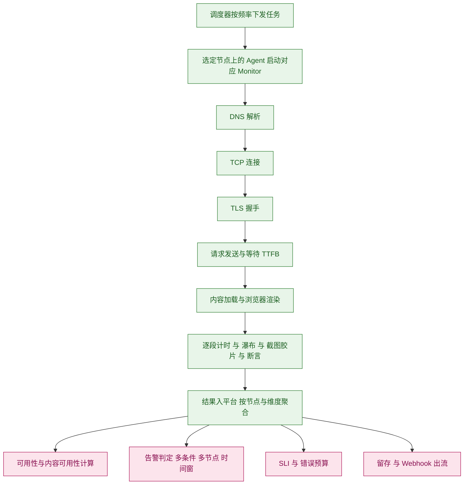
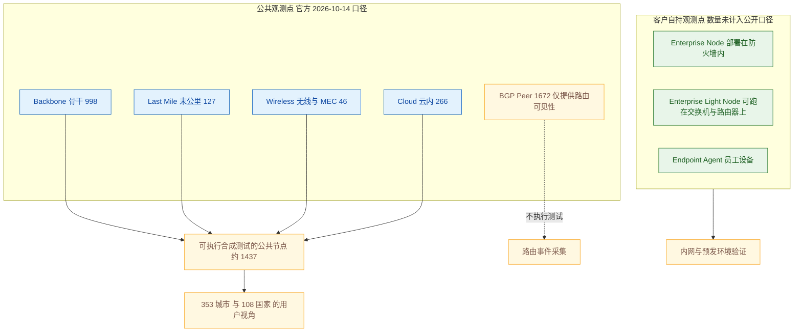
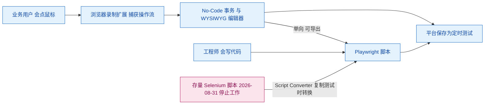
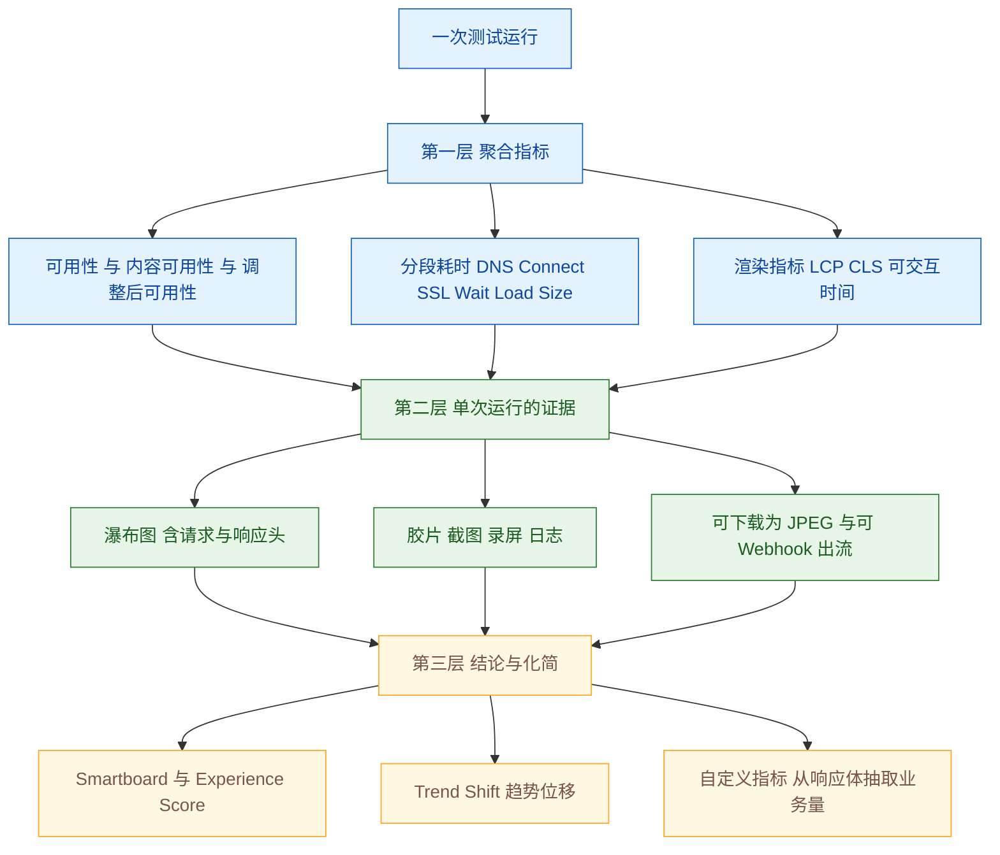
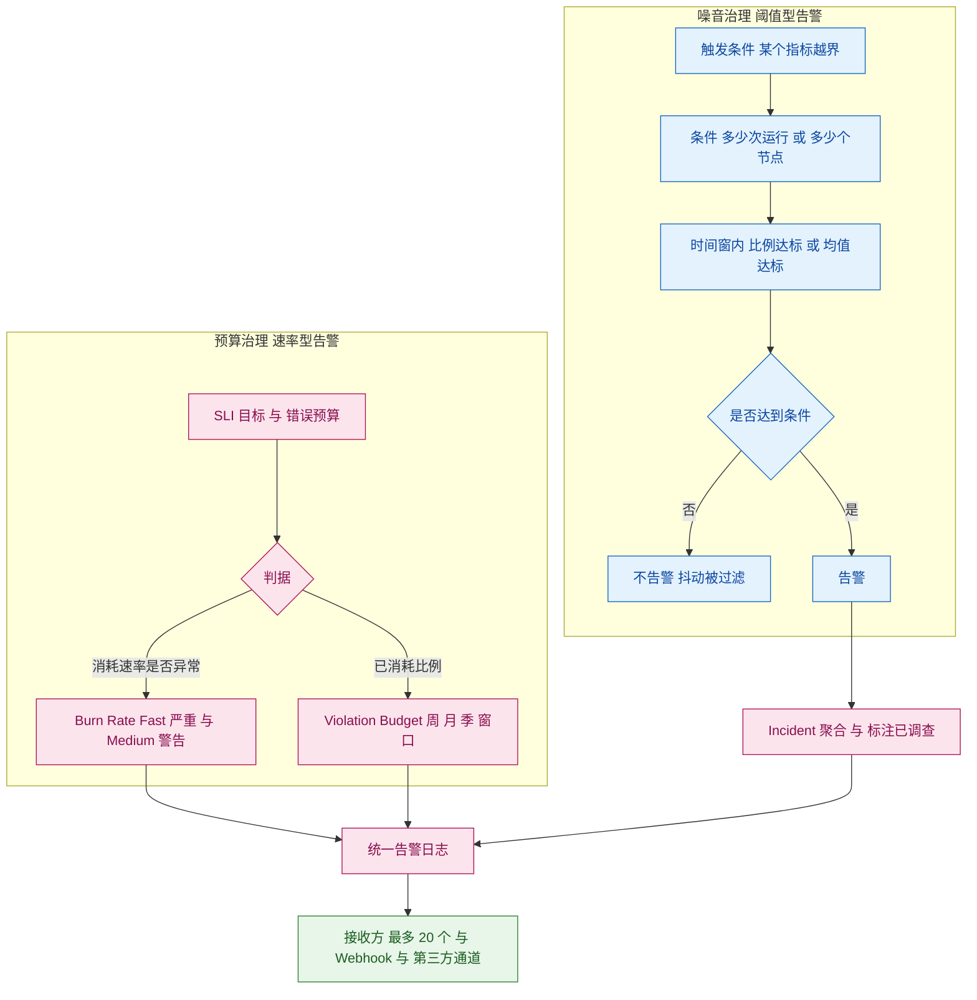
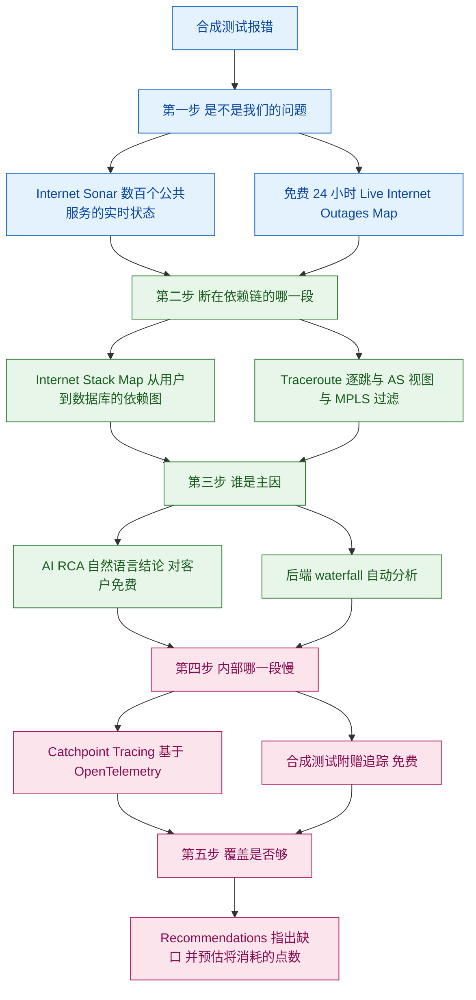
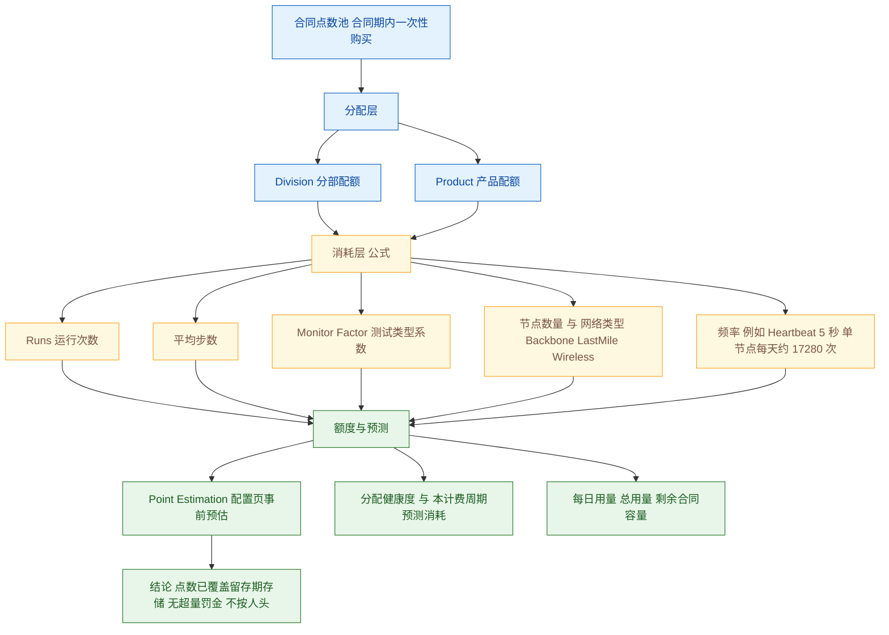
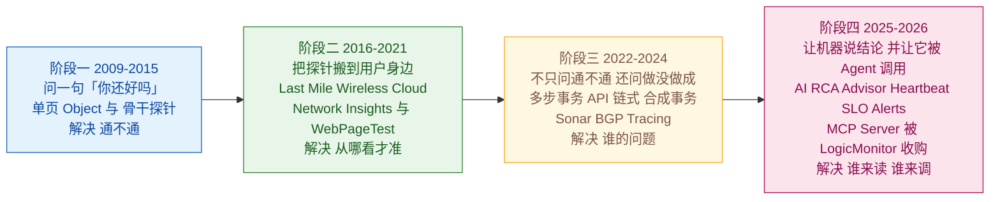

# Catchpoint 合成测试功能体系与痛点解法（2009–2026）

> **调研对象**：Catchpoint 的**合成测试（Internet Synthetics / Synthetic Monitoring）**——用部署在全球公共互联网与企业内网的探针，按固定频率主动模拟用户与客户端的请求，从而在真实用户受影响之前回答三件事：**「能不能用」「快不快」「谁的问题」**。它属于 Catchpoint 提出的 **IPM（Internet Performance Monitoring）** 品类，与 RUM（真实用户监测）、BGP、Tracing 同处一个平台，但**只有合成测试是「不依赖真实流量、可复现、可对被第三方所控路径发问」的那一半**。
> **调研范围**：**2009-09 ~ 2026-10** 公开发布的合成测试相关功能与能力增强。A 级证据（官方 Release Notes）主要集中在 **2025-07 ~ 2026-09** 的逐月代号版本；2023–2025 上半年的功能以官方文档、官方新闻稿与官方博客补全；**2009–2022 的早期地基只能到 B/C 级**，凡属此类本文一律标注。
> **交付内容**：① 按大功能点分组、标注时间与来源等级的小功能点清单；② 每个大功能点的「用户痛点（P）→ 如何解决（S）」详解，**P/S 编号逐组一一对应**；③ 十一张 Mermaid 机制图；④ 四份附录（时间线 / 演进规律 / 对标启示 / 待补充）。
> **必须前置说明的一件事**：Catchpoint 合成测试的**护城河不在「支持多少种协议」，而在「从哪测」**。协议类型是任何人都能补的（Ping、DNS、Traceroute 遍地都是），但**把探针插进 310 家骨干运营商、74 家最后一公里 ISP、15 家移动运营商，并且让平台自身不托管在被测云内**——这件事无法通过买软件获得。本报告反复出现的两条边界都源自这一点：① 你无法在本机复现它的观测点分布；② 它的「大」是**广度 + 独立性**，不是**密度**（Last Mile 仅 127 个、Wireless 仅 46 个）。忽略这条边界，会把本报告误读为一份「功能更多」的清单。

## 信源与局限（先看这一段）

采用**三级信源交叉验证**：

| 等级 | 信源 | 覆盖时段 | 用途 |
| --- | --- | --- | --- |
| A | 官方 Release Notes（docs.catchpoint.com，按月代号版本）/ 官方产品与帮助文档（Test 类型、Alerts、Pricing FAQ、Agent Release Notes、REST API Enumeration、Terraform Provider 文档）/ **官方网络页实时分项** / 官方定价页 / 官方 Selenium 退役公告 | 2023-01 ~ 2026-10（Release Notes 可检索最早为 2025-07） | 功能名 + 版本 + 日期、机制细节、规模分项、定价入口价的主依据 |
| B | 官方新闻稿（press-releases）/ 官方博客 / 官方解决方案简介 PDF / **LogicMonitor 官方博客（收购后）** / Gartner 公开复本（含厂商条目与优势·注意项）/ 主流行业媒体（APMdigest、InfoQ） | 2019 ~ 2026-10 | 平台级发布的主题与日期、机制说明、第三方验证线索 |
| C | 第三方评测与聚合站（rfp.wiki、costbench、ioriver、scmgalaxy、fivenines）/ 公司数据聚合（Dealroom、fundraisingfox、bg.sgpjbg）/ Gartner Peer Insights 匿名评论 | 2020 ~ 2026-10 | 客户真实体感、价格量级、融资与客户数、交叉验证 |

**已知局限**：

1. **Catchpoint 不提供完整的历史 Release Notes 索引。** 可检索到的 A 级版本页集中在 **2025-07 起的 9 个代号版本**（Starlight / Moonbeam / Halo / Afterglow / Triton / Europa / Miranda / Ganymede / Mimas），且 **2025-11、2025-12、2026-02、2026-05、2026-07、2026-10 未检索到公开代号**。因此 2023–2025 上半年的功能日期**多数只能到「月」或「季度」**，凡属推断一律标注「约」。
2. **官方网络规模口径在同一厂商内部并存且随抓取时间漂移**：官方解决方案简介曾写 **2,400+ vantage points**（Backbone 802），后为「近 3,000」，站内另有「2,600 vantage points」「3,000+ global agents」等表述；**官方网络页（2026-10-14 抓取）为 3,109 agents / 353 城市 / 108 国家**。本报告以**网络页分项**为准，并在第 2 组给出**「3,109 含 1,672 个 BGP Peer」的口径辨析**——这决定了「agent 数」不等于「可执行合成测试的节点数」。
3. **企业版价格不公开。** 官方仅公开 WebPageTest Starter / Pro 与 Expert 的入口价；C 级聚合站给出的区间相互矛盾（$60k–$180k+/年 vs Expert $999/月起 vs Quick Start $10,000/年），**本报告仅以量级参考呈现，不可用于预算测算**。Gartner 复本明确指出，Catchpoint 是同类 Leader 中少数不公开定价者，并把这列为采购侧注意项。
4. **Gartner Magic Quadrant / Critical Capabilities 正文在付费墙后。** 本报告只能引用**官方新闻稿**与 **Gartner 公开复本（gartner.com/doc/reprints）** 中的厂商条目、优势与注意项，**无法直接核验象限坐标与名单**。
5. **公司规模与融资口径冲突，本报告并列呈现**：LinkedIn 口径约 151 人 vs 第三方报告称 300+ 人；SEC Form D 口径累计披露 **$29M**（2015–2016 两轮）vs 第三方汇总称约 **$49.3M**。第三方对客户的描述为「近 400 家」。
6. **2025-12-02 起 Catchpoint 已被 LogicMonitor 收购。** 收购后产品叙事以合并口径出现，官方 Release Notes 自 2026-03 起明确使用「Catchpoint, now a part of LogicMonitor」。本报告以**合成测试能力线**为主体，LogicMonitor 侧只记录与合成测试直接相关的集成项，并单列第 9 组。
7. **厂商自述收益 ≠ 第三方验证。** 官方大量使用量化口径（如「把 MTTD/MTTR 大幅压低」「不额外收费」）。本报告对**所有量化收益一律标注「量级参考」**，第三方验证单独标注来源。
8. **资料截止 2026-10-14。** 该时间窗内最新版本为 **2026-09 Mimas**（Agent 2.18.0，2026-09-28 发布）。

**版本节奏对照表**（用于把功能对齐到时间窗；此表本身即为 A 级证据的可得性示意）：

| 发布月 | 代号 | 与合成测试直接相关的主题 |
| --- | --- | --- |
| 2025-07 | Starlight | Internet Stack Map 大改版、MPLS 过滤、Tracing 纳入外部服务、SSO Access Scope（限量预览） |
| 2025-09 | Moonbeam | **AI RCA**、**Stack Map Recommendations**、Enterprise Node 告警（采集频率 15→5 分钟）、Tracing 多 trace 对比 |
| 2025-10 | Halo | **Heartbeat 高频测试（5 秒）**、Node-to-Node 支持 100 节点、Private Benchmarks、Playwright 移动模拟、凭据启停 |
| 2025-11 | （未检索到公开代号） | 公开侧事件：**2025-11-12 Heartbeat Monitoring 新闻稿**、**2025-11-05 Gartner MQ for DEM 连续第二年 Leader** |
| 2025-12 | （未检索到公开代号） | 公开侧事件：**2025-12-02 LogicMonitor 完成收购** |
| 2026-01 | Afterglow | WPT 新增设备、瀑布图按指标搜索、可下载瀑布 JPEG、**移动 App EoL**、**IE monitor 弃用** |
| 2026-03 | Triton | **Catchpoint MCP Server（Preview）**、WPT Instant Test 创建改进、NEL 忽略 HTTP 错误、门户品牌对齐 LogicMonitor |
| 2026-04 | Europa | Traceroute ECN 过滤（Explorer）、MCP 更新、RUM Analytics 工具 |
| 2026-06 | Miranda | **No-Code Transaction Test**、**Streaming Test（HLS/DASH/MP4）**、Point Allocation 重构、Endpoint ARM（预览） |
| 2026-08 | Ganymede | No-Code 增强（Edge/断言/更多动作）、Node-to-Node 自定义阈值、测试级 Webhook、MFA |
| 2026-09 | Mimas | **SLO Alerts（Burn Rate / Violation Budget）**、Enterprise Node 经 LogicMonitor Collector 部署、WPT 定时测试设备·浏览器·连接独立选择 |

> **源冲突提示 1（Heartbeat 的「发布日」）**：功能本身在 **2025-10 Halo** Release Notes 中作为新特性出现，而对外新闻稿为 **2025-11-12**。二者不矛盾——**Release Notes 是平台侧可用，新闻稿是市场侧发布**。本报告并列标注，不取其一。
> **源冲突提示 2（「3,000+ agents」）**：官方多个页面与报价页使用「3,000+ / 3,109 agents」，而**同一页面的分项之和恰为 1,437（不含 BGP Peer）**。判定：**「agent」是含 BGP 采集器的宽口径**，与「可执行合成测试的观测点」不是同一集合（详见第 2 组「边界」）。
> **源冲突提示 3（Selenium 的时间线）**：官方文档明确 **Selenium 型 Transaction 测试于 2026-08-31 停止工作**，API 侧 Selenium 将于更晚退役；但 REST API 文档的「Script」字段仍并列展示 Selenium 与 Javascript 两种选项。判定：**文档是兼容态描述，退役是既定事实**，新项目不应再选 Selenium。

## 公司速览

| 维度 | 内容 |
| --- | --- |
| 公司 / 成立 / 总部 | Catchpoint Systems, Inc.；**2008-09** 创立于美国纽约；创始团队出自被 Google 收购的 DoubleClick（创始人兼 CEO：**Mehdi Daoudi**；联合创始人兼 CPTO：Dritan Suljoti）。公司最初名为 3GenLabs，后更名 Catchpoint Systems |
| 定位 | **IPM（Internet Performance Monitoring）品类的提出者与最大单一供应商**。2022-12-15 以《What is Internet Performance Monitoring》一文正式提出该品类，提出「**Internet Stack**（互联网栈）」这一分析框架；连续两年（2024、2025）入选 Gartner MQ for DEM 的 **Leader** 象限，并在 **2025-10-28 的 Critical Capabilities** 报告中为 **ITOps 用例最高分** |
| 产品谱系中的位置 | 平台 = **Internet Synthetics（本报告主体）** + RUM（含 Session Replay、Mobile RUM、Cookieless RUM）+ BGP + Heartbeat + Distributed Tracing + WebPageTest（性能优化侧） |
| 技术栈 | 采集侧：自建全球观测网络（Backbone / Last Mile / Wireless / Cloud / BGP Peer / Enterprise Node / Endpoint），Agent 由 NodeJS **迁移至 NSolid**（2026-09），浏览器引擎为真实 Chrome / Edge（2026-09 为 151 版本）；执行引擎：**Selenium（退役中）→ Playwright / Puppeteer**；追踪侧：**OpenTelemetry**；集成侧：REST API v3（稳定）/ v4（预览）、Terraform Provider、CLI、Webhook、**MCP Server** |
| 部署形态 | **SaaS 为主**（平台方托管，无状态架构，官方称与被测云解耦）；Enterprise Node 由客户自部署（物理/虚拟 Linux、Docker、**2026-06 起 ARM 预览**、**2026-09 起可随 LogicMonitor EA Collector 一并部署**）；Endpoint 客户端（Windows / **macOS 原生 Universal Binary**） |
| **网络规模（A 级，官方网络页，2026-10-14 抓取）** | **3,109 agents / 353 城市 / 108 国家**。分项：**Cloud 266**（9 家）、**Backbone 998**（310 家）、**Last Mile 127**（74 家）、**Wireless 46**（15 家）、**BGP Peers 1,672**（485 个 ASN）。**用户设备与企业节点未计入此数** |
| 客户结构（B/C 级，并列） | 服务 Global 5000；第三方口径称覆盖 **9/10 Forbes Digital、6/6 头部云厂商、17/20 CDN**；客户总数「近 400 家」（C 级）。公开客户故事含 Hostinger、Akamai、SAP、Cox、Cloudinary、Honeywell、Washington Post |
| 融资与并购（口径冲突，并列） | SEC Form D 口径累计披露 **$29M**（2015-07 $6.5M、2016-10 $22.5M）；融资方含 Battery Ventures、Sapphire Ventures、Renegade Partners、York IE、Silicon Valley Bank。第三方汇总称累计约 **$49.3M**。**2025-12-02 LogicMonitor 完成收购**；第三方口径交易金额 **>$2.5 亿美元**（Dealroom 记 $250M，现金） |
| 生态与合规（B/C 级） | 集成 Datadog / Dynatrace / ClickHouse / Snowflake / Databricks / ServiceNow / Grafana / Splunk / PagerDuty；SOC 2 Type II、GDPR、HIPAA（C 级）；官方在 2026-03 的 Active Session Timeout 中明确对齐 **NIST SP 800-63B** |
| 客户体感（C 级，混合） | 正面集中于「探针位置多、能定位到 ISP/CDN 层、告警及时」；**负面高度集中于「界面数据密集、学习曲线陡」「企业版价格不透明且偏高」「相对 APM 更偏观测而非应用内深度」**（Gartner 复本的注意项亦含「不作为广义可观测平台的一部分」「Session Replay 尚不成熟」「不公开定价」） |

**一句话看懂十七年演进**：

> **2009–2015 问一句「你还好吗」**（Object 单页 + 骨干探针，解决「网站到底通不通」）→ **2016–2021 把探针搬到用户身边并问得更细**（Last Mile / Wireless / Cloud 节点，Network Insights 的 DNS 双视角 + BGP + Traceroute，2020 年收购 WebPageTest 补齐前端性能）→ **2022–2024 不只问通不通、还问业务做没做成**（多步事务与 API 链式调用、Internet Sonar、Tracing，2022 年提出 IPM 品类）→ **2025–2026 让机器把结论直接说出来、并把它变成可被 Agent 调用的工具**（AI RCA / Advisor、Heartbeat 5 秒、SLO Alerts、MCP Server，随后被 LogicMonitor 收购进入「基础设施 + 互联网」合并叙事）。
>
> 贯穿全程的第 1 条线是**「观测点的独立性与广度」**——所有能力的可信度最终都锚定在「你是从哪问的」。
> 贯穿全程的第 2 条线是**「把不可断言的东西变成指标」**——可用性 → 内容可用性 → 事务完成率 → AI 回答正确性，每一步都在扩张「可被自动判定」的边界。

---

## 读法：9 个大功能点全景

**图 0｜合成测试的四层结构**：左边两层（观测点 × 测试类型）决定「你能问出什么问题」，右边两层（分析 × 判断）决定「答案以什么形式到达决策者」。**竞品之间最容易趋同的是中间两层，最难复制的是最左一层。**

| # | 大功能点 | 口号 | 小功能点数 | 时间跨度 |
| --- | --- | --- | --- | --- |
| 1 | 测试类型体系：从端口连通到业务闭环 | 测得全 | 22 | 2009 起 ~ 2026-09 |
| 2 | 执行网络与观测点：把探针放到用户身边 | 站得外 | 10 | 2009 起 ~ 2026-09 |
| 3 | 脚本生产与维护：从会写代码到会点鼠标 | 写得快 | 14 | 2020 ~ 2026-08 |
| 4 | 采集深度与分析：从一条曲线到一次交易的全息还原 | 挖得深 | 13 | 2020 ~ 2026-09 |
| 5 | 告警、SLO 与噪音治理 | 报得准 | 12 | 2019 起 ~ 2026-09 |
| 6 | 依赖地图、关联与根因 | 判得清 | 12 | 2022 ~ 2026-09 |
| 7 | 平台化、自动化与集成（Monitoring as Code） | 接得上 | 13 | 2021 ~ 2026-09 |
| 8 | 点数制成本治理与商业模式 | 买得值 | 8 | 2015 ~ 2026-08 |
| 9 | AI 时代的合成测试扩展 | 跟得上 | 9 | 2023 ~ 2026-09 |

> **合计 113 个小功能点。**
> **读法提示**：第 1–2 组回答「**这套东西的物理底座是什么**」——它们是本次调研中**唯一不可被软件复制**的部分，也是与自研 APM 差距最实质的一组；第 3–4 组回答「**人怎么用、看到什么**」，是日常真正踩坑最多的地方（Selenium 退役、脚本维护成本就藏在这里）；第 5–6 组回答「**故障来了怎么判断**」，与自研 APM 的 AI 助手方向最直接可比；第 7 组回答「**能不能被规模化托管**」；第 8 组回答「**谁来付钱、按什么付**」；第 9 组是**最新、变化最快**的一组，全部集中在 2025-07 之后。

---

# 大功能点 1：测试类型体系 —— 测得全

## 1.1 小功能点清单

| # | 小功能点 | 发布时间 | 来源等级 | 说明 |
| --- | --- | --- | --- | --- |
| 1.1 | **Web / Object Test**（单页对象抓取） | 2009 起（早期地基） | A/C | 最基础的可用性与页面性能测试；同一 Web 测试类型下可选 **Object / Chrome / Emulated / Mobile / Playback** 等多种 Monitor，Monitor 决定「怎么执行」 |
| 1.2 | **HTML Code Test** | — | A | 直接校验返回的 HTML 代码内容是否与预期一致 |
| 1.3 | **API Test（单步）** | — | A | GET / POST / PUT / DELETE、自定义头与负载、多种认证方式；可对**响应码、响应体、响应头**做正反断言（如「必须是 200」「绝不能是 403」） |
| 1.4 | **API 多步事务（链式调用）** | — | A | 把多次 API 调用串成一条业务链，支持步骤间传值与 **OAuth 令牌复用**（取到令牌供后续步骤使用） |
| 1.5 | **Transaction Test（多步浏览器事务）** | — | A/C | 以脚本驱动真实浏览器走完用户流程（登录、搜索、加购、结算） |
| 1.6 | **Playwright Test** | 约 2023 起 | A | 现代浏览器自动化框架；支持 **Chrome / Edge** 监视器；支持 **Mobile（新）移动模拟**、**iFrame**（2026-09 Agent 2.18.0 补齐录制场景）、客户端证书 |
| 1.7 | **Puppeteer Test** | 约 2023 起 | A | 与 Playwright 并列的第二条现代脚本路径 |
| 1.8 | **No-Code Transaction Test** | **2026-06** | A | 浏览器扩展录制 + WYSIWYG 编辑，可导出为 Playwright（详见第 3 组） |
| 1.9 | **WebPageTest（Instant / Scheduled / Bulk）** | 2020-09 并入 | A/B | Lighthouse 审计、Waterfall、Filmstrip、Core Web Vitals、Domain Breakdown；2026-03 起 Instant Test 支持批量测试、Basic Auth、重跑与配置分离 |
| 1.10 | **DNS Test（Direct 直查）** | 约 2019 起 | A/B | **直接查询权威 Name Server**，提供可达性数据并校验应答内容是否被篡改 |
| 1.11 | **DNS Test（Experience 体验视角）** | 约 2019 起 | A/B | **模拟递归解析器**发起递归查询，测量解析链路上各 DNS 服务器的延迟、性能与可用性。**「直查」与「体验」双视角是 Catchpoint 的差异化声明**（官方称其为唯一同时提供两者的厂商） |
| 1.12 | **SSL / TLS Test** | — | A | 证书链、有效期、主机名匹配、握手各阶段；可对 `days to expiration` 设阈值告警 |
| 1.13 | **Transport Test（TCP / UDP / Port）** | — | A | 传输层与端口级连通性 |
| 1.14 | **Ping Test（ICMP / TCP / UDP）** | — | A | 三种协议可选的存活测试 |
| 1.15 | **Traceroute Test（ICMP / UDP / TCP）** | 约 2019 起 | A/B | 逐跳路径与 **AS 视图**双呈现；**2023-10 起支持 ECN 拥塞检测**（面向 AR/VR、流媒体、游戏、自动驾驶等时延敏感业务，官方称此能力为其独有），**2026-04 在 Explorer 中增加 ECN 过滤** |
| 1.16 | **BGP Test** | 约 2019 起 | A/B | 检测路由劫持、策略配置错误、路由翻动、对等互联问题；**实时数据源 = RouteViews + RIPE RIS 公开数据 + 私有 peering**，官方称可把「15 分钟才发现」压到「事件发生即告警」 |
| 1.17 | **应用与网络杂项协议测试**：FTP / SFTP / SSH / SMTP / IMAP / NTP / WebSocket / **MQTT** | 逐年补齐 | A | **MQTT 监视器于 Agent 2.18.0（2026-09）按最新标准与库重写**，是最近一次协议栈更新 |
| 1.18 | **Streaming Test（HLS / DASH / MP4）** | **2026-06** | A | 在**真实 Chromium** 环境内测量播放体验，从视频源绑定到播放器开始，覆盖起播、播放与缓冲事件；输出 **Initial Buffer / Play Time / Total Buffer Time / Buffer Counter**。**仅 Enterprise 节点** |
| 1.19 | **Heartbeat Test** | **2025-10** | A | 5 秒级高频检查，支持 **HTTP 与 API** Monitor，可从 Enterprise 节点与部分 Cloud 节点运行（详见第 9 组） |
| 1.20 | **Node-to-Node Test（最多 100 节点）** | **2025-10** | A | 节点间**全互联矩阵**，观测整张网内任意两点之间的延迟、抖动与丢包；**2026-08 起支持自定义阈值**（静态值 + 相对基线的百分比变化），用于抑制预期波动造成的假告警 |
| 1.21 | **Custom Test（自定义脚本）** | — | A | 把客户自有的任意内部脚本转成定时监视器（官方举例：SSH、VoIP、门铃、套接字、数据库、带宽） |
| 1.22 | **Wi-Fi Test**（`Synthetic-Node-WiFi` Monitor） | — | A | 由 REST API 枚举表可见的独立 Monitor 类型 32 |

> **归一说明**：官方 REST API 枚举表给出的 **Test Type ID 为 0–20 共 21 类**（Web 0 / Transaction 1 / HTML Code 2 / FTP 3 / TCP 4 / DNS 5 / Ping 6 / SMTP 7 / UDP 8 / API 9 / Streaming 10 / SSH 11 / Traceroute 12 / WebSocket 13 / NTP 14 / IMAP 15 / MQTT 16 / Bulk 17 / SSL 18 / WiFi 19 / BGP 20），另有 **Monitor Type ID 0–34** 表示「同一测试类型下的具体执行方式」。**Heartbeat 与 Node-to-Node 未出现在该枚举中**——它们是 2025-10 之后新增、尚未回填到公开枚举表的类型，这本身可视为一张「文档滞后于产品」的证据。

**图 1｜一次合成测试的执行链路。** 这条链路解释了「分段计时」是怎么来的：**每一段都是链路中的一个真实阶段**，因此「慢在哪里」是一个可以被定位的物理位置，而不是一个统计推断。注意 C5 之后的分叉——同一次运行会同时喂给四个下游消费者（指标、告警、SLO、出流），**这也是为什么合成测试数据能同时服务运维、SRE 与业务三方**。

```mermaid
flowchart LR
  subgraph L1[第一层 端口与传输]
    T11[Ping ICMP TCP UDP]
    T12[Transport TCP UDP Port]
    T13[FTP SFTP SSH SMTP IMAP NTP]
    T14[MQTT WebSocket]
  end
  subgraph L2[第二层 接口]
    T21[API 单步]
    T22[API 多步链式与 OAuth]
    T23[SSL TLS 证书]
    T24[DNS Direct 与 DNS Experience]
  end
  subgraph L3[第三层 页面与前端]
    T31[Web Object 单页]
    T32[HTML Code]
    T33[WebPageTest 与 Lighthouse]
    T34[BGP 与 Traceroute 路径]
  end
  subgraph L4[第四层 业务闭环]
    T41[Transaction 与 Playwright 真实浏览器]
    T42[No-Code 录制事务]
    T43[Streaming HLS DASH MP4]
    T44[Heartbeat 5 秒 与 Node-to-Node]
  end
  L1 --> L2 --> L3 --> L4
  classDef l1 fill:#E3F2FD,stroke:#1565C0,color:#0D47A1
  classDef l4 fill:#FCE4EC,stroke:#AD1457,color:#880E4F
  class T11,T12,T13,T14,T21,T22,T23,T24,T31,T32,T33,T34 l1
  class T41,T42,T43,T44 l4
```

**图 2｜测试类型的四层收敛。** 越往右，「断言」的能力越强、成本越高、也越容易因页面改版而失效。**这一层递进关系是排查效率的来源**：报错时先在左侧排除（端口通不通、DNS 解析对不对），再往右侧定位（接口返回什么、页面能不能走完）。**左侧一排是把右侧的误判剔掉的工具。**

## 1.2 它对应的用户痛点

> **口径**：本节只写客户侧可感知的痛（时间 / 钱 / 人 / 合规 / 组织），不写「协议栈覆盖不全」「Monitor 与 Test Type 不一一对应」这类架构层问题。痛点编号 P1…Pn 与下节解法 S1…Sn **一一对应**。

- **P1｜「通了」不等于「能用」。** 端口开着、Ping 通、首页返回 200，但用户登不进去、下不了单、支付回调丢单。监控大盘是绿的，投诉电话已经打进来——**运维要为此承担一个自己看不见的责任**。（时间 / 钱）
- **P2｜故障发生在别人的地盘，自己却是最后一个知道的。** DNS 服务商、CDN、云区域、第三方支付或登录 API 一挂，客户先骂的是自己；而这部分恰恰是传统 APM 与基础设施监控的观测盲区。（组织 / 时间）
- **P3｜本可预知的确定性事故仍在生产上炸。** SSL 证书到期、DNS 记录被误改、域名被劫持——这些都有确定的前兆，却总在生效那一刻才被发现，事后只能写「加强管理」的复盘。（钱 / 合规）
- **P4｜业务已经跑在新协议与新形态上，监控却停在 HTTP 首页。** 视频起播慢、播放中反复缓冲、WebSocket 断连重连、MQTT 设备掉线、TCP 端口通但业务不可用——运维手上没有可看的指标，只能对业务方说「我们这边正常」。（钱 / 时间）
- **P5｜「慢」和「坏」是两种事故，但工具只报其中一种。** 响应码 200、页面也能打开，内容却少了一块（第三方 JS 被墙、图片 CDN 挂了、样式表 404）。可用性 100%，功能已经残废——**这类事故在报表上完全隐身**。（钱 / 时间）

## 1.3 它是如何解决的

**架构约束（由痛点倒推）**

| 架构约束 | 由哪条痛点倒推 | 落到了哪些功能 |
| --- | --- | --- |
| 必须存在「真实浏览器 + 真实用户路径」的执行形态，否则测不到业务是否完成 | P1 | Transaction（1.5）、Playwright（1.6）、Puppeteer（1.7）、No-Code（1.8）、WebPageTest（1.9） |
| 必须把「路径上的第三方」也变成一等被测对象，且能独立于供应商自述来验证 | P2 | DNS Direct / Experience（1.10 / 1.11）、SSL（1.12）、BGP（1.16）、Transport（1.13）、Traceroute（1.15） |
| 必须有「可提前判定」的检查项，把确定性事故前置 | P3 | SSL 有效期阈值告警（1.12）、DNS 应答内容校验（1.10） |
| 测试类型必须跟着业务所用的协议走，而不是跟着 HTTP 走 | P4 | Streaming（1.18）、MQTT（1.17）、WebSocket（1.17）、Heartbeat（1.19）、Node-to-Node（1.20） |
| 可用性与内容完整性必须分列为两个指标，否则「通而不可用」无法进入报表 | P5 | Web / Object 测试的 `% Availability` / `% Adjusted Availability` / `% Content Availability` 三指标（1.1）、Custom Test 断言（1.21） |

- **S1｜按「业务闭环」而非「协议端口」定义测试类型**（→ 解 P1）。提供从端口（Ping / Transport）→ 接口（API 单步）→ 链式接口（API 多步）→ 页面（Web → WebPageTest）→ 交易（Transaction / Playwright）的**四层探针**。真实浏览器型测试会**真正渲染页面、执行 JavaScript、点击、填表、提交**，因此它回答的是「**用户能否完成这件事**」，而不是「服务器是否应答」。这也是 Catchpoint 与纯端口/Uptime 工具最本质的分界。
- **S2｜把第三方依赖变成可被独立举证的测试对象**（→ 解 P2）。用 DNS（直查 / 体验双视角）、SSL、BGP、Transport、Traceroute 对「自己控制不了的那半条路」单独发问。**当问题出在供应商一侧时，客户手里有自己采集的、带时间戳与节点维度的证据，而不是供应商的状态页截图**——这一点直接决定了「谁道歉、谁整改」。
- **S3｜把「必然会发生」的事故前置成例行检查**（→ 解 P3）。**SSL 测试**直接校验证书链、有效期与主机名匹配，支持按剩余天数设阈值；**DNS Direct** 校验应答内容是否与预期一致，可发现记录被篡改、劫持与缓存投毒。两者都是「零流量的确定性检查」，成本极低而收益清晰。
- **S4｜让测试类型跟着业务实际使用的协议走**（→ 解 P4）。**Streaming Test（2026-06）** 在真实 Chromium 内测量 HLS / DASH / MP4 的起播延迟与缓冲行为——这是「视频业务方说不清、SRE 测不到」的经典盲区；**MQTT** 在 Agent 2.18.0（2026-09）按最新标准重写，面向 IoT 与设备侧场景；**Node-to-Node** 把「这张网自己内部通不通、两点之间好不好」从人工抽查变成持续矩阵；**Heartbeat（5 秒）** 覆盖亚分钟级的中断。
- **S5｜把「可用性」与「内容完整性」拆成两个指标**（→ 解 P5）。Web / Object 测试同时输出：
  - `% Availability` =（测试运行数 − 测试错误数）/ 测试运行数——主 URL 是否被成功触达；
  - `% Content Availability`——**页面上的每个元素是否都加载成功**，只要有一个对象加载失败，本次运行即被计为「内容未可用」；
  - `% Adjusted Availability`——剔除人工排除（Purged Runs）后的可用性，用于 SLA 口径。
  **客户口中「可用性 100% 但功能坏了」这句话，在这里第一次有了一个可以被写进报表的数。**

> **边界**：
> - **测试类型多 ≠ 在任意节点上都可用**。官方明确：Streaming 仅 Enterprise 节点；Heartbeat 限 HTTP / API 且仅 Enterprise + 部分 Cloud 节点；**IE monitor 已于 2026-01 弃用**；**Selenium 型 Transaction / API 测试将于 2026-08-31 停止工作**。
> - **「第四方」的覆盖有明确上限**。BGP 的实时性依赖「公开数据（RouteViews / RIPE RIS）+ 私有 peering」的组合，**未被任何采集点覆盖的路由事件依然看不见**；DNS 结果只代表「从该节点出发的那条解析分支」，不能代表全网。
> - **单条测试有硬规模边界**（官方在 Transaction 指标定义中写明 `Test Limit Errors`）：单次运行 > 30 秒、URL 连续重定向 > 5 次、单测试引用 URL > 1,000 条、引用主机 > 255 个，均触发限制错误。**「用一条测试覆盖全站」是不可能的。**
> - **`% Content Availability` 不等同于「功能正确」**。它衡量的是「元素是否加载」，不衡量「业务逻辑是否正确」；后者要靠断言（S2 中的 API 断言、Custom Test 脚本）或第 9 组的合成提示词监控。
>
> **配套演进**：REST API 的 Test Type / Monitor Type 枚举表属于接口兼容层演进，不回应任何客户痛点，故列入「附一 · 时间线」而不进入 S 列表。

---

# 大功能点 2：执行网络与观测点 —— 站得外

## 2.1 小功能点清单

| # | 小功能点 | 发布时间 | 来源等级 | 说明 |
| --- | --- | --- | --- | --- |
| 2.1 | **Backbone Agents（骨干节点）** | 2009 起 | A | 官方网络页口径 **998 agents / 310 家运营商**；直连一级运营商，面向可用性、性能与体验目标（XLO）类关键用例 |
| 2.2 | **Last Mile Agents（最后一公里）** | 约 2016 起 | A | **127 agents / 74 家运营商**；部署在居民宽带与家庭网络，回答「家庭用户实际看到多少」 |
| 2.3 | **Wireless Agents（无线节点）** | 约 2018 起 | A | **46 agents / 15 家运营商**；覆盖移动网络与**多接入边缘计算（MEC）**，回答「手机与无线接入用户看到多少」 |
| 2.4 | **Cloud Agents（云内节点）** | 约 2018 起 | A | **266 agents / 9 家**；部署在 AWS / Azure / GCP 等 hyperscaler 内部，用于观测云服务与云间连通性 |
| 2.5 | **BGP Peers** | 约 2019 起 | A | **1,672 peers / 485 个 ASN**；公开数据（RouteViews、RIPE RIS）+ 私有 peering。**提供路由可见性，不执行合成测试** |
| 2.6 | **Enterprise Node（企业节点）** | — | A/B | 客户自部署的物理或虚拟 Linux 设备，置于防火墙内；补全内网应用、预发环境与私有依赖的可观测性；支持用户名口令、客户端证书等认证方式 |
| 2.7 | **Enterprise Light Node（轻量企业节点）** | 2023-10 | B | 更轻量，**可运行在 Cisco 路由器、交换机等设备上**，可扩展至数百至数千个位置，面向零售门店、分支机构、卫星办公室等远程站点 |
| 2.8 | **Endpoint Agent（员工设备探针）** | — | B | 装在员工笔记本上，采集应用性能、网络连通性与设备健康；**2026-06 起 macOS 版从依赖 Rosetta 改为原生 Universal Binary（同时支持 Intel 与 Apple Silicon）** |
| 2.9 | **企业节点的部署通道扩展** | 2026-06 / 2026-09 | A | 2026-06：**ARM 支持（预览）**，可按 x86 / ARM 灵活选型；2026-09：**可在部署 LogicMonitor EA Collector 时单步一并安装**（自动跟踪 Catchpoint 服务健康并上报 Collector 事件页，Catchpoint 服务异常不影响 Collector 运行） |
| 2.10 | **公共节点的容量与调度可见性** | 2026-01 / 2026-03 | A | 2026-01 位置下拉列表增加**队列数**；2026-03 WPT Instant Test 创建时**自动前置「可用容量最好的前三个位置」**，并高亮常用设备与连接组合 |

**图 3｜观测点分层与「3,109」口径辨析。** 这张图是本报告最需要被记住的一张：**官方的「3,109 agents」中，1,672 个是只做路由采集的 BGP Peer，真正能执行合成测试的公共节点约 1,437 个**，而客户自持的 Enterprise / Endpoint 节点根本不在这个数里。**引用「探针规模」时若不区分，会把能力高估约 2.2 倍。**

## 2.2 它对应的用户痛点

> **口径**：本节只写客户侧可感知的痛（时间 / 钱 / 人 / 合规 / 组织），不写「探针调度算法」「节点容量池化」这类架构层问题。痛点编号 P1…Pn 与下节解法 S1…Sn **一一对应**。

- **P1｜「总部测着好」制造虚假安全感。** 只在公司出口或某朵云上放一个探针，测出来一切正常，而外地、海外用户持续抱怨。**观测点越少，误判为「正常」的概率越高**，团队会因此把资源投在错误的方向上。（钱 / 时间）
- **P2｜测试跑在机房，用户在家、在手机上。** 探针所在位置与用户真实路径不同，测出来的数不是用户感受到的数；一旦要对外沟通「用户到底经历了什么」，手里没有可用的数。（时间）
- **P3｜防火墙后面的系统测不到。** 预发环境、内网门户、VDI、OA 都需要登录才能进，外部探针进不去，上线前的功能验证只能靠人工点。**发布前的最后一公里验证没有自动化手段。**（组织 / 时间）
- **P4｜云厂商挂了，监控一起挂。** 当监测平台与被测系统跑在同一朵云、同一个区域时，故障时「既失明又失联」——**恰恰在最需要数据的那几分钟没有数据**，事后也没有留存可查。（时间）
- **P5｜「多少人受影响」说不清。** 知道慢了，但不知道是哪家 ISP、哪个城市、哪张无线网络的用户先受影响，也就无法对「先救谁、后救谁」做出有依据的取舍。（组织 / 钱）

## 2.3 它是如何解决的

**架构约束（由痛点倒推）**

| 架构约束 | 由哪条痛点倒推 | 落到了哪些功能 |
| --- | --- | --- |
| 观测点必须分布在「用户实际所在的网络」上，而不是集中在少数机房 | P1、P2、P5 | Backbone（2.1）、Last Mile（2.2）、Wireless（2.3）、Cloud（2.4）；结果带城市 / 国家 / 运营商 / 网络类型维度 |
| 必须有「客户自持的探针」，才能越过后端边界 | P3 | Enterprise Node（2.6）、Enterprise Light Node（2.7）、Endpoint Agent（2.8）、认证方式支持 |
| 监测面必须与被测面解耦，否则故障相关性会同时打掉两者 | P4 | 官方称网络**不托管在被测云内、无状态架构**；Cloud Agent 作为「被观测对象」而非「监测底座」 |
| 探针必须可被低成本地铺开，否则「放到用户身边」在成本上不成立 | P3、P5 | Enterprise Light Node 的轻量化（2.7）、ARM 支持与随 Collector 部署（2.9） |

- **S1｜向用户所在处布点，而非向机房布点**（→ 解 P1）。公共节点按「用户网络的类型」分层：Backbone（骨干，998）、Last Mile（末公里，127）、Wireless（无线，46）、Cloud（云内，266）。官方网络页当前口径为 **3,109 agents / 353 城市 / 108 国家**。**对客户最直接的价值是：同一句「快不快」，可以得到十几个不同答案，而每个答案都对应一组真实存在的用户。**
- **S2｜把「最后一公里」与「无线」作为独立类别刻意保留**（→ 解 P2）。Last Mile 节点在居民宽带与家庭网络、Wireless 节点在移动网络与 MEC——**这两类正是「从云上测永远测不准」的区域**。官方在解决方案简介中明确其节点「直接接入一级 ISP」并强调网络与被测云解耦。
- **S3｜把探针放进客户自己的网络**（→ 解 P3）。**Enterprise Node** 部署在防火墙内，用于监控内网系统与预发环境；**Enterprise Light Node（2023-10）** 把单点成本压到「可铺数百至数千个位置」，官方点名可跑在 **Cisco 路由器与交换机**上——**这意味着园区网设备本身可以成为合成测试的执行点**。配合认证方式支持，登录后的业务流程才真正可被自动化验证。
- **S4｜监测面与被测面解耦，并把「云」同时当作被测对象**（→ 解 P4）。官方口径：网络**独立且与被测云解耦**（「云宕机时我们仍在线上」）、**无状态架构**、**高可扩展与容错**、**最优信噪比**、**长期数据留存编排**（B 级）。同时 Cloud Agent 提供从云内、云间观测的能力——**「不会被一起打断」与「能测云」是同一个架构选择的两面**。
- **S5｜把结果维度化到 ISP / 城市 / 网络类型**（→ 解 P5）。每次运行的结果都带节点维度（城市、国家、运营商、网络类型、ASN），因此可以回答「同一次请求在 A 家 ISP 与 B 家 ISP 的差异」「哪个城市先坏」。**这使「受影响的用户规模」从估算变成可查的切片。**

> **边界（本节最重要的一段——直接决定引用数字的可靠性）**：
> - **官方宣称的「3,109 agents」是含 BGP Peer 的宽口径。** 官方网络页的分项为 Cloud 266 + Backbone 998 + Last Mile 127 + Wireless 46 + **BGP Peers 1,672**，**恰好等于 3,109**。即：**真正可承载合成测试的公共观测点约为 1,437 个**，另外 1,672 个 BGP Peer 提供的是**路由可见性**。对外引用「探针规模」时，**必须区分「agent 数」与「可执行测试的节点数」**，否则会把规模高估约 2.2 倍。
> - **规模口径在同一厂商内部并存**：官方解决方案简介曾写 **2,400+ vantage points**（Backbone 802 / Last Mile 122 / Wireless 42 / Cloud 190 / BGP Peers 1,202），后为「close to 3,000」，站内另有「2,600 vantage points」。**本报告以网络页分项为准，并建议每季度复核一次。**
> - **「最后一公里覆盖」是深度而非密度的优势**：Last Mile 仅 127 个、Wireless 仅 46 个，**远小于 Backbone 的 998 个**。因此它对「某国某运营商的具体用户」有代表性，**但对「某个具体城市的细粒度分布」不具备样本量优势**。
> - **公共节点是共享资源，存在排队。** 2026-01 的位置下拉开始显示队列数、2026-03 的 Instant Test 主动前置「容量最好的前三个位置」，**这两项功能本身就是「容量受限」的间接证据**。
> - **企业节点的功能面与公共节点不完全相同**：Streaming Test 仅限 Enterprise 节点，Heartbeat 亦以 Enterprise 节点为主要执行场所——**「能力最强的节点」需要客户自己出机器**。
>
> **配套演进**：**Catchpoint 移动 App 于 2026-01 EoL**（官方称「集中资源于客户影响最大的领域」），这属交付渠道收缩，不回应客户痛点，列入「附一 · 时间线」。

---

# 大功能点 3：脚本生产与维护 —— 写得快

## 3.1 小功能点清单

| # | 小功能点 | 发布时间 | 来源等级 | 说明 |
| --- | --- | --- | --- | --- |
| 3.1 | **Catchpoint Recorder（浏览器录制扩展）** | 约 2020 | B | 基于 Selenium 的 Chrome 扩展，把用户操作录制为可回放、可自动化的多步事务；**官方对其能力描述为：自动补全、语法高亮、断点、分析、内置截图、回放** |
| 3.2 | **Script Editor（脚本编辑器）** | — | B | 平台侧的脚本编辑与调试环境（同上能力集） |
| 3.3 | **Playwright 脚本能力** | 2023 起持续 | A | 支持 **Edge / Chrome** 监视器、**Mobile（新）移动模拟**（2025-10）、**iFrame**（2026-09，弥补 No-Code 录制场景）、客户端证书；`Catchpoint.setIndicator()` 可写入 Insights 指标（2026-08 修复） |
| 3.4 | **Puppeteer 脚本能力** | 2023 起 | A | 与 Playwright 并列的第二条现代脚本路径；Terraform Provider 中 `test_script_type` 已设为只读 |
| 3.5 | **No-Code Transaction Test（录制 + WYSIWYG）** | **2026-06** | A | 浏览器扩展捕获用户操作流并**自动转换为事务指令**，配内置所见即所得编辑器维护；面向「非技术用户」与「想省时间的工程师」两类角色 |
| 3.6 | **导出为 Playwright（单向）** | **2026-06** | A | No-Code 可导出为 Playwright 脚本以增加能力，**但 Playwright 不能回退为 No-Code**；官方建议以录制作为 Playwright 脚本的起点 |
| 3.7 | **No-Code 能力增强：Edge、断言、更多动作** | **2026-08** | A | 增加 **Edge 浏览器支持**；增加**断言**（校验文本与 HTML 元素是否存在或可见）；增加**滚动、聚焦、特殊键与组合键**等动作；录制 / 管理 / 回放的交互更清晰 |
| 3.8 | **Script Converter（Selenium → Playwright 自动转换）** | — | A | 在**「复制测试」时**触发自动转换（而非在「转换测试」时），**原因是转换不可逆**——先在副本上验证生成的 Playwright 脚本可用，再回头转换原测试并粘贴脚本 |
| 3.9 | **Selenium 型测试退役** | **2026-08-31** | A | 自该日起**所有基于 Selenium 的 Transaction 测试停止运行**；API 侧 Selenium 将在更晚时间退役（官方建议提前迁至 Javascript 版 API 测试）；官方给出的理由是 Playwright 与 Puppeteer 已成为行业标准 |
| 3.10 | **变量与取值体系** | — | A | `storeVariable()` / `extractVariable()` 在同一条测试内跨步骤传递值（cookie、header、令牌）；`${Extract(source, regexp:...) }` 从请求 URL / 请求头 / 响应头 / 响应体中取值；**API 测试额外支持 JSONPath**（如 `$..book[?(@.isbn)]`）；`${Switch}` 做值判断、`${Var}` 引用、`Assert()` 使测试失败 |
| 3.11 | **多步 API 事务与令牌复用** | 2026 起强化 | A | 链式 API 调用，支持**存储 OAuth 令牌供后续运行复用**；可自动捕获 HTTP/S 分段指标与从响应中抽取的自定义指标 |
| 3.12 | **Script Templates Library（脚本模板库）** | — | A | 用一条「通用脚本 + 差异项」生成多条测试：Template Field 自动生成 `${Template_xxx}` 宏，派生测试只填差异值；模板具备 **Draft / Published / Deprecated 三态**与**自动弃用日期**；可限定适用的测试类型与 Monitor |
| 3.13 | **凭据集中管理（Token / Password / Certificate）** | 2025-10 / 2026-09 | A | 凭据可设 **Active / Inactive**（inactive 且被测试引用时**该测试不运行**，界面上以蓝色/灰色药丸标识）；口令字段支持 `'`、`&`、`#` 等特殊字符（2025-10）；**Agent 侧凭据掩码自 2026-09 起只掩码 3 个字符及以上的值**（修正此前过度掩码问题） |
| 3.14 | **WPT Instant Test 凭据脚本变量** | **2026-06** | A | 在 Instant Test 认证设置中配置已保存的账号口令，并自动替换到脚本占位符中，免除在脚本里硬编码凭据 |

**图 4｜脚本生产的三条路径与那道单向门。** 左侧入口给业务角色，上方入口给工程师，两者在 Playwright 汇合；**从可视化到代码是单向的，反向不可逆**。右下角的 Selenium 存量是一条有到期日的债务——**2026-08-31 之后，未迁移的测试会直接停摆**。

## 3.2 它对应的用户痛点

> **口径**：本节只写客户侧可感知的痛（时间 / 钱 / 人 / 合规 / 组织），不写「DSL 表达能力」「脚本解析器设计」这类架构层问题。痛点编号 P1…Pn 与下节解法 S1…Sn **一一对应**。

- **P1｜写测试脚本这件事，被绑在会写代码的少数人身上。** 业务侧想加一条监控要排队等排期，工程师一忙就没人做；**而这个人一旦离职，脚本就成了没人敢改的遗产**。（人 / 时间）
- **P2｜页面一改，脚本就废。** 前端上线当天几十条事务测试同时报红，团队要么花几天改脚本，要么干脆把测试停掉——**「维护成本高于收益」是事务型监控最常见的死因**。（时间 / 人）
- **P3｜只能跑同一条固定路径，测不出业务数据的多样性。** 真实用户用不同账号、不同搜索词、不同日期；脚本只重复同一组参数，于是「测了」和「覆盖了」之间出现一个说不清的缺口。（钱 / 时间）
- **P4｜登录态与鉴权测不了，或者只能把口令写进脚本。** 真正的核心业务都在登录之后，而口令硬编码在脚本里既是安全审计的硬伤，也让「换密码」变成一次全量改脚本。（合规）
- **P5｜同类测试要配几十上百条，配置本身成了运维负担。** 多站点、多品牌、多租户客户的测试配置改一处要改几十处，**监控配置的维护量开始与业务规模成正比**。（时间 / 人）

## 3.3 它是如何解决的

**架构约束（由痛点倒推）**

| 架构约束 | 由哪条痛点倒推 | 落到了哪些功能 |
| --- | --- | --- |
| 生产测试的能力必须有「不写代码」的最低入口，同时保留「可继续写代码」的上升通道 | P1、P2 | No-Code 录制 + WYSIWYG（3.5 / 3.7）、导出 Playwright（3.6）、Recorder（3.1）、Script Editor（3.2） |
| 脚本对变动的耐受度必须被系统性抬高，而不是靠人细心 | P2 | Script Converter（3.8）、Agent 侧渲染缺陷持续修复（3.3）、WYSIWYG 让业务侧自行调整（3.7） |
| 测试必须能携带外部数据，并在步骤之间传值 | P3 | 变量体系与 `${Extract}` / JSONPath（3.10）、多步 API 与令牌复用（3.11）、模板宏（3.12） |
| 凭据必须以引用方式使用，并具备生命周期状态 | P4 | 凭据集中管理（3.13）、启停状态、掩码、WPT 凭据变量（3.14） |
| 配置必须可参数化复用，避免 N 倍复制 | P5 | Script Templates Library + Template Fields + 弃用状态机（3.12） |

- **S1｜把「会点鼠标」变成「会写测试」，同时保留通往代码的路**（→ 解 P1）。**No-Code Transaction Test（2026-06）**：用浏览器扩展录制一段真实操作，系统**自动把操作流转换为事务指令**，再由内置 **WYSIWYG 编辑器**维护。它一次性提供了两个不同高度的入口：**给业务/运营角色的是「录完即用」，给工程师的是「以录制为脚手架，导出 Playwright 继续写」**。官方对此的表述很直白——「无论你是非技术用户，还是想省时间的工程师」。
- **S2｜系统性抬高脚本对「页面改版」的耐受度**（→ 解 P2）。三条并行：
  1. **可视化编辑**让「选择器变了」这类调整由业务侧在 WYSIWYG 里完成，不必走工程排期；
  2. **Script Converter** 把 Selenium 遗产批量转成更稳的 Playwright，且刻意把转换放在**「复制测试」**这一步（因为转换不可逆），形成「**副本验证 → 再改原测试**」的安全流程；
  3. **Agent 侧持续修补渲染类缺陷**（如 2026-09 修复 Filmstrip 只出 1 帧、结束帧缺失、页面渲染过快不出图；2026-08 修复 Playwright 转换后 range 头丢失、证书类 POST 请求失败等）——**脚本「莫名报红」的相当一部分根因其实在执行引擎，而不是脚本本身。**
- **S3｜让测试携带数据、并在步骤之间传值**（→ 解 P3）。`storeVariable` / `extractVariable` 解决「第一步拿到的 cookie 或 token，第三步还要用」；`${Extract}` 支持**正则与 JSONPath 两种取数语法**（官方文档给出 XPath / JSONPath 对照表）；`${Switch}` + `Assert()` 把「响应里的某个字段应该等于什么」变成会让测试失败的断言。**多步 API 事务进一步支持链式调用与 OAuth 令牌复用**——这正是「登录 → 取数 → 提交」这类真实业务链的最小闭环。
- **S4｜凭据从「脚本里的字符串」变成「平台里的对象」**（→ 解 P4）。Token / Password / Certificate 统一托管，带 **Active / Inactive 状态**（inactive 且被引用时**测试不运行**，避免用过期口令反复失败刷屏），脚本按引用取值，Agent 侧做**凭据掩码**以防泄漏到响应内容与头部。**这条同时回应了安全审计（口令不进代码仓库）与运维便利（换密码不用改脚本）。**
- **S5｜用模板把「N 条测试」压成「1 条模板 + N 组参数」**（→ 解 P5）。**Script Templates Library** 允许把通用脚本固化，把差异项声明为 **Template Field**（自动生成 `${Template_xxx}` 宏）；派生测试只填宏值。模板自带 **Draft / Published / Deprecated** 状态与自动弃用日期，**使「旧模板逐步退场」成为可管理的动作而不是一次大扫除。**

> **边界**：
> - **No-Code 是一道单向门。** 可升级为 Playwright，但不能从 Playwright 退回可视化。这决定了「先用录制起步」的团队，**后期必然进入代码维护态**——这是一个需要提前告知业务方的既定事实。
> - **录制器的能力在 2026 年仍在快速补齐中**：2026-06 首发仅支持 Chrome，2026-08 才补 Edge、断言与滚动/焦点/组合键，**iFrame 直到 2026-09（Agent 2.18.0）才在 Playwright 录制场景得到支持**。「录制一切」尚不成立。
> - **变量体系是「宏 + 正则 / JSONPath」的组合，不是通用编程环境。** 复杂条件编排、循环、异常处理仍要落到脚本。
> - **单次执行有硬边界**：> 30 秒、连续重定向 > 5 次、引用 URL > 1,000、引用主机 > 255 即触发限制错误。**脚本复杂度与单次运行的规模上限是一组必须同时考虑的约束。**
> - **Selenium 退役的时间点是确定的、不可协商的**：2026-08-31 起 Selenium 型 Transaction 测试停止工作。**任何仍在用 Selenium 的存量配置都是一笔到期债务**（官方提供了 Script Converter 作为迁移工具）。
>
> **配套演进**：Selenium → Playwright 的框架代际更替本身属技术演进，但它直接决定「存量测试会不会在某一天集体失效」，因此作为 S2 的必要性论证出现，**不单独列为解法**。

---

# 大功能点 4：采集深度与分析 —— 挖得深

## 4.1 小功能点清单

| # | 小功能点 | 发布时间 | 来源等级 | 说明 |
| --- | --- | --- | --- | --- |
| 4.1 | **分段计时（Segmented Timing）** | — | A | 每次运行拆出 **DNS / Connect / SSL / Wait（TTFB）/ Load / Size** 等分段耗时；API 测试同样自动捕获 HTTP/S 分段指标 |
| 4.2 | **瀑布图（Waterfall）** | — | A | 逐请求展开的时序图；可捕获 HTTP **请求 / 响应头**（可选「仅失败时 / 任一失败时 / 总是」三档，**不额外消耗点数**）；2026-01 支持按 **Total Time / Total Requests / DC Time / DC Bytes** 搜索；**2026-08 修复了各测试类型下缺失请求头与响应详情的问题** |
| 4.3 | **Filmstrip 与视频（胶片 / 录屏）** | — | A/B | 逐帧展示页面渲染过程；**2026-09 Agent 2.18.0 集中修复了三个胶片缺陷**：只显示 1 帧、末帧捕获过晚或缺失、页面渲染过快导致无胶片 |
| 4.4 | **截图 / 录制 / 日志** | — | B | 作为标准能力包含在平台配置中（官方「合成监控功能总表」列为 Platform 层能力） |
| 4.5 | **Core Web Vitals 与渲染指标** | 持续 | A | LCP / CLS / visually complete / time to interactive 等；2026-06 起 WPT 的 CLS 显示从科学计数法改为标准十进制；2026-01 Page Performance 增加 **DC Time / DC Bytes**；2026-08 起支持 **Core Web Vitals 跨节点告警**（B 级） |
| 4.6 | **WebPageTest Lighthouse 与 Opportunities** | — | A | 站点质量审计报告与「可优化项」清单；Opportunities 在 Starter/Pro/Expert 各档均可获得 |
| 4.7 | **Domain Breakdown（域名分布）** | 2026（B 级） | B | 按**外部域名**汇总请求数与总字节数，量化第三方内容在页面中的占比——「第三方依赖对体验的影响不亚于自有基础设施」 |
| 4.8 | **Tracepoints（自定义维度点）** | — | B | 为多值场景（不同搜索词、不同日期、不同商品）建立自定义维度，从而在图上把「同一条测试的不同分支」分开比较 |
| 4.9 | **Insights / 自定义指标（Custom Metrics）** | — | A | 从响应体中抽取任意片段并转成可作图、可告警的指标：JSON 解析、存储变量、捕获 Pod / 服务器名、版本号、**下游依赖的后端耗时** |
| 4.10 | **Smartboard 与 Explorer** | — | A/B | Smartboard 为 AI 辅助的自动聚焦视图（把「当前最该看的」摆到前台），Explorer 提供多维下钻；2025-10 起将**门户搜索与操作打通**（搜到测试即可查看其告警、打开其仪表盘） |
| 4.11 | **Experience Score（体验评分 0–100）** | 约 2026-06（B 级） | B | 把测试的多项指标聚合成一个 0–100 的复合分，用于让「工程看浏览器指标、运维看可用性、业务看风险」的三方在同一句话上沟通 |
| 4.12 | **Trend Shift（趋势位移检测）** | — | B | 检测指标的**持续性方向变化**（而非阈值越线），作为越过告警阈值之前的早期预警 |
| 4.13 | **留存与原始数据出流** | 持续 | A | 留存期随套餐：**Starter 60 天 / Pro 13 个月 / Expert 3 年（可延至 7 年）**；2026-01 起可从 Records 页**把瀑布图下载为 JPEG**；结果可经 Webhook / API 出流（详见第 7 组） |

**图 5｜采集深度的三层下钻。** 三层的关系是「**上层给人看，下层给人信**」：聚合指标用于告警与 SLA，证据层用于跨团队举证，化简层用于降低阅读负担。**中间那一层最不显眼，却是争议真正被终结的地方**——因为胶片与瀑布可以直接贴在工单里。

## 4.2 它对应的用户痛点

> **口径**：本节只写客户侧可感知的痛（时间 / 钱 / 人 / 合规 / 组织），不写「时序数据的存储与聚合成本」「指标基数」这类架构层问题。痛点编号 P1…Pn 与下节解法 S1…Sn **一一对应**。

- **P1｜只知道慢，不知道慢在哪一段。** 报表上写「页面 8 秒」，但无法回答是 DNS 慢、TLS 握手慢、后端等待慢，还是第三方的图片和脚本慢。**一个总数无法转化成任何一条待办。**（时间）
- **P2｜偶发问题事后无法复现，复盘只能靠回忆。** 用户说「昨天下午打不开」，等排查时现场早已恢复，剩下的是两拨人对着各自的截图争论。（组织 / 合规）
- **P3｜数据太多、看板太多，值班的人不知道先看哪一张。** 几百条测试、几十个指标铺在面前，**信息量本身成了故障响应的一部分阻力**。（人 / 时间）
- **P4｜供应商说「我们没问题」，自己也说「我们没问题」，谁也拿不出证据。** 于是问题在群里来回转派，直到有人凭经验拍一个结论。（组织）
- **P5｜性能在缓慢劣化，但因为没有一条线被跨过，所以没人发现。** 两个月里悄悄劣化 30%，报表上全都是「绿色」。**阈值型监控对「温水式退化」天然失明。**（钱 / 时间）

## 4.3 它是如何解决的

**架构约束（由痛点倒推）**

| 架构约束 | 由哪条痛点倒推 | 落到了哪些功能 |
| --- | --- | --- |
| 必须保留「颗粒化的时序明细 + 请求级明细」，而不是只有聚合值 | P1、P2 | 分段计时（4.1）、瀑布图（4.2）、请求/响应头捕获（4.2） |
| 必须保留「当时长什么样」的影像证据 | P2、P4 | Filmstrip 与视频（4.3）、截图/录制/日志（4.4）、瀑布图可下载为 JPEG（4.13） |
| 必须存在把多指标压缩成少数结论的「化简层」，否则数据量会反过来阻断响应 | P3 | Smartboard（4.10）、Experience Score（4.11）、Domain Breakdown（4.7） |
| 业务侧关心的高层结论与工程侧关心的底层明细必须能互相下钻 | P1、P3 | Explorer 多维下钻（4.10）、Insights 自定义指标（4.9）、Tracepoints（4.8） |
| 必须有「不是阈值、而是趋势」的判据，才能捕捉缓慢劣化 | P5 | Trend Shift（4.12）、Experience Score 变化（4.11） |

- **S1｜逐段计时 + 请求级瀑布**（→ 解 P1）。每次运行把总时长拆成 **DNS / Connect / SSL / Wait / Load / Size**，再用**瀑布图**展开到每一个请求。**「8 秒」因此变成「其中 3.2 秒花在等待某个第三方域名的响应」**——这是团队能直接开单的粒度。2026-08 修复各测试类型下请求头缺失的问题，**正是为了让这条下钻路径在每个测试类型上都完整**。
- **S2｜给运行结果留下不可否认的影像证据**（→ 解 P2）。**Filmstrip（逐帧）**回答「用户看到的是一点一点出来，还是白屏很久后突然出现」；**截图与录屏**在报错页面上直接留下错误文本；**瀑布图可下载为 JPEG**（2026-01），意味着证据可以脱离厂商界面进入工单、邮件与复盘文档。**跨团队协作里最贵的不是分析，是让对方相信。**
- **S3｜用聚合层替代人肉看板**（→ 解 P3）。**Smartboard** 把「当前最该看的」自动摆到前台；**Experience Score（0–100 复合分）**把多维指标压成一个可以跨角色说出口的数（工程、运维、业务在同一句话上对齐）；**Domain Breakdown** 用量化的「第三方域名请求数 / 字节数」把「第三方依赖占了多少」变成可见事实。**化简层不是降级，而是让数据量从阻力变成资产。**
- **S4｜让「举证」不依赖厂商界面**（→ 解 P4）。原始测试数据可经 **Test Data Webhook 实时出流**到客户自己的数据湖与看板（2026-08 起支持配置在文件夹级与测试级，并可覆盖继承设置），亦可经 REST API 拉取。官方强调其 Webhook 数据 API **「在 OpenTelemetry 出现之前就已经存在」**，且数据「实时、细粒度、质量高于多数监控工具」。**当同一份原始数据同时握在客户与供应商手里，争论的重心就会从「谁的说法更可信」转向「数据说明什么」。**
- **S5｜把「趋势本身」做成信号**（→ 解 P5）。**Trend Shift** 检测的是**指标持续的方向性变化**，而不是某个阈值被跨过——它回答的是「虽然都还没越线，但这条线一直在往上走」。配合 Experience Score 的持续变化与合成数据的长期留存（Pro 13 个月 / Expert 3 年），**「温水式退化」第一次有了可被自动指出的机制**。

> **边界**：
> - **化简层是黑箱，不能当 SLA 依据。** Experience Score / Trend Shift / Smartboard 的算法细节未公开，官方口径是「把大量数据压成少数结论」；**可复算、可用于对外承诺的仍然只有 `% Availability` / `% Content Availability` 这类定义明确的指标。**
> - **分段计时深度受 Monitor 决定**：Object 型只能给出传输层分段与页面级耗时，**只有真实浏览器（Chrome / Playwright / WPT）型才能给出 LCP / CLS / visually complete / time to interactive 这类渲染指标**。选错 Monitor 会直接损失掉一整层指标。
> - **渲染指标存在版本性跳变**：2026-09 Agent 2.18.0 明确说明「Chrome 与 Edge 由 149 升级到 151 后，初次渲染略慢，子指标的起始时间会后移」，**这会影响 document complete / LCP / visually complete / time to interactive**。**跨月的渲染指标对比需要把这个版本切换点作为断点处理。**
> - **留存期是套餐约束，不是技术约束**：60 天 / 13 个月 / 3 年（可至 7 年）由套餐决定，**「做同比」在 Starter 档根本不可能实现**。
> - **Domain Breakdown、Experience Score、Trend Shift 目前均为 B 级（LogicMonitor 官方博客）**，缺乏 A 级文档的机制细节，**不宜作为精确引用来源**。
>
> **配套演进**：Chrome / Edge 151 的渲染时序变化属执行引擎版本演进，作为边界提示写入「附四 · 待补充与后续跟踪」。

---

# 大功能点 5：告警、SLO 与噪音治理 —— 报得准

## 5.1 小功能点清单

| # | 小功能点 | 发布时间 | 来源等级 | 说明 |
| --- | --- | --- | --- | --- |
| 5.1 | **告警三级配置与继承** | — | A | 告警可配在 **Product / Folder / Test** 三级；子级可选 **Override（只用本级）** 或 **Inherit & Add（父级 + 本级并存）** |
| 5.2 | **告警条件（Conditions）** | — | A | 决定「多少次 / 多少节点出问题才算数」：**触发阈值内 Run 的 # 或 %**、**节点的 # 或 %**、**跨节点平均值**；并可选配 **# of Nodes failing**，即「平均可用性达标 **且** 指定数量节点记录到失败」 |
| 5.3 | **多告警并行独立评估** | — | A | 同一测试可挂多条告警（本级多条 + 继承多条），**各自独立评估、互不覆盖**。官方明确举例：本级「> 5000ms」与继承「> 4000ms」在 5000ms 时会**同时触发**，系统不做去重 |
| 5.4 | **告警触发类型（Alert Triggers）** | — | A | ① **BGP 四类**：ASN Origin AS、Path AS、Origin Neighbor、Prefix Mismatch；② **Availability % Downtime**（不可达比例超阈值）；③ **Test**（整体性能越界）；④ **Content**（内容加载时间越界）；⑤ **Byte Length File Size**（单文件大小越界）；⑥ **Page**（单页总大小越界）；⑦ **Test URL**（测试 URL 全部内容大小越界）；⑧ **Content Match Compare to File**（与指定文件比对内容） |
| 5.5 | **告警接收与模板** | — | A | 接收方最多 **20 个**联系人 / 联系组 / 邮箱；主题行支持 **255 字符**的字面文本 + 宏组合；可同时发送到 **API Endpoint（Webhook）**（需先在 Settings > Webhooks 配置） |
| 5.6 | **Incident（事件聚合）** | — | B | 多条告警可被聚合为 **Incident**（共同外因关联），并可标记「已调查」，用于跟踪闭环与状态管理 |
| 5.7 | **SLI / SLO 跟踪** | — | B | 以合成测试持续度量可用性或性能预算，对照已量化的目标；官方口径将其定位为「SLA 含重大罚金或赔付条款时尤其有价值」 |
| 5.8 | **SLO Alerts · Burn Rate（燃尽速率）** | **2026-09** | A | 当 SLO 消耗错误预算的速度超过预期时告警；提供行业推荐的 **Fast Burn（Critical）** 与 **Medium Burn（Warning）** 自动配置，用于同时识别「突发严重劣化」与「持续性问题」 |
| 5.9 | **SLO Alerts · Violation Budget（违规预算）** | **2026-09** | A | 按 **周 / 月 / 季** 的 SLO 窗口，对「已消耗的错误预算比例」设 Warning 与 Critical 阈值 |
| 5.10 | **SLO 告警进入统一告警日志** | **2026-09** | A | SLO 告警出现在 Catchpoint Alerts Log 中，类型为 **SLO Burn Rate** 或 **Budget Consumption**，挂在具体测试上；走与既有告警相同的工作流与接收方（含第三方） |
| 5.11 | **告警明细 REST API** | **2026-01** | A | 新增 `GET /v4/test/alerts`、`GET /v4/test/alerts/{alertId}`、`GET /v4/test/alerts/item`；同时修复了按 Product ID 查询告警返回 400、节点详情缺失等问题 |
| 5.12 | **Enterprise Node 自身告警** | **2025-09** | A | 对节点 **Run Rate、在线/离线状态、节点利用率、CPU / 磁盘 / 内存**关键资源做告警；同时把**节点利用率采集频率从 15 分钟提高到 5 分钟**（官方提醒：因此看到的指标会变化，属预期行为） |

**图 6｜噪音治理与预算治理的双轨。** 左上是「**是不是事故**」（判据是阈值 + 计数 + 时间窗），右下是「**还撑不撑得住**」（判据是预算消耗速率）。**这两轨解决的是两个不同问题：前者减少误报，后者提前预警**——把它们混为一谈，就会得到「要么太吵、要么太晚」的结果。

## 5.2 它对应的用户痛点

> **口径**：本节只写客户侧可感知的痛（时间 / 钱 / 人 / 合规 / 组织），不写「告警评估引擎」「去重算法」这类架构层问题。痛点编号 P1…Pn 与下节解法 S1…Sn **一一对应**。

- **P1｜告警把人叫醒太多次，真的那一次反而被忽略。** 单个节点抖动一次就发通知，一夜之间几十条，值班的人开始「先看一眼再关掉」；等到真事故来时，它已经被淹没在噪音里。（人 / 时间）
- **P2｜告警不知道该发给谁。** 一条测试的问题可能同时牵动网络、应用与外部供应商三方，靠人工在群里转派，**热土豆在几拨人之间传递，每一次传递都在消耗响应时间**。（组织 / 时间）
- **P3｜误报的代价是信任。** 一次两次之后，业务方不再相信监控的结论——**监控系统的失败往往不是漏报，而是被无视**。（组织）
- **P4｜SLA 罚金是被算出来的，但事前算不清。** 签下承诺之后只能事后统计，过程中没有任何实时依据知道「这个月还差多少」，因此也无法在风险变大的当天做出取舍。（钱 / 合规）
- **P5｜错误预算花光了才发现。** 等到月度报表出来，预算已经耗尽，剩下的时间只能被动等——**而错误预算的最大价值恰恰是「在花光之前给出减速信号」**。（钱 / 时间）

## 5.3 它是如何解决的

**架构约束（由痛点倒推）**

| 架构约束 | 由哪条痛点倒推 | 落到了哪些功能 |
| --- | --- | --- |
| 判断「是不是事故」必须基于「多少次 / 多少节点 / 多长时间」，而不是单点越线 | P1、P3 | 告警条件四选一 + 时间阈值（5.2）、`# of Nodes failing` 逻辑与（5.2） |
| 告警必须能在组织层级上继承与分流 | P2 | 三级配置 + Override / Inherit & Add（5.1）、多接收方与 Webhook（5.5）、Incident 聚合与状态（5.6） |
| 必须有独立于「阈值型告警」的第二类判据：预算消耗速率 | P4、P5 | SLI/SLO 跟踪（5.7）、Burn Rate（5.8）、Violation Budget（5.9）、统一告警日志（5.10） |
| 被监控的监测基础设施自身也必须可告警，否则「监控失明」无人知晓 | P1 | Enterprise Node 自身告警与 5 分钟利用率采集（5.12） |
| 告警必须可被外部系统接管，而非只在门户里 | P2 | 告警 REST API（5.11）、Webhook 接收方（5.5） |

- **S1｜用「多条件 + 时间窗」替代「单点越线」**（→ 解 P1）。告警条件可表达为：**「在 N 秒的时间阈值内，有多少比例的 Run / 多少比例的节点 / 跨节点平均值越过了触发阈值」**，并可再叠加一条**「平均可用性达标 **且** 至少有 K 个节点记录到失败」**的与条件。**这是把「一次网络抖动」与「一次真实事故」在机制上分开的关键**：单点抖动无法满足「多节点 / 高比例」，而全站事故可以。
- **S2｜让告警在组织层级上继承，并分流到不同接收方**（→ 解 P2）。告警可在 Product / Folder / Test 三级配置，子级选 **Override**（彻底替换）或 **Inherit & Add**（叠加）；接收方最多 20 个联系人 / 组 / 邮箱，且可同时投递到 **API Endpoint**，由客户侧系统（工单、值班、IM）做真正的转派。**监控系统只负责「说清楚发生了什么」，不负责替组织做分派——分派交给客户已有的流程。**
- **S3｜把「多条告警」归并成「一个事件」**（→ 解 P3）。系统支持把多条告警聚合为 **Incident**（共同外因关联），并允许标记「已调查」，从而跟踪闭环。**这回应的是「同一个外因在多个指标上同时表现出来」的常见形态**——例如某 CDN 故障会同时打红 DNS、TLS 与内容可用性三类告警，把它们归成一个事件，人的注意力才可能从「处理 12 条告警」变成「处理 1 个问题」。
- **S4｜把可用性目标变成持续测量，而不是月末结算**（→ 解 P4）。**SLI / SLO 跟踪**以合成测试持续度量可用性与性能目标，对照已量化的目标值；官方把这个能力的价值定位直接写在「SLA 存在重大罚金或赔付条款」这一场景上。**这意味着「这个月还剩多少余量」在过程中任何时刻都是已知量。**
- **S5｜在预算耗尽之前预警**（→ 解 P5）。**SLO Alerts（2026-09）** 提供两条互补路径：
  - **Burn Rate Alert**——当错误预算的**消耗速度**超过预期时告警，并预设行业推荐的 **Fast Burn（Critical）** 与 **Medium Burn（Warning）** 两档，分别捕捉**突发严重劣化**与**持续性问题**；
  - **Violation Budget Alert**——按周 / 月 / 季窗口，对**已消耗预算的比例**设 Warning / Critical 阈值。
  两条告警都走**既有告警工作流**（可投递到已配置的接收方与第三方端点），并在 **Alerts Log** 中以 `SLO Burn Rate` / `Budget Consumption` 类型挂在具体测试上。**「预算要花光了」这件事第一次成为一个能主动冲出来的告警。**

> **边界**：
> - **降噪能力来自「条件表达能力」，不是自动抑制。** Catchpoint 没有宣称用 AI 自动合并噪声；**噪声水平最终由客户怎么配条件决定**。官方亦在最佳实践中强调「按业务关键性决定测试频率与阈值」——**这对配置质量提出了要求，配置不当的工具会被吐槽「告警太多」**。
> - **父子层级之间不会自动去重**（A 级文档明确举例说明会同时触发）。**「继承 + 叠加」是一种能力，也是一种风险**：层级设计不当会成倍放大告警量。
> - **SLO Alerts 是 2026-09 的新能力，第三方验证缺失**；效果只能以官方口径为准，**且 burn rate 的精确算法未公开，不可用于反向复算罚金**。
> - **告警的可用触发类型随测试类型而变**：官方明确「并非所有触发类型适用于所有测试类型，也并非所有触发类型都能在容器（Product / Folder）级配置」。BGP 四类触发器只对 BGP 测试有意义。
> - **节点自身告警的采集频率提高（15 分钟 → 5 分钟）会改变历史指标的口径**，官方主动提示「看到指标变化属预期」——**跨版本比较节点利用率时需要把这一点作为断点**。
>
> **配套演进**：Slack / PagerDuty / ServiceNow 等通知通道的接入属生态配套，归入第 7 组「接得上」。

---

# 大功能点 6：依赖地图、关联与根因 —— 判得清

## 6.1 小功能点清单

| # | 小功能点 | 发布时间 | 来源等级 | 说明 |
| --- | --- | --- | --- | --- |
| 6.1 | **Internet Stack Map（互联网栈地图）** | 2025-02 大改版 | A/B | 以新 UI **自动生成**服务依赖地图，把「用户 → 设备 → 连接 → ISP → 骨干 → 云 → 前端 → 服务端 → 代码 → 数据库」整条链路可视化并叠加实时状态；官方明确**不额外收费** |
| 6.2 | **Stack Map 编辑能力与 Sonar 服务采购** | **2025-07** | A | 编辑模式引入**浮动菜单**用于添加/发现依赖服务；**可用点数直接购买 Sonar 服务**并挂到地图上（无需单独签订 Sonar 合同） |
| 6.3 | **Internet Sonar** | **2023-10** | A/B | 以自有节点网络持续监测**数百个最流行的公共互联网服务**（CDN / DNS / 云 / ISP / SaaS / UCaaS / SECaaS / MarTech 等）；**AI 关联引擎**把每天上亿次测试的数十亿个数据点转成「某服务在某区域是否中断」的状态；提供**免费公开的 24 小时 Live Internet Outages Map** |
| 6.4 | **AI Root Cause Analysis（RCA）** | **2025-09** | A/B | 基于 Stack Map 的依赖关系 + 事件情报，自动检测主服务中断、**关联依赖服务与 Sonar 数据**，并用**自然语言**给出最可能的根因；同时自动分析**后端 waterfall 数据**；官方明确**对所有客户免费** |
| 6.5 | **Stack Map Recommendations** | **2025-09** | A | 按 Catchpoint 与行业最佳实践给出定制化监控建议：补测试、补 Sonar 服务、预置告警；**会显示将消耗多少点数并允许复核 / 编辑 / 取消**；同时检查既有测试策略、指出缺失的测试 |
| 6.6 | **Catchpoint Advisor** | **2025-09** | A/B | 面向「监控姿态」的建议引擎：预置推荐测试类型包括 **HTTP Web、Web Chrome（Playwright）、SSL、Traceroute、DNS Experience、DNS Direct** 等，并对已监控与未监控的服务分别建议；建议免费，新增测试 / Sonar 按标准计费 |
| 6.7 | **Catchpoint Tracing** | **2023-10** | A | 分布式追踪，**完整支持 OpenTelemetry**；把请求在微服务、网关、数据库、缓存、队列之间的旅程可视化 |
| 6.8 | **合成测试附赠追踪** | **2025-02** | B | **单 API 调用、合成事务（Synthetic Transaction）、多步 API 事务**的合成测试运行可免费获得 Tracing；「一次点击即可看到是什么导致了问题」 |
| 6.9 | **Traceroute MPLS 过滤** | **2025-07** | A | 在 Traceroute Smartboard 中按 **MPLS 标签**筛选路径，查看所有携带该标签的 traceroute 性能，便于定位 MPLS 段内的瓶颈 |
| 6.10 | **Tracing 纳入外部服务数据** | **2025-07** | A | Smartboard 纳入来自外部服务的追踪数据（官方点名 Google、Microsoft、OpenAI、Twilio、HubSpot、Stripe 等），可查看外部中断时受影响的内部服务、识别最慢与最易错的外部服务、发现外部调用的性能离群点 |
| 6.11 | **Trace 对比（最多 4 条并排）** | **2025-09** | A | 在 Tracing 服务 Smartboard 中可选取最多 4 条 trace 并排比较系统表现的差异 |
| 6.12 | **Instant Test 内直接查看 / 配置 Tracing** | **2025-07** | A | 运行一条已配置 Tracing 的合成测试后，**可直接从 Instant Test 页面查看 trace**；若未配置，系统提供自动配置入口；并新增「高亮选中事务的相关跨度」 |

**图 7｜从「报错」到「根因」再到「补盲区」的五步关联链。** 前四步都在回答「现在怎么办」，第五步回答「下次怎么不再被动」——**而第五步是唯一自动化的（Recommendations），也是多数监控产品缺失的一环**。

## 6.2 它对应的用户痛点

> **口径**：本节只写客户侧可感知的痛（时间 / 钱 / 人 / 合规 / 组织），不写「依赖图的数据模型」「跨度关联算法」这类架构层问题。痛点编号 P1…Pn 与下节解法 S1…Sn **一一对应**。

- **P1｜「是我们的问题还是别人的问题」，每次都要花半小时以上才能回答。** 云厂商状态页全绿、内部系统全绿、用户依然打不开；**这段时间里没有任何动作可做，只能等**。（时间 / 组织）
- **P2｜一屋子人开战情室，各自翻各自的系统。** 网络组、应用组、供应商三方同时在线，各自拿出各自的截图，**会议时长与故障时长成正比**。官方引用的客户原话正是这一场景：「排查了近三十分钟后才确定是另一个关键服务供应商的问题」。（组织 / 钱）
- **P3｜监控覆盖不全，而没人知道盲区在哪。** 一条业务链路依赖 12 个外部服务，实际只测了 3 个——**这个「12 比 3」的比例，团队心里没有数**，直到某个没被覆盖的服务出事。（时间 / 组织）
- **P4｜合成测试报了错，但不知道该先修哪一环。** 一条事务测试失败可能意味着十几个可能原因，**无法给恢复动作排序，也就无法并行分工**。（时间）
- **P5｜跨团队共享「同一张图」的成本很高。** 每次事件都要重新画一遍依赖关系、重新解释一遍链路，**组织的集体记忆没有被沉淀成资产**。（组织）

## 6.3 它是如何解决的

**架构约束（由痛点倒推）**

| 架构约束 | 由哪条痛点倒推 | 落到了哪些功能 |
| --- | --- | --- |
| 必须存在一张「客户可看、可改、可共享」的依赖地图作为共同语言 | P1、P2、P5 | Internet Stack Map（6.1 / 6.2） |
| 必须有独立于客户自身监测的「第三方状态基准」，否则「是不是我们的问题」无解 | P1 | Internet Sonar（6.3）、免费公开断网地图 |
| 根因结论必须能被自动产出，而不是要求人遍历所有依赖 | P2、P4 | AI RCA（6.4） |
| 覆盖盲区必须被自动识别，而不是靠人回忆 | P3 | Stack Map Recommendations（6.5）、Catchpoint Advisor（6.6） |
| 合成测试必须能与代码级链路打通，否则「外部探针报错」到「内部哪一段慢」之间断裂 | P4 | Catchpoint Tracing（6.7）、合成测试附赠追踪（6.8）、外部服务追踪（6.10）、Trace 对比（6.11） |

- **S1｜用一张自动生成的依赖地图当作共同语言**（→ 解 P1、P5）。**Internet Stack Map** 把从用户设备到数据库的整条交付链画成一张可交互的图，并把各段的实时状态叠加上去。它同时提供两个关键属性：**① 自动生成**（不必手工画图）、**② 免费**（官方明确不额外收费）。**「我们看的是同一张图」这件事一旦成立，跨团队的沟通成本会出现台阶式的下降。**
- **S2｜用「别人也在测的数据」建立第三方基准**（→ 解 P1）。**Internet Sonar** 用自有节点网络持续测试**数百个公共互联网服务**，并用 **AI 关联引擎**把每天上亿次测试产生的数十亿数据点压缩成「某服务在某区域是否中断」的状态；免费公开的 24 小时 Live Internet Outages Map 让任何人都能先看一眼。**它直接回答 IT 团队在每次中断时问的第一个问题：「是我们还是别人？」** 官方判断该能力可显著压缩 MTTI 与 MTTR。
- **S3｜把根因结论自动写出来**（→ 解 P2、P4）。**AI RCA（2025-09）** 基于 Stack Map 的依赖关系与事件情报，**自动检测主服务中断、关联依赖项与 Sonar 数据**，并用自然语言给出最可能的根因；同时分析后端 waterfall 数据。官方给的客户收益很具体：**「不只是知道出了问题，还知道很可能是谁的锅」**，且**对全部客户免费**。2026-03 起，任一 Catchpoint 客户还可把告警送入 LogicMonitor 的 **Edwin AI**，与基础设施、日志、APM、安全、CMDB 数据做自动关联。
- **S4｜把「覆盖缺口」自动指出来**（→ 解 P3）。**Stack Map Recommendations / Catchpoint Advisor** 基于客户声明的依赖关系给出建议：要补哪些测试、要补哪些 Sonar 服务、要配哪些预置告警（官方点名 HTTP Web、Web Chrome（Playwright）、SSL、Traceroute、DNS Experience、DNS Direct 等类型），并**预估将消耗多少点数、允许复核 / 编辑 / 取消后再创建**。**这条机制把「监控覆盖」从一个主观感受变成一个可被系统指出的清单**——「12 个依赖只测了 3 个」这件事会被明确写出来。
- **S5｜把外部探针与代码级链路缝在一起**（→ 解 P4）。**Catchpoint Tracing（基于 OpenTelemetry）** 与合成测试打通：**单 API 调用、合成事务、多步 API 事务的测试运行自带免费追踪**，从外部探针一路下钻到微服务与网关内部的跨度；2025-07 起 Smartboard 纳入**外部服务**的追踪数据（可看外部中断时哪些内部服务受影响、哪个外部服务最慢最易错）；2025-09 支持最多 4 条 trace 并排比较；Instant Test 页面可一键查看或自动配置 Tracing。**这条链路的终点是「从一次合成的失败，直接跳到具体哪个下游调用变慢」。**

> **边界**：
> - **地图的完整性取决于「依赖是否被登记」。** Stack Map 是「客户声明 + 自动发现」的组合，**未被登记的服务不会自动出现**——Advisor 的存在本身就是对这个缺口的承认，但在客户主动接受建议之前，盲区依然存在。
> - **RCA 输出是「最可能的根因」，不是确证。** 官方口径为 plain-language 结论（自然语言），**无第三方准确率验证**，不可作为对外定责的唯一依据。
> - **「免费」有明确范围**：RCA 免费、建议免费、合成测试路径的 Tracing 免费；**新增测试与新增 Sonar 服务均按标准点数计费**。
> - **Sonar 覆盖的是「公共服务的公共状态」**，不覆盖客户私有依赖；私有依赖要靠 Enterprise Node 上的自有测试。
> - **Tracing 的深度受被追踪服务是否接入 OTel 决定。**「完整支持 OpenTelemetry」是对格式与集成的承诺，不等于「无需改造即可全链路可见」。
> - **MPLS 过滤、外部服务追踪、Trace 对比均为 2025 年新增，第三方验证缺失。**
>
> **配套演进**：Internet Stack Map 的 UI 改版（2025-02 全新界面、2025-07 浮动菜单与点数购买 Sonar）属交互与计费形态演进，写入「附一 · 时间线」。

---

# 大功能点 7：平台化、自动化与集成 —— 接得上

## 7.1 小功能点清单

| # | 小功能点 | 发布时间 | 来源等级 | 说明 |
| --- | --- | --- | --- | --- |
| 7.1 | **REST API v3（稳定）/ v4（预览）** | v3 自 2024-07-11 为当前稳定版 | A | 官方版本策略：**支持最新稳定版，并在新版稳定后的 12 个月内继续支持上一版**；v4 为预览，**可能含破坏性变更** |
| 7.2 | **REST API Enumeration（枚举表）** | 持续维护 | A | 公开 Test Type ID 0–20、Monitor Type ID 0–34、Simulator Type ID 3–25，供 API 与告警 Webhook 按类型过滤 |
| 7.3 | **非分析型 API 用量限额** | 2026-09 公告 / **2026-10-28 生效** | A | 非分析型调用（直接访问核心业务库）纳入**固定、不可配置、不可提升**的限额，运作方式与分析型限额一致（同样错误处理与上报）；可在 REST API Integration 页面跟踪用量 |
| 7.4 | **Terraform Provider 2.0.0** | **2026-01** | A | 以 IaC 方式管理 **Web / API / Transaction / DNS / SSL / BGP / Traceroute / Ping** 测试的增删改查；支持**继承语义**（省略块即继承，或显式 `inherit` / override）；快速起量（官方示例：创建不带 Scheduling / Advanced / Insights / Alerts 块的测试即自动继承） |
| 7.5 | **Terraform Provider 2.0.0 破坏性变更** | **2026-01** | A | `contact_groups` → `contact_group_ids`；`recipient_email_ids` → `recipient_emails`；Web 资源的 `monitor` 对象更名为 `http`；Playwright 的 `playwright` 监视器更名为 `edge`；`handshake_time` / `days_to_expiration` 等 AlertSubType 命名规范化；Product 的 `schedule_settings` 变为必填 |
| 7.6 | **Catchpoint CLI v1** | 约 2026（B 级） | B | 以命令行方式操作 REST API v4（预览） |
| 7.7 | **Test Data Webhook（文件夹级 / 测试级）** | **2026-08** | A | 在原有的产品级配置之外，**允许在文件夹级与测试级覆盖继承设置**，把不同范围的测试数据投递到不同下游系统，支持多集成、多环境、团队级工作流 |
| 7.8 | **GitHub Action for WebPageTest** | **2021-04**（B/C 级） | B/C | 为 WPT 指标设定**性能预算**；代码变更若导致预算被突破，自动在新 PR 上创建评论（含关键指标与瀑布图） |
| 7.9 | **告警与工单集成** | 持续 | B | ServiceNow、Grafana、Splunk、Datadog、PagerDuty 等第三方通道 |
| 7.10 | **数据湖 / 可观测平台集成** | 持续 | B | 与 **Datadog、Dynatrace、ClickHouse、Snowflake、Databricks** 集成，提供**灵活的数据导出与摄取 API（支持 OpenTelemetry）**，实现双向数据流（来源：Gartner 公开复本对 Catchpoint 的评述） |
| 7.11 | **MFA 多因素登录** | **2026-08** | A | 账号口令登录时可要求**邮件发送一次性验证码**；使用 SSO 的客户仍走身份提供方 |
| 7.12 | **SSO Access Scope Assertions** | **2025-07（限量预览）** | A | 同一门户用户可在**不同 client / division 内拥有不同角色与访问类型（产品、测试、RUM 站点等）**，登录时自动应用 |
| 7.13 | **Active Session Timeout + Rotational API Keys** | 2026-03 / 约 2026 | A/B | 前者要求用户在**活跃状态下**于定义周期后重新认证（官方对齐 **NIST SP 800-63B** 的会话重认证与最大会话时长建议）；后者改善嵌入运维工作流的 API 凭据轮换 |

**图 8｜Monitoring as Code 的完整回路。** 关键在于**配置从客户的仓库流入、数据从平台流出**：前一段让监控变更纳入变更管理（回滚等同于回退一次提交），后一段让数据脱离厂商界面进入客户自己的分析栈。**注意 2026-10-28 起非分析型 API 有固定限额——回路右半侧应以 Webhook 推送为主，而不是轮询。**

## 7.2 它对应的用户痛点

> **口径**：本节只写客户侧可感知的痛（时间 / 钱 / 人 / 合规 / 组织），不写「API 幂等性」「IaC 状态管理」这类架构层问题。痛点编号 P1…Pn 与下节解法 S1…Sn **一一对应**。

- **P1｜新环境上线要人工配一堆测试，跟不上发布节奏。** 新建一个区域、多一个品牌、多一个租户，监控就要从零手工配一遍；**监控的上线速度成为业务扩容的关键路径**。（时间 / 人）
- **P2｜监控配置不能版本化、不能评审，改坏了无法回溯。** 谁在什么时候把哪条测试的频率从 5 分钟改成 60 分钟，事后无从查证；**监控配置本身成了一个不受变更管理约束的黑箱**。（合规 / 组织）
- **P3｜性能预算进不了流水线。** 只有在生产上跑起来才知道「这次改动把首页拖慢了 1.2 秒」，**问题在最便宜的时候（发布前）没有被拦住**。（时间 / 钱）
- **P4｜数据出不去，进不了自己的数据湖、大屏与工单系统。** 监测数据被困在厂商的门户里，无法与自己的业务指标做联合分析，**也无法纳入统一的运维视图**。（组织 / 时间）
- **P5｜权限与安全管不住。** 多人共用账号、脚本里写口令、SSO 无法做「同一人在不同分部有不同权限」这类细粒度授权——**在企业级采购的安全评审环节，这些是会直接卡住项目的问题**。（合规）

## 7.3 它是如何解决的

**架构约束（由痛点倒推）**

| 架构约束 | 由哪条痛点倒推 | 落到了哪些功能 |
| --- | --- | --- |
| 监控配置必须以「代码」形式存在于客户自己的仓库，才能随发布流水线一起流动 | P1、P2、P3 | Terraform Provider（7.4）、CLI（7.6）、REST API（7.1）、GitHub Action（7.8） |
| 配置语义必须支持「继承 / 覆盖」，否则批量创建无法表达 | P1 | Provider 2.0.0 的 `inherit` / override 语义（7.4）、Terraform 与门户一致的继承模型（详见第 5 组 5.1） |
| 数据必须能主动外推，而不是靠人登门户导出 | P4 | Test Data Webhook 多级配置（7.7）、数据湖与可观测平台集成（7.10）、REST API（7.1） |
| 必须有平台级的安全与企业治理能力，才敢放进生产环境 | P5 | MFA（7.11）、SSO Access Scope Assertions（7.12）、Session Timeout 对齐 NIST（7.13）、凭据启停与掩码（详见第 3 组 3.13） |
| 出向数据的接口必须有稳定性承诺与配额边界，否则无法被依赖 | P1、P4 | REST API 版本策略与 12 个月兼容窗口（7.1）、非分析型限额（7.3）、API 用量可视化（7.3） |

- **S1｜Monitoring as Code：把监控配置纳入客户的版本控制与流水线**（→ 解 P1）。**Terraform Provider 2.0.0（2026-01）** 支持对 Web / API / Transaction / DNS / SSL / BGP / Traceroute / Ping 测试做完整的增删改查，并**完整沿用门户的继承模型**：省略 Scheduling / Advanced / Insights / Alerts 块即自动继承上层设置。为心跳类能力，官方另提供 **Terraform / CLI / API** 三种部署方式（见第 9 组）。**结果是「新增一个区域」从「手工配 200 条测试」变成「在仓库里加一段配置并合并」。**
- **S2｜配置可评审、可回溯、可回滚**（→ 解 P2）。当配置以代码形式存在于客户的 Git 仓库中，**变更自动进入代码评审流程，历史版本天然可回溯，回滚等同于回退一次提交**。平台侧另以**测试级 changelog** 记录配置变更（2026-01 修复了 Chrome(New) / Mobile(New) 监视器变更未入 changelog 的问题）——**门户内的变更与仓库内的变更各自可查**。
- **S3｜把性能预算搬进 CI/CD**（→ 解 P3）。**GitHub Action for WebPageTest（2021）** 允许为 WPT 指标设定性能预算；**代码变更若导致预算被突破，自动在 PR 上创建评论**（含关键指标与瀑布图）。官方对这条价值的表述是「把性能也左移」——「在 QA、预发、开发阶段捕获性能问题，而不是等生产上已经惹恼了数百万用户」。2026-03 起 Instant Test 支持**批量测试**，2026-08 起 WPT 定时测试的**全生命周期管理**（增删改查 + 关联告警）已开放 REST API，**使「一套配置跑一批 URL」成为流水线里的标准动作**。
- **S4｜让数据双向流动**（→ 解 P4）。三路并行：
  1. **Test Data Webhook** 把原始测试数据实时推给客户系统——2026-08 起支持配置在**文件夹级与测试级**，可覆盖继承设置，从而支持「不同环境送不同目的地」；
  2. **REST API v3 / v4** 用于拉取与回写配置（v4 支持 WPT 定时测试与 Endpoint 监控 Employee Apps 等新资源的完整生命周期）；
  3. **数据湖与可观测平台集成**（Datadog / Dynatrace / ClickHouse / Snowflake / Databricks）并提供 **OpenTelemetry 支持**的导出 / 摄取。官方强调其 Webhook 数据 API **「早于 OTel 存在」**且数据质量高，Gartner 复本也把「集成与可扩展性」列为 Catchpoint 的核心优势之一。
- **S5｜把安全治理做成平台能力**（→ 解 P5）。**MFA（2026-08）** 为账号口令登录加上邮件一次性验证码；**SSO Access Scope Assertions（2025-07 限量预览）** 支持同一用户在不同 client / division 内拥有不同角色与访问范围并在登录时自动应用——**这正是集团型客户最难表达的一类授权**；**Active Session Timeout（2026-03）** 明确对齐 **NIST SP 800-63B** 的会话重认证与最大时长建议；**Rotational API Keys** 让嵌入运维工作流的凭据可轮换。配合第 3 组的凭据启停与掩码，**构成一套可过企业安全评审的面貌**。

> **边界**：
> - **非分析型 REST API 自 2026-10-28 起有固定限额，且「不可配置、不可提升」**（A 级公告）。官方给出的理由是「高并发调用尖峰可能压垮共享资源，危及全平台稳定性与可用性」。**以轮询为核心的既有集成必须重新设计**（建议改为 Webhook 推送或降低频率），**这是本次调研中对自建集成影响最直接的一条变更**。
> - **Terraform Provider 2.0.0 是破坏性更新**（字段重命名、必填项变化、monitor 对象改名）。**既有 `.tf` 配置必须改造后才能升级**，官方在文档中逐条列出了 Breaking Changes。
> - **REST API v4 仍是预览态，可能含破坏性变更**；稳定的对外依赖应以 v3 为主，并注意「新版稳定后 12 个月」的兼容窗口。
> - **Provider 的覆盖面以文档列出的测试类型为界**，且部分字段被设为只读（如 `test_script_type`）——**「全部设置都可 IaC 化」不成立**。
> - **Webhook 数据的实时性优于轮询，但需要客户侧有接收与存储能力**；对没有数据湖的客户，这条能力的实际价值会打折。
>
> **配套演进**：2026-03 的门户品牌与配色对齐 LogicMonitor 属收购整合的视觉层动作，不回应客户痛点，列入「附一 · 时间线」；**MCP Server 与 AI 用例单列第 9 组**。

---

# 大功能点 8：点数制成本治理与商业模式 —— 买得值

## 8.1 小功能点清单

| # | 小功能点 | 发布时间 | 来源等级 | 说明 |
| --- | --- | --- | --- | --- |
| 8.1 | **Points（点数）作为跨能力统一货币** | 约 2015 起 | A | 点数在**合同期内一次性购买**，可自由花在任意测试与能力上；官方明确**不按用户数收费**（无 per-user 费用） |
| 8.2 | **不按 GB-小时收存储费** | — | A | 官方明确：「你为测试（或其他服务）支付的点数已覆盖合同期内的数据存储（13 个月 / 3 年 / 5 年 / 7 年），我们**不按 GB-小时计费**」 |
| 8.3 | **无惩罚性超量费** | — | A | 超出合同点数按**同一合同单价**计费，**不设罚金式超量定价**；官方同时说明该模式内置**用量阶梯折扣**（买得越多单价越低） |
| 8.4 | **消耗模型与估算** | — | A | **消耗 = Runs × 平均步数 × Monitor Factor**；同时受**节点数量与网络类型（Backbone / Last Mile / Wireless）**、频率影响；测试配置页提供 **Point Estimation** 预估表，Settings > Account Activity 可查看实际消耗 |
| 8.5 | **Point Allocation（点数分配）** | — | A | 在 Division（分部）与 Product（产品）两级对合同点数做二次分配，控制消耗在组织内的分布；Account 未启用 Division 时按文件系统（Product 为父项）组织 |
| 8.6 | **Point Allocation UI 重构** | **2026-06** | A | 新界面提供**分配健康度指示**（识别接近超支或尚有余量的账户）、**本计费周期的预测消耗**、更简化的分配工作流、以及**每日用量 / 总用量 / 剩余合同容量的集中视图** |
| 8.7 | **公开入口价** | 持续 | A | **WebPageTest Starter：$0**（150 runs/月、胶片与视频、Lighthouse、60 天留存、30 个位置、3 runs/测试）；**Professional：$180/年起**（1000 runs/月起，25 档可扩至 10000+，13 个月留存）；**Expert：$999/月起（年付 $11,988）**（起订 **10M RUM pageviews + 30K 合成 runs/月**，含 RUM、SSO、不限用户数、最长 7 年留存）。**企业版一律报价制** |
| 8.8 | **留存期与计费解耦** | — | A | 留存期随套餐分层（Starter 60 天 / Pro 13 个月 / Expert 3 年，可延至 7 年），**且已包含在点数内**——因此「长期留存」是**购买决策**而非**额外账单** |

**图 9｜点数消耗模型与治理三层。** 消耗公式里**唯一由客户自由决定的两个变量是「节点数量」与「频率」**——而这两个变量恰好直接决定检出能力。**这张图因此也是一张取舍图：降本的手段与降灵敏的手段是同一批。**

## 8.2 它对应的用户痛点

> **口径**：本节只写客户侧可感知的痛（时间 / 钱 / 人 / 合规 / 组织）。**注意**：只有当成本出现在**客户自己的账单**上时才算客户痛点；供应商侧的成本结构不构成客户问题。痛点编号 P1…Pn 与下节解法 S1…Sn **一一对应**。

- **P1｜许可按人头或按探针计费，规模一涨账单就失控，且用不上的部分也要付。** 观测点越多、参与的人越多、测试越细，费用线性上升；**而监控的价值恰恰来自「覆盖得足够多」，这形成天然的价格矛盾**。（钱）
- **P2｜「测多少才够」事前算不出来，扩容时只能事后补钱。** 加一个区域、加一条关键业务链路时，没人能预先说出「这会多花多少钱」，**于是预算审批要么一拖再拖，要么拍一个必然超支的数**。（钱）
- **P3｜预算花在哪个业务线上说不清，各团队抢配额。** 一个大池子里的点数被谁消耗了、还剩多少、哪个业务线快超了，**在组织内部没有可见性**，也就无法做资源再分配。（组织 / 钱）
- **P4｜数据只能存一年，做不了同比，也应付不了监管取证。** 扩容前的基线和去年同期对比做不了；**出了监管或客户纠纷要取证时，数据已经过期被清**。（合规 / 钱）
- **P5｜云厂商的承诺消费额度用不掉，采购上被卡死。** 企业已经承诺了某云的年度消费，**采购新工具时必须能走云市场，否则这笔采购在企业内部根本走不通**。（钱）

## 8.3 它是如何解决的

**架构约束（由痛点倒推）**

| 架构约束 | 由哪条痛点倒推 | 落到了哪些功能 |
| --- | --- | --- |
| 计费单位必须与被测范围解耦，且不随「人」增长 | P1 | 点数制统一货币（8.1）、不按用户数收费（8.1）、无惩罚性超量费与阶梯折扣（8.3） |
| 消耗必须可事前估算、可事后归因 | P2、P3 | 消耗公式与 Point Estimation（8.4）、Point Allocation 两级分配（8.5）、UI 重构后的预测与健康度（8.6） |
| 存储不能被设计成独立的变动成本项，否则长期留存不可负担 | P4 | 点数覆盖留存期存储（8.2）、留存期与套餐分层（8.8） |
| 采购路径必须匹配客户的财务流程 | P5 | 云市场订阅（8.7 备注） |

- **S1｜用一套点数替代「按人头 + 按探针 + 按存储」的三重计费**（→ 解 P1）。官方明确：**不按用户数收费**、**不按 GB-小时收存储费**、**超量不设惩罚性费用**，且所有能力（合成测试、RUM、Sonar 等）共用同一套点数池，可自由调配。**「加人」不再增加成本，「多加测试」的成本是线性的、可预估的、且带阶梯折扣。** 更关键的是：**用不完不会被没收**——点数在合同年度内跨月滚动，不存在「用不完就作废」的月度承诺。
- **S2｜把消耗算给人看**（→ 解 P2）。消耗公式为 **Runs × 平均步数 × Monitor Factor**，并受节点数量、网络类型与频率影响；测试配置页直接给出 **Point Estimation** 预估表。2026-06 的 Point Allocation 重构进一步提供**本计费周期的预测消耗**与**分配健康度指示**——**「再补 20 条测试大概多花多少钱」从一个需要供应商答复的问题，变成客户自己在界面上能读到的数**。
- **S3｜把预算分到业务线**（→ 解 P3）。**Point Allocation** 支持在 **Division 与 Product** 两级对合同点数做二次分配，并可配置可见性与强制（enforcement）设置；2026-06 的新界面把**每日用量、总用量与剩余合同容量**集中呈现。**这使「哪个部门用了多少、谁快超了、要不要重新分配」成为可执行的管理动作**，而不是月末的一笔糊涂账。
- **S4｜把留存期变成定价套餐的一部分**（→ 解 P4）。留存分层为 **60 天 / 13 个月 / 3 年（可延至 5 / 7 年）**，且官方明确**点数已覆盖该留存期内的存储**。**「要留三年」因此成为一次性的购买决策，而不是每月浮动的存储账单**——这使长期基线与合规取证在成本上变得可承诺。
- **S5｜允许走云市场采购**（→ 解 P5）。官方定价页明确支持通过主流云市场（Marketplace）订阅 Catchpoint IPM，以"利用云厂商的积分、折扣与统一账单"（B 级）。**对企业客户而言，这直接决定了这笔采购能否在既有的云承诺消费框架内被批准。**

> **边界**：
> - **企业版价格完全不公开**（官方仅公开 WebPageTest Starter / Pro 与 Expert 入口价）。Gartner 复本把这一点直接列为注意项：**「与其他 Leader 不同，Catchpoint 不在网站上公布价格，这种不透明与行业趋势不符，并妨碍潜在客户估算成本」**。**采购前必须走报价流程，且议价空间较大**（C 级聚合站建议在季末谈判、可比价 ThousandEyes / Kentic，量级折扣 15–30%）。
> - **C 级价格数据相互矛盾，只能当量级**：第三方给出的企业版年费区间为 **$60k–$180k+**，另有「Customer Experience Quick Start $10,000/年」等包装；**不可用于预算测算**。
> - **「不按人头」不等于「不限总量」**：Expert 档明确以 **10M RUM pageviews + 30K 合成 runs/月** 为起订量，**RUM 侧明显按流量量级定价**。
> - **点数节省的核心手段是「降频 + 减节点」**，但这两者都与「检出能力」直接冲突：5 秒级 Heartbeat 单节点单日即约 **17,280 次运行**。**高分辨率是有明确价格的。**
> - **收购后的包装方式可能变化**：Gartner 复本已提示存在「post-acquisition packaging decisions」；RFP.wiki 亦指出总成本会随点数档位、留存时长、专业服务与整合后的包装共同上升。
>
> **配套演进**：合同期 13 个月 / 3 年 / 5 年 / 7 年的留存分层、云市场计费路径属商业条款，已合并进 S4 / S5 处理，不单列。

---

# 大功能点 9：AI 时代的合成测试扩展 —— 跟得上

## 9.1 小功能点清单

| # | 小功能点 | 发布时间 | 来源等级 | 说明 |
| --- | --- | --- | --- | --- |
| 9.1 | **AI Assistant Reliability Monitoring** | **2025-07-15** | B | 面向 AI API / LLM / 聊天机器人的主动监控：**全球 API 可达性**（从 100+ 国家的数千个探针检测 DNS、路由与区域级中断）、**延迟基线**、**合成提示词（synthetic prompt）监控**、**可用性与错误检测**（宕机、错误、过载、畸形响应）、**可视化依赖映射** |
| 9.2 | **Agentic AI Resilience Monitoring** | **2025-07-15** | B | 面向自主 AI 工作流的多依赖场景：**第三方 API 监控**（云服务、SaaS API、数据库的稳定性与延迟）、**多跳依赖可见性**（跨复杂 AI 工作流追踪级联失败根因）、**CI/CD 监控自动化**、**云区域韧性**、全球性能测试（公共网络或私有 Enterprise Agent） |
| 9.3 | **Heartbeat Monitoring（对外发布）** | **2025-11-12** | B | 5 秒级高频可观测，用于捕捉「微中断」（micro-incident）；面向微服务、无服务器与 API 优先架构；输出 DNS 解析时间、TCP 连通性、TLS 证书有效性、HTTP 状态码；可从 **AWS / Azure / GCP 云代理**或**私有 Enterprise 代理**运行；产出**审计就绪（audit-ready）的 SLI**；支持 **Terraform / CLI / API** 部署 |
| 9.4 | **Heartbeat Test（平台落地）** | **2025-10（Halo）** | A | 支持 **HTTP 与 API** Monitor；可从 **Enterprise 与部分 Cloud 节点**运行；官方定位为「对管理 SLO / SLA 的团队尤其有价值，因为更高的数据频率能更准确地刻画可用性与客户影响」 |
| 9.5 | **Catchpoint MCP Server（Preview）** | **2026-03（Triton）** | A | 把 Catchpoint 数据以 **MCP（Model Context Protocol）工具**形式暴露给 LLM 助手；助手可**搜索、过滤、可视化**数据；**可自动把多个工具（测试搜索、性能指标、错误分析）组合成单一工作流**；官方示例为接入 Claude；定位为「Catchpoint 数据与 LLM 驱动自动化之间的连接层」 |
| 9.6 | **MCP Server 迭代** | **2026-04（Europa）** | A | 改进部署体验；新增 **RUM Analytics 工具**；增加对更多**合成指标**的支持 |
| 9.7 | **AI-powered support agent（预览）** | **2025-10（Halo）** | A | 门户内直接可用的 AI 支持助手（预览） |
| 9.8 | **与 LogicMonitor Edwin AI 打通** | **2026-03（Triton）** | A | **任一 Catchpoint 客户均可把告警发送到 Edwin AI**，由 IT 团队把网络与终端体验信号与基础设施监控、日志、APM、安全、CMDB 数据**自动关联** |
| 9.9 | **品牌对齐与 Service Insights 集成规划** | 2026-03 / 2026-06 | A/B | Catchpoint 门户更新为与 LogicMonitor 一致的品牌与配色；官方规划把 Catchpoint 合成测试拉入 LogicMonitor 的 **Service Insights** 视图（自动从基础设施资源中识别 URL、IP、ASN，再向 Catchpoint 查询关联测试） |

## 9.2 它对应的用户痛点

> **口径**：本节只写客户侧可感知的痛（时间 / 钱 / 人 / 合规 / 组织），不写「LLM 调用链的可观测性建模」这类架构层问题。痛点编号 P1…Pn 与下节解法 S1…Sn **一一对应**。

- **P1｜AI 功能已经成了第一类依赖，但没人监控它。** Copilot / ChatGPT / Gemini / watsonx 一慢，业务流程就断，而监控体系里根本没有这条链路——**官方引用的 2025 年调研口径：57% 的组织能在支撑关键应用的 AI 不可用或变慢时立即发现，但 27% 要等到用户投诉才知道**。（钱 / 时间）
- **P2｜「AI 答错了」这类故障，传统可用性监控根本看不见。** 只要返回 HTTP 200 就算健康，**而回答内容已经不可用或不合规**；这类事故在可用性报表上是满分的。（钱 / 合规）
- **P3｜亚分钟级的抖动被系统性漏掉。** 在微服务与无服务器架构下，一次 5 秒的中断就足以打断用户会话、拖垮一笔交易、或让一次 CI/CD 失败，**而 1 分钟粒度的检查在结构上看不见它**。（钱 / 时间）
- **P4｜监控数据分析的「最后一公里」是人的阅读速度。** 值班的人要在几十个界面之间把结论拼出来，**而这恰好发生在最没有时间做这件事的时刻**。（人 / 时间）
- **P5｜监控能力与自家 AI 助手 / 运维平台接不上，无法被自然语言调用。** 数据只能被人看，不能作为工具被上层 Agent 调用；**在「AI 助手成为运维入口」的趋势下，这等于把监控锁在了上一代交互形态里**。（组织 / 时间）

## 9.3 它是如何解决的

**架构约束（由痛点倒推）**

| 架构约束 | 由哪条痛点倒推 | 落到了哪些功能 |
| --- | --- | --- |
| AI 服务必须能被当作「普通受测服务」纳入既有合成测试体系 | P1 | AI Assistant Reliability Monitoring 的全球可达性、延迟基线、错误检测（9.1） |
| 必须能把「内容/答案的正确性」变成可断言对象，否则 AI 故障无法被检出 | P2 | 合成提示词监控（9.1） |
| 观测粒度必须能压到秒级，且 SLI 可被审计 | P3 | Heartbeat Monitoring（9.3 / 9.4）、SLO Alerts（详见第 5 组） |
| 结论必须自动产出，且能被非专家读懂 | P4 | AI RCA 与 Advisor（详见第 6 组）、AI support agent（9.7）、Experience Score（详见第 4 组） |
| 监控数据必须能作为「工具」被上层 AI Agent 调用，而不是只作为「界面」被人阅读 | P5 | **MCP Server（9.5 / 9.6）**、Edwin AI 告警关联（9.8）、Service Insights 集成规划（9.9） |

- **S1｜把 AI 服务本身纳入合成测试的覆盖范围**（→ 解 P1）。**AI Assistant Reliability Monitoring（2025-07）** 对 AI 端点做三件事：**① 全球可达性测试**（从 100+ 国家的数千个探针检测 DNS、路由与区域中断）；**② 延迟基线持续跟踪**（在用户体验劣化前捕捉变慢）；**③ 可用性与错误检测**（API 宕机、错误、过载、畸形响应）。**本质上它并没有发明新的测试类型，而是把「AI 端点」当作一个普通的第三方依赖来测**——这正是第 1 组 S2「把第三方依赖变成可举证的测试对象」的延伸。
- **S2｜不只验连通，还验语义**（→ 解 P2）。**合成提示词监控（synthetic prompt monitoring）** 模拟真实交互，**验证响应的准确性与一致性**。它与第 1 组的 `% Content Availability` 在思路上完全一致：**把「功能正确性」与「可用性」拆成两个独立指标**。官方对这一组能力的定位亦很直接：「AI 不能静默失败」。
- **S3｜把观测粒度压到 5 秒**（→ 解 P3）。**Heartbeat Monitoring** 以 **5 秒级**频率检查，输出 **DNS 解析时间、TCP 连通性、TLS 证书有效性、HTTP 状态码**等指标；可从 **AWS / Azure / GCP 云代理**或**私有 Enterprise 代理**运行（覆盖混合云、多云与本地环境）；面向 SLO / SLA 团队产出**高分辨率的 SLI**，并以「**审计就绪（audit-ready）**」为卖点；支持 **Terraform / CLI / API** 部署以纳入 CI/CD。官方给出的定位是「把可靠性从灭火变成预判」。
- **S4｜把 AI 放在分析层而不是当界面装饰**（→ 解 P4）。**AI RCA（2025-09）** 用自然语言给出根因；**Catchpoint Advisor（2025-09）** 自动指出监控盲区与建议补的测试；**AI support agent（2025-10，预览）** 直接坐在门户内；**Experience Score** 把多维指标压成单一可沟通的数；2026-03 起告警可送入 **Edwin AI** 与基础设施、日志、APM、安全、CMDB 数据自动关联。官方对 AI 的态度表述值得注意——**「行业里有很多 AI-washing，我们不想为了打勾而加 AI 能力」**，其宣称的 AI 投入方向是「提升复杂分布式应用的韧性、让 IT 运维团队的日子好过一点」。
- **S5｜让 AI 助手可以直接调用监控数据**（→ 解 P5）。**Catchpoint MCP Server（2026-03 预览）** 把 Catchpoint 数据暴露为 **MCP 工具**，使 LLM 助手能够**搜索、过滤与可视化**，并**自动把「测试搜索 + 性能指标 + 错误分析」组合成单一工作流**给出完整图景；2026-04 更新部署体验、增加 RUM Analytics 工具与更多合成指标支持；官方示例为接入 **Claude**。**对客户的实质含义是：合成测试数据从「人读的界面」升级为「Agent 可调用的工具」**——这是本报告中与自研 APM AI 助手方向**最直接同构**的一条能力。

> **边界**：
> - **AI 能力多为预览 / 申请制**：MCP Server 为 **Preview**；AI-powered support agent 为 **Preview**；SSO Access Scope Assertions 为**限量预览**；AI Canvas 类能力在官方口径中亦为早期阶段。**不得当作已 GA 的通用能力引用。**
> - **合成提示词监控的判定方法未公开。** 官方只说「验证响应的准确性与一致性」，**没有说明是否用 LLM 评分、是否有基准答案集、误判率如何**——**准确性与一致性本身无法被独立复核**。
> - **Heartbeat 的高分辨率有明确成本。** 5 秒频率意味着每节点每日约 **17,280 次运行**，而点数消耗与运行次数线性相关。**「5 秒」是一个需要用点数决策的能力，而不是免费开关。**
> - **AI 生成的根因结论仍是建议性**（见第 6 组边界）；**第三方准确率验证整体缺失**。
> - **收购整合的收益取决于客户是否是 LogicMonitor 用户。** Edwin AI 告警关联（9.8）与 Service Insights（9.9）对**非 LogicMonitor 客户**的价值有限；且 9.9 属**规划中**能力，尚未交付。
> - **MCP Server 的能力边界**取决于它暴露了多少工具与指标（2026-04 才「增加对更多合成指标的支持」），**当前仍是快速演进中的预览品**。
>
> **配套演进**：门户品牌与配色对齐 LogicMonitor（2026-03）属整合的视觉层动作，不回应客户痛点，列入「附一 · 时间线」。

---

## 附录

### 附一 · 完整时间线（倒序）

| 时间 | 事件 | 等级 |
| --- | --- | --- |
| **2026-09-28** | **Agent 2.18.0（Mimas）**：Agent 日志系统整体重构（新增 syslog 与文件日志、`info` 命令显示实例名、新增 `health` 单码健康检查）；**NodeJS → NSolid 迁移**；Chrome / Edge 由 **149 升至 151**（官方提示初次渲染略慢、子指标起始时间后移）；凭据掩码改为仅掩码 **3 字符及以上**；RHEL9 .repo 文件更新以规避模块化过滤报错；**Playwright 录制支持 iFrame**；Chrome 增加 ARM 支持；修复胶片三个缺陷（只出 1 帧、末帧缺失/过晚、渲染过快无胶片）；**MQTT 监视器按最新标准与库重写** | A |
| **2026-09（Mimas）** | **SLO Alerts**（Burn Rate：Fast/Medium；Violation Budget：周/月/季）；**Enterprise Node 可随 LogicMonitor EA Collector 单步部署**（自动健康跟踪、升级互不影响）；WPT 定时测试的设备、浏览器、连接改为**独立下拉选择**（此前为预置组合）；公告**非分析型 REST API 自 2026-10-28 起纳入固定限额** | A |
| **2026-08（Ganymede）** | **No-Code Transaction 增强**：Edge 支持、断言（文本/元素可见性）、滚动·聚焦·特殊键与组合键、更清晰的录制与回放 UX；**Node-to-Node 自定义阈值**（静态值 + 相对基线的百分比变化）；**Test Data Webhook 支持文件夹级与测试级**；**MFA（邮件一次性验证码）**；REST API 新增 WPT 定时测试与 Endpoint 监控端点；自定义可视化指标上限 10 → 15；修复 Playwright 转换后 range 头丢失、`setIndicator` 取值、客户端证书 POST、各测试类型瀑布图请求头缺失等 | A |
| **2026-06（Miranda）** | **No-Code Transaction Test 首发**（录制器 + WYSIWYG + 可导出 Playwright）；**Streaming Test（HLS / DASH / MP4，仅 Enterprise 节点）**；**Point Allocation UI 重构**；WPT Instant Test 支持凭据脚本变量；Endpoint macOS 改为**原生 Universal Binary**；**Enterprise Node ARM 支持（预览）** | A |
| **2026-04（Europa）** | Explorer 中新增 **Traceroute ECN 过滤**；MCP Server 更新（部署体验、**RUM Analytics 工具**、更多合成指标支持）；修复 RUM 告警在条件已恢复后仍触发等问题 | A |
| **2026-03（Triton）** | **Catchpoint MCP Server（Preview）**；**任一客户可把告警送入 Edwin AI**；**门户品牌与配色对齐 LogicMonitor**；WPT Instant Test 创建改进（高亮常用设备/连接、前置容量最优的前三个位置、安全设置独立标签页）+ **Basic Auth** + 重跑与配置分离 + **批量测试**；搜索支持 `/label:` 前缀、可跨产品/文件夹/WPT/Heartbeat/Test Suites；**Active Session Timeout（对齐 NIST SP 800-63B）**；RUM NEL 可忽略 HTTP 错误 | A |
| **2026-01（Afterglow）** | WPT 新增 iPhone 16 / S25 Ultra / Moto G Stylus 等设备；瀑布图支持按 Total Time / Total Requests / DC Time / DC Bytes 搜索；Page Performance 增加 **DC Time / DC Bytes**；位置下拉显示**队列数**；Records 页可**下载瀑布图为 JPEG**；SLA Classification 迁移至 Symphony UI；**Catchpoint 移动 App EoL**；**IE monitor 弃用**；**Terraform Provider 2.0.0（破坏性）**；告警明细 REST API 新增；修复 Chrome(New)/Mobile(New) 变更未入 changelog | A |
| **2025-12-02** | **LogicMonitor 完成收购 Catchpoint**（第三方口径交易金额 > $2.5 亿美元，Dealroom 记 $250M） | B/C |
| **2025-11-12** | **Heartbeat Monitoring 对外发布**（5 秒级、微中断、audit-ready SLI、多云、Terraform/CLI/API） | B |
| **2025-11-05** | Catchpoint 连续第二年入选 **2025 Gartner MQ for DEM 的 Leader 象限**；在 **2025-10-28 的 Critical Capabilities** 中为 **ITOps 用例最高分**；官方称其部署了 **3,000+ 智能代理**，含 last-mile、wireless、backbone、BGP、cloud，以及数百万企业节点与终端节点 | B |
| **2025-10（Halo）** | **Heartbeat Test 发布**（5 秒级、HTTP/API、Enterprise 与部分 Cloud 节点）；**Node-to-Node 支持 100 节点** + Smartboard 大幅改进（列表最差 3 节点、点击单元格/行列单独出图）；**Private Benchmarks**（用真实用户设备对比 CDN 与源站）；**Playwright 移动模拟「Mobile（新）」**；**凭据启停状态**与扩展特殊字符支持；AI 门户支持助手（预览）；Tracing 基础设施概览仪表盘（预览，基于 OTel Metrics） | A |
| **2025-09-17** | Catchpoint 发布 **AI Root Cause Analysis 与 Catchpoint Advisor**（新闻稿），官方明确**两者对客户免费**（新增测试与 Sonar 按标准计费） | B |
| **2025-09（Moonbeam）** | **AI RCA** 与 **Stack Map Recommendations** 上线；**Enterprise Node 自身告警**（Run Rate / 状态 / 利用率 / CPU·磁盘·内存），利用率采集频率 **15 分钟 → 5 分钟**；RUM Session Replay；**行业首创 Cookieless RUM**；Tracing **多 trace 对比（最多 4 条）**；Custom Dashboard 支持 span 详情 | A |
| **2025-07-15** | Catchpoint 发布 **AI Assistant Reliability Monitoring** 与 **Agentic AI Resilience Monitoring**（新闻稿） | B |
| **2025-07（Starlight）** | **Internet Stack Map 大改版**（编辑模式浮动菜单、可用点数购买 Sonar 服务）；**MPLS 过滤**进入 Traceroute Smartboard；**Tracing 纳入外部服务**（Google / Microsoft / OpenAI / Twilio / HubSpot / Stripe 等）；**Instant Test 内直接查看/配置 Tracing** + 高亮选中事务跨度；**SSO Access Scope Assertions（限量预览）** | A |
| **2025-02-11** | **Internet Stack Map 新版本**（新 UI，**自动生成 Stack Map**，官方称**不额外收费**）；**Application Tracing**（合成测试附赠追踪，OTel） | B |
| **2024-07-11** | **REST API v3 成为当前稳定版**（v4 进入预览） | A |
| **2023-10-12** | **Internet Sonar** 发布（IPM 平台新增能力，「是我们还是别人」）；**Catchpoint Tracing** 发布（完整 OTel 支持）；**Traceroute ECN**（官方称独有）；**Enterprise Light Node**（可跑在 Cisco 路由器/交换机上）；Webhook 数据 API 与 OTel 生态 | B |
| **2022-12-15** | Catchpoint 发表《What is Internet Performance Monitoring》，**正式提出 IPM 品类** | B |
| **2021-04** | **WebPageTest 增强版 API GA**（含 GitHub Action 性能预算 + PR 自动评论）；官方称 WPT 服务月活用户超 100 万 | B/C |
| **2020-09** | **Catchpoint 收购 WebPageTest**（Patrick Meenan 创建的开源前端性能测试平台）；此后 WPT 分社区版（Apache）与商业版（PolyForm）两条分支 | B/C |
| **约 2019** | **Network Insights 发布**：DNS（Direct + Experience 双视角）、BGP、Traceroute、Enterprise & Endpoint 监控四件套；官方称由 **825+ 个骨干、宽带、无线、云与最后一公里位置**支撑 | B |
| **约 2016–2018** | 逐步补齐 **Last Mile / Wireless / Cloud** 节点类型（具体时间点未见 A 级证据） | C |
| **约 2015–2016** | **点数制（Points）计费模型**成型；SEC Form D 披露 2015-07 $6.5M 与 2016-10 $22.5M 两轮融资 | C |
| **2009** | 平台正式上线；官方口径称首批四家客户至今仍是客户，含 **Google、Edgecast、FreeWheel**；数据中心部署在 Switch SUPERNAP | C |

> **未闭合项**：**2025-11、2025-12、2026-02、2026-05、2026-07、2026-10 未检索到公开的版本代号**，无法判断是「跳过」还是「以补丁形式交付」。列入「附四」跟踪。

### 附二 · 演进规律

**图 10｜四个阶段的演进路径**：每一阶段的起点都不是「新增了一种测试类型」，而是**上一次回答完之后剩下的那个新问题**。

**五条可迁移的规律**：

1. **「观测点」先于「测试类型」成熟，且观测点更难复制。** 2009–2015 靠骨干探针，2016 之后依次补 Last Mile / Wireless / Cloud / Enterprise / Endpoint。协议类型十年间被所有人补齐了，**但把探针插进 310 家骨干运营商这件事没有第二个玩家做到同等规模**。→ **启示：评估竞品时应先比「从哪测」，而不是先比「支持哪些协议」。**
2. **把「不可断言的东西」变成指标，是这家公司最稳定的动作。** 可用性 → **内容可用性** → 事务完成 → **AI 回答正确性**。每一次扩张都在把「用户能感知但报表看不见」的东西挪进指标池。→ **启示：自研 APM 若要表达「认证通过率」「策略命中率」这类业务语义，应走同一条路——先找到可断言的原语，再往上叠语义。**
3. **「人的门槛」被系统性地压低，同时保留上升通道。** Selenium 脚本 → Chrome 录制器 → No-Code + WYSIWYG → **导出 Playwright（单向）**。这条路径的设计意图很清楚：**入口给非工程角色，上限给工程角色，两者用一道单向门连接**。→ **启示：给业务侧的入口与给工程侧的上限必须同时存在；只有单向升级，不设双向回退（否则维护成本会失控）。**
4. **「证据」的优先级高于「结论」。** 截图、胶片、录屏、瀑布、请求/响应头、可下载的 JPEG、可出流的原始数据——**这些能力全都不聪明，但它们是跨团队协作的实际货币**。→ **启示：AI 给出的结论必须挂在可被别人复核的原始证据上，否则它在组织内部没有说服力。**
5. **收购后的整合顺序是「先让数据过河，再让人过河」。** 2025-12-02 完成收购 → 2026-03 先打通**告警进 Edwin AI**（数据层）与品牌对齐（视觉层）→ 2026-06 规划把合成测试拉进 **Service Insights** → 2026-09 **Enterprise Node 走 LogicMonitor Collector 部署**（部署通道层）。**数据面优先，集成面与部署面随后，控制面最后。** → **启示：任何「合并两个平台」的规划，先做数据互通，再做入口合并。**

> **对自研的启示（引述框）**
>
> Catchpoint 用十七年给出了一个判断：**合成测试的价值上限不由「能测什么」决定，而由「从哪测、留下什么证据、结论能被谁调用」决定。**
> 对园区网 APM 而言，这三条分别对应：① 我方缺的是「用户侧与外部依赖侧的观测点」（这正是认证/Portal 失败最难定位的一段）；② 我方已有「设备侧控制面证据」这一独有资产，但缺「用户侧可感知证据」；③ 我方正在建的 AI 助手，需要的正是「工具化的取数接口」——**Catchpoint 在 2026-03 用 MCP Server 走的这一步，与我方路线同构，可直接借鉴其接口设计思路。**

### 附三 · 对自研 APM AI 助手的对标启示

| # | 启示 | 来源 | 为什么重要 |
| --- | --- | --- | --- |
| 1 | **「外部观测点」是我方结构性短板。** 园区网 APM 采的是设备侧数据（交换机、控制器、认证日志），**回答不了「用户侧是否真的能用」** | 官方网络页 + Gartner DEM 定义（A/B） | 802.1X / Portal / MAC 无感知失败时，「最后一公里」的失败现场在设备上看不到——这恰是合成测试最擅长的位置 |
| 2 | **「可用性」与「功能正确性」必须分列两个指标。** 学 `% Availability` 与 `% Content Availability` 的分离做法 | Transaction Test 指标定义（A） | 「认证成功但拿不到地址 / 被策略拒绝 / 重定向到错误页面」正是「通而不可用」；单一可用性指标会把它判为健康 |
| 3 | **结论之外必须保留「证据层」。** Filmstrip、瀑布、截图、可下载的 JPEG、可出流的原始数据 | 瀑布/胶片/截图/JPEG 下载（A） | 内部测试与客户现场之间最大的摩擦是**举证**；AI 结论若无原始证据支撑，在客户面前站不住 |
| 4 | **告警降噪的正确做法是「条件组合」，不是「AI 抑制」。** 多 Run / 多节点 / 时间窗 + Incident 聚合 | Alerts 文档（A） | 交换机侧告警天然高噪（端口 up/down、光模块告警、邻居震荡）；需要的是**可被运维表达出来的聚合条件**，而不是一个黑箱 |
| 5 | **亚分钟级观测已是可靠性刚需。** Heartbeat 把粒度压到 5 秒 | 2025-10 Halo（A） | 漫游切换、认证超时重试、链路闪断都是亚分钟事件；1 分钟粒度的检查在结构上看不见 |
| 6 | **「Monitoring as Code」是规模化的前置条件。** Terraform Provider + CLI + REST API | Terraform Provider 2.0.0（A） | 设备与站点规模一上来，人工配置测试不可持续；**配置进 Git 同时解决了可评审与可回滚** |
| 7 | **把「成本可见性」当成产品功能。** Point Allocation 的分配健康度与预测消耗 | 2026-06 Miranda（A） | 内网工具同样需要给部门级成本归因；「谁用了多少、谁快超了」必须可见 |
| 8 | **给 AI 助手留一个「工具接口」是大势所趋。** MCP Server 把数据变成 LLM 可调用的工具 | 2026-03 Triton + 2026-04 Europa（A） | 与用户正在构建的 APM AI 助手方向**直接同构**；接口设计（工具粒度、组合工作流）可直接借鉴 |
| 9 | **不要试图复制「公共互联网节点网络」。** 1,437 个测试节点 × 310 家骨干运营商，覆盖 108 个国家 | 官方网络页（A） | 这是我方**明确不做清单的第一项**：园区网场景不需要全球 ISP 覆盖，**必要时走采购或合作** |
| 10 | **依赖地图的输入必须来自「自动发现 + 人工声明」两条腿。** 只做自动发现会漏，只做人工声明会僵 | Stack Map + Advisor（A/B） | 自研 APM 知道设备拓扑，但**不知道业务对第三方与对外部服务的依赖**；Advisor 这种「自动指出覆盖缺口」的机制值得直接移植 |
| 11 | **「免费附带能力」是提高采用率的有效手段。** RCA 免费、合成测试路径的 Tracing 免费、Stack Map 免费 | 2025-09 新闻稿 + 2025-02 新闻稿（A/B） | 对内部平台同样适用：**把高价值但低频的能力做成「默认开启」**，比放在价目表上更能推动使用 |
| 12 | **治理能力（MFA / SSO 细粒度授权 / 会话超时 / 凭据掩码）是能不能进生产的前置条件。** 官方在 2026-03 明确对齐 NIST SP 800-63B | 2026-03 / 2026-08（A） | 面向运营商与大型企业的产品，**安全评审不通过，功能再强也进不去** |

### 附四 · 待补充与后续跟踪

1. **版本节奏未闭合。** 2025-11、2025-12、2026-02、2026-05、2026-07、2026-10 **未检索到公开的版本代号**，无法判断是「跳过」还是「以补丁包交付」。建议每季度复核一次 docs.catchpoint.com 的 release notes 列表。
2. **功能可用性与 Agent 版本强耦合。** 大量新功能在 Release Notes 中标注「*dependent on Agent release*」，**能否使用取决于所选节点上的 Agent 版本**；公共节点按批次灰度（发布公告见 nodestatus.catchpoint.com），企业节点由客户自行升级（官方建议及时升级）。建议建立**「功能 × Agent 版本」可用性矩阵**作为后续跟踪项。
3. **网络规模口径需定期复核。** 官方网络页的分项与总量口径存在漂移（2,400 → 近 3,000 → 3,109），且**站内多页面并存不同表述**。本报告记录时点为 **2026-10-14**，建议每季度复核。
4. **收购后的包装与定价可能变化。** Gartner 复本已提示「post-acquisition packaging decisions」；官方入口价与第三方价格区间矛盾。建议在 2026Q4 复核一次公开定价页。
5. **Gartner 后续报告需跟踪。** 2026 年的 MQ for DEM 预计于 2026Q4 发布，需复核：① Catchpoint 是否仍独立出现在象限中，或以 **LogicMonitor** 名义参评；② 「不作为广义可观测平台的一部分」这一注意项是否因收购而被移除。
6. **AI 能力的第三方验证整体缺失。** RCA、Advisor、SLO Alerts、合成提示词监控均无独立验证。建议跟踪 Gartner Peer Insights 与 TrustRadius 上相关评论的出现时间，以及官方是否公布准确率 / 误报率口径。
7. **待验证的技术细节（申请试用后确认）**：
   - Catchpoint 是否提供「**数据集（Dataset）型数据驱动测试**」原语？**当前 A 级文档只见变量、宏与模板，未见 CSV 数据集机制**——这是与 Checkly / k6 等「代码优先」产品的一个重要差异点，需确认。
   - Playwright 测试对**移动真机与 iOS Safari** 的支持边界：当前 A 级只见 **Mobile Emulation**，未见真机 Safari 合成测试；WPT 侧有 iOS 模拟器支持。
   - **Heartbeat 的点数消耗系数**与 5 秒频率下的实际成本量级。
   - **非分析型 API 限额的具体数值**（官方称「阈值将于 2026-10-28 公布并生效」，本报告截稿时尚未公布）。
8. **渲染指标的口径断点。** **2026-09 Agent 2.18.0（Chrome/Edge 149 → 151）** 会导致初次渲染与 document complete / LCP / visually complete / time to interactive 的数值整体后移；**在此前后的跨月对比必须作为断点处理**。另，Enterprise Node 利用率采集频率由 15 分钟提高到 5 分钟，同样构成节点指标的口径断点。
9. **数据源局限声明**：本报告所有功能日期以 A 级 Release Notes 为准；**2023 年以前的功能日期多为 B/C 级推断，只能到「年」或「月」**。企业版价格、客户数与融资额均为 C 级并列口径，**不可作为决策的唯一定量依据**。

