# 1 Catchpoint 合成测试功能体系与痛点解法（2023–2026）

> **调研对象**：Catchpoint（catchpoint.com）的**合成测试**能力族——在官方产品谱系中被称为 **Internet Synthetics / Synthetic Monitoring**，即以部署在全球公共互联网与企业内网的探针（官方称 **Intelligent Agents**），按固定频率**主动模拟**用户与客户端的请求，从而在真实用户受影响之前回答三件事：**「能不能用」「快不快」「是谁的问题」**。
> **调研范围**：**2023-01 ~ 2026-10** 公开发布的合成测试相关功能与能力增强。A 级证据（官方 Release Notes 与帮助文档）集中在 **2025-05（Glimmer）~ 2026-09（Mimas）的 9 个公开代号版本**；2023 年的能力以官方帮助文档、官方新闻稿与第三方报道补全；**2023 年之前的早期地基只到 B / C 级**，凡属此类本文一律标注。
> **交付内容**：① **工具级问题视角**——从用户角度回答「合成测试这个工具到底替我解决了什么」，并把问题（U1–U5）映射到 **9 个大功能点**（见 1.3）；② 大 / 小功能点清单（含发布时间与信源等级）；③ 每条能力对应的**客户侧痛点**（P1…Pn）；④ 与痛点一一对应的解法（S1…Sn）；⑤ **底层功能原理**——9 个大功能点的 N.4 **统一按「输入（I1…In）→ 实现链条（图 + 逐步表）→ 输出（交付形态，区分 UI 产物与内部接口）→ 关键机制深化 → 口径声明」展开**；⑥ **每个大功能点的能力边界**（硬边界 / 软边界 / 前提依赖 / 官方自认局限 / 常见误期待 / 对自研提示，见各章 N.5）；⑦ **附一 完整时间线**（倒序，含官方发布日 / 生效日与信源等级）、**附二 演进规律**（5 条，每条带「对自研的启示」）、**附三 对自研 APM AI 助手的对标启示**（12 条）、**附四 待补充与后续跟踪**（24 项已登记缺口，含「下一步怎么查」）；⑧ **附五 信源链接总表**——全部依据的 A / B / C 三级登记、可点击原文地址与引用强度速览（正文 N.4 / N.5 各表的「官方依据」列亦已就地嵌入链接）。
>
> **建议读法**：
> - **赶时间** → 读 1.2 + 1.3.1 速览表与损失矩阵 + 1.4 全景表与边界速查；
> - **要选型** → 补各章 N.5 能力边界 + 附二（五条演进规律）+ 附三（对自研的启示）+ **附四（采购与 POC 的必问缺口清单）** + 第 8 章（买得值：点数模型与那笔账到底怎么算）；
> - **要复刻** → 从第 2 章逐节读，每节按「小功能点 → 用户痛点 → 解法 → 功能原理 → 能力边界」五段展开；其中**与自研 APM AI 助手最直接可比的是第 10 章（CP-9，含 MCP Server 的工具设计）与第 6 章（CP-6，含依赖地图 + AI RCA 的组合方式）**；配套读**附一时间线**，以确认「哪些能力是最近才出现的」（避免把**预览态**当作已交付）；
> - **要核查出处** → 直接翻附五（信源链接总表），**先看 15.5 引用强度速览**再决定该结论能不能被引用。

---

## 1.1 信源与局限（先看这一段）

采用**三级信源交叉验证**：

| 等级 | 信源 | 覆盖时段 | 在本专题中的用途 |
|---|---|---|---|
| **A** | 官方文档站 `docs.catchpoint.com`（Synthetic Test Types / Nodes Overview / Catchpoint Metrics / Alerts / SLO Overview / Stack Map / Internet Sonar / Terraform Provider / MCP Server / Heartbeat Test / Selenium Retirement / 逐月 Release Notes / Agent Release Notes） | 2025-05 ~ 2026-10 | 功能名 + 版本 + 日期、机制细节、指标定义、边界的主依据 |
| **B** | 官方产品页（Global Observability Network / Pricing FAQ）、官方新闻稿（press-releases）、官方博客、官方客户案例、官方方案简介 PDF | 2019 ~ 2026-10 | 平台级发布的主题与日期、规模口径、定价与商业条款、AI 能力的价值主张 |
| **C** | 第三方媒体与聚合站（CostBench、RFP.wiki、Vendr、AI in Testing Daily 等） | 2020 ~ 2026-10 | 客户真实体感、价格量级、对官方退役动作的第三方确认 |

> **所有等级标注的原文链接**：本报告引用到的 **49 个信源页面（A 级 38 / B 级 9 / C 级 2）**已全部登记在 **附五**，可逐条点开核查；其中**无法提供公开稳定链接**或**本次探测未成功**的信源（RFP.wiki / Vendr 的价格数据、Gartner MQ for DEM 的榜单页、官方客户案例页、2025-05 Glimmer 的 Release Notes 页等）已在 **15.4** 单独列明，并给出同口径的替代依据或后续检索入口。

**六点已知局限（直接决定本报告的推断边界）**：

1. **A 级 Release Notes 只能回溯到 2025-05（Glimmer）。** 官方不提供完整的历史索引，只能逐版本命中。因此 **2023–2024 的功能日期多数只能到「月」或「季度」**，凡属推断一律标注「约」。同时 **2025-11、2025-12、2026-02、2026-05、2026-07、2026-10 未检索到公开的版本代号**，无法判断是「跳过」还是「以补丁形式交付」。
2. **规模口径在同一厂商内部并存、且随抓取时间漂移。** 官方方案简介 PDF 写 **2,400+ vantage points**（Backbone 802 / Last Mile 122 / Wireless 42 / Cloud 190 / BGP 1,202）；官网首页写 **3,000+ intelligent agents**；官方网络页（2026-10-16 抓取）为 **3,109 agents / 353 城市 / 108 国家**。**本报告以网络页分项为准**，并在第 3 章给出 **「3,109 中含 1,672 个 BGP Peer」的口径辨析**——这决定了「agent 数」不等于「可执行合成测试的节点数」。
3. **企业版定价不公开。** 官方仅公开 WebPageTest 三档入口价与 Customer Experience Quick Start 起始价；C 级聚合站给出的企业版区间相互矛盾（$60k–$180k+/年 等），**本报告仅以量级参考呈现，不可用于预算测算**。官方 Pricing FAQ 明确说明「点数覆盖合同期内的数据存储、不按 GB-小时计费、不按用户数计费、超量不设惩罚性费率、点数在一年内跨月滚动」。
4. **AI 类能力多为预览 / 申请制，且判定方法未公开。** MCP Server 为 **Preview**；AI support agent 为 **Preview**；SSO Access Scope Assertions 为 **limited preview**；Infrastructure Overview Dashboard 为 **limited preview**。其中**合成提示词监控（synthetic prompt）的准确性与一致性判定方法官方未披露**，**AI RCA 的准确率无第三方验证**。
5. **收购后叙事与站点结构正在变化，构成信源风险。** 2025-12-02 LogicMonitor 完成对 Catchpoint 的收购；`www.catchpoint.com` 首页现以「Catchpoint Is Now Part of LogicMonitor」开篇，部分官网子页（如 `/network`）在 2026-10-16 已重定向至 LogicMonitor 站点。**因此本报告优先引用文档站（`docs.catchpoint.com`）的稳定路径**，官网页面若失效，可用附五 **15.4** 给出的检索入口（文档站首页与官方博客索引）重新定位。
6. **厂商自述收益 ≠ 第三方验证。** 官方大量使用量化口径（如「64 倍提速」「MTTR 降低 95%」「发现时间压到 5 分钟内」）。本报告对**所有量化收益一律标注「厂商自述，仅作量级参考」**，第三方验证单独标注来源。本调研截止 **2026-10-16**。

**版本号对照表**（把功能对齐到时间窗；此表本身即为 A 级证据的可得性示意）：

| 发布月 | 代号 | 与合成测试直接相关的主题 |
|---|---|---|
| 2025-05 | Glimmer | （A 级页面存在；本文未逐条采集，仅作回溯边界标注） |
| 2025-07 | Starlight | Internet Stack Map 大改版（浮动菜单 + 可用点数购买 Sonar 服务）、MPLS 过滤、Tracing 纳入外部服务、SSO Access Scope Assertions（限量预览） |
| 2025-09 | Moonbeam | **AI RCA（AI Insights）**、**Stack Map Recommendations**、Enterprise Node 自身告警（利用率采集 15 → 5 分钟）、Cookieless RUM、**Trace 对比（≤4 条）** |
| 2025-10 | Halo | **Heartbeat 高频测试（5 秒）**、**Node-to-Node 支持 100 节点**、**Private Benchmarks**、Playwright 移动模拟、凭据启停、AI 支持助手（预览） |
| 2025-11 | （未检索到公开代号） | 公开侧事件：**2025-11-12 Heartbeat Monitoring 新闻稿**、**2025-11-05 Gartner MQ for DEM 连续第二年 Leader** |
| 2025-12 | （未检索到公开代号） | 公开侧事件：**2025-12-02 LogicMonitor 完成收购 Catchpoint** |
| 2026-01 | Afterglow | WPT 新增设备与瀑布图搜索、**Edwin AI 集成**、CDN Benchmark 总览看板、RUM Network Score、**移动 App EoL**、**IE monitor 弃用**、**Terraform Provider 2.0.0（破坏性）** |
| 2026-03 | Triton | **Catchpoint MCP Server（Preview）**、告警送入 Edwin AI、Active Session Timeout（对齐 NIST SP 800-63B）、门户品牌对齐 LogicMonitor |
| 2026-04 | Europa | **CLI v1（Go）**、Test Level Proxy、Experience Score 引入 Lighthouse 指标、Rotational API Key、Traceroute ECN 过滤、MCP 增 RUM Analytics 工具 |
| 2026-06 | Miranda | **No-Code Transaction Test**、**Streaming Test（HLS / DASH / MP4）**、Point Allocation UI 重构、Endpoint macOS 原生 Universal Binary、Enterprise Node ARM（预览） |
| 2026-08 | Ganymede | No-Code 增强（Edge / 断言 / 更多动作）、Node-to-Node 自定义阈值、**Test Data Webhook 支持文件夹级与测试级**、MFA |
| 2026-09 | Mimas | **SLO Alerts（Burn Rate / Violation Budget）**、Enterprise Node 经 LogicMonitor Collector 部署、WPT 定时测试设备·浏览器·连接独立选择；Agent **2.18.0（2026-09-28）**：NodeJS → NSolid、Chrome/Edge 151、MQTT 重写 |

> **源冲突提示 1（Heartbeat 的「发布日」）**：功能本身在 **2025-10 Halo** Release Notes 中作为新特性出现，而对外新闻稿为 **2025-11-12**。二者不矛盾——**Release Notes 是平台侧可用，新闻稿是市场侧发布**。本报告并列标注，不取其一。
> **源冲突提示 2（「单次测试引用的 URL 上限」）**：官方 [Catchpoint Metrics 定义页](https://docs.catchpoint.com/docs/catchpoint-metrics)（2026-10-16 抓取）写 `Test references more than 2,000 URLs`，而 legacy 的 [Transaction Test 页](https://docs.catchpoint.com/docs/en/transaction-test) 仍写 `more than 1,000 URLs`。**判定：以通用指标定义页的 2,000 为准**——legacy Transaction 页属退役测试类型的存档说明，官方未同步更新；但对外表述此上限时建议注明「以官方指标页当前口径为准」。
> **源冲突提示 3（Selenium 的时间线）**：官方 [Selenium Retirement 页](https://docs.catchpoint.com/selenium-retirement)明确 **Selenium 型 Transaction 测试于 2026-08-31 停止工作**（第三方媒体 **C 级**亦确认该日期已生效），API 侧 Selenium 将于更晚退役；但 [Terraform Provider 文档](https://docs.catchpoint.com/docs/terraform-provider)的 `script_type` 字段仍并列展示 `selenium` 与 `javascript` 两个合法值。**判定：文档是兼容态描述，退役是既定事实**，新项目不应再选 Selenium。
> **源冲突提示 4（「Enterprise Light Node」的称法）**：2026-10 的 A 级 [Nodes Overview](https://docs.catchpoint.com/nodes-overview) 列出的企业节点类型为 **Enterprise / Enterprise (pt) / Enterprise Branch** 三种，**未见「Light Node」称法**；早期材料中出现过的「Enterprise Light Node」是否即今日的「Enterprise Branch」，**官方未说明**，登记为附四待跟踪项。

> **一个反直觉的观察**：合成测试的**能力清单**（协议类型、脚本框架、可视化）在 2023–2026 这四年里被**整个行业补齐了**——Ping / DNS / Traceroute / API / 浏览器事务，今天每一家都可提供。但这四年里 Catchpoint 真正**只往一个方向加码**：把「**结论**」自动化（AI RCA 2025-09、Advisor 2025-09、MCP Server 2026-03），并把「**观测粒度**」压到秒级（Heartbeat 5 秒，2025-10）。也就是说，**它的产品叙事重心已经从「我们能测什么」转到「谁来读结果、结果能被谁调用」**。这一点对自研 APM 的直接含义写在附二规律四与规律五里。

---

## 1.2 一句话定位

> Catchpoint 的合成测试不是一套「网站存活探测器」，而是**一台装在互联网上的、与被测方无关的体外体检仪**：它从**用户真正所在的地方**（310 家骨干运营商、74 家最后一公里 ISP、15 家移动运营商），按**固定频率**重复问同一个问题，并把每次回答**留成可下钻的证据**——目的只有一个：**当你和供应商互相说「我这边没问题」时，你是那个手里有数据的人。**

这个定位来自三条可核查的官方口径：官方网络页自述其网络「**is independent and decoupled from the cloud. If the cloud goes down, we stay up**」（[Global Observability Network](https://www.catchpoint.com/global-observability-network)）；官方节点文档明确 Backbone 节点「**single-homed… enabling you to isolate performance by ISP**」（[Nodes Overview](https://docs.catchpoint.com/nodes-overview)）；官方方案简介 PDF 把「独立」直接解释为去除「**the fox guarding the henhouse**」（看门人即狐狸）的疑虑。

**必须首先分清的两条路线**（这是理解其能力上限的前提）：

| 维度 | 被动观测派（RUM / APM / 日志） | **Catchpoint 合成测试派** |
|---|---|---|
| 数据来源 | **真实用户产生的流量** | **探针主动发起的请求**（无流量也成立） |
| 覆盖前提 | 覆盖率 = 流量覆盖率，**零流量 = 零观测** | 覆盖率 = **探针部署点**，与业务流量无关 |
| 能否复现 | 不能，只能等下一次同类流量 | **能**——同一条测试可被反复重跑，是**可复现的** |
| 能否对第三方发问 | 不能，看不到自己控制范围之外的段落 | **能**——DNS / CDN / ISP / 云 / SaaS 都是可独立取证的受测对象 |
| 官方原话 | —— | 「**the only solution for detecting end user impacting network issues measured from real user devices**」（NEL 语境，[Triton Release Notes](https://docs.catchpoint.com/docs/2026-03-triton-release-notes)） |

**这条分界线极其重要**：合成测试的**独有价值来自「不依赖真实流量」和「可复现」**——它能在**没有人访问的时候**发现故障（凌晨发布把结算改坏、零流量时段故障静默），也能在**用户还没抱怨的时候**先一步定位。代价是：**它测的是「模拟用户」，不是「真实的那批用户」**——因此它回答不了「这次故障影响了多少真实用户」，那是 RUM 的职责。Catchpoint 自身也把两者并列为同一平台的两条腿（官方把 IPM 定义为 synthetics + RUM + BGP + tracing 的组合）。

---

## 1.3 从工具整体看：合成测试究竟解决用户的什么问题

1.2 回答的是「它是什么」；这一节回答一个更实际的问题——**如果我是客户，这个工具到底替我解决了什么？**

先做一次**维度成立性论证**（本报告方法论的第一步，不能跳）。合成测试作为一个工具，其价值同样落在**时间轴**与**关系网**两个维度上：

- **时间轴**上，它有三个问法（**现在 / 过去 / 未来**）。但与数字孪生不同，合成测试的「现在」**不是「网络长什么样」，而是「用户此刻的体验对不对」**——它测的是体验而非结构；它的「过去」**不是回放拓扑状态，而是「刚才那一下有没有被留下来」**——它靠的是高频率采样与证据留存，而非状态录制；它的「未来」**不是推演，而是「上生产之前的先行验证」**——用同一套测点先跑一遍。
- **关系网**上，它天然覆盖「**这条业务依赖了谁**」——因为合成测试**可以从任何第三方出发单独发问**，这是被动观测做不到的。由此还派生出两条横切线：**成本**（探针规模与频率直接决定账单，「买多少才够」是一个必须回答的问题）与**证据**（跨团队与对外的共同事实基础）。

> **维度修正说明（本报告对模板 U1–U5 的适配）**：模板给定的五个问法为「现在看不清 / 过去回不去 / 未来试不了 / 钱算不清 / 证据拿不出」。**这五个问法在合成测试品类上全部成立**，但内涵需要按上段的论证作三点替换：①「现在」= 用户体验现状（而非网络结构）；②「过去」= 故障窗口是否被采样与留存（而非状态回放）；③「未来」= 变更前的先行验证（而非沙盘推演）。**U4 与 U5 无需修正。**

### 1.3.1 用户的五个问法（U1–U5）

**先给一张速览表**（详细展开见本节后半）：

| 问法 | 用户的原话 | 痛点描述（痛在哪） | 一句话损失 |
|---|---|---|---|
| **现在（U1）** | “我们这边一切正常，可用户就是打不开、就是慢——而且我连『是不是我这边』都答不上来。” | **监控的观测点建在被测系统内部**：机房、云区域、应用自身都绿着，但用户与系统之间那半条路（DNS / CDN / ISP / 第三方 API）**没有任何一个探针** | **时间**：每次故障的第一步都是「先自证清白」，几十分钟纯消耗；**钱**：把资源投在错误的排查方向上 |
| **过去（U2）** | “昨天下午那一下、凌晨那段抖动，到底发生了什么？我这里什么都查不到。” | **偶发与无流量时段的故障在被动观测里不存在**：采样间隔大于故障时长就完全丢失；零流量即零观测；等到复盘时只剩用户的一句印象 | **时间**：间歇问题要等复发 2–3 次才有现场；**合规**：SLA 争议时拿不出「当时服务是什么状态」的证据 |
| **未来（U3）** | “改完这一版、大促那天、换这个 CDN，到底扛不扛得住？” | **变更与容量只能上生产验证**：预发环境测不出真实路径与真实第三方，压测跑不出「用户所在地到服务端」这段 | **钱**：事故爆炸半径直接对应营收与罚金；**组织**：变更评审靠「应该没问题」 |
| **成本（U4·横切）** | “监控到底要买到什么程度才够？节点、频率、测试类型，每一样都在加钱。” | **覆盖度与账单是同一个旋钮**：检出能力的来源（节点数 × 频率 × 测试复杂度）**恰好是计费的来源**，买少了漏检、买多了浪费，且事前算不清 | **钱**：欠配走向「事后补钱 + 事故」，超配走向「闲置点数」；**组织**：配额分不清、各团队抢 |
| **证据（U5·横切）** | “这是谁的问题？对外我说得清吗？我拿得出数据吗？” | **故障取证权在供应商手上**：判断「是不是他的锅」靠他的 status page，而故障时它常常自己也挂；跨团队开会时各说各话 | **组织**：跨团队定责靠会议，「不是我们这段」成为标准答案；**钱**：SLA 索赔无力，续约议价被动 |

> **量损失的口径**：本报告统一按 **时间 / 钱 / 人 / 合规 / 组织** 五类衡量——因为客户买单时看的是这五类，不是「采样间隔」「协议覆盖数」这类架构指标。凡读起来像「设计约束」的（必须、应当、需要与…对齐）都不进本节，一律归入各章 N.3 的解法必要性论证。

---

#### U1 · 现在看不清 —— 「我们这边一切正常，可用户就是打不开。」

> **痛点**：**监控的观测点建在被测系统内部**——机房、云区域、应用自身都绿着，但用户与系统之间那半条路（DNS / CDN / ISP / 第三方 API）**没有任何一个探针**。

- **谁在问（同一个问题的不同说法）**：
  - NOC 值班工程师：**“先别问我是不是网络的锅，我得先证明不是。”**
  - SRE：**“我的 APM 上请求根本没进来，那用户在哪儿被挡住的？”**
  - 数字体验负责人：**“所有面板全绿，但业务指标在掉，我不敢跟老板说『没事』。”**
- **典型场景**：周二上午 9:40，客服群里第一条消息「下单页打不开」，3 分钟后变成 20 条。值班工程师打开监控——应用 APM 里一切正常，因为**流量在 CDN 那一层就被挡回去了**，被挡掉的请求在 APM 里根本不存在。官方公开的对比案例把这类盲区讲得最直白：**可用性 100%，收入却在掉**（用户在页面上转圈 5 秒后关掉标签页，这在监控里既不是宕机、也不产生告警）。

| 损失维度 | 具体可感知的损失 |
|---|---|
| **时间** | 每个故障的第一步变成「现状确认 + 自证清白」：登设备、查外部状态页、跨 3–5 套系统切换，**每单多花 20–30 分钟**（示意量级，非实测）；官方公开案例中，「排查了近三十分钟才确定是另一个关键服务供应商的问题」 |
| **钱** | 误判「没问题」→ 资源投向错误方向；把时间花在自证上 → 真实修复被推迟，营收与 SLA 罚金按分钟累积 |
| **人** | 「用户到底看到什么」只存在于少数懂全链路的人脑中；新人上手必须靠老带，能力无法沉淀 |
| **合规** | 对外承诺的 SLA 缺少「用户视角」的量测口径，只能用内部指标近似，争议时解释成本高 |
| **组织** | 网络、应用、供应商三方各自「没问题」，**跨团队对齐靠会议而不靠数据** |

- **放任不管的后果**：观测点持续留在自己机房内 → 越测越「绿」→ 越绿越不敢对外承诺 → 业务侧自己去买工具（**影子 IT**），治理进一步失控。

---

#### U2 · 过去回不去 —— 「昨天下午那一下，到底发生了什么？」

> **痛点**：**偶发与无流量时段的故障在被动观测里不存在**——采样间隔大于故障时长就完全丢失；零流量即零观测；等到复盘时只剩用户的一句印象。

- **谁在问**：
  - 运维主管：**“先别动，我们把三小时前那一刻复盘清楚。”**
  - 一线工程师：**“这个抖动上周也出现过一次，但我们现在只剩一条曲线。”**
  - 客户经理：**“客户问昨天 14:05 卡了 5 分钟是什么原因，我答不上来。”**
- **典型场景**：数据库连接池打满，造成约 20 秒的 5xx 抖动。常规 HTTP 测试每 5 分钟跑一次，两次采样中间**恰好错过**；凌晨 2:00 一次发布把结算逻辑改坏，2:00–6:00 无任何用户访问，所有基于流量的监控全部安静，6:30 早高峰第一批用户撞上故障。**故障窗口被推迟到业务高峰才暴露，影响面被放大数十倍。**

| 损失维度 | 具体可感知的损失 |
|---|---|
| **时间** | 间歇性问题要**等它复发 2–3 次**才有现场；每次复发都从头查起，上次结论不可复用 |
| **钱** | 对外无法及时给出解释 → 客户信任折损、续约谈判被动；SLA 争议时往往按**最不利条款**赔付 |
| **人** | 复盘质量**取决于当天谁值班**；把当事人拉进会议室回忆 1–2 小时，结论不可复现、不可交接 |
| **合规** | SLA 争议、客户申诉、监管问询时，「曲线正常」**不构成证据**；缺的是「当时服务是可用的吗、哪一段不可用」的时间戳级凭证 |
| **组织** | 复盘会常变成「互相回忆」，没有共同事实基础 → 改进项无法闭环，**同类问题反复发生** |

- **放任不管的后果**：同一个慢性问题每年复发多次，每次都被当成**新问题**重新走一遍流程；问题逐渐从「偶发」长成「常态」。

---

#### U3 · 未来试不了 —— 「改完这一版、大促那天，到底扛不扛得住？」

> **痛点**：**变更与容量只能上生产验证**——预发环境测不出真实路径与真实第三方，压测跑不出「用户所在地到服务端」这段。

- **谁在问**：
  - 变更负责人：**“这个变更风险多大？你有几成把握？”**
  - 应用研发负责人：**“上线第二天才知道新版本把首屏拖慢了 1.2 秒。”**
  - 容量/供应商管理：**“换这家 CDN 会不会更快？我没有依据。”**
- **典型场景**：一次前端改版上线，性能预算被突破 1.2 秒，但直到生产上用户开始流失才被发现——**问题在最便宜的时候（发布前）没有被拦住**。另一条常见线：采购要在两家 CDN 之间做选择，双方都给出漂亮的宣传数字，**客户手里没有任何一个「从自己的用户所在地出发」的实测对比**。

| 损失维度 | 具体可感知的损失 |
|---|---|
| **时间** | 变更失败 → 回滚 + 重新评审 + 重新排窗口，**一个变更吃掉数天到两周**；大促前的问题发现太晚，来不及扩容 |
| **钱** | 爆炸半径 × 单次事故成本（营收损失 + SLA 罚金 + 紧急人力）；另一面是「**能不改就不改**」，业务需求被发布节奏拖住，隐性机会成本持续累积 |
| **人** | 风险判断绑在个别资深工程师身上；他不在，变更就顺延。经验无法沉淀为**可复用的验证方法** |
| **合规** | 变更风险评估缺少可留档的量化依据，审计时无法证明「已尽合理评估义务」 |
| **组织** | 评审决策靠**职级**而非证据；供应商选择靠谈判力度而非数据 |

- **放任不管的后果**：团队逐步染上「**变更恐惧症**」——倾向冻结发布；同时供应商管理退化为「谁便宜选谁」，因为**没有数据可以反驳**。

---

#### U4 · 钱算不清 —— 「监控到底要买到什么程度才够？」

> **痛点**：**覆盖度与账单是同一个旋钮**——检出能力的来源（节点数 × 频率 × 测试复杂度）**恰好是计费的来源**，买少了漏检、买多了浪费，且事前算不清。

- **谁在问**：
  - 预算评审人：**“再加 20 条测试，大概多花多少钱？”**
  - 平台负责人：**“这个季度点数被谁用掉了？哪个业务线快超了？”**
  - 合规/法务：**“出纠纷要取证时，数据还在不在？”**
- **典型场景**：年度预算会上，业务侧要「关键链路全覆盖」，财务侧要「为什么这么贵」，而**没有一个人能说出「再补 20 条关键测试要多花多少」**；于是结论往往是「先这样，不够再说」——第二年发现要么漏检、要么有一批测试的低频运行其实毫无价值。另一条更隐蔽：**为了省钱把频率从 1 分钟降到 5 分钟**，而 5 秒级的中断在结构上从此消失。

| 损失维度 | 具体可感知的损失 |
|---|---|
| **时间** | 覆盖决策被反复拖延 → 关键链路长期裸奔；扩容要走采购周期，期间只能硬扛 |
| **钱（超配）** | 点数被低频、低价值的测试占用；「为了保险」把节点数堆到远高于实际需要的水平 |
| **钱（欠配）** | 降频省下来的钱，以**漏检 + 事后事故**的形式还回去；紧急补采与加急扩容的单价远高于提前规划 |
| **人** | 容量/覆盖评估依赖个人经验；方法无法交接、无法复核 |
| **合规** | 采购合理性与事后追责缺少量化依据；「为什么买这么多」「为什么不够用」都答不上来 |
| **组织** | 配额在部门间分配缺乏可见性，**决策靠话语权** |

- **放任不管的后果**：两个极端之间来回摆——要么持续超配（钱压在闲置点数上），要么周期性「**漏检事故 + 事后加预算**」（同样的钱花在最贵的时刻）。

---

#### U5 · 证据拿不出 —— 「这是谁的问题？我拿得出数据吗？」

> **痛点**：**故障取证权在供应商手上**——判断「是不是他的锅」靠他的 status page，而故障时它常常自己也挂；跨团队开会时各说各话。

- **谁在问**：
  - 供应商管理/采购：**“我要追 ISP 或云厂商的责任，手上得有可采信的数据。”**
  - 网络团队：**“所有人都说是网络问题，我拿什么反驳？”**
  - 客户经理：**“这次到底影响了哪些客户、影响了多久？”**
- **典型场景**：大客户投诉。销售需要一份「当时发生了什么 + 影响了他哪些业务」的说明；网络团队说链路正常，应用团队说代码没变，云厂商状态页**全绿**——**三个团队各出一份口径不同的报告，客户拿到三份互相矛盾的结论**。官方公开案例中，《华盛顿邮报》的技术架构师描述的正是这一过程：多条告警在响、找不到根因、**云厂商状态页全绿**、排查近 30 分钟才确定问题出在另一个关键服务商。

| 损失维度 | 具体可感知的损失 |
|---|---|
| **时间** | 为拼一份对外说明，多人协作 **1–2 天**；每来一次问询就要重做一次，完全无法复用 |
| **钱** | SLA 索赔举证不足 → 只能按最不利条款接受；续约议价时没有履约数据支撑 |
| **人** | 证据整理依赖少数人的记忆与手工拼表，无法交接；关键人离开即「证据断供」 |
| **合规** | 客户申诉、监管问询、SLA 争议缺少**可核查的共同证据链**；举证不利一方默认败诉 |
| **组织** | 跨团队定责靠开会，**「不是我们这段」成为标准答案**；跨域问题长期悬空、无人收口 |

- **放任不管的后果**：跨域问题逐渐演变成「**谁都管不了**」的灰色地带；对供应商的追责能力持续下降（因为每次都缺证据），付费却一分不少。

---

#### 五问 × 五类损失：损失强度分布

| 问法 ＼ 损失类型 | 时间 | 钱 | 人 | 合规 | 组织 |
|---|---|---|---|---|---|
| **U1 现在看不清** | ● 主要 | ○ 次要 | ● 主要 | ○ | ● 主要 |
| **U2 过去回不去** | ● 主要 | ○ | ● 主要 | ● 主要 | ● 主要 |
| **U3 未来试不了** | ● 主要 | ● 主要 | ● 主要 | ○ | ● 主要 |
| **U4 钱算不清** | ○ | ● 主要 | ○ | ○ | ● 主要 |
| **U5 证据拿不出** | ○ | ● 主要 | ● 主要 | ● 主要 | ● 主要 |

**读法**：三列「主要」（时间 / 钱 / 人）是**每天都会发生**的损耗，两列（合规 / 组织）是**低频但单次代价极高**的损耗。与孪生类产品相比，合成测试在 **U5（证据）与 U4（钱）两行上明显更重**——因为它的输出天然是**可对外提交的原始数据**（瀑布图、胶片、逐节点结果），而它的计费模型天然把**覆盖度与成本绑成一个旋钮**。这也解释了为什么合成测试的采购理由常常先由「**对外举证能力**」触发（供应商管理、SLA 索赔场景），而不是先由效率触发。

> **落到能力上**（主要承载，完整映射见 1.3.2）：U1 现在看不清 → CP-2 观测点 + CP-1 测试类型；U2 过去回不去 → CP-4 采集深度与证据留存 + CP-5 告警条件；U3 未来试不了 → CP-1 事务/API 测试 + CP-4 性能预算与 CI + CP-6 基准对比；U4 钱算不清 → CP-8 点数治理；U5 证据拿不出 → CP-6 依赖地图与根因 + CP-4 证据层 + CP-7 数据出流。

> **工具级价值主张**：合成测试把「**用户体验**」从一句主观感受，变成**带时间戳、带地理与运营商维度、可在任意时刻复现的客观量测**，并让这份量测成为跨团队与对外的**共同事实基础**。

### 1.3.2 五个整体问题（U1–U5）与承载能力

U1–U5 是**工具级**问题（用户对整个工具的诉求）。本表**只到「大功能点」粒度**——列出每个大功能点在回答该问题时扮演的角色与所属章节；小功能点级明细不在本表展开，见各章 **N.1 小功能点清单**。它与后文各章的功能级痛点 P1–Pn 是「上位归并」关系（见 1.3.5）。

| # | 用户的问题 | 工具给出的整体回答 | **对应的大功能点**（及它在这里扮演的角色） |
|---|---|---|---|
| **U1** | **现在看不清**：“我们这边一切正常，可用户就是打不开。” | 把探针放到**用户真正所在的地方**，并从**端口→接口→页面→业务闭环**四层问同一个问题 | **CP-2 执行网络与观测点**（第 3 章）——提供「从哪问」的物理底座，这是被动观测补不上的那一段<br>**CP-1 测试类型体系**（第 2 章）——提供「问什么」的四层探针，把「通不通」升级到「业务做没做成」<br>**CP-4 采集深度与证据留存**（第 5 章）——提供「慢在哪一段」的分段与请求级明细 |
| **U2** | **过去回不去**：“昨天下午那一下，到底发生了什么？” | 用**固定频率的持续采样 + 不可否认的证据留存**，把「没有流量的那段时间」也变成有数据的时间 | **CP-4 采集深度与证据留存**（第 5 章）——瀑布图 / 胶片 / 截图 / 可下载 JPEG，把「当时长什么样」留成凭证<br>**CP-9 AI 时代扩展**（第 10 章）——Heartbeat 把采样粒度压到 **5 秒**，亚分钟中断不再结构性丢失<br>**CP-5 告警与 SLO 治理**（第 6 章）——用时间窗与多条件把「一次抖动」与「一次事故」分开 |
| **U3** | **未来试不了**：“改完这一版、大促那天，到底扛不扛得住？” | 在**不碰生产**的前提下先行验证：把同一套测试搬进 CI/CD，并给出可横向对比的基准 | **CP-1 测试类型体系**（第 2 章）——事务 / API 链式测试让「用户能不能走完这条路」可被自动化断言<br>**CP-7 平台化与集成**（第 8 章）——Terraform / CLI / API / GitHub Action 把测试塞进发布流水线<br>**CP-6 依赖地图与根因**（第 7 章）——Private/Public Benchmarks 用真实用户设备对比 CDN 与源站 |
| **U4** | **钱算不清**：“监控到底要买到什么程度才够？” | 把「覆盖度」翻译成**可事前估算、可事后归因的点数**，并把存储与人数从账单里移出去 | **CP-8 点数制成本治理**（第 9 章）——消耗公式 + Point Estimation + 两级分配 + 分配健康度<br>**CP-2 执行网络与观测点**（第 3 章）——节点数量与网络类型是点数的两个主变量，节点分层也定义了成本分层<br>**CP-9 AI 时代扩展**（第 10 章）——Heartbeat 的高分辨率有明确价格，是「灵敏度 ⇄ 成本」的最极端例子 |
| **U5** | **证据拿不出**：“这是谁的问题？我拿得出数据吗？” | 把「是谁的问题」变成**可自动产出的结论 + 可被别人复核的原始证据 + 可出流到客户自己的数据** | **CP-6 依赖地图与根因**（第 7 章）——Internet Stack Map + Sonar + AI RCA 给出「最可能的根因」<br>**CP-4 采集深度与证据留存**（第 5 章）——证据层（瀑布 / 胶片 / 请求响应头）是跨团队的实际货币<br>**CP-7 平台化与集成**（第 8 章）——Test Data Webhook 让原始数据同时握在客户与供应商手里<br>**CP-3 脚本生产与维护**（第 4 章）——测试本身可评审、可追溯，使「我们测了什么」也可举证 |

> **覆盖核验**：**九个大功能点全部被至少一个 U 消费，无孤立能力**——CP-4 与 CP-6 各被三个整体问题共同消费（U1/U2/U5 与 U3/U5 + U1），CP-2、CP-7、CP-9 各被两个，CP-1 被两个。**唯一需要单独说明的是 CP-3（写得快）与 CP-8（买得值）**：它们不直接回答「现在/过去/未来」，而是**决定前三个问法能否在规模上持续成立**——脚本维护不住，测试就会停掉（U2 的现场随之消失）；点数算不清，覆盖就会被砍（U1 的探针随之减少）。本报告把它们保留为独立大功能点，是因为**这两处正是客户实际放弃监控产品的两个真实出口**。

### 1.3.3 一张图：从用户问题到大功能点

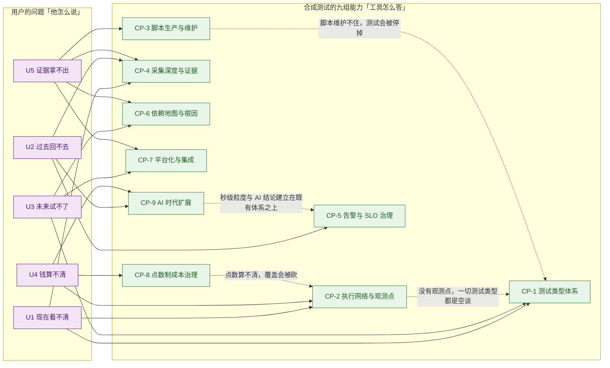

> 虚线 = **前置依赖**：**先有「观测点」，测试类型才有意义**；**先有「脚本可维护」，测试才不会被停掉**；**先有「点数可算」，覆盖才守得住**。三条虚线对应本报告最常被忽视的三条结论（见附二）。

### 1.3.4 用之前 vs 用之后（同一批问题的对照）

| 用户会问 | 用之前（没有合成测试） | 用之后（有合成测试） | 对应功能（小功能点） |
|---|---|---|---|
| 用户现在能不能用？ | 从机房/云上看，一切正常；等投诉 | 从 353 城市、108 国家、不同 ISP 与运营商出发主动问 | CP-2（2.1–2.5）+ CP-1（1.1） |
| 慢在哪一段？ | 只有「总耗时 8 秒」这一个数 | DNS / Connect / SSL / Wait / Load 逐段拆开 + 请求级瀑布 | CP-4（4.1–4.2） |
| 昨天下午那一下是什么？ | 现场已恢复，只剩一条平的曲线 | 5 秒粒度的采样记录 + 胶片 + 截图 + 可下载的瀑布 JPEG | CP-9（9.1–9.2）+ CP-4（4.3 / 4.13） |
| 凌晨没人访问时坏了吗？ | 零流量 = 零观测，静默 | 合成测试不依赖流量，零访问时段照跑 | CP-1（1.1 / 1.5） |
| 改这一版会不会变慢？ | 上线后才知道 | 同一套测点先在预发/生产并行跑，性能预算进流水线 | CP-7（7.8）+ CP-1（1.5 / 1.9） |
| 换哪家 CDN 更快？ | 听两边各自的宣传 | Private Benchmarks 用真实用户设备横向对比 CDN 与源站 | CP-6（6.13） |
| 监控要买多少才够？ | 拍一个数，一年后再说 | 消耗公式 + 事前 Point Estimation + 分配健康度 | CP-8（8.4 / 8.6） |
| 到底是谁的问题？ | 开会各说各话，看供应商 status page | Stack Map + Sonar + AI RCA 给出「最可能的根因」 | CP-6（6.1–6.4） |
| 拿什么对外举证？ | 截图 + 口头描述 | 带节点的原始数据 + 瀑布图 JPEG + Webhook 出流到客户自己的数据湖 | CP-4（4.2 / 4.13）+ CP-7（7.7） |
| 跨域问题算谁的责任？ | 各段互相推 | 依赖地图上的共同视图 + 第三方基准数据 | CP-6（6.1 / 6.3） |

### 1.3.5 小结：U 与 P 的关系（读后文前必看）

- **U1–U5 是工具级问题**（5 条）：客户对**整个工具**的诉求，用来判断「这个工具值不值得买」。
- **P1–Pn 是功能级问题**（各章合计 **45 条**）：在**具体某个能力**上被感知到的损失，用来判断「这个功能做得对不对」。
- 二者是**上位归并**关系——同一条客户损失，会同时在多个功能点上被感知到（例如「拿不出证据」会同时出现在 CP-2 的 P4、CP-4 的 P4、CP-6 的 P1、CP-7 的 P4），故不做一对一。

| 工具级问题 | 归并自哪些功能级痛点 |
|---|---|
| U1 现在看不清 | CP-1 P1–P2；CP-2 P1–P3；CP-4 P1；CP-6 P5 |
| U2 过去回不去 | CP-1 P3；CP-4 P2；CP-5 P1、P3、P5；CP-9 P3 |
| U3 未来试不了 | CP-1 P4；CP-3 P2；CP-6 P4；CP-7 P1、P3 |
| U4 钱算不清 | CP-2 P5；CP-8 P1–P5；CP-9 P3 |
| U5 证据拿不出 | CP-2 P4；CP-3 P4；CP-4 P4；CP-5 P2、P4；CP-6 P1–P3；CP-7 P4 |

> **反向自查（对自研最有用的一条）**：如果一个「合成测试 / 主动拨测」项目说不清「现在 / 过去 / 未来 / 成本 / 证据」这五问各自对应哪个消费场景，那它大概率会退化成**一组跑在固定几台机器上的定时脚本**——既不能在故障时被信任，也无法在预算评审时被辩护。**先有问法，再有功能。**

---

## 1.4 读法：9 个大功能点全景

| # | 大功能点 | 口号 | 小功能点数 | 时间跨度 | 面向谁 |
|---|---|---|---|---|---|
| **1** | 测试类型体系：从端口连通到业务闭环 | **测得全** | 21 | 2023-01 ~ 2026-09 | NOC / 应用负责人 / SRE |
| **2** | 执行网络与观测点：把探针放到用户身边 | **站得外** | 12 | 2023-01 ~ 2026-09 | NOC / 数字体验负责人 / 供应商管理 |
| **3** | 脚本生产与维护：从会写代码到会点鼠标 | **写得快** | 13 | 2023 ~ 2026-08 | 业务/运营角色 + 工程师 |
| **4** | 采集深度与证据留存：从一条曲线到一次交易的全息还原 | **挖得深** | 14 | 2023 ~ 2026-09 | 排障 / 跨团队举证 |
| **5** | 告警与 SLO 治理：从「响了」到「该不该响」 | **报得准** | 13 | 2023 ~ 2026-09 | 值班 / SRE / SLA 责任人 |
| **6** | 依赖地图与根因：从「是我们还是别人」到「是谁这一段」 | **判得清** | 13 | 2023-10 ~ 2026-09 | NOC / 供应商管理 / 跨域团队 |
| **7** | 平台化与集成：Monitoring as Code 与数据出流 | **接得上** | 14 | 2023 ~ 2026-09 | 平台工程 / 安全与合规 / 数据团队 |
| **8** | 点数制成本治理与商业模式 | **买得值** | 9 | 2023 ~ 2026-06 | 预算责任人 / 平台负责人 |
| **9** | AI 时代的合成测试扩展 | **跟得上** | 10 | 2023-10 ~ 2026-09 | SRE / AI 平台团队 / AI 助手开发者 |

> **合计 119 个小功能点**（21 + 12 + 13 + 14 + 13 + 13 + 14 + 9 + 10）。 其中第 2 组（观测点）与第 1 组（测试类型）是本次调研中**唯一不可被软件复制**的部分——第 1 组的协议类型四年间被全行业补齐，而第 2 组的分布**买不到**；第 3–4 组是日常真正踩坑最多的地方（Selenium 退役、脚本维护成本就藏在这里）；第 5–6 组回答「故障来了怎么判断」，**与自研 APM 的 AI 助手方向最直接可比**；第 7 组回答「能不能被规模化托管与举证」；**第 8 组回答「谁付钱、按什么付」，是唯一能解释「为什么客户会主动降频」的一组**；第 9 组是**最新、变化最快**的一组，全部集中在 2025-07 之后。

**边界速查（一页版）**——每组能力的「一条最要命的边界」：

| # | 大功能点 | **最要命的一条边界** | 边界性质 |
|---|---|---|---|
| 1 | 测试类型体系 | **测试类型多 ≠ 在任意节点上都可用**：Streaming 仅 Enterprise 节点、Heartbeat 限 HTTP/API 且仅 Enterprise + 部分 Cloud；单次运行还有 30 秒 / 5 次重定向 / 引用主机数等硬上限 | 硬边界（规格 + 节点约束） |
| 2 | 执行网络与观测点 | 官方「3,109 agents」**含 1,672 个只做路由采集的 BGP Peer**；真正可执行合成测试的公共节点约 **1,437 个** | 硬边界（口径 + 数据源） |
| 3 | 脚本生产与维护 | **No-Code 是一道单向门**：可导出为 Playwright，**不能反向退回**；Selenium 型 Transaction 测试 **2026-08-31 已停止工作** | 硬边界（产品语义）+ 时效边界 |
| 4 | 采集深度与证据留存 | **化简层（Experience Score / Trend Shift）是黑箱**，算法未公开，**不能当 SLA 依据**；留存期是套餐约束（60 天 / 13 个月 / 3 年） | 软边界（未披露）+ 商业边界 |
| 5 | 告警与 SLO 治理 | **降噪来自「条件表达能力」，不是自动抑制**；父子层级之间**不会自动去重**，层级设计不当会成倍放大告警量 | 硬边界（配置责任在客户） |
| 6 | 依赖地图与根因 | **地图完整性取决于依赖是否被登记**——未被登记的服务不会自动出现；AI RCA 输出是「最可能的根因」，**无第三方准确率验证** | 硬边界（前提依赖）+ 软边界 |
| 7 | 平台化与集成 | 非分析型 REST API 自 **2026-10-28** 起有**固定、不可提升**的限额；Terraform Provider **2.0.0 为破坏性更新** | 硬边界（配额）+ 时效边界 |
| 8 | 点数制成本治理 | **降本的两个手段（降频、减节点）与检出能力直接冲突**；企业版价格完全不公开，C 级聚合站区间相互矛盾 | 硬边界（商业模型） |
| 9 | AI 时代扩展 | **AI 能力多为预览态**（MCP Server / AI support agent / SSO Access Scope 均为 preview）；合成提示词监控的**判定方法未公开** | 软边界（成熟度 + 未披露） |

> 每组完整边界（**硬边界 / 软边界 / 前提依赖 / 官方自认局限 / 常见误期待 / 对自研提示**六个维度）见各章 **N.5 能力边界**一节。

> **编号约定**：每个大功能点内部独立编号——**N.2 的痛点为 P1…Pn，N.3 的解法为 S1…Sn，两者数量与语义严格一一对应**，S 行内以「→ 解 Pn」显式回指。本报告不含悬空痛点或悬空解法。

**一张图看懂合成测试的构造**：

```mermaid
flowchart LR
    subgraph SRC["数据来源「从哪问」"]
        A1["Backbone 骨干 998<br/>直连一级运营商"]
        A2["Last Mile 末公里 127<br/>家用宽带 ISP 解析"]
        A3["Wireless 无线 46<br/>3G/4G 与 MEC"]
        A4["Cloud 云内 266<br/>9 家 hyperscaler"]
        A5["Enterprise 企业节点<br/>客户自持 防火墙内"]
        A6["Endpoint 员工设备"]
        A7["BGP Peers 1672<br/>仅路由可见性"]
    end

    subgraph CORE["执行与内核「怎么问」"]
        B1["测试类型 × Monitor<br/>Web / API / 事务 / 协议 / 流媒体"]
        B2["真实浏览器引擎<br/>Chrome / Edge / Playwright"]
        B3["运行结果语义化<br/>分段 / 瀑布 / 胶片 / 断言"]
        B4["合成测试与业务依赖绑定<br/>Stack Map + Sonar 关联"]
    end

    subgraph USE["消费面「答案给谁」"]
        C1["1 测试类型与结果"]
        C2["4 深度分析与证据"]
        C3["5 告警与 SLO"]
        C4["6 依赖与根因"]
        C5["7 API / Webhook / IaC 出流"]
        C6["9 AI 助手与 MCP 工具"]
    end

    SRC --> CORE
    B1 --> B2 --> B3
    B3 --> B4
    B4 --> USE

    classDef src fill:#E3F2FD,stroke:#1565C0,color:#0D47A1
    classDef core fill:#FFF3E0,stroke:#EF6C00,color:#E65100
    classDef use fill:#E8F5E9,stroke:#2E7D32,color:#1B5E20
    class A1,A2,A3,A4,A5,A6,A7 src
    class B1,B2,B3,B4 core
    class C1,C2,C3,C4,C5,C6 use
```

> **图 0｜合成测试的总构造。** 左侧「从哪问」决定**可信度上限**（其中 A7 只提供路由可见性，不执行合成测试）；中间「怎么问」决定**问题的表达力**；右侧「答案给谁」决定**这份数据最终有没有产生动作**。**竞品之间最容易趋同的是中间一层，最难复制的是最左一层。**

---

# 2 大功能点 1：测试类型体系 —— 测得全

把「这个系统还活着吗」升级为「**用户能不能把这件事做成**」——用四层探针（端口 → 接口 → 页面 → 业务闭环）覆盖从传输层到业务语义的全部断点，替代只探 HTTP 首页的可用性监控。

## 2.1 小功能点清单

| # | 小功能点 | 发布时间 | 信源等级 | 说明 |
|---|---|---|---|---|
| 1.1 | **Web Test（六种 Monitor）** | 2023 起（早期地基） | **A**（[Synthetic Test Types](https://docs.catchpoint.com/docs/synthetic-test-types)） | 单页可用性与性能检查，同一测试类型下可选 **Object**（只加载主 URL，不加载页面组件）、**Emulated**（模拟浏览器、加载全部组件但不执行 JS/CSS）、**Playback**（回放当日浏览器抓取的请求或 HAR 文件）、**Mobile Playback**、**Mobile**、**Chrome**（真实 Chrome，执行 JS 与 CSS）六种 monitor——**Monitor 决定「怎么执行」，是关键的成本与能力开关** |
| 1.2 | **HTML Code Test** | — | **A**（同上） | 「examines and executes a block of HTML without having to connect to a web server to retrieve it」——**上线前先测 HTML 片段**，无需服务器 |
| 1.3 | **API Test（单步）** | — | **A**（[API Test](https://docs.catchpoint.com/docs/api-test)） | 调用一次的 REST API 检查，捕获 XML / JSON 响应与性能指标 |
| 1.4 | **API 多步链式调用** | 2026 起强化 | **A**（[Aurora / Terraform 文档](https://docs.catchpoint.com/docs/terraform-provider)） | 把多次 API 调用串成一条业务链，支持步骤间传值与 OAuth 令牌复用 |
| 1.5 | **Transaction Test（legacy，Selenium）** | — | **A**（[Transaction Test (legacy)](https://docs.catchpoint.com/docs/en/transaction-test)） | 多步浏览器事务；**该测试类型已于 2026-08-31 退役**（见 3.9） |
| 1.6 | **Playwright Test** | 约 2023 起 | **A**（[Playwright Test 与 Release Notes](https://docs.catchpoint.com/docs/playwright-test)） | 「offers Edge and Chrome monitors」；后续补齐 **Mobile（2025-10）**、**iFrame（2026-09，Agent 2.18.0）**、客户端证书支持 |
| 1.7 | **Puppeteer Test** | 约 2023 起 | **A**（同上） | 与 Playwright 并列的第二条现代脚本路径，「supports Chrome」 |
| 1.8 | **No-Code Transaction Test** | **2026-06（Miranda）** | **A**（[Miranda Release Notes](https://docs.catchpoint.com/docs/2026-06-miranda-release-notes)） | 浏览器扩展录制用户流程 → 自动转为事务指令 + 内置 WYSIWYG 编辑器 + 可导出 Playwright（详见第 4 章） |
| 1.9 | **WebPageTest（Instant / Scheduled / Bulk）** | 2020-09 并入 | **A / B**（[Pricing FAQ](https://www.catchpoint.com/pricing)） | 「examines a webpage and supports advanced analytics options including Lighthouse scores, run comparisons, and device emulation」；2026-03 起 Instant Test 支持**批量测试**，2026-08 起定时测试全生命周期走 REST API |
| 1.10 | **DNS Test（双视角）** | 约 2023 起 | **A**（[DNS Test](https://docs.catchpoint.com/docs/dns-test)） | 「You can target a specific server, or you can more closely simulate the experience of an end user by allowing DNS to dynamically select a server for each request」——**直查权威服务器**与**模拟递归解析器**两种视角可分别配置 |
| 1.11 | **Web Socket Test** | — | **A**（[Synthetic Test Types](https://docs.catchpoint.com/docs/synthetic-test-types)） | 「establishing a connection, sending data, asserting the server response, and creating custom metrics based on the response」——可**对服务端响应做断言**，面向聊天、行情、游戏类长连接 |
| 1.12 | **SSL Test** | — | **A**（[SSL Test](https://docs.catchpoint.com/docs/ssl-test)） | 「performs certificate and public key pinning with a single certificate, and can alert on various metrics, including the number of days until the certificate expires」 |
| 1.13 | **Transport Test（TCP / 端口）** | — | **A**（[Synthetic Test Types](https://docs.catchpoint.com/docs/synthetic-test-types)） | 「Use this for basic network monitoring as opposed to higher-level application monitoring」 |
| 1.14 | **Ping Test（ICMP / TCP / UDP）** | — | **A**（同上） | 「Ping tests can use TCP, ICMP, or UDP protocol」 |
| 1.15 | **Traceroute Test（五种 Monitor）** | 约 2023 起 | **A**（[Traceroute Test](https://docs.catchpoint.com/docs/traceroute-test)） | 「multiple monitor options… including InSession, TCP, ICMP, UDP, and QUIC」；2023-10 起支持 **ECN 拥塞检测**，2025-07 起 Traceroute Smartboard 支持 **MPLS 标签过滤**，2026-04 起 Explorer 支持 ECN 过滤 |
| 1.16 | **BGP Test** | 约 2023 起 | **A**（[BGP Test](https://docs.catchpoint.com/docs/bgp-test)） | 「monitor your announced prefixes (eBGP) from hundreds of autonomous system (AS) peers, which share their full BGP tables with Catchpoint monitoring nodes located around the world」 |
| 1.17 | **协议族测试：FTP / SMTP / IMAP / NTP / SSH / MQTT** | 逐年补齐 | **A**（[Synthetic Test Types](https://docs.catchpoint.com/docs/synthetic-test-types)） | **MQTT Test** 面向 IoT 设备可用性与性能；**2026-09（Agent 2.18.0）「New MQTT monitor based on latest standards and libraries」** |
| 1.18 | **Streaming Test（HLS / DASH / MP4）** | **2026-06（Miranda）** | **A**（[Streaming Test](https://docs.catchpoint.com/docs/streaming-test)） | 「Running within a real Chromium browser environment, the test measures the playback experience from the moment a video source is assigned to the player」；输出 **Initial Buffer / Play Time / Total Buffer Time / Buffer Counter**；**仅 Enterprise 节点** |
| 1.19 | **Heartbeat Test** | **2025-10（Halo）** | **A**（[Heartbeat Test](https://docs.catchpoint.com/docs/heartbeat-test)、[Halo Release Notes](https://docs.catchpoint.com/docs/2025-10-halo-release-notes)） | 「run as frequently as every five seconds」；**supports HTTP and API Script monitors, and can be run from Enterprise and select Cloud nodes** |
| 1.20 | **Node-to-Node Test（≤100 节点）** | **2025-10（Halo）** | **A**（[Node-to-Node Test](https://docs.catchpoint.com/docs/node-to-node-test)） | 「set up a mesh of Tests among your Enterprise Nodes」，可用 traceroute 或 ping；2025-10 起支持 **100 节点全互联矩阵**；2026-08 起支持**自定义阈值**（静态值 + 相对基线的百分比变化） |
| 1.21 | **Custom Test** | — | **A**（[Synthetic Test Types](https://docs.catchpoint.com/docs/synthetic-test-types)） | 「enables you to test any type of system using your own custom code running on an Enterprise Node」——**官方明示的能力兜底口**，用于覆盖既有类型未涵盖的内部系统 |

> **口径归一说明**：官方帮助文档列举的测试类型与本报告 1.1–1.21 的划分并非一一对应——本文把「Web Test 的六种 Monitor」合并为 1.1、把「协议族」合并为 1.17，是为了让**能力颗粒度**与「客户会为哪一件事付钱」对齐。**官方口径的完整枚举以 [Synthetic Test Types](https://docs.catchpoint.com/docs/synthetic-test-types) 页为准。**
> **必须同时记住的限制**：官方在通用指标定义中写明 `# Test Limit Errors` 覆盖四种「系统边界」——**单次运行超过 30 秒、某 URL 连续重定向超过 5 次、引用超过 2,000 个 URL、引用超过 255 个不同主机**（[Catchpoint Metrics](https://docs.catchpoint.com/docs/catchpoint-metrics)）。**「用一条测试覆盖整个站点」在结构上不可能。**

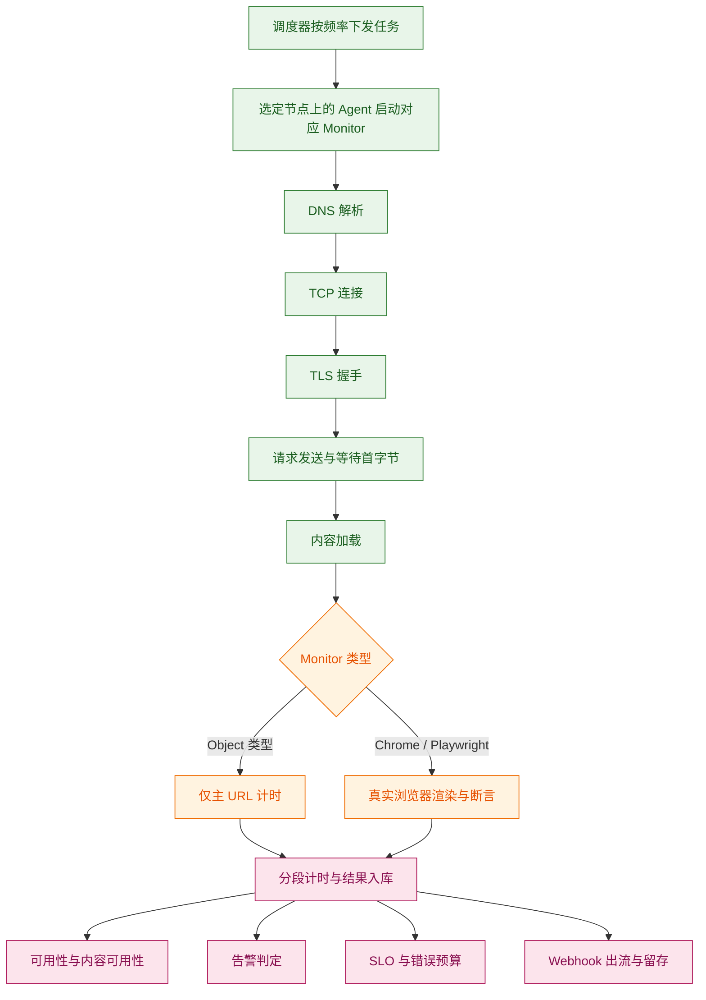

**图 1｜一次合成测试的执行链路（CP-1 的实现骨架）。** 关键在于 **C6 这个分叉**：同一个「Web 测试」名下，Monitor 选 Object 只得到传输层与页面级耗时，**选 Chrome / Playwright 才会真正渲染、执行 JavaScript，并给出 LCP / CLS 这类渲染指标**。**这正是「同一批功能、不同价格档」的根源**——Monitor 是能力开关，也是成本开关。

```mermaid
flowchart LR
    subgraph L1["第一层 端口与传输"]
        T11["Ping ICMP/TCP/UDP"]
        T12["Transport TCP 端口"]
        T13["FTP SMTP IMAP NTP SSH"]
        T14["MQTT Web Socket"]
    end
    subgraph L2["第二层 接口与安全"]
        T21["API 单步"]
        T22["API 多步链式 + OAuth"]
        T23["SSL 证书与固定"]
        T24["DNS 直查与体验双视角"]
    end
    subgraph L3["第三层 页面与路径"]
        T31["Web Object 单页"]
        T32["HTML Code 片段"]
        T33["WebPageTest 与 Lighthouse"]
        T34["BGP 与 Traceroute 与 ECN"]
    end
    subgraph L4["第四层 业务闭环"]
        T41["Transaction 与 Playwright"]
        T42["No-Code 录制事务"]
        T43["Streaming HLS/DASH/MP4"]
        T44["Heartbeat 5 秒 与 Node-to-Node"]
    end
    L1 --> L2 --> L3 --> L4

    classDef l1 fill:#E3F2FD,stroke:#1565C0,color:#0D47A1
    classDef l4 fill:#FCE4EC,stroke:#AD1457,color:#880E4F
    class T11,T12,T13,T14,T21,T22,T23,T24,T31,T32,T33,T34 l1
    class T41,T42,T43,T44 l4
```

**图 2｜测试类型的四层收敛。** 越往右，「断言」的能力越强、成本越高、也越容易因页面改版或第三方变更而失效。**这层递进关系是排查效率的来源**：报错时先在左侧排除（端口通不通、DNS 解析对不对、证书过没过期），再往右侧定位（接口返回什么、页面能不能走完）。**左侧一排是把右侧的误判剔掉的工具——少了左侧，右侧的报错会变成一周的争论。**

## 2.2 它对应的用户痛点

> **口径**：本节只写客户侧可感知的痛（时间 / 钱 / 人 / 合规 / 组织），不写「协议栈覆盖不全」「Monitor 与 Test Type 不一一对应」这类架构层问题。痛点编号 P1…Pn 与下节解法 S1…Sn **一一对应**。

- **P1（时间 / 钱）——「『通了』不等于『能用』」**。端口开着、Ping 通、首页返回 200，但用户登不进去、下不了单、支付回调丢单。监控大盘是绿的，投诉电话已经打进来——**运维要为此承担一个自己看不见的责任**。
- **P2（组织 / 时间）——「故障发生在别人的地盘，自己却是最后一个知道的」**。DNS 服务商、CDN、云区域、第三方支付或登录 API 一挂，客户先骂的是自己；而这部分恰恰是传统 APM 与基础设施监控的观测盲区——**你无法用自己的系统去观测你没控制的那半条路**。
- **P3（钱 / 合规）——「本可预知的确定性事故仍在生产上炸」**。SSL 证书到期、DNS 记录被误改、域名被劫持——这些都有确定的前兆，却总在生效那一刻才被发现，事后只能写「加强管理」的复盘。
- **P4（钱 / 时间）——「业务已经跑在新协议与新形态上，监控却停在 HTTP 首页」**。视频起播慢、播放中反复缓冲、WebSocket 断连重连、MQTT 设备掉线、TCP 端口通但业务不可用——**运维手上没有可看的指标，只能对业务方说「我们这边正常」**。
- **P5（钱 / 时间）——「『慢』和『坏』是两种事故，但工具只报其中一种」**。响应码 200、页面也能打开，内容却少了一块（第三方 JS 被墙、图片 CDN 挂了、样式表 404）。**可用性 100%，功能已经残废——这类事故在报表上完全隐身**，而它造成的用户流失与「宕机」一样真实。

## 2.3 它是如何解决的（与痛点一一对应）

**架构约束（由痛点倒推）**

| 架构约束 | 由哪条痛点倒推 | 落到了哪些小功能点 |
|---|---|---|
| 必须存在「真实浏览器 + 真实用户路径」的执行形态，否则测不到业务是否完成 | P1 | Transaction（1.5）、Playwright（1.6）、Puppeteer（1.7）、No-Code（1.8）、WebPageTest（1.9） |
| 必须把「路径上的第三方」也变成一等受测对象，且能独立于供应商自述来验证 | P2 | DNS 双视角（1.10）、SSL（1.12）、BGP（1.16）、Transport（1.13）、Traceroute（1.15） |
| 必须有「可提前判定」的检查项，把确定性事故前置 | P3 | SSL 有效期与固定校验（1.12）、DNS 应答校验（1.10） |
| 测试类型必须跟着业务实际使用的协议走，而不是跟着 HTTP 走 | P4 | Streaming（1.18）、MQTT / WebSocket（1.17 / 1.11）、Heartbeat（1.19）、Node-to-Node（1.20）、Custom（1.21） |
| 可用性与内容完整性必须分列为两个指标，否则「通而不可用」无法进入报表 | P5 | Web / Object 测试的三项可用性指标（1.1）与 Web Socket 的响应断言（1.11） |

| 解法 | 机制 | 对应痛点 |
|---|---|---|
| **S1 按「业务闭环」而非「协议端口」定义测试类型** | 提供从端口（Ping / Transport）→ 接口（API 单步）→ 链式接口（API 多步）→ 页面（Web → WebPageTest）→ 交易（Transaction / Playwright / No-Code）的**四层探针**。真实浏览器型测试会真正渲染页面、执行 JavaScript、点击、填表、提交，因此它回答的是「**用户能否完成这件事**」，而不是「服务器是否应答」——**这是与纯端口 / Uptime 工具最本质的分界** | → 解 P1 |
| **S2 把第三方依赖变成可被独立举证的测试对象** | 用 DNS（直查 / 体验双视角）、SSL、BGP、Transport、Traceroute 对「自己控制不了的那半条路」单独发问。**当问题出在供应商一侧时，客户手里有自己采集的、带时间戳与节点维度的证据，而不是供应商的状态页截图**——这一点直接决定「谁道歉、谁整改」 | → 解 P2 |
| **S3 把「必然会发生」的事故前置成例行检查** | **SSL Test** 校验证书链、有效期与主机名匹配，官方明确「can alert on… the number of days until the certificate expires」；**DNS Test** 可指定权威服务器直查并校验应答内容。两者都是「零流量的确定性检查」，成本极低而收益清晰 | → 解 P3 |
| **S4 让测试类型跟着业务实际使用的协议走** | **Streaming Test（2026-06）** 在真实 Chromium 内测量 HLS / DASH / MP4 的起播延迟与缓冲行为；**MQTT（2026-09 按最新标准与库重写）** 面向 IoT 与设备侧；**Node-to-Node（2025-10）** 把「这张网内部两点之间好不好」从人工抽查变成持续矩阵；**Heartbeat** 覆盖亚分钟中断；**Custom Test** 作为官方兜底口覆盖内部私有系统 | → 解 P4 |
| **S5 把「可用性」与「内容完整性」拆成两个指标** | Web / Object 测试同时输出 `% Availability`（= `(# Test Runs − # Test Errors) / # Test Runs`，主 URL 是否被成功触达）、`% Content Availability`（**只要有一个对象加载失败，本次运行即被计为内容不可用**）、`% Adjusted Availability`（剔除人工 Purged Runs 后的可用性，用于 SLA 口径）。**客户口中「可用性 100% 但功能坏了」这句话，在这里第一次有了一个可以被写进报表的数** | → 解 P5 |

> **边界**：
> - **测试类型多 ≠ 在任意节点上都可用。** 官方明确：Streaming Test **仅 Enterprise 节点**；Heartbeat 限 HTTP / API 且**仅 Enterprise + 部分 Cloud 节点**；**IE monitor 已于 2026-01 弃用**；**Selenium 型 Transaction 测试已于 2026-08-31 停止工作**。
> - **「第四方」的覆盖有明确上限。** BGP 的实时性依赖「Catchpoint 自有 BGP 采集与对等 **+** RouteViews / RIPE RIS 公开数据」的组合（[Global Observability Network](https://www.catchpoint.com/global-observability-network)），**未被任何采集点覆盖的路由事件依然看不见**；DNS 结果只代表「从该节点出发的那条解析分支」，不代表全网。
> - **单条测试有硬规模边界**：> 30 秒、连续重定向 > 5 次、引用 URL > 2,000、引用主机 > 255 即触发 `Test Limit Errors`。**这四项属于「工程约束」，同时也是「为什么必须拆多条测试」的答案**（成本与复杂度由此上升，回指 CP-8）。
> - **`% Content Availability` 不等同于「功能正确」。** 它衡量的是「元素是否加载」，不衡量「业务逻辑是否正确」；后者要靠 API 断言、Web Socket 响应断言、Custom Test 脚本或第 10 章的合成提示词监控。
>
> **配套演进**：Web Test 的 Monitor 集合扩张、Traceroute 的 Monitor 扩容等属执行引擎的能力扩展，不单独回应客户痛点，已并入 1.1 / 1.15 列示。

## 2.4 功能原理

> 本节按**输入 → 实现链条 → 输出**三段展开（与第 3～10 章同构），末尾附口径声明（哪些是官方口径、哪些是本报告推导）。

### 2.4.1 输入：一次合成测试吃进去什么

| 输入 | 具体内容 | 官方依据（含原文链接，标 A/B/C） | 缺了它会怎样 |
|---|---|---|---|
| **I1 · 测试定义** | 测试类型 + Monitor + 目标 URL / 域名 / 前缀 / 端口 + 断言规则 + 频率 + 目标节点集 | **A 级** · [Creating Tests](https://docs.catchpoint.com/docs/creating-tests)、[Synthetic Test Types](https://docs.catchpoint.com/docs/synthetic-test-types) | 没有测试定义就没有任何请求会发出——**这是整套机制的起点** |
| **I2 · 执行节点** | 被选中的 Node（Backbone / Last Mile / Wireless / Cloud / Enterprise / Endpoint）及其上的 Agent 版本 | **A 级** · [Nodes Overview](https://docs.catchpoint.com/nodes-overview)；Agent 版本与功能强耦合见各月 Release Notes 的「dependent on Agent release」提示 | 没有节点就没有「从哪问」；**节点上的 Agent 版本不足时，新 Monitor 与新技术类型直接不可用** |
| **I3 · 真实浏览器与脚本引擎** | Chrome / Edge（2026-09 为 151 版）、Playwright、Puppeteer 及其版本 | **A 级** · [Mimas Agent Release 2.18.0](https://docs.catchpoint.com/docs/mimas-agent-release)（`cpchrome: 151.0.7922.169`、`cpedge: 151.0.4129.93`） | 只剩 Object / Emulated 型测试，**所有渲染指标（LCP / CLS / TBT）与事务断言全部丧失** |
| **I4 · 凭据与断言所需的秘密** | Token / Password / Certificate（集中托管，带 Active / Inactive 状态） | **A 级** · [Halo Release Notes](https://docs.catchpoint.com/docs/2025-10-halo-release-notes)（「If a credential is in an inactive state and is assigned to a test, the test will not run」） | 登录后的业务无法测试；**核心业务恰恰全在登录之后** |
| **I5 · 业务语义期望值** | 期望响应码 / 响应体字段 / 元素可见性 / 内容长度 / 证书剩余天数 | **A 级** · [API Test](https://docs.catchpoint.com/docs/api-test)、[Miranda Release Notes](https://docs.catchpoint.com/docs/2026-06-miranda-release-notes)（No-Code 断言）、[SSL Test](https://docs.catchpoint.com/docs/ssl-test) | 只能回答「有没有响应」，回答不了「响应对不对」——**退化为 uptime 探针** |

### 2.4.2 实现链条：从一条测试定义到一组可用性数字

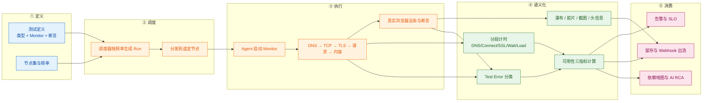

| 步骤 | 做什么 | 关键输入 | 输出 |
|---|---|---|---|
| **① 定义** | 选定测试类型与 Monitor、写断言、定频率与节点集 | I1 / I2 | 一条可执行的测试定义 |
| **② 调度** | 调度器按频率生成 Run，分发给选定节点 | 测试定义 + 节点可用容量 | 待执行的 Run 队列 |
| **③ 执行** | Agent 在节点上按协议栈逐段推进；浏览器型 Monitor 额外做渲染与断言 | I3 / I4 / I5 | 一次运行的原始结果 |
| **④ 语义化** | 把原始结果转成**分段耗时**（DNS / Connect / SSL / Wait / Load / Size）、**请求级瀑布**、**影像证据**，并把失败归入 `# DNS Failures` / `# Connection Failures` / `# SSL Failures` / `# Response Failures` / `# Timeout Failures` / `# Test Limit Errors` 六类，最终算出可用性三指标 | 原始结果 | 指标 + 证据 + 错误分类 |
| **⑤ 消费** | 同一次运行分叉喂给四个下游：告警、SLO、留存与出流、依赖地图与 AI RCA | 指标 + 证据 | 四类下游对象 |

> **这一步必须点明**：官方指标定义把 `# Test Errors` 明确定义为六类失败之和（[Catchpoint Metrics](https://docs.catchpoint.com/docs/catchpoint-metrics)）。**这个「六类错误」的枚举本身就是产品的一部分**——它决定了「慢在哪一段」这句话能不能被机器自动归类，而不是留给人去猜。

### 2.4.3 输出：交付什么形态的结果

| 输出物 | 形态 | 消费方 | 对应小功能点 |
|---|---|---|---|
| 可用性三指标 | `% Availability` / `% Content Availability` / `% Adjusted Availability` | NOC / SLA 责任人 | 1.1 |
| 分段耗时与总耗时 | DNS / Connect / SSL / Wait / Load / Size + `Test Time` | 排障 / 性能优化 | 1.1、1.9（详见 4.1） |
| 请求级瀑布与影像 | Waterfall / Filmstrip / 截图 / 日志 | 跨团队举证 | 1.6、1.9（详见 4.2 / 4.3） |
| 断言结果 | 通过 / 失败 + 失败元素清单 | 应用研发 / 测试 | 1.3、1.4、1.8、1.11、1.21 |
| 逐节点结果 | 带城市 / 国家 / ISP / ASN / 网络类型维度的运行记录 | 数字体验负责人 / 供应商管理 | 1.1（详见 3.x） |
| **「运行 → 指标 + 证据」的标准化数据流** | **不是 UI 产物，而是内部接口** | 告警引擎（CP-5）、SLO 引擎（CP-5）、Stack Map 与 AI RCA（CP-6）、Webhook / API（CP-7）、MCP 工具（CP-9） | —（测试执行内核本身） |

> **注意最后一行**：CP-1 最重要的输出**不是那张瀑布图，而是那条「标准化后的运行记录」**。图是给人看的；这条记录是给其余八个能力用的——**这正是「测试类型是入口、不是产品」在实现层的体现**。

### 2.4.4 关键机制：为什么必须是「真实浏览器 + 断言」，而不是「HTTP 200 探测」

官方对 Web Test 的 Monitor 分级写得非常克制，但信息量很大（[Synthetic Test Types](https://docs.catchpoint.com/docs/synthetic-test-types)）：

| Monitor | 官方原文 | 它能回答 | 它不能回答 |
|---|---|---|---|
| **Object** | 「loads the primary URL but no page components. This is best for simply confirming the availability of a web page and its initial responsiveness」 | 主 URL 通不通、响应快不快 | 页面能不能用、内容齐不齐 |
| **Emulated** | 「imitates a browser and loads URL and all components, **but does not execute Javascript or CSS**」 | 内容是否完整加载 | JS 执行后的功能是否正常 |
| **Chrome / Playwright** | 「Uses the Chrome browser to load URL and all components and **execute Javascript and CSS**」 | 用户能不能把这件事做成 | 设备内部行为（这本来也不属于本工具） |

**为什么必须这么设计**：因为**成本与保真度必须能被分档**。同一句「网站还好吗」，用 Object 问一次与用 Playwright 问一次，**在点数和基础设施要求上差一个量级**（Object 可在任意节点跑，Streaming / Heartbeat 这类重载能力被官方限定在 Enterprise 节点）。**这条分级是整个 CP-8（买得值）的地基**——没有它，客户只能在「很贵」和「没用」之间二选一。

**第二个关键机制：`% Content Availability` 的定义方式（本报告认为这是 CP-1 里最有迁移价值的一条）**

官方定义（**A 级**原文）：`% Content Availability` = 「the number of times the test ran successfully with no loading errors, divided by the total number of times the test ran. **If at least one object failed to load during testing, that test run is regarded as having content that failed to load properly.**」（[Catchpoint Metrics](https://docs.catchpoint.com/docs/catchpoint-metrics)）

**为什么必须这么设计**：因为「可用性」这个词在客户口中与在监控口径里不是同一件事。客户说「可用性 100% 但功能坏了」，指的是**页面少了一块内容**（第三方 JS 被墙、CDN 上某个资源 404）。若把它当作可用性的一部分去平均，这些事故会被稀释掉；若按「**任一对象失败即整次运行判负**」的严格口径统计，它才会显著浮出水面。**代价是：这个指标天然比 `% Availability` 低**——所以官方同时提供 `% Adjusted Availability`（剔除人工 Purged Runs）用于对外 SLA 口径。**「对内严格口径、对外可调整口径」这一对指标的存在，本身就是「同一份数据要同时服务排障与法务」的产物。**

### 2.4.5 口径声明

| 内容 | 等级 | 说明 |
|---|---|---|
| 测试类型清单与各 Monitor 的定义原文 | **A** | [Synthetic Test Types](https://docs.catchpoint.com/docs/synthetic-test-types) |
| 可用性三指标与六类 Test Errors 的定义与公式 | **A** | [Catchpoint Metrics](https://docs.catchpoint.com/docs/catchpoint-metrics) |
| 单次运行的 30 秒 / 5 次重定向 / 2,000 URL / 255 主机四项边界 | **A** | 同上（**注意**：legacy [Transaction Test 页](https://docs.catchpoint.com/docs/en/transaction-test) 仍写 1,000 URL，见 1.1 源冲突提示 2） |
| Streaming 仅 Enterprise 节点、Heartbeat 限 HTTP/API 且仅 Enterprise + 部分 Cloud | **A** | [Streaming Test](https://docs.catchpoint.com/docs/streaming-test)、[Heartbeat Test](https://docs.catchpoint.com/docs/heartbeat-test) |
| 「Monitor 分档是成本与保真度分级的基础」 | **C（本报告推导）** | 依据链：① Object/Emulated/Chrome 的能力边界（A，Synthetic Test Types）→ ② Streaming 与 Heartbeat 被限定在 Enterprise 节点（A，Streaming Test / Heartbeat Test）→ ③ 点数消耗公式含 Monitor Factor（A，[Pricing FAQ](https://www.catchpoint.com/pricing)）→ 结论：官方在产品语义上已经把「执行强度」与「可运行场所 / 成本」绑定 |
| 「六类 Test Errors 的枚举使『慢在哪一段』可被机器归类」 | **C（本报告推导）** | 依据链：① 六类失败的定义（A，Catchpoint Metrics）→ ② 告警触发类型包含 Availability / Content / Byte Length / Page 等按类型区分（A，[Alerts](https://docs.catchpoint.com/docs/alerts)）→ 结论：错误分类是后续自动判定的前提 |

## 2.5 能力边界（这个功能点做不到什么）

> **一句话边界**：这是**一个测试类型的货架**——货架上的东西很全，但**每一件都只在特定节点、特定 Agent 版本、特定规模上限内可用**，且它测的永远是「模拟用户」，不是「真实的那批用户」。

| 类型 | 具体边界 | 依据（信源等级） | 对自研 APM 的提示 |
|---|---|---|---|
| **硬边界 · 节点与 Agent 强耦合** | 新测试类型与新技术能力**大量标注「dependent on Agent release」**：否可用**取决于所选节点上的 Agent 版本**；公共节点按批次灰度，企业节点由客户自行升级 | **A** · [Halo](https://docs.catchpoint.com/docs/2025-10-halo-release-notes)、[Miranda](https://docs.catchpoint.com/docs/2026-06-miranda-release-notes)、[Ganymede](https://docs.catchpoint.com/docs/2026-08-ganymede-release-notes) 各月 Release Notes 的 Agent 段落；灰度公告见 [nodestatus](https://nodestatus.catchpoint.com) | 自研若走「探针 + 服务端」架构，**必须把「探针版本 × 服务端版本」可用性矩阵当成交付物**，而不是把新功能直接写成发布说明——否则现场会出现「功能文档里有、客户环境里没有」 |
| **硬边界 · 单次运行的规模上限** | 单次运行 > 30 秒、某 URL 连续重定向 > 5 次、引用 URL > 2,000、引用主机 > 255，即触发 `Test Limit Errors`，**该次运行被计为失败** | **A** · [Catchpoint Metrics](https://docs.catchpoint.com/docs/catchpoint-metrics) | 自研的「一条测试覆盖一个业务」在工程上不成立；**验收清单里要写「超限必须给出明确错误码，而不是静默失败」** |
| **硬边界 · 节点类型限定能力** | Streaming **仅 Enterprise 节点**；Heartbeat **仅 Enterprise + 部分 Cloud 节点**且只支持 HTTP / API；Node-to-Node 依赖 **Enterprise 节点自身** | **A** · [Streaming Test](https://docs.catchpoint.com/docs/streaming-test)、[Heartbeat Test](https://docs.catchpoint.com/docs/heartbeat-test)、[Node-to-Node Test](https://docs.catchpoint.com/docs/node-to-node-test) | **「能力最强的测试需要客户自己出机器」**——自研把重载能力放在客户侧执行时，必须同时交付**部署与运维方案**，否则能力等于不存在 |
| **软边界 · 官方未披露项** | 官方**未披露**：各 Monitor 的单次运行资源占用、公共节点的单节点并发上限、断言的判定精度与误报率、`% Content Availability` 的容忍阈值是否能配 | —（官方材料无此项） | 这些必须在自研 POC 阶段自测，并在对外材料里用「自测值」而非「宣传值」表述 |
| **前提依赖 · 目标可被外部访问** | 合成测试的前提是**从外部能发起请求**。要走 VPN / 客户端证书 / 白名单的来源限制型系统，必须依赖 Enterprise 节点与客户端证书等凭据机制 | **A** · [Halo](https://docs.catchpoint.com/docs/2025-10-halo-release-notes)（凭据 Active/Inactive 与证书）、[Nodes Overview](https://docs.catchpoint.com/nodes-overview)（Enterprise 节点装在被控网络内） | 园区网/内网场景下，**「探针必须先拿到合法入口」是第一位的前提**，比「测什么」更早排期 |
| **官方自认局限** | 官方在 NEL 段落自述其定位为「**the only solution for detecting end user impacting network issues measured from real user devices**」——即**承认常规 RUM 在真实用户设备上的网络类问题上存在盲区**，而合成测试补的是「网络可达性」而非「真实用户量的统计」 | **A** · [Triton Release Notes](https://docs.catchpoint.com/docs/2026-03-triton-release-notes) | 自研 AI 助手在回答「影响了多少用户」时**不能引用合成测试数据**——它给的是「这个位置/这条线路上成不成立」，不是「多少比例的人受影响」 |
| **常见误期待（澄清）** | ① 用户易以为「支持某协议 = 该协议端到端业务都可验证」——实际多数协议测试只覆盖到**握手与可达性**，业务语义要靠断言；② 易以为「合成测试可替代 RUM」——**它测的是模拟用户，样本是探针而非人**；③ 易以为「测试类型越多越值」——**类型多但节点类型受限时，实际可用集合可能远小于清单** | **A**（官方对 Object / Emulated / Chrome 的能力分级、节点类型限定）+ **C（本报告归纳）** | 对外沟通必须把「**可用测试类型 × 可用节点类型**」做成一张矩阵，避免被错位预期拖入「什么都能测」的承诺 |

---

# 3 大功能点 2：执行网络与观测点 —— 站得外

把探针放到**用户真正所在的地方**（骨干、末公里、无线、云内、企业内网、员工设备），并让监测面与被测面**结构上解耦**——替代「只在机房出口放一个探针，然后拿它代表所有人」的做法。

## 3.1 小功能点清单

| # | 小功能点 | 发布时间 | 信源等级 | 说明 |
|---|---|---|---|---|
| 2.1 | **Backbone Agents（骨干节点）** | 2023 前既有 | **A**（[Nodes Overview](https://docs.catchpoint.com/nodes-overview)） | 官方网络页分项 **998 agents / 310 providers**；「located in Tier 1 Data Centers and connect directly to major internet providers. **The majority of these nodes are single-homed**, meaning that each Node connects to a single provider, **enabling you to isolate performance by ISP**」；本地 DNS 解析器与节点同机房同 ISP |
| 2.2 | **Last Mile Agents（最后一公里）** | 2023 前既有 | **A**（同上 + [Global Observability Network](https://www.catchpoint.com/global-observability-network)） | **127 agents / 74 providers**；「located within end-users' home networks to monitor application performance when connecting via consumer ISPs」；**依赖消费级 ISP 解析 DNS**，反映家庭用户真实解析体验 |
| 2.3 | **Wireless Agents（无线节点）** | 2023 前既有 | **A**（同上） | **46 agents / 15 providers**；「connect to regional 3g and 4g networks, enabling you to isolate mobile users' experiences」；官方网络页另称覆盖**多接入边缘计算（MEC）** |
| 2.4 | **Cloud Agents（云内节点）** | 2023 前既有 | **A**（同上 + [Cloud Nodes FAQ](https://docs.catchpoint.com/docs/cloud-nodes-faq)） | **266 agents / 9 providers**（AWS / Azure / Google / Oracle / Tencent / AliCloud / IBM 等）；**官方主动声明局限**：「they are **not in the direct line of service delivery to end users**… a web service may be hosted in 『the cloud』, but its end-users don't live there」 |
| 2.5 | **BGP Peers** | 2023 前既有 | **A** | **1,672 peers / 485 ASNs**；「Leverage Catchpoint's private network of BGP collectors and peers **in addition to** industry-trusted data from RouteViews and RIPE RIS」——**提供路由可见性，不执行合成测试** |
| 2.6 | **Enterprise Node（三种类型）** | 2023 前既有 | **A**（[Nodes Overview](https://docs.catchpoint.com/nodes-overview)） | 「There are three types - 『Enterprise』, 『Enterprise (pt)』 and 『Enterprise Branch』… **Enterprise Nodes cost a fixed amount (flat rate) per month regardless of the amount or type of usage**；Enterprise (pt) consume points；**Enterprise Branch… allow you to deploy a large volume (500+)** by removing some UI reporting capabilities like breakdown by node in analytics」 |
| 2.7 | **Endpoint Agent（员工设备探针）** | 2023 前既有 | **A / B** | 装在员工设备上采集应用性能、网络连通性与设备健康；**2026-06（Miranda）macOS 版从依赖 Rosetta 改为原生 Universal Binary**（同时支持 Intel 与 Apple Silicon）；**2026-01 新增 Endpoint TCP Traceroute**（在 ICMP 被屏蔽的环境下更可靠） |
| 2.8 | **Connected Devices（街区级轻量代理）** | 2026（官方博客） | **B**（[官方博客](https://catchpoint.com/blog/the-power-of-over-3000-intelligent-observability-agents)） | 「**Connected Devices**—a powerful new layer of observability that brings **hyper-local visibility** into how DNS, CDN, ISP, and other critical services perform at the **street, neighborhood, or city-block level**. By tapping into **tens of millions of lightweight agents on real devices**」——**这是一个与「3,109 agents」不同口径的新层级** |
| 2.9 | **企业节点部署通道扩展** | 2026-06 / 2026-09 | **A**（[Miranda](https://docs.catchpoint.com/docs/2026-06-miranda-release-notes)、[Mimas](https://docs.catchpoint.com/docs/clone-2026-09-mimas-release-notes)） | 2026-06：**Enterprise Node ARM 支持（预览）**，「giving teams more flexibility to run Catchpoint containers across modern infrastructure」；2026-09：**可随 LogicMonitor EA Collector 单步一并部署**（同机 64 位 Linux、健康事件上报 Collector Events 页、Catchpoint 服务异常不影响 Collector 运行） |
| 2.10 | **公共节点容量与调度可见性** | 2026-01 / 2026-03 | **A**（[Afterglow](https://docs.catchpoint.com/docs/2026-01-afterglow-release-notes)、[Triton](https://docs.catchpoint.com/docs/2026-03-triton-release-notes)） | 2026-01：位置下拉列表**新增队列数**；2026-03：Instant Test 创建时**前置「可用容量最好的前三个位置」**并高亮常用设备 / 连接组合 |
| 2.11 | **Private Benchmarks（私有基准对比）** | **2025-10（Halo）** | **A**（[Halo Release Notes](https://docs.catchpoint.com/docs/2025-10-halo-release-notes)） | 「run custom benchmark tests **from your real users' devices** comparing performance and availability across **different CDNs and origin servers**」——用于评估交付基础设施选型，而非单纯监控 |
| 2.12 | **CDN Benchmark 总览看板** | 2026-01（Afterglow） | **A** | 「a powerful matrix visualization that **compares the performance of all major CDN providers across every geography**」；配套修正：2025-10 起「CDN Benchmark tests **not run on bots**」 |

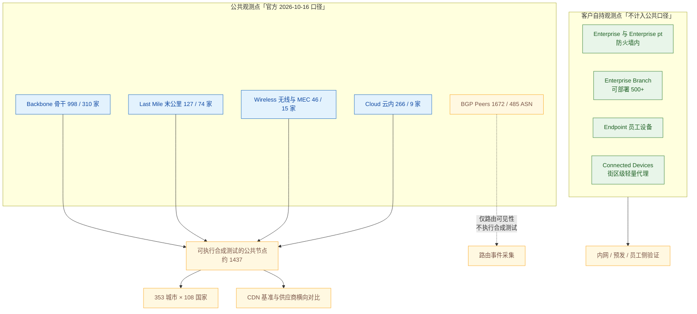

**图 3｜观测点分层与「3,109」口径辨析。** 官方网络页的分项为 Cloud 266 + Backbone 998 + Last Mile 127 + Wireless 46 + **BGP Peers 1,672**，**恰好等于 3,109**。**真正可执行合成测试的公共节点约 1,437 个**；另外 1,672 个 BGP Peer 提供的是路由可见性；而客户自持的 Enterprise / Endpoint / Connected Devices 根本不在这 3,109 里。**引用「探针规模」时若不区分口径，会把能力高估约 2.2 倍。**

## 3.2 它对应的用户痛点

> **口径**：本节只写客户侧可感知的痛（时间 / 钱 / 人 / 合规 / 组织），不写「探针调度算法」「节点容量池化」这类架构层问题。痛点编号 P1…Pn 与下节解法 S1…Sn **一一对应**。

- **P1（钱 / 时间）——「总部测着好」制造虚假安全感**。只在公司出口或某朵云上放一个探针，测出来一切正常，而外地、海外用户持续抱怨。**观测点越少，误判为「正常」的概率越高**，团队会因此把资源投在错误的方向上。
- **P2（时间）——「测试跑在机房，用户在家、在手机上」**。探针所在位置与用户真实路径不同，测出来的数不是用户感受到的数；一旦要对外沟通「用户到底经历了什么」，手里没有可用的数。
- **P3（组织 / 时间）——「防火墙后面的系统测不到」**。预发环境、内网门户、VDI、OA 都需要登录才能进，外部探针进不去，上线前的功能验证只能靠人工点。**发布前的最后一公里验证没有自动化手段。**
- **P4（时间）——「云厂商挂了，监控一起挂」**。当监测平台与被测系统跑在同一朵云、同一个区域时，故障时「既失明又失联」——**恰恰在最需要数据的那几分钟没有数据**，事后也没有留存可查。
- **P5（组织 / 钱）——「『多少人受影响』说不清」**。知道慢了，但不知道是哪家 ISP、哪个城市、哪张无线网络的用户先受影响，也就无法对「先救谁、后救谁」做出有依据的取舍；对外解释时也说不出影响的地理范围。

## 3.3 它是如何解决的（与痛点一一对应）

**架构约束（由痛点倒推）**

| 架构约束 | 由哪条痛点倒推 | 落到了哪些小功能点 |
|---|---|---|
| 观测点必须分布在「用户实际所在的网络」上，而不是集中在少数机房 | P1、P2、P5 | Backbone（2.1）、Last Mile（2.2）、Wireless（2.3）、Cloud（2.4）；结果带城市 / 国家 / 运营商 / 网络类型维度 |
| 必须有「客户自持的探针」，才能越过网络边界 | P3 | Enterprise 三型（2.6）、Endpoint Agent（2.7）、Connected Devices（2.8）、凭据与证书机制（详见 CP-3） |
| 监测面必须与被测面解耦，否则故障相关性会同时打掉两者 | P4 | 官方称网络**独立且与被测云解耦**、**无状态架构**；Cloud Agent 作为「被观测对象」而非「监测底座」 |
| 探针必须可被低成本地铺开，否则「放到用户身边」在成本上不成立 | P1、P5 | Enterprise Branch 的轻量化（2.6，可部署 500+）、ARM 支持与随 Collector 部署（2.9）、公共节点容量可见性（2.10） |
| 必须存在「可横向比较」的基准，才能回答「换哪一家会更好」 | P5 | Private Benchmarks（2.11）、CDN Benchmark 总览看板（2.12） |

| 解法 | 机制 | 对应痛点 |
|---|---|---|
| **S1 向用户所在处布点，而非向机房布点** | 公共节点按「**用户网络的类型**」分层而非按地理平均布点：Backbone（骨干 998）、Last Mile（末公里 127）、Wireless（无线 46）、Cloud（云内 266）；官方网络页当前口径为 **3,109 agents / 353 城市 / 108 国家**。**对客户最直接的价值是：同一句「快不快」可以得到十几个不同答案，而每个答案都对应一组真实存在的用户** | → 解 P1 |
| **S2 把「最后一公里」与「无线」作为独立类别刻意保留** | Last Mile 节点在居民宽带与家庭网络、**依赖消费级 ISP 解析 DNS**；Wireless 节点在 3G/4G 与 MEC——**这两类正是「从云上测永远测不准」的区域**。官方在 Cloud Nodes FAQ 中对此给出了反向确认：Cloud 节点「**are not in the direct line of service delivery to end users**」 | → 解 P2 |
| **S3 把探针放进客户自己的网络** | **Enterprise Node** 装在客户控制的网络内，官方理由：「enable you to test your internal systems independently of any outside connection, so they can be useful for **pre-launch testing**」；**Enterprise Branch** 通过「移除按节点下钻等部分分析能力」把单点成本压低，**官方明示可部署 500+ 个**；**Endpoint Agent** 与 **Connected Devices** 把观测点推到了员工设备与街区级 | → 解 P3 |
| **S4 监测面与被测面解耦，并把「云」同时当作被测对象** | 官方网络页自述：「Our network **is independent and decoupled from the cloud. If the cloud goes down, we stay up.**」并列出该架构的四个特征（Stateless Architecture / Highly Scalable and Fault Tolerant / Optimal Signal to Noise Ratio / Orchestrated long-term data retention）。**「不会被一起打断」与「能测云」是同一个架构选择的两面** | → 解 P4 |
| **S5 把结果维度化，并提供可横向比较的基准** | 每次运行的结果都带节点维度（城市、国家、运营商 / ASN、网络类型），因此可以回答「同一次请求在 A 家 ISP 与 B 家 ISP 的差异」「哪个城市先坏」；**Private Benchmarks（2025-10）** 进一步把「从真实用户设备出发，不同 CDN 与源站的性能对比」做成常态能力，**CDN Benchmark 总览看板（2026-01）** 用矩阵一次看清各 CDN 在各地区的强弱 | → 解 P5 |

> **边界（本节最重要的一段——直接决定引用数字的可靠性）**：
> - **官方宣称的「3,109 agents」是含 BGP Peer 的宽口径。** 分项为 Cloud 266 + Backbone 998 + Last Mile 127 + Wireless 46 + BGP Peers 1,672 = 3,109。**真正可承载合成测试的公共观测点约 1,437 个**，另外 1,672 个 BGP Peer 提供路由可见性。**对外引用规模时必须区分「agent 数」与「可执行测试的节点数」，否则会把规模高估约 2.2 倍。**
> - **规模口径在同一厂商内部并存**：官方方案简介 PDF 写 **2,400+ vantage points**（Backbone 802 / Last Mile 122 / Wireless 42 / Cloud 190 / BGP 1,202）；官网首页写 **3,000+ intelligent agents**；网络页分项为 3,109。**本报告以网络页分项为准，并建议每季度复核一次。**
> - **「Connected Devices」是与 3,109 不同口径的第四层，官方未公布其规模**（只说「tens of millions of lightweight agents」），且**该能力来自 B 级官方博客，无 A 级文档支撑**，不宜与探针数混用。
> - **「最后一公里覆盖」是深度而非密度的优势**：Last Mile 仅 127 个、Wireless 仅 46 个，**远小于 Backbone 的 998 个**。因此它对「某国某运营商的具体用户」有代表性，**但对「某个具体城市的细粒度分布」不具备样本量优势**。
> - **公共节点是共享资源，存在排队。** 2026-01 的位置下拉开始显示队列数、2026-03 的 Instant Test 主动前置「容量最好的前三个位置」——**这两项功能本身就是「容量受限」的间接证据**。
> - **企业节点的功能面与公共节点不完全相同**：Streaming 仅限 Enterprise 节点，Heartbeat 亦以 Enterprise 节点为主要执行场所——**「能力最强的节点」需要客户自己出机器**。同时 **Catchpoint 移动 App 已于 2026-01 EoL**（官方称「concentrate our efforts on the areas that deliver the greatest customer impact」），属交付渠道收缩。
>
> **配套演进**：Endpoint macOS 原生 Universal Binary、GeoIP 数据源更换等属客户端与数据加工层演进，分别并入 2.7 与第 5 章边界段陈述。

## 3.4 功能原理

### 3.4.1 输入：观测点体系吃进去什么

| 输入 | 具体内容 | 官方依据（含原文链接，标 A/B/C） | 缺了它会怎样 |
|---|---|---|---|
| **I1 · 自建 / 接入的全球节点** | 各类型公共节点及其运营商归属 | **A 级** · [Global Observability Network](https://www.catchpoint.com/global-observability-network)（3,109 agents / 353 cities / 108 countries 与五类分项）；[Nodes Overview](https://docs.catchpoint.com/nodes-overview)（单归属、本地 DNS 解析器） | 没有节点，CP-1 的全部测试类型无处执行——**这是整个产品的地基** |
| **I2 · 节点的网络归属与解析方式** | 节点是单归属还是多归属、DNS 由谁解析 | **A 级** · [Nodes Overview](https://docs.catchpoint.com/nodes-overview)（Backbone「single-homed… isolate performance by ISP」；Last Mile / Wireless「rely on the carrier to resolve DNS queries」；Cloud「rely on the cloud providers' default networks, which are multi-homed… use the cloud providers' DNS resolvers」） | 分不清「谁的解析」就分不清「谁的锅」——**DNS 责任归属（本地解析器 vs 运营商解析器）是这张网络最容易被忽视的设计点** |
| **I3 · 客户侧自部署能力** | Enterprise 节点的三种形态与部署通道（物理/虚拟 Linux、Docker、ARM、随 LogicMonitor Collector 部署） | **A 级** · [Nodes Overview](https://docs.catchpoint.com/nodes-overview)、[Miranda](https://docs.catchpoint.com/docs/2026-06-miranda-release-notes)、[Mimas](https://docs.catchpoint.com/docs/clone-2026-09-mimas-release-notes) | 内网、预发、员工侧完全无法覆盖——**正是「发布前最后一道验证」缺失的原因** |
| **I4 · 第三方路由数据** | RouteViews 与 RIPE RIS 的公开路由数据 + Catchpoint 自有 BGP 采集与对等 | **A 级** · [Global Observability Network](https://www.catchpoint.com/global-observability-network) | 无法把「路由层」纳入同一个时间轴——**但注意它不参与合成测试执行，只提供路由可见性** |
| **I5 · 真实用户设备上的轻量代理** | Connected Devices（数千万轻量代理）与 Endpoint 客户端 | **B 级** · [官方博客](https://catchpoint.com/blog/the-power-of-over-3000-intelligent-observability-agents)；**A 级** · [Afterglow](https://docs.catchpoint.com/docs/2026-01-afterglow-release-notes)（Endpoint TCP Traceroute）、[Miranda](https://docs.catchpoint.com/docs/2026-06-miranda-release-notes)（macOS Universal Binary） | 缺这一层就测不到「某个街区的 Wi-Fi 与最后一跳」——**这是最贴近「真实用户」的一层，也是证据最弱、口径最需谨慎的一层** |

### 3.4.2 实现链条：从一次 Run 到「一组带维度的答案」

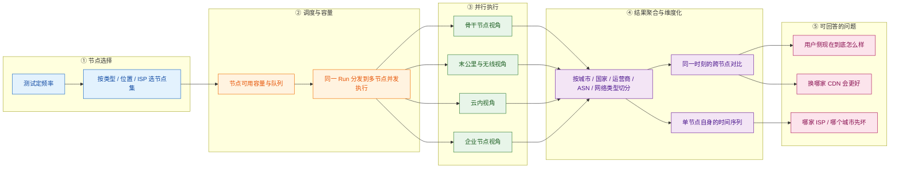

| 步骤 | 做什么 | 关键输入 | 输出 |
|---|---|---|---|
| **① 节点选择** | 定频率，并按类型 / 位置 / ISP 选定节点集——**这一步决定了这份数据「代表谁」** | I1 / I2 | 节点集 + 频率 |
| **② 调度与容量** | 检查节点可用容量与排队情况，把同一 Run **并发**分发到多节点 | 节点集 + 容量可见性（2.10） | 多节点并发的待执行 Run |
| **③ 并行执行** | 同一时刻，骨干 / 末公里 / 无线 / 云内 / 企业节点从**各自的位置**发出**同一个请求** | I3 | 多份带节点属性的运行结果 |
| **④ 聚合与维度化** | 按城市 / 国家 / 运营商 / ASN / 网络类型切分；同时维护「跨节点横向对比」与「单节点时间序列」两条数据线 | 多份运行结果 | 可切片的聚合视图 |
| **⑤ 回答问题** | 同一份数据同时回答三类问题：现在怎么样、谁先坏、换谁更好 | 聚合视图 | 判断与决策依据 |

> **这一步的核心设计点**：**同一时刻、多个观测点、同一个请求**——这是「把一条曲线变成一组切片」的唯一办法。它同时解释了为什么公共节点会成为受限资源：**并发观测点在物理上不是可以无限虚拟化的东西**。

### 3.4.3 输出：交付什么形态的结果

| 输出物 | 形态 | 消费方 | 对应小功能点 |
|---|---|---|---|
| 按节点分层的结果视图 | 骨干 / 末公里 / 无线 / 云内分别成图 | NOC / 数字体验负责人 | 2.1–2.4 |
| 地理与运营商切片 | 城市、国家、ISP / ASN、网络类型维度 | 数字体验 / 供应商管理 | 2.1–2.5 |
| 路由可见性数据 | BGP 前缀、路径、劫持与误配事件 | 网络团队 | 2.5 |
| 内网 / 预发 / 员工侧结果 | 企业节点与 Endpoint 上的运行记录 | 应用研发 / IT 服务台 | 2.6–2.8 |
| CDN / 源站横向对比 | 矩阵化基准与私有基准 | 供应商管理 / 架构师 | 2.11–2.12 |
| **「节点 × 时间」的原始量测矩阵** | **不是 UI 产物，而是内部接口** | 告警引擎（CP-5）、Stack Map 与 Sonar 关联（CP-6）、Webhook / API（CP-7）、MCP 工具（CP-9） | —（观测点网络的本质输出） |

> **注意最后一行**：观测点网络真正交付的不是「某一张按城市分布的图」，而是**一张「节点 × 时间」的量测矩阵**。CP-5 的「多少个节点同时失败才算事故」、CP-6 的「这是不是区域级第三方故障」，全部建立在这张矩阵之上。**把节点数量当作营销数字去用，等于把这张矩阵降级成一张图。**

### 3.4.4 关键机制：为什么「单归属（single-homed）」比「多归属」更值钱

这是本报告认为 CP-2 中最反直觉、也最值得复刻的一条设计。官方对 Backbone 节点的定义原文（**A 级**，[Nodes Overview](https://docs.catchpoint.com/nodes-overview)）：

> 「The majority of these nodes are **single-homed**, meaning that each Node connects to **a single provider**, enabling you to **isolate performance by ISP**.」

**为什么必须这么设计**：如果每个节点都接多家运营商（多归属），那么从该节点测得的结果**无法归因到任何一家运营商**——因为出问题时有太多条可能路径。**单归属把「路径」这个变量固定住，于是结果变成了「这一家运营商的表现」**。这与「覆盖越多越好」的直觉正好相反：**为了结论可归因，观测点必须刻意收窄自身的选择空间。**

**副作用与代价（必须同时说明）**：单归属意味着该节点一旦所属运营商出问题，这个观测点也一起失效——**因此必须靠节点数量（998 个）与运营商多样性（310 家）来对冲**。**这是「规模」在这张网络里的真实用途：不是数字好看，而是为了让每一个单归属结论都有备份。** 这也解释了为什么 Last Mile（127）、Wireless（46）这样的规模只能提供「代表性证据」，而不能提供「可冗余归因的证据」。

**第二个关键机制：DNS 由谁解析，决定了「谁的锅」**

官方对三类节点的 DNS 解析方式给出了明确区分（**A 级**，[Nodes Overview](https://docs.catchpoint.com/nodes-overview)）：

| 节点类型 | DNS 由谁解析 | 官方理由 |
|---|---|---|
| Backbone | **本地 DNS 解析器**，与节点同机房同 ISP | 「to provide **accurate DNS performance data for that location**」 |
| Last Mile | **消费级 ISP** | 「reflecting the **DNS performance consumers may experience**」 |
| Wireless | **运营商（carrier）** | 与 Last Mile 同理，面向移动用户 |
| Cloud | **云厂商的解析器** | 面向云内与云间的连通性 |

**为什么必须这么设计**：DNS 的性能问题**主要发生在解析链路上，而不是权威服务器上**——同一个权威服务器，经不同运营商的递归解析器访问，体验可以差出数倍。因此「用本地解析器测骨干」与「用消费级 ISP 解析器测家庭用户」得到的是**两个不同的问题的答案**，二者都必要。**这也是官方把「DNS 直查」与「DNS 体验」并列为两种测试视角的同一逻辑**（见 1.10）：**要能区分「权威服务器坏了」与「某家 ISP 的解析器坏了」。**

### 3.4.5 口径声明

| 内容 | 等级 | 说明 |
|---|---|---|
| 3,109 agents / 353 城市 / 108 国家与五类分项 | **A** | [Global Observability Network](https://www.catchpoint.com/global-observability-network)（2026-10-16 抓取） |
| 单归属、本地 DNS 解析器、Cloud 节点不在交付路径上 | **A** | [Nodes Overview](https://docs.catchpoint.com/nodes-overview)、[Cloud Nodes FAQ](https://docs.catchpoint.com/docs/cloud-nodes-faq) |
| 「网络独立且与被测云解耦」四条架构特征 | **A** | [Global Observability Network](https://www.catchpoint.com/global-observability-network) |
| Enterprise 三型与「Enterprise Branch 可部署 500+」 | **A** | [Nodes Overview](https://docs.catchpoint.com/nodes-overview) |
| 2,400+ vantage points 的旧口径与分项 | **B** | 官方方案简介 PDF（[Global Observability Network Solution Brief](https://resources.catchpoint.com/hubfs/Solution%20Briefs%20-%20Assets/Global%20Observability%20Network%20Solution%20Brief.pdf)）；**与 A 级网络页冲突，已并列** |
| Connected Devices「数千万轻量代理 / 街区级」 | **B** | [官方博客](https://catchpoint.com/blog/the-power-of-over-3000-intelligent-observability-agents)；**无 A 级文档支撑** |
| 「真正可执行合成测试的公共节点约 1,437 个」 | **C（本报告推导）** | 依据链：① 网络页五类分项之和 = 3,109（A）→ ② 官方对 BGP Peers 的描述为「Leverage… BGP collectors and peers」（A，未提执行合成测试）与 BGP Test「monitor your announced prefixes from hundreds of AS peers」（A）→ 结论：BGP Peer 是采集侧而非执行侧，故 3,109 − 1,672 = 1,437 |
| 「单归属是为了可归因，规模是为了给单归属做冗余」 | **C（本报告推导）** | 依据链：① 「single-homed… enabling you to isolate performance by ISP」（A）→ ② Last Mile / Wireless 依赖运营商解析且规模远小（A）→ ③ 公共节点出现排队与容量优选（A，Afterglow / Triton）→ 结论：单归属是归因设计，规模是对冲手段 |

## 3.5 能力边界（这个功能点做不到什么）

> **一句话边界**：这张网络能告诉你「**从这些位置看，事情是这样的**」，但它**代表的是探针，不是人口分布**；而且它的三层客户自持部分，**运维责任落在客户自己身上**。

| 类型 | 具体边界 | 依据（信源等级） | 对自研 APM 的提示 |
|---|---|---|---|
| **硬边界 · 不可复制性** | 998 个骨干节点 × 310 家运营商、且监测面与被测云解耦——**这件事无法通过买软件获得**。同时官方明示 Backbone 节点**单归属**，意味着结论的可归因性来自「节点 + 运营商」的组合，而非算法 | **A** · [Global Observability Network](https://www.catchpoint.com/global-observability-network)、[Nodes Overview](https://docs.catchpoint.com/nodes-overview) | 自研**明确不做清单的第一项**就是「自建全球公共探针网」。园区网场景不需要全球 ISP 覆盖；**若确需外部视角，走采购 / 合作，不要自建** |
| **硬边界 · 口径混淆** | 「3,109 agents」含 **1,672 个不执行合成测试的 BGP Peer**；「3,000+ agents」与「2,400+ vantage points」并存于官方自有材料 | **A / B** · 见上；旧口径见 [方案简介 PDF](https://resources.catchpoint.com/hubfs/Solution%20Briefs%20-%20Assets/Global%20Observability%20Network%20Solution%20Brief.pdf) | 自研对外报规模时，**必须给出「可执行测试的观测点数」而非「纳入统计的实体总数」**；在自己内部也应按同一纪律收口 |
| **硬边界 · 采样代表性** | Last Mile 127 / Wireless 46，**规模远小于 Backbone 998**；官方对 Cloud 节点主动声明其不在端到端交付路径上 | **A** · [Nodes Overview](https://docs.catchpoint.com/nodes-overview)、[Cloud Nodes FAQ](https://docs.catchpoint.com/docs/cloud-nodes-faq) | 「末公里 / 无线 / 云内」三类结论分别对应三类不同可信度；**自研做用户侧拨测时，必须公开每个观测点的归属与解析方式**，否则结论无法归因 |
| **软边界 · 未披露项** | 官方**未披露**：各类型节点的具体城市清单与增删节奏、公共节点的真实排队时延、Enterprise Branch 去掉的「部分分析能力」具体是哪些、Connected Devices 的规模与精度 | —（官方材料无此项） | 这几项直接决定 POC 能否按期完成（节点是否覆盖目标城市、峰值时段会不会排队）；**必须列入 POC 清单逐项自测** |
| **前提依赖 · 客户侧运维** | 企业节点、Endpoint 客户端、Connected Devices 的部署与升级**由客户自行负责**；官方在各版本 Release Notes 中反复建议「升级 Enterprise Nodes promptly after each release to benefit from the new feature functionality」 | **A** · [Halo](https://docs.catchpoint.com/docs/2025-10-halo-release-notes)、[Miranda](https://docs.catchpoint.com/docs/2026-06-miranda-release-notes)、[Mimas](https://docs.catchpoint.com/docs/clone-2026-09-mimas-release-notes) 各版本 Agent 段落 | 自研在客户侧部署探针时，**必须把「升级通道 + 版本可见性 + 灰度策略」写成交付物**，否则新能力永远到不了现场 |
| **官方自认局限** | 官方主动声明 Cloud 节点「**are not in the direct line of service delivery to end users**」，并明确建议「if your primary goal is to understand and identify issues related to end user experience, **we encourage you to use backbone, last mile and mobile nodes**」 | **A** · [Cloud Nodes FAQ](https://docs.catchpoint.com/docs/cloud-nodes-faq) | **「云内探针」是最容易被误用的一类观测点**——自研若用云内探针代表用户，会把结论系统性偏向乐观 |
| **常见误期待（澄清）** | ① 易以为 BGP Peer 也可执行合成测试（它只提供路由可见性）；② 易以为观测点越多越能代表用户（**代表性取决于「节点类型与人口分布的匹配」，不取决于总数**）；③ 易以为企业节点与公共节点能力完全一致（**Streaming 仅 Enterprise，Heartbeat 亦主要在 Enterprise**） | **A**（分项口径 + 节点能力限定）+ **C（本报告归纳）** | 对外沟通与内部立项都应把「**观测点类型 × 可用测试类型**」做成矩阵；**不要用「总数」这一个数字替代这个矩阵** |

---

# 4 大功能点 3：脚本生产与维护 —— 写得快

把「写事务测试」从会写代码的少数人手里拿出来，用一个**录制器 + 所见即所得编辑器**给非技术角色一个入口，同时保留通往代码的上升通道——替代「业务提需求 → 排期 → 工程师写脚本 → 页面一改就废」的循环。

## 4.1 小功能点清单

| # | 小功能点 | 发布时间 | 信源等级 | 说明 |
|---|---|---|---|---|
| 3.1 | **Catchpoint Recorder（浏览器录制扩展）** | 约 2020 | **B / C** | 基于 Selenium 的浏览器扩展，把用户操作录制为可回放的 Selenium 脚本；官方在 legacy Transaction 文档中明确「it is also possible to **record a web transaction in Selenium Language** and copy the resulting script into the Transaction Test configuration」（[Transaction Test (legacy)](https://docs.catchpoint.com/docs/en/transaction-test)） |
| 3.2 | **Script Editor（平台侧脚本编辑）** | — | **B** | 平台内的脚本编辑与保存入口（与 3.1 配合使用） |
| 3.3 | **Playwright 脚本能力** | 2023 起持续 | **A**（[Playwright Test](https://docs.catchpoint.com/docs/playwright-test)） | 支持 **Edge / Chrome** monitors；2025-10 增加 **Mobile Emulation**（「labeled 『Mobile (New)』… leverages Catchpoint's Playwright monitor and ensures tests have the latest Mobile devices available in our Playwright package」）；**2026-09 Agent 2.18.0 为 No-Code 录制场景补齐 iFrame 支持**；支持客户端证书 |
| 3.4 | **Puppeteer 脚本能力** | 2023 起 | **A** | 与 Playwright 并列的第二条现代脚本路径；Terraform 侧 `script_type` 已设为只读（见第 8 章 7.4 边界） |
| 3.5 | **No-Code Transaction Test（录制 + WYSIWYG）** | **2026-06（Miranda）** | **A**（[Miranda Release Notes](https://docs.catchpoint.com/docs/2026-06-miranda-release-notes)） | 「we've introduced a new browser-based recorder extension that **automatically captures user flows as transaction instructions**… whether you're a **non-technical user or an engineer looking to save time**」；配内置 WYSIWYG 编辑器 |
| 3.6 | **导出为 Playwright（单向）** | **2026-06（Miranda）** | **A** | 「the ability to **export to Playwright scripts**」——**可升级为代码，不可从代码退回可视化** |
| 3.7 | **No-Code 能力增强：Edge、断言、更多动作** | **2026-08（Ganymede）** | **A**（[Ganymede Release Notes](https://docs.catchpoint.com/docs/2026-08-ganymede-release-notes)） | 增加 **Edge browser support**；增加 **Assertions for validating content such as text and HTML elements are present or visible**；增加 **scroll, focus, special keys & key combos** 等动作 |
| 3.8 | **Script Converter（Selenium → Playwright 自动转换）** | 2026 | **A**（[Selenium Retirement](https://docs.catchpoint.com/selenium-retirement)） | 关键设计：**在「复制测试」时触发，而不是在「Convert Test」时**——官方理由是「converting your test is an **irreversible operation**」，故流程设计为「复制 → 转换副本 → 验证 → 再转原测试并粘贴脚本」 |
| 3.9 | **Selenium 型测试退役** | **2026-08-31** | **A / C**（[Selenium Retirement](https://docs.catchpoint.com/selenium-retirement)；第三方确认见 C 级 [AI in Testing Daily](https://daily.testingeducation.org/podcast/2026-08-31)） | 「we have decided to **retire support for Selenium Transaction Tests on August 31, 2026. At that time, all Transaction Tests using Selenium will cease to function.**」；API 侧 Selenium 于更晚退役 |
| 3.10 | **变量与取值体系** | 2023 起持续 | **A**（[Transaction Test (legacy)](https://docs.catchpoint.com/docs/en/transaction-test) 与 API Test 文档） | 步骤间传值（cookie / header / 令牌）、从响应中按正则或 **JSONPath** 取值、条件判断与断言；**这是「一条脚本覆盖多组业务数据」的最小手段** |
| 3.11 | **多步 API 事务与令牌复用** | 2026 起强化 | **A**（[Terraform Provider](https://docs.catchpoint.com/docs/terraform-provider)） | 链式 API 调用（`api_test` 的 `script_type` 可为 selenium 或 javascript），可捕获 HTTP/S 分段指标与从响应中抽取的自定义指标 |
| 3.12 | **Script Templates Library（脚本模板库）** | 2023 起 | **A** | 用「一条通用脚本 + 差异项」生成多条测试；模板具备状态与弃用管理的语义（**本报告未取得该页 A 级原文，机制描述降级为 C 级**，见 4.4.5） |
| 3.13 | **凭据集中管理（Token / Password / Certificate）** | **2025-10（Halo）** | **A**（[Halo Release Notes](https://docs.catchpoint.com/docs/2025-10-halo-release-notes)、[Mimas Agent 2.18.0](https://docs.catchpoint.com/docs/mimas-agent-release)） | 「a configurable **Active/Inactive** status… **If a credential is in an inactive state and is assigned to a test, the test will not run**… displayed in a **blue pill for 『active』 or a grey pill for 『inactive』**」；口令字段新增接受 `<` `>` `&` `#`；**Agent 2.18.0 把凭据掩码改为只掩码 3 个字符及以上的值**（修正此前过度掩码） |

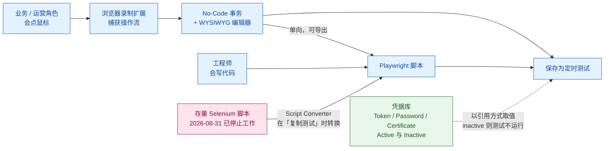

**图 4｜脚本生产的三条路径与那道单向门。** 左侧入口给业务角色，上方入口给工程师，两者在 Playwright 汇合；**从可视化到代码是单向的，反向不可逆**。右下角的 Selenium 存量是一笔**已到期**的债务——2026-08-31 之后，未迁移的测试会直接停摆。下方虚线是凭据库：它把「口令」从脚本里的字符串变成平台里的对象。

## 4.2 它对应的用户痛点

> **口径**：本节只写客户侧可感知的痛（时间 / 钱 / 人 / 合规 / 组织），不写「DSL 表达能力」「脚本解析器设计」这类架构层问题。痛点编号 P1…Pn 与下节解法 S1…Sn **一一对应**。

- **P1（人 / 时间）——「写测试脚本这件事，被绑在会写代码的少数人身上」**。业务侧想加一条监控要排队等排期，工程师一忙就没人做；**而这个人一旦离职，脚本就成了没人敢改的遗产**。
- **P2（时间 / 人）——「页面一改，脚本就废」**。前端上线当天几十条事务测试同时报红，团队要么花几天改脚本，要么干脆把测试停掉——**「维护成本高于收益」是事务型监控最常见的死因**。
- **P3（钱 / 时间）——「只能跑同一条固定路径，测不出业务数据的多样性」**。真实用户用不同账号、不同搜索词、不同日期；脚本只重复同一组参数，于是「测了」和「覆盖了」之间出现一个说不清的缺口。
- **P4（合规）——「登录态与鉴权测不了，或者只能把口令写进脚本」**。真正的核心业务都在登录之后，而口令硬编码在脚本里既是安全审计的硬伤，也让「换密码」变成一次全量改脚本。
- **P5（时间 / 人）——「同类测试要配几十上百条，配置本身成了运维负担」**。多站点、多品牌、多租户客户的测试配置改一处要改几十处，**监控配置的维护量开始与业务规模成正比**。

## 4.3 它是如何解决的（与痛点一一对应）

**架构约束（由痛点倒推）**

| 架构约束 | 由哪条痛点倒推 | 落到了哪些小功能点 |
|---|---|---|
| 生产测试必须有「不写代码」的最低入口，同时保留「可继续写代码」的上升通道 | P1、P2 | No-Code 录制 + WYSIWYG（3.5 / 3.7）、导出 Playwright（3.6）、Recorder（3.1）、Script Editor（3.2） |
| 脚本对「页面改版」的耐受度必须被系统性抬高，而不是靠人细心 | P2 | Script Converter 的副本验证流程（3.8）、WYSIWYG 让业务侧自行调整（3.7）、执行引擎缺陷持续修复（3.3） |
| 测试必须能携带外部数据，并在步骤之间传值 | P3 | 变量与取值体系（3.10）、多步 API 与令牌复用（3.11）、模板宏（3.12） |
| 凭据必须以引用方式使用，并具备生命周期状态 | P4 | 凭据集中管理（3.13）、Active/Inactive 语义、掩码规则 |
| 配置必须可参数化复用，避免 N 倍复制 | P5 | Script Templates Library（3.12） |

| 解法 | 机制 | 对应痛点 |
|---|---|---|
| **S1 把「会点鼠标」变成「会写测试」，同时保留通往代码的路** | **No-Code Transaction Test（2026-06）** 用浏览器扩展录制一段真实操作，**自动把操作流转换为事务指令**，再由内置 WYSIWYG 编辑器维护。它一次性提供两个不同高度的入口：**给业务 / 运营角色的是「录完即用」，给工程师的是「以录制为脚手架，导出 Playwright 继续写」**。官方表述很直白：「whether you're a non-technical user or an engineer looking to save time」 | → 解 P1 |
| **S2 系统性抬高脚本对「页面改版」的耐受度** | 三条并行：① **可视化编辑**让「选择器变了」这类调整由业务侧在 WYSIWYG 里完成，不必走工程排期；② **Script Converter** 把 Selenium 遗产批量转成更稳的 Playwright，且刻意把转换放在**「复制测试」**这一步，形成「**副本验证 → 再改原测试**」的安全流程；③ **执行引擎缺陷持续修复**（如 2026-09 修复胶片三缺陷、2026-08 修复「range header 在 selenium→playwright 转换后未应用到子请求」与「使用客户端证书的 Playwright monitor 无法执行 POST」）——**脚本「莫名报红」的相当一部分根因其实在执行引擎，而不是脚本本身** | → 解 P2 |
| **S3 让测试携带数据、并在步骤之间传值** | 变量体系解决「第一步拿到的 cookie 或 token，第三步还要用」；取值支持**正则与 JSONPath 两种语法**（官方 API 文档给出对照说明）；条件判断与断言把「响应里的某个字段应该等于什么」变成会让测试失败的条件。**多步 API 事务进一步支持链式调用与 OAuth 令牌复用**——这正是「登录 → 取数 → 提交」这类真实业务链的最小闭环 | → 解 P3 |
| **S4 凭据从「脚本里的字符串」变成「平台里的对象」** | Token / Password / Certificate 统一托管，带 **Active / Inactive 状态**：**inactive 且被引用时测试不运行**（避免用过期口令反复失败刷屏），界面以蓝色 / 灰色药丸区分；口令字段支持特殊字符（2025-10 新增 `<` `>` `&` `#`）；Agent 侧做**凭据掩码**以防泄漏到响应内容与头部，且 2026-09 起**只掩码 3 个字符及以上的值**（修正过度掩码）。**这条同时回应了安全审计（口令不进代码仓库）与运维便利（换密码不用改脚本）** | → 解 P4 |
| **S5 用模板把「N 条测试」压成「1 条模板 + N 组参数」** | **Script Templates Library** 允许把通用脚本固化，把差异项声明为参数，派生测试只填差异值。**使「同类测试批量生成」成为一次配置动作**，而不是 N 次复制粘贴。**⚠ 本条为 C 级**：本报告未取得该页的可核验 A 级原文，机制描述依据官方文档目录中模板相关页面的存在与平台一致的继承 / 覆盖语义推导，**细节（模板状态机、自动弃用日期）未经原文核实，见 4.4.5 口径声明** | → 解 P5 |

> **边界**：
> - **No-Code 是一道单向门。** 可升级为 Playwright，**但不能从 Playwright 退回可视化**。这决定了「先用录制起步」的团队**后期必然进入代码维护态**——这是一个需要提前告知业务方的既定事实。
> - **录制器的能力在 2026 年仍在快速补齐中**：2026-06 首发，2026-08 才补 Edge、断言与滚动 / 聚焦 / 组合键，**iFrame 直到 2026-09（Agent 2.18.0）才在 No-Code 录制场景得到支持**。「录制一切」尚不成立。
> - **变量体系是「宏 + 正则 / JSONPath」的组合，不是通用编程环境。** 复杂条件编排、循环、异常处理仍要落到脚本。
> - **单次执行有硬边界**（> 30 秒、连续重定向 > 5 次、引用 URL / 主机上限），**脚本复杂度与单次运行的规模上限是一组必须同时考虑的约束**（详见 2.1 与 2.5）。
> - **Selenium 退役的时间点是确定的、已经过去了的**：2026-08-31 起 Selenium 型 Transaction 测试停止工作。**任何仍在使用 Selenium 的存量配置都已是失效状态**（官方提供了 Script Converter 作为迁移工具）。
> - **Script Converter 不是全能**：官方单独列出**不受支持的 Selenium 动作清单**（如 `IgnoreErrors()`、`UploadFile()`、`SetSpeed()`、`AssertData()` 等），命中这些动作的行会**被原样复制为注释**，需人工改写（[Script Converter Limitations](https://docs.catchpoint.com/docs/script-converter)）。**「自动转换」的实际含义是「转换 80%，剩 20% 靠人」。**
>
> **配套演进**：Selenium → Playwright 的框架代际更替本身属技术演进，但它直接决定「存量测试会不会在某一天集体失效」，因此作为 S2 的必要性论证出现，**不单独列为解法**。

## 4.4 功能原理

### 4.4.1 输入：脚本生产链路吃进去什么

| 输入 | 具体内容 | 官方依据（含原文链接，标 A/B/C） | 缺了它会怎样 |
|---|---|---|---|
| **I1 · 真实用户操作流** | 录制的点击、输入、导航、滚动等动作序列 | **A 级** · [Miranda Release Notes](https://docs.catchpoint.com/docs/2026-06-miranda-release-notes)（「automatically captures user flows as transaction instructions」） | No-Code 路径不存在——**也就是「不写代码就无法建事务测试」**，P1 的痛原样保留 |
| **I2 · 脚本语言与执行引擎** | Selenium（退役中）、Playwright、Puppeteer、Javascript（API 侧） | **A 级** · [Selenium Retirement](https://docs.catchpoint.com/selenium-retirement)、[Playwright Test](https://docs.catchpoint.com/docs/playwright-test)、[Terraform Provider](https://docs.catchpoint.com/docs/terraform-provider) | 无脚本执行环境；**且引擎版本直接决定哪些动作可用**（如 2026-09 前无 iFrame 录制） |
| **I3 · 步骤间与跨运行的数据** | 变量、正则 / JSONPath 取值、OAuth 令牌复用 | **A 级** · [Transaction Test (legacy)](https://docs.catchpoint.com/docs/en/transaction-test)、[API Test](https://docs.catchpoint.com/docs/api-test) | 只能测「无状态的一条请求」，无法测「先登录再下单」这类真实业务链 |
| **I4 · 凭据与秘密** | Token / Password / Certificate 及其 Active / Inactive 状态 | **A 级** · [Halo Release Notes](https://docs.catchpoint.com/docs/2025-10-halo-release-notes) | 登录后的核心业务无法测试；**若改为硬编码，则把合规风险直接引入测试代码** |
| **I5 · 断言期望值** | 文本存在性、元素可见性、响应码、响应体内容 | **A 级** · [Ganymede Release Notes](https://docs.catchpoint.com/docs/2026-08-ganymede-release-notes)（No-Code 断言）、[Miranda Release Notes](https://docs.catchpoint.com/docs/2026-06-miranda-release-notes) | 脚本只能「走完流程」，不能「判断走对了」——**门开了不等于事情做成了** |

### 4.4.2 实现链条：从一次录制到一条可维护的定时测试

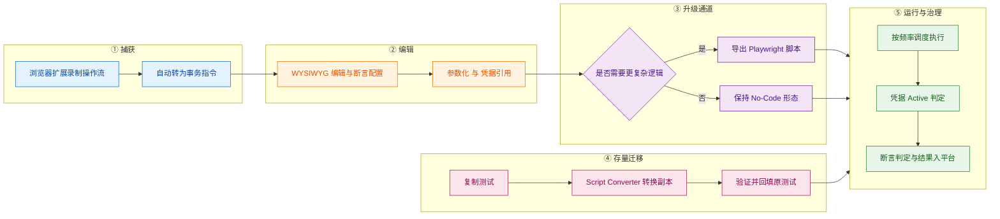

| 步骤 | 做什么 | 关键输入 | 输出 |
|---|---|---|---|
| **① 捕获** | 浏览器扩展录制真实操作流，**自动转为事务指令** | I1 | 一条可编辑的事务定义 |
| **② 编辑** | 在 WYSIWYG 中补断言、参数化、绑定凭据引用 | I3 / I4 / I5 | 一条完整的测试定义 |
| **③ 升级通道** | 判断是否需要循环 / 复杂条件：需要则**导出为 Playwright**，不需要则保持 No-Code | 事务定义 | Playwright 脚本 或 No-Code 测试 |
| **④ 存量迁移** | Selenium 存量走「**复制 → 转换副本 → 验证 → 回填原测试**」四步，绕开不可逆转换的风险 | I2 | 已验证的 Playwright 测试 |
| **⑤ 运行与治理** | 按频率调度；执行前检查凭据 Active 状态（**inactive 则测试不运行**）；逐步断言并写入平台 | 全部 | 带断言结论的运行记录 |

> **第 ④ 步是本组最被低估的设计**：多数工具把「转换」做成一步动作，Catchpoint 因为**转换不可逆**而把它拆成四步，**牺牲了操作便利，换来了「失败不会毁掉生产配置」**。这条对自研的直接含义写在附三第 4 条。

### 4.4.3 输出：交付什么形态的结果

| 输出物 | 形态 | 消费方 | 对应小功能点 |
|---|---|---|---|
| No-Code 事务测试 | 表单化事务指令 + 可视化编辑界面 | 业务 / 运营角色 | 3.5、3.7 |
| Playwright / Puppeteer 测试 | 代码脚本（可进版本控制） | 工程师 | 3.3、3.4、3.6 |
| API 多步事务 | 链式调用定义（含令牌复用） | 应用研发 / 接口负责人 | 3.11 |
| 断言结果 | 通过 / 失败 + 未通过的断言项 | 应用研发 | 3.7、3.10 |
| 凭据对象 | 带 Active / Inactive 状态的托管凭据 | 安全与审计 | 3.13 |
| **「测试定义」本身作为可版本化对象** | **不是 UI 产物，而是内部接口** | Terraform Provider（CP-7）、REST API（CP-7）、模板库（3.12） | —（脚本资产层） |

> **注意最后一行**：这组能力真正交付的是一种**可被外部工具读写的「测试定义」**。这正是第 8 章（CP-7）能够把监控配置搬进 Git 与 CI/CD 的前提——**没有这一层，`terraform apply` 无从下手**。

### 4.4.4 关键机制：为什么「单向门」是刻意的，而不是缺陷

官方对导出能力的表述只有一句（**A 级**）：「the ability to **export to Playwright scripts**」——**只写了一个方向**。官方在 Selenium 迁移文档中则把「不可逆」讲得非常明确（同样 **A 级**）：

> 「converting your test is an **irreversible operation**, and if there were any issues with the generated Playwright script, the converted test **would not function as expected until you were able to make corrections**」

**为什么必须这么设计**：

1. **双向同步在工程上是不可维护的**。若允许「把已改过的 Playwright 脚本退回可视化编辑器」，就必须假定代码里没有编辑器表达不了的结构——**这在一般情况下不成立**（循环、条件分支、异常处理、并发等待都会破坏这个假定）。
2. **限定单向可以让两侧的语义各自稳定**：No-Code 侧只需要保证「录制能覆盖的操作」语义完整；Playwright 侧只需要保证「脚本即事实」。**这不是偷懒，而是用「少支持一个方向」换「两个方向都不出错」。**
3. **代价必须被明确告知**：官方在文档中把这条限制写成事实陈述，并**在 No-Code 首发描述里就说明可导出 Playwright**（[Miranda](https://docs.catchpoint.com/docs/2026-06-miranda-release-notes)），而不是留给客户在使用中自行发现。**这是一种值得复刻的产品纪律：把不可逆的边界写在入口处，而不是写在帮助文档的角落。**

**第二个关键机制：把「复制」当作安全阀**

Script Converter 的触发点是「复制测试」而非「转换测试」（**A 级**原文见 3.8）。官方给出的整体流程为：**复制测试 → 转换副本 → 验证并修正 → 转换原测试 → 粘贴已验证脚本 → 停用或删除副本**。

**为什么必须这么设计**：转换是**有损**的——官方单独维护一份**不受支持的 Selenium 动作清单**，命中项会被原样复制为注释。若直接在原测试上转换，一次失败的转换就意味着**生产中的监控出现盲区**，而这个盲区是静默的。**把「试错」放进副本，等于把「试错的代价」从生产移到了沙箱。** 这条设计的成本几乎为零（多一次复制），收益却是「转换期间监控不中断」。

### 4.4.5 口径声明

| 内容 | 等级 | 说明 |
|---|---|---|
| No-Code Transaction Test 的录制 → 转换 → WYSIWYG → 导出 Playwright 全链路 | **A** | [Miranda Release Notes](https://docs.catchpoint.com/docs/2026-06-miranda-release-notes) |
| No-Code 增强：Edge / 断言 / 滚动·聚焦·特殊键 | **A** | [Ganymede Release Notes](https://docs.catchpoint.com/docs/2026-08-ganymede-release-notes) |
| Selenium 退役日期与 Script Converter 的触发点、四步流程、整体不可逆性 | **A** | [Selenium Retirement](https://docs.catchpoint.com/selenium-retirement) |
| 不受支持的 Selenium 动作清单 | **A** | [Script Converter Limitations](https://docs.catchpoint.com/docs/script-converter) |
| 凭据 Active/Inactive、「inactive 则测试不运行」、特殊字符与掩码规则 | **A** | [Halo Release Notes](https://docs.catchpoint.com/docs/2025-10-halo-release-notes)、[Mimas Agent 2.18.0](https://docs.catchpoint.com/docs/mimas-agent-release) |
| Playwright 的 Mobile（2025-10）/ iFrame（2026-09）支持 | **A** | [Halo](https://docs.catchpoint.com/docs/2025-10-halo-release-notes)、[Mimas Agent 2.18.0](https://docs.catchpoint.com/docs/mimas-agent-release) |
| **Script Templates Library 的机制细节（模板状态机、自动弃用日期）** | **C（本报告推导，证据最弱）** | **本报告未取得该页的可核验 A 级原文**。可确证的是官方文档站存在模板相关条目、且平台在测试 / 告警配置上普遍采用「继承 + 覆盖」语义（A，见 CP-5 与 CP-7）。**读者不应把本节视为官方口径**；已登记为附四待跟踪项 |
| 「单向门是刻意设计，用『少支持一个方向』换『两个方向都不出错』」 | **C（本报告推导）** | 依据链：① 官方只描述 export 一个方向（A，Miranda）→ ② 官方把转换定位为 irreversible 并因此改变触发点（A，Selenium Retirement）→ ③ 官方维护「不受支持动作清单」承认转换有损（A，Script Converter）→ 结论：单向与副本流程是同一设计意图的两个表现 |

## 4.5 能力边界（这个功能点做不到什么）

> **一句话边界**：这组能力把「写脚本」的门槛降下来了，但**它降低的是入口门槛，不是维护上限**——一旦业务复杂度超过可视化表达力，你就**必然**回到代码；而代码那一侧，工具**只帮你搬家，不帮你重写**。

| 类型 | 具体边界 | 依据（信源等级） | 对自研 APM 的提示 |
|---|---|---|---|
| **硬边界 · 不可逆** | No-Code 可导出 Playwright，**不可反向退回**；转换（Selenium → Playwright）**不可逆**，官方因此改变触发点并维护「不受支持动作清单」 | **A** · [Miranda](https://docs.catchpoint.com/docs/2026-06-miranda-release-notes)、[Selenium Retirement](https://docs.catchpoint.com/selenium-retirement)、[Script Converter Limitations](https://docs.catchpoint.com/docs/script-converter) | 自研任何「可视化 → 代码」的能力**都应显式声明单向**，并在入口处告知；**不要试图做双向同步**，那是维护成本的无底洞 |
| **硬边界 · 可视化表达力上限** | 变量体系是「宏 + 正则 / JSONPath」，**不是通用编程环境**；复杂条件、循环、异常处理仍要落到脚本 | **A** · [Transaction Test (legacy)](https://docs.catchpoint.com/docs/en/transaction-test)、[API Test](https://docs.catchpoint.com/docs/api-test) | 自研若做「低代码编排」，**必须诚实地把它定位成「覆盖 80% 场景」**，并预留脚本出口；否则用户第一次遇到循环就会弃用 |
| **时效边界 · 已到期的存量债** | Selenium 型 Transaction 测试**已于 2026-08-31 停止工作**；API 侧 Selenium 于更晚退役。仍在用 Selenium 的配置**当前已失效** | **A / C** · [Selenium Retirement](https://docs.catchpoint.com/selenium-retirement)；第三方确认 [AI in Testing Daily](https://daily.testingeducation.org/podcast/2026-08-31) | 自研的探针脚本引擎**必须锁定长期可维护的框架版本**，并把「引擎退役」纳入产品路线图的输入项——**这不是技术债，是产品生命周期风险** |
| **软边界 · 未披露项** | 官方**未披露**：WYSIWYG 编辑器能表达的动作全集与上限、No-Code 导出的 Playwright 脚本与原生编写的脚本是否存在行为差异、模板库的完整语义 | —（官方材料无此项） | 这几项直接决定「客户能不能只靠 No-Code 长期运营」；**必须列入 POC 验证清单** |
| **前提依赖 · 浏览器扩展与录制环境** | No-Code 依赖浏览器扩展录制，**录制能覆盖的前提是「用户在浏览器里能做的事」**。桌面客户端、原生 App、命令行、批处理类流程无法录制，只能走 Custom Test（详见 2.1 的 1.21） | **A** · [Miranda](https://docs.catchpoint.com/docs/2026-06-miranda-release-notes)、[Synthetic Test Types](https://docs.catchpoint.com/docs/synthetic-test-types) | 自研若面向政企 / 行业客户，**大量核心业务是桌面客户端**——直录路线覆盖不到，**必须提前准备「自定义脚本 + 内网探针」的兜底方案** |
| **官方自认局限** | 官方在 Migration 文档中承认自动转换「**No automatic conversion process works perfectly in every instance**」（见 [Script Converter Limitations](https://docs.catchpoint.com/docs/script-converter) 的表述），并逐条列出不受支持的动作 | **A** | 自研对外承诺「自动迁移」时**必须同时给出「已知不支持清单 + 人工工作量估计」**，否则迁移期会成为客户投诉高发期 |
| **常见误期待（澄清）** | ① 易以为 No-Code 可以长期免维护——**页面改版仍会影响录制脚本**，只是调整成本从工程侧移到了业务侧；② 易以为「录制 = 覆盖全部场景」——**iFrame 到 2026-09 才支持**；③ 易以为模板库能替代工程化——**模板解决的是复制问题，不是逻辑复杂度问题** | **A**（iFrame 时间点、断言与动作的补齐节奏）+ **C（本报告归纳）** | 对外沟通应把「**录制覆盖率**」作为一个需要持续维护的指标公开，而不是一次性宣传 |

---

# 5 大功能点 4：采集深度与证据留存 —— 挖得深

把「页面 8 秒」这一个数字，拆成**逐段计时 + 请求级瀑布 + 逐帧影像**三层；并让证据能脱离厂商界面被带走——替代「只有一个总耗时、复盘只能靠回忆」的分析方式。

## 5.1 小功能点清单

| # | 小功能点 | 发布时间 | 信源等级 | 说明 |
|---|---|---|---|---|
| 4.1 | **分段计时（Segmented Timing）** | 2023 起 | **A**（[Catchpoint Metrics](https://docs.catchpoint.com/docs/catchpoint-metrics)、[How to Read Waterfalls](https://docs.catchpoint.com/docs/how-to-read-waterfalls)） | 把一次运行拆成 DNS / Connect / SSL / Wait / Load / Size 等分段；官方定义 `Test Time (ms)` 为「one cohesive metric that applies to all test types and indicates the total duration of the test run」 |
| 4.2 | **瀑布图 + 请求 / 响应头捕获** | 2023 起 | **A**（[How to Read Waterfalls](https://docs.catchpoint.com/docs/how-to-read-waterfalls)、[Ganymede](https://docs.catchpoint.com/docs/2026-08-ganymede-release-notes)） | 逐请求的时序展开；请求 / 响应头可选捕获档位；**2026-08 修复「各测试类型下瀑布图缺失请求头与响应详情」** |
| 4.3 | **Filmstrip 与视频** | 2023 起 | **A**（[Mimas Agent 2.18.0](https://docs.catchpoint.com/docs/mimas-agent-release)） | 逐帧呈现渲染过程；**2026-09 Agent 2.18.0 集中修复三个胶片缺陷**：只显示 1 帧、末帧捕获过晚或缺失、页面渲染过快导致无胶片 |
| 4.4 | **截图 / 日志 / Requests 明细** | 2023 起 | **A** | 运行级截图与日志，可定位到具体失败元素与错误文本 |
| 4.5 | **Core Web Vitals 与渲染指标** | 持续 | **A**（[Europa](https://docs.catchpoint.com/docs/2026-04-europa-release-notes)、[Mimas Agent 2.18.0](https://docs.catchpoint.com/docs/mimas-agent-release)） | LCP / CLS / FCP / TBT 等；**2026-04 起 Experience Score 纳入 Lighthouse 指标**；**注意 2026-09 Chrome/Edge 149 → 151 会造成「初次渲染略慢、子指标起始时间后移」，官方明确点名 document complete / LCP / visually complete / time to interactive** |
| 4.6 | **WebPageTest Lighthouse 与 Opportunities** | 2020 起 | **A / B**（[Pricing FAQ](https://www.catchpoint.com/pricing)） | 站点质量审计与「可优化项」清单；「Opportunities suggest improvements」在 Starter 档即可获得 |
| 4.7 | **Domain Breakdown（域名分布）** | **2026-04（Europa）** | **A**（[Europa Release Notes](https://docs.catchpoint.com/docs/2026-04-europa-release-notes)） | WPT Instant Test 的 Assets 页新增，**按外部域名汇总请求数与总字节数**，「helping you quickly understand the footprint of third-party content」 |
| 4.8 | **Page Performance 增加 DC Time / DC Bytes** | **2026-01（Afterglow）** | **A** | 「Total Time, Total Requests, DC Time and DC Bytes metrics added to Page Performance」；配套新增瀑布图按这四个指标的搜索能力 |
| 4.9 | **Insights / 自定义指标** | 2023 起 | **A**（[Insights](https://docs.catchpoint.com/docs/insights)） | 从响应体中抽取任意片段并转成可作图、可告警的指标（版本号、服务器名、下游依赖耗时等） |
| 4.10 | **Experience Score（0–100 复合分）** | **2026-04（Europa）** | **A**（[Europa Release Notes](https://docs.catchpoint.com/docs/2026-04-europa-release-notes)） | 官方给出**完整评分构成**：**Total Blocking Time / Largest Contentful Paint / Cumulative Layout Shift / First Contentful Paint / Apdex** 五项；**分档为 Good 90–100 / Needs improvement 50–89 / Poor 0–49**；**仅适用于 Playwright、Puppeteer、Chrome (New)、Mobile (New)、Edge 五类 Web 测试** |
| 4.11 | **Trend Shift（趋势位移检测）** | 2023 起 | **A**（[Trend Shift Alerts](https://docs.catchpoint.com/docs/trend-shift-alerts)） | 检测指标的**持续性方向变化**（而非阈值越线），用于在越线之前给出早期预警 |
| 4.12 | **Smartboard 与 Explorer** | 2023 起 | **A / B** | Smartboard 为自动聚焦视图，Explorer 提供多维下钻；**2026-04 起 Explorer 支持 Traceroute ECN 过滤** |
| 4.13 | **瀑布图可下载为 JPEG** | **2026-01（Afterglow）** | **A** | 「You can now **download waterfall as a jpeg** from Records page」——**证据脱离厂商界面进入工单、邮件与复盘文档的通道** |
| 4.14 | **留存期与原始数据出流** | 持续 | **A**（[Pricing FAQ](https://www.catchpoint.com/pricing)） | 留存随套餐分层：**Starter 60 天 / Pro 13 个月 / Expert 3 年（可延至 7 年）**；**点数已覆盖合同期内的数据存储，官方明确「We don't charge for GB hours」**；原始数据可经 Webhook / API 出流（详见 CP-7） |

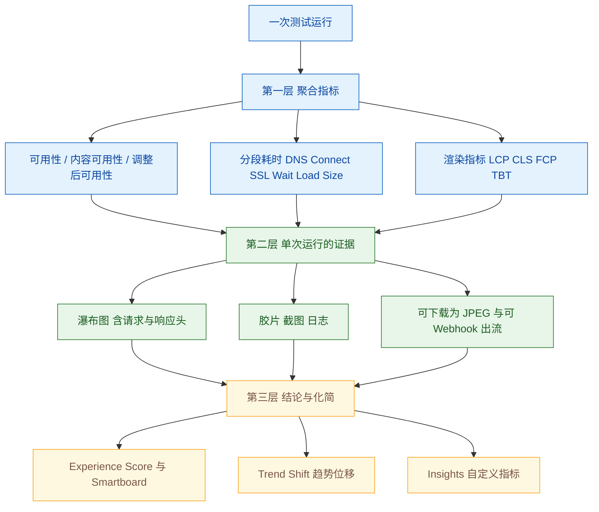

**图 5｜采集深度的三层下钻。** 三层的关系是「**上层给人看，下层给人信**」：聚合指标用于告警与 SLA，证据层用于跨团队举证，化简层用于降低阅读负担。**中间那一层最不显眼，却是争议真正被终结的地方**——因为瀑布与胶片可以直接贴在工单里。

## 5.2 它对应的用户痛点

> **口径**：本节只写客户侧可感知的痛（时间 / 钱 / 人 / 合规 / 组织），不写「时序数据的存储与聚合成本」「指标基数」这类架构层问题。痛点编号 P1…Pn 与下节解法 S1…Sn **一一对应**。

- **P1（时间）——「只知道慢，不知道慢在哪一段」**。报表上写「页面 8 秒」，但无法回答是 DNS 慢、TLS 握手慢、后端等待慢，还是第三方的图片和脚本慢。**一个总数无法转化成任何一条待办。**
- **P2（组织 / 合规）——「偶发问题事后无法复现，复盘只能靠回忆」**。用户说「昨天下午打不开」，等排查时现场早已恢复，剩下的是两拨人对着各自的截图争论。
- **P3（人 / 时间）——「数据太多、看板太多，值班的人不知道先看哪一张」**。几百条测试、几十个指标铺在面前，**信息量本身成了故障响应的一部分阻力**。
- **P4（组织）——「供应商说『我们没问题』，自己也说『我们没问题』，谁也拿不出证据」**。于是问题在群里来回转派，直到有人凭经验拍一个结论。
- **P5（钱 / 时间）——「性能在缓慢劣化，但因为没有一条线被跨过，所以没人发现」**。两个月里悄悄劣化 30%，报表上全都是「绿色」。**阈值型监控对「温水式退化」天然失明。**

## 5.3 它是如何解决的（与痛点一一对应）

**架构约束（由痛点倒推）**

| 架构约束 | 由哪条痛点倒推 | 落到了哪些小功能点 |
|---|---|---|
| 必须保留「颗粒化的时序明细 + 请求级明细」，而不是只有聚合值 | P1、P2 | 分段计时（4.1）、瀑布图与头信息（4.2）、DC Time / DC Bytes（4.8） |
| 必须保留「当时长什么样」的影像证据，且证据可被带走 | P2、P4 | Filmstrip 与视频（4.3）、截图与日志（4.4）、瀑布 JPEG 下载（4.13） |
| 必须存在把多指标压缩成少数结论的「化简层」，否则数据量会反过来阻断响应 | P3 | Smartboard 与 Explorer（4.12）、Experience Score（4.10）、Domain Breakdown（4.7） |
| 业务侧关心的高层结论与工程侧关心的底层明细必须能互相下钻 | P1、P3 | Insights 自定义指标（4.9）、Explorer 多维下钻（4.12）、Page Performance 多维搜索（4.8） |
| 必须有「不是阈值、而是趋势」的判据，才能捕捉缓慢劣化 | P5 | Trend Shift（4.11）、Experience Score 变化（4.10） |

| 解法 | 机制 | 对应痛点 |
|---|---|---|
| **S1 逐段计时 + 请求级瀑布** | 每次运行把总时长拆成 **DNS / Connect / SSL / Wait / Load / Size**，再用**瀑布图**展开到每一个请求，并可捕获请求 / 响应头；2026-01 进一步把 **DC Time / DC Bytes** 提升为可搜索维度。**「8 秒」因此变成「其中 3.2 秒花在等待某个第三方域名的响应」**——这是团队能直接开单的粒度 | → 解 P1 |
| **S2 给运行结果留下不可否认、且能被带走的影像证据** | **Filmstrip（逐帧）**回答「用户看到的是一点一点出来，还是白屏很久后突然出现」；**截图与日志**在报错页面上直接留下错误文本；**瀑布图可下载为 JPEG（2026-01）** 意味着证据可以**脱离厂商界面**进入工单、邮件与复盘文档。**跨团队协作里最贵的不是分析，是让对方相信** | → 解 P2 |
| **S3 用「有明确构成的」聚合层替代人肉看板** | **Smartboard** 把「当前最该看的」自动摆到前台；**Experience Score** 把多项指标压成一个 0–100 分，且**官方公开了完整构成**（TBT / LCP / CLS / FCP / Apdex）与分档（90–100 / 50–89 / 0–49）——**这是一个可以被复核的复合分，而不是黑箱**；**Domain Breakdown（2026-04）** 用量化的「第三方域名请求数 / 字节数」把「第三方依赖占了多少」变成可见事实 | → 解 P3 |
| **S4 让「举证」不依赖厂商界面** | 原始测试数据可经 **Test Data Webhook 实时出流**到客户自己的数据湖与看板，亦可经 REST API 拉取；瀑布图可下载为 JPEG。**当同一份原始数据同时握在客户与供应商手里，争论的重心就会从「谁的说法更可信」转向「数据说明什么」** | → 解 P4 |
| **S5 把「趋势本身」做成信号** | **Trend Shift Alerts** 检测的是**指标持续的方向性变化**，而不是某个阈值被跨过——它回答的是「虽然都还没越线，但这条线一直在往上走」。配合 Experience Score 的持续变化与合成数据的长期留存（Pro 13 个月 / Expert 3 年至 7 年），**「温水式退化」第一次有了可被自动指出的机制** | → 解 P5 |

> **边界**：
> - **化简层的可复核程度差异很大。** Experience Score 的**构成与分档已公开**（2026-04），但具体权重与算法未公开；**Trend Shift 的判据同样未公开**。**可复算、可用于对外承诺的仍然只有 `% Availability` / `% Content Availability` 这类定义明确的指标**（见 2.4.4）。
> - **分段计时深度受 Monitor 决定**：Object 型只能给出传输层分段与页面级耗时，**只有真实浏览器（Chrome / Playwright / WPT）型才能给出 LCP / CLS / TBT 这类渲染指标**。**选错 Monitor 会直接损失掉一整层指标**（回指 2.4.4 的分档机制）。
> - **渲染指标存在版本性跳变。** 2026-09 Agent 2.18.0 明确说明「Chrome and Edge have been updated from version 149 to 151. Due to this upgrade, **initial rendering is slightly slower**… This also affects page metrics such as: **document complete / largest contentful paint / visually complete / time to interactive**」。**跨月的渲染指标对比必须把这个版本切换点作为断点处理。**
> - **留存期是套餐约束，不是技术约束**：60 天 / 13 个月 / 3 年（可至 7 年）由套餐决定，**「做同比」在 Starter 档根本不可能实现**。
> - **Experience Score 的适用范围有限**：官方明确「This updated scoring model applies **only to Playwright, Puppeteer, Chrome (New), Mobile (New), and Edge web tests**. Experience Score for all other web tests and network-based tests are unchanged」——**网络类测试没有这个分**。
>
> **配套演进**：GeoIP 数据源更换（2026-01）会让部分地理聚合数值发生位移，官方主动提示「you may see fewer 『Unknown』 geographies, and some location-based aggregates may shift」——**这构成一个口径断点**，写入附四跟踪项。

## 5.4 功能原理

### 5.4.1 输入：深度分析链路吃进去什么

| 输入 | 具体内容 | 官方依据（含原文链接，标 A/B/C） | 缺了它会怎样 |
|---|---|---|---|
| **I1 · 逐请求的时序明细** | 每个 HTTP/S 请求的开始、结束、阻塞关系、请求与响应头 | **A 级** · [How to Read Waterfalls](https://docs.catchpoint.com/docs/how-to-read-waterfalls)、[Ganymede](https://docs.catchpoint.com/docs/2026-08-ganymede-release-notes)（修复请求头缺失） | 「慢在哪一段」回到「只有一个总数」的状态——**P1 无解** |
| **I2 · 页面渲染过程的时间序列** | 逐帧截图与渲染里程碑（首次内容绘制、可交互时间等） | **A 级** · [Mimas Agent 2.18.0](https://docs.catchpoint.com/docs/mimas-agent-release)、[Europa](https://docs.catchpoint.com/docs/2026-04-europa-release-notes) | 无法回答「用户看到的是一点点出来还是白屏很久」——**这是纯数值指标表达不了的一层** |
| **I3 · 外部域名的构成** | 请求数、字节数按域名汇总 | **A 级** · [Europa Release Notes](https://docs.catchpoint.com/docs/2026-04-europa-release-notes)（Domain Breakdown） | 第三方内容的「占比」只能靠感觉；**「第三方依赖对体验的影响」无法量化** |
| **I4 · 从响应体抽取的业务量** | 版本号、服务器名、下游接口耗时等自定义指标 | **A 级** · [Insights](https://docs.catchpoint.com/docs/insights) | 测试只能停在「技术指标」，无法表达「业务量」——**这也切断了合成数据与业务指标的对齐** |
| **I5 · 长期历史序列** | 套餐决定的留存窗口（60 天 / 13 个月 / 3 年 / 7 年） | **A 级** · [Pricing FAQ](https://www.catchpoint.com/pricing) | 无法做同期对比与缓慢劣化判断——**P5 与「同比」同时失效** |

### 5.4.2 实现链条：从一次运行到一条可提交的证据

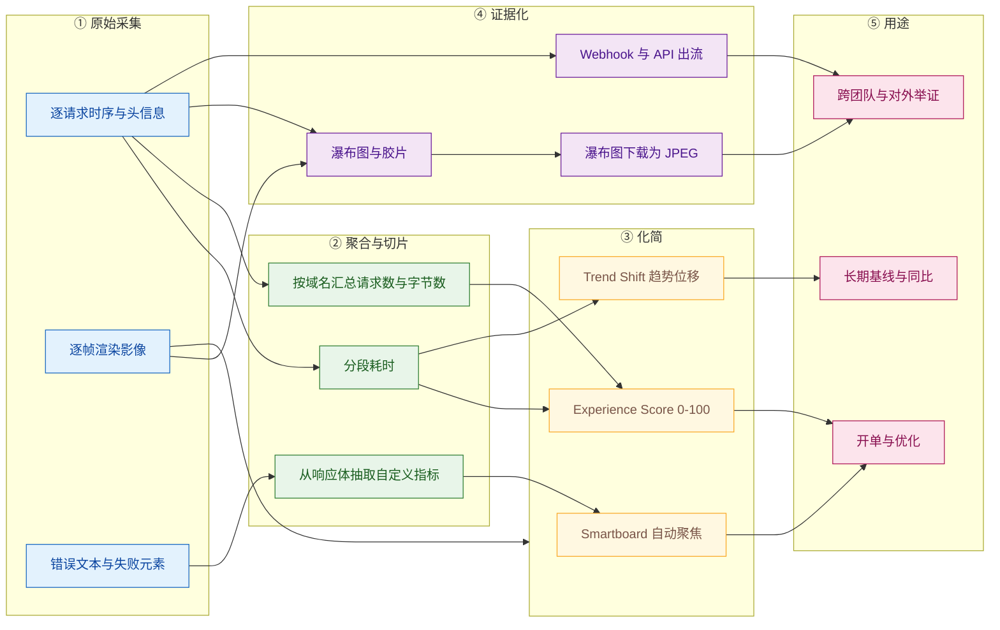

| 步骤 | 做什么 | 关键输入 | 输出 |
|---|---|---|---|
| **① 原始采集** | 记录逐请求时序与头信息、逐帧影像、错误文本与失败元素 | I1 / I2 / I3 | 一次运行的完整原始记录 |
| **② 聚合与切片** | 把总耗时拆段；按域名汇总构成；必要时从响应体抽取业务指标 | 原始记录 + I4 | 分段数据、域名构成、自定义指标 |
| **③ 化简** | 算复合分（Experience Score）、自动聚焦（Smartboard）、检测趋势位移 | 聚合结果 | 少数几个「该看的结论」 |
| **④ 证据化** | 保留瀑布与影像，并提供**脱离界面的导出通道**（JPEG / Webhook / API） | 原始记录 | 可被外部复核的证据 |
| **⑤ 用途** | 同一份数据同时服务三类用途：开单优化、跨团队举证、长期基线 | 结论 + 证据 | 待办、举证材料、基线 |

> **第 ④ 步是与「证据」相关的关键设计**：**「能在界面里看见」与「能拿出来当证据」不是同一件事**。前者依赖账号与网络可达性，后者要求证据可以脱离系统存在。**JPEG 下载与 Webhook 出流这两个看似边缘的功能，实际决定了这份数据在组织内有没有法律效力。**

### 5.4.3 输出：交付什么形态的结果

| 输出物 | 形态 | 消费方 | 对应小功能点 |
|---|---|---|---|
| 分段耗时 | 数值序列（DNS / Connect / SSL / Wait / Load / Size） | 排障 / 性能优化 | 4.1 |
| 瀑布图与头信息 | 交互式时序图 | 排障 / 应用研发 | 4.2 |
| 影像证据 | Filmstrip / 截图 / 视频 / 日志 | 跨团队举证 | 4.3、4.4 |
| 复合分与趋势 | Experience Score（0–100）、Trend Shift | 业务方 / 运维主管 | 4.10、4.11 |
| 第三方构成的量化 | Domain Breakdown（请求数 / 字节数） | 架构 / 优化 | 4.7 |
| 可持续导出的证据文件 | 瀑布 JPEG、Webhook 数据流、API 响应 | 工单系统 / 数据湖 | 4.13、4.14 |
| **「运行 → 指标 + 证据」的标准记录** | **不是 UI 产物，而是内部接口** | 依赖地图与 AI RCA（CP-6）、MCP 工具（CP-9）、客户数据湖（CP-7） | —（分析内核本身） |

### 5.4.4 关键机制：为什么 Experience Score 公开构成，而 Trend Shift 不公开

官方对 Experience Score 的披露程度明显高于其他 AI / 算法类能力（**A 级**，[Europa Release Notes](https://docs.catchpoint.com/docs/2026-04-europa-release-notes)）：**列明五项输入指标、给出三档分界、并限定适用范围**。这在同类产品中并不常见——**多数复合分是不公开构成的**。

**为什么必须公开构成**：因为 Experience Score 的用途是**跨角色沟通**（工程看浏览器指标、运维看可用性、业务看风险）。**一个跨角色使用的数字，如果无法被任何一方解释，它就会在一次争论后被弃用。** 而限定适用范围（只对五类浏览器型 Web 测试生效）是同一逻辑的延续——**避免让「网络类测试没有这个分」变成使用者的意外**。

**Trend Shift 则相反**：官方只描述「检测持续性方向变化」这一行为，**不公开判据**。两者差异的合理解释是（**C（本报告推导）**，依据链：① Experience Score 公开构成与分档、限定适用范围（A，Europa）→ ② Trend Shift Alerts 仅有行为描述（A，[Trend Shift Alerts](https://docs.catchpoint.com/docs/trend-shift-alerts)）→ ③ 官方在定价页承诺「AI-powered performance insights」并强调「no overage penalties」等**可承诺**项（A，Pricing FAQ）→ 结论）：**凡是要被写进对外报表或跨角色共识的数字，官方选择公开构成；凡是作为「早期提示」而非「判定依据」的数字，官方保留不公开。** 这条区分对自研 AI 助手极有价值：**AI 的输出应该被定位成「提示」而非「判定」，除非它能公开推理链。**

### 5.4.5 口径声明

| 内容 | 等级 | 说明 |
|---|---|---|
| 分段计时与 `Test Time` 定义、瀑布图与请求头捕获 | **A** | [Catchpoint Metrics](https://docs.catchpoint.com/docs/catchpoint-metrics)、[How to Read Waterfalls](https://docs.catchpoint.com/docs/how-to-read-waterfalls) |
| Experience Score 的五项构成指标、三档分界、适用测试类型限定 | **A** | [Europa Release Notes](https://docs.catchpoint.com/docs/2026-04-europa-release-notes) |
| Domain Breakdown 的「按外部域名汇总请求数与字节数」 | **A** | 同上 |
| 瀑布图可下载 JPEG（2026-01）、DC Time / DC Bytes（2026-01） | **A** | [Afterglow Release Notes](https://docs.catchpoint.com/docs/2026-01-afterglow-release-notes) |
| 留存分层与「点数覆盖存储、不按 GB-小时计费」 | **A** | [Pricing FAQ](https://www.catchpoint.com/pricing) |
| Chrome / Edge 149 → 151 对 document complete / LCP / visually complete / time to interactive 的影响 | **A** | [Mimas Agent 2.18.0](https://docs.catchpoint.com/docs/mimas-agent-release) |
| 「胶片三缺陷」的修复内容 | **A** | 同上 |
| Experience Score 的具体权重与算法 | **未公开** | 官方只公开输入指标与分档，**权重未披露**——本报告不做推断，登记为附四缺口 |
| 官方因「跨角色沟通」而公开 Experience Score 构成、因「仅为提示」而不公开 Trend Shift | **C（本报告推导）** | 依据链见 5.4.4 |

## 5.5 能力边界（这个功能点做不到什么）

> **一句话边界**：这组能力把「一次运行」还原得非常完整，但**它还原的是「探针这一次看到了什么」，不是「所有用户经历了什么」**；而其中最好用的那些复合分，**算法未公开、不能当承诺用**。

| 类型 | 具体边界 | 依据（信源等级） | 对自研 APM 的提示 |
|---|---|---|---|
| **硬边界 · 采样与还原的边界** | 分段与瀑布只覆盖**被这次运行实际加载的资源**；页面里的异步、懒加载、按需加载内容**是否被采到取决于 Monitor 与页面行为**。渲染指标只有真实浏览器型 Monitor 才有 | **A** · [How to Read Waterfalls](https://docs.catchpoint.com/docs/how-to-read-waterfalls)、[Synthetic Test Types](https://docs.catchpoint.com/docs/synthetic-test-types) | 自研做「页面还原」时必须明确「**这份还原的覆盖率**」；**不要把「这一次运行的全貌」表述为「页面的全貌」** |
| **硬边界 · 版本断点** | Agent 与浏览器版本升级会**改变渲染类指标的绝对值**（149 → 151 官方明确点名四项指标）；GeoIP 数据源更换会让**地理聚合数值位移** | **A** · [Mimas Agent 2.18.0](https://docs.catchpoint.com/docs/mimas-agent-release)、[Afterglow](https://docs.catchpoint.com/docs/2026-01-afterglow-release-notes) | 自研必须**在产品里维护「口径变更日历」**：哪些日期之后的数据不可与之前直接比较。**这是最容易被忽略、也最容易在客户复盘会上被质疑的一点** |
| **软边界 · 算法未公开** | Trend Shift 的判据未公开；Experience Score 的权重未公开；Smartboard 的聚焦逻辑未公开 | **A / 未公开** · [Trend Shift Alerts](https://docs.catchpoint.com/docs/trend-shift-alerts)、[Europa](https://docs.catchpoint.com/docs/2026-04-europa-release-notes) | **可用于「提示」，不可用于「对外承诺」**。自研若要做类似分数，**至少公开输入指标与分档**（照 Experience Score 的做法），并把权重列为可配置项 |
| **软边界 · 未披露项** | 官方**未披露**：分段计时的采样精度与时钟同步方式、瀑布图请求头捕获对点数的具体影响、留存期内的数据压缩与采样策略（长期留存的数据是否为全量） | —（官方材料无此项） | 「长期留存的数据是否全量」直接决定同比分析的可信度；**必须列入 POC 验证清单** |
| **前提依赖 · 套餐与预算** | 对比窗口受套餐限制：**Starter 60 天 / Pro 13 个月 / Expert 3 年**；做同比与「同比规律的容量规划」在低档套餐上不成立 | **A** · [Pricing FAQ](https://www.catchpoint.com/pricing) | 自研若要支持长期基线，**存储成本必须被提前算进产品方案**（回指 CP-8：官方把存储含进点数，正是为了避免「要留三年就加钱」的决策障碍） |
| **官方自认局限（边界性质）** | 官方在 Experience Score 的说明中主动限定「applies **only to** Playwright, Puppeteer, Chrome (New), Mobile (New), and Edge web tests」；在胶片修复说明中承认此前存在「只显示 1 帧 / 末帧缺失 / 渲染过快无胶片」三类缺陷 | **A** · [Europa](https://docs.catchpoint.com/docs/2026-04-europa-release-notes)、[Mimas Agent 2.18.0](https://docs.catchpoint.com/docs/mimas-agent-release) | **「证据层出问题」比「指标层出问题」严重得多**——因为它是举证材料。自研的验收清单里应有一条：**胶片 / 瀑布在快速渲染与新浏览器版本下的完整率** |
| **常见误期待（澄清）** | ① 易以为「有瀑布就能定位根因」——瀑布给出的是**现象的位置**，不是**责任的主体**（后者需要 CP-6 的依赖地图与第三方基准）；② 易以为 Experience Score 是「行业可比分数」——它是**同一平台内跨测试、跨时间的相对分**，官方未声明可与外部视频 / 平台对比；③ 易以为留存期内的历史数据可任意切片——**留存期与可查询粒度是两个不同的约束，后者官方未披露** | **A / 未公开** + **C（本报告归纳）** | 对外沟通应把「**现象定位**」与「**责任归属**」分列，**不要用一个分数承担定责功能** |

---

# 6 大功能点 5：告警与 SLO 治理 —— 报得准

把「某个指标越界了就发通知」升级为**两套并行判据**：一套判「**这是不是事故**」（多条件 + 时间窗 + 多节点计数），一套判「**还撑不撑得住**」（错误预算的消耗速率）——替代「要么太吵、要么太晚」的单一阈值告警。

## 6.1 小功能点清单

| # | 小功能点 | 发布时间 | 信源等级 | 说明 |
|---|---|---|---|---|
| 5.1 | **告警三级配置与继承语义** | 2023 起 | **A**（[Alerts](https://docs.catchpoint.com/docs/alerts)） | 告警可配在 **Product / Folder / Test** 三级；子级可选完全替换或**在父级基础上叠加**两种语义——**这是「组织层级」被写进配置模型的地方** |
| 5.2 | **告警条件（Conditions）** | 2023 起 | **A**（同上） | 决定「多少次 / 多少节点出问题才算数」：可按**运行数的 # 或 %**、**节点数的 # 或 %**、**跨节点平均值**设受控触发阈值 |
| 5.3 | **多条告警并行独立评估（不去重）** | 2023 起 | **A**（同上） | 同一测试可挂多条告警（本级 + 继承），**各自独立评估、互不覆盖**——即同一时刻可能同时触发多条 |
| 5.4 | **告警触发类型（Triggers）** | 2023 起持续扩展 | **A**（同上） | 覆盖可用性 / 停机比例、内容加载时间、单文件大小、整页大小、测试 URL 全部内容、与指定文件比对内容，以及 **BGP 专有四类触发**（ASN Origin AS / Path AS / Origin Neighbor / Prefix Mismatch） |
| 5.5 | **告警接收方与模板** | 2023 起 | **A**（同上）；语音呼叫见 [Starlight](https://docs.catchpoint.com/docs/2025-07-starlight-release-notes) | 支持联系人与联系组、邮件、以及**投递到 API Endpoint（Webhook）**；2025-07 起支持**为联系人配置语音呼叫通知**；2025-07 起移除 Email-to-SMS（官方原因是运营商拦截） |
| 5.6 | **Composite Alerts（复合告警）** | **2025-09（Moonbeam）** | **A**（[Moonbeam Release Notes](https://docs.catchpoint.com/docs/2025-09-moonbeam-release-notes)） | REST API 侧新增复合告警的创建 / 删除 / 查询 / 更新端点——**把「多条告警合成一个事件」表达成可编程对象** |
| 5.7 | **SLI / SLO 跟踪** | 2023 起 | **A**（[SLO Overview](https://docs.catchpoint.com/docs/slo-overview)） | 以合成测试**持续度量**可用性或性能目标，对照已量化的目标值；**意义在于「这个月还剩多少余量」在过程中任何时刻都是已知量** |
| 5.8 | **SLO Alerts · Burn Rate（燃尽速率）** | **2026-09（Mimas）** | **A**（[Mimas Release Notes](https://docs.catchpoint.com/docs/clone-2026-09-mimas-release-notes)） | 「Burn Rate Alerts notify you when an SLO is **consuming its error budget faster than expected**. Automatic configuration is easy with industry-recommended **Fast Burn (Critical)** and **Medium Burn (Warning)** settings」——分别用于捕捉**突发严重劣化**与**持续性问题** |
| 5.9 | **SLO Alerts · Violation Budget（违规预算）** | **2026-09（Mimas）** | **A**（同上） | 「let you set Warning and Critical thresholds based on **how much of your error budget has already been consumed** during a **weekly, monthly, or quarterly** SLO window」 |
| 5.10 | **SLO 告警进入统一告警日志** | **2026-09（Mimas）** | **A**（同上） | 「SLO Alerts also appear in the Catchpoint **Alerts Log** as **SLO Burn Rate** or **Budget Consumption** type alerts on individual tests」，并走既有告警工作流（含第三方接收方） |
| 5.11 | **告警明细 REST API 与告警说明** | **2026-01（Afterglow）** | **A**（[Afterglow Release Notes](https://docs.catchpoint.com/docs/2026-01-afterglow-release-notes)） | 新增 `GET /v4/test/alerts`、`/v4/test/alerts/{alertsID}`、`/v4/test/alerts/item`；**Alert Instructions 被加入告警详情 API**；同时修复「按 Product ID 查询告警返回 400」「节点详情缺失」等 |
| 5.12 | **Enterprise Node 自身告警** | **2025-09（Moonbeam）** | **A**（[Moonbeam Release Notes](https://docs.catchpoint.com/docs/2025-09-moonbeam-release-notes)） | 对节点 **Run Rate、Node State（online/offline）、Node Utilization、CPU / disk / memory** 告警；**同时把节点利用率采集频率从每 15 分钟提高到每 5 分钟**，官方主动提示「you may see a change in the metrics… This is to be expected」 |
| 5.13 | **告警时间窗扩展** | **2025-10（Halo）** | **A**（[Halo Release Notes](https://docs.catchpoint.com/docs/2025-10-halo-release-notes)） | 「Additional Alert timeframe intervals of **20 and 45 mins**」——**抓「亚小时级」劣化时，时间窗粒度直接决定漏报率** |

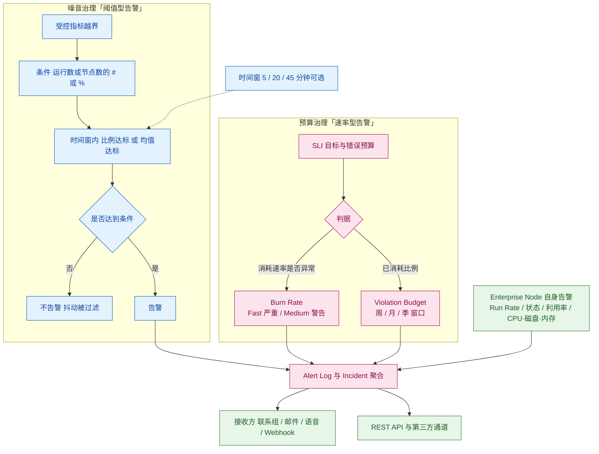

**图 6｜噪音治理与预算治理的双轨。** 左上是「**是不是事故**」（判据是受控阈值 + 计数 + 时间窗），右下是「**还撑不撑得住**」（判据是预算消耗速率）。**这两轨解决的是两个不同问题：前者减少误报，后者提前预警**——把它们混为一谈，就会得到「要么太吵、要么太晚」的结果。下方虚线的「时间窗可选」是把两轨连起来的关键旋钮：**窗太短会吵，窗太长会晚。**

## 6.2 它对应的用户痛点

> **口径**：本节只写客户侧可感知的痛（时间 / 钱 / 人 / 合规 / 组织），不写「告警评估引擎」「去重算法」这类架构层问题。痛点编号 P1…Pn 与下节解法 S1…Sn **一一对应**。

- **P1（人 / 时间）——「告警把人叫醒太多次，真的那一次反而被忽略」**。单个节点抖动一次就发通知，一夜之间几十条，值班的人开始「先看一眼再关掉」；等到真事故来时，它已经被淹没在噪音里。
- **P2（组织 / 时间）——「告警不知道该发给谁」**。一条测试的问题可能同时牵动网络、应用与外部供应商三方，靠人工在群里转派，**热土豆在几拨人之间传递，每一次传递都在消耗响应时间**。
- **P3（组织）——「误报的代价是信任」**。一次两次之后，业务方不再相信监控的结论——**监控系统的失败往往不是漏报，而是被无视**。
- **P4（钱 / 合规）——「SLA 罚金是被算出来的，但事前算不清」**。签下承诺之后只能事后统计，过程中没有任何实时依据知道「这个月还差多少」，因此也无法在风险变大的当天做出取舍（例如冻结非必要变更）。
- **P5（钱 / 时间）——「错误预算花光了才发现」**。等到月度报表出来，预算已经耗尽，剩下的时间只能被动等——**而错误预算的最大价值恰恰是「在花光之前给出减速信号」**。

## 6.3 它是如何解决的（与痛点一一对应）

**架构约束（由痛点倒推）**

| 架构约束 | 由哪条痛点倒推 | 落到了哪些小功能点 |
|---|---|---|
| 判断「是不是事故」必须基于「多少次 / 多少节点 / 多长时间」，而不是单点越线 | P1、P3 | 告警条件（5.2）、可选时间窗（5.13） |
| 告警必须能在组织层级上继承与分流 | P2 | 三级配置与两种继承语义（5.1）、多接收方与 Webhook（5.5）、复合告警（5.6） |
| 必须有独立于「阈值型告警」的第二类判据：预算消耗速率 | P4、P5 | SLI/SLO 跟踪（5.7）、Burn Rate（5.8）、Violation Budget（5.9）、统一告警日志（5.10） |
| 被监控的监测基础设施自身也必须可告警，否则「监控失明」无人知晓 | P1 | Enterprise Node 自身告警与 5 分钟采集（5.12） |
| 告警必须可被外部系统接管，而非只在门户里 | P2、P4 | 告警 REST API 与 Alert Instructions（5.11）、Webhook 接收方（5.5） |

| 解法 | 机制 | 对应痛点 |
|---|---|---|
| **S1 用「多条件 + 时间窗」替代「单点越线」** | 告警条件可表达为：**在给定时间窗内，有多少比例的运行 / 多少比例的节点 / 跨节点平均值越过了受控触发阈值**；时间窗本身可选（并已扩展到 20 / 45 分钟粒度）。**这是把「一次网络抖动」与「一次真实事故」在机制上分开的关键**：单点抖动无法满足「多节点 / 高比例」，而全站事故可以 | → 解 P1 |
| **S2 让告警在组织层级上继承，并分流到不同接收方** | 告警可在 Product / Folder / Test 三级配置，子级可选**完全替换**或**在父级上叠加**；接收方支持联系人与联系组、邮件、语音呼叫，且可**同时投递到 API Endpoint**，由客户侧系统（工单、值班、IM）做真正的转派。**监控系统只负责「说清楚发生了什么」，不负责替组织做分派——分派交给客户已有的流程** | → 解 P2 |
| **S3 把「多条告警」归并成「一个事件」** | 系统提供 **Incident** 概念，把多条告警聚合（共同外因关联）并可标记「已调查」以跟踪闭环；**2025-09 起进一步把复合告警做成 REST API 可管理的对象**。**这回应的是「同一个外因在多个指标上同时表现出来」的常见形态**——例如某 CDN 故障会同时打红 DNS、TLS 与内容可用性三类告警，把它们归成一个事件，人的注意力才可能从「处理 12 条告警」变成「处理 1 个问题」 | → 解 P3 |
| **S4 把可用性目标变成持续测量，而不是月末结算** | **SLI / SLO 跟踪**以合成测试持续度量可用性与性能目标，对照已量化的目标值。**官方把该能力的价值直接锚定在「SLA 存在重大罚金或赔付条款」这一场景上**——因为只有在这种场景下，「过程中任何时刻都知道还剩多少余量」才值钱 | → 解 P4 |
| **S5 在预算耗尽之前预警** | **SLO Alerts（2026-09）** 提供两条互补路径：① **Burn Rate**——当错误预算的**消耗速度**超过预期时告警，预设行业推荐的 **Fast Burn（Critical）** 与 **Medium Burn（Warning）** 两档；② **Violation Budget**——按周 / 月 / 季窗口对**已消耗预算的比例**设 Warning / Critical 阈值。两条都走**既有告警工作流**，并在 Alerts Log 中以 `SLO Burn Rate` / `Budget Consumption` 类型挂在具体测试上。**「预算要花光了」第一次成为一个能主动冲出来的告警** | → 解 P5 |

> **边界**：
> - **降噪能力来自「条件表达能力」，不是自动抑制。** Catchpoint 没有宣称用 AI 自动合并噪声；**噪声水平最终由客户怎么配条件决定**。**配置不当的工具会被吐槽「告警太多」——这是客户侧能力，不是产品侧能力。**
> - **父子层级之间不会自动去重。** 官方 A 级文档明确说明多条告警各自独立评估——**「继承 + 叠加」是一种能力，也是一种风险**：层级设计不当会成倍放大告警量。
> - **SLO Alerts 是 2026-09 的新能力，第三方验证缺失**；burn rate 的**精确算法未公开**，不可用于反向复算罚金。
> - **告警的可用触发类型随测试类型而变**：官方明确并非所有触发类型适用于所有测试类型，也并非所有触发类型都能在容器（Product / Folder）级配置。**BGP 四类触发器只对 BGP 测试有意义。**
> - **节点自身告警的采集频率提高（15 → 5 分钟）会改变历史指标的口径**，官方主动提示「看到指标变化属预期」——**跨版本比较节点利用率时必须把这一点作为断点**。
>
> **配套演进**：Slack / PagerDuty / ServiceNow 等通知通道的接入属生态配套，归入第 8 章（CP-7「接得上」）。

## 6.4 功能原理

### 6.4.1 输入：告警与 SLO 引擎吃进去什么

| 输入 | 具体内容 | 官方依据（含原文链接，标 A/B/C） | 缺了它会怎样 |
|---|---|---|---|
| **I1 · 逐节点运行结果** | 每一次 Run 的成败、指标值、所属节点与时间戳 | **A 级** · [Catchpoint Metrics](https://docs.catchpoint.com/docs/catchpoint-metrics)、[Alerts](https://docs.catchpoint.com/docs/alerts) | 「多少个节点同时失败」这个条件无法成立——**降噪的第一道工序直接消失** |
| **I2 · 受控触发阈值** | 每个指标各自的触发阈值（区别于告警条件） | **A 级** · [Alerts](https://docs.catchpoint.com/docs/alerts) | 条件再复杂也没有「越界」的基准 |
| **I3 · 组织与分发结构** | Product / Folder / Test 三级层级 + 继承语义 + 接收方清单 | **A 级** · 同上；[Terraform Provider 的继承语义](https://docs.catchpoint.com/docs/terraform-provider) | 无法表达「不同层级的告警发给不同的人」——**P2 无解，且会退化成全员收全部告警** |
| **I4 · SLO 目标与错误预算** | 目标值、窗口（周 / 月 / 季）、预算总额 | **A 级** · [SLO Overview](https://docs.catchpoint.com/docs/slo-overview)、[Mimas Release Notes](https://docs.catchpoint.com/docs/clone-2026-09-mimas-release-notes) | 只有阈值告警，没有速率告警——**「预算要花光了」永远晚于发现** |
| **I5 · 被监控基础设施自身的健康** | 节点 Run Rate、在线状态、利用率、CPU / 磁盘 / 内存 | **A 级** · [Moonbeam Release Notes](https://docs.catchpoint.com/docs/2025-09-moonbeam-release-notes) | 「监控自己挂了」无人知晓——**这类事故在客户侧通常以「为什么这段时间没有数据」的形式被发现** |

### 6.4.2 实现链条：从逐节点结果到一条可被信任的告警

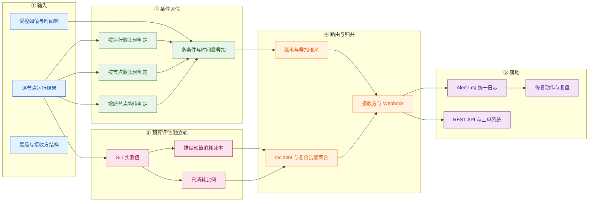

| 步骤 | 做什么 | 关键输入 | 输出 |
|---|---|---|---|
| **① 输入** | 聚合逐节点运行结果、受控阈值、层级与接收方结构 | I1 / I2 / I3 | 待评估的数据集与规则 |
| **② 条件评估** | 分别按运行数比例、节点数比例、跨节点均值判定，并与时间窗叠加 | 数据集 + 规则 | 「是否达到告警条件」的判定 |
| **③ 预算评估（独立轨）** | 由 SLI 实测值算出预算消耗速率与已消耗比例 | I4 + I1 | 速率与比例两项风险指标 |
| **④ 路由与归并** | 按继承语义决定哪一级的规则生效；把多条告警聚合为 Incident / 复合告警；按接收方清单分发 | 判定结果 + I3 | 待发的告警与事件 |
| **⑤ 落地** | 进入统一 Alert Log，经 REST API 流向工单系统，驱动修复与复盘 | 告警与事件 | 动作与记录 |

> **第 ③ 步必须与第 ② 步分开看**：这两条轨**使用同一份输入（逐节点运行结果），但产出的是两种性质完全不同的信号**——一种是「已经出事」，一种是「正在走向出事」。**把它们合并成一个阈值，就必然在「太吵」与「太晚」之间二选一。**

### 6.4.3 输出：交付什么形态的结果

| 输出物 | 形态 | 消费方 | 对应小功能点 |
|---|---|---|---|
| 告警通知 | 邮件 / 语音呼叫 / 联系组 | 值班 / SRE | 5.5 |
| 告警事件流 | Webhook 到工单 / IM / 值班系统 | 客户自有流程 | 5.5 |
| 告警明细数据 | REST API（含 Alert Instructions） | 自动化平台 | 5.11 |
| 事件聚合 | Incident / 复合告警对象 | 事件管理 | 5.6 |
| SLO 余量视图 | 错误预算消耗与剩余 | SLA 责任人 / 业务方 | 5.7–5.9 |
| 节点自身健康告警 | 节点级告警 | 平台运维 | 5.12 |
| **「告警对象」作为可编程实体** | **不是 UI 产物，而是内部接口** | Terraform Provider（CP-7）、客户自动化系统（CP-7）、AI RCA 输入（CP-6）、MCP 工具（CP-9） | —（判定引擎本身） |

### 6.4.4 关键机制：为什么「多告警并行、不去重」是必然结果，而不是缺陷

官方 A 级文档明确：同一测试上的多条告警（本级 + 继承）**各自独立评估、互不覆盖**，同一时刻可能同时触发多条，**系统不做去重**。初看这是缺陷，但它是两个前置设计叠加后的必然结果：

1. **继承语义允许「叠加」**（子级 = 父级 + 本级）。若叠加后再去重，**去重规则本身就会变成一个需要被解释、被配置、被争议的对象**——而它恰恰是最难解释的东西（「为什么这条没发出来」比「为什么发了三条」更难辩护）。
2. **告警的消费方是「流程」而不是「人」**。通知投递到 API Endpoint、工单系统、值班系统——**这些系统各自有去重与合并能力，而且比监控平台更懂自己的流程**（同一故障，网络组与企业微信的去重规则完全不同）。

**因此官方选择把去重留在客户侧，平台侧只保证「不吞掉任何一条该发的告警」**（**C（本报告推导）**，依据链：① 多条告警独立评估（A，Alerts）→ ② 子级可「父级 + 本级」叠加（A，Alerts）→ ③ 接收方支持 API Endpoint 由客户侧系统接管（A，Alerts）→ ④ 复合告警被做成可编程对象（A，Moonbeam）→ 结论）。**代价是客户必须自己做层级治理**；**收益是「漏报」这一类最难被发现、也最致命的失败模式被大幅降低**。这条取舍对自研 AI 助手的直接含义：**告警类能力的验收指标应该优先看「漏报率」，而不是「条数」。**

**第二个关键机制：为什么必须提供「速率型」告警（Burn Rate）**

官方原文（**A 级**，[Mimas Release Notes](https://docs.catchpoint.com/docs/clone-2026-09-mimas-release-notes)）把两条路径的用途区分得很清楚：**Fast Burn（Critical）与 Medium Burn（Warning）「help identify both sudden, severe degradations and sustained problems that could exhaust your error budget if left unresolved」**。

**为什么必须这么设计**：阈值型告警天然只能表达「现在的值是否越线」，而**预算的耗尽是一个积分过程**——一次短暂但剧烈的劣化，与一次温和但持续的劣化，在阈值视角下可能**都不越线**，但对预算的消耗完全不同。**引入「速率的速率」（消耗速度是否异常）才能把「积分过程」变成可告警对象**。这条机制的设计动机，本质上与 CP-4 的 Trend Shift 同源：**都是为了让「尚未越线但在恶化」变成一等信号**。

### 6.4.5 口径声明

| 内容 | 等级 | 说明 |
|---|---|---|
| 三级配置、两种继承语义、告警条件的四类判定、多条告警独立评估、接收方与 Webhook、触发类型 | **A** | [Alerts](https://docs.catchpoint.com/docs/alerts) |
| SLO Alerts 的两条路径、Fast/Medium Burn 预设、周/月/季窗口、进入 Alert Log 的类型名 | **A** | [Mimas Release Notes](https://docs.catchpoint.com/docs/clone-2026-09-mimas-release-notes) |
| Enterprise Node 自身告警项与采集频率 15 → 5 分钟 | **A** | [Moonbeam Release Notes](https://docs.catchpoint.com/docs/2025-09-moonbeam-release-notes) |
| 时间窗新增 20 / 45 分钟、语音呼叫通知、移除 Email-to-SMS | **A** | [Halo](https://docs.catchpoint.com/docs/2025-10-halo-release-notes)、[Starlight](https://docs.catchpoint.com/docs/2025-07-starlight-release-notes) |
| 告警明细 REST API 端点与 Alert Instructions | **A** | [Afterglow Release Notes](https://docs.catchpoint.com/docs/2026-01-afterglow-release-notes) |
| 复合告警的 REST API 端点 | **A** | [Moonbeam Release Notes](https://docs.catchpoint.com/docs/2025-09-moonbeam-release-notes) |
| 「不去重是刻意取舍：把去重留在客户侧以降低漏报」 | **C（本报告推导）** | 依据链见 6.4.4 |
| burn rate 的具体算法与阈值公式 | **未公开** | 官方仅说明预设档位与行为，**不可用于反向复算罚金** —— 登记为附四缺口 |

## 6.5 能力边界（这个功能点做不到什么）

> **一句话边界**：它给你一整套表达能力，**但用得准不准，责任在配置的人**——而且「不自动去重」意味着**层级设计不当会成倍放大告警量**。

| 类型 | 具体边界 | 依据（信源等级） | 对自研 APM 的提示 |
|---|---|---|---|
| **硬边界 · 责任在客户侧** | 降噪来自「条件表达能力」，**不是自动抑制**；父子层级**不会自动去重**；官方未宣称任何自动合并噪声的机制 | **A** · [Alerts](https://docs.catchpoint.com/docs/alerts)、[Moonbeam](https://docs.catchpoint.com/docs/2025-09-moonbeam-release-notes) | 交换机侧告警天然高噪（端口 up/down、光模块告警、邻居震荡）；**自研需要的是「可被运维表达出来的聚合条件」，而不是一个黑箱抑制器**——后者会让「为什么这条没发出来」变成无法回答的问题 |
| **硬边界 · 触发类型受测试类型约束** | 并非所有触发类型适用于所有测试类型，也并非所有触发类型都能在容器级配置；**BGP 四类触发器只对 BGP 测试有意义** | **A** · [Alerts](https://docs.catchpoint.com/docs/alerts) | 自研设计告警类型时，**必须显式建立「触发类型 × 测试类型 × 配置层级」的三维可用性矩阵**，并在界面上做禁用而非隐藏 |
| **软边界 · 未披露算法** | burn rate 的精确算法与阈值公式未公开；SLO 的时间窗计算方式（滚动窗口还是自然窗口）官方未明确说明 | **A / 未公开** | 自研若做 SLO 告警，**必须公开「窗口定义」与「消耗计算口径」**——这是 SLO 类能力最容易在客户审计时被追问的一点（回指 CP-8：罚金计算需要可复算口径） |
| **前提依赖 · SLO 目标必须先被定义** | SLO 能力的前提是客户已经把「目标值 + 窗口 + 预算」量化下来；官方把该能力的价值锚定在「SLA 含重大罚金或赔付条款」的场景上 | **A** · [SLO Overview](https://docs.catchpoint.com/docs/slo-overview) | 自研不要把 SLO 做成「默认开启」的能力——**没有目标就没有 SLO**；正确做法是提供目标设定引导（或从既有 SLA 反推），否则功能会被空置 |
| **官方自认局限** | 官方在节点告警段落主动提示：**采集频率从 15 分钟提高到 5 分钟会改变指标表现**，「you may see a change in the metrics… This is to be expected and does not indicate a problem with your nodes」——即**官方承认该变更构成口径断点** | **A** · [Moonbeam Release Notes](https://docs.catchpoint.com/docs/2025-09-moonbeam-release-notes) | 自研做任何「采集频率 / 计算口径」调整时，**必须主动提供变更说明与断点标记**，否则客户会把它当作故障来排查 |
| **常见误期待（澄清）** | ① 易以为「配了 SLO 就自动降噪」——SLO 解决的是**预警时机**，不是**噪音条数**；② 易以为「继承 = 自动去重」——**恰恰相反**；③ 易以为告警条数越少越好——**在缺乏漏报统计的前提下，条数少不是优点** | **A** + **C（本报告归纳）** | 对外沟通与验收指标应优先看「**漏报**」，其次才是「条数」；**不要用告警总量下降作为 AI 降噪能力的证据** |

---

# 7 大功能点 6：依赖地图与根因 —— 判得清

把「是我们的问题还是别人的问题」从一场会议，变成**一张自动生成的依赖地图 + 一份第三方公有状态基准 + 一句机器写出的根因**——替代「状态页全绿、内部全绿、用户依然打不开」的僵局。

## 7.1 小功能点清单

| # | 小功能点 | 发布时间 | 信源等级 | 说明 |
|---|---|---|---|---|
| 6.1 | **Internet Stack Map（依赖地图）** | 2025-02 大改版 / 2025-07 再改版 | **A**（[Stack Map](https://docs.catchpoint.com/docs/stack-map)、[Starlight](https://docs.catchpoint.com/docs/2025-07-starlight-release-notes)） | 「a special type of Custom Dashboard which provides a **topological view** of a system's architecture. It uses **Layers** and **Services**… and **Service Associations** which illustrate how data flows among them」；2025-07 在 Edit 模式引入**浮动菜单**用于添加与发现依赖服务 |
| 6.2 | **用点数直接购买 Sonar 服务并挂到地图上** | **2025-07（Starlight）** | **A**（[Starlight Release Notes](https://docs.catchpoint.com/docs/2025-07-starlight-release-notes)） | 「you can now use points to purchase Sonar services when adding them to your Stack Map… **doesn't require a separate Sonar contract**」 |
| 6.3 | **Internet Sonar（公共服务中断检测）** | 2023-10 起 | **A**（[Internet Sonar Overview](https://docs.catchpoint.com/v1/docs/internet-sonar)） | 官方机制原文：**服务级中断**判定为「any test or request to the service has **>20% downtime for a 15-minute interval**, or the service has a **trend shift** in downtime」；**网络级中断**在 **AS 级别**用 traceroute 判定（有丢包且目标 ping 失败即判为网络中断，以排除对 ICMP 不响应的路由造成的误判）；并额外上报 **predecessor hops**（失败跳的前一跳），用于判断丢包发生在同一 AS 内还是跨 AS；**严重度分 low / medium / high**，仪表盘侧以 **0–100** 分值三段呈现（0–33 / 34–66 / 67–100） |
| 6.4 | **AI Root Cause Analysis（AI Insights）** | **2025-09（Moonbeam）** | **A**（[Stack Map](https://docs.catchpoint.com/docs/stack-map)、[Moonbeam Release Notes](https://docs.catchpoint.com/docs/2025-09-moonbeam-release-notes)） | 「Stack Map uses AI to automatically perform an initial Root Cause Analysis… display the **AI-generated suspected root cause** at the top of the blade」；官方补充「automatically detects outages in your primary service, correlates data from dependent services (**and from Internet Sonar**), and identifies the most likely root cause. The results are presented in **plain language**」；提供**赞 / 踩反馈按钮**以持续优化该模型 |
| 6.5 | **Stack Map Recommendations** | **2025-09（Moonbeam）** | **A**（[Moonbeam Release Notes](https://docs.catchpoint.com/docs/2025-09-moonbeam-release-notes)） | 「provides custom monitoring recommendations… **also examines your existing testing strategy and recommends specific tests you may be missing**… It will **show you how many points will be used** and give you a chance to **review, edit, or cancel** before any changes are made」 |
| 6.6 | **Catchpoint Advisor（监控姿态建议）** | **2025-09（Moonbeam）** | **B**（[2025-09-17 新闻稿](https://www.catchpoint.com/press-releases/from-incident-chaos-to-calm-ai-transforms-internet-scale-troubleshooting)） | 面向「监控姿态」的建议引擎，对已监控与未监控的服务分别建议；官方口径为**建议免费、新增测试与 Sonar 按标准计费** |
| 6.7 | **Catchpoint Tracing（分布式追踪）** | 2023-10 起 | **A / B**（[Starlight](https://docs.catchpoint.com/docs/2025-07-starlight-release-notes)） | 「capturing granular information on all the interactions between services and associated resources, such as **databases, caches, queues, and streams**」 |
| 6.8 | **合成测试附赠追踪（免费）** | 2025-02 起 | **B**（[Starlight Release Notes](https://docs.catchpoint.com/docs/2025-07-starlight-release-notes)） | 官方原文（2025-07 页）：「**Enable Tracing today to enjoy complimentary tracing for all your synthetic test runs!**」——**合成测试运行自带追踪，这是一个「免费附带」的能力** |
| 6.9 | **Traceroute MPLS 过滤** | **2025-07（Starlight）** | **A**（[Starlight](https://docs.catchpoint.com/docs/2025-07-starlight-release-notes)、[Moonbeam](https://docs.catchpoint.com/docs/2025-09-moonbeam-release-notes)） | 「The new MPLS filter allows you to select paths and view the performance of **all traceroutes tagged with a specific MPLS label**… isolate performance issues along complex, multi-label routes」；2025-09 起 MPLS 标签可**按丢包与 RTT 过滤** |
| 6.10 | **Tracing 纳入外部服务数据** | **2025-07（Starlight）** | **A**（[Starlight Release Notes](https://docs.catchpoint.com/docs/2025-07-starlight-release-notes)） | 「Smartboard now includes tracing data from external services… including those from **Google, Microsoft, OpenAI, Twilio, HubSpot, Stripe**」；用途：查外部中断时受影响的内部服务、识别最慢最易错的外部服务、发现外部调用的性能离群点 |
| 6.11 | **Trace 对比（≤4 条并排）** | **2025-09（Moonbeam）** | **A**（[Moonbeam Release Notes](https://docs.catchpoint.com/docs/2025-09-moonbeam-release-notes)） | 「you can now select **up to four traces** from the transaction table and compare them **side-by-side**」——官方称此为「**First in Industry**」 |
| 6.12 | **从 Instant Test 直接查看 / 配置 Tracing** | **2025-07（Starlight）** | **A**（[Starlight Release Notes](https://docs.catchpoint.com/docs/2025-07-starlight-release-notes)） | 「When you run a synthetic test that already has Tracing configured, you will be able to **view the trace immediately from the Instant Test page**. If Tracing is not set up, the system will provide an option to configure it automatically」 |
| 6.13 | **告警送入 LogicMonitor Edwin AI** | **2026-01 / 2026-03** | **A**（[Afterglow](https://docs.catchpoint.com/docs/2026-01-afterglow-release-notes)、[Triton](https://docs.catchpoint.com/docs/2026-03-triton-release-notes)） | 「**any Catchpoint customer can send alerts to Edwin AI**, enabling IT teams to automatically **correlate network and end-user experience signals with data from infrastructure monitoring, logging, APM, security, and CMDB sources**」 |

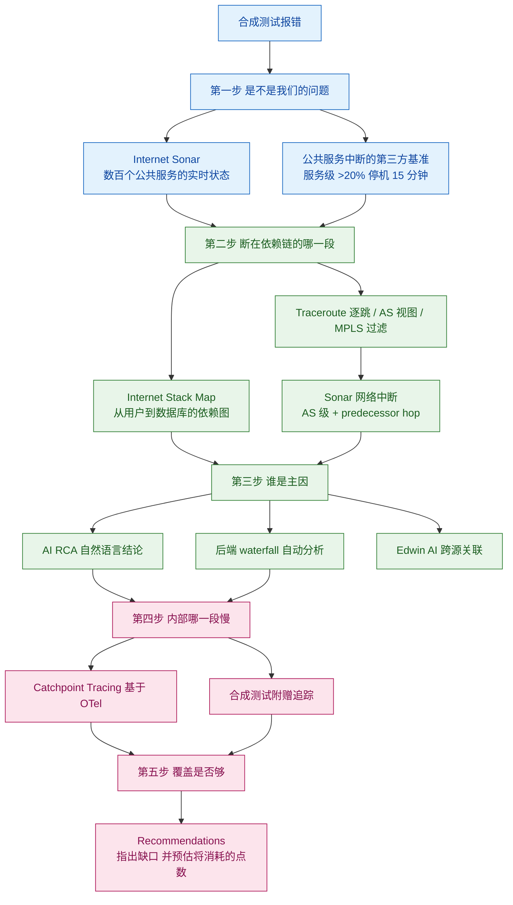

**图 7｜从「报错」到「根因」再到「补盲区」的五步关联链。** 前四步都在回答「现在怎么办」，第五步回答「下次怎么不再被动」——**而第五步是唯一自动化的（Recommendations），也是多数监控产品缺失的一环**。注意第二步里出现了两条不同的路径：**依赖图（判断依赖关系）与 Sonar（判断第三方是否在故障）必须同时存在**，只有其一都无法收口。

## 7.2 它对应的用户痛点

> **口径**：本节只写客户侧可感知的痛（时间 / 钱 / 人 / 合规 / 组织），不写「依赖图的数据模型」「跨度关联算法」这类架构层问题。痛点编号 P1…Pn 与下节解法 S1…Sn **一一对应**。

- **P1（时间 / 组织）——「『是我们的问题还是别人的问题』，每次都要花半小时以上才能回答」**。云厂商状态页全绿、内部系统全绿、用户依然打不开；**这段时间里没有任何动作可做，只能等**。
- **P2（组织 / 钱）——「一屋子人开战情室，各自翻各自的系统」**。网络组、应用组、供应商三方同时在线，各自拿出各自的截图，**会议时长与故障时长成正比**。官方公开案例正是这一场景：一名技术架构师描述「排查了近三十分钟后才确定是另一个关键服务供应商的问题」。
- **P3（时间 / 组织）——「监控覆盖不全，而没人知道盲区在哪」**。一条业务链路依赖 12 个外部服务，实际只测了 3 个——**这个「12 比 3」的比例，团队心里没有数**，直到某个没被覆盖的服务出事。
- **P4（时间）——「合成测试报了错，但不知道该先修哪一环」**。一条事务测试失败可能意味着十几个可能原因，**无法给恢复动作排序，也就无法并行分工**。
- **P5（组织）——「跨团队共享『同一张图』的成本很高」**。每次事件都要重新画一遍依赖关系、重新解释一遍链路，**组织的集体记忆没有被沉淀成资产**。

## 7.3 它是如何解决的（与痛点一一对应）

**架构约束（由痛点倒推）**

| 架构约束 | 由哪条痛点倒推 | 落到了哪些小功能点 |
|---|---|---|
| 必须存在一张「客户可看、可改、可共享」的依赖地图作为共同语言 | P1、P2、P5 | Internet Stack Map（6.1）、点数购买 Sonar 服务（6.2） |
| 必须有独立于客户自身监测的「第三方状态基准」，否则「是不是我们的问题」无解 | P1 | Internet Sonar（6.3），含服务级与 AS 级两套判定 |
| 根因结论必须能被自动产出，而不是要求人遍历所有依赖 | P2、P4 | AI RCA（6.4）、跨源关联（6.13） |
| 覆盖盲区必须被自动识别，而不是靠人回忆 | P3 | Stack Map Recommendations（6.5）、Advisor（6.6） |
| 合成测试必须能与代码级链路打通，否则「外部探针报错」到「内部哪一段慢」之间断裂 | P4 | Catchpoint Tracing（6.7）、附赠追踪（6.8）、外部服务追踪（6.10）、Trace 对比（6.11）、Instant Test 集成（6.12） |

| 解法 | 机制 | 对应痛点 |
|---|---|---|
| **S1 用一张自动生成 / 可编辑的依赖地图当作共同语言** | **Internet Stack Map** 用 **Layers + Services + Service Associations（箭头表示数据流向）** 把从用户设备到数据库的交付链画成一张可交互图，并把各段实时状态（Service Time / % Packet Loss）叠加上去。它同时具备三个关键属性：**可编辑**（2025-07 的浮动菜单让「发现并添加依赖」变成界面动作）、**可叠加外部事件**（Sonar 检测到的服务中断以灰色条与图标直接标在地图上）、**可用点数即时开通**（6.2）。**「我们看的是同一张图」这件事一旦成立，跨团队的沟通成本会出现台阶式的下降** | → 解 P1、P5 |
| **S2 用「别人也在测的数据」建立第三方基准** | **Internet Sonar** 以自有节点网络持续测试**数百个流行公共互联网服务**（互联网基础设施、SaaS、MarTech 等），并把结果压缩成「某服务在某区域是否中断」。**其判定口径是可核查的**：服务级中断 = 15 分钟窗口内 >20% 停机或停机趋势位移；网络级中断 = 在**AS 级别**用 traceroute 判定（并有 predecessor hop 数据兜底，避免因路由不响应 ICMP 而产生误判）。**它直接回答 IT 团队在每次中断时问的第一个问题：「是我们还是别人？」** | → 解 P1 |
| **S3 把根因结论自动写出来，并允许人类反馈修正** | **AI RCA（2025-09）** 基于 Stack Map 的依赖关系与事件情报，**自动检测主服务中断、关联依赖项与 Sonar 数据**，并用**自然语言**给出最可能的根因；同时分析后端 waterfall。**官方提供了赞 / 踩反馈按钮**——「You can use the thumbs up / thumbs down feedback buttons to let us know how useful the feedback is, **which will help us in further refining this AI model**」。2026-01 起任何 Catchpoint 客户还可把告警送入 **Edwin AI**，与基础设施、日志、APM、安全、CMDB 数据做自动关联 | → 解 P2、P4 |
| **S4 把「覆盖缺口」自动指出来，并给出成本预告** | **Stack Map Recommendations / Advisor** 基于客户端声明的依赖关系，**检查既有测试策略、指出缺失的测试**并给出预置建议；**关键设计是「先算账再动手」**——「It will **show you how many points will be used** and give you a chance to **review, edit, or cancel** before any changes are made」。**这条机制把「监控覆盖」从一个主观感受变成一个可被系统指出、且可预算的清单** | → 解 P3 |
| **S5 把外部探针与代码级链路缝在一起** | **Catchpoint Tracing** 与合成测试打通：**合成测试运行自带免费追踪**（官方原文「complimentary tracing for all your synthetic test runs」），可从外部探针一路下钻到微服务与网关内部的跨度；2025-07 起 Smartboard 纳入**外部服务**的追踪数据（可看外部中断时哪些内部服务受影响、哪个外部服务最慢最易错）；2025-09 支持最多 **4 条 trace 并排比较**（官方称行业首创）；Instant Test 页面可一键查看或自动配置 Tracing。**这条链路的终点是「从一次合成的失败，直接跳到具体哪个下游调用变慢」** | → 解 P4 |

> **边界**：
> - **地图的完整性取决于「依赖是否被登记」。** Stack Map 是「客户声明 + 自动发现」的组合，**未被登记的服务不会自动出现**——Recommendations 的存在本身就是对这个缺口的承认，但在客户主动接受建议之前，盲区依然存在。官方亦在文档中主动提示：「Services are populated with data generated ***after*** tests are associated with the Stack Map」——**新建地图初期是没有数据的**。
> - **RCA 输出是「最可能的根因」，不是确证。** 官方口径为 **plain-language 结论**且原文使用「**suspected** root cause」这一措辞，**无第三方准确率验证**，不可作为对外定责的唯一依据。
> - **「免费」有明确范围**：RCA 免费、建议免费、合成测试路径的 Tracing 免费；**新增测试与新增 Sonar 服务均按标准点数计费**（Sonar 每个启用服务按天消耗少量点数）。
> - **Sonar 覆盖的是「公共服务的公共状态」**，不覆盖客户私有依赖；私有依赖要靠 Enterprise Node 上的自有测试。官方另说明：**未启用服务的账号在 Overview 只看到匿名化事件**（如「a CDN Service has an incident」），**点击后才可选择启用并看清是哪一家**。
> - **Sonar 的区域覆盖受「购买的区域 Collection」限制**：官方明确中断数据与节点所在城市绑定，**只有在购买了对应区域的情况下才会在 Overview 与 Custom Dashboard 中呈现**。
> - **Tracing 的深度受被追踪服务是否接入 OTel 决定。**「完整支持 OpenTelemetry」是对格式与集成的承诺，**不等于「无需改造即可全链路可见」**。
> - **MPLS 过滤、外部服务追踪、Trace 对比均为 2025 年新增，第三方验证缺失。**
>
> **配套演进**：Stack Map 的 UI 改版（2025-02、2025-07）与计费形态（点数购买 Sonar）属交互与商业演进，已并入 6.1 / 6.2 列示。

## 7.4 功能原理

### 7.4.1 输入：依赖地图与根因链路吃进去什么

| 输入 | 具体内容 | 官方依据（含原文链接，标 A/B/C） | 缺了它会怎样 |
|---|---|---|---|
| **I1 · 客户端声明的依赖关系** | Layer 划分、Service 定义、Service Association（谁流向谁） | **A 级** · [Stack Map](https://docs.catchpoint.com/docs/stack-map)、[Creating Stack Maps](https://docs.catchpoint.com/docs/creating-stack-maps) | 地图画不出来——**这是整套判定的骨架，且它必须先由人（或建议引擎）声明** |
| **I2 · 服务与测试的绑定关系** | 每个 Service 关联的一条或多条 Catchpoint 测试（提供该服务的性能与告警数据） | **A 级** · 同上（「Each Service may be associated with one or more Catchpoint Tests, which will provide the performance and alert data for that service」） | 地图是空壳——**没有绑定就没有数据，也没有办法把「某一段慢」定位到「某个具体测试」** |
| **I3 · 第三方公有状态基准** | Internet Sonar 的服务级 / AS 级中断判定结果 | **A 级** · [Internet Sonar Overview](https://docs.catchpoint.com/v1/docs/internet-sonar) | 「是我们还是别人」无解——**只能回到看供应商 status page 的状态** |
| **I4 · 代码级链路数据** | OTel 追踪数据（含外部服务 span） | **A / B 级** · [Starlight](https://docs.catchpoint.com/docs/2025-07-starlight-release-notes)、[Tracing](https://docs.catchpoint.com/docs/2025-07-starlight-release-notes) | 「外部探针报错 → 内部哪一段慢」之间断裂，**只知道入口坏了，不知道里面哪里坏了** |
| **I5 · 网络路径证据** | Traceroute 逐跳、AS 视图、MPLS 标签、ECN | **A 级** · [Starlight](https://docs.catchpoint.com/docs/2025-07-starlight-release-notes)、[Europa](https://docs.catchpoint.com/docs/2026-04-europa-release-notes) | 无法把「慢」定位到具体运营商段或 MPLS 段——**只能停在「网络有问题」这一层** |

### 7.4.2 实现链条：从一条依赖声明到一句根因结论

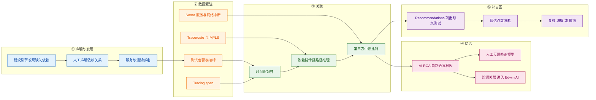

| 步骤 | 做什么 | 关键输入 | 输出 |
|---|---|---|---|
| **① 声明与发现** | 人工声明依赖结构，建议引擎指出缺失项，并把服务与具体测试绑定 | I1 / I2 | 一张有数据的依赖地图 |
| **② 数据灌注** | 测试告警与指标、Sonar 中断、Tracing span、Traceroute 与 MPLS 数据持续灌入对应服务节点 | I2 / I3 / I4 / I5 | 带实时状态的依赖图 |
| **③ 关联** | 在同一时间窗上对齐；沿依赖链推理传播方向；与第三方中断结果比对 | 全部 | 候选根因集合 |
| **④ 结论** | 生成自然语言根因；接受人工反馈；必要时把告警送往外部分析平台做跨源关联 | 候选根因 | 一句可读的结论 + 反馈回路 |
| **⑤ 补盲区** | 列出缺失的测试、预估将消耗的点数、允许复核 / 编辑 / 取消 | 依赖结构 + 现有测试清单 | 覆盖改进清单（含成本） |

> **第 ⑤ 步是本组最被低估的一环**：它把「监控覆盖」从**一次性的建设任务**变成了**一个可持续收敛的回路**——每一次事件之后，系统都会告诉你「这一段的依赖还没有被监测」。**没有这一步，依赖地图会随着业务演化而逐步失真，最终变成一张「曾经正确」的图。**

### 7.4.3 输出：交付什么形态的结果

| 输出物 | 形态 | 消费方 | 对应小功能点 |
|---|---|---|---|
| 依赖地图 | 可交互的 Layer / Service / Association 视图 | NOC / 跨域团队 | 6.1 |
| 第三方中断状态 | Sonar 中断列表与地图标注（含严重度分值） | NOC / 供应商管理 | 6.3 |
| 根因结论 | 自然语言文本（附人工反馈入口） | 值班 / 事件管理 | 6.4 |
| 覆盖建议 | 建议清单 + 预估点数 | 平台负责人 / 预算责任人 | 6.5、6.6 |
| 代码级链路 | Trace 视图与最多 4 条并排对比 | 应用研发 / SRE | 6.7–6.12 |
| 路径级证据 | 逐跳 / AS / MPLS 过滤后的路径性能 | 网络团队 | 6.9 |
| **「Service → Test」的绑定关系与关联结论** | **不是 UI 产物，而是内部接口** | AI RCA 判定、Recommendations 生成、Edwin AI 跨源关联、MCP 工具（CP-9） | —（关联层本身） |

### 7.4.4 关键机制：为什么 Sonar 必须在「AS 级别」判定网络中断

官方对网络中断的判定给出了完整且罕见的具体口径（**A 级**，[Internet Sonar Overview](https://docs.catchpoint.com/v1/docs/internet-sonar)）：

> 「Internet Sonar detects network outages at the **Autonomous System (AS) level** using traceroute tests… If the traceroute test has packet loss **and the destination ping fails**, this is taken to indicate a network outage. **This process eliminates false positives in cases where packet loss might not be relevant to the route, like routers that drop ICMP packets.**」

**为什么必须这么设计**：这是整篇报告里少见的、官方主动解释「为什么要这么判」的例子。原因是：**链路上的中间路由器普遍对 ICMP 做限速或直接丢弃**——如果只看「某一跳有无响应」，几乎每条路径都会报出「丢包」。因此判定必须**同时要求两个条件**（中间丢包 **且** 最终目标不可达），才能把「路由器不响应探测」与「链路真的断了」区分开。

**配套的第二个设计（同样值得复刻）**：官方明确「Sonar also captures and reports **predecessor hops**（the hops preceding the failed hop in the traceroute）… In some cases, a traceroute hop might result in no response at all… **The predecessor hop data is vital in these cases as it provides the last known AS and IP data available**」。**也就是说，当关键证据本身缺失时，系统主动提供「最接近缺失点的那份证据」，而不是把这一跳留空。** 这两条合起来，是「如何让机器判定结果足够可靠到被写进对外报告」的完整示范——对自研 APM 的价值极高（见附三第 7 条）。

### 7.4.5 口径声明

| 内容 | 等级 | 说明 |
|---|---|---|
| Stack Map 的 Layer / Service / Association 结构与数据来源 | **A** | [Stack Map](https://docs.catchpoint.com/docs/stack-map)、[Creating Stack Maps](https://docs.catchpoint.com/docs/creating-stack-maps) |
| AI RCA 的工作方式、输出形态与反馈按钮 | **A** | [Stack Map](https://docs.catchpoint.com/docs/stack-map)、[Moonbeam Release Notes](https://docs.catchpoint.com/docs/2025-09-moonbeam-release-notes) |
| Sonar 的服务级判定口径（>20% 停机 / 15 分钟窗口 / 趋势位移）、AS 级网络判定、predecessor hop、严重度三档与 0–100 分值 | **A** | [Internet Sonar Overview](https://docs.catchpoint.com/v1/docs/internet-sonar) |
| Sonar 的计费方式（点数、默认含 1 个免费服务、未购置服务显示匿名事件） | **A** | 同上 |
| Recommendations 的「先算点数再确认」流程 | **A** | [Moonbeam Release Notes](https://docs.catchpoint.com/docs/2025-09-moonbeam-release-notes) |
| Trace 对比 ≤4 条、外部服务追踪、MPLS 过滤、Instant Test 集成 | **A** | [Starlight](https://docs.catchpoint.com/docs/2025-07-starlight-release-notes)、[Moonbeam](https://docs.catchpoint.com/docs/2025-09-moonbeam-release-notes) |
| 「合成测试路径的 Tracing 免费」 | **B** | [Starlight Release Notes](https://docs.catchpoint.com/docs/2025-07-starlight-release-notes) 原文为「complimentary tracing for all your synthetic test runs」；RCA 与建议免费见 [2025-09-17 新闻稿](https://www.catchpoint.com/press-releases/from-incident-chaos-to-calm-ai-transforms-internet-scale-troubleshooting)（B 级） |
| 「AS 级判定 + predecessor hop 是『让结论可用于对外』的设计」 | **C（本报告推导）** | 依据链：① 官方解释两条件判定的目的是「eliminates false positives」（A）→ ② 官方说明 predecessor hop 在证据缺失时「is vital」（A）→ ③ AI RCA 输出被明确定位为「suspected root cause」并附反馈入口（A）→ 结论：该体系在设计上已考虑「结论会被用于跨组织沟通」这一用途 |
| AI RCA 的准确率、模型、训练数据 | **未公开** | 官方未披露，**不可对外引用为能力证据**——登记为附四缺口 |

## 7.5 能力边界（这个功能点做不到什么）

> **一句话边界**：它能给出「最可能的根因」和一张共同的地图，**但地图的完整性取决于依赖是否被登记、根因结论仍属「疑似」**——它把定责从「无从下手」推进到「有据可议」，**但没有推进到「可自动定责」**。

| 类型 | 具体边界 | 依据（信源等级） | 对自研 APM 的提示 |
|---|---|---|---|
| **硬边界 · 依赖登记决定上限** | Stack Map 是「客户声明 + 自动发现」的组合，**未登记的服务不会自动出现**；且**新建地图初期无数据**（数据只来自绑定之后运行过的测试） | **A** · [Stack Map](https://docs.catchpoint.com/docs/stack-map) | 自研 APM 知道**设备拓扑**，但不知道**业务对第三方与对外部服务的依赖**——**必须同时提供「自动发现」与「人工声明」两条腿**，只做自动发现会漏、只做人工声明会僵 |
| **硬边界 · 判定范围** | Sonar 只覆盖**公共服务的公共状态**，不覆盖客户私有依赖；且**区域可见性受购买的区域 Collection 限制** | **A** · [Internet Sonar Overview](https://docs.catchpoint.com/v1/docs/internet-sonar) | 自研的「第三方基准」需要区分「公共依赖」与「客户私有依赖」，**并明确后者的责任边界**——否则会把「我们没有数据」误表述为「没有问题」 |
| **软边界 · 输出性质** | AI RCA 输出为 `suspected root cause`（疑似根因），**无第三方准确率验证**；准确率、模型、训练数据均未公开 | **A / 未公开** · [Stack Map](https://docs.catchpoint.com/docs/stack-map) | 自研 AI 助手的根因结论**必须保持「疑似 + 附证据链」的形态**，并**内置人工反馈入口**（Catchpoint 的赞 / 踩按钮是必配项，不是可选项） |
| **软边界 · 未披露项** | 官方**未披露**：AI RCA 的关联算法与时间窗宽度、Recommendations 的建议规则库、Stack Map 对超大依赖图的规模上限、Trace 对比的字段级对齐逻辑 | —（官方材料无此项） | 「时间窗宽度」与「建议规则库」是自研要对客户解释的两件事；**必须自建口径并公开**，否则客户无法判断结论的可信度 |
| **前提依赖 · 必须先有测试** | Stack Map 的数据完全来自**被绑定的测试**与 Sonar；没有测试就没有服务级数据 | **A** · [Stack Map](https://docs.catchpoint.com/docs/stack-map) | 自研做「依赖地图」时**要接受一个尴尬事实：地图的价值取决于有没有测试覆盖它**。因此**把「地图」与「覆盖建议」做成一对**（Catchpoint 的做法）比单独做地图更实用 |
| **官方自认局限** | 官方原文使用「**suspected** root cause」，并明确「Services are populated with data generated **after** tests are associated with the Stack Map, so when you first create a Stack Map, you will not see data」；对 Sonar 亦说明未启用服务时只显示**匿名化**事件 | **A** · 同上 | 官方文档对「边界」的表述方式值得直接借鉴：**把「什么情况下你会看不到」写在功能说明里，而不是写在 FAQ 里** |
| **常见误期待（澄清）** | ① 易以为 Stack Map 会「自动画出全部依赖」——**它不会**，未被绑定 / 未启用的部分不可见；② 易以为 AI RCA 的结论可对外定责——**不可**，它只是「最可能」；③ 易以为 Sonar 免费——**默认含 1 个免费服务，其余按点数按天消耗**；④ 易以为 Tracing 接上就有全链路——**深度受被追踪服务是否接入 OTel 决定** | **A** + **C（本报告归纳）** | 对外沟通要把「**地图覆盖度**」与「**根因可信度**」作为两个独立指标披露；**不要用「有 AI 根因」替代「有证据链」** |

---

# 8 大功能点 7：平台化与集成 —— 接得上

让测试配置**从客户的仓库流进来**、让原始数据**从平台流出去**——替代「监控配置是门户里的黑箱、数据被困在厂商界面里」的形态。

## 8.1 小功能点清单

| # | 小功能点 | 发布时间 | 信源等级 | 说明 |
|---|---|---|---|---|
| 7.1 | **REST API v3 / v4 与版本策略** | v3 自 **2024-07-11** 为当前稳定版 | **A**（[Mimas Release Notes](https://docs.catchpoint.com/docs/clone-2026-09-mimas-release-notes)） | 「We support the latest stable version of our REST API, and **the prior version for twelve months after a new version becomes stable**. As of July 11, 2024, **REST API v3 is the current stable version. REST API v4 is available in preview and may include breaking changes**」 |
| 7.2 | **REST API 消费者页面与按分部视图** | 2026-03（Triton） | **A**（[Triton Release Notes](https://docs.catchpoint.com/docs/2026-03-triton-release-notes)） | 「A Division selector has been added to the main integration page to enable viewing Consumers by division」；Starlight 另提示「**REST API Consumers should avoid strict deserialization of the API schema(s). Catchpoint reserves the right to expand the schema in future**」 |
| 7.3 | **非分析型 API 用量限额** | 2026-09 公告 / **2026-10-28 生效** | **A**（[Mimas Release Notes](https://docs.catchpoint.com/docs/clone-2026-09-mimas-release-notes)） | 「**Non-analytic API calls will be subject to system usage limits**… Non-analytic requests interact directly with our **core application databases**. High-volume call spikes from a single account can overload shared resources… **Fixed Limits: Non-analytic limits are non-configurable and cannot be increased**… **Thresholds: Numerical limits will be published and applied on October 28th**」 |
| 7.4 | **Terraform Provider 2.0.0（含破坏性变更）** | **2026-01（Afterglow）** | **A**（[Halo Release Notes](https://docs.catchpoint.com/docs/2025-10-halo-release-notes)、[Terraform Provider 2.0.0](https://docs.catchpoint.com/docs/terraform-provider-200)、[Terraform Provider](https://docs.catchpoint.com/docs/terraform-provider)） | Halo 原文：「The Catchpoint Terraform Provider has been upgraded to leverage **HashiCorp's latest Terraform Plugin Framework**… **Important: The new Terraform Plugin Framework version (2.0.0) includes some breaking changes**」；Provider 文档原文：「users can manage (**Create, Read, Update, and Delete**) **Web, API, Transaction, DNS, SSL, BGP, Traceroute, and Ping tests** with minimum configurations. To inherit sections such as Scheduling, Advanced Settings, Insights, and Alerts, **simply omit the corresponding blocks**」 |
| 7.5 | **Catchpoint CLI v1** | **2026-04（Europa）** | **A**（[Europa Release Notes](https://docs.catchpoint.com/docs/2026-04-europa-release-notes)） | 「The Catchpoint CLI is now available… **Built in Go**… The initial v1 release includes support for **Tests and Instant Tests**… includes built-in documentation, **shell auto-completion**, configurable verbosity… and a **Docker image** for use in containerized environments」 |
| 7.6 | **Test Data Webhook 支持文件夹级与测试级** | **2026-08（Ganymede）** | **A**（[Ganymede Release Notes](https://docs.catchpoint.com/docs/2026-08-ganymede-release-notes)） | 「In addition to product-level configuration, **teams can now override inherited webhook settings to send test data from specific folders or tests to different destinations**… support multiple integrations, separate environments, and team-specific workflows」 |
| 7.7 | **测试级代理配置（Test Level Proxy）** | **2026-04（Europa）** | **A**（[Europa Release Notes](https://docs.catchpoint.com/docs/2026-04-europa-release-notes)） | 「Proxy configuration is now available at the **test level**… managed through a **centralized proxy configuration library**, enabling the reuse of consistent proxy definitions across multiple tests」；当前**仅支持静态代理，PAC 文件后续阶段提供** |
| 7.8 | **GitHub Action for WebPageTest（性能预算进 CI）** | 2021-04（B/C 级） | **B / C**（[Pricing FAQ 对 WPT 能力的描述](https://www.catchpoint.com/pricing)） | 为 WPT 指标设定性能预算；代码变更若导致预算被突破，**自动在 PR 上创建评论**。**本报告未取得该 GitHub Action 仓库页的可核验链接，机制描述为 C 级** |
| 7.9 | **告警与工单集成** | 持续 | **B** | 官方产品页列明与 **ServiceNow、Grafana、Splunk、Datadog、PagerDuty** 等第三方通道集成（[官方首页](https://www.catchpoint.com/)） |
| 7.10 | **数据湖与可观测平台集成** | 持续 | **B** | 与数据湖 / 可观测平台对接并提供数据导出与摄取；官方在 NEL 与 Tracing 段落反复强调 **OpenTelemetry** 支持（[Triton](https://docs.catchpoint.com/docs/2026-03-triton-release-notes)、[Starlight](https://docs.catchpoint.com/docs/2025-07-starlight-release-notes)） |
| 7.11 | **MFA 多因素登录** | **2026-08（Ganymede）** | **A**（[Ganymede Release Notes](https://docs.catchpoint.com/docs/2026-08-ganymede-release-notes)） | 「Catchpoint now supports **multi-factor authentication (MFA) for username and password sign-ins**… requiring a **one-time verification code sent by email**… Customers using single sign-on (SSO) continue to authenticate through their identity provider. **Email is the supported verification method for MFA in this initial release**」 |
| 7.12 | **SSO Access Scope Assertions** | **2025-07（Starlight，限量预览）** | **A**（[Starlight Release Notes](https://docs.catchpoint.com/docs/2025-07-starlight-release-notes)、[Afterglow](https://docs.catchpoint.com/docs/2026-01-afterglow-release-notes)） | 「an individual portal user can have **distinct roles and access types (product, test, RUM site, etc.) within each client or division**, all applied automatically at login」；2026-01 补齐 REST API 的增删改查端点 |
| 7.13 | **Active Session Timeout（对齐 NIST SP 800-63B）** | **2026-03（Triton）** | **A**（[Triton Release Notes](https://docs.catchpoint.com/docs/2026-03-triton-release-notes)） | 「require users to **re-authenticate after a defined period of time, even if they are actively using the portal**. This supports security best practices outlined in **NIST SP 800‑63B** for session reauthentication and maximum session duration」 |
| 7.14 | **Rotational API Key** | **2026-04（Europa）** | **A**（[Europa Release Notes](https://docs.catchpoint.com/docs/2026-04-europa-release-notes)） | 「Bearer tokens can be configured with **custom expiration periods ranging from 30 days to 2 years**… **Multiple API keys are now supported per consumer**, enabling you to create and validate a new key while an existing key remains active. This allows for **seamless key rotation**」 |

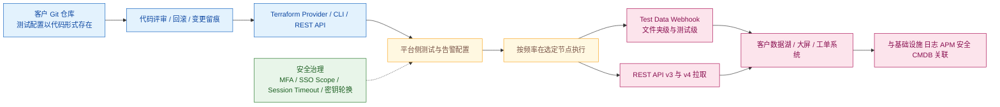

**图 8｜Monitoring as Code 的完整回路。** 关键在于**配置从客户的仓库流入、数据从平台流出**：前一段让监控变更纳入变更管理（回滚等同于回退一次提交），后一段让数据脱离厂商界面进入客户自己的分析栈。**注意 2026-10-28 起非分析型 API 有固定限额——回路右半侧应以 Webhook 推送为主，而不是轮询。**

## 8.2 它对应的用户痛点

> **口径**：本节只写客户侧可感知的痛（时间 / 钱 / 人 / 合规 / 组织），不写「API 幂等性」「IaC 状态管理」这类架构层问题。痛点编号 P1…Pn 与下节解法 S1…Sn **一一对应**。

- **P1（时间 / 人）——「新环境上线要人工配一堆测试，跟不上发布节奏」**。新建一个区域、多一个品牌、多一个租户，监控就要从零手工配一遍；**监控的上线速度成为业务扩容的关键路径**。
- **P2（合规 / 组织）——「监控配置不能版本化、不能评审，改坏了无法回溯」**。谁在什么时候把哪条测试的频率从 5 分钟改成 60 分钟，事后无从查证；**监控配置本身成了一个不受变更管理约束的黑箱**。
- **P3（时间 / 钱）——「性能预算进不了流水线」**。只有在生产上跑起来才知道「这次改动把首页拖慢了 1.2 秒」，**问题在最便宜的时候（发布前）没有被拦住**。
- **P4（组织 / 时间）——「数据出不去，进不了自己的数据湖、大屏与工单系统」**。监测数据被困在厂商的门户里，无法与自己的业务指标做联合分析，**也无法纳入统一的运维视图**。
- **P5（合规）——「权限与安全管不住」**。多人共用账号、脚本里写口令、SSO 无法做「同一人在不同分部有不同权限」这类细粒度授权、API 密钥无法轮换——**在企业级采购的安全评审环节，这些是会直接卡住项目的问题**。

## 8.3 它是如何解决的（与痛点一一对应）

**架构约束（由痛点倒推）**

| 架构约束 | 由哪条痛点倒推 | 落到了哪些小功能点 |
|---|---|---|
| 监控配置必须以「代码」形式存在于客户自己的仓库，才能随发布流水线一起流动 | P1、P2 | Terraform Provider（7.4）、CLI（7.5）、REST API（7.1） |
| 配置语义必须支持「继承 / 覆盖」，否则批量创建无法表达 | P1 | Provider 的「省略即继承」语义（7.4）、与门户一致的继承模型（详见 6.1 的 5.1） |
| 数据必须能主动外推，而不是靠人登门户导出 | P4 | Test Data Webhook 多级配置（7.6）、数据湖与可观测平台集成（7.10）、REST API（7.1） |
| 出向接口必须有稳定性承诺与配额边界，否则无法被依赖 | P1、P4 | API 版本策略与 12 个月兼容窗口（7.1）、非分析型限额（7.3）、按分部查看消费者（7.2） |
| 必须有平台级的安全与企业治理能力，才敢放进生产环境 | P5 | MFA（7.11）、SSO Access Scope（7.12）、Session Timeout 对齐 NIST（7.13）、密钥轮换（7.14）、凭据掩码（详见 4.1 的 3.13） |

| 解法 | 机制 | 对应痛点 |
|---|---|---|
| **S1 Monitoring as Code：把监控配置纳入客户的版本控制与流水线** | **Terraform Provider 2.0.0（2026-01）** 支持对 **Web / API / Transaction / DNS / SSL / BGP / Traceroute / Ping** 测试做完整的增删改查，并**完整沿用门户的继承模型**——「To inherit sections such as Scheduling, Advanced Settings, Insights, and Alerts, **simply omit the corresponding blocks**」。**结果是「新增一个区域」从「手工配 200 条测试」变成「在仓库里加一段配置并合并」** | → 解 P1 |
| **S2 配置可评审、可回溯、可回滚** | 当配置以代码形式存在于客户的 Git 仓库中，**变更自动进入代码评审流程，历史版本天然可回溯，回滚等同于回退一次提交**。平台侧另以**测试级 changelog** 记录配置变更（2026-01 修复了「Chrome (New) / Mobile (New) 监视器变更未入 changelog」的问题）——**门户内的变更与仓库内的变更各自可查** | → 解 P2 |
| **S3 把性能测量搬进 CI/CD 与自动化通道** | **CLI v1（2026-04，Go 编写）** 让命令行环境可直接操作测试与 Instant Test，官方明确其定位为「scripting, automation, and CI/CD workflows」并提供 Docker 镜像与 shell 自动补全；REST API 侧 2026-08 补齐 **WPT 定时测试与 Endpoint 监控资源的全生命周期管理**，**使「一套配置跑一批 URL」成为流水线里的标准动作**；性能预算型 CI 能力（GitHub Action，2021）在官方定价页仍被列为 WPT 能力之一（**B / C 级**） | → 解 P3 |
| **S4 让数据双向流动** | 三路并行：① **Test Data Webhook** 把原始测试数据实时推给客户系统，**2026-08 起支持文件夹级与测试级覆盖继承设置**，从而支持「不同环境送不同目的地」；② **REST API v3 / v4** 用于拉取与回写配置；③ **数据湖与可观测平台集成** 并提供 **OpenTelemetry** 支持。**官方在 Tracing 与 NEL 段落反复强调 OTel 生态**——这不是营销词，而是决定「这份数据能否进入客户既有分析栈」的格式问题 | → 解 P4 |
| **S5 把安全治理做成平台能力** | **MFA（2026-08）** 为账号口令登录加上邮件一次性验证码；**SSO Access Scope Assertions（2025-07 限量预览）** 支持同一用户在不同 client / division 内拥有不同角色与访问范围并在登录时自动应用——**这正是集团型客户最难表达的一类授权**；**Active Session Timeout（2026-03）** 明确对齐 **NIST SP 800-63B** 的会话重认证与最大时长建议；**Rotational API Key（2026-04）** 允许 30 天至 2 年的自定义有效期与多密钥并存，实现**无缝轮换**。配合凭据启停与掩码，**构成一套可过企业安全评审的面貌** | → 解 P5 |

> **边界**：
> - **非分析型 REST API 自 2026-10-28 起有固定限额，且「不可配置、不可提升」。** 官方给出的理由是「High-volume call spikes from a single account can overload shared resources, risking platform-wide slowness or outages」。**以轮询为核心的既有集成必须重新设计**（建议改为 Webhook 推送或降低频率），**这是本次调研中对自建集成影响最直接的一条变更**；**具体阈值官方声明「将于 10 月 28 日公布并生效」，本报告截稿时尚未公布**。
> - **Terraform Provider 2.0.0 是破坏性更新。** 官方在 Halo 版本中明确「includes some breaking changes」，并指向 KB 文章；**既有 `.tf` 配置必须改造后才能升级**。**本报告未逐条核验破坏性变更清单**（该 KB 页内容未在本轮采集中取得原文），故不在此列具体字段名。
> - **REST API v4 仍是预览态，可能含破坏性变更**；稳定的对外依赖应以 v3 为主，并注意「新版稳定后 12 个月」的兼容窗口。官方另在 Starlight 中明确提示：**消费者应避免对 API schema 做严格反序列化**，「Catchpoint reserves the right to expand the schema in future」。
> - **Terraform Provider 文档站上的页面标注为 PREVIEW**（标题即为「TERRAFORM PROVIDER (PREVIEW)」），且**部分字段为只读**（如 API 测试的 `script_type` 在 Terraform 侧只接受既有枚举值）——**「全部设置都可 IaC 化」不成立**。
> - **Test Level Proxy 当前仅支持静态代理**，官方明确「PAC (Proxy Auto-Configuration) files will be added in a later phase」。
> - **MFA 在首发版本仅支持邮件验证码**；使用 SSO 的客户仍走身份提供方（即 MFA 不覆盖 SSO 场景）。
>
> **配套演进**：门户品牌与配色对齐 LogicMonitor（2026-03）属收购整合的视觉层动作，不回应客户痛点，列入附一时间线。

## 8.4 功能原理

### 8.4.1 输入：平台化链路吃进去什么

| 输入 | 具体内容 | 官方依据（含原文链接，标 A/B/C） | 缺了它会怎样 |
|---|---|---|---|
| **I1 · 客户侧的配置源** | Terraform 配置、CLI 命令、REST API 调用载荷 | **A 级** · [Terraform Provider](https://docs.catchpoint.com/docs/terraform-provider)、[Europa Release Notes](https://docs.catchpoint.com/docs/2026-04-europa-release-notes) | 配置只能手工点，**P1 / P2 无解** |
| **I2 · 平台侧的配置对象与继承模型** | Product / Folder / Test 三级 + 继承 / 覆盖语义 | **A 级** · [Terraform Provider](https://docs.catchpoint.com/docs/terraform-provider)（「simply omit the corresponding blocks」）、[Alerts](https://docs.catchpoint.com/docs/alerts) | 批量创建无法表达——**每一次创建都要写全量字段，等价于没有自动化** |
| **I3 · 出向数据的格式与通道** | Webhook 载荷、REST API 响应、OTel 格式 | **A / B 级** · [Ganymede](https://docs.catchpoint.com/docs/2026-08-ganymede-release-notes)、[Triton](https://docs.catchpoint.com/docs/2026-03-triton-release-notes)（NEL 与 OTel 表述） | 数据只能被人看，**无法进入客户既有分析栈** |
| **I4 · 身份与密钥** | 用户身份（SSO / MFA）、API 密钥（有效期与轮换） | **A 级** · [Ganymede](https://docs.catchpoint.com/docs/2026-08-ganymede-release-notes)、[Europa](https://docs.catchpoint.com/docs/2026-04-europa-release-notes)、[Triton](https://docs.catchpoint.com/docs/2026-03-triton-release-notes) | 无法通过企业安全评审——**功能再强也进不去**（P5） |
| **I5 · 配额与稳定性边界** | 非分析型 API 的固定限额、分析型限额、API 版本兼容窗口 | **A 级** · [Mimas Release Notes](https://docs.catchpoint.com/docs/clone-2026-09-mimas-release-notes) | 集成方案可能在上线后突然失效——**这是必须写进架构设计前提的一条约束** |

### 8.4.2 实现链条：配置流入 → 执行 → 数据流出

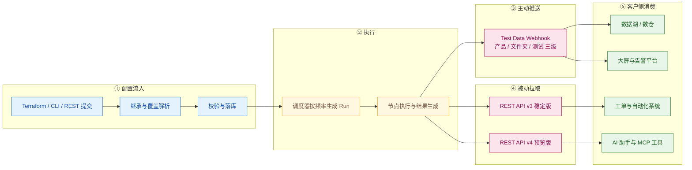

| 步骤 | 做什么 | 关键输入 | 输出 |
|---|---|---|---|
| **① 配置流入** | 从仓库 / 命令行 / API 提交配置，解析继承与覆盖，校验后落库 | I1 / I2 | 平台内的测试与告警配置 |
| **② 执行** | 调度器按频率生成 Run，由节点执行 | 配置 + 节点 | 运行结果 |
| **③ 主动推送** | 按三级 Webhook 配置把原始数据推给不同目的地 | I3 + 三级配置 | 到达客户系统的数据流 |
| **④ 被动拉取** | 通过稳定版 / 预览版 API 拉取数据与配置 | I3 + I5（配额） | API 响应 |
| **⑤ 客户侧消费** | 进数据湖、大屏、工单、以及**上层的 AI 助手** | 推送与拉取的数据 | 客户自有场景 |

> **第 ③ / ④ 两条通路的选择不是风格问题，而是被第 ⑤ 步的配额约束决定的**：非分析型 API 有固定上限，因此**高频、细粒度、实时的需求必须走 Webhook 推送**；API 适合配置类与低频率的补数场景。**这条判断对自研 APM 同样成立**——凡是自研要暴露给外部系统的数据，都应优先设计「推送」而不是「让外部来轮询」。

### 8.4.3 输出：交付什么形态的结果

| 输出物 | 形态 | 消费方 | 对应小功能点 |
|---|---|---|---|
| 可编程的测试配置 | Terraform 资源 / CLI 命令 / REST 载荷 | 平台工程 / 客户 CI | 7.4、7.5、7.1 |
| 原始测试数据流 | Webhook 推送（三级可配） | 客户数据湖 / 大屏 | 7.6 |
| 拉取型数据接口 | REST API 响应 | 客户自动化 | 7.1、7.2 |
| 第三方生态对接 | 工单 / 大屏 / 可观测平台连接 | 运维流程 | 7.9、7.10 |
| 安全治理配置 | 身份、会话、密钥策略 | 安全与合规 | 7.11–7.14 |
| **「配置对象 + 数据流」的双向接口** | **不是 UI 产物，而是内部接口** | 客户 IaC 流水线、客户数据平台、**以及上层 AI 助手** | —（平台层本身） |

> **注意最后一行**：这一组能力的**真正产出是一条「配置进、数据出」的双向接口**。第 10 章（CP-9）的 MCP Server 之所以能成立，前提正是这一层已经存在——**AI 助手能调用监控数据，不是因为 AI 强，而是因为数据已经先被接口化了。**

### 8.4.4 关键机制：为什么「非分析型 API 限额」是一条必须被认真对待的设计信号

官方对这条变更的表述是罕见的直白（**A 级**，[Mimas Release Notes](https://docs.catchpoint.com/docs/clone-2026-09-mimas-release-notes)）：

> 「Non-analytic requests **interact directly with our core application databases**. High-volume call spikes from a single account can overload shared resources, risking **platform-wide slowness or outages**… **Fixed Limits: Non-analytic limits are non-configurable and cannot be increased.**」

**为什么必须这么设计**：这句话把架构事实说得很清楚——**「查询测试列表」这类非分析型调用是直接打在核心业务库上的**，它与「查询指标序列」这类分析型调用走的是完全不同的资源路径。**在共享多租户平台上，前者无法靠加机器解决（它是事务型负载），因此只能靠配额。** 官方还给了配套的过渡措施：**限额与分析型一致（同样的错误处理与上报）**、**可在 REST API Integration 页面跟踪用量**。这三条合起来是一条完整的「有限资源治理」范式：**说明原因 → 设定硬边界 → 提供可观测的用量 → 给出同类行为的一致性。**

**为什么这条对自研极其重要（**C（本报告推导）**，依据链：① 非分析型调用直连核心业务库（A）→ ② 限额固定不可提升、理由为保护平台整体稳定性（A）→ ③ 平台同时提供 Webhook 推送与三级配置（A，Ganymede）→ 结论）**：**任何「让外部系统来问核心库」的集成设计，最终都会撞到同一堵墙。** 自研 APM 的 AI 助手若要以「每轮对话若干次工具调用」的方式工作，就必须**从一开始就把「取数」分层**：核心库只服务配置与低频查询，高频与组合查询走专用数据通道（对应自研场景即 VictoriaMetrics / Loki 这类时序与日志存储），**并把「工具调用次数」当作一个需要被治理的资源**，而不是免费的。

### 8.4.5 口径声明

| 内容 | 等级 | 说明 |
|---|---|---|
| REST API 版本策略、v3 稳定 / v4 预览、避免严格反序列化 | **A** | [Mimas](https://docs.catchpoint.com/docs/clone-2026-09-mimas-release-notes)、[Starlight](https://docs.catchpoint.com/docs/2025-07-starlight-release-notes) |
| 非分析型 API 限额的原因、生效日、不可提升、阈值待公布 | **A** | [Mimas Release Notes](https://docs.catchpoint.com/docs/clone-2026-09-mimas-release-notes) |
| Terraform Provider 支持的八类测试、省略即继承、2.0.0 含破坏性变更 | **A** | [Terraform Provider](https://docs.catchpoint.com/docs/terraform-provider)、[Halo Release Notes](https://docs.catchpoint.com/docs/2025-10-halo-release-notes) |
| CLI v1 的实现语言、支持范围、Docker 镜像 | **A** | [Europa Release Notes](https://docs.catchpoint.com/docs/2026-04-europa-release-notes) |
| Test Data Webhook 三级配置、Test Level Proxy 仅静态代理 | **A** | [Ganymede](https://docs.catchpoint.com/docs/2026-08-ganymede-release-notes)、[Europa](https://docs.catchpoint.com/docs/2026-04-europa-release-notes) |
| MFA / SSO Scope / Session Timeout 对齐 NIST / 密钥轮换 | **A** | [Ganymede](https://docs.catchpoint.com/docs/2026-08-ganymede-release-notes)、[Starlight](https://docs.catchpoint.com/docs/2025-07-starlight-release-notes)、[Triton](https://docs.catchpoint.com/docs/2026-03-triton-release-notes)、[Europa](https://docs.catchpoint.com/docs/2026-04-europa-release-notes) |
| 第三方集成清单（ServiceNow / Grafana / Splunk / Datadog / PagerDuty） | **B** | [官方首页](https://www.catchpoint.com/) |
| **Terraform Provider 2.0.0 的具体破坏性变更字段清单** | **未核验** | 官方指向 [KB 文章](https://docs.catchpoint.com/docs/terraform-provider-200)，**本报告未取得该页原文**，故不列具体字段名——登记为附四缺口 |
| **GitHub Action for WebPageTest 的官方仓库 / 文档链接与机制** | **C** | 本报告未取得可核验链接，机制描述降级为 C 级 |
| 「非分析型限额是一条必须被认真对待的架构信号」 | **C（本报告推导）** | 依据链见 8.4.4 |

## 8.5 能力边界（这个功能点做不到什么）

> **一句话边界**：它能让你**用代码管监控、把数据搬走**，但**出向接口有硬配额**、**IaC 覆盖面以文档列出的类型为界**，而且**安全治理的最后一环（MFA）首发只覆盖口令登录**。

| 类型 | 具体边界 | 依据（信源等级） | 对自研 APM 的提示 |
|---|---|---|---|
| **硬边界 · 出向配额** | 非分析型 REST API 自 **2026-10-28** 起有**固定、不可配置、不可提升**的限额；原因是非分析型调用直连核心业务库 | **A** · [Mimas Release Notes](https://docs.catchpoint.com/docs/clone-2026-09-mimas-release-notes) | 自研的对外数据接口**必须把「推送优先、拉取次之」作为默认架构**；**并把「工具/接口调用次数」设计成可观测、可限额的资源**（这条直接适用于 APM AI 助手的工具调用设计） |
| **硬边界 · IaC 覆盖面** | Provider 文档列出的可管理类型为 Web / API / Transaction / DNS / SSL / BGP / Traceroute / Ping **八类**；**部分字段为只读**；Provider 文档页当前标题即标注 **PREVIEW**；2.0.0 为破坏性更新 | **A** · [Terraform Provider](https://docs.catchpoint.com/docs/terraform-provider)、[Halo Release Notes](https://docs.catchpoint.com/docs/2025-10-halo-release-notes) | 自研若做 IaC，**必须明示「可声明范围」与「只读字段清单」**，并**为破坏性升级准备迁移指南**（否则客户会因升级而中断监控） |
| **时效边界 · 版本兼容窗口** | 只承诺「**最新稳定版 + 新稳定版后的 12 个月内支持上一版**」；v4 为预览态，可能含破坏性变更 | **A** · [Mimas](https://docs.catchpoint.com/docs/clone-2026-09-mimas-release-notes) | 自研对外 API 必须给出**同样的承诺口径**（否则客户的集成会长期挂在已停服的版本上）；内部也要按同一窗口安排下线 |
| **软边界 · 未披露项** | 官方**未披露**：非分析型限额的具体数值（声明将随生效日公布）、Webhook 的吞吐与重试策略、Webhook 投递失败后的补偿机制、数据湖集成的字段映射 | —（官方材料无此项；限额数值为官方自己声明的「待公布」） | 这三项直接决定「数据出流能否被当作可靠数据源」；**必须列入 POC 验证清单**（尤其是「Webhook 丢了会不会补」） |
| **前提依赖 · 客户侧工程能力** | IaC 与数据出流的价值**取决于客户有没有 Git 流程与数据平台**：对没有数据湖的客户，Webhook 能力的实际价值会打折；对不走代码评审的组织，Terraform 只带来额外复杂度 | **A**（能力前提）+ **C（本报告推导）** | 自研不要默认「客户都有数据平台」；**应提供「开箱可用的默认消费面」（报表 / 告警 / 工单）与「可选的高级出流」两档**，而不是只做后者 |
| **官方自认局限** | 官方对 API 消费者给出明确警告：「should **avoid strict deserialization** of the API schema(s)… reserves the right to **expand the schema in future**」；对 Provider 文档标注 PREVIEW；对 MFA 说明首发仅支持邮件验证码 | **A** · [Starlight](https://docs.catchpoint.com/docs/2025-07-starlight-release-notes)、[Terraform Provider](https://docs.catchpoint.com/docs/terraform-provider)、[Ganymede](https://docs.catchpoint.com/docs/2026-08-ganymede-release-notes) | 自研对外接口应**同样保留 schema 扩展权**，并在文档中前置说明；**这能显著降低后续加字段带来的客户投诉** |
| **常见误期待（澄清）** | ① 易以为「有 Terraform 就能管全部配置」——**覆盖面以文档类型为界，且有只读字段**；② 易以为「API 可以随便轮询」——**2026-10-28 后不行**；③ 易以为「接了 OTel 就等于全链路可观测」——OTel 是格式与集成承诺；④ 易以为 MFA 覆盖 SSO 场景——**不覆盖** | **A** + **C（本报告归纳）** | 对外沟通应将「**已覆盖配置项 / 未覆盖配置项 / 只读字段**」列成一张表随功能发布；**不要用「支持 IaC」替代这张表** |

---

# 9 大功能点 8：点数制成本治理与商业模式 —— 买得值

用**一套点数**替代「按人头 + 按探针 + 按存储」的三重计费，并把消耗做成**可事前估算、可事后归因**的对象——替代「规模一涨账单就失控、扩容量算不清」的采购形态。

## 9.1 小功能点清单

| # | 小功能点 | 发布时间 | 信源等级 | 说明 |
|---|---|---|---|---|
| 8.1 | **Points（点数）作为跨能力统一货币** | 2023 前既有 | **A**（[Pricing FAQ](https://www.catchpoint.com/pricing)） | 官方原文：「**Customers have unlimited users** for the portal. **There is no additional cost per user or per seat.**」；「**All** Catchpoint's IPM platform capabilities **leverage the same point system**」——**合成测试、RUM、Sonar 等能力共用同一个点数池** |
| 8.2 | **点数覆盖合同期存储、不按 GB-小时计费** | 持续 | **A**（同上） | 「**Points are used to pay for tests, they include all storage costs. There is no additional cost to store your data.**」；「No. The points you pay for testing (or other services) covers data storage **for as long as your contract states** (i.e. 13 months, 3 years, 5 years or 7 years). **We don't charge for GB hours.**」 |
| 8.3 | **无惩罚性超量费 + 用量阶梯折扣** | 持续 | **A**（同上） | 「There is **no penalty** for going over your contracted point allotment… you will simply be charged **the same price as per your contract**」；「As your usage increases… enjoy **lower price per points automatically** in your next contract」 |
| 8.4 | **消耗模型与事前估算** | 持续 | **A（部分）/ C（部分）** | 官方可确证口径：「Each test run is measured in **Points**, with **different test types costing different point amounts**」（A，Pricing FAQ）；**点数消耗受测试类型、频率、节点位置与复杂度影响**（C，第三方聚合表述）。**⚠ 本报告未取得官方「消耗公式」的可核验 A 级原文**（详见 9.4.5） |
| 8.5 | **Point Allocation（两级分配）** | 2023 起 | **A**（[Miranda Release Notes](https://docs.catchpoint.com/docs/2026-06-miranda-release-notes)） | 在 **Division（分部）与 Product（产品）** 两级对合同点数做二次分配，并可配置可见性与强制（enforcement）设置 |
| 8.6 | **Point Allocation UI 重构** | **2026-06（Miranda）** | **A**（同上） | 「**Allocation health indicators** that quickly identify accounts that are **at risk or have surplus capacity**；**Projected usage metrics**…；**Enhanced operational insight through centralized views of daily usage, total usage, and remaining contract capacity**」 |
| 8.7 | **公开入口价** | 持续 | **A**（[Pricing FAQ](https://www.catchpoint.com/pricing)） | **WebPageTest Starter：$0**（150 monthly test runs、Filmstrip and Video、Lighthouse、60 天留存、30 个位置、每测试 3 runs）；**Professional：$180/年起**（含定时测试、Smartboards、API access、40 个位置、13 个月留存）；**Expert：$999/月起（年付 $11,988）**，起订 **10M RUM pageviews + 30K synthetic runs/月**，含 RUM、SSO、不限用户数、最长 7 年留存；**Customer Experience Quick Start：$10,000/年起**；**企业版一律报价制（Custom pricing）** |
| 8.8 | **留存期与计费解耦** | 持续 | **A**（同上） | 留存分层为 **60 天 / 13 个月 / 3 年**，**可扩展至 5 / 7 年**，且**已包含在点数内**——因此「长期留存」是**购买决策**而非**额外账单** |
| 8.9 | **云市场订阅（Marketplace）** | 持续 | **B**（同上） | 「You can also subscribe to Catchpoint IPM with your preferred **Cloud Marketplace** account to take advantage of your cloud provider **credits, discounts, and streamlined billing**」 |

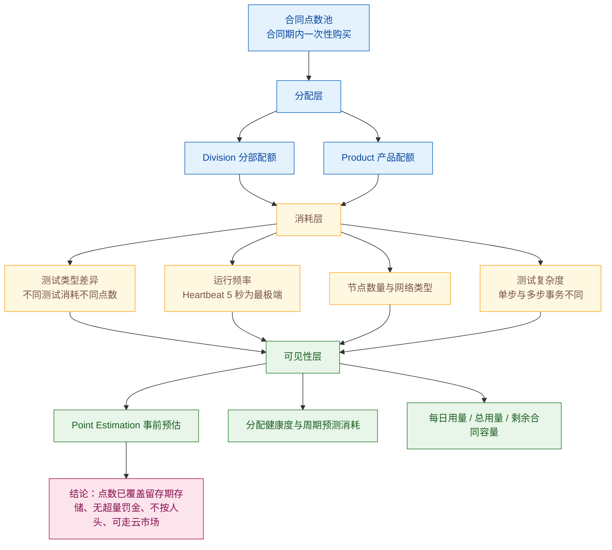

**图 9｜点数消耗模型与治理三层。** 消耗的四个变量里，**「频率」与「节点数量」是客户完全可以自由决定的**——而这两个变量恰好直接决定检出能力（5 秒级 Heartbeat 单节点单日即约 **17,280 次**运行）。**这张图因此也是一张取舍图：降本的手段与降灵敏的手段是同一批。**

## 9.2 它对应的用户痛点

> **口径**：本节只写客户侧可感知的痛（时间 / 钱 / 人 / 合规 / 组织）。**注意**：只有当成本出现在**客户自己的账单**上时才算客户痛点；供应商侧的成本结构不构成客户问题。痛点编号 P1…Pn 与下节解法 S1…Sn **一一对应**。

- **P1（钱）——「许可按人头或按探针计费，规模一涨账单就失控，且用不上的部分也要付」**。观测点越多、参与的人越多、测试越细，费用线性上升；**而监控的价值恰恰来自「覆盖得足够多」，这形成天然的价格矛盾**。
- **P2（钱）——「『测多少才够』事前算不出来，扩容时只能事后补钱」**。加一个区域、加一条关键业务链路时，没人能预先说出「这会多花多少钱」，**于是预算审批要么一拖再拖，要么拍一个必然超支的数**。
- **P3（组织 / 钱）——「预算花在哪个业务线上说不清，各团队抢配额」**。一个大池子里的点数被谁消耗了、还剩多少、哪个业务线快超了，**在组织内部没有可见性**，也就无法做资源再分配。
- **P4（合规 / 钱）——「数据只能存一年，做不了同比，也应付不了监管取证」**。扩容前的基线和去年同期对比做不了；**出了监管或客户纠纷要取证时，数据已经过期被清**。
- **P5（钱）——「云厂商的承诺消费额度用不掉，采购上被卡死」**。企业已经承诺了某云的年度消费，**采购新工具时必须能走云市场，否则这笔采购在企业内部根本走不通**。

## 9.3 它是如何解决的（与痛点一一对应）

**架构约束（由痛点倒推）**

| 架构约束 | 由哪条痛点倒推 | 落到了哪些小功能点 |
|---|---|---|
| 计费单位必须与被测范围解耦，且不随「人」增长 | P1 | 点数制统一货币（8.1）、不按用户数收费、无惩罚性超量费与阶梯折扣（8.3） |
| 消耗必须可事前估算、可事后归因 | P2、P3 | 消耗模型与事前估算（8.4）、两级分配（8.5）、分配健康度与周期预测（8.6） |
| 存储不能被设计成独立的变动成本项，否则长期留存不可负担 | P4 | 点数覆盖留存期存储（8.2）、留存期与套餐分层（8.8） |
| 采购路径必须匹配客户的财务流程 | P5 | 云市场订阅（8.9） |

| 解法 | 机制 | 对应痛点 |
|---|---|---|
| **S1 用一套点数替代「按人头 + 按探针 + 按存储」的三重计费** | 官方明确三条：**不按用户数收费**（「unlimited users… no additional cost per user or per seat」）、**不按 GB-小时收存储费**（「We don't charge for GB hours」）、**超量不设惩罚性费率**（「no penalty… charged the same price as per your contract」）。且所有能力**共用同一个点数池**，可自由调配。**「加人」不再增加成本，「多加测试」的成本是线性的、可预估的、且带阶梯折扣** | → 解 P1 |
| **S2 把消耗算给人看** | 官方把消耗与**测试类型、频率、节点位置、测试复杂度**绑定，并在分配界面提供**本计费周期的预测消耗**与**分配健康度指示**（2026-06 重构）。**效果是：「再补 20 条测试大概多花多少钱」从一个需要供应商答复的问题，变成客户自己在界面上能读到的数** | → 解 P2 |
| **S3 把预算分到业务线** | **Point Allocation** 支持在 **Division 与 Product** 两级对合同点数做二次分配，并可配置可见性与强制（enforcement）设置；2026-06 的新界面把**每日用量、总用量与剩余合同容量**集中呈现。**这使「哪个部门用了多少、谁快超了、要不要重新分配」成为可执行的管理动作**，而不是月末的一笔糊涂账 | → 解 P3 |
| **S4 把留存期变成定价套餐的一部分** | 留存分层为 **60 天 / 13 个月 / 3 年（可延至 5 / 7 年）**，且官方明确**点数已覆盖该留存期内的存储**。**「要留三年」因此成为一次性的购买决策，而不是每月浮动的存储账单**——这使长期基线与合规取证在成本上变得可承诺 | → 解 P4 |
| **S5 允许走云市场采购** | 官方定价页明确支持通过主流云市场（Marketplace）订阅，以「利用云厂商的 credits、折扣与统一账单」。**对企业客户而言，这直接决定了这笔采购能否在既有的云承诺消费框架内被批准** | → 解 P5 |

> **边界**：
> - **企业版价格完全不公开**（官方仅公开 WebPageTest 三档入口价与 CX Quick Start 起始价，企业版为「Custom pricing」）。**采购前必须走报价流程，议价空间较大**。
> - **C 级价格数据相互矛盾，只能当量级**：第三方聚合站给出的企业版年费区间为 **$60k–$180k+**（[CostBench](https://www.costbench.com/software/network-traffic-analysis/catchpoint)），另有「$10k/年 Quick Start」等包装；**不可用于预算测算**。
> - **「不按人头」不等于「不限总量」**：Expert 档明确以 **10M RUM pageviews + 30K 合成 runs/月** 为起订量，**RUM 侧明显按流量量级定价**。
> - **点数节省的核心手段是「降频 + 减节点」**，但这两者都与「检出能力」直接冲突：5 秒级 Heartbeat 单节点单日即约 **17,280 次**运行（**C（本报告推导）**：由 2025-10 Halo 明确的 5 秒频率折算）。**高分辨率是有明确价格的。**
> - **收购后的包装方式可能变化**：官方与第三方均提示整合后可能调整包装与定价，建议在 2026Q4 复核一次公开定价页。
>
> **配套演进**：合同期的留存分层（13 个月 / 3 年 / 5 年 / 7 年）与云市场计费路径属商业条款，已合并进 S4 / S5 处理，不单列。

## 9.4 功能原理

### 9.4.1 输入：成本治理链路吃进去什么

| 输入 | 具体内容 | 官方依据（含原文链接，标 A/B/C） | 缺了它会怎样 |
|---|---|---|---|
| **I1 · 合同点数总量** | 合同期内一次性购入的点数池 | **A 级** · [Pricing FAQ](https://www.catchpoint.com/pricing)（「Customers purchase a contract with a set number of points for the plan duration」） | 无池可分配——**整套治理机制失去对象** |
| **I2 · 实际运行记录** | 每次 Run 的类型、频率、节点、复杂度 | **A 级** | 无法计算消耗、无法做周期预测——**P2 / P3 无解** |
| **I3 · 组织结构** | Division / Product 层级与可见性、强制设置 | **A 级** · [Miranda Release Notes](https://docs.catchpoint.com/docs/2026-06-miranda-release-notes) | 无法把成本归因到业务线——**预算只能是一个总数** |
| **I4 · 留存期与合同期** | 合同声明的留存时长（13 个月 / 3 年 / 5 年 / 7 年） | **A 级** · [Pricing FAQ](https://www.catchpoint.com/pricing)（「covers data storage **for as long as your contract states**」） | 客户无法判断「留存是否另计费」——**这正是长期基线决策的关键前提** |
| **I5 · 采购渠道** | 直销或云市场订阅 | **B 级** · 官方定价页 Marketplace 段落 | 部分企业客户的采购流程走不通（P5） |

### 9.4.2 实现链条：从合同池到部门级账本

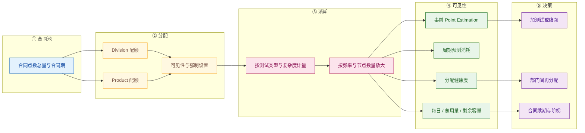

| 步骤 | 做什么 | 关键输入 | 输出 |
|---|---|---|---|
| **① 合同池** | 确定合同期内的点数总量 | I1 | 一个可分配的资源池 |
| **② 分配** | 在 Division / Product 两级分配，并设置可见性与强制 | I3 | 部门级配额 |
| **③ 消耗** | 按测试类型与复杂度计量，再按频率与节点数量放大 | I2 | 实际消耗量 |
| **④ 可见性** | 事前估算、周期预测、健康度、每日与总用量 | 消耗量 | 可读的账本 |
| **⑤ 决策** | 决定加测试还是降频、是否再分配、续期如何谈 | 账本 + 业务需求 | 覆盖决策 |

> **第 ⑤ 步是本组能力的真实终点**：它把「监控覆盖」从一个技术决策变成了**一个可被反复调整的财务决策**。**这一点对自研 APM 同样适用**——内网工具也需要给部门级成本归因，否则「谁用了多少、谁快超了」永远说不清。

### 9.4.3 输出：交付什么形态的结果

| 输出物 | 形态 | 消费方 | 对应小功能点 |
|---|---|---|---|
| 分配结构 | Division / Product 两级配额 | 平台负责人 | 8.5 |
| 消耗预测 | 本计费周期预测值 | 预算责任人 | 8.6 |
| 健康度指标 | 接近超支 / 有余量的标识 | 平台负责人 | 8.6 |
| 用量与余量视图 | 每日 / 总用量 / 剩余合同容量 | 财务 / 平台负责人 | 8.6 |
| 入口价与套餐边界 | 公开定价页 | 采购 | 8.7、8.8 |
| **「消耗 → 归属」的账本结构** | **不是 UI 产物，而是内部接口** | 客户的成本分摊流程、合同续期谈判 | —（治理层本身） |

### 9.4.4 关键机制：为什么「不按人头」与「把存储含进点数」是同一件事

这两条在官方定价页上被分列为两个 FAQ，但它们是**同一个产品判断的两个侧面**：

- 「**Customers have unlimited users**… no additional cost per user or per seat」
- 「The points you pay for testing… **include all storage costs**. There is no additional cost to store your data.」

**为什么必须这么设计（C（本报告推导）**，依据链：① 官方明确不按人头收费、不按 GB-小时收费、无惩罚性超量费、点数跨月滚动（A，Pricing FAQ）→ ② 官方明示所有 IPM 能力共用同一套点数（A）→ ③ 官方把捕获请求 / 响应头等能力说明为「不额外消耗点数」类的可选项（A，见 CP-4 的 4.2 相关文档）→ 结论）：**合成测试的价值来自「覆盖得足够多」和「让足够多的人看到」，而任何按人头与按存储计费的模型，都会在客户内部制造「少拉人进来、少存一点」的反向激励**。**取消了这两个计费维度，等于把客户内部的推广阻力去掉了。** 换句话说：**这不是定价策略，而是采用率策略。**

**代价也必须说明**：不按人头计费意味着**收入与「人多」无关**，因此**收入必须来自「测得更多、测得更细」**——这就解释了为什么点数消耗的两个主变量恰好是「节点数量」与「频率」（即检出能力的来源）。**「买得值」这一章的全部张力，都来自这一个设计选择。**

### 9.4.5 口径声明

| 内容 | 等级 | 说明 |
|---|---|---|
| 不按用户数收费、不按 GB-小时收存储费、无惩罚性超量费、点数跨月滚动、阶梯折扣 | **A** | [Pricing FAQ](https://www.catchpoint.com/pricing) |
| 所有 IPM 能力共用同一套点数、点数覆盖合同声明的留存期 | **A** | 同上 |
| 三档 WebPageTest 入口价与 CX Quick Start 起始价、企业版为 Custom pricing | **A** | 同上 |
| Point Allocation 两级分配、2026-06 的分配健康度 / 预测消耗 / 集中用量视图 | **A** | [Miranda Release Notes](https://docs.catchpoint.com/docs/2026-06-miranda-release-notes) |
| 云市场订阅 | **B** | 官方定价页 Marketplace 段落 |
| 企业版年费量级（$60k–$180k+） | **C** | [CostBench](https://www.costbench.com/software/network-traffic-analysis/catchpoint)；**与官方口径不冲突但不可核验，仅作量级参考** |
| **点数消耗的完整公式（如「Runs × 步数 × Monitor 系数」）** | **未取得 A 级原文** | 本报告能确证的是「不同测试类型消耗不同点数、受频率与节点影响」；**具体公式与系数表未取得可核验原文**，故本报告不给出公式。登记为附四缺口 |
| 「不按人头与把存储含进点数是采用率策略，而非单纯定价策略」 | **C（本报告推导）** | 依据链见 9.4.4 |
| 5 秒 Heartbeat 的单节点单日运行量约 17,280 次 | **C（本报告推导）** | 依据链：① 官方明确 Heartbeat 最快每 5 秒一次（A，Halo / Heartbeat Test）→ ② 官方明确不同测试类型消耗不同点数、频率是消耗变量之一（A，Pricing FAQ）→ 折算 86400 / 5 = 17,280 |

## 9.5 能力边界（这个功能点做不到什么）

> **一句话边界**：这套模型把「加人」和「存久」从账单里拿掉了，**但把「测得多细」和「测得多广」的账单完整保留了**——而这两项**恰恰是检出能力的全部来源**。

| 类型 | 具体边界 | 依据（信源等级） | 对自研 APM 的提示 |
|---|---|---|---|
| **硬边界 · 降本与灵敏同源** | 点数消耗受**测试类型、频率、节点位置、复杂度**影响；频率与节点数量**同时**是检出能力的来源。5 秒级 Heartbeat 单节点单日约 17,280 次运行 | **A / C** · [Pricing FAQ](https://www.catchpoint.com/pricing)、[Halo Release Notes](https://docs.catchpoint.com/docs/2025-10-halo-release-notes)；折算为 **C（本报告推导）** | 自研若采用类似计量模型，**必须在产品里明示「降本即降灵敏」**；更好的做法是**提供「按业务关键性分档频率」的推荐模板**，把取舍前移到规划阶段，而不是等到账单出来 |
| **硬边界 · 价格不透明** | 企业版为 **Custom pricing**，官方不公开；C 级聚合站区间相互矛盾（$60k–$180k+/年 等），**不可用于预算测算** | **A（不公开）** + **C（量级）** | 自研做竞品成本对比时**只能用「公开入口价 + 量级区间」**，并注明不可用于预算；**不要用第三方价格做立项依据** |
| **硬边界 · 起订量** | Expert 档以 **10M RUM pageviews + 30K 合成 runs/月** 为起订量；RUM 侧明显按流量量级定价 | **A** · [Pricing FAQ](https://www.catchpoint.com/pricing) | 「不按人头」容易被误读为「不限量」；**自研在做套餐设计时要避免制造同样的误读** |
| **软边界 · 未取得原文的项** | 点数消耗的完整公式与系数表、非分析型 API 限额的具体数值（官方声明随生效日公布）、Sonar 单服务每日消耗的精确点数 | **未取得 / 未公开** | 这三项直接决定 TCO 测算；**必须列入 POC 与采购谈判的必问清单** |
| **前提依赖 · 先有组织结构定义** | Point Allocation 的效果取决于客户是否已在平台内定义 Division / Product；不定义则退化为单一池子 | **A** · [Miranda Release Notes](https://docs.catchpoint.com/docs/2026-06-miranda-release-notes) | 自研做成本归因时**不能假定客户已有组织映射**；应提供「从现有系统（AD / CMDB）导入组织结构」的路径 |
| **官方自认局限（性质说明）** | 官方把「不按 GB-小时」「无超量罚金」作为**承诺式表述**写入 FAQ，等于**承认这两项是客户最常提出的疑虑**——即承认同类产品普遍存在这两类收费 | **A** · [Pricing FAQ](https://www.catchpoint.com/pricing) | 自研的定价 FAQ 可以直接借鉴这种写法：**正面回答客户最担心的两个成本问题**，比罗列功能更能推动决策 |
| **常见误期待（澄清）** | ① 易以为「点数制 = 便宜」——它只是**可预算、可调配**，总价取决于覆盖规模；② 易以为「数据存储永远免费」——**是「合同期内」免费**，超出合同期需续约；③ 易以为「超量会被罚」——官方明确**按合同同价计费**；④ 易以为收购后价格不变——**官方与第三方均提示包装可能调整** | **A** + **C（本报告归纳）** | 对外沟通应把「**合同期内**」「**同价超量**」「**可走云市场**」三条明确写出；**这三条正好覆盖 P1 用户痛点里的全部疑虑** |

---

# 10 大功能点 9：AI 时代的合成测试扩展 —— 跟得上

把「AI 服务」本身纳入受测对象，把观测粒度压到秒级，并把监控数据从「人读的界面」升级为「**Agent 可调用的工具**」——这是本报告中与自研 APM AI 助手方向**最直接同构**的一组能力。

## 10.1 小功能点清单

| # | 小功能点 | 发布时间 | 信源等级 | 说明 |
|---|---|---|---|---|
| 9.1 | **AI Assistant Reliability Monitoring** | **2025-07-15** | **B**（[2025-07-15 新闻稿](https://www.catchpoint.com/press-releases/catchpoint-launches)） | 面向 AI API / LLM / 聊天机器人的主动监控：全球 API 可达性、延迟基线、**合成提示词（synthetic prompt）监控**、可用性与错误检测、依赖映射 |
| 9.2 | **Agentic AI Resilience Monitoring** | **2025-07-15** | **B**（同上） | 面向自主 AI 工作流的多依赖场景：第三方 API 监控、**多跳依赖可见性**（跨复杂 AI 工作流追踪级联失败根因）、CI/CD 监控自动化、云区域韧性 |
| 9.3 | **Heartbeat Monitoring（对外发布）** | **2025-11-12** | **B**（[2025-11-12 新闻稿](https://www.catchpoint.com/press-releases/catchpoint-debuts-heartbeat-monitoring-for-sub-minute-detection-and-critical-system-reliability)） | 5 秒级高频可观测，用于捕捉微中断（micro-incident）；面向微服务、无服务器与 API 优先架构；官方强调产出**审计就绪的 SLI** |
| 9.4 | **Heartbeat Test（平台落地）** | **2025-10（Halo）** | **A**（[Heartbeat Test](https://docs.catchpoint.com/docs/heartbeat-test)、[Halo Release Notes](https://docs.catchpoint.com/docs/2025-10-halo-release-notes)） | 支持 HTTP 与 API Script monitors；**可从 Enterprise 与部分 Cloud 节点运行**；官方定位：「especially valuable for teams managing SLOs and SLAs, as the increased data frequency provides a **more accurate picture of service performance and customer impact**」（详见 2.1 的 1.19） |
| 9.5 | **Catchpoint MCP Server（Preview）** | **2026-03（Triton）** | **A**（[MCP Server](https://docs.catchpoint.com/docs/mcp-server)、[Triton Release Notes](https://docs.catchpoint.com/docs/2026-03-triton-release-notes)） | 「It enables AI assistants to **search, filter, and visualize** information in one seamless flow… The server can **automatically combine multiple tools, such as test search, performance metrics, and error analysis, into a single workflow**」；本地部署（npm 包 + REST API Key 鉴权）；**官方公开的工具清单**：`json_query`（JSONata 表达式求值）、`orchestrate_tools`（多工具链式编排，服务端执行以减少中间载荷）、`test_search-tests`、`test_test-errors`、`test_test-performance`（可返回 SVG 图表，**最多 9 条测试**）、`search_outages`（按服务 / 城市 / 国家 / 区域 / 标签检索中断） |
| 9.6 | **MCP Server 迭代** | **2026-04（Europa）** | **A**（[Europa Release Notes](https://docs.catchpoint.com/docs/2026-04-europa-release-notes)） | 「Updated MCP server: **Improved deployment experience**；**Added RUM Analytics tool**；**Added support for more Synthetic metrics**」 |
| 9.7 | **AI-powered support agent（预览）** | **2025-10（Halo）** | **A**（[Halo Release Notes](https://docs.catchpoint.com/docs/2025-10-halo-release-notes)） | 门户内可用的 AI 支持助手，官方原文：「drawing on its training on Catchpoint's **documentation and support knowledge base**」，「**It can also create a ticket on your behalf**」；官方同时提示「**this capability is in preview, and like all AI agents, their responses may not be perfect, so please double-check anything that is important**」 |
| 9.8 | **告警送入 LogicMonitor Edwin AI** | **2026-01 / 2026-03** | **A**（[Afterglow](https://docs.catchpoint.com/docs/2026-01-afterglow-release-notes)、[Triton](https://docs.catchpoint.com/docs/2026-03-triton-release-notes)） | 官方原文：「**any Catchpoint customer can send alerts to Edwin AI**, enabling IT teams to automatically **correlate network and end-user experience signals with data from infrastructure monitoring, logging, APM, security, and CMDB sources**」（跨源关联，详见 7.1 的 6.13） |
| 9.9 | **Agentic AI / Incident Manager（官方预告）** | 2025-09 预告 | **A**（[Moonbeam Release Notes](https://docs.catchpoint.com/docs/2025-09-moonbeam-release-notes)） | 「**Coming Soon**: Agentic AI – Catchpoint will continue rolling out AI-based features, including a new **Incident Manager** to help you respond to crises and troubleshoot problems significantly faster」；**属规划中能力，尚未交付** |
| 9.10 | **导航与产品区重组（AI 与基础设施模块纳入）** | **2026-04（Europa）** | **A**（[Europa Release Notes](https://docs.catchpoint.com/docs/2026-04-europa-release-notes)） | 左侧导航重组为 Synthetics / RUM / Endpoint 等产品区，并「**Additional modules, including Infrastructure and Edwin AI, are now included**」——**这是「合成测试被放进一个更大的 AI 运维叙事」的界面证据** |

## 10.2 它对应的用户痛点

> **口径**：本节只写客户侧可感知的痛（时间 / 钱 / 人 / 合规 / 组织），不写「LLM 调用链的可观测性建模」这类架构层问题。痛点编号 P1…Pn 与下节解法 S1…Sn **一一对应**。

- **P1（钱 / 时间）——「AI 功能已经成了第一类依赖，但没人监控它」**。Copilot / ChatGPT / Gemini 一慢，业务流程就断，而监控体系里根本没有这条链路——**它被当作「一个外部 API」，而不是「一条关键业务依赖」**。
- **P2（钱 / 合规）——「『AI 答错了』这类故障，传统可用性监控根本看不见」**。只要返回 HTTP 200 就算健康，**而回答内容已经不可用或不合规**；这类事故在可用性报表上是满分的。
- **P3（钱 / 时间）——「亚分钟级的抖动被系统性漏掉」**。在微服务与无服务器架构下，一次几秒的中断就足以打断用户会话、拖垮一笔交易、或让一次 CI/CD 失败，**而分钟级粒度的检查在结构上看不见它**。
- **P4（人 / 时间）——「监控数据分析的『最后一公里』是人的阅读速度」**。值班的人要在几十个界面之间把结论拼出来，**而这恰好发生在最没有时间做这件事的时刻**。
- **P5（组织 / 时间）——「监控能力与自家 AI 助手 / 运维平台接不上，无法被自然语言调用」**。数据只能被人看，不能作为工具被上层 Agent 调用；**在「AI 助手成为运维入口」的趋势下，这等于把监控锁在了上一代交互形态里**。

## 10.3 它是如何解决的（与痛点一一对应）

**架构约束（由痛点倒推）**

| 架构约束 | 由哪条痛点倒推 | 落到了哪些小功能点 |
|---|---|---|
| AI 服务必须能被当作「普通受测服务」纳入既有合成测试体系 | P1 | AI Assistant Reliability Monitoring 的可达性、延迟基线、错误检测（9.1） |
| 必须能把「内容 / 答案的正确性」变成可断言对象，否则 AI 故障无法被检出 | P2 | 合成提示词监控（9.1） |
| 观测粒度必须能压到秒级，且 SLI 可被审计 | P3 | Heartbeat Monitoring（9.3 / 9.4）、SLO Alerts（详见 6.1 的 5.8 / 5.9） |
| 结论必须自动产出，且能被非专家读懂 | P4 | AI RCA 与 Advisor（详见 7.1 的 6.4 / 6.6）、AI support agent（9.7） |
| 监控数据必须能作为「工具」被上层 AI Agent 调用，而不是只作为「界面」被人阅读 | P5 | **MCP Server（9.5 / 9.6）**、Edwin AI 关联（9.8）、导航层把 AI 模块纳入（9.10） |

| 解法 | 机制 | 对应痛点 |
|---|---|---|
| **S1 把 AI 服务本身纳入合成测试的覆盖范围** | **AI Assistant Reliability Monitoring（2025-07）** 对 AI 端点做三件事：全球可达性测试、延迟基线持续跟踪、可用性与错误检测。**本质上它并没有发明新的测试类型，而是把「AI 端点」当作一个普通的第三方依赖来测**——这正是 2.3 的 S2「把第三方依赖变成可举证的测试对象」的延伸 | → 解 P1 |
| **S2 不只验连通，还验语义** | **合成提示词监控（synthetic prompt monitoring）** 模拟真实交互，验证响应的准确性与一致性。**它与 2.4.4 的 `% Content Availability` 在思路上完全一致：把「功能正确性」与「可用性」拆成两个独立指标。** 官方对这一组能力的定位亦很直接：「AI 不能静默失败」 | → 解 P2 |
| **S3 把观测粒度压到 5 秒** | **Heartbeat Monitoring** 以 **5 秒级**频率检查，输出 DNS 解析时间、TCP 连通性、TLS 证书有效性、HTTP 状态码等指标；可从云代理或私有 Enterprise 代理运行（覆盖混合云、多云与本地）；面向 SLO / SLA 团队产出**高分辨率、审计就绪的 SLI**。**官方给出的定位是「把可靠性从灭火变成预判」** | → 解 P3 |
| **S4 把 AI 放在分析层，而不是当界面装饰** | **AI RCA（2025-09）** 用自然语言给出根因；**Advisor（2025-09）** 自动指出监控盲区；**AI support agent（2025-10，预览）** 直接坐在门户内并可代为建单；**Experience Score** 把多维指标压成单一可沟通的数；2026-01 起告警可送入 **Edwin AI** 与基础设施、日志、APM、安全、CMDB 数据自动关联。**注意官方对 AI support agent 的自我限定**：「like all AI agents, their responses may not be perfect, so **please double-check anything that is important**」——**把 AI 的输出定位成「需要被复核的建议」，而不是「权威结论」** | → 解 P4 |
| **S5 让 AI 助手可以直接调用监控数据** | **Catchpoint MCP Server（2026-03 预览）** 把 Catchpoint 数据暴露为 **MCP 工具**，使 LLM 助手能够搜索、过滤与可视化，并**自动把多个工具组合成单一工作流**。其工具设计有三个极值得借鉴的点：① **`orchestrate_tools` 把多步编排放到服务端执行**，「eliminating large intermediate payloads and **minimizing token use**」；② **`test_test-performance` 直接返回 SVG 图表**，让模型「生成图」而不是「描述图」；③ **每个工具的描述里都写了「该用哪个工具」与「重试策略」**（如 `json_query` 明确「Auto-retry on error (2-3 attempts)… Do NOT ask user for permission to retry… Fall back to manual processing」）。**对客户的实质含义是：合成测试数据从「人读的界面」升级为「Agent 可调用的工具」** | → 解 P5 |

> **边界**：
> - **AI 能力多为预览 / 申请制**：MCP Server 为 **Preview**；AI-powered support agent 为 **Preview**；SSO Access Scope Assertions 为 **limited preview**；Infrastructure Overview Dashboard 为 **limited preview**。**不得当作已 GA 的通用能力引用。**
> - **合成提示词监控的判定方法未公开。** 官方只说「验证响应的准确性与一致性」，**没有说明是否用 LLM 评分、是否有基准答案集、误判率如何**——**准确性与一致性本身无法被独立复核**。
> - **Heartbeat 的高分辨率有明确成本。** 5 秒频率意味着每节点每日约 **17,280 次**运行（**C（本报告推导）**），而点数消耗与运行规模相关。**「5 秒」是一个需要用点数决策的能力，而不是免费开关。**
> - **AI 生成的根因结论仍是建议性**（见 7.5：官方口径为 `suspected root cause`）；**第三方准确率验证整体缺失**。
> - **MCP Server 的能力边界**取决于它暴露了多少工具与指标（2026-04 才「增加对更多合成指标的支持」），且**官方要求本地部署**（下载 npm 包并自行运行）——**它不是托管的 SaaS 能力**。
> - **Incident Manager（9.9）属规划中能力，尚未交付**。
> - **收购整合的收益取决于客户是否是 LogicMonitor 用户**：Edwin AI 告警关联（9.8）对**非 LogicMonitor 客户**的价值有限。
>
> **配套演进**：门户导航重组与品牌对齐（9.10）属整合的界面层动作，其客户价值间接（提高可发现性），已在 9.10 列示而不单列为解法。

## 10.4 功能原理

### 10.4.1 输入：AI 时代扩展吃进去什么

| 输入 | 具体内容 | 官方依据（含原文链接，标 A/B/C） | 缺了它会怎样 |
|---|---|---|---|
| **I1 · AI 端点与提示词** | AI API 地址、认证信息、基准提示词与期望响应的判定口径 | **B 级** · [2025-07-15 新闻稿](https://www.catchpoint.com/press-releases/catchpoint-launches) | 无法把 AI 作为受测对象——**P1 / P2 无解** |
| **I2 · 秒级运行能力** | 5 秒频率的调度与执行（Enterprise + 部分 Cloud 节点） | **A 级** · [Heartbeat Test](https://docs.catchpoint.com/docs/heartbeat-test)、[Halo Release Notes](https://docs.catchpoint.com/docs/2025-10-halo-release-notes) | 亚分钟中断结构性丢失——**P3 无解** |
| **I3 · 可被工具化的查询接口** | 测试搜索、性能指标、错误分析、中断检索等结构化能力 | **A 级** · [MCP Server](https://docs.catchpoint.com/docs/mcp-server) | 数据只能被人看——**P5 无解**（这也是自研 AI 助手最直接的借鉴面） |
| **I4 · 推理与生成模型** | LLM 能力（用于 RCA 结论、支持助手、提示词判定） | **A / B 级** · [Moonbeam](https://docs.catchpoint.com/docs/2025-09-moonbeam-release-notes)、[Halo](https://docs.catchpoint.com/docs/2025-10-halo-release-notes) | 无自然语言结论——**P4 无解** |
| **I5 · 跨源数据** | 基础设施、日志、APM、安全、CMDB 数据（经 Edwin AI） | **A 级** · [Afterglow](https://docs.catchpoint.com/docs/2026-01-afterglow-release-notes)、[Triton](https://docs.catchpoint.com/docs/2026-03-triton-release-notes) | 根因只能停留在「互联网侧」，无法与客户环境内的原因合并——**且对非 LogicMonitor 客户不可用** |

### 10.4.2 实现链条：从一条提示词到一次可被 Agent 调用的查询

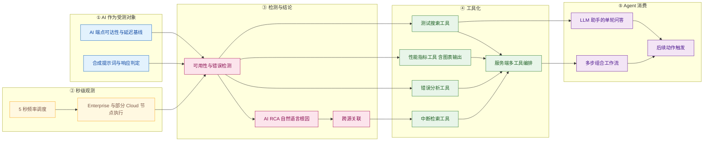

| 步骤 | 做什么 | 关键输入 | 输出 |
|---|---|---|---|
| **① AI 作为受测对象** | 对 AI 端点做可达性与延迟测量，并用合成提示词做语义判定 | I1 | AI 侧的健康与正确性信号 |
| **② 秒级观测** | 以 5 秒频率在 Enterprise / 部分 Cloud 节点执行 | I2 | 高分辨率时间序列 |
| **③ 检测与结论** | 错误检测 → 自然语言根因 → 必要时跨源关联 | I4 / I5 | 可读的结论 |
| **④ 工具化** | 把搜索、指标、错误、中断四类能力封装为工具，并支持服务端编排 | I3 | 可被 LLM 调用的工具集 |
| **⑤ Agent 消费** | 助手单轮问答、多步组合工作流、触发后续动作 | 工具集 | 面向运维的自然语言交互 |

> **第 ④ 步是本组最有借鉴价值的一环**：**它不是在「数据上加一个聊天框」，而是把既有能力按「一个完整工作流需要几步」重新封装成工具。** 官方对 `orchestrate_tools` 的定位写得很清楚——「**Default to orchestrator for multi-step operations**, even for discovery tasks where you know the end goal」——**即默认让编排发生在服务端，而不是让模型在客户端来回搬数据。**

### 10.4.3 输出：交付什么形态的结果

| 输出物 | 形态 | 消费方 | 对应小功能点 |
|---|---|---|---|
| AI 服务的健康与延迟基线 | 时序指标与告警 | SRE / AI 平台团队 | 9.1 |
| 提示词级正确性判定 | 通过 / 失败 + 响应内容 | AI 平台团队 / 合规 | 9.1 |
| 秒级 SLI | 高分辨率可用性序列 | SLO 责任人 | 9.3、9.4 |
| 自然语言根因 | 文本结论（附反馈入口） | 值班 / 事件管理 | 9.5（承接 6.4） |
| 门户内 AI 支持 | 对话与建单 | 平台用户 | 9.7 |
| 跨源关联结论 | 与基础设施 / 日志 / APM / 安全 / CMDB 合并后的判定 | IT 运维 | 9.8 |
| **「工具集 + 服务端编排」的接口契约** | **不是 UI 产物，而是内部接口** | 上层 LLM 助手、Agent 框架、客户自建运维平台 | —（AI 接入层本身） |

> **注意最后一行**：这一组能力**最重要的输出不是任何一张图或一句结论，而是「一套工具定义 + 一个编排契约」**。这也解释了为什么官方要单独公布工具清单与工具描述文本——**工具描述本身就是产品的一部分，因为它是给模型看的「说明书」。**

### 10.4.4 关键机制：为什么 MCP 工具描述里要写「重试策略」与「不要问用户」

这是本报告在 Catchpoint 全部材料中看到的**最反直觉、也最具工程价值的一条细节**。官方 MCP Server 文档在 `json_query` 工具的说明中规定了明确的失败处理流程（**A 级**原文，[MCP Server](https://docs.catchpoint.com/docs/mcp-server)）：

> 「**Query Strategy and Error Recovery** 1. **First attempt**: Try your JSONata expression 2. **Auto-retry on error (2-3 attempts)**: Analyze error message carefully; Correct syntax based on error; Simplify expression if needed; **Do NOT ask user for permission to retry** 3. **Fall back to manual processing**: If still failing after 2-3 attempts: Stop using `json_query` tool; Process the original JSON response directly yourself; Count, filter, or analyze the data manually 4. **Only escalate if necessary**」

**为什么必须这么设计**：

1. **模型的失败模式是可以被预测并提前编好的**。工具调用失败时的三种可能反应（重试、放弃、求助）里，**「求助」是成本最高的一种**——它把一个本可以自动收敛的过程变成了一次人工打断。因此官方**直接在工具说明里禁止这一步**。
2. **「降级路径」必须被显式写出来**。官方要求失败 2–3 次后**改用原始数据自行处理**——这条把「工具失败」从「任务失败」降级为「效率下降」，**保证了一次对话不会因为一个工具不可用而中断**。
3. **配套的编排约束同样服务于「省 token」**：`orchestrate_tools` 要求「Default to orchestrator for multi-step operations」，并严格规定「**each step's transform MUST produce output that matches the EXACT parameter structure expected by the next tool**」。**这说明官方把「模型与工具之间的往返次数」当作成本项在管理。**

**对自研 APM AI 助手的直接结论（C（本报告推导）**，依据链：① 官方在工具描述中明确写入重试次数、禁止求助、降级路径（A）→ ② 官方把多步编排放到服务端以「minimize token use」（A）→ ③ 官方在 MCP 迭代中持续增加工具与指标覆盖（A，Europa）→ 结论）：**给 Agent 的工具定义，应当被当作产品交付物来写**——它需要包含：**参数语义、调用顺序建议、失败重试策略、降级路径、以及输出如何被下一次调用消费**。**「写好一个工具的 description」的收益，往往高于「再增加一个工具」。**

### 10.4.5 口径声明

| 内容 | 等级 | 说明 |
|---|---|---|
| MCP Server 的定位、部署方式（本地 npm 包 + REST API Key 鉴权）、工具清单与各工具的行为描述、编排契约 | **A** | [MCP Server](https://docs.catchpoint.com/docs/mcp-server) |
| MCP Server 首发（2026-03）与迭代（2026-04：部署体验 / RUM Analytics / 更多合成指标） | **A** | [Triton](https://docs.catchpoint.com/docs/2026-03-triton-release-notes)、[Europa](https://docs.catchpoint.com/docs/2026-04-europa-release-notes) |
| Heartbeat 的 5 秒频率、支持 Monitor 与节点类型、面向 SLO/SLA 的定位 | **A** | [Heartbeat Test](https://docs.catchpoint.com/docs/heartbeat-test)、[Halo Release Notes](https://docs.catchpoint.com/docs/2025-10-halo-release-notes) |
| AI support agent 的预览状态、知识来源与「请自行复核」提示 | **A** | [Halo Release Notes](https://docs.catchpoint.com/docs/2025-10-halo-release-notes) |
| Edwin AI 告警关联的范围（任何 Catchpoint 客户可送告警） | **A** | [Triton Release Notes](https://docs.catchpoint.com/docs/2026-03-triton-release-notes) |
| Incident Manager 属「Coming Soon」 | **A** | [Moonbeam Release Notes](https://docs.catchpoint.com/docs/2025-09-moonbeam-release-notes) |
| AI Assistant Reliability Monitoring / Agentic AI Resilience Monitoring / Heartbeat 对外发布 | **B** | 对应三篇官方新闻稿（2025-07-15、2025-11-12） |
| 「把工具描述当产品交付物来写」 | **C（本报告推导）** | 依据链见 10.4.4 |
| 合成提示词监控的判定方法（评分方式、基准集、误判率） | **未公开** | 官方未披露——**本报告不做推断**，登记为附四缺口 |
| MCP 工具的数量与覆盖指标随版本变化的完整清单 | **未取得** | 官方文档给出当前工具集，但**未提供历史版本对照**；附四跟踪 |

## 10.5 能力边界（这个功能点做不到什么）

> **一句话边界**：这组能力把「AI 服务」变成了可测对象、把粒度压到了 5 秒、把数据变成了 Agent 可调用的工具——**但它几乎全部处于预览态，而且其中最有价值的部分（提示词正确性与 AI 根因）的判定方法没有公开。**

| 类型 | 具体边界 | 依据（信源等级） | 对自研 APM 的提示 |
|---|---|---|---|
| **硬边界 · 成熟度** | MCP Server 为 **Preview**；AI support agent 为 **Preview**；Infrastructure Overview Dashboard 为 **limited preview**；**Incident Manager 尚未交付** | **A** · [Triton](https://docs.catchpoint.com/docs/2026-03-triton-release-notes)、[Halo](https://docs.catchpoint.com/docs/2025-10-halo-release-notes)、[Moonbeam](https://docs.catchpoint.com/docs/2025-09-moonbeam-release-notes) | 自研在对外路线图中**不要把「AI 能力」写成已交付项**；**用「预览 / 试点」标注，并给出明确的验收口径** |
| **硬边界 · 节点与成本约束** | Heartbeat 仅支持 HTTP / API Script monitors，且**仅 Enterprise 与部分 Cloud 节点**；5 秒频率意味着每节点每日约 17,280 次运行，**直接消耗点数** | **A** · [Heartbeat Test](https://docs.catchpoint.com/docs/heartbeat-test)、[Halo](https://docs.catchpoint.com/docs/2025-10-halo-release-notes)；折算为 **C（本报告推导）** | 自研若做秒级拨测，**必须先在成本模型里回答「谁为这 17,280 次付费」**；否则秒级能力会因为价格而被客户关掉（回指 CP-8） |
| **软边界 · 判定方法未公开** | **合成提示词监控**的评分方式、基准答案集、误判率未披露；**AI RCA 的模型、训练数据、准确率未披露**；`test_test-performance` 的指标口径以工具描述为准（**最多 9 条测试**） | **A（未公开）/ 未公开** | 自研若做「语义正确性判定」，**至少应公开：判定方式、样本来源、误判率自测值**——否则客户无法给它设阈值（回指 CP-5：没有可解释的判据就无法配告警） |
| **软边界 · 未取得原文项** | MCP 工具集的**历史版本对照**、各工具的具体参数 schema 全集、编排的步数上限与超时约束 | **未取得** | 自研在设计工具集时**必须自建这些约束**（步数上限、超时、失败语义），**不要假定「模型会自己处理」** |
| **前提依赖 · 客户侧部署能力** | MCP Server 需**本地部署**（下载包 + REST API Key 鉴权）；Edwin AI 关联的前提是客户处于 LogicMonitor 生态 | **A** · [MCP Server](https://docs.catchpoint.com/docs/mcp-server)、[Afterglow](https://docs.catchpoint.com/docs/2026-01-afterglow-release-notes) | 自研做 AI 接入层时，**「谁来部署」是要在方案里回答的问题**；若目标客户是园区网 / 政企，**本地部署反而是优势，而不是负担** |
| **官方自认局限** | 官方对 AI support agent 明确：「**this capability is in preview, and like all AI agents, their responses may not be perfect, so please double-check anything that is important**」；对 AI RCA 使用「**suspected** root cause」措辞 | **A** · [Halo](https://docs.catchpoint.com/docs/2025-10-halo-release-notes)、[Stack Map](https://docs.catchpoint.com/docs/stack-map) | 官方对 AI 输出的自我限定方式**值得直接照抄**：**在功能描述里写明「需要复核」与「是疑似结论」**，这是对产品信誉的保护，而不是示弱 |
| **常见误期待（澄清）** | ① 易以为 AI 根因结论可直接用于定责——**不可**；② 易以为「接入 MCP 就等于有了 AI 运维」——**MCP 只是通道，能力取决于暴露了哪些工具**；③ 易以为秒级观测免费——**有明确点数成本**；④ 易以为「AI 能替代分析师」——官方自己的定位是**建议 + 复核**，且**最终动作仍由人决定** | **A** + **C（本报告归纳）** | 对外沟通应把 AI 定位写成「**决策支持 + 证据链**」，**不承诺自动执行**——这与自研 APM AI 助手的合理终点一致（见附三第 10 条） |

---

# 11 附一 完整时间线（倒序）

> **口径说明**：① 时间列以**官方发布月**为准；**精确到日的只有三类**——官方新闻稿的发布日、官方明确公告的生效 / 退役日、本报告的实际抓取日。② 2023–2024 的条目标注为「月」或「约」，**凡属推断一律注明**。③ 形态列区分：**新功能 / 功能增强 / 预览 / 退役·弃用 / 商业条款 / 市场发布 / 组织事件 / 容量与口径**。④ 末尾三条早于 2023-01 的条目属**背景基线**（本报告范围自 2023-01 起），列出是为了说明「哪些能力在观测起点就已经存在」。

| 时间 | 事件 | 形态 | 信源等级 |
|---|---|---|---|
| 2026-10-28 | **非分析型 REST API 用量限额生效**——官方明确为「固定、不可提升」，且不随版本升级放宽 | 商业条款 · 生效 | **A**（公告见 Mimas Release Notes；**限额明细本报告未取得** → 附四第 11 条） |
| 2026-10-16 | **本报告数据截止日**；实测 `www.catchpoint.com/network` 已 301 重定向至 LogicMonitor 站点 | 容量与口径 · 观测 | **C**（本报告实测，用于局限 5） |
| 2026-09-28 | **Agent 2.18.0**：测试引擎 NodeJS 换为 NSolid、Chrome / Edge 升至 151、**MQTT monitor 按最新标准与库重写**、Playwright 支持 iFrame | 新功能（探针侧） | **A**（Mimas Agent Release Notes） |
| 2026-09（Mimas） | **SLO Alerts 上线**：Burn Rate（Fast Burn 严重 / Medium Burn 警告）+ Violation Budget（周 / 月 / 季窗口），并进入统一 Alert Log | 新功能 | **A** |
| 2026-09（Mimas） | Enterprise Node 可**随 LogicMonitor EA Collector 单步一并部署**（同机 64 位 Linux；Catchpoint 服务异常不影响 Collector 运行） | 功能增强（部署通道） | **A** |
| 2026-09（Mimas） | WebPageTest 定时测试的**设备 · 浏览器 · 连接可独立选择** | 功能增强 | **A** |
| 2026-08-31 | **Selenium 型 Transaction 测试停止工作**（平台侧正式失效；API 侧 Selenium 于更晚退役） | 退役 · 生效 | **A**（Selenium Retirement）+ **C**（第三方媒体确认同一日期） |
| 2026-08（Ganymede） | **No-Code 能力增强**：新增 Edge 浏览器支持、断言能力、更多动作 | 功能增强 | **A** |
| 2026-08（Ganymede） | Node-to-Node 支持**自定义阈值**（静态值 + 相对基线的百分比变化） | 功能增强 | **A** |
| 2026-08（Ganymede） | Test Data Webhook 支持**文件夹级与测试级** | 功能增强 | **A** |
| 2026-08（Ganymede） | **MFA 多因素登录**（邮件一次性验证码） | 功能增强（安全） | **A** |
| 2026-08 | WebPageTest **定时测试全生命周期走 REST API** | 功能增强 | **A** |
| 2026-06（Miranda） | **No-Code Transaction Test 上线**：浏览器扩展录制用户流程 → 自动生成事务指令 + 内置 WYSIWYG 编辑器 + 可导出 Playwright | 新功能 | **A** |
| 2026-06（Miranda） | **Streaming Test 上线**（HLS / DASH / MP4，在真实 Chromium 内测量起播与缓冲行为；**仅 Enterprise 节点**） | 新功能 | **A** |
| 2026-06（Miranda） | **Point Allocation UI 重构** | 功能增强 | **A** |
| 2026-06（Miranda） | Endpoint Agent 提供 **macOS 原生 Universal Binary** | 功能增强 | **A** |
| 2026-06（Miranda） | Enterprise Node **ARM 架构支持（预览）** | 预览（部署通道） | **A** |
| 2026-04（Europa） | **Catchpoint CLI v1 发布**（Go 编写，提供 Docker 镜像） | 新功能 | **A** |
| 2026-04（Europa） | **Experience Score 引入 Lighthouse 指标** | 功能增强 | **A** |
| 2026-04（Europa） | **Domain Breakdown（域名分布）** 上线 | 新功能 | **A** |
| 2026-04（Europa） | **Rotational API Key** 上线（有效期 30 天 – 2 年） | 新功能（安全） | **A** |
| 2026-04（Europa） | **Test Level Proxy** 上线（测试级代理配置） | 新功能 | **A** |
| 2026-04（Europa） | Traceroute **Explorer 支持 ECN 过滤** | 功能增强 | **A** |
| 2026-04（Europa） | **MCP Server 迭代**：部署体验优化、新增 RUM Analytics 工具、扩充合成指标覆盖 | 功能增强（预览） | **A** |
| 2026-04（Europa） | 平台导航与产品区重组，**AI 与基础设施模块纳入** | 组织事件（产品结构） | **A** |
| 2026-03（Triton） | **Catchpoint MCP Server 首发（Preview）**：`json_query` / `orchestrate_tools` / `test_search-tests` / `test_test-errors` / `test_test-performance` / `search_outages`；**本地部署 + REST API Key 鉴权** | 新功能（预览） | **A** |
| 2026-03（Triton） | **告警送入 LogicMonitor Edwin AI**（官方明确：**任何 Catchpoint 客户均可**） | 集成 | **A** |
| 2026-03（Triton） | **Active Session Timeout** 上线（对齐 NIST SP 800-63B） | 新功能（安全） | **A** |
| 2026-03（Triton） | 门户品牌与配色对齐 LogicMonitor | 组织事件（收购整合 · 视觉层） | **A** |
| 2026-03（Triton） | REST API **消费者页面与按分部视图** | 功能增强 | **A** |
| 2026-03 | WebPageTest **Instant Test 支持批量测试** | 功能增强 | **A** |
| 2026-01（Afterglow） | **Terraform Provider 2.0.0 发布（破坏性更新）**，继承语义改为「对应块整体省略」 | 破坏性变更 | **A**（**字段清单未取得** → 附四第 7 条） |
| 2026-01（Afterglow） | **CDN Benchmark 总览看板**、Page Performance 增加 **DC Time / DC Bytes**、瀑布图可下载为 JPEG、RUM Network Score | 新功能 + 功能增强 | **A** |
| 2026-01（Afterglow） | **告警明细 REST API** 上线（`/v4/test/alerts` 系列），Alert Instructions 进入告警详情 | 新功能 | **A** |
| 2026-01（Afterglow） | **Catchpoint 移动 App EoL**；**IE monitor 弃用** | 退役 · 弃用 | **A** |
| 2026-01 | **GeoIP 数据源更换**，官方主动提示部分地理聚合数值会发生位移 | 容量与口径 · 断点 | **A** |
| 2025-12-02 | **LogicMonitor 完成对 Catchpoint 的收购** | 组织事件（收购） | **B**（官网首页与官方对外通告；**独立新闻稿 URL 未取得** → 附四第 15 条） |
| 2025-11-12 | **Heartbeat Monitoring 对外新闻稿**（亚分钟级检测与关键系统可靠性） | 市场发布 | **B** |
| 2025-11-05 | **Gartner Magic Quadrant for DEM 连续第二年 Leader** | 第三方评价 | **C**（**榜单页需订阅，未取得** → 附四第 16 条） |
| 2025-10（Halo） | **Heartbeat Test 上线**：最快 **5 秒**一次；**限 HTTP 与 API Script monitor，且仅 Enterprise 与部分 Cloud 节点** | 新功能 | **A**（与新闻稿并列，见源冲突 1） |
| 2025-10（Halo） | Node-to-Node 支持 **100 节点全互联矩阵** | 功能增强 | **A** |
| 2025-10（Halo） | **Private Benchmarks** 上线（与自选私有基准对比） | 新功能 | **A** |
| 2025-10（Halo） | Playwright 支持**移动设备模拟** | 功能增强 | **A** |
| 2025-10（Halo） | **凭据集中管理**（Token / Password / Certificate，可启停） | 新功能 | **A** |
| 2025-10（Halo） | **AI-powered support agent（预览）** | 预览 | **A** |
| 2025-10（Halo） | 告警时间窗新增 **20 分钟与 45 分钟**两档 | 功能增强 | **A** |
| 2025-09（Moonbeam） | **AI Root Cause Analysis（AI Insights）** 上线；**Stack Map Recommendations**、**Catchpoint Advisor（监控姿态建议）** 同期上线 | 新功能 | **A** |
| 2025-09（Moonbeam） | **Composite Alerts 的 REST API**（创建 / 删除 / 查询 / 更新） | 新功能 | **A** |
| 2025-09（Moonbeam） | **Enterprise Node 自身告警**上线；节点利用率采集频率 **15 分钟 → 5 分钟** | 功能增强 | **A** |
| 2025-09（Moonbeam） | **Trace 对比（≤4 条并排）** 上线 | 新功能 | **A** |
| 2025-09（Moonbeam） | **Incident Manager / Agentic AI 官方预告**（**至今未交付**，登记为路线图项） | 路线图预告 | **A** |
| 2025-07-15 | **AI Assistant Reliability Monitoring 与 Agentic AI Resilience Monitoring 发布**：面向 AI API / LLM / 聊天机器人的主动监控，含**合成提示词（synthetic prompt）监控** | 市场发布 | **B**（**判定方法未公开** → 附四第 9 条） |
| 2025-07（Starlight） | Internet Stack Map **大改版**：浮动菜单 + **可用点数直接购买 Sonar 服务并挂到地图上** | 功能增强 + 商业条款 | **A** |
| 2025-07（Starlight） | Traceroute Smartboard 支持 **MPLS 标签过滤** | 功能增强 | **A** |
| 2025-07（Starlight） | **Tracing 纳入外部服务数据**；可从 Instant Test 内直接查看 / 配置 Tracing | 功能增强 | **A** |
| 2025-07（Starlight） | **SSO Access Scope Assertions（限量预览）** | 预览（安全） | **A** |
| 2025-07（Starlight） | 联系组支持**语音呼叫通知**；**移除 Email-to-SMS**（官方原因：运营商拦截） | 功能增强 + 移除 | **A** |
| 2025-05（Glimmer） | A 级 Release Notes 的**可回溯边界**（本报告未逐条采集该版本条目） | 容量与口径 · 标注 | **A**（页面存在，未采集；附四第 14 条） |
| 2025-02 | Internet Stack Map **首次大改版**；**合成测试开始附赠 Tracing（免费）** | 功能增强 | **A / B** |
| 2024-07-11 | **REST API v3 成为当前稳定版**（v4 并行预览，官方承诺 **12 个月重叠**策略） | 商业条款 · 接口治理 | **A** |
| 2023-10 | **Internet Sonar 公共服务中断检测上线**；**Catchpoint Tracing（分布式追踪）上线**；Traceroute 支持 **ECN 拥塞检测** | 新功能 | **A** |
| 2023 年初（基线） | 本报告观测起点：Backbone / Last Mile / Wireless / Cloud / BGP Peers / Enterprise / Endpoint **七类观测点**与多协议测试类型**均已在线**；**Points 点数制已在实际运行** | 基线 | **A**（文档佐证）+ **C**（本报告归纳） |
| 2021-04 | GitHub Action for WebPageTest（把性能预算接进 CI） | 集成 | **C**（**未取得可核验的官方仓库或市场页链接** → 附四第 19 条） |
| 2020-09 | **WebPageTest 并入 Catchpoint** | 组织事件（并购） | **A / B**（官方 Pricing FAQ 为 A 级佐证） |
| 约 2020 | **Catchpoint Recorder**（浏览器录制扩展） | 新功能 | **A**（文档）；**年份为约数** |

> **一句话读法**：把上表按「形态」列竖着看——**2023–2024 的格子几乎全是「新功能」，2025-07 之后「新功能」的比例明显下降，而「功能增强 / 预览 / 商业条款 / 组织事件」的比例明显上升**。这不是发布节奏变慢，而是**能力面已经铺满之后，重心转到了治理、成本与结论**（见附二）。

---

# 12 附二 演进规律

从 119 个小功能点与上表时间线中，可以抽出**五条跨功能点的规律**。它们不是官方表述，而是**本报告的归纳（C 级）**，每一条都给出可核查的证据指向。

**规律一 · 能力面已经收敛，竞争前沿转移到「结论」（依据链：A → C）**

证据：CP-1（测试类型）的 21 个小功能点里，**多数在 2023 年之前就已存在或于 2023 年成型**，2025-07 之后的 A 级新增仅有 Streaming（2026-06）与 Heartbeat（2025-10）两项；而同期 A 级新增**密集落在 CP-6（依赖地图与根因）与 CP-9（AI 扩展）**——AI RCA 与 Advisor（2025-09）、MCP Server（2026-03）。（依据：各章 K.1 表的「发布时间」列与附一时间线。）

> **对自研的启示**：如果自研 APM 的 AI 助手把「多支持一种协议」「多画一张图」当作差异化路线，那是在**已经在收敛的战场上投入**。真正还在变化的是「**谁来读结果、结果能被谁调用、结论能不能被复核**」——这也是本报告把第 6 章与第 10 章标为「与自研最直接可比」的原因。

**规律二 · 观测点是唯一不可复制的资产，而它的扩张方式是「买」和「换」，不是「自建」（依据链：A + B → C）**

证据：CP-2（观测点）的 12 个小功能点里，**真正的新增观测点只有 Connected Devices（2026）**；其余是**部署通道扩展**（Enterprise Node 的 ARM 支持 2026-06、随 Collector 部署 2026-09）与**容量可见性**（2026-01 / 2026-03）。同时官方自述其网络「**is independent and decoupled from the cloud**」（A / B 级），并把 BGP 可见性表述为「自有采集与对等 **+** RouteViews / RIPE RIS 公开数据」的组合。（依据：CP-2 K.1 表、Nodes Overview、Global Observability Network。）

> **对自研的启示**：**这一条决定了自研 APM 做「互联网侧合成测试」的天花板。** 网络规模买不到、也来不及自建，这意味着自研在「站得外」这一维度上不应正面竞争，而应把重心放在**客户自己控制得了的那半张网**——企业内网探针、园区与分支、以及**从设备侧拿到的、第三方拿不到的那一层数据**（回看本报告 1.2 的路线对照表：合成测试的独有价值来自「不依赖真实流量」和「可复现」，这两点在**内网**同样成立，而在内网，**自研反而是数据源更全的一方**）。

**规律三 · 门槛的拆除是系统性的，代价是不可逆（依据链：A → C）**

证据：CP-3（脚本生产）的三条 A 级动作构成一条完整链路——**No-Code 录制（2026-06）→ Script Converter 自动转换 Selenium 脚本（2026）→ 导出为 Playwright（2026-06，单向）**；配套的是 **Selenium 型测试于 2026-08-31 停止工作**。官方把「录制」与「生成可维护脚本」拆成四步执行，**唯一不可逆的一步被单独隔离**。（依据：Miranda Release Notes、Script Converter 文档、Selenium Retirement 文档；机制分析见 4.4.2 与 4.4.4。）

> **对自研的启示**：**降门槛的产品方案必须同时设计「失败的边界」。** 自研若做「自然语言 / 录制 → 生成测试或查询」，请照抄这个结构：① 生成物与生产配置物理隔离；② 生成失败不得回写；③ 明确声明「生成物是单向的」；④ 为「引擎退役」预留迁移器（Script Converter 本身就是一次迁移器的产品化）。**能自动生成却无法回退的系统，一次失败就会被客户整体关停。**

**规律四 · 产品叙事的重心，已经从「我们能测什么」转到「结论能不能被调用」（依据链：A → B → C）**

证据：2025-07 之后 A 级新增的**主题分布**集中在三处——① **结论自动化**：AI RCA 与 Advisor、Stack Map Recommendations（均 2025-09）；② **粒度压缩**：Heartbeat 5 秒（2025-10）；③ **结论对外可调用**：MCP Server（2026-03）、MCP 工具扩充（2026-04）、告警送入 Edwin AI（2026-01 / 2026-03）。同时官方对 AI 输出主动加了自我限定（AI RCA 用「**suspected** root cause」；AI support agent 用「**please double-check anything that is important**」）。（依据：Halo / Moonbeam / Triton / Europa / Afterglow Release Notes、Stack Map 文档。）

> **对自研的启示**：**这三处正是自研 APM AI 助手的主战场，而它们全都与「数据采集」无关，与「数据如何被表达和消费」有关。** 具体含义有两条：第一，**结论必须带置信度与依据链**（否则只能当参考，不能当证据）；第二，**结论要以「工具」的形式暴露给 Agent，而不是以「页面」的形式暴露给人**——前者的复用次数远高于后者（详见 10.4.4 与附三第 8 条）。

**规律五 · 一切能力最终都被折算成点数，成本模型反过来约束观测精度（依据链：A → B → C）**

证据：CP-8 的 9 个小功能点全部围绕同一件事——**把跨能力的消耗统一成一种货币**；官方 Pricing FAQ 明确「点数**覆盖合同期内的数据存储**、不按 GB-小时计费、不按用户数计费、**超量不设惩罚性费率**、点数在一年内跨月滚动」（B 级）。而**唯一能降本的两个手段是「降频」与「减节点」，两者都与检出能力直接冲突**：Heartbeat 的 5 秒频率意味着每节点每日约 **17,280 次运行**，全部消耗点数。（依据：CP-8 全章、Pricing FAQ；17,280 的折算为 **C（本报告推导）**。）

> **对自研的启示**：**不要以为「成本模型」是商务的事。** 对 AI 助手而言，它直接决定**自主度**——每一次自主查询都产生成本。自研在设计时就必须同时回答：① 单次查询的边际成本是多少；② 谁为 AI 的试错付费；③ 有没有「免费但受限」的通道（官方的做法是：**非分析型 API 给出固定不可提升的限额**，把「探索」和「规模化取数」分开定价）。**这三点不回答，AI 助手要么不敢查，要么账单失控。**

**五条规律之间的关系（不是线性链条，而是一条带反馈的回路）**：

```mermaid
flowchart TB
    R1["规律一 能力面收敛<br/>测试类型全行业齐平 前沿转向结论"]
    R2["规律二 观测点不可复制<br/>扩张靠并购与运营商合作 不靠自建"]
    R3["规律三 门槛拆除不可逆<br/>No-Code 单向门 与 Selenium 退役"]
    R4["规律四 叙事重心转移<br/>从能测什么 到 结论能被谁调用"]
    R5["规律五 一切折算成点数<br/>成本模型反向约束观测精度"]

    R1 --> R2 --> R3 --> R4 --> R5
    R5 -.->|越贵 则越不敢测| R1
    R2 -.->|决定结论可信度上限| R4
    R3 -.->|决定能力能不能留存下来| R1

    classDef reg fill:#E3F2FD,stroke:#1565C0,color:#0D47A1
    classDef turn fill:#FCE4EC,stroke:#AD1457,color:#880E4F
    classDef cons fill:#FFF3E0,stroke:#EF6C00,color:#E65100
    class R1,R2 reg
    class R3,R4 turn
    class R5 cons
```

**图 12-1｜五条规律的依赖回路。** 虚线是**反馈边**，也是最容易被忽略的三条：**成本（规律五）反向限制能力扩张（规律一）**；**观测点质量（规律二）决定结论可信度上限（规律四）**；**门槛方案的可回退性（规律三）决定能力能否长期留存（规律一）**。**竞品分析里最容易犯的错，是把这三条反馈边当成单向演进——于是抄了功能，却留不住功能。**

---

# 13 附三 对自研 APM AI 助手的对标启示

> **本表是本报告最直接可用的部分。** 每一行都给出**来源**（本文中的可核查位置）与**为什么重要**（对自研 APM AI 助手的实际含义）。表中不含「应该多用 AI」这类不可执行的口号。

| # | 启示 | 来源 | 为什么重要 |
|---|---|---|---|
| 1 | **先把「问法」定下来，再定功能**：现在 / 过去 / 未来 / 成本 / 证据五问，各自的消费场景是什么 | 1.3 维度成立性论证；1.3.1 U1–U5；1.3.5 U→P 归并表 | 自研最容易从「接哪些工具、接哪些数据源」起步。Catchpoint 的顺序是**先写清消费场景，再让功能去覆盖**——工具清单是结果，不是起点。**顺序反了，就会做出一个「能力很多但没人用」的助手** |
| 2 | **数据源的可信度，决定 AI 结论的上限** | 1.2 路线对照表；CP-2 全章；3.4.4 single-homed 机制 | 自研若只用「自有设备 + 客户自建探针」，那么「这是运营商这一段的问题」这句话**缺少独立于被观测方的取证能力**。**AI 说的每一句话的可辩护性，等于它背后数据源的独立性** |
| 3 | **把「谁控制、谁不可控」显式建模，而不是交给模型推理** | CP-6 Internet Stack Map 的三层结构与 Service Associations；7.4.1 输入表 | 根因输出要被采信，必须能回答「这一段是我们的、那一段不是」。**依赖关系必须是可编辑的对象**，否则同一次故障在两次提问中会得到不同的归因——这是 AI 助手失去信任的最快路径 |
| 4 | **转换 / 迁移类能力必须设计成「单向 + 失败不污染生产」** | 4.4.2 四步链路；4.4.4 关键机制；CP-3 全章 | 自研做「自然语言 → 查询 / 脚本」时，必须把「不可逆」与「生成失败不得回写生产配置」当作硬设计约束。**能自动生成却无法回退的系统，一次失败就会被客户整体关停** |
| 5 | **判定方法不公开 = 客户无法给它设阈值 = 功能不可用** | CP-5 N.5 软边界；10.5 软边界；15.4 缺口登记 | 自研的 AI 判定（异常分、根因置信度、语义正确性）**至少要公开三件事：判定方式、样本来源、误判率自测值**。Catchpoint 自己在这点上留了空白，**这正是自研可以正面超过的地方** |
| 6 | **成本模型必须与 AI 的自主度同时设计** | CP-8 全章；9.4.4 关键机制；附二规律五 | 每次自主查询都有边际成本。要同时回答三问：单次查询成本多少、谁为 AI 的试错付费、有没有「免费但受限」的探索通道。**不回答，AI 要么不敢查，要么账单失控** |
| 7 | **在证据缺失处，主动补「最接近缺失点的那份证据」，而不是留空或让模型编** | 7.4.2 Sonar 的 predecessor hops 机制 | 官方明确：当某一跳完全无响应时，系统返回**最后一跳已知的 AS 与 IP**，并说明这是回退证据。**对自研 AI 助手这是一条可直接复用的规则：不可得时降级到「最近可用证据」并显式标注，是可信度的来源，也是拒答策略的基础** |
| 8 | **给 Agent 的工具描述，本身就是产品交付物** | 10.4.4 关键机制；10.4.2 编排契约 | 工具描述要写清：参数语义、调用顺序建议、**失败重试策略**、**降级路径**（官方要求失败后改用原始数据自行处理）、以及**输出如何被下一次调用消费**。**把 description 写好的收益，往往高于再加一个工具** |
| 9 | **「探针版本 × 服务端版本」的可用性矩阵必须作为交付物对外公布** | CP-1 N.5 硬边界（官方大量标注 dependent on Agent release）；nodestatus 灰度公告 | 走「探针 + 服务端」架构，就必然出现「文档里有、客户环境里没有」。**应提供可用性矩阵与灰度可见性**，而不是把新功能直接写进发布说明 |
| 10 | **对外把 AI 定位写成「决策支持 + 证据链」，不承诺自动执行** | 10.5 常见误期待条；官方对 AI support agent 的「please double-check」与 AI RCA 的「suspected」措辞 | 官方自己都把 AI 输出限定为「疑似 + 需复核」。照此定调可同时避开两类风险：**客户期待落空**，以及**错误动作的责任归属** |
| 11 | **秒级观测，先回答「谁为这 17,280 次付费」** | 10.5 硬边界（Heartbeat 5 秒折算）；CP-8 全章 | 5 秒频率 = 每节点每日约 17,280 次运行。**成本模型要先于功能定义**，否则秒级能力会在客户的预算会上被直接关掉 |
| 12 | **把「已退役 / 已弃用」纳入路线图定期披露** | CP-3 Selenium 退役（2026-08-31）、IE monitor 弃用（2026-01）、移动 App EoL（2026-01） | 引擎退役**不是技术债，是产品生命周期风险**。自研的探针脚本引擎必须锁定长期可维护的框架版本，并**提前向客户告知退役时间表与迁移路径** |

> **一句总结**：这 12 条里，**只有第 2 条与第 11 条是「加能力」，其余 10 条都是「加约束」**——约束表达方式、约束退化路径、约束成本边界、约束对外承诺。**这与本报告的核心判断一致：AI 助手的竞争力不在于它能做多少事，而在于它说出的每一句话有多少可核验的支撑。**

---

# 14 附四 待补充与后续跟踪

> 本表登记**本报告中所有「未公开 / 未取得 / 未核验」的项**——它们**不是空白**，而是被显式记录的缺口。凡在正文 N.4.5 口径声明表中标注为「未公开 / 未取得」的条目，均在此有对应行。

| 缺口 | 现状 | 下一步怎么查 |
|---|---|---|
| Enterprise Node 的命名沿革（「Enterprise Light Node」是否为今日的 Enterprise Branch） | 2026-10 的 A 级 Nodes Overview 只列 **Enterprise / Enterprise (pt) / Enterprise Branch** 三种，**未见「Light Node」称法**；官方未说明沿革 | ① 文档站内检索 `Light Node`；② 调取 2024–2025 年节点文档的历史快照做对照；③ 直接向官方支持确认口径 |
| Script Templates Library 的机制细节（模板状态机、自动弃用日期） | **本报告未取得该页的可核验 A 级原文**；仅能确证文档站存在模板相关条目，且平台在测试 / 告警配置上普遍采用「继承 + 覆盖」语义（A 级） | ① 文档站内检索 `template`；② 平台内测试配置页的模板入口；③ 向官方索取模板库说明 |
| GeoIP 数据源更换造成的口径断点 | 官方（2026-01）提示「you may see fewer Unknown geographies, and some location-based aggregates may shift」，但**未给出新旧数据源对照** | ① 复读 Afterglow Release Notes 原文；② 指标定义页的地理维度说明；③ 用同一测试在变更前后的报表做同环比 |
| Experience Score 的具体权重与算法 | 官方公开**输入指标与分档**（Good 90–100 / Needs improvement 50–89 / Poor 0–49），**权重未披露** | ① 用同一组已知指标值的测试做多组对照、反推权重；② 向官方索取评分说明或白皮书 |
| SLO Burn Rate 的具体算法与阈值公式 | 官方仅说明预设档位（Fast Burn Critical / Medium Burn Warning）与行为，**公式不可用于反向复算罚金** | ① Mimas Release Notes 与 SLO 文档；② 对照 SRE 领域的 burn-rate 公式做量级合理性校验（**仅验证量级，不得当作官方口径**） |
| AI RCA 的准确率、模型与训练数据 | **官方未披露，且无第三方准确率验证** —— 不可对外引用为能力证据 | ① 官方白皮书 / 网络研讨会；② 在 POC 中用**已知根因的历史事件**做回放验证 |
| Terraform Provider 2.0.0 的具体破坏性变更字段清单 | 官方指向 KB 页；**本报告未取得该页原文**，故未列字段名 | ① 直连 `docs.catchpoint.com/docs/terraform-provider-200` 抓取正文；② Terraform Registry 的 provider changelog |
| 点数消耗的完整公式与系数表（如 Runs × 步数 × Monitor 系数） | 能确证「不同测试类型消耗不同点数、受频率与节点数影响」；**具体公式与系数表未取得** | ① 平台内「消耗模型与事前估算」页；② 向官方索取点数换算表；③ 用续约账单做反向拟合 |
| 合成提示词监控的判定方法（评分方式、基准答案集、误判率） | **官方未披露**——本报告不做推断 | ① 复读 2025-07-15 新闻稿与后续产品页；② 申请演示 / POC 实测；③ 跟踪后续 Release Notes 是否给出判据 |
| MCP 工具集的版本演进对照（工具数量与覆盖指标随版本变化） | 官方给出**当前**工具集，**未提供历史版本对照** | ① 逐版本 Release Notes 抓取工具条目；② 对比本地部署包内各版本的工具 schema |
| 非分析型 REST API 限额的**具体数值** | 官方公告 2026-10-28 生效「固定、不可提升」的限额，**本报告未取得限额明细页原文** | ① 2026-10-28 之后重新抓取 API 文档；② 平台内 API 使用页的配额展示 |
| 3,109 agents 的完整分项，与「可执行合成测试的公共节点数」 | 官方网络页给出 3,109 / 353 / 108 与五类分项；**「含 1,672 个 BGP Peer、实际可执行约 1,437」为 C 级折算** | ① `nodestatus.catchpoint.com` 的节点统计；② 逐节点类型文档；③ 向官方确认「agent 数」的统计口径 |
| 2025-11 / 2025-12 / 2026-02 / 2026-05 / 2026-07 / 2026-10 是否存在版本代号 | **未检索到公开代号**，无法判断是「跳过」还是「以补丁形式交付」 | ① 文档站 Release Notes 索引（当前为 JS 渲染，需直接向其后端取数）；② 平台内公告栏 |
| 2025-05 Glimmer 的条目级内容 | 页面存在，但**本报告未逐条采集**（仅作 A 级回溯边界标注） | ① 按同构路径逐条采集该版本条目；② 与 Starlight 做功能对照 |
| LogicMonitor 收购的官方公告 URL 与后续整合路线 | 已知收购于 **2025-12-02 完成**，但**独立新闻稿 URL 未取得**；整合动作目前只在平台视觉层（2026-03）与 Edwin AI（2026-01 / 03）可见 | ① LogicMonitor 官网新闻室与投资者关系页；② LogicMonitor 产品页中的 Catchpoint 条目；③ Catchpoint 文档站的 LogicMonitor 集成页 |
| Gartner MQ for DEM 的榜单页 | 已知 **2025-11-05 连续第二年 Leader**，榜单页需订阅 | ① Gartner 官网（订阅）；② 官方新闻稿中的引用段落 |
| RFP.wiki / Vendr 等 C 级价格数据 | **本次探测未能直连**（连接被拒），无法核验其数值 | ① 直接访问站点；② 若站点不可达，改用其他第三方比价源**并重新标注等级** |
| 官方客户案例页 | 2026-10-16 探测返回 **403**，**未纳入本报告引用** | ① 调整请求头 / 走站内检索；② 官方资源中心的客户故事 PDF |
| WebPageTest 的 GitHub Action（性能预算进 CI） | 仅到 **C 级**，**未取得可核验的官方仓库或市场页链接** | ① GitHub Marketplace 检索 WebPageTest；② WebPageTest 官方文档的 CI 集成页 |
| 官方量化收益的原始出处（如「64 倍提速」「MTTR 降低 95%」） | 均为**厂商自述**，未找到第三方复现或统计口径说明 | ① 官方新闻稿与客户案例；② 客户公开演讲 / 会议材料；③ 若能取得，应在引用时补注统计口径与样本范围 |
| 化简层与可视化层的算法（Trend Shift 的判据 / Smartboard 的聚焦逻辑 / 留存期内的可查询粒度） | 三项**官方均未披露**——Trend Shift 只公开「会告警」，不公开判定条件；Smartboard 的聚焦逻辑、以及**留存期内可查询到什么粒度**同样是空白（**留存期与可查询粒度是两个不同的约束**） | ① 复读 Trend Shift Alerts 文档与各版本 Release Notes；② 在 POC 中用同一测试在不同时间跨度下查询、观察粒度衰减；③ 向官方索取存储与查询粒度的说明 |
| SLO 时间窗的计算方式（滚动窗口还是自然窗口） | 官方**未明确说明**时间窗的取法；这直接决定违规预算在月末 / 季末的判定结果 | ① SLO Overview 与 Mimas Release Notes 复读；② 构造跨月边界的测试用例观察判定变化；③ 列入 POC 必问清单（审计场景会被追问） |
| Sonar 单服务每日消耗的**精确点数** | 官方文档给出「可用点数直接购买 Sonar 服务」（A 级，Starlight），但**单服务每日消耗量未取得原文** | ① 平台内 Sonar 订阅页的消耗展示；② 用一次实际订阅的账单反推；③ 列入采购谈判的必问清单 |
| MCP 各工具的参数 schema 全集，与编排的**步数上限 / 超时约束** | 官方以**工具描述**给出当前参数与行为要求，但**未以文档形式公布 schema 全集**，也未公布 `orchestrate_tools` 的步数上限与超时语义 | ① 本地部署 MCP Server 后读取包内各工具的定义；② 逐版本对比工具 schema（附四第 10 条）；③ 以实测方式确认超时与失败语义 |

---

# 15 附五 信源链接总表

> **登记原则**：① 本文**所有**引用到的信源页面（含正文各表「官方依据」列中的内联链接）均在此登记，可逐条点开核查；② **类型**列区分「帮助文档 / Release Notes / 官网产品页 / 新闻稿 / 博客 / PDF / 状态页 / 第三方」；③ **日期**列：有明确发布日的写日期，Release Notes 写发布月，**帮助文档类页面写本报告的抓取日**（这类页面官方不标发布日，抓取日是本报告能给出的最强时效声明）；④ 无稳定公开链接或探测未成功者，集中列在 **15.4**，不在此表充数。

## 15.1 A 级信源（官方文档站 `docs.catchpoint.com`，38 条）

**A-1 方法与口径类（16 条）**

| # | 信源 | 类型 | 日期 | 链接 | 在本文中支撑 |
|---|---|---|---|---|---|
| A1 | Synthetic Test Types | 帮助文档 | 2026-10-16 抓取 | [链接](https://docs.catchpoint.com/docs/synthetic-test-types) | CP-1 的测试类型枚举与官方原话（1.1、1.2、1.11、1.13、1.14、1.17、1.21 的共同依据） |
| A2 | Nodes Overview | 帮助文档 | 2026-10-16 抓取 | [链接](https://docs.catchpoint.com/nodes-overview) | CP-2 的观测点分项口径、single-homed 机制、Enterprise 三种形态；**源冲突 4** |
| A3 | Catchpoint Metrics | 帮助文档 | 2026-10-16 抓取 | [链接](https://docs.catchpoint.com/docs/catchpoint-metrics) | 可用性三指标公式、六类错误计数、**Test Limit Errors 四项硬上限**；**源冲突 2** |
| A4 | Creating Tests | 帮助文档 | 2026-10-16 抓取 | [链接](https://docs.catchpoint.com/docs/creating-tests) | CP-1 / CP-5 的测试创建与配置语义 |
| A5 | Alerts | 帮助文档 | 2026-10-16 抓取 | [链接](https://docs.catchpoint.com/docs/alerts) | CP-5 的三级继承、Conditions、Triggers、接收方与模板 |
| A6 | SLO Overview | 帮助文档 | 2026-10-16 抓取 | [链接](https://docs.catchpoint.com/docs/slo-overview) | CP-5 的 SLI / SLO 与错误预算定义 |
| A7 | Internet Stack Map | 帮助文档 | 2026-10-16 抓取 | [链接](https://docs.catchpoint.com/docs/stack-map) | CP-6 的三层地图结构、AI RCA 的 **suspected** 措辞 |
| A8 | Creating Stack Maps | 帮助文档 | 2026-10-16 抓取 | [链接](https://docs.catchpoint.com/docs/creating-stack-maps) | CP-6 的输入项与前提依赖（Layers / Services / Service Associations） |
| A9 | Internet Sonar | 帮助文档 | 2026-10-16 抓取 | [链接](https://docs.catchpoint.com/v1/docs/internet-sonar) | CP-6 的判定阈值（>20% 停机 / 15 分钟窗口；AS 级网络中断需丢包 **且** 目的 ping 失败）与 **predecessor hops** |
| A10 | Terraform Provider | 帮助文档 | 2026-10-16 抓取 | [链接](https://docs.catchpoint.com/docs/terraform-provider) | CP-7 的 IaC 能力与 `script_type` 兼容态；**源冲突 3** |
| A11 | Terraform Provider 2.0.0（KB） | 帮助文档（KB） | 2026-10-16 抓取 | [链接](https://docs.catchpoint.com/docs/terraform-provider-200) | CP-7 的 2.0.0 破坏性变更（**本报告未取得字段清单**，见附四第 7 条） |
| A12 | MCP Server | 帮助文档 | 2026-10-16 抓取 | [链接](https://docs.catchpoint.com/docs/mcp-server) | CP-9 的工具清单、本地部署方式、服务端编排契约与重试 / 降级要求 |
| A13 | Heartbeat Test | 帮助文档 | 2026-10-16 抓取 | [链接](https://docs.catchpoint.com/docs/heartbeat-test) | CP-1 / CP-9 的 5 秒频率与 Monitor / 节点约束 |
| A14 | Selenium Retirement | 帮助文档（退役公告） | 2026-10-16 抓取 | [链接](https://docs.catchpoint.com/selenium-retirement) | CP-3 的 **2026-08-31 停止工作**；**源冲突 3** |
| A15 | Cloud Nodes FAQ | 帮助文档 | 2026-10-16 抓取 | [链接](https://docs.catchpoint.com/docs/cloud-nodes-faq) | CP-2 的云节点口径与限制 |
| A16 | How to Read Waterfalls | 帮助文档 | 2026-10-16 抓取 | [链接](https://docs.catchpoint.com/docs/how-to-read-waterfalls) | CP-4 的分段计时与瀑布图读法口径 |

**A-2 测试类型与能力页（12 条）**

| # | 信源 | 类型 | 日期 | 链接 | 在本文中支撑 |
|---|---|---|---|---|---|
| A17 | API Test | 帮助文档 | 2026-10-16 抓取 | [链接](https://docs.catchpoint.com/docs/api-test) | CP-1 的 API 单步与多步链式调用 |
| A18 | DNS Test | 帮助文档 | 2026-10-16 抓取 | [链接](https://docs.catchpoint.com/docs/dns-test) | CP-1 的「直查权威服务器 vs 模拟递归解析」双视角原话 |
| A19 | SSL Test | 帮助文档 | 2026-10-16 抓取 | [链接](https://docs.catchpoint.com/docs/ssl-test) | CP-1 的证书链 / 有效期 / 固定校验 |
| A20 | Playwright Test | 帮助文档 | 2026-10-16 抓取 | [链接](https://docs.catchpoint.com/docs/playwright-test) | CP-1 / CP-3 的 Playwright Monitor 与移动模拟 |
| A21 | Streaming Test | 帮助文档 | 2026-10-16 抓取 | [链接](https://docs.catchpoint.com/docs/streaming-test) | CP-1 的 HLS / DASH / MP4 与 **仅 Enterprise 节点**约束 |
| A22 | Traceroute Test | 帮助文档 | 2026-10-16 抓取 | [链接](https://docs.catchpoint.com/docs/traceroute-test) | CP-1 的五种 Monitor 与 ECN |
| A23 | BGP Test | 帮助文档 | 2026-10-16 抓取 | [链接](https://docs.catchpoint.com/docs/bgp-test) | CP-1 / CP-6 的 BGP 采集口径与四类 BGP 触发 |
| A24 | Node-to-Node Test | 帮助文档 | 2026-10-16 抓取 | [链接](https://docs.catchpoint.com/docs/node-to-node-test) | CP-1 的 Enterprise 节点网格与阈值 |
| A25 | Script Converter | 帮助文档 | 2026-10-16 抓取 | [链接](https://docs.catchpoint.com/docs/script-converter) | CP-3 的 Selenium → Playwright 自动转换 |
| A26 | Transaction Test（legacy） | 帮助文档（legacy） | 2026-10-16 抓取 | [链接](https://docs.catchpoint.com/docs/en/transaction-test) | **源冲突 2**（1,000 URL 的旧口径）与 legacy 事务说明 |
| A27 | Insights | 帮助文档 | 2026-10-16 抓取 | [链接](https://docs.catchpoint.com/docs/insights) | CP-4 的自定义指标与 Insights |
| A28 | Trend Shift Alerts | 帮助文档 | 2026-10-16 抓取 | [链接](https://docs.catchpoint.com/docs/trend-shift-alerts) | CP-4 / CP-5 的 Trend Shift 判据（**官方未公开算法**） |

**A-3 版本与探针（10 条）**

| # | 信源 | 类型 | 日期 | 链接 | 在本文中支撑 |
|---|---|---|---|---|---|
| A29 | Starlight Release Notes | Release Notes | 2025-07 | [链接](https://docs.catchpoint.com/docs/2025-07-starlight-release-notes) | CP-6 Stack Map 改版与点数购 Sonar、MPLS 过滤、Tracing 纳入外部服务；CP-7 SSO 限量预览；CP-5 语音呼叫与 Email-to-SMS 移除 |
| A30 | Moonbeam Release Notes | Release Notes | 2025-09 | [链接](https://docs.catchpoint.com/docs/2025-09-moonbeam-release-notes) | CP-6 AI RCA / Recommendations / Advisor；CP-5 Composite Alerts 与 Enterprise Node 自身告警；Incident Manager 预告 |
| A31 | Halo Release Notes | Release Notes | 2025-10 | [链接](https://docs.catchpoint.com/docs/2025-10-halo-release-notes) | CP-1 Heartbeat 与 Node-to-Node 100 节点；CP-2 Private Benchmarks；CP-3 凭据管理；CP-9 AI support agent；CP-5 时间窗扩展；**源冲突 1** |
| A32 | Afterglow Release Notes | Release Notes | 2026-01 | [链接](https://docs.catchpoint.com/docs/2026-01-afterglow-release-notes) | CP-7 Terraform 2.0.0；CP-9 Edwin AI 集成；CP-4 DC Time / 瀑布图 JPEG；CP-5 告警明细 API；GeoIP 断点；移动 App EoL 与 IE monitor 弃用 |
| A33 | Triton Release Notes | Release Notes | 2026-03 | [链接](https://docs.catchpoint.com/docs/2026-03-triton-release-notes) | CP-9 MCP Server 首发与 Edwin AI 告警关联；CP-7 Active Session Timeout；收购后品牌对齐 |
| A34 | Europa Release Notes | Release Notes | 2026-04 | [链接](https://docs.catchpoint.com/docs/2026-04-europa-release-notes) | CP-7 CLI v1 / Rotational API Key / Test Level Proxy；CP-4 Domain Breakdown 与 Experience Score 引入 Lighthouse；CP-9 MCP 迭代 |
| A35 | Miranda Release Notes | Release Notes | 2026-06 | [链接](https://docs.catchpoint.com/docs/2026-06-miranda-release-notes) | CP-3 No-Code Transaction Test；CP-1 Streaming Test；CP-8 Point Allocation UI；CP-2 Enterprise Node ARM |
| A36 | Ganymede Release Notes | Release Notes | 2026-08 | [链接](https://docs.catchpoint.com/docs/2026-08-ganymede-release-notes) | CP-3 No-Code 增强；CP-1 Node-to-Node 自定义阈值；CP-7 Webhook 文件夹级与 MFA |
| A37 | Mimas Release Notes | Release Notes | 2026-09 | [链接](https://docs.catchpoint.com/docs/clone-2026-09-mimas-release-notes) | CP-5 SLO Alerts；CP-2 随 LogicMonitor Collector 部署；CP-7 非分析型 API 限额公告（2026-10-28 生效） |
| A38 | Mimas Agent Release | Agent Release Notes | 2026-09-28 | [链接](https://docs.catchpoint.com/docs/mimas-agent-release) | CP-1 MQTT monitor 重写、Chrome / Edge 151、NodeJS → NSolid、Playwright iFrame |

## 15.2 B 级信源（官网 / 新闻稿 / 博客 / PDF / 状态页，9 条）

| # | 信源 | 类型 | 日期 | 链接 | 在本文中支撑 |
|---|---|---|---|---|---|
| B1 | Catchpoint 官网首页 | 官网首页 | 2026-10-16 抓取 | [链接](https://www.catchpoint.com/) | 收购后品牌变化（**局限 5**）：首页以「Catchpoint Is Now Part of LogicMonitor」开篇 |
| B2 | Global Observability Network | 官网产品页 | 2026-10-16 抓取 | [链接](https://www.catchpoint.com/global-observability-network) | **3,109 agents / 353 城市 / 108 国家**与五类分项；「independent and decoupled from the cloud」；BGP 采集来源组合；**图 3 的 3,109 口径辨析** |
| B3 | Pricing FAQ | 官网定价页 | 2026-10-16 抓取 | [链接](https://www.catchpoint.com/pricing) | CP-8 的点数模型条款（覆盖合同期存储、不按 GB-小时、不按用户数、超量无罚金、跨月滚动）；WebPageTest 三档入口价；WebPageTest 于 2020-09 并入 |
| B4 | 2025-07-15 新闻稿（AI 监控发布） | 官方新闻稿 | 2025-07-15 | [链接](https://www.catchpoint.com/press-releases/catchpoint-launches) | CP-9 `AI Assistant Reliability Monitoring` 与**合成提示词监控**（**判定方法未公开**，B 级） |
| B5 | 官方新闻稿（AI 排障叙事） | 官方新闻稿 | 2025-07 期 | [链接](https://www.catchpoint.com/press-releases/from-incident-chaos-to-calm-ai-transforms-internet-scale-troubleshooting) | CP-9 的 AI 价值主张与**厂商自述量化收益**（仅作量级参考） |
| B6 | 2025-11-12 新闻稿（Heartbeat Monitoring） | 官方新闻稿 | 2025-11-12 | [链接](https://www.catchpoint.com/press-releases/catchpoint-debuts-heartbeat-monitoring-for-sub-minute-detection-and-critical-system-reliability) | CP-1 / CP-9 的 Heartbeat **市场侧发布日**；**源冲突 1** |
| B7 | Global Observability Network Solution Brief（PDF） | 官方方案简介 PDF | 未标注（早期） | [链接](https://resources.catchpoint.com/hubfs/Solution%20Briefs%20-%20Assets/Global%20Observability%20Network%20Solution%20Brief.pdf) | **2,400+ vantage points 的旧口径与分项**（Backbone 802 / Last Mile 122 / Wireless 42 / Cloud 190 / BGP 1,202）；**局限 2**；「the fox guarding the henhouse」表述 |
| B8 | 官方博客（3,000+ agents） | 官方博客 | 未标注 | [链接](https://catchpoint.com/blog/the-power-of-over-3000-intelligent-observability-agents) | **3,000+ intelligent agents** 口径；Connected Devices（2.8）的公开来源 |
| B9 | nodestatus.catchpoint.com | 官方状态页（滚动公告） | 滚动（本文引用时点 2026-10-16） | [链接](https://nodestatus.catchpoint.com) | 公共节点的**灰度与容量公告**（CP-1 N.5「功能取决于 Agent 版本」的现场佐证） |

## 15.3 C 级信源（第三方，2 条）

| # | 信源 | 类型 | 日期 | 链接 | 在本文中支撑 |
|---|---|---|---|---|---|
| C1 | CostBench（Catchpoint 页） | 第三方聚合站 | 本文引用时点 2026-10-16（**本次探测未成功**，见 15.4） | [链接](https://www.costbench.com/software/network-traffic-analysis/catchpoint) | CP-8 的**企业版年费量级 $60k–$180k+**（**与官方口径不冲突但不可核验，仅作量级参考**） |
| C2 | AI in Testing Daily（2026-08-31 期） | 第三方媒体 | 2026-08-31 | [链接](https://daily.testingeducation.org/podcast/2026-08-31) | CP-3 Selenium 退役的**第三方独立确认**（**本次探测未成功**，见 15.4） |

## 15.4 未收录公开链接的信源（诚实标注）

下表列出**被本报告提及过、但因「无稳定公开链接 / 需订阅 / 本次探测未成功 / 本报告未采集」而未进入 15.1–15.3 的信源**。它们对应的结论在正文中均已标注等级，**不因缺少链接而被默认当作已核验**。

| 信源 | 类型 | 为什么未提供可点链接 | 替代依据或后续检索入口 |
|---|---|---|---|
| RFP.wiki 的 Catchpoint 条目 | 第三方聚合站 | **未取得可核验的稳定 URL**；本报告仅将其列为「C 级价格区间相互矛盾」的例子之一 | ① 站内检索 Catchpoint；② 若不可达，**改用其他第三方比价源并重新标注等级**（附四第 17 条） |
| Vendr 的 Catchpoint 条目 | 第三方采购平台 | 同上（需注册 / 未取得可核验 URL） | ① 站内检索；② 与 CostBench 的区间做交叉对照 |
| Gartner Magic Quadrant for DEM 榜单页 | 第三方分析师报告 | **需订阅**，无公开稳定链接；本报告仅引用「2025-11-05 连续第二年 Leader」这一事实 | ① Gartner 官网（订阅）；② 官方新闻稿中的引用段落（**B 级**） |
| 2025-12-02 LogicMonitor 收购 Catchpoint 的官方公告 | 官方对外通告 | **未取得独立的新闻稿 URL**（该事实由官网首页与官方对外通告体现，**B 级**） | ① LogicMonitor 官网新闻室与投资者关系页；② LogicMonitor 产品页中的 Catchpoint 条目（附四第 15 条） |
| 官方客户案例页（Customer Stories） | 官方客户案例 | 2026-10-16 探测返回 **403**，**故本报告未引用任何客户案例作为证据** | ① 调整请求头 / 走站内检索；② 官方资源中心的客户故事 PDF（附四第 18 条） |
| 2025-05 Glimmer Release Notes | A 级 Release Notes | 页面**存在**，但**本报告未逐条采集**，仅用于标注 A 级的可回溯边界 | ① 按同构路径采集该版本条目（附四第 14 条） |
| 文档站 Release Notes 索引页 | A 级索引页 | 该页为 **JS 渲染的空壳**，直接抓取得不到条目列表；本报告改用**逐版本命中**的方式获取 | ① 直接向其后端接口取数；② 平台内公告栏（附四第 13 条） |
| 官方文档站首页（`docs.catchpoint.com`） | A 级入口 | 作为**检索入口**使用，未被引用为具体结论的证据 | 官网页面失效时，从该入口用关键词重新定位（**局限 5**） |
| WebPageTest 的 GitHub Action 仓库 / 市场页 | 第三方代码仓库 | **未取得可核验链接**，故该条目仅到 **C 级** | ① GitHub Marketplace 检索 WebPageTest；② WebPageTest 官方文档的 CI 集成页（附四第 19 条） |
| 官方量化收益的原始出处（64 倍提速、MTTR 降低 95% 等） | 厂商自述材料 | **未找到可独立核验的原始页**与统计口径说明 | ① 官方新闻稿与客户案例；② 客户公开演讲材料（附四第 20 条） |

## 15.5 引用强度速览

> 用于快速判断：**本文中哪一类结论可以放心引用，哪一类只能作为线索**。

| 结论类别 | 主要依据等级 | 能否独立复核 |
|---|---|---|
| 功能名、发布时间、版本代号 | **A**（Release Notes / 帮助文档） | ✅ **可以** —— 逐条附原文链接（15.1） |
| 机制细节（指标公式、告警继承语义、Sonar 判据、MCP 工具契约、单归属设计） | **A**（官方文档原句，已在正文就地引用） | ✅ **可以** —— 链接与英文原句同时给出 |
| 规模口径（3,109 / 353 / 108 / 1,672 / 2,400+） | **A + B**（官网页与 PDF）→ 折算部分为 **C** | ⚠️ **部分可以** —— 分项可复核；「可执行测试节点约 1,437」是 **C 级折算**，依据链已写明 |
| 定价与商业条款（点数覆盖存储、不按人头、不按 GB-小时、超量无罚金） | **B**（官方 Pricing FAQ） | ⚠️ **部分可以** —— 条款可复核；**企业版具体价格不公开** |
| 企业版价格量级（$60k–$180k+/年） | **C** | ❌ **不可以** —— 聚合站数据相互矛盾，仅作量级参考 |
| AI 能力的**可用状态**（Preview / limited preview / 未交付） | **A** | ✅ **可以** —— 官方文档明示 |
| AI 能力的**效果**（AI RCA 准确率、合成提示词判定方法、Experience Score 权重） | **未公开** | ❌ **不可以** —— 本报告已登记为附四缺口，**不做推断** |
| 收益量化（提速倍数、MTTR 降幅、成本节省） | **B**（厂商自述） | ❌ **不可以** —— 无第三方验证，统一标注「厂商自述，仅作量级参考」 |
| 「为什么这么设计」类结论（单向门是刻意的、点数制是一种采纳策略、工具描述即交付物） | **C（本报告推导）** | ⚠️ **可沿依据链自行判断** —— 每条均给出「依据链：A → C」，**明确非官方口径** |

---

*文档生成时间：2026-10-16 ｜ 数据截止：2026-10-16*
