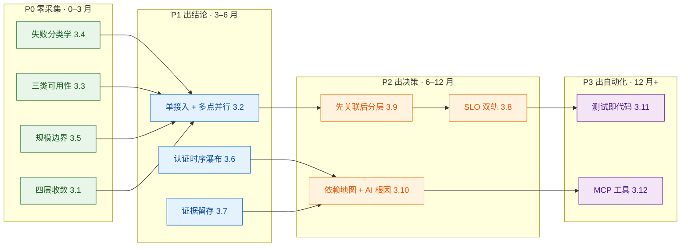

# 0 结论先行

**可借鉴的不是「二十余种测试类型」，而是六种「把一次拨测变成一条可执行结论」的加工能力。** 前者园区只需要留四类，后者才是产品差异所在。

| 功能块 | 业界本质 | 园区判定 | 价值 | 改造幅度 | 优先级 |
|---|---|---|---|---|---|
| **测试类型体系** | 二十余种协议与业务层测试 | **只留 4 类，砍掉其余** | ★★☆ | 大（做减法） | P0 |
| **观测点与并行** | 全球单归属节点网 | **借鉴方法，弃其规模** | ★★★★★ | 大（换拓扑语义） | P1 |
| **三类可用性** | 宽松 / 严格 / 可调整 | **直接抄** | ★★★★★ | 小（只改指标名） | **P0** |
| **失败分类学** | 六类 Test Errors | **直接抄** | ★★★★★ | 极小（复用现有日志） | **P0** |
| **规模边界** | Test Limit Errors | **直接抄** | ★★★★ | 极小 | **P0** |
| **证据留存** | 瀑布图 / 对象明细 / 截图 | **改造后抄** | ★★★★ | 中（换证据对象） | P1 |
| **告警与 SLO** | Burn Rate + Violation Budget | **借思路** | ★★★★ | 中（要引入预算概念） | P2 |
| **降噪层级** | 父子告警不自动去重 | **反向借鉴** | ★★★★ | 小（先建关联再分层） | P2 |
| **依赖地图与根因** | Stack Map + AI RCA | **改造后抄** | ★★★★★ | 大（换依赖对象） | P2 |
| **平台化** | REST v3/v4 并存、Terraform、CLI | **借兼容纪律** | ★★★ | 中 | P3 |
| **点数制成本** | 不限席位、可滚存 | **只借哲学** | ★★★ | 大（计价单位要换） | P3 |
| **AI 接入口** | MCP Server 工具设计 | **直接抄** | ★★★★★ | 中 | P3 |

**一句话理由**：Catchpoint 的功能是为「外部不可控的互联网」设计的——它的价值在**归因到别人的锅**；园区的网是客户自己的——价值在**定位到能改的那一行配置**。所以功能要抄「怎么把数据变成结论」，不能抄「怎么把网铺到全世界」。

> **本文判定口径**：涉及 Catchpoint 能力的表述标注信源（A 官方文档 / B 官方博客产品页 / C 本文推导）；涉及园区场景的结论若无外部信源，一律标 **C（本文推导）**。
> **功能基线来源**：`业界分析\Catchpoint\Catchpoint-合成测试-2023-2026-功能体系与痛点解法.md`（9 大功能点 / 119 小功能点 / 45 组痛点解法）。

---

# 1 筛选标准：三条硬判据

不是「这个功能好不好」，而是「园区有没有对应的问题形态」。

| 判据 | 问法 | 不通过就 |
|---|---|---|
| **J1 有对应故障形态吗** | 园区里会不会发生「这个功能专门治的那种故障」？ | 直接不做。例：BGP 前缀劫持在园区不存在 |
| **J2 不新增采集能做吗** | 现有 AP / AC / 接入 / RADIUS 的数据够不够？ | 能做则优先做——成本最低、见效最快 |
| **J3 结论指向可改的东西吗** | 输出的是「某个运营商的问题」还是「某条配置的问题」？ | 只归因外部不可改的对象，产品价值折半 |

**J2 是排序依据**：先用现有数据把话说清楚，再谈新增采集。这一点决定了 P0 全是「零采集」的功能。

---

# 2 功能借鉴总表

按 Catchpoint 的 9 大功能点逐个判定。**判定分为四档**：直接抄 / 改造后抄 / 只借思路 / 不做。

## 2.1 CP-1 测试类型体系（业界 21 个小功能点）

| 业界功能 | 园区判定 | 园区对应 | 理由 |
|---|---|---|---|
| 网络层测试（Ping / Traceroute / Transport） | **直接抄** | 端口连通、跨楼互访 | 兜底能力，任何结论都要它做否定 |
| DNS 测试（直查 vs 体验） | **直接抄** | 内网 DNS + 认证域名解析 | 园区 DNS 故障是高发项，且「谁的解析」在园区同样成立 |
| SSL 证书测试 | **直接抄** | Portal 证书链、RADIUS EAP 证书 | 证书过期是园区最常见的「突然全挂」原因 |
| API 测试（单步 / 多步） | **改造后抄** | 「多步」= 一次完整认证事务 | 园区的业务闭环是认证，不是 REST 调用 |
| Web 测试（Object / Emulated / Playwright） | **改造后抄** | 仅用于 Portal 页面 | 园区唯一的网页是 Portal，范围极窄 |
| Traceroute 多协议（TCP / UDP / QUIC） | **改造后抄** | 内网 ACL 常挡 ICMP，用 TCP 探测 | 这一条在园区比公网更有用 |
| Node-to-Node 测试 | **改造后抄** | 楼栋间 / 站点间互访质量 | 园区跨楼视频会议、跨站访问的核心指标 |
| Heartbeat（5 秒级） | **只借思路** | 频率分层，核心链路 1 分钟 | 5 秒会打爆 AC 的 EAP 会话表（见 2.8） |
| WebSocket / Streaming | **不做** | — | 园区视频走内网组播，无此形态 |
| BGP 测试 / 路由可见性 | **不做** | — | 园区无 AS 路径可选 |
| 邮件（SMTP / IMAP）/ FTP / MQTT | **不做** | — | 非园区主链路 |
| WebPageTest 多地域 | **不做** | — | 无多地域交付场景 |
| 移动端真机测试（Mobile Playback） | **只借思路** | 访客手机端 Portal 适配 | 园区访客场景确实需要，但可用浏览器模拟替代 |

> **一句话**：二十余种里只留 **4 类**——认证事务、DNS、SSL 证书、Ping/Traceroute 兜底。**做减法比做加法难，但不做减法会把产品做成一个没人会用的工具箱。**

## 2.2 CP-2 执行网络与观测点（业界 12 个小功能点）

| 业界功能 | 园区判定 | 园区对应 | 理由 |
|---|---|---|---|
| 观测点分层（骨干 / 末公里 / 无线 / 云内） | **改造后抄** | AP / 接入 / AC / 出口 / 终端 | 分层逻辑通用，分层维度要换 |
| 单归属（single-homed） | **改造后抄** | 单接入：一个点只从一个端口出 | 归因前提，园区版更简单 |
| DNS 解析器归属标注 | **直接抄** | 标注每个点用哪个 DHCP/DNS | 分不清「谁的解析」就分不清「谁的锅」 |
| 企业自部署节点（Enterprise） | **改造后抄** | 探针跑在 AP / 接入交换机 / 独立小盒子 | 边际成本近零，是原厂优势 |
| 节点容量与排队可见 | **改造后抄** | 探针健康度 + 并发余量看板 | 园区瓶颈在 AC/RADIUS，不在探针池 |
| Node-to-Node | **直接抄** | 楼栋间互访拨测 | 见 2.1 |
| Private Benchmarks（私有基准对比） | **改造后抄** | 新旧楼栋基准对比、改造前后对比 | 这是园区最高频的用法——变更前后比 |
| CDN Benchmark 矩阵 | **不做** | — | 园区不选 CDN |
| Connected Devices（街区级轻量代理） | **改造后抄** | 员工终端轻量采集（非拨测） | 与 APM 的终端侧采集重叠，需切清边界 |
| 3,109 节点规模叙事 | **不抄** | 对外只报「可执行拨测的点位数」 | 它的 3,109 含 1,672 个不执行测试的 BGP Peer（A 级分项） |

> **口径纪律**：Catchpoint 官方「3,109 agents」的分项为 Cloud 266 + Backbone 998 + Last Mile 127 + Wireless 46 + BGP Peers 1,672 = 3,109；其中**可执行合成测试的约 1,437 个**（C 级推导）。**对外报规模必须区分「实体总数」与「可执行测试的点数」，否则会把能力高估约 2.2 倍。**

## 2.3 CP-3 脚本生产与维护（业界 13 个小功能点）

| 业界功能 | 园区判定 | 园区对应 | 理由 |
|---|---|---|---|
| 浏览器录制器 | **改造后抄** | 录一次 Portal 认证流程，生成模板 | 园区只此一处需要真浏览器 |
| 所见即所得编辑器 | **直接抄** | 认证步骤可视化编排 | 现场工程师不是开发者 |
| 脚本模板库 | **直接抄** | 认证 / DNS / 证书 / 互访 四套模板 | 园区场景高度同质，模板复用率极高 |
| 变量与凭据管理 | **直接抄** | RADIUS 测试账号、共享密钥 | 不做就会把密钥写死在脚本里 |
| Playwright / Puppeteer 引擎 | **只借思路** | 只用于 Portal 页面 | 园区不需要全量脚本生态 |
| Selenium 脚本迁移器 | **不做** | — | Catchpoint 自身已于 2026-08-31 停止 Selenium 事务测试（A 级） |

## 2.4 CP-4 采集深度与证据留存（业界 14 个小功能点）

| 业界功能 | 园区判定 | 园区对应 | 理由 |
|---|---|---|---|
| 瀑布图（Waterfall） | **改造后抄** | 认证时序瀑布：关联→EAP 往返→授权→DHCP→DNS→首包 | 园区最有说服力的一张图，直接对应「卡在哪一步」 |
| 对象级明细 | **直接抄** | 每个认证子步骤的耗时与结果 | 三类可用性的严格判据靠它 |
| 失败截图 / HAR | **改造后抄** | Portal 失败截图 + 认证报文摘要 | 减少「复现不了」的扯皮 |
| 原始数据长期留存 | **改造后抄** | 按楼栋/点位分层保留期 | 存储成本要自己扛，不能照抄无限留存 |
| 端点侧 TCP Traceroute | **直接抄** | 终端到网关的路径取证 | ICMP 被挡时唯一可用 |

## 2.5 CP-5 告警与 SLO 治理（业界 13 个小功能点）

| 业界功能 | 园区判定 | 园区对应 | 理由 |
|---|---|---|---|
| 三类可用性分离 | **直接抄** | 执行成功率 / 业务完成率 / 剔除后完成率 | 详见 §3.3，本清单最高优先级 |
| 六类失败分类 | **直接抄** | 7 条园区认证失败枚举 | 详见 §3.4 |
| Test Limit Errors | **直接抄** | 单次拨测规模上限 | 详见 §3.5 |
| 告警父子不自动去重 | **反向借鉴** | 先建拓扑关联，再做分层 | 详见 §3.9 |
| SLO 双轨（Burn Rate / Violation Budget） | **借思路** | 按 SSID / 楼栋设 SLO | 详见 §3.8 |
| 趋势偏移告警（Trend Shift） | **直接抄** | 认证耗时逐周劣化检测 | 园区「越用越慢」比「突然挂」更常见 |
| 静默窗口 / 维护期 | **直接抄** | 变更窗口内的告警抑制 | 与三类可用性的剔除口径共用一套配置 |

## 2.6 CP-6 依赖地图与根因（业界 14 个小功能点）

| 业界功能 | 园区判定 | 园区对应 | 理由 |
|---|---|---|---|
| Internet Stack Map（依赖分层图） | **改造后抄** | 楼栋→接入→AC→RADIUS→DHCP→DNS→出口 | 换成园区依赖对象，方法完全成立 |
| AI RCA（疑似根因 + 证据链） | **改造后抄** | 认证故障的疑似根因列表 | 官方用「suspected root cause」并要求二次核对，这个措辞要照抄 |
| Stack Map 建议 | **改造后抄** | 依赖缺口提示（如某楼栋未部署探针） | — |
| Internet Sonar（第三方故障佐证） | **改造后抄** | 关联变更日历与维护窗口 | 园区的「第三方」是自己的变更 |
| 依赖关系变更对比 | **直接抄** | 拓扑变更后的依赖图 diff | 园区拓扑变动频繁，这一条很实用 |

## 2.7 CP-7 平台化与集成（业界 9 个小功能点）

| 业界功能 | 园区判定 | 园区对应 | 理由 |
|---|---|---|---|
| REST API 双版本并存（v3 稳定 / v4 预览，12 个月重叠） | **直接抄** | 对外 API 版本策略 | 这是**兼容承诺**，不是技术细节，客户会拿这一条评估长期风险 |
| Terraform Provider | **改造后抄** | 楼栋模板批量下发拨测配置 | 新增一栋楼应该是一次 apply，不是在 UI 里建几十条 |
| CLI（Go / Docker） | **改造后抄** | 现场部署与巡检脚本 | — |
| Webhook 事件推送 | **直接抄** | 拨测结果推给第三方运维平台 | — |
| SSO / MFA / 会话超时 | **直接抄** | 企业客户合规准入 | 官方会话超时策略依 NIST SP 800-63B，这一条直接可用 |
| 轮换 API Key | **直接抄** | 密钥有效期与轮换 | — |

## 2.8 CP-8 点数制成本治理（业界 10 个小功能点）

| 业界功能 | 园区判定 | 园区对应 | 理由 |
|---|---|---|---|
| 不限席位 / 不按 GB 计费 / 额度可滚存 / 无超量罚款 | **只借哲学** | 定价不惩罚用量 | 客户会问「为什么测我自己的 AP 还要按次付费」 |
| 分层合约期（60 天 / 13 月 / 3 年） | **改造后抄** | 按点位数或楼栋数分档 | — |
| 点数分摊到部门 | **改造后抄** | 多部门分摊看板 | 园区多部门共用一张网，成本归属是真实痛点 |
| 点数消耗系数表 | **不抄** | 园区成本主项是「对 AC/RADIUS 的压力」 | Catchpoint 的成本是探针与存储；园区是**把被测系统打坏**，模型必须重做 |

## 2.9 CP-9 AI 时代扩展（业界 10 个小功能点）

| 业界功能 | 园区判定 | 园区对应 | 理由 |
|---|---|---|---|
| MCP Server 工具设计 | **直接抄** | 园区 AI 助手的取数工具 | 详见 §3.12 |
| 服务端编排（orchestrate_tools） | **直接抄** | 多步查询在服务端合并且省 token | 这是成本与延迟的关键 |
| 图表服务端渲染为 SVG | **直接抄** | 拨测结果直接出图，不让模型拼数据 | 官方限制单次最多 9 条测试，是刻意的边界 |
| 工具描述里写重试与降级 | **直接抄** | 每个工具写清失败怎么办 | 模型严格照工具描述行事 |
| 合成提示词监控（验证 AI 回答质量） | **改造后抄** | 用拨测思路验 AI 助手自身的答案 | 「AI 不能静默失败」 |
| AI Insights | **改造后抄** | 认证异常自动摘要 | — |

---

# 3 十二个值得做的借鉴件

每条给出：**功能原样 → 园区怎么用 → 为什么成立 → 改造点**。

## 3.1 四层测试收敛

- **原样**：测试类型按抽象层次排列——网络层 → 服务层 → 页面层 → 业务层。左侧那排不是「更弱的测试」，而是**用来否定右侧结论**的工具。
- **园区用法**：L1 链路（关联 / 端口 / 空口）→ L2 服务可达（DHCP / DNS / RADIUS 1812）→ L3 门户（页面 / 证书链 / 重定向）→ L4 业务闭环（认证 → 授权 VLAN → 首包）。**排查顺序固定自下而上**。
- **为什么成立**：园区报障信息极模糊（「网卡了」），而「卡」在任意一层坏都会发生。缺了左侧，右侧业务测试的失败无法归因。
- **改造点**：层次按园区重划；「业务层」的载体从 HTTP 事务换成认证事务。

## 3.2 单接入归因 + 多点并行

- **原样**：骨干节点**单归属**（single-homed），每个节点只连一家运营商，「enabling you to isolate performance by ISP」（A 级原文）。同一 Run 并发分发到多节点。
- **园区用法**：每个观测点只从**一台接入交换机的一个端口**发起；同一时刻从 3–6 个点跑同一条认证事务；用失败点集的形状反推故障域。
- **为什么成立**：单归属把「路径」固定成常量，剩下的差异只能来自那一家运营商。园区同理——把「哪台接入 / 哪台 AC / 哪种介质」固定成已知标签，差异才能被读成结论。
- **改造点**：它的规模（998 节点 × 310 运营商）是用来给单归属结论做冗余的；园区不需要这个规模，只需要**签名正交的 4–6 个点**。

## 3.3 三类可用性分离

- **原样**：`% Availability`（主 URL 是否触达）、`% Content Availability`（**任一对象失败即整次运行判负**）、`% Adjusted Availability`（剔除 Purged Runs）。
- **园区用法**：执行成功率 / **业务完成率** / 剔除计划内后的业务完成率。第三个数与第二个数之差 = **「通而不可用率」**。
- **为什么成立**：园区最常被漏报的形态就是「通而不可用」——关联成功但拿不到 IP、Portal 弹出但提交超时、认证过但上不了网。这些在连通率里全部显示为 100%。
- **改造点**：严格判据的子步骤要按园区重定义（5 步全通过才算一次可用）；剔除项要自定义（变更窗口、AP 升级、RADIUS 维护、探针故障、拨测账号问题）。

## 3.4 失败分类学

- **原样**：`# Test Errors` 是六类失败之和，不是笼统的 failed。
- **园区用法**：7 条枚举，**每条绑定唯一责任方与唯一修复动作**：`DHCP_TIMEOUT` → 交换/AC；`RADIUS_REJECT`（有响应）→ 认证策略；`RADIUS_NO_RESPONSE` → 1812 可达；`CERT_INVALID` → 证书链；`VLAN_NOT_ASSIGNED` → 授权策略；`PORTAL_LOAD_FAIL` → Portal 服务；`DNS_RESOLVE_FAIL` → DNS。
- **为什么成立**：园区运维人力薄，无法逐条分析；笼统的「失败」必然导致「谁都不认」。
- **改造点**：**不需要新增采集**，只把已有失败原因分类。这是全清单里性价比最高的一条。

## 3.5 规模边界与超限状态

- **原样**：`Test Limit Errors` 独立于 `Test Errors`，边界明确（>30 秒 / >5 次连续重定向 / >2,000 URL / >255 host），且**超限是显式错误，不是静默截断**。
- **园区用法**：单次拨测最多 1 栋楼 / N 个 AP / 单步超时上限 / Portal 重定向上限；超限返回「测试超限」独立状态，并给出建议拆分数。
- **为什么成立**：想用一条拨测覆盖整栋楼必然超时，而超时会被误判为网络故障。**拨测自己造的假故障，比真故障更难查**——它有规律地每天同一时间出现。
- **改造点**：边界值按园区重定，但「超限必须区别于失败」这个细节**一字不改地照抄**。

## 3.6 认证时序瀑布

- **原样**：Waterfall 把一次事务按阶段横向展开，直接看出慢在哪一段。
- **园区用法**：关联 → EAP 往返 → 授权 → DHCP → DNS → 首包，六个阶段横向排开。
- **为什么成立**：这张图是唯一能让非专业人员一眼看懂「卡在哪一步」的形态；也直接支撑 3.3 的严格判据。
- **改造点**：阶段划分换成认证链；同时要在图上标出每个阶段的**责任方**。

## 3.7 失败证据留存

- **原样**：对象级明细、失败截图、原始数据长期留存。
- **园区用法**：Portal 失败截图 + 认证报文摘要 + 该端口前后窗口的配置快照。
- **为什么成立**：园区故障高频、短时、常自愈，事后复现不了。**留存必须前置到失败发生时**，而不是事后按需查询。
- **改造点**：留存策略从「定时全量」改为「**事件触发打包**」——失败触发时才打包，成本可控。

## 3.8 SLO 双轨

- **原样**：Burn Rate（Fast Burn Critical / Medium Burn Warning）判「是不是事故」，Violation Budget（周 / 月 / 季）判「还撑不撑得住」。
- **园区用法**：按 SSID / 楼栋设 SLO；Burn Rate 做告警门限（烧得快才告警，偶发失败不告警）；预算做月度复盘。
- **为什么成立**：园区没有 SLO 只有投诉，运维被投诉驱动，「会哭的孩子有奶吃」；也无法回答「这个月网络到底算好还是不好」。
- **改造点**：预算是新概念，要先教会客户怎么读，否则会退化成又一个数字看板。

## 3.9 先关联后分层（反向借鉴）

- **原样**：Catchpoint 明确说告警父子层级之间**不会自动去重**，层级设计不当会成倍放大告警量。
- **园区用法**：**先建拓扑关联图（AP→AC→RADIUS/DHCP→出口），再做分层与抑制**；按关联图做最小失败集合归并。
- **为什么成立**：一台 AC 挂掉会让其下 500 个 AP 的拨测全红。告警风暴 → 全面静音 → 真故障漏掉，这是园区 AIOps 最常见的死法。
- **改造点**：它把这个问题留给客户（公网拓扑它管不了）；园区拓扑是自己的，可以直接内建。

## 3.10 园区依赖地图 + AI 根因

- **原样**：Stack Map 把依赖分层成图，AI RCA 输出「疑似根因 + 证据链」。
- **园区用法**：楼栋→接入→AC→RADIUS→DHCP→DNS→出口的分层依赖图；故障时输出 2–3 条疑似根因，每条附支撑证据。
- **为什么成立**：园区的麻烦不在「不知道哪台设备挂了」，而在「不知道这次故障影响了哪些楼栋、哪些 SSID、多少人」。
- **改造点**：**措辞必须照抄**——官方用 `suspected root cause` 并要求 `double-check`，即「疑似 + 证据链」，而不是「根因是」。这是对准确率的诚实，也是产品免责的边界。

## 3.11 测试即代码

- **原样**：Terraform Provider、CLI、REST API v3 稳定 / v4 预览并存 12 个月。
- **园区用法**：楼栋模板声明式下发；新增一栋楼 = 一次 apply；API 版本并存期对外承诺。
- **为什么成立**：园区 AP 数量大、变更频繁，靠 UI 一条条建测试不可能。
- **改造点**：规模不同，但**「12 个月重叠期」这个兼容承诺本身就是产品力**，客户会用这一条评估长期风险。

## 3.12 MCP 工具设计

- **原样**：MCP Server 只暴露少量高语义工具（查询、编排、测例检索、错误检索、性能检索、故障检索）；服务端编排减少 token；图表服务端渲染为 SVG 且单次最多 9 条测试；工具描述里显式写重试与降级路径。
- **园区用法**：园区 AI 助手的取数层照此设计——工具少而语义高、编排在服务端、图表不让模型拼数据。
- **为什么成立**：**模型会严格照工具描述行事**，所以工具描述是产品的一部分，不是注释。
- **改造点**：工具清单换成园区的域对象（拨测点、认证会话、配置快照），但「服务端编排 + 有限返回 + 显式降级」这三条直接可用。

---

# 4 不做清单

| 不做的功能 | 理由 |
|---|---|
| BGP 测试与路由可见性 | 园区无 AS 路径可选，没有「路由劫持」这种故障形态（J1 不通过） |
| Streaming / WebSocket 测试 | 园区视频走内网组播，不存在公网流媒体交付路径 |
| WebPageTest 多地域、CDN Benchmark | 无多地域交付、无 CDN 选型场景 |
| 邮件 / FTP / MQTT 测试 | 非园区主链路，维护面换不来价值 |
| Selenium 脚本生态 | Catchpoint 自己已于 2026-08-31 停止 Selenium 事务测试（A 级），不追一个正在退场的标准 |
| 全球探针网自建 | 二十年的并购与运营商合作资产，买不到建不成；园区只需 1–2 个出口点 |
| 点数制计价单位 | 园区是设备预算，软件按年附加；借哲学不借单位 |
| 5 秒级默认频率 | 5 秒 × 数千 AP 会先打爆 AC 的 EAP 会话表与 RADIUS 的 CPS，这是它不需要考虑的成本项 |

---

# 5 分期：顺序不可颠倒

**顺序的理由链**：P0 是「把已有数据说清楚」，P1 是「把数据变成结论」，P2 是「把结论变成决策」，P3 是「把决策变成自动化」。

**颠倒的代价很具体**：

- 先做 P3 的 AI → 得到一个**能说会道但结论不可信**的助手，因为没有 P0 的失败分类，它只能输出「网络异常」；
- 先做 P2 的告警 → 得到**一场告警风暴后的全面静音**，因为没有 P1 的拓扑关联，500 条告警一起响；
- 跳过 P0 直接做 P1 的多点并行 → 得到**很多条无法解释的曲线**，因为失败原因没有分类，点再多也读不出形状。

---

# 6 一页速查

| 如果你只想记住三件事 | 内容 |
|---|---|
| **最值得抄的** | 失败分类学（3.4）—— 零采集、最高收益、直接减少扯皮 |
| **最容易被忽略的** | 三类可用性（3.3）—— 「通而不可用率」是园区独家指标，公网场景不显著 |
| **最容易抄错的** | 观测点规模（3.2）—— 抄 998 个节点的数字毫无意义，抄「单归属让差异可归因」才有意义 |

| 判定口诀 | 说明 |
|---|---|
| **一抄加工，不抄采集** | 它的采集面（全球节点）买不到，它的加工面（分类、判据、归并）全是软件 |
| **二抄减法，不抄加法** | 二十余种测试只留 4 类，做减法是产品判断力 |
| **三抄兼容，不抄规模** | API 双版本并存 12 个月这种承诺，比节点数更能打动企业客户 |

---

*文档生成时间：2026-10-21 ｜ 数据截止：2026-10-21*
