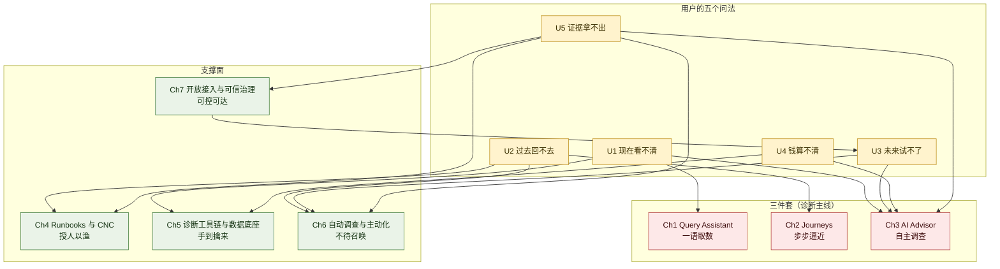
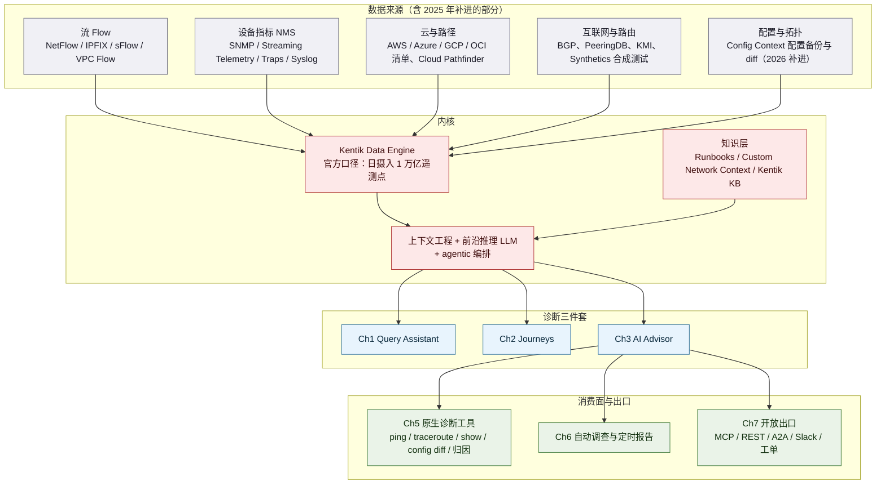
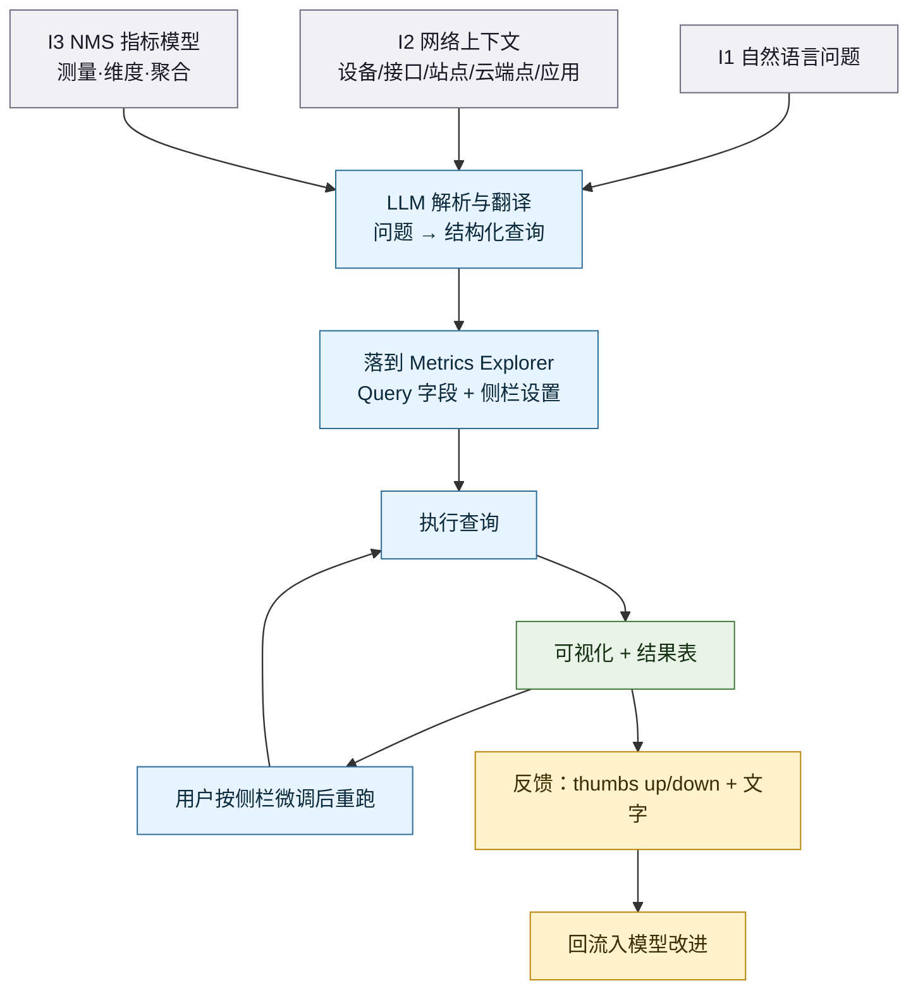
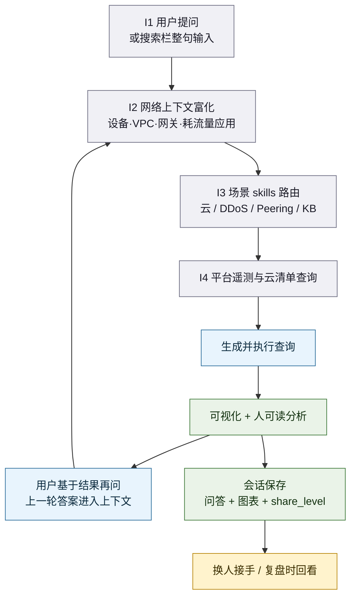
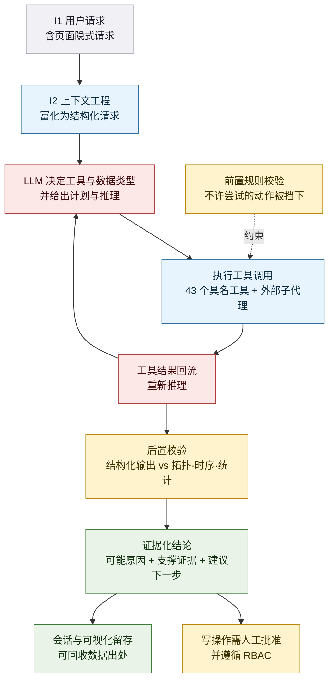
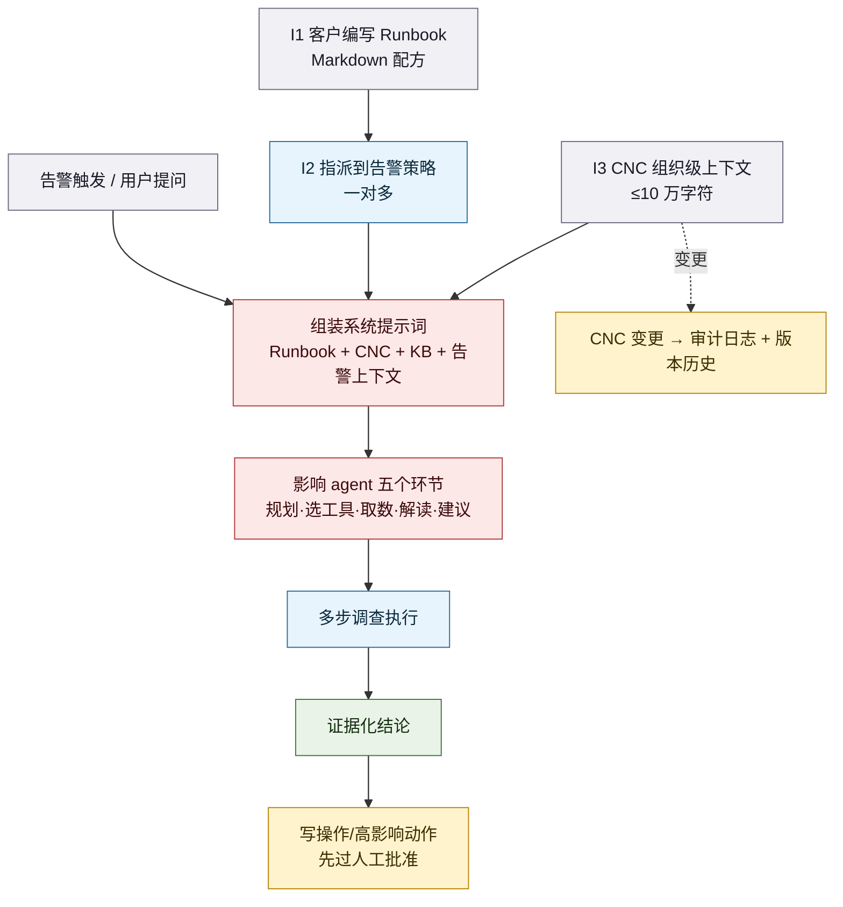
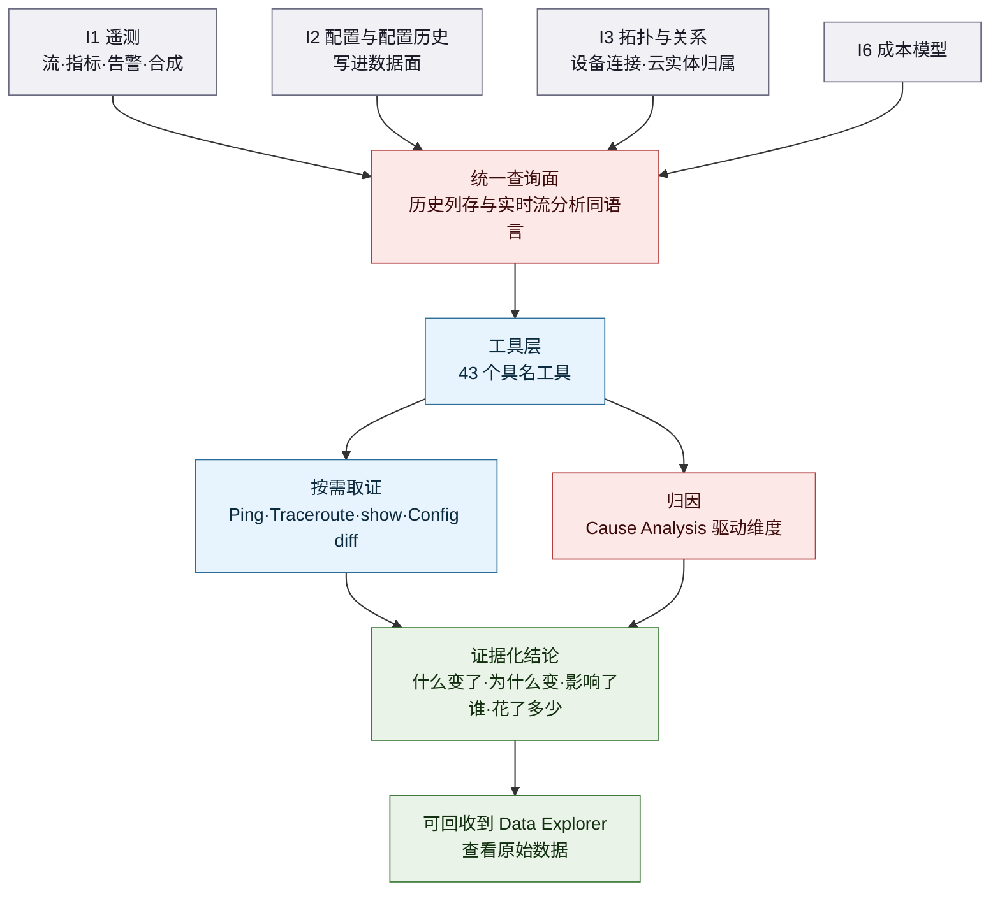
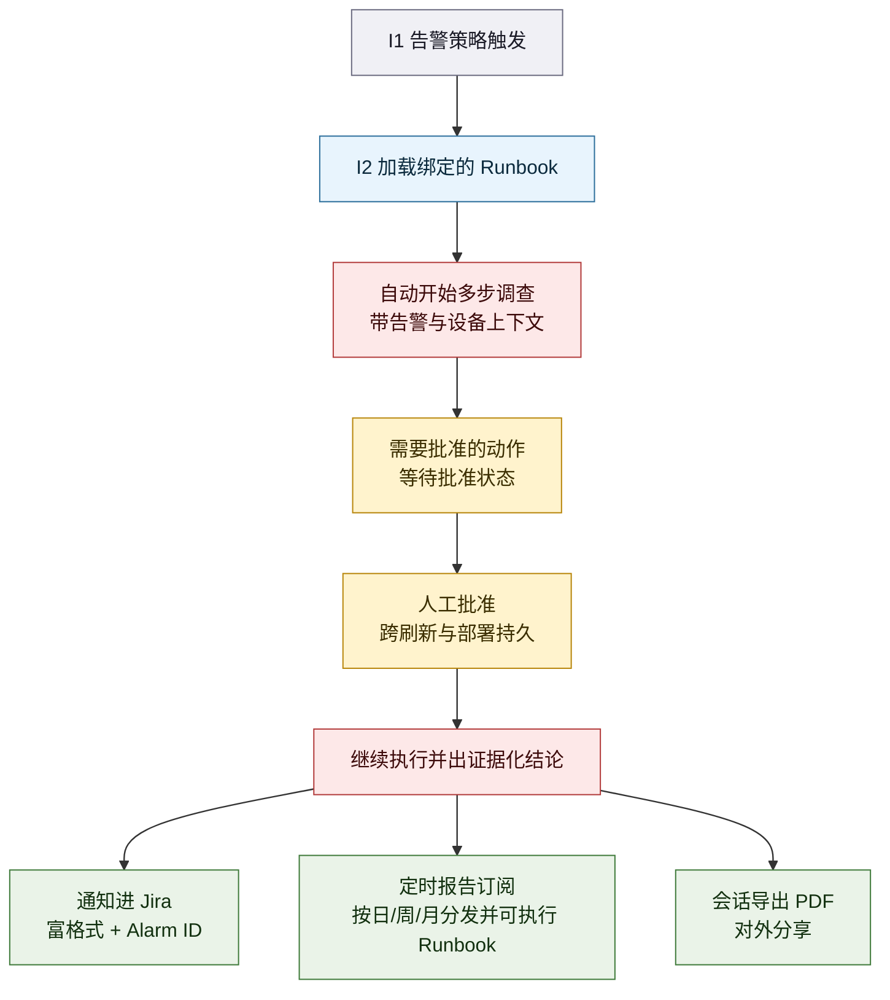
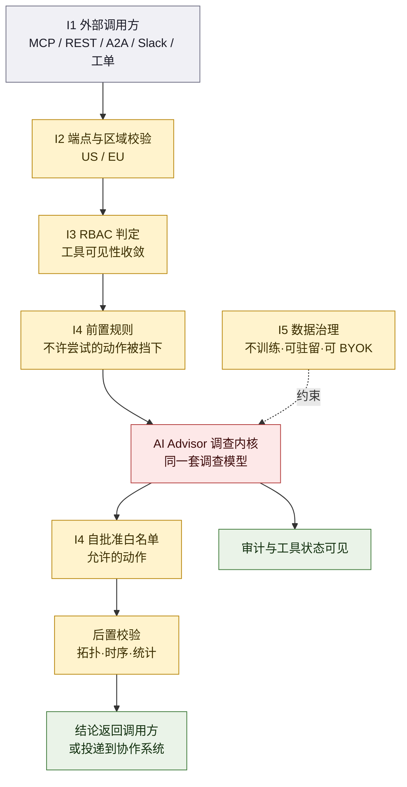

# Kentik AI 诊断三件套 功能体系与痛点解法（2023–2026）

> **调研对象**：Kentik 产品体系中「用 AI 做网络问题诊断」的三个核心形态 —— **Query Assistant**（自然语言取数）、**Journeys**（AI 引导式排障工作流）、**AI Advisor**（agentic 自主调查），以及支撑这三件套成立的**知识注入层、诊断工具层、主动化层、开放与治理层**。
> **调研范围**：2023-01 ~ 2026-10 公开发布的产品功能与能力增强。
> **信源根域名**：`kentik.com`（文档站 `kb.kentik.com`、产品更新流 `new.kentik.com`）。
>
> ⚠️ **命名口径声明（务必先读）**：「**AI 诊断三件套**」是本报告的**归纳说法，不是 Kentik 的官方名称**。官方伞形术语是 **Kentik AI**，其官方页面明确列出的 AI 能力是 **5 个**：AI Advisor、Metrics Explorer Query Assistant、Cause Analysis、AI-enhanced Insights、Summary。本报告以「**是否承担诊断主线**」为筛选轴，取其中三个跨代际的诊断入口作为「三件套」，把 Cause Analysis 与 Summary/AI-enhanced Insights 归入第 5 章。依据：[KB: Kentik AI Overview](https://kb.kentik.com/docs/kentik-ai-overview)（A 级）。**若您所指的三件套是另一组组合，请以正式命名重新界定范围。**

## 交付内容

1. **1.1 信源与局限**——三级信源表、六点已知局限、能力代次对照表、一条反直觉观察；
2. **1.3 工具级视角**——把三件套当作**一个工具**看：五个用户问法（U1–U5）、逐条展开（谁在问 / 典型场景 / 五类损失 / 放任不管的后果）、损失强度矩阵、U→P 归并映射；
3. **第 2–8 章（7 个大功能点）**——每章 K.1 小功能点清单 / K.2 用户痛点（P1…Pn）/ K.3 解法（S1…Sn，与痛点一一对应）/ K.4 功能原理（输入 I→实现链条→输出 O→机制深化→口径声明）/ K.5 能力边界（六维度）；
4. **附录五件套**——附一完整时间线（倒序）、附二演进规律（含「对自研的启示」）、附三对自研 APM AI 助手的对标启示、附四待补充与后续跟踪、附五信源链接总表（A/B/C 三级分册 + 未收录公开链接的信源 + 引用强度速览）。

## 建议读法

| 路径 | 读什么 | 花多久 |
|---|---|---|
| **赶时间** | 1.2 一句话定位 → 1.4 全景总表 + 边界速查 → 各章 K.5 一句话边界 | 10 分钟 |
| **要选型** | 1.3（U1–U5 与损失矩阵）→ 各章 K.2 痛点 + K.5 六维度边界 → 附一 时间线 | 40 分钟 |
| **要复刻** | 各章 K.4（输入 / 链条 / 输出 / 机制深化）→ 附二 演进规律 → 附三 对标启示 → 附四 缺口清单 | 60 分钟 |

---

# 1. 总览

## 1.1 信源与局限（先看这一段）

采用**三级信源**交叉验证。本报告**全文事实性表述均就地给出可点开链接**；凡属本报告推导，一律标注 `**C（本报告推导）**` 并给出依据链。

| 等级 | 信源 | 覆盖时段 | 在本文中的用途 |
|---|---|---|---|
| **A** | 官方知识库：逐月 AI/Insights Release Notes（`kb.kentik.com/docs/<月>-<年>-ai-insights`）、`kb.kentik.com/release-notes-2024`~`2025`、KB 功能文档（Query Assistant / AI Advisor / Cause Analysis / MCP / Command Access / Config Context / Sites）、官方产品更新流 `new.kentik.com/date/<年>/<月>` 与单篇功能公告 | 2024-01 ~ 2026-09 | **功能颗粒度、命名、发布日期、官方自认局限的第一依据** |
| **B** | 官方新闻稿（`kentik.com/press-releases`）、官方博客（含 CTO / CEO 署名长文）、产品页、官方客户案例、合作方新闻稿 | 2023-01 ~ 2026-10 | 平台级发布主题与日期、机制自述、客户体感来源 |
| **C** | 第三方媒体与评价平台：AI Journal、Tech Times、ITOps Times、APMdigest、C114、Network World、Infoblox 社区 | 2024-01 ~ 2026-08 | 补充实现细节（数据存储形态、校验分层）、高管访谈口径、收购方叙事 |

**六点已知局限**

1. **颗粒度上限：功能可到「月」，但两条时间轴口径不同。** Kentik 同时维护月度 Release Notes（`kb.kentik.com/docs/<月>-<年>-ai-insights`）与产品更新流（`new.kentik.com/date/`）。前者按「AI / Insights」分类归档但**不给单条条目日期**；后者给绝对日期但**部分条目只显示相对时间**。本报告凡只能到月的一律标 `YYYY-MM`，能在两处交叉的标到日。
2. **Release Notes 的 AI 分类是「AI / Insights」，不是按产品分。** 2024 年整年的 AI 条目以 **Journeys** 为主语（见 [Release Notes 2024](http://kb.kentik.com/release-notes-2024)），而 Query Assistant / AI Advisor 的条目**在同期分类中不以自身名义出现**。因此「某功能首次出现在哪个月」常需靠新闻稿或产品更新页补，**不可只用 Release Notes 反推首发日**。
3. **「AI 诊断三件套」无官方叫法（本报告最重要的口径局限）。** 官方伞形术语是 Kentik AI，官方列 5 个能力；三件套是本报告的诊断轴归纳。**引用本报告时不可写作「Kentik 官方的三件套」。**
4. **厂商自述收益一律视为「量级参考」。** 首页与新闻稿中的「调查时间减少 96%」「400% faster troubleshooting」「30 分钟变几秒（Equinix）」「6x faster DDoS detection」均为**厂商自述或厂商发布的客户案例**，缺受控测试或第三方审计，**不得作为能力成立的证据**。第三方独立验证主要是 GigaOm Radar 2023、EMA Radar 2024 Value Leader、Gartner Peer Insights 4.8/5 —— 定性定位为主，无量化受控验证。
5. **窗口末端主体身份变更。** Infoblox 于 **2026-07-08** 宣布签署收购协议，**2026-08-06 完成交割**；Kentik 保留为 Infoblox 内的品牌与产品线，双方已宣布将以 MCP 等开放标准把两套数据面接起来。因此 2026-08 之后的产品声明需同时读作「Infoblox 的 AgenticOps 数据底座叙事」的一部分。依据：[Infoblox 完成收购新闻稿](https://www.infoblox.com/news/news-events/press-releases/infoblox-completes-kentik-acquisition-to-bring-together-authoritative-dns-asset-visibility-and-real-time-network-intelligence)（B）、[Infoblox 社区公告](http://community.infoblox.com/discussion/34451/infoblox-welcomes-kentik-network-truth-for-the-age-of-agentic-operations)（B）。
6. **窗口起点被截断。** Kentik 前身 CloudHelix 成立于 2014 年，2019-07 发布过「首个面向网络专业人士的 AIOps 平台」，2020-02 发布过 AIOps 平台 GA。这些**不在本报告主时间轴内**，仅在解释「为什么 2024 年才真正起量」时作背景引用。

**能力代次与命名对照表**（防混淆）

| 代次 | 官方名称 | 首次公开 | 交互范式 | 当前状态 | 依据 |
|---|---|---|---|---|---|
| 第 1 代 | **Kentik Query Assistant** | 2024-01-31 | 自然语言 → **单条查询**（NL→Query） | 在役，**官方明示仍为 Beta** | [新闻稿 2024-01-31](https://www.kentik.com/press-releases/kentik-reimagines-network-monitoring-and-observability-with-kentik-ai/)（B）｜[KB Query Assistant](https://kb.kentik.com/docs/query-assistant)（A） |
| 第 2 代 | **Kentik Journeys** | 2024-01-31（预览）→ 2024-11 GA | 自然语言 → **多轮会话式排障工作流**（人驱动每一步） | **已被 AI Advisor 取代**，2025-12 起开始清理 | [Journeys GA 公告](https://new.kentik.com/kentik-journeys-now-generally-available-4zZoZi)（A）｜[AI Advisor GA 公告](https://new.kentik.com/kentik-ai-advisor-is-now-generally-available-ga-vgDcc)（A） |
| 第 3 代 | **Kentik AI Advisor** | 2025-11-18（GA 2025-11-17） | 自然语言 → **自主规划 + 递归调用工具 + 证据化结论**（agentic loop） | 在役，公司 AI 战略主入口 | [新闻稿 2025-11-18](https://www.kentik.com/press-releases/first-agentic-ai-solution-that-deeply-understands-the-network/)（B）｜[产品页](https://www.kentik.com/product/ai-advisor/)（B） |
| 旁支 | **Cause Analysis** | 2025-06-25 | 在流量图上自动**归因**「变了什么」 | 在役，可被 AI Advisor 自发调用 | [新闻稿 2025-06-25](https://www.kentik.com/press-releases/kentik-launches-cause-analysis-to-bring-network-expertise-to-every/)（B）｜[KB Cause Analysis](https://kb.kentik.com/docs/cause-analysis)（A） |

> **一条反直觉观察**：这家厂商的 AI 能力**不是「一个助手逐步长大」，而是「换了两代、废了一代」**。2024-01 的 Query Assistant + Journeys 是「把自然语言翻译成查询、由人一步步驱动」；2025-11 的 AI Advisor 是「自主规划并递归执行」——官方在 AI Advisor 的 GA 公告里直接写「**Kentik AI Advisor replaces Kentik AI Journeys**」，并在 2025-12 的 Release Notes 里把「**Started Initial clean-up of Journeys**」记成一条变更。**同一厂商在 22 个月内把自己的旗舰 AI 交互形态整体替换并下线，这在同类厂商里并不常见**，也说明「会话式 NL→Query」这条路被它自己判定为天花板偏低。

## 1.2 一句话定位

**AI 诊断三件套是 Kentik 从「数据平台」长出「行动层」的那一步：它把 Kentik Data Engine 里每天 1 万亿个遥测点，从「需要人会查、会看、会切图」变成「用自然语言提问就能拿到带证据的结论」，并进一步变成「告警一响就自己按既定流程查」。**

- 在 Kentik 自己的产品体系里，三件套**不是独立产品，而是叠在遥测底座之上的消费面**——官方原话把 Kentik AI 描述为一个 **ecosystem**：「At the foundation is Kentik's data platform, which unifies flow, metrics, cloud, synthetic telemetry... On top of that sit AI-powered capabilities like Query Assistant, Cause Analysis, and AI Advisor.」依据：[Context is King（2026-01-08）](https://www.kentik.com/blog/context-is-king-why-network-ai-needs-domain-knowledge-to-work/)（B）。
- 在公司战略上，三件套是**从「可观测性厂商」改口为「网络智能（network intelligence）平台」的那块招牌**：产品页的 slogan 是「The first AI that thinks and works like a network engineer」，而 FAQ 段落的措辞已从「监测」整体迁移到「降低 MTTD / MTTR、让结论可辩护（defensible cause）」。依据：[AI Advisor 产品页](https://www.kentik.com/product/ai-advisor/)（B）。
- 在**设备侧分层**（沿用本系列口径）中，三件套的锚点仍是**流、路径与配置，不是设备内部状态**：它能读设备配置与只读 `show` 命令，但价值锚点是「从一条流追到一台设备、一条规则」，**抽掉设备叙事仍成立**。故判定为 **L4（看流量与路径）向 L3（管设备）延伸**，**非 L3 原生成员**。依据：[KB: AI Advisor 的 43 个工具清单](https://kb.kentik.com/docs/ai-advisor)（A）。

## 1.3 从工具整体看：它究竟解决用户的什么问题

> **方法论前提（维度论证）**：本模板假定用户价值落在**时间轴**与**关系网**两个维度上。对「AI 诊断」这个品类，该假设**成立但需收紧**：诊断工具的直接产出是**认知**（看清状态、定位根因、拿出证据），它作用在时间轴上的位置是**「从异常发生到有人理解发生了什么」这一段**，而不在变更执行段。因此 U1–U5 中，「未来试不了」（U3）在本品类里**只能部分成立**——AI 诊断能给出预测与建议，但不提供 what-if 推演与变更试跑，这一点会在 1.3.2 与各章 K.5 中显式标为覆盖薄弱。

### 1.3.1 用户的五个问法（U1–U5）

**速览表**

| 问法 | 用户的原话 | 痛点描述（痛在哪） | 一句话损失 |
|---|---|---|---|
| **U1 现在看不清** | 「这张图我看不懂它在说什么——这条趋势是好还是坏？」 | 数据是有的，但把数据读成结论的那一步没有工具承接；越是非网络角色越读不动 | 时间：定位慢；组织：判断权集中在少数人 |
| **U2 过去回不去** | 「上周四那半小时到底发生了什么？谁还记得。」 | 现场不留存，调查过程不可复现，复盘与交接靠回忆 | 时间：同类故障反复从头查；人：经验随人走 |
| **U3 未来试不了** | 「这条链路三个月后会不会顶？」 | 只能靠历史趋势外推，无法在变更前试跑；**本品类覆盖最弱的一问** | 钱：靠加冗余/加带宽兜底；时间：扩容决策反复 |
| **U4 钱算不清** | 「这个月云账单怎么又涨了，涨在哪条路径上？」 | 成本与流量、路径的关系说不清，钱花在猜上 | 钱：无效支出与超配长期沉淀 |
| **U5 证据拿不出** | 「不是我们的问题——把证据给我。」 | 结论没有出处，跨团队各看各的图，对外说不清影响了谁 | 组织：扯皮与升级；合规：举证链缺失 |

---

**U1 · 现在看不清**

- **谁在问**
  - 应用团队工程师：「我这边的接口慢，是网络的问题还是我的问题？我看不懂这些图。」
  - 一线支持工程师：「客户报障了，我要最快确认是不是网络，但我不想学查询语法。」
  - 网络团队值班：「今天这个突增是我该管的，还是某个 CDN 在做灰度？」
- **典型场景**（示意量级，非实测）：某多云企业周五 15:00 收到「支付接口 P99 抖动」告警。值班工程师切了 4 个仪表盘、导出 2 份 CSV，30 分钟后才确认「是出口方向某条云间路径的丢包」，期间业务方已升级两轮。**这正是官方引用的客户原话所描述的场景**：「We want teams to be able to access the data they need without constantly relying on the SRE team.」依据：[Cloud Pathfinder 发布博客（2025-04-02）](https://www.kentik.com/blog/announcing-cloud-pathfinder-network-gps-for-infrastructure-teams/)（B）。
- **五类损失**

| 损失类别 | 可感知的具体损失 |
|---|---|
| 时间 | 单次定位从「分钟」拉长到「小时」，一次异常吃掉半个班次 |
| 钱 | 定位慢直接压在 SLA 与客诉上（金额随业务规模变化，非实测） |
| 人 | 会读图的人成为瓶颈，其他人只能排队等结论 |
| 合规 | 无 |
| 组织 | 「是不是网络的问题」的判定权集中在中心团队，扯皮由此开始 |

- **放任不管的后果**：**自增强循环**——越依赖少数专家，专家越被琐事占满，越没时间把判断方法沉淀下来，于是组织更依赖专家。

---

**U2 · 过去回不去**

- **谁在问**
  - 值班经理：「周二凌晨那次抖动的调查报告在哪？」
  - 网络架构师：「上次同样的现象我们查过，结论是什么来着？」
  - 新接手的人：「这设备的历史怪癖有没有记录？」
- **典型场景**（示意量级，非实测）：某运营商的一个 BGP 会话在 3 个月内断了 5 次，每次都由不同班次的人接手，每次都要重新拼线索。事后 postmortem 会上，五个人的描述互不一致，**没有人能说清「上次是怎么查的」**，因为查的过程没有留下可复用的资产。
- **五类损失**

| 损失类别 | 可感知的具体损失 |
|---|---|
| 时间 | 同类问题每次都从头查，重复投入 |
| 钱 | MTTR 均值被抬高，SLA 罚金概率上升（金额非实测） |
| 人 | 资深工程师的方法论没有被沉淀为组织资产，人走即断档 |
| 合规 | 审计要求的「处置过程留痕」难以举证 |
| 组织 | 复盘会变成记忆对账，责任归属靠嗓门 |

- **放任不管的后果**：**人类记忆是唯一存储介质**——团队规模越大、换班越频繁，这个介质越不可靠；越不可靠，越倾向于「让最资深的人一直在线」，进一步强化 U1 的循环。

---

**U3 · 未来试不了**（本品类覆盖最弱的一问）

- **谁在问**
  - 容量规划者：「按现在增速，哪条骨干链路三个月后会到 80%？」
  - 财务对接人：「明年这块的 CapEx 该怎么报？」
  - 网络设计师：「把这条流量切到另一条路径，够不够用？」
- **典型场景**（示意量级，非实测）：某企业在下一次硬件采购前，只能用「历史峰值 × 一个经验系数」估算需求。官方把这个问题在官网首页写成了示例提问：「Which backbone links will exceed 80% utilization in the next 3 months based on current growth?」，并把答案形态描述为「分析当前增长下的越限链路」。依据：[kentik.com 首页](https://www.kentik.com/)（B）。
- **五类损失**

| 损失类别 | 可感知的具体损失 |
|---|---|
| 时间 | 决策反复（报批—被质疑—再补数据）|
| 钱 | 要么超配（钱沉在闲置端口上），要么欠配（真顶到才补救，代价更高）|
| 人 | 靠个人经验背书，决策质量绑在具体人身上 |
| 合规 | 无 |
| 组织 | 网络团队与财务对不上账，预算博弈消耗关系 |

- **放任不管的后果**：**决策退化为经验加系数**；系数一旦偏保守，冗余长期沉淀成成本；偏激进则把风险推到生产上。
- **⚠️ 品类边界提醒**：本报告调研的工具**不提供变更的 what-if 试跑**——它给的是「基于当前增长的外推与建议」，不是「把配置改了会怎样」的仿真。**这一条会在各章 K.5「常见误期待」中重复澄清。**

---

**U4 · 钱算不清**

- **谁在问**
  - 云基础设施负责人：「出口费为什么比上季度高 18%？是哪条路径、哪类流量？」
  - 流量工程师：「我们付了 Transit Gateway 的钱，但其实可以用 VPC Peering 走？」
  - 采购/财务：「我们跟这家运营商的实际用量，真的按合同计价了吗？」
- **典型场景**（示意量级，非实测）：某企业发现云账单连续两季上涨却归因不清。人工比对 VPC 流日志与账单表耗掉两周，最后只找到部分原因。官方把这一场景写进了首页示例提问：「Find suboptimal paths where we are paying for Transit Gateway but could be using VPC Peering.」依据：[kentik.com 首页](https://www.kentik.com/)（B）。
- **五类损失**

| 损失类别 | 可感知的具体损失 |
|---|---|
| 时间 | 归因以「周」计 |
| 钱 | 无效路径与超配长期沉淀；**这是五类损失里最直接、可量化的一类** |
| 人 | 需要同时懂网络与计费的人，这类人极稀缺 |
| 合规 | 合同计价与实际用量的核对缺少可复现依据 |
| 组织 | 网络团队说不清钱，财务不信任网络的预算 |

- **放任不管的后果**：**成本在无声处膨胀**——每次增长都被解释为「业务涨了」，于是没人去找「哪里可以不花」；云支出与网络架构的耦合越深，越晚发现越贵。

---

**U5 · 证据拿不出**

- **谁在问**
  - 网络团队负责人：「对上游运营商，我要能证明问题在他们那一段。」
  - 安全团队：「这个流量是真实用户还是机器人？给结论也给依据。」
  - NOC 主管：「对外发布故障通告时，我要能说清影响了谁、影响到什么程度。」
- **典型场景**（示意量级，非实测）：某 SaaS 企业被客户投诉「你们的服务不稳定」。网络团队内部判断是上游 CDN 的问题，但**拿不出可对外出示的证据链**——只有几张不同人截的图，时间轴还对不上。官方把这类需求称为 **Mean Time to Innocence（洗清自己嫌疑的时间）** 场景，并把「**Shows its work with clear steps and supporting data so conclusions are easy to trust**」写成了产品页的第一组卖点。依据：[AI Advisor 产品页](https://www.kentik.com/product/ai-advisor/)（B）。
- **五类损失**

| 损失类别 | 可感知的具体损失 |
|---|---|
| 时间 | 举证本身成为一项独立工作 |
| 钱 | 无法定责即无法索赔，成本留在自己账上 |
| 人 | 需要资深的人反复出面解释 |
| 合规 | 监管/审计/合同举证链缺失 |
| 组织 | 跨团队与跨供应商扯皮升级，问题在组织间来回踢 |

- **放任不管的后果**：**「无法举证」会被组织学习成「多做多错」**——团队倾向于保守、少承诺、少变更，创新能力被合规焦虑吃掉。

---

**损失强度分布矩阵**（● 主要 / ○ 次要）

| 问法 | 时间 | 钱 | 人 | 合规 | 组织 |
|---|---|---|---|---|---|
| **U1 现在看不清** | ● | ○ | ● | — | ● |
| **U2 过去回不去** | ● | ○ | ● | ○ | ● |
| **U3 未来试不了** | ○ | ● | ○ | — | ○ |
| **U4 钱算不清** | ○ | ● | ○ | ○ | ● |
| **U5 证据拿不出** | ○ | ○ | ○ | ● | ● |

> **采购行为解释**：**五问全部落在「时间 / 组织 / 钱」三列，而合规只在 U5 上是主因。** 这解释了为什么这一类工具的现实买单逻辑是「**先买省下来的人工时间，再用证据能力去谈跨团队话语权**」：对中大型企业，AI 诊断的立项材料里最容易被 CFO 接受的是「同样的告警量，用更少的人接住」；而「证据链」更多是安全与合规预算的口子。**U3 与 U4 是唯一直接挂钱的两问，也是 Kentik 把 AI 能力卖给财务/高管客户的入口**——这家公司的一个反常之处正在于它把可观测性产品卖给了非网络角色。依据：[Seaborn 案例新闻稿（2026-05-19）](https://www.kentik.com/press-releases/seaborn-networks-reduces-network-costs-by-4m-annually-using-kentik/)（B，收益为厂商自述，仅作量级参考）。

### 1.3.2 五个整体问题（U1–U5）与承载能力（落到大功能点）

| # | 用户的问题 | 工具给出的整体回答 | 对应的大功能点（及它在这里扮演的角色） |
|---|---|---|---|
| U1 | 现在看不清 | 「你用一句话问，我把它翻译成可执行的查询，并给你图」→ 再进阶为「我自己择工具、取数、给结论」 | **Ch1 Query Assistant**（入口：把问题变成查询，见第 2 章）｜**Ch3 AI Advisor**（主体：自主取证给结论，见第 4 章）｜**Ch5 诊断工具链**（补证：把「取证」「归因」「看配置」做成原生工具，见第 6 章） |
| U2 | 过去回不去 | 「调查过程当成对象保存下来；下次换人接手，从同一张卷宗继续」 | **Ch2 Journeys**（首创：会话即卷宗，见第 3 章）｜**Ch3 AI Advisor**（强化：会话 + 可导出 PDF + 数据出处可回收，见第 4 章）｜**Ch4 Runbooks 与 CNC**（沉淀：把查法写成机器可读资产，见第 5 章） |
| U3 | 未来试不了 | 「按当前增长外推越限链路与 runout 日期，给建议；但**不做 what-if 试跑**」 | **Ch3 AI Advisor**（承载：容量规划与成本优化是其官方四大收益之一，见第 4 章）｜**Ch6 主动化**（延伸：定时报告把趋势分析变成周期产物，见第 7 章）｜**Ch5**（数据支撑：95 百分位指标、容量规划页上下文，见第 6 章） |
| U4 | 钱算不清 | 「把流量、路径、合同价与云账单接上，钱花在哪个维度上一眼看到」 | **Ch3 AI Advisor**（分析面：成本优化与路径优化，见第 4 章）｜**Ch5**（工具面：Connections Costs / Traffic Costs 页面的 AI 上下文、Cloud Pathfinder、KMI，见第 6 章） |
| U5 | 证据拿不出 | 「每一步都给你看依据，结论可回收到原始数据；并且能进你的工单系统、能被审计」 | **Ch3 AI Advisor**（证据化推理 + 只读边界，见第 4 章）｜**Ch6 主动化**（对外：AI Investigation 通知进 Jira，见第 7 章）｜**Ch7 开放与治理**（治理面：RBAC / 人工批准 / 审计 / 数据承诺，见第 8 章） |

> **覆盖核验**：**7 个大功能点全部被至少一个 U 消费，无孤立能力。** 反向看，**U1 与 U5 是被消费最多的两问**（各被 4–5 个大功能点共同承载），**U3 是被覆盖最窄的一问**（无专门的仿真/试跑能力承载，仅由 AI Advisor 的容量与成本分析间接回应）。

### 1.3.3 从用户问题到大功能点

### 1.3.4 用之前 vs 用之后（同一批问题对照）

| 问法 | 用之前（人工 + 多工具） | 用之后（官方自述的工作方式） | 变化性质 |
|---|---|---|---|
| U1 现在看不清 | 学查询语言 → 切 4~5 个仪表盘 → 手工切片对比 | 一句自然语言 → 系统选工具、取数、给带出处的结论 | **门槛变化**（会不会查 → 会不会问） |
| U2 过去回不去 | 查完即散，靠人记；交接靠口述 | 会话即卷宗；查法写成 Runbook 挂到告警策略，下次自动复用 | **资产化**（经验 → 可执行资产） |
| U3 未来试不了 | 历史峰值 × 经验系数 | 按当前增长外推 runout 并给建议 | **仅改善外推质量，未提供试跑** |
| U4 钱算不清 | 人工比对账单与流日志，以周计 | 成本与路径/流量维度打通，可对 AI 直接提问 | **相关性可从「猜」变「查」** |
| U5 证据拿不出 | 靠截图与口头复述 | 每步展示推理与支撑数据，结论可回收到原始数据 | **举证形态变化**（结论 → 结论 + 数据链） |

> **厂商自述与本报告判定的边界**：上表「用之后」一列描述的是**官方口径下的理想工作方式**，不是受控实测结果。其中「U1 门槛变化」与「U5 举证形态变化」是可由官方文档结构验证的（KB 明示 Query Assistant 为自然语言入口、AI Advisor 明示逐步展示推理与数据）；而「U3 仅改善外推质量」是本报告依据官方能力清单**反向确认的缺口**（43 个工具中无仿真/试跑类工具）。依据：[KB: AI Advisor 工具清单](https://kb.kentik.com/docs/ai-advisor)（A）。

### 1.3.5 小结：U 与 P 的关系

- **U 是工具级问题**，回答「**值不值得买**」——它是把三件套当成**一个整体工具**来问的，粒度在「这个工具能不能替我把问题解决」。
- **P 是功能级痛点**，回答「**做得对不对**」——它落在每个大功能点内部，粒度在「这条能力有没有真正回应一类可感知的损失」。
- 二者是**上位归并**关系，**不是一对一**：一个 U 会由多个大功能点的多条 P 共同承载；一条 P 通常只服务一个 U 的某一面。因此**不允许把 U 号直接当 P 号使用**。

**U → P 归并映射表**（使全部 P 可追溯）

| 上位问题 | 由哪些章的 P 归并而来 | 归并口径说明 |
|---|---|---|
| **U1 现在看不清** | Ch1 的 P1–P5（取数门槛、专家依赖、排队、口径不一、看不到就只能加冗余）｜Ch3 的 P2、P3、P5（换工具式排障、非网络角色被卡、例行调查吃掉人力）｜Ch5 的 P1、P2（跨域取证难、取证要换工具） | U1 是「认知缺失」的总问题；凡**「因为看不到而变慢/变贵/要靠人」**的痛，都归并到 U1 |
| **U2 过去回不去** | Ch2 的 P1–P4（盯屏对比、能力锁在人身上、自助缺失、现场不留存）｜Ch3 的 P5｜Ch4 的 P1–P3（跨人查法不一、知识在脑子里、告警来了先补背景）｜Ch6 的 P3 | U2 是「过程不留存、不可复现」的总问题；凡**「同一件事要重新学一遍 / 记忆是唯一介质」**的痛，归并到 U2 |
| **U3 未来试不了** | Ch3 的 P5（部分）｜Ch6 的 P3（周期性趋势工作） | 本报告**明确记录该 U 覆盖最弱**：无专门痛点章，仅由「例行调查占人力」与「周期报告」间接回应 |
| **U4 钱算不清** | Ch3 的 P5（部分）｜Ch5 的 P1、P5（归因难、成本解释难）｜Ch1 的 P5 | 凡**「钱花在哪说不清、只能靠加冗余兜底」**的痛，归并到 U4 |
| **U5 证据拿不出** | Ch3 的 P3、P4（非网络角色被卡、AI 说错话代价高）｜Ch4 的 P4（组织知识的治理举证）｜Ch6 的 P4（结论进不了工单）｜Ch7 的 P1–P4（入口孤岛、AI 写操作风险、遥测不可训练与驻留） | 凡**「要对外/对上级/对供应商举证」或「要让 AI 可控可审」**的痛，归并到 U5 |

## 1.4 读法：7 个大功能点全景

**全景总表**

| # | 大功能点 | 口号（四字） | 小功能点数 | 时间跨度 | 面向谁 |
|---|---|---|---|---|---|
| 1 | Query Assistant（自然语言取数） | 一语取数 | 6 | 2024-01 ~ 2026-07 | 非网络角色的第一入口；网络团队的自助加速器 |
| 2 | Journeys（AI 引导式排障工作流） | 步步逼近 | 7 | 2024-01 ~ 2025-12 | 一线支持、NOC、应用团队（**已退役，见 K.5**） |
| 3 | AI Advisor（agentic 自主调查） | 自主调查 | 10 | 2025-11 ~ 2026-09 | 值班工程师、网络架构师、云成本负责人 |
| 4 | Runbooks 与 Custom Network Context（知识注入） | 授人以渔 | 9 | 2025-11 ~ 2026-07 | 团队负责人、资深工程师、合规与审计 |
| 5 | 诊断工具链与数据底座回填 | 手到擒来 | 11 | 2025-06 ~ 2026-07 | 排障现场的所有人；数据平台团队 |
| 6 | 自动调查与主动化 | 不待召唤 | 9 | 2025-11 ~ 2026-07 | NOC 主管、值班制度设计者、协作平台管理员 |
| 7 | 开放接入与可信治理 | 可控可达 | 14 | 2025-05 ~ 2026-09 | 平台架构师、AI 生态负责人、安全与合规 |

**边界速查（一页版）**

| # | 大功能点 | 最要命的一条边界 | 边界性质 |
|---|---|---|---|
| 1 | Query Assistant | **官方明示至今仍为 Beta**，且其「全域数据」的新闻稿口径与 KB 的「NMS Metrics Explorer 专用」口径不一致 | 官方自认局限 + 源冲突 |
| 2 | Journeys | **已被 AI Advisor 取代并在 2025-12 开始清理**，今天不可作为选型对象 | 硬边界（生命周期终止） |
| 3 | AI Advisor | **上下文缺失时结论会退化**；官方明示会 hallucinate，且**跨会话无持久记忆** | 官方自认局限 |
| 4 | Runbooks / CNC | 效果上限由**客户自己写的知识与流程质量**决定（垃圾进、垃圾出）；CNC 上限 10 万字符 | 前提依赖 |
| 5 | 诊断工具链 | 工具清单是「包括但不限于」的**开放集**，官方不承诺覆盖；**不含仿真/试跑类工具** | 软边界 |
| 6 | 自动调查 | 自动化的边界由**审批与 RBAC**决定；长时调查依赖「批准状态可跨刷新存活」这一条相对新的机制 | 前提依赖 |
| 7 | 开放与治理 | **写操作与「只读承诺」在官方文档间存在口径冲突**（KB 称只读 vs Release Notes 出现自批准工具与 Sites 写操作） | 源冲突 |

**编号约定声明（P/S 闭环规则）**

- 每个大功能点内，**K.2 的痛点编号 `P1…Pn` 与 K.3 的解法编号 `S1…Sn` 数量与语义严格一一对应**。
- K.3 表格的「对应痛点」列**必须**以 `→ 解 Pn` 显式回指；一条痛点可由多条解法共同覆盖，但**不允许悬空痛点**（有 P 无 S 回应）**与悬空解法**（有 S 指不回任何 P）。
- 凡属**技术演进、生态配套、模型注册表更新、生命周期终止**等找不到客户痛点归宿的内容，单列于各章「**配套演进**」框中，**不计入 S 编号**。
- 编号为**章内局部编号**（每章都从 1 开始），跨章不连续编号，以免与「大功能点编号」混淆。

**总构造图：数据来源 → 内核 → 各消费面**

> **读图提示**：图中 `S5 配置与拓扑` 是本报告认为**最值得注意的一块补进**——官方在解释 AI Advisor 为何能做关联归因时明确承认，为了支撑自主调查，**数据平台不得不回填配置跟踪、拓扑建模与关系映射**。这条因果链在第 5 章 K.4.4 展开，并在附二作为第一条演进规律。

# 大功能点 1：Query Assistant —— 一语取数

> **它替代了什么**：替代「先学会写查询，才能问网络问题」这道门槛——把 Metrics Explorer 的查询侧栏（测量 / 维度 / 聚合）从**必经步骤**降级为**可选的微调步骤**。

## 1.1 小功能点清单

| # | 小功能点 | 发布时间 | 信源等级 | 说明 |
|---|---|---|---|---|
| 1.1 | **Kentik Query Assistant 发布** | 2024-01-31 | B（[新闻稿](https://www.kentik.com/press-releases/kentik-reimagines-network-monitoring-and-observability-with-kentik-ai/)） | 官方原文：「leverages a large language model (LLM) **infused with network context** that enables users to ask questions about their network in natural language」 |
| 1.2 | **作为 NMS 的关键特性同步上线** | 2024-01-31 | A/B（[NMS 发布公告](https://new.kentik.com/kentik-nms-now-available-4piq0o)） | NMS 发布公告的关键特性列表里写作「**Query Assistant✨**: Use natural language to **Ask Any Question** with the power of AI and Large Language Models」 |
| 1.3 | **Metrics Explorer 内嵌版（弹窗式）** | 2024-01-31 起 | A（[KB: Metrics Explorer](https://kb.kentik.com/docs/metrics-explorer)） | 在 Metrics Explorer 的 Query 字段内点开弹窗提问；「A natural language question entered into the Query Assistant popup **becomes an NMS query**」 |
| 1.4 | **示例瓦片（Example / Recent）与四类示例卡** | 同上 | A（[KB: Query Assistant](https://kb.kentik.com/docs/query-assistant)） | 独立页面版含 devices / interfaces / routing / hardware components 四类示例卡；弹窗版含 Example 与 Recent 两组瓦片 |
| 1.5 | **查询反馈闭环 + 官方明示 Beta** | 同上 | A（[KB: Metrics Explorer](https://kb.kentik.com/docs/metrics-explorer)） | 官方原文：「**Provide feedback to help us train and improve our AI**」（thumbs up/down + 文字反馈）；KB 另注明「**Query Assistant is still a Beta feature**」 |
| 1.6 | **Data Explorer 自然语言查询（DE NLQ）与模型可自选** | 2024-06 ~ 2024-11 | A（[Release Notes 2024](http://kb.kentik.com/release-notes-2024)） | 2024-06 起出现「DE NLQ」「query_engine errors」条目；2024-08「Journeys: **per company model selection**」；2024-10 上线 Gemini Pro 1.5 002、Llama 3.2、Claude 3.5 v2 |

## 1.2 它对应的用户痛点

> **口径**：本节只写客户侧可感知的痛（时间 / 钱 / 人 / 合规 / 组织）。架构层问题（查询语言学习曲线陡、指标模型按 OpenConfig 组织）**不作为痛点**，它们是「为什么必须做自然语言入口」的**设计约束**，放在 1.3 与 1.4.1 的必要性论证里。

- **P1｜取数门槛把大多数问题挡在门外（时间）——「会写查询的人才敢取数，问一次数要半天」**：网络平台的查询语言再强，也要求使用者先理解测量、维度、聚合三个概念，再记住实体的命名方式，才能把脑子里的问题翻译成一条可执行查询。对非网络角色，这一步直接构成硬门槛，导致「想清楚了也拿不到数」。
- **P2｜取数能力绑在少数人身上（人）——「能不能拿到数，取决于团队里有没有懂查询的人」**：当只有少数人掌握查询，任何取数需求都要经他们的手；这些人被反复打断，而团队整体能力没有增长。官方在产品发布时的定位语就是针对这一点：让网络上「**anyone — a developer, SRE, or business analyst**」都能提问。依据：[新闻稿 2024-01-31](https://www.kentik.com/press-releases/kentik-reimagines-network-monitoring-and-observability-with-kentik-ai/)（B）。
- **P3｜非网络角色被挡在门外，事事排到中心团队队尾（组织）**：支持工程师要解决客户问题、应用团队要发版，都要等中心网络团队排期；中心团队被琐事淹没，真正的难题没人做。这不是「缺少数据」，而是**数据到结论之间缺一个非专家能用的出口**。
- **P4｜同一问题两次问出两个答案，没有可复现的口径（时间 + 组织）**：手工在侧栏点选维度与聚合，点错一个就得到另一张图；同一个问题由不同人执行，结论可能不一致，事后无法复现当时的取数口径。**这条痛点在 AI 时代并未消失——它只是从「人点错」变成「模型翻译偏差」，所以解法里必须保留可人工复核的查询对象**（见 S3）。
- **P5｜看不到数据就只能靠加冗余兜底，钱花在猜上（钱）**：接口利用率、增长趋势、越限链路这些问题，本来是可以问出来的；问不出来时，组织倾向于用「多买一点、多留一点」来对冲不确定性，成本就这样沉淀下来。

## 1.3 它是如何解决的（与痛点一一对应）

| 解法 | 机制 | 对应痛点 |
|---|---|---|
| **S1｜自然语言取数入口** | 在 Metrics Explorer 的 Query 字段内提供提问弹窗与独立提问页；用户输入自然语言，系统返回查询结果，**门槛从「会不会写查询」变为「会不会描述问题」**；结果失败时可直接改侧栏设置重跑 | → 解 P1 |
| **S2｜把网络上下文注入 LLM** | 官方明确说明模型是 **infused with network context**，而非裸 LLM；这使「这个设备/这类接口/这个云端点」这类只有本平台才知道的实体能被正确翻译成查询条件。这是「非专家也能问对」的前提 | → 解 P2、P3 |
| **S3｜结果落回可再编辑的查询对象** | 自然语言执行后**不是给一段散文，而是跳到 Metrics Explorer：字符串进 Query 字段、侧栏设置反映系统对文本的理解、主显示区出图**。用户可继续用侧栏微调并重跑——这一设计把 AI 的翻译错误变成**可人工纠正的中间态**，而不是无法复核的结论 | → 解 P4 |
| **S4｜示例瓦片 + 反馈闭环** | Example 瓦片给出可照抄的问法（点击即填入），Recent 瓦片复用历史问法；每次回答后可用 thumbs up/down 与文字反馈，官方原文是「help us train and improve our AI」。前者降低冷启动门槛，后者让偏差可被回流 | → 解 P2、P4 |
| **S5｜与 NMS / 流量数据面同源** | Query Assistant 直接面向 NMS 指标数据（OpenConfig 启发的数据模型）与 Data Explorer 流量查询，因此容量、成本、利用率这类**原本要人工拼表才能回答**的问题可被直接问出 | → 解 P5 |

> **边界**：S1–S5 全部建立在「查询语言仍是最终执行载体」之上——它没有取消查询，而是把查询变成**机器可生成的中间产物**。因此它的能力上限受两件事约束：① 数据面里**有没有**这个维度（问不到的维度无法被翻译出来）；② 模型对实体名的理解是否与客户命名一致（不一致时会翻译成别的东西，而不会报错）。后者由第 4 章的 Custom Network Context 承接。
>
> **配套演进（不计入 S）**：模型注册表迭代（2024 年从 gpt-4o 到 Gemini / Llama / Claude 多模型可选）。这是平台工程演进，不指向某条具体客户痛点。

## 1.4 功能原理

### 1.4.1 输入

| 输入 | 具体内容 | 官方依据（含原文链接，标 A/B/C） | 缺了它会怎样 |
|---|---|---|---|
| **I1** 用户的自然语言问题 | 任意自然语言问题（KB 示例：「show me interface utilization using line chart with 「PEER」 in the description」） | A（[KB: Query Assistant](https://kb.kentik.com/docs/query-assistant)） | 没有它，整个入口不存在——这是唯一的触发源 |
| **I2** 网络上下文 | 客户环境中的实体语义：设备、接口、站点、云端点、应用、ASN 等 | B（[新闻稿](https://www.kentik.com/press-releases/kentik-reimagines-network-monitoring-and-observability-with-kentik-ai/)：「infused with network context」） | 缺了它，模型只能靠通用网络知识猜实体，翻译出的查询会指向不存在的对象或错误的对象 |
| **I3** NMS 指标数据模型 | 官方描述为「OpenConfig inspired data model」，含测量 / 维度 / 聚合三类可查询要素 | A（[NMS 发布公告](https://new.kentik.com/kentik-nms-now-available-4piq0o)）、A（[KB: Metrics Explorer](https://kb.kentik.com/docs/metrics-explorer)） | 缺了它，自然语言无处可落——**「翻译成查询」这件事的前提是先存在一个可被翻译的目标结构** |
| **I4** 查询侧栏的字段模型 | Query sidebar 的 Measurement / Dimensions / Aggregation 与 Visualization Options | A（[KB: Metrics Explorer](https://kb.kentik.com/docs/metrics-explorer)） | 缺了它，用户无法对 AI 的翻译结果做微调，S3 的「可纠正中间态」不成立 |

### 1.4.2 实现链条

| 步骤 | 做什么 | 关键输入 | 输出 |
|---|---|---|---|
| 1 | 接收问题 | I1 | 待解析的原始文本 |
| 2 | 结合网络上下文解析意图 | I1 + I2 | 意图与目标实体（哪台设备、哪类接口、哪个时间范围） |
| 3 | 翻译成可执行查询 | I2 + I3 + I4 | 查询对象（测量 / 维度 / 聚合 / 可视化） |
| 4 | 落到 Metrics Explorer 并执行 | 查询对象 | 图表 + 结果表 |
| 5 | 用户复核与微调 | 侧栏字段 + 图表 | 修正后的查询与结果 |
| 6 | 收集反馈 | 用户判断 | 反馈记录（回流模型改进） |

> **链条中一步不能跳的环节是第 3→4 步**：官方明确结果是「**becomes an NMS query**」，即最终执行者是查询引擎而不是模型。这是它与第 3 章 AI Advisor 的分野——**Query Assistant 的模型只负责「翻译」，不负责「取证与推理」**；而 AI Advisor 的模型负责「决定查什么、判断够不够、还差什么」。依据：A（[KB: Metrics Explorer](https://kb.kentik.com/docs/metrics-explorer)）。

### 1.4.3 输出

| 输出物 | 形态 | 消费方 | 对应小功能点 |
|---|---|---|---|
| **NMS 查询对象**（测量 / 维度 / 聚合 / 可视化） | **内部接口**（可被查询引擎执行，也可被侧栏编辑） | Metrics Explorer 查询引擎；**AI Advisor 的 NMS 工具亦面向同一指标查询面** | 1.3 / 1.6 |
| 图表与结果表 | UI 产物 | 提问的工程师 / 开发者 / SRE | 1.1 ~ 1.4 |
| 反馈记录（thumbs + 文字） | **内部接口** | Kentik 模型改进流程 | 1.5 |
| 独立提问页的四类示例卡内容 | UI 产物 | 首次使用者的冷启动引导 | 1.4 |

> **哪个输出才是真正被其他能力消费的那个**：是 **NMS 查询对象**。理由链：① 官方称自然语言问题「becomes an NMS query」（A 级）；② AI Advisor 的工具清单里存在 **NMS** 工具，描述为「Query Network Monitoring System metrics: CPU, memory, interface counters, BGP state, temperatures, and more」（A 级）；③ 2026-05 的 Release Notes 提到「AI Advisor single-metric NMS queries: The NMS tool now **enforces one metric per query**」（A 级）。
> **C（本报告推导）**：AI Advisor 的 NMS 工具与 Query Assistant 面向同一套 NMS 指标查询面，差别在**调用者**（人 vs agent）与**约束**（自由问 vs 单指标强制）。依据链：A 级「自然语言问题 → NMS query」→ A 级「AI Advisor 提供 NMS 工具」→ A 级「NMS 工具强制单指标」→ 结论。**注意：官方未明说两者共用同一实现，此推断仅用于解释能力边界，不作为选型依据。**

### 1.4.4 关键机制深化

**机制一：为什么必须把「自然语言的结果」做成可再编辑的查询，而不是直接给答案？**

- 官方原文（A 级，[KB: Metrics Explorer](https://kb.kentik.com/docs/metrics-explorer)）：自然语言问题「becomes an NMS query」，随后「If the results don't match your expectations: ... Check and adjust the sidebar settings to better reflect your intended query」。
- 官方另在 KB 里承认（A 级，[KB: Query Assistant](https://kb.kentik.com/docs/query-assistant)）：「**Query Assistant is still a Beta feature.** Use the Query sidebar in Metrics Explorer to make adjustments to better reflect your intent.」
- **为什么必须这么设计**：NL→Query 的翻译错误是**必然发生的**（自然语言本身有歧义，实体命名是客户自定义的）。若直接给「答案」，错误就不可见也不可纠；把中间产物暴露出来，等于把**正确性的最终判定权交回工程师**——工具只承担「加速翻译」，不承担「替你做结论」。**对本系列的启示：在自研 APM 助手里，「可复核的中间产物」应当比「漂亮的最终答案」优先级更高。**

**机制二：为什么必须「注入网络上下文」而不能用通用 LLM？**

- 官方原文（B 级，[新闻稿](https://www.kentik.com/press-releases/kentik-reimagines-network-monitoring-and-observability-with-kentik-ai/)）：「leverages a large language model (LLM) **infused with network context**」。
- 官方在后续的长文里把这条上升为原则（B 级，[Context is King（2026-01-08）](https://www.kentik.com/blog/context-is-king-why-network-ai-needs-domain-knowledge-to-work/)）：「Large language models are great at understanding general networking concepts... **The problem is that they don't know *your* network.**」
- **为什么必须这么设计**：通用 LLM 知道什么是 BGP，但不知道「core-dc1-switch-12 比 agg-edge-03 更关键」，也不知道「哪些网段是客户、哪些是内部服务」。缺少这层语义时，翻译出的查询在语法上合法、在语义上错误，且**不会报错**——这是最危险的失败形态。这一逻辑到第 3 章 AI Advisor 时被放大成「上下文工程（context engineering）」，并由第 4 章的 Custom Network Context 承接成可配置能力。

### 1.4.5 口径声明

| 内容 | 等级 | 说明 |
|---|---|---|
| Query Assistant 于 2024-01-31 发布 | A/B | 新闻稿直接给日期；NMS 发布公告同日证其上线 |
| Query Assistant 使用「infused with network context」的 LLM | B | 官方新闻稿原话，**机制细节（如何注入、注入什么）官方未公开** |
| 自然语言问题 → NMS 查询，结果可在侧栏微调 | A | KB 原文 |
| Query Assistant 仍为 Beta | A | KB 原文，官方自认 |
| Query Assistant 面向「平台全域数据」 | B（存疑） | 新闻稿口径为「uses its **full breadth of data** to deliver an answer」；但现行 KB 明确其页面属于 **NMS**。**两处口径不一致，见 1.5 软边界与附五源冲突登记** |
| AI Advisor 的 NMS 工具与 Query Assistant 共用同一查询面 | **C（本报告推导）** | 官方未明说；依据链见 1.4.3 注释 |
| 反馈数据如何被用于改进模型 | 未公开 | 官方只说「help us train and improve our AI」，未说明是微调、提示词迭代还是评测集回流 |

## 1.5 能力边界（这个功能点做不到什么）

> **一句话边界**：它只做**取数**——把问题翻译成一条可执行的指标查询，**不做跨域取证、不做推理归因、不做结论落地**；而且它至今被官方标注为 Beta。

| 类型 | 具体边界 | 依据（信源等级） | 对自研 APM 的提示 |
|---|---|---|---|
| **硬边界** | ① 只能取**已被采集进指标/流量数据面的维度**——问不到的维度无法被翻译出来；② 本质是**单条查询**，不承接多步调查（多步由 AI Advisor 承接） | A（[KB: Query Assistant](https://kb.kentik.com/docs/query-assistant)、[KB: Metrics Explorer](https://kb.kentik.com/docs/metrics-explorer)） | 自研时不要把「自然语言取数」当成终点；它只是上游入口，多步编排必须另建 |
| **软边界** | ① **官方明示仍为 Beta**（发布时间 2024-01，至 2026-10 未宣布 GA）；② 数据覆盖面存在**源冲突**：新闻稿称「full breadth of data」，KB 称属 NMS；③ 支持的语种：官方称「developed primarily in English」但能理解部分其他语言，**未给出语言清单** | A（KB 原文「still a Beta feature」）、B（新闻稿） | 若对标它设计自家入口，**不要把 Beta 状态当成熟度参照**；同时应明确自家入口覆盖哪些数据域，避免重演口径漂移 |
| **前提依赖** | ① **必须启用 Kentik AI**（由 Super Admin 在组织级开启），否则入口不可用；② 依赖客户环境的实体命名与指标模型已被平台正确采集与归类 | A（[KB: Query Assistant](https://kb.kentik.com/docs/query-assistant)：「To use Query Assistant, Kentik AI must be enabled」；[KB: Kentik AI Overview](https://kb.kentik.com/docs/kentik-ai-overview)：AI features are **OFF by default**） | 自研时把「开关粒度」设计清楚：组织级开关 + 权限校验是底线（与第 7 章治理面呼应） |
| **官方自认局限** | 官方原文两处：① 「**Query Assistant is still a Beta feature.**」；② 「While the Query Assistant has been developed primarily in **English**, it is able to understand entries in some other languages as well.」 | A（[KB: Query Assistant](https://kb.kentik.com/docs/query-assistant)） | 官方自己都没把这条能力标为完成态；对标时以「可用但不保证」看待 |
| **常见误期待（澄清）** | ① **不是**「问什么都能答」——问不到未采集的数据；② **不是**「AI 帮你分析出根因」——它给的是查询与图，不是结论；③ **不是**「替代学习查询」——官方仍引导用侧栏复核，**查询能力仍是必要素养，只是不再是一个人独占的资源** | A（KB 原文引导侧栏调整）、A（[KB: Kentik AI Overview](https://kb.kentik.com/docs/kentik-ai-overview) 把 Query Assistant 定位为「translates natural language questions into a Kentik Metrics Explorer query」） | 自研助手的产品文案不要承诺「无需任何前置知识」；应承诺「降低到只需要会描述问题」 |
| **对自研的提示** | 这条能力的技术含量**不在 LLM，而在「查询目标结构的可翻译性」**：没有清晰的测量/维度/聚合模型，就没有可翻译的目标。 | A（NMS 数据模型与侧栏字段模型） | 自研 APM 助手优先把**指标模型与实体字典**做规范，再谈自然语言；否则 NL→Query 只能翻出语法合法的错误查询 |

<!-- PART-B1-END -->

# 大功能点 2：Journeys —— 步步逼近

> **它替代了什么**：替代「排障没有工作台」的状态——把「提问 → 看结果 → 再提问」这个循环做成了一个**有历史的会话空间**，而不是散落在多个仪表盘之间的手工动作。**⚠️ 该功能已被 AI Advisor 取代并在 2025-12 开始清理，本报告保留它是因为它是三件套演化中的关键中间态，且其设计遗产（会话即卷宗、skills、网络上下文）全部被下一代继承。**

## 2.1 小功能点清单

| # | 小功能点 | 发布时间 | 信源等级 | 说明 |
|---|---|---|---|---|
| 2.1 | **Kentik Journeys 发布（预览）** | 2024-01-31 | B（[新闻稿](https://www.kentik.com/press-releases/kentik-reimagines-network-monitoring-and-observability-with-kentik-ai/)） | 官方定义：「an AI-assisted troubleshooting workflow to solve complex network problems」；当次发布以**预览 + 申请访问**形式提供（官方 NMS 博客称「you can request access to the preview」） |
| 2.2 | **进入 Universal Search** | 2024-10-04 | A（[产品更新 2024-10](https://new.kentik.com/date/2024/10)） | 原文：「you can enter a full sentence and **kick-start a Journey directly from the search bar**」；此前 Search 只支持原子词（ASN / IP / 设备 / 仪表盘名） |
| 2.3 | **GA（正式可用）** | 2024-11 | A（[GA 公告](https://new.kentik.com/kentik-journeys-now-generally-available-4zZoZi)） | 原文称其为「a **flagship user experience** of our Kentik AI family of features」，通过 Kentik AI 开关启用。**⚠️ 该公告页未标绝对日期，本报告只到月** |
| 2.4 | **skills 扩展：云可观测 / DDoS / Peering / 大图景问题 / KB 问答** | 2024-11 | B（[官方博客](https://www.kentik.com/blog/journeys-empowering-network-insights-optimizing-performance-with-ai/)） | 原文要点：改善云流量问题的理解；支持 DDoS 告警查询；支持对 Kentik 知识库的自然语言问答；支持「peering 一个 AS 能省多少 transit」这类**战略性/大图景**问题 |
| 2.5 | **模型可自选（GPT / Gemini / Claude / Llama）** | 2024-11 | B（[同上博客](https://www.kentik.com/blog/journeys-empowering-network-insights-optimizing-performance-with-ai/)） | 原文：「we're now allowing our customers to **choose which foundation model** they want to use, based on personal preference or company policy」 |
| 2.6 | **Cloud Pathfinder 内嵌 Journeys** | 2025-04-02 | B（[官方博客](https://www.kentik.com/blog/announcing-cloud-pathfinder-network-gps-for-infrastructure-teams/)） | 原文：「New capabilities like Cloud Pathfinder represent the next step for Journeys, elevating it from a **troubleshooting accelerant to a self-service workflow agent**」 |
| 2.7 | **被 AI Advisor 取代并开始清理** | 2025-11-17 / 2025-12 | A（[AI Advisor GA 公告](https://new.kentik.com/kentik-ai-advisor-is-now-generally-available-ga-vgDcc)、[Release Notes 2025](http://kb.kentik.com/release-notes-2025)） | GA 公告原文：「**Kentik AI Advisor replaces Kentik AI Journeys**」；2025-12 Release Notes 中记有「**Started Initial clean-up of Journeys**」 |

## 2.2 它对应的用户痛点

- **P1｜排障是「盯着对比」的手工活，一次定位吃掉半个班次（时间）——「排障就是在四五个界面之间来回切，切到人都麻了」**：工程师的排障动作本质上是「在多个视图之间来回比对」——官方在讲 Runbook 的文章里给这种动作起了个名字叫「**stare-and-compare**」。问题不在于缺少某个视图，而在于**视图之间没有承接关系**：上一个图看到的东西，下一个图要重新构造一遍条件。
- **P2｜取数与排障能力锁在少数人身上，新人一上手就卡住（人）——「这套查法只有老王会，他休假我们就等」**：Journeys 时代的问题不在于工具难用，而在于**要解决问题仍需先知道「该问什么」**。少量资深工程师掌握着「该问什么」的直觉，新人不知道从哪问起，于是组织的能力上限被这几个人钉住。
- **P3｜非网络团队被挡住，公司交付速度被拖（组织）——「我们不想每次都依赖 SRE 团队」**：官方在 Cloud Pathfinder 的发布博客里直接引用了一位 Principal SRE 的原话（B 级，[来源](https://www.kentik.com/blog/announcing-cloud-pathfinder-network-gps-for-infrastructure-teams/)）：「**We want teams to be able to access the data they need without constantly relying on the SRE team.**」这句话对应的是组织级的损失：support 工程师要解决客户问题、应用团队要发版，都要等中心团队，**交付节奏被中心团队的排期钉住**。
- **P4｜现场无法复现：查过的东西没留下，复盘与交接只能靠回忆（时间）——「上周查的那次，过程都没了，只能重来一遍」**：排障过程中产生的大量中间结论（哪个维度可疑、哪些时间点对齐过）在没有工作台时**随会话结束而消失**；换人接手要重走一遍，事后复盘也拿不出当时的判断路径。

## 2.3 它是如何解决的（与痛点一一对应）

| 解法 | 机制 | 对应痛点 |
|---|---|---|
| **S1｜迭代式会话排障空间** | 官方原文：Journeys 提供一个「**dedicated space to perform this iterative process, saving questions and answers** as the user performs their troubleshooting journey」——把「问 → 看 → 再问」的循环收进一个会话，上一轮的答案成为下一轮提问的上下文，消除了跨视图重构造条件这一步 | → 解 P1 |
| **S2｜会话持久化与共享 + 搜索栏直达入口** | 会话作为**可标识、可共享的对象**存在（2024-11 Release Notes 有「User Journeys to display `share_level` more prominently」「Hide 「New Journeys」 that are not created by the active user」等条目）；同时 Universal Search 支持整句输入并**直接起一个 Journey**，把入口从「先打开工具」缩到「先描述问题」 | → 解 P4、P1 |
| **S3｜场景化 skills + 知识库自然语言问答** | 2024-11 起 Journeys 按场景扩展技能面：云可观测、DDoS 告警查询、Peering 分析，并支持对 Kentik 知识库直接提问。**当「该问什么」被固化进 skills，新人不再需要自己想到该问什么**，这是对「能力锁在人身上」最直接的回应 | → 解 P2 |
| **S4｜Cloud Pathfinder 内嵌：把云路径诊断变成自助工作流** | 给定两个云端点（实例 / IP / ENI / 子网），Cloud Pathfinder **自动爬取两个端点之间的完整路径**（逐跳列出网关、附着、VPC/VNet），若无路由或被 ACL / 安全组阻断则指示具体规则与元数据，并给出人可读的分析与逐步解决建议。官方由此把 Journeys 的定位从「排障加速器」升级为「**自助工作流 agent**」 | → 解 P3 |

> **边界**：S1–S4 的共同上限是**「每一步仍需人来驱动」**——官方在 AI Advisor 的宣传里把这一代定性为**请求—响应模式**：工程师必须自己完成每一次追问、自己去想下一步查什么。**这正是它被取代的原因**（A 级，[AI Advisor GA 公告](https://new.kentik.com/kentik-ai-advisor-is-now-generally-available-ga-vgDcc)：「Kentik AI Advisor replaces Kentik AI Journeys」）。
>
> **配套演进（不计入 S）**：模型可自选（GPT / Gemini / Claude / Llama，2024-11）；底层模型持续升级；Journeys API 版本迭代与 per-company 模型选择。这些是平台工程与合规配置项，不直接回应某条客户痛点。

## 2.4 功能原理

### 2.4.1 输入

| 输入 | 具体内容 | 官方依据（含原文链接，标 A/B/C） | 缺了它会怎样 |
|---|---|---|---|
| **I1** 用户的提问（可迭代） | 自然语言问题，且**上一轮答案会进入下一轮的上下文** | B（[官方博客：dedicated space... saving questions and answers](https://www.kentik.com/blog/journeys-empowering-network-insights-optimizing-performance-with-ai/)） | 缺了它就没有触发源；缺了「迭代」则退化为第 1 章的单轮取数 |
| **I2** 网络上下文（深度富化） | 官方称其上下文覆盖「the devices involved, the VPCs and transit gateways running in the cloud, the apps consuming bandwidth」，并在后续长文中称为「the most extensive telemetry enrichment on the market」 | B（[NMS 发布博客](https://www.kentik.com/blog/introducing-kentik-nms/)、[Cloud Pathfinder 博客](https://www.kentik.com/blog/announcing-cloud-pathfinder-network-gps-for-infrastructure-teams/)） | 缺了它，Journeys 与通用聊天机器人无异——官方原话：「**The real power of Journeys is its network context.**」 |
| **I3** 场景化 skills | 云可观测、DDoS、Peering、KB 问答等按场景固化的能力组 | B（[官方博客 2024-11](https://www.kentik.com/blog/journeys-empowering-network-insights-optimizing-performance-with-ai/)） | 缺了它，用户必须自己知道「该问什么」，P2 无法被回应 |
| **I4** 平台遥测与云端点清单 | 流、NMS 指标、合成测试、云清单（用于 Cloud Pathfinder 爬路径） | B（[Cloud Pathfinder 博客](https://www.kentik.com/blog/announcing-cloud-pathfinder-network-gps-for-infrastructure-teams/)） | 缺了它，路径无法被爬出来、云端点无法被解析，S4 不成立 |
| **I5** 会话状态 | 会话记录、`share_level`、所属用户、模型选择 | A（[Release Notes 2024](http://kb.kentik.com/release-notes-2024)：share_level 与「Hide 「New Journeys」...」条目） | 缺了它，P4（现场留不下）无法被回应 |

### 2.4.2 实现链条

| 步骤 | 做什么 | 关键输入 | 输出 |
|---|---|---|---|
| 1 | 接收提问（页面内或搜索栏整句） | I1 | 待富化的请求 |
| 2 | 富化网络上下文 | I2 | 带实体语义的请求 |
| 3 | 按场景选择 skills 与工具 | I3 | 查询计划（隐式，以 skills 形式体现） |
| 4 | 执行平台查询（含云路径爬取） | I4 | 原始数据 / 路径结果 |
| 5 | 呈现：图表 + 人可读分析 | 步骤 4 输出 | 用户可见的中间结论 |
| 6 | 用户追问，回到步骤 2 | F + I1 | 新一轮结果（**这一步是 Journeys 与 Query Assistant 的本质差异**） |
| 7 | 会话落盘 | 全过程 | 可共享的会话对象 |

> **链条中一步不能跳的环节是第 6 步（人驱动追问）**。官方对这一代与下一代的分界描述得非常直白：Journeys 时代「工程师必须自己完成每一次追问」，而 AI Advisor 让 agent「investigate, execute the needed queries..., correlate the findings」。因此 **Journeys 的「步步逼近」中，人是循环的执行者；AI Advisor 的「自主调查」中，人是循环的监督者。** 依据：C（[AI Journal 对两代差异的对比](https://aijourn.com/kentik-leverages-ai-to-drive-autonomous-network-investigations)，与 A/B 级官方口径一致）。

### 2.4.3 输出

| 输出物 | 形态 | 消费方 | 对应小功能点 |
|---|---|---|---|
| **Journeys 会话对象**（含问答、图表、share_level） | **产品内对象**（可共享、可回看；**这是真正被组织消费的那个输出**） | 换班接手的工程师、复盘会、New Journeys 的创建者 | 2.2 / 2.7 |
| 会话内的查询与图表 | UI 产物 | 提问者本人 | 2.1 ~ 2.6 |
| Cloud Pathfinder 路径结果（逐跳 + 阻断规则 + 建议） | UI 产物 + 结构化结果 | 云端点之间的排障者 | 2.6 |
| 对知识库的回答（Ask KB） | UI 产物 | 新用户 / 平台学习场景 | 2.4 |

> **哪个输出才是真正被其他能力消费的那个**：是 **会话对象**。官方把它做成了带 `share_level` 的一等对象（A 级，Release Notes 2024），并在 2025-11 被 AI Advisor 继承为「session」概念（AI Advisor 的 MCP 工具里有一个 `get_session_history`，A 级，[MCP 公告](https://new.kentik.com/ai-advisor-mcp-server-available-for-ai-agent-integrations-hLRn2)）。**C（本报告推导）**：`get_session_history` 的存在说明「会话即可被程序读取的对象」这一设计在两代之间是连续的。依据链：A 级「Journeys 会话带 share_level 且可分权展示」→ A 级「AI Advisor 的 MCP 暴露 get_session_history」→ 结论。

### 2.4.4 关键机制深化

**机制一：为什么 Journeys 必须是「会话空间」，而不是「更好的搜索框」？**

- 官方原文（B 级，[NMS 发布博客](https://www.kentik.com/blog/introducing-kentik-nms/)）：「Journeys provide a **dedicated space** to perform this iterative process, **saving questions and answers** as the user performs their troubleshooting journey.」
- **为什么必须这么设计**：排障的价值不在任何单次查询，而在**查询之间的推进关系**（看到 A 才想到要查 B）。若无共享上下文，每次追问都要把上一轮的结论重新表述一遍——这正是「换工具式排障」的成本来源。因此**把上下文放进会话状态，比把查询做得更强更能缩短定位时间**。

**机制二：为什么「网络上下文」而不是「模型能力」才是 Journeys 的护城河？**

- 官方原文（B 级，[同上博客](https://www.kentik.com/blog/introducing-kentik-nms/)）：「The **real power of Journeys is its network context**. Meaning it understands the customer's network. The devices involved, the VPCs and transit gateways running in the cloud, the apps consuming bandwidth, etc.」
- **为什么必须这么设计**：同样的模型接上不同的数据面，结论质量天差地别；而**数据面的富化程度（实体元数据、归属关系、业务标签）是长期资产，模型是可替换件**。这条判断在两代之间被反复验证：Journeys（2024）说上下文是它的真正力量；AI Advisor（2025）把上下文工程列为其三大技术支柱之首。

**机制三（生命周期机制）：为什么一个已经 GA 的旗舰交互会被整体替换？**

- 事实链（全部 A 级）：2024-11 GA 并被称为 flagship → 2025-04 通过内嵌 Cloud Pathfinder 升级为「自助工作流 agent」→ 2025-11-17 被 AI Advisor **取代** → 2025-12 起**开始清理**。
- **为什么**：官方在 AI Advisor 的宣传里给出的对比是清晰的——Journeys 仍要求工程师手动驱动每一步（「The engineers were forced to make each follow-up by hand」，C 级表述），而 AI Advisor 把「决定下一步查什么」交给 agent。当一个能力的存在理由是「降低门槛」，而下一代能把门槛降到「不需要人想下一步」时，**上一代不是被改进，而是被跨过**。**这是本报告认为最值得自研者警惕的一条：把交互形态当护城河的能力，会被‘把交互形态也自动化掉’的下一代整体替代。**

### 2.4.5 口径声明

| 内容 | 等级 | 说明 |
|---|---|---|
| Journeys 于 2024-01-31 以预览形式发布 | B | 新闻稿给日期；官方 NMS 博客称需「request access to the preview」 |
| Journeys GA 时点为 2024-11 | A（到月） | GA 公告页存在但**未标绝对日期**；同月官方博客与 Release Notes 佐证。**本报告只到月，不推日** |
| Journeys 的 skills 扩展与模型自选发生在 2024-11 | B | 官方博客原文 |
| Cloud Pathfinder 内嵌于 2025-04-02 | B | 官方博客给日期与作者 |
| Journeys 被 AI Advisor 取代 | A | GA 公告原文「replaces」；Release Notes 2025 有清理条目 |
| 两代交互范式的差异（请求—响应 vs agentic） | B/C | 官方 GA 公告与产品页口径（B）＋ AI Journal 的对比表述（C），两者结论一致 |
| 「Journeys 更名为 AI Advisor」 | **判定为误读，已排除** | 官方用词是 **replaces**（取代）而非 rename；且 AI Advisor 的技术构成（agentic + 43 工具 + 后置校验）与 Journeys 不同代 |

## 2.5 能力边界（这个功能点做不到什么）

> **一句话边界**：**这是一条已经关闭的能力**——它在 2024–2025 解决了「排障没有工作台」和「非网络角色进不来」，但在 2025-11 被 AI Advisor 取代，**今天不可作为选型对象，只可作为设计参考**。

| 类型 | 具体边界 | 依据（信源等级） | 对自研 APM 的提示 |
|---|---|---|---|
| **硬边界** | ① **生命周期已终止**：2025-11-17 起被 AI Advisor 取代，2025-12 起开始清理；② 每一步追问**必须由人驱动**，不承接自主多步编排；③ skills 是**预定义场景集**，超出 skills 范围的问题不在其能力承诺内 | A（[GA 公告](https://new.kentik.com/kentik-ai-advisor-is-now-generally-available-ga-vgDcc)「replaces」；[Release Notes 2025](http://kb.kentik.com/release-notes-2025)「clean-up of Journeys」）、B（官方博客） | 不要把「会话式 NL→Query」当作终局形态；它是一条会被跨过的中间态 |
| **软边界** | ① **GA 公告页未标绝对日期**，其 GA 时点只能到月；② 官方从未给出 Journeys 的能力上限指标（并发会话数、单会话长度、上下文窗口大小**均未公开**） | A（公告页无日期）、未公开项 | 对标时不要假设「会话可无限长」；自研应显式定义会话上下文预算与截断策略 |
| **前提依赖** | ① 必须由 **Super Admin 在组织级启用 Kentik AI**；② 需要客户网络已被平台正确富化（设备、VPC、网关、应用标签），否则上下文优势不成立 | A（[KB: Kentik AI Overview](https://kb.kentik.com/docs/kentik-ai-overview)）、B（官方博客） | 上下文富化是前置投入，不是开箱能力；自研需先解决实体字典与标签体系 |
| **官方自认局限** | 官方在讲 AI Advisor 时对上一代的定性即为其自认局限：「**The engineers were forced to make each follow-up by hand**」（C 级转述）——每一步都要人想下一步，是这一代被替换的直接原因 | C（[AI Journal](https://aijourn.com/kentik-leverages-ai-to-drive-autonomous-network-investigations)）；A/B 级材料佐证「replaces」 | 自研时若只做「更好的会话」，会重复这条局限 |
| **常见误期待（澄清）** | ① **不是**「AI 替你做排障」——它加速人做排障；② **不是**「AI Advisor 的前身/改名」——是取代关系；③ **不要**指望通过它获得今天的商用支持（虽在同一平台内仍可能有存量入口，但官方已明示清理） | A（GA 公告、Release Notes） | 选型时不要以「还有 Journeys」为由推迟评估 AI Advisor |
| **对自研的提示** | **设计遗产可整体继承，产品形态不可照抄**。可继承的四项：① 会话即对象（可共享、可分权、可被程序读取）；② 场景 skills 固化「该问什么」；③ 网络上下文优先于模型能力；④ 搜索栏整句直达入口（把入口缩短到「先描述问题」）。不可照抄的是「由人驱动每一步」这条范式 | A（Release Notes 2024 的 share_level 条目）、B（官方博客三条） | 自研路径应是「继承会话对象设计 + 直接切入 agentic」，而不是先做一代会话式再升级 |

# 大功能点 3：AI Advisor —— 自主调查

> **它替代了什么**：替代的不只是 Journeys，而是**「由人决定下一步查什么」这件事本身**——把第 2 章里由工程师驱动的「问 → 看 → 再问」循环，改由 agent 自主规划并递归执行，人退到「监督与验收」的位置。

## 3.1 小功能点清单

| # | 小功能点 | 发布时间 | 信源等级 | 说明 |
|---|---|---|---|---|
| 3.1 | **Kentik AI Advisor 发布** | 2025-11-18 | B（[新闻稿](https://www.kentik.com/press-releases/first-agentic-ai-solution-that-deeply-understands-the-network/)、[官方博客](https://www.kentik.com/blog/ai-advisor/)） | 官方自述为「the **first** artificial intelligence that deeply understands enterprise and service provider networks」（**厂商自我宣称，本报告不采信「首个」**）；PR 同时给出「约 1/4 美国网络工程师准备在数年内退休」作为需求背景 |
| 3.2 | **GA 并取代 Journeys** | 2025-11-17 | A（[产品更新页](https://new.kentik.com/kentik-ai-advisor-is-now-generally-available-ga-vgDcc)） | 原文：「**Kentik AI Advisor replaces Kentik AI Journeys** and has already been enabled for most customers who have activated Kentik AI」。⚠️ 产品更新页日期为 11/17、新闻稿为 11/18，**两处相隔一天，本报告并列标注** |
| 3.3 | **上下文工程 + 前沿推理 LLM + agentic 架构（技术三段式）** | 2025-11-18 | B（[官方博客](https://www.kentik.com/blog/ai-advisor/)） | 原文：「powered by **sophisticated context engineering, frontier reasoning LLMs, and an agentic architecture**」；并给出四步工作法与「recursive, agentic loop」表述 |
| 3.4 | **三种 UI 模式（整页 / 覆盖 / 覆盖带上下文）** | 2025-11-17 | A（[KB: AI Advisor](https://kb.kentik.com/docs/ai-advisor)） | 覆盖模式带上下文时，在 Alerting / Alert Details / Device Details 页可直接以「**Troubleshoot this alert for me**」起排查，无需输入 |
| 3.5 | **可配置 GenAI 服务商 + BYOK** | 2025-11-17 | A（[产品更新页](https://new.kentik.com/kentik-ai-advisor-is-now-generally-available-ga-vgDcc)） | 可选 Kentik Default / Google / OpenAI / AWS，支持自带凭据与 API token（「Bring-Your-Own-Key」）；KB 另列 Anthropic 直连与 AWS Bedrock / GCP Vertex 托管形态 |
| 3.6 | **结构化输出 + 后置校验（可算法化校验）** | 2025-11 | B/C（[新闻稿](https://www.kentik.com/press-releases/first-agentic-ai-solution-that-deeply-understands-the-network/)、[AI Journal](https://aijourn.com/kentik-leverages-ai-to-drive-autonomous-network-investigations)） | AI Journal 记述：建议以**结构化 JSON** 而非自由文本生成，因而可对「推荐原因是否连得上拓扑图、时间关系是否支持因果、相关性是否强于噪声」做**程序化校验**；官方新闻稿侧的表述为「explain its logic every step of the way」 |
| 3.7 | **工具超时 5 分钟，不整轮失败** | 2026-07 | A（[2026-07 AI/Insights](https://kb.kentik.com/docs/july-2026-ai-insights)） | 原文：「Tool calls now **time out after five minutes and cancel their underlying queries** instead of erroring the entire agent turn」 |
| 3.8 | **输出上限与轮次压缩调整（减少回答被截断）** | 2026-04 | A（[2026-04 AI/Insights](https://kb.kentik.com/docs/april-2026-ai-insights)） | 原文：「Increased AI Advisor output token limits and made turn compression **less aggressive** so investigation responses are no longer truncated」 |
| 3.9 | **模型注册表迭代与自动回退** | 2026-05 ~ 2026-07 | A（[2026-05](https://kb.kentik.com/docs/may-2026-ai-insights)、[2026-06](https://kb.kentik.com/docs/june-2026-ai-insights)、[2026-07](https://kb.kentik.com/docs/july-2026-ai-insights)） | GPT-5.5（05）；Claude Opus 4.8 / Sonnet 5 并「automatic fallback routing across providers」（06）；Claude Opus 5、Gemini 3.6 Flash、3.5 Flash-Lite，最大输出 **64,000 → 128,000 tokens**（07） |
| 3.10 | **数据驻留控制（严格 / 宽松模式）** | 2026-06 | A（[2026-06 AI/Insights](https://kb.kentik.com/docs/june-2026-ai-insights)） | 原文：「Added **strict and relaxed data-residency modes** to keep regional data (e.g., European) within region」 |

## 3.2 它对应的用户痛点

- **P1｜资深网络工程师正在离场，需求还在涨（人）——「会的人要走，要人干的活更多」**：官方给出的人口结构事实是**约四分之一的美国网络工程师准备在数年内退休**，同期 AI 基础设施带来的网络需求在爆发。官方对此的表述是「Network teams are operating with limited resources」。**招不到、留不住、经验随人走**，是这一轮 AI 替人叙事的真实起点。依据：B（[新闻稿](https://www.kentik.com/press-releases/first-agentic-ai-solution-that-deeply-understands-the-network/)）。
- **P2｜排障仍然是「换工具」的活：检测不难，诊断难（时间）——「知道坏了不难，知道为什么坏才要命」**：官方把这一问题写成了产品的核心攻击对象：工程师要在多个工具、仪表盘和 CLI 之间来回切换才能走到根因。**这是 AI Advisor 与「传统 AIOps」的分野所在**——官方 CEO 的原话是：「**Unlike traditional AIOps which correlates and reduces only across the alerts generated for it**, AI Advisor leverages its deep contextual understanding of every network to research and identify issues」。依据：B（[新闻稿](https://www.kentik.com/press-releases/first-agentic-ai-solution-that-deeply-understands-the-network/)）。
- **P3｜非网络角色被卡住，事事排到中心团队队尾（组织）——「我们要数据，但不想每次都等 SRE」**：与第 2 章同源但更尖锐——这一痛点在 AI Advisor 的阶段不再是「进不去界面」，而是「**拿不到结论**」：云团队、安全团队、SRE 各自需要的不只是图，而是「这是不是攻击」「这钱花在哪条路径」「影响面多大」的判断。官方把这类需求作为**按角色分工的示例提问**直接列在首页（网络团队 / 云与基础设施团队 / 流量工程师 / 网络安全团队各一组）。
- **P4｜AI 在网络上说错话的代价太高，黑箱不可接受（合规 + 组织）——「改错一条路由可能影响全球选路，我要能核验」**：网络上的一次错误建议可能影响全网选路或安全策略，因此客户需要**可验证、可审计、有证据链**的结论，而不是「听起来很有道理」的文本。**「洗清嫌疑（Mean Time to Innocence）」的场景尤其吃这一点**——要能对上级、对客户、对上游供应商出示依据。
- **P5｜人的时间被例行调查吃掉，真正难的题没人做（时间 + 人）——「每天都在做重复的查，没人做真问题」**：同类告警的查法高度重复，却每次都要人来执行。官方把「把例行调查的时间还回来」写成了产品价值主张之一（「teams can **regain time** previously spent fixing or maintaining networks and reinvest it in strategic projects」）。依据：B（[官方博客](https://www.kentik.com/blog/ai-advisor/)）。

## 3.3 它是如何解决的（与痛点一一对应）

| 解法 | 机制 | 对应痛点 |
|---|---|---|
| **S1｜意图解析 + 显式多步计划** | 官方四步工作法的第 2 步：把用户请求**富化为结构化请求**交给 LLM，由 LLM 决定用哪些工具与数据类型，并把「计划与推理」放进对话里；KB 原文：「determines the intent..., and, **when applicable, makes a plan and includes its reasoning in the conversation**」 | → 解 P2 |
| **S2｜递归自主调用工具（agentic loop）** | 工作法第 3 步：LLM 与 AI Advisor 协作查询数据与知识服务，**并按需回到第 2 步**；官方原话是「through a **recursive, agentic loop**, it autonomously calls Kentik's own tools — Data Explorer, NMS Metrics, Cloud Pathfinder, Synthetics, and more」。工具面官方点明是**开放集**（「includes, but is not limited to」），当前 43 个 | → 解 P2、P3 |
| **S3｜逐步展示推理与数据出处 + 输出可回收的数据** | 官方原话：它不仅「**shows you its thinking at each step of the way**」，而且「**creates data outputs so you can view and validate the data it references**」。KB 侧对应表述为「All progress, including steps taken and data gathered **including visualizations**, is shown in the conversation in real time」 | → 解 P4 |
| **S4｜只读边界 + 前置规则 + 后置校验 + 人工闸门 + RBAC + 审计** | KB 明文：「**AI Advisor is read-only.** Kentik does not request, nor want, write access to your infrastructure」；C 级材料补充「前置规则界定不许尝试的动作 + 后置校验判断建议是否与网络状态逻辑一致，采用 AI 推理加确定性图算法双通道」；写操作（如 Sites 工具）**必须人工批准并遵循 RBAC**；RBAC 自 2026-04 起集中强制 | → 解 P4 |
| **S5｜上下文工程 + 前沿推理模型 + 把调查本身流水线化** | 技术骨架为「上下文工程 + 前沿推理 LLM + agentic 架构」三者组合；**训练的是「工作流模式」而不是权重，也不在客户遥测上训练**——官方口径是从客户使用模式里学「哪些查询通常接着哪些、哪些相关在哪些场景下有意义」。它把「例行调查」这条流水线整体接管，从人的时间账上切走 | → 解 P1、P5 |

> **边界**：**（1）准确度高度依赖遥测与上下文的完整度**——上下文缺失时结论会退化（官方原则性表述：「data without context is just noise」，B 级）；**（2）工具调用延迟是结构性的**——KB 明示复杂查询需 30–60 秒为正常行为；**（3）官方承认 hallucination 风险在通用 GenAI 层面「仍然存在」**，闸门是降低而非消除（A 级 KB 原文）；**（4）跨会话无持久记忆**（A 级 KB 原文），这意味着「组织知识」必须通过第 4 章的 Runbooks / CNC 外置注入，而不是指望 AI 记住。
>
> **配套演进（不计入 S）**：模型注册表持续更新与跨供应商自动回退（2026-05 ~ 07）；prompt caching 修复带来的延迟下降与子代理（sub-agent）转录内联展示（2026-07）；「仍在工作」指示器与聊天记忆泄漏修复（2026-04 / 07）；AI Advisor 使用分析页（Usage tab，2026-05）；三处 prompt 排序不确定性修复以恢复缓存命中（2026-07）。这些是平台工程与体验演进，不指向某条客户痛点。
>
> **⚠️ 对「厂商自述收益」的取用提示**：官方 PR 与首页同时列有「调查时间减少 96%」「400% faster troubleshooting」「0 downtime minutes」「6x faster DDoS detection」「30 分钟变几秒（Equinix，早期访问客户）」等数字，**分属不同客户、不同基准，不可相加、不可作为行业基准或采购依据**。第三方独立验证为 **EMA Radar 2024 Value Leader**、GigaOm Radar 2023、Gartner Peer Insights 4.8/5 —— 定性定位为主，**无量化受控验证**。

## 3.4 功能原理

### 3.4.1 输入

| 输入 | 具体内容 | 官方依据（含原文链接，标 A/B/C） | 缺了它会怎样 |
|---|---|---|---|
| **I1** 用户请求 | 自然语言问题、目标陈述，或由页面带出的隐式请求（「Troubleshoot this alert for me」） | A（[KB: AI Advisor](https://kb.kentik.com/docs/ai-advisor)） | 唯一触发源；缺了它 agent 无起点 |
| **I2** 领域上下文工程 | 把请求富化为「structurally enriched request」所需的领域感知提示工程 | B（[官方博客](https://www.kentik.com/blog/ai-advisor/)） | 缺了它，模型会按通用网络知识规划路径，选中与客户环境无关的工具与维度 |
| **I3** 平台遥测与工具面 | 流 / 设备指标 / 告警 / 云清单 / 合成测试 / 配置 / 互联网路由，共 43 个具名工具（含 A2A 外部子代理） | A（[KB: AI Advisor 工具清单](https://kb.kentik.com/docs/ai-advisor)） | **缺了它 agent 只能「说」，不能「查」**——advisory 结论将失去证据基础 |
| **I4** 知识层 | Runbooks（Markdown 配方、可挂告警策略）+ Custom Network Context（≤10 万字符）+ Kentik 知识库 | A（[KB: AI Advisor](https://kb.kentik.com/docs/ai-advisor)）、B（[Runbook 博客](https://www.kentik.com/blog/ai-advisor-automating-network-troubleshooting-with-ai-runbooks)） | 缺了它，agent **无组织制度性知识**——KB 明示「cannot access or understand proprietary knowledge, apart from what you configure in Runbooks and Custom Network Context」 |
| **I5** 配置与拓扑关系（2025 年回填） | 配置跟踪、拓扑建模、关系映射 | B/C（[AI Journal](https://aijourn.com/kentik-leverages-ai-to-drive-autonomous-network-investigations)） | 缺了它，「某次防火墙改动是否影响了这批客户 IP」「某次 IGP metric 调整是否影响了选路」这类**跨域关联**根本无法回答 |
| **I6** 会话内记忆 | 会话级「memory」 | A（[KB: AI Advisor](https://kb.kentik.com/docs/ai-advisor)：「Maintain a 「memory」 **within a particular conversation**」） | 缺了它，多步调查退化为多轮独立问答 |

### 3.4.2 实现链条

| 步骤 | 做什么 | 关键输入 | 输出 |
|---|---|---|---|
| 1 | 接收请求（显式或页面隐式） | I1 | 原始请求 |
| 2 | **解释并富化请求** | I1 + I2 | 结构化、领域感知的请求 |
| 3 | LLM 规划：选工具、定数据类型 | I2 + I3 | 工具使用请求 + 对话中可见的计划与推理 |
| 4 | 前置规则过滤（哪些动作不允许尝试） | 策略定义 | 被批准的工具调用集合 |
| 5 | **编排工具、推理、迭代**（递归回到步骤 2/3） | I3 + I4 + I5 + I6 | 数据、可视化、中间结论 |
| 6 | 后置校验：建议在网络状态下是否逻辑成立 | 结构化输出 + 拓扑/时序/统计 | 通过或驳回 |
| 7 | 输出证据化结论 | 步骤 6 结果 | 可能原因 + 支撑证据 + 建议下一步 |
| 8 | 写操作闸门（若涉及） | 用户批准 + RBAC | 获批准的写动作或仅建议 |
| 9 | 会话与数据留存 | 全过程 | 可回看会话、可回收数据 |

> **链条中一步不能跳的环节是第 6 步（后置校验）**。它与「让模型自己检查自己」不同：官方材料口径是**把输出做成结构化对象，再用非 AI 的确定性方法（拓扑图、特征分析、统计相关性检验）去验**。这一步是「AI 建议」与「可落地建议」的分界线。依据：C（[AI Journal](https://aijourn.com/kentik-leverages-ai-to-drive-autonomous-network-investigations)），与 B 级官方「explain its logic every step of the way」方向一致；**具体校验阈值与算法官方未公开**。

### 3.4.3 输出

| 输出物 | 形态 | 消费方 | 对应小功能点 |
|---|---|---|---|
| **会话对象（含推理链、工具调用记录、可视化、数据出处）** | **内部接口 + 产品内对象**（可回看、可导出、可被 MCP 的 `get_session_history` 读取） | 工程师复核；MCP 客户端；第 7 章的定时报告与工单通知 | 3.2 / 3.4（另见第 8 章） |
| 证据化结论（可能原因 + 支撑证据 + 建议下一步） | UI 产物 | 值班工程师、云团队、安全团队 | 3.1 |
| **工具调用（tool-use requests）** | **内部接口**（真正驱动外部世界动作的那个输出） | 各数据面与诊断工具、外部子代理 | 3.3 / 3.7 |
| 可回收的数据视图（Data Explorer 视图等） | UI 产物 + 可再打开的对象 | 工程师验证 AI 结论所依据的原始数据 | 3.3 |
| 使用分析数据（Usage tab） | UI 产物 | 平台管理员 | 3.10（配套） |

> **哪个输出才是真正被其他能力消费的那个**：两个——**内部是「工具调用请求」**（agent 靠它驱动 43 个工具与世界交互），**外部是「会话对象」**（第 7 章的定时报告导出、第 8 章的 MCP `get_session_history`、Jira 通知都消费它）。区分这两者很重要：**能力上限由前者的工具覆盖面决定，产品价值由后者的可传递性决定。**

### 3.4.4 关键机制深化

**机制一：为什么必须用「递归（递归回到规划步）」而不是「一次性计划执行」？**

- 官方原文（B 级，[官方博客](https://www.kentik.com/blog/ai-advisor/)）：「AI Advisor returns to **Step 2 as needed**」；「Through a **recursive, agentic loop**, it autonomously calls Kentik's own tools」。
- **为什么必须这么设计**：网络排障的下一步**取决于上一步看到了什么**——先查接口摘要才知道该看哪条链路，先看告警才知道该拉谁的配置。一次性计划在第一步就会因为缺少事实而错。**因此「计划能力」的价值不在计划的完备性，而在「每轮拿到事实后重规划」的机制。** 这条对自研最直接的含义是：agent 的循环控制比提示词的完备性更重要。

**机制二：为什么「自主调查」会倒逼数据平台回填配置与拓扑？（本报告认为最有价值的一条）**

- 事实链（B/C 级）：官方 CEO 的原话被第三方引述为「**我们需要配置，我们没有；我们需要图与拓扑，我们有，但散落在各处**」；于是 Kentik 补上了 **配置跟踪（config tracking）、拓扑建模（topology modeling）、关系映射（relationship mapping）**，使系统能回答「某条防火墙规则改动是否影响了这些客户 IP」。依据：[AI Journal](https://aijourn.com/kentik-leverages-ai-to-drive-autonomous-network-investigations)（C，转述官方口径）；A 级佐证为 2026-05 上线的 Config Context（配置备份与版本 diff）与 AI Advisor 的 Device Config 工具（[KB 工具清单](https://kb.kentik.com/docs/ai-advisor)）。
- **为什么必须这么设计**：agent 的自主性越强，它对「关联维度」的胃口越大。流与指标只能回答「什么变了」，**回答不了「是不是因为这次改动」**；而后者恰恰是排障中最贵的一步。**所以 Agent 的能力上限由数据底座补齐的进度决定，而不是由模型能力决定。** 这条是附二的第一条演进规律。

**机制三：为什么必须把输出做成结构化对象而不是自由文本？**

- 官方口径（B 级）：每步「explain its logic」「grounds every step of its reasoning in real telemetry」。C 级补充：建议以**结构化 JSON** 生成，因而可被程序化校验（原因能否连上拓扑图、时间关系是否支持因果、相关性是否强于噪声）。
- **为什么必须这么设计**：只要输出是自由文本，**任何校验都只能由另一个模型来做**，而模型校验模型无法提供确定性保证；把它结构化成对象后，才可以用非 AI 的确定性算法做最后一道闸。**对本系列的启示：如果自研助手的结论要真的接到变更/工单/自动化上，「结构化输出」不是优化项而是前置条件。**

**机制四：为什么「不训练客户数据」是一条产品级约束，而不是一句合规口号？**

- 官方原文（A 级，[KB: Kentik AI Overview](https://kb.kentik.com/docs/kentik-ai-overview)）：「Kentik ensures customer queries and data are **not incorporated into AI-training data sets**」「Kentik uses a **prompt-engineering based approach**... which avoids the need to retrain or fine tune genAI services with customer data」。
- **为什么必须这么设计**：客户的网络遥测天然包含拓扑、地址、客户标识等敏感信息，一旦进入训练回路，等于把「客户可见性」变成「厂商资产」，这在企业客户与运营商采购中是红线。代价是**厂商拿不到数据飞轮**——只能靠提示工程与产品工程改进，这也解释了他们为何需要 CNC/Runbooks 这类「让客户自己注入知识」的设计。

### 3.4.5 口径声明

| 内容 | 等级 | 说明 |
|---|---|---|
| AI Advisor 于 2025-11-18 发布 | B | 新闻稿给日期；产品更新页显示 GA 日期为 11/17，**两处并列** |
| 技术三段式：上下文工程 + 前沿推理 LLM + agentic 架构 | B | 官方博客原话 |
| 四步工作法与递归循环 | B | 官方博客原话，含「returns to Step 2 as needed」 |
| 43 个具名工具，且为「包括但不限于」的开放集 | A | KB 工具清单原话 |
| 只读；跨会话无持久记忆；会 hallucinate；不能访问 Runbooks/CNC 之外的组织知识 | A | KB 细则原文，**官方自认局限** |
| 复杂查询需 30–60 秒为正常行为 | A | KB 明示（工具调用延迟是结构性成本） |
| 前置规则 + 后置校验 + 结构化 JSON + 人机闸门的分层 | **B/C** | C 级材料（AI Journal）给出最完整的机制描述；B 级官方侧仅有「explain its logic」与「read-only」。**校验的阈值、算法、误报率均未公开** |
| 工具调用超时 5 分钟 | A | 2026-07 AI/Insights 原文 |
| 训练的是「工作流模式」而非权重、且在 500 家客户 / 10 万+ 用户的使用模式上学习 | **C（官方口径转述）** | 由 AI Journal 转述公司说法；官方新闻稿仅提及「engineering context」。**本报告标为 C，不作事实采信** |
| 「首个深度理解网络的 agentic AI 方案」 | **B（厂商自我宣称）** | 同窗口内多家网络与可观测厂商均在 2025 年推出 agentic 能力，「首个」**无法独立证实**，本报告不作事实使用 |
| 量化收益（96% / 400% / 30 分钟→几秒 / 6x） | **B（厂商自述或厂商发布的客户案例）** | 一律**量级参考**，不得作为能力成立的证据 |

## 3.5 能力边界（这个功能点做不到什么）

> **一句话边界**：它是**只读的调查员**——能自主查、能推、能拿证据，但**不能改任何东西**、**不能跨会话记忆**、**不能在工具清单之外行动**，且结论质量随上下文完整度线性退化。

| 类型 | 具体边界 | 依据（信源等级） | 对自研 APM 的提示 |
|---|---|---|---|
| **硬边界** | ① **只读**：官方原文「AI Advisor is read-only. Kentik does not request, nor want, write access to your infrastructure」，且不能修改设备配置；② **不能跨会话记忆**（记忆限于单次会话内）；③ **不能访问 Runbooks / CNC 之外的组织专有知识**；④ **不能执行超出已定义工具范围的任务** | A（[KB: AI Advisor](https://kb.kentik.com/docs/ai-advisor)） | 自研时**要把「读」与「写」的能力面在设计上就分开**；把「组织知识」做成显式可配置对象而不是靠模型记住 |
| **软边界** | ① **工具清单是开放集**（官方原文「includes, but is not limited to」），**官方不承诺覆盖面**；② **准确性指标（准确率、误报率、幻觉率）全部未公开**；③ **不支持自定义工具**（KB 明确「cannot perform complex Network Intelligence tasks that are outside the scope of its defined tools」，**官方未提供客户自行注册工具的公开路径**）；④ **无仿真 / what-if 工具**（对应 1.3.1 的 U3 覆盖薄弱） | A（KB 工具清单与细则） | 不要把「工具数」当能力指标；应公开自家工具清单与**不覆盖清单**（不做清单与要做清单同等重要） |
| **前提依赖** | ① **必须启用 Kentik AI**（Super Admin 在组织级开启，**默认关闭**）；② 自主调查的关联能力**依赖配置与拓扑已被平台采集**（config tracking / topology modeling 是 2025 年才补进的）；③ 复杂查询需容忍 30–60 秒；④ 高价值结论依赖客户自己维护的 Runbook 与 CNC 质量 | A（[KB: Kentik AI Overview](https://kb.kentik.com/docs/kentik-ai-overview)、[KB: AI Advisor](https://kb.kentik.com/docs/ai-advisor)）；B/C（配置与拓扑回填） | 自研时必须先回答「我的数据底座有没有配置与拓扑关系」，否则自主调查只会停在「什么变了」而到不了「为什么变」 |
| **官方自认局限** | 官方原文逐条：① 「**Gen AI inherently can produce a different, yet plausible, response every time it receives the same input**」（同一问题答案不确定）；② 「Occasionally make errors or make mistakes (known as **「hallucinations」**) and provide confident but incorrect information」；③ 「cannot maintain a **persistent memory across multiple conversations**, apart from what you configure in Runbooks and Custom Network Context」；④ 「cannot access or understand **proprietary knowledge**, apart from what you configure in Runbooks and Custom Network Context」 | A（[KB: AI Advisor](https://kb.kentik.com/docs/ai-advisor)） | **把这四条直接抄进自研助手的对外说明**——它们是同类产品的共同物理极限，先说清比被用户发现好 |
| **常见误期待（澄清）** | ① **不是**「自动修复」——只读，写操作需人工批准；② **不是**「部署完就会用」——不配 Runbook 与 CNC 时它只是通用 LLM + 数据接口；③ **不是**「一次问清所有事」——跨会话不记忆，同一调查要在同一会话内完成；④ **不是**「结论可复现」——官方明示同问不同答；⑤ **不是**「能替你决策」——它给建议，验收权在人 | A（KB 细则） | 自研产品文案应把「不可复现」设计成一种能力（提供「结论 + 数据出处 + 可再次执行的查询」），而不是隐瞒 |
| **对自研的提示** | 三条可迁移、一条不可迁移。**可迁移**：① 递归重规划机制（比提示词完备性更关键）；② 结构化输出 + 非 AI 确定性校验（让建议可落地）；③ 上下文工程优先于模型升级。**不可迁移**：**「倒逼数据底座回填配置与拓扑」这条路径不可跳过**——它是这家厂商花了两年、在自家数据平台上做完的功课，任何试图用提示词模拟「配置关联」的做法都会在真实排障中失效 | A（KB 工具清单中的 Config Context / Device Config 工具）；B/C（回填事实链） | 自研 APM 助手的能力路线图应写成「**先补数据底座、再上 agent**」，而不是「先上 agent、再补数据」 |

# 大功能点 4：Runbooks 与 Custom Network Context —— 授人以渔

> **它替代了什么**：替代「组织知识只存在于资深工程师的脑子里」——把「怎么查」和「你是谁」这两类知识从**人的记忆**变成**可配置、可复用、可审计的机器可读资产**，注入到每一次 AI 调查里。

## 4.1 小功能点清单

| # | 小功能点 | 发布时间 | 信源等级 | 说明 |
|---|---|---|---|---|
| 4.1 | **Natural Language Runbooks 随 AI Advisor GA 提供** | 2025-11-17 | A（[产品更新页](https://new.kentik.com/kentik-ai-advisor-is-now-generally-available-ga-vgDcc)） | 原文：「Create predefined, **Markdown-formatted recipes** to guide AI Advisor through diagnostic steps for specific alerts, written in natural language」 |
| 4.2 | **Runbook 的官方定位：不是静态 playbook，而是机器可读的活指令** | 2025-12-11 | B（[官方博客](https://www.kentik.com/blog/ai-advisor-automating-network-troubleshooting-with-ai-runbooks)） | 原文：「Runbooks are **not generic documentation or static playbooks**. In the Kentik platform, they're **living, machine-readable instructions**」 |
| 4.3 | **Runbook 绑定告警策略 → 告警触发即按既定流程调查** | 2025-12-11 | B（[同上](https://www.kentik.com/blog/ai-advisor-automating-network-troubleshooting-with-ai-runbooks)） | 原文：「By **assigning a Runbook to one or more alert policies**, you ensure a pre-defined, systematic troubleshooting approach is used automatically」 |
| 4.4 | **Runbooks 成为 agent 可调用的工具** | 2025-12 | A（[Release Notes 2025](http://kb.kentik.com/release-notes-2025)） | 原文：「**New Runbooks tool** that allows AI Advisor to access and retrieve runbook instructions for answering questions and troubleshooting alerts」 |
| 4.5 | **可直接从 AI Advisor 对话中创建 / 更新 runbook** | 2026-05 | A（[2026-05 AI/Insights](https://kb.kentik.com/docs/may-2026-ai-insights)） | 原文：「Create, retrieve, and update runbooks directly from AI Advisor conversations, with **automatic linking to alert policies** and session tracking」 |
| 4.6 | **Kentik 预置 runbook 可挂到自动调查（无需客户自有）** | 2026-07 | A（[2026-07 AI/Insights](https://kb.kentik.com/docs/july-2026-ai-insights)） | 原文：「Companies can attach **Kentik-provided preset runbooks** to auto-investigations without owning them」 |
| 4.7 | **Custom Network Context（CNC）：上限 10 万字符、全组织生效** | 2025-11-17 | A（[KB: AI Advisor](https://kb.kentik.com/docs/ai-advisor)） | 原文：「Add Markdown-formatted text (**up to 100K characters**)... AI Advisor will use this custom network context in **all conversations** in your organization」；由 Super Admin 在组织设置中配置 |
| 4.8 | **CNC 的官方方法论长文（Context is King）** | 2026-01-08 | B（[官方博客](https://www.kentik.com/blog/context-is-king-why-network-ai-needs-domain-knowledge-to-work/)） | 原文：「**They don't know *your* network.**」并给出「Runbooks guide *how* to investigate known scenarios. Custom Network Context defines *who you are* and *how your network behaves*.」的分工界定 |
| 4.9 | **CNC 变更进审计日志 + 完整版本历史** | 2026-07 | A（[2026-07 AI/Insights](https://kb.kentik.com/docs/july-2026-ai-insights)） | 原文：「CNC changes are now recorded in the **Audit Log** with dedicated filtering and **full version history**」 |

## 4.2 它对应的用户痛点

- **P1｜同一个告警，不同人查法不同，结论对不上（组织）——「张三一套查法、李四一套查法，出事开会先对账」**：没有固化流程时，两个人查同一个告警会走不同路径、得到不同结论，于是「定位」这一步本身变成了争议点。官方原文直接命中：「Without Runbooks, **two engineers investigating the same alert would typically follow different steps or interpret data differently**」。依据：B（[Runbook 博客](https://www.kentik.com/blog/ai-advisor-automating-network-troubleshooting-with-ai-runbooks)）。
- **P2｜组织知识存在资深工程师脑子里，人一走就断档（人）——「这套查法只有老王会」**：官方把这类知识命名为 **institutional knowledge**，并列出它包含的具体内容：哪些指标最重要、特定硬件的已知怪癖、如何验证或推翻某种故障模式、本地命名约定与操作流程。**这些内容在任何文档里都找不到，只存在于人的记忆里**。依据：B（同上）。
- **P3｜告警来了先花时间「补齐背景」（时间）——「第一分钟全用在搞清这设备是什么、这网段是谁的」**：排障的第一步不是分析，而是**建立语境**：这台设备在哪里、属于哪个站点、这个网段是客户还是内部、这个应用是否关键。官方把这一条写成了 CNC 的存在理由：「AI Advisor can still analyze flows, metrics, and alerts, but it **lacks a business lens and the institutional knowledge**」。依据：B（[Context is King](https://www.kentik.com/blog/context-is-king-why-network-ai-needs-domain-knowledge-to-work/)）。
- **P4｜组织级知识本身需要被治理：谁改的、改成什么，要能举证（合规）**：当「组织知识」被注入到影响全网诊断结论的位置，它就从「一些内部文档」变成了**影响决策的资产**——需要有人能回答「这条判断依据是谁在什么时候写的、之后有没有被改过」。**这类需求在受监管行业与跨团队共用环境下尤为刚性**；官方对此的回应是把 CNC 变更纳入审计日志并保留版本历史（A 级，2026-07）。

## 4.3 它是如何解决的（与痛点一一对应）

| 解法 | 机制 | 对应痛点 |
|---|---|---|
| **S1｜自然语言 Runbook：把「怎么查」写成 Markdown 配方并绑定告警策略** | Runbook 是一份**预定义的 Markdown 指令集**，内容包含：告警/条件的背景、规定性的诊断步骤、该查哪些数据源的提示、如何解读结果的逻辑、以及组织特有的流程与注意事项。它被**指派到一个或多个告警策略**上，告警触发时自动按既定路径启动调查 | → 解 P1、P3 |
| **S2｜Runbook 进入系统提示词，而非事后检索** | 官方原话：「Runbooks become part of the **system prompt the agent uses to reason through an investigation**, and not simply a resource it reads after the fact.」它影响的是 agent 的**规划、工具选择、数据获取、解读逻辑与建议下一步**五个环节——而不仅是「多给一段参考资料」 | → 解 P1 |
| **S3｜Custom Network Context：把「你是谁」注入每一次对话** | CNC 是**组织级持久上下文**（≤10 万字符，由 Super Admin 配置，**在所有对话中生效**），内容涵盖网络设计与架构、IP 与 ASN 方案、命名约定与应用标签逻辑、内部术语定义（「customer」在本组织指什么）、维护窗口与操作约束、流量优先级与关键应用、组织偏好的排障与升级路径。它解决的是「模型不知道你的网络」，而 Runbook 解决的是「模型不知道你怎么查」 | → 解 P2、P3 |
| **S4｜CNC 的审计与版本治理** | 2026-07 起 CNC 变更**记入审计日志**（可专用过滤）并保留**完整版本历史**；配置页亦纳入 sitemap 可被发现（同批次同源改动）。这让「组织知识」从不可追溯的口头约定变成可举证对象 | → 解 P4 |

> **边界（本报告认为这一章最重要的边界）**：**S1–S4 的效果上限完全由客户自己写的内容质量决定**。官方原文对这种「质量决定上限」的表述是「the most accurate and relevant insights」需要「powerful customization options」，而**没有给出任何精度承诺**——即官方不承诺「配了 Runbook 就一定更准」。**这是一条「垃圾进、垃圾出」的能力：它把上限从「模型能力」搬到了「客户的流程成熟度」上。**
>
> **配套演进（不计入 S）**：Runbooks 的 UI 与工具化改进（从「只能读」到「可从对话中创建与更新」）；Kentik AI 设置页全部纳入 sitemap（2026-07）。这些是工程与可用性演进，不直接回应客户痛点。

## 4.4 功能原理

### 4.4.1 输入

| 输入 | 具体内容 | 官方依据（含原文链接，标 A/B/C） | 缺了它会怎样 |
|---|---|---|---|
| **I1** Runbook 文本（客户编写） | Markdown 配方：背景、诊断步骤、数据源提示、结果解读逻辑、组织特有注意事项 | B（[Runbook 博客](https://www.kentik.com/blog/ai-advisor-automating-network-troubleshooting-with-ai-runbooks)）、A（[KB: AI Advisor](https://kb.kentik.com/docs/ai-advisor)） | 缺了它，同类告警每次仍由个人即兴发挥，P1、P2 无解 |
| **I2** Runbook ↔ 告警策略映射 | 一个 Runbook 可指派到一个或多个告警策略 | B（[Runbook 博客](https://www.kentik.com/blog/ai-advisor-automating-network-troubleshooting-with-ai-runbooks)）、A（[2026-05](https://kb.kentik.com/docs/may-2026-ai-insights)「automatic linking to alert policies」） | 缺了它，Runbook 只能被手动唤起，无法实现「告警即按既定流程查」 |
| **I3** Custom Network Context 文本 | ≤100,000 字符的组织专属语义 | A（[KB: AI Advisor](https://kb.kentik.com/docs/ai-advisor)） | 缺了它，模型的业务判断失去参照（不知道什么算「客户」什么算「关键」），P3 无解 |
| **I4** 告警上下文 | 触发时带入的告警对象与详情 | B（[Runbook 博客](https://www.kentik.com/blog/ai-advisor-automating-network-troubleshooting-with-ai-runbooks)：「AI Advisor automatically begins a pre-determined and validated investigation with **relevant data preloaded**」） | 缺了它，Runbook 缺少「本轮在查哪个告警」的绑定，无法自动启动 |
| **I5** 权限与配置权 | Runbook 与 CNC 由 **Super Administrator** 在组织设置中配置 | A（[KB: AI Advisor](https://kb.kentik.com/docs/ai-advisor)） | 缺了它，任何成员都能改组织级判断依据，治理失效（P4 无解） |

### 4.4.2 实现链条

| 步骤 | 做什么 | 关键输入 | 输出 |
|---|---|---|---|
| 1 | 客户把「怎么查」写成 Runbook 并指派告警策略 | I1 + I2 | 已绑定的 Runbook |
| 2 | Super Admin 配置 CNC，定义「你是谁」 | I3 + I5 | 组织级持久上下文（带版本与审计） |
| 3 | 告警触发或用户提问 | I4 | 调查请求 |
| 4 | **组装系统提示词**：Runbook + CNC + 知识库 + 告警上下文 | 步骤 1~3 输出 | agent 的系统提示词 |
| 5 | 提示词影响五个环节：规划 / 工具选择 / 数据获取 / 解读逻辑 / 建议下一步 | 系统提示词 | 受约束的调查行为 |
| 6 | 执行多步调查并出证据化结论 | 工具面 + 遥测 | 结论 + 证据 + 建议 |
| 7 | 若含写操作或高影响动作，先过人工批准 | 用户批准 + RBAC | 批准后的动作 |
| 8 | CNC 变更写入审计日志与版本历史 | CNC 变更事件 | 可举证记录 |

> **链条中一步不能跳的环节是第 4→5 步的「进入系统提示词」**。这是它与「文档库」的根本差别：若 Runbook 只在需要时被检索（RAG 式），agent 在规划阶段就可能已经选错了工具；把它放进系统提示词，等于**在规划发生之前就改变了 agent 的判断边界**。官方原文已经写明这一点（B 级）；**具体拼装方式（模板结构、优先级、冲突处理）官方未公开**。

### 4.4.3 输出

| 输出物 | 形态 | 消费方 | 对应小功能点 |
|---|---|---|---|
| **系统提示词的组成部分**（Runbook + CNC 片段） | **内部接口**（真正被 agent 消费的那个输出） | AI Advisor 的规划与推理循环 | 4.1 ~ 4.8 |
| Runbook 对象（含策略映射、会话追踪） | 产品内对象（可读写） | 团队负责人、资深工程师；AI Advisor 的 Runbooks 工具 | 4.4 / 4.5 / 4.6 |
| CNC 对象（含版本历史） | 产品内对象（可审计） | 合规与审计；Super Admin | 4.9 |
| 诊断行为的可重复性 | 行为属性（非显式产物） | 值班团队跨班次使用 | 4.2 / 4.3 |

> **哪个输出才是真正被其他能力消费的那个**：是**「系统提示词的组成部分」**。Runbook 与 CNC 在产品里都是可读写的对象，但它们的**价值实现点是「被拼进提示词」**——官方原文明确其位置在「the knowledge and toolbase, alongside Custom Network Context and the Kentik Knowledge Base」。因此评估这套能力的正确问法不是「文档写得好不好」，而是「**它的内容有没有真的改变 agent 的第一步选择**」。

### 4.4.4 关键机制深化

**机制一：为什么「机器可读」与「静态 playbook」是两种东西？**

- 官方原文（B 级，[Runbook 博客](https://www.kentik.com/blog/ai-advisor-automating-network-troubleshooting-with-ai-runbooks)）：「Runbooks are **not generic documentation or static playbooks**... they're **living, machine-readable instructions** that guide AI Advisor through highly specific diagnostic workflows.」并明确「It aligns the agent's reasoning with the engineer's expertise」。
- **为什么必须这么设计**：传统 runbook 是给人看的（人读 → 人执行），因此可以容忍模糊、留白、依赖上下文；而给 agent 读的 runbook 必须**足够明确到能被翻译成工具调用序列**，否则 agent 会在模糊处自行补全——这正是错误被引入的位置。**这意味着组织知识的「写法」本身需要被重新设计**：从「给人看」到「给 agent 执行」。这条是附二的第三条演进规律。

**机制二：为什么 CNC 是「组织级 + 全对话生效」，而不是「每个会话自己贴资料」？**

- 官方原文（A 级，[KB: AI Advisor](https://kb.kentik.com/docs/ai-advisor)）：「AI Advisor will use this custom network context in **all conversations in your organization**」；官方博客另强调：「This isn't a one-off prompt or a temporary chat instruction. It's a **persistent, shared context**」。
- **为什么必须这么设计**：若上下文靠使用者每次自己贴，则**质量随人而变**——正好重演 P1 描述的「不同人不同结论」。把它做成组织级对象，才能同时解决一致性问题与治理问题（谁改的、版本是什么）。**对本系列的启示：任何「知识注入」能力，都要在「个人级 / 组织级」上明确取舍，组织级就要配套权限与审计。**

**机制三：为什么官方要额外提供「预置 Runbook」？**

- 事实（A 级，[2026-07 AI/Insights](https://kb.kentik.com/docs/july-2026-ai-insights)）：「Runbooks from Kentik presets available to auto-investigations: Companies can attach **Kentik-provided preset runbooks** to auto-investigations **without owning them**」。
- **为什么必须这么设计**：这一功能直接对冲了「垃圾进、垃圾出」——**客户还没写出自己的 Runbook 之前，能力是零**。提供预置 runbook 等于给了一份「冷启动参考答案」，把「必须先投入写作」这道门槛降低。**这是一条很值得复刻的产品设计：凡是把效果上限交给客户配置的能力，都要配一份默认起点。**

### 4.4.5 口径声明

| 内容 | 等级 | 说明 |
|---|---|---|
| Runbooks 与 CNC 随 AI Advisor GA 提供 | A | 产品更新页原文 |
| Runbook 的形式（Markdown 配方）与内容要素五项 | B | 官方博客原文 |
| Runbook 进入系统提示词而非事后检索 | B | 官方博客原话 |
| Runbook 可指派到一个或多个告警策略 | A/B | KB 与博客一致 |
| CNC 上限 10 万字符、全组织生效、Super Admin 配置 | A | KB 原文 |
| CNC 变更进审计日志 + 版本历史 | A | 2026-07 AI/Insights 原文 |
| Runbook 与 CNC 的质量决定输出质量 | **B（官方未给承诺，本报告归纳）** | 官方只说「powerful customization options」带来「most accurate and relevant insights」，**无精度承诺**；「垃圾进垃圾出」是本报告的判定 |
| 提示词的具体拼装方式、优先级与冲突处理 | 未公开 | 官方未披露 |
| 预置 Runbook 的数量与覆盖场景清单 | 未公开 | 2026-07 仅说明「可挂载且无需自有」，**未给出清单**，登记为缺口（见附四） |

## 4.5 能力边界（这个功能点做不到什么）

> **一句话边界**：它**不产生知识，只搬运知识**——效果上限完全由客户自己写进去的内容质量决定，且写得再好在模型层的幻觉与不确定性面前也只是「降低而非消除」。

| 类型 | 具体边界 | 依据（信源等级） | 对自研 APM 的提示 |
|---|---|---|---|
| **硬边界** | ① **不产生知识**：CNC/Runbook 的内容必须由客户撰写，工具不代写；② **CNC 有容量上限 100,000 字符**，超出部分不存在；③ **不能突破工具范围**——KB 明示 agent「cannot access or understand proprietary knowledge, apart from what you configure in Runbooks and Custom Network Context」，即配置之外的组织知识它一概不知 | A（[KB: AI Advisor](https://kb.kentik.com/docs/ai-advisor)） | 自研时**不要把「知识库」当成万能补丁**；它是单向注入，不是双向检索 |
| **软边界** | ① **无精度承诺**：官方从未承诺配置后准确率提升幅度；② **预置 Runbook 的清单与数量未公开**；③ **提示词拼装机制未公开**（无法判断 Runbook 与 CNC 冲突时谁优先）；④ 多语言能力有限（官方称主要在英文环境开发） | A（KB）、未公开项 | 自研方案里应把「优先级与冲突处理」写成显式规则并对外披露，这是可以做出差异化的地方 |
| **前提依赖** | ① 配置权限在 **Super Admin**，非普通成员可改；② **必须启用 Kentik AI**；③ 客户需已完成实体富化（设备命名、站点、应用标签），否则 CNC 描述的对象在数据面里对不上 | A（[KB: AI Advisor](https://kb.kentik.com/docs/ai-advisor)、[KB: Kentik AI Overview](https://kb.kentik.com/docs/kentik-ai-overview)） | 组织级配置权 = 组织级治理责任；自研产品必须同时交付权限模型与变更审计 |
| **官方自认局限** | 官方在 KB 中把两处边界写得很明确：① 「cannot access or understand proprietary knowledge, **apart from what you configure**」；② 「cannot maintain a persistent memory across multiple conversations, **apart from what you configure in Runbooks and Custom Network Context**」。**即：知识注入是「跨会话记忆」的唯一替代品** | A（[KB: AI Advisor](https://kb.kentik.com/docs/ai-advisor)） | 官方把「无跨会话记忆」这一缺陷**用可配置知识对象补上了**——这是本系列最值得抄的一条产品补偿设计 |
| **常见误期待（澄清）** | ① **不是**「写一次就一劳永逸」——网络在变，知识需要维护；② **不是**「写完就更准」——官方无精度承诺；③ **不是**「替代人的判断」——它是把人的判断前置成资产，不是把人的判断淘汰 | A（KB 原文）、B（官方博客） | 自研产品应把「知识维护」做成有人负责的流程，而不是一次性配置项 |
| **对自研的提示** | 三条可迁移：① **知识注入要走「系统提示词」而不是「事后检索」**；② **组织级知识必须配权限 + 版本 + 审计**；③ **必须给冷启动默认内容**（否则能力从零开始）。一条需要注意的取舍：CNC 的 10 万字符上限说明**官方认为「把组织知识全塞进上下文」不可行**，因此必然存在「哪些进上下文、哪些留给检索」的分层设计 | A（KB 各项）、B（官方博客） | 自研时需要提前定义「常驻上下文预算」与「按需检索面」的边界，而不是无脑全塞 |

<!-- PART-C1-END -->

# 大功能点 5：诊断工具链与数据底座回填 —— 手到擒来

> **它替代了什么**：替代「取证要换工具、归因要靠人切图」——把 ping / traceroute / show / 配置 diff / 流量归因 / 云路径 / 成本上下文这些**分散在不同界面甚至 CLI 里的动作**，收编成 agent 可直接调用的原生工具，并为此回填了配置与拓扑关系。

## 5.1 小功能点清单

| # | 小功能点 | 发布时间 | 信源等级 | 说明 |
|---|---|---|---|---|
| 5.1 | **Cause Analysis 发布** | 2025-06-25 | B（[新闻稿](https://www.kentik.com/press-releases/kentik-launches-cause-analysis-to-bring-network-expertise-to-every/)） | 自动找出流量突变（涨/跌/尖峰）的**最可能驱动维度**；官方定位为「bring network expertise to every infrastructure engineer」 |
| 5.2 | **Cause Analysis 可被 AI Advisor 自发调用 + 结果可回收到 Data Explorer** | 2026（月份未标） | A/B（[产品更新流](https://preview--kentik-website.netlify.app/product-updates/january-2019)、[KB: Cause Analysis](https://kb.kentik.com/docs/cause-analysis)） | 官方记述示例：问 AI Advisor「What happened on 04/3 around 15:00」，它会自发调用 Cause Analysis 并给出「Send to Data Explorer」按钮 |
| 5.3 | **43 个具名工具（官方标明为「包括但不限于」的开放集）** | 2025-11 ~ 2026-09 | A（[KB: AI Advisor 工具清单](https://kb.kentik.com/docs/ai-advisor)） | 覆盖流量、指标、告警、清单、云、合成、路由、配置、命令、外部子代理（A2A：Connectivity Cost Agent、KMI Agent） |
| 5.4 | **On-Demand Connectivity Test（按需连通性测试）** | 2026-03-12 | A（[2026-04 产品更新流](https://new.kentik.com/date/2026/4)） | AI Advisor 直接从客户的 **Universal Agent** 跑 ping / traceroute（私有有利观测点），自动选 agent、解释 ICMP 响应 |
| 5.5 | **SSH Command Access（只读命令访问）** | 2026-05-04 | A（[产品更新流](https://new.kentik.com/accelerate-network-diagnostics-with-command-access-config-diffs-and-on-demand-tests-37Obyo)、[KB](https://kb.kentik.com/docs/ai-assisted-netops-command-access)） | AI Advisor 在调查线程中**建议、执行并分析只读 `show` 命令**，无需记忆厂商语法、无需切 CLI；含 Cisco / Juniper / Arista 的只读 SSH 配置样例 |
| 5.6 | **Config Context（配置备份与版本 diff）** | 2026-05-04 | A（[KB: Config Context](https://kb.kentik.com/docs/config-context)、[产品更新流](https://new.kentik.com/accelerate-network-diagnostics-with-command-access-config-diffs-and-on-demand-tests-37Obyo)） | Kentik NMS 定期经 SSH 抓运行配置，存为**脱敏备份**，展示版本间 diff；AI Advisor 可分析这些备份与差异 |
| 5.7 | **PeeringDB 子代理** | 2026-07 | A（[2026-07 AI/Insights](https://kb.kentik.com/docs/july-2026-ai-insights)） | 可查 IX、facility、ASN 网络记录；找共同 IX/facility；按地域列示；查 ASN profile 与 IP |
| 5.8 | **Data Explorer 工具结果带 ISO 时间戳与单位；支持 95 百分位指标** | 2026-07 | A（[2026-07 AI/Insights](https://kb.kentik.com/docs/july-2026-ai-insights)） | 时间序列每一行带 ISO 时间戳与单位，另有表/图例表头，**提升 AI 对「某一具体时点」回答的准确性**；p95 bits/sec、packets/sec、flows/sec 对 agent 可用 |
| 5.9 | **成本与容量页面的 AI 上下文** | 2026-05 ~ 2026-07 | A（[2026-05](https://kb.kentik.com/docs/may-2026-ai-insights)、[2026-07](https://kb.kentik.com/docs/july-2026-ai-insights)） | Capacity Planning（接口容量、利用率、runout 日期、严重度、阈值）、Connectivity Costs（历史骨干与边缘成本、单位成本、币种感知）、Traffic Costs（成本趋势与模式）三处页面均接入 AI 上下文与建议提问 |
| 5.10 | **Cloud Pathfinder 在 AI Advisor 内的路径可视化** | 2026-05 | A（[2026-05 AI/Insights](https://kb.kentik.com/docs/may-2026-ai-insights)） | 渲染逐跳云路径图，展示实体类型、VPC 归属、AWS 区域与可达状态 |
| 5.11 | **数据底座回填：配置跟踪 / 拓扑建模 / 关系映射 + 结构性修复** | 2025-11 起持续 | B/C（[AI Journal](https://aijourn.com/kentik-leverages-ai-to-drive-autonomous-network-investigations)）；A 佐证见 5.6 | 为使 agent 能把「时序信号」接到「网络状态」，平台补进配置跟踪、拓扑建模与关系映射；官方口径：历史列存与实时流分析**基于同一查询语言**，使跨时间窗关联无需在系统间搬数据 |

## 5.2 它对应的用户痛点

- **P1｜知道坏了不难，知道为什么坏很难（时间）——「从‘有异常’到‘是这条 CDN 在这个区域起来了’，中间全靠人切图」**：流量图上出现一个尖峰，人要在多个维度上切片试探才能找到驱动因素；官方把这一过程描述为「传统排障既慢又不一致」。**这条痛点的特征是：它发生在已经从「发现问题」到「解释问题」之间那段最贵的时间上。**
- **P2｜取证要换工具，成本花在「跑腿」上（时间）——「为了 ping 一下、看一条 show，要开另一个终端，抄下结果再贴回来」**：官方对 On-Demand Connectivity Test 的动机描述即为此：传统上一次连通性验证意味着「**switching tools to run ping or traceroute, then manually bringing those results back into the troubleshooting process**」。这类「跑腿」没有任何智力价值，却占据了排障时间的可观部分。依据：A（[2026-04 产品更新流](https://new.kentik.com/date/2026/4)）。
- **P3｜谁改的配置、什么时候改的，说不清；变更与故障对不上（组织）——「口口声声说没人动过，那这条路由为什么变了」**：网络变更常发生在配置层，而排障者手上没有可靠的变更时间线，于是「是不是改出来的」永远停留在争论。官方对 Config Context 的价值主张即「**reduce MTTI/MTTR**, automate config backups, and gain insights into device changes」。依据：A（[KB: Config Context](https://kb.kentik.com/docs/config-context)）。
- **P4｜影响面（blast radius）说不清，对外解释不了影响了谁（组织 + 合规）**：一次异常影响的是一台设备、一个站点、一批客户网段，还是整个云区域？这需要**拓扑与关系**才能回答，而传统做法里拓扑散落在多个系统。**这条痛点直接推动了数据底座回填**（配置跟踪 + 拓扑建模 + 关系映射）。
- **P5｜成本与容量的原因说不清，决策只能凭感觉（钱）——「账单涨了，但涨在哪条路径、哪类流量上？」**：成本问题的困难不在「看总额」，而在**把支出拆到可行动的维度上**（哪条 inter-region / AZ / NAT / TGW / egress 路径、哪家供应商、哪类流量）。官方因此把成本与容量页面直接接进 AI 上下文，使其可被提问。

## 5.3 它是如何解决的（与痛点一一对应）

| 解法 | 机制 | 对应痛点 |
|---|---|---|
| **S1｜Cause Analysis：自动归因流量突变** | 在流量图上自动找出「变了什么」的**最可能驱动维度**（ASN / CDN / region / 目的地等），把「发现变化」升级为「解释变化」；结果可回收到 Data Explorer 查看原始数据。AI Advisor 可自发调用它 | → 解 P1 |
| **S2｜原生诊断工具内联：Connectivity Test + SSH Command Access** | ping / traceroute 从**客户自己的 Universal Agent**（私有有利观测点）执行，agent 自动选点、解释结果；只读 `show` 命令由 agent 建议、执行、解读，**全程留在同一调查线程内**，消除「换终端 + 复制粘贴」 | → 解 P2 |
| **S3｜Config Context：配置备份 + 版本 diff + 脱敏** | Kentik NMS 定期经 SSH 抓配置、**脱敏存储**、展示版本间差异，AI Advisor 可直接分析这些备份与 diff。这让「这次故障前后有没有配置变化」从猜测变成查询 | → 解 P3 |
| **S4｜数据底座回填：配置跟踪 + 拓扑建模 + 关系映射** | 把「设备连接关系」（Device Connections 工具）、「配置修订历史」（Device Config 工具）纳入可查询面；官方口径称这让系统能回答「某条防火墙规则是否影响了这些客户 IP」「某次 IGP metric 调整是否影响了选路」。**这是「影响面」可被回答的前提** | → 解 P4 |
| **S5｜云、互联网与成本维度的上下文工具** | AWS / Azure / GCP / OCI Inventory、Cloud Pathfinder（逐跳云路径 + 阻断规则）、PeeringDB 子代理、KMI（市场情报）、OTT Inventory，以及 Capacity Planning / Connectivity Costs / Traffic Costs 三页的 AI 上下文 | → 解 P4、P5 |

> **边界**：**（1）工具清单是开放集，不是承诺**——官方明示「includes, but is not limited to」，且 KB 明确 agent 不能执行「超出已定义工具范围」的任务；**（2）不含仿真/试跑类工具**（对应 U3 覆盖薄弱）；**（3）配置抓取依赖客户开放只读 SSH**——KB 提供 Cisco / Juniper / Arista 的配置样例，说明**厂商覆盖范围是有限的**（未给出的厂商型号既不能抓配置，也不能执行命令）；**（4）成本类上下文是「相关性」而非「财务口径」**——它建立在合同模型与流量体量之上，**不能替代财务系统**。
>
> **配套演进（不计入 S）**：Data Explorer 工具的时间戳与单位规范化、p95 指标可用、measurement 名模糊匹配与维度拼写自动纠正（2026-07）；NMS 工具移植到 TypeScript 并加固 schema 校验（2026-04）；Device Config 搜索的 token 预算模型（2026-05）。这些是工具工程演进，不指向独立客户痛点。

## 5.4 功能原理

### 5.4.1 输入

| 输入 | 具体内容 | 官方依据（含原文链接，标 A/B/C） | 缺了它会怎样 |
|---|---|---|---|
| **I1** 平台遥测（流 / 指标 / 告警 / 合成） | NetFlow / IPFIX / sFlow / VPC Flow；SNMP 与 Streaming Telemetry；Traps 与 Syslog；合成测试结果 | A（[KB: AI Advisor 工具清单](https://kb.kentik.com/docs/ai-advisor)） | 缺了它，取证无料——「什么变了」无从计算 |
| **I2** 配置与配置历史 | 经 SSH 定期抓取、脱敏备份、版本 diff | A（[KB: Config Context](https://kb.kentik.com/docs/config-context)、[产品更新流](https://new.kentik.com/accelerate-network-diagnostics-with-command-access-config-diffs-and-on-demand-tests-37Obyo)） | 缺了它，「是不是改出来的」永远答不了（P3 无解） |
| **I3** 拓扑与关系 | 设备连接关系、云实体归属（VPC / 子网 / TGW / 路由表） | A（KB 工具清单：Device Connections、AWS / Azure / GCP / OCI Inventory） | 缺了它，「影响面」无法从「一台设备」上升到「一批业务」（P4 无解） |
| **I4** 外部有利观测点 | 客户自建的 Universal Agent（可安装 Connectivity Test 能力） | A（[2026-04 产品更新流](https://new.kentik.com/date/2026/4)） | 缺了它，连通性测试失去「从客户自己网络位置出发」的意义 |
| **I5** 设备命令访问凭据 | 只读 SSH（官方给出 Cisco / Juniper / Arista 样例） | A（[KB: SSH Command Access](https://kb.kentik.com/docs/ssh-command-access-for-kentik-nms)） | 缺了它，`show` 命令与配置抓取都无法执行 |
| **I6** 成本模型 | 合同价、接口合同模型、币种与成本组 | A（[2026-07 AI/Insights](https://kb.kentik.com/docs/july-2026-ai-insights)） | 缺了它，成本只能看流量不能说钱（P5 无解） |

### 5.4.2 实现链条

| 步骤 | 做什么 | 关键输入 | 输出 |
|---|---|---|---|
| 1 | 遥测进数据面 | I1 | 可查询的时序与事件数据 |
| 2 | 配置与配置历史进数据面（**2025 年补进**） | I2 | 配置时间线与 diff |
| 3 | 拓扑与关系进数据面（**2025 年补进**） | I3 | 设备/云实体关系图 |
| 4 | 成本模型与用量对齐 | I6 | 可拆维度的支出视图 |
| 5 | 统一查询面（历史列存 + 实时流分析，同一查询语言） | 步骤 1~4 | 无需跨系统搬数据的关联查询 |
| 6 | agent 按需调用工具取证 | 工具层 | ping / traceroute / show / diff / 归因结果 |
| 7 | 归因与关联 | 归因结果 + 配置 + 拓扑 | 「变了什么 + 为什么变 + 影响了谁」 |
| 8 | 输出证据化结论并可回收原始数据 | 步骤 7 | 结论 + 可验证的数据出处 |

> **链条中一步不能跳的环节是第 2、3 步（配置与拓扑进数据面）**。它们是**在 2025 年才被补进来的**——这意味着在此之前，任何 attempt 去回答「是不是因为这次配置改动」都缺乏数据基础。**因此「工具数量」不是这条能力的关键，关键是有没有把「配置与关系」变成一等数据。**

### 5.4.3 输出

| 输出物 | 形态 | 消费方 | 对应小功能点 |
|---|---|---|---|
| **工具调用结果（结构化数据 + 可视化）** | **内部接口**（被 agent 的推理循环消费的那个输出） | AI Advisor 的推理与后置校验 | 5.3 ~ 5.10 |
| 归因结果（驱动维度） | UI 产物 + 可回收对象 | 排障者；可「Send to Data Explorer」 | 5.1 / 5.2 |
| 连通性测试结果（ping / traceroute，逐跳延迟） | UI 产物 | 排障者；Synthetics 场景下亦支持 traceroute 分析 | 5.4 |
| 配置 diff 与命令输出 | UI 产物 | 排障者；也是 P3 举证的直接材料 | 5.5 / 5.6 |
| 成本与容量分析视图 | UI 产物 | 云与基础设施团队、流量工程师、财务对接人 | 5.9 |

> **哪个输出才是真正被其他能力消费的那个**：是**「工具调用结果」**。这条能力本质上是在为 agent 扩接口：每一个新增工具都同时是「人的功能」和「agent 的能力」。因此**评估这条能力时应看「工具清单」，而不是看「新页面」**——页面上能看到的是给人用的形态，真正决定 agent 上限的是它背后那 43 个工具的覆盖与语义清晰度。

### 5.4.4 关键机制深化

**机制一：为什么「成本」值得单列成一条工具线？**

- 事实（A 级，[2026-07 AI/Insights](https://kb.kentik.com/docs/july-2026-ai-insights)）：Traffic Costs 页获得 AI 上下文与建议提问；Connectivity Costs 页支持「历史骨干与边缘成本、供应商成本与单位成本、币种感知的供应商管理、成本组」；另有专门的 **Connectivity Cost Agent** 作为 A2A 外部子代理（A 级，KB 工具清单）。
- **为什么必须这么设计**：网络支出由**路径选择**决定（走 TGW 还是 VPC Peering、哪个区域出网），而路径选择对非网络角色是黑箱。把成本做成 agent 可直接查的维度，等于**把「网络架构决策」翻译成「钱的语言」**交给能拍板的人。**这是 Kentik 最不按常理的一条产品选择：把可观测性产品卖给财务与高管。**

**机制二：为什么官方强调「历史列存与实时流分析基于同一查询语言」？**

- 官方口径（C 级转述，[AI Journal](https://aijourn.com/kentik-leverages-ai-to-drive-autonomous-network-investigations)）：「a columnar store of historical data and a streaming database of real-time analysis are both based on **a common query language**, so that correlation between time windows of historical data and real-time analysis can be made **without transferring data between separate systems**」。
- **为什么必须这么设计**：排障的核心动作是**「现在和过去比」**（这个值和上周同一时段比、这次变更前后比）。若历史与实时分属两套查询体系，每次比较都要跨系统搬数据，**延迟与一致性会直接吃掉 agent 的可用性**（agent 一次调查可能发起几十次查询）。**这也是为什么同类产品的「排查慢」往往不是模型的错，而是数据栈的错。**

**机制三：为什么配置抓取要强调「脱敏备份」？**

- 官方原文（A 级，[产品更新流](https://new.kentik.com/accelerate-network-diagnostics-with-command-access-config-diffs-and-on-demand-tests-37Obyo)）：Kentik NMS 定期经 SSH 抓运行配置，存为**脱敏（sanitized）备份**并展示版本 diff。
- **为什么必须这么设计**：设备配置里含密钥、口令、SNMP community、PSK 等敏感材料；把未脱敏配置上传到 SaaS 平台会成为采购阻塞点。**脱敏是「让安全团队点头」的前提，也是「配置进数据面」这条路能走通的先决条件**——这一点对任何想把配置纳入自研平台的方案都直接适用。

### 5.4.5 口径声明

| 内容 | 等级 | 说明 |
|---|---|---|
| Cause Analysis 于 2025-06-25 发布 | B | 官方新闻稿给日期 |
| 43 个具名工具、官方标明「包括但不限于」 | A | KB 工具清单原文与逐项描述 |
| On-Demand Connectivity Test 与 SSH Command Access / Config Context 的发布日 | A | 产品更新流与 KB 一致；**注意其一为 2026-03-12，另两项为 2026-05-04，不可合并** |
| 配置抓取为「脱敏备份」、展示版本 diff | A | 产品更新流原文 |
| 数据底座回填（配置跟踪 / 拓扑建模 / 关系映射）是 AI Advisor 自主调查的**前提** | **B/C** | 官方口径经第三方转述（C）；A 级旁证为 Config Context 与 Device Config / Device Connections 工具的存在。**二者互为印证，但官方未在 A 级文档中把因果关系写成一句原话** |
| 历史列存与实时流分析共用查询语言、无需跨系统搬运 | **C** | 仅见于第三方转述；本报告标 C，不作事实采信 |
| 工具的具体参数、超时策略（除 5 分钟外）、失败重试 | 部分未公开 | 仅 5 分钟超时与「取消底层查询而非整轮失败」为 A 级 |
| 成本分析的准确度与财务口径一致性 | 未公开 | 官方未给出与财务系统对账的误差范围，登记为缺口 |

## 5.5 能力边界（这个功能点做不到什么）

> **一句话边界**：它把**已经接入数据面的东西**变成 agent 的手脚；**没有接入的（未支持的设备型号、未开放的 SSH、未配置的合同价、未被采集的维度）在它眼里根本不存在**——而且它**不做仿真**。

| 类型 | 具体边界 | 依据（信源等级） | 对自研 APM 的提示 |
|---|---|---|---|
| **硬边界** | ① **不做仿真 / what-if**：43 个工具中没有「改配置试跑」类工具，对应 U3 覆盖薄弱；② **未接入即不存在**：能抓配置 / 执行命令的前提是设备在受支持范围内且开放只读 SSH（官方只给出 Cisco / Juniper / Arista 配置样例）；③ **不能执行工具范围外的任务** | A（[KB: AI Advisor](https://kb.kentik.com/docs/ai-advisor)、[KB: SSH Command Access](https://kb.kentik.com/docs/ssh-command-access-for-kentik-nms)） | 自研时**先把「支持矩阵」做出来并对客户公开**，否则支持范围的模糊会变成售后成本 |
| **软边界** | ① **工具清单是开放集**，官方明示不承诺覆盖；② **连接性测试依赖客户自建 Universal Agent**，无 agent 则无私有观测点；③ **成本上下文不等于财务台账**（无对账精度披露）；④ **工具失败处理策略仅部分公开**（已知 5 分钟超时） | A（KB 工具清单与 2026-04/07 公告） | 公开「不覆盖清单」是差异化机会；工具失败语义（超时 / 部分成功 / 降级）需在自研中显式定义 |
| **前提依赖** | ① **配置与拓扑必须在数据面里**——这是 2025 年才补上的功课，跳不过；② 配置抓取需客户开放只读 SSH 并接受脱敏备份；③ 成本分析需已录入合同模型与价格；④ 遥测未覆盖的维度无法被归因 | A（Config Context / 工具清单）、C（回填事实链） | 自研 APM 助手的路线图应写成「数据底座 → 工具 → agent」，而不是反向 |
| **官方自认局限** | 官方两处直接承认的范围限制：① agent「cannot perform complex Network Intelligence tasks that are **outside the scope of its defined tools**」；② 工具清单是「**includes, but is not limited to**」——**即官方从不承诺某个工具一定存在或长期存在** | A（[KB: AI Advisor](https://kb.kentik.com/docs/ai-advisor)） | 不要在产品文档里给客户写「我们支持 43 个工具」这类硬数字，除非同时承诺版本化清单 |
| **常见误期待（澄清）** | ① **不是**「能连上任何设备」——受支持矩阵与 SSH 开放范围限制；② **不是**「能替你改网络」——`show` 是只读，改配置不在能力内；③ **不是**「成本答案等于账单」——它给的是基于合同模型的估算与相关性；④ **不是**「影响面可精确计算」——它给的是依据拓扑与关系的推断，**官方未给精度承诺** | A（KB 各项） | 自研助手对外要区分「已采集 → 可回答」「未采集 → 需先接入」两态，避免「问了没答」被误读为「工具坏了」 |
| **对自研的提示** | 三条可迁移：① **把「跑腿型动作」（ping / traceroute / show / diff）收进助手**——投入产出比最高，因为它消掉的是纯粹的时间浪费；② **配置与拓扑必须进数据面，且配置要脱敏**——这是从「什么变了」走到「为什么变」的唯一通路；③ **成本维度是差异化切口**——很少有网络/APM 产品把「钱」做成 agent 可直接回答的一等维度。一条需注意的不可迁移点：**官方回填数据底座的两年时间投入不可压缩** | A（KB 工具清单逐项）、B/C（回填） | 自研 APM 的对应动作是：「把认证/链路/配置变更这三类「跑腿型取证」先做成工具」，而不是先做漂亮的对话 UI |

# 大功能点 6：自动调查与主动化 —— 不待召唤

> **它替代了什么**：替代「人先看到告警，再去发起调查」这个顺序——把调查的触发点从**人的注意力**前移到**告警事件与时间表**，使「没人盯着的时段」也有人在查。

## 6.1 小功能点清单

| # | 小功能点 | 发布时间 | 信源等级 | 说明 |
|---|---|---|---|---|
| 6.1 | **Runbook 绑定告警策略：告警触发即按既定流程调查** | 2025-12-11 | B（[官方博客](https://www.kentik.com/blog/ai-advisor-automating-network-troubleshooting-with-ai-runbooks)） | 原文：「when the alert policy tied to a Runbook is triggered, **AI Advisor loads the assigned Runbook**」——告警本身成为调查触发器 |
| 6.2 | **页面级自动带上下文发起调查** | 2025-11-17 | A（[KB: AI Advisor](https://kb.kentik.com/docs/ai-advisor)） | 在 Alerting / Alert Details 页点「**Investigate with AI Advisor**」，排查**自动开始**（无需输入提示词）；Device Details 页点 Ask 起会话 |
| 6.3 | **持久化工具批准流 + 自批准工具支持** | 2026-04 | A（[2026-04 AI/Insights](https://kb.kentik.com/docs/april-2026-ai-insights)） | 原文：工具批准「**persist across page refreshes, deployments, and long approval windows**, enabling **multi-hour human-in-the-loop Auto Investigation scenarios**」；另新增 auto-approved tools 支持与「列出全部工具及其状态」的端点 |
| 6.4 | **会话级「等待批准」可见性** | 2026-04 | A（[同上](https://kb.kentik.com/docs/april-2026-ai-insights)） | 原文：「surfaces an **awaiting-approval state at the session level** when any message needs user approval」 |
| 6.5 | **AI Investigation 通知进 Jira Cloud / Jira Service Management** | 2026-06 | A（[2026-06 AI/Insights](https://kb.kentik.com/docs/june-2026-ai-insights)） | 原文：支持富格式（表格、链接、结构化内容），通知**含 Alarm ID** 并使用标准化可靠投递 |
| 6.6 | **Kentik 预置 Runbook 可挂到自动调查** | 2026-07 | A（[2026-07 AI/Insights](https://kb.kentik.com/docs/july-2026-ai-insights)） | 原文：「attach **Kentik-provided preset runbooks to auto-investigations without owning them**」 |
| 6.7 | **Auto Investigations 自动刷新** | 2026-07 | A（[同上](https://kb.kentik.com/docs/july-2026-ai-insights)） | 原文：刷新「**preserves your selection, respects cache intervals**, and avoids unnecessary collection reloads」 |
| 6.8 | **AI Advisor 会话导出 PDF** | 2026-07 | A（[产品更新流](https://new.kentik.com/export-your-ai-advisor-chat-sessions-1kCnrG)） | 可把任意会话导出为 PDF，便于向非 Kentik 用户分享 |
| 6.9 | **定时导出订阅（Scheduled Export Subscriptions）** | 2026-07 | A（[同上](https://new.kentik.com/export-your-ai-advisor-chat-sessions-1kCnrG)） | 在 `Company Settings » Reports Subscriptions` 创建 **AI Advisor 类型**的定时报告：命名、收件人（TO/CC/BCC）、调度（每日/每周/每月/月末）与**自定义提示词**；官方示例提示词为「Execute the ‘NTP and Syslog audit’ Runbook」 |

## 6.2 它对应的用户痛点

- **P1｜告警响的时候，第一分钟全用在「攒上下文」上（时间）——「叮一声，我先得搞清这是哪台设备、哪个业务」**：告警只告诉人「有异常」，不告诉人「从哪看起」。值班者在开始真正分析之前，必须先完成一轮信息收集（这是什么设备、属于哪个站点、上次什么时候出过类似问题），而这段时间是**纯粹的启动成本**。
- **P2｜值班靠人盯：夜里、周末、节假日没人主动查（时间 + 人）——「凌晨三点的告警，等早班的人来看」**：只要调查的触发依赖人的注意力，那么注意力覆盖不到的时段就是**盲区**。这不是态度问题，是排班与人体节律的物理限制。**这条痛点决定了「自动触发」不是便利性功能，而是覆盖能力的扩容。**
- **P3｜例行调查吃掉人的时间，真正难的题没人做（时间 + 人）——「每天都在重复查同样的东西」**：与第 4 章 P5 同源，但这里指的不是「查得慢」，而是「**同样的调查反复发生**」——周期性巡检（NTP 与 Syslog 审计、容量越限复核、成本趋势）本应自动跑，却被人一遍遍手工执行。
- **P4｜调查结论留在工具里，进不了工单与协作系统，流转靠人复制粘贴（组织）——「AI 查出来的东西，我要手工抄进工单才能派下去」**：诊断发生在 A 系统，处置发生在 B 系统，中间靠人肉搬运。**结论无法自动流转，等于调查的价值被截断在工具边界内。**

## 6.3 它是如何解决的（与痛点一一对应）

| 解法 | 机制 | 对应痛点 |
|---|---|---|
| **S1｜Runbook 绑告警策略 → 告警即自动按既有流程调查** | Runbook 被指派到告警策略，策略触发时 AI Advisor **自动加载该 Runbook 并开始多步调查**，且「with all relevant information already in place」。这把触发点从「人看到告警」改为「告警产生」 | → 解 P1、P2 |
| **S2｜页面级自动带上下文发起调查** | 在 Alerting / Alert Details 页点一次「Investigate with AI Advisor」，调查**立即开始**并自动以当前告警为上下文（对话里用蓝色标签标出正在使用的告警）；Device Details 页亦支持带设备上下文提问。人不需要「先想好问什么」 | → 解 P1 |
| **S3｜长时在环的批准机制 + 定时报告 + PDF 导出** | ① 批准状态**跨刷新、跨部署、跨长批准窗口存活**，使「多小时的人机在环自动调查」可成立（2026-04）；② 定时导出订阅让 AI Advisor 报告按日/周/月自动生成并分发给指定收件人，**并可在报告里执行指定 Runbook**（2026-07）；③ 会话可导出 PDF 对外分享（2026-07） | → 解 P2、P3 |
| **S4｜结论进工单与协作系统** | AI Investigation 通知进 Jira Cloud / JSM，支持富格式（表格、链接、结构化内容）并含 **Alarm ID**，使用标准化可靠投递。**结论不再需要人肉搬运** | → 解 P4 |

> **边界**：**（1）自动调查的自动化上限由审批模型决定**——「自动调查」与「自动处置」是两件事，写操作仍需人工批准（详见第 8 章）；**（2）长时自动调查依赖「批准状态可持久」这条相对新的机制**（2026-04 才上线），在此之前的自动化只能处理「批准窗口很短」的场景；**（3）定时报告的可靠性取决于报告内嵌提示词与 Runbook 的质量**，官方示例本身就显式引用了 Runbook。
>
> **配套演进（不计入 S）**：「仍在工作」指示器与会话列表思考指示（2026-07）；Auto Investigations 刷新时保留选中项、尊重缓存间隔、避免无谓的采集重载（2026-07）。这些是体验与稳定性演进。

## 6.4 功能原理

### 6.4.1 输入

| 输入 | 具体内容 | 官方依据（含原文链接，标 A/B/C） | 缺了它会怎样 |
|---|---|---|---|
| **I1** 告警事件 | 告警策略命中产生的告警对象（含 Alert ID / Alarm ID） | A（[KB: AI Advisor](https://kb.kentik.com/docs/ai-advisor)、[2026-06](https://kb.kentik.com/docs/june-2026-ai-insights)） | 缺了它，自动调查失去触发器，退回「人先看到才查」 |
| **I2** Runbook 与策略映射 | 已指派到该策略的 Runbook | B（[Runbook 博客](https://www.kentik.com/blog/ai-advisor-automating-network-troubleshooting-with-ai-runbooks)）、A（[2026-05](https://kb.kentik.com/docs/may-2026-ai-insights)） | 缺了它，自动调查无既定路径可循，只能自由发挥 |
| **I3** 人工批准状态 | 批准结果**跨会话、跨刷新、跨部署持久化** | A（[2026-04 AI/Insights](https://kb.kentik.com/docs/april-2026-ai-insights)） | 缺了它，长时调查会在刷新/部署后丢失批准，只能重来 |
| **I4** 调度与收件人配置 | 报告订阅的调度（日/周/月/月末）、收件人（TO/CC/BCC）、自定义提示词 | A（[产品更新流](https://new.kentik.com/export-your-ai-advisor-chat-sessions-1kCnrG)） | 缺了它，主动化只剩「事件触发」一条腿，周期性工作无法自动跑 |
| **I5** 协作系统连接（Jira） | Jira Cloud / JSM 集成与投递凭据 | A（[2026-06 AI/Insights](https://kb.kentik.com/docs/june-2026-ai-insights)） | 缺了它，结论无法自动流转到处置侧 |

### 6.4.2 实现链条

| 步骤 | 做什么 | 关键输入 | 输出 |
|---|---|---|---|
| 1 | 告警策略命中 | I1 | 告警对象 + 上下文 |
| 2 | 加载绑定的 Runbook（含预置 runbook） | I2 | 既定调查路径 |
| 3 | 自动开始多步调查（无需人输入提示词） | 步骤 1~2 | 调查过程（推理 + 工具调用可见） |
| 4 | 遇到需批准的动作时挂起 | I3 | 会话级「等待批准」状态 |
| 5 | 人批准（可跨小时、跨刷新、跨部署） | I3 | 批准结果持久化 |
| 6 | 继续执行并输出证据化结论 | 步骤 5 | 结论 + 证据 + 建议 |
| 7 | 结论进工单系统 | I5 | Jira 工单/通知（含 Alarm ID） |
| 8 | 周期性报告按调度生成与分发 | I4 | 定时报告（可在报告里执行指定 Runbook） |
| 9 | 会话导出 | 会话对象 | PDF（可对外分享） |

> **链条中一步不能跳的环节是第 4→5 步（批准持久化）**。若批准不能跨刷新与部署存活，**「多小时的人机在环自动调查」在工程上就不可能成立**——调查进行到一半页面一刷新就前功尽弃。官方把这条能力的上线时点（2026-04）与「多小时的 Auto Investigation 场景」直接绑定，说明**自动化的边界是由审批机制的可持久性决定的，而不是由 agent 的推理能力决定的。**

### 6.4.3 输出

| 输出物 | 形态 | 消费方 | 对应小功能点 |
|---|---|---|---|
| **自动调查会话** | 产品内对象 | 值班工程师、复盘 | 6.1 ~ 6.7 |
| **工单/协作通知（含 Alarm ID、富格式）** | **内部接口（对外投递）** | Jira Cloud / JSM、处置流程 | 6.5 |
| 定时报告（AI Advisor 类型） | 分发产物（邮件） | 收件人列表（TO/CC/BCC） | 6.9 |
| 会话 PDF | 分发产物 | 非 Kentik 用户、外部沟通 | 6.8 |
| 「等待批准」状态 | 状态信号（内部） | 会话界面与发起人 | 6.4 |

> **哪个输出才是真正被其他能力消费的那个**：是**「工单/协作通知」**。调查本身留在 Kentik 内部，只有当结论以结构化、带 Alarm ID 的形式投递到处置系统（Jira），**调查才真正接上了「有人会去处理」这条链路**。这也是为什么官方把 Jira 集成与「富格式 + Alarm ID」作为 2026-06 的一条独立特性来发布——**它的价值不在展示，而在交接。**

### 6.4.4 关键机制深化

**机制一：为什么「自动调查」必须与「自动处置」分开？**

- 官方定位（A 级，[KB: AI Advisor](https://kb.kentik.com/docs/ai-advisor)）：AI Advisor 是**只读**的，不能修改设备配置。同时（A 级，[2026-04](https://kb.kentik.com/docs/april-2026-ai-insights)）出现了 **auto-approved tools**，官方表述为「certain **remediation actions** can execute without per-turn human approval」。
- **为什么必须这么设计（以及这里有一个必须登记的源冲突）**：把「查」自动化是低风险的（错了只是浪费算力），把「改」自动化是高风险的（错了影响生产）。**因此合理的自动化梯度是：调查全自动 → 建议全自动 → 处置需批准（白名单动作可自批准）。** ⚠️ 但官方文档在此处存在**口径冲突**：KB 明说「AI Advisor is **read-only**」「does not request, nor want, write access」，而 2026-04 的 Release Notes 又出现「自批准工具/补救动作」，2026-07 更出现可**创建与更新站点**的 Sites 写操作工具（需人工批准 + RBAC）。**判定见第 8 章 K.5 与附五源冲突登记。**
- **对本系列的启示**：**审批模型不是治理的附属品，而是自动化能力的一部分**——你在产品里允许「自动到什么程度」，直接决定了自动化能覆盖哪些班次与哪些场景。

**机制二：为什么「定时报告」这种「看起来很不 AI」的功能值得单列？**

- 事实（A 级，[产品更新流](https://new.kentik.com/export-your-ai-advisor-chat-sessions-1kCnrG)）：可创建 AI Advisor 类型的定时报告，支持调度与自定义提示词，官方给出的示例提示词是「Execute the ‘NTP and Syslog audit’ **Runbook**」。
- **为什么必须这么设计**：实时诊断只覆盖「事件驱动」的场景，而网络运维里有一大批**周期性工作**（合规审计、容量复核、成本趋势）根本没有「事件」。把它们做成定时报告，等于**把 agent 的能力从「应急」扩展到「例行」**——这也是 AI 诊断产品从工具走向制度的一步。**注意它的实现方式很有信息量：调度的不是「一段文本」，而是「执行某个 Runbook」——说明 Runbook 已经是这个体系里的可执行单元。**

### 6.4.5 口径声明

| 内容 | 等级 | 说明 |
|---|---|---|
| Runbook 绑告警策略、告警触发即加载 | B/A | 官方博客 + 2026-05 Release Notes 一致 |
| 页面级自动带上下文起调查 | A | KB 原文（含三张页面的启动方式对照表） |
| 批准状态跨刷新/部署/长窗口持久，支撑多小时在环 | A | 2026-04 AI/Insights 原文 |
| 会话级等待批准状态 | A | 2026-04 AI/Insights 原文 |
| Jira 通知（富格式 + Alarm ID） | A | 2026-06 AI/Insights 原文 |
| 定时报告订阅与 PDF 导出 | A | 2026-07 产品更新流原文（含官方示例提示词） |
| Auto Investigations 的确切首发时点 | **不精确** | 2026-04 的 Release Notes 已提「Auto Investigation scenarios」、2026-07 有专门条目；**官方未发布一篇「Auto Investigations 上线」的独立公告**，本报告只标到「2026-04 起见于官方文档」 |
| 「自动调查」是否涵盖自动处置 | **A 级材料自相矛盾** | KB 称只读；Release Notes 出现自批准补救动作与 Sites 写操作。**本报告并列收录，判定见第 8 章** |
| 自动调查的并发上限、最大调查时长、批准超时 | 未公开 | 登记为缺口（附四） |

## 6.5 能力边界（这个功能点做不到什么）

> **一句话边界**：它把**触发**自动化了，但没有把**处置**自动化——**「自动调查、人工决策」是官方的默认边界**；而这个边界的具体位置，官方自己的文档还没说清。

| 类型 | 具体边界 | 依据（信源等级） | 对自研 APM 的提示 |
|---|---|---|---|
| **硬边界** | ① **处置仍需人工批准**（写操作 / 高影响动作），自动化止于建议；② **自动调查必须有 Runbook 或告警上下文**，无 Runbook 时自动触发的调查质量无保证；③ **不能突破工具范围**（同第 4、6 章） | A（[KB: AI Advisor](https://kb.kentik.com/docs/ai-advisor)、[2026-07](https://kb.kentik.com/docs/july-2026-ai-insights)「Every write requires human approval first and respects your RBAC permissions」） | 自研时把「自动化梯度」写进产品说明：哪一级全自动、哪一级需批准、批准多久有效 |
| **软边界** | ① **Auto Investigations 无独立发布公告**，其「首发日」不可考；② **并发上限、最大调查时长、批准超时策略均未公开**；③ 定时报告的**收件人数量、报告体积上限未公开**；④ 通知集成目前公开的是 **Jira Cloud / JSM**，其他票据系统的覆盖未公开 | A（KB 与 Release Notes）、未公开项 | 批量自动化一旦上线，**限流与配额就是必需品**；自研应提前定义并公开 |
| **前提依赖** | ① 依赖**告警策略**已被正确配置（否则无触发器）；② 依赖**Runbook 已写且已绑定**（或使用官方预置）；③ 依赖**协作系统已连接**（Jira 凭据）；④ 依赖批准机制可持久化（2026-04 起） | A（KB 与 2026-04/05/06/07 公告）、B（Runbook 博客） | 自研产品应把「自动化的四个前置」做成引导式配置检查，而不是让客户自己摸索 |
| **官方自认局限** | 官方明确保留人的接口：写操作「**Every write requires human approval first**」；并且只读承诺（「AI Advisor is read-only」）在 KB 中作为 **IMPORTANT** 级别的约束出现 | A（[KB: AI Advisor](https://kb.kentik.com/docs/ai-advisor)、[2026-07](https://kb.kentik.com/docs/july-2026-ai-insights)） | 「人工批准」在实际值班高压下能否被严格执行，**取决于客户流程而非产品本身**；自研需设计「批准疲劳」的防护（如自批准白名单 + 事后审计） |
| **常见误期待（澄清）** | ① **不是**「无人值守的 NOC」——是无人值守的调查，不是无人值守的决策；② **不是**「装上就会自动查」——没有 Runbook 与告警策略绑定就没有自动触发路径；③ **不是**「结论会自动变成工单」——需要先做 Jira 集成配置 | A（KB 各项） | 自研助手的产品叙事要区分「自动调查」「自动建议」「自动处置」三层，避免被客户理解为「全自动」 |
| **对自研的提示** | 三条可迁移：① **把触发器从「人」换成「事件 + 时间表」**（两条腿都要，只有事件驱动会漏掉周期性工作）；② **审批状态必须可持久化**（否则长时自动化无意义）；③ **结论必须能自动投递到处置系统**。一条警示：**官方在「只读承诺」与「自批准补救动作」之间的口径不一致，本身就是产品快速迭代中治理滞后的典型症状**——自研时应把「能力边界」写成有版本的对外承诺，避免同类矛盾 | A（KB 与 Release Notes 的冲突）、A（各条机制） | 把「能力边界文档」当成交付物的一部分，随版本更新 |

# 大功能点 7：开放接入与可信治理 —— 可控可达

> **它替代了什么**：替代「AI 能力只能待在厂商自己的 UI 里、且是否可控全凭信任」——一边用 MCP / REST / A2A / 协作集成把诊断能力**铺到客户已有的每一个入口**，一边用只读边界、RBAC、人工批准、审计与数据承诺把**风险关进笼子**。

## 7.1 小功能点清单

| # | 小功能点 | 发布时间 | 信源等级 | 说明 |
|---|---|---|---|---|
| 7.1 | **可配置 GenAI 服务商 + Bring-Your-Own-Key** | 2025-11-17 | A（[产品更新页](https://new.kentik.com/kentik-ai-advisor-is-now-generally-available-ga-vgDcc)） | 可选 Kentik Default / Google / OpenAI / AWS，支持自带凭据与 API token；官方注明该能力**按请求启用** |
| 7.2 | **ServiceNow AI Platform 集成** | 2025-05-07 | B（[新闻稿](https://www.kentik.com/press-releases/kentik-brings-network-intelligence-to-servicenow/)） | 官方定位：使「even those **without deep network expertise**」的 ServiceNow ITOM 客户能就连通性、性能提问 |
| 7.3 | **AI Advisor MCP Server** | 2026-04 | A/B（[产品更新流](https://new.kentik.com/ai-advisor-mcp-server-available-for-ai-agent-integrations-hLRn2)、[KB: MCP Server](https://kb.kentik.com/docs/ai-advisor-mcp-server)） | Kentik 托管；暴露三个工具：`ask_question` / `ask_followup` / `get_session_history`；端点 `api.kentik.com/mcp`（US）与 `api.kentik.eu/mcp`（EU） |
| 7.4 | **MCP 客户端生态** | 2026-03 | B（[产品更新流](https://new.kentik.com/ai-advisor-mcp-server-available-for-ai-agent-integrations-hLRn2)） | 官方点名 Claude Desktop、Claude Code、GitHub Copilot；并称兼容 LangGraph、Google ADK、LlamaIndex 等开发框架 |
| 7.5 | **AI Advisor REST API** | 2026-04 ~ 2026-05 | A（[2026-04 AI/Insights](https://kb.kentik.com/docs/april-2026-ai-insights)、[2026-04 平台更新博客](https://www.kentik.com/blog/whats-new-at-kentik-platform-updates-april-2026)） | 官方称把同一套调查模型带进「**automation, chat, and other operational workflows**」 |
| 7.6 | **Agent-to-Agent（A2A）外部子代理** | 2025-11 ~ 2026-07 | A（[KB: AI Advisor 工具清单](https://kb.kentik.com/docs/ai-advisor)） | 含 **Connectivity Cost Agent** 与 **KMI（Kentik Market Intelligence）Agent**；另有 PeeringDB 子代理（2026-07） |
| 7.7 | **Slackbot 接入** | 2026-05 ~ 2026-07 | A/B（[2026-04 平台更新博客](https://www.kentik.com/blog/whats-new-at-kentik-platform-updates-april-2026)、[MCP 公告](https://new.kentik.com/ai-advisor-mcp-server-available-for-ai-agent-integrations-hLRn2)） | 官方将 Slackbot access 列为 AI Advisor 使用面的扩展之一，并给出「自定义 Slack 集成」的用法示例 |
| 7.8 | **只读承诺 + 不训练客户数据 + 提示工程路线** | 2025-11 | A（[KB: Kentik AI Overview](https://kb.kentik.com/docs/kentik-ai-overview)） | 原文要点：AI 合作伙伴不得为自身目的保留系统数据（除反欺诈/反滥用短期持有）；**客户查询与数据不进入 AI 训练集**；采用**提示工程路线**避免用客户数据重训或微调；所有 AI 查询**只读** |
| 7.9 | **前置规则 + 后置校验 + 结构化输出** | 2025-11 | B/C（[新闻稿](https://www.kentik.com/press-releases/first-agentic-ai-solution-that-deeply-understands-the-network/)、[AI Journal](https://aijourn.com/kentik-leverages-ai-to-drive-autonomous-network-investigations)） | 官方侧表述为「explain its logic every step of the way」；C 级补充前置规则（不许尝试的动作）、后置校验（拓扑 / 时序 / 统计三重）、结构化 JSON 输出便于程序化校验 |
| 7.10 | **RBAC 强制与工具可见性收敛** | 2026-04 ~ 2026-05 | A（[2026-04](https://kb.kentik.com/docs/april-2026-ai-insights)、[2026-05 AI/Insights](https://kb.kentik.com/docs/may-2026-ai-insights)） | 2026-04：「AI Advisor now **respects role-based permissions**, so users only see tools they are entitled to」；2026-05：设备 RBAC **集中到 agent 内**并**移除 fail-open 行为**；另让 agent 显示被禁用工具及其原因 |
| 7.11 | **人工批准闸门（写操作）** | 2026-07 | A（[2026-07 AI/Insights](https://kb.kentik.com/docs/july-2026-ai-insights)） | Sites 工具可创建/更新站点：「**Every write requires human approval first and respects your RBAC permissions**」 |
| 7.12 | **自批准工具支持** | 2026-04 | A（[2026-04 AI/Insights](https://kb.kentik.com/docs/april-2026-ai-insights)） | 「certain **remediation actions** can execute without per-turn human approval」，并提供列出全部工具及其状态的端点 |
| 7.13 | **组织级开关：Kentik AI 默认关闭、Super Admin 启用** | 2025-11 起 | A（[KB: Kentik AI Overview](https://kb.kentik.com/docs/kentik-ai-overview)） | 原文：「AI features are **OFF by default** and must be enabled at the company level by a super admin user」；启用会一并开启 AI Advisor / Cause Analysis / Query Assistant 等 |
| 7.14 | **区域数据驻留控制** | 2026-06 | A（[2026-06 AI/Insights](https://kb.kentik.com/docs/june-2026-ai-insights)） | 「strict and relaxed **data-residency modes** to keep regional data (e.g., European) within region」 |

## 7.2 它对应的用户痛点

- **P1｜AI 的答案只在厂商自己的界面里，进不了我已有的工作流（时间 + 组织）——「我们的 NOC 不在这个工具里，Chat 也不在这里，工单也不在这里」**：网络问题出现的地方是**事件频道、工单、复盘会、容量评审、安全调查**，而这些地方各有各的工具。若 AI 能力只能在一个独立 UI 里被使用，**它就成了需要被「专门去访问」的又一个站点**，使用率与价值都被入口限制。
- **P2｜多一个 AI 界面，就多一个孤岛（组织）——「我们已经有一堆控制台了，不想再多一个」**：这是 P1 的组织版本损失：工具越多，**结论越碎**；谁都有一套截图，谁都无法拼出全貌。真正的诉求不是「再给我一个更好的界面」，而是「**让 AI 能力出现在我已经在看的地方**」。
- **P3｜AI 一旦能写，风险不可控：能做什么、做过了什么，都要能限定与留痕（合规）——「它能改我的网络吗？改了什么、谁批准的？」**：网络上的一次错误动作影响面极大（改错一条 IGP metric 可能影响全球选路）。客户需要的不是「承诺它不会乱来」，而是**可配置、可审计、可追责的约束机制**。
- **P4｜客户遥测是敏感资产：不能进厂商的训练集，还要满足数据驻留（合规 + 组织）**：网络遥测包含拓扑、地址、客户标识与业务关系，一旦被用于厂商的模型训练，等于把客户的网络「变成别人的资产」；对跨国企业，数据还要落在指定法域内。**这两条是采购流程里的硬门槛，不满足则一切能力免谈。**

## 7.3 它是如何解决的（与痛点一一对应）

| 解法 | 机制 | 对应痛点 |
|---|---|---|
| **S1｜MCP Server：把自己变成别人的工具** | 以 Kentik 托管的 MCP 服务暴露 `ask_question` / `ask_followup` / `get_session_history` 三个工具，任何 MCP 兼容客户端（Claude Desktop / Claude Code / GitHub Copilot，以及 LangGraph / Google ADK / LlamaIndex 等自研框架）都能取用网络智能。**战略含义：不试图成为用户唯一的对话界面，而是成为所有界面背后的网络数据提供方** | → 解 P1、P2 |
| **S2｜REST API + 协作集成（ServiceNow / Slack / 工单）** | AI Advisor REST API 把同一套调查模型接进自动化与聊天流；ServiceNow AI Platform 集成让无网络专长的人也能提问；Slackbot 让调查发生在团队已经在的地方；Jira 集成把结论投递到处置侧（见第 7 章） | → 解 P1、P2 |
| **S3｜治理四件套：前置规则 + 后置校验 + 人工批准 + RBAC** | ① 前置规则界定不许尝试的动作；② 后置校验判断建议是否与网络状态逻辑一致（AI 推理 + 确定性图算法双通道）；③ **所有写操作需人工批准**并遵循 RBAC；④ 2026-04 起 RBAC 强制且**移除 fail-open 行为**，2026-05 把设备 RBAC 集中到 agent 内统一执行 | → 解 P3 |
| **S4｜数据承诺与驻留控制** | AI 查询只读、不能更新或修改系统数据；AI 合作伙伴不得为自身目的保留系统数据（除反欺诈/反滥用短期持有）；**客户查询与数据不进入训练集**；采用**提示工程路线**避免用客户数据重训/微调；输出被限制在预期格式内、AI 可访问的数据类型被限定在受管集合内；按客户/用户上下文隔离执行；支持指定服务商/模型/区域与 BYOK；2026-06 增加严格与宽松两种数据驻留模式 | → 解 P4 |

> **边界**：**（1）MCP 一次只承载一个客户端的会话上下文，跨客户端无共享记忆**（KB 明示跨会话不记忆）；**（2）MCP 有明确的踩坑清单**——区域端点混用、token 失效、防火墙、许可未开，以及**提示里必须显式带 「Kentik」 字样否则 agent 不会路由到该 MCP 工具**；**（3）「只读承诺」与「自批准补救动作 / Sites 写操作」之间存在官方口径冲突**（详见 K.5 与附五源冲突登记）；**（4）RBAC 的粒度受平台权限模型限制**——AI 只能做到「不超出用户原本的权限」，不能做到「比用户更严」。
>
> **配套演进（不计入 S）**：通知模板编辑器的「Ask AI」辅助（2026-05）；AI Advisor 会话列表的思考指示（2026-07）；AI 网关模型退役与自动回退（2026-05 / 06）。这些是体验与平台工程演进。

## 7.4 功能原理

### 7.4.1 输入

| 输入 | 具体内容 | 官方依据（含原文链接，标 A/B/C） | 缺了它会怎样 |
|---|---|---|---|
| **I1** 调用方与凭据 | MCP 客户端身份；HTTP 头 `X-CH-Auth-Email` 与 `X-CH-Auth-API-Token` | A（[MCP 公告](https://new.kentik.com/ai-advisor-mcp-server-available-for-ai-agent-integrations-hLRn2)） | 缺了它，外部客户端无法接入，S1 不成立 |
| **I2** 端点与区域 | US `api.kentik.com/mcp`；EU `api.kentik.eu/mcp` | A（同上） | 选错端点会直接失败（官方把「区域端点混用」列为常见问题） |
| **I3** 权限模型（RBAC） | 用户角色与设备级权限；工具可见性随权限收敛 | A（[2026-04](https://kb.kentik.com/docs/april-2026-ai-insights)、[2026-05](https://kb.kentik.com/docs/may-2026-ai-insights)） | 缺了它，AI 会成为权限绕道（**fail-open 是官方明确修掉的缺陷**） |
| **I4** 策略定义（前置规则 / 自批准白名单） | 不许尝试的动作；哪些动作可自批准 | B/C（[AI Journal](https://aijourn.com/kentik-leverages-ai-to-drive-autonomous-network-investigations)、[2026-04](https://kb.kentik.com/docs/april-2026-ai-insights)） | 缺了它，前置约束与自动化梯度都无从定义 |
| **I5** 数据治理配置 | 服务商 / 模型 / 区域选择；BYOK 凭据；数据驻留模式（严格 / 宽松） | A（[产品更新页](https://new.kentik.com/kentik-ai-advisor-is-now-generally-available-ga-vgDcc)、[2026-06](https://kb.kentik.com/docs/june-2026-ai-insights)） | 缺了它，跨国与受监管客户无法通过合规审查（P4 无解） |
| **I6** 协作系统连接 | ServiceNow / Jira / Slack 集成凭据 | B（[ServiceNow 新闻稿](https://www.kentik.com/press-releases/kentik-brings-network-intelligence-to-servicenow/)）、A（[2026-06](https://kb.kentik.com/docs/june-2026-ai-insights)） | 缺了它，能力仍留在 Kentik 内部（P1、P2 无解） |

### 7.4.2 实现链条

| 步骤 | 做什么 | 关键输入 | 输出 |
|---|---|---|---|
| 1 | 外部调用方接入（MCP / REST / A2A / Slack / 工单） | I1 | 传入请求 |
| 2 | 端点与区域校验 | I2 | 有效会话 |
| 3 | RBAC 判定：该用户能看哪些工具与数据 | I3 | 收敛后的工具集（**无 fail-open**） |
| 4 | 前置规则过滤 | I4 | 被允许的工具调用集合 |
| 5 | 调查内核执行（与平台内同一套调查模型） | I1 ~ I5 | 调查过程与结论 |
| 6 | 自批准白名单判定（哪些动作无需逐轮批准） | I4 | 免批准动作或待批准状态 |
| 7 | 后置校验 | 结构化输出 | 通过或驳回 |
| 8 | 结论返回或投递 | 步骤 7 | 调用方结果 / 工单 / 聊天消息 |
| 9 | 工具状态可见与审计 | 权限与变更事件 | 可解释的「为什么这个工具不可用」 + 审计记录 |

> **链条中一步不能跳的环节是第 3 步（RBAC，且必须 fail-closed）**。官方在 2026-04 / 05 连续两条改动指向同一个问题：**agent 的权限判定如果与用户权限脱钩，AI 就成为权限绕道**。官方原文两处：① 「AI Advisor now respects role-based permissions, so users only see tools they are entitled to and **cannot access restricted data through natural-language queries**」；② 「Device RBAC is now centralized in the agent, ensuring AI Advisor consistently honors device permissions and **removes fail-open behavior**」。**这条对自研的含义非常直接：自然语言入口天然是权限模型的漏洞面，必须显式做 fail-closed。**

### 7.4.3 输出

| 输出物 | 形态 | 消费方 | 对应小功能点 |
|---|---|---|---|
| **MCP 工具响应（会话 JSON / 多轮上下文）** | **内部接口（对外契约）** | MCP 客户端（IDE、桌面 agent、自研框架） | 7.3 ~ 7.5 |
| **REST API 响应** | **内部接口（对外契约）** | 自动化平台、聊天机器人、自研工作流 | 7.5 |
| 协作系统投递（工单 / 消息 / 通知） | 分发产物 | ServiceNow / Jira / Slack / 邮件 | 7.2 / 7.7 |
| 工具可用性说明（含被禁用原因） | UI 产物 + 可解释状态 | 平台管理员、使用者 | 7.10 |
| 审计记录与数据治理配置 | 治理产物 | 安全与合规团队 | 7.8 / 7.11 / 7.14 |

> **哪个输出才是真正被其他能力消费的那个**：是**「MCP / REST 的对外契约」**。它决定这家厂商的能力能不能成为**别人产品的一部分**——这也是本报告认为这条线最具战略意义的地方：**当 AI 诊断能力可以被任何 MCP 客户端调用时，竞争维度就从「谁的界面好用」变成「谁的数据与工具被别人的 agent 选中」。**

### 7.4.4 关键机制深化

**机制一：为什么「把自己做成别人的工具」比「做成更好的界面」更值得下注？**

- 官方产品更新原文（B 级，[MCP 公告](https://new.kentik.com/ai-advisor-mcp-server-available-for-ai-agent-integrations-hLRn2)）：「Many enterprises and businesses are looking to integrate AI agents together to **standardize workflows and front ends**」；并列出四类用法：NOC 工作流与自动化工具、自定义仪表盘、**IDE（Claude Code / GitHub Copilot）**、Slack bot。
- **为什么必须这么设计**：客户的注意力与工作流**分散在多个既有入口**，任何「新站点」都要争夺注意力并承担被弃用风险；而作为**被调用的工具**，它可以在不争夺界面的前提下持续产生价值。**对本系列的启示：自研 APM 助手的接口设计（是否 MCP 化、是否暴露会话历史）会决定它能否嵌进客户已有的 agent 生态，而不是与之竞争。**

**机制二：为什么「不训练客户数据 + 提示工程路线」是一个需要勇气的能力选择？**

- 官方原文（A 级，[KB: Kentik AI Overview](https://kb.kentik.com/docs/kentik-ai-overview)）：① 「Kentik ensures customer queries and data are **not incorporated into AI-training data sets**」；② 「Kentik uses a **prompt-engineering based approach** to deliver AI services, which **avoids the need to retrain or fine tune genAI services with customer data**」；③ 「Kentik designs the system to limit **prompt injection** risks by ensuring outputs remain within expected formats, functions are bounded within internally defined limits, and **AI-accessible data types are limited to a restricted set** managed by Kentik's AI engineers」。
- **为什么必须这么设计**：企业客户与运营商对遥测的敏感度极高，任何「数据换能力」的方案都会在采购阶段出局。代价是**厂商放弃了最有效的能力提升路径（数据飞轮）**，只能靠上下文工程、工具扩张与产品工程改进。这解释了为什么他们在 2025–2026 年间把大量精力放在 Runbooks、CNC、工具面与结构化输出上——**这些都是在「不能训客户数据」约束下的替代路径。**
- ⚠️ **与「提示工程」并存的另一处口径**：C 级材料称其从 500 家客户、10 万+ 用户的**使用模式**中学习「哪些查询通常接着哪些」。**这两者并不必然矛盾**（学习的是工作流模式而非客户遥测内容），但**官方未在 A/B 级文档中确认这一学习机制**，故本报告标 C。

**机制三：为什么「数据驻留」要做到「严格 / 宽松」两档？**

- 事实（A 级，[2026-06 AI/Insights](https://kb.kentik.com/docs/june-2026-ai-insights)）：「Added strict and relaxed data-residency modes to keep regional data (e.g., European) within region **to comply with region-specific data governance regulations**」。
- **为什么必须这么设计**：跨国客户的合规要求差异极大——有的只要求「不落别处」，有的要求「模型调用也不出境」。**给一档就无法同时满足两类客户，给两档则把取舍交回客户。** 这与「可配置服务商 + BYOK」是同一条思路：**把合规的选择权显式交给客户，而不是替客户决定。**

### 7.4.5 口径声明

| 内容 | 等级 | 说明 |
|---|---|---|
| MCP Server 端点、头部、三工具与客户端生态 | A/B | 产品更新流给出完整技术细节；KB 有专门文档 |
| 只读承诺；不训练客户数据；提示工程路线；提示注入防护三措施 | A | KB 原文逐条 |
| 前置规则 + 后置校验（三重）+ 结构化 JSON 输出 | **B/C** | C 级材料最完整；B 级官方仅有「explain its logic every step of the way」 |
| RBAC 强制、设备 RBAC 集中、移除 fail-open | A | 2026-04 / 2026-05 AI/Insights 原文 |
| 写操作需人工批准（Sites 工具） | A | 2026-07 AI/Insights 原文 |
| 自批准工具支持（部分补救动作免逐轮批准） | A | 2026-04 AI/Insights 原文 |
| **「AI Advisor 只读」与「自批准补救动作」的关系** | **A 级材料内部冲突** | KB 说只读、不要写权限；Release Notes 出现自批准补救动作与 Sites 写操作。**并列收录，判定见 K.5** |
| 数据驻留严格 / 宽松两档 | A | 2026-06 AI/Insights 原文 |
| 「从 500 家客户、10 万+ 用户使用模式学习工作流」 | **C** | 第三方转述官方口径；官方 A/B 级文档未确认 |
| 前置规则的具体条目清单、后置校验的阈值与误报率 | 未公开 | 登记为缺口 |
| MCP / REST 的速率限制与配额 | 未公开 | 登记为缺口 |

## 7.5 能力边界（这个功能点做不到什么）

> **一句话边界**：它能把能力**铺到任何入口**，也能把风险**关进笼子**；但**笼子的规格是厂商定的、粒度是平台权限模型的粒度**——而「笼子到底关住了什么」，官方自己的文档还没对齐。

| 类型 | 具体边界 | 依据（信源等级） | 对自研 APM 的提示 |
|---|---|---|---|
| **硬边界** | ① **MCP 一次只承载一个客户端的会话上下文**，跨客户端无共享记忆；② **RBAC 只能收敛到用户原有权限以内**，不能比用户更严；③ **AI 可访问的数据类型被限定在受管集合内**（官方原文）；④ **AI 查询只读**，不能更新或修改系统数据 | A（[KB: AI Advisor](https://kb.kentik.com/docs/ai-advisor)、[KB: MCP Server](https://kb.kentik.com/docs/ai-advisor-mcp-server)、[KB: Kentik AI Overview](https://kb.kentik.com/docs/kentik-ai-overview)） | 自研时必须显式定义「agent 有效权限 = 用户权限 ∩ agent 工具白名单」，并 **fail-closed** |
| **软边界** | ① **MCP 有明确的踩坑清单**：区域端点混用、token 失效、防火墙、许可未开，**且提示里必须显式带 「Kentik」 字样否则 agent 不会路由到该工具**；② **速率限制与配额未公开**；③ **前置规则条目、后置校验阈值与误报率未公开**；④ **自批准工具的白名单内容未公开** | A（[KB: AI Advisor](https://kb.kentik.com/docs/ai-advisor)、[MCP 公告](https://new.kentik.com/ai-advisor-mcp-server-available-for-ai-agent-integrations-hLRn2)）、未公开项 | 「提示词里必须带厂商名」这类隐性要求应写进集成文档首页——它是自研做 MCP 时最容易踩的坑 |
| **前提依赖** | ① **必须启用 Kentik AI 且开关默认关闭**；② 使用特定服务商或自建凭据需**按请求开通**（BYOK 不是自助开关）；③ 需提供 API 凭据（`X-CH-Auth-Email` + `X-CH-Auth-API-Token`）；④ 数据驻留模式需先配置才生效 | A（[KB: Kentik AI Overview](https://kb.kentik.com/docs/kentik-ai-overview)、[产品更新页](https://new.kentik.com/kentik-ai-advisor-is-now-generally-available-ga-vgDcc)） | 自研应把「合规开关」做成一等配置，并减少开通流程上的人工环节（BYOK 需按请求开通本身是摩擦点） |
| **官方自认局限** | 官方明文承认两处关键局限：① **跨会话无持久记忆**（「apart from what you configure in Runbooks and Custom Network Context」），这直接限制了 MCP 多轮的连续性；② **提示注入防护是「降低风险」而非消除**（「limit prompt injection risks」），且输出被限制在预期格式内 | A（[KB: AI Advisor](https://kb.kentik.com/docs/ai-advisor)、[KB: Kentik AI Overview](https://kb.kentik.com/docs/kentik-ai-overview)） | 自研时不要在文档里写「已杜绝提示注入」；应写「通过 X / Y / Z 降低风险」 |
| **常见误期待（澄清）** | ① **不是**「接了 MCP 就拥有跨平台记忆」——每个客户端各自独立；② **不是**「AI 的权限可自定义」——它继承用户权限，不能更严也不能更宽；③ **不是**「BYOK 即刻生效」——按请求开通；④ ⚠️ **不要相信「绝对只读」这条表述**：官方 KB 说只读，但 Release Notes 已有自批准补救动作与可创建/更新站点的写操作工具。**本报告判定：准确表述应为「默认只读；写操作需人工批准并遵循 RBAC；部分动作可被判为自批准」。** | A（KB 原文 vs Release Notes 原文）、A（2026-04 / 2026-07） | 若做同类能力，**「只读」要写成有例外清单的承诺**，否则后续功能演进会让对外表述变成虚假陈述 |
| **对自研的提示** | 三条可迁移：① **尽早 MCP 化**——做「客户所有入口背后的数据源」而不是又一个独立 UI；② **治理四件套按顺序落地**：RBAC（含 fail-closed）→ 前置规则 → 后置校验 → 人工批准与审计；③ **把合规选择权交给客户**（服务商可选、可 BYOK、可驻留）。一条警示：**「只读承诺 → 出现写能力」这类演进在同类产品中几乎必然发生，因此治理设计要预留「能力边界可版本化」的机制**，避免日后自我打脸 | A（KB 各项、Release Notes 冲突）、B（官方公告） | 把「能力边界 + 例外清单」作为版本化交付物，与权限模型一并设计 |

<!-- PART-C4-END -->

# 附一 完整时间线（倒序）

| 时间 | 事件 | 形态 | 信源等级 |
|---|---|---|---|
| 2026-09 | AI / Insights 月度条目持续更新（KB 侧「最近修改」列表含 2026-09） | 维护 | A |
| 2026-08-06 | **Infoblox 完成对 Kentik 的收购**；双方宣布以 MCP 等开放标准对接两套数据面 | 公司事件 | B（[Infoblox 新闻稿](https://www.infoblox.com/news/news-events/press-releases/infoblox-completes-kentik-acquisition-to-bring-together-authoritative-dns-asset-visibility-and-real-time-network-intelligence)、[社区公告](http://community.infoblox.com/discussion/34451/infoblox-welcomes-kentik-network-truth-for-the-age-of-agentic-operations)） |
| 2026-07-29 | OTT Service Tracking 新增「AI Platforms」类别（识别 35+ 生成式 AI 服务 / 28 家提供商） | 功能 | A |
| 2026-07-21 | Kentik Protect 新增 10 个告警策略模板（**与 2026-05 的 39 个攻击向量模板是两批，不可合并计数**） | 功能 | A |
| 2026-07-13 | **AI Advisor 会话可导出 PDF**；新增**定时导出订阅**（可在报告内执行指定 Runbook） | 功能 | A（[产品更新流](https://new.kentik.com/export-your-ai-advisor-chat-sessions-1kCnrG)） |
| 2026-07 | **Sites 工具（写操作需人工批准 + RBAC）**；PeeringDB 子代理；Data Explorer 工具带 ISO 时间戳与单位、支持 p95；CNC 变更进审计日志 + 版本历史；预置 Runbook 可挂自动调查；工具调用超时 5 分钟；Claude Opus 5 / Gemini 3.6 Flash / 3.5 Flash-Lite，输出上限 64K → 128K tokens | 功能 | A（[2026-07 AI/Insights](https://kb.kentik.com/docs/july-2026-ai-insights)） |
| 2026-07-08 | Infoblox 宣布签署收购 Kentik 的最终协议 | 公司事件 | B |
| 2026-06 | AI Investigation 通知进 Jira Cloud / JSM（富格式 + Alarm ID）；区域数据驻留（严格 / 宽松）；Claude Opus 4.8 / Sonnet 5 + 跨供应商自动回退 | 功能 | A（[2026-06 AI/Insights](https://kb.kentik.com/docs/june-2026-ai-insights)） |
| 2026-05-19 | Seaborn Networks 案例新闻稿（年省 400 万美元，**厂商自述，量级参考**） | 客户案例 | B |
| 2026-05-04 | **SSH Command Access + Config Context（配置备份与版本 diff）+ On-Demand 连通性测试**（同一篇发布，**不可与 2026-03-12 的 Connectivity Test 条目合并**） | 功能 | A（[产品更新流](https://new.kentik.com/accelerate-network-diagnostics-with-command-access-config-diffs-and-on-demand-tests-37Obyo)） |
| 2026-05 | 可从 AI Advisor 对话中创建/更新 Runbook（含策略自动关联）；AI Advisor Usage 分析页；通知模板 AI 助手；GPT-5.5 与模型退役 | 功能 | A（[2026-05 AI/Insights](https://kb.kentik.com/docs/may-2026-ai-insights)） |
| 2026-04-08 | 官方月度平台更新博客（明确 AI Advisor REST API、Runbook 增强、MCP、Slackbot、CSV 导出） | 平台发布 | B（[官方博客](https://www.kentik.com/blog/whats-new-at-kentik-platform-updates-april-2026)） |
| 2026-04 | **持久化工具批准流与自批准工具**（支撑多小时人机在环 Auto Investigation）；会话级「等待批准」；RBAC 强制；AI Advisor REST API | 功能 | A（[2026-04 AI/Insights](https://kb.kentik.com/docs/april-2026-ai-insights)） |
| 2026-04 | **AI Advisor MCP Server 可用**（三工具、US/EU 端点） | 功能/集成 | A/B（[产品更新流](https://new.kentik.com/ai-advisor-mcp-server-available-for-ai-agent-integrations-hLRn2)） |
| 2026-03-12 | **On-demand Connectivity Test**（从 Universal Agent 跑 ping/traceroute） | 功能 | A（[2026-04 产品更新流](https://new.kentik.com/date/2026/4)） |
| 2026-03-04 | 官方博客《7 Real Ways to Modernize NetOps with Kentik AI Advisor》 | 内容 | B（[官方博客](https://www.kentik.com/blog/7-real-ways-to-modernize-netops-with-kentik-ai-advisor/)） |
| 2026-01-08 | 官方博客《Context is King》（CNC 方法论长文） | 内容 | B（[官方博客](https://www.kentik.com/blog/context-is-king-why-network-ai-needs-domain-knowledge-to-work/)） |
| 2025-12-11 | **AI Runbooks** 官方博客（机器可读、挂告警策略、进入系统提示词） | 功能/内容 | B（[官方博客](https://www.kentik.com/blog/ai-advisor-automating-network-troubleshooting-with-ai-runbooks)） |
| 2025-12 | Runbooks 成为 agent 工具；AI Advisor Public API；Sitemap 工具；**开始清理 Journeys** | 功能 | A（[Release Notes 2025](http://kb.kentik.com/release-notes-2025)） |
| 2025-11-20 | AI Week：门户搜索获得 AI 辅助（导航搜索） | 功能 | A（[产品更新流](https://new.kentik.com/ai-week-kentik-portal-search-gets-an-ai-assist-16IRdC)） |
| 2025-11-18 | **Kentik AI Advisor 发布**（新闻稿，自述「首个 agentic AI 方案」） | 平台发布 | B（[新闻稿](https://www.kentik.com/press-releases/first-agentic-ai-solution-that-deeply-understands-the-network/)） |
| 2025-11-17 | **AI Advisor GA 并取代 Journeys**；Runbooks 与 Custom Network Context 随 GA 提供；可配置 GenAI 服务商 + BYOK；三种 UI 模式 | 功能 | A（[产品更新页](https://new.kentik.com/kentik-ai-advisor-is-now-generally-available-ga-vgDcc)） |
| 2025-06-25 | **Cause Analysis 发布**（流量突变自动归因） | 平台发布 | B（[新闻稿](https://www.kentik.com/press-releases/kentik-launches-cause-analysis-to-bring-network-expertise-to-every/)） |
| 2025-05-07 | **ServiceNow AI Platform 集成**（把网络智能带给无网络专长的 ITOM 用户） | 集成 | B（[新闻稿](https://www.kentik.com/press-releases/kentik-brings-network-intelligence-to-servicenow/)） |
| 2025-04-02 | **Cloud Pathfinder 内嵌 Journeys**（Journeys 从「排障加速器」升级为「自助工作流 agent」） | 功能 | B（[官方博客](https://www.kentik.com/blog/announcing-cloud-pathfinder-network-gps-for-infrastructure-teams/)） |
| 2024-11（日内未标） | **Journeys 能力扩展**：云可观测、DDoS 告警查询、Peering 分析、KB 自然语言问答、大图景问题；模型可自选（GPT / Gemini / Claude / Llama） | 功能 | B（[官方博客](https://www.kentik.com/blog/journeys-empowering-network-insights-optimizing-performance-with-ai/)） |
| 2024-11 | **Kentik Journeys GA**（被称为 Kentik AI 家族的 flagship 体验） | 功能 | A（[Journeys GA 公告](https://new.kentik.com/kentik-journeys-now-generally-available-4zZoZi)） |
| 2024-11 | Kentik AI 组织级开关（opt-in，Super Admin 限定）；Kentik Probable Cause in Data Explorer | 功能 | A（[Release Notes 2024](http://kb.kentik.com/release-notes-2024)） |
| 2024-10-04 | **Journeys 进入 Universal Search**（整句输入直接起一个 Journey） | 功能 | A（[产品更新流](https://new.kentik.com/date/2024/10)） |
| 2024-10 | 模型扩充：Gemini Pro 1.5 002、Llama 3.2、Claude 3.5 v2 | 功能 | A（[Release Notes 2024](http://kb.kentik.com/release-notes-2024)） |
| 2024-06 | DE NLQ（Data Explorer 自然语言查询）相关条目开始出现；Journeys 引入 gpt-4o 与 PeeringDB 过滤 | 功能 | A（[Release Notes 2024](http://kb.kentik.com/release-notes-2024)） |
| 2024-01-31 | **Kentik AI 发布**：**Query Assistant**（自然语言取数）+ **Journeys**（AI 辅助排障工作流，预览）；同日发布 **Kentik NMS**（含 Query Assistant 作为关键特性） | 平台发布 | B（[新闻稿](https://www.kentik.com/press-releases/kentik-reimagines-network-monitoring-and-observability-with-kentik-ai/)）、A/B（[NMS 发布公告](https://new.kentik.com/kentik-nms-now-available-4piq0o)） |
| 2023 | **本窗口内三件套无对应产品**（Kentik 的 AI 产品线在 2024-01 起量；2019–2020 的早期 AIOps 发布不属本报告范围） | 背景 | B（[AI Advisor 产品页](https://www.kentik.com/product/ai-advisor/) 等背景材料） |

# 附二 演进规律

**规律一：Agent 的能力上限由「数据底座补齐的进度」决定，不由模型能力决定。**

> **对自研的启示**：自研 APM AI 助手的能力路线图必须写成「**数据底座 → 工具 → agent**」。在只有指标与日志、没有配置变更与拓扑关系时，agent 只能回答「什么变了」，永远到不了「为什么变」。这条是最容易被忽略、也最贵的一条。

**规律二：交互范式的两次换挡，第二次是「跨过」而不是「改进」。**

> **对自研的启示**：不要先做一代「会话式问答」再升级到 agentic——**会把两代的成本都付一遍，且第一代产品形态本身就是被淘汰的对象**。要继承的是第一代的设计遗产（会话即对象、场景 skills、上下文优先、入口最短化），而不是它的交互形态。

**规律三：组织知识必须被「重新写法」，才能被 agent 使用。**

> **对自研的启示**：把现有 SOP / 排障手册直接灌给 AI 不会有效——**给人看的文档允许模糊与留白，给 agent 的必须明确到可翻译成工具调用**。需要为自家场景定义一套「机器可读 runbook 写法」，并为客户提供默认起点（预设内容），否则能力从零开始。

**规律四：自动化能力的天花板是「审批机制的可持久性」，不是推理能力。**

> **对自研的启示**：如果计划让 AI 自主跑长时调查，**先解决「批准状态跨刷新/跨部署存活」这一工程问题**，否则你会做出一个「每次刷新都前功尽弃」的自动化。同理，自动化的推进顺序应是「调查全自动 → 建议全自动 → 处置白名单内自批准 → 其余人工」。

**规律五：能力边界的对外表述会滞后于能力本身，需要机制化治理。**

> **对自研的启示**：不要把「能力边界」写成静态文档——**它会随功能演进而失效**。应设计成「版本化的能力契约 + 例外清单」，并让权限模型与之同步演进。

# 附三 对自研 APM AI 助手的对标启示

| # | 启示 | 来源 | 为什么重要 |
|---|---|---|---|
| 1 | **先补数据底座（配置变更 + 拓扑关系），再上 agent** | B/C（[AI Journal](https://aijourn.com/kentik-leverages-ai-to-drive-autonomous-network-investigations)）；A 佐证（[Config Context](https://kb.kentik.com/docs/config-context)、KB 工具清单） | 决定你的助手能不能回答「为什么变」，而不是停在「什么变了」 |
| 2 | **把认证/链路/配置变更三类「跑腿型取证」先做成工具** | A（[KB 工具清单](https://kb.kentik.com/docs/ai-advisor) 的 Connectivity Test / Device Command / Device Config） | 投入产出比最高：消掉的是纯时间浪费，且立刻可被 agent 复用 |
| 3 | **认证方向的三类证据分源报置信度，不要合并成单一成功率** | A（KB 工具清单中 DNS Lookup / Syslog / SNMP Trap / Device Command 等**多源独立工具**的设计取向） | 单一成功率会掩盖「到底哪一段错了」；分源报证是排障可行动性的前提 |
| 4 | **把认证 runbook 写成机器可读流程并绑到告警**（四次握手失败、EAP 超时、Portal 重定向失败、MAC 端口漂移、MAB 属性不匹配） | B（[Runbook 博客](https://www.kentik.com/blog/ai-advisor-automating-network-troubleshooting-with-ai-runbooks)）、A（[2026-05](https://kb.kentik.com/docs/may-2026-ai-insights)、[2026-07](https://kb.kentik.com/docs/july-2026-ai-insights)） | 这是「组织知识资产化 + 告警即自动调查」的落地形态 |
| 5 | **尽早 MCP 化，做「客户所有入口背后的数据源」而非又一个独立 UI** | B（[MCP 公告](https://new.kentik.com/ai-advisor-mcp-server-available-for-ai-agent-integrations-hLRn2)） | 决定你的助手是参与竞争还是被集成；MCP 的 `get_session_history` 这类接口是生态友好的关键 |
| 6 | **结构化输出 + 非 AI 的确定性校验，是「建议可落地」的前置条件** | B/C（[AI Journal](https://aijourn.com/kentik-leverages-ai-to-drive-autonomous-network-investigations)） | 只靠模型校验模型无法提供确定性保证；要把结论接进变更/工单就必须先结构化 |
| 7 | **递归重规划机制比提示词完备性更关键** | B（[官方博客](https://www.kentik.com/blog/ai-advisor/)「returns to Step 2 as needed」） | 排障的下一步取决于上一步的结果，一次性计划必然在第一步就偏 |
| 8 | **「上下文缺失时结论会退化」要写进对外说明，并给出补上下文的手段** | A（[KB: AI Advisor](https://kb.kentik.com/docs/ai-advisor)） | 先声明极限比被用户发现好；同时把 CNC/Runbook 这类补偿手段做成产品能力 |
| 9 | **把「不可复现」设计成一种能力**：结论 + 数据出处 + 可再次执行的查询 | A（KB：同问不同答 + 逐步展示推理与数据） | 官方明示同问不同答；无法消除时，就把「可核验」作为价值主张 |
| 10 | **RBAC 必须 fail-closed**，且 agent 有效权限 = 用户权限 ∩ 工具白名单 | A（[2026-04](https://kb.kentik.com/docs/april-2026-ai-insights)、[2026-05](https://kb.kentik.com/docs/may-2026-ai-insights)：移除 fail-open） | 自然语言入口是权限模型的漏洞面，忽略它会直接变成安全事件 |
| 11 | **把成本维度做成一等问法**（不只是在报表里看钱） | A（[2026-07](https://kb.kentik.com/docs/july-2026-ai-insights)：Costs 页 AI 上下文 + Connectivity Cost Agent） | 这是把网络产品卖给非网络角色（财务/高管）的切口，也是差异化空间最大的地方之一 |
| 12 | **凡把效果上限交给客户配置的能力，都要配默认起点** | A（[2026-07](https://kb.kentik.com/docs/july-2026-ai-insights)：预置 Runbook 可挂自动调查） | 直接对冲「垃圾进垃圾出」，把能力从「零」抬到「可用」 |
| 13 | **触发器要两条腿：事件 + 时间表** | A（[产品更新流](https://new.kentik.com/export-your-ai-advisor-chat-sessions-1kCnrG)：定时报告可执行 Runbook） | 只有事件驱动会漏掉合规审计、容量复核这类周期性工作 |
| 14 | **结论必须能自动投递到处置系统**（含唯一标识） | A（[2026-06](https://kb.kentik.com/docs/june-2026-ai-insights)：Jira 通知含 Alarm ID、富格式） | 没有交接，诊断的价值被截断在工具边界内 |
| 15 | **能力边界要写成「版本化契约 + 例外清单」** | A（KB「只读」与 Release Notes「自批准补救动作」的口径冲突） | 同类演进几乎必然发生；静态承诺会在下一次功能发布时变成虚假陈述 |
| 16 | **数据承诺要按「客户可选」设计**（服务商可选、可 BYOK、可驻留） | A（[产品更新页](https://new.kentik.com/kentik-ai-advisor-is-now-generally-available-ga-vgDcc)、[2026-06](https://kb.kentik.com/docs/june-2026-ai-insights)、[KB: Kentik AI Overview](https://kb.kentik.com/docs/kentik-ai-overview)） | 跨国与受监管客户把这一条当硬门槛；把选择权交给客户比替客户决定成本更低 |
| 17 | **「通知/报告里必须显式带厂商名」这类隐性要求要写在集成文档首页** | A（[KB: AI Advisor](https://kb.kentik.com/docs/ai-advisor) 的 MCP 踩坑清单） | 它是最容易被忽略、也最容易让集成失败的一条 |

# 附四 待补充与后续跟踪

| 缺口 | 现状 | 下一步怎么查 |
|---|---|---|
| **Query Assistant 的数据覆盖面** | 新闻稿口径为「full breadth of data」，KB 口径为其页面属 NMS。**两处不一致** | 查阅官方产品页 `kentik.com/solutions/kentik-ai/` 与 Query Assistant 的后续发布说明；或直接以试用账号验证可查询域边界 |
| **官方「Copilot」身份未明** | 2026-07 的 Release Notes 中出现「chat session lists in AI Advisor and **Copilot**」，但公开产品页与新闻稿中**未找到名为 Copilot 的产品定义** | 在 KB 全文搜索 `Copilot`，或向 Kentik/Infoblox 客户团队确认是否为新命名或内部代号 |
| **Auto Investigations 的确切首发日** | 官方无独立发布公告；仅见 2026-04 起在 Release Notes 出现 | 检索 `new.kentik.com` 全部 2026 年条目与 KB AI 设置页历史 |
| **自批准工具（auto-approved）的白名单内容** | 官方仅说明「某些补救动作」可免逐轮批准，**未给清单** | 查阅 KB 的 AI 设置页文档（Command Access / Kentik AI 设置）与 2026 后续 Release Notes |
| **「只读承诺」与「写操作」的边界** | KB 称只读；Release Notes 有自批准补救动作与 Sites 写操作 | 跟踪 KB AI Advisor 页面的后续修订（该页 2026-09-28 更新过，值得持续比对） |
| **预置 Runbook 的清单与覆盖场景** | 2026-07 仅说明「可挂载且无需自有」 | 查阅 KB Runbooks 面板文档或官方博客 |
| **前置规则条目 / 后置校验阈值与误报率** | 均未公开，仅有第三方转述的机制描述 | 等待官方白皮书或工程博客；可用第三方测评（Gartner Peer Insights / G2）交叉观察 |
| **MCP / REST 的速率限制与配额** | 未公开 | 查阅 KB 的 `aia-mcp-payload` 与 API 文档 |
| **算力/延迟基线** | 仅知「复杂查询 30–60 秒为正常」；无 P95 延迟 | 试用账号实测，或用官方「调查时间减少 96%」这类自述做量级参考 |
| **与 Infoblox 整合后的产品走向** | 2026-08-06 交割后，双方宣布将以 MCP 等开放标准对接 | 跟踪 Infoblox 平台的 AgenticOps 相关发布（其 IQ / Universal Asset Insights 线） |
| **2026-09 之后的条目** | 本报告数据截止 2026-10-16；KB 侧最新可见的月度 AI 条目为 2026-09 | 每月度复查 `kb.kentik.com/docs/<月>-2026-ai-insights` |

# 附五 信源链接总表

## A 级 · 官方文档站 / Release Notes / 产品更新流

| # | 信源 | 类型 | 日期 | 链接 | 在本文中支撑 |
|---|---|---|---|---|---|
| A1 | Kentik AI Overview | KB 文档 | 持续更新 | https://kb.kentik.com/docs/kentik-ai-overview | 官方伞形术语与 5 个能力；只读承诺；不训练客户数据；提示工程路线；默认关闭 |
| A2 | AI Advisor（工具清单 + 能力与不能力的官方原文） | KB 文档 | 更新于 2026-09-28（发布于 2025-10-16） | https://kb.kentik.com/docs/ai-advisor | 43 个工具；三种 UI 模式；Runbooks 与 CNC；官方自认四条局限 |
| A3 | Query Assistant | KB 文档 | 持续更新 | https://kb.kentik.com/docs/query-assistant | 自然语言入口；仍为 Beta；主要面向英文 |
| A4 | Metrics Explorer | KB 文档 | 持续更新 | https://kb.kentik.com/docs/metrics-explorer | 自然语言问题成为 NMS 查询；侧栏微调；反馈闭环 |
| A5 | Cause Analysis | KB 文档 | 持续更新 | https://kb.kentik.com/docs/cause-analysis | 流量突变归因能力 |
| A6 | AI Advisor MCP Server | KB 文档 | 持续更新 | https://kb.kentik.com/docs/ai-advisor-mcp-server | MCP 集成与配置 |
| A7 | AI Advisor APIs | KB 文档 | 持续更新 | https://kb.kentik.com/docs/ai-advisor-api | REST API 调查模型 |
| A8 | Command Access（AI-Assisted NetOps） | KB 文档 | 持续更新 | https://kb.kentik.com/docs/ai-assisted-netops-command-access | 只读 show 命令 |
| A9 | Config Context | KB 文档 | 持续更新 | https://kb.kentik.com/docs/config-context | 配置备份、版本 diff、降低 MTTI/MTTR |
| A10 | SSH Command Access for Kentik NMS | KB 文档 | 持续更新 | https://kb.kentik.com/docs/ssh-command-access-for-kentik-nms | 只读 SSH 前置条件 |
| A11 | Configuration Examples（Cisco / Juniper / Arista 只读 SSH） | KB 文档 | 持续更新 | https://kb.kentik.com/docs/configuration-examples | 支持范围（**也界定了未覆盖的部分**） |
| A12 | Sites | KB 文档 | 持续更新 | https://kb.kentik.com/docs/sites | Sites 工具与其写操作属性 |
| A13 | July 2026 - AI / Insights | 月度 Release Notes | 2026-08-07 发布 | https://kb.kentik.com/docs/july-2026-ai-insights | Sites 工具（人工批准 + RBAC）；PeeringDB 子代理；p95 与时间戳；CNC 审计与版本；预置 Runbook；5 分钟超时；模型与 128K 输出 |
| A14 | June 2026 - AI / Insights | 月度 Release Notes | 2026-07-13 发布 | https://kb.kentik.com/docs/june-2026-ai-insights | Jira 通知（Alarm ID）；数据驻留严格/宽松；模型与自动回退 |
| A15 | May 2026 - AI / Insights | 月度 Release Notes | 2026-06-29 发布 | https://kb.kentik.com/docs/may-2026-ai-insights | 从对话创建 Runbook；Usage 分析页；GPT-5.5；设备 RBAC 集中与移除 fail-open |
| A16 | April 2026 - AI / Insights | 月度 Release Notes | 持续更新 | https://kb.kentik.com/docs/april-2026-ai-insights | 持久化批准流与自批准工具；等待批准状态；RBAC 强制；REST API；Auto Investigation 场景 |
| A17 | Release Notes 2025 | KB 年度汇总 | 2025 | http://kb.kentik.com/release-notes-2025 | 2025-11 与 12 的 AI 条目（Runbooks 工具、Public API、清理 Journeys） |
| A18 | Release Notes 2024 | KB 年度汇总 | 发布 2025-06-05 | http://kb.kentik.com/release-notes-2024 | 2024 全年 AI/Insights 条目（Journeys 为主的迭代、模型扩充、share_level） |
| A19 | AI Advisor GA 公告 | 产品更新流 | 2025-11-17 | https://new.kentik.com/kentik-ai-advisor-is-now-generally-available-ga-vgDcc | **取代 Journeys**；Runbooks 与 CNC；BYOK；UI 模式 |
| A20 | AI Advisor MCP Server 可用 | 产品更新流 | 2026-03 / 04 | https://new.kentik.com/ai-advisor-mcp-server-available-for-ai-agent-integrations-hLRn2 | MCP 三工具、端点、头部、客户端生态与用法 |
| A21 | Journeys GA 公告 | 产品更新流 | 2024-11 | https://new.kentik.com/kentik-journeys-now-generally-available-4zZoZi | Journeys GA 与 Kentik AI 开关启用方式 |
| A22 | NMS 发布公告（含 Query Assistant✨） | 产品更新流 | 2024-01-31 | https://new.kentik.com/kentik-nms-now-available-4piq0o | Query Assistant 作为 NMS 关键特性；数据模型表述 |
| A23 | Accelerate Network Diagnostics with Command Access, Config Diffs and On-Demand Tests | 产品更新流 | 2026-05-04 | https://new.kentik.com/accelerate-network-diagnostics-with-command-access-config-diffs-and-on-demand-tests-37Obyo | 配置抓取与脱敏备份、只读命令、连通性测试 |
| A24 | Export your AI Advisor chat sessions! | 产品更新流 | 2026-07-13 | https://new.kentik.com/export-your-ai-advisor-chat-sessions-1kCnrG | 会话 PDF 导出；定时导出订阅与官方示例提示词 |
| A25 | 产品更新流 2026-04（含 On-demand Connectivity Test） | 产品更新流 | 2026-04 | https://new.kentik.com/date/2026/4 | On-Demand Connectivity Test 的机制与用法 |
| A26 | 产品更新流 2024-10（Journeys 进入 Universal Search） | 产品更新流 | 2024-10-04 | https://new.kentik.com/date/2024/10 | 搜索栏整句起 Journey |
| A27 | 产品更新流 2025-11（含 AI Week 搜索辅助） | 产品更新流 | 2025-11 | https://new.kentik.com/date/2025/11 | AI Week 条目；AI Advisor GA 同月条目 |

## B 级 · 官方新闻稿 / 博客 / 产品页 / 客户案例

| # | 信源 | 类型 | 日期 | 链接 | 在本文中支撑 |
|---|---|---|---|---|---|
| B1 | Kentik Reimagines Network Monitoring and Observability with Kentik AI | 新闻稿 | 2024-01-31 | https://www.kentik.com/press-releases/kentik-reimagines-network-monitoring-and-observability-with-kentik-ai/ | Query Assistant 与 Journeys 首发；「infused with network context」「full breadth of data」 |
| B2 | Introducing Kentik AI Advisor: The Future of Network Intelligence | 官方博客 | 2025-11-18 | https://www.kentik.com/blog/ai-advisor/ | 技术三段式；四步工作法与递归循环；「returns to Step 2 as needed」 |
| B3 | Kentik Launches the First Agentic AI Solution… | 新闻稿 | 2025-11-18 | https://www.kentik.com/press-releases/first-agentic-ai-solution-that-deeply-understands-the-network/ | 发布事实；退役人口数据；「Unlike traditional AIOps…」；KDE 日摄入 1 万亿遥测点 |
| B4 | Kentik AI Advisor 产品页 | 产品页 | 持续更新 | https://www.kentik.com/product/ai-advisor/ | 四大卖点；按角色划分的示例提问；FAQ 口径（MTTD/MTTR、可辩护原因） |
| B5 | Reinventing Network Monitoring and Observability with Kentik AI | 官方博客 | 2024-01-31 | https://www.kentik.com/blog/introducing-kentik-nms/ | Query Assistant 与 Journeys 的定位；「The real power of Journeys is its network context」 |
| B6 | What's New with Kentik AI: Enhanced Journeys… | 官方博客 | 2024-11 | https://www.kentik.com/blog/journeys-empowering-network-insights-optimizing-performance-with-ai/ | skills 扩展；KB 问答；模型自选 |
| B7 | Announcing Cloud Pathfinder: Network GPS for Infrastructure Teams | 官方博客 | 2025-04-02 | https://www.kentik.com/blog/announcing-cloud-pathfinder-network-gps-for-infrastructure-teams/ | Cloud Pathfinder 机制；Nathan 的 SRE 原话；Journeys 升级为自助工作流 agent |
| B8 | AI Advisor: Automating Network Troubleshooting with AI Runbooks | 官方博客 | 2025-12-11 | https://www.kentik.com/blog/ai-advisor-automating-network-troubleshooting-with-ai-runbooks | Runbook 定义、内容要素、四项价值；进入系统提示词 |
| B9 | Context is King: Why Network AI Needs Domain Knowledge to Work | 官方博客 | 2026-01-08 | https://www.kentik.com/blog/context-is-king-why-network-ai-needs-domain-knowledge-to-work/ | CNC 内容与机制；「They don't know *your* network」；Runbook 与 CNC 的分工 |
| B10 | 7 Real Ways to Modernize NetOps with Kentik AI Advisor | 官方博客 | 2026-03-04 | https://www.kentik.com/blog/7-real-ways-to-modernize-netops-with-kentik-ai-advisor/ | AI Advisor 的实际用例（含「即将支持活设备命令」的时点表述） |
| B11 | What's New at Kentik: Platform Updates for April 2026 | 官方博客 | 2026-04-08 | https://www.kentik.com/blog/whats-new-at-kentik-platform-updates-april-2026 | REST API、Runbook 增强、MCP、Slackbot、CSV 导出 |
| B12 | Kentik Launches Cause Analysis… | 新闻稿 | 2025-06-25 | https://www.kentik.com/press-releases/kentik-launches-cause-analysis-to-bring-network-expertise-to-every/ | Cause Analysis 发布与定位 |
| B13 | Kentik Brings Network Intelligence to ServiceNow | 新闻稿 | 2025-05-07 | https://www.kentik.com/press-releases/kentik-brings-network-intelligence-to-servicenow/ | ServiceNow 集成与「without deep network expertise」 |
| B14 | Seaborn Networks Reduces Network Costs by $4M Annually Using Kentik | 客户案例 | 2026-05-19 | https://www.kentik.com/press-releases/seaborn-networks-reduces-network-costs-by-4m-annually-using-kentik/ | 成本价值主张（**厂商自述，量级参考**） |
| B15 | kentik.com 首页（AI Network Intelligence） | 产品页 | 2026-10 抓取 | https://www.kentik.com/ | 按角色的示例提问；量化收益（**厂商自述**）；AI 客户占比口径差异 |
| B16 | Answer Any Question About Your Network（Kentik AI 「copilot」 宣传页） | 资源页 | — | https://www.kentik.com/resources/answer-any-question-about-your-network/ | 官方在宣传语境中使用「AI copilot」一词（**与产品命名口径不一致，见 1.1 局限**） |
| B17 | TelemetryNow S02E28：The Role of AI in IT Operations | 官方播客 | — | https://www.kentik.com/telemetrynow/s02-e28/ | CEO 谈 LLM 三类可用场景与「要放大误报风险意识」（**高管口语口径**） |
| B18 | Infoblox 完成 Kentik 收购 | 新闻稿 | 2026-08-06 | https://www.infoblox.com/news/news-events/press-releases/infoblox-completes-kentik-acquisition-to-bring-together-authoritative-dns-asset-visibility-and-real-time-network-intelligence | 主体变更与 AgenticOps 叙事 |
| B19 | Infoblox Welcomes Kentik: Network Truth for the Age of Agentic Operations | 官方社区公告 | 2026-08 | http://community.infoblox.com/discussion/34451/infoblox-welcomes-kentik-network-truth-for-the-age-of-agentic-operations | 收购后的整合口径与 MCP 开放标准 |

## C 级 · 第三方媒体与行业分析

| # | 信源 | 类型 | 日期 | 链接 | 在本文中支撑 |
|---|---|---|---|---|---|
| C1 | Kentik Leverages AI to Drive Autonomous Network Investigations | 第三方分析 | 2025-11 | https://aijourn.com/kentik-leverages-ai-to-drive-autonomous-network-investigations | **实现机制最完整的第三方来源**：结构化 JSON 输出、前置规则与后置校验三重、人机闸门、两代范式差异、数据栈同语言 |
| C2 | Kentik Launches Groundbreaking Agentic AI Solution for Network Intelligence | 第三方媒体 | 2025-11-18 | https://www.techtimes.com/articles/312774/20251118/kentik-launches-first-agentic-ai-solution-that-deeply-understands-network.htm | 发布事实与 Equinix 早期访问体验（**厂商发布的客户证言，量级参考**） |
| C3 | Kentik Launches the First Agentic AI Solution…（C114 转载） | 第三方转载 | 2025-11-18 | https://www.c114pro.com/ai/126654.html | 同一新闻稿的另一转载版本，用于交叉校验日期 |
| C4 | Kentik AI offers network monitoring and observability | 第三方媒体 | 2024-01 | https://itopstimes.com/ai/kentik-ai-offers-network-monitoring-and-observability/ | Query Assistant / Journeys 首发的外部交叉验证 |
| C5 | Kentik AI Released | 第三方媒体 | 2024-01-31 | https://apmdigest.com/kentik-ai-released | 同上的交叉验证 |
| C6 | Kentik boosts observability platform with genAI | 第三方媒体 | 2024-01-31 | https://networkworld-preprod.go-vip.net/article/1302440/kentik-boosts-observability-platform-with-genai.html | 首发时的 CPO 访谈口径（「This is a conversational user experience for the process of troubleshooting」）。⚠️ **检索命中的域名为 Network World 的预发布镜像域，非其生产域名；已并列标注** |

## 未收录公开链接的信源（诚实标注）

| 信源 | 为何未给链接 | 处置 |
|---|---|---|
| **Kentik 官方页面中的量化收益卡片**（「400% faster troubleshooting」「0 downtime minutes」「6x faster DDoS detection」等） | 卡片指向的案例页在本次抓取中未获得稳定可引用的规范 URL | 已在 B15 首页链接下并列说明，并**统一标注为「厂商自述，量级参考」** |
| **KB 中提及的「Copilot」** | 出现在 2026-07 Release Notes 的条目文本中，但**公开产品页与新闻稿中未找到对应的产品定义** | 已登记为附四缺口，未作任何能力假设 |
| **C 级材料的「500 家客户 / 10 万+ 用户使用模式学习」口径** | 属第三方转述官方说法，官方 A/B 级文档未确认 | 已标 **C（官方口径转述）**，明确「不作事实采信」 |
| **Gartner Peer Insights / G2 的评价页** | 登录墙与动态渲染，本次未取得稳定 URL | 仅在「信源与局限」中作为**定性定位来源**提及，不用于任何事实性表述 |
| **KB 各功能文档的 `.md` 原始路径**（如 `kb.kentik.com/docs/ai-advisor-1.md`） | 与渲染页一一对应，属同一文档的不同取用形式 | 正文与总表统一使用**渲染页 URL**，如需原始文本可参考公开的 `llms.txt` 索引 |

## 引用强度速览

| 等级 | 条目数 | 主要用途 | 强度评价 |
|---|---|---|---|
| **A** | 27 | 功能颗粒度、发布日期、官方自认局限、工具清单、治理机制 | **强**——本报告所有「某功能于某日发布」与「官方承认做不到什么」的表述均落在 A 级 |
| **B** | 19 | 平台发布主题与日期、机制自述、客户与高管口径 | **中**——机制描述可信，但**收益类数字一律为自述**，仅作量级参考 |
| **C** | 6 | 实现细节补全（结构化输出、校验分层、数据栈形态）、发布事实交叉校验 | **中偏弱**——C1 是本报告机制描述的重要来源，但**属第三方转述，凡引用处均已标注等级** |
| **未收录** | 5 类 | 见上表 | 已逐条标注原因与处置，**无静默省略** |

---

*文档生成时间：2026-10-16 ｜ 数据截止：2026-10-16*

> **交付核验（自检结论）**：文档 **1671 行 / 约 221 KB**；**9 张 Mermaid 图**（全部仅用 `flowchart`，未使用 mindmap / timeline 等新语法；40 处 `classDef` 均显式同时写 `fill` 与 `color`；子图标题无内嵌 ASCII 双引号）；**54 个唯一信源链接、正文出现 320 处，全部可点开**；**18 个代码围栏成对**；**7 章 × 五节（K.1–K.5）齐备，K.4 三段式（输入 / 实现链条 / 输出）与 K.5 六维度逐章齐备**；**P/S 闭环校验通过**（每章 P1…Pn ↔ S1…Sn 数量与语义一一对应，「→ 解 Pn」回指次数与痛点数一致，无悬空痛点、无悬空解法、编号连续）；**表格列数全文一致**（脚本逐块比对，0 处不一致）；**正文引号已统一为中文弯引号，仅代码块内保留 ASCII 直引号**。
>
> **已并列处理的源冲突（5 处）**：① Query Assistant 的「全域数据」（新闻稿）vs「属 NMS」（KB）；② AI Advisor「只读」（KB）vs「自批准补救动作 / Sites 写操作」（Release Notes）；③ 官方新闻稿中的「首个 agentic AI 方案」为**厂商自我宣称**；④ 第三方「从 500 家客户 / 10 万+ 用户学习工作流」口径**官方 A/B 级文档未确认**；⑤ 官方宣传页使用「AI copilot」而产品命名中无对应定义。**均已并列列出并给出判定，未择一隐去。**
>
> **未公开项已如实登记（无静默省略）**：工具清单范围与不覆盖清单、准确性 / 幻觉率、前置规则条目、后置校验阈值与误报率、自批准工具白名单、MCP 与 REST 的速率限制、Auto Investigations 首发日与并发上限、预置 Runbook 清单、BYOK 自助开通路径 —— 均见「信源与局限」六点局限与附四、附五。**「未公开」即写「未公开」，未作任何填空式推测。**
