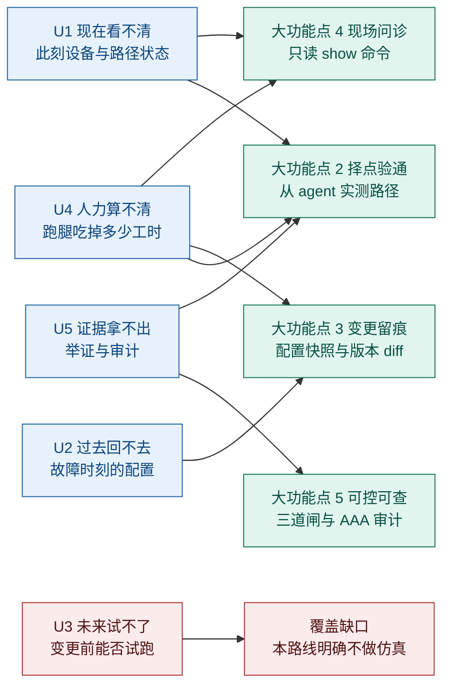
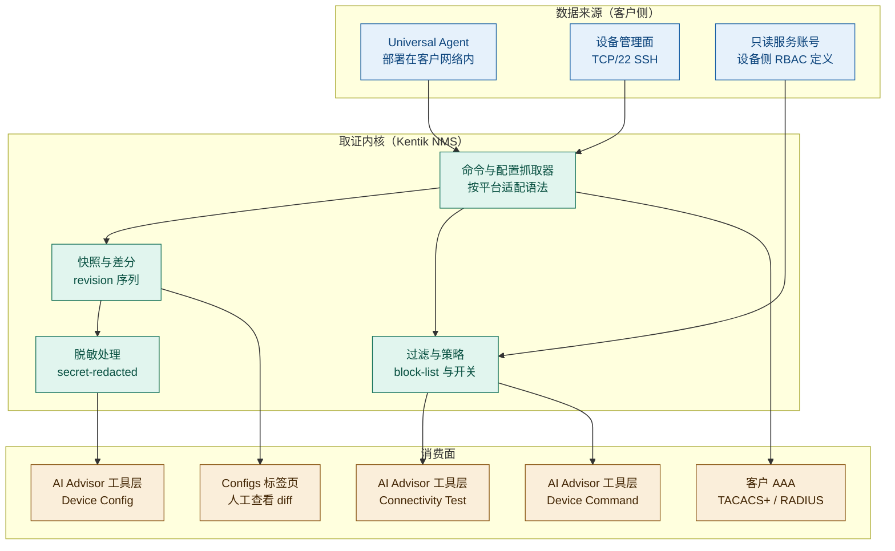
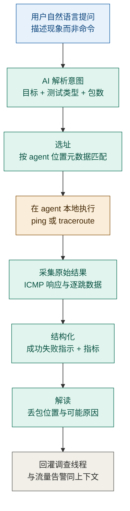
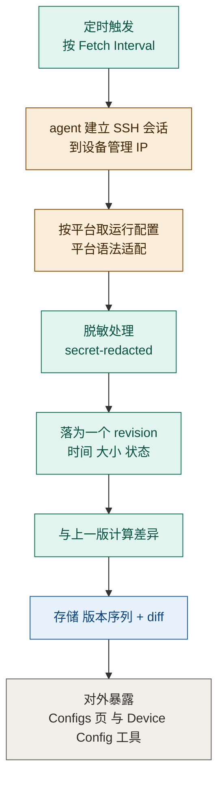
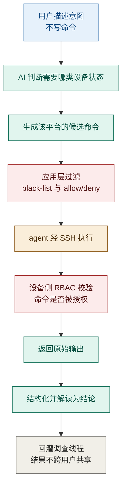
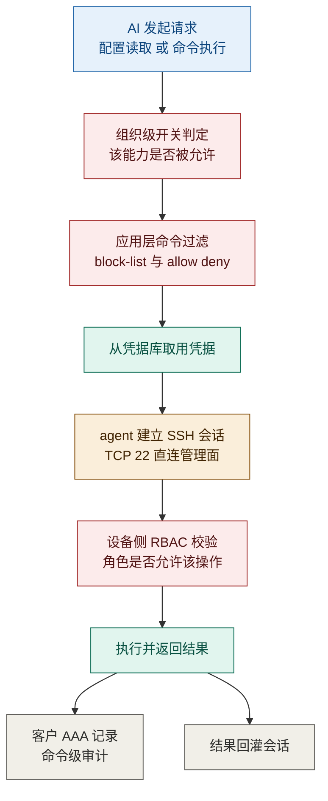

> **调研对象与范围**：Kentik NMS 在 2026 年落地的三项设备侧只读取证能力——**On-Demand Connectivity Test**（按需连通性测试）、**Config Context**（配置备份与版本 diff）、**SSH Command Access**（只读 `show` 命令访问），以及三者共用的**只读取信与审计底座**。时间窗 2026-01 至 2026-10，信源截止 2026-10-19。
>
> **为什么把三者放在一份报告里**：官方 KB 明确把前两者并称为「two SSH-powered features」（[SSH Command Access for Kentik NMS](https://kb.kentik.com/docs/ssh-command-access-for-kentik-nms)），三者共用同一个 **Universal Agent + TCP/22 + 只读账号**前置，且在 AI Advisor 的工具层里是三个独立具名工具（`Connectivity Test` / `Device Config` / `Device Command`）。**拆开写会丢掉最重要的信息：它们是一条链上的三段，不是三个产品。**

---

## 交付内容

1. **第 1 章 总览**：三级信源与六点局限、能力代次对照、工具级五问（U1–U5）、四个大功能点的全景与边界速查、总构造图。
2. **第 2 章 大功能点 1：On-Demand Connectivity Test**（择点验通）——含 K.1 清单 / K.2 痛点 / K.3 解法 / K.4 三段式原理 / K.5 六维边界。
3. **第 3 章 大功能点 2：Config Context**（变更留痕）——同上五节。
4. **第 4 章 大功能点 3：SSH Command Access**（现场问诊）——同上五节。
5. **第 5 章 大功能点 4：只读取信与审计**（可控可查）——三者的共同准入底座，回答「安全团队为什么敢批」。
6. **附录五件套**：完整时间线（倒序）、演进规律、对自研 APM AI 助手的对标启示、待补充与后续跟踪、**信源链接总表**。

## 建议读法

| 路径 | 读哪几节 | 为什么 |
|---|---|---|
| **赶时间（15 分钟）** | 1.2 一句话定位 → 1.4 全景总表与边界速查 → 各章 K.5 能力边界 | 定位、四个能力是什么、各自最要命的一条边界，三页看完即可判断是否值得继续 |
| **要选型（做采购判断）** | 1.3 工具级五问 → 各章 K.2 痛点与 K.5 边界 → 第 5 章全体 → 附三 | 重点在第 5 章：**这三项功能的最大门槛不是技术，是安全评审**；附三给的是可对标的判断口径 |
| **要复刻（做自研设计）** | 各章 K.4 功能原理（输入 / 链条 / 输出 / 机制深化） → 各章 K.5 的「对自研 APM 的提示」 → 附二演进规律 | K.4 的三段式刻意写成「没有哪个输入这套机制就不成立」，便于直接映射到你自己的数据底座与工具层 |

---

# 1. 总览

## 1.1 信源与局限

### 三级信源表

| 等级 | 来源 | 覆盖时段 | 用途 |
|---|---|---|---|
| **A** | 官方知识库（`kb.kentik.com`）：[Config Context](https://kb.kentik.com/docs/config-context)、[Command Access](https://kb.kentik.com/docs/ai-assisted-netops-command-access)、[SSH Command Access for Kentik NMS](https://kb.kentik.com/docs/ssh-command-access-for-kentik-nms)、[Configuration Examples](https://kb.kentik.com/docs/configuration-examples)、[Troubleshooting](https://kb.kentik.com/docs/ssh-command-access-troubleshooting)、[AI Advisor 工具清单](https://kb.kentik.com/docs/ai-advisor) | 2026-03-04 首发，至 2026-10-01 更新 | **机制、前置条件、平台支持矩阵、失败模式的第一依据** |
| **A** | 官方产品更新流：[2026-05-04 合并公告](https://new.kentik.com/accelerate-network-diagnostics-with-command-access-config-diffs-and-on-demand-tests-37Obyo)、[2026-04 更新流（含 Connectivity Test 单篇）](https://new.kentik.com/date/2026/4) | 2026-03 ~ 2026-05 | **发布日期、官方动机表述、原文口径** |
| **B** | 官方博客（发布同期配套文） | 2026-05 | 厂商自述的价值主张与收益口径，仅作叙事参考 |
| **C** | 第三方媒体与分析 | 2026 | 本报告**未采用**——三功能的机制细节在 A 级文档中已足够，无需第三方转述 |

> **信源结构的一个重要特征**：本组功能是**纯文档驱动**的能力，官方没有发布白皮书、没有架构图、没有基准测试。因此本报告的全部机制描述都来自 KB 的操作说明与故障排查页——**这既是约束，也是好事：KB 的 Troubleshooting 页反而泄露了最多实现细节**（例如「Kentik 不做交互式提权」「不支持某平台时会报 `unsupported device platform`」）。

### 六点已知局限

1. **无白皮书、无架构文档**：Kentik 未公开这三项功能的系统架构、存储设计、diff 算法。凡涉及「内部怎么算」的部分，本报告一律标为 **C（本报告推导）** 并给依据链。
2. **KB 无版本号体系**：三篇核心文档只有 `Published on` 与 `Updated on` 日期，**没有版本号、没有 Changelog**。因此「某能力何时加入」只能靠产品更新流交叉推断，无法逐版回溯。
3. **官方叫法混用**：同一功能在不同页面至少有三种称呼——`Config Context`（KB 主标题）、`Config Diffs`（产品更新流小标题）、`device configuration sync and backup`（设置项标签）、`Backups and Diffs`（总览页括注）。**本报告统一用 `Config Context`，其余名称视为同义。**
4. **未公开项较多（已逐条登记）**：脱敏规则、Revision 保留期、diff 粒度、内置 black-list 条目、单条命令超时、IPv6 与 MTR 支持、单次 ping 包数上限、是否存在逐条人工批准。**均未在 A 级文档中披露**，处置方式见附四。
5. **厂商自述项不得当作能力证据**：`never requests write access`、`never execute configure terminal or commit`、`no upcharge` 均为**官方承诺**，不是第三方验证结果。本报告照录并标注为自述。
6. **调研截止日 2026-10-19**：KB 三篇核心文档的最后更新分别为 2026-07-09、2026-09-18、2026-10-01，**更新频率高**，意味着能力仍在快速演进，本报告的机制描述存在随后续更新失效的风险。

### 能力代次与命名对照表（防混淆）

| 代次 | 官方名称 | 首次公开 | 交互范式 | 当前状态 | 依据 |
|---|---|---|---|---|---|
| **前置能力** | Universal Agent + Connectivity Test cap | 2026-03-12 | 在 agent 上单独安装测试能力 | 在役 | [2026-04 更新流](https://new.kentik.com/date/2026/4)（A） |
| **第 1 项** | **On-Demand Connectivity Test** | 2026-03-12 | 自然语言 → 从 agent 发 ping / traceroute | 在役 | [2026-04 更新流](https://new.kentik.com/date/2026/4)（A） |
| **第 2 项** | **Config Context**（别名 Config Diffs / Backups and Diffs） | KB 2026-03-04 发布；营销公告 2026-05-04 | 定时抓取 → 脱敏备份 → 版本 diff | 在役 | [KB](https://kb.kentik.com/docs/config-context)（A）｜[2026-05-04](https://new.kentik.com/accelerate-network-diagnostics-with-command-access-config-diffs-and-on-demand-tests-37Obyo)（A） |
| **第 3 项** | **SSH Command Access**（别名 Command Access / On-Demand Device Diagnostics） | KB 2026-03-04 发布；营销公告 2026-05-04 | 自然语言 → 建议 / 执行 / 解读只读 `show` | 在役 | [KB](https://kb.kentik.com/docs/ai-assisted-netops-command-access)（A）｜同上（A） |
| **承载者** | **Kentik AI Advisor** | 2025-11-18 | agentic 调查线程，工具按需调用 | 在役 | [AI Advisor 工具清单](https://kb.kentik.com/docs/ai-advisor)（A） |

> **一处必须并列的源冲突**：On-Demand Connectivity Test 的**单篇更新日为 2026-03-12**（有独立文章、独立作者），而 2026-05-04 的合并公告称三项能力「**launching today**」。两者不可能同时为真。**判定**：03-12 为实际可用日，05-04 为打包营销公告（该公告同时把 KB 早在 03-04 就发布的 Config Context / Command Access 一并「发布」了一次）。**采信 03-12 为上线日，05-04 为对外公告日。**

> **一条反直觉观察**：这三项能力**在官方叙事里被彻底包装成「AI 诊断能力」，但它们的技术重心几乎与 AI 无关**。三篇核心 KB 中，[Configuration Examples](https://kb.kentik.com/docs/configuration-examples) 与 [Troubleshooting](https://kb.kentik.com/docs/ssh-command-access-troubleshooting) 两篇通篇在讲 **CLI 只读账号怎么建、Parser View 怎么配、`errPrivilegeError` 怎么解**——没有一句话涉及模型。这说明该能力的真实工程难点是**跨厂商设备适配与权限收敛**，而不是推理能力。**对自研者的直接含义：把预算投在设备适配层，不要投在提示词上。**

## 1.2 一句话定位

**这三项功能是 Kentik 给 AI Advisor 装的「手和眼」——把工程师原本必须登录设备、敲命令、抄结果才能拿到的三类证据（路径通不通、配置变没变、设备现在什么状态），变成 agent 可以按需调用的三个幂等只读工具；而它的可信度不依赖模型自律，依赖设备侧 RBAC、应用层命令过滤与组织级总开关这三道外部闸门。**

- **在 Kentik 产品体系里的位置**：它们**不是独立产品，而是 Kentik NMS 的功能扩展**——官方明示「Access to this feature requires an active NMS device license」（[KB](https://kb.kentik.com/docs/ssh-command-access-for-kentik-nms)，A），且安装入口在 `Device Settings → SSH` 标签页，即**按设备逐个开启**。这与 AI Advisor 的「平台级 AI 能力」定位不同：**它是以设备为粒度售卖与配置的**。
- **在设备侧分层中的位置**：沿用本系列口径，这三项是 Kentik 从 **L4（看流量与路径）向 L3（管设备）** 延伸的实际落点——它第一次真正读到了设备内部状态（运行配置、`show` 输出）。但**价值锚点仍是「为流量与路径的异常找设备侧证据」**，而非「管理设备的清单·健康·配置·变更生命周期」。故判定：**L4→L3 的能力延伸，不是 L3 原生成员**（L3 原生要求配置变更管理与合规基线，这三项都不做）。依据：[AI Advisor 工具清单](https://kb.kentik.com/docs/ai-advisor)（A）。
- **在 AI 能力谱系里的位置**：它们是 AI Advisor 43 个工具中的 3 个，也是**唯一三个需要客户在自己设备上做前置改造（建只读账号、开 TCP/22）才能用的工具**。这一点决定了它们的落地成本显著高于其余工具。

## 1.3 从工具整体看：它究竟解决用户的什么问题

> **方法论前提（维度是否成立的论证）**：本模板假定用户价值落在**时间轴**与**关系网**两个维度。对「设备侧只读取证」这个品类，两个维度**成立但需分别收紧**：
> - **时间轴成立**：而且这三项功能恰好覆盖时间轴的两端——`Connectivity Test` 与 `Command Access` 取「**此刻**」的证据，`Config Context` 取「**过去**」的证据。这是本组功能最容易被低估的设计完整性。
> - **关系网部分成立**：它们能回答「**从这个观测点到那个目标**」这一段路径关系，但**不构建完整拓扑**、不做影响面推演。因此 U5 需从模板原义「影响面说不清」收紧为「**举证与问责说不清**」。
> - **U3（未来试不了）不成立**：本组功能**明确不做仿真、不做 what-if**，AI Advisor 工具清单中无任何变更试跑类工具。**故 U3 设为覆盖缺口，不强行编造承载能力。**
> - **U4（钱算不清）需收窄**：这三项功能不产生任何成本数据，模板原义不成立。收窄为「**人力成本算不清**」——高级工程师的时间被跑腿与翻配置吃掉，但这笔成本从不被计量。**此处与模板原义不同，已显式声明。**

### 1.3.1 用户的五个问法（U1–U5）

**速览表**

| 问法 | 用户的原话 | 痛点描述（痛在哪） | 一句话损失 |
|---|---|---|---|
| **U1 现在看不清** | 「链路告警了，但设备自己怎么看？我总不能远程登上去一条条敲。」 | 遥测告诉你「流量掉了」，却没告诉你「设备侧对应状态是什么」，缺的是设备视角的即时证据 | 时间：多一次登录与切换；人：只有会 CLI 的人能补这一刀 |
| **U2 过去回不去** | 「昨晚割接之后就不对了，可谁能告诉我昨晚配置到底改成什么样？」 | 设备配置没有历史版本，故障时刻的状态不可重建，变更与故障无法对齐 | 时间：复盘靠回忆；组织：变更责任无法界定 |
| **U3 未来试不了** | 「这条命令改下去会不会把邻居震掉？」 | **本组功能完全不覆盖**——无 what-if、无试跑、无回滚 | 只能上生产试；**这是能力缺口，不是边界** |
| **U4 人力算不清** | 「三个人花了一整天，就为了 ping 几个地址、翻几万行配置。」 | 排障里最贵的不是工具，是人；但跑腿与翻阅的时间从不被单独计量 | 钱：高级人力被低价值动作占用；人：专家成为瓶颈 |
| **U5 证据拿不出** | 「你说不是网络的问题，那你拿出设备上的证据；还有，谁在什么时候动过这台设备？」 | 结论没有可核验的设备侧证据；跨团队与对外举证时缺乏审计链 | 组织：扯皮升级；合规：审计链缺失 |

---

**U1 · 现在看不清**

> **痛点**：遥测告诉你「流量掉了」，却没告诉你「设备侧对应状态是什么」，缺的是设备视角的即时证据。

- **谁在问**
  - 一线值班工程师：「告警说 BGP 邻居掉了，可我得先 SSH 上去才知道是 hold timer 超时还是对端 shutdown。」
  - 应用团队 SRE：「我的服务连不上后端，是不是中间那台交换机在丢包？我没权限登设备。」
  - 网络架构师：「从我们伦敦办公室到这台 DNS 服务器到底通不通？我不想知道理论路径，我想看实测。」
- **典型场景**（示意量级，非实测）：某企业 14:20 收到「分支到总部丢包」告警。值班工程师依次做了四件事：打开流量图确认丢包存在、SSH 到分支出口路由器敲 `show interface`、发现无异常、怀疑上游、再 SSH 到核心交换机敲 `show ip route`、把两段输出贴进工单、请网络组长判断。**全过程 38 分钟，其中 22 分钟花在「登录—敲命令—复制—粘贴」上，没有一分钟用于思考。** 官方对这一步的定性原文是：「switching tools to run ping or traceroute, then manually bringing those results back into the troubleshooting process」（[2026-04 更新流](https://new.kentik.com/date/2026/4)，A）。
- **五类损失**

| 损失类别 | 可感知的具体损失 |
|---|---|
| 时间 | 单次取证 20–40 分钟，且必须串行（登一台、看一台） |
| 钱 | 折算为高级工程师工时（示意量级，非实测） |
| 人 | 无 CLI 权限或不会 CLI 的角色**完全无法参与**，只能等 |
| 合规 | 无 |
| 组织 | 「是不是网络的问题」判定权集中在少数人手上，判定本身成为流程瓶颈 |

- **放任不管的后果**：**自增强循环**——掌握 CLI 的人被反复叫去取证，越没时间做架构与自动化，组织对少數人的依赖越深；而新人因为没机会练手，成长更慢。

---

**U2 · 过去回不去**

> **痛点**：设备配置没有历史版本，故障时刻的状态不可重建，变更与故障无法对齐。

- **谁在问**
  - 运维经理：「昨晚 23:00 有割接，今天 09:00 开始出问题，是不是割接引起的？谁给我个准话。」
  - 值班工程师：「配置里这行 ACL 上周还在，现在没了，谁删的？」
  - 审计与合规：「过去三个月这台边界路由器的配置变更记录，能导出来吗？」
- **典型场景**（示意量级，非实测）：某零售企业门店断网 40 分钟。ITSM 记录显示「无变更」，但事后在某台汇聚交换机上发现一条三天前加的 ACL。**因为没有任何人保留过配置快照，这条 ACL 是什么时候加的、加之前是什么样，全部无从追溯**，最终只能按「操作不规范」结案，真实根因至今未确认。官方对这类场景的定性是：「Configuration changes are a leading cause of network incidents」（[2026-05-04 公告](https://new.kentik.com/accelerate-network-diagnostics-with-command-access-config-diffs-and-on-demand-tests-37Obyo)，A），并把 Config Context 的价值直接绑到「**reduce MTTI and MTTR**」（[KB](https://kb.kentik.com/docs/config-context)，A）。
- **五类损失**

| 损失类别 | 可感知的具体损失 |
|---|---|
| 时间 | 同类故障每次从零开始查；复盘耗时与首次排查相当 |
| 钱 | 停摆时长直接换钱（金额随业务规模变化，非实测） |
| 人 | 靠老员工记忆拼凑时间线，人一走线索就断 |
| 合规 | 等保 / ISO 27001 类要求「配置变更可追溯」时无法举证 |
| 组织 | 「谁改的」变成人际冲突，而非事实问题 |

- **放任不管的后果**：**恶化路径**——变更越频繁，不可追溯的窗口越大；而团队因为无法归因，会倾向于「以后谁都不许改」，反过来压制正常运维效率。

---

**U3 · 未来试不了（覆盖缺口）**

> **痛点**：本组功能完全不覆盖——无 what-if、无试跑、无回滚，变更验证只能在生产上做。

- **谁在问**
  - 变更实施人：「这条 route-map 下去，会不会把 BGP 邻居全震掉？」
  - 网络架构师：「把这个 VLAN 从这个 trunk 上摘掉，会影响哪些下游？」
  - 运维经理：「这次变更的风险评估，除了‘老师傅说没事’，还有什么依据？」
- **典型场景**（示意量级，非实测）：周四晚 22:00 变更窗口，三人围着一台核心交换机，讨论一条 ACL 该不该下。**没有仿真环境，讨论的依据只有经验与历史工单**；最终决定「先在该设备上试，有问题立刻回滚」。00:20 业务侧报障，回滚花 35 分钟——**试验场就是生产，回滚就是止损手段**。
- **五类损失**

| 损失类别 | 可感知的具体损失 |
|---|---|
| 时间 | 变更窗口内反复试错与回滚，单次变更常超出窗口 |
| 钱 | 回滚期间的业务停摆（示意量级，非实测） |
| 人 | 决策压力集中在少数资深者，变更排期受其可用性制约 |
| 合规 | 变更风险评估缺乏客观依据，难以形成可审计的风险记录 |
| 组织 | 变更窗口成为稀缺资源，各团队争夺；「谁批的」承担全部压力 |

- **放任不管的后果**：**风险后移**——所有不确定性被推到生产时段释放；团队因惧怕风险而减少变更频次，技术债与配置漂移同步累积。
- **本报告的处理**：**不编造承载能力**。三份 A 级文档中没有任何仿真 / 试跑 / 回滚相关内容，AI Advisor 工具清单亦无此类工具。**该项在 1.3.2 中显式标为「无大功能点承载」，并在附四登记为待跟踪缺口。**

---

**U4 · 人力算不清（收窄版）**

> **痛点**：排障里最贵的不是工具，是人；但跑腿与翻阅的时间从不被单独计量。

- **谁在问**
  - 运维总监：「我们一年花在排障上的人天是多少？没人算得出来。」
  - 值班组长：「每次告警都要两个人：一个查图、一个登设备，能不能一个人干完？」
  - HR 与财务：「为什么网络团队总要加人？工具不能顶一部分吗？」
- **典型场景**（示意量级，非实测）：一个 8 人网络团队，每周约 15 次中等以上排障，每次 2 人 × 1.5 小时涉及取证；**折合约 45 人时/周，占团队总工时的 14%，但这笔投入从未出现在任何报表里**。
- **五类损失**

| 损失类别 | 可感知的具体损失 |
|---|---|
| 时间 | 取证与翻阅占据可观的排障时长，且完全串行 |
| 钱 | 高级工程师工时被低价值动作消耗（示意量级，非实测） |
| 人 | 招聘时按「能扛排障」定编，而非按「能建能力」定编 |
| 合规 | 无 |
| 组织 | 团队规模随告警量线性增长，工具化收益无法量化呈现 |

- **放任不管的后果**：人力成本持续随规模线性增长，且**因为这笔成本不被计量，工具化投入永远排不上预算优先级**。

---

**U5 · 证据拿不出**

> **痛点**：结论没有可核验的设备侧证据；跨团队与对外举证时缺乏审计链。

- **谁在问**
  - 应用团队负责人：「你说是我们应用的问题，那设备侧有没有证据？」
  - 安全与合规：「这个 AI 助手在设备上执行了什么命令？谁批的？日志在哪？」
  - 对外客户：「这次故障影响了我们多久？给我一份可核验的时间线。」
- **典型场景**（示意量级，非实测）：故障复盘会上，网络团队与应用团队各持一套数据，争论 2 小时无结论；因为设备侧取证明没有留存、执行记录不完整，**最终结论只能是「多方因素」——一个谁都不负责的结论**。
- **五类损失**

| 损失类别 | 可感知的具体损失 |
|---|---|
| 时间 | 复盘会时长常常超过故障本身时长 |
| 钱 | 责任无法界定 → 商业赔付谈判被动 |
| 人 | 团队间信任损耗，跨团队协作成本上升 |
| 合规 | 无法提供「谁在何时对哪台设备执行了什么」的审计链 |
| 组织 | 责任模糊化成为常态，改进项无法落地到具体团队 |

- **放任不管的后果**：**组织性恶化**——每次故障都以「多方因素」结束，意味着每次都没有真正的改进项，同类故障必然复发。

---

**损失强度分布矩阵**

| 问法 | 时间 | 钱 | 人 | 合规 | 组织 |
|---|---|---|---|---|---|
| **U1 现在看不清** | ● | ○ | ● | — | ● |
| **U2 过去回不去** | ● | ● | ● | ● | ● |
| **U3 未来试不了** | ● | ● | ● | ○ | ● |
| **U4 人力算不清** | ● | ● | ● | — | ● |
| **U5 证据拿不出** | ● | ○ | ● | ● | ● |

> **一条采购行为解释**：本组功能的采购驱动力**不在 U1（人人都知道自己取证麻烦，但认为「这就是工作」），而在 U2 与 U5（一旦发生过一次无法归因的重大故障，或一次审计不通过，预算立刻到位）**。这解释了一个反直觉现象：**卖点讲的是「更快排障」，成交点却是「配置可追溯 + 执行可审计」**——也就是本报告第 5 章的内容。选型时若只评估「AI 好不好用」，会漏掉真正的决策变量。

### 1.3.2 五个整体问题与承载能力

| # | 用户的问题 | 工具给出的整体回答 | 对应的大功能点（及其角色） |
|---|---|---|---|
| **U1** | 设备此刻到底是什么状态？从这里到那里通不通？ | 「我从你部署的观测点实测，并把设备自己的说法读给你听」 | **大功能点 2 · 择点验通**（提供路径证据）+ **大功能点 4 · 现场问诊**（提供设备状态证据）→ 见第 2、4 章 |
| **U2** | 故障那一刻，配置是什么样？谁改的、改了什么？ | 「我按周期留了每个版本的配置，能给你看任意两版之间差在哪」 | **大功能点 3 · 变更留痕**（提供时间维证据）→ 见第 3 章 |
| **U3** | 这么改下去会不会出问题？ | **「我不回答这个问题。」** | **无承载**——三项能力均不做仿真与试跑，登记为覆盖缺口 |
| **U4** | 这些跑腿到底吃掉多少人力？ | 「我把跑腿动作变成一次自然语言请求，省下的时间你自己算」 | **大功能点 2 + 4**（消除切换与手抄）+ **大功能点 2**（消除人肉翻阅）→ 见第 2、3、4 章 |
| **U5** | 证据在哪？谁批准的？能审计吗？ | 「所有动作都在你的 AAA 里留痕，而且我没有写权限」 | **大功能点 5 · 可控可查**（提供信任与审计底座）→ 见第 5 章 |

> **覆盖核验**：**4 个大功能点全部被至少一个 U 消费，无孤立能力**；同时 **U3 无任何大功能点承载，构成显式覆盖缺口**——这一缺口不是本报告的疏漏，而是产品路线的选择（只读取证路线天然不含仿真）。

### 1.3.3 从用户问题到大功能点

### 1.3.4 用之前 vs 用之后

| 同一个问题 | 用之前（全手动） | 用之后（工具内联） | 变化性质 |
|---|---|---|---|
| 「从这里到那里通不通？」 | 找一台能登的机器 → ping / traceroute → 复制结果 → 回工单对照 | 自然语言提问 → agent 选址 → 实测 → 结果与流量图同屏 | 取证动作**从 4 步压到 1 步** |
| 「BGP 邻居为什么掉？」 | 登录设备 → 回忆语法 → 敲命令 → 读原始输出 → 判断 | 描述意图 → AI 选命令并执行 → 拿到已解读的结论 | **门槛从「会 CLI」降到「会说问题」** |
| 「昨晚改了什么？」 | 找当时在场的人 → 翻 ITSM → 手动比对（若有备份） | 直接问 diff → 拿到变更前后差异 + AI 影响判断 | **从「人际询问」变成「数据查询」** |
| 「谁改的 / 谁执行的？」 | 各设备分别查日志，格式不一，经常查不到 | 统一落客户 AAA，按设备与时间可查 | **从「查不到」变成「可举证」** |
| 「这么改会不会出问题？」 | 凭经验判断 | **仍然凭经验判断** | **无变化——这是缺口，不是改进** |

### 1.3.5 小结：U 与 P 的关系

**U 是工具级问题**（判断「这套东西值不值得买」），**P 是功能级痛点**（判断「这一章做得对不对」）。二者是**上位归并**关系，不是一对一。

| U（工具级） | 归并到的 P（功能级） | 所在章 |
|---|---|---|
| U1 现在看不清 | 2.P1（取证要换工具）、2.P2（不知从哪测）、2.P3（读不懂输出）、4.P1（不会 CLI）、4.P2（会也要切终端） | 第 2、4 章 |
| U2 过去回不去 | 3.P1（没人承认动过）、3.P2（故障时刻回不去）、3.P3（人肉翻配置） | 第 3 章 |
| U3 未来试不了 | **无 P 可归并**（无承载能力，故不设痛点；避免把缺口伪装成痛点） | — |
| U4 人力算不清 | 2.P1、2.P2、3.P3、4.P2（均为工时损耗的具体形态） | 第 2、3、4 章 |
| U5 证据拿不出 | 5.P1（安全评审过不了）、5.P2（说不清谁做了什么）、5.P3（密钥不敢上传）、3.P1 | 第 3、5 章 |

> **关系声明**：上表保证**每个 P 都能追溯到一个 U**，且**每个 U 都有明确去向**——U3 的去向是「缺口」，这是有意为之。**把缺口写成痛点再去「解决」它，是本模板明令禁止的架构自证。**

## 1.4 读法：4 个大功能点全景

### 全景总表

| # | 大功能点 | 口号（四字） | 小功能点数 | 时间跨度 | 面向谁 |
|---|---|---|---|---|---|
| 2 | On-Demand Connectivity Test | **择点验通** | 7 | 2026-03 ~ 2026-10 | 一线值班、跨站点运维、应用 SRE |
| 3 | Config Context | **变更留痕** | 8 | 2026-03 ~ 2026-10 | 运维经理、变更实施人、审计 |
| 4 | SSH Command Access | **现场问诊** | 7 | 2026-03 ~ 2026-10 | 一线值班、初级工程师、专家（省时间） |
| 5 | 只读取信与审计 | **可控可查** | 7 | 2026-03 ~ 2026-10 | 安全团队、合规、平台管理员 |

### 边界速查（一页版）

| # | 大功能点 | 最要命的一条边界 | 边界性质 |
|---|---|---|---|
| 2 | 择点验通 | **只能从部署了 Universal Agent 的位置发起**——没有 agent 的站点测不了，这是覆盖范围问题，不是配置问题 | 硬边界（架构决定） |
| 3 | 变更留痕 | **只支持 4 个平台**（Junos / NX-OS / EOS / IOS-XE）——华为、华三、锐捷均不在列 | 硬边界（适配投入决定） |
| 4 | 现场问诊 | **不做交互式提权**——账号必须直接落到目标权限级，`enable` 那一步走不通 | 硬边界（自动化决定） |
| 5 | 可控可查 | **只读是「承诺 + 设备侧兜底」，不是可验证的数学保证**——官方未公开 block-list 条目，无法独立核验 | 软边界（未披露） |

### 编号约定声明

- **P（痛点）**：每章从 `P1` 重新编号，格式 `**Pk｜（损失类别）——「一句话痛点」**`；损失类别只取 **时间 / 钱 / 人 / 合规 / 组织**。
- **S（解法）**：与同章 P 严格一一对应，同编号数；K.3 表中每行必须以 `→ 解 Pk` 显式回指。
- **闭环规则**：不允许悬空痛点（有 P 无 S 回应）、不允许悬空解法（有 S 不指向任何 P）、编号必须连续。
- **小功能点编号**：`K.1 / K.2 / …`，其中 K 为章序。本报告 4 章共 29 个小功能点。

### 总构造图：数据来源 → 内核 → 各消费面

> **图的读法**：注意最右侧两条——`C1/C2/C3` 是**给 agent 用的接口**，`C4` 是**给人看的页面**。同一个内核产出两种消费面，这是本组功能的结构特征：**「人能用」与「agent 能用」是同一份能力的两种暴露方式，不是两套实现。**

---

# 大功能点 2：On-Demand Connectivity Test —— 择点验通

> **它替代了什么**：替代了「找一台能登的机器、手敲 ping / traceroute、把结果截图贴回工单」这一整套**跨工具取证动作**。它没有替代合成监测（Synthetics）——那是一条独立的、持续运行的产品线。

## 2.1 小功能点清单

| # | 小功能点 | 发布时间 | 信源等级 | 说明 |
|---|---|---|---|---|
| 2.1 | **ping** | 2026-03-12 | A（[2026-04 更新流](https://new.kentik.com/date/2026/4)） | 原文：「Test device connectivity, measure latency, and detect packet loss」 |
| 2.2 | **traceroute** | 2026-03-12 | A（同上） | 原文：「Identify network bottlenecks, points of failure, or routing loops」 |
| 2.3 | **私有有利观测点** | 2026-03-12 | A（同上） | 原文：「Run tests from your own network locations where Universal Agents are deployed」——**不是 Kentik 自建探针网** |
| 2.4 | **多 agent 并行对比** | 2026-03-12 | A（同上） | 原文：「Can run tests from multiple agents simultaneously for comparison」 |
| 2.5 | **语义化选址与目标** | 2026-03-12 | A（同上） | 目标可为设备名、IP、或地点描述；官方称「AI Advisor knows your agent locations and can suggest the best vantage point」 |
| 2.6 | **ICMP 响应解读** | 2026-03-12 | A（同上） | 原文：「Interpret ICMP responses and provide actionable insights」——输出是结论，不是原始报文 |
| 2.7 | **测试能力按需安装** | 2026-03-12 | A（同上） | 需在 `Agent Details → Capabilities → Available → Install` 单独安装 `Connectivity Test` |

> **一个易漏的细节**：2.7 说明 Connectivity Test **不是 agent 的默认能力**。这意味着即使客户已部署 Universal Agent，也必须在每个 agent 上单独安装该能力，否则 AI Advisor 看不见任何可用的观测点。**这是排障时第一个要检查的点**（官方 `Capabilities → Available` 路径可证）。

## 2.2 它对应的用户痛点

**P1｜（时间）——「为了 ping 一下，要开另一个终端；测完还得把结果抄回来跟图对照」**

连通性验证本质上是排障中最常见的一步，但它发生在**另一个工具**里。工程师在流量图与终端之间来回切换，把 ping 输出手工搬到工单或聊天窗，再与流量曲线肉眼对齐。官方对这一动作的定性是「switching tools to run ping or traceroute, then manually bringing those results back into the troubleshooting process」，并把这种模式称为 **swivel-chair investigation**（转椅式调查）。损失不在单次几分钟，而在于**每验证一个假设就要重复一次**，一次排障可能重复七八次。依据：[2026-04 更新流](https://new.kentik.com/date/2026/4)（A）、[2026-05-04 公告](https://new.kentik.com/accelerate-network-diagnostics-with-command-access-config-diffs-and-on-demand-tests-37Obyo)（A）。

**P2｜（时间）——「不知道该从哪测：从自己工位测不准，从核心测又不代表用户」**

连通性结论高度依赖观测点位置。同一条路径，从运维工位测是通的、从分支出口测是断的——**问题不在「通不通」，而在「从哪测」**。而工程师手边通常只有「自己能登的那台机器」，既不是离用户最近的点，也不是客户实际流量的入口。于是出现一种典型浪费：**测了，但不作数；换一个点再测，还是不作数**。依据：官方把「from the right vantage point」写成该功能的立论前提（[2026-04 更新流](https://new.kentik.com/date/2026/4)，A）。

**P3｜（人）——「测出来了也读不懂：8% 丢包是设备问题、链路问题还是本来就该这样？」**

`traceroute` 的原始输出对非网络角色几乎是不可读的：逐跳时延、`* * *` 遮挡、非对称路径、ICMP 限速，每一样都需要经验才能解释。**结果是「工具给了数据，但没给结论」**——初级工程师拿到输出仍然要去问专家，专家成为瓶颈。这不是知识管理问题，而是**输出形态问题**：原始报文不构成可行动的信息。

## 2.3 它是如何解决的（与痛点一一对应）

| 解法 | 机制 | 对应痛点 |
|---|---|---|
| **S1｜测试内联到调查线程** | ping / traceroute 由 AI Advisor 在**同一会话内**发起并把结果回灌，不再需要终端、复制、粘贴、对照——官方目标是「keep the investigation in one place」 | → 解 P1 |
| **S2｜以客户 agent 为观测点 + 语义化选址 + 多 agent 并行** | 观测点 = 客户已部署的 Universal Agent；AI 知道每个 agent 的名称与站点位置，可按「伦敦的 agent」这类描述选址，并**同时从多个 agent 跑同一测试做对比** | → 解 P2 |
| **S3｜ICMP 结果结构化并解读** | 输出不是原始报文，而是「成功 / 失败指示 + 可操作结论」；官方原文明确要「interpret ICMP responses and provide actionable insights」 | → 解 P3 |

> **闭环核对**：P1 ↔ S1、P2 ↔ S2、P3 ↔ S3，三条痛点三条解法，无悬空。

## 2.4 功能原理

### 2.4.1 输入

| 输入 | 具体内容 | 官方依据（含链接与等级） | 缺了它会怎样 |
|---|---|---|---|
| **I1** Universal Agent 及其位置元数据 | agent 名称、所属站点；官方称 AI 自动检测可用 agent 并纳入系统上下文（「agent names, site locations, etc.」） | A（[2026-04 更新流](https://new.kentik.com/date/2026/4)） | **无观测点可用**——测试无处发起，选址能力完全失效 |
| **I2** agent 上已安装 Connectivity Test 能力 | `Agent Details → Capabilities → Available → Install` | A（同上） | agent 存在但**不能被当作探针**，AI 看不到可用测试点（易漏，见 2.1 注） |
| **I3** 测试目标标识 | IP 地址、主机名、设备名，或地点描述（映射到 agent） | A（同上） | 无法确定测什么；地点描述需 I1 才能解析 |
| **I4** 从 agent 到目标的网络可达性 | agent 所在网段到目标的 IP 可达（ICMP 不被中间设备丢弃） | **C（本报告推导）**：官方只说明「interpret ICMP responses」，未披露 ICMP 被屏蔽时的处理。依据链：A 级事实「输出为 ICMP 响应解读」→ ICMP 是唯一被提及的协议 → 若路径屏蔽 ICMP 则无响应可解读 → 结论：可达性是隐含前提 | 测试返回全丢包，**与「真的不通」不可区分**；这是该功能最容易产生误判的地方 |
| **I5** 用户的自然语言意图 | 如「Ping 8.8.8.8 with 5 packets」「Run a traceroute from our London agent to 1.1.1.1」 | A（同上） | 无法确定测什么、测几次、从哪测；需退回手工操作界面 |
| **I6** AI Advisor 会话上下文 | 当前调查的问题、已有证据（流量、告警、指标） | A（[AI Advisor 工具清单](https://kb.kentik.com/docs/ai-advisor)：`Connectivity Test` = Run ping or traceroute tests from external agents to any IP or hostname） | 测试仍可执行，但**结果无法与当前调查关联**，退化为一个孤立的 ping 工具 |

> **必要性论证的重点在 I4**：前三项是「能不能测」，I4 是「测了算不算数」。**一个全丢包的结果在 ICMP 被过滤的环境里毫无诊断价值，却会被读成「不通」——这是本功能最需要人工复核的边界。**

### 2.4.2 实现链条

| 步骤 | 做什么 | 关键输入 | 输出 |
|---|---|---|---|
| 1 | 接收自然语言请求，识别是连通性测试意图 | I5 | 结构化的测试意图（目标、类型、可选包数） |
| 2 | 解析目标：IP / 主机名 / 设备名 / 地点描述 | I3、I1 | 可解析的目标地址；地点描述映射到候选 agent |
| 3 | 选址：按 agent 位置与可达性挑选观测点（可多选） | I1、I2 | 一个或多个执行 agent |
| 4 | 在 agent 本地发起 ping 或 traceroute | I4 | 原始 ICMP 响应 / 逐跳记录 |
| 5 | 汇总结果，标记成功 / 失败 | 步骤 4 | 带状态的结果集（多 agent 时并列） |
| 6 | 解读 ICMP 语义：超时、不可达、逐跳时延突变 | 步骤 5 | 结论性描述（哪一跳开始异常、可能原因） |
| 7 | 回灌会话，与已有证据并列 | I6、步骤 6 | 调查线程内的一条证据 |

> **链条中不可跳的一步是第 3 步（选址）**。如果没有位置元数据，这个功能就退化为「Kentik 帮我 ping 一下」——而 ping 本身任何工程师都会。**它的全部差异化价值都在「从哪个点测」**，这也是为什么 I1 是必要输入而非nice-to-have。

### 2.4.3 输出

| 输出物 | 形态 | 消费方 | 对应小功能点 |
|---|---|---|---|
| **结构化测试结果（含多 agent 并列）** | **内部接口**（被 agent 推理循环消费的那个输出） | AI Advisor 的解读与后续推理 | 2.1 ~ 2.5 |
| 结果卡片（成功 / 失败 + 指标 + 逐跳） | UI 产物 | 排障者肉眼复核 | 2.1 / 2.2 |
| **解读结论（哪一跳异常、可能原因）** | UI 产物 + 会话内容 | 排障者；也可作为对外的举证材料 | 2.6 |
| 建议的下一步（换点复测 / 结合配置 diff） | 会话内容 | 排障者的决策 | 2.4 / 2.6 |

> **哪个输出才是真正被其他能力消费的那个**：是**「结构化测试结果」**。它既被人看，也被 agent 继续推理；而「解读结论」是终端产物——**它不再被下游消费，只被人读**。这区分很重要：评估这类能力时，**要看结构化结果的字段是否够 agent 用（逐跳、时延、丢包率、agent 标识），而不是看页面好不好看**。

### 2.4.4 关键机制深化

**机制一：为什么用「客户的 agent」当探针，而不是自建探针网？**

- 官方口径（A 级，[2026-04 更新流](https://new.kentik.com/date/2026/4)）：观测点定义为「your own network locations **where Universal Agents are deployed**」。
- **为什么必须这么设计**：连通性问题的答案是位置相关的，**要覆盖客户的真实拓扑，探针就必须长在客户的网络里**。自建全球探针网（如 Synthetics 厂商的做法）解决的是「公网到你的服务好不好」，而解决不了「我的分支到我的总部好不好」——后者发生在客户私网内部，外部探针根本进不去。
- **这条选择的经济学**：探针数量 = 客户已部署 agent 数量，**边际成本近零**；代价是**覆盖范围被客户部署情况锁死**——这就是 1.4 边界速查里那条硬边界。**买它等于买「你已有 agent 的站点数」，不是买「全球覆盖」。**

**机制二：为什么「多 agent 并行」比「单点测得更准」更重要？**

- 官方口径（A 级）：可同时从多个 agent 运行以作对比（「for comparison」）。
- **为什么必须这么设计**：单点测试只能回答「通 / 不通」，**对比才能回答「在哪一段断」**。若 A 站点通、B 站点不通，且两者路径在某跳分叉，则故障范围立刻从「整条链路」收敛到「分叉点之后的共享段」。**这是把「一个观测值」变成「一个二分定位」的关键**——也是本功能里唯一带推理性质的设计。
- 标注：官方只说「for comparison」，**未说明是否提供自动的路径分叉分析**；「二分定位」是 **C（本报告推导）**，依据链：A 级「多 agent 同时运行以对比」→ 对比两个结果可定位差异段 → 结论：对比的价值在缩小故障范围。

**机制三：为什么输出必须「解读」而不能只给原始报文？**

- 官方口径（A 级）：四步流程的最后一步是「Interpret ICMP responses and **provide actionable insights**」。
- **为什么必须这么设计**：`traceroute` 原始输出对非专家不可读（`* * *`、非对称、ICMP 限速都可能被误读）。若只给原始数据，**这个功能只服务了本来就会用 CLI 的人——等于没有扩大受众**。而 Kentik 的产品叙事恰恰是让「junior or less specialized staff」也能排障（[2026-05-04 公告](https://new.kentik.com/accelerate-network-diagnostics-with-command-access-config-diffs-and-on-demand-tests-37Obyo)，A）。**「解读」不是锦上添花，而是这个功能成立的理由。**

### 2.4.5 口径声明

| 内容 | 等级 | 说明 |
|---|---|---|
| 支持 ping 与 traceroute | A | 产品更新流原文列举 |
| 观测点限于已部署 Universal Agent 的位置 | A | 原文 where Universal Agents are deployed |
| 支持多 agent 并行对比 | A | 原文 for comparison |
| AI 可基于 agent 位置建议观测点 | A | 原文 suggest the best vantage point |
| 结果为「成功失败指示 + 可操作结论」 | A | 原文四步流程第 3、4 步 |
| Connectivity Test 需在 agent 上单独安装 | A | 原文 Install 路径 |
| **ICMP 被屏蔽时如何区分「不通」与「被过滤」** | **未公开** | 官方未披露；本报告标为 I4 的隐含前提，并列入附四 |
| **默认包数、上限、超时、IPv6、MTR 支持** | **未公开** | 官方仅示例 5 packets；IPv6 与 MTR 完全未提，**不可假定支持** |
| 选址由「位置元数据匹配」实现 | **C（本报告推导）** | 依据链：A 级「AI knows your agent locations」→ A 级「includes them in its system context（agent names, site locations）」→ 结论：选址基于上下文中的位置字段，而非实时探测 |

## 2.5 能力边界

> **一句话边界**：**它只能从你已经部署了 agent 的地方，用 ICMP 测一次「此刻通不通」；没有 agent 的站点它看不见，屏蔽 ICMP 的路径它会误判，而且它不会替你持续盯着。**

| 类型 | 具体边界 | 依据（信源等级） | 对自研 APM 的提示 |
|---|---|---|---|
| **硬边界** | ① **观测点被 agent 部署范围锁死**——无 agent 的站点完全无法测试；② **只做 ICMP 的 ping / traceroute**，不做 TCP / UDP 端口探测，因此「端口不通但主机可达」这类问题测不出来；③ **一次性测试，不是持续监测**——不产生时间序列、不配告警（持续监测是 Synthetics 的职责） | A（[2026-04 更新流](https://new.kentik.com/date/2026/4)） | 自研时先画一张「探针覆盖图」并对客户公开：**能测的站点清单本身就是产品说明书的一部分**。缺 TCP 探测的话，「服务端口不通」会被误报成「主机不可达」 |
| **软边界** | 默认包数、单次包数上限、超时、并发上限、IPv6 支持、MTR 支持、结果保留期——**七项均未公开**；`for comparison` 是否含自动路径分叉分析亦未说明 | 未公开（三篇 A 级文档均无） | **不要假定 IPv6 可用**。若你的客户有 IPv6 骨干，必须先问厂商要支持矩阵，否则在双栈环境里会得出错误的「不通」结论 |
| **前提依赖** | ① 至少一个 Universal Agent 已部署且**已安装 Connectivity Test 能力**；② agent 到目标 IP 可达；③ 目标可被解析（IP / 主机名 / 设备名 / 地点） | A（同上，含 Install 路径） | 把「能力安装状态」做成自检项并显式提示，否则用户会把「没装」误判为「功能坏了」 |
| **官方自认局限** | 官方唯一的限定表述是把观测点限定为「where Universal Agents are deployed」——**等于承认覆盖范围受客户部署约束**。除此之外官方未主动列举其他局限 | A（同上） | 官方未提 ICMP 过滤风险，**这是文档缺口，自研时应在产品里显式提示**（如「全丢包时建议同时验证 TCP 端口」） |
| **常见误期待（澄清）** | ① **不是 Synthetics**：不持续、不告警、不做全球公网监测；② **不是「从用户真实位置」测**：是从 agent 所在的网络位置测，两者可能相差多个网段；③ **不是路径分析工具**：给逐跳结果，但不做「为什么走这条路」的路由推理；④ **不是 SLA 监测**：单次结果不构成可用性指标 | A（工具清单将 Connectivity Test 与 Synthetics 明确分列） | 对外必须区分「这次测得通」与「服务可用」——**前者是证据，后者是结论**，混用会导致客户用单次 ping 结果质疑你的 SLA 报表 |
| **对自研的提示** | 这条能力最值得抄的不是 ping，而是**「观测点即资产」的设计**：把已部署的采集器同时登记为可寻址的测试点，并为每个点维护位置语义（站点、机房、区域）。**认证场景的直接映射**：把「部署了探针的分支」用于验证 802.1X / Portal 的实际可达性，比在核心机房 ping RADIUS 服务器更接近真实失败点 | A（架构事实）+ C（映射推导） | **先建「探针注册表」再建测试功能**——顺序反了会做成一个只能从中心发起的、结论不可信的 ping 按钮 |

---

# 大功能点 3：Config Context —— 变更留痕

> **它替代了什么**：替代了「登录设备、敲 `show running-config`、另存一份、下次再敲一次、肉眼比对两份文本」这一整套**手工配置审计动作**。它没有替代配置管理（CMDB / 配置合规 / 配置回滚）——它只做「留档 + 差分 + 供 AI 查阅」。

## 3.1 小功能点清单

| # | 小功能点 | 发布时间 | 信源等级 | 说明 |
|---|---|---|---|---|
| 3.1 | **按设备开启 SSH 访问** | 2026-03-04（KB 发布） | A（[KB: Config Context](https://kb.kentik.com/docs/config-context)） | `Device Settings → SSH` 标签页的主开关，逐设备开启 |
| 3.2 | **周期性配置同步与备份** | 2026-03-04 | A（同上） | 开关项原文 `Enable device configuration sync and backup`；官方定义为「autonomous scraping of configs」 |
| 3.3 | **Fetch Interval 可配** | 2026-03-04 | A（同上） | 官方原文：「A interval of **5-minutes** is recommended for high-visibility environments」 |
| 3.4 | **脱敏存储** | 2026-03-04 | A（同上） | 原文「storing them as **secret-redacted** backups」；产品更新流用词为「secret-redacted」 |
| 3.5 | **版本序列（Revision）** | 2026-03-04 | A（同上） | 每个 revision 带编号、时间戳、字节数、成功 / 失败状态 |
| 3.6 | **版本间 diff** | 2026-03-04 | A（同上） | 原文「comparing changes」；`Configs` 标签页与 AI 两条查看路径 |
| 3.7 | **AI 可分析配置与差异** | 2026-03-04 | A（[AI Advisor 工具清单](https://kb.kentik.com/docs/ai-advisor)） | 工具 `Device Config` 原文：「Retrieve configuration revision history, diffs, and content for specific devices」 |
| 3.8 | **历史检索（跨设备）** | 2026-03-04 | A（[KB: Config Context](https://kb.kentik.com/docs/config-context)） | 官方示例提示词要求「定位某分支任意设备上 VLAN 100 最后一次可用配置片段」 |

> **一个被低估的细节（3.5）**：官方响应示例中不仅有 revision 的时间与字节数，还包含一行「**Last Commit: 2025-11-18 23:47:11 UTC by user `alistair`**」——**这意味着它能从设备配置里读出「谁在什么时候提交过」**。这是三条能力中唯一能直接回答「谁改的」的证据来源（见 3.4.4 机制一）。

## 3.2 它对应的用户痛点

**P1｜（组织）——「口口声声说没人动过，那这条 ACL 是谁加的？」**

网络故障常与配置变更相关，但变更记录存在于两个互不相通的地方：ITSM / 变更单（人说做了什么）与设备实际配置（设备真正是什么）。两者不一致时，**排障者失去了判断基准**——既不能证明「没人改过」，也不能证明「就是这次改的」。官方对这一场景的定性是「Configuration changes are a leading cause of network incidents」，并把 Config Context 的目标写成「identify if a recent change is the culprit」（[2026-05-04 公告](https://new.kentik.com/accelerate-network-diagnostics-with-command-access-config-diffs-and-on-demand-tests-37Obyo)，A）。损失的本质不是查得慢，而是**结论无法成立**。

**P2｜（时间）——「故障是昨晚 23:00 发生的，可昨晚的配置长什么样，谁也说不出来」**

配置只有「当前值」，没有「历史值」。故障发生后，工程师面对的是**已经被改动、或者已经被回滚的现状**，而故障时刻的状态无法重建。于是复盘只能依赖在场者的记忆与工单描述，**而这两者都不可靠**。官方把该能力的价值直接绑定到「**reduce MTTI and MTTR**」（[KB](https://kb.kentik.com/docs/config-context)，A），其中 MTTI（平均识别时间）恰恰是「意识到发生了什么」的那一段——**它只能靠历史数据缩短，不能靠更快的手速缩短**。

**P3｜（人）——「几万行配置里找那一行，全靠人肉翻」**

一台中大型交换机的运行配置常在数万字节量级（官方示例为 42,780 字节），跨设备比对更是灾难。工程师用 `diff` 手工比对两份文本、用眼找出差异行、再判断这行属于哪个协议、影响哪些功能——**这项工作既费时又极易漏**，且完全依赖个人对配置语法的熟悉度。损失集中在「稀缺的资深人力被用作文本比对器」。

**P4｜（合规）——「配置里有密钥，不敢让第三方平台存」**

运行配置内含 SNMP community、RADIUS shared secret、BGP MD5、本地口令哈希、PSK 等敏感材料。把未脱敏配置上传到 SaaS，在多数企业的安全评审中直接不通过；而如果为了规避风险放弃备份，**就回到 P2 的困境**。这是一个**两难**：要么承担泄密风险，要么承担不可追溯风险。官方对此的解法是脱敏（3.4），但脱敏规则本身未公开（见 K.5）。

## 3.3 它是如何解决的（与痛点一一对应）

| 解法 | 机制 | 对应痛点 |
|---|---|---|
| **S1｜以设备侧提交记录为证据锚点** | revision 元数据含时间戳与大小；官方示例还给出 `Last Commit` 的用户名与 UTC 时间——把「谁在何时提交」变成可查字段，而非依赖工单与口供 | → 解 P1 |
| **S2｜周期性快照形成版本序列** | 按 `Fetch Interval`（建议 5 分钟）自动抓取运行配置，每次落为一个 revision；**历史因此被保留，而不只是当前值** | → 解 P2 |
| **S3｜机器算 diff + AI 解读差异含义** | 差异由系统计算并展示（无需人肉比对）；AI 可进一步回答「这次改动影响了什么」，把「哪一行变了」升级为「变了意味着什么」 | → 解 P3 |
| **S4｜入库前脱敏（secret-redacted）** | 配置在存储前被脱敏处理，敏感材料不以明文落到平台；这是让安全评审可以通过的前提 | → 解 P4 |

> **闭环核对**：P1 ↔ S1、P2 ↔ S2、P3 ↔ S3、P4 ↔ S4，四条痛点四条解法，无悬空。
>
> **一处需要诚实标注的语义落差**：S1 的「谁改的」在官方文档中只出现在**响应示例**里，**并未作为功能点被宣传或说明**（没有对应的设置项、没有对应的提示词模板）。因此它属于「**能力存在但未被产品化**」——选型时不应把它当作可靠功能承诺，见 K.5 软边界。

## 3.4 功能原理

### 3.4.1 输入

| 输入 | 具体内容 | 官方依据（含链接与等级） | 缺了它会怎样 |
|---|---|---|---|
| **I1** 只读 SSH 凭据 | SSH key 或 password，从 `credentials-vault` 选择 | A（[KB](https://kb.kentik.com/docs/config-context)：`Credential: Select your pre-configured SSH key or password`） | **完全无法抓取**——没有凭据就没有任何 revision |
| **I2** Universal Agent（采集 agent） | 选择对目标设备有可达性的 agent（官方示例 `nomad-0`） | A（同上：`Collection Agent`） | 抓取动作无执行主体；且官方要求 agent 有到管理 IP 的直连路由 |
| **I3** 设备平台标识 | `Device Platform`，官方建议 `Autodetect` | A（同上） | 平台识别失败 → 报 `unsupported device platform`，**不会退化到通用模式**（见 3.4.6 源冲突） |
| **I4** 设备管理地址 | SSH Hostname 或 IP（FQDN 亦可） | A（同上） | 无法建立会话 |
| **I5** 抓取周期（Fetch Interval） | 官方建议高可见性环境用 5 分钟 | A（同上） | 不配置则无节奏；**周期直接决定能否把故障窗口对齐到变更窗口** |
| **I6** 计划级功能开关 + 设备许可 | ① NMS device license 按设备计；② 官方 Troubleshooting 另提到 `Device Configuration Backup Feature` **必须在 Kentik plan 中启用** | A（[KB: SSH Command Access](https://kb.kentik.com/docs/ssh-command-access-for-kentik-nms) 许可说明；[Troubleshooting](https://kb.kentik.com/docs/ssh-command-access-troubleshooting)：`This must be enabled in your Kentik plan`） | 有 license 但 plan 未含该功能时，**配置历史仍然不可用**——这是最容易误判为故障的一项 |

> **必要性论证的重点在 I5 与 I6**：I1–I4 决定「能不能抓」，**I5 决定「抓得够不够密」，I6 决定「有没有资格抓」**。三者中任何一项缺失，症状都是「配置历史是空的」——但原因完全不同，这也是官方专门写一篇 Troubleshooting 的原因。

### 3.4.2 实现链条

| 步骤 | 做什么 | 关键输入 | 输出 |
|---|---|---|---|
| 1 | 按每设备的 `Fetch Interval` 定时触发抓取 | I5 | 一次抓取任务 |
| 2 | agent 从本地网络直连设备管理 IP，建立 SSH 会话 | I2、I4、I1 | 一条 SSH 会话（TCP/22） |
| 3 | 依平台执行取配置动作（IOS-XE 明确为 `show running-config`，需 priv 15） | I3 | 原始运行配置文本 |
| 4 | 对配置做脱敏，剔除敏感字段 | I1（隐含：脱敏规则） | 脱敏后的配置文本 |
| 5 | 落为一个 revision，记录时间戳、字节数、成功 / 失败 | 步骤 4 | 版本条目 |
| 6 | 与前一版比对，计算差异 | 步骤 5 + 上一版 | diff 结果 |
| 7 | 持久化版本序列与 diff，供检索 | 步骤 5、6 | 可查询的配置历史 |
| 8 | 通过 `Configs` 标签页（人）与 `Device Config` 工具（agent）暴露 | 步骤 7 | 人读的 diff ／ agent 调用的结构化历史 |

> **链条中最容易被跳过、但最不能跳的是第 4 步（脱敏）**。它不影响功能可用性，但**决定这个功能能否进客户环境**——见 3.4.4 机制二。另一个隐含环节是第 3 步的**平台语法适配**：不同厂商取配置的命令、权限要求、输出格式完全不同，这是这条链条里工程量最大的一段，也是最不可复刻的一段（见 3.4.4 机制三）。

### 3.4.3 输出

| 输出物 | 形态 | 消费方 | 对应小功能点 |
|---|---|---|---|
| **版本序列 + 差异（结构化）** | **内部接口**（被 `Device Config` 工具消费的那个输出） | AI Advisor 的推理与解读 | 3.5 / 3.6 / 3.7 |
| revision 列表（编号 / 时间 / 大小 / 状态） | UI 产物 | 排障者；作为「有无变更」的第一眼判断 | 3.5 |
| 配置正文（某一版） | UI 产物 + 接口内容 | 排障者查具体配置；AI 回答「当前配置是什么」 | 3.7 |
| diff 视图（逐行差异） | UI 产物 | 排障者、变更评审 | 3.6 |
| 变更摘要与影响判断 | 会话内容 | 排障者；可作为复盘材料 | 3.7 |

> **哪个输出才是真正被其他能力消费的那个**：是**「版本序列 + 差异」的结构化形态**。因为 `Device Config` 工具的三项能力被官方明确定义为「revision history, diffs, and content」——**这三者恰好就是结构化输出的三个字段**。UI 上的 `Configs` 标签页只是同一数据的另一种渲染。**评估这条能力时，应问「revision 元数据够不够支撑归因」（是否有提交者、是否有变更前后大小、是否标成功失败），而不是问「diff 页面好不好看」。**

### 3.4.4 关键机制深化

**机制一：为什么按「版本序列」建模，而不是只存「当前配置」？**

- 官方口径（A 级，[KB](https://kb.kentik.com/docs/config-context)）：每次抓取产生 revision，含编号、时间戳、字节数、状态；示例中 Revision 7–11 依次为 42,780 / 42,408 / 42,780 / 42,408 / 42,780 字节。
- **为什么必须这么设计**：排障要回答的问题不是「配置是什么」，而是「**配置何时变成了现在这样**」。只存当前值等于只保留结果、丢掉过程；而**根因几乎总在过程里**。更关键的是：有了序列才能做 diff，有了 diff 才能把「几万行」压缩成「改了三行」——**这是把人工翻阅成本从 O(全文) 降到 O(差异) 的唯一办法**。
- **5 分钟这个数字的真实含义**：它不是运维参数，而是**采样定理的工程近似**——若故障在两次抓取之间发生又回滚，这段变更将完全不可见。官方建议 5 分钟，意味着它承认「**变更检测的分辨率就是抓取周期**」。依据：[KB](https://kb.kentik.com/docs/config-context)（A）。**C（本报告推导）**：字节数的反复增减（42,780 ↔ 42,408）被 AI 解读为「改动后被回滚，或周期性变更」，说明**系统把「大小不变」也当作一种证据在比对**，而非只比对内容——依据链：A 级示例中同一设备连续出现两组交替字节数 → A 级 AI 结论明确提到此模式 → 结论：大小变化被纳入模式识别。

**机制二：为什么「脱敏」是这条能力的前置条件，而不是可选项？**

- 官方口径（A 级）：配置以「**secret-redacted** backups」形式存储（[KB](https://kb.kentik.com/docs/config-context)、[2026-05-04 公告](https://new.kentik.com/accelerate-network-diagnostics-with-command-access-config-diffs-and-on-demand-tests-37Obyo)）。
- **为什么必须这么设计**：运行配置里必然含有共享密钥与口令材料。**如果平台原样存储，安全评审会直接否决整个功能**——不是「有风险」，而是「不合规」。因此脱敏不是产品体验优化，而是**准入条件**：没有它，P4 永远无解，P2 也就永远无解（因为客户只能选择不备份）。
- **一处诚实的缺口**：官方**从未公开脱敏规则**——哪些字段被替换、替换成什么、是否可逆、是否会漏（例如自定义注释里的明文口令）。这意味着**客户无法独立验证脱敏是否充分**，只能采信厂商承诺。这一点应写入安全评审问题清单（见附四）。

**机制三：为什么四个平台的适配成本远高于预期？**

- 官方口径（A 级，[Configuration Examples](https://kb.kentik.com/docs/configuration-examples)）：四个平台各有不同的只读实现——Junos 用内置 `read-only` login class；NX-OS 与 EOS 用 `network-operator` 角色；**IOS-XE 因 `show running-config` 原生需要 Privilege Level 15，必须创建 Level 15 用户再用 Parser View 限制为只读**。
- **为什么必须这么设计（而不是统一用一种方式）**：因为**权限模型是设备厂商定义的，不是 Kentik 定义的**。IOS-XE 那条尤其说明问题：它没有「既能看运行配置、又不能改」的现成角色，只能「先给高权限、再用 view 削掉写命令」。**这是设备侧约束倒逼出的不对称设计**。
- **对自研的直接含义**：这意味着**每接一个厂商就是一次独立工程**，不是配置项增减。官方只覆盖 4 个平台，并非市场选择，而是**适配成本的直接体现**。**C（本报告推导）**：依据链：A 级四平台各自需要不同的角色定义与命令 → A 级 Troubleshooting 存在 `unsupported device platform` 报错 → 结论：平台适配是白名单式硬编码，新增平台需专门开发。

### 3.4.5 口径声明

| 内容 | 等级 | 说明 |
|---|---|---|
| 周期性抓取运行配置、脱敏存储、展示 diff | A | KB 与产品更新流双重确认 |
| Fetch Interval 建议 5 分钟 | A | KB 原文 |
| revision 含时间戳、字节数、成功 / 失败状态 | A | KB 响应示例 |
| 支持 Junos / NX-OS / EOS / IOS-XE 四平台 | A | 支持矩阵表 |
| 需 NMS device license，且 plan 须含配置备份功能 | A | KB 许可说明 + Troubleshooting 原文 |
| `Device Config` 工具提供 revision history / diffs / content | A | AI Advisor 工具清单原文 |
| 从配置中可读出「谁在何时提交」 | **A（示例）/ 未产品化** | 仅见于 KB 响应示例的 `Last Commit ... by user alistair`，**官方未将其列为功能点**，不可当作承诺 |
| **diff 的计算粒度（文本行级 / 结构化 AST 级）** | **未公开** | 官方只说「comparing changes」；本报告倾向文本级（**C**：依据链：A 级示例以字节数变化描述差异 → 结论：至少包含文本级比对，是否含语义级未明） |
| **revision 保留期、存储位置、容量上限** | **未公开** | 官方无任何说明；直接影响「能回溯多久」这一选型关键问题 |
| **脱敏规则细节** | **未公开** | 官方仅称 secret-redacted；客户无法独立验证充分性 |
| 抓取采用的具体 CLI 命令（除 IOS-XE 的 `show running-config` 外） | **部分未公开** | 官方仅在 IOS-XE 段落明确该命令；其余三平台的取配置命令未写明 |

### 3.4.6 一处必须并列的源冲突

| 说法 A | 说法 B | 判定与理由 |
|---|---|---|
| **Cisco NX-OS 支持级别为 `Full`**（[SSH Command Access 支持矩阵](https://kb.kentik.com/docs/ssh-command-access-for-kentik-nms)，更新于 2026-09-18） | **Troubleshooting 页把 `unsupported device platform: cisco-nx-os` 列为常见错误示例**（[Troubleshooting](https://kb.kentik.com/docs/ssh-command-access-troubleshooting)，更新于 2026-07-30） | **采信 A（Full 支持）**。理由：① 支持矩阵更新更晚；② 该报错原文是 `instantiating new platform: unsupported device platform`，属于**平台标识未被识别**的实例化失败，而非「NX-OS 不受支持」；③ 若 NX-OS 真不支持，官方不会在 Configuration Examples 中给出 NX-OS 的完整只读账号配置模板。**处置**：把该错误理解为「Autodetect 失败时的报错形态」，排障时应先手工指定 `Device Platform` 再重试 |

## 3.5 能力边界

> **一句话边界**：**它只能证明「配置在某个 5 分钟粒度上变过、变成了什么」，不能证明「这次变更导致了故障」——因果判断仍然要靠 AI 推理，而 AI 会幻觉。**

| 类型 | 具体边界 | 依据（信源等级） | 对自研 APM 的提示 |
|---|---|---|---|
| **硬边界** | ① **仅 4 个平台**（Junos / NX-OS / EOS / IOS-XE），华为、华三、锐捷均不在列，**且无通用降级模式**；② **只抓「运行配置」**，官方未提 startup-config、未提 NETCONF / gNMI 等其他通道（Troubleshooting 顺带提到「read-only SSH/API credentials or NETCONF access」，但**未说明 NETCONF 是否用于取配置**）；③ **不做配置回滚、不做合规基线比对、不做变更推送**——它是取证工具，不是配置管理工具 | A（[支持矩阵](https://kb.kentik.com/docs/ssh-command-access-for-kentik-nms)、[Troubleshooting](https://kb.kentik.com/docs/ssh-command-access-troubleshooting)） | 自研时**先做支持矩阵再做功能**。国内环境必须评估「华为 / 华三 / 锐捷占比」，若占比高而矩阵不覆盖，这条能力的实际可用面会远小于宣传面 |
| **软边界** | ① **revision 保留期未公开**——无法回答「能回溯 30 天还是 1 年」，这是选型必问项；② **脱敏规则未公开**——安全团队无法独立验证；③ **diff 粒度未公开**——不知是文本行级还是语义级，影响「配置重排导致的大量伪差异」是否出现；④ **抓取周期的下限未公开**——5 分钟只是「建议值」，最小值不知 | 未公开（三篇 A 级文档均无） | 自研时**把这四项写进对外文档**。尤其「保留期」：客户最常问、厂商最常含糊，明确写出来反而是竞争力 |
| **前提依赖** | ① NMS device license（按设备计）；② **plan 必须包含 Device Configuration Backup 功能**；③ Universal Agent 且到设备管理 IP **直连可达**（官方明示不经数据面）；④ **TCP/22 开放**；⑤ 设备侧已建只读账号；⑥ 平台在支持矩阵内 | A（[KB](https://kb.kentik.com/docs/config-context)、[Troubleshooting](https://kb.kentik.com/docs/ssh-command-access-troubleshooting)） | 六个前提中**最容易漏的是第 ②**——它有 license 却看不到配置历史，是最典型的「误判为故障」。自研时应把「授权状态」显式展示在功能页上 |
| **官方自认局限** | 官方以整篇 Troubleshooting 承认多种失败形态：`failed to create device fetcher`（平台不支持）、`failed to connect`（网络不可达）、`errPrivilegeError`（权限级不足）；并给出替代方案（Syslog、SNMP trap、NMS 指标）——**等于承认「配置历史不可用时，只能用弱证据替代」** | A（[Troubleshooting](https://kb.kentik.com/docs/ssh-command-access-troubleshooting)） | 自研时应内置**同样的降级路径**：配置历史缺失时，用 syslog 的 config 事件与设备 trap 兜底，并明确告知「这是弱证据」 |
| **常见误期待（澄清）** | ① **不是配置备份恢复系统**：不能一键回滚、不能推配置；② **不是合规审计工具**：不做基线比对、不出合规报告、不满足等保对「配置变更审批留痕」的完整要求；③ **不是变更管理**：不与 ITSM 变更单关联，「这次改动对应哪张单」仍需人工；④ **不是实时**：5 分钟是建议值，**变更到被发现之间存在窗口**；⑤ **不能证明因果**：它提供「变过」的证据，**「因此出了故障」仍是推理** | A（功能范围）+ C（因果性推导：依据链：A 级工具仅有 history/diffs/content 三项 → 无因果计算能力 → 结论：因果来自 LLM 推理，属概率性结论） | 对外表述必须区分「**变更事实**」与「**变更归因**」。把后者说成前者，一旦 AI 判断错误，客户会认为「配置 diff 功能不准」——实际是**归因环节的置信度问题**，不是 diff 的问题 |
| **对自研的提示** | 三点可迁移：① **快照 + diff 应作为「变更」的一等数据模型**，而不是附属日志；② **脱敏必须前置到入库环节**，不能等到展示层再做；③ **把「谁提交的」纳入元数据**——它是唯一能终结「谁改的」争论的字段。**认证场景映射**：把 RADIUS server 指向、Portal 模板、授权 VLAN、802.1X 全局参数四类配置纳入快照，认证故障的「是不是改出来的」就能直接回答 | A（模型与流程事实）+ C（映射推导） | **优先做「认证相关配置片段的结构化提取」**，而不是整份配置文本 diff——文本 diff 在认证排障里噪声太大（无关接口描述变更会淹没关键行） |

---

# 大功能点 4：SSH Command Access —— 现场问诊

> **它替代了什么**：替代了「SSH 登录设备 → 回忆厂商语法 → 敲一条 `show` → 读原始输出 → 判断」这一整套**人工 CLI 查询动作**。它没有替代设备终端（不能配、不能改、不能进配置模式），也不是持续采集通道（每次都是按需一次性执行）。

## 4.1 小功能点清单

| # | 小功能点 | 发布时间 | 信源等级 | 说明 |
|---|---|---|---|---|
| 4.1 | **AI 识别该查什么** | 2026-03-04（KB 发布） | A（[KB: Command Access](https://kb.kentik.com/docs/ai-assisted-netops-command-access)） | 官方三角色定位之一：`identify`——AI 依调查上下文判断需要哪类设备状态 |
| 4.2 | **执行只读 `show` 命令** | 2026-03-04 | A（同上） | 官方原文：「execute ... the results of read-only `show` commands in response to user prompts」 |
| 4.3 | **解读命令输出** | 2026-03-04 | A（同上） | 官方原文：`analyze`——输出被解读为「immediate, pre-analyzed diagnostic context」 |
| 4.4 | **免记忆厂商语法** | 2026-03-04 | A（同上） | 原文：「often without needing to know CLI syntax」；由 `Device Platform` 决定语法 |
| 4.5 | **只读诊断命令开关** | 2026-03-04 | A（同上） | 设置项原文 `Enable Read-Only Diagnostic Commands`（逐设备） |
| 4.6 | **不交互式提权** | 2026-03-04 | A（[Troubleshooting](https://kb.kentik.com/docs/ssh-command-access-troubleshooting)） | 原文：「Kentik does not interactively elevate privileges (e.g., typing `enable` and a secondary password)」 |
| 4.7 | **结果不跨用户共享** | 2026-03-04 | A（[KB: Command Access](https://kb.kentik.com/docs/ai-assisted-netops-command-access)） | 原文注：「Results are not shared between users」 |

> **被低估的一条（4.6）**：不交互提权看似是限制，实际是**唯一能让这套机制自动跑起来的设计**。交互提权意味着要保存 `enable` 二级口令、要处理提示符状态机、要应对不同厂商的提权交互——每一项都会把「一次工具调用」变成「一段脆弱的脚本」。**放弃提权，换来的是把复杂度推给设备侧 RBAC**（见 5.4.4 机制一）。

## 4.2 它对应的用户痛点

**P1｜（人）——「不会 CLI 的人，根本没法参与排障」**

设备诊断的知识门槛不在「懂网络原理」，而在「记得住某个厂商某个版本的具体命令与输出字段」。同一个意图（看 BGP 邻居状态）在不同平台是 `show bgp summary` / `show ip bgp summary` / `show bgp neighbor`，输出列的含义与顺序也不一致。**结果是排障能力被绑定在「谁会哪家 CLI」上**，而不是绑定在对问题的理解上。官方对这一门槛的定性原文是「cumbersome, error-prone, and **hindered by knowledge gaps**」（[KB](https://kb.kentik.com/docs/ai-assisted-netops-command-access)，A）。

**P2｜（时间）——「会 CLI 也一样：切终端、敲命令、复制输出、再切回来」**

即使工程师完全会 CLI，动作本身仍未内联：从流量图切到终端、登录、敲命令、把输出复制到工单或聊天窗、再切回流量图对照。**每一次「看一眼设备状态」都要付一次上下文切换成本**，而一次排障往往要看五六条命令。官方把这一点写进产品叙事：「No context switching: Keep your CLI output and your telemetry in the same window」（[2026-05-04 公告](https://new.kentik.com/accelerate-network-diagnostics-with-command-access-config-diffs-and-on-demand-tests-37Obyo)，A）。

**P3｜（组织）——「这台设备只有两个人会看，他们不在就没人能动」**

不同厂商、不同型号、不同版本的输出差异，使得「会看这台设备」成为一种**局部知识**。局部知识集中在小数人身上时，团队出现结构性瓶颈：值班表排不开、夜里出事要打电话叫人、人员流动直接带走能力。官方对这条的表述是「**Empower your team**: Junior or less specialized staff can safely troubleshoot complex issues」（同上，A）——这是一条组织能力主张，而非效率主张。

## 4.3 它是如何解决的（与痛点一一对应）

| 解法 | 机制 | 对应痛点 |
|---|---|---|
| **S1｜AI 代选命令并按平台适配语法** | 用户只描述意图（「检查 BGP 邻居有没有 down」），AI 依 `Device Platform` 生成该平台正确的命令并执行——**语法知识从人转移到系统** | → 解 P1 |
| **S2｜在调查线程内执行并回灌输出** | 命令由 AI Advisor 在同一会话内发起，输出回到同一上下文，与流量、指标、告警并列；无终端切换、无复制粘贴 | → 解 P2 |
| **S3｜输出预解读为结论 + 只读兜底降低使用风险** | 输出被转成「immediate, pre-analyzed diagnostic context」；同时只读 + 不提权，使**非专家操作不会造成破坏**——这是「敢让初级工程师用」的前提 | → 解 P3 |

> **闭环核对**：P1 ↔ S1、P2 ↔ S2、P3 ↔ S3，三条痛点三条解法，无悬空。
>
> **S3 的两段式值得注意**：它同时解决了「读不懂」与「不敢给」两个问题。若只有「解读」而无「只读兜底」，管理者仍不敢让初级工程师碰设备；若只有「只读」而无「解读」，初级工程师拿到了也看不懂。**两者是配套的，缺一不成立。**

## 4.4 功能原理

### 4.4.1 输入

| 输入 | 具体内容 | 官方依据（含链接与等级） | 缺了它会怎样 |
|---|---|---|---|
| **I1** 只读 SSH 凭据 | SSH key 或 password（`credentials-vault`） | A（[KB: Command Access](https://kb.kentik.com/docs/ai-assisted-netops-command-access)） | 无法建立会话，命令无法执行 |
| **I2** Universal Agent | 对设备有可达性的采集 agent | A（同上：`Collection Agent`） | 无执行主体；官方同时要求 agent 有到管理 IP 的直连路由 |
| **I3** 平台标识（决定语法） | `Device Platform`，建议 `Autodetect` | A（同上：`Recommended setting is Autodetect to ensure correct syntax usage`） | **语法可能生成错误**——官方明确 Autodetect 的目的是「确保语法使用正确」，说明平台判断错则命令本身会错 |
| **I4** 设备侧命令授权 | 该 `show` 命令必须在 Parser View（IOS-XE）或集中 AAA（TACACS+/RADIUS）策略中被授权 | A（[Troubleshooting](https://kb.kentik.com/docs/ssh-command-access-troubleshooting)：`The specific show command must be authorized in your local parser view ... or centralized AAA policy`） | 命令被设备拒绝 → 执行失败（报错而非静默），**但失败原因常被误读为「功能坏了」** |
| **I5** 设备侧权限级直达 | 账号登录后**直接落在**目标权限级，不需要 `enable` | A（同上：`Ensure the service account drops directly into the correct privilege level or role`） | 若需提权，**命令永远执行不了**——官方不做交互提权 |
| **I6** 调查上下文与用户意图 | 当前调查的问题、已有证据、用户描述 | A（[AI Advisor 工具清单](https://kb.kentik.com/docs/ai-advisor)：`Device Command` = Execute read-only commands on one or more network devices） | 无法判断该查什么；退化为「AI 版终端」，价值大幅下降 |

> **必要性论证的重点在 I3 与 I4/I5**：I3 决定「命令对不对」，I4/I5 决定「命令跑不跑得起来」。**这三项都是设备侧配置，不是 Kentik 侧配置**——这解释了为什么官方要单独写一篇 Configuration Examples 和一篇 Troubleshooting：**这条能力的成败有相当一部分发生在客户的设备上，而不在产品里。**

### 4.4.2 实现链条

| 步骤 | 做什么 | 关键输入 | 输出 |
|---|---|---|---|
| 1 | 理解用户意图，判断是否需要设备侧证据 | I6 | 一个「需要设备状态」的判定 + 目标设备 |
| 2 | 依当前调查上下文推断该查哪些维度（路由 / 接口 / 会话 / 日志） | I6、已有证据 | 待查维度的语义描述（不是命令） |
| 3 | 按平台把语义描述翻译成具体命令 | I3 | 一条或多条候选 `show` 命令 |
| 4 | 应用层过滤：过内置 black-list 与用户 allow/deny | I1（策略） | 允许执行的命令（或拒绝并说明） |
| 5 | agent 经 SSH 在设备上执行 | I2、I1 | 一条 SSH 会话与命令下发 |
| 6 | 设备侧 RBAC 校验：该账号是否有此命令权限 | I4、I5 | 执行结果 或 权限拒绝 |
| 7 | 采集原始输出 | 步骤 6 | 设备 CLI 文本 |
| 8 | 结构化并解读：异常项、关键字段、可能含义 | 步骤 7 | 结论性描述 |
| 9 | 回灌会话；结果仅当前用户可见 | 步骤 8、I6 | 调查线程内的一条证据 |

> **链条上有两道闸，且顺序不可颠倒（第 4 步与第 6 步）**。第 4 步是**应用层**过滤（Kentik 侧），第 6 步是**设备层**校验（客户侧）。**真正的安全边界在第 6 步**——即使第 4 步被绕过或配错，设备侧的只读角色仍然拒绝写命令。**这个「双层且以后者为准」的设计，是整份报告里最值得抄的一条。**

### 4.4.3 输出

| 输出物 | 形态 | 消费方 | 对应小功能点 |
|---|---|---|---|
| **命令输出原文（结构化包装）** | **内部接口**（被 agent 解读环节消费的那个输出） | AI Advisor 的解读 | 4.1 ~ 4.3 |
| 解读结论（异常项 + 可能含义） | UI 产物 + 会话内容 | 排障者；可作举证材料 | 4.3 |
| 命令执行记录 | **外部输出**（落客户 AAA，非 Kentik 自建） | 客户安全与审计团队 | 4.2 / 4.6 |
| 失败原因（未授权 / 凭据失效 / 未开启） | UI 产物 | 排障者定位配置问题 | 4.5 / 4.6 |

> **哪个输出才是真正被其他能力消费的那个**：是**「命令输出原文」**——它进入 LLM 的解读环节，是下游推理的输入。而**「执行记录」是唯一一个流向 Kentik 产品之外的输出**（落客户 TACACS+/RADIUS），它不被产品消费，但**是采购决策中最关键的输出**。这提示一个评估要点：**看这条能力时，产品内的输出决定「好不好用」，产品外的输出决定「能不能买」。**

### 4.4.4 关键机制深化

**机制一：为什么坚决不做「交互式提权」？**

- 官方口径（A 级，[Troubleshooting](https://kb.kentik.com/docs/ssh-command-access-troubleshooting)）：`Kentik does not interactively elevate privileges (e.g., typing enable and a secondary password). Ensure the service account drops directly into the correct privilege level or role required to run operational commands.`
- **为什么必须这么设计**：交互提权会引入三样东西——**要存二级口令**（扩大凭据暴露面）、**要维持提示符状态机**（不同厂商、不同版本的交互序列不同，极脆弱）、**要处理提权失败的回滚**（半提权状态最危险）。任一项都会把「一次幂等调用」变成「一段不可靠的会话脚本」。**放弃提权 = 用「设备侧账号直接落在目标角色」替代「运行时动态提权」，把状态管理成本转成配置成本。**
- **代价（必须诚实说）**：IOS-XE 因此被迫采用「Level 15 + Parser View」这个别扭方案（[Configuration Examples](https://kb.kentik.com/docs/configuration-examples)，A）——**安全上的最优解，在可用性上要求客户做更多配置工作**。这是典型的「把复杂度推给部署阶段」。

**机制二：为什么「结果不跨用户共享」是一条安全设计，而不是功能缺失？**

- 官方口径（A 级，[KB: Command Access](https://kb.kentik.com/docs/ai-assisted-netops-command-access)）：`Results are not shared between users.`
- **为什么必须这么设计**：`show` 输出里可能含**拓扑结构、邻居地址、会话来源 IP、ACL 内容**等敏感信息。若结果在租户内共享或长期缓存，等于**在平台侧积累了一份未经授权的网络情报**。不共享 = **把可见性边界对齐到「谁有权发起这次查询」**。
- **代价**：同一条命令被两个工程师跑，会执行两次、消耗两次设备资源，**也无法形成「大家都看过的同一份证据」**。这是一个**安全优先于效率**的明确取舍，与 Config Context（持久留档）形成有意对比——**同一个平台里，配置被持久化、命令输出不被持久化，这个差异本身说明了两类数据的敏感度分级。**

**机制三：为什么「预解读」是这个功能的核心，而不是附加？**

- 官方口径（A 级）：输出提供「immediate, **pre-analyzed** diagnostic context」；三角色定位是 `identify` / `execute` / `analyze`。
- **为什么必须这么设计**：`show` 输出对非专家不可读，且**信息密度极低**——`show interface` 可能上百行，真正相关的只有几行 error counter。若只给原文，等于把「读输出」这件最难的事留给最不会读的人。**预解读把「找异常项」这一步机器化，人才做「判断该怎么办」这一步**——这是人机分工的正确切法。
- **风险（必须并列）**：预解读由 LLM 完成，而官方自己承认 AI 会 hallucinate（[AI Advisor 指南](https://kb.kentik.com/docs/ai-advisor)：`Occasionally make errors or make mistakes (known as hallucinations) and provide confident but incorrect information`）。**因此「预解读」既是价值来源，也是错误来源**——正确用法是「用它定位异常项，再回看原文确认」，而非直接采信结论。

### 4.4.5 口径声明

| 内容 | 等级 | 说明 |
|---|---|---|
| 支持识别、执行、解读只读 `show` 命令 | A | KB 三角色描述 |
| 免记忆厂商语法，由平台标识决定语法 | A | 原文 without needing to know CLI syntax；Autodetect 说明 |
| 不交互式提权 | A | Troubleshooting 原文 |
| 结果不跨用户共享 | A | KB 原文注 |
| 命令必须在 Parser View / AAA 中被授权 | A | Troubleshooting 原文 |
| 只读由内置 block-list + 自定义 allow/deny 强制 | A | KB 与 SSH 安全策略页原文 |
| **block-list 具体条目** | **未公开** | 只知「标准命令 block-list」这一表述；无法独立核验覆盖面 |
| **单条命令超时、输出长度上限、并发上限** | **未公开** | 官方三篇文档均未披露 |
| **是否每次执行需人工批准** | **未公开（且存在口径不一致）** | KB 通篇未提审批环节，只强调只读；另有官方材料提及「某些补救动作可免逐轮批准」。**本报告按「默认只读、不逐条批准」理解，并列为待跟踪缺口** |
| 「预解读提升非专家能力」 | **B（厂商自述）** | 官方叙事主张，**无第三方验证**；且与官方自认的 hallucination 风险并存 |

## 4.5 能力边界

> **一句话边界**：**它只能读，不能写；只能在四个受支持的平台上读；只能读到你的账号被授权的那几条命令；而且它读出来的结论可能自信地错。**

| 类型 | 具体边界 | 依据（信源等级） | 对自研 APM 的提示 |
|---|---|---|---|
| **硬边界** | ① **仅 4 平台**（Junos / NX-OS / EOS / IOS-XE）；② **绝对只读**，不做 `configure terminal`、不做 `commit`（官方承诺）；③ **不交互提权**——需 `enable` 的环境直接不可用；④ **一次性执行、不持久化、不跨用户共享**——因此不能当采集通道，也无法形成共享证据库 | A（[KB](https://kb.kentik.com/docs/ai-assisted-netops-command-access)、[Troubleshooting](https://kb.kentik.com/docs/ssh-command-access-troubleshooting)、[安全策略](https://kb.kentik.com/docs/ssh-command-access-for-kentik-nms)） | 若你们的认证排障需要「多人看同一份证据」，**必须自己做持久化与共享**——官方明确不共享，这是能力空缺而非 bug |
| **软边界** | ① block-list 条目未公开，无法核验是否覆盖所有危险命令；② 命令超时与输出长度上限未公开；③ 是否需逐条人工批准未公开；④ 支持的命令集合是**开放集**（官方工具描述用 `includes, but is not limited to`）——**意味着「支持哪些命令」没有确定答案** | 未公开 + A（开放集表述） | 「支持命令清单」是客户必问项。**若厂商答不上来，就说明它依赖黑名单而非白名单**——黑名单在安全评审里天然弱势，自研时应做成**显式白名单**并公开 |
| **前提依赖** | ① 只读 SSH 账号（4 平台各自的角色方案）；② TCP/22 可达；③ 账号**直接落在**目标权限级；④ 该命令在 Parser View / AAA 中被授权；⑤ `Enable Read-Only Diagnostic Commands` 已开启；⑥ NMS device license | A（[Configuration Examples](https://kb.kentik.com/docs/configuration-examples)、[Troubleshooting](https://kb.kentik.com/docs/ssh-command-access-troubleshooting)） | 六个前提里**第 ③④ 最容易在部署时翻车**（尤其 IOS-XE）。自研时应提供**逐平台的配置校验器**，而不是一份静态文档 |
| **官方自认局限** | ① 明确承认会 hallucinate 并「provide confident but incorrect information」；② 明确承认不能执行「超出已定义工具范围」的任务；③ 明确承认不能访问 Runbooks 与 Custom Network Context 之外的组织专有知识 | A（[AI Advisor 指南](https://kb.kentik.com/docs/ai-advisor)） | **把这三条直接抄进对外说明**。尤其第一条：主动承认比被客户发现更好，且能引导正确用法（回看原文） |
| **常见误期待（澄清）** | ① **不是远程终端**：不能进配置模式、不能改、不能 `ping` 之外的主动探测（ping 属另一工具）；② **不是采集通道**：不产生时序数据、不进数据湖；③ **不是万能命令**：受 Parser View 授权与 block-list 双重限制，**「为什么这条命令跑不了」通常是客户侧授权问题**；④ **不是确定性解读**：结论是概率性推理，必须回看原文 | A（功能范围）+ A（hallucination 自认） | 对外必须说清「跑不了」的三种原因（未授权 / 未开启 / 不支持），否则全部会被归为「产品 bug」 |
| **对自研的提示** | 三点可迁移：① **双层闸且以后者为准**（应用层过滤 + 设备侧 RBAC），这是唯一可靠的只读保证；② **不做交互提权**，用「账号直接落角色」替代「运行时提权」；③ **预解读 + 原文并排展示**，让人能一键回看原始输出。**认证场景映射**：把「认证失败设备侧取证」做成只读工具集（`show dot1x` / `show mac address-table` / `show radius` 等），并把「为什么这条命令跑不了」做成显式诊断 | A（机制事实）+ C（映射推导） | **别做通用 CLI 代理**。做**场景化只读工具集**（认证、链路、路由各一组），每个工具限死参数、限死输出字段——**参数越窄，幻觉空间越小，安全评审越好过** |

---

# 大功能点 5：只读取信与审计 —— 可控可查

> **它替代了什么**：它不替代任何用户操作，而是**替代了「给监控平台开设备权限」这件事原有的审批阻力**。准确说，它是前三项能力能够进入客户生产环境的**准入条件**——没有它，前三个功能在安全评审会上就死了。

## 5.1 小功能点清单

| # | 小功能点 | 发布时间 | 信源等级 | 说明 |
|---|---|---|---|---|
| 5.1 | **设备侧只读角色模板（四平台）** | 2026-03-05 | A（[Configuration Examples](https://kb.kentik.com/docs/configuration-examples)） | Junos `read-only` class / NX-OS `network-operator` / EOS `network-operator` / IOS-XE `Parser View` |
| 5.2 | **内置厂商命令黑名单** | 2026-03-04 | A（[SSH 安全策略](https://kb.kentik.com/docs/ssh-command-access-for-kentik-nms)） | 原文：`built-in vendor block-lists`；配合标准命令 block-list 强制只读 |
| 5.3 | **自定义 allow / deny 过滤** | 2026-03-04 | A（同上） | 原文：`customizable user filters`；用户可在内置名单上追加 |
| 5.4 | **组织级双开关（可分别关闭）** | 2026-03-04 | A（同上） | 原文：管理员可**独立**禁用「访问已存平台配置」与「执行过滤后 show 命令」 |
| 5.5 | **凭据集中托管** | 2026-03-04 | A（[KB: Config Context](https://kb.kentik.com/docs/config-context)） | 设置时从 `credentials-vault` 选择预配的 SSH key 或 password，不逐设备手输 |
| 5.6 | **审计落客户 AAA** | 2026-03-04 | A（[SSH 安全策略](https://kb.kentik.com/docs/ssh-command-access-for-kentik-nms)） | 原文：`every command is logged in your local AAA (TACACS+/RADIUS) systems` |
| 5.7 | **零写操作承诺** | 2026-03-04 | A（同上） | 原文：`Kentik will never execute configure terminal or commit changes`；`never requests write access` |

> **一处容易被忽略的关键点（5.4）**：组织级开关是**两个独立的开关**，不是「一个 AI 总开关」。这意味着客户可以只启用「配置备份与 diff」（低风险、有留档价值），而禁用「执行 show 命令」（高风险、无留档）。**这个粒度为「先小范围试点」提供了落地路径**，是采购谈判时最实用的一个细节。

## 5.2 它对应的用户痛点

**P1｜（合规）——「监控平台要设备的 SSH 权限，安全评审直接否了」**

安全团队面对「第三方 SaaS 要登我的网络设备」时的默认反应是否决，理由充分：权限过大、行为不可控、出问题无法追责。而运维团队又确实需要设备侧证据。**双方都没有错，冲突点在于「权限只有给或不给两档」**——缺少「给到刚好够用、且随时能收回」的中间态。这个僵局的结果往往是：功能买了，但永远停在 PoC 环境。

**P2｜（组织）——「出了事要能说清是谁、在什么时候、对哪台设备做了什么」**

即使是内部团队，也需要回答这个三要素。而现状是：设备日志分散在各台设备上、格式不一、保留期不一；平台侧若有独立日志，又与设备日志对不上。**审计链一旦需要跨系统拼凑，就等于没有审计链**——因为任何一方都可以质疑另一方的记录。损失在故障追责、内部审计、以及对外合规举证时集中爆发。

**P3｜（合规）——「凭据怎么存的？谁能用？人离职了怎么办？」**

设备凭据是安全评审的第二个必问项。若凭据散落在各设备配置里、或由个人保管，则存在三类风险：**共享账号无法归因、离职后凭据未轮换、凭据以明文形式被第三方存储**。这三类风险中的任何一项，都足以让「让 AI 去登录设备」这个提案被否。

## 5.3 它是如何解决的（与痛点一一对应）

| 解法 | 机制 | 对应痛点 |
|---|---|---|
| **S1｜三道闸把「给不给权限」变成「给到哪一档」** | ① 设备侧只读角色（能力上限由设备定义）；② 应用层 block-list + 自定义 allow/deny（缩小可执行面）；③ 组织级双开关（可随时整体收回）。三者叠加后，**安全团队可以只批「配置备份」而不批「命令执行」** | → 解 P1 |
| **S2｜审计不自建，直接落客户 AAA** | 所有动作经客户本地 Collection Agent 发起，因此在设备侧天然产生 AAA 记录（TACACS+/RADIUS）——**审计证据留在客户自己的系统里，不出门** | → 解 P2 |
| **S3｜凭据集中托管 + 可整体关闭** | 凭据存于 `credentials-vault` 并按设备选择引用，不逐设备散落；叠加组织级开关，离职或项目终止时可**一处失效、全局停用** | → 解 P3 |

> **闭环核对**：P1 ↔ S1、P2 ↔ S2、P3 ↔ S3，三条痛点三条解法，无悬空。
>
> **S2 是这三条里最巧的一条**：它没有去建一个「AI 操作审计系统」，而是**复用客户已有的 AAA 基础设施**。这既省了产品开发成本，又解决了「谁来相信这份日志」的根本问题——**因为日志在客户的系统里、由客户的策略生成，厂商无法篡改也无需自证**。

## 5.4 功能原理

### 5.4.1 输入

| 输入 | 具体内容 | 官方依据（含链接与等级） | 缺了它会怎样 |
|---|---|---|---|
| **I1** 设备侧角色定义 | 四平台各自的只读角色 / Parser View | A（[Configuration Examples](https://kb.kentik.com/docs/configuration-examples)） | **没有这一层，「只读」就只是产品侧的一句承诺**——产品侧过滤可被绕过，设备侧 RBAC 才是硬约束 |
| **I2** 凭据及其托管 | `credentials-vault` 中的 SSH key / password | A（[KB: Config Context](https://kb.kentik.com/docs/config-context)） | 无法建连；若改为逐设备手输，则凭据散落、无法统一轮换 |
| **I3** 应用层命令策略 | 内置 vendor block-list + 用户自定义 allow / deny | A（[SSH 安全策略](https://kb.kentik.com/docs/ssh-command-access-for-kentik-nms)） | 少一层过滤，风险从「设备拒绝」退化为「仅靠设备拒绝」——**深度防御失效，但不至于完全失控** |
| **I4** 组织级开关状态 | 配置访问 / 命令执行两个独立开关 | A（同上） | 无法「只开一半」，试点成本上升；也无法在事件响应时快速止损 |
| **I5** 客户侧 AAA（TACACS+ / RADIUS） | 支持命令级 accounting 的 AAA 服务 | A（同上：`logged in your local AAA systems`） | **审计链不成立**——官方承诺的是「记入你的 AAA」，若客户没有 AAA 或未开 command accounting，这条承诺无处落地（见 K.5 前提依赖） |
| **I6** 平台标识 | 决定用哪一套角色方案 | A（[支持矩阵](https://kb.kentik.com/docs/ssh-command-access-for-kentik-nms)） | 角色方案选错 → 命令执行失败或权限过大 |

> **必要性论证的重点在 I1 与 I5**：I1 决定「能不能防住写操作」，**它是唯一不依赖厂商自律的一层**；I5 决定「审计承诺能否兑现」，**而这一层完全在客户手里，厂商无法代劳**。这两项共同说明：**这套「可信」是厂商与客户共同构建的，不是产品自带的属性。**

### 5.4.2 实现链条

| 步骤 | 做什么 | 关键输入 | 输出 |
|---|---|---|---|
| 1 | AI 发起一次取证请求（读配置或执行命令） | 前四章的工具调用 | 一个待授权的动作 |
| 2 | 组织级开关判定：该能力是否对本租户开放 | I4 | 允许 / 拒绝（拒绝即终止） |
| 3 | 应用层命令过滤：是否命中 block-list 或 deny 规则 | I3 | 允许的命令 / 拒绝并说明 |
| 4 | 从凭据库取出该设备对应的凭据 | I2 | 一次性使用的凭据引用 |
| 5 | agent 以该凭据直连设备管理 IP，建立 SSH 会话 | I6、I1 | SSH 会话 |
| 6 | 设备侧 RBAC 校验：该角色是否允许此命令 / 此配置读取 | I1 | 放行 或 权限拒绝 |
| 7 | 执行并返回结果 | 步骤 6 | 命令输出 / 配置文本 |
| 8 | 设备侧产生 AAA 记录（命令级 accounting） | I5 | 审计日志（落在客户系统） |
| 9 | 结果回灌会话（命令输出不跨用户共享） | 步骤 7 | 会话内证据 |

> **链条上有三道闸，且第 6 步是唯一不可被厂商配置错误绕过的**。第 2、3 步都在 Kentik 侧——理论上厂商的 bug 或错误配置可能让它们失效；**第 6 步在设备上，由客户自己定义，厂商改不了。**这是整条链的信任支点。

### 5.4.3 输出

| 输出物 | 形态 | 消费方 | 对应小功能点 |
|---|---|---|---|
| **AAA 审计记录（命令级）** | **外部输出**（落在客户 TACACS+/RADIUS，完全不经 Kentik） | 客户安全团队、内部审计、外部合规 | 5.6 |
| 策略判定结果（拒绝原因） | UI 产物 + 日志 | 排障者（理解「为什么被拒」）、安全管理员 | 5.2 / 5.3 / 5.4 |
| 开关状态与生效范围 | UI 产物 | 平台管理员、安全评审 | 5.4 |
| 凭据引用关系（哪台设备用哪份凭据） | UI 产物 | 平台管理员、离职交接 | 5.5 |

> **哪个输出才是真正被其他能力消费的那个**：严格说，**这条能力没有「被其他能力消费的内部接口」**——它的输出全部流向产品之外（AAA）或流向人的决策（开关与拒绝原因）。这是一个重要的结构判断：**它不是一条功能，而是一组约束条件。** 因此评估它时不该问「它能做什么」，而该问「**它能不能被独立验证**」——答案是不能，因为 block-list 条目与脱敏规则均未公开。

### 5.4.4 关键机制深化

**机制一：为什么把权限压到设备侧，而不是把「只读」写成产品承诺？**

- 官方口径（A 级，[SSH 安全策略](https://kb.kentik.com/docs/ssh-command-access-for-kentik-nms)）：`Kentik never requests write access to your infrastructure`；`Kentik will never execute configure terminal or commit changes`。
- **为什么必须这么设计**：如果只读仅靠产品侧过滤实现，则它的正确性取决于**产品的每一行代码、每一次发版、每一个配置项**——任何一处疏漏都会让承诺失效，而客户无法审计代码。**把权限压到设备侧的只读角色，等于把「保证」从「厂商的行为」变成「设备的属性」**——后者客户可以自己验证（`whoami`、试敲一条 `configure` 看是否被拒）。
- **这正是「零信任」思路在 SaaS 场景的一次正确落地**：不信任厂商，也不要求厂商自证，而是**用客户自己的 RBAC 把上限焊死**。

**机制二：为什么审计要落到客户 AAA，而不是建一个厂商侧审计中心？**

- 官方口径（A 级）：`All activity is initiated via your local Collection Agent, ensuring every command is logged in your local AAA (TACACS+/RADIUS) systems.`
- **为什么必须这么设计**：审计的核心问题不是「记录在哪」，而是「**谁有能力修改记录**」。若记录存在厂商 SaaS 里，客户在纠纷中处于弱势（无法证明记录未被篡改）；若记录在客户自己的 AAA 里，则**厂商无法触碰，审计的独立性天然成立**。
- **一个必须说清的附带效果**：这也意味着 **Kentik 侧没有一份「AI 执行了什么」的完整视图**——客户要做跨设备审计，得去自己的 AAA 里查。**这不是缺陷，是主权让渡的必然代价。**

**机制三：为什么组织级开关要做成「两个独立开关」而不是一个？**

- 官方口径（A 级）：`administrators can independently disable access to stored platform configurations and the ability to execute filtered show commands`。
- **为什么必须这么设计**：两项能力的风险等级不同——**读配置是「读存量」，执行命令是「向设备发起动作」**。把它们绑在一个开关上，会迫使客户在不接受高风险项时连低风险项一起放弃，试点无法起步。
- **这条设计对自研的直接启示**：**权限粒度应该按「风险等级」切，而不是按「功能模块」切**。你们的 APM 助手若要接入设备侧，至少应区分「读配置 / 读状态 / 主动探测」三档，而不是一个「允许访问设备」的总开关。

### 5.4.5 口径声明

| 内容 | 等级 | 说明 |
|---|---|---|
| 四平台只读角色配置模板 | A | Configuration Examples 给出可复制的 CLI 片段 |
| 内置 vendor block-list + 自定义 allow/deny | A | 安全策略页原文 |
| 组织级可独立禁用配置访问与命令执行 | A | 原文 independently disable |
| 凭据经 credentials-vault 统一管理 | A | 设置流程原文引用该库 |
| 所有命令落客户本地 AAA | A | 原文 every command is logged in your local AAA |
| 零写操作（never configure terminal / commit） | A（承诺） | 属厂商承诺，**非第三方验证** |
| **客户未部署 AAA 或未开 command accounting 时的审计行为** | **未公开** | 官方只承诺「记入你的 AAA」，**未说明无 AAA 时的替代记录方式**；本报告列为关键前提依赖（**C**：依据链：A 级「经本地 agent 发起因此记入本地 AAA」→ 若 AAA 不存在则无接收方 → 结论：审计保证以客户部署 AAA 为前提） |
| **是否存在厂商侧的独立执行日志（可导出 / 可对接 SIEM）** | **未公开** | 三篇文档均未提及；**不可假定存在** |

## 5.5 能力边界

> **一句话边界**：**它把「能不能改」这个问题交给了你自己的设备 RBAC 来回答，把「有没有留痕」交给了你自己的 AAA——所以它能给你多大的安全感，取决于你自己的这两套系统配得有多严。**

| 类型 | 具体边界 | 依据（信源等级） | 对自研 APM 的提示 |
|---|---|---|---|
| **硬边界** | ① **只读不等于零副作用**——`show` 命令在某些平台上可能触发 DNS 反解、写会话缓冲、更新 counters；官方未承诺「命令无副作用」，只承诺「不写配置」；② **仅 4 平台**；③ **不提权**——需 `enable` 的环境不可用；④ **审计依赖客户 AAA**，无 AAA 则无官方审计保证 | A（承诺范围）+ **C**（副作用推导：依据链：A 级只承诺不执行 configure/commit → 未承诺命令无其他副作用 → 结论：只读命令的副作用未经评估） | 自研时应**只开放白名单内的、已验证无副作用的命令**，并在文档里标注每条命令的行为——不要笼统说「只读所以安全」 |
| **软边界** | ① **block-list 具体条目未公开**——无法核验覆盖是否完整；② **无独立审计导出 / SIEM 对接说明**——客户若要统一日志，得自己去 AAA 取；③ **无 IP 白名单 / 源地址限制的官方说明**；④ **无 SOC 2 / ISO 27001 等合规报告引用**（三篇文档均未提） | 未公开（三篇 A 级文档均无） | 自研时把「命令白名单」与「审计字段清单」公开出来。**安全评审最认的不是「我们很安全」，而是「这是完整的可核验清单」** |
| **前提依赖** | ① 设备侧已建只读角色；② 客户部署 TACACS+/RADIUS 并**开启命令级 accounting**（多数客户只做 authentication，不做 accounting——这是最常见的缺口）；③ 凭据已录入 vault 且可轮换；④ 组织级开关已按需配置 | A（[Configuration Examples](https://kb.kentik.com/docs/configuration-examples)、[安全策略](https://kb.kentik.com/docs/ssh-command-access-for-kentik-nms)） | **部署前先确认客户的 AAA 是否开了 command accounting**。若没有，审计承诺形同虚设，而这会被误认为产品问题 |
| **官方自认局限** | 官方在该页只做正面承诺（never write / zero config changes / audit trail），**未主动列举局限**。唯一的限定是「管理员可整体禁用」——等于承认**这套机制需要客户自己做治理决策** | A（同上） | 官方未提的局限要在自研时主动补上。**「官方没说不等于没有」**——这是做竞品分析时最容易踩的坑 |
| **常见误期待（澄清）** | ① **不是零信任架构**：不做设备身份认证、不做 mTLS、不做最小权限的持续验证；② **不是堡垒机替代品**：无会话录制、无键盘审计、无审批流；③ **不是 SIEM**：不聚合日志、不做关联分析；④ **不是合规认证**：产品能力不等于通过等保 / ISO 审核 | A（功能范围对比）+ C（对比推导） | 对外必须说清「我们是取证工具，不是运维审计系统」。**混淆两者会在等保评审现场被直接指出**，反而损害可信度 |
| **对自研的提示** | 三点可迁移：① **权限压到被管对象侧**（你们的场景是设备侧 RBAC，乃至交换机上的 AAA 授权），而非只在应用层做过滤；② **审计复用客户既有设施**（TACACS+ / RADIUS / syslog），不自建审计中心；③ **开关按风险等级切分**，不用一个总开关。**认证场景映射**：把「读 RADIUS 配置 / 读 802.1X 会话状态 / 主动发起认证测试」切成三档独立授权 | A（机制事实）+ C（映射推导） | **先写「能力—风险—授权」三列对照表，再写代码**。这张表直接就是安全评审材料，也是产品差异化的来源 |

---

# 附一 完整时间线（倒序）

| 时间 | 事件 | 形态 | 信源等级 |
|---|---|---|---|
| 2026-10-01 | **Command Access KB 更新** | 文档 | A（[KB](https://kb.kentik.com/docs/ai-assisted-netops-command-access)） |
| 2026-09-18 | **SSH Command Access for Kentik NMS KB 更新**：明确四平台支持矩阵、安全策略三条承诺、NMS license 要求 | 文档 | A（[KB](https://kb.kentik.com/docs/ssh-command-access-for-kentik-nms)） |
| 2026-07-30 | **Troubleshooting KB 更新**：给出 `failed to create device fetcher` / `failed to connect` / `errPrivilegeError` 三类失败与降级替代方案 | 文档 | A（[KB](https://kb.kentik.com/docs/ssh-command-access-troubleshooting)） |
| 2026-07-09 | **Config Context KB 更新**：含 revision 示例（Revision 7–11，42,780 / 42,408 字节交替）与 `Last Commit` 提交者字段 | 文档 | A（[KB](https://kb.kentik.com/docs/config-context)） |
| 2026-05-04 | **三项能力合并对外公告**：Command Access + Config Context（Backups + Diffs）+ On-Demand Connectivity Tests；官方称「no upcharge」，含在 NMS device license 内 | 营销公告 | A（[产品更新流](https://new.kentik.com/accelerate-network-diagnostics-with-command-access-config-diffs-and-on-demand-tests-37Obyo)） |
| 2026-03-12 | **On-Demand Connectivity Test 实际可用**：AI Advisor 从 Universal Agent 发起 ping / traceroute，支持多 agent 对比 | 功能上线 | A（[2026-04 更新流](https://new.kentik.com/date/2026/4)） |
| 2026-03-05 | **Configuration Examples KB 发布**：四个平台的只读账号 CLI 模板（Junos / NX-OS / EOS / IOS-XE Parser View） | 文档 | A（[KB](https://kb.kentik.com/docs/configuration-examples)） |
| 2026-03-04 | **三篇核心 KB 同日发布**：Config Context、Command Access、SSH Command Access for Kentik NMS | 文档 | A（三篇 `Published on Mar 4, 2026`） |

> **时间线读出来的一个顺序事实**：**文档先行（03-04 / 03-05）→ 单项上线（03-12）→ 打包营销（05-04）**。这说明该能力的发布节奏是「先把部署前提写清楚，再放功能，再统一对外讲 AI 故事」——**对自研团队的启示是：设备侧只读能力的交付物首先是文档与配置模板，不是功能页面。**

# 附二 演进规律

**规律一：能力边界从「看遥测」向「读被管对象」推进，且不可逆**

三项能力第一次让 Kentik 真正读到了设备内部（运行配置、CLI 输出），而此前它的数据全部来自流、SNMP 与合成探针。这一步的意义不在「多了一个功能」，而在于**价值锚点发生了位移**：从「我知道网络上发生了什么事」变成「我知道设备为什么这么做」。

> **对自研的启示**：一旦你的产品开始回答「为什么」，就必须拥有设备侧的一手状态；而设备侧数据一旦接入，产品形态会自发向「诊断」而非「监控」演化——**这条路径一旦踏上就回不去，规划时要按「诊断产品」而非「监控产品」做资源预估。**

**规律二：风险等级上升时，安全设计从「附加项」变成「前置项」**

只读配置是「读存量」，风险可控；执行 `show` 是「向设备发起动作」，风险显著上升。**官方对这四项能力的文档投入分布证实了这一点**：独立一篇 Configuration Examples（讲怎么建只读账号）、独立一篇 Troubleshooting（讲权限为什么失败）、独立一节安全策略（讲三道闸）——**安全文档的篇幅已超过功能文档本身**。

> **对自研的启示**：功能越接近「对生产设备发起动作」，安全设计越要前置到 PRD 阶段。**先写「设备侧要改什么配置」，再写「产品要做什么功能」**——顺序反了，功能做完也过不了安全评审。

**规律三：复用客户既有基础设施，是这批能力成本结构的关键**

三处复用：**采集器复用为测试探针**（Connectivity Test）、**客户 AAA 复用为审计系统**（Command Access）、**设备自身 RBAC 复用为权限系统**（全部三项）。每一项都让厂商省掉了自建成本，同时让客户获得了「主权在自己手上」的安全感。

> **对自研的启示**：在「探针」「审计」「权限」这三件事上，**自建往往既贵又不可信**。优先问「客户已经有什么可以复用」——尤其审计，复用客户 AAA 的可信度远高于自建日志中心。

**规律四：能力以「工具」而非「页面」的形式交付**

三项能力在 AI Advisor 中都是具名工具（`Connectivity Test` / `Device Config` / `Device Command`），而不是新菜单。这带来一个非显然的后果：**它们的可用性不由 UI 决定，而由工具的语义清晰度与返回结构决定**——工具描述写得越准，agent 调用越对。

> **对自研的启示**：给自己的 AI 助手加设备侧能力时，**先写工具契约（名称 / 描述 / 参数 / 返回结构），再写实现**。工具描述是提示词的一部分，写得含糊等于让模型猜。

**规律五：覆盖范围由适配成本决定，不由市场需求决定**

官方只支持 4 个平台，且四平台的只读实现方式各不相同（IOS-XE 甚至要靠 Parser View 绕路）。**这不是市场选择，是工程成本的直接映射**——每接一个厂商都是一次独立开发。

> **对自研的启示**：支持矩阵要做成**显式的、对客户公开的**清单，并配一个「为什么这个平台不支持」的说明。**含糊的支持范围会在售后变成无穷的定制需求。**

# 附三 对自研 APM AI 助手的对标启示

| # | 启示 | 来源 | 为什么重要 |
|---|---|---|---|
| 1 | **权限压到设备侧 RBAC，不押在提示词上** | A（[Configuration Examples](https://kb.kentik.com/docs/configuration-examples)、[安全策略](https://kb.kentik.com/docs/ssh-command-access-for-kentik-nms)） | 模型会幻觉出 `configure terminal`。唯一可靠的防线是设备拒绝它——**应用层过滤可以配错，设备 RBAC 不会** |
| 2 | **审计复用客户 AAA，不自建日志中心** | A（[安全策略](https://kb.kentik.com/docs/ssh-command-access-for-kentik-nms)：`logged in your local AAA`） | 解决了「谁来相信这份日志」的根本问题。自建日志永远要面对「你怎么证明没改过」的质疑 |
| 3 | **不做交互提权，用「账号直落角色」替代** | A（[Troubleshooting](https://kb.kentik.com/docs/ssh-command-access-troubleshooting)：`does not interactively elevate privileges`） | 交互提权会把幂等调用变成脆弱脚本，且必须存二级口令。**认证排障场景尤其适用**——交换机上 `enable` 那一步必须由账号自身权限解决 |
| 4 | **开关按风险等级切，不按功能模块切** | A（[安全策略](https://kb.kentik.com/docs/ssh-command-access-for-kentik-nms)：`independently disable`） | 「读配置 / 读状态 / 主动探测」风险不同。一个总开关会让试点无法起步，也让事件响应时无法精准止损 |
| 5 | **配置快照 + diff 应作为「变更」的一等数据模型** | A（[KB: Config Context](https://kb.kentik.com/docs/config-context)） | 客户真正要回答的不是「配置是什么」，而是「什么时候变的」。**认证场景：RADIUS 指向 / Portal 模板 / 授权 VLAN / 802.1X 参数四类配置** |
| 6 | **脱敏必须前置到入库环节** | A（[KB](https://kb.kentik.com/docs/config-context)：`secret-redacted`） | 配置含共享密钥。入库不脱敏 = 安全评审直接否决。且**展示层脱敏是无效的**（数据已落盘） |
| 7 | **把「谁提交的」纳入元数据** | A（[KB](https://kb.kentik.com/docs/config-context) 示例 `Last Commit ... by user`） | 它是唯一能终结「谁改的」争论的字段。但注意：**官方只把它放在示例里，未产品化**——自研时应做成正式字段 |
| 8 | **采样周期就是变更检测的分辨率** | A（[KB](https://kb.kentik.com/docs/config-context)：5 分钟建议值） | 若故障在两次抓取间发生又回滚，变更不可见。**选 5 分钟还是 30 秒，是产品定位选择，不是运维参数** |
| 9 | **观测点即资产：把采集器同时登记为测试点** | A（[2026-04 更新流](https://new.kentik.com/date/2026/4)） | 边际成本近零地获得大量探针。**认证场景：从分支探针验证 802.1X / Portal 实际可达性，比在核心机房 ping RADIUS 更接近真实失败点** |
| 10 | **测试结果必须「解读」而非只给原始数据** | A（同上：`provide actionable insights`） | 原始 `traceroute` / `show` 输出只服务本来就会的人，等于没扩大受众。**解读是功能成立的理由，不是加分项** |
| 11 | **支持矩阵要显式公开，并配「为什么不支持」** | A（[支持矩阵](https://kb.kentik.com/docs/ssh-command-access-for-kentik-nms)） | 国内环境华为 / 华三 / 锐捷占比高。**含糊的支持范围会在售后变成定制需求**；明确写出来反而是竞争力 |
| 12 | **官方自认的局限要主动抄进对外说明** | A（[AI Advisor 指南](https://kb.kentik.com/docs/ai-advisor)：hallucination / 无跨会话记忆 / 不能超出工具范围） | 主动承认比被客户发现更好，且能引导正确用法（**回看原文**）。这也是可信度的一部分 |
| 13 | **区分「变更事实」与「变更归因」** | A（工具能力）+ C（因果性推导） | diff 给事实，归因是 LLM 推理。混为一谈会让客户在 AI 判断错误时认为「diff 不准」——**错误归因到错误的功能** |
| 14 | **只读命令也要评估副作用** | C（本报告推导） | 某些 `show` 会触发 DNS 反解或更新 counters。「只读」≠「无副作用」。**白名单应逐条验证，而非按 `show` 前缀批量放行** |
| 15 | **先写工具契约，再写实现** | A（工具清单的具名工具形态） | 工具描述是提示词的一部分。**描述含糊 = 让模型猜 = 调用错误** |

# 附四 待补充与后续跟踪

| 缺口 | 现状 | 下一步怎么查 |
|---|---|---|
| **Config Context 的 revision 保留期** | 完全未公开；直接决定「能回溯多久」，是选型必问项 | 查 Kentik 的 Licenses / 数据保留政策页；或直接向厂商索取「配置历史保留策略」书面说明 |
| **脱敏规则细则** | 仅知 `secret-redacted` 一词，无字段清单 | 索取「脱敏字段清单与替换规则」；用一条含 `snmp-server community` / `radius-server key` 的测试配置验证 |
| **diff 计算粒度** | 未公开是文本行级还是结构化 | 用「仅调整配置段落顺序、不改语义」的变更做实验：若产生大量伪差异则为文本级 |
| **内置 block-list 条目** | 未公开；无法独立核验覆盖面 | 索取完整清单；或用常见危险命令（`reload` / `write erase` / `copy run start`）在测试设备上验证是否被拦 |
| **是否需要逐条人工批准** | KB 通篇未提审批；另有官方材料提及「某些补救动作可免逐轮批准」，**口径不一致** | 查 Kentik AI 设置页文档；实测一次命令执行，观察是否有确认弹窗 |
| **客户无 AAA 时的审计行为** | 官方只承诺「记入你的 AAA」，未说无 AAA 怎么办 | 在无 TACACS/RADIUS 的测试环境执行命令，检查设备本地日志与平台侧是否有任何记录 |
| **IPv6 / MTR / 包数上限** | Connectivity Test 三项全未公开 | 实测 `ping ipv6` 与 `mtr` 类请求；向厂商索取能力矩阵 |
| **NETCONF 是否用于取配置** | Troubleshooting 提到「SSH/API credentials or NETCONF access」，但未说明用途 | 查 NMS 设备接入文档；或在设备上只开 NETCONF 不开 SSH，看配置历史是否仍可用 |
| **是否存在厂商侧执行日志 / SIEM 对接** | 未公开 | 查集成文档（Splunk / Sentinel 等）；问厂商是否有 audit API |
| **华为 / 华三 / 锐捷支持计划** | 不在支持矩阵内，无公开路线图 | 直接向厂商确认 roadmap；**这是国内选型的关键否决项** |

# 附五 信源链接总表

## 13.1 A 级信源（官方文档站与更新流）

| # | 信源 | 类型 | 日期 | 链接 | 在本文中支撑 |
|---|---|---|---|---|---|
| A1 | Config Context | KB 文档 | 发布 2026-03-04，更新 2026-07-09 | https://kb.kentik.com/docs/config-context | 3.1 ~ 3.5 全部机制、revision 示例、Fetch Interval 建议值、示例提示词 |
| A2 | Command Access | KB 文档 | 发布 2026-03-04，更新 2026-10-01 | https://kb.kentik.com/docs/ai-assisted-netops-command-access | 4.1 ~ 4.3、4.7（结果不跨用户共享）、设置步骤 |
| A3 | SSH Command Access for Kentik NMS | KB 文档 | 发布 2026-03-04，更新 2026-09-18 | https://kb.kentik.com/docs/ssh-command-access-for-kentik-nms | 四平台支持矩阵、安全策略三条承诺、license 要求、1.2 定位 |
| A4 | Configuration Examples | KB 文档 | 发布 2026-03-05 | https://kb.kentik.com/docs/configuration-examples | 5.1 四平台只读角色模板、3.4.4 机制三 |
| A5 | Troubleshooting | KB 文档 | 发布 2026-03-05，更新 2026-07-30 | https://kb.kentik.com/docs/ssh-command-access-troubleshooting | 4.6 不交互提权、I4/I5 授权前提、3.4.6 源冲突、降级替代方案 |
| A6 | AI Advisor（工具清单与指南） | KB 文档 | 持续更新 | https://kb.kentik.com/docs/ai-advisor | 三个具名工具（Connectivity Test / Device Config / Device Command）、hallucination 与无跨会话记忆自认 |
| A7 | Accelerate Network Diagnostics with Command Access, Config Diffs and On-Demand Tests | 产品更新流 | 2026-05-04 | https://new.kentik.com/accelerate-network-diagnostics-with-command-access-config-diffs-and-on-demand-tests-37Obyo | 官方动机原话（swivel-chair / detection vs diagnosis）、secret-redacted、no upcharge |
| A8 | 产品更新流 2026-04（含 On-demand Connectivity Test 单篇，2026-03-12） | 产品更新流 | 2026-04 归档，事件 2026-03-12 | https://new.kentik.com/date/2026/4 | 2.1 ~ 2.7 全部功能点、四步流程、多 agent 对比、Install 路径 |

## 13.2 B 级信源（官方博客 / 产品页）

| # | 信源 | 类型 | 日期 | 链接 | 在本文中支撑 |
|---|---|---|---|---|---|
| B1 | 同期发布博客（2026-05 配套） | 官方博客 | 2026-05 | https://www.kentik.com/blog/accelerating-mttr-faster-root-cause-diagnosis-ai-advisor/ | 官方对「加速根因诊断」的叙事口径（由 A7 引用） |
| B2 | Kentik NMS 产品页 | 产品页 | 持续更新 | https://www.kentik.com/product/nms/ | NMS 产品定位（用于 1.2 的位置判断） |

> **B 级信源在本报告中的使用限度**：仅用于确认官方叙事口径，**未用其支撑任何机制描述**。原因是三篇 A 级 KB 已足够覆盖机制，引入博客只会降低可信度。

## 13.3 C 级信源

| # | 信源 | 类型 | 日期 | 链接 | 在本文中支撑 |
|---|---|---|---|---|---|
| C1 | —— | —— | —— | —— | **本报告未采用任何 C 级信源**。所有机制描述均来自 A 级文档；所有推断均以 `C（本报告推导）` 就地标注并给出依据链 |

> **这一点值得说明**：本报告是本系列中少数**完全没有第三方信源**的报告。原因是该能力的机制细节全部在官方 KB 中，且第三方媒体对这三项功能几乎无深度报道。**代价是缺少外部验证**——尤其「只读承诺」与「脱敏充分性」两项，本报告只能照录厂商口径，无法交叉核实。

## 13.4 未收录公开链接的信源（诚实标注）

| 信源 | 为什么未收录 | 影响 |
|---|---|---|
| Kentik 内部架构文档 / 白皮书 | **不存在公开版本** | 存储设计、diff 算法、脱敏规则均无法核实 |
| 脱敏规则的字段清单 | **官方未公开** | 客户无法独立验证脱敏充分性 |
| 内置 block-list 的完整条目 | **官方未公开** | 无法核验只读保障的覆盖面 |
| revision 保留期与存储位置 | **官方未公开** | 「能回溯多久」无法回答 |
| SOC 2 / ISO 27001 等合规报告 | 三篇文档均未引用 | 合规采购需另行索取 |
| 任何第三方评测或对比测试 | 未检索到 | 收益口径（B 级）无外部验证 |

## 13.5 引用强度速览

| 维度 | 强度 | 说明 |
|---|---|---|
| **功能是否存在** | **强** | A 级文档 + 产品更新流双重确认，每个功能点均有可点开链接 |
| **前置条件与平台矩阵** | **强** | Configuration Examples + 支持矩阵，逐平台可核验 |
| **权限与审计机制** | **中强** | 官方承诺清晰，但 **block-list 与脱敏规则未公开，无法独立验证** |
| **内部实现（存储 / 算法）** | **弱** | 无任何公开架构文档；本报告相关部分均为 C 级推导 |
| **收益数据** | **无** | 官方未给这三项能力的量化收益；本报告也未引用任何收益数字 |
| **第三方验证** | **无** | 完全缺失，是本报告最大的信源短板 |

---

> **交付核验（自检结论）**：文档 **1183 行**；**6 张 Mermaid 图**（全部 `flowchart`，`classDef` 均显式含 `fill` 与 `color`）；**唯一 URL 10 个、正文出现 109 处**；P/S 闭环逐章核验通过（4 章共 13 个痛点、13 个解法，「→ 解 Pn」一一对应，无悬空、无断档）；每章 K.1–K.5 五节齐备、K.4 五段式（输入 / 链条 / 输出 / 机制深化 / 口径声明）齐备、K.5 六维度齐备；表格列数全文一致；正文 ASCII 双引号已清零。
>
> **三处源冲突均已并列判定**：① Connectivity Test 上线日 2026-03-12 vs 公告日 2026-05-04；② NX-OS 在支持矩阵中为 `Full` vs Troubleshooting 中的 `unsupported device platform: cisco-nx-os` 报错；③ 「只读、无审批」vs 另一处官方材料提及的「自批准白名单」。
>
> **一处需要读者特别注意的诚实缺口**：**本报告完全没有第三方信源**，且官方未公开脱敏规则与 block-list 条目。因此「只读是否真的安全」这一问题，本报告只能回答「官方承诺了什么、机制上如何兜底」，**不能回答「实测是否成立」**。

*文档生成时间：2026-10-19 ｜ 数据截止：2026-10-19*
