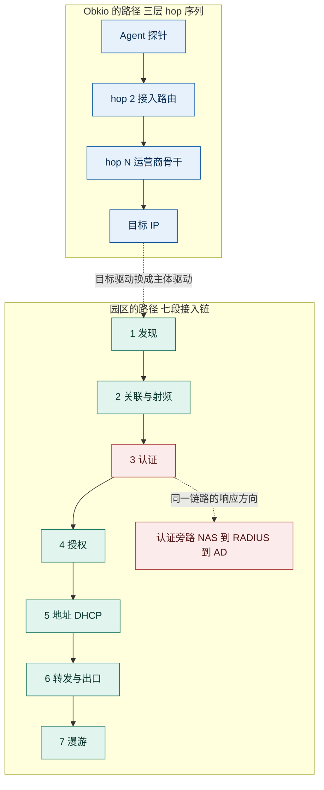
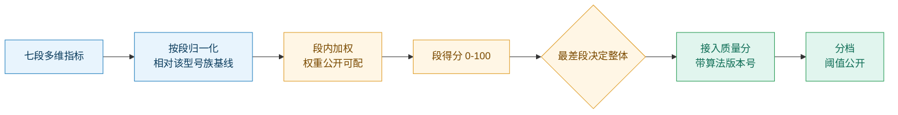
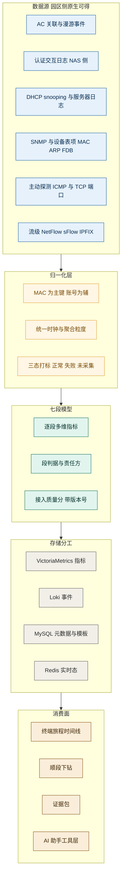
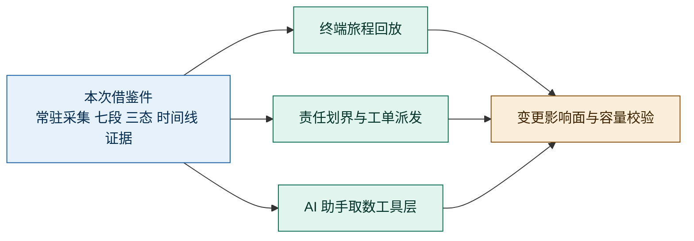
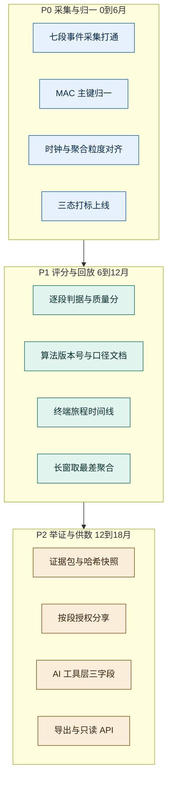

# 0 结论先行

**可以借鉴，但借鉴的不是 traceroute，而是它把「一次性诊断命令」改造成「常驻、可比、可回放的数据资产」的五项机制；探测对象必须从「目标 IP 的三层 hop」换成「终端接入链路的七个环节」。**

| Obkio 大功能点 | 业界本质 | 园区判定 | 借鉴价值 | 改造幅度 | 建议优先级 |
|---|---|---|---|---|---|
| **F1 持续自动 traceroute 引擎** | 把探测从「人工事件」变成「后台常驻数据流」 | **借鉴机制，换探测对象** | ★★★★★ | 中（换采集面） | **P0** |
| **F2 路径图 + 逐跳指标 + Quality Score** | 逐段多维指标 + 单一下采样评分 | **借鉴，但必须公开口径** | ★★★★★ | 大（换指标维度） | **P0** |
| **F3 时间线回放 + 取最差聚合** | 把「时间」做成数据模型的一等公民 | **借鉴，园区价值高于原始场景** | ★★★★★ | 中（换回放主体） | **P1** |
| **F4 无代理目标监控** | 把装不了探针的端点拉进同一模型 | **借鉴，但换兜底源**（设备侧被动，而非 ICMP） | ★★★☆ | 中（换兜底通道） | **P2** |
| **F5 集成与关联 / 证据出口** | 统一时间轴 + 可对外交付的数据出口 | **借鉴，且是竞品空档** | ★★★★ | 小（本就具备） | **P1** |

**一句话理由**：Obkio 卖的是「路径这一层的连续数据」；园区真正缺的不是路径，是「终端从连上到能用」这一过程的连续数据。业界用两根探针去看中间的网，园区有上千个天然观测点（AP、交换机、AC、认证服务器）——**照搬 traceroute 只能覆盖园区故障的一小部分，把观测对象换成终端旅程的七段，五项机制才全部落地。**

> **本文判定口径**：涉及 Obkio 能力的表述均标注信源（A 官方文档 / B 官方博客产品页 / C 第三方或本文推导）并附链接；涉及园区侧的结论若无外部信源，一律标 **C（本文推导）**，给出依据链。与之配套的建模侧评估见《DigitalTwin-园区业务借鉴评估-四能力重构与分期.md》，本文只解决「怎么采、怎么评、怎么回放、怎么举证」，不重复讨论「建什么模型」。

---

# 1 先对齐语义：两个「路径」不是同一条路径

这是全文的判据。不做这层对齐，后面所有「如何借鉴」都会变成削足适履。

| 维度 | Obkio 的「路径」 | 园区的「路径」 |
|---|---|---|
| **节点是什么** | 三层 hop（路由器、防火墙、运营商骨干） | 七个接入环节：发现 → 关联 → 认证 → 授权 → 地址 → 转发 → 漫游 |
| **观测主体** | 目标 IP（到 ERP、到 Office 365） | **终端**（MAC 为主键，账号为辅） |
| **主要失败形态** | 丢包、延迟、抖动、不可达 | 关联失败、认证拒绝、VLAN 授权错、DHCP 无响应、首包不通、漫游中断 |
| **用户的原话** | 「到 ERP 慢」 | 「我上不了网」 |
| **责任方** | 我的网 vs ISP 的网 | 一线 / 网络组 / 安全组 / 应用组 / 运营商（**内部边界比对外边界更痛**） |
| **变化频率** | 路由变更：天级到周级 | 关联与漫游：**分钟级**；AP 上下线、终端走动 |

> **关键推论（C，本文推导）**：Obkio 的用户至少能说出「到哪个目标慢」，所以它能以「目标地址」为入口。园区报障的原文往往只有一句「上不了网」，没有目标、没有时间、甚至没有终端标识（只有一个工位号）。依据链：① 业界工具的入口是目标 IP（A，[Visual Traceroutes 文档](https://obkio.com/docs/obkio-visual-traceroutes/)）→ ② 园区报障通行形态是「人—工位—现象」而非「目标—指标」（C，园区运维实践）→ 结论：**园区必须补一个前置问法 U0「问题说不清」，并把入口从「目标地址」换成「终端身份 + 时间」**。这一条决定了后文所有改造的方向。

## 1.1 把 Obkio 的五个问法拿到园区验证

Obkio 报告的 U1–U5 是在「路径可观测」这个前提下推导的。园区场景下逐条验证，结论是**四条成立、一条降级、一条需要前置**：

| 问法 | 在园区是否成立 | 变化点（C） |
|---|---|---|
| **U0 问题说不清**（园区新增） | **成立，且是入口** | 报障无目标、无时间、无终端标识；必须先做「工位/账号 → MAC → 时间窗」的归一化 |
| **U1 现在看不清** | 成立，但对象变了 | 「看不清」的不是路径形状，而是**七段中断在哪一段** |
| **U2 过去回不去** | **成立，且强度更高** | 园区故障更间歇、更多自愈、现场更常无人值守 |
| **U3 未来试不了** | 成立，但主体变了 | 要试的不是「路由会怎么绕」，而是「这次变更谁会被影响」 |
| **U4 钱算不清** | **降级** | 园区主要矛盾是内部责任划界（谁背锅），对外 ISP 举证只发生在分支/出口场景 |
| **U5 证据拿不出** | 成立，且强度更高 | 同时存在**对内**（一线/网络/安全/应用）与**对外**（运营商/集成商）两种举证 |

> 这条验证的意义：**不要照抄 Obkio 的「路径优先」叙事去写园区方案**。园区客户的痛点排序是「U0 → U2 → U1 → U5 → U3 → U4」，而 Obkio 的排序是「U1 → U2 → U5」。排序不同，产品首页的第一屏就该不同。

---

# 2 园区的问题特点：七条结构性差异

| # | 特点 | 具体表现 | 对借鉴的直接含义（C） |
|---|---|---|---|
| 1 | **故障主体是终端，不是路径** | 报障只给工位、手机、姓名；同一条路径上 30 个人，只有 1 个人不通 | 观测主键必须是 MAC，路径只是终端的属性 |
| 2 | **间歇 + 自愈** | 用户报障时已经好了；一天出现几分钟 | 「常驻采集」是刚需，不是加分项 |
| 3 | **多数故障不在三层转发面** | 射频质量、认证拒绝、VLAN 授权错、DHCP 拿不到地址、PoE 掉电、二层环路（具体占比需以客户工单统计为准） | 只做 traceroute 会系统性漏掉主战场 |
| 4 | **多源异构、无统一主键** | AC 关联、认证日志、DHCP 日志、SNMP、流数据分属不同系统，MAC 格式与时钟都不统一 | 借鉴点不在「怎么探」，而在「怎么归一」 |
| 5 | **变更频率分钟级** | AP 上下线、终端漫游、策略下发、交换机替换 | 不能照搬「全量状态版本化」，要事件流 + 骨架快照 |
| 6 | **责任边界在内部** | 一线说网络问题、网络说认证问题、认证说 AD 问题、AD 说终端问题 | 证据出口的第一消费方是内部团队，不是运营商 |
| 7 | **甲方 IT 人力薄** | 1–3 人管数千终端；不会写查询语句 | 交互必须问答式；工具层要供 AI 调用，不是给人写查询 |

> **第 3 条与第 1 条合起来，决定了本次借鉴的取舍**：园区拥有比 Obkio 更多的观测点（每台 AP、每台交换机、AC、认证服务器都是天然探针，无需两端装 Agent），但**这些观测点的数据不是「路径」，是「事件」**。因此真正要搬的不是 traceroute 协议，而是「把事件组织成可逐段定位、可回放、可举证的数据资产」这套方法论。

---

# 3 Obkio Visual Traceroute 的功能特点

## 3.1 五个大功能点与它们的边界

| # | 大功能点 | 核心机制（一句话） | 最要命的一条边界 | 园区可迁移度 |
|---|---|---|---|---|
| **F1** | 持续自动 traceroute 引擎 | 每 1.2 秒 ICMP 探测、每分钟聚合、全会话零配自动启用（A，[文档](https://obkio.com/docs/obkio-visual-traceroutes/)） | 协议锁死 ICMP 且参数不可改，**测不到真实应用流量** | 机制可迁移，协议不可 |
| **F2** | 可视化路径图与逐跳指标 | 每跳绑多维指标 + 单一 Quality Score 颜色分档（A，[文档](https://obkio.com/docs/obkio-visual-traceroutes/)） | **评分算法与阈值从未公开** | 双层模型可迁移，算法需自建并公开 |
| **F3** | 时间线回放与历史 | 1 分钟粒度、最长 6 个月；时间线是**唯一入口**；长窗**取最差**聚合（B，[产品页](https://obkio.com/visual-traceroute-tool/)） | 保留期按套餐截断（7 天 / 6 月 / 36 月） | **高**，机制与场景无关 |
| **F4** | 无代理目标监控 | 目的端无需 Agent，复用同一引擎约每秒探测（A，[ND 文档](https://obkio.com/docs/network-destinations/)） | 「无代理」只是目的端；**源端仍必须有 Agent** | 中，兜底源要换 |
| **F5** | 集成与关联 / 证据出口 | 统一时间轴、仪表板小部件、Live 分享链接 48h、报表 Excel/PDF/JSON（A，[Reports](https://obkio.com/docs/reports/)） | 无公开 REST API；路径原始数据未声明可导出 | **高**，且是竞品空档 |

> 五个大功能点共 29 个小功能点，完整拆解见《Obkio-VisualTraceroute-2023-2026-功能体系与痛点解法.md》。本节只提可迁移的设计决策。

## 3.2 真正值得借鉴的七条设计决策

这七条是「功能之下」的东西。功能会过时，设计决策不会。

| # | 设计决策 | Obkio 的做法（信源） | 为什么必须这么设计 | 园区对应物 |
|---|---|---|---|---|
| **D1** | **固定参数换可比性** | Protocol/Interval/TTL/Packet 四项**不可改**（A，[文档](https://obkio.com/docs/obkio-visual-traceroutes/)），而通用 traceroute 页却支持 ICMP/TCP/UDP 三选一（A，[文档](https://obkio.com/docs/traceroutes/)） | 只有全量参数一致，长期序列才可比，颜色变化才等于「网络真变了」而非「参数变了」 | 接入基线模板：同 SSID、同认证方式、同 AP 型号族，参数锁死 |
| **D2** | **双层数据模型** | 逐跳多维指标（延迟/丢包）+ 单一下采样评分（绿/黄/红三级，ND 四级）（A，[文档](https://obkio.com/docs/obkio-visual-traceroutes/)） | 人无法同时读五个数字并判断「这跳好不好」，必须有一个降维判断，否则「一眼看出」不成立 | 七段多维指标 + 单条接入质量分 |
| **D3** | **「无响应」与「丢包」是两个字段** | UI 显式标 `No response from hop X`，而非渲染成零指标或红色丢包（B，[产品页](https://obkio.com/visual-traceroute-tool/)） | 中间设备策略性不回包是常态；合并字段会把「设备不礼貌」报成「设备故障」 | 「未采集」与「失败」必须是两个状态 |
| **D4** | **时间线是主选择器，不是一张图** | 「The timeline is your primary selector…when you select a time range, the entire page updates」（B，[产品页](https://obkio.com/visual-traceroute-tool/)） | 时间若分散在各小部件，用户会拿不同时段的图做对比，得出矛盾结论 | 终端旅程时间线作为唯一入口 |
| **D5** | **长窗取最差，不取平均** | 「aggregated to surface the **worst outcomes** per interval」（B，[产品页](https://obkio.com/visual-traceroute-tool/)） | 取平均会把 20 分钟的间歇故障平均掉，等于系统性隐藏目标事件 | 长窗按区间取最差；喂 AI 时必须带聚合等级 |
| **D6** | **诚实的折中：无代理是有代价的** | 官方明说「有 Agent 才有 richest visibility（端到端双向 UDP），无 Agent 只有 ICMP 路径」（A，[发布博客](https://www.obkio.com/blog/network-destinations-icmp-monitoring/)） | 覆盖面与精度是交换关系，承认折中才能让客户正确选型 | 设备侧被动观测的盲区（哑终端离线、旁挂设备）要如实标注 |
| **D7** | **数据出口是一等能力** | 分享链接 48h、只读账号、报表 Excel/PDF/JSON、Webhook（HMAC-SHA256，失败重试 8 次）（A，[Live](https://obkio.com/docs/live-traceroutes/) · A [Reports](https://obkio.com/docs/reports/)） | 数据不能出平台，就无法跨团队举证，也无法被上层能力消费 | 长期可鉴权证据包（这是 Obkio 的短处） |

> **一条反直觉观察**：Obkio 对外最响的口号是「把排障时间减半」，但它真正的技术资产是 **D1+D2+D3 这三条数据建模决策**——三者共同把 traceroute 从「人读的文本」变成了「机器可聚合、可比较、可推理的指标源」。园区要复刻的正是这三条，而不是那张路径图。

---

# 4 如何借鉴：七个借鉴件

## 4.1 总表

| # | 借鉴件 | 借鉴自 | 园区改造后的形态 | 解决的园区问题 | 可迁移度 |
|---|---|---|---|---|---|
| **B1** | 常驻采集 | F1 零配持续 | 终端接入旅程的常驻事件采集（关联/认证/地址/漫游） | 间歇、自愈、报障时现场已消失 | ★★★★★ |
| **B2** | 接入基线模板 | D1 固定参数 | 按 SSID + 认证方式 + AP 型号族锁定采集与判据口径 | 各代际设备口径不一，数据不可比 | ★★★★ |
| **B3** | 逐段评分（双层模型） | D2 双层模型 | 七段多维指标 + 单条接入质量分，**公式公开** | 定位不到「断在哪一段」 | ★★★★★ |
| **B4** | 三态数据模型 | D3 无响应 vs 丢包 | 正常 / 失败 / **未采集** | AI 把「没采到」误判成「故障」 | ★★★★★ |
| **B5** | 时间线唯一入口 + 取最差 | D4 + D5 | 终端旅程时间线；长窗取最差 | 复盘靠回忆、间歇规律看不到 | ★★★★★ |
| **B6** | 双向观测 | F1 反向路径 | 同一时刻从 AP 侧与核心侧各看一遍 | 分不清是空口丢还是上行丢 | ★★★★ |
| **B7** | 证据包 | D7 + F5 出口 | 长期、可鉴权、带哈希快照的证据视图 | 跨团队/对外举证无凭据 | ★★★★ |

## 4.2 核心改造：把「逐跳」换成「逐段」

这是全文最关键的一张表。业界模型的「跳」是三层设备，园区的「跳」是接入链路的七个环节——**每一段有自己的判据、自己的数据源、自己的责任方**。

| 段 | 失败时长什么样 | 关键指标 | 数据源（园区原生可得） | 责任方 |
|---|---|---|---|---|
| **1 发现** | 根本扫不到 SSID / 找不到可用端口 | 扫描到的 SSID 数、信号强度、端口 up/down | AC 关联事件、接入端口状态 | 一线 / 网络 |
| **2 关联** | 关联失败、反复重连、连上但极慢 | 关联成功率、失败码、RSSI/SNR、协商速率、重传率、信道利用率、AP 终端数 | AC/AP 射频统计 | 网络（无线） |
| **3 认证** | 认证拒绝、EAP 交互超时 | 认证方式、结果码、EAP 各轮耗时、RADIUS 响应时延 | NAS 侧认证日志 + RADIUS 侧日志 | 安全 / 认证 |
| **4 授权** | 认证过了，但 VLAN/ACL 不对 | 实际下发 VLAN、ACL、QoS、限速 vs 模板预期 | 设备会话表、控制器下发记录、配置 | 网络 / 安全 |
| **5 地址** | 拿不到地址、拿到错网段 | DHCP 四步各自耗时、Offer 是否到达、地址池使用率、snooping 绑定 | DHCP snooping 表、DHCP 服务器日志 | 网络 |
| **6 转发** | 网关通但不通外网、DNS 慢 | 网关 ARP/ICMP、DNS 解析时延、首包时延、NAT/策略命中 | 主动探测（ICMP/TCP 端口）、设备表项 | 网络 / 运营商 |
| **7 漫游** | 走动中断、切换卡顿 | 漫游次数、切换耗时、跨 AC 漫游、切换前后 AP 与 RSSI | AC 漫游事件 | 网络（无线） |

> 七段与《DigitalTwin-园区业务借鉴评估》中的「终端旅程七段」保持同一套命名，两份文档不冲突：那份定义**要建什么模型**，本表定义**每段怎么判、去哪取数、谁负责**。

**三点改造说明（C）**：

1. **「段」替代「跳」**。园区里真正决定「能不能上网」的，往往不是三层转发，而是第 2、3、5 段。若沿用 hop 语义，产品会天然把 80% 的显示面积给到第 6 段——而它恰恰是园区最不容易出问题的一段。
2. **每段必须能给「判据」而非只有「指标」**。指标是「RSSI = -72dBm」，判据是「低于该 AP 型号族的关联门限，属于弱信号区」。Obkio 的 Quality Score 做的就是这件事（A，[文档](https://obkio.com/docs/obkio-visual-traceroutes/)），园区必须做同样的事，但**口径要公开**（见 4.4）。
3. **责任方必须入模型**。这是园区独有的字段——Obkio 的责任方只有「我的网 / ISP」两个值，园区的责任方有五个，且**这个字段直接决定工单该派给谁**。它比任何指标都更接近客户价值。

## 4.3 三态数据模型：最容易做错的一件

Obkio 用 `No response from hop X` 把「数据缺失」与「性能劣化」分开（B，[产品页](https://obkio.com/visual-traceroute-tool/)）；第三方技术文献也指出中间跳不回 ICMP 多属限速而非故障（C，[技术论述](https://shop.linktechs.net/why-traceroute-shows-packet-loss-on-cisco-juniper-and-mikrotik)）。园区场景把这个问题的严重性放大了数倍：

| 状态 | 定义 | 典型成因 | 错误处理的后果 |
|---|---|---|---|
| **正常** | 该段有数据且判据通过 | — | — |
| **失败** | 该段有数据且判据不通过 | 认证拒绝、DHCP 无响应、RSSI 低于门限 | 正确路径 |
| **未采集** | 该段**没有数据**，且原因是采集侧缺失 | 设备型号不支持该字段、日志未开启、终端已离线、时钟未对齐 | **若被当成失败，AI 会给出高置信度的错误根因** |

> **工程约束（C，本文推导）**：这三态必须在**数据模型层**就是三个枚举值，不能靠前端「值为空就显示灰色」来兜。依据链：① Obkio 在 UI 层显式标注无响应跳（B）→ ② 园区数据源异构，字段缺失率显著高于单一 Agent 场景（C，第 2 章第 4 条）→ 结论：**呈现层兜底不足以保护下游推理，必须在写入时就打标**。

## 4.4 评分口径：公开、带版本号

Obkio 的 Quality Score 只给颜色语义（绿=good / 黄=medium / 红=poor，ND 另有深红=不可达），**算法、权重、阈值从未公开**（A，[文档](https://obkio.com/docs/obkio-visual-traceroutes/)）。这在「向 ISP 举证」时是硬伤——对方有理由质疑这个分数的口径。

园区的处境相反：**证据的第一消费方是自己内部的四个团队**，口径不公开等于把扯皮从「有没有数据」升级为「你的分怎么算的」。

建议的评分结构（C，**示意设计，非标准**）：

三条硬要求：

| 要求 | 理由 | 反例（Obkio 的现状） |
|---|---|---|
| **公式与阈值写进产品文档** | 客户要能自己复核「为什么这段是红的」 | 官方仅给颜色语义（A） |
| **评分带算法版本号** | 算法一改，历史颜色与现在不可比，模型基于历史的推理全部失真 | 未见版本化标注 |
| **整体分由「最差段」决定，不由平均值决定** | 与 D5 同源：平均会掩盖单段致命故障（认证全挂但其余六段正常） | 未见公开的聚合规则 |

## 4.5 时间线：唯一入口 + 取最差聚合

这两条是 Obkio 最干净的可迁移资产，且与协议无关。

| 借鉴点 | Obkio 原话（B，[产品页](https://obkio.com/visual-traceroute-tool/)） | 园区改造 |
|---|---|---|
| 时间线是主选择器 | 「The timeline is your **primary selector**…the entire page updates」 | 以「该终端的旅程时间线」为唯一入口：点任意时刻，七段状态、指标、责任方同步切换 |
| 长窗取最差 | 「aggregated to surface the **worst outcomes** per interval」 | 看 30 天时按小时取最差；看 1 天时按分钟取最差；**永远不取平均** |
| 统一时间选择器 | 「Control time across dashboards and session pages with one timeline」 | 认证、DHCP、射频、流四类数据必须共用同一时间基准与聚合粒度 |
| 历史深度决定能力 | 6 个月 / 1 分钟粒度（B）；旧版仅 3 小时 | 分级保留：热 7 天（秒级）/ 温 30 天（分钟级）/ 冷 180 天（事件级） |

> **一条必须写进取数接口的约束（C）**：AI 助手取数时，工具返回值必须携带 `granularity`（聚合粒度）与 `coverage`（数据完整度）两个元字段。否则模型会把「6 个月取最差的区间值」当成「某一分钟的真实值」做趋势推断——这类幻觉比模型知识错误更隐蔽，因为它在数值上完全自洽。

## 4.6 双向观测：不是在回程做 traceroute，而是在两个观测点看同一时刻

Obkio 的 Reverse Traceroutes 解决的是 IP 网络的路由不对称（A，[文档](https://obkio.com/docs/obkio-visual-traceroutes/)；IETF 草案亦指出 traceroute 本身无法获取反向路径信息）。园区没有「回程路径」这个概念，但**同一个逻辑问题以另一种形态存在**：

| 园区场景 | 单向观测会得出的错误结论 | 双向观测才能得出的结论 |
|---|---|---|
| 终端发了 DHCP Discover，没拿到地址 | 「DHCP 服务器有问题」 | 看 NAS 侧：Discover 是否到达；看服务器侧：是否发出 Offer；看回程：Offer 是否被 ACL 拦。**三段各有各的责任方** |
| 认证超时 | 「AD 挂了」 | 看 NAS 侧：EAP 第几轮超时；看 RADIUS 侧：是否收到、耗时多少；看回程：是否回包丢失 |
| 视频卡顿 | 「AP 信号差」 | 看 AP 侧：空口重传率与信道利用率；看核心侧：上联是否有拥塞或策略限速 |

> **结论（C）**：园区要复刻的不是「反向 traceroute」这个动作，而是它背后的方法论——**任何一次单向观测都不足以定责**。落地形态是「同一时刻、两个观测点、同一主键」的三元组，而不是在回程再跑一次探测。

## 4.7 证据出口：从「48 小时链接」到「可鉴权证据包」

Obkio 的对外举证能力止步于 Live 分享链接（有效期 48 小时）与不含路径明细的报表（A，[Live](https://obkio.com/docs/live-traceroutes/) · A [Reports](https://obkio.com/docs/reports/)）。这是它最明显的产品空档，也正是园区最需要的部分。

| 能力 | Obkio 现状 | 园区应做到 | 为什么重要 |
|---|---|---|---|
| 分享 | 链接 48 小时过期 | 长期有效、可撤销、可设权限 | 工单可能跨月，48 小时等于没有 |
| 权限 | 临时只读账号 | 按段授权（只给对方看第 6 段） | 内部跨团队时，不能把全量数据给安全组外的所有人 |
| 完整性 | 未见哈希/签名 | 快照带哈希，可校验未被篡改 | 对外举证时，对方第一反应是「你是不是改过」 |
| 数据出口 | 报表不含 traceroute 明细 | 明细可导出、可 API 拉取 | 上层 AI 与被客户自有系统消费的前提 |

## 4.8 借鉴后的整体架构

> **架构上的一个判断（C）**：这套体系里，**归一化层比采集层更难、也更有价值**。Obkio 之所以能做得好，是因为它的两端都是自己的 Agent，数据天然同构；园区要面对十几种设备代际、四五个异构系统，**「MAC 主键归一 + 时钟对齐 + 三态打标」是真正的护城河，而不是探测协议**。立项排期时若把归一化当成「接入工作量」而不是「核心工程」，项目一定延期。

## 4.9 对 AI 助手的三条硬约束

这三条直接对应园区 APM AI 助手的取数工具设计，建议写进工具层规范：

| # | 约束 | 若违反会发生什么 |
|---|---|---|
| 1 | 取数工具必须回传 `granularity` / `coverage` / `evidence_strength` 三个元字段 | 模型把聚合值当单点值、把空洞当正常、把 ICMP 探测结论当业务结论 |
| 2 | 三态不得在工具层合并为布尔值 | 「未采集」被模型解释为「失败」，输出高置信度错误根因 |
| 3 | 评分必须带版本号，跨版本的历史对比要在工具层拒绝或降权 | 算法变更后，模型基于历史的趋势判断整体失真 |

> 第 1 条里的 `evidence_strength` 是园区特有的：同一段结论可能来自「双向事件」（强）、「单向事件」（中）、「设备侧被动推断」（弱）。**让模型知道证据强度，比让它多调一个工具更能提升结论质量。**

---

# 5 定位与分期：它是孪生与回放的实现手段，不是又一条路径产品

## 5.1 定位判断

**核心判断（C）**：不要把「园区版 Visual Traceroute」立成独立产品。它在园区没有独立卖点——客户不会为「看一条路径」付钱，只会为「我的问题 5 分钟内有答案」付钱。**它应当作为《DigitalTwin》评估里 P0 建模与 P1 回放的采集与评分实现层存在**，价值来自被三个消费面消费。

## 5.2 三期路线

| 期 | 交付物 | 验收指标（可量化） | 不要用 |
|---|---|---|---|
| **P0** | 七段采集 + 归一化 | 事件归一成功率（同一 MAC 跨系统串联比例）、字段缺失率、时钟偏差 P95、三态标注覆盖率 | 「接入了几个系统」 |
| **P1** | 逐段评分 + 旅程时间线 | 报障定位时长、单次定位所需人工跳转次数、评分口径文档完备度 | 「有了一张图」 |
| **P2** | 证据包 + AI 工具层 | 证据包生成耗时、跨团队争议解决率、AI 取数带元字段比例 | 「支持导出」 |

> **P0 的验收项必须是归一化质量而非采集广度**。业界报告已明确 Obkio 的干净度来自两端同构；园区没有这个条件，**归一化做得不好，后面所有评分与回放都建立在错位的数据上，且错误不会报错，只会静静地产生错误结论**。

## 5.3 为什么不能先做评分和界面

三条理由：

1. **没有基线就没有分**。评分本质是「与基线比」，基线来自 P0 的持续采集；先做评分只能拍阈值，上线即被客户质疑。
2. **没有三态就没有可信度**。先把「未采集」当失败做出来的红黄绿，会在第一次设备型号不匹配时给出错误告警，信任一次性消耗完。
3. **没有归一化就没有 AI**。模型在错位的时间与主键上做关联，产出的根因看起来合理但不可复核——这比不做 AI 更危险。

---

# 6 明确不该借鉴的部分

这一节比「借鉴什么」更重要，它决定项目会不会跑偏。

| 不该借鉴 | 原因 | 若要坚持的代价 |
|---|---|---|
| **固定 ICMP 作为唯一探测协议** | ICMP 会被 CoPP/管理面限速，且不代表业务流量；Obkio 官方博客自己也批评命令行工具「doesn't represent actual application traffic」（C，[官方博客](https://www.obkio.com/blog/network-path-monitoring/)） | 园区会得到「路径很干净但用户上不了网」的经典错判 |
| **把 traceroute 当主数据源** | 园区主战场在射频、认证、授权、地址四段，不在三层转发 | 采了一堆 hop，答不了「他为什么连不上」 |
| **以「目标地址」为入口** | 园区报障给的是人、工位、手机，不是目标 IP | 用户每次都要自己完成「我的问题 → 某个 IP」的翻译，甲方 IT 做不了 |
| **把路径图当交付物** | 图的边际价值随场景复杂度下降；决策需要的是「哪一段、谁负责、什么时候」 | 做成一张昂贵的拓扑图，ROI 无法论证 |
| **评分口径不公开** | 这是 Obkio 在举证场景的软肋，不是优点 | 内部四个团队会先质疑你的分，再质疑你的数据 |
| **全量状态版本化** | 园区变更频率分钟级，存储成本随变更次数而非时间增长 | 成本不可控，且大部分快照无人消费 |
| **48 小时分享链接式举证** | 工单周期以周计 | 最关键的时刻链接已过期 |

> 一条容易忽略的：**不要照搬 Obkio 的「减半」类收益叙事**。那是厂商自述（B），园区客户对这类数字的免疫力很高，且一旦第一次 POC 达不到，信任无法挽回。用「定位时长」与「跨团队争议解决率」作为对外口径更稳。

---

# 7 风险与待验证

| 风险 | 说明 | 建议动作 |
|---|---|---|
| **归一化被低估** | MAC 格式、时钟、字段语义在各系统间不一致，工作量常被估成「接口对接」 | P0 单独立项，验收看归一成功率而非接入系统数 |
| **字段缺失率过高** | 老代际接入交换机、部分 AP 型号不提供某些射频/关联字段 | 先做一轮字段可得性盘点，按型号族分级降级，并把缺失率做成产品内可见指标 |
| **三态被下游合并** | 前端或 AI 工具层为省事把「未采集」折叠成「失败」 | 在数据模型与工具层双重约束，接口层拒绝布尔化 |
| **评分阈值拍脑袋** | 无基线时先定阈值，上线即被质疑 | P0 只出「相对基线」的偏差，不出绝对分；绝对分待 4 周基线积累后再开放 |
| **隐私与合规** | 终端 MAC 与账号关联属个人信息 | 按段脱敏、按角色授权；证据包对外时只给必要字段 |
| **借鉴过度导致范围膨胀** | 五个大功能点全搬会变成「再做一套 NPM」 | 只做 B1–B7 七件，明确列出不在范围的能力（如全网拓扑、配置管理） |
| **Obkio 侧口径待跟踪** | Quality Score 算法、聚合算法、精度指标均未公开，无法作为设计参照 | 属「有方法论无参数」的借鉴，参数必须自建并经 POC 验证 |

---

# 附：本文依据

| 等级 | 信源 | 用途 |
|---|---|---|
| A | [Obkio Visual Traceroutes 文档](https://obkio.com/docs/obkio-visual-traceroutes/) | 1.2 秒 / TTL 30 / 64B / ICMP 固定、每分钟聚合、零配自动启用、逐跳最大丢包与最大延迟、Quality Score 三级语义、无响应跳标注、反向路径、历史路径 |
| A | [Obkio 通用 Traceroutes 文档](https://obkio.com/docs/traceroutes/) | 对照证据：通用页支持 ICMP/TCP/UDP 三选一，说明固定参数是刻意取舍 |
| A | [Obkio Network Destinations 文档](https://obkio.com/docs/network-destinations/) | 目的端无需 Agent、约每秒探测、四级状态、深红=不可达 |
| A | [Obkio Live Traceroutes 文档](https://obkio.com/docs/live-traceroutes/) | 双向与路由不对称、分享链接 48 小时 |
| A | [Obkio Reports 文档](https://obkio.com/docs/reports/) | 报表格式与套餐限制（不含路径明细） |
| A | [Obkio 定价页](https://obkio.com/pricing/) | 保留期 7 天 / 6 个月 / 36 个月按套餐 |
| A | [Obkio Network Destinations 发布博客](https://www.obkio.com/blog/network-destinations-icmp-monitoring/) | Beta 100 池、Basic 2/agent、Premium 10/agent、「有 Agent 才有 richest visibility」的折中自述 |
| B | [Obkio Visual Traceroute 产品页](https://obkio.com/visual-traceroute-tool/) | 路径图、多目标视图、时间线为主选择器、统一时间选择器、Smart Aggregation 取最差、6 个月/1 分钟 |
| B | [Obkio 官网首页](https://obkio.com/) | 「资深工程师手工调查的自动化」定位表述 |
| C | [Obkio：network path monitoring 博客](https://www.obkio.com/blog/network-path-monitoring/) | 厂商自承「命令行工具多用 ICMP，不代表真实应用流量」 |
| C | [ICMP 限速导致中间跳不回包的技术论述](https://shop.linktechs.net/why-traceroute-shows-packet-loss-on-cisco-juniper-and-mikrotik) | 「无响应」不等于「丢包」的第三方依据 |
| — | 本工作区既有报告：《Obkio-VisualTraceroute-2023-2026-功能体系与痛点解法》 | 五个大功能点 / 29 个小功能点 / 六维边界的完整拆解 |
| — | 本工作区既有报告：《DigitalTwin-园区业务借鉴评估-四能力重构与分期》 | 园区七段命名与分期口径的来源，本文与之对齐 |

> 园区侧的全部判断（七段划分、故障分布、责任方映射、评分结构、验收指标）均属 **C（本文推导）**，依据为园区网络通行实践与既有文档的分层结论，未逐条引用外部信源。若需对外立项，建议补一份客户工单的段位分布统计与一次 POC 的字段可得性盘点，作为定量支撑。

---

*文档生成时间：2026-10-19 ｜ 适用范围：锐捷园区业务 · 路径与接入可观测能力规划*
