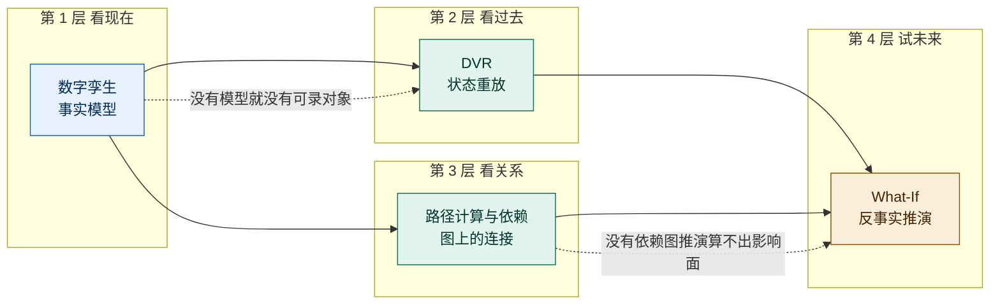
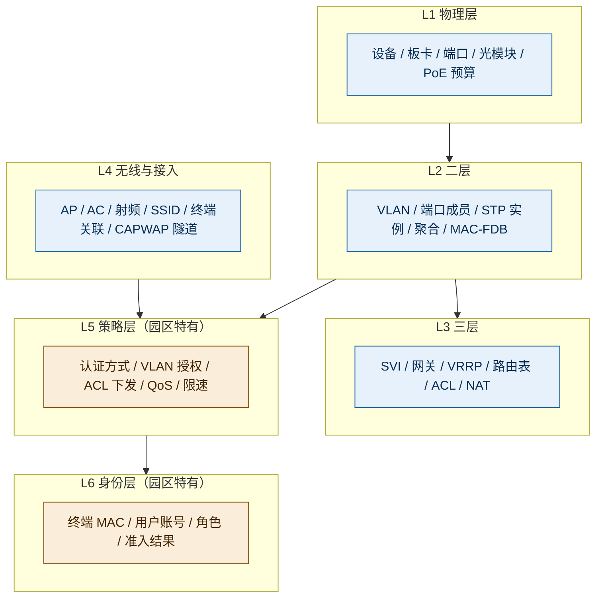
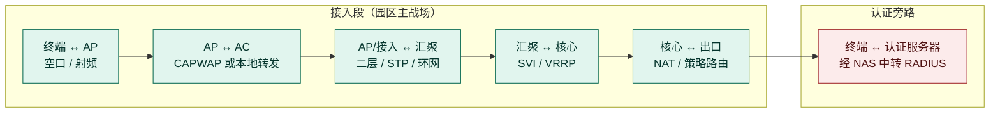
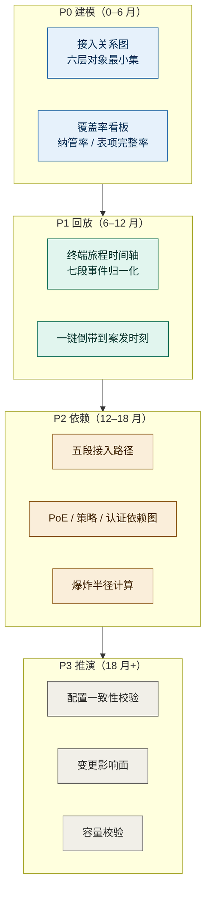

# 0 结论先行

**可以借鉴，但不能按「网络数字孪生」的形态借鉴，要按「园区接入孪生」的形态重构。四项能力的借鉴价值不均等，且存在严格的先后依赖。**

| 能力 | 业界本质 | 园区判定 | 借鉴价值 | 改造幅度 | 建议优先级 |
|---|---|---|---|---|---|
| **数字孪生** | 路由与流量的事实模型 | **借鉴，但只作底座，不作独立卖点** | ★★★★★（作底座） ★★（作功能） | 大（建模对象全换） | **P0** |
| **DVR 回放** | 按时序回放网络状态 | **借鉴，且园区价值高于原始场景** | ★★★★★ | 中（换回放主体） | **P1** |
| **路径计算与依赖** | BGP-LS/BMP + PCE 算真实转发路径 | **借鉴，但必须换锚点** | ★★★★ | 大（数据源不存在） | **P2** |
| **What-If 推演** | 结构级故障与变更推演 | **借鉴，但必须降级为「影响面推演」** | ★★★☆ | 大（目标要改） | **P3** |

**一句话理由**：园区的网络协议栈比运营商浅得多（无 BGP-LS/BMP/MPLS/SR），但**接入侧的变量比运营商多得多**（终端、身份、射频、PoE、策略）。直接搬「路由孪生」会做出一张昂贵的拓扑图；把建模对象从「路由与流量」换成「接入关系与身份策略」，四项能力才全部成立。

> **本文判定口径**：涉及厂商能力的表述均标注信源（A 官方文档 / B 官方博客产品页 / C 第三方或本文推导）；涉及园区场景的结论若无外部信源，一律标 **C（本文推导）**，并给出依据链。

---

# 1 先把四个词对齐：它们不是并列的四个功能

业界（Selector、Forward、Blue Planet/Ciena、NetBrain、IP Fabric）把它们讲成四个功能，实际是**一条能力链上的四个环节**，且顺序不可跳。

Selector 的演进路径印证了这一点：2024-03 先做实时镜像与拓扑，2024-03 ~ 2025 做 Network DVR，2024-09 起才做 What-If 与容量预测（B，官方 Release Notes 时间线）。**这不是排期偏好，是数据依赖。**

## 1.1 DVR 的准确含义（避免误读）

DVR 是 **Digital Video Recorder 的隐喻**，不是某个技术缩写。Selector CTO 的原文表述是「The NDT is the DVR of networking：by looking into the past, it helps you make decisions for the future」（B，[Selector 官方博客](https://www.selector.ai/blog/selectors-digital-twin-the-dvr-of-networking/)）。Ciena Blue Planet 的产品页也用「DVR-style replay」描述同一件事（B，[Blue Planet ROA](https://blueplanet.com/products/route-optimization-and-analysis)）。

它的技术实质是**结构化状态重放**，不是屏幕录像：把「拓扑 + 健康状态 + 告警」按时间点分层重建，让用户回到案发时刻。这个区别很重要——录屏只能看，重放可以查（点开某个节点看它当时的状态）。

## 1.2 四项能力的真实边界（决定了园区能不能照搬）

| 能力 | 业界最要命的一条边界 | 对园区的直接含义 |
|---|---|---|
| 数字孪生 | 保真度 **= 遥测覆盖率**；**无转发面模型**，看不到设备内部（表项、ACL 命中、芯片 drop reason） | 覆盖率问题园区更严重：AP、哑终端、未纳管交换机都会造成「影子节点」 |
| DVR | 回放深度 = 客户保留策略；**只读**，不做反事实 | 存储成本是硬约束，园区变更频率高，不能全量快照 |
| 路径计算 | **无 BGP-LS / BMP 就算不出真实路径**，只能算到 IGP | 园区基本没有这两个数据源，**照搬即失效** |
| What-If | 只推演**网络结构**，不仿真**设备内部**；且只推演「已建模的世界」 | 园区厂商私有特性多，建模不全则结论不可信 |

> 四条边界里，**「无 BGP-LS/BMP」和「无转发面」是园区落地的两个死结**。前者靠换数据源解开，后者靠换目标解开（见第 3 章）。

---

# 2 为什么不能直接搬：园区与运营商/大型 DC 的六条结构性差异

这一章是全文的判据。不做这层对齐，后面所有「如何借鉴」都会变成削足适履。

| # | 维度 | 运营商 / 大型企业 DC | 园区 | 对孪生设计的影响 |
|---|---|---|---|---|
| 1 | **协议栈深度** | BGP / MPLS / SR / SRv6 / TE Policy | 二层为主 + 少量 OSPF/静态；网关在 SVI+VRRP | 「路径计算」的数据源整体失效，必须换锚点 |
| 2 | **拓扑变化频率** | 天/周级，变更受控 | AP 上下线、终端漫游、接入交换机替换，**分钟级** | 全量拓扑版本化成本失控，必须「骨架快照 + 事件流」 |
| 3 | **故障主战场** | 转发面、路由收敛、跨域 | **接入失败、无线体验、二层环路、IP 冲突、出口拥塞、策略错配** | 「可达性」比「路由正确性」重要一个数量级 |
| 4 | **运维人力** | 专业 NOC，7×24，会写查询 | 甲方 IT 1–3 人管数千终端，或集成商代维 | 交互必须是问答式，不能是查询语言 |
| 5 | **变更粒度** | 改 BGP 策略、调 TE | 加 VLAN、改 ACL、扩一片 AP、调 STP 优先级、下发认证策略 | 影响面是「哪栋楼/哪类终端」，不是「哪些前缀」 |
| 6 | **厂商位置** | 第三方旁观者（Selector/Forward 均为第三方） | **锐捷同时拥有设备、AC、认证、网管** | 可做第三方做不到的闭环与深采（见 4.5） |

> **第 3 条是最容易被低估的**。业界孪生的默认问题是「这条业务路径通不通」，园区用户的默认问题是「我这个手机为什么连不上 Wi-Fi / 这个办公室为什么上不了网」。**同一个「路径」，指的不是同一条路径。**

---

# 3 逐能力评估：借鉴什么、怎么改、边界在哪

## 3.1 数字孪生：借鉴「模型即对象」，放弃「路由镜像」

### 借鉴什么

借鉴的不是那张图，而是三条设计原则（均为 Selector 的实证做法）：

1. **孪生是可查询的对象，不是渲染层**。路径、依赖、影响面都以「可被查询的实体」存在，图只是呈现方式（B，官方博客与技术长文多处一致）。
2. **孪生是降噪的剪枝器**。官方明确：拓扑感知让关联引擎「只分析应用真正依赖的服务器与网段」，而不是全量数据（A，[AI & ML Models 文档](https://docs.selector.ai/docs/ai-ml/ai-ml-models/)）。
3. **孪生是多个消费面的公共底座**。同一份模型被实时镜像、关联、回放、仿真、预测、路径六种方式消费（B）。

### 园区怎么改：换建模对象

这是全文最重要的一处改造。业界模型的对象是「设备—链路—路由—流量」，园区必须换成**六层对象**，其中第 5、6 层是业界模型里根本不存在的：

> **为什么必须有 L5/L6**：园区一半以上的「上不了网」根因不在转发面，而在「认证失败」「VLAN 授权错了」「ACL 拦了」「终端被拉黑」。**没有身份与策略的孪生，解释不了园区最常见的故障。**（C，依据：园区故障分类的通行实践 + 业界模型仅有网络与流量两层）

### 前提与边界

| 项 | 内容 |
|---|---|
| **前提** | 设备侧需稳定开放 MAC/ARP/FDB 表、AP 关联表、CAPWAP 表、DHCP snooping 绑定表、PoE 状态、配置只读接口。原厂设备可把这些做成一等公民（这是相对第三方的结构性优势） |
| **硬边界** | 保真度 = 覆盖率。未纳管的交换机、哑终端、旁挂设备会成为「影子节点」，**错误的影响面比没有影响面更危险** |
| **硬边界** | 不要承诺「设备内部行为」。芯片 drop reason、ACL 命中计数属转发面，第三方路线结构上做不到；原厂可做，但要另立项目 |
| **常见误期待** | 用户会把「数字孪生」理解成 3D 可视化或全物理仿真。**对外必须先定义「孪生 = 事实模型」**，否则会被拖进 3D 渲染的无底洞 |

## 3.2 DVR：借鉴「状态重放」，把回放主体从「网络」换成「终端」

### 借鉴什么

Selector 的 DVR 是四段闭环（B）：**ML 检测异常 → 自动倒带到变化时刻 → 分层重建当时状态 → 高亮可疑变更**。其中两个设计值得直接拿走：

1. **「自动定位」入口**：不是让用户手工翻时间轴，而是从异常点一键回到案发时刻。
2. **回放的是状态而非曲线**：拓扑、健康、告警按层重建，指标曲线只是其中一层。

### 园区怎么改：主体换成终端

这是本文第二个关键改造。业界的回放主体是**网络**（回到 T 时刻，网络长什么样）；园区的回放主体应当是**终端**（回到 T 时刻，这个终端经历了什么）。

**理由（C，推导）**：园区报障的提问方式是「我的设备上不了网」，用户给出的是 MAC 或账号，不是时间点，也不是设备名。以网络为主体的回放，用户要自己把「我的问题」翻译成「网络在哪个时刻出了什么事」——这个翻译动作，甲方 IT 做不了。

园区的「终端旅程」应记录以下事件序列：

| 环节 | 记录内容 | 判据（该环节失败长什么样） |
|---|---|---|
| 1 发现 | 扫描到哪些 SSID / 接入哪个端口 | 根本未关联 |
| 2 关联 | AP、频段、信道、RSSI、协商速率 | 关联失败 / 反复重连 |
| 3 认证 | 认证方式（802.1X / MAC 无感知 / Portal）、结果、耗时、失败码 | 认证拒绝 / 超时 |
| 4 授权 | 下发 VLAN、ACL、QoS、限速 | 认证过了但 VLAN 错 |
| 5 地址 | DHCP 请求/响应、耗时、拿到的地址与网关 | 拿不到地址 / 拿到错网段 |
| 6 转发 | 网关可达性、DNS、首包时延、丢包位置 | 通但不通外网 |
| 7 漫游 | 漫游次数、切换耗时、切换前后 AP | 走动中断 |

> **这七段就是园区的「路径」**——它替代了运营商语境下的「端到端转发路径」。

### 前提与边界

| 项 | 内容 |
|---|---|
| **前提** | 认证、DHCP、关联三类事件必须**带终端标识并可关联**（MAC 为主键，账号为辅）。这要求采集侧做**事件归一化**，不是简单收日志 |
| **硬边界** | 回放深度 = 保留策略 = 存储成本。必须做分级：热（7 天，秒级）/ 温（30 天，分钟级）/ 冷（90 天，仅事件） |
| **硬边界** | 只能回放「已采集的维度」。采集清单的前瞻性，直接决定未来能复盘什么。**未采的维度无法事后补录** |
| **软边界** | 园区变更频率高，若照搬「全量拓扑版本化」，存储增量正比于变更频率而非时间，成本会非线性上升（业界报告已明确此成本曲线） |
| **常见误期待** | 用户以为是「录屏」。应统一表述为「**状态重放 / 终端旅程回放**」 |

> **一条反直觉判断（C）**：DVR 在园区的价值**高于**它在运营商场景的价值。运营商有 7×24 NOC、有流数据、故障多为持续性可复现；园区故障多为间歇性，用户报障时往往已自愈，且现场无人值守。**「事后取证」是园区的第一需求，而不是锦上添花。**

## 3.3 路径计算与依赖：借鉴「依赖图」，放弃「PCE」

### 借鉴什么

借鉴它的**产出形态**：一张可查询的依赖图，能回答「这个东西挂了，会影响谁」。这是爆炸半径计算的基础，也是 RCA 降噪的剪枝器。

### 园区怎么改：三段式替代

业界的路径 = 物理拓扑（LLDP/CDP + IGP）+ 控制面路由（BGP-LS + BMP）+ 服务端点。园区的对应物完全不同：

**三点改造：**

1. **接入段替代转发段**。园区的「路径」是上面五段，每段判据不同（射频质量 / CAPWAP 隧道 / 二层环路 / 网关 / NAT）。五段里任何一段断了，用户看到的都是同一句话「上不了网」——**这正是孪生要拆开的东西**。
2. **依赖图替代路由表**。园区真正缺的不是路由，是依赖。必须能回答：
   - 这台 AP 的 PoE 来自哪台交换机的哪个端口，该端口断电影响哪些 AP
   - 这个 SSID 依赖哪个 VLAN、哪个 DHCP 池、哪台认证服务器
   - 这栋楼依赖哪台核心、哪条上联、哪个出口
   - 认证链路依赖哪台 RADIUS、哪个 AD 域控
3. **不做 PCE**。园区三层简单（静态/直连/少量 OSPF），路径可由「配置解析 + 表项读取」直接得出，不需要约束求解。

### 原厂的结构性优势

| 数据 | 第三方获取方式 | 锐捷获取方式 | 差异 |
|---|---|---|---|
| MAC / ARP / FDB 表 | SNMP 轮询，周期 60s 起，表大易超时 | 设备直读 / 流式上报 | 快、全、可下钻到端口 |
| AP 关联与射频 | 部分厂商私有 MIB，覆盖不全 | AC 原生数据 | 完整射频侧上下文 |
| CAPWAP 隧道状态 | 基本不可得 | AC 原生 | 可判断隧道断还是空口断 |
| DHCP snooping 绑定 | 部分可得 | 设备原生 | 可判断「拿到地址没」 |
| 芯片转发表 / drop reason | **结构上不可得** | 可读 | 唯一能做精确转发判定的角色 |

> 这五条是**第三方厂商用钱也买不到**的（B/C，依据：业界报告已明确「第三方一律止步 MIB 线」）。它是锐捷做园区孪生唯一的、也是决定性的壁垒。

### 前提与边界

| 项 | 内容 |
|---|---|
| **硬边界** | 只覆盖「被建模的路径」。旁挂设备、哑终端、跨运营商段仍是盲区。**应把「路径覆盖率」作为独立指标暴露给用户**，而不是假装全覆盖 |
| **硬边界** | 依赖图 ≠ CMDB / 服务目录。它是运行时推导产物，权威性弱于登记制配置库，随采集覆盖率波动。两者要对账，不能互相替代 |
| **软边界** | 园区设备型号跨度大（不同代际接入交换机能力不同），解析器要按型号分级降级，不能假设全型号同能力 |

## 3.4 What-If：借鉴「反事实」，但把目标从「预测结果」降级为「圈定范围」

### 借鉴什么

借鉴它的**交互范式**：先建场景（删链路 / 加设备 / 改配置 / 加负载），再在孪生上跑一遍，最后给出「哪里会成为瓶颈」。Selector 的 choke point 定位与逐客户仿真属此类（B）。

### 园区怎么改：四类推演，一类都不预测报文

园区的冗余度远低于 DC，「删一条链路看流量怎么绕」在园区往往结论平凡（就是断了）。因此园区 What-If 的价值不在「预测转发结果」，而在**圈定范围与校验余量**：

| 推演类型 | 输入 | 输出 | 用户真实问题 |
|---|---|---|---|
| **变更影响面** | 加 VLAN / 改 ACL / 调 STP 优先级 / 换接入交换机 / 下发认证策略 | 受影响终端清单、受影响业务、受影响 AP | 「我改完会不会有人来投诉」 |
| **故障爆炸半径** | 某台汇聚/核心/AC/出口宕机 | 失联终端数、失联 AP 数、关键业务清单 | 「这台设备挂了有多严重」 |
| **容量校验** | 新增终端数 / 新增 AP 数 / 新增楼层 | PoE 预算、上联带宽、DHCP 池、AC License、出口带宽是否够 | 「这层楼再坐 100 人够不够」 |
| **配置一致性** | 全网接入设备配置 | 与模板的偏差清单（VLAN/ACL/STP/认证） | 「这 500 台交换机配得一样吗」 |

> 其中**第 4 类（配置一致性）落地成本最低、客户感知最强**，建议作为 What-If 的第一个交付物，而不是最后。它本质是业界「意图验证」的园区版，不需要推演引擎，只需要配置解析 + 模板比对。

### 为什么必须降级

| 原因 | 说明 |
|---|---|
| 建模成本 | 园区私有特性多（防环、认证重定向、私有 VLAN 分配等），要做「精确仿真」必须把全量配置语义建模，投入是另一个量级 |
| 结论不可验证 | 精确仿真的价值在于「误差可度量」；园区缺少基准数据集，无法证明推演准不准，反而容易因一次错判丧失信任 |
| 用户需求层次 | 用户要的不是「报文会怎么走」，而是「我会不会背锅」。**圈定范围已经足够支撑决策** |

### 前提与边界

| 项 | 内容 |
|---|---|
| **硬边界** | 不承诺「配置下发前预演设备内部行为」。那需要转发面模型，属另一条技术路线 |
| **硬边界** | 推演 ≠ 实测。推演必须配「变更后实测校验」，两者是前后相扣的两个动作，不能合并成一个 |
| **硬边界** | 可信度 = 建模完整度。未纳管设备会让结论漏掉真实绕行路径 |
| **软边界** | 单次推演耗时要作为硬指标设计（对应变更窗口），不能是「跑一晚上出结果」 |

---

# 4 从哪些角度借鉴：六个正交视角

前面讲「改什么」，这一章讲「用什么眼光看」。六个视角互不重叠，可分别用于立项论证、架构设计、交互设计、商业测算。

## 4.1 定位角度：孪生是底座，不是功能

Selector 的孪生从不单独售卖价值，它出现的每一处都是别的东西的支撑：RCA 的关系底座、DVR 的录制载体、What-If 的沙盘、容量预测的数据源（B，全站口径一致）。

**借鉴动作**：立项时先回答「谁消费它」，而不是「画什么图」。**没有明确消费者的孪生，会退化成一张昂贵的拓扑图。**

**园区的四个消费者**（可作为立项的 ROI 论证）：报障回放、爆炸半径、变更评审、容量规划。

## 4.2 建模角度：园区的模型必须含「身份」与「策略」

业界模型只有网络层与流量层。园区必须补两层（见 3.1 图）。**这不是加法，是换地基**——因为园区故障的主因分布在这两层。

**借鉴动作**：建模范围的第一版评审，不看「支持多少种设备」，而看「能不能回答这五个问题」：
1. 这个 MAC 现在在哪、走的哪条路
2. 它为什么被分到这个 VLAN
3. 它的认证为什么失败
4. 它依赖哪台设备/哪条链路/哪台服务器
5. 那台设备挂了它会怎样

## 4.3 时序角度：快照与事件要分开存

业界经验：DVR 要求拓扑可版本化，**普通时序库做不到**，必须另建拓扑快照存储（B，官方机制推导）。但园区变更频率高，全量版本化成本失控。

**借鉴动作**：按「变化频率」分治，而不是按「数据类型」分治。

| 层 | 变化频率 | 存储策略 | 落地介质（对应现有栈） |
|---|---|---|---|
| 骨架（设备/链路/VLAN/配置） | 低（变更触发） | **变更时快照 + diff**，不按时间全量 | MySQL（元数据）+ 对象存储（配置全文） |
| 关联（AP/终端/端口） | 高（分钟级） | **只存事件，不存全量状态** | Loki（事件流） |
| 指标（流量/射频/资源） | 高（秒级） | 时序压缩 | VictoriaMetrics |
| 实时态（当前图） | 秒级 | 内存图，可重建 | Redis（缓存）+ 内存图引擎 |

> 这个分治方案能让「可回放深度」与「存储成本」解耦——回放 90 天只需保留骨架快照与事件，不需要保留 90 天的全量状态。

## 4.4 交互角度：从「查询语言」到「自然语言」

业界的孪生查询能力（Forward 的 NQE 是典型）要求用户会写查询。园区 IT 做不到。

**借鉴动作**：**把孪生的查询接口做成工具层，供 AI 助手调用，而不是暴露给用户写。** 用户说「三楼会议室 Wi-Fi 老断」，助手负责翻译成「查该区域 AP 的关联失败率与漫游次数」。

这条与 APM AI 助手的规划直接同构：**不要拿大模型直接对着原始遥测问发生了什么，要给模型「已建模的关系」作为工具**。孪生正好是这个工具层的天然载体——它把「原始数据」变成了「可查询的实体与关系」。

## 4.5 闭环角度：原厂才能做「推演—下发—验证」的闭环

这是锐捷相对所有第三方厂商的**唯一不可复制优势**，值得单独立项考虑。

第三方（Selector / Forward / NetBrain）走到 B 就断了：他们只能建议，不能执行；即使能执行，也无法用自身遥测闭环验证。**锐捷可以把四步走完**，并且第 4 步的验证数据与第 1 步的建模数据同源，不存在口径漂移。

**借鉴动作**：把「变更前推演 → 变更后实测」设计成一个产品动作，而不是两个功能。这是最容易被客户感知、也最难被竞品追平的一点。

## 4.6 商业角度：ROI 按「一份建模 / N 个消费场景」算

业界经验：同一份孪生数据被七种方式消费，边际成本递减、边际价值递增（B）。反过来说，**如果只打算做一个消费场景，就别做孪生——直接做那个场景更划算。**

**借鉴动作**：立项材料里必须列出**至少 3 个消费场景**，否则砍掉孪生底座，改做单点功能。园区可列的四个场景已在 4.1 给出，建议按「报障回放 → 爆炸半径 → 变更评审 → 容量规划」排序（价值密度递减）。

---

# 5 落地路线：三期，顺序不可跳

## 5.1 各期验收指标（不要用「图表好看」验收）

| 期 | 交付物 | 验收指标（可量化） | 不要用 |
|---|---|---|---|
| P0 | 接入关系图 + 覆盖率看板 | 设备纳管率、表项完整率（MAC/ARP/FDB/关联表）、影子节点数 | 拓扑美观度、支持的设备型号数 |
| P1 | 终端旅程回放 | 报障定位时长、可回放窗口天数、事件关联成功率（同一 MAC 跨系统串联比例） | 「能回放」这个二值判断 |
| P2 | 依赖图 + 爆炸半径 | 路径覆盖率、依赖边准确率、单次半径计算耗时 | 依赖图节点数 |
| P3 | 配置一致性 + 影响面 | 配置偏差检出率、影响面清单准确率（人工复核）、单次推演耗时 | 「支持 What-If」这个能力标签 |

> **P0 的验收项必须是覆盖率而非图表。** 业界报告已明确：孪生保真度完全等于遥测覆盖率，未采到的影子链路会直接污染下游影响面分析——**错误的影响面比没有影响面更危险**。

## 5.2 为什么不能先做 What-If

这是最需要向上管理的排期问题。三条理由：

1. **没有基线**。What-If 回答的是「与现在相比会怎样」，现在是什么必须先被建模。
2. **没有可比对象**。变更影响面需要「改前的终端清单」，那正是 P1 的产物。
3. **信任是一次性的**。园区 IT 对工具的容错极低，一次错判（推演说没事、结果断了）就会永久弃用。**先用覆盖率证明自己可信，再谈推演。**

---

# 6 明确不该借鉴的部分

这一节比「借鉴什么」更重要——它决定了项目会不会失控。

| 不该借鉴 | 原因 | 若要坚持的代价 |
|---|---|---|
| **3D 可视化 / 物理仿真** | 业界孪生是事实模型，不是渲染层；3D 对排障的边际价值极低 | 巨大美术与性能投入，换不来定位精度 |
| **BGP-LS / BMP / PCE 那套路径机制** | 园区基本没有这些数据源 | 采不到就是采不到，做出来是空图 |
| **查询语言式交互（NQE 类）** | 园区 IT 无此技能，且用户量级撑不起学习成本 | 功能上线即闲置 |
| **全量拓扑版本化** | 园区变更频率高，存储成本非线性上升 | 存储成本随 AP 上下线次数增长，不可控 |
| **「配置下发前精确预演设备行为」** | 需要转发面模型，是另一条重投入路线 | 建模工作量级跃升，且结论无法验证 |
| **把孪生当独立功能卖** | 业界无一例成功；孪生的价值来自被消费 | 做成一张昂贵的拓扑图，ROI 无法论证 |

> 关于「仿真软件派」（1:1 克隆 + 逐跳复现 + 毫秒级引擎）与「运营镜像派」（现网投影 + 零漂移）的路线差异：**两者问题域不同，不可比优劣**。园区场景建议选运营镜像派——因为园区要的是「现在到底怎么了」，不是「理论上会怎样」。

---

# 7 风险与待验证

| 风险 | 说明 | 建议动作 |
|---|---|---|
| **建模成本失控** | 园区设备型号跨度大、私有特性多，全量配置语义建模是深坑 | 只建模「影响接入可达性」的子集，明确列出不在范围的配置项 |
| **覆盖率长期上不去** | 老旧接入交换机、哑终端、旁挂设备是长期盲区 | 把覆盖率做成产品内可见指标，让用户知道结论覆盖了多少真实终端 |
| **事件关联失败** | 认证日志、DHCP 日志、关联事件来自不同系统，MAC 口径不统一 | P1 前先做「MAC 主键归一化」专项，这是回放能否成立的前提 |
| **保留策略与成本冲突** | 客户既要 90 天回放又不愿付存储 | 做分级保留，并在 UI 明示「可回放深度 = 已配置存储」 |
| **推演结论被误信** | 一次错判即丧失信任 | 推演结论必须带「覆盖率 + 假设条件」两行声明，不给无条件的肯定结论 |
| **能力边界未验证** | 业界未披露推演算法、规模上限、时延 | 立项前用 POC 自测性能拐点，作为容量规划输入而非宣传指标 |

---

# 附：本文依据

| 等级 | 信源 | 用途 |
|---|---|---|
| B | [Selector：The DVR of Networking（CTO 署名）](https://www.selector.ai/blog/selectors-digital-twin-the-dvr-of-networking/) | DVR 定义、三路路径学习、What-If 场景 |
| A | [Selector AI & ML Models 文档](https://docs.selector.ai/docs/ai-ml/ai-ml-models/) | 拓扑剪枝、关联引擎 |
| B | [Blue Planet Route Optimization and Analysis](https://blueplanet.com/products/route-optimization-and-analysis) | 「IP digital twin + DVR-style replay」的产业口径 |
| B | [Ciena：What is a network digital twin](https://www.ciena.com/insights/blog/2025/what-is-a-network-digital-twin-and-why-is-it-relevant-to-aiops) | 网络 DVR 概念在 AIOps 语境的使用 |
| C | [WWT：Network Digital Twin Tools Comparison](https://www.wwt.com/blog/network-digital-twin-tools-comparison) | NetBrain / IP Fabric / Forward 三家定位差异 |
| — | 本工作区既有报告：《Selector-DigitalTwin-2024-2026-功能体系与痛点解法》《Forward-2023-2026-功能发布与痛点拆解》 | 七组能力与六维边界的完整拆解 |

> 园区侧的判断（协议栈深度、故障分布、运维人力、变更粒度、原厂数据可得性）均属 **C（本文推导）**，依据为园区网络通行实践与既有《设备侧公司全景-产品叙事分层与可见性边界》中的分层结论，未逐条引用外部信源。若需对外立项，建议补一份客户侧故障工单的分布统计作为定量支撑。

---

*文档生成时间：2026-10-19 ｜ 适用范围：锐捷园区业务 · 数字孪生能力规划*
