# 1 Selector 数字孪生（Digital Twin）功能体系与痛点解法（2024–2026）

> **调研对象**：Selector（selector.ai）的 Digital Twin / Operational Twin / Network Digital Twin（NDT）能力族。
> **调研范围**：2024 年 3 月首发至 2026 年 10 月的全部公开能力，按「大功能点 → 小功能点 → 用户痛点 → 解决机制 → 技术原理」五层拆解。
> **交付内容**：① **工具级问题视角**——从用户角度回答"Digital Twin 这个工具到底替我解决了什么"，并给出问题（U1–U5）→ 具体功能（47 个小功能点）的完整映射（见 1.3）；② 大/小功能点清单（含发布时间与信源等级）；③ 每条能力对应的客户侧痛点（P1…Pn）；④ 与痛点一一对应的解法（S1…Sn）；⑤ 支撑解法的技术机制；⑥ **底层功能原理**——七个大功能点的 N.4 **统一按「输入（I1…In）→ 实现链条（图 + 逐步表）→ 输出（交付形态）→ 口径声明（官方口径 vs 本报告推导）」展开**，其中 6.4（容量预测）最深，含"瓶颈为何只能由拓扑定位"的完整论证；⑦ **每个大功能点的能力边界**（硬边界 / 软边界 / 前提依赖 / 官方自认局限 / 常见误期待 / 对自研提示，见各章 N.5）；⑧ **信源链接总表**——全部依据的 A / B / C 三级登记与可点击原文地址（见**附五**；正文 N.4 各表的"官方依据"列亦已就地嵌入链接，可直接点开）。
>
> **建议读法**：赶时间 → 读 1.2 + 1.3 + 1.4 全景表与边界速查；要选型 → 补 5.5（What-If 能答什么、不能答什么）+ 各章 N.5 能力边界 + 附二（五条演进规律）+ 附三（对自研的启示）；**要追问"某个能力到底是怎么实现的" → 直接读该章 N.4（输入 / 实现链条 / 输出三段式）；要判断"容量预测到底靠不靠谱" → 读 6.4（尤其是 6.4.6：瓶颈是怎么被算出来的）**；要复刻 → 从第 2 章逐节读，每节按"小功能点 → 用户痛点 → 解法 → 原理 → 能力边界"五段展开；**要核查出处 → 直接翻附五（信源链接总表）。**

---

## 1.1 信源与局限（先看这一段）

采用**三级信源交叉验证**：

| 等级 | 信源 | 覆盖时段 | 在本专题中的用途 |
|---|---|---|---|
| **A** | 官方文档站 `docs.selector.ai`（System Architecture / End-User Features / AI & ML Models / System Analytics / Release Notes 逐版本） | 2022 ~ 2026-05 | 功能颗粒度、机制描述、UI 级变更的主依据 |
| **B** | 官方产品页、官方博客（含 CTO 署名长文）、官方新闻稿、官方客户案例 | 2024-03 ~ 2026-10 | 平台级能力的定义、价值主张、规模口径 |
| **C** | 第三方媒体（SDxCentral、Network World、HPCwire/BigDATAwire、APMdigest、Futurum、YesPress 等） | 2024-03 ~ 2026 | 补充实现细节、高管访谈口径、第三方解读 |

> **所有等级标注的原文链接**：本报告引用的 **31 个信源页面（A 级 12 / B 级 14 / C 级 5）**已全部登记在 **附五**，可逐条点开核查；其中无法提供公开链接者（如 Techstrong TV 访谈）已在 13.4 单独列明并给出替代依据。

**六点已知局限（直接决定本报告的推断边界）**：

1. **官方未发布 Digital Twin 的独立技术白皮书**。能力的"内部怎么算"部分主要来自 CTO 博客、高管访谈与架构论文的交叉拼接，属**合理推断**，文中凡推断处均显式标注。
2. **Release Notes 仅回溯至 2025-05（v3379）**。2024 年的孪生能力只能到"发布主题"颗粒度，无法拆到 UI 级小功能点。
3. **"Digital Twin / Operational Twin / Network Digital Twin (NDT)"三个叫法在官方材料中混用**，指向同一能力族；本报告统一以 Digital Twin 为主名，引用处保留原文措辞。
4. **`S2ML` 的全称官方从未公开**。可确证的是它是 Selector 的**声明式建模（Declarative Modeling）**语言/框架，用于以声明方式定义模型与视图。**警示**：学术界存在同名缩写 S2ML（System Structure Modeling Language，系统结构建模语言，与 Selector 无关），**不得互相引用**——两者仅有缩写巧合。
5. **定性收益（如"减少 95% 告警噪声""MTTR 降低 90%"）为厂商自述**，仅作量级参考，本专题不将其作为孪生能力的独立证据。
6. 本调研截止 **2026-10-16**。

**版本号对照表**（与 [Selector-2023-2026-功能体系与痛点解法.md](Selector-2023-2026-功能体系与痛点解法.md) 保持一致）：

| 版本 | 时间区间 | 说明 |
|---|---|---|
| v3379 | 2025-05-05 ~ 2025-07-14 | 孪生相关：拓扑视图布局锁定 |
| v3531 | 2025-07-15 ~ 2025-10-01 | 孪生相关：拓扑图显示直连路由 |
| v3686 | 2025-10-06 ~ 2025-12-15 | 无孪生直接条目（对照） |
| v3849 | 2025-12-16 ~ 2026-02-28 | 无孪生直接条目（对照） |
| v4032 | 2026-03-01 ~ 2026-05-15 | 孪生相关：地图滚轮缩放、蜂窝时间线热力图 |

> **一个反直觉的观察**：孪生的**平台级能力**（首发、What-If、多云路径）走的是**年度节奏**（2024-03、2024-09、2026-05），而**孪生视图的交互细节**走的是**版本级节奏**（2025-05 起）。也就是说，孪生的"骨架"很早就定了，2025 年之后主要在补"手感"。

---

## 1.2 一句话定位

> Selector 的 Digital Twin 不是一个"仿真器"，而是一台**网络录像机（DVR）**：它把真实网络的**实时状态录下来**，让你能**倒带看过去**、**定格看现在**、**快进试未来**——全程**不碰生产网**。

这个定位来自 CTO Nitin Kumar 的署名博客《Selector's Digital Twin: The DVR of Networking》（2025-01-23），是该能力族最权威的一句自我定义。

**必须首先分清的两条技术路线**（这是理解 Selector 能力上限的前提）：

| 维度 | 仿真软件派（传统数字孪生） | **Selector 运营镜像派** |
|---|---|---|
| 建模来源 | 手工/导入的设备配置 + 协议仿真引擎 | **实时运营遥测 + 日志 + 事件**（实时驱动） |
| 复现深度 | 可做到逐跳转发、协议状态机级复现 | 做到**路由与流量的内存模型** + 真实指标 |
| 能否改配置看效果 | 可以（仿真引擎会重算转发） | **不做配置下发验证**，做拓扑/流量/容量层面的推演 |
| 官方原话 | —— | "Unlike legacy solutions which use *simulation software*, the NDT relies on **real time operational metrics and logs**."（B 级，2025-01-23） |

**这条分界线极其重要**：Selector 的孪生**保真度来自"数据是真的"，而不是"模型是真的"**。它赢在"永远和现网同步、不漂移"，代价是**无法回答"这条新 ACL 下下去会命中什么"这类设备内部行为问题**。凡涉及设备内部行为（表项、芯片、协议状态机）的仿真，Selector 不做——这正是原厂自带网管的结构性优势区（参见主报告附二的分层结论）。

---

## 1.3 从工具整体看：Digital Twin 究竟解决用户的什么问题

1.2 回答的是"它是什么"；这一节回答一个更实际的问题——**如果我是客户，这个工具到底替我解决了什么？**

先给结论：把 Digital Twin 当作**一个工具**（而不是七个功能的拼盘）来看，它对用户的价值只落在两个维度上——**时间轴**与**关系网**。时间轴上用户有三种问法（**现在 / 过去 / 未来**），关系网上还有两条横切线（**成本**：钱该花在哪、冗余到底够不够；**证据**：跨团队能不能看同一张图、拿同一份证据）。**七个功能组，全部是在回答这五个问法。**

### 1.3.1 用户的五个问法（U1–U5）

**先给一张速览表**（详细展开见本节后半）：

| 问法 | 用户的原话 | 痛点描述（痛在哪） | 一句话损失 |
|---|---|---|---|
| **现在（U1）** | “我手上的网络图纸，没有一张是准的；出了问题也不知道从哪条看起。” | **排障与设计都得先“确认现状”**：网络的“事实来源”不是数据，而是过期图纸加几个人的记忆——每一步都要重新拼一遍当下长什么样 | **时间**：按图索骥找错设备、跨工具反复切换；**人**：全貌只存在于资深工程师脑子里，人一走就没了 |
| **过去（U2）** | “三小时前那一下，到底发生了什么？” | **故障现场无法复现**：留下来的只有数值曲线，没有当时的拓扑与状态组合；间歇性问题只能“等它下次再出现” | **时间**：间歇故障抓不到、复盘靠回忆拼凑；**合规**：SLA 争议时拿不出“当时网络什么样”的证据 |
| **未来（U3）** | “改这么一下、加这么多，会怎样？” | **变更只有“上生产试”一种验证手段**：全尺寸实验室建不起，应急演练只能开会推演；风险大小只能靠“最有经验那个人”的感觉 | **钱**：变更爆炸半径可达数千用户，对应营收与罚金；**人**：风险判断绑在某个资深工程师身上 |
| **成本（U4·横切）** | “我的冗余到底扛不扛得住、这笔钱该花在哪，我说不清。” | **容量与冗余的结论没有可核查的依据**：该扩多少、扩在哪、备用路径扛不扛得住，全靠个人经验与部门立场博弈 | **钱**：要么过度采购把 CapEx 压住，要么欠配走向紧急采购溢价；**时间**：打满了才知道，而扩容有采购+到货+上架的周期 |
| **证据（U5·横切）** | “网络、云、应用，我们各看各的图；对外我说不清影响了谁。” | **跨域事件没有共同事实基础**：三个团队各持一张图、各出一份口径；对客户与对监管时，“我们这段没问题”成为默认答案 | **组织**：出事时无法指着同一张图定责；**合规**：没有共享证据链，SLA 争议与复盘都举不出证 |

> **量损失的口径**：本报告统一按 **时间 / 钱 / 人 / 合规 / 组织** 五类衡量——因为客户买单时看的是这五类，不是"扫描耗时""索引效率"这类架构指标。凡读起来像"设计约束"的（必须、应当、需要与…对齐）都不进本节，一律归入各章 N.3 的解法必要性论证。

---

#### U1 · 现在看不清 —— 「我手上的网络图纸，没有一张是准的。」

> **痛点**：**排障与设计都得先“确认现状”**——网络的“事实来源”不是数据，而是过期图纸加几个人的记忆；每一步都要重新拼一遍“当下长什么样”。

- **谁在问（同一个问题的不同说法）**：
  - NOC 值班工程师：**"先别问拓扑长什么样，我得先登上去看。"**
  - 变更评审人：**"这张图上次更新是什么时候？我按它做设计，出事算谁的？"**
  - 新入职工程师：**"我们网络到底怎么连的？——得等王工回来。"**
- **典型场景**：告警指向某站点，值班员按图纸定位到设备 A；而流量实际走的是设备 B——图纸上那条链路两个月前就下线了。**定位的第一步不是排障，而是"把现状重新画一遍"。**

| 损失维度 | 具体可感知的损失 |
|---|---|
| **时间** | 每个故障的第一步都变成"现状确认"：登设备、查邻居、拼拓扑，**每单多花数十分钟**（示意量级，非实测）；一个区域级问题要在 3–5 套系统间来回切换，上下文反复丢失 |
| **钱** | 变更窗口被"找真实链路"吃掉，窗口内没做完就得二次申请窗口；改错位置触发回滚，直接损失业务可用性 |
| **人** | 全局视图只存在于 1–2 名资深工程师脑中。他们休假或离职，团队即"**失去活地图**"；新人上手周期被拉长，经验无法沉淀成资产 |
| **合规** | 设计评审与变更审批缺少"当时的网络结构"作为留档依据，事后无法说明"我们是基于什么做出的决定" |
| **组织** | 网络、云、应用三个团队各持一张图（见 2.2 的 P4）；跨团队对齐靠会议，问题归属靠口头 |

- **放任不管的后果**：图纸越旧越没人信 → 越没人信越没人维护 → 越发依赖人脑——形成"**图纸腐烂 → 靠人脑 → 更难维护**"的自增强循环。

---

#### U2 · 过去回不去 —— 「三小时前那一下，到底发生了什么？」

> **痛点**：**故障现场无法复现**——留下来的只有数值曲线，没有当时的拓扑与状态组合；间歇性问题只能“等它下次再出现”。

- **谁在问**：
  - 运维主管：**"你先别动，我们先把三小时前那一刻复盘清楚。"**
  - 一线工程师：**"这个抖动上周也出现过一次，但我们现在只剩一条曲线。"**
  - 客户经理：**"客户问上午 10:15 卡了 5 分钟是什么原因，我答不上来。"**
- **典型场景**：用户投诉"10:15 访问卡了 5 分钟"，而监控曲线是平的——因为当时的真实表现是**路径绕行**，而不是某个指标越限。团队只能逐台翻日志、猜时间点，最终复盘成一句"可能是链路抖动"。

| 损失维度 | 具体可感知的损失 |
|---|---|
| **时间** | 间歇性问题要**等它复发 2–3 次**才有现场；每次复发的排查都从头开始，上一次的结论无法复用 |
| **钱** | 对外无法及时给出解释 → 客户信任折损、续约谈判被动；SLA 争议时往往按**最不利条款**赔付 |
| **人** | 复盘质量**取决于当天谁值班**；把当事人拉进会议室回忆 1–2 小时，且结论不可复现、不可交接 |
| **合规** | SLA 争议、客户申诉、监管问询时，"曲线正常"**不构成证据**；缺的是"当时的拓扑 / 健康 / 事件序列"状态级凭证 |
| **组织** | 复盘会常变成"互相回忆"，没有共同事实基础 → 改进项无法闭环，**同类问题反复发生** |

- **放任不管的后果**：同一个慢性问题（如 4.2 的 P2 场景：轻微拓扑变更 → 跳数增加 → 时延上升，全程无阈值告警）每年复发多次，每次都被当成**新问题**重新走一遍流程。

---

#### U3 · 未来试不了 —— 「改这么一下、加这么多，会怎样？」

> **痛点**：**变更只有“上生产试”一种验证手段**——全尺寸实验室建不起，应急演练只能开会推演；风险大小只能靠“最有经验那个人”的感觉。

- **谁在问**：
  - 变更负责人：**"这个变更风险多大？你有几成把握？"**
  - 网络架构师：**"我们没有这么大的实验室。"**
  - 值班经理：**"这次演练只能开会推演，真出事再说。"**
- **典型场景**：一次路由策略调整，评审会上唯一结论是"**应该没问题**"；上线后 3 个分支访问超时，凌晨回滚。第二次评审仍无新证据，只是"再小心一点"。

| 损失维度 | 具体可感知的损失 |
|---|---|
| **时间** | 变更失败 → 回滚 + 重新评审 + 重新排窗口，**一个变更吃掉两周**；演练只能纸面推演，真出事时才发现预案盲区（备用路径其实扛不住、某单点没被覆盖） |
| **钱** | 爆炸半径 × 单次事故成本（营收损失 + SLA 罚金 + 紧急人力与加班）；另一面是"**能不改就不改**"，业务需求被网络节奏拖住，隐性机会成本持续累积 |
| **人** | 风险判断绑在个别资深工程师身上；他不在，变更就顺延。经验无法沉淀为**可复用的验证方法** |
| **合规** | 变更风险评估缺少可留档的量化依据，审计时无法证明"已尽合理评估义务" |
| **组织** | 评审决策靠**职级**而非证据；出事后的责任界定变成立场之争 |

- **放任不管的后果**：团队逐步染上"**变更恐惧症**"——倾向冻结网络，技术债越积越厚；业务侧开始绕过网络团队自行采购（**影子 IT**），治理进一步失控。

---

#### U4 · 钱算不清 —— 「我的冗余到底扛不扛得住、这笔钱该花在哪？」

> **痛点**：**容量与冗余的结论没有可核查的依据**——该扩多少、扩在哪、备用路径扛不扛得住，全靠个人经验与部门立场博弈。

- **谁在问**：
  - 容量规划师：**"我该在哪里加容量？"**
  - 网络负责人：**"这条链路真有 1:1 冗余吗？故障切过去扛得住吗？"**
  - 预算评审人：**"业务说用户要翻倍，网络说还有余量——到底谁对？"**
- **典型场景**：年度预算会上，业务侧拿增长目标、网络侧拿设备现状，两份表口径不同，讨论变成立场之争；结论往往是"**多买一点更保险**"——第二年发现一半板卡在空跑。

| 损失维度 | 具体可感知的损失 |
|---|---|
| **时间** | 容量问题由"**打满告警**"触发，而扩容要走采购 + 到货 + 上架 + 配置的长周期；期间业务只能硬扛降级 |
| **钱（CapEx）** | 过度采购 → 预算被闲置设备占住；欠配 → **紧急采购溢价** + 临时租线路（单价远高于长期采购） |
| **钱（OpEx）** | 一边端口长期空跑仍占机位与维保，一边热点位置挤爆；"冗余"停留在假设层面，**从未验证过切换后能否承压** |
| **人** | 容量评估依赖个人经验（官方原话：**"舔舔手指举到空中"**），方法无法交接、无法复核 |
| **合规** | 采购合理性与事后追责缺少量化依据；"为什么买这么多""为什么不够用"都答不上来 |
| **组织** | 预算评审缺少共同数据基础，**决策靠话语权**；业务与网络长期互相归因 |

- **放任不管的后果**：两个极端之间来回摆——要么持续超配（钱被压在闲置上），要么周期性"**容量事故 + 紧急采购**"（同样的钱花在最贵的时刻）。

---

#### U5 · 证据拿不出 —— 「跨团队、对外，我拿不出一份共同的证据。」

> **痛点**：**跨域事件没有共同事实基础**——三个团队各持一张图、各出一份口径；对客户与对监管时，“我们这段没问题”成为默认答案。

- **谁在问**：
  - 客户经理：**"这次到底影响了哪些客户？我得给个说法。"**
  - SRE：**"这是我们的问题、运营商的问题，还是云的问题？"**
  - 合规/审计：**"请提供一份变更与影响记录。"**
- **典型场景**：大客户投诉，销售需要一份"当时发生了什么 + 影响了他哪些业务"的说明；网络、云、应用三个团队**各出一份口径不同的报告**，客户拿到三份互相矛盾的结论。

| 损失维度 | 具体可感知的损失 |
|---|---|
| **时间** | 为拼一份对外说明，多人协作 **1–2 天**；且每来一次问询就要重做一次，完全无法复用 |
| **钱** | 客户申诉处理不及时 → 商务让步与赔付；跨域定责不清 → 各方都不认账，**最终由自己全额承担** |
| **人** | 证据整理依赖少数人的记忆与手工拼表，无法交接、无法复用；关键人离开即"证据断供" |
| **合规** | 客户申诉、监管问询、SLA 争议缺少**可核查的共同证据链**；举证不利一方默认败诉 |
| **组织** | 跨团队定责靠开会，**"不是我们这段"成为标准答案**；跨域问题长期悬空、无人收口 |

- **放任不管的后果**：跨域问题逐渐演变成"**谁都管不了**"的灰色地带；对客户的信任随时间持续折损，且这种折损**不会体现在任何监控指标上**。

---

#### 五问 × 五类损失：损失强度分布

| 问法 ＼ 损失类型 | 时间 | 钱 | 人 | 合规 | 组织 |
|---|---|---|---|---|---|
| **U1 现在看不清** | ● 主要 | ○ 次要 | ● 主要 | ○ | ● 主要 |
| **U2 过去回不去** | ● 主要 | ○ | ● 主要 | ● 主要 | ● 主要 |
| **U3 未来试不了** | ● 主要 | ● 主要 | ● 主要 | ○ | ● 主要 |
| **U4 钱算不清** | ○ | ● 主要 | ○ | ○ | ● 主要 |
| **U5 证据拿不出** | ○ | ○ | ● 主要 | ● 主要 | ● 主要 |

**读法**：三列"主要"（时间 / 钱 / 人）是**每天都会发生**的损耗，两列（合规 / 组织）是**低频但单次代价极高**的损耗。这也解释了为什么孪生类产品的采购理由往往先由"日常效率"（时间、人）触发，而真正促成预算的常常是一次**合规或跨域定责事故**。

> **落到能力上**（主要承载，完整映射见 1.3.2）：U1 现在看不清 → DT-1 实时镜像 + DT-2 关联；U2 过去回不去 → DT-3 网络 DVR；U3 未来试不了 → DT-4 What-If；U4 钱算不清 → DT-5 容量预测；U5 证据拿不出 → DT-2 关联与证据链 + DT-7 审计留痕。

> **工具级价值主张**：Digital Twin 把"网络的**时间轴** + **依赖关系**"变成团队**可共享、可查询、可推演**的事实来源。

### 1.3.2 五个整体问题（U1–U5）与承载能力

U1–U5 是**工具级**问题（用户对整个工具的诉求）。本表**只到「大功能点」粒度**——列出每个大功能点在回答该问题时扮演的角色与所属章节；小功能点级明细不在本表展开，见各章 **N.1 小功能点清单**。它与后文各章的功能级痛点 P1–P4 是"上位归并"关系（见 1.3.5）。

| # | 用户的问题 | 工具给出的整体回答 | **对应的大功能点**（及它在这里扮演的角色） |
|---|---|---|---|
| **U1** | **现在看不清**："网络长什么样我不确定，出了问题也不知道从哪条看起。" | 把网络做成一张**随遥测持续自更新的活模型**（而不是需要人工维护的静态图纸），并让引擎**只在相关范围内**找问题 | **DT-1 实时数字镜像**（第 2 章）——提供“现在长什么样”的事实底座，随遥测自动刷新 **DT-2 拓扑感知关联与影响追踪**（第 3 章）——先降噪再定因，只在相关范围内找问题 **DT-6 路径计算与依赖映射**（第 7 章）——把“这条业务怎么走”算成可查询对象 **DT-7 S2ML 声明式建模与工程化**（第 8 章）——让模型与视图跟得上现网变化 |
| **U2** | **过去回不去**："故障过去了就再也回不到现场，复盘全靠回忆。" | 把网络当成一台 **DVR**：**状态被录制下来，可定点倒带**，而不是只剩一条曲线 | **DT-3 网络 DVR 历史回放**（第 4 章）——录制状态并定点倒带，回到案发时刻 **DT-1 实时数字镜像**（第 2 章）——提供被录制与回放的对象（拓扑 / 健康 / 告警） **DT-2 拓扑感知关联与影响追踪**（第 3 章）——重建事件时间线与影响面 |
| **U3** | **未来试不了**："变更和扩容，我只能在生产网上试。" | 在孪生上开一个 **不碰生产网的沙盘**：先跑完、再上线 | **DT-4 What-If 仿真推演**（第 5 章）——在不碰生产网的沙盘上先跑一遍变更与故障 **DT-5 容量预测与增长规划**（第 6 章）——把增长场景也放进沙盘算一遍 **DT-6 路径计算与依赖映射**（第 7 章）——变更前后做端到端路径验证 **DT-7 S2ML 声明式建模与工程化**（第 8 章）——把验证嵌进 CI/CD，从一次性变持续 |
| **U4** | **钱算不清**："我的冗余到底扛不扛得住、这笔钱该花在哪，我说不清。" | 把容量与冗余从**经验判断**变成**可量化、可预测、可下钻**的决策依据 | **DT-5 容量预测与增长规划**（第 6 章）——预测何时触限，给出到位置与端口数的建议 **DT-6 路径计算与依赖映射**（第 7 章）——算出冗余度，回答“备用路径扛不扛得住” **DT-1 实时数字镜像**（第 2 章）——提供利用率与健康的事实基数，取代经验判断 |
| **U5** | **证据拿不出**："跨团队、对外，我拿不出一份共同的证据。" | 把设备、位置、服务、应用放进**同一个上下文**，且每条结论都能**指回证据** | **DT-2 拓扑感知关联与影响追踪**（第 3 章）——跨域关联与实时影响追踪，输出建议 + 支撑证据 + 可查看的推理链 **DT-3 网络 DVR 历史回放**（第 4 章）——提供状态级历史快照作为可核查凭证 **DT-1 实时数字镜像**（第 2 章）——三层模型把设备 / 位置 / 服务 / 应用放进同一张图 **DT-7 S2ML 声明式建模与工程化**（第 8 章）——模型与配置变更全程留审计痕迹 |

> **覆盖核验**：**七个大功能点全部被至少一个 U 消费，无孤立能力**——DT-1 被四个整体问题共同消费（U1 / U2 / U4 / U5）、DT-2 被三个（U1 / U2 / U5）、DT-6 与 DT-7 各被三个，这正是孪生"一份模型、多方消费"的体现（见附二规律四）。

### 1.3.3 一张图：从用户问题到大功能点

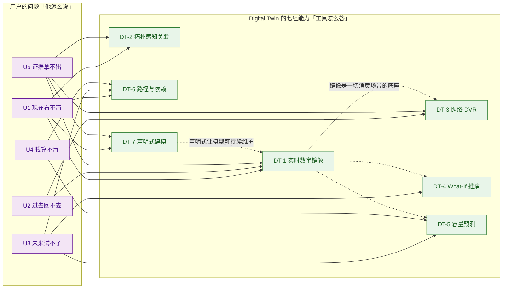

> 虚线 = 前置依赖：**先有"镜像"这个底座，DVR / What-If / 预测才成立**；**先有"声明式"，镜像才可持续维护**。

### 1.3.4 用之前 vs 用之后（同一批问题的对照）

| 用户会问 | 用之前（没有 Digital Twin） | 用之后（有 Digital Twin） | 对应功能 |
|---|---|---|---|
| 网络现在长什么样？ | 翻 Visio / 文档 / 上一代网管的静态图，且已经过期 | 实时拓扑，随遥测自动刷新 | DT-1（1.4 / 1.1 / 1.2） |
| 这条业务到底走了哪些节点？ | 登录设备导出 BGP 表，人工推演 | 全路径计算 + 控制面拓扑可视化 | DT-6（6.1 / 6.3 / 6.4） |
| 三小时前到底发生了什么？ | 只有一条曲线，加上值班人的回忆 | 时间线拖动回放，拓扑/健康/告警按层重放 | DT-3（3.1–3.3） |
| 这么改会怎样？ | 上生产试错，或自建全尺寸实验室 | 在孪生沙盘上跑 What-If 场景 | DT-4（4.1–4.8）+ DT-6（6.5） |
| 该在哪加容量？ | 官方原话："舔舔手指举到空中" | 约束感知预测 + 到位置/端口数的建议 | DT-5（5.3 / 5.4 / 5.5） |
| 这次影响了谁？ | 开会各说各话 | 单一视图 + 实时影响追踪 + 可回溯证据链 | DT-2（2.5 / 2.6） |
| 跨域问题算谁的责任？ | 各段互相推 | 路径级共同视图界定边界 | DT-6（6.1 / 6.2）+ DT-1（1.3） |
| 架构设计意图谁来保证？ | 口头与邮件传递，偏差无从发现 | 模型即代码，进 CI/CD 持续验证 | DT-7（7.1 / 7.3） |

### 1.3.5 小结：U 与 P 的关系（读后文前必看）

- **U1–U5 是工具级问题**（5 条）：客户对**整个工具**的诉求，用来判断"这个工具值不值得买"。
- **P1–P4 是功能级问题**（各章合计 28 条）：在**具体某个能力**上被感知到的损失，用来判断"这个功能做得对不对"。
- 二者是**上位归并**关系——同一条客户损失，会同时在多个功能点上被感知到，故不做一对一。

| 工具级问题 | 归并自哪些功能级痛点 |
|---|---|
| U1 现在看不清 | DT-1 P1–P3；DT-2 P1–P2；DT-6 P1–P2；DT-7 P1–P2 |
| U2 过去回不去 | DT-3 P1–P4 |
| U3 未来试不了 | DT-4 P1–P4；DT-6 P4 |
| U4 钱算不清 | DT-5 P1–P4；DT-6 P4 |
| U5 证据拿不出 | DT-1 P4；DT-2 P3–P4；DT-3 P4；DT-6 P3；DT-7 P3–P4 |

> **反向自查（对自研最有用的一条）**：如果一个"数字孪生"项目说不清"现在 / 过去 / 未来 / 成本 / 证据"这五问各自对应哪个消费场景，那它大概率会退化成**一张昂贵的拓扑图**（参见附二规律一、规律四）。**先有问法，再有功能。**

---

## 1.4 读法：7 个大功能点全景

| # | 大功能点 | 口号 | 小功能点数 | 时间跨度 | 面向谁 |
|---|---|---|---|---|---|
| **1** | 实时数字镜像（Live Digital Twin） | **镜得真** | 11 | 2024-03 ~ 2026-05 | NOC / 值班工程师 |
| **2** | 拓扑感知关联与影响追踪 | **找得准** | 6 | 2024-03 ~ 2026-09 | NOC / 排障 |
| **3** | 网络 DVR 历史回放 | **倒得回** | 5 | 2024-03 ~ 2026-05 | 排障 / 事后复盘 |
| **4** | What-If 仿真推演 | **试得先** | 8 | 2024-03 ~ 2026-05 | 网络架构师 / 变更评审 |
| **5** | 容量预测与增长规划 | **算得远** | 7 | 2024-03 ~ 2026-05 | 容量规划 / 网络规划 |
| **6** | 路径计算与依赖映射 | **串得通** | 5 | 2024-03 ~ 2026-05 | 运营商 NOC / 服务保障 |
| **7** | S2ML 声明式建模与孪生工程化 | **管得住** | 5 | 2022 ~ 2026-05 | 架构师 / 平台工程 |

> **合计 47 个小功能点。** 其中第 1 组（实时镜像）数量最多，说明**孪生的价值锚点在"镜像本身"**——What-If、DVR、预测全都是镜像的衍生消费，不是独立产品。

**边界速查（一页版）**——每组能力的"一条最要命的边界"：

| # | 大功能点 | **最要命的一条边界** | 边界性质 |
|---|---|---|---|
| 1 | 实时数字镜像 | 保真度 **= 遥测覆盖率**；**无转发面模型**，看不到设备内部行为 | 硬边界（覆盖率 + 架构） |
| 2 | 拓扑感知关联与影响追踪 | 拓扑或元数据缺项 → **退化为相关性**，不再区分因果 | 硬边界（前提依赖） |
| 3 | 网络 DVR 历史回放 | 回放深度 **= 客户保留策略**；**只读**，不做反事实推演 | 硬边界（成本 + 能力域） |
| 4 | What-If 仿真推演 | 只推演**网络结构**，不仿真**设备内部**（表项 / 协议状态机） | 硬边界（无转发面） |
| 5 | 容量预测与增长规划 | 外推本质 + **不缩短采购周期**；预测型告警**官方自认仍在演进** | 硬边界 + 官方自认局限 |
| 6 | 路径计算与依赖映射 | 无 **BGP-LS / BMP** 就算不出真实路径；只覆盖**被建模的路径** | 硬边界（数据源） |
| 7 | S2ML 声明式建模与工程化 | **官方从未公开全称与语法**（证据最弱）；**不能生成下发配置** | 证据边界 + 硬边界 |

> 每组完整边界（**硬边界 / 软边界 / 前提依赖 / 官方自认局限 / 常见误期待 / 对自研提示**六个维度）见各章 **N.5 能力边界**一节。

> **编号约定**：每个大功能点内部独立编号——**N.2 的痛点为 P1…Pn，N.3 的解法为 S1…Sn，两者数量与语义严格一一对应**，S 行内以"→ 解 Pn"显式回指。本报告不含悬空痛点或悬空解法。

**一张图看懂孪生的构造**：

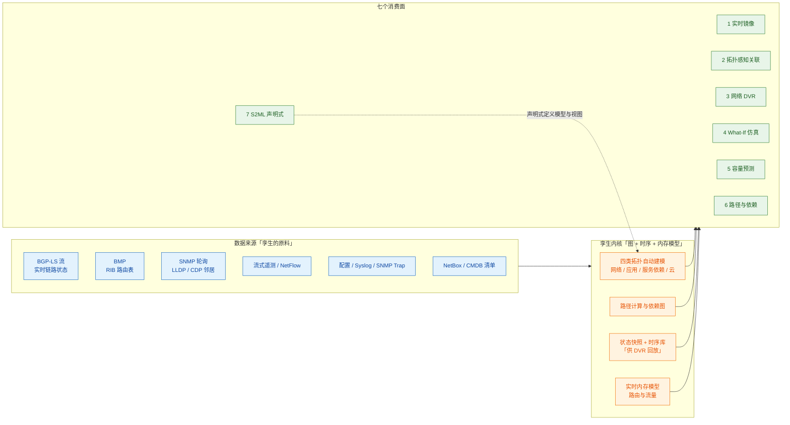

---

# 2 大功能点 1：实时数字镜像 —— 镜得真

把真实网络变成一个**持续更新、可查询、可下钻**的活模型，替代"常年不更新的静态图纸"。

## 2.1 小功能点清单

| # | 小功能点 | 发布时间 | 信源等级 | 说明 |
|---|---|---|---|---|
| 1.1 | **Digital Twin 首发** | 2024-03-13 | B（Spring 2024 Release） | "build and leverage digital representations of their network and IT infrastructure" |
| 1.2 | 原生全栈遥测作为孪生输入 | 2024-03-13 | B | 平台自行直采**配置 / 指标 / 事件 / 日志**四类遥测，孪生不再依赖厂商专有采集器 |
| 1.3 | 三层可视化模型 | 2026（官方产品页） | B | **基础设施层**（服务器/VM/数据库）、**网络层 L2/L3**（路由器/交换机/流量依赖）、**服务层**（哪些应用与用户受影响） |
| 1.4 | 实时拓扑（telemetry-aware topology） | 2024-03 ~ 2026 | A+B | 拓扑随遥测持续更新，非静态图纸 |
| 1.5 | 实时设备健康监控 | 2026（官方产品页） | B | 统一实时看板呈现设备状态趋势与异常 |
| 1.6 | 交互式下钻（告警 → 包级） | 2026（官方产品页） | B | "Move from high-level alerts to **packet-level** detail in seconds" |
| 1.7 | 路径质量可视化 | 2025-01-23 | B（[CTO 博客](https://www.selector.ai/blog/selectors-digital-twin-the-dvr-of-networking/)） | 展示路径的端到端时延、沿途丢包、队列堆积 |
| 1.8 | 控制面拓扑可视化 | 2026（客户案例） | B | 把 BGP/IGP 路由行为渲染成可视拓扑 |
| 1.9 | 拓扑视图布局锁定 | 2025-05 ~ 07 | A（v3379） | "lock the topology view settings (layout) so that it stays that way even with dashboard variables" |
| 1.10 | 增强拓扑图（显示直连路由） | 2025-07 ~ 10 | A（v3531） | "The topology map view is now enhanced to show **direct routes**." |
| 1.11 | 地图视图滚轮缩放 | 2026-03 ~ 05 | A（[Release Notes](https://docs.selector.ai/) v4032） | "The map view now supports mouse scrolling for seamless zooming in and out." |

> **补充（视图侧）**：蜂窝图（Honeycomb）新增**时间线热力图**视角（2026-03~05，v4032），用于站点/设备健康的时间维度呈现。它与孪生共用同一份健康数据，属"镜像的另一种投影"。

## 2.2 它对应的用户痛点

**P1（时间）——「图纸与现网两张皮」**
网络图纸（Visio / 文档 / 上一代网管里的静态拓扑）靠人工维护，一旦有变更就迅速过期。设计与排障时"按图索骥"，得到的往往是**过去的网络**而不是**现在的网络**。官方对比表原话把这一条写得很直白：Legacy = "Static diagrams, manually updated and **quickly stale**"。

**P2（时间 + 人）——「全貌只存在于少数人脑子里」**
跨厂商、跨层（物理 / L2 / L3 / 服务）的状态分散在多套系统里。"现在到底长什么样"要靠资深工程师凭经验拼装。**能力绑在个人身上**：人一休假、一转岗，团队就失去了唯一的"活地图"。

**P3（时间）——「从『哪个区域红了』到『哪条链路、哪个接口、哪个包』，要跳好几套工具」**
高层告警指向一个站点，但要定位到具体链路与包级证据，得分别登录设备、翻日志平台、查流分析工具，逐层切换、上下文反复丢失。

**P4（组织）——「网络、云、应用三个团队各持一张图」**
网络团队看网元的图，云团队看云资源控制台，应用团队看 APM。出事时没有人能指着**同一张图**说"就是这个"，跨团队只能靠会议对齐。

## 2.3 它是如何解决的（与痛点一一对应）

| 解法 | 机制 | 对应痛点 |
|---|---|---|
| **S1 实时驱动的持续镜像** | 用**实时低层遥测**持续重建拓扑，模型随现网变更自动刷新，图纸不再需要人工更新 | → 解 P1 |
| **S2 四类拓扑自动发现与统一建模** | 自动发现并建模 **网络拓扑**（路由/交换/防火墙互联）、**应用拓扑**（微服务与基础设施关系）、**服务依赖**（服务间调用依赖）、**云基础设施**（VM/容器/云资源连接），全部收敛进**同一个内部模型**；拓扑推导来源开放——LLDP/CDP、IGP 状态、扁平文件、隧道端点/服务级信息，官方称实现是**通用且可扩展的**，可承载物理/L2/L3 任意拓扑类型 | → 解 P2 |
| **S3 三层可视化 + 交互式下钻 + 实时健康** | 基础设施层 / 网络层（L2-L3）/ 服务层三层分别呈现；支持从高层告警一路钻到**包级细节**；统一实时看板呈现设备健康与状态趋势 | → 解 P3 |
| **S4 跨域关联与单一视图** | "One problem, one view. Across every domain."——把设备、位置、服务、应用放进**同一个上下文**，并实时追踪问题如何传播、影响面在哪里 | → 解 P4 |

## 2.4 功能原理

> 本节按**输入 → 实现链条 → 输出**三段展开（与 6.4 同构），末尾附口径声明（哪些是官方说的、哪些是本报告推的）。

### 2.4.1 输入：实时镜像吃进去什么

| 输入 | 具体内容 | 官方依据（含原文链接） | 缺了它会怎样 |
|---|---|---|---|
| **I1 · 物理/链路拓扑** | 邻居关系：LLDP / CDP，经 SNMP 轮询 | **A 级** · [System Analytics 文档](https://docs.selector.ai/docs/analytics/system-analytics-v1/)（拓扑“**基于节点与边的识别来构建**”）；轮询参数见 [SNMP Engine Integration](https://docs.selector.ai/docs/integrations/integrations-snmp)（默认 60s、`Max reps` / `Retries` / `Timeout` 均可配） | 画不出物理图，看不见“谁连着谁” |
| **I2 · 控制面拓扑** | BGP-LS 实时链路状态流（拓扑与链路属性） | **B 级** · [CTO 博客《The DVR of Networking》](https://www.selector.ai/blog/selectors-digital-twin-the-dvr-of-networking/)（2025-01-23，作者 Nitin Kumar / CTO） | 只有物理图，没有“控制面认为的拓扑” |
| **I3 · 路由可达性** | BMP 提供的各邻居 **RIB（路由表）** | **B 级** · 同上 CTO 博客（原文 *“the paths are learnt by a variety of mechanisms such as real time BGP LS streams, RIBs via BMP, and LLDP polling via SNMP”*） | 知道路由表内容，但不知“流量实际会怎么走” |
| **I4 · 状态遥测** | 指标（接口利用率、错误/丢弃、CPU/内存、BGP 前缀数）+ 事件 + 日志 + 配置（SSH 或第三方 Git 集成） | **A 级** · [System Analytics 文档](https://docs.selector.ai/docs/analytics/system-analytics-v1/)；采集覆盖面（含 BGP-MIB、MIB-2 与厂商私有 OID 清单）见 [SNMP MIB OID Description](https://docs.selector.ai/docs/integrations/mib-oid-description) | 图是空壳，没有“现在健不健康” |
| **I5 · 服务与隧道端点** | 服务层拓扑的表达方式（隧道端点、服务级信息） | **A 级** · [End-User Features / Overview 文档](https://docs.selector.ai/docs/getting-started/overview-selector-v1/) | 云侧 / 隧道侧的服务拓扑缺失 |

### 2.4.2 实现链条：从五路数据到一张"活图"

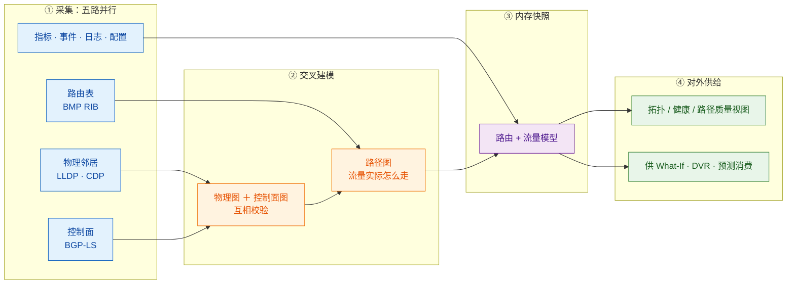

| 步骤 | 做什么 | 关键输入 | 输出 |
|---|---|---|---|
| **① 采集** | 五路数据并行进来 | I1 – I5 | 五路原始数据流 |
| **② 交叉校验** | 三路拓扑互校：**LLDP 给"物理上谁连着谁"、BGP-LS 给"控制面认为拓扑是什么样"、BMP 给"路由实际怎么选"** | I1 / I2 / I3 | 物理图 + 控制面图 + **路径图** |
| **③ 状态绑定** | 把指标/事件/日志**绑定到拓扑对象**（哪台设备、哪个口、哪条链路） | I4 + 拓扑 | 带状态的"活图"——指标不再是孤立曲线 |
| **④ 内存快照** | 把“路由 + 流量”读进内存，形成当前状态快照 | 路径图 + 流量 | [`in-memory model of routing and traffic`](https://www.networkworld.com/article/3537193/selector-ai-debuts-network-language-model-for-netops.html) |
| **⑤ 对外供给** | 输出视图，并把快照作为其他能力的底座 | 活图 + 快照 | 视图 + 三个消费方 |

### 2.4.3 输出：交付什么形态的结果

| 输出物 | 形态 | 消费方 | 对应小功能点 |
|---|---|---|---|
| 实时拓扑 | 三层可视化模型（物理 / L2 / L3） | NOC 值班 | 1.3 / 1.4 |
| 实时设备健康 | 健康度 + 违规项 | NOC | 1.5 |
| 交互式下钻 | 从告警一路点到包级 | 排障 | 1.6 |
| 路径质量视图 | 端到端时延 / 沿途丢包 / 队列堆积 | 排障 / 架构 | 1.7 |
| 控制面拓扑视图 | BGP 会话级视图 | 运营商 NOC | 1.8 |
| **内存模型（路由 + 流量快照）** | **不是 UI 产物，而是内部接口** | What-If（DT-4）/ DVR（DT-3）/ 容量预测（DT-5） | —（孪生底座本身） |

> **注意最后一行**：实时镜像**最重要的输出不是那张图，而是那个内存模型**。图是给人看的；内存模型是给其余六个能力用的——这正是"孪生是底座、不是功能"在实现层的体现（见附二规律一）。

### 2.4.4 关键机制：为什么是"内存模型"而不是"仿真引擎"

[Network World（**C 级**，2024-09-23）](https://www.networkworld.com/article/3537193/selector-ai-debuts-network-language-model-for-netops.html) 引述产品副总裁 Kevin Kamel 的原话：Selector 用**实时低层遥测**对网络建模，构建**内存中的路由与流量模型（in-memory model of what routing and traffic looks like across the entire network）**。

这个表述很关键——它说明孪生的内核是**"把现网的真实路由与流量状态读进内存"**，而不是**"跑一个转发仿真来生成状态"**。这决定了：
- ✅ 孪生**与现网零漂移**（因为它就是现网状态的投影）；
- ❌ 孪生**不能推演配置下发的设备内部后果**（它没有转发面模型）。

**关系底座：图 + 时序 + 内存模型三件套**

| 组件 | 承载什么 | 主要服务于 |
|---|---|---|
| **图结构** | 拓扑与依赖关系（[官方 Network Observability 页](https://www.selector.ai/network-observability-2) 在 2026 年材料中直接称其为**知识图谱**："Knowledge graph analysis that computes correlation graphs and clusters incidents"） | 关联与定因（DT-2） |
| **时序库** | 指标、事件、告警随时间的历史序列 | DVR 回放（DT-3）、容量预测（DT-5） |
| **内存模型** | 路由与流量的当前快照 | What-If 推演（DT-4） |

### 2.4.5 拓扑建模的通用性

官方文档（**A 级** · [End-User Features / Overview 文档](https://docs.selector.ai/docs/getting-started/overview-selector-v1/)）明确：拓扑可通过多种方式推导（LLDP/CDP、IGP 状态，甚至直接读扁平文件），服务层拓扑可借助**隧道端点或服务级信息**表达；**实现是通用的，可容纳并扩展到任意拓扑类型（物理、L2、L3）**。这意味着孪生的"骨架"是**可插拔**的，不是为某种协议定制的。

### 2.4.6 口径声明

| 内容 | 等级 | 说明 |
|---|---|---|
| 拓扑由 LLDP/CDP 经 SNMP 构建为“节点与边”、**指标可叠加到拓扑上** | **A** | [System Analytics 原文](https://docs.selector.ai/docs/analytics/system-analytics-v1/) |
| 服务层拓扑借隧道端点/服务级信息表达，可扩展到任意拓扑类型 | **A** | [End-User Features / Overview 原文](https://docs.selector.ai/docs/getting-started/overview-selector-v1/) |
| 三路路径学习机制（BGP-LS / BMP / LLDP） | **B** | [CTO 博客原文](https://www.selector.ai/blog/selectors-digital-twin-the-dvr-of-networking/)（2025-01-23） |
| “内存中的路由与流量模型”、区别于仿真引擎 | **C** | [Network World 引述产品副总裁原话](https://www.networkworld.com/article/3537193/selector-ai-debuts-network-language-model-for-netops.html)（2024-09-23） |
| **"状态遥测绑定到拓扑对象"这一步的工程实现** | **C（本报告推导）** | 由"指标可叠加到拓扑"（A）与"路径由多路学习"（B）反推；官方未逐字描述绑定过程 |

## 2.5 能力边界（这个功能点做不到什么）

> **一句话边界**：这是一个**事实模型**，不是仿真器，也不是渲染层——它的真度**完全等于遥测覆盖率**。

| 类型 | 具体边界 | 依据（信源等级） | 对自研 APM 的提示 |
|---|---|---|---|
| **硬边界 · 覆盖率** | 孪生保真度**完全等于遥测覆盖率**。未纳管、未采到 LLDP/BGP 的"影子链路"不会出现在图上，并**直接污染下游的影响面分析**（错误的影响面比没有影响面更危险） | 由"路径三路采集"机制推导（B） | 自研"实时拓扑"的验收项应是**采集覆盖率**而非图表美观度——先采全，再画好 |
| **硬边界 · 无转发面模型** | 镜像的是**路由与流量状态**，不是设备内部行为。**表项、ACL 命中计数、协议状态机、芯片 drop reason 均不在模型内** | 官方"in-memory model of routing and traffic"（C，Network World 引产品副总裁原话） | 若自研目标包含"表项是否写对"，必须直接读设备内部（原厂 L1 能力）；第三方镜像路线结构上做不到 |
| **软边界 · 未披露规模与刷新时延** | 官方**未披露**拓扑刷新时延、单实例可纳管设备/链路数上限，无法回答"万级设备时模型是否退化" | 官方材料无此项（—） | 自研应在 POC 阶段自测**性能拐点**，把它作为容量规划输入而非宣传指标 |
| **软边界 · 视图稳定性（已修）** | 拓扑视图布局会被仪表盘变量打乱，**v3379（2025-05~07）才补上布局锁定开关**——视图稳定性曾是真实缺陷 | A（[Release Notes](https://docs.selector.ai/) v3379） | "手感问题"会被用户当成"能力问题"（见附二规律五）；视图稳定性必须纳入自研验收清单 |
| **前提依赖 · 设备侧开放** | 需要设备开放 **BGP-LS / BMP / LLDP-MIB**；不具备这些能力的网络只能退化为部分视图 | 机制推导（B） | 锐捷自有设备可优先补齐这三类开放能力，构成对第三方的**数据侧优势** |
| **前提依赖 · 元数据** | "拓扑可用"还依赖"标签可用"——设备角色/位置/环境需可解析（NER + CMDB 文本解析） | A（[AI & ML Models 文档](https://docs.selector.ai/docs/ai-ml/ai-ml-models/)） | 自研需把**元数据质量**列为一等公民，与采集并列建设 |
| **常见误期待（澄清）** | 用户易把"数字孪生"理解成 **3D 可视化 / 全物理仿真**。Selector 的孪生是**拓扑 + 遥测的事实模型**，既不是渲染层，也不是物理仿真器 | 全篇口径（A+B） | 对外沟通须先定义"孪生 = 事实模型"，避免被错位预期拖入 3D 渲染的无底洞 |

---

# 3 大功能点 2：拓扑感知关联与影响追踪 —— 找得准

孪生不只是"给人看的图"，更是**喂给关联与根因引擎的关系底座**。这是 Digital Twin 最容易被忽视、也最有价值的一面。

## 3.1 小功能点清单

| # | 小功能点 | 发布时间 | 信源等级 | 说明 |
|---|---|---|---|---|
| 2.1 | 拓扑感知关联（Topology Awareness） | 2024-03-13 | B（[Spring 2024 发布报道](https://www.apmdigest.com/selector-announces-spring-2024-release)） | 与因果 RCA 同期确立，作为"从相关到因果"的关键支撑 |
| 2.2 | 四类拓扑纳入关联上下文 | 2024 ~ 2026 | A（[AI & ML Models 文档](https://docs.selector.ai/docs/ai-ml/ai-ml-models/)） | 网络/应用/服务依赖/云基础设施全部进入关联上下文 |
| 2.3 | **聚焦相关数据（Focusing on Relevant Data）** | 2026 | A | 只分析与受影响组件**真正相关**的数据，而非全量扫描 |
| 2.4 | **追踪故障路径（Tracing the Path of Failure）** | 2026 | A | 沿依赖链从用户侧应用错误向下追到根因网络问题 |
| 2.5 | 跨域关联与实时影响追踪 | 2026（产品页） | B | "Instantly see how issues propagate and pinpoint impact" |
| 2.6 | 与 Loom Agent 联动（重建时间线与影响面） | 2026-09-22 | B（[官方 Newsroom](https://www.selector.ai/newsroom/)） | 孪生成为 Agent 的上下文来源，Agent 只消费"已完成关联的上下文" |

## 3.2 它对应的用户痛点

**P1（时间）——「告警风暴里不知道从哪看起」**
一次链路抖动在下游炸出数百条告警，来自不同层级、不同工具。值班工程师的第一分钟不是"修"，而是"决定先看哪一条"。

**P2（时间）——「症状与病因反了」**
上游故障在下游生成大量**看起来更像原因**的告警。人凭直觉从最先看到的告警查起，方向常常是错的，排查时间成倍拉长。

**P3（组织）——「影响面说不清」**
被问"这次影响了哪些站点、哪些客户、哪些服务"时，答不上来。对外客户沟通、对内跨团队定责都缺依据。

**P4（合规 + 组织）——「没有共享证据链」**
跨团队排障各说各话；事后复盘、SLA 争议、客户申诉时，拿不出"当时的依赖关系与传播路径"作为共同证据。

## 3.3 它是如何解决的（与痛点一一对应）

| 解法 | 机制 | 对应痛点 |
|---|---|---|
| **S1 拓扑感知过滤** | 关联引擎不再扫描全网每一条告警，而是**先用拓扑判断哪些组件相关**——某应用出问题时，只优先分析该应用**真正依赖**的服务器与网段；官方称这"大幅降低噪声与误报" | → 解 P1 |
| **S2 沿依赖路径追踪故障传播** | 从"用户侧应用报错"出发，沿依赖链下钻到具体微服务、再下钻到根因网络问题；官方称之为 **service-aware correlation**，明确优于"只找同时发生的异常" | → 解 P2 |
| **S3 影响面计算与实时传播追踪** | 实时呈现问题如何沿拓扑传播、影响面落在哪；在 Foundry 中由 **Loom Agent** 专职：收敛告警风暴、分离因果性故障与下游症状、重建时间线与影响面 | → 解 P3 |
| **S4 可回溯的证据链** | 每条结论都能指回拓扑关系与遥测证据；Agent 的输出包含"建议动作 + 支撑证据"，且推理过程、调用的 Agent、每次工具调用及参数均可查看 | → 解 P4 |

## 3.4 功能原理

> 本节按**输入 → 实现链条 → 输出**三段展开（与 6.4 同构），末尾附口径声明。

### 3.4.1 输入：关联引擎吃进去什么

| 输入 | 具体内容 | 官方依据 | 缺了它会怎样 |
|---|---|---|---|
| **I1 · 拓扑与依赖图** | 网络拓扑（谁连着谁）+ 应用/服务依赖（谁依赖谁）+ 云资源关系 | **A 级** [`AI & ML Models`](https://docs.selector.ai/docs/ai-ml/ai-ml-models/)：Selector 自动发现并构建"网络拓扑 / 应用拓扑 / 服务依赖 / 云基础设施"四类模型，并称其为环境的 **digital twin**、持续更新 | 退化为纯**时间相关性**，因果无从谈起 |
| **I2 · 待关联的信号** | 全量告警、事件、指标（含由日志经 ML 转出的事件） | **A 级** · [`AI & ML Models`](https://docs.selector.ai/docs/ai-ml/ai-ml-models/)（各类关联模型清单） | 无原料 |
| **I3 · 对象元数据（标签）** | 设备角色 / 位置 / 环境等结构化标签——由 **NER + CMDB 文本解析**把 `cr01.sjc02.prod.net.com` 拆成 `core-router` / `san-jose-02` / `production` | **A 级** · [`AI & ML Models`](https://docs.selector.ai/docs/ai-ml/ai-ml-models/)（Advanced Log Mining → NER 段） | 抽不出"同站点、同角色"这类语义簇，关联准确率下降 |
| **I4 · 历史事件共现数据** | 供关联规则挖掘使用的 if-then 知识 | **A 级** · [`AI & ML Models`](https://docs.selector.ai/docs/ai-ml/ai-ml-models/)（Causations → Associative rule mining 段） | 失去拓扑之外的第二条判断路径 |

### 3.4.2 实现链条：六步把"N 条告警"收敛成"一个根因"

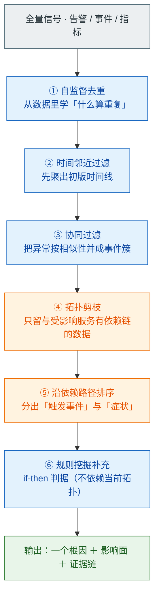

| 步骤 | 做什么 | 关键输入 | 输出 |
|---|---|---|---|
| **① 自监督去重** | 从数据本身学"什么算重复"，把冗余/相似告警归组 | 全量告警 | 去重后的集合 |
| **② 时间邻近过滤** | 按"同时发生往往相关"，聚出初版时间线 | 去重结果 | 初版事件时间线 |
| **③ 协同过滤** | 用推荐系统的思路，把异常事件按**相似性**关联成事件簇 | 事件 + 历史 | 事件簇 |
| **④ 拓扑剪枝** | **只保留与受影响服务存在依赖链路的数据**——降噪的主刀。不做这一步，就仍停留在"一起发生" | 事件簇 + 依赖图 | 相关范围（数量级下降）；依据：[`AI & ML Models` 原文](https://docs.selector.ai/docs/ai-ml/ai-ml-models/) |
| **⑤ 沿依赖路径排序** | 在依赖图上判断"谁在上游触发、谁在下游受害" | 相关范围 + 依赖图 | 根因候选（带优先级） |
| **⑥ 规则挖掘补充** | 从历史共现挖 if-then 规则，补齐拓扑之外的判据 | 历史事件库 | if-then 判据 |

### 3.4.3 输出：交付什么形态的结果

| 输出物 | 形态 | 消费方 |
|---|---|---|
| **根因候选** | 按"沿依赖链上游"排序的列表 | NOC / 排障 |
| **影响面** | 受影响服务 / 站点清单 | 跨团队共享 |
| **事件簇** | 把 N 条告警收敛成"一个事故" | NOC / 工单系统 |
| **证据链** | 相关信号 + 拓扑路径，可追溯到具体链路 | 事后复盘 / 合规 |
| **if-then 规则** | 沉淀为知识资产 | 后续预测与预防 |

> **输出的关键差异**：普通 AIOps 的输出是"一堆可疑事件"，需要人再判断因果；这里的输出是"**一个根因 + 影响面 + 证据链**"——**因果已经被分出来了**。而这个差别只来自第 ④⑤ 步，它们依赖的正是 I1（拓扑与依赖图）。

### 3.4.4 关键机制：为什么"有拓扑"就能从相关升级为因果

**降噪的本质是拓扑约束的剪枝**

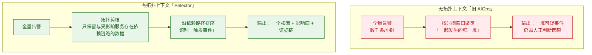

**核心差别**：相关（correlation）是"时间上一起发生"，因果（causation）是"**沿依赖链在上游**"。**没有拓扑，就只能做前者**。这就是为什么 Selector 把孪生和 RCA 放在同一层能力栈里——**孪生是因果推理的前提条件，不是它的装饰**。

### 3.4.5 补充武器：关联规则挖掘（不依赖当前拓扑）

官方文档（**A 级** · [`AI & ML Models`](https://docs.selector.ai/docs/ai-ml/ai-ml-models/)）披露还有**关联规则挖掘（Associative rule mining）**：从历史事件数据中挖掘强"如果—那么"规则，例如"若服务 A 出现高时延，则数据库 B 有 90% 概率出现 CPU 尖峰"。这类规则**不依赖当前拓扑，而依赖历史共现**，是拓扑之外的补充路径。

### 3.4.6 口径声明

| 内容 | 等级 | 说明 |
|---|---|---|
| 关联引擎由多模型叠加（去重 → 时间邻近 → 协同过滤 → 拓扑感知 → 规则挖掘） | **A** | [`AI & ML Models` 原文](https://docs.selector.ai/docs/ai-ml/ai-ml-models/)（Correlations 段） |
| 拓扑剪枝（上表第 ④ 步）：**只分析与受影响服务存在依赖关系的服务器与网段** | **A** | [`AI & ML Models` 原文](https://docs.selector.ai/docs/ai-ml/ai-ml-models/)：*"the correlation engine prioritizes data from the servers, and network segments that the application actually depends on. This drastically reduces noise and false positives."* |
| NER + CMDB 文本解析产出结构化标签，并作为关联引擎输入 | **A** | [`AI & ML Models` 原文](https://docs.selector.ai/docs/ai-ml/ai-ml-models/) |
| 关联规则挖掘（if-then）不依赖当前拓扑、依赖历史共现 | **A** | [`AI & ML Models` 原文](https://docs.selector.ai/docs/ai-ml/ai-ml-models/)（示例：服务 A 高时延 → 数据库 B 有 90% 概率 CPU 尖峰） |
| **"降噪量主要来自第 ④ 步拓扑剪枝"的归因与权重** | **C（本报告推导）** | 官方只说明"大幅降低噪声与误报"，**未披露拓扑剪枝对降噪的贡献权重**——属产品内部参数，外部无法验证 |

## 3.5 能力边界（这个功能点做不到什么）

> **一句话边界**：它把"相关"提升为"因果"的**前提是拓扑与元数据都完整**；两者缺任何一项，它就会退化成普通的"同时发生"聚类。

| 类型 | 具体边界 | 依据（信源等级） | 对自研 APM 的提示 |
|---|---|---|---|
| **硬边界 · 无拓扑即退化为相关性** | 因果判断**强依赖拓扑与元数据的完整性**。拓扑缺项或元数据（设备角色、位置、环境标签）缺失时，**自动退化为相关性判断**——"同时发生"被当成"因果" | A（[AI & ML Models 文档](https://docs.selector.ai/docs/ai-ml/ai-ml-models/)） | 自研需在 UI 上**显式标注置信度来源**（是否走了拓扑路径），不要把"相关性结论"包装成"根因" |
| **硬边界 · 只能沿已知依赖追踪** | 追踪范围 = **被建模的依赖关系**。隐式依赖（人工静态路由、动态 DNS、影子 API 调用、跨团队口头约定）不在图上则追不到，链路在此断裂 | 由"依赖映射"机制推导（B） | 自研要预留"人工补录依赖"的入口，否则真实环境里的灰色依赖会长期是盲区 |
| **硬边界 · 不做自动修复** | 输出是"**根因排序 + 影响面 + 证据**"，不是"已修复"。所有处置动作仍需人或下游自动化执行 | 官方 S4 表述（B） | 自研若规划"闭环自愈"，须单独建执行层与回滚机制，不能指望关联引擎自己收口 |
| **软边界 · 权重黑盒** | 官方**未说明拓扑在多大程度上影响排序权重**。这属于产品内部参数，外部**无法验证"拓扑究竟贡献了多少降噪"** | 官方材料无此项（—） | 自研可把"拓扑贡献度"做成可调参数 + 可解释输出，反而成为差异化卖点 |
| **软边界 · 冷启动稀疏** | 关联规则挖掘**依赖历史共现**，新系统/新业务上线初期规则稀疏，效果显著弱于稳态期 | A（[AI & ML Models 文档](https://docs.selector.ai/docs/ai-ml/ai-ml-models/)，规则挖掘机制推导） | 自研应设计**冷启动降级路径**（拓扑优先），避免上线首月口碑坍塌 |
| **前提依赖 · 一整条数据质量链** | "拓扑可用"依赖"标签可用"：官方专门用 **NER + CMDB 文本解析** 把 `cr01.sjc02.prod.net.com` 拆成"核心路由器 / 圣何塞 02 机房 / 生产环境"——**采集 → 归一化 → 富化 → 标签，任一环断裂则关联质量下降** | A（[AI & ML Models 文档](https://docs.selector.ai/docs/ai-ml/ai-ml-models/)） | 把"拓扑可用"与"标签可用"列为**两个独立验收项**，不要合并成一个"拓扑做好了" |
| **常见误期待（澄清）** | 用户常以为它能给出**唯一的、确定性的根因**。实际输出是**带证据的排序假设**，仍需人复核；也不等于"AI 自动运维" | 官方 S4 表述（B） | 对外措辞宜用"候选根因 + 证据链"，而非"AI 找到根因" |

---

# 4 大功能点 3：网络 DVR 历史回放 —— 倒得回

把网络当成一台可录可回放的 DVR：**录下每一个状态，随时倒带回案发现场**。

## 4.1 小功能点清单

| # | 小功能点 | 发布时间 | 信源等级 | 说明 |
|---|---|---|---|---|
| 3.1 | **Network DVR 录像能力** | 2024-03-13 | B（[Spring 2024 发布报道](https://www.apmdigest.com/selector-announces-spring-2024-release)） | 按平台保留策略记录全部历史数据，用于回放过去事件、诊断根因 |
| 3.2 | **交互式时间线视图** | 2026（产品页） | B | "Scrub through historical data with a **live, topology-aware timeline**" |
| 3.3 | **跨层回放** | 2026（产品页） | B | 按序重放设备健康、告警与遥测（Playback across layers） |
| 3.4 | **事件学习引擎（Incident Learning Engine）** | 2026（产品页） | B | 基于时间线做 RCA，诊断成因并防止复发 |
| 3.5 | 历史回放用于事件取证与服务影响分析 | 2026（客户案例） | B | "Historical replay for investigation" 作为客户五项核心能力之一 |

## 4.2 它对应的用户痛点

**P1（时间）——「间歇性故障抓不到」**
慢性问题、偶发抖动一旦现场消失就无法复现，只能"等它下次再出现"。传统监控只保留曲线，抓不住当时的状态组合。

**P2（时间）——「故障是慢慢累积的，没人知道从哪一刻开始变」**
CTO 博客给了一个精准的例子：**轻微拓扑变更 → 路径跳数增加 → 时延上升**。整个过程没有任何一条阈值告警被触发，因为每一步的绝对值都在"正常范围"内。人工盯曲线，很难回溯到"哪一刻开始变的、为什么变"。

**P3（人）——「复盘质量取决于谁值班」**
事后取证靠当事人回忆 + 手工拼时间线。当事人记错、漏记，复盘结论就失真；换一个人值班，复盘质量完全不同。

**P4（合规 + 组织）——「拿不出『当时网络长什么样』的证据」**
SLA 争议、客户投诉、监管举证时，"当时的曲线"不足以说明问题——需要的是**当时的拓扑、当时的健康状态、当时的事件序列**的完整快照。

## 4.3 它是如何解决的（与痛点一一对应）

| 解法 | 机制 | 对应痛点 |
|---|---|---|
| **S1 全量录制 + 按保留策略回放** | 平台按配置的保留策略记录历史数据，支持"播放过去事件"来诊断根因；官方对比表原话：Legacy = "**Limited retention or no replay capability**"，Selector = "Network DVR with historical replay of **states, alerts, and topology**" | → 解 P1 |
| **S2 ML 检测 + 定点倒带 + 配置变更高亮** | CTO 博客给出的完整链路：**ML 检测到时延上升 → 倒带到拓扑发生变化的那一刻 → 高亮那条"误增链路 cost、导致路径变化"的配置变更** | → 解 P2 |
| **S3 交互式拓扑感知时间线与跨层重放** | 用时间线**拖动（scrub）**历史数据，时间线**自带拓扑感知**；设备健康、告警、遥测**按层依序重放**；事件学习引擎基于时间线做 RCA | → 解 P3 |
| **S4 状态级（非仅曲线级）可复现** | 回放对象是**状态**（states）而非仅数值曲线——含拓扑快照、告警、遥测，构成"当时网络什么样"的完整证据 | → 解 P4 |

## 4.4 功能原理

> 本节按**输入 → 实现链条 → 输出**三段展开（与 6.4 同构），末尾附口径声明。

### 4.4.1 输入：DVR 吃进去什么

| 输入 | 具体内容 | 官方依据 | 缺了它会怎样 |
|---|---|---|---|
| **I1 · 指标时序** | 时延、丢包、队列堆积等随时间变化的序列 | **B 级** [CTO 博客](https://www.selector.ai/blog/selectors-digital-twin-the-dvr-of-networking/)（孪生“learns from the past”，路径质量见该文 Real Time view 段） | 无从发现“缓慢上升”这类慢性问题 |
| **I2 · 拓扑状态快照** | **拓扑本身也要按时间存**——回放对象是 `states, alerts, and topology`，不只是数值 | **B 级** · [CTO 博客](https://www.selector.ai/blog/selectors-digital-twin-the-dvr-of-networking/)（回放对象口径） | 只能回放曲线，回放不出"当时网络长什么样" |
| **I3 · 事件 / 告警 / 变更记录** | 事件、告警，以及**配置变更记录**（须与拓扑变化对齐到同一时间轴） | **B 级** · [CTO 博客](https://www.selector.ai/blog/selectors-digital-twin-the-dvr-of-networking/) | 倒带到案发时刻，也看不出"是谁改了什么" |
| **I4 · 保留策略（retention）** | 客户配置的保留窗口——**决定回放深度** | **A 级** · [官方 Privacy Policy](https://selector.ai/privacy/)（保留期 15 天 ~ 1 年，随客户要求） | 无从定义"能倒多远" |

### 4.4.2 实现链条：录制 → 触发 → 倒带 → 学习

**四段闭环**：

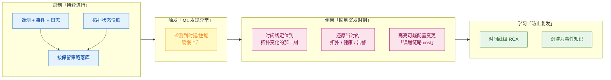

| 阶段 | 做什么 | 关键输入 | 输出 |
|---|---|---|---|
| **① 录制（持续进行）** | 遥测 / 事件 / 日志 + **拓扑状态快照**，按保留策略落库 | I1 – I4 | 可回放的历史 |
| **② 触发（ML 发现异常）** | 检测时延 / 性能**缓慢上升**——这类慢性问题通常不越限、不告警（例：拓扑微调使跳数增加、时延随之抬升） | I1 | 异常标记 + 时间点 |
| **③ 倒带（回到案发时刻）** | 定位到**拓扑变化的那一刻**；还原当时的拓扑 / 健康 / 告警；高亮可疑配置变更 | 异常点 + 拓扑版本 + 变更记录 | 状态级现场 + 可疑变更 |
| **④ 学习（防止复发）** | 时间线级 RCA，沉淀为事件知识 | 还原现场 | 根因 + 知识资产 |

### 4.4.3 输出：交付什么形态的结果

| 输出物 | 形态 | 消费方 |
|---|---|---|
| **状态级历史现场** | 当时的拓扑 + 健康 + 告警组合（**不是**一条数值曲线） | 排障 / 复盘 |
| **时间线级 RCA 结论** | 根因 + 可疑配置变更，可一键回到案发时刻 | 排障 |
| **取证材料** | "当时网络是什么样"的可留档证据 | SLA 争议 / 合规审计 |
| **事件知识** | 沉淀为知识资产，供规则挖掘与预测 | 后续能力 |

> **一句话记住 DVR 的输出**：不是"某指标当时是多少"，而是"**当时网络是什么样、谁改了什么**"。

### 4.4.4 三个技术要点（也是最容易低估的工程成本）

1. **"状态"而非"曲线"是 DVR 的关键差异**。曲线只能告诉你"某指标当时是多少"，DVR 要告诉你"**当时拓扑是什么、谁连着谁、告警队列长什么样**"。这要求拓扑本身也被**版本化存储**——这是普通时序库做不到的。
2. **"倒带"由 ML 触发，而非人工翻找**。检索入口不是"我想看 3 天前 14:00"，而是"系统发现时延在涨，自动带你回到变化那一刻"。这把"回溯"从一个**高技能搜索任务**变成了一个**自动化动作**。
3. **回放与"配置变更"对齐**。高亮配置变更意味着孪生的变更记录与拓扑变化**可对齐到同一时间轴**——这是"配置即事实来源"的设计取向，与 L2 层（设备真相源）产品的思路一致。

### 4.4.5 口径声明

| 内容 | 等级 | 说明 |
|---|---|---|
| 回放对象是 `states, alerts, and topology`（不只是数值曲线） | **B** | [CTO 博客](https://www.selector.ai/blog/selectors-digital-twin-the-dvr-of-networking/) + [Network Observability 页](https://www.selector.ai/network-observability-2)（Network DVR 条目） |
| 完整因果链：ML 检测时延上升 → 自动倒带到拓扑变化时刻 → 高亮"误增链路 cost"的配置变更 | **B** | [CTO 博客原文](https://www.selector.ai/blog/selectors-digital-twin-the-dvr-of-networking/)（Network DVR 段） |
| 保留策略决定回放深度 | **A** | [官方 Privacy Policy](https://selector.ai/privacy/)（保留期 15 天 ~ 1 年）；另见 [End-User Features 文档](https://docs.selector.ai/docs/getting-started/overview-selector-v1/)（On-Prem 存储与保留按客户要求） |
| **"拓扑必须版本化存储"这一工程要求** | **C（本报告推导）** | 由"回放对象含 topology"（B）反推——即普通时序库装不下它 |
| 回放的时间精度与数据量上限 | —（未披露） | 官方无公开口径，见 4.5 边界与附四 |

## 4.5 能力边界（这个功能点做不到什么）

> **一句话边界**：DVR 是**只读**能力，回放深度由**客户配置的保留策略**封顶——它能证明"当时发生了什么"，但不能回答"当时若改了会怎样"。

| 类型 | 具体边界 | 依据（信源等级） | 对自研 APM 的提示 |
|---|---|---|---|
| **硬边界 · 保留策略封顶** | 回放深度 **= 客户配置的保留窗口**，窗口外的历史**不可回放**。这是成本与能力的直接交换，不是技术缺陷 | 官方"按保留策略记录历史数据"（B） | 自研需把**保留策略做成可分级配置**（热/温/冷），并明确告知用户"可回放深度 = 你付的存储" |
| **硬边界 · 只读，不反事实** | DVR 证明"当时发生了什么"，**不提供"当时如果我改了会怎样"**——后者属 What-If（DT-4）。两者不可互相替代 | 能力域划分（B） | 自研产品叙事里应把"回放"与"推演"分成两个能力项，避免被用户当成同一个功能 |
| **硬边界 · 只能回放"被存下来的维度"** | 回放对象是**已采集并已落库的状态**（拓扑快照 / 告警 / 遥测）。未建模、未采集的维度（如未在采集清单里的协议事件）**无法事后补录** | 由"状态级回放"机制推导（B） | 采集清单的**前瞻性**直接决定未来能复盘什么；自研应按"未来可能被追问的维度"设计采集 |
| **软边界 · 精度与规模未披露** | 官方**未披露**回放时间精度（秒级还是分钟级）与数据量上限，无法判断在超大网络上是否仍能"拖动流畅" | 官方材料无此项（—） | 自研宜提前定义"**可拖动的时间粒度**"指标（如 1 分钟粒度 / 30 天窗口），作为可承诺的量化卖点 |
| **软边界 · 存储成本随变更频率增长** | 拓扑需**版本化存储**，存储增量正比于**拓扑变更频率**而非时间长度。高频变更网络（如大规模 SDN）成本曲线更陡 | 由"拓扑版本化"要求推导（B） | 自研须设计**变更去重 / 快照增量**策略，否则成本会随客户网络规模非线性上升 |
| **前提依赖 · 拓扑版本化** | "状态级回放"要求拓扑本身可**版本化存取**——**普通时序库做不到**，必须额外建拓扑快照存储 | 由 S4 机制推导（B） | 这是自研最容易低估的一项工程成本：VictoriaMetrics/Loki 存不了"当时的拓扑图"，需另建图快照 |
| **常见误期待（澄清）** | 用户易把 DVR 理解为"**屏幕录像**式全量录像"。实际是**结构化状态重放**——拓扑 / 健康 / 告警**按层重建**，而非像素级回放 | 官方 S3 表述："回放 states, alerts, and topology"（B） | 对外用"**状态重放**"而非"录屏"来描述，可显著拉高用户预期准确度 |

---

# 5 大功能点 4：What-If 仿真推演 —— 试得先

在孪生上做"假设题"：**把变更、故障、过载先跑一遍，再决定上不上生产**。

## 5.1 小功能点清单

| # | 小功能点 | 发布时间 | 信源等级 | 说明 |
|---|---|---|---|---|
| 4.1 | **What-If 分析首发** | 2024-03-13 | B（[Spring 2024 发布报道](https://www.apmdigest.com/selector-announces-spring-2024-release)） | 模拟网络故障与路由变更，评估对 SLA 的影响 |
| 4.2 | 数字孪生增强（What-If 场景化） | 2024-09-23 | B（[NLM 新闻稿](https://www.selector.ai/newsroom/selector-ai-unveils-industry-first-network-language-model-to-transform-root-cause-analysis-and-accelerate-ai-adoption/)） | "predict network behavior through 'What-If' scenarios"；"anticipate failures **before they happen**" |
| 4.3 | **韧性压力测试** | 2025-01-23 | B（[CTO 博客](https://www.selector.ai/blog/selectors-digital-twin-the-dvr-of-networking/)） | 针对**链路/光路故障、设备故障、DDoS 过载流量**做压力测试 |
| 4.4 | 站点黑障识别 | 2025-01-23 | B | "identify the sites that are prone to blackouts by simulating link/node failures" |
| 4.5 | 逐客户仿真视角 | 2025-05（博客） | B | 为**每个客户**建虚拟仿真，观察若其超出路由上限或 SLA 阈值，控制面会如何响应 |
| 4.6 | 变更前影响建模 | 2026（产品页） | B | "Model the impact of network or infrastructure changes **before rollout**" |
| 4.7 | DR 与韧性计划测试 | 2026（产品页） | B | "Plan and test disaster recovery (DR) and infrastructure resilience" |
| 4.8 | 跨控制面与数据面的 What-If | 2026（客户案例） | B | "Enable what-if analysis **across control and data planes**" |

## 5.2 它对应的用户痛点

**P1（钱）——「一次变更的爆炸半径可能是几千用户」**
一条错误的路由、一条错配的防火墙规则，影响面可达数千用户。变更失败直接对应**营收损失 + SLA 罚金**，但变更前没有任何手段能预判。

**P2（钱 + 时间）——「买不起这么大一间实验室」**
SDxCentral（C 级，2024-03）点得很透："**考虑到网络设备的成本与变更节奏，很少有公司能建一套全尺寸实验室来做上线前试验**"。于是唯一的"验证"手段就是上生产试——回滚代价高、窗口紧张。

**P3（时间）——「演练只能靠纸面」**
容灾切换、故障演练只能开会推演。真出事时才发现预案有盲区：某条备用路径其实扛不住、某个单点没被覆盖。

**P4（人）——「风险判断绑在个别资深工程师身上」**
变更评审的质量取决于"最有经验的那个人当时在不在"。经验无法沉淀、无法复用、无法交接。

## 5.3 它是如何解决的（与痛点一一对应）

| 解法 | 机制 | 对应痛点 |
|---|---|---|
| **S1 变更前影响建模（Pre-rollout impact modeling）** | 在孪生上先跑一遍"改了会怎样"，用**仿真结论**替代"上生产试错"；官方在 Spring 2024 给出的三条价值主张：① 收入侧——设计低时延/高带宽新业务；② SLA 侧——仿真故障与路由变更；③ 能力侧——浏览设备能力上限（如某设备能承载多少 IPv4 地址，反推可接入多少企业） | → 解 P1 |
| **S2 故障场景压力测试** | 主动注入假设故障：**链路/光路故障、设备故障、DDoS 过载流量**；CTO 博客给出一个非常具体的用例：模拟 **route reflector 广告前缀数增加**，观察**限制前缀广告的 circuit breaker 是否被触发**——从而在事前找出网络里的潜在瓶颈（choke points） | → 解 P2 |
| **S3 DR 与韧性验证** | 官方产品页将"计划并测试灾备与基础设施韧性"作为 What-If 三大用途之一；用"模拟链路/节点故障"识别**易黑障站点（blackout-prone sites）** | → 解 P3 |
| **S4 可复现、可共享的仿真场景** | 仿真以**场景（scenario）**为单位组织、可保存、可对比（如"峰值负载 vs 设计变更的影响对比"，官方用于**选择维护窗口**）；控制面博客中还给出了**逐客户仿真**视角——把"客户超限会怎样"从口头争论变成可视实验 | → 解 P4 |

> **官方对 What-If 效果最具体的描述**（Control Plane Highway 博客，2025-05，B 级）：为每个客户做虚拟仿真，观察"控制面高速公路"会如何响应——**哪些路径先拥塞、边的颜色如何从绿→黄→橙→红漂移、瓶颈会在哪里形成**。这是一段少见的、带可视化语义的机制描述。

## 5.4 功能原理

> 本节按**输入 → 实现链条 → 输出**三段展开（与 6.4 同构），末尾附口径声明。

### 5.4.1 输入：What-If 吃进去什么

| 输入 | 具体内容 | 官方依据 | 缺了它会怎样 |
|---|---|---|---|
| **I1 · 当前状态快照** | 实时内存模型：路由 + 流量 | **B 级** · [CTO 博客](https://www.selector.ai/blog/selectors-digital-twin-the-dvr-of-networking/) / [Network World](https://www.networkworld.com/article/3537193/selector-ai-debuts-network-language-model-for-netops.html) | 没有起点，推演无从开始 |
| **I2 · 拓扑与依赖图** | 用于重算路径与影响面 | **A / B 级** · [`AI & ML Models`](https://docs.selector.ai/docs/ai-ml/ai-ml-models/)（四类拓扑模型） / [CTO 博客](https://www.selector.ai/blog/selectors-digital-twin-the-dvr-of-networking/) | 只能说"某条链路断了"，说不出"哪些服务受影响" |
| **I3 · 历史时序** | 提供推演所用的时延 / 负载量级（而非凭空假设） | **B 级** · [CTO 博客](https://www.selector.ai/blog/selectors-digital-twin-the-dvr-of-networking/) | 只能做"结构连通性"推演，给不出量级 |
| **I4 · 假设（人为注入）** | 删链路 / 关设备 / 加前缀 / 加流量 / 链路与光纤故障 / DDoS 级流量 | **B 级** · [CTO 博客](https://www.selector.ai/blog/selectors-digital-twin-the-dvr-of-networking/)（What-If analysis 段） | 无场景可推 |
| **I5 · 路由策略与约束** | BGP local-pref / route-map / MED / 社区——决定流量"绕到哪去" | **C（本报告推导）** · 官方未说明推演算法，但"流量如何重路由"的结论必然由策略决定 | 推演可能给出与实际绕行不符的结论（见 5.5 边界） |

### 5.4.2 实现链条：取状态 → 注入假设 → 重算 → 出结论

**四步闭环**：

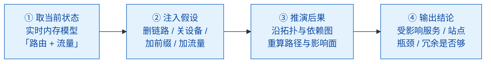

| 步骤 | 做什么 | 关键输入 | 输出 |
|---|---|---|---|
| **① 取当前状态** | 取实时内存模型（路由 + 流量）作为起点 | I1 | 推演基线 |
| **② 注入假设** | 在基线上人为制造故障或增量（删链路 / 关设备 / 加前缀 / 加流量） | I4 | 假设态拓扑 |
| **③ 推演后果** | **沿拓扑与依赖图重算路径与影响面**——这一步就是"替代上生产试错"的地方 | I2 / I3 / I5 | 重路由结果 + 受影响范围 |
| **④ 输出结论** | 汇总受影响服务 / 站点、瓶颈、冗余是否够 | ③ | 决策依据（见 5.4.3） |

### 5.4.3 输出：交付什么形态的结果

| 输出物 | 形态 | 对应小功能点 |
|---|---|---|
| **重路由结果** | 流量如何绕、备用路径能否承受增量负载 | 4.1 / 4.3 |
| **受影响服务 / 站点清单** | 一张"这次变动的爆炸半径" | 4.6 |
| **站点黑障判定** | 哪些站点在链路/节点故障下会失联 | 4.4 |
| **潜在 choke point（阻塞点）** | 压力或故障场景下**先崩的边/节点** | 4.3 |
| **逐客户视角** | 某条边的状态揭示其对**多个客户**的影响 | 4.5 |
| **DR / 韧性测试结论** | 韧性计划是否够用（**含推演、不含实测校验**，见 5.5） | 4.7 |

> **注意最后两行的分工**：What-If 的输出是"**结构级后果**"，**不是"实测验证"**。它替代的是"上生产试错"，**不替代"变更后验证"**——后者由端到端路径验证（DT-6）承担。两者是前后相扣的两个动作（另见 6.4.7 算例中的 choke point 转移）。

### 5.4.4 与"仿真软件派"的差异（本节最关键的一段）

| 问题 | 仿真软件派能否回答 | Selector 能否回答 | 原因 |
|---|---|---|---|
| 删掉 A-B 链路，流量怎么绕？ | 能 | **能**（[官方明确用例](https://www.selector.ai/blog/selectors-digital-twin-the-dvr-of-networking/)：跟踪路径冗余度、理解流量如何重路由、备用路径能否承受增量负载；第三方亦证实，见 [SDxCentral](https://www.sdxcentral.com/opinions/selector-adds-genai-and-advanced-analytics-to-aiops-platform)） | 有拓扑 + 路由模型 |
| 时延/抖动会变成多少？ | 能（建模计算） | **能**（用历史数据 + 真实指标推演） | 有历史时序 |
| 站点会不会黑障？ | 能 | **能** | 拓扑连通性推演 |
| 某条新 ACL 下下去会命中哪些流？ | 能（转发面仿真） | **不能** | 无转发面/表项模型 |
| 某协议状态机会不会抖动？ | 能（协议状态机仿真） | **不能** | 无设备内部行为模型 |

**结论**：Selector 的 What-If 是**"拓扑与流量层面"的推演**，不是**"设备行为层面"的仿真**。它回答的是"**网络结构会怎么变**"，而不是"**设备内部会发生什么**"。这两者互补而非替代。

### 5.4.5 口径声明

| 内容 | 等级 | 说明 |
|---|---|---|
| 四步闭环（取状态 → 注入假设 → 重算 → 出结论）与具体场景（删链路 / 关设备 / 加前缀 / 加流量 / 链路与光纤故障 / DDoS） | **B** | [CTO 博客原文](https://www.selector.ai/blog/selectors-digital-twin-the-dvr-of-networking/)（What-If analysis 段） |
| 推演基于**实时内存模型**（而非仿真引擎） | **B + C** | [CTO 博客](https://www.selector.ai/blog/selectors-digital-twin-the-dvr-of-networking/) + [Network World 引述高管](https://www.networkworld.com/article/3537193/selector-ai-debuts-network-language-model-for-netops.html) |
| "**determine potential choke points**"——阻塞点由故障/加压场景暴露 | **B** | [CTO 博客 What-If 段原文](https://www.selector.ai/blog/selectors-digital-twin-the-dvr-of-networking/) |
| 推演**能**答"流量怎么绕 / 时延多少 / 站点是否黑障"，**不能**答"ACL 命中 / 协议状态机" | **B（能力域推导）** | 由"无转发面模型"这一架构事实推导 |
| **推演算法本身**（重跑最短路径？约束求解？ML 外推？） | —（未披露） | 官方无公开口径；上表 I5（路由策略）是本报告补入的必要输入项 |
| **单次推演的耗时与规模上限** | —（未披露） | 直接决定能否在变更窗口内跑完，见 5.5 |

## 5.5 能力边界（这个功能点做不到什么）

> **一句话边界**：这是**"拓扑与流量层面"的推演**，不是**"设备行为层面"的仿真**。它回答"**网络结构会怎么变**"，不回答"**设备内部会发生什么**"。

| 类型 | 具体边界 | 依据（信源等级） | 对自研 APM 的提示 |
|---|---|---|---|
| **硬边界 · 无转发面 ⇒ 政策级问题答不了** | **不能**回答"某条新 ACL 下下去会命中哪些流""某协议状态机会不会抖动""配置下发后设备内部表项如何变化"——**没有转发面 / 表项模型** | 与"in-memory model"机制互证（B+C） | 若自研目标是"配置下发前预演设备行为"，需要**转发面模型**——这是重得多的另一条路线，不能靠镜像式孪生实现 |
| **硬边界 · 推演 ≠ 实测** | What-If 是**纯仿真**，不含"仿真 + 实测校验"。它**不替代变更后的实际验证**——这正是端到端路径验证（DT-6）存在的意义 | 能力域划分（B） | 自研应把"推演"与"验证"设计成**两个前后相扣的动作**，避免用户以为跑完仿真就可以直接下发 |
| **硬边界 · 只能推演"已建模的世界"** | 推演结果只覆盖孪生里已有的设备、链路与路由策略。未纳管设备、未建模的 PBR / 策略路由不参与推演，**结论可能漏掉真实绕行路径** | 由"孪生保真度 = 覆盖率"推导（B） | 与 DT-1 的覆盖率验收同源：**推演可信度 = 建模完整度** |
| **软边界 · 算法基础未披露** | 官方**未说明**推演算法（重跑最短路径？约束求解？还是 ML 外推），外部**无法评估**其在不同路由策略（BGP local-pref、route-map、MED）下的准确性 | 官方材料无此项（—） | 自研若公开算法与误差边界（如"在 X 类策略下误差 < Y%"），可直接成为**可验证的差异化优势** |
| **软边界 · 逐客户仿真的前置条件** | 逐客户仿真要求孪生能**精确区分"哪些路径承载了哪个客户的路由"**，这依赖 **BGP 社区的建模深度**；深度不足则该视角失效 | B（[Control Plane Highway 博客](https://www.selector.ai?p=7133/)推导） | 面向多租户场景自研时，BGP 社区/RT 的建模深度应作为**独立需求项**提出 |
| **软边界 · 规模与耗时未披露** | 未披露单次推演的**规模上限与耗时**（分钟级？小时级？），无法判断能否满足"变更窗口内跑完"的实用门槛 | 官方材料无此项（—） | 自研应把"**单次推演耗时**"作为硬指标设计，直接对应变更窗口的可用性 |
| **路线级边界（重要）** | 与"仿真软件派"（如中国移动 IP 网络数字孪生、中讯邮电全域数字孪生：1:1 克隆 + 逐跳转发路径精准复现 + 毫秒级仿真引擎 + 分钟级策略下发）相比，二者**问题域不同、不可直接比优劣**：仿真派**能**答表项/状态机级问题，代价是建模复杂、速度慢、需跨厂商设备数据共享 | C+（中文信源） | 自研选型时应先定义**问题域**（结构级 or 设备行为级），再选路线；不要用"谁更先进"做判断 |
| **常见误期待（澄清）** | 用户易把它当作"**数字孪生仿真器**"，期待替代实验室做协议级验证。实际它**替代不了实验室**，替代的是"上生产试错" | 全篇口径（B） | 对外表述应为"**不上生产也能看到结构级后果**"，而非"有了孪生就不用实验室" |

---

# 6 大功能点 5：容量预测与增长规划 —— 算得远

把"扩容决策"从经验判断变成**可量化、可预测、可决策依据支撑**的过程。

## 6.1 小功能点清单

| # | 小功能点 | 发布时间 | 信源等级 | 说明 |
|---|---|---|---|---|
| 5.1 | 增长场景建模 | 2025-01-23 | B（[CTO 博客](https://www.selector.ai/blog/selectors-digital-twin-the-dvr-of-networking/)） | 为新用户/新业务建模不同增长场景，管理 CapEx 与 OpEx |
| 5.2 | 闲置资源识别与再调配 | 2025-01-23 | B | "identify and resolve network bottlenecks and **repurpose underutilized resources**" |
| 5.3 | **AI 预测引擎（AI Forecasting Engine）** | 2026（architects 页） | B | 预测容量上限并提前发现异常（"Predict capacity limits and detect anomalies before they impact performance"） |
| 5.4 | ML 主动容量建议 | 2025-01-23 | B | 主动提示"某站点 10G 端口数量应增加"，因该位置用户需求预计上升 |
| 5.5 | 预测型告警（基于预测值配阈值） | 2023-07 起 | A（[End-User Features](https://docs.selector.ai/docs/getting-started/overview-selector-v1/)） | 建立趋势与预测，学习"某指标何时会触及预设阈值"；**允许直接基于预测值产生告警** |
| 5.6 | 长期趋势分析 | 2026（产品页） | B | 支撑主动扩容与基础设施投资决策 |
| 5.7 | 利用率预测（客户案例） | 2026 | B | "forecast utilization trends"、动态容量感知（路由器与防火墙） |

## 6.2 它对应的用户痛点

**P1（钱）——「扩容靠『舔手指测风向』」**
Network World 记录了产品副总裁的原话：**"今天很多运营商基本上是舔舔手指举到空中，然后说：我该在哪里加容量？"**（"lick their finger and stick it in the air"）。结果只有两种：要么过度采购，CAPEX 被白白压住；要么欠配，等到故障或紧急采购溢价。

**P2（钱）——「一边闲置、一边紧缺」**
有的位置端口空跑，有的位置挤爆，但没人有一份全局视图知道"哪些资源可以搬到哪里去"，OPEX 持续浪费。

**P3（时间 + 钱）——「打满了才知道」**
容量打满才触发告警。而扩容不是一个动作，是**采购 + 到货 + 上架 + 配置**的长周期，期间业务只能硬扛。

**P4（组织）——「业务增长预期与网络容量数据不在一张表上」**
预算评审时，业务侧讲增长目标，网络侧讲设备现状，双方没有共同的数据基础，讨论变成立场之争。

## 6.3 它是如何解决的（与痛点一一对应）

| 解法 | 机制 | 对应痛点 |
|---|---|---|
| **S1 AI 预测引擎与趋势模型** | 用 ML 预测趋势，官方文档披露具体模型：**约束感知自回归季节模型（Constraint-aware Auto Regressive Seasonal Model）**——在预测时同时理解"系统上限"（如磁盘最大容量），从而预测"某资源是否正走向触限"；以及 **LightGBM**——可同时处理大量影响因素，支撑**数千个指标**的可靠预测 | → 解 P1 |
| **S2 闲置资源识别与再调配建议** | 官方明确：识别并解决网络瓶颈、**把利用不足的资源重新调配**（repurpose underutilized resources）；产品页补充"智能优化洞察以最大化效率、最小化超支" | → 解 P2 |
| **S3 预测型告警（打满前告警）** | 从"越限告警"升级为"**趋势告警**"：建立趋势与预测，学习"某指标何时会触达阈值"；**允许基于预测值直接配置告警**——即"预测到明天容量会打满"就提前告警，而非等打满之后 | → 解 P3 |
| **S4 增长场景建模与量化建议** | 为新用户/新业务建模不同增长场景；用 ML 给出**具体到位置与端口数量的建议**（如"某站点 10G 端口应增加"），让容量讨论有共同数据基础 | → 解 P4 |

## 6.4 功能原理

> **本节回答两个问题**：① 容量预测在**实现上到底做了什么**？② 为什么把"**拓扑 + 依赖**"接进来，就能说出"**瓶颈在哪条链路、哪个设备**"？
> 本节按**输入 → 实现链条 → 输出**三段展开（与其他六个大功能点的 N.4 同构）；第 6.4.6 小节是核心论证（也是原版报告最含糊、最该补的一段）；第 6.4.9 小节标明哪部分属官方口径、哪部分是本报告推导。

### 6.4.1 先把问题拆开：容量预测实际要回答的是三个难度不同的问题

| # | 客户的问题 | 问题的性质 | 需要什么才答得出 |
|---|---|---|---|
| **Q1 会不会满** | "这条线还能撑多久？" | **纯时序**问题 | 历史指标 + 趋势模型，足矣 |
| **Q2 哪里先满** | "我该往哪儿加、加多少？" | **图**问题（拓扑） | 必须知道"哪几条边构成一条路径" |
| **Q3 满了算谁的** | "谁的容量不够了？加错会伤到谁？" | **图**问题（依赖） | 必须知道"这条路径服务哪个客户/业务" |

**结论**：Q1 只需曲线，**Q2 / Q3 必须有图**。"拓扑 + 依赖决定瓶颈在哪"这句话的准确含义是——**Q2 与 Q3 在图上才是可计算的**。单靠指标（哪怕预测模型再好）最多得到"某个数字在涨"，得不到"哪里先满、满了算谁的"。

### 6.4.2 输入：容量预测吃进去的三类数据

| 输入 | 具体内容 | 官方依据 | 缺了它会怎样 |
|---|---|---|---|
| **I1 · 结构与对象（图）** | 节点与边的集合：设备、接口、链路、站点，以及"谁连谁" | **A 级** [`System Analytics` 原文](https://docs.selector.ai/docs/analytics/system-analytics-v1/)：拓扑由 LLDP / CDP 数据、经 SNMP 获取，**"基于节点与边的识别来构建"** | 没有图 → 只能做 Q1，无法把"端口指标"归属到"某条链路"上 |
| **I2 · 负载（时序）** | 绑定在对象上的指标序列：接口利用率、错误/丢弃、队列堆积、CPU/内存、BGP 前缀数 | **A 级** · [SNMP Engine Integration](https://docs.selector.ai/docs/integrations/integrations-snmp)（默认 60s 心跳轮询、GETBULK 参数可配）与 [SNMP MIB OID Description](https://docs.selector.ai/docs/integrations/mib-oid-description)（采集的 BGP-MIB / MIB-2 / 厂商私有 OID 全清单；流侧由 NetFlow 采集器处理） | 只知拓扑结构、不知哪条在涨 |
| **I3 · 约束（上限元数据）** | 物理天花板：端口速率、端口密度/槽位数、设备规格、（云侧）磁盘与实例上限 | **B 级** · [AI & ML Models](https://docs.selector.ai/docs/ai-ml/ai-ml-models/)（Constraint-aware 模型口径）以"**系统上限，如最大磁盘容量**"为例 | 只有轨迹、没有天花板 → 只能给"会涨"，给不出"还剩多久触限" |

> **一句话**：I1 + I2 能"看出趋势"，**只有 I1 + I2 + I3 才能算"还剩多久触限"**——而后者才是容量规划真正要的答案。

### 6.4.3 实现链条：从一条指标到一条容量结论（六步）

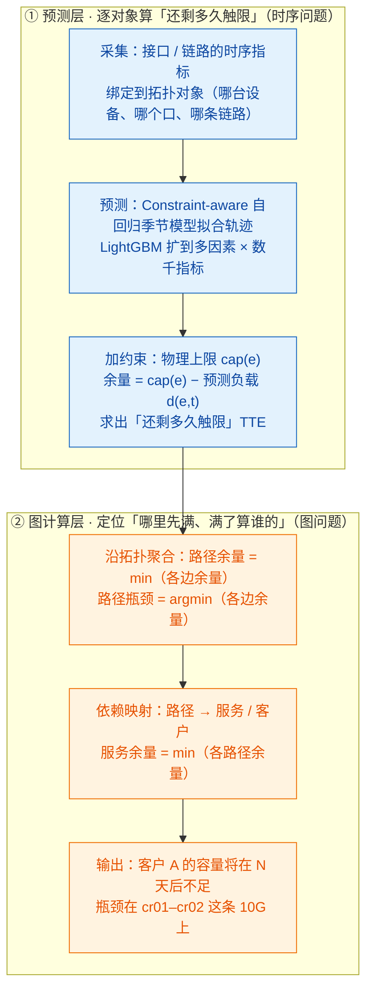

逐步展开（每一步的输入、输出与依赖的大功能点）：

| 步骤 | 做什么 | 关键输入 | 输出 | 依赖 |
|---|---|---|---|---|
| **① 采集与对象绑定** | 拉取接口/链路指标，并**绑定到拓扑对象**——关键动作是"绑定"：指标从此不再是一条孤立曲线，而是"**某条边的属性**" | SNMP 轮询（默认 60s）/ 流数据 | `d(e,t)`：每条边的负载时序 | DT-1 |
| **② 逐序列预测** | 对每条序列拟合"趋势 + 季节"，外推未来负载 | 历史指标 | 预测负载 `d̂(e,t)` | DT-5 |
| **③ 加物理约束** | 叠加 `cap(e)`，算余量与触限时间 | 设备规格 / 端口速率 / 槽位（约束元数据） | `headroom(e,t)`、触限时间 `TTE(e)` | DT-1（inventory） |
| **④ 沿拓扑聚合** | 把边上的余量沿**路径**聚合，**取最小值** | 拓扑 + 路径计算 `E(P)` | 路径余量、路径瓶颈（argmin） | **DT-6** |
| **⑤ 依赖映射** | 把路径映射到服务/客户 | 服务依赖模型 | 服务余量、"谁受影响" | **DT-6** |
| **⑥ 规模化** | 以上在整个网络、数千指标上批量执行 | LightGBM + 平台算力 | 全网站点/端口级建议 | DT-1 |

> **看清这一步的关键**：①②③ 全是"逐对象"的时序活，只有 ④⑤ 是**图上的计算**，而 ④⑤ 才是"定位"发生的地方。**定位能力来自 DT-6（路径计算与依赖映射），不是来自预测模型**——这也解释了官方为什么把 AI Forecasting Engine 与 Real Time Digital Twin、What-If Simulation **并列**放在同一份模型底座上：它们共用的是同一张图。

### 6.4.4 输出：交付什么形态的结果

| 输出物 | 形态 | 消费方 | 对应小功能点 |
|---|---|---|---|
| **触限时间（TTE）** | "某资源还剩 N 天触限" | 容量规划 | 5.5 / 5.7 |
| **预测型告警** | 基于**预测值**触发（而非越限后才触发） | NOC 值班 | 5.5 |
| **容量建议** | "某网络位置应增加 N 个 10G 端口"——**落到位置与端口数** | 网络规划 / 预算会 | 5.4 |
| **闲置资源再调配建议** | "哪些资源可以搬到哪里去" | 容量 + 财务 | 5.2 |
| **增长场景对比结论** | 不同增长假设下的容量差异 | 预算评审 | 5.1 / 5.6 |
| **云侧 right-sizing 建议** | 云构件与连接路径的利用率结论 | 云运维 | 云侧扩展（6.4.8） |

> **两层输出，别混为一谈**：前三行回答"**能不能提前知道**"，后三行回答"**钱该花在哪**"。且**全部输出都是"建议 + 依据"，不是"决策"**——投资优先级与预算博弈仍留给人（见 6.5 常见误期待）。

### 6.4.5 两个模型分别在干什么（A 级原文对照）

| 模型 | 官方原文（[`AI & ML Models` 页](https://docs.selector.ai/docs/ai-ml/ai-ml-models/)，A 级） | 承担的角色 | 输出形态 |
|---|---|---|---|
| **Constraint-aware Auto Regressive Seasonal Model** | "forecasts future metric values by analyzing past trends and seasonal patterns, **while also understanding system limits, such as maximum disk capacity**. It predicts **when a resource is on a trajectory to hit its limit**." | 单序列的"**轨迹 + 天花板**" | "还剩多久触限"（而非"未来某个值是多少"） |
| **LightGBM** | "can process **numerous influencing factors simultaneously** to generate highly accurate predictions. Its **speed and scalability** make it possible to provide reliable forecasts for **thousands of metrics** across a large and complex environment." | 横向**规模化 + 多因素** | 全环境数千指标的可靠预测 |

**分工一句话**：前者管"**纵向精度**"（把物理约束纳入），后者管"**横向规模**"（多因素、数千指标）——不是二选一，而是"单点准"与"全网铺"的组合。

三个关键词各自的必要性：

| 关键词 | 含义 | 为什么必要 |
|---|---|---|
| **自回归（AR）** | 未来值由近期历史决定，有**动量、不突变** | 让曲线能合理延续，而不是简单线性外推 |
| **季节（Seasonal）** | 捕捉日/周周期（工作日高峰、周末低谷） | 否则会把"高峰"与"日均"混为一谈，预测天然偏低 |
| **约束感知（Constraint-aware）** | 把**物理上限**当作已知条件 | 只有"轨迹 + 天花板"才能算"还剩多久触限"；否则只能给"会涨" |

### 6.4.6 ★ 核心论证：为什么"拓扑 + 依赖"就能定位出瓶颈在哪条链路、哪个设备？

**（1）先破除一个误解：瓶颈不是设备的属性，而是"路径"的属性。**

如果按**端口利用率排名**找瓶颈，你会得到"最挤的那个口"——但那**未必是你关心的那条业务的瓶颈**。举例：一条业务只走 P1 = cr01→cr02→cr03，其中 cr01–cr02 已 95%、cr02–cr03 只有 30%——瓶颈是 cr01–cr02，因为**业务能否通过取决于最窄的那一段**；反过来，一条与这条业务毫无关系的链路上，即使挤到 99%，也**不构成这条业务的瓶颈**。

**结论**：**"瓶颈"必须相对于一条路径才有定义。** 这就是为什么纯指标工具（哪怕预测再准）排不出瓶颈——它没有"路径"这个维度。

**（2）拓扑提供"边"，路径计算把边连成"路径"。**

- **拓扑**：由 LLDP / CDP 经 SNMP 构建**节点与边**（[A 级原文](https://docs.selector.ai/docs/analytics/system-analytics-v1/)）→ 得到"谁和谁相连"；
- **指标叠加**：SNMP 轮询到的接口利用率被**叠加到拓扑上**（[A 级原文](https://docs.selector.ai/docs/analytics/system-analytics-v1/)：*"Selector can also overlay metrics and color code in addition to representation"*）→ 每条边有了当前负载；
- **路径计算（DT-6）**：由**实时 BGP-LS 流、BMP 的 RIB、SNMP 轮询 LLDP** 学习路径（[B 级原文](https://www.selector.ai/blog/selectors-digital-twin-the-dvr-of-networking/)）→ 得到"这条业务踩了哪几条边"，即集合 `E(P) = {e1 … en}`。

这一步做完，上万条散落的接口指标被组织成"**某条路径上的几条边**"这样的小集合——**这就是"知道往哪看"的实现方式**：不是人去挑，是图上算出来的。

**（3）一条路径的容量由"最窄那一跳"决定 → 瓶颈 = argmin。**

- 单边余量：`headroom(e,t) = cap(e) − d̂(e,t)`
- 路径余量：`headroom(P,t) = min{ headroom(e,t) : e ∈ E(P) }`
- 路径瓶颈：`bottleneck(P) = arg min{ headroom(e,t) : e ∈ E(P) }`
- 触限时间：使 `headroom(P,t) ≤ 0` 成立的最早时刻 `t`

**为什么必须是 min**：业务能否通过取决于**最窄的那一段**——其余段再宽，多出来的容量对这条业务毫无价值。这就是"木桶原理"，也是为什么"看谁最挤"会看错。

→ **"瓶颈在哪条链路"的答案就是那个 argmin**。而它同时需要三样东西：**拓扑**（给出 `E(P)`）、**指标**（给出 `d`）、**约束元数据**（给出 `cap`）。**缺任何一项，这行字都算不出来**——这就是对"为什么拓扑 + 依赖就能定位瓶颈"的直接回答。

**（4）依赖映射把"路径余量"升级为"服务余量"。**

一条物理边通常承载多条业务（靠 VLAN / 子接口 / VRF / BGP 社区区分）。依赖映射给出"服务 s 走哪些路径"：

`headroom(s,t) = min{ headroom(P,t) : P ∈ Paths(s) }`

于是结论从"某条线要满了"变成"**客户 A 的容量将在 N 天后不足，瓶颈在 cr01–cr02 那条 10G 上**"——这才是能进预算会、能拿着要钱的那句话。

这也解释了官方为什么把建议落成"**某个网络位置应增加 10G 端口数量**"（[B 级原话](https://www.selector.ai/blog/selectors-digital-twin-the-dvr-of-networking/)）：因为服务需求汇总到**站点**后，容量的计量单位就变成**端口数 / 槽位数**。**换句话说，"哪个设备"这一层是"路径余量"沿拓扑向上汇聚到站点后自然得到的，并不是单独算出来的。**

**（5）关键补充：瓶颈是"场景相关"的，不是静态排名。**

上面的余量都是在"**当前拓扑 + 当前流量**"下算的。一旦邻居故障，流量按路由重算**倒灌**到备用边：

> 边的"真实余量" = 自身余量 − **故障时倒灌进来的流量**

于是必然出现"**平时不瓶颈、故障时立刻成瓶颈**"的边。这正是[官方在 What-If 章节的措辞](https://www.selector.ai/blog/selectors-digital-twin-the-dvr-of-networking/)——**"determine potential choke points"（确定潜在阻塞点）**：注意官方把 choke point 放在**故障 / 加压场景**里说，而不是放在"当前利用率排名"里说。

→ 这解释了 DT-5（预测）与 DT-4（What-If）为什么必须耦合：**不做故障场景叠加，你得到的只是"今天谁最挤"，而不是"哪里会先崩"。** 一句话概括：**预测给"什么时候"，What-If 给"什么条件下"。**

### 6.4.7 把上面的公式跑一遍（示意算例）

一个四节点环形网络（cr01–cr02–cr03–cr04 首尾相连），两条业务各走半个环：

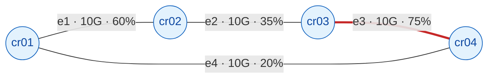

| 边 | 端点 | cap | 当前负载（利用率） | 30 天后预测 | 现在余量 |
|---|---|---|---|---|---|
| e1 | cr01–cr02 | 10G | 6.0G（60%） | 7.8G | 4.0G |
| e2 | cr02–cr03 | 10G | 3.5G（35%） | 4.4G | 6.5G |
| **e3** | cr03–cr04 | 10G | 7.5G（75%） | 9.0G | **2.5G** |
| e4 | cr04–cr01 | 10G | 2.0G（20%） | 2.4G | 8.0G |

（**示意数据，用于说明算法，非实测**）

**① 路径余量由 min 决定：**
- **P1**（cr01→cr02→cr03，走 e1 + e2）：路径余量 = min(4.0, 6.5) = **4.0G**，瓶颈 = **e1**
- **P2**（cr03→cr04→cr01，走 e3 + e4）：路径余量 = min(2.5, 8.0) = **2.5G**，瓶颈 = **e3**

**② 全网最闲的边，救不了它不在的那条路径：** e4 只有 20% 利用率、余量 8G，是全网最"空闲"的边——但它**与 P1 无关**；P1 的瓶颈是 e1。**按"哪里有闲置资源"去找扩容位置，会先看 e4，而该动的是 e1。**

**③ 只按利用率排名会漏掉两件事：** 排名把 e3（75%）排第一，这个结论**恰好对**；但排名**不会告诉你** e3 是 **P2** 的瓶颈、e1 是 **P1** 的瓶颈，更不会告诉你 e1 的余量正以 0.06G/天在收窄（约 67 天触限）。**排名给的是"谁最挤"，规划要的是"哪条业务的哪一段会先不够"。**

**④ 叠加一次故障场景（e1 中断）：** P1 的流量按路由**反向绕环**改走 e4 + e3：

| 边 | 故障前负载 | 故障后负载 | 结论 |
|---|---|---|---|
| e4 | 2.0G | 2.0 + 6.0 = **8.0G** | 尚可（余 2G） |
| **e3** | 7.5G | 7.5 + 6.0 = **13.5G** | **超载（cap 10G）—— 当刻即崩** |

e3 从"约 50 天后触限"变成"**故障当刻即超载**"，并**同时成为 P1 与 P2 的共同瓶颈**。这就是官方所说的**潜在 choke point**：**e3 平时并不是 P1 的瓶颈，故障时才变成 P1 的瓶颈。**

### 6.4.8 云侧扩展

[2026-05 的多云发布](https://www.selector.ai/newsroom/selector-launches-ai-powered-multi-cloud-observability-solution-closing-the-network-to-cloud-visibility-gap) 把容量能力延伸到云：**云用量与容量智能**——对云构件与连接路径的利用率做深度可见性分析，支撑 **right-sizing** 与云运营效率。**云变更感知**则在其**级联成更大事件之前**识别路由变更与误配置。

> 云侧是同一套逻辑的延伸：**云构件（实例、磁盘、连接）同样有"上限元数据"与"拓扑关系"**，所以"余量 = 上限 − 预测负载"与"路径取 min"在云上同样成立；差别在于云侧的上限来自云厂商 API（如实例规格、配额），而非设备规格库。

### 6.4.9 口径声明（哪些是官方说的，哪些是本报告推的）

| 内容 | 等级 | 说明 |
|---|---|---|
| 拓扑由 LLDP / CDP 经 SNMP 构建为"节点与边"、指标叠加到拓扑上 | **A** | [`System Analytics` 原文](https://docs.selector.ai/docs/analytics/system-analytics-v1/) |
| 路径由 BGP-LS / BMP / SNMP-LLDP 学习 | **B** | [官方 DVR 博客原文](https://www.selector.ai/blog/selectors-digital-twin-the-dvr-of-networking/) |
| 两个模型（Constraint-aware AR Seasonal、LightGBM）及其作用 | **A** | [`AI & ML Models` 原文](https://docs.selector.ai/docs/ai-ml/ai-ml-models/) |
| "某网络位置应增加 10G 端口"、"识别并再调配闲置资源" | **B** | [官方 DVR 博客原文（Growth Planning 段）](https://www.selector.ai/blog/selectors-digital-twin-the-dvr-of-networking/) |
| "潜在 choke point"由故障场景暴露 | **B** | [官方 DVR 博客（What-If 段）原文](https://www.selector.ai/blog/selectors-digital-twin-the-dvr-of-networking/) |
| 云侧能力（云用量与容量智能、云变更感知） | **B** | [2026-05 多云可观测发布新闻稿](https://www.selector.ai/newsroom/selector-launches-ai-powered-multi-cloud-observability-solution-closing-the-network-to-cloud-visibility-gap)（2026-05-19） |
| **`路径余量 = min(边余量)`、`瓶颈 = argmin` 的形式化，以及故障倒灌后重算余量** | **C（本报告推导）** | 官方**未逐字披露**瓶颈的计算方式；此处由两条已确证事实反推——① 官方具备路径计算与依赖映射（DT-6）；② 官方把 choke point 归入故障/加压场景。**引用时请标为推导，勿当作厂商原文。** |

## 6.5 能力边界（这个功能点做不到什么）

> **一句话边界**：它能告诉你"**哪里多久会触限、该加多少**"，但**不能替你做投资决策**，也**不能缩短采购到货上架的物理周期**；预测精度上限取决于**物理上限元数据的完备度**，而不是模型先进度。

| 类型 | 具体边界 | 依据（信源等级） | 对自研 APM 的提示 |
|---|---|---|---|
| **硬边界 · 外推的本质局限** | 预测是对历史轨迹的外推。对**从未发生过的业务模式**（新品上线、政策突变、疫情级流量跃变）**无法准确预测**；对季节性业务则强依赖至少一个完整周期的历史 | 由预测模型机理推导（A+B） | 自研须设计**场景化输入**（把"业务侧的增长假设"显式喂给模型），而不是假装模型能自己"猜到"业务拐点 |
| **硬边界 · 瓶颈定位的精度 = 路径与依赖的建模完整度** | 由 6.4.6 的推导可知，瓶颈 = `argmin`（各边余量），而"各边"来自路径计算。因此**定位只可能精确到孪生里真实存在的边**：① 未纳管链路、未建模的 PBR / 策略路由不参与计算 → 瓶颈可能被指到一条"**看似最挤、但对目标业务无关**"的边上；② 一条边承载多业务时，分摊到"客户级"需要 NS / VRF / 子接口 / BGP 社区的建模深度，深度不足只能给到"**端口级**"而非"客户级" | 由 6.4.6 机制推导（C）；与 DT-6 边界互证 | 自研若对外承诺"精确到链路/客户"，必须先验收**路径覆盖率**与**多业务分摊建模**；否则应把话术限定为"端口级容量趋势" |
| **前提依赖 · 无故障场景叠加 ⇒ 只能给"今天谁最挤"** | 只做"当前拓扑 + 当前流量"下的余量，得到的是**静态排名**；官方把 choke point 归入 What-If 场景，说明"**平时不瓶颈、故障时成瓶颈**"才是真问题（见 6.4.7 算例④：e3 从"50 天后触限"变成"当刻超载"） | B（[What-If 段](https://www.selector.ai/blog/selectors-digital-twin-the-dvr-of-networking/) "potential choke points"）＋ 6.4.6 推导 | 自研必须把容量预测与故障推演**耦合**，否则输出的只是普通趋势告警的加强版 |
| **硬边界 · 只预测"可被采集的指标"** | 业务语义（如"某客户合同将新增 10 万用户"）**不在指标里**，须由人作为**场景输入**。模型不会自动把商务信息翻译成容量需求 | 由 5.1 增长场景建模机制推导（B） | 自研可把"业务增长参数表"做成一个独立输入面，这恰是 NetOps 与 FinOps 的衔接点 |
| **硬边界 · 不解决采购周期** | 它能**提前告警**，但采购 + 到货 + 上架 + 配置的物理周期**不会被缩短**。可提前量受限于预测窗口，而非预测精度 | 由 5.4 机制推导（B） | 自研的价值主张应落在"**把提前量做够**"（提前量 > 采购周期才有意义），而不是单纯提高精度 |
| **软边界 · 精度与回溯窗口未披露** | 官方**未披露预测精度（如 MAPE）与回溯窗口**，无法评估对季节性/突发性业务的适配度 | 官方材料无此项（—） | 自研宜公开"**精度—窗口**"二维宣称（如"7 天窗口误差 < X%"），让客户可验证 |
| **软边界 · 预测型告警仍在演进（官方自认）** | 官方文档 A 级原话：**"there is continuous AI work to create an alert based on a predicted value"**——**说明"基于预测值告警"在当时尚未完全成熟**；且**预测型告警有误报成本**，模型偏差直接转化为无效工单 | A（[End-User Features](https://docs.selector.ai/docs/getting-started/overview-selector-v1/) 原话） | 自研上线预测型告警时，建议**先"影子模式"运行一段时间**（只展示不告警），用真实数据校准误报率后再放开 |
| **前提依赖 · 物理上限元数据** | "约束感知"依赖**物理上限元数据**（磁盘容量、端口密度、设备规格）的完整与准确；元数据缺失时，模型退化为**普通趋势预测**，无法回答"还剩多久触限" | 由 Constraint-aware 机理推导（A+B） | 自研要把**设备规格库**当成与采集同等重要的基础设施来建设 |
| **常见误期待（澄清）** | 用户易以为它能直接给出"**最优投资方案**"。实际输出是"**哪里会触限、建议加多少**"，投资优先级与预算博弈仍需人与组织决策 | 官方 5.4 表述（B） | 对外用"容量建议"而非"投资决策"措辞，避免背上不该背的责任 |

---

# 7 大功能点 6：路径计算与依赖映射 —— 串得通

回答"**这条业务到底走了哪些节点**"——把跨域路径变成可计算、可查询、可验证的对象。

## 7.1 小功能点清单

| # | 小功能点 | 发布时间 | 信源等级 | 说明 |
|---|---|---|---|---|
| 6.1 | **全路径计算（Path Computation）** | 2026（客户案例） | B | "full path computation **across infrastructure and services**" |
| 6.2 | **依赖映射（Dependency Mapping）** | 2026（客户案例） | B | 理解服务路径并评估下游影响 |
| 6.3 | 控制面拓扑可视化 | 2026（客户案例） | B | 把路由行为渲染为可视拓扑 |
| 6.4 | 路由感知可观测（Routing-aware Observability） | 2026（客户案例） | B | 面向路由的排障视角 |
| 6.5 | 端到端路径可视化与验证（本地↔云） | 2026-05-19 | B（[多云 PR](https://www.selector.ai/newsroom/selector-launches-ai-powered-multi-cloud-observability-solution-closing-the-network-to-cloud-visibility-gap)） | 可视化完整路径，**预先验证**可达性、时延、连通性 |

## 7.2 它对应的用户痛点

**P1（时间）——「这条业务走了哪些节点，没人画得出来」**
一条应用访问路径可能横跨：**SD-WAN → 运营商线路 → 托管设施互联 → Direct Connect 网关 → VPC 中转网关 → 云上应用**。出事时，没有人能立刻把这条链画全。

**P2（时间）——「要知道某客户/前缀怎么走的，只能手推 BGP 表」**
传统做法是登录路由器、导出 BGP 表、人工推演。慢、易错，且高度依赖个人对路由策略的熟悉程度。

**P3（组织）——「跨域问题界定不了责任」**
分支机构说访问不了应用，是 SD-WAN？运营商线路？Direct Connect 网关？还是 VPC 中转网关？各段各管，缺少**路径级**的共同视图来界定边界。

**P4（钱）——「冗余路径到底扛不扛得住，从来没算过」**
SLA 承诺建立在"我们有冗余"的假设上，但"冗余路径在故障切换后能否承受增量负载"从未被量化验证。

## 7.3 它是如何解决的（与痛点一一对应）

| 解法 | 机制 | 对应痛点 |
|---|---|---|
| **S1 全路径计算** | 在孪生上对基础设施与服务做**完整路径计算**，把"业务走的链路"变成可查询对象（客户案例将其列为五大核心能力之一："Path computation and dependency mapping"） | → 解 P1 |
| **S2 路由感知可观测 + 控制面拓扑可视化** | 把 BGP/IGP 状态渲染为可交互的拓扑（官方"控制面高速公路"隐喻：节点 = 路由器/反射器，边 = BGP 会话，**箭头粗细 ∝ 路由交换量**），替代"翻多套数据库与路由表 + 专用查询语言" | → 解 P2 |
| **S3 端到端路径可视化与验证（本地↔云）** | 可视化完整路径并**在问题影响用户之前**验证可达性、时延与连通性——把"变更后验证"左移到"**变更前验证**" | → 解 P3 |
| **S4 路径冗余度跟踪 + 依赖映射支撑 SLA 论证** | SDxCentral 披露的机制："**系统跟踪网络路径的冗余度**，以理解流量如何重路由、以及备用路径能否承受增加的负载"；配合依赖映射，为 SLA 承诺提供可量化支撑 | → 解 P4 |

## 7.4 功能原理

> 本节按**输入 → 实现链条 → 输出**三段展开（与 6.4 同构），末尾附口径声明。

### 7.4.1 输入：路径计算吃进去什么

| 输入 | 具体内容 | 官方依据 | 缺了它会怎样 |
|---|---|---|---|
| **I1 · 物理 / 链路拓扑** | LLDP / CDP 邻居关系 + IGP 状态 | **A / B 级** · [System Analytics](https://docs.selector.ai/docs/analytics/system-analytics-v1/) / [CTO 博客](https://www.selector.ai/blog/selectors-digital-twin-the-dvr-of-networking/) | 没有物理骨架，"谁连着谁"都答不出 |
| **I2 · 控制面路由状态** | BGP-LS 实时链路状态 + BMP 的 RIB | **B 级** [CTO 博客](https://www.selector.ai/blog/selectors-digital-twin-the-dvr-of-networking/) | **算不出真实路径**，只能算到 IGP 路径（见 7.5） |
| **I3 · 服务与隧道端点** | 服务层拓扑信息（隧道端点、服务级信息） | **A 级** [`End-User Features`](https://docs.selector.ai/docs/getting-started/overview-selector-v1/) | 跨云 / 隧道侧的端到端路径断裂 |
| **I4 · 业务与客户标识** | 区分"一条边承载了哪个客户的路由"所需的建模深度（社区 / RT / VRF） | **B 级** · [Control Plane Highway 博客](https://www.selector.ai?p=7133/)（逐客户视角，2025-05-16） | 只能给"端口级"结论，给不出"客户级" |

### 7.4.2 实现链条：归并 → 计算 → 映射 → 冗余分析

**四步链条**：

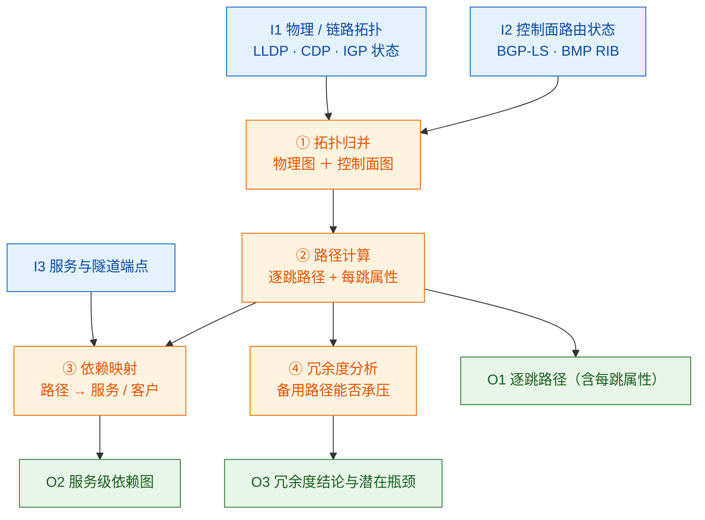

| 步骤 | 做什么 | 关键输入 | 输出 |
|---|---|---|---|
| **① 拓扑归并** | 把物理图与控制面图合并成一张**可计算**的图 | I1 / I2 | 统一拓扑 |
| **② 路径计算** | 叠加路由状态，算出**逐跳路径**与每跳属性 | ① + I2 | 路径集合 `E(P)` |
| **③ 依赖映射** | 把路径映射到服务 / 客户 | ② + I3 + I4 | 服务级依赖图 |
| **④ 冗余度分析** | 判断备用路径能否承受增量负载 | ② | 冗余度结论 + 潜在瓶颈 |

> **第 ② 步是整条链的枢纽**：它产出的 `E(P)`（"这条业务踩了哪几条边"）正是 6.4.6 定位容量瓶颈所需的那个集合。**没有它，"瓶颈在哪条链路"这句话根本算不出来**——DT-6 是所有"定位类能力"的**前置依赖**。

### 7.4.3 输出：交付什么形态的结果

| 输出物 | 形态 | 消费方 | 对应小功能点 |
|---|---|---|---|
| **逐跳路径** | 含每跳属性（时延 / 丢包 / 队列） | 排障 / 架构 | 6.1 / 6.5 |
| **服务级依赖图** | 谁依赖谁——**跨域责任边界的共同视图** | 跨团队（网络 / 云 / 应用） | 6.2 |
| **冗余度结论** | 备用路径能否承受增量负载 | 架构 / 变更评审 | 6.1 |
| **控制面拓扑视图** | BGP 会话级：边粗细 ∝ 路由数，颜色 = 健康度 | 运营商 NOC | 6.3 / 6.4 |
| **端到端路径验证** | 本地 ↔ 云的路径可视化与验证 | 多云运维 | 6.5 |
| **路径集合 `E(P)`（内部接口）** | **不是 UI 产物，而是其他能力的输入** | 容量预测（DT-5）/ 关联定因（DT-2）/ What-If（DT-4） | — |

> **最后一行说明 DT-6 的底座地位**：与 DT-1 的镜像一样，它**最主要的输出是给别的能力用的**。6.4.6 已论证：定位瓶颈 = `argmin`（路径上各边余量），而"路径上有哪些边"只能由本章给出。

### 7.4.4 为什么"路径"是孪生的高阶产物

拓扑回答"谁连着谁"（静态关系）；**路径回答"流量现在从谁到谁、经过谁"**（动态结果）。前者靠 LLDP 就能拿到，后者**必须叠加控制面路由状态**（BGP-LS + BMP）才能算出来。这也解释了为什么 Selector 要把三种采集机制（见 DT-1 原理）**同时**用上——**少任何一路，都算不出真实路径**。

### 7.4.5 「控制面高速公路」的可视化语义

官方博客（[2025-05-16《The Control Plane Highway》](https://www.selector.ai?p=7133/)，作者 Sunanda Kommula）披露了一套少见的视觉编码：
- **节点**（路由器 / RR）= 路口，可点击，展开运行数据；
- **边**（BGP 会话）= 路段，可点击，展开会话数据；
- **箭头粗细 ∝ 该路径上交换的路由数量**；
- **颜色 = 健康度**：绿（健康）→ 黄橙（有问题苗头）→ 深红（关键问题 / 路由传播被阻）；
- 一条边往往承载**多个客户**的路由，故"一条边的状态可能揭示对多客户的影响，同时也能凸显哪些冗余路径在局部故障下仍维持连通"。

### 7.4.6 口径声明

| 内容 | 等级 | 说明 |
|---|---|---|
| 输入三路（物理拓扑 / 控制面路由状态 / 服务与隧道端点）→ 输出三类（逐跳路径 / 冗余度分析 / 依赖图） | **B** | [官方 DVR 博客原文的框图式表述](https://www.selector.ai/blog/selectors-digital-twin-the-dvr-of-networking/)（Real Time view 段） |
| 路径由 **BGP-LS 实时流 + BMP 的 RIB + SNMP 轮询 LLDP** 学习，三路缺一不可 | **B** | [CTO 博客原文](https://www.selector.ai/blog/selectors-digital-twin-the-dvr-of-networking/)（Real Time view 段） |
| 控制面高速公路的视觉编码（边粗细 ∝ 路由数、颜色 = 健康度、一条边承载多客户） | **B** | [官方博客 2025-05-16](https://www.selector.ai?p=7133/) |
| **"归并 → 计算 → 映射 → 冗余分析"的四步拆分** | **C（本报告推导）** | 官方只给出"输入 → 引擎 → 输出"的框图，**未披露引擎内部步骤** |
| 路径计算的算法（是否等价于 PCE / 最短路径 + 策略约束）、计算时延与规模上限 | —（未披露） | 见 7.5 边界与附四 |

## 7.5 能力边界（这个功能点做不到什么）

> **一句话边界**：路径计算的准确性**上限由路由数据完整度决定**——没有控制面路由数据（BGP-LS / BMP），就只能算到 IGP 路径，算不出"BGP 策略下流量实际怎么走"。

| 类型 | 具体边界 | 依据（信源等级） | 对自研 APM 的提示 |
|---|---|---|---|
| **硬边界 · 路由数据决定上限** | 未跑 **BGP-LS / BMP** 的网络（如纯 IGP 企业网）**只能算到 IGP 路径**，无法还原 BGP 策略（local-pref、community、route-map）作用后的真实转发路径 | 由"路径三路采集"机制推导（B） | 自研若要输出"业务路径"，**路由侧数据（BGP-LS/BMP）是必需项**，不能只依赖 SNMP 拓扑 |
| **硬边界 · 只覆盖"被建模的路径"** | 端到端验证覆盖的是**已知的、被建模的路径**；对未纳管的"**影子路径**"（PBR 策略路由、未采集的隧道、跨运营商段）**无能为力** | 与 DT-1 覆盖率边界同源（B） | 自研应把"路径覆盖率"作为独立指标暴露出来，让用户知道"这一刻的结论覆盖了真实流量的百分之几" |
| **硬边界 · 依赖 ≠ CMDB** | 依赖映射是从**网络与遥测侧推导**的关系图，**不等于**业务架构登记（CMDB / 服务目录）。业务语义层的依赖（谁调用谁、合同关系）不在其中 | 由 6.2 定义推导（B） | 自研需明确"依赖图"与"配置库/服务目录"的**分工与对账机制**，否则两套图会互相打架 |
| **软边界 · 算法未披露** | 官方**未说明路径计算算法**（是否等价于 PCE / 最短路径 + 策略约束），也未披露**计算时延与规模上限** | 官方材料无此项（—） | 自研可把"算法可解释 + 单次计算时延"做成可承诺指标，这是最容易被客户追问的两点 |
| **软边界 · 云侧覆盖范围未披露** | 端到端路径验证（本地↔云）在**哪些云 / 哪些互联形态**下完备，官方未披露；多云发布（2026-05）为增量能力 | 官方材料无此项（—） | 自研若面向多云客户，应逐云验证覆盖矩阵，并把"已验证的云形态清单"作为交付物 |
| **前提依赖 · 三路缺一不可** | 路径 = 物理/链路拓扑（LLDP/CDP + IGP）+ 控制面路由状态（BGP-LS + BMP）+ 服务与隧道端点（服务级信息）。**少任何一路，都算不出真实路径** | 由 7.4(2) 推导（B） | 自研的采集侧立项应**按这三路齐备**来规划，避免只做了 SNMP 层就宣称"有路径能力" |
| **常见误期待（澄清）** | 用户易以为"依赖映射"可以**替代 CMDB / 服务目录**。实际它是**推导产物**，权威性弱于登记制配置库，且随采集覆盖率波动 | 全篇口径（B） | 对外定位宜为"**运行时依赖真相**"，与"设计期登记"并列而非替代 |

---

# 8 大功能点 7：S2ML 声明式建模与孪生工程化 —— 管得住

让孪生本身**可声明、可版本化、可评审、可接入流水线**——把"模型"当成代码来管理。

## 8.1 小功能点清单

| # | 小功能点 | 发布时间 | 信源等级 | 说明 |
|---|---|---|---|---|
| 7.1 | **声明式建模（Declarative Modeling, S2ML）** | 2022（架构论文）/ 2026（architects 页） | B | "Design, validate, and document infrastructure **as code** with precision" |
| 7.2 | 声明式 ETL（采集侧） | 2024-03（Techstrong 访谈） | B | 高管原话："Our platform uses a no-code/low-code approach to data collection. For the more technical folks, it's a **declarative ETL**." |
| 7.3 | CI/CD 与 config-as-code 兼容 | 2026（architects 页） | B | "built for CI/CD pipelines, continuous validation"；"Native S2ML modeling, API-first design, and **full CI/CD compatibility**" |
| 7.4 | 开放 API 与集成（300+） | 2026（architects 页） | B | "300+ APIs and connectors (and counting) for data collection and automation" |
| 7.5 | 模型/配置变更审计 | 2026-03 ~ 05 | A（[Release Notes](https://docs.selector.ai/) v4032） | 审计范围扩展至 SNMP、REST Poller、Splunk 等集成操作 |

> ⚠️ **证据等级提示**：本组是全文**证据最弱**的一组。`S2ML` 的具体语法、能力边界、适用范围**官方均未公开**；架构论文中的位置（Data Hypervisor 层）与产品页的描述（建模语言）之间**存在概念跨度**。本组结论为**基于多处间接证据的合理推断**，引用时请保留这一限定。

## 8.2 它对应的用户痛点

**P1（时间）——「加一个数据源/一张视图要排期开发」**
传统模式下，新增采集源或新视图要写代码、走开发排期，交付以"周/月"计，跟不上网络变更的节奏。

**P2（人）——「模型与配置散落各处，改坏了只能靠人救」**
配置没有版本、没有评审、不能 diff、不能回滚。变更风险由操作者个人承担，出了事无法快速定位"是不是改错了"。

**P3（组织）——「架构意图靠口头与邮件传递」**
网络"应该长什么样"是架构团队的设计意图，但它没有一份可被评审、可被比对的声明式描述。执行层只能凭理解实现，偏差无从发现。

**P4（合规）——「模型与配置变更拿不出审计记录」**
合规要求"谁在什么时候改了哪个配置"，散落的操作日志拼不出完整链路。

## 8.3 它是如何解决的（与痛点一一对应）

| 解法 | 机制 | 对应痛点 |
|---|---|---|
| **S1 S2ML 声明式建模** | 以**声明式**方式定义拓扑/模型/视图——描述"要什么"而不是"怎么写代码"，官方定位为"Design, validate, and document infrastructure **as code** with precision" | → 解 P1 |
| **S2 模型即代码（config-as-code）** | 模型以声明式代码形态存在，天然支持版本化、diff、评审与回滚（官方将 "Declarative + integration ready" 列为架构师选型理由之一） | → 解 P2 |
| **S3 CI/CD 流水线接入** | 明确支持接入既有 CI/CD 与**持续验证（continuous validation）**，把网络设计的验证动作嵌进研发现有的工程流程，而不是另起一套 | → 解 P3 |
| **S4 API 优先 + 审计留痕** | 300+ API/连接器支撑自动化；集成操作纳入审计日志（v4032 将审计扩展至 SNMP / REST Poller / Splunk 等） | → 解 P4 |

## 8.4 功能原理

> 本节按**输入 → 实现链条 → 输出**三段展开（与 6.4 同构），末尾附口径声明。**注意：本节的证据强度是七组中最弱的**（S2ML 全称、语法、适用范围官方均未公开），凡推导处均显式标注。

### 8.4.1 输入：S2ML 这条链路吃进去什么

| 输入 | 具体内容 | 官方依据 | 缺了它会怎样 |
|---|---|---|---|
| **I1 · 异构数据源** | 推 + 拉的各类数据入口，含清单 / CMDB 接入 | **B 级** · [架构论文（2022-03）](https://www.selector.ai/wp-content/uploads/2022/03/Selector-Architecture-Paper.pdf)（Data Collection Engine 层） | 无数据可归一化 |
| **I2 · 声明式采集定义** | 用声明方式定义"某遥测接口的输入与输出"，**无需写代码** | **A / B 级** · [Introduction to Selector 文档](https://docs.selector.ai/docs/getting-started/introduction-v1/)（declarative ETL 原文）+ 2024-03 官方高管访谈（Techstrong TV，**无公开文字稿链接**） | 每加一类数据源都要写代码——而官方动机正是"十年后还在用的私有工具"太多 |
| **I3 · 模型与视图的声明** | 以声明方式描述模型 / 视图该长什么样（S2ML） | **B 级** · [architects 页](https://www.selector.ai/?p=8037/)（仅营销句式） | 模型靠手改、无版本、无审计 |
| **I4 · 版本控制与流水线** | 模型 / 配置进 Git，走 CI/CD | **B 级** · [architects 页](https://www.selector.ai/?p=8037/)（CI/CD 兼容） | 变更无留痕、设计偏离无从发现 |

### 8.4.2 实现链条：声明 → 解析 → 建模 → 版本化

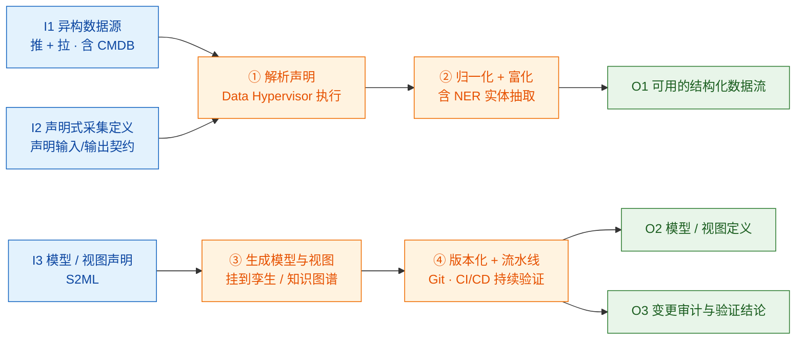

| 步骤 | 做什么 | 关键输入 | 输出 |
|---|---|---|---|
| **① 解析声明** | `Data Hypervisor` 按声明执行"如何归一化 / 富化 / 路由数据" | I1 / I2 | 可执行的处理链 |
| **② 归一化 + 富化** | 把异构原始数据统一成平台模型；富化环节含 **NER**，把日志文本抽成结构化实体 | ① | 结构化数据流 |
| **③ 生成模型与视图** | 把声明渲染成模型 / 视图定义，挂到孪生与知识图谱 | I3 | 模型 / 视图定义 |
| **④ 版本化与流水线** | 模型即代码进 Git，在 CI/CD 中做持续验证 | ③ + I4 | 审计留痕 + 偏离告警 |

### 8.4.3 输出：交付什么形态的结果

| 输出物 | 形态 | 消费方 |
|---|---|---|
| **归一化后的数据流** | 统一模型的数据 | ML / 关联引擎 |
| **模型与视图定义** | 声明式产出的孪生结构 | 孪生 / 可视化 |
| **变更审计记录** | 模型与配置的变更留痕 | 合规 / 复盘 |
| **持续验证结论** | CI/CD 中"设计与实际是否偏离" | 架构治理 |
| **新增集成的成本下降** | 加一类数据源 = **改配置而非写代码** | 平台工程 |

> **注意最后一行**：S2ML 的价值不在"能建模"（谁都可以这么说），而在**把建模从"编码行为"降级为"配置行为"**。这才是它对应"架构设计意图谁来保证"这一痛点的解法。

### 8.4.4 S2ML 在架构中的位置

[官方架构论文（2022-03，B 级）](https://www.selector.ai/wp-content/uploads/2022/03/Selector-Architecture-Paper.pdf) 的系统架构图显示：**Knowledge Service → Data Hypervisor → S2ML Declarative**，即 S2ML 声明式组件位于**数据虚拟化层**。这与架构的四层划分相扣：

| 层 | 职责 | 与孪生的关系 |
|---|---|---|
| Data Collection Engine | 数据入口（推 + 拉，含清单/CMDB 接入） | 给孪生供货 |
| Data Hypervisor | 归一化 + 富化（含 ML 日志实体抽取） | **S2ML 声明式所在层**——声明式地描述"如何归一化、富化、路由数据" |
| Knowledge Service | ML 分析（异常、关联、根因） | 消费孪生做因果推理 |
| Collaboration Service | 面向人的界面（Slack/Teams/UI） | 孪生的呈现出口 |

### 8.4.5 「声明式 ETL」是理解 S2ML 的最好旁证

一位官方高管在 Techstrong TV 访谈（2024-03，B 级）中描述采集侧的做法（该访谈**无公开文字稿链接**；同口径的 **A 级** 表述见 [Introduction to Selector 文档](https://docs.selector.ai/docs/getting-started/introduction-v1/)）：**"我们平台对数据采集采用无代码/低代码方式。对技术人员来说，它是一个声明式 ETL（declarative ETL）——你可以定义某个遥测接口的输入与输出，而无需写任何代码。"**

这句话说明 Selector 的"声明式"理念**贯穿采集与建模两端**：采集侧是声明式 ETL，建模侧是 S2ML。其动机官方也说了：面对海量异构协议与"十年后还在用的私有工具"，**必须让新增集成变成配置行为，而不是编码行为**。

### 8.4.6 另一个可确证的 S2ML 痕迹（MCP 侧）

Selector MCP Server 的 `get_selector_phrases` 工具支持按来源过滤短语/别名，[官方 MCP 文档](https://docs.selector.ai/docs/mcp-setup/) 列出的可选来源包括 `user`、**`s2ml`**、`widget`（A 级）。这说明 **s2ml 是与"用户自定义"、"仪表盘"并列的一类短语来源**——进一步印证 S2ML 是产出模型/视图定义的声明式载体。

### 8.4.7 口径声明（本节证据最弱，务必先读）

| 内容 | 等级 | 说明 |
|---|---|---|
| 架构图中 `Knowledge Service → Data Hypervisor → **S2ML Declarative**` 的层级关系 | **B** | [官方架构论文（2022-03）](https://www.selector.ai/wp-content/uploads/2022/03/Selector-Architecture-Paper.pdf) 系统架构图 |
| 采集侧为"声明式 ETL"：定义遥测接口的输入与输出而无需写代码 | **B** | 官方高管访谈（Techstrong TV，2024-03，**无公开文字稿**）；同口径 **A 级** 表述见 [Introduction to Selector 文档](https://docs.selector.ai/docs/getting-started/introduction-v1/) |
| MCP 的 `get_selector_phrases` 支持 `s2ml` 作为短语来源之一 | **A** | [官方 MCP 文档](https://docs.selector.ai/docs/mcp-setup/) |
| architects 页的 "Declarative Modeling (S2ML)…as code with precision" + CI/CD 兼容 | **B** | [官方 architects 产品页](https://www.selector.ai/?p=8037/)（**仅营销句式，无语法示例**） |
| **"解析声明 → 归一化富化 → 生成模型视图 → 版本化与流水线"这条四步链条** | **C（本报告推导）** | 由 `Data Hypervisor` 的层级职责（B）与"声明式 ETL"的访谈口径（B）拼合推得，**官方未披露 S2ML 的执行机制** |
| **S2ML 全称、语法、适用范围、版本演进** | —（**全未公开**） | 本报告仅有 3 处间接证据；⚠️ 学术界同名缩写（System Structure Modeling Language）**与 Selector 无任何关联证据，不可混引** |

## 8.5 能力边界（这个功能点做不到什么）

> **一句话边界**：**本组是全文证据最弱的一组**——`S2ML` 的全称、语法、适用范围**官方均未公开**，所有结论为**基于多处间接证据的合理推断**；且**无任何证据显示它能生成并下发设备配置**。

| 类型 | 具体边界 | 依据（信源等级） | 对自研 APM 的提示 |
|---|---|---|---|
| **证据边界 · 全称未公开** | **官方从未公开 S2ML 全称**。可能是 "Selector Modeling Language" 或 "S2 Modeling Language" 之类，但**无一处官方材料可证实**。本报告不给猜测结论 | 官方材料无此项（—） | 引用时必须保留"待证实"限定；不要去猜全称，猜错会污染整条引用链 |
| **证据边界 · 同名不可混引** | 学术界存在同名缩写 **S2ML（System Structure Modeling Language）**，与 Selector **无任何关联证据**——同名纯属缩写巧合 | 第三方名称重合（C） | 检索该主题时须加公司限定词，否则会捞到完全无关的学术论文 |
| **证据边界 · 仅有营销句式** | 官方对 S2ML 的公开描述**仅停留在营销句式**（"Design, validate, and document infrastructure **as code** with precision"），**无语法示例、无文档章节、无版本说明** | B（[architects 页](https://www.selector.ai/?p=8037/)原话） | 这是一个**可跟踪的空白点**（见附四）；在自研里不宜把 S2ML 当成可对标的成熟能力 |
| **硬边界 · 声明式的固有局限** | 声明式擅长描述"**期望状态**"，不擅长表达"**过程性与条件性逻辑**"（如带分支的决策流、跨系统编排的异常处理）。这类逻辑仍需命令式代码 | 由"声明式 ETL / 声明式建模"定位推导（B） | 自研设计声明式层时，应明确划定"声明式管什么、代码管什么"的**边界线**，否则最终会变成一门难维护的 DSL |
| **硬边界 · 不生成也不下发配置** | 证据链指向它是**建模 / 视图定义的载体**（架构论文中位于 Data Hypervisor 层；MCP 中 `s2ml` 是短语来源之一），**无任何证据显示它能生成并下发设备配置** | A（[MCP 文档](https://docs.selector.ai/docs/mcp-setup/)）+ B（[架构论文](https://www.selector.ai/wp-content/uploads/2022/03/Selector-Architecture-Paper.pdf)） | 自研的价值锚点应设为"**模型与视图的定义载体**"，而不是"网络配置生成器"——后者是另一种产品 |
| **软边界 · 表达能力与学习成本未知** | 无文档、无示例、无版本说明，**无法评估其实际表达能力与学习成本**。7.4 的"300+ API 与连接器"也**未逐项公开**覆盖范围 | 官方材料无此项（—） | 自研若做 DSL，应把**语法文档与示例集**作为一等交付物，这是 Selector 目前的公开空白 |
| **软边界 · CI/CD 兼容深度未披露** | "full CI/CD compatibility" **未说明深度**——是"能被流水线调用"，还是"能作为门禁阻断发布"（gate）？二者工程价值差别很大 | B（[architects 页](https://www.selector.ai/?p=8037/)原话） | 自研应对标"**可门禁**"级别（能在流水线中阻断不合规变更），而不是仅"可调用" |
| **前提依赖 · 客户自身工程化水平** | 声明式 + config-as-code 的价值**依赖客户已有 Git 流程与 CI/CD**。没有这些工程流程的客户，声明式的收益**大幅缩水**（甚至只等于"换了种写法"） | 由 7.3 机制推导（B） | 自研需准备**两套叙事**：有流水线客户讲"模型即代码"，无流水线客户讲"可视化配置 + 审计" |
| **常见误期待（澄清）** | 用户易以为 S2ML 是一套"**网络编程语言**"。实际证据指向的是**建模/定义层**语言，作用域是"描述与被描述"，不是"执行与下发" | 全篇证据链（A+B） | 对内做技术预研时，应把它类比为"**视图/模型的定义文件**"（如仪表盘 as code），而非 Terraform 式的资源编排 |

---

# 9 附一：Digital Twin 专项完整时间线（倒序）

| 时间 | 事件 / 功能 | 类型 | 等级 |
|---|---|---|---|
| 2026-10-16 | 本调研截止 | — | — |
| 2026-09-22 | **Foundry / Rosetta 发布**：Loom Agent 专职"重建时间线与影响面"，孪生成为 Agent 的上下文来源 | 平台级 | B |
| 2026-05-19 | **多云可观测发布**：端到端路径可视化与验证（本地↔云）、拓扑感知上下文、云用量与容量智能、云变更感知 | 平台级 | B |
| 2026-03 ~ 05 | v4032：地图视图滚轮缩放、蜂窝图时间线热力图 | 版本 | A |
| 2025-12 ~ 2026-02 | v3849：无孪生直接条目（同期补齐 SMTP TLS、SNMP Engine UI 化等） | 版本 | A |
| 2025-10 ~ 12 | v3686：无孪生直接条目（同期补齐 NL 变量、按厂商阈值、`s2_query_trace`） | 版本 | A |
| 2025-07 ~ 10 | v3531：**增强拓扑图，显示直连路由（direct routes）** | 版本 | A |
| 2025-05 ~ 07 | v3379：**拓扑视图布局锁定**（避免被仪表盘变量重置） | 版本 | A |
| 2025-05 | 官方博客《控制面高速公路》：把控制面可视化为交通系统；**逐客户 What-If 虚拟仿真** | 主题 | B |
| 2025-01-23 | **官方博客《Selector's Digital Twin: The DVR of Networking》**（CTO 署名）：系统化定义四大能力（实时视图 / Network DVR / What-If / 增长规划），并公开路径学习三机制 | 主题 | B |
| 2024-09-23 | **Enhanced Digital Twin 发布**：What-If 场景化，"在故障发生前预见"；同期发布 NLM 与可编程合成传感器 | 平台级 | B |
| 2024-03-13 | **Spring 2024 Release：Digital Twin 首发**。同期还有 Copilot + GenAI、原生全栈监控、因果 RCA | 平台级 | B |
| 2024-03 | SDxCentral 披露实现细节：内存模型、删链路后果推演、**路径冗余度跟踪**、无实验室困境 | 第三方 | C |
| 2022 | 架构论文发布：Data Hypervisor 层出现 **S2ML Declarative** | 架构 | B |

**演进节奏观察**：
- **平台级能力**（首发 → What-If → 多云路径）：**年度节奏**，每次都是发布会级别；
- **视图交互细节**（锁定 → 直连路由 → 缩放/热力图）：**版本级节奏**（2025-05 起，每 2–3 个月一版）；
- **2024-09 之后到 2025-01 之间存在明显的"能力静默期"**，此间孪生没有新平台级发布，直到 2025-01 的博客才把四大能力系统化表述——**说明营销叙事的成型晚于能力本身的成型**。

---

# 10 附二：五条演进规律（带「对自研的启示」）

## 10.1 规律一：孪生是"底座"，不是"功能"

Selector 的 Digital Twin **从不单独售卖价值**。它出现的每一个地方，都是作为别的东西的支撑：RCA 的关系底座（DT-2）、DVR 的录制载体（DT-3）、What-If 的沙盘（DT-4）、容量预测的数据源（DT-5）、路径计算的图（DT-6）。

> **对自研的启示**：如果自研 APM 想做"数字孪生"，第一件要想清楚的不是"画什么图"，而是"**谁要消费它**"。没有明确消费者的孪生，会退化成一张昂贵的拓扑图。

## 10.2 规律二：路线选择先于能力堆叠

Selector 明确选择了**"数据驱动/运营镜像"**路线（"Unlike legacy solutions which use *simulation software*"），主动放弃"设备内部行为仿真"。这条路线带来一个决定性优势：**零漂移**（因为它就是现网状态的投影），代价是**不覆盖配置下发效果验证**。

> **对自研的启示**：路线选择是**排他性**的。选了运营镜像，就要接受"不能验证配置下发"这一条硬边界，并用"变更前路径验证 + 变更后实测校验"补上；反过来选了仿真引擎，就要接受"建模复杂、速度慢、与现网易漂移"的代价。**没有两头都要的方案。**

## 10.3 规律三：能力演进严格遵循「看现在 → 看过去 → 试未来」

> **对自研的启示**：这个顺序**不可跳**。没有"看现在"的实时镜像，DVR 没有可录的对象；没有 DVR 的历史状态，What-If 没有可比对的基线；没有 What-If，容量预测的结论无法被验证。**每一层都是下一层的前置条件。**

## 10.4 规律四：孪生的价值随"消费方"增加而指数上升

同一份孪生数据被七种方式消费（镜像 / 关联 / 回放 / 仿真 / 预测 / 路径 / 声明式编排）。**边际成本递减、边际价值递增**——这是孪生类能力最重要的经济学特征。

> **对自研的启示**：孪生的 ROI 论证**不能按单点功能算**。它的正确算法是"一份建模成本 / N 个消费场景"。反过来说，**如果只打算做一个消费场景，就别做孪生——直接做那个场景更划算。**

## 10.5 规律五：UI 细节是"手感"问题，但会被用户当作"能力"问题

v3379 的"拓扑布局锁定"、v3531 的"显示直连路由"、v4032 的"地图滚轮缩放"——这些都不是新能力，而是同一能力的手感修复。但拓扑"一变就被仪表盘变量打乱"这种缺陷，会直接让用户认为"这家的孪生不可靠"。

> **对自研的启示**：孪生视图的**稳定性**（布局不跳、视图不重置）与**可操作性**（缩放、拖拽、下钻）在用户心智里与"模型准不准"同等重要。规划时不要只排"数据接入"，要同步排"视图稳定性"。

---

# 11 附三：对自研 APM AI 助手的对标启示

> 面向锐捷 APM 的 Web 端 AI 助手（开源多 Agent 框架 + 商用大模型 API），从 Selector Digital Twin 中提炼可落地的设计选择。

| # | 启示 | 依据 | 落地建议 |
|---|---|---|---|
| 1 | **孪生先做"查询对象"，再做"可视化图"** | Selector 的路径计算、依赖映射都是**可被查询**的对象，图只是呈现 | 优先把"拓扑/路径/依赖"做成工具层可调用的接口（RL，供 Agent 调用），UI 图表后置 |
| 2 | **给 Agent 的上下文必须是"已建模的关系"，不是原始数据** | Foundry 的设计前提：Agent 只消费"已完成关联的上下文"；"不要拿语言模型直接对着原始遥测问发生了什么" | 自研助手不要直连 VictoriaMetrics/Loki 让模型自己推；应封装"路径/依赖/影响面"查询工具 |
| 3 | **拓扑是降噪的剪枝器，不是装饰** | 官方：拓扑感知让引擎"只分析应用真正依赖的服务器与网段"，大幅降噪 | 关联模块引入拓扑剪枝，作为降噪的第一道工序，而不是最后一道展示 |
| 4 | **"状态快照"比"指标曲线"更值得存** | Network DVR 回放的是 **states, alerts, and topology**，不只是数值曲线 | 在现有 VictoriaMetrics 之外，为"拓扑/配置/健康状态"建**版本化快照存储**，支撑回放 |
| 5 | **回放要有"自动定位"入口** | Selector 由 ML 检测异常 → 自动倒带到变化时刻，而非让用户手工翻时间 | 提供"从异常点一键回到案发时刻"的能力，降低回溯的操作门槛 |
| 6 | **明确声明能力边界：只做拓扑/流量层推演** | Selector 主动放弃设备内部行为仿真 | 自研 What-If 明确定位为"结构层推演"；设备内部行为（表项、ACL 命中）留给原厂能力，**不要承诺** |
| 7 | **变更验证要"前后双保险"** | Selector 同时有 What-If（变更前推演）与端到端路径验证（变更前/后可验证） | 变更类功能设计为"推演 + 验证"两步，且验证必须走真实遥测，不能只用模型结论 |
| 8 | **预测要带物理约束** | 官方模型名为 **Constraint-aware** Auto Regressive Seasonal | 做容量预测时把"物理上限"（端口密度、设备规格、容量上限）作为约束输入，而非纯时序外推 |
| 9 | **把"声明式"用作扩展性的解法** | 采集侧"声明式 ETL" + 建模侧 S2ML；动机是应对海量异构私有协议 | 自研采集适配层优先做声明式配置（YAML/DSL 定义输入输出），避免每加一类数据源就写代码 |
| 10 | **人审批制是当前合理终点** | Founder 定位"受治理的半自动"，Agent 给建议 + 证据，执行由人决定 | 孪生类能力的输出定位为"决策支持 + 建议动作 + 证据链"，不承诺自动执行变更 |
| 11 | **为孪生建"多消费方"路线图** | 一份数据被 7 种方式消费 | 立项时列出至少 3 个消费场景（如 RCA 降噪 / 变更推演 / 容量预测），否则不做孪生 |
| 12 | **把"能力边界"当成排期输入，而不是脚注** | 七组能力的边界**最终只归三类**：① **数据没采到**（覆盖率不足 → 影子链路、影子路径）；② **模型里没有**（无转发面 / 表项 / 状态机）；③ **官方未公开**（算法、精度、规模上限均不可验证） | 立项时先做一张"**边界归因表**"：第 ① 类用**采集建设**解决，第 ② 类用**路线选择**解决（要么明确放弃、要么另立重投入项目），第 ③ 类只能靠自己 **POC 自测**补上。**边界不是脚注，是排期输入。** |
| 13 | **容量结论要分三层做，不能停在第一层** | 6.4.3 的六步链条显示：只有 ①②③ 是"逐对象时序"，④⑤ 才是"图上计算"，而**定位能力完全来自 ④⑤** | 自研容量模块建议明确交付三层结果：**单对象趋势**（这条线会涨到多少）→ **路径余量**（走这条业务的路径还剩多少，取 min）→ **服务余量**（哪个客户先不够）。**只做第一层，就只是"普通趋势告警的加强版"，撑不起扩容决策。** 且两层图计算依赖路径计算与依赖映射，这两项要作为容量功能的前置依赖排期 |

---

# 12 附四：待补充与后续跟踪

| 缺口 | 说明 | 建议动作 |
|---|---|---|
| **S2ML 无公开文档** | 全称、语法、适用范围、版本演进均未公开；本报告仅有 3 处间接证据 | 跟踪 `docs.selector.ai` 是否新增 Modeling / S2ML 章节；关注 Release Notes 中 `s2ml` 相关条目 |
| **What-If 的推演算法未知** | 不清楚是重算最短路径、约束求解还是 ML 外推 | 若可获得演示，重点验证"带 BGP 策略（local-pref / route-map）时推演是否仍准确" |
| **路径计算的规模与精度上限未知** | 无公开的规模测试数据 | 关注后续客户案例是否披露设备数/路径数/计算时延 |
| **DVR 的回放精度与保留上限未知** | 未披露时间精度（秒/分）与最大回放窗口 | 关注官方文档中 retention 相关配置说明 |
| **2024 年功能颗粒度不足** | Release Notes 仅回溯至 2025-05 | 可用 Wayback Machine 抓取 2024 年的文档站快照补充 |
| **定性收益缺第三方验证** | "95% 降噪""MTTR -90%" 为厂商自述 | 需要立项论证时，寻找 Gartner Peer Insights 或客户公开案例佐证 |
| **路线对比缺失** | 本报告只给出"运营镜像派 vs 仿真软件派"的定性对比 | 若需深入，可补充研究中国移动 IP 网络数字孪生、中讯邮电全域数字孪生平台的公开技术资料，做**路线级**而非功能级对比 |
| **拓扑刷新时延与纳管规模未披露** | 官方无"多快刷新""能纳管多少设备/链路"的公开口径 | 自研 POC 需自测性能拐点；关注官方是否有 reference architecture 或 sizing guide 发布 |
| **容量预测的精度与回溯窗口未披露** | 无 MAPE 类精度指标，也无最小历史窗口要求 | 关注官方 AI/ML 文档是否新增 forecasting accuracy 章节；自研需自建"精度—窗口"测试集 |
| **瓶颈的计算方式未披露** | 6.4.6 的 `路径余量 = min(边余量)`、`瓶颈 = argmin` 是本报告推导（C 级），官方未说明瓶颈如何定位 | 若可取得演示，重点验证：① 容量/瓶颈视角是否**真的按路径取 min**，还是仅按端口利用率排名；② **故障场景叠加后余量是否重算**（这决定它能否给出 choke point） |
| **多业务共享链路的分摊方法未披露** | 一条边承载多条业务时，如何把端口负载分摊到具体客户/服务（NS / VRF / 子接口 / BGP 社区？）官方未说明 | 这直接决定定位粒度是"端口级"还是"客户级"；面向多租户场景自研时须自建分摊口径并公开 |
| **云侧端到端验证的覆盖矩阵未披露** | 未说明支持哪些云、哪些互联形态（Direct Connect / 中转网关 / 专线） | 面向多云客户时需逐云验证；跟踪 2026-05 多云发布后的补充文档 |
| **Foundry 落地后的孪生角色** | Foundry（2026-09）把孪生变为 Agent 上下文，但尚无实测数据 | 跟踪后续版本中 Loom Agent 与孪生的耦合方式 |

# 13 附五：信源链接总表（本报告全部依据的可核查地址）

> **为什么单独列一张表**：第 2～8 章的每个功能原理小节（N.4）都标了等级（A / B / C），但等级只有配上**可点开的原文**才是可核查的。因此本文所有引用过的页面在此集中登记，**正文中标注的 A / B / C 均可回到本表**；凡正文已就地嵌入链接处，读者也可直接点开。
>
> **三级口径回顾**：**A** = 官方文档 / 官方政策页（口径最硬）｜**B** = 官方博客、官方新闻稿、官方产品页、官方架构论文（官方自述，但含营销成分）｜**C** = 第三方媒体或本报告推导（C 级推导在正文一律标注「（本报告推导）」）。
>
> **链接形态说明**：`docs.selector.ai/docs/...` 为文档站的稳定路径；`selector.ai/products/...` 与 `selector.ai/newsroom/...` 为语义化永久链接；部分官方博客与产品页仍使用 `?p=<ID>` 的 WordPress 短链（官方亦提供带 slug 的等价链接，两者内容一致）。

## 13.1 A 级 · 官方文档与政策页（12 条）

| # | 信源 | 日期 | 链接 | 在本文中支撑 |
|---|---|---|---|---|
| **A1** | Introduction to Selector | — | https://docs.selector.ai/docs/getting-started/introduction-v1/ | 8.4.1 I2 / 8.4.5 / 8.4.7（declarative ETL） |
| **A2** | System Architecture | — | https://docs.selector.ai/docs/getting-started/system-architecture-v1/ | 全文架构分层论述（四层结构） |
| **A3** | End-User Features（Overview） | — | https://docs.selector.ai/docs/getting-started/overview-selector-v1/ | 2.4.1 I5 / 2.4.5 / 2.4.6 / 4.4.5 / 7.4.1 I3；6.5（预测型告警官方自认局限） |
| **A4** | System Analytics | — | https://docs.selector.ai/docs/analytics/system-analytics-v1/ | 2.4.1 I1·I4 / 2.4.6 / 6.4.2 I1 / 6.4.6(2)（指标叠加到拓扑）/ 6.4.9 |
| **A5** | Selector AI and ML Models and Capabilities | — | https://docs.selector.ai/docs/ai-ml/ai-ml-models/ | 3.4.1 / 3.4.5 / 3.4.6（拓扑剪枝、NER、规则挖掘）/ 6.4.2 I3 / 6.4.5（两个模型原文）/ 6.4.9 |
| **A6** | SNMP Engine Integration Details | — | https://docs.selector.ai/docs/integrations/integrations-snmp | 2.4.1 I1 / 6.4.2 I2（默认 60s 心跳、GETBULK 参数） |
| **A7** | SNMP MIB OID Description | — | https://docs.selector.ai/docs/integrations/mib-oid-description | 2.4.1 I4 / 6.4.2 I2（BGP-MIB / MIB-2 / 厂商私有 OID 清单） |
| **A8** | Connecting to the Selector MCP Server | — | https://docs.selector.ai/docs/mcp-setup/ | 8.4.6 / 8.4.7（`get_selector_phrases` 支持 `s2ml` 来源） |
| **A9** | 文档站目录页（TOC） | — | https://docs.selector.ai/table-of-contents/ | 全站页面索引（核查"某页是否存在"的入口） |
| **A10** | Privacy Policy | 持续更新 | https://selector.ai/privacy/ | 4.4.1 I4 / 4.4.5（**数据保留期 15 天 ~ 1 年**，随客户要求） |
| **A11** | Release Notes 归档 | 2025-05 起 | https://docs.selector.ai/ | 附一 时间线、各章小功能点发布时间的等级判定 |
| **A12** | MCP 产品页（B1 的官方产品化页） | — | https://www.selector.ai/?p=13553/ | 8.4.6 旁证（拓扑感知上下文、结构化响应） |

## 13.2 B 级 · 官方博客 / 新闻稿 / 产品页 / 论文（14 条）

| # | 信源 | 类型 | 日期 | 链接 | 在本文中支撑 |
|---|---|---|---|---|---|
| **B1** | Selector's Digital Twin: The DVR of Networking（作者 **Nitin Kumar，CTO**） | 官方博客 | **2025-01-23** | https://www.selector.ai/blog/selectors-digital-twin-the-dvr-of-networking/ | **全文最高频依据**：2.4.1 I2·I3（三路路径学习）/ 4.4（DVR 四段闭环）/ 5.4（What-If 场景与 choke point）/ 6.4.2 I3 / 6.4 / 7.4 / 7.4.6 |
| **B2** | The Control Plane Highway: Networking's Hidden Infrastructure（作者 **Sunanda Kommula**） | 官方博客 | **2025-05-16** | https://www.selector.ai?p=7133/ | 7.4.1 I4 / 7.4.5（视觉编码）/ 7.4.6 |
| **B3** | Selector AI Unveils Industry-First Network Language Model… | 官方新闻稿 | **2024-09-23** | https://www.selector.ai/newsroom/selector-ai-unveils-industry-first-network-language-model-to-transform-root-cause-analysis-and-accelerate-ai-adoption/ | 5.1（"Enhanced Digital Twin Technology"口径）/ 5.4 场景来源 / 附一 |
| **B4** | Selector Launches AI-Powered Multi-Cloud Observability Solution… | 官方新闻稿 | **2026-05-19** | https://www.selector.ai/newsroom/selector-launches-ai-powered-multi-cloud-observability-solution-closing-the-network-to-cloud-visibility-gap | 6.4.8（云用量与容量智能、云变更感知）/ 6.4.9 |
| **B5** | Network architects（Real Time Digital Twin / What-If / S2ML / NLM 五件套） | 官方产品页 | — | https://www.selector.ai/?p=8037/ | 8.4.1 I3·I4 / 8.4.7（S2ML 仅营销句式）/ 5.1 |
| **B6** | Network Observability（知识图谱表述 + Network DVR 定义） | 官方产品页 | — | https://www.selector.ai/network-observability-2 | 2.4.4（"Knowledge graph analysis…"）/ 4.4.5 |
| **B7** | Digital Twin 产品页 | 官方产品页 | — | https://selector.ai/products/digital-twin/ | 1.2 一句话定位 |
| **B8** | 全球电信运营商 operational twin 客户案例 | 官方案例 | — | https://www.selector.ai/?p=17113/ | 6.1 / 6.2 / 6.5（路径计算、依赖映射、历史回放） |
| **B9** | Selector Analytics Architecture（四层架构图 + **S2ML Declarative** 子图） | 官方架构论文 PDF | **2022-03** | https://www.selector.ai/wp-content/uploads/2022/03/Selector-Architecture-Paper.pdf | 8.4.1 I1 / 8.4.4 / 8.4.7 |
| **B10** | Modern Network Observability: Device Discovery, CMDB, and AIOps | 官方技术长文 | — | https://www.selector.ai?p=6056/ | 2.4.1 I1（ARP / STP / CDP / LLDP 发现链路与 CMDB 单一真相源） |
| **B11** | Video: Dynamic Device Discovery | 官方资源页 | — | https://www.selector.ai/resource/dynamic-device-discovery | 2.4.1 I1（LLDP / CDP → 拓扑 + GeoMap 元数据） |
| **B12** | SNMP 集成产品页 | 官方产品页 | — | https://www.selector.ai/?p=7680/ | 6.4.2 I2（SNMP 采集面：CPU / 内存 / 端口错误 / BGP） |
| **B13** | Selector Accelerates Momentum in 2024（年度总结） | 官方新闻稿 | 2025-02-10 | https://www.selector.ai/?p=6962/ | 附一 时间线（2004 年创新清单口径） |
| **B14** | Newsroom 索引 | 官方新闻稿索引 | — | https://www.selector.ai/newsroom/ | 附一（核查发布事件与日期） |

## 13.3 C 级 · 第三方媒体（5 条）

| # | 信源 | 日期 | 链接 | 在本文中支撑 |
|---|---|---|---|---|
| **C1** | Network World：*Selector AI debuts 'network language model' for netops*（引述 VP Kevin Kamel 原话） | **2024-09-23** | https://www.networkworld.com/article/3537193/selector-ai-debuts-network-language-model-for-netops.html | 2.4.4（`in-memory model of routing and traffic`）/ 2.4.6 / 5.4.1 I1 / 5.4.5 |
| **C2** | SDxCentral：*Selector adds generative AI and advanced analytics to AIOps platform* | 2024（Spring 发布报道） | https://www.sdxcentral.com/opinions/selector-adds-genai-and-advanced-analytics-to-aiops-platform | 5.4.4（删链路推演的第三方证实）/ 附一 |
| **C3** | APMdigest：*Selector Announces Spring 2024 Release* | **2024-03-13** | https://www.apmdigest.com/selector-announces-spring-2024-release | 5.1（数字孪生首发口径）/ 附一 |
| **C4** | IT Brief Asia：*Selector AI launches innovations to enhance network operations* | 2024-09 | https://itbrief.asia/story/selector-ai-launches-innovations-to-enhance-network-operations | 5.1（"anticipate failures before they happen"）/ 附一 |
| **C5** | IT Brief：*Selector launches AI multi-cloud observability for hybrid* | 2026-05 | https://itbrief.ie/story/selector-launches-ai-multi-cloud-observability-for-hybrid | 6.4.8（多云能力的第三方简述） |

## 13.4 未收录公开链接的信源（诚实标注）

| 信源 | 说明 | 处置 |
|---|---|---|
| 官方高管 **Techstrong TV 访谈（2024-03）** | 正文 8.4.5 引用其"declarative ETL / 无代码"表述，但**未能定位到可公开访问的文字稿或视频链接** | 已在 8.4.1 I2 与 8.4.7 中就地注明"**无公开文字稿链接**"，并给出同口径的 **A 级** 替代依据（A1 Introduction 文档中的 declarative ETL 原文） |
| 部分 `?p=<ID>` 短链 | 官方站存在短链与 slug 链接并存的情况 | 已尽量优先给出 `docs.selector.ai/docs/...` 或 `newsroom/...` 等稳定路径；短链若失效，可在 [B14 Newsroom](https://www.selector.ai/newsroom/) 或 [A9 文档站目录](https://docs.selector.ai/table-of-contents/) 按标题重新检索 |
| 官网可能改版 | 产品页/博客路径随官网迭代可能变动 | 建议以 **A9（文档站目录）** 与 **B14（Newsroom）** 作为长期稳定的检索入口 |

## 13.5 引用强度速览

| 信源 | 被引次数（正文出现处） | 说明 |
|---|---|---|
| **B1 CTO 博客《The DVR of Networking》** | 最高（贯穿 2.4 / 4.4 / 5.4 / 6.4 / 7.4） | 它是"NDT 四段能力 + 三路路径学习 + choke point"的**唯一一手口径**，也是本文反复引用的核心 |
| **A5 AI & ML Models** | 高（3.4 / 6.4） | 关联引擎与容量模型两支的机制原文出处 |
| **A4 System Analytics** | 中高（2.4 / 6.4） | 拓扑构建与"指标叠加到拓扑"的唯一 A 级依据 |
| **C1 Network World** | 中（2.4 / 5.4） | "内存模型而非仿真引擎"这一路线判断的**唯一直接来源**（且为 C 级，务必注意） |

> **一句话使用建议**：要对外引用（如内部立项材料），**优先引 A 级与 B1**；凡涉及"路线判断"（运营镜像派 vs 仿真软件派）的内容，**只能引 C1 并注明为第三方转述**；凡涉及 `argmin` 形式化、四步链条拆分等，属 **C（本报告推导）**，不可标注为厂商口径。

---

*文档生成时间：2026-10-16 ｜ 数据截止：2026-10-16*
*信源：docs.selector.ai（System Architecture / End-User Features / AI & ML Models / System Analytics / Release Notes v3379–v4032）、selector.ai 官方产品页与官方博客（含 CTO 署名长文与客户案例）、Selector 官方架构论文、官方新闻稿；第三方：SDxCentral、Network World、HPCwire/BigDATAwire、APMdigest、Futurum、YesPress*
*配套文档：[Selector-2023-2026-功能体系与痛点解法.md](Selector-2023-2026-功能体系与痛点解法.md)（公司级全景，Digital Twin 为该报告大功能点 5）*
