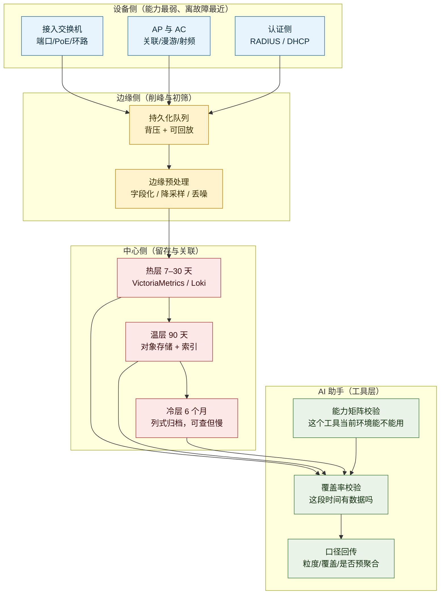
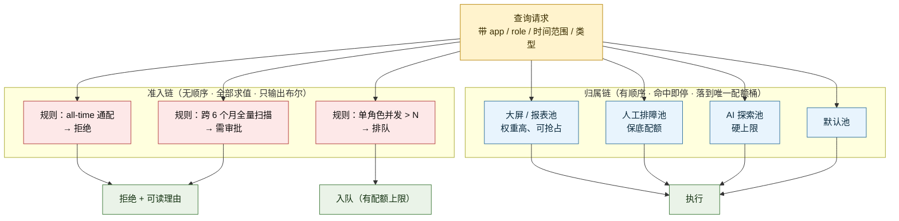

# Splunk 主干能力对锐捷园区业务的可借鉴性评估

> **评估对象**：Splunk 在 2023–2026 窗口内构筑的「机器数据平台主干与查询语言」六组能力（Ch1 分层存储 / Ch2 资源治理 / Ch3 查询语言 / Ch4 读时建模与加速 / Ch5 字段级治理 / Ch6 生命周期与可信基线），逐条对照**锐捷园区业务（园区网：接入交换机 / 无线 AP 与 AC / 认证链路 / 园区运维平台）**的真实问题。
> **能力依据**：全部功能点编号、机制原文与边界，均引自同目录 [`Splunk-机器数据平台主干与查询语言-2023-2026-功能体系与痛点解法.md`](Splunk-机器数据平台主干与查询语言-2023-2026-功能体系与痛点解法.md)，本文不重复论证，只做映射与落地设计。
> **本文不回答**：锐捷现有产品有没有这些功能（这需要产品内部盘点）；本文只回答「**这个机制搬到园区成不成立、怎么落**」。

## 一句话结论

**能借鉴的是「机制」，不是「功能」。** Splunk 的主干是在「PB 级数据 + 高并发查询 + 平台自身会被自己拖垮」这三个约束下长出来的；园区是「TB 级数据 + 低并发查询 + 故障发生在接入侧」。

三个约束全变了，所以：

- **Ch2（资源治理）、Ch3（profile 与视图）、Ch5（结果层脱敏）三组几乎可以原样搬**，因为它们的约束（多人共用、能力分层、合规不可删）在园区**更强**而不是更弱；
- **Ch1（分层存储）只能反着搬**——园区要的不是「省热存储」，而是「第 5 个月还查得到」，照抄「本地只留 24 小时」会直接砸掉合规场景；
- **Ch6 的一半要扔掉**——24 个月支持期、四段式版本号，在园区设备 5–10 年生命周期的现实里是负资产。

**一句话取舍**：**Splunk 主干给园区最大的价值，不是「排障算法」，而是「让排障数据留得起、查得动、说得清」的底座**。园区真正的排障能力来自设备侧遥测、拓扑与射频数据，这一层 Splunk 给不了，也不该指望它给。

## 交付内容

1. **第 1 章 先决判断**——园区与 Splunk 的四个结构性差异，以及由差异推出的「借 / 改 / 弃」三分法判据；
2. **第 2 章 功能 → 园区问题对应表**——按六个大功能点分组，逐条落到**现象级问题**（不是「提升效率」这类空话），标注借鉴强度与判据；
3. **第 3 章 怎么借：8 个可落地设计**——按 P0/P1/P2 分级，每条给「借什么机制 → 落法（技术栈映射）→ 关键参数与坑 → 反例」；
4. **第 4 章 给 AI 助手的 6 条硬约束**——把上述机制转成 AI 助手的产品规则；
5. **第 5 章 明确不借的三件事**；**第 6 章 优先级路线与验收指标**。

## 建议读法

| 路径 | 读什么 | 花多久 |
|---|---|---|
| **只想知道能不能借** | 一句话结论 → 2.1 对应总表（看强度列）→ 第 5 章不借清单 | 8 分钟 |
| **要做方案** | 第 1 章四个差异 → 第 3 章 P0 三条 → 第 6 章验收指标 | 25 分钟 |
| **要给 AI 助手定规则** | 第 3 章 P1-5 与 P0-2 → 第 4 章六条硬约束 | 15 分钟 |

---

## 1. 先决判断：园区与 Splunk 的四个结构性差异

不先讲清差异，后面的「对应」就会变成功能罗列。四个差异直接决定了哪些能借。

### 1.1 差异一：故障域在接入侧，不在平台侧

Splunk 主干解决的是**平台自己的元问题**：数据存不下、查询抢资源、口径对不上、版本活不长。它的客户痛点是「平台会不会被自己拖垮」。

园区的故障分布完全不同。按现象归类，园区报障的绝大多数落在四处：

| 故障域 | 典型现象 | Splunk 主干能提供什么 |
|---|---|---|
| **认证链路** | 早高峰 802.1X / Portal 认证失败率突增；用户只看到「连不上」，实际可能是 RADIUS 超时、DHCP 池耗尽、AC 会话表打满 | **只能提供「证据」**（认证日志、会话数、DHCP 分配记录），不能提供判决 |
| **无线接入** | 漫游粘滞（信号好但不切换）、掉线重连慢、同位置有人快有人慢 | **基本给不了**——需要射频侧数据（信道/功率/干扰/终端能力） |
| **有线接入** | 端口 err-disable、PoE 供电不足导致 AP/摄像头反复重启、私接路由器引发环路与广播风暴 | **只能提供「事后时间线」**，实时判决要靠设备自身 |
| **配置与版本** | 改一条 ACL 导致某学院整片断网；几百台接入交换机固件版本不一，升级窗口排不出来 | **这一块给得最多**（变更审计、配置下发、版本基线） |

> **由此得出的第一个判据**：**Splunk 主干在园区是「证据层」，不是「判决层」。** 借它的时候，目标要写成「让证据留得住、查得到、说得清」，而不是「让它帮我定位根因」。写成后者，验收一定失败。

### 1.2 差异二：数据量小一个数量级，但保留诉求长一倍

| 维度 | Splunk 典型客户 | 园区典型场景 |
|---|---|---|
| 日增数据量 | TB ~ 数十 TB | GB ~ 数百 GB（单园区） |
| 主力回看窗口 | 24 小时内（官方统计 97% 的搜索只看 24h） | 7 天内（排障）**＋ 6 个月（合规）双峰** |
| 保留驱动力 | 成本 vs 分析需求 | **等保 / 教育行业监管 / 事件追溯**，属强制项 |
| 查询并发 | 高（数百分析师 + 定时报表 + 加速任务） | 低（个位数到数十） |

这个差异带来一个**反直觉但很关键的结论**：

> **Splunk 官方自己说过「小规模、留存数据有限的部署不值得上 SmartStore」。园区很多场景正落在它说的「不值得」这一侧。**

所以：

- **照搬 SmartStore 的动机（省热存储钱）在园区基本不成立**——数据量不够大，分层的绝对收益低，而运维复杂度是实打实增加的；
- **但「分层」这个动作在园区仍然要做，动机换了**——不是为了省钱，是为了**让第 5 个月的数据还能被查**。合规检查、学期追溯、事件复查都发生在「很久以前」，而园区的热存储不可能留 6 个月。

**动机一换，设计就要反着做**：Splunk 的硬边界是「不能直接查对象存储」，园区反而应该做到「**冷数据能查，只是慢**」——因为园区查询并发低，等 10–30 秒完全可以接受。

### 1.3 差异三：锐捷同时是数据源厂商（这是优势，不是劣势）

Splunk 只能从别人家的设备里取数据：SNMP 轮询、syslog、REST API、流数据。它拿到的往往是**设备愿意吐出来的那部分**。

锐捷的设备自己就能吐结构化数据：Telemetry / gRPC、结构化 syslog、NetFlow / sFlow、AC 的会话表、AP 的射频与终端关联表。这意味着可以做一件 Splunk 做不到的事：

> **把「字段化」和「预聚合」下沉到设备侧或边缘侧，而不是全部搬到中心平台再做。**

这正好对应 Splunk Ch3 的 **profile 思想**（同一门语言在不同执行面裁剪成不同能力子集），但锐捷可以做得更彻底——**因为语言和编译器都是自己的**。

> **第二个判据**：凡涉及「数据怎么进平台」的设计，锐捷有比 Splunk 更大的设计自由度，应该**优先下沉**，而不是照抄「全部集中处理」。

### 1.4 差异四：园区是多租户 + 弱运维

一个园区平台通常同时服务：多个学院/部门（数据不能互看）、保卫处（大屏）、教务处（报表）、一线运维（排障）、以及新加的 AI 助手。

两个后果：

- **Ch2 资源治理与 Ch5 数据治理的权重，在园区比在 Splunk 更高**——因为用户更不专业，更容易写出「全园区 all-time 通配查询」这种把平台打满的语句；
- **Ch3「语言统一」的权重反而更低**——园区一线运维不会写查询语言，他们要的是点选和自然语言。SPL2 那套「一门语言覆盖搜索与流处理」的价值，在园区主要体现在**平台内部与 AI 的工具层**，不在终端用户侧。

### 1.5 由四个差异推出的「借 / 改 / 弃」三分法

| 判据 | 含义 | 对应章节 |
|---|---|---|
| **●●● 直接可借** | 机制成立的前提在园区同样（或更强）成立，改的只是数据源 | Ch2 全部、Ch3 的 profile/视图、Ch5 的结果层脱敏、Ch6 的 Agent 管理面 |
| **●● 改造可借** | 思路成立，但要在 1–2 个关键点上**反向设计** | Ch1 分层（动机反转）、Ch3 的 SPL2 语言统一（价值位置下移）、Ch4 加速（要额外解决「覆盖度可见」） |
| **● 仅思路可借** | 只能借「权衡意识」，实现搬不动 | Ch1 的 tsidx 压缩层级、Ch3 的 SQL 双模态（园区终端用户不用） |
| **✕ 不建议借** | 园区约束与之相反，照搬会亏 | 24 个月支持期、四段式版本号、「不能直接查对象存储」 |

### 1.6 园区的数据分层与执行面（本文后续设计的总图）

> **读图提示**：三条边是本文的核心主张——**「设备侧 → 持久化队列」**（对应 Ch1 的 Ingest-Tier Scaling，P0-1）、**「中心三层按时间分层且冷层仍可查」**（对 Ch1 的反向设计，P1-4）、**「AI 助手先做能力与覆盖率校验再取数」**（对 Ch3 profile 与 Ch4 覆盖度的借用，P1-5 + 第 4 章）。

---

## 2. 功能 → 园区问题对应表

> **读法**：每一行左侧是 Splunk 的具体功能点编号（可回到原报告核对原文），中间是机制内核，右侧是**园区能观察到的现象级问题**。强度判据见 1.5。

### 2.1 Ch1 分层存储主干（存得省）

| Splunk 功能（编号） | 机制内核 | 园区对应问题（现象级） | 强度 |
|---|---|---|---|
| 1.11 SmartStore 计算存储解耦（对象存储为 master copy，本地盘降级为缓存） | 存储与算力不再绑死；容量可独立扩 | **上网日志/认证明细要留 6 个月（等保），但平台盘只够留两周**；扩容只能加盘或删数据 | ●● 动机反转：园区要「留得起且查得到」，不是「省热存储钱」 |
| cache manager 的「97% 搜索只看 24h」统计 + `hotlist_recency_secs` 可调 | 命中率由**访问分布**决定，不由容量决定 | 拍脑袋定「热层留 7 天」→ 学期初追溯、监管检查前复查全部打空；定太长又白花钱 | ●●● 方法论直接借：**必须先量自己的回看分布** |
| 1.7 / 1.9 Ingest-Tier Scaling（逻辑分层 → 物理分层）+ 远程持久队列 + 背压 | 把「摄取峰值」从「索引能力」里剥离；队列**持久化**才能不丢 | **早 7:30–8:30 认证洪峰**把入库打满，丢的恰好是故障现场那段日志；事后复盘「数据缺一段」 | ●●● 直接可借 |
| 1.10 Indexing/Replication Separation（SmartStore 成 system of record，取消索引器间点对点复制） | 用外置存储的韧性替代节点间互备 | 多校区/多栋楼各自采集、中心统一查；为可靠性做**跨站点点对点复制**，成本高且一致性难保证 | ●● 改造可借（园区可简化为「中心一份 + 校区本地缓存」） |
| 1.5 `tsidxWritingLevel`（层级越高压缩越好，但**可被搜索的向后兼容版本越低**） | 压缩率与可查性是一对矛盾 | 归档格式选得太激进 → 升级后老归档查不了；选得太保守 → 存储成本高 | ● 仅思路：借「权衡必须显式声明」，不必照抄层级 |
| 1.5 官方自认「小规模、留存有限的部署**不值得**上 SmartStore」 | 分层有固定复杂度成本 | 单园区日增几百 GB，硬上分层 → 复杂度上去了，省下的钱不够付运维 | ✕ **反向判断依据**：园区不做「为省钱而分层」 |

### 2.2 Ch2 查询与计算资源治理（跑得稳）

> 这一组是**园区可借鉴密度最高**的一组：园区用户更不专业、更容易写出打满平台的查询，而平台还要同时服务大屏、报表、AI 助手与人工排障。

| Splunk 功能（编号） | 机制内核 | 园区对应问题（现象级） | 强度 |
|---|---|---|---|
| 1.x 工作负载池 + 权重（`cpu_weight` / `mem_weight`） | 资源按**业务属性**切分，而不是按到达顺序抢 | 保卫处大屏每 30 秒刷新一次全园区聚合，把 CPU 吃满；同时值班工程师点开排障页转圈 | ●●● 直接可借 |
| 2.4 `Queue search` 动作 + `adhoc_search_percentage` 谓词 | 「不杀掉、只延后」这一档处置 | 长查询只能「跑」或「报错」两选一；报错后用户重试，越试越堵 | ●●● 直接可借 |
| 2.5 系统级 / 角色级排队配额（防 unbounded queuing） | 排队本身要设上限 | 限流后查询全进队列，队列无界膨胀 → 内存涨、平台雪崩 | ●●● 直接可借 |
| 2.7 规则动作 `alert` / `move` / `abort` | 分级处置：通知 → 挪池 → 杀掉 | 某条 all-time 通配查询拖住整个平台，只能人工 kill 会话 | ●●● 直接可借 |
| 2.9 命中拦截时的自定义用户提示消息 | 把「系统行为」变成「可解释的组织行为」 | 用户查不到数据时无法区分：**是被限流了、没权限、还是真没数据** → 一律报「平台坏了」 | ●●● 直接可借 |
| 2.8 启用前的健康检查闸门（配置 + 系统双重校验，失败则不能启用） | 把「配错了」挡在启用之前 | 治理规则配错（比如误拦了核心业务）→ 上线后才发现，故障面被放大 | ●●● 直接可借 |
| **机制一：admission rules 无顺序、全部求值；workload rules 有顺序、命中即停** | **「能不能跑」是布尔判断；「算谁的」是分类问题**，两条链语义必须相反 | 用一条规则链同时决定这两件事 → 同一个查询**有时被拦有时被放**，用户完全无法预期 | ●●● **本文认为这是整份报告最值钱的一条** |
| 2.6 Kubernetes 上的 Basic 模式（cgroups 不可用时退化为纯准入） | 能力可以按环境退化，但**退化要显式声明** | 园区平台若跑在容器里，拿不到内核级隔离 → 却对外宣称「有资源隔离」 | ●● 改造可借（退化模式要写进产品说明） |
| 边界：admission rules **只作用于 base search，不作用于子搜索** | 治理有后门 | 用户把大查询包进子查询就绕过限流，治理形同虚设 | ●●● **必读的坑**（见 3.2） |
| 机制二：定时查询规则求值**最长 600 秒延迟** | 治理生效不是即时的 | 「我加了规则它还在跑」→ 判定为「功能没用」，退回人工管理 | ●●● 直接可借（延迟必须写进文档） |

### 2.3 Ch3 查询语言 SPL → SPL2（一学通用）

| Splunk 功能（编号） | 机制内核 | 园区对应问题（现象级） | 强度 |
|---|---|---|---|
| **profile 机制**（`splunkd` / `edgeProcessor` / `ingestProcessor` 三套能力子集） | 同一门语法，不同执行面**裁剪成不同能力集** | 设备侧、AC/网关侧、中心平台三层能算的东西完全不同；AI 助手不知道「这个工具在这一层能不能用」，报错时报成「查询写错了」 | ●●● **直接可借（对 AI 助手尤其关键）** |
| 3.1 一门语言覆盖「库内 + 流内」 | 同一套逻辑在搜索侧写完、在管道侧复用 | 排障时写的判定逻辑（如「认证失败三次以上」）无法直接变成边缘侧的告警规则，要写两遍 | ●● 改造可借（园区三层差异更大，见 1.3） |
| 3.4 module + 多语句编辑器（类 notebook，可保存/共享/版本化） | 把「一次调查」变成**可保存、可共享、可版本化的对象** | 老师傅的排障步骤在私人记事本里；人一走，方法就没了；同类故障每次重新摸 | ●●● 直接可借 |
| 3.7 SPL2 views（索引之上的虚拟数据集，**可独立授权**，不复制数据） | 「可见性」从「数据放哪」里解耦出来 | 多个学院看同一套平台，数据不能互看 → 只能**每个学院建一套库**，存储与维护成本翻倍 | ●●● 直接可借 |
| 3.11 `\| spl1` 回退 + 3.10 站内转换器 + 语言选择器默认仍是旧语言 | 迁移必须**可逆、可逐条灰度、默认不换** | 存量排障脚本/报表/大屏查询上百条，换查询引擎时只能「一次性全改」→ 没人敢升级 | ●●● 直接可借 |
| 3.16 SAIA（自然语言 ↔ 查询语言双向翻译） | 不会写查询的人也能取数 | 一线运维不会写查询；教务要报表只能提工单排队 | ●●● 直接可借（但官方明示不保证正确，见第 4 章） |
| 3.8 SPL2 支持 SQL 语法（双模态） | 给 SQL 背景的人一个入口 | 报表岗/教务岗会 SQL 但不会专有查询语言 | ● 仅思路：园区报表需求用预置模板更实际 |
| 边界：SPL2 **没有默认索引/数据集**，必须显式 `from` | 显式优于隐式 | AI 生成的查询「语法合法但语义错」（查错数据源），**且不会报错** | ●●● 必读的坑（第 4 章约束 1） |

### 2.4 Ch4 读时建模与加速层（读得懂）

| Splunk 功能（编号） | 机制内核 | 园区对应问题（现象级） | 强度 |
|---|---|---|---|
| 4.1 事件模型 + 搜索时字段提取（schema-on-read） | 结构在**读时**施加，写入时不丢弃未预设的维度 | 园区设备型号杂（不同代交换机、不同 AP、不同固件）→ 日志字段名与格式不一致；写入时固定 schema 必然丢信息 | ●●● 直接可借 |
| 4.3 加速摘要（HPA store，`.tsidx` 存字段::值与位置）+ 4.4 `tstats` 直读 | 对反复查的大数据集做**预计算** | 大屏与日报反复算同一组聚合（按学院/按 SSID 的在线数），每次全量扫 → 慢且吃 CPU | ●●● 直接可借 |
| 4.5 官方成本公式「加速存储/年 = 每日数据量 × 3.4」+ 摘要**不参与索引尺寸计算** | 预计算有明确成本，且**容易被预算漏算** | 上了预聚合后存储涨了 3 倍，财务问「钱花在哪」答不出来；容量规划按原始数据算 → 反复扩容 | ●●● 直接可借（成本必须显式入账） |
| 4.6 加速摘要**默认不随索引器集群复制**（只有 primary 桶副本带摘要，primacy 变更后要等下次更新发现缺失才重建） | 预计算有**副本策略**与**重建触发条件**，且默认策略是「不复制」 | 主备切换/节点替换后，报表突然变慢甚至超时；业务第一反应是「平台坏了」，而不是「加速失效了」 | ●●● 直接可借 |
| 4.7 宏**默认复制到 search peers**（9.1 起），且官方承认该变更会「让原本失败的查询开始成功并产生负载」 | 口径必须**统一分发**，否则同一问题两个答案 | 同一个「在线终端数」，大屏和教务报表差 8%；查半天发现是两边口径定义不同步 | ●●● 直接可借 |
| 边界：**非流式根搜索数据集、根事务型数据集无法持久加速** | 不是所有东西都能预聚合 | 含 join/事务拼接的复杂统计（如「一次认证全过程耗时」）无法预聚合 → 却按预聚合承诺了性能 | ●●● 必读的边界 |
| 边界：加速只在 **summary range 内**有效 | 加速有**时间窗口** | 加速了最近 30 天，用户查一学期 → 只有 30 天被加速，其余回扫；用户以为「整个查询都慢」 | ●●● 必读的边界（AI 必须回报，见第 4 章） |

### 2.5 Ch5 字段级数据治理（管得细）

| Splunk 功能（编号） | 机制内核 | 园区对应问题（现象级） | 强度 |
|---|---|---|---|
| 5.1 field filters 三种处置：**擦除 / 替换为 XXXX / SHA-256 或 SHA-512 哈希** | 脱敏在**结果层**做，不改源数据 | 上网日志含账号、MAC、URL；等保要求「可追溯但不泄露」；教务处又要统计「同一学生登录次数」 | ●●● 直接可借 |
| **哈希保留字段唯一性**（同一值哈希相同，仍可 `count by`） | 「不知道是谁，但知道有多少个不同的人」 | 直接擦除 → 脱敏后连「有多少人」都统计不了，分析能力被毁；用假名映射又要维护映射表 | ●●● **直接可借（脱敏设计的分水岭）** |
| 源数据**不可变**（field filters 不改索引中的源数据） | 合规方案只能落在「读时」，不能承诺「删除」 | 客户提「把某学生三个月的记录删掉」→ 技术上做不到；承诺了就是交付事故 | ●●● 直接可借（**口径要先说清**） |
| 5.x 作用域限定（可限定到 host / source / index / sourcetype，官方明确限定作用域**显著提升搜索性能**） | 作用域既是性能优化，也是**灰度手段** | 全量规则拖慢所有查询；上线新脱敏规则不敢一次全推 → 无法按楼栋/学院灰度 | ●●● 直接可借 |
| 5.3 知识对象**细粒度权限**（三种能力取代单一 `admin_all_objects`） | 权限从「一把大锤」拆成可按需组合的能力点 | 学院要自己管本院的大屏和报表 → 只能给「管理员」这个粗角色，等于把整个平台交出去 | ●● 改造可借（园区角色更少，可先拆成 2–3 个） |
| 5.8 配置变更审计（`_audit`，10.6 起覆盖 Web / REST 变更） | 变更要能回答「谁、改了什么、何时」 | 谁改了 SSID 密码、谁动了 ACL、谁把某端口加进了白名单——事后追不到人，只能互相猜 | ●●● 直接可借（**园区比 Splunk 更痛**，见 3.7） |
| 边界：**只能保护「索引内的数据」**，查找表（lookup）等不覆盖 | 治理有明确的作用域边界 | CMDB/资产表/白名单表里也有敏感信息（责任人手机号、房间号）→ 以为被 field filters 保护了，其实完全没有 | ●●● **必读的坑** |
| 边界：**无法通过 Web 界面配置角色级过滤**（需改配置文件） | 高危配置刻意不给 UI | 园区一线运维水平更弱 → 必须给 UI，但同时要做「改前预览 + 影响面提示」 | ●● 反向设计：不能照抄「只给配置文件」 |

### 2.6 Ch6 平台生命周期与可信基线（撑得久）

| Splunk 功能（编号） | 机制内核 | 园区对应问题（现象级） | 强度 |
|---|---|---|---|
| 6.4 Deployment Server **集群化**（最多 3 台 × 25K = 75K 客户端） | 配置下发面本身要能扩容与容灾 | 一个园区几千到上万台设备/采集器，配置下发节点是单点；它挂了全网配置就停更 | ●●● 直接可借 |
| 6.6 / 6.7 / 6.8 Agent 管理面（统一视图 + 纳管 OTel Collector + Agents lookup 用缓存 CSV 降 UI 加载） | 采集侧要**集中管、能看版本、列表要快** | 设备清单页打开要 20 秒；几百台设备的采集器版本靠人工表格统计；「谁知道这台还在不在上报」 | ●●● 直接可借 |
| 6.10 OTel Collector **远程配置**（OpAMP；Collector 必须上报 `AcceptsRemoteConfig` 才能收、`ReportsRemoteConfig` 才能回状态） | 远程配置需要**能力协商**，不能假设对端支持 | 平台下发新采集规则 → 老版本采集器静默不生效，没人知道；配置改了但状态不可见 | ●●● 直接可借（**能力协商是必须项**） |
| 6.1 / 6.2 / 6.3 平台自身滚动升级自动化 + **可中止** + `splunk_system_upgrader` 角色 | 升级要能编排、能中断、能授权到角色 | 园区平台升级要停机窗口；升到一半卡住只能干等；每次升级都是「项目」 | ●●● 直接可借（**指平台自身，不是设备**） |
| 6.11 / 6.12 FIPS 140-3、mTLS、TLS 1.3 + PQC（Kyber / Dilithium / SPHINCS+，FIPS 203/204/205） | 加密基线是**采购门槛**，不是功能 | 政府、金融、军工园区客户的安全审查会直接问 FIPS / 国密 / 后量子迁移路线 | ●● 改造可借（国内以国密为主，需替换算法族） |
| 6.x 24 个月支持期（当前 major + 紧邻上一 major） | 逼客户保持版本新度 | 园区客户 5–10 年不换设备、不换平台；24 个月支持期＝每年逼客户做一次升级项目 | ✕ **不建议借**（见第 5 章） |
| 6.12 四段式版本号（`Major.Minor.Maintenance.Patch`） | 版本语义更精确 | 客户自定义解析脚本（大屏取数、巡检脚本）解析版本串失败 → 升级即故障 | ✕ **不建议借**（见第 5 章） |

### 2.7 反向核对：园区高频问题里，Splunk 主干**答不了**的

诚实标注这一节，是为了防止把借鉴价值估高。

| 园区高频问题 | 为什么 Splunk 主干答不了 | 该由谁答 |
|---|---|---|
| 终端漫游粘滞（信号好但不切换） | 需要终端侧与射频侧的连续采样，syslog 粒度是「事件」不是「过程」 | 设备侧遥测 + 终端关联表 |
| 信号满格但网速慢 | 需要空口质量、重传率、信道利用率、干扰源 | 射频侧数据（AP 采集） |
| 802.1X 认证失败的**协议级原因**（EAP 第几轮失败） | 平台只能看到「认证失败」这个结果事件 | 设备侧 EAP 交互日志或抓包 |
| PoE 供电芯片异常 | 设备内部硬件状态，不在日志语义层 | 设备 Telemetry（硬件传感器） |
| 环路/广播风暴的**实时**判决 | 平台上看到的是「一分钟后大量端口 up/down」 | 设备侧实时检测（如 RLDP/风暴抑制） |
| 私接路由器/代理的**发现** | 平台只能看流量特征，无法主动探测 | 设备侧探针 + 终端指纹 |

> **结论**：Splunk 主干的能力，在园区只覆盖「**事后证据链**」这一段。它的六组能力里，**Ch2 / Ch5 / Ch6** 影响的是「平台好不好用、数据合不合规」，**Ch1 / Ch3 / Ch4** 影响的是「证据留不留得住、查不查得到」。**没有一组能直接变成园区的排障判决能力。** 这一点必须在立项时就对齐，否则会拿「平台能力」去背「设备能力」的 KPI。

---

## 3. 怎么借：8 个可落地设计

> 每条统一四段：**借什么机制 → 落法 → 关键参数与坑 → 反例**。落法按锐捷 APM 现有技术栈（VictoriaMetrics / Loki / MySQL / Pyroscope / Redis）给映射，不引入未验证的组件假设。

### P0-1 削峰用的持久化队列（借 Ch1 的 Ingest-Tier Scaling）

**借什么机制**：把「摄取能力」与「索引能力」解耦，中间放**持久化**队列，并让**背压可见**。官方这一层的核心不是「加个队列」，而是「队列必须扛得住峰值，且峰值过后能补上」。

**园区问题**：早 7:30–8:30 认证与 DHCP 日志量是日均的 5–15 倍。直连入库时，这个时段**丢的恰好是全天最需要的那段日志**——用户报「早上连不上」，复盘时数据缺口就在那里。

**落法**：

| 环节 | 设计 | 技术映射 |
|---|---|---|
| 采集 | 设备/AC 按楼栋或按设备组分流 | syslog / Telemetry 分区键 = 楼栋 ID |
| 缓冲 | 持久化队列，**按楼栋分区**，可回放 | Kafka（推荐）或 Redis Stream + AOF + 容量上限 |
| 消费 | 采集器按消费能力拉取，慢了下游就堆在队列里 | 消费者组，积压量作为核心指标 |
| 入库 | 指标入 VM、日志入 Loki、明细入 MySQL | 与现有栈一致，不新增存储类型 |
| 观测 | 队列深度、消费延迟、丢弃计数**三个指标必须上大屏** | VM 自采指标 |

**关键参数与坑**：

- **峰值倍数必须先实测**（早高峰 / 日均），这是队列容量与分区数的唯一输入，不能拍脑袋；
- **队列最大堆积时长 ≥ 故障回溯窗口**（建议 ≥ 2 小时）——否则队列满了开始丢，等于没做；
- **背压要显式选择策略**：阻塞采集（可能丢在设备侧）还是丢低优先级（会话明细可降采样，认证结果不可丢）。这个选择必须写进产品文档；
- **纯内存队列（Redis list 无 AOF、无上限）等于没做**——这是最常见的假实现。

**反例**：`syslog → 直连入库`。看起来很简洁，但把「设备上报速率」与「入库能力」绑死了，洪峰必丢。

---

### P0-2 两套规则引擎分离：准入（boolean）与归属（classification）

**借什么机制**：Splunk 在同一个平台里跑两套**语义相反**的规则引擎——`admission rules` **无顺序、全部求值**（因为「该不该跑」是布尔判断，任一规则说不就该拦）；`workload rules` **有顺序、命中即停**（因为「算谁的配额」是分类问题，必须落到唯一一个桶）。这是整份报告里方法论价值最高的一条。

**园区问题**：一个园区平台同时被五类负载打——保卫处大屏（定时、高频、聚合重）、教务处报表（定时、低频、跨度大）、一线排障（临时、突发）、AI 助手（临时、探索性、可能连环调工具）、巡检脚本（批量）。现状通常是「先到先得」，于是**大屏把 CPU 吃满时，值班工程师点开排障页转圈**——最需要平台的时候它最慢。

**落法**：

**关键参数与坑**：

- **必须补一个 Splunk 没有的东西：解析期拦截嵌套**。官方明说 admission rules「只作用于 base search，不作用于子搜索」——这等于留了个后门：把大查询包进子查询就能绕过治理。园区版两条路选一条：① 在查询解析阶段识别嵌套，按**最外层**统一判；② 明确写「嵌套不受控」，并在文档里给绕行方案。**不能不选**；
- **规则变更生效延迟要写进文档**。Splunk 对定时查询的规则求值默认 600 秒一次。园区的大屏与报表大量是定时任务，**这条延迟对它们尤其明显**——「我加了规则它还在跑」会被判定为功能无效；
- **拒绝理由要分类**（限流 / 无权限 / 无数据 / 能力不支持），四类话术不同，见第 4 章约束 3；
- **排队必须有上限**（对应 2.5 的排队配额）。只有「排队」没有「配额」，队列会无界膨胀直到把平台自己压垮。

**反例**：用一条规则链同时决定「能不能跑」和「算谁的」。结果就是同一个查询**有时被拦、有时被放**——用户无法建立预期，治理会被当成 bug。

---

### P0-3 脱敏放结果层，且用哈希保留等价关系

**借什么机制**：Ch5 的三件事——**在结果层做、不改源数据、哈希保留唯一性**。官方给的三档处置是「擦除 / 替换为 XXXX / SHA-256 或 SHA-512 哈希」，并明确哈希后**同一值哈希相同，仍可 `count by`**。

**园区问题**：三种诉求同时存在且互相矛盾——

| 角色 | 诉求 |
|---|---|
| 等保 / 教育局 | 日志要留 6 个月，且**可追溯到人** |
| 客户隐私要求 | 不能让运维随便看到「谁访问了什么」 |
| 教务处 | 要统计「同一学生一周登录多少次」「某学院在线终端数」 |
| 事后追责 | 出事了要能定位到具体账号 |

**落法**：

| 字段 | 处置 | 保留了什么 |
|---|---|---|
| 账号 / 学工号 | SHA-256 + **按租户加盐** | 可 `count distinct`，不可反查 |
| MAC | 保留 OUI 前 3 字节 + 后 3 字节哈希 | 保留厂商分布（排查终端类型问题要用），隐去设备唯一性 |
| URL | 降为域名级 + path 哈希 | 保留「访问了哪个站点」，隐去具体页面 |
| IP | 按角色分级：运维见完整 / 教务见网段 | 分级可见，而不是一刀切 |
| 作用域 | 按 index / 楼栋 / SSID 限定 | 既是性能优化，也是**灰度手段**（先推一栋楼） |

**关键参数与坑**：

- **只保护「入库的数据」**——这是官方明写的边界。CMDB、资产表、白名单表里的责任人手机号、房间号**完全不受保护**，必须单独做元数据治理。**这是最容易漏的一条**；
- **盐必须按租户隔离**。全局一个盐 → 跨学院可以拿哈希做碰撞比对，等于没脱敏；
- **不能承诺「删除」**。源数据不可变，合规方案只能承诺「不可见 + 可审计 + 到期随保留策略淘汰」。销售口径先统一，否则交付必出事故；
- **高危配置不能只藏在配置文件里**。Splunk 官方不支持通过 Web 配角色级过滤，是因为操作危险；但园区一线运维水平更弱，**必须给 UI，同时给「改前预览 + 影响面提示」**——照抄「只给配置文件」会直接导致配错没人发现。

**反例**：直接擦除账号字段。脱敏后连「有多少个不同用户」都算不出来，分析能力被一并毁掉。

---

### P1-4 时间分层，但冷层必须「可查」（对 Ch1 的反向设计）

**借什么机制**：借 Ch1 的**时间维度分层思想**，但**不借它的硬边界**。Splunk 的边界是「只能搜本地化或缓存的桶，不能直接查对象存储」——这个边界成立的真正原因是**高并发**（几百分析师同时查，不可能每次都从对象存储拉）。园区并发是个位数到数十，**同一个边界在园区不成立**。

**园区问题**：等保要求日志 ≥6 个月。热存留 6 个月成本不可接受；只留 7 天又直接违反合规。真正的痛不是「存不起」，而是**「第 5 个月要查的时候查不到」**——监管检查、学期追溯、事件复查都发生在很久以前。

**落法**：

| 层 | 时间 | 存储 | 查询体验 |
|---|---|---|---|
| 热 | 7–30 天 | 本地 SSD（VM + Loki 原生） | 秒级 |
| 温 | 90 天 | 对象存储 + 索引 | 3–10 秒 |
| 冷 | 6 个月+ | 对象存储 + 列式归档（按天分区） | 10–60 秒，**异步返回** |

三条设计要求：

1. **查询入口统一**：用户不需要知道数据在哪一层，系统自动路由；命中冷层时明确提示「数据来自归档，预计 N 秒」；
2. **冷层查询必须限流**：一个全量扫描就能把平台拖垮 → 与 P0-2 的准入链联动，冷层扫描按「审批 + 队列」处理；
3. **必须先量回看分布**：不要抄 Splunk 的「97% / 24h」。园区的分布是**双峰**——日常 7 天内，**学期初与检查前出现长回看尖峰**。热层大小按双峰来定，不是按日均。

**关键参数与坑**：

- **冷层的「可查」是有代价的**：要么慢，要么占资源。**必须把「慢」明确告知用户**，而不是让他们等 60 秒以为死机；
- **归档格式要能跨版本读**。这正好对应 Ch1 的 `tsidxWritingLevel` 那条边界——压缩越激进，可被搜索的版本越少。归档格式要选**长期稳定、有标准工具可读**的（如 Parquet），不要自造二进制格式；
- **边界案例**：如果某园区日增只有几十 GB，**冷层可以直接用温层方案**，不必上列式归档——复杂度不值得。

**反例**：照抄「本地只留 24 小时」。这在 Splunk 语境下是合理设计（有对象存储兜底 + 高并发），在园区语境下会让合规场景**直接失守**。

---

### P1-5 预聚合 + 覆盖度元字段（借 Ch4 的加速摘要，补上它没解决的「可见性」）

**借什么机制**：Ch4 的三件事——**预计算放在数据所在的位置**、**有明确成本**（官方公式「加速存储/年 = 每日数据量 × 3.4」）、**只在 summary range 内有效**。

**园区问题**：大屏每 30 秒刷新一次「各学院在线终端数」，日报每次算「按 SSID 的认证成功率」——每次都全量扫原始数据，慢且吃 CPU。而更隐蔽的问题是：**AI 助手拿到「没有数据覆盖」的时间段，会断言「一切正常」**。

**落法**：

| 环节 | 设计 |
|---|---|
| 预聚合 | VictoriaMetrics recording rules，按 (楼栋, SSID, 学院) × 5 分钟粒度 |
| 成本入账 | 预聚合序列数 × 保留期单独计量，**不混进原始指标预算** |
| 覆盖度元数据 | 每条结果附 `granularity` / `coverage_start` / `coverage_end` / `is_precomputed` / `fallback_used` |
| 回退 | 预聚合缺失（如主备切换后）→ 自动回退原始数据，并标记 `fallback_used=true` |

**关键参数与坑**：

- **预聚合有硬边界**：含 join / 事务拼接的复杂统计（如「一次完整认证过程的端到端耗时」）**无法预聚合**。Splunk 的对应边界是「非流式根搜索数据集、根事务型数据集无法持久加速」。**不要对这些指标承诺性能**；
- **预聚合可能「静默消失」**。Splunk 的摘要默认不随集群复制，primacy 变更后要等下次更新发现缺失才重建。园区的主备切换同理：**切换后报表变慢，业务第一反应是「平台坏了」，而不是「加速失效了」**。所以 `fallback_used` 这个字段不是锦上添花，是**故障归因的关键证据**；
- **3.4 倍这个系数不能直接抄**，但「预聚合成本必须显式入账」这个方法要抄。园区自己测出来的倍数可能是 1.8 也可能是 5，取决于维度基数。

**反例**：只返回数字，不返回「这个数字是怎么来的」。这是 AI 助手最容易失信的地方。

---

### P1-6 视图化多租户（借 Ch3 的 views + Ch5 的知识对象权限）

**借什么机制**：Ch3 的 **view 是建立在数据源之上的虚拟数据集，可独立授权，且不需要复制数据**。官方给的三条价值主张正好对上园区：精确共享、减少膨胀、无需复制即可细粒度 RBAC。

**园区问题**：一个园区平台服务多个学院/部门，数据不能互看。现状做法通常是**每个学院建一套库**——存储翻倍、维护翻倍、口径还容易走偏（各库的字段定义慢慢分叉）。

**落法**：

| 层 | 内容 |
|---|---|
| 物理层 | 一套原始数据（指标 / 日志 / 明细），不做学院级拆分 |
| 视图层 | 视图 = (数据源 + 过滤条件 + 授权主体)，如「信息学院视图 = 楼栋 in (A1,A2) AND SSID like 'XSD-%'」 |
| 权限层 | 视图的访问权与**底层数据源的访问权分离**；学院只能看视图，不能看原始源 |
| 元数据 | 视图定义纳入版本管理（对应 Ch3 的 module 可版本化） |

**关键参数与坑**：

- **「以所有者身份运行」的语义必须显式定义**。Splunk 的 SPL2 view 有这个概念：视图以所有者权限运行，可以让多个角色在不同权限下看到同一份数据。但这也意味着——**学院 A 的视图被学院 B 调用时，看到的是 A 的数据范围还是 B 的？** 不写清楚，一定出权限事故；
- **视图不能替代数据隔离的合规要求**。如果监管明确要求「物理隔离」，视图方案不满足。这个判断要在售前就做，不要到交付才发现；
- **视图的过滤条件要能被审计**。谁改了视图定义 = 谁能扩大可见范围，这属于高危变更（对应 P2-7）。

**反例**：每学院一套库。短期最省事，长期是三倍成本 + 口径分叉。

---

### P2-7 配置变更审计：必须覆盖「绕过平台」的路径

**借什么机制**：Ch5 的 `_audit`（记录「谁、改了什么、何时」）+ Ch6 的「变更要可编排」。

**园区问题**：谁改了 SSID 密码、谁把某端口加进了白名单、谁动了一条 ACL——事后追不到人，只能互相猜。更麻烦的是**有人直接登设备改**，平台完全不知道。

**落法**：

| 变更来源 | 采集方式 |
|---|---|
| 平台 UI / API | 平台自身写审计事件（对应 `_audit`） |
| **直接登设备改（CLI / SSH）** | **从设备侧采集配置变更 syslog + 定期配置 diff** |
| 批量脚本 / 自动化工具 | 要求走 API；识别不到的用配置 diff 兜底 |

**关键参数与坑**：

- **Splunk 自己也只覆盖「Web 或 REST API」的变更，CLI 与直接改配置文件是否覆盖官方未说明**——这正说明**「平台侧审计天然有洞」**。园区必须用**设备侧证据**补这个洞，这是锐捷作为设备厂商的天然优势（见 1.3）；
- **配置 diff 要有基线**。没有基线就只能看到「变了」，看不到「从什么变成什么」；
- **审计日志本身不能被人改**。写只追加存储，且与业务数据分开权限。

**反例**：只在 UI 层记日志。等于只审计了「守规矩的人」。

---

### P2-8 采集器集中管理 + 能力协商

**借什么机制**：Ch6 的 Agent 管理面 + OpAMP 的**能力协商**（Collector 必须上报 `AcceptsRemoteConfig` 才接收配置、上报 `ReportsRemoteConfig` 才回报状态）+ **Agents lookup 用缓存 CSV 替代查索引以降低 UI 加载时间**。

**园区问题**：几百到上万台设备/采集器，版本不一；配置改一遍就是一次项目；设备清单页打开要 20 秒；「谁知道这台还在不在上报」。

**落法**：

| 能力 | 设计 |
|---|---|
| 资产视图 | 采集器上报 (版本, 支持的配置能力集, 当前配置哈希, 最后心跳) |
| 配置下发 | 按能力集匹配下发；不支持的目标**显式标记为「不可远程配置」**，而不是静默失败 |
| 清单性能 | 清单走缓存（对应 Agents lookup 的思路），不每次查库 |
| 状态回报 | 下发后要求回报状态；无回报 = 「结果未知」，不是「成功」 |

**关键参数与坑**：

- **能力协商缺了，就是静默失败**。老版本采集器收不到新配置，平台显示「已下发」，现场毫无变化——这是最难查的故障类型；
- **「已下发」与「已生效」必须分开**。三个状态：已下发 / 已确认收到 / 已生效；
- 园区大量设备是**存量**，不要假设都能升级到支持远程配置的版本（对应 Ch1 的「既有部署无改造路径」这类现实约束）。

**反例**：SSH 批量脚本 + Excel 台账。脚本失败没人知道，台账永远是三个月前的。

---

## 4. 给 AI 助手的 6 条硬约束

> 这一章是把上面 8 个设计**收敛成产品规则**——因为 AI 助手是这些机制最终的使用者，也是**最容易把「平台缺陷」包装成「结论」的一环**。

| # | 硬约束 | 对应机制 | 违反后的典型事故 |
|---|---|---|---|
| 1 | **取数前必须先查「覆盖度」，再查「有没有异常」** | Ch4 的 summary range 边界 + P0-1 的数据缺口 | AI 回答「该时段未发现认证失败」，实际是那段日志根本没入库。**这是园区 AI 最致命的失败形态**——它把「不知道」说成了「没问题」 |
| 2 | **每个工具必须声明「能力矩阵」：支持哪些执行面、最低版本、前置依赖** | Ch3 的 profile 机制 | AI 拿中心侧才有的工具去查设备侧，报「查询失败」→ 用户以为是平台坏了 |
| 3 | **拒绝必须分类给理由：限流 / 无权限 / 无数据 / 能力不支持** | Ch2 的 2.9 User Message | 统一回「查询失败，请稍后重试」→ 用户反复重试，越试越堵；治理被当成 bug |
| 4 | **输出必须带「可复现口径」：数据截止时间、粒度、是否预聚合、覆盖范围、以谁的身份查** | Ch4 的 P3 + Ch5 的 P5 | 同一问题两次答案不同，且无法解释差异来源 → 助手彻底失信 |
| 5 | **自然语言的结果要落回「可编辑的查询/视图草稿」，不只给答案** | Ch3 的 module / views | 用户无法纠错、无法复用；工程师失去最终判定权 |
| 6 | **「不做清单」要写进产品，助手要能说「这个我做不到，因为…」** | 各章 K.5 六维度 | 硬编一个看起来合理的答案。**宁可说不知道，也不能编** |

> **第 1 条为什么排第一**：Splunk 官方在 9.1 那次「宏默认复制」的变更里承认过一件事——该变更会让「**原本失败的查询开始成功**」，从而产生一批新负载。这说明**「有数据」与「没数据」的边界变化，本身就是一等公民**。AI 助手如果不知道这条边界在哪，它的所有结论都是不可信的。

---

## 5. 明确不借的三件事

| # | 不借什么 | 为什么在园区会亏 |
|---|---|---|
| 1 | **「不能直接查对象存储」这条硬边界** | 它成立的真正前提是**高并发**（几百分析师同时查，每次从对象存储拉不现实）。园区并发是个位数到数十，**同一个边界不需要成立**。照搬的结果是：合规要查第 5 个月的数据，平台答「查不了」——这不是架构先进，是功能缺失 |
| 2 | **24 个月支持期** | 园区设备与平台的生命周期是 5–10 年，客户按「一次投入用五年」做预算。24 个月支持期＝每年逼客户做一次升级项目。**Splunk 敢这么做，是因为它的客户是 PB 级、有专职平台团队；园区的运维往往只有 1–2 个人** |
| 3 | **四段式版本号（`Major.Minor.Maintenance.Patch`）** | 它会让客户的版本解析脚本失效（大屏取数、巡检脚本、自动化工具）。Splunk 官方自己在 10.6 也承认这属于「breaking change」。**园区客户的自研脚本能力更弱、更没人维护，伤害放大** |

**另有一条「半借」**：Ch1 的**物理分层**限制很硬——仅 10.6+ 新建部署、仅 BYOL/CMP/K8s、**仅 AWS**、既有部署无改造路径。园区以私有云/混合云为主，这套约束基本对不上。**借它的「逻辑分层」思想（10.2 那种同机双流水线），不借它的「物理分层」实现。**

---

## 6. 优先级路线与验收指标

### 6.1 落地优先级

| 优先级 | 借鉴项 | 解决的园区问题 | 落地成本 | 前置依赖 |
|---|---|---|---|---|
| **P0-1** | 持久化削峰队列 | 认证高峰丢日志＝丢故障现场 | 中（需引入/规范队列） | 设备侧分流键（楼栋/设备组） |
| **P0-2** | 准入链 + 归属链分离 | 大屏与排障抢资源；同一查询行为不确定 | 中（两套规则引擎 + 解析期拦截） | 查询解析层可识别嵌套 |
| **P0-3** | 结果层脱敏 + 哈希等价 | 合规要追溯、客户要隐私、教务要统计，三者并存 | 低（读时处理，不动存量） | 字段级权限模型 |
| **P1-4** | 时间分层 + 冷层可查 | 留 6 个月但第 5 个月查不到 | 高（归档格式 + 查询路由） | 回看分布实测 |
| **P1-5** | 预聚合 + 覆盖度元字段 | 大屏/日报慢；AI 把「没数据」当「没问题」 | 中（recording rules + 元数据） | 预聚合边界清单 |
| **P1-6** | 视图化多租户 | 多学院隔离只能靠建多套库 | 中（视图 + 权限模型） | 「以所有者身份运行」语义定清 |
| **P2-7** | 变更审计（含设备侧） | 谁改的追不到；绕过平台的变更完全不可见 | 中（平台 + 设备侧双采） | 配置基线 |
| **P2-8** | 采集器集中管理 + 能力协商 | 版本碎片、配置下发靠脚本、清单慢 | 中高（协议 + 存量兼容） | 采集器能力上报 |

**建议顺序**：**P0-3（成本最低、合规收益最直接）→ P0-1 → P0-2 → P1-5 → P1-4 → P1-6 → P2**。

理由：P0-3 是纯读时改造、不动存量数据、能立刻对上等保诉求，最适合作为「借鉴成立」的第一个证据；P0-1 与 P0-2 解决的是「平台在最需要的时候最慢」这类**体感最强**的问题；P1-4 成本最高，应放在前几项验证过「分层与治理能落地」之后。

### 6.2 验收指标（不通过就不算落地）

| 指标 | 目标 | 怎么测 |
|---|---|---|
| 认证高峰日志完整性 | **零丢失** | 对比「设备侧发送计数」与「入库计数」，按 5 分钟粒度对差 |
| 被拦查询的可解释率 | **100% 有可读理由** | 抽样 100 次拒绝，人工判定理由是否让用户明白下一步该做什么 |
| 治理的一致性 | 同一查询重复执行，**拦截结果一致** | 用 20 条边界查询各跑 10 次，看是否有「有时拦有时放」 |
| 脱敏后的分析能力 | 「同一用户登录次数」统计**误差为 0** | 脱敏前后对同一批数据跑 `count distinct`，结果必须相等 |
| 长回看查询成功率 | 第 5 个月数据查询**成功率 100%**，P95 延迟 < 60 秒 | 按季度抽样查询，记录成功率与延迟分布 |
| 结论可复现率 | AI 输出**100% 带口径字段** | 解析助手输出，检查 5 个必带字段是否齐全 |
| 变更审计覆盖率 | **含绕过平台路径**，覆盖率 100% | 人为用 SSH 直改一台设备，看审计里能否查到 |
| 配置下发确认率 | 「已生效」占比可观测，**「结果未知」不得计为成功** | 对比下发数与回报数，未知数单列 |

---

## 7. 一句话收束

Splunk 的主干不是给园区准备的——它是为「PB 级数据 + 高并发 + 平台自身会被拖垮」设计的。但正因为它的约束更极端，**它在约束下被迫发明的那几套机制（准入与归属分离、能力子集 profile、结果层脱敏、预计算的成本与覆盖度显式化），在园区反而更适用**——因为园区的用户更不专业、合规更硬、运维更少。

真正要小心的只有一件事：**别把「平台底座能力」当成「排障能力」卖。** 园区排障的主战场在设备侧与射频侧，Splunk 主干能做的，是把那条事后证据链**留得住、查得到、说得清**。把这三件事做到位，已经是很大的价值；承诺更多，就会变成交付事故。

---

*文档生成时间：2026-10-19 ｜ 能力数据截止：2026-10-16*
*能力依据：同目录 [`Splunk-机器数据平台主干与查询语言-2023-2026-功能体系与痛点解法.md`](Splunk-机器数据平台主干与查询语言-2023-2026-功能体系与痛点解法.md)（六章 67 条小功能点、28 条痛点与解法、附五 73 条信源）。本文所有功能编号、机制原文与官方边界均引自该报告，未新增未经核验的 Splunk 事实。*
*园区侧说明：园区问题描述基于园区网络运维的通用现象（认证洪峰、漫游、PoE、环路、版本碎片、合规留存），不涉及对锐捷现有产品能力的判断；具体产品差距需内部盘点。*

