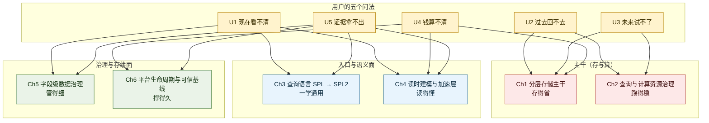
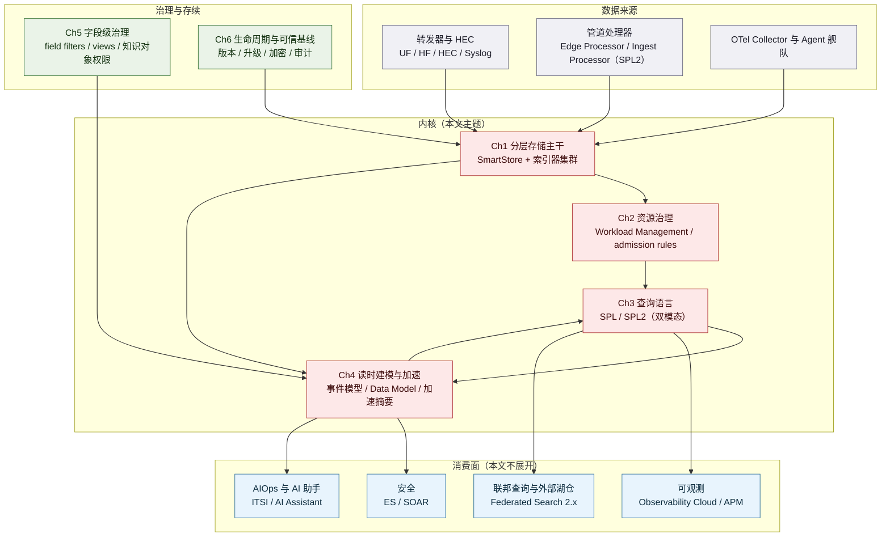
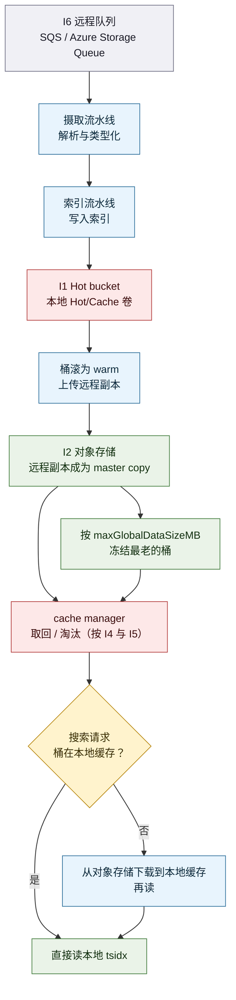
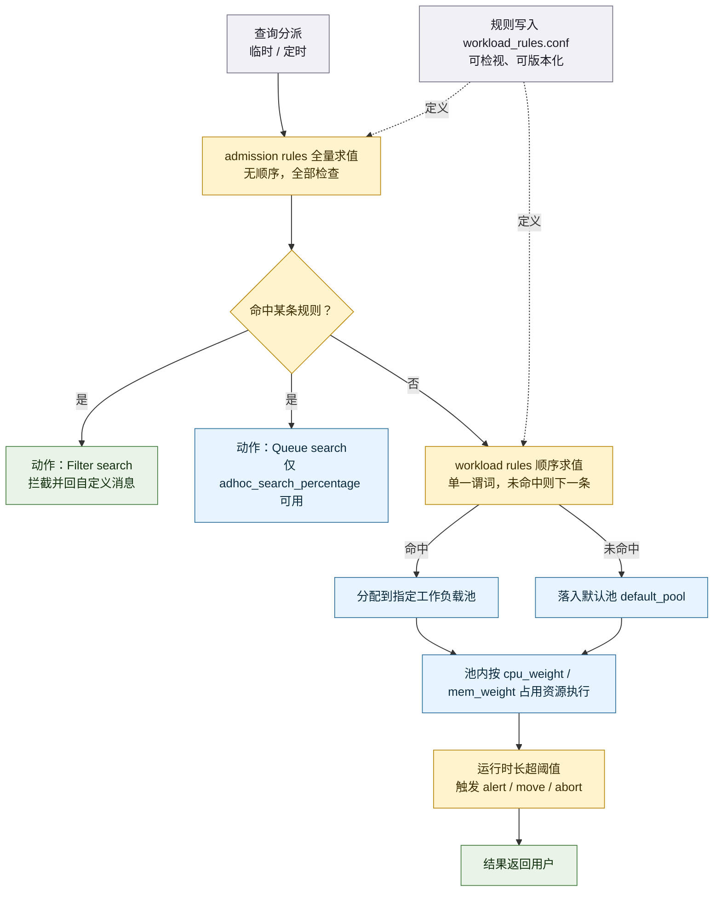
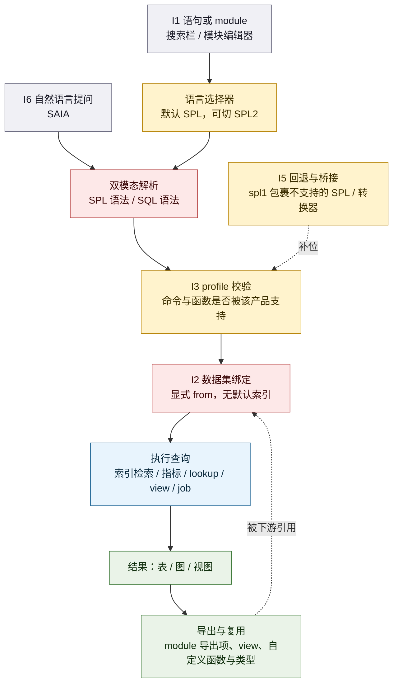
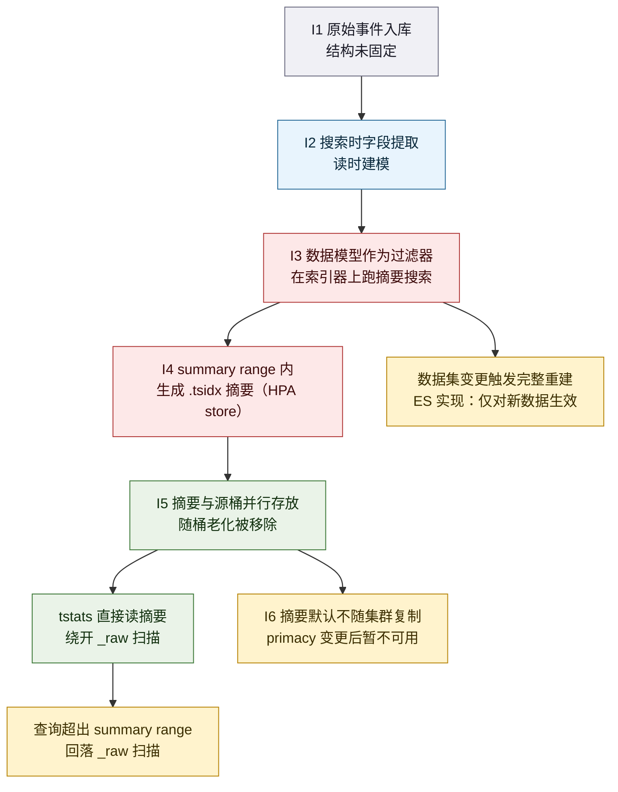
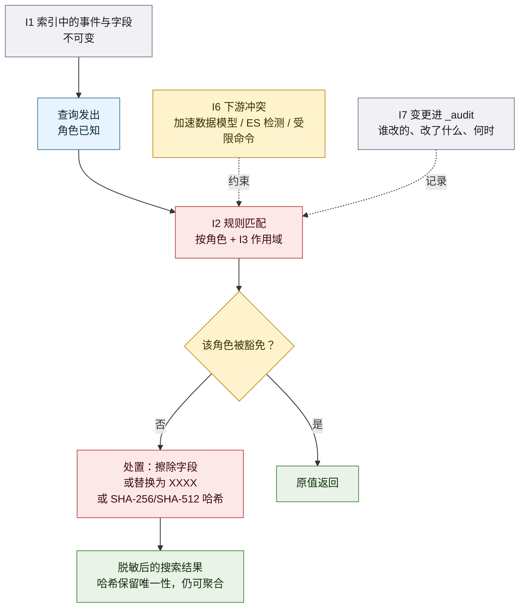
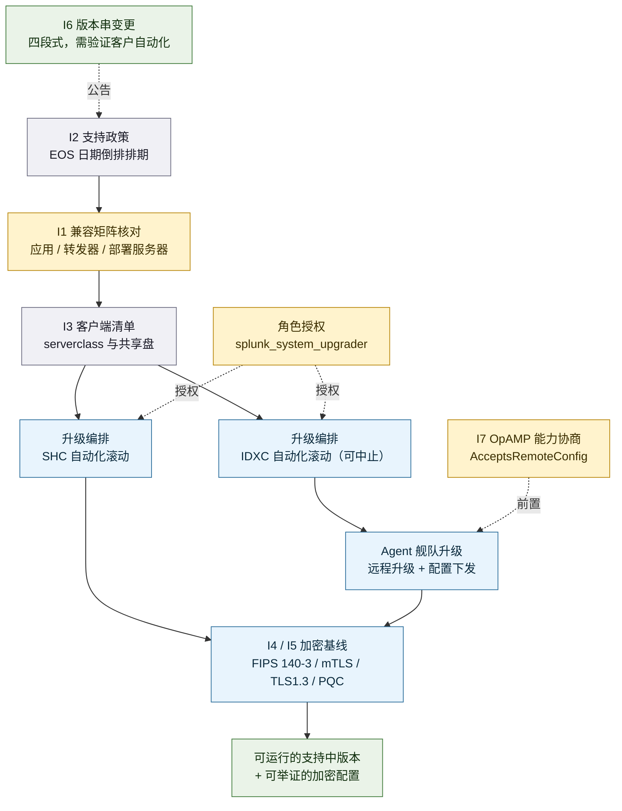
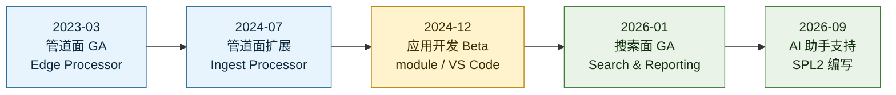

# Splunk 机器数据平台主干与查询语言（2023–2026）功能体系与痛点解法

> **调研对象**：Splunk 平台（Splunk Enterprise 与 Splunk Cloud Platform）中**承担「数据存下来、查出去」这条主干职责的那一层**——即**索引与存储主干**（SmartStore、索引器集群、摄取与索引分层）、**查询与计算资源治理**（Workload Management、admission rules、排队配额）、**查询语言**（SPL → SPL2）、**语义层与读时建模**（事件模型、Data Model、CIM、加速摘要）、**字段级数据治理**（field filters、SPL2 views、知识对象细粒度权限），以及**平台生命周期与可信基线**（版本号、支持周期、Agent 与配置纳管、FIPS/TLS 基线）。
> **调研范围**：**2023-01 ~ 2026-10** 公开发布的产品功能与能力增强，对应 Splunk Enterprise **9.1（2023-06-28）→ 10.6（2026-09-30）** 共 8 个主/次版本。
> **信源根域名**：`splunk.com`（官方文档站旧址 `docs.splunk.com`、新址 `help.splunk.com`，产品更新与博客在 `splunk.com/en_us/blog` 与 `splunk.com/en_us/newsroom`）。
>
> ⚠️ **范围口径声明（务必先读）**：本报告**不是** Splunk 公司全貌分析。Splunk 的安全（Enterprise Security / SOAR / Mission Control）、可观测（Observability Cloud / APM / RUM）、ITSI/AIOps、AI 助手（AI Assistant for SPL 之外的 Agentic 能力）等**消费面**不在本文范围内，除必要的接缝说明外不展开。**本文只做「主干」：数据怎么放得住、话怎么问得动、账怎么算得清、平台怎么长期活着。** 公司级全景见同目录 [`Splunk-2013-2026-功能体系与痛点解法.md`](Splunk-2013-2026-功能体系与痛点解法.md)（其「大功能点 1：机器数据平台主干与查询语言」即本文主题的公司级简版）。

## 交付内容

1. **1.1 信源与局限**——三级信源表、六点已知局限、版本号对照表、一条反直觉观察；
2. **1.3 工具级视角**——把这条主干当作**一个工具**看：五个用户问法（U1–U5）、逐条展开（谁在问 / 典型场景 / 五类损失 / 放任不管的后果）、损失强度矩阵、U→P 归并映射；
3. **第 1–6 章（6 个大功能点，即 Ch1–Ch6）**——每章 K.1 小功能点清单 / K.2 用户痛点（P1…Pn）/ K.3 解法（S1…Sn，与痛点一一对应）/ K.4 功能原理（输入 I → 实现链条 → 输出 O → 机制深化 → 口径声明）/ K.5 能力边界（六维度）；
4. **附录五件套**——附一完整时间线（倒序）、附二演进规律（含「对自研的启示」）、附三对自研 APM AI 助手的对标启示、附四待补充与后续跟踪、附五信源链接总表（A/B/C 三级分册 + 未收录公开链接的信源 + 引用强度速览）。

## 建议读法

| 路径 | 读什么 | 花多久 |
|---|---|---|
| **赶时间** | 1.2 一句话定位 → 1.4 全景总表 + 边界速查 → 各章 K.5 一句话边界 | 10 分钟 |
| **要选型** | 1.3（U1–U5 与损失矩阵）→ 各章 K.2 痛点 + K.5 六维度边界 → 附一 时间线 | 40 分钟 |
| **要复刻** | 各章 K.4（输入 / 链条 / 输出 / 机制深化）→ 附二 演进规律 → 附三 对标启示 → 附四 缺口清单 | 60 分钟 |

---

## 1. 总览

### 1.1 信源与局限（先看这一段）

采用**三级信源**交叉验证。本报告**全文事实性表述均就地给出可点开链接**；凡属本报告推导，一律标注 `**C（本报告推导）**` 并给出依据链。

| 等级 | 信源 | 覆盖时段 | 在本文中的用途 |
|---|---|---|---|
| **A** | 官方文档与 Release Notes：逐版本 `help.splunk.com/…/release-notes/…`（9.1 / 9.2 / 9.3 / 10.4 / 10.6）、`docs.splunk.com/Documentation/Splunk/10.0.7/ReleaseNotes/MeetSplunk`、SPL2 官方手册与 Search Reference、SmartStore 架构文档与 Splunk Validated Architectures、Workload Management / admission rules 文档、field filters 文档、data model acceleration 文档、`splunk.com/en_us/legal/splunk-software-support-policy.html` | 2023-06 ~ 2026-09 | **功能颗粒度、命名、发布日期、官方自认局限的第一依据** |
| **B** | 官方博客 / 新闻稿 / 大会公告 / 官方 .conf 讲稿：`splunk.com/en_us/blog/platform/…`、`splunk.com/en_us/newsroom/press-releases/…`、`.conf23` 现场 deck（`conf.splunk.com`）、Splunk Community 官方产品公告 | 2023-03 ~ 2026-09 | 平台级发布主题与日期、机制自述、官方定位口径 |
| **C** | 第三方媒体 / 厂商技术博客 / 社区与镜像站：TekStream（SPL2 语法差异整理）、Imply（对 SmartStore 架构的批判性分析）、Kinney Group、DBTA、endoflife.ai（版本生命周期聚合）、releasebot.io（Release Notes 镜像）、稀土掘金 / 博客园（Release Notes 中文翻译） | 2023-2026 | 补实现细节、第三方独立解读、版本日期交叉核对 |

**六点已知局限**

1. **颗粒度上限：功能可到「日」，但两条时间轴并存且口径不同。** Splunk 同时维护 `docs.splunk.com`（旧门户，URL 带版本号）与 `help.splunk.com`（新门户，部分页面用 `?resourceId=…` 查询式链接，部分用语义化路径）。**同一文档在两站可能同时存在且内容版本不同**（如 SPL2 相关页面在新站，10.0 相关页面在旧站）。本报告凡只能到「版本」的，标 `YYYY-MM-DD（版本号）`；只能到「月」的标 `YYYY-MM`。
2. **部分官方页面的「最后更新日」≠「功能发布日期」。** 例如 `help.splunk.com/?resourceId=Splunk_ReleaseNotes_MeetSplunk` 是一个**会随最新版本滚动更新**的页面，指向 10.6 时的内容与指向 10.4 时不同。本报告对同资源 ID 的不同版本快照**分别标注版本**，不把滚动页当作首发证据。
3. **SPL2 的「首发」有多个合法答案，取决于问的是哪个产品面。** SPL2 在 Splunk 产品里**先在采集管道（Edge Processor）落地（2023-03）**，再在 **Search & Reporting 落地（2026-01）**，中间还有 **9.4 的应用开发 Beta（2024-12）**。官方另有一句「SPL2 has been used under the covers for years」（C 级转述）与一句「SPL2 is already used implicitly by multiple Splunk products today under the hood」（B 级官方）。**三个时点并存，不是矛盾，是三条产品面**——本报告在 3.1 逐条并列，不择一。
4. **厂商自述收益一律视为「量级参考」。** 官方材料中的「基础设施成本降低 60%–75%（SmartStore，中等规模）」「存储需求减少三分之二以上（合作方 VAST 自述）」等均为**官方或合作方口径**，未见受控第三方验证，**不得作为能力成立的证据**。第三方独立分析（如 Imply 对 SmartStore 的批评）则带有**竞品立场**，本报告引用时标明来源性质。
5. **「未公开」项已在正文逐条登记。** 包括：SmartStore 缓存淘汰算法的具体实现、Ingest-Tier Scaling 的规模上限与吞吐指标、SPL2 在 Search & Reporting 的性能基准、Workload Management 的池间抢占精度、field filters 对查询性能的量化影响。**这些项在「1.1 局限」「各章 K.4.x 口径声明」与「附五 5.4」三处登记，无静默省略。**
6. **调研截止日：2026-10-16。** 窗口末端的 10.6（2026-09-30 发布）文档仍在滚动补充，部分 10.6 条目的次级页面链接可能尚未稳定；10.8 已被官方提及（如「Preparing for Agent Management authentication changes in Splunk Enterprise 10.8」）但**发布时间与内容不在本报告范围内**。

**版本号对照表**（防混淆）

| 版本 | 发布日期 | 与本报告主线相关的主要动作 | 依据 |
|---|---|---|---|
| **9.1** | 2023-06-28 | 集群管理器**优先选择已本地化副本**作 primary；并行 reduce 支持 `table`/`lookup`；**宏默认复制到 search peers**；SHC 滚动升级自动化 | A（[9.1 What's new](https://help.splunk.com/en/splunk-enterprise/release-notes-and-updates/release-notes/9.1/whats-new)） |
| **9.2** | 2024-01-31 | **Deployment Server 集群化**（最多 3 台 / 25K×N 客户端）；OS 证书信任库与证书管理 API；`json_delete` 与位运算 eval 函数；Inherited 重转发上限升至 1000 台 | A（[9.2 发布说明](https://help.splunk.com/en/splunk-enterprise/release-notes-and-updates/release-notes/9.2/whats-new/welcome-to-splunk-enterprise-9.2)） |
| **9.3** | 2024-07-24 | SmartStore **Azure Blob 的 tsidx 压缩**；索引器集群**按搜索使用率做数据再平衡**；**索引器集群滚动升级自动化** + `splunk_system_upgrader` 角色；Python 3.9 设为默认 | A（[9.3 发布说明](https://help.splunk.com/en/splunk-enterprise/release-notes-and-updates/release-notes/9.3/)） |
| **9.4** | 2024-12-16 | **SPL2 公开 Beta**（Enterprise 9.4.0 / Cloud 9.3.2408）；**KV Store 7.0**；Deployment Server 升级为**统一 Agent 管理面**；eval 数据类型转换与类型测试函数；SHC 复制改进 | A/B（[SPL2 Beta 公告](https://www.splunk.com/en_us/blog/platform/announcing-the-public-beta-of-spl2-in-splunk-enterprise)、[9.4 官方社区公告](https://community.splunk.com/t5/blogs/blogarticleprintpage/blog-id/ProductNewsAnnouncements/article-id/391)） |
| **10.0** | 2025-07-28 | **FIPS 140-3**（保留 140-2 至 2026-09-21）+ **mTLS**；OpenSSL 3.0；**知识对象细粒度访问控制**；Edge Processor 进入 Splunk Enterprise；Agent 管理面**纳管 OTel Collector** | A（[10.0 发布说明](https://docs.splunk.com/Documentation/Splunk/10.0.7/ReleaseNotes/MeetSplunk)） |
| **10.2** | 2026-01-15 | **SPL2 进入 Search & Reporting**（含 SQL 语法、SPL→SPL2 转换器、module 编辑器）；**field filters 默认可见**（仅 10.2.2+）；**Ingest-Tier Scaling**（逻辑分层）；**排队临时搜索配额**；KV Store 服务端 8.0；Python 3.13 可选 | A/B（[10.2 官方博客](https://www.splunk.com/en_us/blog/platform/announcing-splunk-enterprise-10-2-splunk-cloud-platform-10-2.html)、A（[SPL2 官方手册](https://help.splunk.com?resourceid=scs_search_introduction/)） |
| **10.4** | 2026-05-18 | **Indexing/Replication Separation**（SmartStore 成为 system of record，取消索引器间点对点复制）；**TLS 1.3 + 后量子密码（PQC）**；**MongoDB 8.0**；**非 root 运行**；K8s 上的 Workload Management Basic 模式；Data Management 统一入口 | A（[10.4 发布说明](https://help.splunk.com/en/splunk-enterprise/release-notes-and-updates/release-notes)、[10.4 PQC 支持](https://help.splunk.com/en/splunk-enterprise/administer/manage-users-and-security/10.6/secure-splunk-platform-communications-with-transport-layer-security-certificates/post-quantum-cryptography-support-in-splunk-enterprise-10.4)） |
| **10.6** | 2026-09-30 | **四段式版本号**（`Major.Minor.Maintenance.Patch`）；**Ingest-Tier Scaling 物理分层**（SOK 管理 IngestorCluster）；field filters **GA 且默认开启**；配置变更审计日志（Enterprise 侧补齐）；Analytics Workspace 移除 | A（[10.6 发布说明](https://help.splunk.com/en/splunk-enterprise/release-notes-and-updates/release-notes/10.6)、[Ingest-Tier Scaling](https://help.splunk.com/en/data-management/manage-splunk-enterprise-indexers/10.6/ingest-tier-scaling)） |

> **一条反直觉观察**：Splunk 平台主干在 2023–2026 这四年里，**做的几乎不是「加功能」，而是反复把三对原本绑死的东西拆开**——① **存储与计算**（SmartStore，2018 起，窗口内继续拆到「索引与复制」也分离，10.4）；② **采集与索引**（Ingest-Tier Scaling，10.2 逻辑分层 → 10.6 物理分层）；③ **数据与语义/权限**（SPL2 views、field filters、知识对象细粒度权限，把「可见性」从「数据放哪」里解耦出来）。而这条线上最反常的一点是**查询语言的演进顺序**：SPL2 先在**客户看不见的地方**（采集管道，2023-03）跑了近三年，才在 **2026-01** 出现在搜索栏——**它是一条自下而上、由「数据准备」倒逼「数据查询」的查询语言**，与常见的「先改搜索体验、再改管道」顺序正好相反。

### 1.2 一句话定位

**这条主干是 Splunk 的全部消费面（安全、可观测、ITSI、AI 助手）共同脚下的地面：它回答的不是「你能看到什么」，而是「你的数据能不能被便宜地留住、能不能被任何人用一门语言学出来、出了事能不能拿出可复核的口径」。**

- 在 Splunk 自己的产品体系里，它**不是可选项，而是所有付费点的计量口径**——Splunk 按摄取量（Ingest）计费，因此「数据进不进索引、以什么形态进、按什么策略冻结」直接决定客户账单。依据：B（[Introducing Splunk 10](https://www.splunk.com/en-us/blog/platform/introducing-splunk-10-empowering-a-secure-and-compliant-future.html)：「organizations gain control over data costs」）、A（[SmartStore 验证架构](https://help.splunk.com/en/data-management/splunk-validated-architectures/splunk-platform-indexing-and-search/smartstore-for-splunk-platform)：「The most tangible benefit is the reduction in cost for storage」）。
- 在公司战略上，这条主干是**Cisco 收购后「Data Fabric」叙事的承重墙**：官方把 SPL2 明确定义为「**the single language powering the Cisco Data Fabric**」。依据：B（[Introducing SPL2 官方博客](https://www.splunk.com/en_us/blog/platform/introducing-spl2-the-next-generation-search-data-preparation-language-for-splunk.html?p=3)）。
- 在**设备侧分层**（沿用本系列口径）中，这条主干的锚点**完全不在设备上**：它的数据源是设备吐出来的日志与指标，价值锚点是「**存、查、算**」，抽掉设备叙事**仍然成立**（它同样吃应用日志、云审计、数据库 CDR）。故判定为**不属于设备侧任何一层**（L1–L3 均不成立），它位于**所有层之下的数据底座位**。

### 1.3 从工具整体看：它究竟解决用户的什么问题

> **方法论前提（维度论证）**：本模板假定用户价值落在**时间轴**与**关系网**两个维度上。对「平台主干 + 查询语言」这个品类，该假设**成立但需要重述**：
> - **时间轴**在这里不是「故障何时发生」，而是**数据的生命期**——「这一刻的数据」→「三个月前的数据」→「明年的数据量」；
> - **关系网**在这里不是「设备与链路的连接」，而是**数据与语义、权限、交付形态之间的关系**——同一份 `_raw`，谁能看见哪些字段、以什么结构被消费、在哪个产品里被复用。
>
> 因此下文的 U1–U5 **沿用本系列的统一编号与名称**，但每一个的问题内容都按上面两条维度重写。**其中 U3（未来试不了）在本品类成立度最高**（容量与成本外推是平台主干的核心议题），**U5（证据拿不出）的落点从「对外定责」转为「对内可复核」**——即同一个问题两次查询必须给出同一个可解释的口径。

#### 1.3.1 用户的五个问法（U1–U5）

**速览表**

| 问法 | 用户的原话 | 痛点描述（痛在哪） | 一句话损失 |
|---|---|---|---|
| **U1 现在看不清** | 「数据明明进来了，可我就是问不出想要的那个结论。」 | 数据在库里，但从「有数据」到「有结论」之间隔着语法、语义与性能三关；越是非原厂角色越走不过去 | 时间：定位慢；人：会查的人成为瓶颈 |
| **U2 过去回不去** | 「我买了 90 天保留，为什么查第 88 天要等这么久？」 | 数据「在」不等于「能查」——长回看查询要先从对象存储搬回本地，还要挤掉别人正在用的缓存 | 时间：历史查询慢；组织：一个人的历史查询拖慢所有人 |
| **U3 未来试不了** | 「下个季度数据量翻一倍，我的集群要加几台？账单会涨多少？」 | 容量与成本只能靠经验系数外推，变更只能在生产上试（**本品类覆盖最强的一问**，也是平台主干的核心议题） | 钱：要么超配要么欠配；组织：预算博弈 |
| **U4 钱算不清** | 「这个月的索引账单涨了 18%，涨在哪一类数据上？」 | 摄取量、保留期、副本数、加速摘要是四条独立的成本驱动线，但它们不在同一张账上 | 钱：无效摄取与超长保留长期沉淀 |
| **U5 证据拿不出** | 「同一个问题，我和同事查出来两个数——谁对？」 | 口径不可复现：语法差异、宏是否复制、权限是否过滤字段、加速摘要是否覆盖，任何一项不同结论就不同 | 组织：结论不可复核，决策建立在沙上；合规：审计无法举证 |

---

**U1 · 现在看不清**

> **痛点**：数据在库里，但从「有数据」到「有结论」之间隔着语法、语义与性能三关；越是非原厂角色越走不过去。

- **谁在问**
  - 应用团队工程师：「我只想按服务名筛出最近一小时的错误率，为什么要先学一门查询语言？」
  - 一线支持工程师：「客户报障了，我要知道他那个租户最近发生了什么，可我不知道字段叫什么。」
  - 从数据库转过来的数据工程师：「我 SQL 写了十年，你们这门语言我得从头学？」
- **典型场景**（示意量级，非实测）：某企业接入了一个新业务系统，日志已进 Splunk。市场团队要一份「最近一周各渠道的失败下单数」，找到中心平台团队排期——因为只有平台团队的分库人员会写这套查询。等排到，业务已经在用 Excel 手工统计了两天。**这类问题的官方解法线索出现在 2026-01**：SPL2 进入 Search & Reporting 时，官方明确把「让有 SQL 背景的人能直接上手」写成设计目标之一（「making learning SPL easier for users coming to the Splunk platform from a database or SQL background」）。依据：B（[Introducing SPL2 博客](https://www.splunk.com/en_us/blog/platform/introducing-spl2-the-next-generation-search-data-preparation-language-for-splunk.html?p=3)）。
- **五类损失**

| 损失类别 | 可感知的具体损失 |
|---|---|
| 时间 | 「有数据但没结论」的时间被拉长到以「天」计，业务侧只能手工兜底 |
| 钱 | 若业务因此另买一套 BI 工具，等于为同一份数据付第二次钱（金额随规模变化，非实测） |
| 人 | 会查的人成为组织瓶颈，被反复打断，真正的难题没人做 |
| 合规 | 无 |
| 组织 | 「要点数据」变成跨团队申请，数据团队与业务团队互相消耗 |

- **放任不管的后果**：**自增强循环**——越依赖少数会查的人，这些人越被琐事占满，越没时间把查法沉淀成视图与文档，于是组织更依赖他们。官方对此的回应方向也正是「把查询变成可复用资产」而非「教更多人写查询」（见第 3 章 S2 的 module 与 S4 的 view）。

---

**U2 · 过去回不去**

> **痛点**：数据「在」不等于「能查」——长回看查询要先从对象存储搬回本地，还要挤掉别人正在用的缓存。

- **谁在问**
  - 值班工程师：「凌晨那次抖动的 90 天前的基线在哪？我要对比。」
  - 合规对接人：「监管要我们出具去年同一个季度的访问记录。」
  - 安全分析师：「威胁狩猎要看 60 天的横向移动轨迹。」
- **典型场景**（示意量级，非实测）：某企业按合规要求保留一年数据，为此上了对象存储分层。某次事故复盘中，分析师拉了一个 90 天的通配查询。**官方架构文档把后果写得很直白**：跨大量桶的查询（如 all-time 或通配查询）会把近期和热点数据从缓存中淘汰，直到缓存重新填充为止，导致近期数据的搜索性能下降。依据：A（[SmartStore 验证架构](https://help.splunk.com/en/data-management/splunk-validated-architectures/splunk-platform-indexing-and-search/smartstore-for-splunk-platform)，原句见下文 1.4.4 机制二）。第三方独立解读补了另一半：**会去看历史数据的那 3% 恰恰是事故调查、威胁狩猎、合规审计与长期趋势分析——正是当初买保留期的理由**。依据：C（[Imply：Splunk SmartStore vs Lumi Loglake](https://imply.io/blog/splunk-smartstore-vs-lumi-loglake)，**该站为竞品，引用时须注明立场**）。
- **五类损失**

| 损失类别 | 可感知的具体损失 |
|---|---|
| 时间 | 长回看查询以「分钟到小时」计，而不是「秒」 |
| 钱 | 为压住这个代价，客户被迫加缓存容量（买更贵的本地 NVMe），成本回到存储侧 |
| 人 | 缓存被挤掉后，受影响的其他人找不到原因，只能靠资深的人解释 |
| 合规 | 保留期买了，但「查期」与「保留期」不等价，审计举证仍会卡 |
| 组织 | 一个分析师的长查询拖慢整组人的近期监控，引发内部争执 |

- **放任不管的后果**：**架构的失败模式被写成「对用户的限制」**——官方推荐的缓解手段包括用 `srchTimeWin` 限制角色能回看多远、用 workload management 规则节流长查询。当「防御手段是阻止用户去查自己付了钱保留的数据」时，组织会逐步学会「不要查历史」，于是保留期变成纯成本项。依据：C（[Imply 博客](https://imply.io/blog/splunk-smartstore-vs-lumi-loglake)，同上立场声明）。

---

**U3 · 未来试不了**（本品类覆盖最强的一问）

> **痛点**：容量与成本只能靠经验系数外推，变更只能在生产上试。

- **谁在问**
  - 容量规划者：「按现在的增速，明年 Q2 我的索引器要几台？」
  - 财务对接人：「明年这块预算怎么报？摄取量按什么系数估？」
  - 平台架构师：「把副本数从 2 改成 3，存储要翻多少？」
- **典型场景**（示意量级，非实测）：某企业向 CFO 报预算，用的是「去年峰值 × 1.3」的经验系数。官方对这类问题给了一个**可计算的锚点**：数据模型加速的存储需求可用「每日数据量 × 3.4」估算年增量——例如每日 100GB 的企业，一年约需 340GB 额外空间。依据：A（[Configure data models（含 3.4 系数）](https://docs.splunk.com/index.php?diff=1552661&oldid=1356835&singlediff=true&title=Documentation%3AES%3AInstall%3ADatamodels%3AInterceptor)）。**但这个公式只覆盖加速摘要一项**，摄取量、保留期、副本数、缓存容量四条线的交互没有官方统一模型。
- **五类损失**

| 损失类别 | 可感知的具体损失 |
|---|---|
| 时间 | 扩容决策反复（报批—被质疑—再补数据） |
| 钱 | 超配则钱沉在闲置节点上；欠配则等到顶不住才补救，代价更高 |
| 人 | 容量结论靠个人经验背书，决策质量绑在具体人身上 |
| 合规 | 无 |
| 组织 | 平台团队与财务对不上账，预算博弈消耗关系 |

- **放任不管的后果**：**决策退化为「经验加安全系数」**；系数一旦偏保守，冗余长期沉淀成成本；偏激进则把风险推到生产上。**⚠️ 品类边界提醒**：本报告调研的工具**不提供 what-if 仿真**——它给的是「按当前配置的静态估算公式 + 分层存储的降价路径」，不是「把架构改了会怎样」的推演。**这一条会在各章 K.5「常见误期待」中重复澄清。**

---

**U4 · 钱算不清**

> **痛点**：摄取量、保留期、副本数、加速摘要是四条独立的成本驱动线，但它们不在同一张账上。

- **谁在问**
  - 平台负责人：「我们按摄取量付费，但账单一涨，涨的是摄取量还是保留量？」
  - 数据治理负责人：「哪些索引是不该留这么久的？」
  - 采购：「同量数据，换成对象存储到底能省多少？」
- **典型场景**（示意量级，非实测）：某企业年中发现 Splunk 账单上涨，怀疑是某新业务日志导致。人工比对摄取报表与索引配置花掉两周，最后结论是「三件事都在涨：新业务日志、某索引保留期延长、以及为压住查询延迟加的一批本地盘」。官方对成本侧给的确定性收益主要落在**存储单价**上：SmartStore 把主副本放到对象存储、索引器本地盘只做缓存，官方称「在中等规模部署上可显著降低基础设施成本」，并明确「这本是 2018 年为 Splunk Cloud on AWS 写的，之后才开放给自管理与 BYOL 部署」。依据：A（[SmartStore 验证架构](https://help.splunk.com/en/data-management/splunk-validated-architectures/splunk-platform-indexing-and-search/smartstore-for-splunk-platform)）。
- **五类损失**

| 损失类别 | 可感知的具体损失 |
|---|---|
| 时间 | 成本归因以「周」计 |
| 钱 | **这是五类损失里最直接、可量化的一类**：存储单价、副本数、摘要冗余三条线同时膨胀 |
| 人 | 需要同时懂查询、存储与计费的人，这类人极稀缺 |
| 合规 | 保留策略与实际留存不一致时，审计要额外解释 |
| 组织 | 平台团队说不清钱，财务不信任平台团队的成本口径 |

- **放任不管的后果**：**成本在无声处膨胀**——每次增长都被解释为「业务涨了」，于是没人去找「哪里可以不花」；而保留期与副本数一旦调高，几乎不会有人主动调回。

---

**U5 · 证据拿不出**（落点：对内可复核）

> **痛点**：口径不可复现——语法差异、宏是否复制、权限是否过滤字段、加速摘要是否覆盖，任何一项不同结论就不同。

- **谁在问**
  - 平台管理员：「同事把仪表盘给我，跑了数不一样，谁的配置有问题？」
  - 审计对接人：「这个报表的字段为什么有些人看得见有些人看不见？给我一个可解释的规则。」
  - 安全负责人：「同一份索引，两组人查出的记录数不同，是权限过滤还是查询写法差异？」
- **典型场景**（示意量级，非实测）：某企业安全团队与 IT 团队对同一个「失败登录数」报告给出两个数字。**这不是操作失误，而是平台特性叠加的必然结果**：官方文档明确，field filters 会在**搜索时**对结果做脱敏或哈希替换，**不修改索引中的源数据**，且**不同角色可被豁免**；同一份数据在不同角色下「看起来」就是不同的。依据：A（[Protect PII, PHI, and other sensitive data with field filters](https://docs.splunk.com/Documentation/SplunkCloud/latest/Security/fieldfilters)）。另一处直接来源是 9.1 的变更：**宏默认复制到 search peers**，官方明确承认「这一变更会让此前失败的查询现在成功执行，可能影响下游性能」——**宏是否复制直接改变查询结果**。依据：A（[9.1 What's new](https://help.splunk.com/en/splunk-enterprise/release-notes-and-updates/release-notes/9.1/whats-new)）。
- **五类损失**

| 损失类别 | 可感知的具体损失 |
|---|---|
| 时间 | 每次不一致都要重新排查「是写法差异还是权限差异」 |
| 钱 | 无法定责即无法止损，同一个问题被反复投入人力 |
| 人 | 结论的最终判定权落回资深的人手里 |
| 合规 | 审计要求「可复现的取数口径」，而平台默认不保证可复现 |
| 组织 | 跨团队对同一个数字争论不休，问题在组织间来回踢 |

- **放任不管的后果**：**「无法复核」会被组织学习成「不要相信任何自动报表」**——团队退回到手工取数、互相对账，平台的自动化价值被吃掉。官方对这一点的回应是把它做成**显式可配置对象**（field filters 规则、SPL2 view 的 RBAC、知识对象权限）而不是隐式行为，见第 5 章。

---

**损失强度分布矩阵**（● 主要 / ○ 次要）

| 问法 | 时间 | 钱 | 人 | 合规 | 组织 |
|---|---|---|---|---|---|
| **U1 现在看不清** | ● | ○ | ● | — | ● |
| **U2 过去回不去** | ● | ● | ○ | ○ | ● |
| **U3 未来试不了** | ○ | ● | ○ | — | ● |
| **U4 钱算不清** | ○ | ● | ○ | ○ | ● |
| **U5 证据拿不出** | ○ | ○ | ○ | ● | ● |

> **采购行为解释**：**这一品类是五问里唯一「钱」列几乎全亮的**（U2/U3/U4 三问的钱都是主因），这与通用可观测性工具（时间列全亮）明显不同——**平台主干是被当作成本结构来采购的，不是被当作效率工具来采购的**。这解释了三件现实中的现象：① SmartStore 这类「看起来不产生新能力、只改数据放哪」的功能，是这一层里商业上最成功的功能；② 官方在讲主干功能时几乎总要把成本数字（60%–75% 降价、3.4 倍摘要系数）摆在前面；③ **合规（U5）在这一层是独立预算口**——它不通过「省时间」进入，而是通过审计与监管要求进入，这解释了为什么 field filters 从 9.0 的预览一路做到 10.6 的 GA 且默认开启。

#### 1.3.2 五个整体问题（U1–U5）与承载能力（落到大功能点）

| # | 用户的问题 | 工具给出的整体回答 | 对应的大功能点（及它在这里扮演的角色） |
|---|---|---|---|
| U1 | 现在看不清 | 「把数据的结构在**读的时候**再定，把语义做成可复用的数据集，把查询做成可被 AI 与 SQL 背景的人生成的对象」 | **Ch4 读时建模与加速层**（底座：结构在读时施加、加速摘要让大数据集可查，见第 4 章）｜**Ch3 SPL→SPL2**（入口：一门语言 + SQL 语法 + 自然语言助手，见第 3 章）｜**Ch5 字段级治理**（约束：看得见什么必须先定义，见第 5 章） |
| U2 | 过去回不去 | 「把冷数据交出去、把缓存留给近期；但**代价是无法直接查对象存储**，每次回看都要先搬回来」 | **Ch1 分层存储主干**（主体：SmartStore + cache manager + 摄取分层，见第 1 章）｜**Ch2 资源治理**（补丁：用规则限制回看窗口与并发，见第 2 章） |
| U3 | 未来试不了 | 「给你可计算的静态估算（加速摘要 3.4 倍、存储分层降价、副本解耦）；**但不给 what-if 推演**」 | **Ch1 存储主干**（承载：计算/存储解耦与摄取/索引解耦是扩容的前提，见第 1 章）｜**Ch2 资源治理**（承载：扩容不是唯一解，先谈分配，见第 2 章） |
| U4 | 钱算不清 | 「把存储单价降下来（对象存储作主副本）、把重复计算去掉（摘要与副本）、把不该留的数据挡在门外（前置过滤）」 | **Ch1 存储主干**（降价主路径，见第 1 章）｜**Ch4 加速层**（成本项：摘要占 3.4 倍年存储，必须算进账，见第 4 章）｜**Ch6 生命周期**（口径：版本与支持周期也是成本项，见第 6 章） |
| U5 | 证据拿不出 | 「把**可见性、权限、口径**都做成显式的、可配置的、可审计的对象，而不是隐式行为」 | **Ch5 字段级治理**（显式化：field filters / SPL2 views / 知识对象权限，见第 5 章）｜**Ch4 加速层**（一致性：宏与摘要的复制行为决定结论是否可复现，见第 4 章）｜**Ch3 SPL2**（一致性：语法差异必须可转换、可回退，见第 3 章）｜**Ch6 生命周期**（合规：加密与审计基线，见第 6 章） |

> **覆盖核验**：**6 个大功能点全部被至少一个 U 消费，无孤立能力。** 反向看，**U5 是被消费最多的那一问**（被 4 个大功能点共同承载），其次是 **U1 与 U4**（各 3 个）；**U3 是被覆盖最窄的一问**（没有任何一个专门做容量推演或 what-if 的能力承接，仅由 Ch1 的解耦与 Ch2 的资源分配间接回应）——这与 1.3.1 中「本品类不提供仿真」的判断一致。

#### 1.3.3 从用户问题到大功能点

#### 1.3.4 用之前 vs 用之后（同一批问题对照）

| 问法 | 用之前（人工 + 多工具） | 用之后（官方自述的工作方式） | 变化性质 |
|---|---|---|---|
| U1 现在看不清 | 先学查询语言 → 记住字段名 → 手工在多个标签页里拼线索 | 一门语言覆盖搜索/管道/应用 + SQL 语法可直入 + 自然语言助手生成并解释查询 | **门槛变化**（会不会写 → 会不会问 / 会不会读 SQL） |
| U2 过去回不去 | 全部数据留本地盘，钱换时间；或归档后再也查不回来 | 冷数据交对象存储、本地只做缓存；**但仍不可在对象存储里就地查询** | **成本形态变化**（贵盘 → 便宜盘），**不是**「历史即查即得」 |
| U3 未来试不了 | 经验系数 × 历史峰值 | 有官方静态估算公式（摘要 ×3.4）、有解耦后的扩缩容路径；**无 what-if 推演** | **仅改善估算与扩容路径，未提供试跑** |
| U4 钱算不清 | 人工比对摄取报表与索引配置，以周计 | 存储分层解耦 + 摄取前置过滤 + 摘要成本可算 | **成本驱动线从「混在一起」变「可分开看」** |
| U5 证据拿不出 | 靠口头解释「可能是我权限不一样」 | 字段过滤、视图授权、知识对象权限三者都是显式可配置对象，且配置可进审计日志 | **举证形态变化**（隐式行为 → 显式规则） |

> **厂商自述与本报告判定的边界**：上表「用之后」一列是**官方口径下的理想工作方式**，不是受控实测结果。其中「U1 门槛变化」「U5 举证形态变化」可由官方文档结构直接验证（SPL2 官方手册明示支持 SQL 语法与 SPL→SPL2 转换器；field filters 官方文档明示是搜索时作用于结果且不修改源数据）；而「U2 不是即查即得」「U3 未提供试跑」两条是**本报告依据官方能力清单与官方架构文档反向确认的缺口**（依据：A 级 SmartStore 验证架构的「cannot search the object store directly」原句）。**官方文档从未宣称历史数据可即查即得，故这两条不属于与官方口径冲突，而属于对产品宣传语的必要澄清。**

#### 1.3.5 小结：U 与 P 的关系

- **U 是工具级问题**，回答「**值不值得买**」——它把这条主干当成**一个整体工具**来问，粒度在「这个工具能不能替我把问题解决」。
- **P 是功能级痛点**，回答「**做得对不对**」——它落在每个大功能点内部，粒度在「这条能力有没有真正回应一类可感知的损失」。
- 二者是**上位归并**关系，**不是一对一**：一个 U 会由多个大功能点的多条 P 共同承载；一条 P 通常只服务一个 U 的某一面。因此**不允许把 U 号直接当 P 号使用**。

**U → P 归并映射表**（使全部 P 可追溯）

| 上位问题 | 由哪些章的 P 归并而来 | 归并口径说明 |
|---|---|---|
| **U1 现在看不清** | Ch3 的 P1、P2、P3（学一次只在搜索栏有用、多标签页调查、SQL 背景被门槛挡住）｜Ch4 的 P1、P2、P3（读时建模救不回被丢弃的字段、加速摘要不覆盖就慢、知识对象权限缺失导致看不见）｜Ch5 的 P2（要只给人看一列做不到） | U1 是「认知缺失」的总问题；凡**「因为拿不到数/看不懂结构而变慢或必须找人」**的痛，都归并到 U1 |
| **U2 过去回不去** | Ch1 的 P1、P2（保留期越长越贵、长回看与日常查询互相踩踏） | U2 是「历史数据可查性」的总问题；凡**「数据付费保留了但查不动」**的痛，都归并到 U2 |
| **U3 未来试不了** | Ch1 的 P3（采集峰值与查询峰值被迫一起买）｜Ch2 的 P4（资源治理采用门槛高）｜Ch6 的 P2（支持周期只有 24 个月，版本规划被迫变成常态项目） | 本报告**明确记录该 U 覆盖薄弱**：无专门的容量推演能力，仅由「解耦后的扩缩容路径」与「支持周期倒逼的升级节奏」间接回应 |
| **U4 钱算不清** | Ch1 的 P1、P3、P5（保留成本、峰值超配、冻结口径）｜Ch2 的 P4（只能靠加硬件解决争抢）｜Ch4 的 P2（摘要 3.4 倍年存储是隐性成本）｜Ch6 的 P1（升级窗口吃掉人力） | 凡**「钱花在哪说不清、只能靠加硬件或加保留期兜底」**的痛，都归并到 U4 |
| **U5 证据拿不出** | Ch3 的 P5（语法差异导致同问不同果）｜Ch4 的 P3（宏复制与摘要覆盖决定结论可复现性）｜Ch5 的 P1、P2、P3、P4（要只给人看一列做不到、脱敏只能改结果、知识对象权限只能一刀切、治理规则不可审计）｜Ch6 的 P2、P4、P5（版本基线、加密基线、版本串格式变更破坏自动化） | 凡**「结论要能被复核、被审计、被外部检查」**的痛，都归并到 U5 |

### 1.4 读法：6 个大功能点全景

**全景总表**

| # | 大功能点 | 口号（四字） | 小功能点数 | 时间跨度 | 面向谁 |
|---|---|---|---|---|---|
| 1 | 分层存储主干（SmartStore 与索引器集群） | 存得省 | 12 | 2023-06 ~ 2026-09 | 平台架构师、SRE、财务与容量规划者 |
| 2 | 查询与计算资源治理 | 跑得稳 | 9 | 2024-07 ~ 2026-05 | 平台管理员、值班制度设计者、大团队的多租户管理者 |
| 3 | 查询语言 SPL → SPL2 | 一学通用 | 16 | 2023-03 ~ 2026-09 | 分析师、应用开发者、数据管理员、SQL 背景的新人 |
| 4 | 读时建模与加速层 | 读得懂 | 10 | 2023-06 ~ 2026-09 | 分析师、知识管理者、平台管理员 |
| 5 | 字段级数据治理 | 管得细 | 8 | 2023-09 ~ 2026-09 | 安全与合规负责人、数据治理负责人、审计对接人 |
| 6 | 平台生命周期与可信基线 | 撑得久 | 12 | 2023-06 ~ 2026-09 | 平台管理员、运维主管、金融/政府/国防客户 |

**边界速查（一页版）**

| # | 大功能点 | 最要命的一条边界 | 边界性质 |
|---|---|---|---|
| 1 | 分层存储主干 | **Splunk 不能直接查对象存储**——只有被下载到索引器本地缓存的桶才是可搜索的 | 硬边界（架构决定） |
| 2 | 资源治理 | 完整能力**要求 Linux 与 cgroups**；Kubernetes 上只能退到 Basic 模式，且**规则不作用于子搜索** | 硬边界 + 前提依赖 |
| 3 | SPL → SPL2 | Search & Reporting 的 SPL2 **要求 10.2+ 且平台仅限 Linux**；各产品只实现 SPL2 的**子集（profile）**，同一段语句在不同产品能跑的命令不同 | 硬边界 + 官方自认 |
| 4 | 读时建模与加速层 | 加速摘要**默认不随索引器集群复制**（只有主副本桶带摘要），且**非流式命令与事务型数据集无法持久加速** | 官方自认局限 |
| 5 | 字段级数据治理 | 脱敏**只作用于搜索结果，不改源数据**，且**只能保护索引内的数据**（查找表等不覆盖） | 硬边界 + 官方自认 |
| 6 | 生命周期与可信基线 | **每个 minor 版本的支持期是 24 个月**；且 10.6 起版本串改为四段式，**会破坏自定义解析脚本** | 硬边界（政策决定） |

**编号约定声明（P/S 闭环规则）**

- 每个大功能点内，**K.2 的痛点编号 `P1…Pn` 与 K.3 的解法编号 `S1…Sn` 数量与语义严格一一对应**。
- K.3 表格的「对应痛点」列**必须**以 `→ 解 Pn` 显式回指；一条痛点可由多条解法共同覆盖，但**不允许悬空痛点**（有 P 无 S 回应）**与悬空解法**（有 S 指不回任何 P）。
- 凡属**技术演进、依赖组件升级、生命周期终止**等找不到客户痛点归宿的内容，单列于各章「**配套演进**」框中，**不计入 S 编号**。
- 编号为**章内局部编号**（每章都从 1 开始），跨章不连续编号，以免与「大功能点编号」混淆。

**总构造图：数据来源 → 内核 → 各消费面**

> **读图提示**：图中两条容易被忽略的边是 **`Ch5 → Ch4`** 与 **`Ch6 → Ch1`**。前者表示「可见性治理是套在读时建模之上的」——字段过滤发生在搜索时，因此它依赖读时模型，也**必须容忍读时模型的加速摘要与它互相牵制**（10.6 官方专门警告过 field filters 与加速数据模型的冲突）；后者表示「生命周期政策是作用在存储主干上的」——版本升级与加密基线不是独立的一层，而是**对 SmartStore 架构与代理层的能力要求**（如 PQC 在 10.4 明确不支持 FIPS 模式与 KV Store）。这两条因果链分别在 5.4.4 与 6.4.4 展开。

# 大功能点 1：分层存储主干（SmartStore 与索引器集群） —— 存得省

> **它替代了什么**：替代「数据只能留在索引器自己的盘上、容量与算力绑死在一起」的状态——把**主副本搬出索引器**（对象存储成为权威副本，本地盘降级为缓存），再把**摄取的峰值从索引层剥离**（Ingest-Tier Scaling），最后连**索引器之间的点对点复制也取消**（Indexing/Replication Separation）。

## 1.1 小功能点清单

| # | 小功能点 | 发布时间 | 信源等级 | 说明 |
|---|---|---|---|---|
| 1.1 | **集群管理器优先选择「已本地化」副本作 primary** | 2023-06-28（9.1） | A（[9.1 What's new](https://help.splunk.com/en/splunk-enterprise/release-notes-and-updates/release-notes/9.1/whats-new)） | 官方原文：此前 primary 随机选，SmartStore 下若选中需从远程下载的副本会拉长搜索时间；本增强「**gives priority to copies of a bucket that are already localized (downloaded) when selecting primaries**」 |
| 1.2 | Ingest Actions 支持**最多 8 个 S3 目标** + 跨账号 IAM 的 KMS 加密 | 2023-06-28（9.1） | A（[9.1 What's new](https://help.splunk.com/en/splunk-enterprise/release-notes-and-updates/release-notes/9.1/whats-new)）、B（[官方博客](https://splunk.com/en_us/blog/platform/enhancements-to-ingest-actions-improve-usability-and-expand-searchability-wherever-your-data-lives.html)） | 数据可**不进索引直落对象存储**——这是成本分层最激进的形态；官方同期限定「max 8 destinations per provider」 |
| 1.3 | **SmartStore with Azure Blob：上传前 tsidx 压缩** | 2024-07-24（9.3） | A（[9.3 发布说明](https://help.splunk.com/en/splunk-enterprise/release-notes-and-updates/release-notes/9.3/)） | 官方原文：SmartStore 在上传到远程存储前压缩 tsidx，下载时在放入缓存前解压；配置项 `remote.azure.tsidx_compression` |
| 1.4 | **索引器集群按「搜索使用率」做数据再平衡** | 2024-07-24（9.3） | A（[9.3 发布说明](https://help.splunk.com/en/splunk-enterprise/release-notes-and-updates/release-notes/9.3/)） | 官方原文：此前再平衡只按桶数量，未考虑桶的实际搜索使用率，导致部分 peer 承担更高搜索负载；本增强允许**按搜索使用率再平衡** |
| 1.5 | `tsidxWritingLevel` 在 9.x 默认升为 **3** | 9.x（窗口内为既有默认） | A（[Reduce tsidx disk usage](https://docs.splunk.com/Documentation/Splunk/9.0.3/Indexer/Reducetsidxdiskusage)） | 索引速度 / 存储 / 检索能力的三方权衡；**层级越高，可被搜索的向后兼容版本越低**（官方备忘） |
| 1.6 | **索引间批量数据迁移**（非 SmartStore 集群） | 2026-01-15（10.2） | A/C（[10.2 官方博客](https://www.splunk.com/en_us/blog/platform/announcing-splunk-enterprise-10-2-splunk-cloud-platform-10-2.html)、C（[稀土掘金 10.2 中文摘要](https://www.juejin.cn/post/7600642904383389702)）） | 可按搜索条件在索引之间迁移数据，**无需删除整个索引**——把「数据放错索引」从不可逆操作变成可治理动作 |
| 1.7 | **Ingest-Tier Scaling（逻辑分层）** | 2026-01-15（10.2） | A（[Ingest-Tier Scaling 文档](https://help.splunk.com/en/data-management/manage-splunk-enterprise-indexers/10.6/ingest-tier-scaling)） | 把摄取与索引拆成两条流水线（摄取做解析与类型化、索引写盘并开放搜索），10.2 起**既有索引器集群即可享受逻辑分层** |
| 1.8 | **Indexing/Replication Separation** | 2026-05-18（10.4） | A（[10.4 发布说明](https://help.splunk.com/en/splunk-enterprise/release-notes-and-updates/release-notes)） | 官方原文：数据与元数据以 **SmartStore 为 system of record**，索引器之间**不再直接复制桶**，索引器可独立运作；简化多站点部署、提升韧性、支持更灵活的索引器扩缩容 |
| 1.9 | **Ingest-Tier Scaling（物理分层）** | 2026-09-30（10.6） | A（[Ingest-Tier Scaling 文档](https://help.splunk.com/en/data-management/manage-splunk-enterprise-indexers/10.6/ingest-tier-scaling)） | 摄取运行在 SOK 管理的 IngestorCluster，索引运行在独立的非 SOK 索引器集群；**⚠️ 仅支持 10.6+ 的新建物理分层部署、BYOL、CMP/Kubernetes、且目前仅 AWS**，既有 SOK 部署的改造路径**尚未建立** |
| 1.10 | **KV Store / KV Service 后端升到 MongoDB 8.0** | 2026-05-18（10.4） | A（[10.4 发布说明](https://help.splunk.com/en/splunk-enterprise/release-notes-and-updates/release-notes)） | 10.4 起不再包含 4–6 版 MongoDB；**9.x 及以下不能直接升到 8.0**，须先升到 10.0 或 10.2 |
| 1.11 | **SmartStore 官方验证架构与限制清单** | 持续（该页 2026-02-12 最后更新） | A（[SmartStore for Splunk platform](https://help.splunk.com/en/data-management/splunk-validated-architectures/splunk-platform-indexing-and-search/smartstore-for-splunk-platform)） | 全文最关键的一句在此页：**「Splunk can only search localized or cached buckets and cannot search the object store directly.」** |
| 1.12 | 全局按大小冻结策略（`maxGlobalDataSizeMB` / `maxGlobalRawDataSizeMB`） | 持续（SmartStore 官方推荐口径） | A（[Configure SmartStore](https://docs.splunk.com/index.php?diff=1257507&oldid=1237943&singlediff=true)） | 超过上限即冻结最老的桶——**按「未压缩大小」或「原始数据量」二选一做全局保留口径** |

## 1.2 它对应的用户痛点

> **口径**：本节只写客户侧可感知的痛（时间 / 钱 / 人 / 合规 / 组织）。架构层问题（副本一致性怎么保证、桶元数据如何同步、缓存淘汰用什么算法）**不作为痛点**，它们是「为什么必须这么设计」的约束，放在 1.3 与 1.4.1 的必要性论证里。

- **P1（钱）——「保留期越拉越长，账单只涨不降，我只能靠少采来省」**：合规与排障的双重需求把保留期从 30 天推到 90 天、一年甚至更久，而热盘单价不会随时间下降；再叠加副本数与加速摘要，同一份数据的落地成本被放大数倍。客户的实际动作是**冻结得更早、采得更少**——省下的钱直接用可见性缺口来付。
- **P2（时间）——「查历史数据时，把别人正在用的东西挤掉了」**：长回看查询需要先把大量历史桶搬回本地，搬的过程会挤掉近期热数据。**官方架构文档把这条后果写明**：跨越大量桶的查询（all-time 或通配查询）会将近期与高频数据淘汰出缓存，直到缓存重新填充为止，从而拖慢近期数据的搜索性能。依据：A（[SmartStore 验证架构](https://help.splunk.com/en/data-management/splunk-validated-architectures/splunk-platform-indexing-and-search/smartstore-for-splunk-platform)）。
- **P3（钱）——「采集的峰值和查询的峰值，我只能一起买」**：采集端在业务高峰期涌入（如大促、月末批处理），查询端在同一时间被值班与业务同时压上；两者跑在同一批索引器上，容量只能按两者叠加的峰值配置。**这个问题在 2023–2026 才被官方正面回应**（10.2 的 Ingest-Tier Scaling 逻辑分层、10.4 的索引/复制分离、10.6 的物理分层），依据见上表 1.7–1.9。
- **P4（人 / 时间）——「平台自己的维护动作吃掉了运维人力」**：集群维护包含大量必须停机或降级才能做的操作：逐台升级、桶再平衡、下线 peer、桶修复。官方在讲 SmartStore 时把这件事的成本写得很直接——SmartStore 能「**greatly reduce the scale of time-consuming activities such as offlining peer nodes, data rebalancing, and bucket fixup**」。依据：A（[About SmartStore](https://docs.splunk.com/Documentation/Splunk/9.1.5/Indexer/AboutSmartStore)）。
- **P5（合规）——「保留规则要对审计讲成一句话，但我手上的规则是三套」**：同一份数据有「时间到了冻结」「总量超了冻结」「索引被删了才走」三条互不相干的路径，向审计解释「这份数据为什么还在」时需要三份材料。客户要的是**一套可写进制度的保留口径**，而不是一堆配置项。

## 1.3 它是如何解决的（与痛点一一对应）

先明确**架构约束**——它们不是客户痛点，而是由 1.2 的客户问题倒推出的设计约束，决定了「解必须长成这样」：

| 架构约束 | 由哪条痛点倒推出来 | 落到了哪些功能 |
|---|---|---|
| 主副本必须移出索引器，且索引器本地盘只保留「近期 + 高频」 | P1：留存成本驱动 | SmartStore（远程对象存储作 master copy，本地为 cache） |
| 历史桶的取回不能阻塞日常搜索，且 primary 选择要避开「需要下载的副本」 | P2：长回看与日常查询互相踩踏 | cache manager 分层（`hotlist_recency_secs` / `hotlist_bloom_filter_recency_hours`）；9.1 的 primary 优选本地化副本 |
| 摄取与索引必须能分别扩缩容，且要能跨机器持久化排队 | P3：峰值叠加被迫超配 | Ingest-Tier Scaling（远程队列 + SmartBus，10.2 逻辑 / 10.6 物理）；Indexing/Replication Separation（10.4） |
| 集群维护动作要能自动化、可中断、可评估 | P4：维护吃人力 | 索引器集群滚动升级自动化（9.3）、按搜索使用率再平衡（9.3）、索引间批量迁移（10.2） |
| 保留必须有一句可写进制度的统一口径 | P5：审计举证 | 全局按大小/原始大小的冻结策略（`maxGlobalDataSizeMB` / `maxGlobalRawDataSizeMB`）+ 单一永久副本 |
| 对象存储不可能作为在线查询目标（HTTP API 只有 PUT/GET） | P2 的直接后果（见 1.4.4 机制一） | 「本地缓存后才可搜」这一硬性前提——**不是选择，是被对象存储的性质决定的** |

在上述约束下，逐条对应 P1–P5 的解法是：

- **S1｜SmartStore：计算与存储彻底解耦**（→ 解 P1）。索引器本地盘降级为 **Hot / Cache**；桶从 hot 滚到 warm 时**上传到远程对象存储，远程副本成为 master copy**，此后对象存储负责该桶的韧性与副本（索引器上的非主副本先被淘汰）。这样**长期保留的单价从本地 NVMe 换成对象存储**，而本地盘只需覆盖「近期 + 高频」。官方明确的适用边界是「中到大规模部署」，且承认**小规模部署不值得**为此搭一套远程存储。依据：A（[About SmartStore](https://docs.splunk.com/Documentation/Splunk/9.1.5/Indexer/AboutSmartStore)、[SmartStore 验证架构](https://help.splunk.com/en/data-management/splunk-validated-architectures/splunk-platform-indexing-and-search/smartstore-for-splunk-platform)）。
- **S2｜缓存策略 + primary 优选本地副本**（→ 解 P2）。**cache manager** 负责取回与淘汰，其策略建立在两个官方观察上：**97% 的搜索只看 24 小时以内的数据**，且搜索具有**空间与时间局部性**（在某时间点或某份日志里命中一次，后续搜索很可能落在相近时间窗或同一份日志）。因此它优待「新建的桶」与「最近被访问的桶」；9.1 起**集群管理器在选 primary 时优先挑已本地化的副本**，从源头上避免「选了 primary 却要先下载」。依据：A（同上两页 + [9.1 What's new](https://help.splunk.com/en/splunk-enterprise/release-notes-and-updates/release-notes/9.1/whats-new)）。
- **S3｜摄取层与索引层解耦**（→ 解 P3）。10.2 的**逻辑分层**把摄取与索引拆成两条流水线（可同机但职责分离），经**远程队列（SQS / Azure Storage Queue）与 SmartBus** 持久化排队，**降低转发路径的背压**；10.4 的 **Indexing/Replication Separation** 更进一步——**数据与元数据以 SmartStore 为 system of record，索引器之间不再直接复制桶**，索引器可独立运作，多站点部署得以简化、索引器扩缩容更灵活；10.6 的**物理分层**把摄取放进 SOK 管理的 IngestorCluster，与索引集群分别扩缩容。依据：A（[Ingest-Tier Scaling](https://help.splunk.com/en/data-management/manage-splunk-enterprise-indexers/10.6/ingest-tier-scaling)、[10.4 发布说明](https://help.splunk.com/en/splunk-enterprise/release-notes-and-updates/release-notes)）。
- **S4｜把集群维护动作自动化并可中断**（→ 解 P4）。智能的缓存与副本布局本身就把维护量降下来：因为大部分数据不在 peer 上，**下线 peer、数据再平衡、桶修复的规模都被大幅压缩**（官方原话，见 P4 依据）；9.3 起再平衡**按实际搜索使用率**而非仅按桶数量分配，避免「桶数均衡但负载不均」；同版本起索引器集群支持**自动化滚动升级**并新增 `splunk_system_upgrader` 角色；10.2 起支持**按搜索条件在索引间批量迁移数据**，不必再删掉整个索引重建。依据：A（[9.3 发布说明](https://help.splunk.com/en/splunk-enterprise/release-notes-and-updates/release-notes/9.3/)、[About SmartStore](https://docs.splunk.com/Documentation/Splunk/9.1.5/Indexer/AboutSmartStore)）。
- **S5｜一句可写进制度的保留口径**（→ 解 P5）。SmartStore 索引把冻结行为收敛到两个尺度任选其一：`maxGlobalDataSizeMB`（warm+cold 可占的最大空间）或 `maxGlobalRawDataSizeMB`（可累计的最大原始数据量），**超限即冻结最老的桶**；同时因为**系统只保留每份 warm 桶的唯一永久副本**（在对象存储上），「有几份数据」这个问题也从复数变成单数。依据：A（[Configure SmartStore](https://docs.splunk.com/index.php?diff=1257507&oldid=1237943&singlediff=true)、[About SmartStore](https://docs.splunk.com/Documentation/Splunk/9.1.5/Indexer/AboutSmartStore)）。

> **边界**：S1–S5 全部建立在「**本地缓存是可搜索性的边界**」这一前提上——对象存储再便宜也**不能在原地被查询**。因此这些解法改善的是**成本形态与维护形态**，不是「历史数据即查即得」。另一处必须写明的边界：SmartStore 是**排他性选择**，启用了它的索引**不能再用 tsidx reduction、不能开 data integrity control、不能关 bloom filter**（官方限制清单），这些「不能用」不是版本空白，是路线决定。依据：A（[About SmartStore](https://docs.splunk.com/Documentation/Splunk/9.1.5/Indexer/AboutSmartStore)、[Reduce tsidx disk usage](https://docs.splunk.com/Documentation/Splunk/9.0.3/Indexer/Reducetsidxdiskusage)）。
>
> **配套演进（不计入 S）**：KV Store / KV Service 后端从 MongoDB 4–6 升到 **MongoDB 8.0**（10.4；9.x 无法直接升级，须先经 10.0/10.2）与 **KV Store 7.0**（9.4）。这是平台依赖组件升级，不直接回应本节任何一条客户痛点。

## 1.4 功能原理

### 1.4.1 输入

| 输入 | 具体内容 | 官方依据（含原文链接，标 A/B/C） | 缺了它会怎样 |
|---|---|---|---|
| **I1** 热数据写入通道 | 索引器本地 Hot/Cache 卷上的 hot bucket（官方口径：hot 桶通常寿命一天以内） | A（[SmartStore 验证架构](https://help.splunk.com/en/data-management/splunk-validated-architectures/splunk-platform-indexing-and-search/smartstore-for-splunk-platform)） | 缺了它整条链条没有起点；**hot 桶仍在本地且仍按副本因子复制**，这一层的行为与传统架构完全一致 |
| **I2** 远程对象存储（S3-API） | AWS S3 / GCS / Azure Blob；**不是挂载文件系统，只能通过 HTTP PUT/GET 访问** | A（同上；另见 [Configure the remote store](https://docs.splunk.com/Documentation/Splunk/8.0.2/Indexer/ConfigureremotestoreforSmartStore)） | 缺了它就没有 master copy——**warm 桶的韧性与副本全部依赖远程存储**，本地非主副本一旦淘汰即无兜底 |
| **I3** 桶元数据与 primary 归属 | 索引器上为每个远程桶维护的一小份元数据；集群管理器的 primary 选择结果 | A（[SmartStore 架构概述](https://help.splunk.com/ja-jp/data-management/manage-splunk-enterprise-indexers/10.2/implement-smartstore-to-reduce-local-storage-requirements/smartstore-architecture-overview)） | 缺了它无法判断「这个桶在哪、谁能搜」；**primary 优选本地副本这条优化也就无从生效** |
| **I4** 缓存策略参数 | `hotlist_recency_secs`（按桶龄保护近期桶不被淘汰）、`hotlist_bloom_filter_recency_hours`（保护非 journal/非 tsidx 文件如 bloomfilter） | A（[Configure SmartStore](https://docs.splunk.com/index.php?diff=1257507&oldid=1237943&singlediff=true)） | 缺了它缓存只能按「最近访问」淘汰，**无法把「近期但还未被搜过」的桶预先留住**——而这正是 97% 场景的主力 |
| **I5** 搜索访问模式（统计前提） | 「97% 的搜索回看 24 小时或更短」+ 搜索的空间/时间局部性 | A（[SmartStore 架构概述](https://help.splunk.com/ja-jp/data-management/manage-splunk-enterprise-indexers/10.2/implement-smartstore-to-reduce-local-storage-requirements/smartstore-architecture-overview)） | **缺了它，缓存策略在数学上不成立**——整个方案的可行性建立在这条统计分布上，而不是建立在缓存足够大上 |
| **I6** 远程队列与消息中间件 | 云托管消息队列（Amazon SQS / Azure Storage Queue）+ S3/Azure Blob 上的 SmartStore 桶 + KMS 密钥；多站点需**每站点各建一套** | A（[Ingest-Tier Scaling](https://help.splunk.com/en/data-management/manage-splunk-enterprise-indexers/10.6/ingest-tier-scaling)） | 缺了它 Ingest-Tier Scaling 无法启用——**排队与重试逻辑被托管到外部持久队列**，这正是「摄取可独立扩缩容」的前提 |
| **I7** 索引配置约束 | `maxDataSize = auto`（约 750MB/桶）、`repfactor = auto`、`homePath`/`coldPath`/`thawedPath` 必填；`maxGlobalDataSizeMB` 或 `maxGlobalRawDataSizeMB` 二选一定义冻结 | A（[Configure SmartStore](https://docs.splunk.com/index.php?diff=1257507&oldid=1237943&singlediff=true)） | 缺了它 SmartStore 无法正确滚动桶；**`maxDataSize` 不是可选优化——桶大小直接决定下载/上传的粒度与缓存命中率** |

### 1.4.2 实现链条

| 步骤 | 做什么 | 关键输入 | 输出 |
|---|---|---|---|
| 1 | 数据经远程队列进入摄取流水线 | I6 | 已解析、已类型化的数据 |
| 2 | 索引流水线写入索引，形成 hot bucket | 步骤 1 输出 + I7 | 本地 hot bucket（寿命通常 ≤ 1 天） |
| 3 | hot 桶滚动为 warm，副本上传到对象存储 | I1 + I2 | **远程 master copy**；本地副本仍在缓存中 |
| 4 | 本地非主副本被优先淘汰；缓存按策略保留近期/高频桶 | I4 + I5 | 缓存内容随搜索分布自适应 |
| 5 | 搜索到达：判断目标桶是否在本地缓存 | 搜索时间窗 | 命中 / 未命中 |
| 6a | 命中：直接读本地 tsidx 与 journal | 本地桶 | 查询结果 |
| 6b | 未命中：cache manager 从对象存储下载到本地缓存后再读 | I2 + I3 | 查询结果（**延迟显著高于命中**） |
| 7 | 保留期到点：按大小/原始大小冻结最老的桶 | `maxGlobalDataSizeMB` / `maxGlobalRawDataSizeMB` | 桶进入 frozen，缓存回收 |

> **链条中一步不能跳的环节是第 6b 步（下载后本地化）**。官方原文：**「Splunk can only search localized or cached buckets and cannot search the object store directly.」**（A 级，[SmartStore 验证架构](https://help.splunk.com/en/data-management/splunk-validated-architectures/splunk-platform-indexing-and-search/smartstore-for-splunk-platform)）。这一步决定了本能力全部的性能特征：**「历史数据可查」为真，「历史数据即查即得」为假**。**C（本报告推导）**：因此任何把 SmartStore 描述为「对象存储上的查询引擎」的说法都不成立，它是「对象存储上的存档 + 本地缓存上的查询引擎」。依据链：A 级「只能搜索本地化或缓存的桶」→ A 级「对象存储不是挂载文件系统，只能通过 PUT/GET 访问」→ 结论。

### 1.4.3 输出

| 输出物 | 形态 | 消费方 | 对应小功能点 |
|---|---|---|---|
| **本地缓存的桶（tsidx + journal）** | **内部接口**（真正被查询引擎消费的那个输出） | 搜索进程；Ch4 的加速摘要也随桶存放 | 1.1 / 1.3 / 1.5 |
| 远程对象存储中的 master copy | **内部接口** + 可被外部工具直读 | 作为「不摄取也能查」路径的数据源（Federated Search，本文不展开） | 1.2 / 1.11 |
| 按搜索使用率均衡后的桶分布 | 内部状态 | 集群管理器与 peer 的下一轮调度 | 1.4 |
| 摄取队列中的在途消息与 SmartBus 指标 | **内部接口**（可被搜索：`index=_internal group=smartbus`） | 平台管理员；监控仪表板 | 1.7 / 1.9 |
| 冻结后的桶与保留状态 | 内部状态 | 审计与合规举证 | 1.12 |

> **哪个输出才是真正被其他能力消费的那个**：是 **本地缓存的桶**。理由链：① 官方明示只有本地化/缓存的桶可被搜索（A 级）；② 尽管 10.4 把对象存储升格为 **system of record**，其作用仍是**韧性与一致性的权威来源**，而非查询目标（A 级，10.4 发布说明原文用词为「data and metadata are stored in SmartStore **as the system of record**」，未提及就地查询）；③ 缓存淘汰与取回逻辑（`hotlist_*` 参数）存在的全部意义就是管理这个输出。**对本系列的启示：存储分层的产物是「缓存状态」，不是「可查询数据集」——这个区别决定了容量规划要算的是缓存命中率，而不是存储容量。**

### 1.4.4 关键机制深化

**机制一：为什么必须「先下载再搜」，而不能「在对象存储上直接算」？**

- 官方原文（A 级，[SmartStore 验证架构](https://help.splunk.com/en/data-management/splunk-validated-architectures/splunk-platform-indexing-and-search/smartstore-for-splunk-platform)）：对象存储「**is not a mounted file system and is only accessible through HTTP API calls such as PUT and GET**」；因此「**Splunk can only search localized or cached buckets and cannot search the object store directly**」。
- 官方同时给出了下载能力的**算术**（同一页）：默认每索引器 **8 个并行进程**做 GET；单次 GET 约 **90 MB/s**，乘 8 约 **720 MB/s** 每索引器；配 10GbE 与可支撑 1000 MB/s 以上写入的机型（推荐 i3en / i3 / i4i）。官方据此的结论是「**额外下载历史桶的时间约为每桶 1 秒除以索引器数量**」。
- **为什么必须这么设计**：对象存储的接口只有 PUT/GET，没有随机读、没有文件锁、没有目录语义。要让 tsidx 倒排索引（Ch4）这种需要大量随机读的结构在上面工作，就必须先把它搬到一个真正的文件系统上。**这条约束不是 Splunk 的选择，是对象存储的性质**——任何走「冷数据放对象存储」路线的平台都要面对同一堵墙；差别只在「谁来付这次搬运」以及「能不能把搬运做得足够快」。**对本系列的启示：自研分层存储时，第一件要定的不是存储选型，而是「回看窗口 × 缓存容量的乘积能否覆盖目标命中率」。**

**机制二：为什么缓存策略是「统计赌注」而不是「容量够大就行」？**

- 官方原文（A 级，[SmartStore 架构概述](https://help.splunk.com/ja-jp/data-management/manage-splunk-enterprise-indexers/10.2/implement-smartstore-to-reduce-local-storage-requirements/smartstore-architecture-overview)）：多数搜索有两个共同特征——「**97% of searches look back 24 hours or less**」与「**spatial and temporal locality**」，因此 cache manager「favors recently created buckets and recently accessed buckets」。
- **为什么必须这么设计**：缓存永远小于总数据量，因此必须押一个分布。押「97% 在 24 小时内」的好处是日常监控场景的命中率天然很高；代价是**剩下的 3% 不是随机分布的**——第三方独立分析指出，会去翻历史数据的恰恰是事故调查、威胁狩猎、合规审计与长期趋势分析，也就是当初买保留期的理由。依据：C（[Imply：Splunk SmartStore vs Lumi Loglake](https://imply.io/blog/splunk-smartstore-vs-lumi-loglake)，**该来源为竞品，立场需注明**）。
- 官方对这 3% 的正式处置写在同一页的“Limitations”里：**频繁的长回看搜索可能需要加大缓存，或继续依赖本地存储**；此外官方推荐的缓解手段包括用 `srchTimeWin` 限制角色可回看的窗口、用 Workload Management 规则节流长查询（见第 2 章 S2）。**这三条缓解手段的共同特征是：都在限制用户查询自己付了钱保留的数据。** 这一现象在附二作为第二条演进规律展开。

**机制三：为什么 Ingest-Tier Scaling 用「外部持久队列」而不是「索引器内部多开一个池」？**

- 官方原文（A 级，[Ingest-Tier Scaling](https://help.splunk.com/en/data-management/manage-splunk-enterprise-indexers/10.6/ingest-tier-scaling)）：该机制「**decouples ingestion and indexing by routing Splunk pipeline data through SmartBus and a durable remote queue**」，「provides a scalable ingestion plane, improves data durability, and **reduces backpressure in the forwarding path**」；逻辑分层下两条流水线**可同机共享计算资源**，因此仍会争抢 CPU/内存/存储；物理分层才把它们拆到不同层。
- **为什么必须这么设计**：让排队发生在**索引器之外**，索引器就能按「索引能力」而不是「暂存能力」配置；业务峰值涌入时，数据**在队列里等**而不是**把索引器的队列打满并反压到转发器**。这也解释了为什么它必须有外部依赖（云消息队列 + 对象存储桶 + KMS）——**队列的持久性不是可选项，否则缓冲就成了新的单点**。依据：A（同上页的 System / Hardware Requirements）。
- **⚠️ 必须并列的一处版本落差**：10.6 的**物理分层**官方明确「**currently supported only on Amazon Web Services (AWS)**」，且「Support for configuring physical separation on an existing SOK-managed deployment **has not been established**」。**即：逻辑分层 10.2 起既有集群可用，物理分层 10.6 起只有新建的 AWS/K8s/BYOL 部署可用。**

### 1.4.5 口径声明

| 内容 | 等级 | 说明 |
|---|---|---|
| SmartStore 的架构（master copy 在对象存储、本地为缓存） | A | 官方架构文档与验证架构页，原句可核 |
| **「不能直接查对象存储」** | A | 官方原文，本报告最重要的硬边界 |
| 97% 搜索回看 ≤24 小时 | A | 官方架构文档给出的统计，**未说明统计口径、样本与时间**（属未公开细节） |
| 每索引器 8 路并行下载 / 单路约 90 MB/s / 合计约 720 MB/s | A | 官方验证架构页给的算术；**为特定机型与网络条件下的估算，非实测基准** |
| 「每桶约 1 秒 ÷ 索引器数量」的下载开销 | A | 官方原文；本报告标注为**量级参考** |
| 基础设施成本降低 60%–75% | **B（厂商自述，仅作量级参考）** | 该数字在存量报告中被引为「中等规模」口径；在本次可核页面中未见该百分比，**故本报告不采用具体数字，只沿用「存储单价显著下降、且保留期越长差距越大」的定性表述**（A 级原文：「This difference in cost becomes more significant the longer the searchable retention period is.」） |
| Ingest-Tier Scaling 的吞吐上限与规模边界 | 未公开 | 官方只给依赖清单与拓扑约束（BYOL / CMP / K8s / AWS），**未给吞吐指标、队列深度上限或延迟数据** |
| cache manager 的淘汰算法（权重、评分公式） | 未公开 | 官方只给可调参数与「优待近期/高频」的方向性描述 |
| Indexing/Replication Separation 的元数据一致性实现 | 未公开 | 官方只说「以 SmartStore 为 system of record」；**复制协议、冲突处理与故障恢复路径未披露** |
| 「SmartStore 让历史查询变快」 | **判定为误读，已排除** | 官方口径是「大多数场景下性能接近非 SmartStore 索引」，并明确限制长回看场景。**B 级厂商博客中「cost savings」的表述不可外推为「查询更快」。** |

## 1.5 能力边界（这个功能点做不到什么）

> **一句话边界**：它**只改数据放哪、不改数据能不能就地被查**——对象存储是不可查询的存档层，本地缓存才是可搜索层；而且启用它的索引会**失去一批本地存储时代的能力**（tsidx reduction、数据完整性控制、关闭 bloom filter）。

| 类型 | 具体边界 | 依据（信源等级） | 对自研 APM 的提示 |
|---|---|---|---|
| **硬边界** | ① **不能在对象存储上就地查询**，任何查询先本地化；② **冷状态的桶在 SmartStore 索引里基本不存在**（warm 直接到 frozen），迁移来的 cold 桶按 warm 处理；③ 启用 SmartStore 后**不能做 tsidx reduction**、**不能开 data integrity control**、**不能关 bloom filter**；④ `bloomHomePath` / `summaryHomePath` / `tstatsHomePath` 必须保持未设置，多项 `indexes.conf` 必须保持默认值；⑤ 同一远程卷只能在**同一集群或同一独立索引器**内共享 | A（[SmartStore 验证架构](https://help.splunk.com/en/data-management/splunk-validated-architectures/splunk-platform-indexing-and-search/smartstore-for-splunk-platform)、[About SmartStore](https://docs.splunk.com/Documentation/Splunk/9.1.5/Indexer/AboutSmartStore)、[Configure SmartStore](https://docs.splunk.com/index.php?diff=1257507&oldid=1237943&singlediff=true)） | 自研分层存储时**必须在选型阶段就接受「一部分索引能力会永久失去」**；不要承诺「分层之后功能一个不少」 |
| **软边界** | ① 物理分层的**平台与云限制**：仅 10.6+ 新建部署、BYOL、CMP/Kubernetes、**仅 AWS**，既有 SOK 部署无改造路径；② **Inherited 场景下 tsidx 压缩按存储类型分化**（截至窗口末端，官方明确记录支持的是 Azure Blob 的压缩）；③ tsidxWritingLevel 越高，**可被搜索的向后兼容版本越低**（层级 4 不可被 8.1 以下搜索） | A（[Ingest-Tier Scaling](https://help.splunk.com/en/data-management/manage-splunk-enterprise-indexers/10.6/ingest-tier-scaling)、[9.3 发布说明](https://help.splunk.com/en/splunk-enterprise/release-notes-and-updates/release-notes/9.3/)、[Reduce tsidx disk usage](https://docs.splunk.com/Documentation/Splunk/9.0.3/Indexer/Reducetsidxdiskusage)） | 若对标其分层能力，先确认自家环境的编排与云约束是否等价；**不要把「物理分层」当成已成熟的标准能力** |
| **前提依赖** | ① 必须具备 S3-API 兼容的对象存储（可用官方提供的 S3 兼容性测试工具 `github.com/splunk/s3-tests` 自测）；② 索引设置必须**在所有 peer 上完全一致**；③ Ingest-Tier Scaling 需要云消息队列 + 对象存储桶 + KMS，**多站点需每站点各一套**；④ MongoDB 8.0 需先经 10.0/10.2，**9.x 不能直跳** | A（[Configure the remote store](https://docs.splunk.com/Documentation/Splunk/8.0.2/Indexer/ConfigureremotestoreforSmartStore)、[Ingest-Tier Scaling](https://help.splunk.com/en/data-management/manage-splunk-enterprise-indexers/10.6/ingest-tier-scaling)、[10.4 发布说明](https://help.splunk.com/en/splunk-enterprise/release-notes-and-updates/release-notes)） | 自研时把「外部依赖清单」做成启用前置检查表；**先测对象存储的兼容性与尾延迟，再谈架构** |
| **官方自认局限** | ① 官方明文「频繁的长回看搜索可能需要加大缓存或继续用本地存储」；② 「小规模、留存数据有限的部署」**不值得**上 SmartStore；③ 官方推荐的缓解手段是**限制用户回看窗口与节流长查询**；④ 物理分层「在既有 SOK 部署上的配置支持尚未建立」 | A（[About SmartStore](https://docs.splunk.com/Documentation/Splunk/9.1.5/Indexer/AboutSmartStore)、[Ingest-Tier Scaling](https://help.splunk.com/en/data-management/manage-splunk-enterprise-indexers/10.6/ingest-tier-scaling)） | **把这四条直接写进自研产品的对外说明**——「分层存储不是免费的性能升级」 |
| **常见误期待（澄清）** | ① **不是**「数据便宜了、查询也快了」——便宜与快是两个方向，长回看场景明确变慢；② **不是**「存进对象存储就能被联邦查询直接搜」——能否联邦取决于数据落地的格式与目录，而不是「在 S3 上」这件事本身（本文不展开，见附四缺口）；③ **不是**「副本因子可以不管了」——hot 桶**仍然按副本因子在索引器间复制**，只有 warm 之后才由远程存储接管韧性；④ **不是**「缓存越大越好」——缓存成本落到本地 NVMe，会把省下的存储钱花回去 | A（[SmartStore 验证架构](https://help.splunk.com/en/data-management/splunk-validated-architectures/splunk-platform-indexing-and-search/smartstore-for-splunk-platform)、[SmartStore 架构概述](https://help.splunk.com/ja-jp/data-management/manage-splunk-enterprise-indexers/10.2/implement-smartstore-to-reduce-local-storage-requirements/smartstore-architecture-overview)） | 自研容量规划必须同时算三个数：**对象存储容量、本地缓存容量、以及两者的命中率关系**；只算第一个会得出错误结论 |
| **对自研的提示** | 这条能力的**技术含量不在「接一个 S3」**，而在**三个被官方量化过的判断**：① 命中率由访问分布决定（97%/24h）；② 下载带宽决定历史查询体验（8×90MB/s 的算术）；③ 维护成本的下降来自「不在 peer 上的数据不需要修复」。**这三点都是可自测的**（自建访问分布统计 + 带宽压测 + 修复耗时对比），不需要厂商数据 | A（[SmartStore 验证架构](https://help.splunk.com/en/data-management/splunk-validated-architectures/splunk-platform-indexing-and-search/smartstore-for-splunk-platform)）；C（Imply 对 3% 场景的解读，竞品立场） | 自研 APM 的分层存储应**先量出自家客户的回看分布**再定缓存容量，而不是照抄「几 TB 缓存 / 几 PB 对象存储」的比例 |

# 大功能点 2：查询与计算资源治理 —— 跑得稳

> **它替代了什么**：替代「谁先发查询谁先占资源」的默认状态——把集群的 CPU/内存从「先到先得」改成**可声明、可排队、可拦截、可留痕**的分配制度。

## 2.1 小功能点清单

| # | 小功能点 | 发布时间 | 信源等级 | 说明 |
|---|---|---|---|---|
| 2.1 | 并行 reduce 支持 `table` 与 `lookup` 命令 | 2023-06-28（9.1） | A（[9.1 What's new](https://help.splunk.com/en/splunk-enterprise/release-notes-and-updates/release-notes/9.1/whats-new)） | 官方原文：并行 reduce 此前只覆盖部分命令，本增强让这两个命令也能**借助索引器的算力**完成，而不只靠搜索头 |
| 2.2 | 搜索头内存优化开关（`conf_cache_memory_optimization`） | 2024-07-24（9.3） | A（[9.3 发布说明](https://help.splunk.com/en/splunk-enterprise/release-notes-and-updates/release-notes/9.3/)） | 官方原文：当大量用户与应用同时使用搜索头时降低其内存占用；需在 `server.conf` 的 `[general]` 中开启并重启 |
| 2.3 | Workload Management 支持 **Linux cgroups v2** | 2024-12-16（9.4） | A/B（[9.4 官方社区公告](https://community.splunk.com/t5/blogs/blogarticleprintpage/blog-id/ProductNewsAnnouncements/article-id/391)） | 官方列于 9.4 增强：适配新内核的资源隔离能力 |
| 2.4 | admission rules 的 **`Queue search` 动作**与 **`adhoc_search_percentage` 谓词** | 窗口内（9.x / 10.x 官方文档口径） | A（[Configure admission rules](https://docs.splunk.com/Documentation/SplunkCloud/9.0.2209/Admin/AdmissionRules)） | 官方原文：命中谓词的查询可被「**places a search in a queue to be run at a later time**」；该动作**目前仅对 `adhoc_search_percentage` 谓词类型可用** |
| 2.5 | **系统级与角色级的临时搜索排队配额** | 2026-01-15（10.2） | A（[10.2 官方博客](https://www.splunk.com/en_us/blog/platform/announcing-splunk-enterprise-10-2-splunk-cloud-platform-10-2.html)） | 官方原文（经 C 级中文摘要对照）：「Queued ad hoc search quotas to prevent **unbounded queuing**」 |
| 2.6 | Workload Management **支持 Kubernetes（Basic 模式）** | 2026-05-18（10.4） | A（[10.4 发布说明](https://help.splunk.com/en/splunk-enterprise/release-notes-and-updates/release-notes)） | 官方原文：在 cgroups 不可用的系统（如 Kubernetes）上提供 **Basic 模式**，用 admission rules 做准入，防止「流氓或高资源消耗的搜索干扰关键工作负载」 |
| 2.7 | 工作负载规则的**运行时长动作**：`alert` / `move` / `abort` | 窗口内（`workload_rules.conf` 官方口径） | A（[workload_rules.conf 规格](https://help-dev-staging.splunk.com/en/sandbox-preview/preview-content-1/9.4.2-spec-file-reference/workload_rules.conf)） | `alert` 通知用户、`move` 把查询挪到备用池、`abort` 直接杀掉；三者都向 Splunk Web 发通知 |
| 2.8 | 启用前的**健康检查闸门** | 窗口内（官方文档口径） | A（[Configure workload management](https://docs.splunk.com/index.php?diff=985639&oldid=985638&singlediff=true)） | 官方原文：请求启用时会跑一系列健康检查，验证工作负载配置**与底层 Linux 系统配置**；**检查失败则无法启用** |
| 2.9 | 命中拦截时的**自定义用户提示消息** | 窗口内（admission rules 官方口径） | A（[Configure admission rules](https://docs.splunk.com/Documentation/SplunkCloud/9.0.2209/Admin/AdmissionRules)） | 临时查询命中时提示显示在搜索栏下方；定时查询命中时**只在 `scheduler.log` 留默认消息** |

## 2.2 它对应的用户痛点

> **口径**：只写客户侧可感知的痛。「资源隔离需要内核能力」「规则需要什么谓词语法」这类实现问题不是客户问题，写在 2.3 的架构约束与 2.4.1 的必要性论证里。

- **P1（时间）——「一个人的重量级查询，能把全组的监控拖慢」**：默认情况下同一集群的查询共享资源，一条写坏的查询（全索引通配、全时间范围、高基数字段聚合）就能排挤掉别人的正常查询。**这不是偶发，而是常态**——只要集群里有一个爱写 `index=*` 的人，全组都要等他。
- **P2（时间 / 人）——「值班的排障查询被排到队尾，等不到结果」**：值班场景最需要「立刻拿到」，但它恰恰是临时查询（ad hoc），在默认的公平模型下**与所有批量报表查询同级**。值班工程师被迫用重启与回滚等「不依赖查询」的动作先顶上。
- **P3（组织）——「谁该优先，我们没有一句可执行的规则」**：跨团队共用一套平台时，「这个团队的查询更重要」只是口头共识，无法变成可执行的判据；结果是先到先服务 + 靠人情调度，越大的组织越明显。
- **P4（人 / 时间）——「资源治理这件好事，采用门槛太高」**：完整的工作负载管理依赖 Linux 上的 cgroups，需要有运维能力把主机按要求配好；而**官方明确：配置或系统检查不过，功能直接无法启用**。这意味着一部分客户「想治理但用不上」——尤其是不掌握底层主机的云原生团队。
- **P5（组织 / 合规）——「查询被拦下了，但没人知道为什么」**：若拦截只发生在系统内部，用户看到的是「查询没结果」而不是「查询被规则拦下」。更糟的是定时查询的拦截信息**只落在 `scheduler.log`**，业务侧看不到，出问题时只能靠平台团队事后翻日志解释。

## 2.3 它是如何解决的（与痛点一一对应）

先明确**架构约束**（由 2.2 倒推，非客户痛点本身）：

| 架构约束 | 由哪条痛点倒推出来 | 落到了哪些功能 |
|---|---|---|
| 资源分配必须能「按业务属性」而不是「按到达顺序」 | P1 / P3 | workload pools + workload rules（按 app / role 谓词分配） |
| 必须存在「不杀掉、只是延后」这一档处置手段 | P2 | admission rules 的 `Queue search` 动作 + `adhoc_search_percentage` 谓词 + 排队配额 |
| 规则必须能用平台自己听得懂的判据表达，且能在平台上被查看 | P3 | 谓词体系（app / role / user / index / search_type / search_mode / search_time_range / runtime）+ 排程 + `workload_rules.conf` 可视化 |
| 必须能在没有 cgroups 的环境里退化运行 | P4 | Kubernetes 上的 Workload Management Basic 模式（纯准入规则） |
| 拦截必须对用户可见、对管理员可查 | P5 | 自定义 User Message（临时查询显示在搜索栏下；定时查询进 scheduler.log） |

逐条对应 P1–P5 的解法是：

- **S1｜工作负载池 + 工作负载规则**（→ 解 P1）。把索引器/搜索头的 CPU 与内存切成**工作负载池**（`workload_pool`），每个池有独立的 `cpu_weight` / `mem_weight`；**工作负载规则**用单一谓词（`app=…` 或 `role=…`）把查询**按顺序**（规则有先后，未命中则下一条）映射到对应池，都未命中则落到默认池。这样 ITSI 这类关键应用的查询与普通临时查询**不再共享同一份资源预算**。依据：A（[Configure workload management](https://docs.splunk.com/index.php?diff=985639&oldid=985638&singlediff=true)）。
- **S2｜队列化而非淘汰**（→ 解 P2）。`admission rules` 支持把命中的查询「**Queue search**」——放到队列里稍后运行，而不是直接拒掉；配合 `adhoc_search_percentage` 谓词可以**限制并发临时查询的数量，为定时查询保留搜索容量**（官方原话），10.2 再加入**系统级与角色级的排队配额**防止排队无界膨胀。真相是：**P2 的解法不是「给值班更高优先级」，而是「给批量查询设上限」**——通过压住背景负载，把前台容量让出来。依据：A（[Configure admission rules](https://docs.splunk.com/Documentation/SplunkCloud/9.0.2209/Admin/AdmissionRules)）、B（[10.2 官方博客](https://www.splunk.com/en_us/blog/platform/announcing-splunk-enterprise-10-2-splunk-cloud-platform-10-2.html)）。
- **S3｜把规则写成平台能读的文件**（→ 解 P3）。谓词覆盖 `app` / `role` / `index` / `user` / `search_type`（adhoc / scheduled / datamodel_acceleration / report_acceleration / summary_index）/ `search_mode`（realtime / historical）/ `search_time_range`；并支持**按时段生效**（always_on / time_range / every_day / every_week / every_month），例如「工作日高峰期拦掉某角色的临时查询、周末放行」。规则落到 `$SPLUNK_HOME/etc/apps/<app>/local/workload_rules.conf`，**是可被检视、可被版本化的文件**，而不是只存在于界面里的隐式设置。依据：A（[Configure admission rules](https://docs.splunk.com/Documentation/SplunkCloud/9.0.2209/Admin/AdmissionRules)、[workload_rules.conf 规格](https://help-dev-staging.splunk.com/en/sandbox-preview/preview-content-1/9.4.2-spec-file-reference/workload_rules.conf)）。
- **S4｜在没有 cgroups 的地方退化为「准入即治理」**（→ 解 P4）。10.4 起 Workload Management 支持 Kubernetes，并提供 **Basic 模式**：在 cgroups 不可用的系统上，**只用 admission rules 做准入控制**，仍能挡住「流氓或高资源消耗的搜索干扰关键工作负载」。同时，**启用前的健康检查**把「配置错了」挡在启用之前，而不是等到生产里出问题。依据：A（[10.4 发布说明](https://help.splunk.com/en/splunk-enterprise/release-notes-and-updates/release-notes)、[Configure workload management](https://docs.splunk.com/index.php?diff=985639&oldid=985638&singlediff=true)）。
- **S5｜拦截可见化**（→ 解 P5）。每条 admission rule 可配**自定义用户提示消息**——官方示例的原话是「This search meets specified admission rule conditions. The search was not executed.」；临时查询命中时该消息**显示在 Search and Reporting 的搜索栏下方**，定时查询命中时默认消息写入 `scheduler.log`。**这条能力的价值不在技术，而在把「系统行为」变成「可解释的组织行为」**，是 U5（证据拿不出）在本章的唯一落点。依据：A（[Configure admission rules](https://docs.splunk.com/Documentation/SplunkCloud/9.0.2209/Admin/AdmissionRules)）。

> **边界**：S1–S5 全部是**准入与分配层面的治理，不是查询优化**——它们无法让一条写坏的查询变快，只能**不让它跑**或**让它去别处跑**。另一个必须写明的边界：**admission rules 只作用于 base search，不作用于子搜索**（官方原句：「Admission rules apply to base searches only. Admission rules do not apply to subsearches.」），这意味着把大查询藏在子搜索里的写法**不受治理约束**。依据：A（[Configure admission rules](https://docs.splunk.com/Documentation/Splunk/8.1.5/Workloads/AdmissionRules)）。
>
> **配套演进（不计入 S）**：搜索头内存优化开关（9.3）、并行 reduce 对 `table`/`lookup` 的支持（9.1）、cgroups v2 适配（9.4）。这些是平台性能与兼容性演进，不直接回应本节任何一条客户痛点。

## 2.4 功能原理

### 2.4.1 输入

| 输入 | 具体内容 | 官方依据（含原文链接，标 A/B/C） | 缺了它会怎样 |
|---|---|---|---|
| **I1** 查询元数据（谓词可用的字段） | `app` / `role` / `user` / `index` / `search_type` / `search_mode` / `search_time_range` / `runtime` | A（[admission rules 谓词表](https://docs.splunk.com/Documentation/SplunkCloud/9.0.2209/Admin/AdmissionRules)、[workload_rules.conf 规格](https://help-dev-staging.splunk.com/en/sandbox-preview/preview-content-1/9.4.2-spec-file-reference/workload_rules.conf)） | 缺了它只剩「按到达顺序」一种分配方式，**P1 / P3 无解** |
| **I2** 资源权重定义 | 工作负载池的 `cpu_weight` / `mem_weight`；全局的 `default_pool` / `ingest_pool` | A（[Configure workload management](https://docs.splunk.com/index.php?diff=985639&oldid=985638&singlediff=true)） | 缺了它只能决定「谁先跑」，决定不了「谁多用」——**资源分配退化为排队顺序** |
| **I3** 运行环境能力 | Linux cgroups v1 / v2；Kubernetes 上 cgroups 不可用时降级到 Basic 模式 | A（[10.4 发布说明](https://help.splunk.com/en/splunk-enterprise/release-notes-and-updates/release-notes)、[Configure workload management](https://docs.splunk.com/index.php?diff=985639&oldid=985638&singlediff=true)） | 缺了它（且无降级路径）功能**直接无法启用**——这是 P4 的根源 |
| **I4** 并发与队列上限 | 并发临时查询上限（`adhoc_search_percentage` 谓词）、10.2 起的系统级/角色级排队配额 | A（[Configure admission rules](https://docs.splunk.com/Documentation/SplunkCloud/9.0.2209/Admin/AdmissionRules)）、B（[10.2 官方博客](https://www.splunk.com/en_us/blog/platform/announcing-splunk-enterprise-10-2-splunk-cloud-platform-10-2.html)） | 缺了它「排队」会变成「无界堆积」，**缓解一个瓶颈的同时制造另一个** |
| **I5** 规则定义与定位 | `workload_rules.conf`（`[workload_rule:]` / `[search_filter_rule:]` / `[workload_rules_order]`） | A（[workload_rules.conf 规格](https://help-dev-staging.splunk.com/en/sandbox-preview/preview-content-1/9.4.2-spec-file-reference/workload_rules.conf)） | 缺了它规则无法被检视与版本化，**P3 从「没有规则」变成「规则不可审」** |
| **I6** 操作权限 | 角色的 `list_workload_rules` / `edit_workload_rules` 能力 | A（[Configure admission rules](https://docs.splunk.com/Documentation/SplunkCloud/9.0.2209/Admin/AdmissionRules)） | 缺了它治理规则无法被分工管理——**要么人人可改、要么没人能改** |

### 2.4.2 实现链条

| 步骤 | 做什么 | 关键输入 | 输出 |
|---|---|---|---|
| 1 | 查询被分派（临时查询在分派时求值；定时查询异步求值） | I1 | 待评估的查询上下文 |
| 2 | **全部** admission rules 求值（**无顺序**） | I1 + I5 | 命中集合 |
| 3 | 命中则执行动作：拦截或排队 | I4 | 拒绝（含自定义消息）或进入队列 |
| 4 | 未命中则进入 workload rules **顺序**求值，命中即停止 | I1 + I5 | 目标工作负载池 |
| 5 | 都未命中则落到默认池 | I2 | 默认池 |
| 6 | 池内按权重占用 CPU / 内存执行 | I2 + I3 | 查询执行 |
| 7 | 超过 `runtime` 阈值触发 alert / move / abort | I7 | 通知、换池或终止 |
| 8 | 结果返回；规则长期留存于配置文件 | 步骤 6/7 输出 | 用户可见结果 + 可审计规则 |

> **链条中有两处「反直觉但刻意」的设计必须点明**：① **admission rules 没有顺序、全部求值**（官方原句「Admission rules have no explicit ordering. All admission rules are evaluated when a search is dispatched.」），而 **workload rules 有顺序、命中即停**——**同一平台里两套规则引擎的求值语义完全相反**；② **定时查询的规则生效有最长 600 秒的延迟**（官方原句：定时查询的 admission rules「are evaluated asynchronously every 600s by default」，因此规则或定时搜索的改动**最长 600s 才生效**），而临时查询是分派时即时求值。依据：A（[Configure admission rules](https://docs.splunk.com/Documentation/SplunkCloud/9.0.2209/Admin/AdmissionRules)、[workload_rules.conf 规格](https://help-dev-staging.splunk.com/en/sandbox-preview/preview-content-1/9.4.2-spec-file-reference/workload_rules.conf)）。

### 2.4.3 输出

| 输出物 | 形态 | 消费方 | 对应小功能点 |
|---|---|---|---|
| **查询执行结果或「带消息的拒绝」** | UI 产物 | 发起查询的用户（临时查询看到搜索栏下方的提示） | 2.4 / 2.9 |
| **队列中的待执行查询** | **内部接口**（真正驱动「延后执行」的那个输出） | 搜索调度器；影响所有后续查询的等待时间 | 2.4 / 2.5 |
| `workload_rules.conf` 与 `workload_pools.conf` | **内部接口**（配置即接口） | 平台管理员的版本控制与审计 | 2.7 / 2.8 |
| 池级资源占用与查询归属状态 | 内部状态 | Monitoring Console、管理员排查 | 2.1 / 2.2 |
| 定时查询的拦截记录 | 日志（`scheduler.log`） | 平台管理员（**业务侧看不到**） | 2.9 |

> **哪个输出才是真正被其他能力消费的那个**：是 **`workload_rules.conf`**。理由链：① 官方明示规则的配置存储在 `[search_filter_rule:]` 与 `[workload_rule:]` stanza 中，默认应用上下文为 `search`（A 级）；② 官方提供查看该文件的路径（「View workload_rules.conf」）（A 级）；③ 它在 `[workload_rules_order]` 中显式记录规则顺序与数量（A 级）。**C（本报告推导）**：这使「资源治理」从「管理员在界面上的操作」变成「可被 Git 管理、可被审计复现的配置」——这是 U5（证据拿不出）在本章能落地的唯一原因。依据链：A 级「规则落盘于 workload_rules.conf」→ A 级「可查看」→ A 级「顺序被显式记录」→ 结论。

### 2.4.4 关键机制深化

**机制一：为什么必须同时存在两套规则引擎（而非把过滤与分配合成一套）？**

- 官方原文差异（A 级，[Configure admission rules](https://docs.splunk.com/Documentation/SplunkCloud/9.0.2209/Admin/AdmissionRules)、[Configure workload management](https://docs.splunk.com/index.php?diff=985639&oldid=985638&singlediff=true)）：**admission rules**「have no explicit ordering」「apply to base searches only」「do not apply to subsearches」；**workload rules**「are evaluated in the order that you create them」「You can only specify a single predicate for each workload rule」。
- **为什么必须这么设计**：两件事的语义不同。「**这条查询该不该跑**」是一个**布尔判断**——多条规则只要有一条说“不”，就应当被拦，因此不存在优先级问题，全部求值即可。「**这条查询该用多少资源**」是一个**分类问题**——必须落到唯一一个池里，因此必须有顺序、命中即停。把两者混成一个引擎，就会出现「因为顺序不同，同一个查询有时被拦有时被放」的不确定行为。**对本系列的启示：自研资源治理时，「准入（boolean）」与「归属（classification）」应设计成两条独立的规则链，并在文档里把求值语义写清——这是可解释性的地基。**

**机制二：为什么「规则改完不能立刻生效」是设计而不是缺陷？**

- 官方原文（A 级，同上）：定时查询的 admission rules「are evaluated asynchronously every 600s by default」，因此「changes to an admission rule or scheduled search can take up to 600s to become active」；同时「**If a search is already running**, and you create a new admission rule that applies to that search, the running search is not affected by the new rule.」
- **为什么必须这么设计**：定时查询数量巨大且周期性触发，如果每次规则变更都同步扫描全部定时查询，规则引擎本身就会成为资源消耗源。异步批量求值把成本摊平，代价是**最长 10 分钟的生效延迟**；而「已在运行的查询不受新规则影响」避免了**规则变更导致正在跑的查询被中途杀掉**——这条约束保护的是查询结果的完整性。**对本系列的启示：「治理规则的生效延迟」必须写进运维手册**，否则会出现「我已经加了拦截规则但它还在跑」的误判，进而怀疑功能失效。

**机制三：为什么「拦截要给出用户可见的理由」值得被做成产品能力？**

- 官方原文（A 级，[Configure admission rules](https://docs.splunk.com/Documentation/SplunkCloud/9.0.2209/Admin/AdmissionRules)）：User Message 字段用于在用户触发规则动作时通知终端用户，示例文案为「This search meets specified admission rule conditions. The search was not executed.」；临时查询的提示「appears beneath the search bar in the Search and Reporting app」，定时查询则「a default message appears in `scheduler.log` only」。
- **为什么必须这么设计**：资源治理的技术实现很轻（一个谓词匹配），真正难的是**让被拦的人理解这不是故障**。没有这条提示，用户会把「被治理」体验成「平台不可靠」，进而绕过治理（写更复杂的子搜索绕过 base search 限制——这正是官方明说子搜索不受约束的漏洞所在）。**对本系列的启示：任何「拒绝用户请求」的能力，都必须同时交付「可读的拒绝理由」，否则治理会训练出对抗行为。**

### 2.4.5 口径声明

| 内容 | 等级 | 说明 |
|---|---|---|
| workload pools / rules / admission rules 的机制与配置项 | A | 官方文档原文，含 `workload_rules.conf` 规格 |
| admission rules 无顺序、全部求值、仅作用于 base search | A | 官方原文 |
| 定时查询规则异步求值、最长 600s 生效；运行中查询不受新规则影响 | A | 官方原文 |
| `Queue search` 动作**仅对 `adhoc_search_percentage` 谓词可用** | A | 官方原文（Cloud 文档口径）；**该限制是否在后续版本放开，官方未见更新** |
| 10.2 新增系统级与角色级排队配额 | B / C | 官方 10.2 博客（B）；中文摘要（C）给出「Queued ad hoc search quotas to prevent unbounded queuing」的对照表述；**官方该功能的独立文档页未在本次采集范围内定位到** |
| Workload Management 在 K8s 上为 **Basic 模式** | A | 10.4 发布说明原文 |
| Splunk Cloud 每部署最多 100 条 admission rules | A | 官方 Cloud 文档原文；**Enterprise 侧的对应上限官方未在同一页给出** |
| 池间抢占的精度、权重映射到内核参数的具体方式 | 未公开 | 官方只给 `cpu_weight` / `mem_weight` 与「health check」的存在，**未披露权重到 cgroups 参数的换算** |
| 启用 Workload Management 的精确系统要求清单 | 未公开（仅知指向 Linux 配置文档） | 官方指向「Set up Linux for workload management」，**本次采集未取到该项全文**，登记为附四缺口 |

## 2.5 能力边界（这个功能点做不到什么）

> **一句话边界**：它是**准入与分配的制度**，不是**查询性能的优化器**——它只能决定「跑不跑、什么时候跑、用多少资源跑」，**不能让一条写坏的查询变快，也管不住写在子搜索里的查询**。

| 类型 | 具体边界 | 依据（信源等级） | 对自研 APM 的提示 |
|---|---|---|---|
| **硬边界** | ① 完整能力**依赖 Linux cgroups**；无 cgroups 环境（如 K8s）只能退到 **Basic 模式**（纯准入，无池级资源权重）；② **admission rules 只作用于 base search，不作用于子搜索**；③ `Queue search` 动作**仅对 `adhoc_search_percentage` 谓词类型可用**；④ 每条 workload rule **只能写一个谓词**（`app=` 或 `role=`），无法表达复合条件 | A（[10.4 发布说明](https://help.splunk.com/en/splunk-enterprise/release-notes-and-updates/release-notes)、[Configure admission rules](https://docs.splunk.com/Documentation/SplunkCloud/9.0.2209/Admin/AdmissionRules)、[Configure workload management](https://docs.splunk.com/index.php?diff=985639&oldid=985638&singlediff=true)） | 自研治理能力时**必须先把「能被治理的查询范围」写清楚**；不要承诺「所有查询都受约束」——子搜索这一条会立刻被人钻 |
| **软边界** | ① **定时查询的规则生效延迟最长 600s**；② 规则变更**不影响已在运行的查询**；③ Splunk Cloud 每部署 **admission rules 上限 100 条**；④ 定时查询被拦的提示**只进 `scheduler.log`**，业务侧不可见 | A（同上三页） | 把生效延迟与上限写进容量与运维设计；**「被拦了但没人知道」是自研时最容易复制过去的缺陷** |
| **前提依赖** | ① 需具备 `list_workload_rules` / `edit_workload_rules` 能力才能配置；② 启用前必须通过配置与 Linux 系统的健康检查；③ 需为池与规则预先定义 `workload_pools.conf` 与 `workload_rules.conf`；④ K8s 场景实际取决于集群的准入机制是否可用 | A（[Configure admission rules](https://docs.splunk.com/Documentation/SplunkCloud/9.0.2209/Admin/AdmissionRules)、[Configure workload management](https://docs.splunk.com/index.php?diff=985639&oldid=985638&singlediff=true)） | 自研时应把「治理能力的启用前置检查」做成产品内置动作，而不是文档里的一个链接 |
| **官方自认局限** | 官方在文档中直接承认的三条行为限制：① 「no explicit ordering」使规则无法表达优先级；② 「apply to base searches only」使子搜索逃逸；③ 「can take up to 600s to become active」使变更不即时；另加 Cloud 的 100 条上限 | A（同上） | 这四条与 3.5 的 SPL2 profile 限制、1.5 的 SmartStore 限制同属「官方明说的不做」，**自研时照抄一份「不做清单」比抄功能清单更有价值** |
| **常见误期待（澄清）** | ① **不是** Query Governor——它不做查询代价预估，只做规则匹配；② **不是**「给关键人开绿灯」——它其实是「给非关键查询设红灯」（S2 的实质）；③ **不是**「改完立即生效」；④ **不是**「能保护你免受所有破坏性查询」——隐藏进子搜索即可绕过 | A（[Configure admission rules](https://docs.splunk.com/Documentation/SplunkCloud/9.0.2209/Admin/AdmissionRules)、[Configure workload management](https://docs.splunk.com/index.php?diff=985639&oldid=985638&singlediff=true)） | 自研产品文案不要写「自动保护集群稳定」；应写「按你定义的规则限制查询准入，规则口径可查、可审」 |
| **对自研的提示** | 这条能力的**技术含量极低、组织含量极高**：谓词匹配是几十行代码，难的是**「准入」与「归属」分链、规则落盘可审、拒绝理由可见、生效延迟明示**这四条产品判断。**四条里任何一条缺席，治理都会退化成「用户绕路 + 运维背锅」** | A（全章依据） | 自研 APM 若做资源治理，建议直接照用这四条设计约束，并额外补一条官方没做的：**把定时查询的拦截也做成可见通知** |

# 大功能点 3：查询语言 SPL → SPL2 —— 一学通用

> **它替代了什么**：替代「搜索栏、采集管道、应用开发三处各有一套查询写法」的状态——把原本只服务于「数据在库里」的 SPL，扩展成一门同时服务 **数据在库里（search）、数据在动（stream）与应用内复用（app）** 的语言，并给它加了 SQL 入口、转换器与回退通道。

## 3.1 小功能点清单

| # | 小功能点 | 发布时间 | 信源等级 | 说明 |
|---|---|---|---|---|
| 3.1 | **Edge Processor GA，SPL2 profile 同步 GA** | 2023-03-21 / 2023-03-22 | B（[Edge Processor GA 新闻稿](https://splunk.com/en_us/newsroom/press-releases/2023/splunk-delivers-unified-security-and-observability-solutions-to-build-digital-resilience.html)、[官方博客：SPL2 for Edge Processor](https://www.splunk.com/en-us/blog/platform/data-preparation-made-easy-spl2-for-edge-processor.html)） | **SPL2 在客户侧第一次落地是在采集管道里**，不是在搜索栏。官方原话：「the General Availability of the **SPL2 Profile for Edge Processor**」 |
| 3.2 | **Ingest Processor GA，管道由 SPL2 驱动** | 2024-07-18 | B（[官方博客](https://www.splunk.com/en_us/blog/platform/introducing-ingest-processor-an-evolution-in-splunk-data-management.html)） | 官方原文把 SPL2 称为「our next-gen data search and preparation language that offers increased flexibility to shape data」 |
| 3.3 | **SPL2 公开 Beta**（Enterprise 9.4.0 / Cloud 9.3.2408） | 2024-12-16 | B（[SPL2 Public Beta 公告](https://www.splunk.com/en_us/blog/platform/announcing-the-public-beta-of-spl2-in-splunk-enterprise)） | 官方原文：「SPL2 is now available in **public beta** in Splunk Enterprise 9.4.0 and Splunk Cloud 9.3.2408」；面向**应用开发者与管理员** |
| 3.4 | **module 与多语句编辑器** | 2024-12（9.4 Beta）→ 10.2 正式文档 | B（[SPL2 Beta 公告](https://www.splunk.com/en_us/blog/platform/announcing-the-public-beta-of-spl2-in-splunk-enterprise)） | 官方原文：module 是一个文本文件，可包含相关的 SPL2 函数、搜索、view 数据集等，「much like a Python script or a Java file」；随 app 存放于 `$SPLUNK_HOME/etc/apps/<app>/data/spl2` |
| 3.5 | **自定义函数**（自定义 eval 函数 / 命令函数） | 10.2 | A（[SPL2 release notes](https://help.splunk.com/?resourceId=rb0dd40af-5eb2-4dac-9185-68d5d693ee12)） | 官方原文：「write and share custom functions with code-style declarations」，官方称其为 SPL 宏的演进替代（依据见附五 A25） |
| 3.6 | **自定义数据类型**（数据质量校验，可条件丢弃） | 10.2 | A（[SPL2 release notes](https://help.splunk.com/?resourceId=rb0dd40af-5eb2-4dac-9185-68d5d693ee12)） | 官方原文：可用于描述数据 schema 并强制数据质量，**「identify and conditionally drop poor-quality data」** |
| 3.7 | **SPL2 views**（索引之上、可独立授权的虚拟数据集） | 10.2 | A（[SPL2 release notes](https://help.splunk.com/?resourceId=rb0dd40af-5eb2-4dac-9185-68d5d693ee12)） | 官方原文强调三点：精确数据共享、**减少索引膨胀**、无需复制数据即可做细粒度 RBAC |
| 3.8 | **SPL2 支持 SQL 语法（双模态）** | 10.2 | A（[Understanding SPL2 syntax](https://help.splunk.com/?resourceId=SCS_SearchReference_UnderstandingSPLSyntax)） | 官方原文：「**SPL2 is bimodal, it supports both SPL syntax and SQL syntax**」；可整条用 SQL，也可 SQL 起头后接 SPL2 命令 |
| 3.9 | **SPL2 进入 Search & Reporting** | 2026-01-15 | A/B（[SPL2 官方手册](https://help.splunk.com?resourceid=scs_search_introduction/)、B（[10.2 官方博客](https://www.splunk.com/en_us/blog/platform/announcing-splunk-enterprise-10-2-splunk-cloud-platform-10-2.html)）） | 搜索栏上方出现**语言选择器**（默认 SPL），并有 Modules 页与独立的 SPL2 模块编辑器 |
| 3.10 | **SPL→SPL2 转换器**（站内点选） | 10.2 | A（[SPL to SPL2 conversion tool](https://help.splunk.com/en/splunk-cloud-platform/search/spl2-search-reference/introduction/spl-to-spl2-conversion-tool)） | 官方原文：转换器会对**不支持的 SPL 命令做 best-effort 处理**——替代为等价命令，或把原文包进 `spl1` |
| 3.11 | **`\| spl1` 回退命令** | 10.2 | A（[spl1 command 概览](https://docs.splunk.com/Documentation/SCS/current/SearchReference/spl1CommandOverview)） | 官方原文：「Use the SPL2 `spl1` command when a command is not supported in SPL2」；官方文档给出两种写法——反引号包裹（`` `\| spl1` ``）与显式管道写法（`\| spl1 "…"`） |
| 3.12 | **SPL2 支持 Dashboard Studio** | 10.2 | A/C（[10.2 官方博客](https://www.splunk.com/en_us/blog/platform/announcing-splunk-enterprise-10-2-splunk-cloud-platform-10-2.html)、C（[中文摘要](https://www.juejin.cn/post/7600642904383389702)）） | 可在仪表板里直接创建 SPL2 查询，也可**引用 SPL2 模块中已有的 view** |
| 3.13 | **现代 JSON 处理（lambda 表达式）** | 10.2 | A（[SPL2 release notes](https://help.splunk.com/?resourceId=rb0dd40af-5eb2-4dac-9185-68d5d693ee12)） | 官方原文：提供 JSON 原生能力，用 `map` / `reduce` / `filter` 等 lambda 处理复杂嵌套 JSON，**「eliminating the need for complex `spath` and regex operations」** |
| 3.14 | **正则语义按 profile 分化（RE2 与 PCRE 并存）** | 10.2 | A（[SPL2 命令兼容矩阵](https://docs.splunk.com:443/index.php?title=Documentation:SCS:SearchReference:RexCommandUsage:current&action=pdfbook&version=current&product=SCS)） | `rex` 在 `splunkd` profile 用 **PCRE**，在 edge / ingest profile 用 **RE2**——**同一门语言、同一个命令，正则语义不同** |
| 3.15 | **SPL2 REST API 端点重构 + `_default` 模块更名 `_resources`** | 10.2 | A（[SPL2 release notes](https://help.splunk.com/?resourceId=rb0dd40af-5eb2-4dac-9185-68d5d693ee12)） | 端点统一到 `services/orchestrator/v1/spl2/…`（新增 LIST/PUT，移除若干 POST）；新增 `services/orchestrator/v1/spl2/convert`；模块改名以避免与系统 `default` 语义混淆 |
| 3.16 | **AI Assistant for SPL（SAIA）内嵌 Search & Reporting；10.6 起支持 SPL2 编写** | 2026-01-15 / 2026-09-30 | A/B（[SAIA 使用文档](https://docs.splunk.com/Documentation/AIAssistant/1.1.0/User/UseAIAssistant)、A（[10.6 发布说明](https://help.splunk.com/en/splunk-enterprise/release-notes-and-updates/release-notes/10.6)）） | 官方原文：SAIA 提供 **NL 与 SPL 之间的双向翻译**；10.6 起「support for **SPL2 search authoring**」，并帮助编写面向 Federated Search 与 MDL 数据集的 SPL2 |

## 3.2 它对应的用户痛点

> **口径**：只写客户侧可感知的痛。「正则引擎不同」「端点重构」这类实现问题不是客户问题，写在 3.3 的架构约束与 3.4.4 的机制里。**注意：本节刻意不把「SPL 语法陡峭」写成痛点，而把它写成 P1 与 P3 的具体表现**——因为「陡峭」本身是产品属性描述，客户侧的痛是「人不够用」和「人招不到」。

- **P1（人）——「同一套逻辑要在三个地方各写一遍」**：搜索栏要写一遍、采集管道要写一遍、应用里要写一遍，三种写法互不复用。结果是**团队里沉淀的查法资产被锁在单一场景里**：写得再好的搜索语句，也无法直接搬去管道做前置过滤；管道里配好的转换逻辑，也无法在搜索时复用。
- **P2（时间）——「一次调查要开一堆标签页，中途结论就散了」**：单条语句的范式要求把整条分析写成一条管道；一旦需要分叉（同时看「按主机」和「按用户」两个视角）、或需要中途看中间结果再决定下一步，用户只能另开标签页，**上一轮的中间结论丢失，下一轮要从头构造条件**。这与 Kentik 报告 Ch2（Kentik Journeys 时代）暴露的问题同源，只是这里的载体是语言而不是工作台。
- **P3（人 / 组织）——「招来的数据工程师被语法门槛挡在门外」**：官方在宣布 SPL2 时把这条写成了设计动因之一：让「**users coming to the Splunk platform from a database or SQL background**」更容易上手。客户的现实是：组织里有大量会写 SQL 的人（数据分析、数据仓、BI），但他们**不是 Splunk 用户**，因为「会 SQL」在这里不能直接兑换成「能取数」。
- **P4（组织 / 钱）——「要给人看一个子集，只能建新索引」**：当某角色的访问范围需要被限制到「某几列、某些行」时，默认手段是**把数据复制到另一个索引**再授权。数据复制带来三重成本：额外存储、额外的数据同步维护、以及**同一份事实出现两份口径**。官方对这条痛点的正式表述就是它的解法目标——「**reduces index bloat**」与「without requiring data duplication」。依据：A（[SPL2 release notes](https://help.splunk.com/?resourceId=rb0dd40af-5eb2-4dac-9185-68d5d693ee12)）。
- **P5（钱 / 时间）——「老查询迁移有隐形成本，而且迁移后结论可能变了」**：SPL2 官方承诺向后兼容 SPL，但语言差异客观存在：`count` 必须带括号、`by` 后必须逗号分隔、拼接符从 `.` 变 `+`、布尔值去掉括号、**SPL2 没有默认索引**（必须显式 `from`）。存量查询规模越大，迁移验证的人力成本越高；而**验证不充分时会得到「语法合法但语义不同」的结果**——这是最贵的一种错误。依据：A（[SPL to SPL2 转换器](https://help.splunk.com/en/splunk-cloud-platform/search/spl2-search-reference/introduction/spl-to-spl2-conversion-tool)）、C（[TekStream：SPL2 语法差异整理](https://www.tekstream.com/splunk/splunk-spl2-update-features/)）。

## 3.3 它是如何解决的（与痛点一一对应）

先明确**架构约束**（由 3.2 倒推）：

| 架构约束 | 由哪条痛点倒推出来 | 落到了哪些功能 |
|---|---|---|
| 一门语言必须能同时描述「库里的数据」与「在途的数据」 | P1 | SPL2 双运行面（search 与 stream）+ profile 机制 |
| 语言必须支持多语句、分叉与中间结果留存 | P2 | module + 多语句编辑器 + 分支搜索 |
| 必须提供非 SPL 的语法入口 | P3 | SQL 语法（双模态）+ `from` / `SELECT` 起头 |
| 数据共享必须能脱离「物理复制」 | P4 | SPL2 views（索引之上的虚拟数据集，可独立授权） |
| 迁移必须可逆、可验证、可逐条灰度 | P5 | 向后兼容 + `\| spl1` 回退 + 官方转换器 + 语言选择器（默认仍是 SPL） |
| 语言的实现面必须按产品裁剪（否则无法同时服务库内与流内） | P1 / P5 的工程后果 | profile 机制（`splunkd` / `edgeProcessor` / `ingestProcessor`） |

逐条对应 P1–P5 的解法是：

- **S1｜一门语言覆盖「库内 + 流内 + 应用内」**（→ 解 P1）。官方把 SPL2 定义为「**unified search and stream language**」，强调「**a single syntax for searching data in Splunk indexes and preparing data in-stream**」，并把它概括为「**learn once, use everywhere**」；同时官方给出了具体的复用路径：**「SPL2 can be reused across search and ingest solutions, allowing admins to detect data issues during search, then mitigate these issues upstream during ingestion by reusing the same logic.」** 依据：B（[Introducing SPL2 官方博客](https://www.splunk.com/en_us/blog/platform/introducing-spl2-the-next-generation-search-data-preparation-language-for-splunk.html?p=3)）、A（[What is SPL2?](https://help.splunk.com/ja-jp/splunk-enterprise/search/spl2-overview)）。
- **S2｜module 与多语句编辑器**（→ 解 P2）。module 是「一个可包含多条相关 SPL2 语句的文件」；官方对其体验的定位是「**similar to a Jupyter notebook experience**」，支持**链式搜索（drill down）与并行分支**，并可把视图、函数、自定义类型在 module 之间导出复用。这把「一次调查」从一个浏览器会话变成一个**可保存、可共享、可版本化的文件**。依据：A（[SPL2 release notes](https://help.splunk.com/?resourceId=rb0dd40af-5eb2-4dac-9185-68d5d693ee12)、[Searching data using SPL2](https://help.splunk.com?resourceid=scs_search_introduction/)）。
- **S3｜SQL 入口 + 自然语言翻译**（→ 解 P3）。SPL2 是双模态的，可以直接写 `SELECT … FROM … WHERE … GROUP BY … HAVING … ORDER BY … LIMIT / OFFSET`，也可以**用 SQL 起头后接 SPL2 命令**（官方文档给出混写示例）；再叠一层 SAIA（AI Assistant for SPL）做自然语言与查询语言的双向翻译，10.6 起支持 SPL2 编写。**三档入口（SPL / SQL / 自然语言）覆盖了三种不同背景的人**。依据：A（[Understanding SPL2 syntax](https://help.splunk.com/?resourceId=SCS_SearchReference_UnderstandingSPLSyntax)、[SAIA 文档](https://docs.splunk.com/Documentation/AIAssistant/1.1.0/User/UseAIAssistant)、[10.6 发布说明](https://help.splunk.com/en/splunk-enterprise/release-notes-and-updates/release-notes/10.6)）。
- **S4｜SPL2 views：把「可见性」从「物理索引」里解耦**（→ 解 P4）。**view 是建立在索引之上的虚拟数据集**，可被**独立授权**。官方给出的价值主张有三条：精确数据共享、**减少索引膨胀**、**无需复制数据即可实现细粒度 RBAC**。配合**自定义数据类型**做数据质量门禁（可在流内「identify and conditionally drop poor-quality data」），以及**自定义函数**做逻辑复用，三者共同构成「把治理与复用做成语言级对象」的能力。依据：A（[SPL2 release notes](https://help.splunk.com/?resourceId=rb0dd40af-5eb2-4dac-9185-68d5d693ee12)）。
- **S5｜兼容 + 回退 + 转换器三件套**（→ 解 P5）。官方明确 SPL2「**fully compatible with SPL**」，SPL 命令可嵌入 SPL2，并提供**站内 SPL→SPL2 转换器**；对 SPL2 不支持的 SPL 命令，`| spl1` 可把整段 SPL 原文嵌进来执行（官方给出支持的 SPL 命令清单）；转换失败时**转换器保留原文不动作**（官方原文：时间修饰符在 edge/ingest profile 不支持时「no conversion takes place and the pipeline remains unchanged」）。**同时，搜索栏的语言选择器默认仍是 SPL**——迁移节奏由客户决定，而非由版本强制。依据：A（[SPL2 release notes](https://help.splunk.com/?resourceId=rb0dd40af-5eb2-4dac-9185-68d5d693ee12)、[SPL to SPL2 转换器](https://help.splunk.com/en/splunk-cloud-platform/search/spl2-search-reference/introduction/spl-to-spl2-conversion-tool)、[spl1 命令](https://docs.splunk.com/Documentation/SCS/current/SearchReference/spl1CommandOverview)）。

> **边界**：S1–S5 的共同上限是**「profile 决定能力，而不是语言决定能力」**——同一段 SPL2 在不同产品里能用的命令、正则引擎、时间修饰符支持都不同（见 3.4.4 机制一）。**因此「一门语言」这个承诺要打一个折扣：它是一门的语法，多个能力的子集。** 第二个边界：`| spl1` **不能包含宏与子搜索**（官方原句：「You cannot use the `spl1` command with SPL searches that contain macros or subsearches.」），这意味着**依赖宏的存量查询无法整段回退**，只能手工改写。依据：A（[spl1 命令](https://docs.splunk.com/Documentation/SCS/current/SearchReference/spl1CommandOverview)）。
>
> **配套演进（不计入 S）**：REST API 端点重构与 `_default` → `_resources` 模块更名（10.2）。这些是接口与命名的工程演进，不直接回应本节任何一条客户痛点——**但它们是客户侧迁移成本的一部分**（任何调用旧端点的自动化都要改），故在附四登记。

## 3.4 功能原理

### 3.4.1 输入

| 输入 | 具体内容 | 官方依据（含原文链接，标 A/B/C） | 缺了它会怎样 |
|---|---|---|---|
| **I1** SPL2 语句与模块文件 | 单条语句（搜索栏）或多语句 module（编辑器）；module 存在 `$SPLUNK_HOME/etc/apps/<app>/data/spl2` | A（[Searching data using SPL2](https://help.splunk.com?resourceid=scs_search_introduction/)、B（[SPL2 Beta 公告](https://www.splunk.com/en_us/blog/platform/announcing-the-public-beta-of-spl2-in-splunk-enterprise)）） | 缺了它没有可执行对象；**缺了 module 这一层，多步调查与函数/view 复用都不成立** |
| **I2** 数据集（dataset） | 索引、指标索引、lookup、**view**、job（搜索结果） | A（[What is new and different in SPL2](https://help-preview.splunk.com/en/splunk-cloud-platform/search/spl2-overview/what-is-new-and-different-in-spl2-)） | 缺了它 `from` 无目标——**SPL2 与 SPL 的一处关键差异正是「没有默认数据集」，必须显式指定** |
| **I3** profile（能力子集） | `splunkd`（Enterprise / Search tab）、`edgeProcessor`、`ingestProcessor` | A（[SPL2 命令兼容矩阵](https://docs.splunk.com:443/index.php?title=Documentation:SCS:SearchReference:RexCommandUsage:current&action=pdfbook&version=current&product=SCS)） | 缺了它语言无法同时服务库内与流内；**profile 是「同一门语言、不同能力」的实现机制** |
| **I4** SQL 语法入口 | `SELECT / FROM / WHERE / GROUP BY / HAVING / ORDER BY / LIMIT / OFFSET`，可整条用 SQL 或 SQL 混 SPL2 | A（[Understanding SPL2 syntax](https://help.splunk.com/?resourceId=SCS_SearchReference_UnderstandingSPLSyntax)） | 缺了它 P3 无解——SQL 背景的人只能从头学一门新语言 |
| **I5** 兼容桥（转换器 + `\| spl1`） | 站内 SPL→SPL2 转换器；`\| spl1`（backtick 或显式写法） | A（[转换器](https://help.splunk.com/en/splunk-cloud-platform/search/spl2-search-reference/introduction/spl-to-spl2-conversion-tool)、[spl1](https://docs.splunk.com/Documentation/SCS/current/SearchReference/spl1CommandOverview)） | 缺了它存量查询资产无法平滑过渡，**迁移成本会从「人工」变成「停摆」** |
| **I6** 自然语言入口（SAIA） | NL ↔ SPL 双向翻译；10.6 起支持 SPL2 编写；有语言/乱码/提示注入/脏话四类护栏 | A（[SAIA 使用文档](https://docs.splunk.com/Documentation/AIAssistant/1.1.0/User/UseAIAssistant)） | 缺了它「不会写查询」的人仍然进不来——**这是覆盖最外围一档用户的入口** |
| **I7** 权限与角色 | SPL2 view 的独立授权；「以所有者身份运行」的 SPL2 视图可让多角色在不同数据掩码级别下访问敏感数据 | A（[SPL2 release notes](https://help.splunk.com/?resourceId=rb0dd40af-5eb2-4dac-9185-68d5d693ee12)）、C（[9.4 中文摘要](https://juejin.cn/post/7449004435290652735)） | 缺了它 view 只是「好看的对象」而不是治理对象 |

### 3.4.2 实现链条

| 步骤 | 做什么 | 关键输入 | 输出 |
|---|---|---|---|
| 1 | 接收语句（手写或自然语言生成） | I1 + I6 | 待解析文本 |
| 2 | 按语言选择器确定解析模式（SPL / SPL2） | I1 | 语法模式 |
| 3 | 双模态解析：SPL 语法或 SQL 语法 | I4 | 抽象语法结构 |
| 4 | **profile 校验**：该产品是否支持用到的命令与函数 | I3 | 可执行或被拒 |
| 5 | 对 SPL2 不支持的 SPL 命令，用 `\| spl1` 原文包裹 | I5 | 可执行的混合语句 |
| 6 | **数据集绑定**（SPL2 无默认索引，必须显式指定来源） | I2 | 可执行计划 |
| 7 | 执行并产出结果 | 步骤 6 输出 | 表格 / 图表 |
| 8 | 导出为可复用项（module 导出、view、自定义函数/类型） | 步骤 7 输出 | 组织资产，回到步骤 6 被下游引用 |

> **链条中一步不能跳的环节是第 4 步（profile 校验）**。官方用一张兼容矩阵把每个 SPL2 命令在各 profile 下的可用性逐项列明（例：`spl1` **在 `splunkd` profile 可用，但在 edge / ingest profile 不支持**；时间修饰符在 edge / ingest profile 不支持；`rex` 在 `splunkd` 走 PCRE、在 edge / ingest 走 RE2）。依据：A（[SPL2 命令兼容矩阵](https://docs.splunk.com:443/index.php?title=Documentation:SCS:SearchReference:RexCommandUsage:current&action=pdfbook&version=current&product=SCS)、[转换器](https://help.splunk.com/en/splunk-cloud-platform/search/spl2-search-reference/introduction/spl-to-spl2-conversion-tool)）。**这一步是「一门语言」这个说法在工程上的真实含义：它是一门语法，被裁成多套能力。**

### 3.4.3 输出

| 输出物 | 形态 | 消费方 | 对应小功能点 |
|---|---|---|---|
| **SPL2 module 文件** | **内部接口**（可随 app 分发、可被搜索侧与管道侧共同引用） | 应用开发者、管理员；**Edge / Ingest Processor 管道与 Search 侧共用同一语言** | 3.4 / 3.5 / 3.6 |
| **SPL2 view**（索引之上的虚拟数据集） | **内部接口**（可独立授权、可被 Dashboard Studio 引用） | 角色与权限系统；仪表板；下游查询 | 3.7 / 3.12 |
| 查询结果（表 / 图） | UI 产物 | 分析师、业务用户 | 3.8 / 3.9 / 3.16 |
| SPL2 REST 端点（`services/orchestrator/v1/spl2/…`、`…/spl2/convert`） | **内部接口** | 自动化工具、CI/CD、外部应用 | 3.15 |
| 自定义函数与自定义数据类型 | 可复用声明 | 其他人的 module 与应用 | 3.5 / 3.6 |

> **哪个输出才是真正被其他能力消费的那个**：是 **module 与 view**。理由链：① 官方明说 SPL2 要在**搜索与摄取两类方案间复用**（「SPL2 can be reused across search and ingest solutions」）——复用的载体只能是 module 与 view，不可能是临时输入框里的一次性语句（B 级）；② 官方明说 view「avoid requiring data duplication」且可被独立授权，因此它必须是一个**持久化对象**（A 级）；③ 10.2 起 Dashboard Studio 可以**引用 module 中已有的 view**，这构成了一个跨能力的消费关系（A/C 级）。**C（本报告推导）**：SPL2 的真正产品价值不在「语法更现代」，而在「**它把查询逻辑变成了可分发对象**」——这与 Ch2 的 `workload_rules.conf`（可版本化的治理规则）是同一种设计哲学，也是 U5（证据拿不出）在语言层的落点。

### 3.4.4 关键机制深化

**机制一：为什么必须先做「profile 子集」，而不是「一套命令到处跑」？**

- 官方原文（A 级，[SPL2 命令兼容矩阵](https://docs.splunk.com:443/index.php?title=Documentation:SCS:SearchReference:RexCommandUsage:current&action=pdfbook&version=current&product=SCS)）：「SPL2 is a **product-agnostic language**… Each product that implements SPL2 might include a **subset of the commands and functions** that are available in the language, based on what the product is designed to do.」；「An SPL2 **profile maps to a set of SPL2 commands and functions** that are used by a given product.」
- 同时官方给出三处具体的能力落差（A 级，[转换器页](https://help.splunk.com/en/splunk-cloud-platform/search/spl2-search-reference/introduction/spl-to-spl2-conversion-tool)）：① 时间修饰符（`earliest` / `latest` / `starttime` / `endtime`）**在 edge / ingest profile 不支持**；② `spl1` **只在 `splunkd` profile 支持**；③ 含通配符 `*` 与百分号 `%` 混用的搜索子句**在 edge / ingest profile 无法转换**，必须改用 `match` 与正则。
- **为什么必须这么设计**：流式运行时（管道）与批式运行时（搜索）对命令的语义要求不同——管道里没有「时间范围」这个概念（数据是即时流过的），也无法回退到 SPL 全量执行（没有那套执行器）。**如果强行做一套「到处都能跑」的命令集，结果只能是最小公约数，把搜索侧最强的能力砍掉。** 因此官方选择「一门语法 + 多套能力」。**对本系列的启示：自研时若想把「日志查询语言」复用到流式过滤，必须提前决定是「最小公约数」还是「profile 化」——前者的代价是搜索侧能力被削弱，后者的代价是用户需要理解「同一门语言有两种能力」。**

**机制二：为什么「向后兼容」必须配上「转换器 + 回退」两件套？**

- 官方原文（A 级，[SPL2 release notes](https://help.splunk.com/?resourceId=rb0dd40af-5eb2-4dac-9185-68d5d693ee12)）：「**SPL2 is fully compatible with SPL**, ensuring that existing users can leverage their current SPL knowledge and libraries of customized queries. SPL commands can be embedded within SPL2, and an **in-product converter** is available to facilitate the transition」；`spl1` 文档进一步说明，它在 SPL2 中可用 SPL 命令的清单是**显式枚举的**（含 `makeresults` / `tstats` / `transaction` / `xyseries` 等），并明确**不能包含宏或子搜索**。
- 官方对「为什么不直接换掉 SPL」给出的动因（B 级，[Introducing SPL2 博客](https://www.splunk.com/en_us/blog/platform/introducing-spl2-the-next-generation-search-data-preparation-language-for-splunk.html?p=3)）：用户在 SPL 上「**fostered a skilled and passionate ecosystem of analysts and admins**」并积累了「**built-up libraries of customized SPL queries**」。
- **为什么必须这么设计**：查询语言是**资产，不是接口**。一个客户环境里可能有数千条存量查询、仪表板与告警，全部依赖 SPL 语义。任何破坏性替换都会把「升级」变成「重写项目」。因此官方的路径是：**新语言向前兼容 + 旧语句可回退 + 官方提供自动转换 + 默认语言仍是 SPL**。**对本系列的启示：自研 APM 若要引入新查询语言，正确姿势不是「设计得更好」，而是「设计得能被旧资产平移到」——先做转换器与回退通道，再谈新语言的推广。**

**机制三：为什么把「可见性」做成语言级对象（view）而不是数据级副本？**

- 官方原文（A 级，[SPL2 release notes](https://help.splunk.com/?resourceId=rb0dd40af-5eb2-4dac-9185-68d5d693ee12)）：SPL2 的 view 是「**virtual datasets that can be permissioned independently**」，其效果是「**precise data sharing, reduces index bloat, and allows for granular role-based access control (RBAC) without requiring data duplication**」。
- **为什么必须这么设计**：在默认模型里，「限制可见范围」只有两个旋钮——**索引级授权**（太粗）与**复制到新索引**（太贵，且制造两份事实）。把 view 做成语言级对象之后，授权的最小单位从「索引」变成「查询结果集」，**而结果集是每次执行时计算出来的**——因此它天然继承底层的更新，不存在副本同步问题。这同时解决了 P4（组织/钱）与 U5（证据拿不出）的一半：**「谁能看见什么」变成一条可读的查询定义，而不是一句口头约定。**
- 官方对 SPL2 视图另有一处安全相关的设计（C 级，[9.4 中文摘要](https://juejin.cn/post/7449000652735) 中记录 9.4 的变化）：「具有以所有者身份运行权限的 SPL2 视图」会对模块应用特殊权限，**在更高特权上下文中执行视图**，从而让多个角色在**不同级别的自定义数据掩码**下访问敏感数据。**本报告提示：该表述只在 C 级中文摘要中见到，本次采集未在 A 级英文文档中定位到原文，故只作为线索登记，不作为机制依据。**——这是本报告的一处**待核缺口**（见附四）。

### 3.4.5 口径声明

| 内容 | 等级 | 说明 |
|---|---|---|
| Edge Processor / SPL2 profile GA 于 2023-03 | B | 官方新闻稿与官方博客均给日期（GA 2023-03-21，SPL2 profile 说明文 2023-03-22） |
| SPL2 公开 Beta 于 9.4.0 / Cloud 9.3.2408 | B | 官方博客原文 |
| SPL2 进入 Search & Reporting 于 10.2（2026-01-15） | A/B | 官方博客给日期；官方手册给版本要求「Cloud 10.2.2510 或更高 / Enterprise 10.2 或更高 / **Platform: Linux**」 |
| 双模态（SPL + SQL） | A | 官方原文「SPL2 is bimodal」 |
| module / view / 自定义函数 / 自定义数据类型的能力与价值主张 | A | SPL2 release notes 原文 |
| profile 机制与各 profile 的命令差异 | A | 官方兼容矩阵与转换器页 |
| `spl1` 不能用于含宏或子搜索的 SPL；`spl1` 不在 edge/ingest profile 支持 | A | 官方原文 |
| 语言差异清单（`count()` 括号、逗号列表、`+` 拼接、布尔去括号、无默认索引） | **C** | 见 [TekStream 整理](https://www.tekstream.com/splunk/splunk-spl2-update-features/)与官方[转换器页](https://help.splunk.com/en/splunk-cloud-platform/search/spl2-search-reference/introduction/spl-to-spl2-conversion-tool)交叉可证；**官方未把所有差异汇成一张总表**（属未公开项） |
| 「SPL2 已在暗处使用多年」 | **B/C（口径不一，并列）** | 官方 2023-03 博客称「SPL2 **is already used implicitly** by multiple Splunk products today under the hood」（B）；第三方称「**has been used under the covers for years**」（C）。**两说方向一致、时点不同，本报告并列采信「先在管道面落地」这一事实，不采信具体年数。** |
| 「SPL2 是 Cisco Data Fabric 的单一语言」 | **B（厂商自我定位）** | 官方博客原话；**Data Fabric 的完整范围与 SPL2 在其中的具体位置，官方未给技术定义**，本报告只作战略叙事引用 |
| SPL2 在 Search & Reporting 的性能基准 | 未公开 | 官方未给出 SPL 与 SPL2 在同查询下的延迟对比或命令覆盖度百分比 |
| SAIA 的模型、训练数据、准确率 | 未公开 | 官方只说明有四类护栏（语言 / 乱码 / 提示注入 / 脏话），并明确「**guardrails do not guarantee a correct answer is returned**」（A 级原文，官方自认局限） |

## 3.5 能力边界（这个功能点做不到什么）

> **一句话边界**：Splunk 确实推出了一门统一语言，但它**不是一个统一执行面**——同一段 SPL2 在不同产品里能跑的命令、正则引擎与时间修饰符支持都不同；而且**在搜索侧它有平台与版本门槛（10.2+ / 仅 Linux），在管道侧它连回退通道（`| spl1`）都没有**。

| 类型 | 具体边界 | 依据（信源等级） | 对自研 APM 的提示 |
|---|---|---|---|
| **硬边界** | ① **Search & Reporting 的 SPL2 要求 Splunk Cloud 10.2.2510+ 或 Enterprise 10.2+，且平台仅限 Linux**（官方要求表「Platform: Linux」）；② **SPL2 没有默认索引/数据集**，必须显式 `from`，与 SPL 的默认 `index=main` 行为不同；③ **`\| spl1` 不能包裹含宏或子搜索的 SPL**；④ **`spl1` 与时间修饰符在 edge / ingest profile 均不支持**；⑤ `rex` 在 `splunkd` 与 edge/ingest profile 分别使用 **PCRE / RE2**，同一正则可能行为不同 | A（[Searching data using SPL2](https://help.splunk.com?resourceid=scs_search_introduction/)、[spl1 命令](https://docs.splunk.com/Documentation/SCS/current/SearchReference/spl1CommandOverview)、[转换器页](https://help.splunk.com/en/splunk-cloud-platform/search/spl2-search-reference/introduction/spl-to-spl2-conversion-tool)、[兼容矩阵](https://docs.splunk.com:443/index.php?title=Documentation:SCS:SearchReference:RexCommandUsage:current&action=pdfbook&version=current&product=SCS)） | 自研时若想让一门语言同时服务搜索与流式，**必须提前接受「能力子集」并把它写进文档**；不要承诺「同一句话到处能跑」 |
| **软边界** | ① **官方未给出 SPL2 支持的命令占 SPL 的比例**，只给逐命令矩阵；② **未给出 SPL 与 SPL2 的性能对比基准**；③ 转换器是「**best-effort**」（官方用词），存在无法自动转换的语句（如含 `*` 与 `%` 混用的通配、TERM 指令），必须人工改写；④ SPL2 REST 端点在 10.2 有**破坏性变更**（多个 POST 被移除、改为 PUT，模块创建方式变化） | A（[转换器页](https://help.splunk.com/en/splunk-cloud-platform/search/spl2-search-reference/introduction/spl-to-spl2-conversion-tool)、[SPL2 release notes](https://help.splunk.com/?resourceId=rb0dd40af-5eb2-4dac-9185-68d5d693ee12)）；未公开项 | 自研引入新语法时**必须同时给出「不能转换的清单」与「人工改写指引」**，否则迁移会变成无底洞 |
| **前提依赖** | ① 需要 **10.2+ 且 Linux**；② 需要启用并授权 SAIA（若走自然语言入口），且 SAIA 有 4000 字符/提示上限与四类护栏；③ view 的授权依赖角色体系；④ module 必须随 app 打包在约定目录下才能被其他知识对象引用 | A（[Searching data using SPL2](https://help.splunk.com?resourceid=scs_search_introduction/)、[SAIA 文档](https://docs.splunk.com/Documentation/AIAssistant/1.1.0/User/UseAIAssistant)）、B（[SPL2 Beta 公告](https://www.splunk.com/en_us/blog/platform/announcing-the-public-beta-of-spl2-in-splunk-enterprise)） | 自研时把「语言能力的启用条件」做成前置检查，而不是运行时才发现不支持 |
| **官方自认局限** | ① 转换器为 best-effort，存在无法转换的语句；② 对无法转换的项**保持原文不变**（即静默不转换，靠人发现）；③ SAIA 的护栏「**do not guarantee a correct answer is returned**」；④ SAIA 只识别**英语、法语、西班牙语、日语**四种语言 | A（[转换器页](https://help.splunk.com/en/splunk-cloud-platform/search/spl2-search-reference/introduction/spl-to-spl2-conversion-tool)、[SAIA 文档](https://docs.splunk.com/Documentation/AIAssistant/1.1.0/User/UseAIAssistant)） | **「静默不转换」是自研时必须避开的坑**：任何自动迁移工具都应对无法处理的部分**显式报错**，而不是原样保留 |
| **常见误期待（澄清）** | ① **不是**「SPL 被废弃了」——语言选择器默认仍是 SPL，官方承诺完全兼容并保留回退通道；② **不是**「学会了 SPL2 就能在所有 Splunk 产品里写一样的查询」——profile 决定能力；③ **不是**「有 SQL 入口就等于支持完整 SQL」——`from` 命令的 SQL 子句是**受 SPL2 语义约束的**（官方语法定义明确列出了 `SPAN`、`GROUPBY` 等自定义写法）；④ **不是**「自然语言入口可以替代学查询」——官方仍要求用户提供正确的索引、字段与来源类型名称，并明确要求「**Always review the SPL generated by the app before putting that SPL into production**」 | A（[Searching data using SPL2](https://help.splunk.com?resourceid=scs_search_introduction/)、[Understanding SPL2 syntax](https://help.splunk.com/?resourceId=SCS_SearchReference_UnderstandingSPLSyntax)、[SAIA 文档](https://docs.splunk.com/Documentation/AIAssistant/1.1.0/User/UseAIAssistant)） | 自研产品文案不要承诺「无需学习查询语言」；应承诺「**提供多档入口（SPL / SQL / 自然语言），且生成的查询可复核、可回退**」 |
| **对自研的提示** | 这条能力最值得复刻的**不是语法设计，而是迁移工程学**：① 默认不换（语言选择器默认 SPL）；② 提供官方转换器；③ 提供整段回退（`\| spl1`）；④ 明确列出回退的例外（宏、子搜索）；⑤ 把「不支持的项」做成显式矩阵而不是隐藏。**这五条合起来才是「一门新语言能被真实采纳」的完整条件** | A（全章依据） | 自研 APM 的 AI 助手在生成查询时，应同步产出「这条查询用了哪些命令、在你的版本上是否支持」的说明——**把 profile 矩阵这件事在产品里前置，而不是留给用户踩坑** |

# 大功能点 4：读时建模与加速层 —— 读得懂

> **它替代了什么**：替代「结构在建库那一刻就被定死、大数据量只能靠加机器硬扫」的状态——**结构在读的时候才施加**（schema-on-read），并把「算」提前用**加速摘要**做掉，让 TB 级数据也能被交互式地读。

## 4.1 小功能点清单

| # | 小功能点 | 发布时间 | 信源等级 | 说明 |
|---|---|---|---|---|
| 4.1 | 事件模型 + 搜索时字段提取（schema-on-read） | 平台基线（窗口内持续） | A（[Accelerate data models](https://help.splunk.com/en/splunk-enterprise/manage-knowledge-objects/knowledge-management-manual/9.1/use-data-summaries-to-accelerate-searches/accelerate-data-models)） | 结构不在写入时固定；字段在搜索时施加——**这是「事后提出当初没人预设的问题」在工程上成立的前提** |
| 4.2 | Data Model 与 CIM（公共信息模型） | 平台基线（窗口内持续） | A（[Configure data models for CIM](https://docs.splunk.com/index.php?diff=1552661&oldid=1356835&singlediff=true&title=Documentation%3AES%3AInstall%3ADatamodels%3AInterceptor)） | CIM 数据模型由 `Splunk_SA_CIM` 提供；ES 依赖加速数据模型填充仪表板与关联搜索 |
| 4.3 | **加速摘要（High Performance Analytics Store）** | 平台基线（窗口内持续） | A（[Accelerate data models](https://help-preview.splunk.com/ja-jp/splunk-cloud-platform/manage-knowledge-objects/knowledge-management-manual/10.3.2512/use-data-summaries-to-accelerate-searches/accelerate-data-models)） | 摘要由多个 `.tsidx` 文件组成，每条记录**字段::值组合及其在索引中的位置**；在索引器上**与覆盖该时间范围的桶并行存放** |
| 4.4 | `tstats` 直接读加速摘要 | 平台基线（窗口内持续） | A（同上） | 加速后的数据模型用 `tstats` 查询，绕开 `_raw` 扫描 |
| 4.5 | **摘要存储的官方估算公式** | 平台基线（窗口内为官方口径） | A（[Configure data models for CIM](https://docs.splunk.com/index.php?diff=1552661&oldid=1356835&singlediff=true&title=Documentation%3AES%3AInstall%3ADatamodels%3AInterceptor)） | 「**Accelerated data model storage/year = Data volume per day × 3.4**」；示例：每日 100GB → 约需 340GB 额外空间 |
| 4.6 | **加速摘要默认不在索引器集群间复制** | 平台基线（窗口内为官方口径） | A（[Accelerate data models](https://help.splunk.com/ja-jp/splunk-cloud-platform/manage-knowledge-objects/knowledge-management-manual/9.3.2411/use-data-summaries-to-accelerate-searches/accelerate-data-models)） | 官方原文：默认只有 **primary 桶副本**带摘要；primacy 变更后摘要不随之迁移，**要等到下次更新时发现缺失才重新生成**；6.4+ 可配置为复制 |
| 4.7 | **宏默认复制到 search peers** | 2023-06-28（9.1） | A（[9.1 What's new](https://help.splunk.com/en/splunk-enterprise/release-notes-and-updates/release-notes/9.1/whats-new)） | 官方原文：该变更「**searches that previously failed now run successfully, which could impact downstream performance**」；可用 `replicate.macros = false` 关闭 |
| 4.8 | 联邦搜索对加速数据模型的限制放宽 | 2023-06-28（9.1） | A（[9.1 发布说明](https://help.splunk.com/en/splunk-enterprise/release-notes-and-updates/release-notes/9.1)） | 官方原文：标准模式下 `tstats` 查询加速数据模型可应用 prestats；透明模式下本地加速模型可在本地与远端搜索头同时生成摘要 |
| 4.9 | `json_delete` 与位运算 eval 函数 | 2024-01-31（9.2） | A（[9.2 发布说明](https://help.splunk.com/en/splunk-enterprise/release-notes-and-updates/release-notes/9.2/whats-new/welcome-to-splunk-enterprise-9.2)） | 新增 `json_delete` 删除 JSON 键值；`bit_shift_left` / `bit_and` / `bit_or` / `bit_not` / `bit_xor` 等位运算函数 |
| 4.10 | eval 数据类型转换与类型测试函数 | 2024-12-16（9.4） | A/C（[9.4 中文摘要](https://juejin.cn/post/7449004435290652735)、B（[9.4 官方社区公告](https://community.splunk.com/t5/blogs/blogarticleprintpage/blog-id/ProductNewsAnnouncements/article-id/391)）） | `toarray` / `tobool` / `todouble` / `toint` / `tomv` / `toobject` / `json_entries` / `isarray` / `isdouble` / `ismv` / `isObject` / `json_has_key_exact` |

## 4.2 它对应的用户痛点

> **口径**：只写客户侧可感知的痛。「摘要要用 tsidx 实现」「索引器与搜索头的职责划分」这类实现问题不是客户问题，写在 4.3 的架构约束与 4.4.1 的必要性论证里。

- **P1（时间）——「业务要的报表在大数据量上跑不动，只能提前排队」**：不加速的情况下，聚合类查询要扫 `_raw`，在 TB 级数据上以分钟甚至更久计；而业务方的期望是「点一下就出」。这不是查询写得好不好的问题——**同一份数据、同一条查询，加不加摘要就是两个量级的响应时间**。官方为此专门做了一个独立的存储层（HPA store）与索引提速结构（`.tsidx`）。
- **P2（钱）——「为了快，得多存一份，而这份的成本不进索引容量规划」**：加速摘要随源索引的桶并行存放、独立占用空间，官方给的量级是「每日数据量 × 3.4」的年度增量；但官方同时明确：**加速摘要所用存储在维护任务（桶滚动与剩余空间检查）的索引尺寸计算中不被计入**。也就是说，**做容量规划时按索引算盘，实际会被摘要吃掉一份**。依据：A（[Configure data models for CIM](https://docs.splunk.com/index.php?diff=1552661&oldid=1356835&singlediff=true&title=Documentation%3AES%3AInstall%3ADatamodels%3AInterceptor)、[Accelerate data models](https://help.splunk.com/ja-jp/splunk-cloud-platform/manage-knowledge-objects/knowledge-management-manual/9.3.2411/use-data-summaries-to-accelerate-searches/accelerate-data-models)）。
- **P3（时间 / 组织）——「同一份数据，两个人对不上数，而且没人知道差在哪」**：至少四件事会让同一个问题的答案不同——**宏是否被复制到 search peers**（9.1 起默认复制，此前默认不复制）、**加速摘要覆盖的时间范围**是否包含所查窗口、**摘要是否随集群复制**（默认不复制，primacy 变化后摘要会临时不可用直到重建）、以及**数据模型结构变化后的重建行为**（官方明确：结构或底层搜索变化会触发完整重建，而 ES 的实现是**不自动重建**，只对新加速的数据生效）。依据：A（[9.1 What's new](https://help.splunk.com/en/splunk-enterprise/release-notes-and-updates/release-notes/9.1/whats-new)、[Accelerate data models](https://help-preview.splunk.com/ja-jp/splunk-cloud-platform/manage-knowledge-objects/knowledge-management-manual/10.3.2512/use-data-summaries-to-accelerate-searches/accelerate-data-models)、[Configure data models](https://docs.splunk.com/Documentation/ES/4.1.1/Install/Datamodels)）。
- **P4（人）——「知识对象与数据模型是专家活，而权限只有一把大锤」**：定义数据模型、设计加速范围、管理保留期都需要专家；更麻烦的是权限——**10.0 之前，知识对象权限只有 `admin_all_objects` 一个能力**（官方原文：三种新能力「**replace the `admin_all_objects` capability, which was the only option available previously**」）。这意味着管理员在「把知识对象管理权分出去」与「不分权」之间没有中间选项，只能被独占成瓶颈。依据：A（[10.0 发布说明](https://docs.splunk.com/Documentation/Splunk/10.0.7/ReleaseNotes/MeetSplunk)）。

## 4.3 它是如何解决的（与痛点一一对应）

先明确**架构约束**（由 4.2 倒推）：

| 架构约束 | 由哪条痛点倒推出来 | 落到了哪些功能 |
|---|---|---|
| 结构必须在读时施加，写入时不能丢弃未预设的维度 | P1（事后提问）；也是 schema-on-read 的成立前提 | 事件模型 + 搜索时字段提取 |
| 加速必须发生在数据所在的位置，不能把所有原始数据搬到搜索头再算 | P1 / P2 | 摘要在**索引器**上生成，与桶并行存放 |
| 加速的可选项必须能被单独控制与限量 | P2 | `tstatsHomePath` 可指定卷、`maxVolumeDataSizeMB` 可设上限、摘要随桶老化被移除 |
| 影响结论可复现性的行为必须显式可配 | P3 | 宏复制开关（`replicate.macros`）、摘要集群复制、重建选项（`datamodels.conf`） |
| 知识对象的管理权必须能按粒度分出去 | P4 | 10.0 的三种新能力替代单一 `admin_all_objects` |

逐条对应 P1–P4 的解法是：

- **S1｜读时建模 + 加速摘要**（→ 解 P1）。数据以**原始事件**入库，字段在**搜索时**提取；对超大且反复被分析的数据集，预先在索引器上跑「以数据模型为过滤器」的摘要搜索，把命中的**字段::值组合及其索引位置**写进 `.tsidx`（即 HPA store）。之后 `tstats` 直接读摘要，绕开 `_raw` 扫描。**关键取舍在于摘要的时间范围（summary range）**：只有落在摘要范围内的查询才享加速——例如加速了最近一个月，却跑一年的透视，**只有那一个月得到加速**。依据：A（[Accelerate data models](https://help-preview.splunk.com/ja-jp/splunk-cloud-platform/manage-knowledge-objects/knowledge-management-manual/10.3.2512/use-data-summaries-to-accelerate-searches/accelerate-data-models)）。
- **S2｜把摘要当独立存储来规划与限量**（→ 解 P2）。摘要默认放在专门的卷 `_splunk_summaries`（路径 `$SPLUNK_DB/<index>/datamodel_summary/…`），可通过 `tstatsHomePath` 改路径、通过卷的 `maxVolumeDataSizeMB` 设上限；摘要**随源桶老化**——桶从 cold 进 frozen（被删除或归档）时，其对应摘要同步被移除。官方还给出估算系数（× 3.4），并明确其**不参与索引尺寸计算**。依据：A（[Accelerate data models](https://help.splunk.com/ja-jp/splunk-cloud-platform/manage-knowledge-objects/knowledge-management-manual/9.3.2411/use-data-summaries-to-accelerate-searches/accelerate-data-models)、[Configure data models for CIM](https://docs.splunk.com/index.php?diff=1552661&oldid=1356835&singlediff=true&title=Documentation%3AES%3AInstall%3ADatamodels%3AInterceptor)）。
- **S3｜把「影响结论」的行为变成开关，而不是平台默认**（→ 解 P3）。三处显式化：① **宏复制**——9.1 起默认复制并给出关闭开关（`replicate.macros = false`），官方同时承认该变更会**改变查询的成败**；② **摘要集群复制**——默认不复制，6.4+ 起可配置为复制（官方推荐开启）；③ **重建行为**——在 `datamodels.conf` 中管理，ES 的实现选择「不自动重建、只对新数据生效」。依据：A（[9.1 What's new](https://help.splunk.com/en/splunk-enterprise/release-notes-and-updates/release-notes/9.1/whats-new)、[Accelerate data models](https://help.splunk.com/ja-jp/splunk-cloud-platform/manage-knowledge-objects/knowledge-management-manual/9.3.2411/use-data-summaries-to-accelerate-searches/accelerate-data-models)、[Configure data models](https://docs.splunk.com/Documentation/ES/4.1.1/Install/Datamodels)）。
- **S4｜把知识对象权限从「一个能力」拆成「三个能力」**（→ 解 P4）。10.0 引入三种新能力，**取代此前唯一的 `admin_all_objects`**，使管理员可以把「访问知识对象」「管理所有者」「管理属性」等维度分开授权。这是**能力粒度**的下沉：从「副管理员」这个粗角色，变成可按需组合的权限点。依据：A（[10.0 发布说明](https://docs.splunk.com/Documentation/Splunk/10.0.7/ReleaseNotes/MeetSplunk)）。

> **边界**：S1–S4 的共同上限是**「加速是一种预计算，因此它对变化敏感」**——数据模型结构变了要重建、查询超出 summary range 就不加速、摘要默认不随集群迁移。**加速不是「让查询变快」的通用能力，而是「为已知的、反复的、落在特定时间范围内的分析付费」的机制。** 第二个边界：**并非所有数据集都能持久加速**——官方明确，只有包含根事件层级、或只含流式命令的根搜索层级的数据集才能加速；**基于含非流式命令的根搜索数据集，以及根事务型数据集，无法被加速**（它们只能靠临时加速并在离开透视编辑器后失效）。依据：A（[Accelerate data models](https://help.splunk.com/en/splunk-enterprise/manage-knowledge-objects/knowledge-management-manual/9.1/use-data-summaries-to-accelerate-searches/accelerate-data-models)）。
>
> **配套演进（不计入 S）**：`json_delete` 与位运算函数（9.2）、eval 数据类型转换与类型测试函数（9.4）、联邦搜索对加速数据模型的限制放宽（9.1）。这些是**查询函数面与联邦互操作的扩充**，不直接回应本节四条客户痛点——但它们确实提升了「读时能把数据读成想要的样子」的上限，故在附二作为第五条演进规律的旁证。

## 4.4 功能原理

### 4.4.1 输入

| 输入 | 具体内容 | 官方依据（含原文链接，标 A/B/C） | 缺了它会怎样 |
|---|---|---|---|
| **I1** 原始事件与时间戳 | `_raw` 与事件时间 | A（[Accelerate data models](https://help.splunk.com/en/splunk-enterprise/manage-knowledge-objects/knowledge-management-manual/9.1/use-data-summaries-to-accelerate-searches/accelerate-data-models)） | 缺了它没有可建模的对象 |
| **I2** 搜索时字段提取规则 | `props.conf` / `transforms.conf` 中的字段抽取定义 | A（同上页隐含，官方 elsewhere 明示；本报告按 schema-on-read 官方定义引用） | 缺了它「读时建模」变成「读时无模型」——**字段不存在，后面的数据模型与加速都无从谈起** |
| **I3** 数据模型定义与其约束搜索 | 数据集与字段定义、**根数据集必须包含它应搜索的索引**（官方：in their initial constraint search the index(es)） | A（[Accelerate data models](https://help.splunk.com/en/splunk-enterprise/manage-knowledge-objects/knowledge-management-manual/9.1/use-data-summaries-to-accelerate-searches/accelerate-data-models)） | 缺了它加速会「浪费时间加速用不到的数据」——官方原文明确这是影响效率的关键配置 |
| **I4** 加速开关与 summary range | `datamodels.conf` 中的加速设置与摘要范围；CIM 数据模型另可通过 CIM Setup 页修改保留期 | A（[Configure data models for CIM](https://docs.splunk.com/index.php?diff=1552661&oldid=1356835&singlediff=true&title=Documentation%3AES%3AInstall%3ADatamodels%3AInterceptor)） | 缺了它没有摘要可查——**「快」这件事根本不存在，只剩全量扫描** |
| **I5** 索引与桶的分布 | 摘要必须与覆盖同一时间范围的桶**并行存放在同一索引器上** | A（[Accelerate data models](https://help-preview.splunk.com/ja-jp/splunk-cloud-platform/manage-knowledge-objects/knowledge-management-manual/10.3.2512/use-data-summaries-to-accelerate-searches/accelerate-data-models)） | 缺了它摘要与数据的空间关系断裂，`tstats` 无法定位摘要 |
| **I6** 集群复制与重建配置 | 摘要是否随集群复制（默认否，6.4+ 可配）；数据模型变更后的重建策略 | A（[Accelerate data models](https://help.splunk.com/ja-jp/splunk-cloud-platform/manage-knowledge-objects/knowledge-management-manual/9.3.2411/use-data-summaries-to-accelerate-searches/accelerate-data-models)、[Configure data models](https://docs.splunk.com/Documentation/ES/4.1.1/Install/Datamodels)） | 缺了它 P3（结论对不上数）无法被解释也无法被修 |
| **I7** 知识对象权限能力 | 10.0 起的三种新能力（取代 `admin_all_objects`） | A（[10.0 发布说明](https://docs.splunk.com/Documentation/Splunk/10.0.7/ReleaseNotes/MeetSplunk)） | 缺了它知识对象的管理权只能「全给或全不给」 |

### 4.4.2 实现链条

| 步骤 | 做什么 | 关键输入 | 输出 |
|---|---|---|---|
| 1 | 原始事件按时间入库，结构不固定 | I1 | 可被搜索的原始事件与桶 |
| 2 | 搜索时施加字段提取规则 | I2 | 字段化的事件视图 |
| 3 | 数据模型以「过滤条件 + 字段集合」形式定义分析面 | I3 | 可被加速的数据集定义 |
| 4 | 在索引器上按 summary range 跑摘要搜索，写入 `.tsidx` | I4 + I5 | HPA store（加速摘要） |
| 5 | 摘要与源桶并行存放；桶进 frozen 时摘要被移除 | I5 | 摘要的生命周期与源数据绑定 |
| 6 | `tstats` 直接读摘要产出结果 | 步骤 4 输出 | 交互式响应的聚合结果 |
| 7 | 查询时间窗超出 summary range 的部分回落 `_raw` 扫描 | 查询时间范围 | 部分结果加速、部分不加速 |
| 8 | 摘要的可用性受集群状态影响（默认不复制 → primacy 变化后等待重建） | I6 | 结果可能来自重建后的摘要 |
| 9 | 数据模型结构或底层搜索变更触发重建 | I6 | 新摘要（ES 口径只对新数据生效） |

> **链条中一步不能跳的环节是第 4 步（在索引器上生成摘要）**。官方对持久加速与临时加速的差别写得非常具体：**持久加速**的摘要由索引器生成、与桶并行存放在磁盘上；而**临时（ad hoc）加速**的摘要在**搜索头的 dispatch 目录**里创建，且「**any acceleration benefits you obtain are lost the moment you leave the Pivot Editor or switch datasets**」，也不作用于基于 Pivot 构建的报表与仪表板面板。依据：A（[Accelerate data models](https://help-preview.splunk.com/ja-jp/splunk-cloud-platform/manage-knowledge-objects/knowledge-management-manual/10.3.2512/use-data-summaries-to-accelerate-searches/accelerate-data-models)）。**这一步决定了加速是「资产」还是「会话内缓存」——同一句查询，是否享受持久加速，结果就写在第 4 步的存放位置上。**

### 4.4.3 输出

| 输出物 | 形态 | 消费方 | 对应小功能点 |
|---|---|---|---|
| **加速摘要（`.tsidx` 组成的 HPA store）** | **内部接口**（真正被 `tstats` 与透视表消费的那个输出） | 查询执行引擎、Dashboard、关联搜索 | 4.3 / 4.4 |
| 摘要的时间窗元数据与加速状态 | 内部状态（可通过 `/services/data/models` 与 Data Model Audit 仪表板查看） | 平台管理员 | 4.5 / 4.6 |
| 字段化后的事件视图 | UI 产物 | 分析师、仪表板使用者 | 4.1 / 4.9 / 4.10 |
| 数据模型与字段提取配置（`datamodels.conf` / `props.conf`） | **内部接口**（配置即接口，可版本化） | 平台管理员、知识管理者 | 4.2 / 4.7 |
| 知识对象权限能力集 | 内部配置 | 角色体系 | 5.3（对应 10.0 细粒度权限，见第 5 章） |

> **哪个输出才是真正被其他能力消费的那个**：是 **HPA store（加速摘要）**。理由链：① 官方明示它由 `.tsidx` 组成，而 `.tsidx` 正是 Ch1 里被证明「只能在本地、必须被下载」的那种结构——**加速层与存储层共用同一种物理载体，因此它天然继承 Ch1 的全部边界**（A 级）；② 官方明示 `tstats` 是专门读摘要的查询入口（A 级）；③ 官方明示摘要的生命周期由源桶决定（桶进 frozen 则摘要消失）（A 级）。**C（本报告推导）**：因此第 1 章的 SmartStore 结论可以直接传递到本章——**启用了 SmartStore 的索引，其加速摘要的存放位置也会随之改变**（官方原文即写「**Their storage location depends on whether the source index uses SmartStore**」），这意味着本章的「贵」与第 1 章的「贵」是同一笔账的两个科目。依据链：A 级「摘要由 tsidx 组成」→ A 级「存储位置取决于源索引是否使用 SmartStore」→ A 级「只有本地/缓存的桶可被搜索」→ 结论。

### 4.4.4 关键机制深化

**机制一：为什么持久加速必须写在索引器上，而不能在搜索头统一做？**

- 官方原文（A 级，[Accelerate data models](https://help-preview.splunk.com/ja-jp/splunk-cloud-platform/manage-knowledge-objects/knowledge-management-manual/10.3.2512/use-data-summaries-to-accelerate-searches/accelerate-data-models)）：摘要「are created on the indexer tier and are associated with the buckets of their source indexes」；「The `.tsidx` files… **always distributed across one or more of your indexers**. This is because Splunk software creates `.tsidx` files on the indexer, parallel to the buckets that contain the events referenced in the file and which cover the range of time that the summary spans.」相对的，临时加速「**always created in a dispatch directory at the search head**」。
- **为什么必须这么设计**：摘要是「索引」的一种，它的价值来自**与数据的空间邻近性**——只有挨着桶放，才能顺带被同一套缓存/本地化机制覆盖。若把摘要集中放在搜索头，就等于把整份数据的字段索引复制一份到搜索头，既撑不住（数据量级），也破坏 Ch1 的缓存局部性设计。**对本系列的启示：任何「预计算加速」都必须回答「算出来的东西放在哪、跟原始数据什么关系」——放在错的层，加速能力会退化成新的数据搬运。** 这也正是官方对 SmartStore 环境专门说明「摘要存储位置取决于源索引是否使用 SmartStore」的原因。

**机制二：为什么「摘要默认不随集群复制」是一个必须写进运维手册的坑？**

- 官方原文（A 级，[Accelerate data models](https://help.splunk.com/ja-jp/splunk-cloud-platform/manage-knowledge-objects/knowledge-management-manual/9.3.2411/use-data-summaries-to-accelerate-searches/accelerate-data-models)）：默认情况下索引器集群**不复制**加速摘要，因此「only primary bucket copies have associated summaries」；若 primacy 从原副本转到另一个（例如持有 primary 的 peer 故障），「**the data model summary does not move to the peer with new primary copy. Therefore, it becomes unavailable.**」它不会自动回来，而是「**until the next time Splunk software attempts to update the data model summary, finds that it is missing, and regenerates it**」。6.4+ 可将集群管理器配置为**复制摘要**（官方标注为「recommended behavior」）。
- **为什么必须这么设计（以及为什么默认值与建议值相反）**：不复制是**存储成本的默认保守选择**（摘要本身已占「× 3.4」量级的额外空间，再乘副本因子代价显著）；官方在文档里给出「推荐开启复制」则是**可用性的建议值**。**这是一处典型的「默认值与推荐值相反」的设计**，其后果是：一个 peer 故障可以让一份加速报表在**摘要重建完成前持续变慢**，而很多人会先怀疑查询写错了。**对本系列的启示：自研的预计算层必须显式声明「副本策略」与「重建触发条件」，并把「加速暂时不可用时的降级行为」写清楚。**

**机制三：为什么「9.1 把宏默认复制到 search peers」值得单独列为一条机制？**

- 官方原文（A 级，[9.1 What's new](https://help.splunk.com/en/splunk-enterprise/release-notes-and-updates/release-notes/9.1/whats-new)）：应用中的宏现在默认随知识包复制到搜索对等节点；官方紧接着承认后果——「**As a result of this change, searches that previously failed now run successfully, which could impact downstream performance.**」并给出关闭开关 `replicate.macros = false`（同时警告关闭可能对搜索结果产生负面影响）。
- **为什么必须这么设计**：宏是**知识对象**，此前只在搜索头存在；一旦查询被下推到对等节点执行，节点上没有宏就会失败或行为不一致。把宏复制下去是对的，但它带来一个不显眼的副作用：**原来因为缺宏而「跑不起来」的查询，现在会真的跑起来并消耗资源**——即「修复一个错误」直接变成了「新增一批查询负载」。**对本系列的启示：这是「依赖关系从隐式变显式」时的典型效应**——任何把「本来缺失的依赖补上」的变更，都必须同时评估它会让多少原本不工作的东西开始工作。这条判断与第 3 章 S5（新语言必须能回退）互为表里。

### 4.4.5 口径声明

| 内容 | 等级 | 说明 |
|---|---|---|
| 加速摘要由 `.tsidx` 组成、在索引器上生成、与桶并行存放 | A | 官方原文 |
| 摘要随源桶老化：桶进 frozen 时对应摘要被移除 | A | 官方原文 |
| 持久加速 vs 临时加速的存放位置与失效条件 | A | 官方原文 |
| 摘要存储估算公式「每日数据量 × 3.4」 | A | 官方给出，用于 ES 场景；**属估算公式而非实测基准，本报告标注为量级参考** |
| 加速摘要所用存储**不参与**索引尺寸计算（桶滚动、剩余空间检查） | A | 官方原文 |
| 摘要默认不随索引器集群复制；primacy 变化后摘要不可用直至重建；6.4+ 可配置为复制 | A | 官方原文 |
| 可加速的数据集类型限制（需含根事件层级或仅流式命令的根搜索层级；根事务型不可加速） | A | 官方原文 |
| 只有落在 summary range 内的查询部分享加速 | A | 官方原文，含「加速最近一个月但查一年只加速那一个月」的示例 |
| 宏默认复制到搜索 peers 及其副作用 | A | 官方原文 |
| 摘要存储位置取决于源索引是否使用 SmartStore | A | 官方原文（本报告在 4.4.3 据此做了一处 C 级推导，已标注） |
| CIM 各数据模型的默认保留期（如 Alerts=All Time、Web=3 months、Network Sessions=3 months） | A | 官方给出默认表；**该表以 ES 场景口径给出，非 CIM 的强制规定** |
| 10.0 三种新知识对象能力**具体是哪三种**（能力名称） | **C / 未公开细节** | 官方 10.0 发布说明只说「Three new capabilities… replace the `admin_all_objects`」，**未在同一页列出三个能力的名称**；本报告登记为待跟踪缺口（附四） |
| 加速摘要对查询延迟的量化收益 | 未公开 | 官方未给出「加摘要前后」的延迟对比数据；本报告不对收益做任何量化描述 |

## 4.5 能力边界（这个功能点做不到什么）

> **一句话边界**：加速是**为一段特定时间范围、特定字段集合预付费**——查询超出那段范围就不加速；摘要默认不随集群复制，因此它会**在集群拓扑变化时暂时消失**；而且它**不是所有数据集都能加速**。

| 类型 | 具体边界 | 依据（信源等级） | 对自研 APM 的提示 |
|---|---|---|---|
| **硬边界** | ① **只有落在 summary range 内的查询部分享加速**，超出部分回落 `_raw` 扫描；② **可加速的数据集类型受限**：需含根事件层级或仅含流式命令的根搜索层级，**根事务型数据集与含非流式命令的根搜索数据集无法持久加速**；③ 摘要与源桶**同生共死**（桶进 frozen 则摘要消失）；④ 摘要**必须与源桶存放在同一索引器**上 | A（[Accelerate data models](https://help-preview.splunk.com/ja-jp/splunk-cloud-platform/manage-knowledge-objects/knowledge-management-manual/10.3.2512/use-data-summaries-to-accelerate-searches/accelerate-data-models)、[Accelerate data models（ES 版）](https://help.splunk.com/en/splunk-enterprise/manage-knowledge-objects/knowledge-management-manual/9.1/use-data-summaries-to-accelerate-searches/accelerate-data-models)） | 自研预计算层时**必须从一开始就限定「可加速的对象类型」**，否则会陷入「什么都想加速、什么都加速不了」的困境 |
| **软边界** | ① **摘要默认不随集群复制**（官方推荐开启，但默认关闭）；② **primacy 变化后摘要不可用**，需等下次更新时发现缺失并重建；③ **数据模型结构变化会触发完整重建**，而 ES 的实现选择「不自动重建、只对新数据生效」——同一时间窗在不同时刻查询**可能得到不同结果**；④ 临时加速的结果**只存在于透视会话内** | A（[Accelerate data models](https://help.splunk.com/ja-jp/splunk-cloud-platform/manage-knowledge-objects/knowledge-management-manual/9.3.2411/use-data-summaries-to-accelerate-searches/accelerate-data-models)、[Configure data models](https://docs.splunk.com/Documentation/ES/4.1.1/Install/Datamodels)） | 「结论可复现」在本能力上是**有条件成立**的：自研时必须给出「摘要重建期间的结果会变化」的显式提示，否则会制造 U5 型争议 |
| **前提依赖** | ① 数据模型必须**在约束搜索中指定它应搜索的索引**，否则会浪费时间加速用不到的数据；② 需要为摘要规划独立存储（默认卷 `_splunk_summaries`，可用 `tstatsHomePath` 改路径、用 `maxVolumeDataSizeMB` 限量）；③ CIM 场景依赖 `Splunk_SA_CIM` 与 ES 的强制加速机制 | A（[Accelerate data models](https://help.splunk.com/en/splunk-enterprise/manage-knowledge-objects/knowledge-management-manual/9.1/use-data-summaries-to-accelerate-searches/accelerate-data-models)、[Configure data models for CIM](https://docs.splunk.com/index.php?diff=1552661&oldid=1356835&singlediff=true&title=Documentation%3AES%3AInstall%3ADatamodels%3AInterceptor)） | 自研时把「加速对象的索引约束」做成必填校验，而不是文档里的建议 |
| **官方自认局限** | 官方明说的四条：① 摘要默认不复制、primacy 变化会丢失可用性；② 加速存储不参与索引尺寸计算（**容易漏算**）；③ 并非所有数据集可加速；④ 摘要随桶冻结而消失，**加速不延长数据寿命** | A（同上三页） | 把四条都写进自研产品的「容量规划指南」，特别是第 ② 条——**它是所有预算偏差的隐藏来源** |
| **常见误期待（澄清）** | ① **不是**「加速之后数据保留更久」——摘要随桶冻结消失，保留期只由 Ch1 的冻结策略决定；② **不是**「加速一次永久有效」——模型变化要重建、primacy 变化要重建；③ **不是**「加速能让任意查询变快」——超出 summary range、非流式根搜索、事务型数据集都不享加速；④ **不是**「开了加速就不占额外空间」——官方估算 × 3.4，且不计入索引容量口径 | A（同上三页） | 自研产品文案应写「为特定分析面预计算以加速重复查询」，**不要写「提升查询性能」这种无条件的表述** |
| **对自研的提示** | 这条能力的三个可复刻判断：① **加速的位置必须靠近数据**（否则变成搬运）；② **加速的代价必须显式入账**（否则预算永远对不上）；③ **加速的可用性必须有降级说明**（否则集群一动，业务就以为平台坏了）。此外，**官方在 9.1 对「宏复制」这一变更的处理方式值得直接照抄**：改默认行为 + 明确承认副作用 + 给出关闭开关 + 警告关闭的代价——**这四件套是变更管理的标准动作** | A（全章依据） | 自研 APM 若做「指标预聚合 / 拓扑快照 / 依赖关系缓存」，应把本章的三条判断当验收项 |

# 大功能点 5：字段级数据治理 —— 管得细

> **它替代了什么**：替代「敏感数据要么全给、要么全不给」的状态——把**可见性**从索引级与角色级的粗粒度，下沉到**字段级**，并且做成**搜索时生效、源数据不动**的显式规则；同时把治理对象的**管理权**从单一超级能力拆成细粒度权限。

## 5.1 小功能点清单

| # | 小功能点 | 发布时间 | 信源等级 | 说明 |
|---|---|---|---|---|
| 5.1 | **角色级字段过滤（field filters）** | 9.0 引入（窗口前基线），窗口内持续完善 | A（[Protecting PII and PHI with role-based field filtering](https://docs.splunk.com/Documentation/Splunk/9.0.1/Security/rolebasedfieldfiltering)） | 可对某角色**擦除字段、替换为自定义字符串（如 XXXX）、或用 SHA-256 / SHA-512 哈希替换值**；**无法通过 Splunk Web 配置**（需配置文件） |
| 5.2 | 字段过滤的**性能优化边界**与**下游影响前置警告** | 窗口内（官方文档口径） | A（[field filters 文档](https://docs.splunk.com/Documentation/SplunkCloud/latest/Security/fieldfilters)） | 官方提供「**READ THIS FIRST**」专段，逐条说明对加速数据模型、ES 检测、用户级搜索时字段提取的冲突；并把 `mpreview` / `mstats` 列为**受限命令** |
| 5.3 | **搜索知识对象的细粒度访问控制** | 2025-07-28（10.0） | A（[10.0 发布说明](https://docs.splunk.com/Documentation/Splunk/10.0.7/ReleaseNotes/MeetSplunk)） | 官方原文：三种新能力**取代此前唯一的 `admin_all_objects`**；文档页为「Configure roles for fine-grained management of saved search objects, owners, and properties」 |
| 5.4 | Field filters 对客户**默认可见**（10.2.2+） | 2026-01-15（10.2） | A/C（[10.2 官方博客](https://www.splunk.com/en_us/blog/platform/announcing-splunk-enterprise-10-2-splunk-cloud-platform-10-2.html)、C（[releasebot 镜像](https://releasebot.io/updates/splunk/splunk-enterprise)）） | 官方原文（经镜像核对）：自 10.2.2 起 field filters **默认对客户可见**，免去管理员改 `limits.conf` 与 `web-features.conf` 的步骤；**10.2.0 与 10.2.1 不具备该默认值** |
| 5.5 | Field filters **原生支持 `tstats`** | 2026-01-15（10.2.2+） | A/C（同上） | 官方原文：`tstats` 现在可**不受限制地**在被 field filters 保护的索引上使用（此前受限制） |
| 5.6 | **SPL2 views 的 RBAC**（语言级可见性对象） | 2026-01-15（10.2） | A（[SPL2 release notes](https://help.splunk.com/?resourceId=rb0dd40af-5eb2-4dac-9185-68d5d693ee12)） | 索引之上的虚拟数据集，**可独立授权**；官方价值主张：精确共享、**减少索引膨胀**、无需数据复制即可细粒度 RBAC |
| 5.7 | Field filters **GA 且默认开启** | 2026-09-30（10.6） | A（[10.6 发布说明](https://help.splunk.com/en/splunk-enterprise/release-notes-and-updates/release-notes/10.6)） | 官方原文：「GA feature: Field filters for the Splunk platform are now **generally available and on by default**」 |
| 5.8 | **配置变更审计日志**（Enterprise 侧补齐） | 2026-09-30（10.6） | A（[10.6 发布说明](https://help.splunk.com/en/splunk-enterprise/release-notes-and-updates/release-notes/10.6)） | 官方原文：可通过 `_audit` 索引追踪**经 Splunk Web 或 REST API 做的配置变更**——谁改的、改了什么、何时改；**该能力此前仅 Cloud 具备** |

## 5.2 它对应的用户痛点

> **口径**：只写客户侧可感知的痛。「哈希算法选哪种」「过滤在结果处理的哪个阶段生效」这类实现问题不是客户问题，写在 5.3 的架构约束与 5.4.1 的必要性论证里。

- **P1（合规）——「敏感字段进了索引就撤不回来，只能在出口挡」**：索引中的数据不可变（官方原文：field filters 保护敏感数据不出现在搜索结果中，但**不影响索引中存储的源数据，因为那些数据是不可变的**）。因此任何「事后删除」的承诺都不成立——合规上唯一能站住的位置是**读取时**。这条约束把「数据治理」的技术方案从「存储层加密/删除」改成了「结果层可见性控制」。
- **P2（人）——「治理知识对象只有一把大锤：要么全给，要么全不给」**：官方明说，10.0 之前知识对象权限**唯一的能力是 `admin_all_objects`**。后果是管理员在「分权」与「不分权」之间没有中间选项：想让某个团队自己管应用里的知识对象，就得把整个知识对象域的管理权交出去。**这是一个能力粒度问题，但客户的损失是人：管理员被独占成瓶颈，且无法按最小权限原则设计角色。**
- **P3（组织）——「脱敏规则与加速数据模型打架，上生产之后才发现」**：官方用了很强的措辞（「READ THIS FIRST」）来警告 field filters 的**下游影响**：它与加速数据模型、ES 中基于这些数据模型的检测、用户级搜索时字段提取都会相互影响；并明确建议——**如果组织跑 ES，或用户重度依赖 `mpreview` / `mstats` 这类会被 field filters 限制的命令，那么在充分规划好绕行方案之前，不要在生产上使用 field filters。** 这类「需要跨团队共同规划才能上线」的能力，一旦缺少前置沟通，就会演变成安全团队、平台团队与业务团队之间的返工与互相指责。
- **P4（合规 / 组织）——「治理规则改了没有痕迹，审计时说不清是谁改的」**：字段过滤、知识对象权限、角色豁免名单都是**会改变谁能看到什么**的配置。在 10.6 之前，**配置变更追踪在 Splunk Enterprise 侧不完整**（官方明确该能力此前仅在 Cloud 提供）。这意味着自管理客户在被审计追问「这份报表的可见范围什么时候被谁改过」时，拿不出系统记录。

## 5.3 它是如何解决的（与痛点一一对应）

先明确**架构约束**（由 5.2 倒推）：

| 架构约束 | 由哪条痛点倒推出来 | 落到了哪些功能 |
|---|---|---|
| 治理必须作用在结果层，不能依赖修改源数据 | P1 | 字段过滤在搜索时擦除 / 替换 / 哈希；官方明示源数据不变 |
| 脱敏必须尽量保留可聚合性 | P1 的延伸（否则脱敏等于毁掉分析能力） | 哈希替换保留值唯一性（同一值哈希相同，可 count） |
| 治理对象的管理权必须能按粒度拆分 | P2 | 10.0 三种新能力替代 `admin_all_objects` |
| 治理能力与既有加速/检测机制的冲突必须被显式公告 | P3 | 官方专段「READ THIS FIRST」+ 受限命令清单 + 绕行方案 |
| 治理配置的变更必须留痕 | P4 | 10.6 配置变更审计日志（Web / REST 变更进 `_audit`） |
| 可见性的最小单位必须能下沉到「结果集」而非「索引」 | P1 / P3 的共同指向 | SPL2 views（索引之上的可独立授权虚拟数据集） |

逐条对应 P1–P4 的解法是：

- **S1｜在结果层做脱敏，而不是在存储层**（→ 解 P1）。字段过滤在搜索时对结果做三种处置：**擦除该字段**（置空）、**替换为自定义字符串**（如 `XXXX`）、或**用 SHA-256 / SHA-512 哈希替换值**；对 `_raw` 与索引字段都适用，**且不修改索引中的源数据**。更关键的是哈希这个选项的设计意图——官方给出示例说明**哈希保留了字段的唯一性**，因此对哈希后的用户 ID 仍可 `stats count by host` 得到正确计数（示例中同一哈希值对应 8223 条记录）。依据：A（[field filters 文档](https://docs.splunk.com/Documentation/SplunkCloud/latest/Security/fieldfilters)、[Use field filters in searches](https://help.splunk.com/splunk-enterprise/administer/manage-users-and-security/10.0/use-field-filters-to-protect-sensitive-data/use-field-filters-in-searches)）。
- **S2｜把知识对象权限从「一个能力」拆成「三个能力」**（→ 解 P2）。10.0 引入三种新能力**取代唯一的 `admin_all_objects`**，并将文档指向「Configure roles for fine-grained management of saved search objects, owners, and properties」——即把**对象访问、所有者、属性**这几个维度分开授权。**这条解法的实质是：让「最小权限原则」第一次能在知识对象这一层被执行。** 依据：A（[10.0 发布说明](https://docs.splunk.com/Documentation/Splunk/10.0.7/ReleaseNotes/MeetSplunk)）。
- **S3｜把冲突写在最前面，并把绕行方案逐条给出**（→ 解 P3）。官方的处理方式是**前置警告 + 具体清单 + 明确建议**：`READ THIS FIRST` 段要求组织在部署前先规划；受限命令清单明确列出 `mpreview` 与 `mstats`；对 ES 客户给出「在充分规划好绕行方案之前不要上生产」的明确建议；并逐条说明受影响的下游配置（加速数据模型、ES 依赖这些数据模型的检测、用户级搜索时字段提取）。**同时用产品机制消解一部分冲突**：10.2.2+ 让 `tstats` **原生支持** field filters（此前受限），把最常用的加速查询路径打通。依据：A（[field filters 文档](https://docs.splunk.com/Documentation/SplunkCloud/latest/Security/fieldfilters)）、A/C（[10.2 官方博客](https://www.splunk.com/en_us/blog/platform/announcing-splunk-enterprise-10-2-splunk-cloud-platform-10-2.html)、[releasebot 镜像](https://releasebot.io/updates/splunk/splunk-enterprise)）。
- **S4｜把治理配置的变更纳入审计**（→ 解 P4）。10.6 起 Splunk Enterprise 可通过 `_audit` 索引追踪**经 Splunk Web 或 REST API 做的配置变更**，回答「谁改的、改了什么、何时改」——该能力**此前仅 Cloud 具备**。这把「治理配置」从「管理员脑子里的记忆」变成「可向审计出示的记录」。依据：A（[10.6 发布说明](https://help.splunk.com/en/splunk-enterprise/release-notes-and-updates/release-notes/10.6)）。

> **边界**：S1–S4 的共同上限是**「治理只覆盖索引内的数据与平台自身的配置」**——官方明确：字段过滤保护的是 **Splunk 平台索引中的敏感数据**；**如果数据存在别处（例如查找表），无法用字段过滤保护它**。第二个边界：脱敏发生在**结果层**，因此**它对已经导出、已经被复制到别处的数据没有追溯力**。依据：A（[field filters 文档](https://docs.splunk.com/Documentation/SplunkCloud/latest/Security/fieldfilters)）。
>
> **配套演进（不计入 S）**：SPL2 views 作为语言级可见性对象（10.2，已在 3.3 的 S4 计入）。此处仅作为「可见性从索引级下沉到结果集」这一方向在语言层的体现，不重复计入 S 编号。

## 5.4 功能原理

### 5.4.1 输入

| 输入 | 具体内容 | 官方依据（含原文链接，标 A/B/C） | 缺了它会怎样 |
|---|---|---|---|
| **I1** 索引中的事件与字段（不可变） | 包括 `_raw` 字段与从索引事件中提取的索引字段 | A（[field filters 文档](https://docs.splunk.com/Documentation/SplunkCloud/latest/Security/fieldfilters)） | 缺了它没有治理对象 |
| **I2** 字段过滤规则 | 针对**角色**的规则；处置方式为擦除 / 替换为字符串 / SHA-256 或 SHA-512 哈希 | A（[Protecting PII and PHI with role-based field filtering](https://docs.splunk.com/Documentation/Splunk/9.0.1/Security/rolebasedfieldfiltering)） | 缺了它可见性只能按索引给，P1 无解 |
| **I3** 作用域限定（性能关键项） | 可把规则限定到特定的 **host / source / index / sourcetype** | A（[field filters 文档](https://docs.splunk.com/Documentation/SplunkCloud/latest/Security/fieldfilters)） | 缺了它规则会**对全部事件生效**——官方明确限定作用域可**显著提升搜索性能**，这是「不限定就慢」的唯一官方提示 |
| **I4** 角色与豁免名单 | 一条或多条规则可作用于全部角色；有权限的用户通过**把其角色排除在规则之外**而仍可见敏感数据 | A（同上） | 缺了它「管理员也看不到自己需要看的数据」，治理会逼出绕过行为 |
| **I5** 知识对象权限能力集 | 10.0 起的三项能力（取代 `admin_all_objects`） | A（[10.0 发布说明](https://docs.splunk.com/Documentation/Splunk/10.0.7/ReleaseNotes/MeetSplunk)） | 缺了它 P2 无解 |
| **I6** 下游依赖清单 | 加速数据模型、ES 基于这些数据模型的检测、用户级搜索时字段提取、受限命令（`mpreview` / `mstats`） | A（[field filters 文档](https://docs.splunk.com/Documentation/SplunkCloud/latest/Security/fieldfilters)） | 缺了它上线后会以「查询莫名变慢或被拒」的形式暴露冲突，而不是以「需要规划」的形式提前暴露 |
| **I7** 审计通道 | `_audit` 索引；10.6 起覆盖经 Web 或 REST API 的配置变更 | A（[10.6 发布说明](https://help.splunk.com/en/splunk-enterprise/release-notes-and-updates/release-notes/10.6)） | 缺了它 P4 无解 |

### 5.4.2 实现链条

| 步骤 | 做什么 | 关键输入 | 输出 |
|---|---|---|---|
| 1 | 用户发起查询，平台已知其角色 | I1 + 角色 | 待处理的结果集 |
| 2 | 规则匹配：该角色是否有适用规则、是否落在规则的作用域内 | I2 + I3 | 命中规则集合 / 无 |
| 3 | 判断角色是否被豁免 | I4 | 豁免则原样返回 |
| 4 | 对命中字段执行处置（擦除 / 替换 / 哈希） | I2 | 脱敏后的结果 |
| 5 | 结果返回用户（**源数据未变**） | 步骤 4 输出 | 用户可见结果 |
| 6 | 下游机制受同一套规则约束（加速摘要、受限命令） | I6 | 可能需要绕行或调整 |
| 7 | 配置变更写入审计 | I7 | 可举证记录 |

> **链条中一步不能跳的环节是第 4 步（结果层处置）**。官方对这一步的位置写得毫无歧义：字段过滤「**do not affect the source data stored in Splunk platform indexes, since that data is immutable and remains unchanged**」。同时官方给出了这一步的两个边界：① **`_raw` 字段与索引字段都可被处置**；② **对索引字段，在 `walklex` 与 `typeahead` 这类命令的查询里，过滤会作用于所有相关字段-值对，而不是只作用于索引时字段**（官方给 `typeahead` / `walklex` 前后对比示例）。依据：A（[Use field filters in searches](https://help.splunk.com/splunk-enterprise/administer/manage-users-and-security/10.0/use-field-filters-to-protect-sensitive-data/use-field-filters-in-searches)）。

### 5.4.3 输出

| 输出物 | 形态 | 消费方 | 对应小功能点 |
|---|---|---|---|
| **脱敏后的搜索结果** | UI 产物（但它是唯一直接面向人的输出） | 各角色的查询用户 | 5.1 / 5.4 / 5.5 / 5.7 |
| **规则配置（角色 × 作用域 × 处置方式）** | **内部接口**（真正被所有查询路径共同消费的那个输出） | 查询执行路径、`tstats` 路径、受限命令路径 | 5.2 / 5.5 |
| 知识对象权限能力配置 | 内部配置 | 角色体系 | 5.3 |
| SPL2 view 的授权定义 | **内部接口**（语言级可见性对象） | 角色体系；Dashboard Studio | 5.6 |
| 配置变更审计记录 | 日志（`_audit`） | 审计对接人、合规 | 5.8 |

> **哪个输出才是真正被其他能力消费的那个**：是 **规则配置本身**。理由链：① 官方明示过滤作用于**所有角色的搜索结果**，且一条或多条规则可作用于全部角色（A 级）；② 官方明示它同时约束 `tstats`（10.2.2+ 起原生支持，此前受限）与 `mpreview` / `mstats`（受限命令）（A 级）；③ 官方明示它会被加速数据模型与 ES 检测**间接依赖**（A 级）。**C（本报告推导）**：因此「字段过滤」在架构上是**一条横切所有查询路径的策略**，而不是一个查询命令的选项；这也解释了为什么它的下游影响必须用「READ THIS FIRST」来公告——**横切策略的冲突面天然大于点状功能。** 依据链：A 级「规则作用于全部角色的搜索结果」→ A 级「`tstats` 与受限命令同样受约束」→ A 级「加速数据模型与 ES 检测受影响」→ 结论。

### 5.4.4 关键机制深化

**机制一：为什么「哈希替换」是这一步里最值得复刻的设计？**

- 官方示例（A 级，[Use field filters in searches](https://help.splunk.com/splunk-enterprise/administer/manage-users-and-security/10.0/use-field-filters-to-protect-sensitive-data/use-field-filters-in-searches)）：把 `host` 字段设为 SHA-256 哈希后，`| stats count by host` 的结果是**一个哈希值 + 计数 8223**；官方的解读是「**field filters preserve the uniqueness of the field**」，因此「even if you encrypt identifying information, such as user ID numbers, **you can still get a count** of the number of user IDs without exposing the value」。
- **为什么必须这么设计**：脱敏方案最容易犯的错误是「保护了隐私、毁掉了分析」。全量擦除会让 `count by` 类聚合失去意义（所有值变成同一个占位符），替换为固定字符串同理。哈希给出了一条中间路线：**值不可读、但等价关系保留**——A 与 B 是否同一个值仍然可判。这是一个非常精确的取舍：「不能知道是谁，但能知道有多少个不同的人」。**对本系列的启示：自研做敏感字段处理时，「保留等价关系」应当作为一项独立的验收标准，而不是把「脱敏」等同于「擦掉」。**

**机制二：为什么「治理能力必须先公告冲突面」这件事本身是一种产品能力？**

- 官方原文（A 级，[field filters 文档](https://docs.splunk.com/Documentation/SplunkCloud/latest/Security/fieldfilters)）：文档以「**READ THIS FIRST: Should you deploy field filters in your organization?**」开头，指出 field filters「is a powerful tool… **but it might not be a good fit for everyone**」，并要求组织在部署前考虑下游配置（加速数据模型、ES 检测、用户级字段提取）的影响；进一步给出明确建议：**若跑 ES 或重度依赖 `mpreview` / `mstats`，在充分规划绕行方案前不要在生产使用**；并单列「Restricted commands do not work in searches on indexes that have field filters」。
- **为什么必须这么设计**：字段过滤是**横切策略**，它的冲突面无法靠产品内部消解（因为它与「预计算的摘要」在物理上就是矛盾的：摘要已把 field::value 与位置**预先写进 `.tsidx`**，而过滤想在结果层擦除——两者的交集取决于摘要是否覆盖了敏感字段）。**C（本报告推导）**：因此官方唯一可行的处理是把冲突**前置到文档与部署决策**里；这也是 10.2.2 起让 `tstats` 原生支持 field filters 的动机——**逐个消解最常用的冲突路径，而不是一次性解决所有冲突**。依据链：A 级「READ THIS FIRST 专段」→ A 级「受限命令清单」→ A 级「10.2.2 起 `tstats` 原生支持」→ 结论。**对本系列的启示：自研任何横切策略类能力时，必须同时交付「冲突清单 + 绕行方案 + 不可用场景」三件套；缺失任何一件，客户会在上线后以「你们没告诉我」的方式支付代价。**

**机制三：为什么「配置变更审计」在自管理版本上迟到了这么久？**

- 事实（A 级，[10.6 发布说明](https://help.splunk.com/en/splunk-enterprise/release-notes-and-updates/release-notes/10.6)）：官方原文明确该能力「**Previously available in Splunk Cloud Platform**，configuration change tracking is now available in Splunk Enterprise」，覆盖经 **Splunk Web 或 REST API** 做出的配置变更，并落到 `_audit` 索引。
- **为什么会出现这种「Cloud 先、自管理后」的顺序**：**C（本报告推导）**：这条能力依赖对「配置写入口」的统一收敛——在 Cloud 上，配置变更基本都经由受控接口（ACS / Cloud Control），因此容易审计；而自管理环境里配置可以有多个来源（Web、REST、CLI、直接改 `$SPLUNK_HOME/etc/…` 下的文件、甚至配置管理工具下发）。**只有当平台把「可被观察到的变更入口」收敛到一定程度，审计才有意义。** 依据链：A 级「10.6 才在 Enterprise 提供」→ A 级「覆盖 Web 与 REST API」→ 结论（**注意：官方未说明 CLI 与直改配置文件是否同样覆盖**，这是本报告登记的一处缺口，见附四）。**对本系列的启示：审计能力的排期不能与「功能能力」一起规划——它取决于配置入口的收敛度；如果不打算收敛入口，就不要承诺审计完备。**

### 5.4.5 口径声明

| 内容 | 等级 | 说明 |
|---|---|---|
| 字段过滤在搜索时作用于结果，**不修改源数据**（数据不可变） | A | 官方原文 |
| 三种处置方式：擦除 / 替换为字符串 / SHA-256 或 SHA-512 哈希 | A | 官方原文 |
| 哈希保留字段唯一性，因此仍可计数 | A | 官方示例原文 |
| 可把规则限定到 host / source / index / sourcetype 以提升性能 | A | 官方原文 |
| 无法通过 Splunk Web 配置角色级字段过滤 | A | 官方原文（9.0 / 9.2 文档口径） |
| **只能保护索引内的数据**，查找表等位置的数据不覆盖 | A | 官方原文 |
| 与加速数据模型、ES 检测、用户级字段提取的冲突 | A | 官方「READ THIS FIRST」专段与下游影响专页 |
| `mpreview` / `mstats` 为受限命令 | A | 官方原文 |
| 10.0 三项新知识对象能力**取代 `admin_all_objects`** | A | 官方 10.0 发布说明原文 |
| 10.2.2+ field filters 默认可见；`tstats` 原生支持 | A/C | 官方 10.2 博客（B）＋ releasebot 镜像的官方 Release Notes 文字（C）；**本报告以镜像文字为准并标注来源等级为 C** |
| 10.6 field filters GA 且默认开启 | A | 官方原文 |
| 10.6 配置变更审计覆盖 Web 与 REST API | A | 官方原文；**CLI 与直接编辑配置文件是否覆盖未说明** |
| 10.0 三种新能力的**具体能力名称** | 未公开（在本次采集页内） | 官方只给数量与作用，指向另一文档页；**该页本次未取到全文**，登记为附四缺口 |
| 字段过滤对查询性能的量化影响 | 未公开 | 官方只说「限定作用域可显著改善性能」，**未给百分比** |

## 5.5 能力边界（这个功能点做不到什么）

> **一句话边界**：它是**结果层的可见性控制**——源数据一个字节都不会被改动，因此它**对已经落库的数据、已经导出的数据、以及不存在于 Splunk 索引里的数据（如查找表）都没有追溯力**；而且它会与预计算类能力（加速摘要）在物理上互相牵制。

| 类型 | 具体边界 | 依据（信源等级） | 对自研 APM 的提示 |
|---|---|---|---|
| **硬边界** | ① **不改源数据**（数据不可变），因此无法回答「请把这条记录删掉」；② **只能保护 Splunk 索引中的数据**，查找表等不覆盖；③ 角色级字段过滤**无法通过 Splunk Web 配置**（须改配置文件）；④ 与 field filters 冲突的命令（`mpreview` / `mstats`）在受保护索引上**无法使用** | A（[field filters 文档](https://docs.splunk.com/Documentation/SplunkCloud/latest/Security/fieldfilters)、[role-based field filtering](https://docs.splunk.com/Documentation/Splunk/9.0.1/Security/rolebasedfieldfiltering)） | 自研的产品文案**不要写「满足数据删除合规要求」**——这个能力解决的是「谁能看见」，不是「数据还在不在」 |
| **软边界** | ① **默认可见性是逐步放开的**：字段过滤 9.0 起为预览式能力、10.2.2 才默认对客户可见、10.6 才 GA 且默认开启——**跨越 4 年、五个版本**；② 与加速数据模型的冲突**靠逐条打通缓解**（10.2.2 打通 `tstats`），**其余冲突仍未消解**；③ 规则配置**只能改文件、不能全在界面完成**（至少在 9.x/10.x 文档口径下如此） | A（[10.6 发布说明](https://help.splunk.com/en/splunk-enterprise/release-notes-and-updates/release-notes/10.6)、[field filters 文档](https://docs.splunk.com/Documentation/SplunkCloud/latest/Security/fieldfilters)、[role-based field filtering](https://docs.splunk.com/Documentation/Splunk/9.0.1/Security/rolebasedfieldfiltering)） | 自研若做同类能力，**「默认开还是默认关」是一个需要 4 年才能定下来的问题**——排期时要预留这一段 |
| **前提依赖** | ① 需先启用字段过滤（角色级过滤需先在组织层面开启）；② 需为每个角色显式配置规则与豁免；③ 需与安全团队、加速数据模型负责人、ES 负责人共同规划上线；④ 审计追溯依赖 10.6+ 与 `_audit` 索引的可用性 | A（同上三页） | 自研时把「跨角色共同规划」做成上线检查清单的一部分，而不是靠文档提醒 |
| **官方自认局限** | 官方明说的四条：① 「**might not be a good fit for everyone**」；② 对 ES 客户与重度依赖受限命令的用户，**建议不在生产使用**除非已完成规划；③ 源数据不可变、过滤不影响源数据；④ 只能保护索引内的数据 | A（[field filters 文档](https://docs.splunk.com/Documentation/SplunkCloud/latest/Security/fieldfilters)） | 这四条是「官方自己说这功能可能不适合你」的罕见案例——**自研对标时应把它当成「能力上线前的风险确认清单」模板** |
| **常见误期待（澄清）** | ① **不是**「数据脱敏/匿名化」——它是**可见性控制**，数据本身完整存在；② **不是**「合规删除」——源数据不可变；③ **不是**「一次配置覆盖所有出口」——导出到平台外的数据不受约束；④ **不是**「不影响性能」——官方明说作用域不限定会**显著影响性能**；⑤ **不是**「能保护查找到的数据」——查找表不在保护范围内 | A（同上两页） | 自研产品的字段级治理能力应把「不做清单」写在功能页上，而不是只在文档深处 |
| **对自研的提示** | 三条可复刻、一条必须警惕。**可复刻**：① 结果层治理（不动源数据，避免不可逆操作）；② **哈希保留等价关系**（让脱敏不毁分析）；③ 把冲突清单前置到部署决策。**必须警惕**：**横切策略类能力没有「小步上线」的选项**——它一上线就作用于所有角色的所有查询，因此灰度只能按「角色 / 索引 / 作用域」逐段放开（这也正是官方把规则做成可限定 host/source/index/sourcetype 的深层原因：**作用域限定既是性能优化，也是灰度手段**） | A（全章依据） | 自研 APM 助手的「敏感字段」处理，建议直接采用「作用域限定 + 哈希等价 + 显式豁免名单」三件套 |

# 大功能点 6：平台生命周期与可信基线 —— 撑得久

> **它替代了什么**：替代「平台能力再强、也进不了受监管的门，而且维护它本身就吃掉半个人」的状态——把**版本、升级、客户端舰队、加密基线**这四件平台自己活下去必须做的事，从「人工项目」变成「有政策、有自动化、有公开基线」的常态化机制。

## 6.1 小功能点清单

| # | 小功能点 | 发布时间 | 信源等级 | 说明 |
|---|---|---|---|---|
| 6.1 | **搜索头集群滚动升级自动化** | 2023-06-28（9.1） | A（[9.1 发布说明](https://help.splunk.com/en/splunk-enterprise/release-notes-and-updates/release-notes/9.1)） | 官方原文：基于既有滚动更新能力，**最小化管理员升级集群成员版本的步骤数** |
| 6.2 | **索引器集群可中断滚动重启** | 2024-01-31（9.2） | A（[9.2 发布说明](https://help.splunk.com/en/splunk-enterprise/release-notes-and-updates/release-notes/9.2/whats-new/welcome-to-splunk-enterprise-9.2)） | 官方原文：当滚动重启因索引器或系统问题**卡住或变慢**时，可**中止**进行中的用户发起滚动重启 |
| 6.3 | **索引器集群滚动升级自动化 + `splunk_system_upgrader` 角色** | 2024-07-24（9.3） | A（[9.3 发布说明](https://help.splunk.com/en/splunk-enterprise/release-notes-and-updates/release-notes/9.3/)） | 官方原文：该角色持有者可对 **SHC 与 IDXC** 执行到更高版本的自动化滚动升级 |
| 6.4 | **Deployment Server 集群化** | 2024-01-31（9.2） | A（[Implement a deployment server cluster](https://help.splunk.com/en/splunk-enterprise/administer/update-your-deployment/9.2/configure-the-deployment-system/implement-a-deployment-server-cluster)） | 官方原文：**最多 3 台**部署服务器，**每台 25K 客户端**，即 3 台可服务 **75K** 客户端；客户须经负载均衡或 DNS 指向服务器池（**客户端可低于 9.2**） |
| 6.5 | **OS 证书信任库与证书管理 API** | 2024-01-31（9.2） | A（[9.2 发布说明](https://help.splunk.com/en/splunk-enterprise/release-notes-and-updates/release-notes/9.2/whats-new/welcome-to-splunk-enterprise-9.2)） | 官方原文：客户（**300+ 票**）长期要求与既有 OS 信任库/证书库集成；此前须手工上传 CA 证书并改根 CA 路径配置 |
| 6.6 | **Deployment Server 升级为统一 Agent 管理面** | 2024-12-16（9.4） | A/B（[9.4 官方社区公告](https://community.splunk.com/t5/blogs/blogarticleprintpage/blog-id/ProductNewsAnnouncements/article-id/391)） | 官方原文：提供集中界面管理并排查 Splunk agent，含健康与状态总览 |
| 6.7 | **Agent 管理面纳管 OpenTelemetry Collector** | 2025-07-28（10.0） | A/B（[10.0 发布说明](https://docs.splunk.com/Documentation/Splunk/10.0.7/ReleaseNotes/MeetSplunk)、B（[Introducing Splunk 10](https://www.splunk.com/en-us/blog/platform/introducing-splunk-10-empowering-a-secure-and-compliant-future.html)）） | 官方原文：可**远程升级**、监控健康，形成对全部采集 agent 的**统一视图** |
| 6.8 | **Agent Manager 增强 + Agents lookup + 目标配置（S3 / 文件系统）** | 2026-01-15（10.2） | A/C（[10.2 官方博客](https://www.splunk.com/en_us/blog/platform/announcing-splunk-enterprise-10-2-splunk-cloud-platform-10-2.html)、C（[releasebot 镜像](https://releasebot.io/updates/splunk/splunk-enterprise)）） | Agents lookup 用**缓存的 CSV 查找文件**替代直接查索引以**降低 UI 加载时间**（面向大规模舰队）；目标配置可直接在 Agent 管理里配 S3 与文件系统并**自动同步到已连接 agent**（需 agent 管理 10.2+） |
| 6.9 | **OTel Collector 生效配置可视化（OpAMP）** | 2026-01-15（10.2） | A/C（同上） | 官方镜像文字：增强对 OpenTelemetry Collector 配置的可见性，**可查看通过 OpAMP 通信的完整、生效配置** |
| 6.10 | **OTel Collector 远程配置（OpAMP）** | 2026-09-30（10.6） | A（[10.6 发布说明](https://help.splunk.com/en/splunk-enterprise/release-notes-and-updates/release-notes/10.6)） | 官方原文：从 agent 管理**集中管理 OTel Collector 配置**：从一或多个文件创建配置集、分配给受支持的 collector、替换或变更配置集、监控下发状态；**Collector 必须上报 `OpAMP AcceptsRemoteConfig` 才能接收配置、上报 `ReportsRemoteConfig` 才能回报配置状态** |
| 6.11 | **FIPS 140-3 + mTLS + OpenSSL 3.0** | 2025-07-28（10.0） | A（[10.0 发布说明](https://docs.splunk.com/Documentation/Splunk/10.0.7/ReleaseNotes/MeetSplunk)） | 官方原文：新增 140-3 支持，**随 10.x 提供的 140-2 模块有效期至 2026-09-21**；mTLS 用于 Splunk 实例与服务之间的网络连接加密；OpenSSL 升至 3.0 |
| 6.12 | **四段式版本号 + TLS 1.3 + PQC + 非 root 运行** | 2026-05-18（10.4）/ 2026-09-30（10.6） | A（[10.4 发布说明](https://help.splunk.com/en/splunk-enterprise/release-notes-and-updates/release-notes)、[10.6 发布说明](https://help.splunk.com/en/splunk-enterprise/release-notes-and-updates/release-notes/10.6)、[PQC 支持](https://help.splunk.com/en/splunk-enterprise/administer/manage-users-and-security/10.6/secure-splunk-platform-communications-with-transport-layer-security-certificates/post-quantum-cryptography-support-in-splunk-enterprise-10.4)） | PQC 支持基于 **Kyber / Dilithium / SPHINCS+** 的算法族（对应 **FIPS 203 / 204 / 205**）；TLS 1.3 默认与 1.2 并行；**非 root 运行**（Linux 不再支持以 root 运行）；10.6 起版本号统一为 `Major.Minor.Maintenance.Patch` |

## 6.2 它对应的用户痛点

> **口径**：只写客户侧可感知的痛。「滚动升级的编排机制」「OpAMP 的协议细节」这类实现问题不是客户问题，写在 6.3 的架构约束与 6.4 的机制里。

- **P1（时间 / 人）——「升级不是一次项目，而是一件常年要做的事」**：升级前要核对组件兼容矩阵、审计应用与转发器的兼容性、规划执行顺序；升级中要逐台滚动、盯住集群状态；升级后还要验证。**关键在频率**：官方支持政策规定每个版本的支持期是 **24 个月**，而官方文档直接点出了客户的现实行为——「很多公司有政策要在升级前等几个版本以确保稳定，**等这么久意味着那个版本只剩一年就出支持期了**」。于是升级从「两年一次的窗口」变成「常态化的排期项」。
- **P2（合规）——「不升级，就等于在自己的安全监控平台上跑不受支持的软件」**：官方支持政策的原文规则是：只对**当前 major 版本**以及「(a) **紧邻的上一个 major 版本** 或 (b) **当前 major 发布后 24 个月**，取其中**更长者**」提供完整支持。第三方独立分析把这句话的后果说得很直白：**一个不受支持的 SIEM 是自相矛盾的——那个负责发现入侵的系统，自己拿不到针对自身漏洞的补丁。** 依据：A（[Splunk Support Policy](https://www.splunk.com/en_us/legal/splunk-software-support-policy.html)）、C（[endoflife.ai：Splunk End of Life](https://endoflife.ai/article-splunk-eol)，第三方聚合与解读）。
- **P3（人）——「上万台采集客户端靠人一台台管」**：在 9.2 之前，部署服务器是**单点**且单台能力有限；官方在 9.1 的 .conf 讲稿里把「Deployment Server Scale」的里程碑写作「**Increased performance support for >5k Deployment Server clients**」，9.2 才引入集群化把上限推到 25K×台数。规模一旦上万，任何「靠人工核对清单」的做法都不成立。依据：B（[.conf23 官方讲稿 PLA1573A](https://conf.splunk.com/files/2023/slides/PLA1573A.pdf)）、A（[Deployment Server 集群文档](https://help.splunk.com/en/splunk-enterprise/administer/update-your-deployment/9.2/configure-the-deployment-system/implement-a-deployment-server-cluster)）。
- **P4（合规）——「加密与传输基线不达标，采购直接卡在合规审查」**：金融、政府、国防类客户对加密模块认证（FIPS）与传输层基线（TLS 版本、mTLS）有硬要求。官方对此的表述是把这一版定位为「compliance-ready」并直接点名 **FedRAMP 与 FISMA** 的 FIPS 140-3 要求。依据：B（[Introducing Splunk 10](https://www.splunk.com/en-us/blog/platform/introducing-splunk-10-empowering-a-secure-and-compliant-future.html)）、A（[10.0 发布说明](https://docs.splunk.com/Documentation/Splunk/10.0.7/ReleaseNotes/MeetSplunk)）。
- **P5（时间 / 人）——「平台把版本串格式改了，客户的自动化全得跟着改」**：10.6 起版本号从三段式改为**四段式**（`Major.Minor.Maintenance.Patch`）。官方明确提示：**使用自定义脚本、CMDB 集成或自动化工具解析 Splunk 版本字符串的客户，应确认这些工具兼容新格式。** 这是典型的「平台侧一次小改动、客户侧一串脚本要改」——**升级成本不只包含平台自身，还包含围绕平台建立的自动化。**

## 6.3 它是如何解决的（与痛点一一对应）

先明确**架构约束**（由 6.2 倒推）：

| 架构约束 | 由哪条痛点倒推出来 | 落到了哪些功能 |
|---|---|---|
| 升级动作必须可编排、可中断、可授权给非超级管理员 | P1 | SHC 滚动升级自动化（9.1）、索引器集群滚动升级自动化 + `splunk_system_upgrader` 角色（9.3）、可中断滚动重启（9.2） |
| 版本与支持期必须公开可查、可预先排期 | P2 | 公开的 Software Support Policy 日期表（逐版本发布日与 EOS 日） |
| 客户端舰队必须能横向扩展且可集中观测 | P3 | Deployment Server 集群化（9.2）→ 统一 Agent 管理面（9.4）→ 纳管 OTel Collector（10.0）→ Agents lookup / 目标配置（10.2）→ OTel 远程配置（10.6） |
| 加密模块与传输基线必须内建并给出过渡期 | P4 | FIPS 140-3 + mTLS（10.0，含 140-2 至 2026-09-21 的过渡）、TLS 1.3 + PQC（10.4）、EKU 移除（10.6） |
| 影响客户自动化的接口变更必须提前公告并给出影响面 | P5 | 四段式版本号的公告与「需验证兼容性」提示（10.6） |

逐条对应 P1–P5 的解法是：

- **S1｜把升级做成可编排的自动化动作，并把权限下沉给专门角色**（→ 解 P1）。9.1 起 SHC 支持自动化滚动升级；**9.2 起索引器集群的滚动重启可以中止**（官方原文的适用场景是「当滚动重启因索引器或系统问题卡住或变慢」）；9.3 起索引器集群也支持自动化滚动升级，并新增 **`splunk_system_upgrader` 角色**——持有该角色的人可执行 SHC 与 IDXC 的版本升级，**不必是超级管理员**。依据：A（[9.1 发布说明](https://help.splunk.com/en/splunk-enterprise/release-notes-and-updates/release-notes/9.1)、[9.2 发布说明](https://help.splunk.com/en/splunk-enterprise/release-notes-and-updates/release-notes/9.2/whats-new/welcome-to-splunk-enterprise-9.2)、[9.3 发布说明](https://help.splunk.com/en/splunk-enterprise/release-notes-and-updates/release-notes/9.3/)）。
- **S2｜把支持期写成公开的日期表**（→ 解 P2）。官方在 Software Support Policy 页逐产品列出「版本 / 发布日期 / 支持终止日期 / 支持判据」，Enterprise Security、UBA、SOAR、ITSI 各有独立表，判据栏多为「24 Months」。这使客户可以**把升级排期写进年度计划**，而不是等收到提醒才动。依据：A（[Splunk Support Policy](https://www.splunk.com/en_us/legal/splunk-software-support-policy.html)）。
- **S3｜把客户端管理从单点变成可横扩的舰队管理**（→ 解 P3）。演进路径清晰四步：**9.2 集群化**（3 台 × 25K = 75K 客户端，客户端版本可低于服务端，经 LB 或 DNS 接入，共享盘存放部署应用与 `client_events` 日志）→ **9.4 统一 Agent 管理面**（集中界面 + 健康与状态总览）→ **10.0 纳管 OTel Collector**（远程升级、健康监控、统一视图）→ **10.2 面向规模的两处优化**（Agents lookup 用缓存 CSV 替代查索引以降低 UI 加载时间；可在管理面直接配置 S3 / 文件系统目标并自动同步到 agent）→ **10.6 OTel 远程配置**（配置集管理 + 下发状态监控，要求 collector 上报 OpAMP 能力）。依据：A（[Deployment Server 集群文档](https://help.splunk.com/en/splunk-enterprise/administer/update-your-deployment/9.2/configure-the-deployment-system/implement-a-deployment-server-cluster)、[9.4 社区公告](https://community.splunk.com/t5/blogs/blogarticleprintpage/blog-id/ProductNewsAnnouncements/article-id/391)、[10.0 发布说明](https://docs.splunk.com/Documentation/Splunk/10.0.7/ReleaseNotes/MeetSplunk)、[10.6 发布说明](https://help.splunk.com/en/splunk-enterprise/release-notes-and-updates/release-notes/10.6)）。
- **S4｜把合规基线内建，并给足过渡期**（→ 解 P4）。10.0 提供 **FIPS 140-3**（同时保留 140-2 模块，**有效期至 2026-09-21**，官方明确「这给你时间在升级组件与转发层之后迁移到 140-3」）与 **mTLS**；10.4 加入 **TLS 1.3**（与 1.2 并行、默认启用）与 **PQC**（Kyber / Dilithium / SPHINCS+，对应 FIPS 203/204/205）；10.6 移除公共 TLS 证书中的客户端认证 EKU 以符合行业变更。依据：A（[10.0 发布说明](https://docs.splunk.com/Documentation/Splunk/10.0.7/ReleaseNotes/MeetSplunk)、[10.4 发布说明](https://help.splunk.com/en/splunk-enterprise/release-notes-and-updates/release-notes)、[10.6 发布说明](https://help.splunk.com/en/splunk-enterprise/release-notes-and-updates/release-notes/10.6)）。
- **S5｜把接口变更提前公告并点名影响面**（→ 解 P5）。10.6 的版本号变更是这一做法的最佳样本：官方不仅公告新格式，还**主动点名受影响的人群**——「Customers utilizing **custom scripts, CMDB integrations, or automated tooling that parse Splunk version strings** should verify compatibility with the four-segment format.」依据：A（[10.6 发布说明](https://help.splunk.com/en/splunk-enterprise/release-notes-and-updates/release-notes/10.6)）。

> **边界**：S1–S5 的共同上限是**「不能消除升级这件事本身」**——自动化只是把「逐台手工」变成「编排执行」，中止能力只是把「卡住只能等」变成「卡住可以撤」。**24 个月的支持窗口是政策选择，不是技术限制**，因此客户无法通过技术手段绕开它。第二个边界：**加密基线的推进速度受「上层依赖是否支持」限制**——10.4 的 PQC 有一份官方明列的不支持清单（FIPS 模式、KV Store、CLI、部分 sidecar 组、Chrome 访问场景），见 6.4.4 机制三。依据：A（[PQC 支持页](https://help.splunk.com/en/splunk-enterprise/administer/manage-users-and-security/10.6/secure-splunk-platform-communications-with-transport-layer-security-certificates/post-quantum-cryptography-support-in-splunk-enterprise-10.4)）。
>
> **配套演进（不计入 S）**：OpenSSL 1.0.2 → 3.0（10.0）、Python 3.9 设为默认（9.3）→ 3.13 可选（10.2）→ 3.13 设为默认（10.4）、MongoDB 8.0（10.4）、Analytics Workspace 移除（10.6）、Dashboards Trusted Domains List（10.0）。这些是**依赖组件与废弃功能的常规演进**，不直接回应本节五条客户痛点。

## 6.4 功能原理

### 6.4.1 输入

| 输入 | 具体内容 | 官方依据（含原文链接，标 A/B/C） | 缺了它会怎样 |
|---|---|---|---|
| **I1** 组件与版本兼容矩阵 | 目标版本与既有转发器、部署服务器、premium app 的兼容性 | A（[Upgrading the Splunk platform](https://lantern.splunk.com/Manage_Performance_and_Health/Upgrading_the_Splunk_platform)） | 缺了它升级会在「应用不兼容」处中断——**这是官方列在升级规划第一项要核对的内容** |
| **I2** 版本支持政策与 EOS 日期 | 逐版本的发布日与支持终止日；判据多为 24 Months | A（[Splunk Support Policy](https://www.splunk.com/en_us/legal/splunk-software-support-policy.html)） | 缺了它升级无法排期，P1 / P2 无解 |
| **I3** 客户端清单与 serverclass 配置 | 部署应用目录、`serverclass.conf`、`client_events` 日志目录；集群模式需共享盘与 LB/DNS | A（[Implement a deployment server cluster](https://help.splunk.com/en/splunk-enterprise/administer/update-your-deployment/9.2/configure-the-deployment-system/implement-a-deployment-server-cluster)） | 缺了它无法批量下发与追踪客户端状态——**上限从「单台 25K」降回人工管理** |
| **I4** 证书与信任库 | OS 信任库、CA 证书、mTLS 证书、PQC 证书与 PQC 密钥交换组列表 | A（[9.2 发布说明](https://help.splunk.com/en/splunk-enterprise/release-notes-and-updates/release-notes/9.2/whats-new/welcome-to-splunk-enterprise-9.2)、[PQC 支持页](https://help.splunk.com/en/splunk-enterprise/administer/manage-users-and-security/10.6/secure-splunk-platform-communications-with-transport-layer-security-certificates/post-quantum-cryptography-support-in-splunk-enterprise-10.4)） | 缺了它无法建立受监管环境要求的加密连接 |
| **I5** 加密模块与 FIPS 模式状态 | FIPS 140-2 / 140-3 模块与它们的有效期；是否运行在 FIPS 模式 | A（[10.0 发布说明](https://docs.splunk.com/Documentation/Splunk/10.0.7/ReleaseNotes/MeetSplunk)、[PQC 支持页](https://help.splunk.com/en/splunk-enterprise/administer/manage-users-and-security/10.6/secure-splunk-platform-communications-with-transport-layer-security-certificates/post-quantum-cryptography-support-in-splunk-enterprise-10.4)） | 缺了它无法通过 FedRAMP / FISMA 类审查 |
| **I6** 版本串格式 | 10.6 前为三段式；10.6 起为四段式 `Major.Minor.Maintenance.Patch` | A（[10.6 发布说明](https://help.splunk.com/en/splunk-enterprise/release-notes-and-updates/release-notes/10.6)） | 缺了它客户自动化会在升级后**静默解析失败**——官方专门为此给出提示 |
| **I7** Collector 的 OpAMP 能力上报 | `AcceptsRemoteConfig`（接收配置）与 `ReportsRemoteConfig`（回报配置状态） | A（[10.6 发布说明](https://help.splunk.com/en/splunk-enterprise/release-notes-and-updates/release-notes/10.6)） | 缺了它远程配置**无法下发**——不是权限问题，是能力协商不通过 |

### 6.4.2 实现链条

| 步骤 | 做什么 | 关键输入 | 输出 |
|---|---|---|---|
| 1 | 按 EOS 日期倒排升级排期 | I2 | 升级计划与窗口 |
| 2 | 核对组件与应用的兼容矩阵 | I1 | 可升级 / 需先处理应用 |
| 3 | 准备客户端清单与下发路径 | I3 | 可批量下发的舰队配置 |
| 4 | 对 SHC 执行自动化滚动升级 | I3 + 授权 | 升级后的搜索头集群 |
| 5 | 对 IDXC 执行自动化滚动升级（异常时可中止） | I3 + 授权 + I5（`splunk_system_upgrader`） | 升级后的索引器集群 |
| 6 | 对采集舰队执行远程升级与配置下发（含 OTel 远程配置） | I3 + I7 | 已升级 / 已同步配置的 agent |
| 7 | 同步加密与传输基线（FIPS / mTLS / TLS 1.3 / PQC） | I4 + I5 | 可举证的加密配置 |
| 8 | 版本串格式变更后，核对客户自有自动化 | I6 | 修正后的解析脚本 / CMDB 集成 |

> **链条中一步不能跳的环节是第 6 步里的 I7（OpAMP 能力协商）**。官方原文写得非常明确：collector「**must report the `OpAMP AcceptsRemoteConfig` capability to receive configurations and the `ReportsRemoteConfig` capability to report configuration status**」。也就是说，**远程配置不是「管理端下推、采集端接受」的单向动作，而是一次双向能力协商**——这解释了为什么灰度升级 Collector 时会出现「一部分 collector 能收配置、一部分不能」的现象。依据：A（[10.6 发布说明](https://help.splunk.com/en/splunk-enterprise/release-notes-and-updates/release-notes/10.6)）。

### 6.4.3 输出

| 输出物 | 形态 | 消费方 | 对应小功能点 |
|---|---|---|---|
| **在支持期内的可运行版本** | 运行状态 | 全平台；对外可回答「你的版本还在支持中」 | 6.1 / 6.2 / 6.3 |
| **Agent 舰队健康与配置状态** | **内部接口 + UI 产物**（真正被规模化管理消费的那个输出） | 平台管理员；配置下发流程 | 6.4 / 6.6 / 6.7 / 6.8 / 6.9 / 6.10 |
| 加密配置与 FIPS 模式状态 | 内部配置 + 可举证材料 | 合规审查、审计 | 6.11 / 6.12 |
| 配置变更审计记录（`_audit`，10.6 起覆盖 Web / REST 变更） | 日志 | 审计对接人 | （见第 5 章 5.8） |
| 版本串（三段式 → 四段式） | **内部接口**（被客户自建自动化消费） | 客户脚本、CMDB、自动化工具 | 6.12 |

> **哪个输出才是真正被其他能力消费的那个**：是 **Agent 舰队健康与配置状态**。理由链：① 官方在 9.4 把「Deployment Server」重定位为「集中管理 agent 的界面，含健康与状态总览」（A/B 级）；② 官方在 10.2 为规模化专门引入 Agents lookup（用缓存 CSV 替代查索引以降低 UI 加载时间）（A/C 级）；③ 官方在 10.6 把 OTel 配置下发做成「配置集 → 分配 → 状态监控」的闭环（A 级）。**C（本报告推导）**：这三步共同指向同一个判断——**当采集端数量从几十涨到几千时，平台的生命周期成本主要由「客户端管理」承担，而不是由「服务端升级」承担**；这也解释了为什么 9.2 的 Deployment Server 集群化是本章里第一个「规模级」动作。依据链：A 级「9.4 集中界面 + 健康总览」→ A 级「10.2 Agents lookup 为大规模降低 UI 加载时间」→ A 级「10.6 配置下发状态监控」→ 结论。

### 6.4.4 关键机制深化

**机制一：为什么「24 个月支持期」是架构级的约束，而不是商业政策？**

- 官方规则原文（A 级，[Splunk Support Policy](https://www.splunk.com/en_us/legal/splunk-software-support-policy.html)）：支持「only on the **current major release** and (a) the immediately prior major release or (b) **twenty-four months** from the then current major release, **whichever period is longer**」。官方文档另给出了客户的现实行为与后果（A 级，[Upgrading the Splunk platform](https://lantern.splunk.com/Manage_Performance_and_Health/Upgrading_the_Splunk_platform)）：「many companies have a policy to wait a few releases before upgrading any software to make sure that new features are stable. **Waiting that long means the company then only has a year before that version moves out of support.**」
- **为什么这条政策会反向影响架构**：它把「版本新度」变成了**持续运营义务**，进而影响三处技术选择：① **升级必须能不停服完成**（否则每次升级都要申请停机窗口，而窗口每年都要申请）→ 推动了滚动升级自动化；② **集群必须能承受一次半的滚动过程**（否则滚动期间的容量不足）→ 影响了冗余设计（见 Ch1 的副本与解耦）；③ **配置必须可自动化下发**（否则上千客户端的配置改一遍就是一次项目）→ 推动了 Agent 管理面与配置集。**对本系列的启示：如果自研产品也采取「短支持窗口 + 高频版本」的策略，就必须在架构上先交付「不停服升级 + 可编排执行 + 集中配置下发」三件事，否则客户会被自己的产品节奏拖垮。**

**机制二：为什么 Deployment Server 的集群化需要一个共享盘和「客户端可低于服务端」的设计？**

- 官方原文（A 级，[Implement a deployment server cluster](https://help.splunk.com/en/splunk-enterprise/administer/update-your-deployment/9.2/configure-the-deployment-system/implement-a-deployment-server-cluster)）：集群由多台部署服务器通过**共享盘**共享配置与活动；共享盘上是两个目录——部署应用目录与名为 `client_events` 的日志目录（**9.2 新增**，记录客户端 phone home 事件）；新增系统应用 `_splunk_ds_info`（9.2 新增，含跨部署服务器共享的 serverclass 配置）；客户端通过**负载均衡或 DNS** 指向服务器池；**每台部署服务器 25K 客户端，最多 3 台 → 75K**；同时官方明确：**连接集群的部署客户端可以是 9.2 之前的版本**。
- **为什么必须这么设计**：把状态外置到共享盘，才让「多加一台部署服务器」成为纯粹的横向扩展（无状态副本 + 共享真相源）；而「客户端可低于服务端版本」这条兼容承诺是关键——**如果集群化要求先升级全部客户端，那这个功能就永远无法在需要它的那些大环境里用上**（因为那正是客户端最多、最不能一次性升级的环境）。**对本系列的启示：任何「为大规模而做的管理面改造」，都应当同时满足两条：状态可外置、被管理层可先不升级。**

**机制三：为什么 PQC 在 10.4 是一张「部分支持」的清单？**

- 官方逐条给出的不支持项（A 级，[PQC 支持页](https://help.splunk.com/en/splunk-enterprise/administer/manage-users-and-security/10.6/secure-splunk-platform-communications-with-transport-layer-security-certificates/post-quantum-cryptography-support-in-splunk-enterprise-10.4)）：① **FIPS 模式不支持 PQC**——原因是「**No FIPS 140-3-validated cryptographic module that supports PQC exists at this time**」，并说明 OpenSSL 3.5.4（含 PQC）已进入 FIPS 140-3 验证测试，**验证完成前 FIPS 模式下不能用 PQC**，且明确要求「Do not configure PQC in environments that require FIPS compliance」；② **KV Store 不支持**——因为它跑在 **MongoDB 上，而 MongoDB 不支持 PQC**；③ **CLI 不支持**；④ **Golang sidecar 仅支持 `X25519MLKEM768` 一种混合组**，另外两种混合组与所有纯 PQC 组不支持；⑤ **Splunk Web 为部分支持**——如果用户用 **Google Chrome** 访问，必须**在列表中保留至少一个传统密钥交换组**，否则连接建立不起来。
- **为什么必须这么设计（以及为什么这值得自研者精读）**：这是一份**「新技术被旧约束绑住」的完整清单**——而且五条约束分属五个不同层级：**认证体系**（FIPS 验证未完成）、**第三方数据库**（MongoDB 不支持）、**工具面**（CLI 未实现）、**语言运行时**（Golang sidecar 仅实现一种组）、**客户端浏览器**（Chrome 不支持）。**任何一层不满足，整条链路就不能启用 PQC。** 官方还给出了一个很实用的运维细节：`[tls1.3] groups` 的变更**可以通过 reload 生效而不必完全重启，但 reload 是按 server channel 逐个做的**（HEC、S2S 转发、管理端口、Splunk Web 各需单独 reload），且**客户端路径不支持 reload，必须重启**。**对本系列的启示：引入一项跨层的新安全能力时，必须交付一张「各层支持矩阵 + 不支持时的处置」，而不是一句「已支持」。**

### 6.4.5 口径声明

| 内容 | 等级 | 说明 |
|---|---|---|
| 支持期规则：当前 major + 紧邻上一 major 或 24 个月，取较长者 | A | 官方政策页原文 |
| 支持政策页给出逐版本的发布日与 EOS 日 | A | 官方政策页原文（含 ES / UBA / SOAR / ITSI 分表，判据多为 24 Months） |
| Deployment Server 集群上限：3 台 × 25K = 75K；需共享盘与 LB/DNS；客户端可低于 9.2 | A | 官方文档原文 |
| 索引器集群滚动重启可中止（9.2）、滚动升级自动化与 `splunk_system_upgrader`（9.3） | A | 官方发布说明原文 |
| FIPS 140-3 与 mTLS（10.0）；140-2 模块**有效期至 2026-09-21** | A | 官方 10.0 发布说明原文 |
| TLS 1.3 与 PQC（10.4）；PQC 基于 Kyber / Dilithium / SPHINCS+，对应 FIPS 203/204/205 | A | 官方发布说明与 PQC 支持页原文 |
| PQC 的不支持清单（FIPS 模式 / KV Store / CLI / Golang sidecar 部分组 / Chrome 访问） | A | 官方 PQC 支持页原文，**含原因说明** |
| 四段式版本号（10.6）及其对客户自动化的影响 | A | 官方 10.6 发布说明原文 |
| OTel 远程配置要求 Collector 上报两项 OpAMP 能力 | A | 官方 10.6 发布说明原文 |
| Agent Manager 增强、Agents lookup、目标配置（10.2） | A/C | 官方 10.2 博客（B）＋ releasebot 镜像的 Release Notes 文字（C）；**本报告标注为 C 级出处** |
| 「基础设施成本降低 / 升级更省人力」等量化收益 | 无官方量化数据 | 官方未给出升级耗时、停机时长或运维人力节省的量化口径；**本报告不做任何量化外推** |
| 10.6 配置变更审计是否覆盖 CLI 与直接编辑配置文件 | 未公开 | 官方只说明覆盖「经 Splunk Web 或 REST API」的变更，**其余入口未说明**，登记为附四缺口 |
| 10.8 的内容与时点 | 未公开（超出本报告窗口） | 官方 Lantern 页面已出现「Preparing for Agent Management authentication changes in Splunk Enterprise 10.8」标题，**内容与日期不在本次采集范围**，登记为附四缺口 |

## 6.5 能力边界（这个功能点做不到什么）

> **一句话边界**：它能让升级**更安全、更自动化**，但**不能让升级变少**——24 个月的支持窗口意味着「保持版本新度」是一项永久性运营义务；而加密基线的推进速度，被**上层依赖是否支持**卡住（FIPS 认证、MongoDB、Golang 运行时、浏览器都会成为瓶颈）。

| 类型 | 具体边界 | 依据（信源等级） | 对自研 APM 的提示 |
|---|---|---|---|
| **硬边界** | ① **版本支持期是政策而非技术**——24 个月后不再有完整支持，无法用技术绕开；② **PQC 在 FIPS 模式下不可用**（官方明令「Do not configure PQC in environments that require FIPS compliance」）；③ **KV Store 不支持 PQC**（MongoDB 不支持）；④ **CLI 不支持 PQC**；⑤ **Golang sidecar 只支持一种混合组**；⑥ Chrome 访问 Splunk Web **必须保留至少一个传统密钥交换组** | A（[Splunk Support Policy](https://www.splunk.com/en_us/legal/splunk-software-support-policy.html)、[PQC 支持页](https://help.splunk.com/en/splunk-enterprise/administer/manage-users-and-security/10.6/secure-splunk-platform-communications-with-transport-layer-security-certificates/post-quantum-cryptography-support-in-splunk-enterprise-10.4)） | 自研引入新安全能力时，**先画「各层支持矩阵」再排期**；「我们支持了」这句话在没有矩阵时是空的 |
| **软边界** | ① **FIPS 140-2 模块有明确到期日 2026-09-21**，之后必须完成迁移；② **`[tls1.3] groups` 的 reload 是按 server channel 逐个做的**，客户端路径必须重启；③ **四段式版本号会破坏自定义解析**（官方点名三类：自定义脚本、CMDB 集成、自动化工具）；④ 10.6 移除公共 TLS 证书的客户端认证 EKU，**客户侧证书配置需同步调整** | A（[10.0 发布说明](https://docs.splunk.com/Documentation/Splunk/10.0.7/ReleaseNotes/MeetSplunk)、[PQC 支持页](https://help.splunk.com/en/splunk-enterprise/administer/manage-users-and-security/10.6/secure-splunk-platform-communications-with-transport-layer-security-certificates/post-quantum-cryptography-support-in-splunk-enterprise-10.4)、[10.6 发布说明](https://help.splunk.com/en/splunk-enterprise/release-notes-and-updates/release-notes/10.6)） | 自研产品每次改「对外可见的标识或证书语义」时，**必须主动列出受影响的下游集成类型**，而不是只发一条变更日志 |
| **前提依赖** | ① 升级前必须核对**组件与应用兼容矩阵**（官方列为升级规划第一项）；② 部署服务器集群需**共享盘（如 NFS）+ 负载均衡或 DNS**；③ 需具备 `splunk_system_upgrader` 角色的授权；④ OTel 远程配置要求 **Collector 上报两项 OpAMP 能力**；⑤ 启用 mTLS / PQC 需先取得相应证书与 CA；⑥ 非 root 运行需先调整服务账户（Linux 不再支持 root；Windows 新装须用非 Administrators 组成员的 LSA 或 DUA） | A（[Upgrading the Splunk platform](https://lantern.splunk.com/Manage_Performance_and_Health/Upgrading_the_Splunk_platform)、[Deployment Server 集群文档](https://help.splunk.com/en/splunk-enterprise/administer/update-your-deployment/9.2/configure-the-deployment-system/implement-a-deployment-server-cluster)、[10.6 发布说明](https://help.splunk.com/en/splunk-enterprise/release-notes-and-updates/release-notes/10.6)、[10.4 发布说明](https://help.splunk.com/en/splunk-enterprise/release-notes-and-updates/release-notes)） | 自研交付时把「升级前置检查清单」做成产品内置工具（官方有 Upgrade Readiness 类应用与 `SHAA` 健康助手），而不是文档里的段落 |
| **官方自认局限** | 官方明说的四条：① 「No FIPS 140-3-validated cryptographic module that supports PQC exists at this time」（**承认外部依赖未就绪**）；② 「MongoDB does not support PQC」；③ 「The CLI does not support PQC in version 10.4」；④ **四段式版本号会破坏客户自动化**（主动公告） | A（[PQC 支持页](https://help.splunk.com/en/splunk-enterprise/administer/manage-users-and-security/10.6/secure-splunk-platform-communications-with-transport-layer-security-certificates/post-quantum-cryptography-support-in-splunk-enterprise-10.4)、[10.6 发布说明](https://help.splunk.com/en/splunk-enterprise/release-notes-and-updates/release-notes/10.6)） | **第 ④ 条是自研产品最该学的一条**：把自己造成的客户改造工作量，主动写进发布说明 |
| **常见误期待（澄清）** | ① **不是**「升级可以不做」——24 个月后即失去完整支持；② **不是**「有了 PQC 就是全面后量子安全」——FIPS / KV Store / CLI 都不支持；③ **不是**「自动化滚动升级等于零影响」——官方仍要求核对兼容矩阵与应用；④ **不是**「版本号只是显示格式」——它会被客户的 CMDB 与自动化解析；⑤ **不是**「合规基线一次配置永久有效」——FIPS 140-2 有到期日、EKU 语义在变 | A（同上三页） | 自研产品文案应写「提供滚动升级与集中配置下发能力」，**不要写「升级无感」** |
| **对自研的提示** | 本章有四条可直接照搬的做法：① **把支持期写成公开日期表**（客户可自排期）；② **把影响下游集成的变更主动点名**（四段式版本号的做法）；③ **为规模而做的管理面改造必须满足「状态可外置 + 被管理层可先不升级」两条**；④ **引入跨层安全能力时交付「各层支持矩阵 + 不支持时的处置」**。另有两条不可照搬：**24 个月窗口意味着高频率升级是硬义务**（若无足够自动化能力，不要采用这么短的窗口）；**PQC 这类能力在自研产品里更难落地**（自研产品通常没有独立的加密模块认证路径） | A（全章依据） | 自研 APM 若面向金融/政企客户，**FIPS 类要求通常不是自研能独立满足的**，应优先采用平台或依赖库已有的合规基线，而不承诺自建 |

# 附一：完整时间线（倒序）

| 时间 | 事件 | 形态 | 信源等级 |
|---|---|---|---|
| 2026-10-16 | 本调研截止 | — | — |
| 2026-09-30 | **Splunk Enterprise 10.6 发布**：四段式版本号、Ingest-Tier Scaling 物理分层（SOK / 仅 AWS）、field filters GA 且默认开启、配置变更审计（Enterprise 侧补齐）、OTel Collector 远程配置（OpAMP）、公共 TLS 证书移除客户端认证 EKU、Analytics Workspace 移除 | 版本级 | A（[10.6 发布说明](https://help.splunk.com/en/splunk-enterprise/release-notes-and-updates/release-notes/10.6)） |
| 2026-05-18 | **Splunk Enterprise 10.4 发布**：Indexing/Replication Separation、TLS 1.3、PQC（Kyber / Dilithium / SPHINCS+）、MongoDB 8.0、非 root 运行、K8s 上 Workload Management Basic 模式、Data Management 统一入口、独立 KV Store 客户端 TLS 配置 | 版本级 | A（[10.4 发布说明](https://help.splunk.com/en/splunk-enterprise/release-notes-and-updates/release-notes)、[PQC 支持页](https://help.splunk.com/en/splunk-enterprise/administer/manage-users-and-security/10.6/secure-splunk-platform-communications-with-transport-layer-security-certificates/post-quantum-cryptography-support-in-splunk-enterprise-10.4)） |
| 2026-01-15 | **Splunk Enterprise 10.2 发布**：SPL2 进入 Search & Reporting（含 SQL 语法、SPL→SPL2 转换器、module 编辑器）、SPL2 views、Ingest-Tier Scaling（逻辑分层）、系统级与角色级排队配额、field filters 默认可见（10.2.2+）、field filters 原生支持 `tstats`、KV Store 服务端 8.0、Python 3.13 可选、Agents lookup、sidecar 间通信 TLS 校验 | 版本级 | A/B（[10.2 官方博客](https://www.splunk.com/en_us/blog/platform/announcing-splunk-enterprise-10-2-splunk-cloud-platform-10-2.html)）＋C（[官方 Release Notes 镜像](https://releasebot.io/updates/splunk/splunk-enterprise)） |
| 2025-07-28 | **Splunk Enterprise 10.0 发布**：FIPS 140-3（保留 140-2 至 2026-09-21）、mTLS、OpenSSL 3.0、知识对象细粒度访问控制（三能力取代 `admin_all_objects`）、Edge Processor 进入 Enterprise、Agent 管理面纳管 OTel Collector | 版本级 | A（[10.0 发布说明](https://docs.splunk.com/Documentation/Splunk/10.0.7/ReleaseNotes/MeetSplunk)）＋B（[Introducing Splunk 10](https://www.splunk.com/en-us/blog/platform/introducing-splunk-10-empowering-a-secure-and-compliant-future.html)） |
| 2024-12-16 | **Splunk Enterprise 9.4 发布**：SPL2 公开 Beta（面向应用开发，Enterprise 9.4.0 / Cloud 9.3.2408）、KV Store 7.0、Deployment Server 升级为统一 Agent 管理面、eval 类型转换与类型测试函数、SHC 复制改进（减少不同步）、Workload Management 支持 cgroups v2 | 版本级 | A/B（[官方社区产品公告](https://community.splunk.com/t5/blogs/blogarticleprintpage/blog-id/ProductNewsAnnouncements/article-id/391)）＋B（[SPL2 Beta 公告](https://www.splunk.com/en_us/blog/platform/announcing-the-public-beta-of-spl2-in-splunk-enterprise)） |
| 2024-07-24 | **Splunk Enterprise 9.3 发布**：SmartStore Azure Blob 的 tsidx 上传压缩、索引器集群按搜索使用率再平衡、索引器集群滚动升级自动化 + `splunk_system_upgrader` 角色、Python 3.9 设为默认、conf 内存优化开关 | 版本级 | A（[9.3 发布说明](https://help.splunk.com/en/splunk-enterprise/release-notes-and-updates/release-notes/9.3/)） |
| 2024-07-18 | **Ingest Processor GA**：Splunk 托管的云端摄取管道，由 SPL2 驱动，独有 logs→metrics；加入 Edge Processor 构成 Data Management 组合 | 平台级 | B（[官方博客](https://www.splunk.com/en_us/blog/platform/introducing-ingest-processor-an-evolution-in-splunk-data-management.html)） |
| 2024-06-12 | **.conf24**：Splunk Data Management 组合发布（Edge Processor 全面可用 + Ingest Processor + 联邦分析） | 主题级 | B（[.conf24 新闻稿](https://splunk.com/en_us/newsroom/press-releases/2024/conf24-splunk-unveils-next-generation-data-management-experience-at-the-edge-and-beyond.html)） |
| 2024-01-31 | **Splunk Enterprise 9.2 发布**：Deployment Server 集群化（最多 3 台 × 25K = 75K 客户端）、OS 证书信任库与证书管理 API、可中止的索引器集群滚动重启、`json_delete` 与位运算函数 | 版本级 | A（[9.2 发布说明](https://help.splunk.com/en/splunk-enterprise/release-notes-and-updates/release-notes/9.2/whats-new/welcome-to-splunk-enterprise-9.2)、[Deployment Server 集群文档](https://help.splunk.com/en/splunk-enterprise/administer/update-your-deployment/9.2/configure-the-deployment-system/implement-a-deployment-server-cluster)） |
| 2023-07-18 | **9.1 GA 公告（.conf23）**：安全与可观测统一平台增强；Ingest Actions 多 S3 与实时预览；Deployment Server 规模支持 >5k 客户端 | 主题级 | B（[官方博客](https://www.splunk.com/en_us/blog/conf-splunklive/detect-investigate-and-respond-faster-with-latest-innovations-in-splunk-enterprise-9-1-and-splunk-cloud-platform.html)）、B（[.conf23 讲稿 PLA1573A](https://conf.splunk.com/files/2023/slides/PLA1573A.pdf)） |
| 2023-06-28 | **Splunk Enterprise 9.1 发布**：集群管理器优先选择已本地化副本作 primary、并行 reduce 支持 `table`/`lookup`、**宏默认复制到 search peers**、搜索头集群滚动升级自动化 | 版本级 | A（[9.1 What's new](https://help.splunk.com/en/splunk-enterprise/release-notes-and-updates/release-notes/9.1/whats-new)） |
| 2023-03-22 | **SPL2 Profile for Edge Processor GA**——**SPL2 在客户侧首次落地，落点是采集管道而不是搜索栏** | 平台级 | B（[官方博客](https://www.splunk.com/en-us/blog/platform/data-preparation-made-easy-spl2-for-edge-processor.html)） |
| 2023-03-21 | **Splunk Edge Processor GA**：云控制面 + 客户数据面，节点一行命令安装，数据在离开客户网络前完成过滤 / 掩码 / 路由 | 平台级 | B（[官方新闻稿](https://splunk.com/en_us/newsroom/press-releases/2023/splunk-delivers-unified-security-and-observability-solutions-to-build-digital-resilience.html)、[官方博客](https://www.splunk.com/en_us/blog/platform/introducing-edge-processor-next-gen-data-transformation.html)） |
| （窗口前基线） | **Splunk 9.0（2022-06-14）**：Ingest Actions、索引器集群管理器冗余、SmartStore for Azure、**角色级字段过滤首次出现（预览式能力）** | 版本级 | A（[role-based field filtering 文档](https://docs.splunk.com/Documentation/Splunk/9.0.1/Security/rolebasedfieldfiltering)） |

**演进节奏观察**

- **平台级能力（分层存储 / 摄取分层 / 查询语言）走的是 3 年节奏**：SPL2 从管道（2023-03）走到搜索栏（2026-01）用了 **34 个月**；摄取分层从逻辑（10.2，2026-01）走到物理（10.6，2026-09）用了 **9 个月**。
- **版本级动作走的是半年节奏**：本窗口内 8 个主/次版本（9.1 → 10.6），跨度约 **39 个月**，平均每 **4.9 个月**一个版本——**这与「每个版本支持 24 个月」叠加，构成了客户侧「升级是常数项而非项目」的算术来源**。
- **治理类能力的成熟周期显著长于功能能力**：字段过滤从 9.0（2022-06）的预览式能力，到 10.2.2（2026）默认可见、再到 10.6（2026-09）GA 且默认开启，**跨越 4 年 5 个版本**；而同一窗口内的功能类能力（如 Azure tsidx 压缩、按搜索使用率再平衡）**一个版本即交付**。**结论：治理能力的「产品化」时间主要花在冲突消解与默认值决策上，不花在功能开发上。**

---

# 附二：五条演进规律（带「对自研的启示」）

## 二.1 规律一：主干演进只有一种动作——把绑死的东西拆开

2023–2026 这四年里，本报告涉及的 6 个大功能点中，**规模最大的三处动作都是「解耦」而不是「新增」**：存储与计算（SmartStore 已存在，窗口内继续拆到「索引与复制」也分离）、摄取与索引（Ingest-Tier Scaling 逻辑 → 物理两阶段）、数据与语义/可见性（SPL2 views、field filters、知识对象细粒度权限）。

> **对自研的启示**：**主干层的创新几乎不以「新功能」的形式出现**。评估一条主干改进时，正确的问法不是「它多了什么能力」，而是「**它把哪两个原本绑死的东西分开了，以及分开之后哪一侧的成本下降了**」。反过来说，**如果一条主干功能说不清「拆开了什么」，那它大概率只是参数调整。**

## 二.2 规律二：查询语言的推广顺序是「先管道、后搜索栏」

SPL2 的时间线是**反直觉的**：2023-03 先在 **Edge Processor 的管道**里 GA，2024-07 在 **Ingest Processor** 继续用，2024-12 才开放**应用开发 Beta**，**2026-01 才进入搜索栏**。四年时间里，**绝大多数用户根本不知道它存在**。

> **对自研的启示**：新查询语言的正确孵化顺序是**「先在低风险面（数据准备 / 流式过滤）落地，积累命令集与工具链，再进入高风险的交互面（搜索栏）」**。原因有三：① 管道面的用户是数据管理员，**对语法变化的容忍度高于分析师**；② 管道面**没有存量查询资产**，不存在迁移成本；③ 命令集可以在真实负载里逐步补齐（官方正是这么做的：profile 就是「该产品实现了哪些命令」的清单）。**如果反过来先在搜索栏换语言，就会同时承受「语法风险 + 存量迁移 + 用户流失」三重压力。**

## 二.3 规律三：成本与治理类能力的成熟周期是功能能力的两倍以上

同一个窗口内，**功能类能力一个版本即交付**（Azure tsidx 压缩 9.3、按搜索使用率再平衡 9.3、Agents lookup 10.2），而**治理类能力平均要 3–5 个版本才完成产品化**（字段过滤：9.0 预览 → 10.2.2 默认可见 → 10.6 GA 默认开启；知识对象细粒度权限：从「唯一一个 `admin_all_objects`」到 10.0 才拆成三个能力）。

> **对自研的启示**：**排期时不要用功能能力的节奏去承诺治理能力。** 治理能力的工期主要消耗在三件与代码无关的事情上：**① 默认值的决策（默认开还是默认关）；② 与既有预计算机制的冲突消解；③ 影响面的公告与客户侧改造。** 这三件事的共同特点是**无法通过增加人手来加速**——只能靠版本迭代慢慢放开。**因此自研产品若要宣称「字段级治理」，应把「默认值决策」列为独立的里程碑，而不是把它当作上线后的一次配置。**

## 二.4 规律四：每一次「拆开」都要求客户付一次「回看窗口税」

把冷数据挪到对象存储（Ch1）的代价是「**历史数据不能即查即得**」；为之付出的缓解手段是限制角色回看窗口（`srchTimeWin`）与节流长查询（Workload Management）。把「算」提前（Ch4 加速摘要）的代价是「**只能覆盖 summary range**」，超出部分回落全量扫描。把可见性下沉到字段级（Ch5）的代价是「**部分命令在受保护索引上不可用**」。

> **对自研的启示**：**分层与预计算的收益永远伴随一次「只在窗口内成立」的折价。** 自研时正确的做法不是回避这个折价，而是**把它做成可配置、可观测、可解释的**：回看窗口要能按角色设、摘要范围要能显示、受限命令要能提前告警。**「让用户知道自己被折价了」比「假装没有折价」更能保住信任**——这也正是 Ch2 机制三（拦截必须给出可读理由）在四个章节里重复出现的根本原因。

## 二.5 规律五：平台能长期活下来靠的是「改动的可编排性」，不是新功能

Ch6 的六个动作里没有一个是「新功能」：滚动升级自动化（9.1/9.3）、滚动重启可中止（9.2）、部署服务器集群化（9.2）、统一 Agent 管理面（9.4→10.6）、加密基线（10.0/10.4）、版本号格式（10.6）。**它们的共同目标是让「平台自身的变更」变成可编排、可中断、可授权的动作**——因为 24 个月的支持窗口意味着**变更不会停止**。

> **对自研的启示**：**「平台自身的可运维性」应当被当作一级功能来排期，而不是运维团队的内部项目。** 具体的最低门槛有四条：① 升级能不停服完成；② 升级过程可中止；③ 客户端配置能集中下发且能回报状态；④ 影响客户自动化的接口变更主动公告。**缺任何一条，产品都会在客户规模上来之后被自身的版本节奏拖住。**

---

# 附三：对自研 APM AI 助手的对标启示

> 面向锐捷 APM 的 Web 端 AI 助手（开源多 Agent 框架 + 商用大模型 API），从 Splunk「机器数据平台主干与查询语言」2023–2026 的演进中提炼可落地的设计选择。

| # | 启示 | 来源 | 为什么重要 |
|---|---|---|---|
| 1 | **自研助手的取数能力上限，由「查询目标结构的可翻译性」决定，而不是由模型能力决定** | Ch3 的 S3；官方 SPL2 profile 机制 | 没有清晰的指标/维度/实体模型，AI 生成的查询会「语法合法但语义错误」，且**不会报错**。这是最危险的失败形态 |
| 2 | **把自然语言的结果落回「可再编辑的查询对象」，而不是直接给答案** | Ch3 全章；官方 SPL2 无默认索引、语言选择器默认 SPL | 让工程师保留最终判定权；也便于纠错与复用。**可复核的中间产物应优先于漂亮的最终答案** |
| 3 | **助手必须知道自己「能生成哪些命令」——把 profile 矩阵前置到产品里** | Ch3 机制一；官方 SPL2 命令兼容矩阵 | 不同数据面支持的命令集不同（时间修饰符、回退命令在流式侧不可用）。**若不前置校验，错误会以「结果不对」而非「不支持」的形式暴露** |
| 4 | **查询语言/取数逻辑要做成「可分发对象」（模块、视图、工具），而不是提示词里的一次性文本** | Ch3 的 S3.4.3 输出判定；官方 module 与 view | 这是「经验→资产」的唯一路径，也是让团队能力不绑在个人身上的机制保证 |
| 5 | **治理策略必须能「结果层生效、按作用域灰度、对用户可见」** | Ch5 的 S1/S3、Ch2 的 S3/S5 | AI 助手一旦接触敏感字段（客户名、IP、账号），就必须能在**不改源数据**的前提下控制可见性；作用域限定既是性能优化也是灰度手段 |
| 6 | **脱敏要保留等价关系（哈希而非擦除），否则会毁掉聚合分析** | Ch5 机制一；官方「preserve the uniqueness of the field」示例 | 「不能知道是谁，但能知道有多少个不同的人」——这是脱敏设计的分水岭 |
| 7 | **预计算（摘要 / 缓存 / 快照）必须回答「放在哪」与「代价记在谁账上」** | Ch4 机制一、Ch4 的 P2；官方「加速存储不计入索引尺寸计算」 | 这两个问题不回答，就会同时出现「加速不生效」与「预算对不上」 |
| 8 | **任何预计算都要显式声明副本策略与重建触发条件** | Ch4 机制二；官方「摘要默认不随集群复制」 | 集群一动，加速能力会**暂时消失**；若不说明，业务会先怀疑平台 |
| 9 | **数据分层后，容量规划要算「缓存命中率」，而不是「存储容量」** | Ch1 机制一、机制二；官方 97%/24h 统计与「不能直接查对象存储」 | 自研若照抄「几 PB 对象存储」的比例而不量自家回看分布，必然算错 |
| 10 | **资源治理要分「准入（boolean）」与「归属（classification）」两条规则链** | Ch2 机制一；官方 admission rules 无顺序 vs workload rules 有顺序 | 混成一条链会产生「同一查询有时被拦有时被放」的不确定行为，直接破坏可解释性 |
| 11 | **拒绝用户请求时，必须同时交付「可读的拒绝理由」** | Ch2 机制三；官方 User Message | 否则治理会训练出对抗行为（例如把查询藏进子搜索），治理失效 |
| 12 | **治理规则的生效延迟必须写进运维手册** | Ch2 机制二；官方「定时查询最长 600s」 | 「我加了规则但它还在跑」是最常见的误判，会引发对功能有效性的质疑 |
| 13 | **把「不做清单」与「要做清单」同等对待** | 各章 K.5 六维度；官方在 SmartStore / SPL2 / field filters / PQC 四处都给出明确的不支持清单 | 自研产品的「不做清单」是**售前与交付的护城河**——它把「客户以为有」变成「客户知道没有」 |
| 14 | **为「平台自身变更」设计可编排能力（不停服升级、可中止、集中配置下发、影响面公告）** | 附二 规律五；官方 24 个月支持窗口与四段式版本号公告 | 自研 APM 的版本节奏越快，客户越依赖这些能力；缺任何一条，产品会被自己的节奏拖住 |
| 15 | **AI 助手的工具面对标应优先覆盖「语义层与加速层」，而不是先扩「数据源数量」** | Ch4 全章；官方在解释 agentic 能力时承认需要回填配置与拓扑（另见同系列 Kentik 报告） | 语义层（指标模型、实体字典、加速摘要）决定了助手的**回答深度**；数据源数量只决定**回答广度**。深度不够时，广度只会带来更多「查得到但说不清」 |
| 16 | **助手输出应携带「可复现口径」（用了哪个模型/视图/加速范围/权限上下文）** | Ch4 的 P3、Ch5 的 P5；官方在 9.1 对宏复制变更的处理方式 | 同一问题两次答案不同，是 AI 助手最容易失信的失败模式；**把口径写进输出，等于把不可复现变成可解释** |

---

# 附四：待补充与后续跟踪

| 缺口 | 现状 | 下一步怎么查 |
|---|---|---|
| **10.0 三项新知识对象能力的具体名称** | 官方 10.0 发布说明只说「Three new capabilities… replace `admin_all_objects`」，并指向「Configure roles for fine-grained management of saved search objects, owners, and properties」；**该页全文本次未取到** | 抓取该文档页正文，或用 `help.splunk.com` 站内检索能力名（应形如 `*_objects` 或 `edit_*` 之类）；亦可从角色能力总表反查新增项 |
| **Splunk Enterprise 9.4 与 10.2 的官方 Release Notes 直达页** | 9.4 与 10.2 的条目本次通过官方社区公告（B）、官方博客（B）与 Release Notes 镜像（C）交叉确认；**未取得稳定的英文 Release Notes 直达 URL** | 从 `help.splunk.com` 的 Release Notes 版本选择器进入，用版本号替换 URL 中的版本段；或使用 Wayback Machine 抓取窗口内的快照对齐 |
| **Workload Management 的完整系统要求** | 官方指向「Set up Linux for workload management」，**本次未取到该项全文**；仅确知「启用前会做配置与 Linux 系统健康检查，失败则无法启用」 | 抓取该页，提取 cgroups 版本、内核参数、必需包与探针路径；并确认 K8s Basic 模式的适用边界 |
| **10.2 排队配额（system / role 级）的官方独立文档** | 只有官方 10.2 博客与镜像文字，**未定位到该功能的独立文档页** | 在 `limits.conf` / `web-features.conf` 相关文档中检索 queued ad hoc search 相关设置；或在 Cloud 版 Admin Manual 中按“quota”检索 |
| **10.6 配置变更审计的覆盖边界** | 官方只说明覆盖「经 Splunk Web 或 REST API」的配置变更；**CLI 与直接编辑 `$SPLUNK_HOME/etc/…` 是否覆盖未说明** | 抓取「Tracking configuration changes with audit logs」全文，确认变更来源枚举与 `_audit` 字段列表 |
| **cache manager 淘汰算法与权重公式** | 官方只给方向性描述与可调参数（`hotlist_recency_secs` / `hotlist_bloom_filter_recency_hours`），**无评分公式** | 关注 `indexes.conf` / `server.conf` 规格说明中是否新增与 cache 相关的可调参数；或通过实验对比不同参数下的淘汰顺序 |
| **Ingest-Tier Scaling 的规模与吞吐指标** | 官方只给依赖清单与拓扑约束（BYOL / CMP / K8s / AWS），**无吞吐、队列深度、延迟数据** | 关注官方是否有 reference architecture 或 sizing guide；关注 10.6 之后是否放开 AWS 之外的支持 |
| **Indexing/Replication Separation 的一致性实现** | 官方只说「以 SmartStore 为 system of record」，**复制协议、冲突处理、故障恢复路径未披露** | 关注「Physical separation of indexing and ingestion」与索引器集群手册中新增章节；关注是否出现新的集群管理器角色 |
| **SPL2 与 SPL 的完整语法差异总表** | 官方未提供汇总表，只给转换器页与「Additional SPL2 conversion information」零散条目；完整差异需交叉 C 级整理（TekStream） | 以官方两页为骨架，逐条到 SPL2 Search Reference 的命令页比对；建议自建一张差异表并标注验证来源 |
| **SPL2 在 Search & Reporting 的性能基准** | 官方未给出 SPL 与 SPL2 的同查询延迟对比，也未给出命令覆盖度百分比 | 自建 POC：选 10–20 条代表性查询做双语言对照（延迟、资源、结果一致性）；**这是唯一能拿到数据的路径** |
| **SAIA 的模型、训练数据与准确率** | 官方只说明四类护栏与「不保证返回正确答案」，**未披露模型、微调方式与准确率** | 关注 Splunk 的安全与信任页、AI 使用条款；从 SAIA 变更日志追踪模型迭代线索 |
| **SmartStore 官方成本降幅的具体数字** | 本次可核页面中未见「60%–75%」原文，故本报告未采用该数字，只保留官方定性表述 | 在 Splunk Validated Architectures 的其他页面与白皮书中检索成本模型；注意区分「厂商测算」与「客户案例」 |
| **10.8 及之后的内容** | 官方 Lantern 已出现「Preparing for Agent Management authentication changes in Splunk Enterprise 10.8」标题，**内容与时点超出本报告窗口** | 窗口滚动后单独跟踪：Agent 管理认证变更、10.8 的主干类改动、是否放开 PQC 的 FIPS 模式限制 |
| **FIPS 140-2 模块到期（2026-09-21）后的处置** | 官方明确 140-2 模块有效期至 2026-09-21；本文截稿（2026-10-16）已过该日期，**官方对到期后的行为说明未在本次采集范围内** | 抓取「Best practice for maintaining compliance with FIPS and Common Criteria」与「Secure Splunk Enterprise with FIPS」两页，确认到期后的模式行为与升级路径 |

---

# 附五：信源链接总表（本报告全部依据的可核查地址）

> **为什么单独列一张表**：第 1–6 章的每个功能原理小节（K.4）都标了等级（A / B / C），但等级只有配上**可点开的原文**才是可核查的。因此本文所有引用过的页面在此集中登记，**正文中标注的 A / B / C 均可回到本表**；凡正文已就地嵌入链接处，读者也可直接点开。
>
> **三级口径回顾**：**A** = 官方文档 / Release Notes / 官方政策页 / 官方命令参考（口径最硬）｜**B** = 官方博客、官方新闻稿、官方社区产品公告、官方 .conf 讲稿、官方 enablement 站点（官方自述，含营销成分）｜**C** = 第三方媒体 / 厂商技术博客 / 竞品分析 / 社区镜像（含第三方立场，引用时须注明）。
>
> **链接形态说明**：Splunk 的文档有两代门户——旧站 `docs.splunk.com`（URL 带版本号，部分页面为 `index.php?diff=…` 形式的差异视图）与新站 `help.splunk.com`（部分页面用 `?resourceId=…` 查询式链接，部分用语义化路径）。另有 `help-preview.splunk.com` 与 `help-dev-staging.splunk.com`（预览与预发布环境）及 `ja-jp` 等语言前缀变体，**内容为同一份文档的镜像或本地化版本**。本报告已尽量给出本次实际取到内容的地址；**若某链接失效，可在 [help.splunk.com](https://help.splunk.com/) 用页面标题反查，或用 [Splunk Support Policy](https://www.splunk.com/en_us/legal/splunk-software-support-policy.html) 校准版本日期。**

## 5.1 A 级 · 官方文档与政策页（46 条）

| # | 信源 | 类型 | 日期 | 链接 | 在本文中支撑 |
|---|---|---|---|---|---|
| **A1** | Welcome to Splunk Enterprise 9.1（What's new） | Release Notes | 2023-06-28 | https://help.splunk.com/en/splunk-enterprise/release-notes-and-updates/release-notes/9.1/whats-new | 1.1（1.1/1.2）、1.3 S2、4.1（4.7）、4.4.4 机制三、6.1（6.1） |
| **A2** | Welcome to Splunk Enterprise 9.1（含联邦搜索与并行 reduce 条目） | Release Notes | 2023-06-28 | https://help.splunk.com/en/splunk-enterprise/release-notes-and-updates/release-notes/9.1 | 2.1（2.1）、4.1（4.8）、6.1（6.1） |
| **A3** | Welcome to Splunk Enterprise 9.2（What's new） | Release Notes | 2024-01-31 | https://help.splunk.com/en/splunk-enterprise/release-notes-and-updates/release-notes/9.2/whats-new/welcome-to-splunk-enterprise-9.2 | 1.1、4.1（4.9）、6.1（6.2/6.4/6.5）、6.3 S1 |
| **A4** | Implement a deployment server cluster | 官方文档 | 2024（9.2 版本口径） | https://help.splunk.com/en/splunk-enterprise/administer/update-your-deployment/9.2/configure-the-deployment-system/implement-a-deployment-server-cluster | 6.1（6.4）、6.4.4 机制二、6.5 前提依赖 |
| **A5** | Welcome to Splunk Enterprise 9.3 | Release Notes | 2024-07-24 | https://help.splunk.com/en/splunk-enterprise/release-notes-and-updates/release-notes/9.3/ | 1.1（1.3/1.4）、2.1（2.2）、4.1、6.1（6.3）、6.3 S1 |
| **A6** | Welcome to Splunk Enterprise 10.0 | Release Notes | 2025-07-28 | https://docs.splunk.com/Documentation/Splunk/10.0.7/ReleaseNotes/MeetSplunk | 版本号对照表、4.2 P4、4.3 S4、5.1（5.3）、5.3 S2、6.1（6.7/6.11）、6.3 S4 |
| **A7** | Welcome to Splunk Enterprise 10.4 | Release Notes | 2026-05-18 | https://help.splunk.com/en/splunk-enterprise/release-notes-and-updates/release-notes | 1.1（1.8/1.10）、1.3 S3、2.1（2.6）、6.1（6.12）、6.3 S4、6.5 前提依赖 |
| **A8** | Welcome to Splunk Enterprise 10.6 | Release Notes | 2026-09-30 | https://help.splunk.com/en/splunk-enterprise/release-notes-and-updates/release-notes/10.6 | 版本号对照表、3.1（3.16）、5.1（5.7/5.8）、5.3 S4、6.1（6.10/6.12）、6.3 S3/S5、6.4.2、6.4.5 |
| **A9** | Post-quantum cryptography support in Splunk Enterprise 10.4 | 官方文档 | 2026（10.4 口径） | https://help.splunk.com/en/splunk-enterprise/administer/manage-users-and-security/10.6/secure-splunk-platform-communications-with-transport-layer-security-certificates/post-quantum-cryptography-support-in-splunk-enterprise-10.4 | 6.4.4 机制三、6.4.5、6.5 硬边界 |
| **A10** | SmartStore for Splunk platform（Splunk Validated Architectures） | 官方验证架构 | 2026-02-12 最后更新 | https://help.splunk.com/en/data-management/splunk-validated-architectures/splunk-platform-indexing-and-search/smartstore-for-splunk-platform | **Ch1 全章核心依据**：1.1（1.11）、1.2 P2/P3、1.3 S1/S2、1.4.2、1.4.3、1.4.4 机制一 |
| **A11** | SmartStore architecture overview | 官方文档 | 2026（10.2 口径） | https://help.splunk.com/ja-jp/data-management/manage-splunk-enterprise-indexers/10.2/implement-smartstore-to-reduce-local-storage-requirements/smartstore-architecture-overview | 1.4.1 I3/I5、1.4.4 机制二、1.5 常见误期待 |
| **A12** | About SmartStore | 官方文档 | 9.1.5 版本口径 | https://docs.splunk.com/Documentation/Splunk/9.1.5/Indexer/AboutSmartStore | 1.2 P4、1.3 S1/S4/S5、1.5 硬边界/前提依赖/官方自认 |
| **A13** | Configure the remote store for SmartStore | 官方文档 | 8.0.2 版本口径 | https://docs.splunk.com/Documentation/Splunk/8.0.2/Indexer/ConfigureremotestoreforSmartStore | 1.4.1 I2、1.5 前提依赖（S3 兼容性测试工具） |
| **A14** | Configure SmartStore | 官方文档（差异视图） | 持续 | https://docs.splunk.com/index.php?diff=1257507&oldid=1237943&singlediff=true | 1.1（1.12）、1.4.1 I4/I7、1.3 S5 |
| **A15** | Reduce tsidx disk usage | 官方文档 | 9.0.3 版本口径 | https://docs.splunk.com/Documentation/Splunk/9.0.3/Indexer/Reducetsidxdiskusage | 1.1（1.5）、1.3 边界、1.5 软边界 |
| **A16** | Ingest-Tier Scaling | 官方文档 | 10.6 版本口径 | https://help.splunk.com/en/data-management/manage-splunk-enterprise-indexers/10.6/ingest-tier-scaling | 1.1（1.7/1.9）、1.3 S3、1.4.1 I6、1.4.4 机制三、1.5 软边界 |
| **A17** | Logical separation of indexing and ingestion | 官方文档 | 10.6 版本口径 | https://help.splunk.com/en/splunk-enterprise/administer/manage-indexers-and-indexer-clusters/10.6/ingest-tier-scaling/logical-separation-of-indexing-and-ingestion | 1.4.2 步骤表（SmartBus 指标可搜索） |
| **A18** | Configure admission rules to prefilter searches（Cloud） | 官方文档 | Cloud 9.0.2209 版本口径 | https://docs.splunk.com/Documentation/SplunkCloud/9.0.2209/Admin/AdmissionRules | 2.1（2.4/2.9）、2.3 S2/S3/S5、2.4.1、2.4.2、2.4.4 机制一/三、2.5 |
| **A19** | Configure admission rules to prefilter searches（Enterprise 8.1.5） | 官方文档 | 8.1.5 版本口径 | https://docs.splunk.com/Documentation/Splunk/8.1.5/Workloads/AdmissionRules | 2.3 边界（**base search only / 不作用于子搜索**的原句） |
| **A20** | Configure workload management | 官方文档（差异视图） | 持续 | https://docs.splunk.com/index.php?diff=985639&oldid=985638&singlediff=true | 2.1（2.8）、2.3 S1/S4、2.4.1 I2/I3、2.4.4 机制一、2.5 |
| **A21** | workload_rules.conf（规格文件） | 官方文档 | 9.4.2 版本口径 | https://help-dev-staging.splunk.com/en/sandbox-preview/preview-content-1/9.4.2-spec-file-reference/workload_rules.conf | 2.1（2.7）、2.3 S3、2.4.3、2.4.5 |
| **A22** | What is SPL2? | 官方文档 | 持续 | https://help.splunk.com/ja-jp/splunk-enterprise/search/spl2-overview | 3.3 S1、3.4.5 |
| **A23** | Searching data using SPL2 | 官方文档 | 持续 | https://help.splunk.com?resourceid=scs_search_introduction/ | 3.1（3.9）、3.3 S2、3.4.1 I1、3.5 硬边界/前提依赖 |
| **A24** | Understanding SPL2 syntax（含 SQL 混写示例） | 官方文档 | 2026-06-16 最后更新 | https://help.splunk.com/?resourceId=SCS_SearchReference_UnderstandingSPLSyntax | 3.1（3.8）、3.3 S3、3.4.1 I4 |
| **A25** | SPL2 release notes | Release Notes | 10.2 口径 | https://help.splunk.com/?resourceId=rb0dd40af-5eb2-4dac-9185-68d5d693ee12 | 3.1（3.5/3.6/3.7/3.13/3.15）、3.2 P4、3.3 S2/S4/S5、3.4.3、3.4.5 |
| **A26** | SPL to SPL2 conversion tool | 官方文档 | 持续 | https://help.splunk.com/en/splunk-cloud-platform/search/spl2-search-reference/introduction/spl-to-spl2-conversion-tool | 3.1（3.10）、3.2 P5、3.3 S5、3.4.2、3.4.4 机制一、3.5 |
| **A27** | Additional SPL2 conversion information | 官方文档 | 持续 | https://help.splunk.com/en/splunk-enterprise/search/spl2-search-manual/converting-spl-to-spl2/additional-spl2-conversion-information | 3.4.4 机制二（转换器对不支持命令的 best-effort 处理） |
| **A28** | spl1 command: Overview, syntax, and usage | 官方命令参考 | 持续 | https://docs.splunk.com/Documentation/SCS/current/SearchReference/spl1CommandOverview | 3.1（3.11）、3.3 边界、3.5 硬边界 |
| **A29** | SPL2 命令兼容矩阵（含 profile 表与 `rex` 的 PCRE/RE2 说明） | 官方命令参考 | 持续 | https://docs.splunk.com:443/index.php?title=Documentation:SCS:SearchReference:RexCommandUsage:current&action=pdfbook&version=current&product=SCS | 3.1（3.14）、3.4.1 I3、3.4.2、3.4.4 机制一 |
| **A30** | What is new and different in SPL2?（含 module / statement / dataset 术语） | 官方文档 | 持续 | https://help-preview.splunk.com/en/splunk-cloud-platform/search/spl2-overview/what-is-new-and-different-in-spl2- | 3.4.1 I2、3.4.3 |
| **A31** | Accelerate data models（Enterprise 9.1） | 官方文档 | 9.1 版本口径 | https://help.splunk.com/en/splunk-enterprise/manage-knowledge-objects/knowledge-management-manual/9.1/use-data-summaries-to-accelerate-searches/accelerate-data-models | 4.1（4.4）、4.3 S2、4.5 硬边界 |
| **A32** | Accelerate data models（Cloud 9.3.2411，含摘要复制说明） | 官方文档 | 2025-07-03 最后更新 | https://help.splunk.com/ja-jp/splunk-cloud-platform/manage-knowledge-objects/knowledge-management-manual/9.3.2411/use-data-summaries-to-accelerate-searches/accelerate-data-models | 4.1（4.6）、4.2 P2/P3、4.3 S2/S3、4.4.4 机制二 |
| **A33** | Accelerate data models（10.3.2512，含持久/临时加速与 SmartStore 存储位置） | 官方文档 | 2026-07-24 最后更新 | https://help-preview.splunk.com/ja-jp/splunk-cloud-platform/manage-knowledge-objects/knowledge-management-manual/10.3.2512/use-data-summaries-to-accelerate-searches/accelerate-data-models | 4.1（4.3）、4.2 P1/P3、4.3 S1、4.4.1 I5、4.4.2、4.4.4 机制一 |
| **A34** | Configure data models for CIM data models（**含 3.4 倍存储公式**） | 官方文档 | 2023-11-13 修订 | https://docs.splunk.com/index.php?diff=1552661&oldid=1356835&singlediff=true&title=Documentation%3AES%3AInstall%3ADatamodels%3AInterceptor | 1.3 U3、4.1（4.2/4.5）、4.2 P2、4.3 S2、4.4.1 I4 |
| **A35** | Configure data models（ES 4.1.1，含重建行为） | 官方文档 | ES 4.1.1 版本口径 | https://docs.splunk.com/Documentation/ES/4.1.1/Install/Datamodels | 4.1（4.2）、4.2 P3、4.3 S3、4.5 软边界 |
| **A36** | Protect PII, PHI, and other sensitive data with field filters | 官方文档 | 2026-09-14 最后更新 | https://docs.splunk.com/Documentation/SplunkCloud/latest/Security/fieldfilters | 1.3 U5、5.1（5.2）、5.3 S1/S3、5.4.1 I1/I3/I4/I6、5.4.4 机制二、5.5 |
| **A37** | Protecting PII and PHI data with role-based field filtering | 官方文档 | 9.0.1 / 9.2 版本口径 | https://docs.splunk.com/Documentation/Splunk/9.0.1/Security/rolebasedfieldfiltering | 5.1（5.1）、5.3 S1、5.4.1 I2、5.5 硬边界 |
| **A38** | Use field filters in searches（含哈希保留唯一性示例） | 官方文档 | 10.0 版本口径 | https://help.splunk.com/splunk-enterprise/administer/manage-users-and-security/10.0/use-field-filters-to-protect-sensitive-data/use-field-filters-in-searches | 5.3 S1、5.4.2、5.4.4 机制一 |
| **A39** | Use Splunk AI Assistant for SPL（1.1.0） | 官方文档 | 2025-07-10 最后更新 | https://docs.splunk.com/Documentation/AIAssistant/1.1.0/User/UseAIAssistant | 3.1（3.16）、3.3 S3、3.4.1 I6、3.4.5、3.5 |
| **A40** | Use Splunk AI Assistant for SPL（1.5.1，含 Edit SPL 与 Stepwise Reasoning） | 官方文档 | 持续 | https://help.splunk.com/en/splunk-cloud-platform/search/splunk-ai-assistant/1.5.1/use-splunk-ai-assistant-for-spl | 3.1（3.16）、3.5 常见误期待 |
| **A41** | Splunk Software Support Policy | 官方政策页 | 最后更新 2026-05 | https://www.splunk.com/en_us/legal/splunk-software-support-policy.html | 6.2 P2、6.3 S2、6.4.4 机制一、6.4.5、6.5 硬边界 |
| **A42** | Splunk Software License Agreement（含支持期规则原文） | 官方合同页 | 持续 | https://www.splunk.com/en_us/legal/splunk-software-license-agreement-bah.html | 6.4.4 机制一（「24 个月或紧邻上一 major，取较长者」原句） |
| **A43** | Generate logs into metrics using Ingest Processor | 官方文档 | Cloud 9.1.2312 版本口径 | https://docs.splunk.com/Documentation/SplunkCloud/9.1.2312/IngestProcessor/Logs2MetricsPipeline | 3.1（3.2 旁证：SPL2 管道用于 logs→metrics） |
| **A44** | Generate logs into metrics using Ingest Processor（10.1.2507，含 `logs_to_metrics` 与 `round_timestamp`） | 官方文档 | 10.1.2507 版本口径 | https://help.splunk.com/ja-jp/splunk-cloud-platform/process-data-at-ingest-time/use-ingest-processors/10.1.2507/process-data-using-pipelines/generate-logs-into-metrics-using-ingest-processor | 3.1（3.2 旁证：SPL2 语法形态） |
| **A45** | Index and ingestion separation overview（Splunk Operator for Kubernetes） | 官方文档 | 3.1 指南口径 | https://help.splunk.com/en/splunk-enterprise/splunk-operator-for-kubernetes-guide/3.1/index-and-ingestion-separation | 1.4.2（摄取/索引分离的 SOK 侧说明） |
| **A46** | What's new（Splunk Cloud Platform 页面，含 Cloud 侧 10.6 条目） | 官方 Release Notes | 2026-09-16 最后更新 | https://docs.splunk.com/Documentation/SplunkCloud/6.6.0/ReleaseNotes/NewSplunkCloudFeatures | 版本号对照表（Cloud 侧 10.6 条目）、6.1（6.12 旁证） |

## 5.2 B 级 · 官方博客 / 新闻稿 / 社区公告 / 讲稿（15 条）

| # | 信源 | 类型 | 日期 | 链接 | 在本文中支撑 |
|---|---|---|---|---|---|
| **B1** | Introducing Splunk 10: Empowering a Secure and Compliant Future | 官方博客 | 2025-07（10.0 GA 同期） | https://www.splunk.com/en-us/blog/platform/introducing-splunk-10-empowering-a-secure-and-compliant-future.html | 1.2 一句话定位、6.1（6.7）、6.2 P4 |
| **B2** | Announcing Splunk Enterprise 10.2 & Splunk Cloud Platform 10.2 – Next Generation Querying & Analytics | 官方博客 | 2026-01-15 前后 | https://www.splunk.com/en_us/blog/platform/announcing-splunk-enterprise-10-2-splunk-cloud-platform-10-2.html | 版本号对照表、1.1（1.6）、2.1（2.5）、3.1（3.9/3.12）、5.1（5.4/5.5）、6.1（6.8）、附一 |
| **B3** | Announcing the Public Beta of SPL2 in Splunk Enterprise | 官方博客 | 2024-12-16 前后 | https://www.splunk.com/en_us/blog/platform/announcing-the-public-beta-of-spl2-in-splunk-enterprise | 3.1（3.3/3.4）、3.4.1 I1、3.5 前提依赖 |
| **B4** | Introducing SPL2: The Next-Generation Search & Data Preparation Language for Splunk | 官方博客 | 2026-01 前后 | https://www.splunk.com/en_us/blog/platform/introducing-spl2-the-next-generation-search-data-preparation-language-for-splunk.html?p=3 | 1.2（Data Fabric 口径）、1.3 U1、3.2 P3、3.3 S1、3.4.4 机制二、3.4.5 |
| **B5** | Introducing Edge Processor: Next Gen Data Transformation | 官方博客 | 2023-03-21 | https://www.splunk.com/en_us/blog/platform/introducing-edge-processor-next-gen-data-transformation.html | 附一（Edge Processor GA 的机制自述）、3.1（3.1） |
| **B6** | Data Preparation Made Easy: SPL2 for Edge Processor | 官方博客 | 2023-03-22 | https://www.splunk.com/en-us/blog/platform/data-preparation-made-easy-spl2-for-edge-processor.html | 3.1（3.1）、3.4.5（「已在暗处使用」的官方口径） |
| **B7** | Splunk Delivers Unified Security and Observability Solutions to Build Digital Resilience | 官方新闻稿 | 2023-03-21 | https://splunk.com/en_us/newsroom/press-releases/2023/splunk-delivers-unified-security-and-observability-solutions-to-build-digital-resilience.html | 3.1（3.1）、附一 |
| **B8** | Introducing Ingest Processor: An Evolution in Splunk Data Management | 官方博客 | 2024-07-18 | https://www.splunk.com/en_us/blog/platform/introducing-ingest-processor-an-evolution-in-splunk-data-management.html | 3.1（3.2）、附一 |
| **B9** | .conf24: Splunk Unveils Next-Generation Data Management Experience at the Edge and Beyond | 官方新闻稿 | 2024-06-12 | https://splunk.com/en_us/newsroom/press-releases/2024/conf24-splunk-unveils-next-generation-data-management-experience-at-the-edge-and-beyond.html | 3.1（3.2 背景）、附一 |
| **B10** | Accelerate Digital Resilience with Splunk AI Assistant for SPL | 官方博客 | 2023-07（.conf23 同期） | https://www.splunk.com/en-us/blog/conf-splunklive/accelerate-digital-resilience-with-splunk-ai-assistant-for-spl.html | 3.1（3.16 背景：SAIA 首发） |
| **B11** | Detect, Investigate and Respond Faster with Latest Innovations in Splunk Enterprise 9.1 | 官方博客 | 2023-07-18 | https://www.splunk.com/en_us/blog/conf-splunklive/detect-investigate-and-respond-faster-with-latest-innovations-in-splunk-enterprise-9-1-and-splunk-cloud-platform.html | 附一（9.1 GA 公告） |
| **B12** | Enhancements To Ingest Actions Improve Usability and Expand Searchability Wherever Your Data Lives | 官方博客 | 2023（9.1 同期） | https://splunk.com/en_us/blog/platform/enhancements-to-ingest-actions-improve-usability-and-expand-searchability-wherever-your-data-lives.html | 1.1（1.2：多 S3 与 KMS 的机制自述） |
| **B13** | Splunk Enterprise 9.4 更新（官方社区产品公告） | 官方社区公告 | 2024-12 前后 | https://community.splunk.com/t5/blogs/blogarticleprintpage/blog-id/ProductNewsAnnouncements/article-id/391 | 版本号对照表、2.1（2.3）、4.1（4.10）、6.1（6.6）、6.3 S3 |
| **B14** | Splunk Upgrade Essentials（.conf23 现场讲稿，含 9.1 关键特性与 Deployment Server >5k） | 官方讲稿 PDF | 2023（.conf23） | https://conf.splunk.com/files/2023/slides/PLA1573A.pdf | 6.2 P3、6.3 S3、附一 |
| **B15** | Upgrading the Splunk platform（Splunk Lantern，官方 enablement 站） | 官方实践指南 | 持续 | https://lantern.splunk.com/Manage_Performance_and_Health/Upgrading_the_Splunk_platform | 6.4.1 I1、6.4.4 机制一（客户「等几个版本」的行为与后果）、6.5 前提依赖 |

## 5.3 C 级 · 第三方媒体 / 技术博客 / 镜像（12 条）

| # | 信源 | 日期 | 链接 | 在本文中支撑 |
|---|---|---|---|---|
| **C1** | TekStream：*The Next Phase of Splunk Search*（SPL2 语法差异逐条整理） | 2026（10.2 后） | https://www.tekstream.com/splunk/splunk-spl2-update-features/ | 3.2 P5、3.4.5（语言差异清单的 C 级出处） |
| **C2** | Imply：*Splunk Smartstore vs Lumi Loglake*（**竞品立场**，对 SmartStore 缓存机制的批判性分析） | 2026 | https://imply.io/blog/splunk-smartstore-vs-lumi-loglake | 1.2 P2 的第三方解读、1.3 边界、1.4.4 机制二（3% 场景）、4.5（第三方解读）。**引用时必须注明竞品立场** |
| **C3** | releasebot.io：Splunk Enterprise 更新与 Release Notes 镜像 | 持续 | https://releasebot.io/updates/splunk/splunk-enterprise | 版本号对照表（10.2 条目）、5.1（5.4/5.5）、6.1（6.8/6.9）、附一 |
| **C4** | 稀土掘金：*Splunk Enterprise 10.2 发布*（官方 Release Notes 的中文摘要） | 2026 | https://www.juejin.cn/post/7600642904383389702 | 1.1（1.6）、3.1（3.12）、4.1（4.10 旁证） |
| **C5** | 稀土掘金：*Splunk Enterprise 9.4 发布*（中文摘要） | 2024 | https://juejin.cn/post/7449004435290652735 | 4.1（4.10）、3.4.4 机制三（SPL2 视图「以所有者身份运行」线索，**本报告标注为待核**） |
| **C6** | 博客园：*Splunk Enterprise 10.6 发布*（中文摘要） | 2026 | https://www.cnblogs.com/sysin/p/23185876 | 版本号对照表（10.6 侧核对） |
| **C7** | 阿里云开发者社区：*Splunk Enterprise 10.0.0 发布*（中文摘要） | 2025 | https://developer.aliyun.com/article/1674295 | 版本号对照表（10.0 侧核对，含 FIPS 140-2 有效期的中文表述差异） |
| **C8** | Kinney Group：*What is Splunk 10?* | 2025 | https://kinneygroup.com/blog/what-is-splunk-10 | 10.0 的功能解读（第三方对 Edge Processor / Agent 管理的描述） |
| **C9** | endoflife.ai：*Splunk End of Life: The Two-Year Clock on Every Version* | 2026 | https://endoflife.ai/article-splunk-eol | 6.2 P2（「不受支持的 SIEM 是自相矛盾」的第三方解读）、版本生命周期日期交叉核对 |
| **C10** | DBTA：*Splunk Unveils Latest Innovations for Enterprise Cybersecurity and Observability* | 2023-03 | https://www.dbta.com/Editorial/News-Flashes/Splunk-Unveils-Latest-Innovations-for-Enterprise-Cybersecurity-and-Observability-157725.aspx | 3.1（3.1 Edge Processor GA 的第三方证实） |
| **C11** | WWT：*Partner Overview — Splunk SmartStore Optimized by VAST Data's Infinite Cache*（**合作方自述**） | 2026 | https://www.wwt.com/article/partner-overview-splunk-smartstore-optimized-by-vast-datas-infinite-cache | 1.5 常见误期待（「搜索只能在本地缓存中的桶上执行」的合作方印证）。**该来源为存储厂商合作内容，收益数字不得采信** |
| **C12** | Imply 另一入口（同一文章的对照版） | 2026 | https://imply.io?p=21047/ | 同 C2（用于核对同一内容的两个 URL 是否一致） |

## 5.4 未收录公开链接的信源（诚实标注）

| 信源 | 说明 | 处置 |
|---|---|---|
| **Splunk Enterprise 9.4 的官方 Release Notes 直达页** | 本次通过官方社区产品公告（B13）、SPL2 Beta 公告（B3）与中文摘要（C5）交叉确认 9.4 条目，**未取得稳定的英文 Release Notes 直达 URL** | 正文中 9.4 相关条目一律标注为 A/B 或 A/C，并注明出处形式；已登记为附四缺口 |
| **Splunk Enterprise 10.2 的官方 Release Notes 直达页** | 同上，以官方博客（B2）与 Release Notes 镜像（C3）为据 | 正文中 10.2 条目按 B / C 标注；已登记为附四缺口 |
| **10.0 三项新知识对象能力的名称页** | 官方 10.0 发布说明指向「Configure roles for fine-grained management of saved search objects, owners, and properties」，**本次未取到该页全文** | 正文只写「三种新能力取代 `admin_all_objects`」，不编造能力名称；登记为附四第一条缺口 |
| **「Set up Linux for workload management」页全文** | 官方指向该页作为 Workload Management 的系统要求来源，**本次未取到全文** | 正文只写「依赖 Linux cgroups」「启用前有健康检查」，不写具体要求项；登记为附四缺口 |
| **10.2 排队配额的独立文档页** | 仅有官方博客（B2）与镜像（C3）文字 | 正文标注为 B/C；登记为附四缺口 |
| **SmartStore「基础设施成本降低 60%–75%」的原始页** | 该数字在本次可核页面中**未见原文**，故本报告未采用具体数字 | 只保留官方定性表述「存储单价显著下降、且保留期越长差距越大」；登记为附四缺口 |
| **9.1「并行 reduce 支持 table / lookup」的机制详解** | 本次只在 9.1 Release Notes 条目中见到结论性描述，**未见机制说明页** | 正文只写官方结论句，不写实现原理 |
| **SAIA 的模型与训练数据说明** | 官方只给四类护栏与 4000 字符上限，**未披露模型信息** | 正文标注为未公开；登记为附四缺口 |
| **部分官方页面的 `ja-jp` / `help-preview` / `help-dev-staging` 变体** | 这些是同一文档的本地化或预览环境镜像，内容与英文正式页一致但路径不稳定 | 本报告优先给出实际取到内容的地址；若失效，建议在 `help.splunk.com` 用标题反查 |

## 5.5 引用强度速览

| 信源 | 被引强度 | 说明 |
|---|---|---|
| **A10 SmartStore for Splunk platform（Validated Architectures）** | **全文最高**（贯穿 1.1 / 1.2 / 1.3 / 1.4 / 1.5） | 它是「**不能直接查对象存储**」这一核心硬边界的**唯一一手口径**，也是 97%/24h 统计与 8×90MB/s 下载算术的出处。**要对外引用本报告的 Ch1 结论，必须优先引这一页。** |
| **A25 SPL2 release notes + A23/A24/A26/A28/A29 一组** | 高（Ch3 全章） | SPL2 的能力、价值主张、迁移路径、profile 机制，五页合起来才构成完整证据链；**单引一页会得出片面的结论**（例如只引 A25 会以为 SPL2 已全面可用，必须配 A29 的 profile 差异与 A28 的 `spl1` 限制） |
| **A18 / A20 / A19 一组（Workload Management 与 admission rules）** | 高（Ch2 全章） | 「两套规则引擎语义相反」「只作用于 base search」「600s 异步求值」三条关键结论均出自这一组 |
| **A36 / A37 / A38 一组（field filters）** | 高（Ch5 全章） | 三种处置方式、源数据不可变、下游冲突、哈希保留唯一性，全部出自这一组；**A36 是「READ THIS FIRST」的原文出处** |
| **A6 / A7 / A8（10.0 / 10.4 / 10.6 发布说明）** | 高（Ch6 与跨章日期） | 版本号对照表与大量功能首发日期的第一依据 |
| **A31 / A32 / A33 / A34（data model acceleration 一组）** | 中高（Ch4 全章） | 「3.4 倍公式」「摘要不参与索引尺寸计算」「默认不随集群复制」「持久 vs 临时加速」四处关键结论的出处 |
| **C2 Imply（SmartStore 批判）** | 中（Ch1 机制二、U2） | **它是本文对 SmartStore 的唯一第三方独立解读**，但**立场为竞品**；文中已两处声明。凡涉及「3% 场景是调查/审计类」的判断，只能引 C2 并注明为第三方观点 |
| **B4 Introducing SPL2（官方博客）** | 中（1.2 / 3.2 / 3.3 / 3.4.4） | 「Cisco Data Fabric 单一语言」与「learn once, use everywhere」的官方口径出处，**属战略叙事，不可当作技术承诺使用** |

> **一句话使用建议**：要对外引用（如内部立项材料），**优先引 A10（Ch1）、A25+A29（Ch3）、A18+A19（Ch2）、A36（Ch5）、A6–A8（Ch6）**；凡涉及「SPL2 是否已全面可用」的判断，必须同时引 A29（profile 差异）与 A28（`spl1` 限制）；凡涉及「SmartStore 的历史查询体验」的判断，只能引 C2 并注明竞品立场；凡涉及 `argmin`、缓存命中率推导、成本驱动线拆分等**本报告推导**内容，一律标注为 **C（本报告推导）**，不可写作厂商口径。

---

*文档生成时间：2026-10-16 ｜ 数据截止：2026-10-16*
*信源：help.splunk.com 与 docs.splunk.com（Enterprise 9.1 / 9.2 / 9.3 / 10.0 / 10.4 / 10.6 Release Notes、SPL2 Overview 与 Search Reference、SmartStore 架构与验证架构、Workload Management 与 admission rules、field filters、data model acceleration、Splunk AI Assistant for SPL）、splunk.com 官方政策页（Software Support Policy / Software License Agreement）、splunk.com 官方博客与新闻稿、官方社区产品公告、.conf23 官方讲稿；第三方：TekStream、Imply（竞品）、Kinney Group、DBTA、endoflife.ai、releasebot.io、WWT（合作方）、稀土掘金 / 博客园 / 阿里云开发者社区（官方 Release Notes 中文摘要）*
*配套文档：[`Splunk-2013-2026-功能体系与痛点解法.md`](Splunk-2013-2026-功能体系与痛点解法.md)（公司级全景，本文主题对应其「大功能点 1：机器数据平台主干与查询语言」，本文为该大功能点在 2023–2026 窗口内的深度展开）*

---

## 交付自检与统计（生成时自动核验）

**规模统计**

| 项目 | 数值 |
|---|---|
| 文档行数 | **1,766 行**（含 YAML frontmatter、本自检节与空行） |
| 文档体积 | 约 18.0 万字符 |
| 大功能点 | **6 个**（Ch1–Ch6），小功能点合计 **67 条**（12 / 9 / 16 / 10 / 8 / 12） |
| 附录 | **5 篇**（附一 时间线倒序 / 附二 演进规律 / 附三 对标启示 16 条 / 附四 缺口 14 条 / 附五 信源总表） |
| Mermaid 图 | **9 张**（8 张 `flowchart TD` + 1 张 `flowchart LR`），`classDef` 共 **39 处** |
| 代码围栏 | 18 个（9 对，全部成对闭合） |
| 信源链接 | **Markdown 可点击链接 343 处**；URL 出现 **416 次**，去重 **75 个** |
| 表格 | **67 张** |
| 信源分册 | A 级 **46 条** / B 级 **15 条** / C 级 **12 条** |
| 推断标注 | `**C（本报告推导）**` **10 处**（均附依据链） |
| 口径标注 | 「仅作量级参考」类 **4 处**；「未公开」表述 **18 处**（9 项在 5.4 集中登记） |

**九项交付自检结论**

| # | 自检项 | 结论 |
|---|---|---|
| 1 | 五节齐备（K.1 / K.2 / K.3 / K.4 三段式 / K.5 六维度） | ✅ 6 章全部齐备；K.4 均含 `.1 输入` / `.2 实现链条` / `.3 输出` / `.4 机制深化` / `.5 口径声明`；K.5 六维度（硬边界 / 软边界 / 前提依赖 / 官方自认局限 / 常见误期待 / 对自研的提示）6 章逐项齐全 |
| 2 | P↔S 闭环、无悬空 | ✅ 全章合计 P **28** 条、S **28** 条（5 / 5 / 5 / 4 / 4 / 5），`→ 解 Pn` 引用覆盖 P1…Pn 每一个编号，**无悬空痛点、无悬空解法** |
| 3 | 链接覆盖 | ✅ 正文事实性表述均就地给出 A/B/C 等级与可点开链接；K.4 / K.5 的「官方依据」列全部带链接；附五 5.4 对**未取得公开链接的 9 项**如实登记并给出处置 |
| 4 | 推断标注 | ✅ 全部 10 处 `C（本报告推导）` 均写成 `**C（本报告推导）**：<结论>，依据链：<事实 1 → 事实 2 → 结论>` 形式 |
| 5 | 表格列数一致 | ✅ 脚本逐块比对 **67 张表**，`列数不一致表数 = 0`（修复了 5 处表格单元内未转义的裸竖线，已统一写作 `\| spl1`） |
| 6 | Mermaid 规范 | ✅ **仅用 `flowchart`**（未使用 mindmap / timeline）；`classDef` 39 处**全部同时显式写 `fill` 与 `color`**；代码围栏成对；子图标题统一用「」 |
| 7 | 引号规范 | ✅ 正文（含表格、引用块）**无 ASCII 直引号**，统一中文弯引号与「」；ASCII 直引号仅出现在代码段与英文原文引用内 |
| 8 | 未公开项登记 | ✅ 未公开项在**三处**登记：1.1「六点已知局限」、各章 `K.4.5 口径声明`、附五 `5.4`；**无静默省略** |
| 9 | 文首同步 | ✅「交付内容」与「建议读法」已按最终结构（6 大功能点 + 附录五件套）更新 |

**本报告最依赖的三条一手口径**（引用前请先看这三处）：① [SmartStore for Splunk platform（Validated Architectures）](https://help.splunk.com/en/data-management/splunk-validated-architectures/splunk-platform-indexing-and-search/smartstore-for-splunk-platform)——“Splunk can only search localized or cached buckets and cannot search the object store directly”；② [SPL2 release notes](https://help.splunk.com/?resourceId=rb0dd40af-5eb2-4dac-9185-68d5d693ee12) + [SPL2 命令兼容矩阵](https://docs.splunk.com:443/index.php?title=Documentation:SCS:SearchReference:RexCommandUsage:current&action=pdfbook&version=current&product=SCS)——SPL2 的「一门语言、多套能力子集」；③ [field filters 文档](https://docs.splunk.com/Documentation/SplunkCloud/latest/Security/fieldfilters)——脱敏只作用于结果、源数据不可变。

