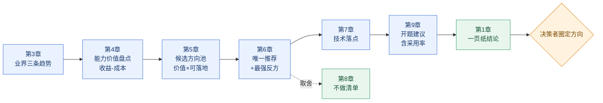

# APM 业界调研 → 开题方向汇报 · 文档模板（内部工具版）

> **在线填写版（飞书）**：https://ruijie.feishu.cn/docx/N1DQdGwS3oVZbBxx3TAcy3M4nXf
> 该版本已把每章拆成「本节要回答 / 填写要点 / 填写区」，可直接往里填内容。

> **这份文档的 KPI 只有一条**：决策者读完能当场圈定**一个**方向，并认可它的价值量级。
> 把业界讲得再全，只要他没圈方向、或觉得「做不做都行」，就是失败。

**v2 相对 v1 的两处根本调整**（因为 APM 目前是对内工具，尚未对外商用）：

1. **删掉「能力差距矩阵」**，整章替换为**「能力价值盘点」**——内部工具不需要证明「比竞品强」，只需要证明「对我们自己有用」。
2. **候选方向的判据从「刚需 × 我方差异化」改为「内部价值强度 × 落地可行性」**——竞品强不再算威胁，业界成熟反而算优点（有参考实现、有开源件、需求已被验证）。

## 0. 先立口径：对内工具的价值语言不同于对外产品

整篇文档的评分逻辑由这张表决定，写之前必须先认可它。

| 维度 | 对外产品 | **对内工具（本文场景）** |
|---|---|---|
| 价值来源 | 客户付费意愿 | 自己团队的工时、质量与响应速度 |
| 竞争关系 | 竞品强 = 威胁 | **业界成熟 = 可借鉴**，降低试错成本 |
| 方向判据 | 刚需度 × 我方差异化 | **内部价值强度 × 落地可行性** |
| 收益怎么算 | 收入、份额、客单价 | 节省工时、MTTR 下降、返工减少、覆盖率提升 |
| 成功指标 | 续费率、ARR | **采用率**、周活跃、替代掉的人工步骤数 |
| 主要死因 | 打不过竞品 | **做出来没人用** |

**这条口径决定了三件事**：

- 不要写市场份额、竞品打压、商业模式——那些问题在内部工具上不存在。
- 「业界已有成熟实现」是**加分项**，不是劣势。它意味着有参考设计、可能直接复用开源件、需求已被别人验证过。
- 收益必须换算成**自己团队的账**，否则评审无法判断值不值。

**与既有文档的分工**（不要混写）：

| 文档类型 | 回答的问题 | 读者读完的动作 |
|---|---|---|
| 厂商全景 / 单功能深挖 | 这家做了什么、怎么做的 | 建立事实基础 |
| 借鉴评估 | 这个东西我们能抄哪几件 | 排进需求池 |
| **本文（开题方向汇报）** | **下一阶段做哪个方向、它值多少、怎么做得到** | **圈定方向、同意开题** |

前置方法：[[业界分析方法论-四步框架与实战示例]]（查 → 析 → 整 → 判）。
配套检查：[[技术文档写作方法论]]、[[调研报告交付清单]]。

---

## 1. 写前 15 分钟：先定三件事

| # | 要定的事 | 怎么定 | 定错的后果 |
|---|---|---|---|
| 1 | 这次是「信息同步」还是「要一个决定」 | 绝大多数是要决定。同步类才允许只讲图景 | 写成行业综述，散会后无人拍板 |
| 2 | 主读者是谁 | 部门负责人 / 技术委员会。关心「值不值、做得成吗、多久见效、会不会没人用」 | 你按工程师视角写技术细节，他关心的是投入产出 |
| 3 | 要他当场给什么 | ① 方向选定（1 个）② 开题范围 ③ 人力口径 ④ 后续推广的配合 | 他不给，你下次还得再汇报一遍 |

**判据**：第 3 条填不出来 → 先和主读者对齐 15 分钟，别写。

---

## 2. 文档骨架（10 章 + 附录，正文 ≤ 8 页）

| 章 | 标题写法（论断式） | 写什么 | 篇幅 | 缺失后果 |
|---|---|---|---|---|
| 1 | 一页纸结论 | 判断 / 3 条依据 / 推荐方向 / 价值量级 / 请确认什么 | 1 页 | 全文失败 |
| 2 | 调研口径与局限 | 覆盖谁、时间窗、信源等级、**明确不覆盖什么** | 0.3 页 | 结论被质疑时无处申辩 |
| 3 | 业界走向：3 条收敛趋势 | 趋势 + 时点 + 驱动力，不是功能清单 | 1.5 页 | 退化为厂商摘要 |
| 4 | **能力价值盘点：这些功能各值多少** | 受益角色 / 当前人工方案 / 可测指标 / 前置成本 → 价值分级 | **1.5 页** | 方向没有价值依据，评审只能凭感觉 |
| 5 | 候选方向池：价值强度 × 落地可行性 | 四象限，说明候选从哪来 | 0.7 页 | 候选显得拍脑袋 |
| 6 | 候选方向对比与唯一推荐 | 统一维度打分 + 最强反方 + 反驳 | 1 页 | 读者替你选，或都不选 |
| 7 | 推荐方向的技术落点 | 在我们的栈上怎么实现、缺什么、加什么 | 1 页 | 评审第一问就塌 |
| 8 | 取舍与不做清单 | 做 / 不做 / 重启条件 | 0.5 页 | 像在撒网，无法判断边界 |
| 9 | 开题建议：假设 / 验证 / 退出 | 核心假设、验证方式、**内部可测指标**、退出条件 | 1 页 | 开题变成立项，被追问 ROI |
| 10 | 风险与待定 | 含**采用率风险**、维护成本；每条带 owner + 日期 | 0.5 页 | 悬空项无人接 |
| 附 | A 功能收敛矩阵 B 痛点收敛表 C 演进时间线 D 信源总表 E 价值-证据映射 | 支撑材料 | 不限 | 正文被迫膨胀 |

**篇幅纪律**：正文 8 页硬上限。第 4 章是本文的重心，值得占 1.5 页；第 7、9 章各 1 页。其余压缩。

**这 10 章是一条论证链**——任一环缺失，结论就不成立：



读法：第 3 章说「业界在哪」，第 4 章说「这些能力对我们值多少」，两者交叉产生第 5 章的候选；第 6 章做减法选出唯一；第 7 章证明做得到；第 9 章说明怎么验证、以及谁会用。**第 1 章是这条链的产物，但放在最前面**——这就是结论先行。

---

## 3. 第 4 章的核心：价值论证的六格链（全篇最重要的一节）

内部工具的价值不能靠「业界都在做」论证。它必须走完这条链，**缺任何一格，收益就不成立**：

```
业界有这个能力
  → ① 谁受益（具体角色，不是「团队」）
  → ② 他现在怎么做（当前人工替代方案 = 基线）
  → ③ 换成这个能力后省什么（时间 / 人力 / 返工 / 漏判）
  → ④ 用哪个现有数据能测出这个变化（指标 + 数据源）
  → ⑤ 前置成本（采集改造 / 存储 / 维护）
  → ⑥ 判断：值 / 不值 / 有条件才值
```

**第 ② 格是最容易被跳过、也最致命的一格。** 没有「当前人工方案」，就没有基线；没有基线，「能省很多时间」永远是一句感觉。评审只要问一句「现在是怎么做的、花多久」，整章就塌了。

### 3.1 填写卡：能力价值四问

每个候选能力填一遍，一行一个：

| 能力 | ① 谁受益（角色） | ② 当前人工方案与耗时 | ③ 省什么 | ④ 用什么数据可测 | ⑤ 前置成本 | ⑥ 判断 |
|---|---|---|---|---|---|---|
| 〈例：拓扑关联排障〉 | 一线支持工程师 | 手工登录设备逐跳查，单次 40～120 分钟 | 单次排障时间、误判往返 | 工单处理时长、升级率 | 拓扑数据完整度改造（中） | 值 |
| 〈例：相似历史案例检索〉 | 研发 / 值班 | 翻群聊记录与个人笔记，常查不到 | 重复问题的排查时间 | 同类工单重复率 | 需沉淀历史工单（低） | 有条件才值 |

### 3.2 价值分级（把六格链压缩成一句结论）

| 分级 | 判据 | 处理 |
|---|---|---|
| **必备** | 没有它，现有流程有明确断点（不是「更好」，是「做不下去」） | 直接做 |
| **显著** | 有基线可测，收益 ≥ 成本 2 倍以上，且在开题周期内可验证 | 优先做 |
| **锦上添花** | 收益存在但难量化，或收益依赖别的功能先落地 | 排序靠后 |
| **不必做** | 找不到受益角色，或当前人工方案已经很省 | 写进不做清单 |

### 3.3 我们的数据基础（这是落地前提，不是竞争壁垒）

内部工具不需要「别人拿不到的数据」来建立壁垒，只需要回答「我们手里已经有什么、还缺什么」。按现有栈逐项标注即可：

| 数据 | 现有来源 | 是否够用 | 缺口 |
|---|---|---|---|
| 时序指标 | VictoriaMetrics | | |
| 日志 | Loki | | |
| 性能剖析 | Pyroscope | | |
| 元数据 / 关系 | MySQL | | |
| 设备侧配置与拓扑 | 〈交换机采集〉 | | |
| 变更事件 | 〈待确认〉 | | |
| 历史工单 / 故障记录 | 〈待确认〉 | | |

**判据**：候选方向若依赖某类「缺口」数据，必须在第 7 章给出补齐方案与成本，否则该方向自动降级为「有条件才做」。

---

## 4. 其余关键节的填写卡

### 4.1 第 1 章 · 一页纸结论（五行，不要写第六行）

```
判断：〈业界已收敛到 X；其中对我们真正有价值的是 Y，不是 Z〉
依据：① 〈…〉 ② 〈…〉 ③ 〈…〉                  ← 每条 ≤ 25 字，带证据编号
推荐：〈方向名〉，价值是〈省什么、量级多少〉，不做〈最诱人但不该做的那个〉
范围：开题验证〈一件事〉，周期〈N 周〉，投入〈人力口径〉
请确认：〈方向是否成立 / 范围收在哪 / 是否需要配套推广资源〉
```

**反例**：「本文首先介绍调研背景，其次分析业界现状，最后给出建议方向。」——这是目录，不是结论。

### 4.2 第 3 章 · 趋势判断句式（每条趋势一个四句块）

```
现象：〈N 家〉在〈同一件事〉上同向，分别是〈A、B、C〉     ← ≥3 家才算趋势
时点：集中在〈时间窗〉出现，最早〈谁〉于〈何时〉            ← 没时点就是观感
判断：这说明〈X〉已从「差异化卖点」变成「入场条件」        ← 要性质判断
含义：对我们而言，〈做 / 不做〉意味着〈后果〉              ← 必须落到我们，且落到「省什么」
```

三条趋势为宜，最多四条。三条讲不透说明调研没收敛；五条以上说明在罗列。

### 4.3 第 5 章 · 候选方向池（价值强度 × 落地可行性）

|  | 落地可行（数据齐、栈内可做） | 落地受阻（缺数据 / 需大改造） |
|---|---|---|
| **内部价值高** | **← 候选方向只能从这里出** | 先补前置条件，列入下期 |
| **内部价值低** | 顺手补（当作完整性） | 明确不做 |

候选 3～4 个：少于 3 个不构成选择，多于 4 个说明没筛。每个候选必须写明「来自哪条趋势（第 3 章）× 哪条价值判断（第 4 章）」。

### 4.4 第 6 章 · 候选对比表（权重按内部工具重设）

| 维度（权重） | 候选 A | 候选 B | 候选 C |
|---|---|---|---|
| 内部价值强度（35%） | 〈4〉〈依据：单次排障省 40 分钟〉 | | |
| 受益面宽度（20%） | 〈3〉〈仅一线支持受益〉 | | |
| 实现成本（反比，20%） | | | |
| 业界可借鉴度（正比，15%） | 〈5〉〈有开源实现可直接参考〉 | | |
| 见效周期（反比，10%） | | | |

三处与对外产品版不同：

- **「竞品强度」删掉，换成「业界可借鉴度」，且是正比**——别人做透了是好事。
- **权重先定再打分**。先打分后凑权重是自欺。
- 必须写**最强反方**：`反对者会说〈…〉；我认为不成立，因为〈…〉`。写不出这句，说明还没想清。

### 4.5 第 7 章 · 技术落点表

把推荐方向拆成 4～6 个能力件，逐个落到现有栈：

| 能力件 | 现有栈能否支撑 | 缺什么 | 需新增组件 | 成本量级 | 维护成本 |
|---|---|---|---|---|---|
| 〈例：拓扑关联查询〉 | 部分（MySQL 存关系，无多跳查询） | 路径计算能力 | 图查询层 / 邻接表预聚合 | 中 | 中（拓扑变更需同步） |
| 〈例：相似案例检索〉 | 否 | 向量存储 + 嵌入模型 | 向量库 + 嵌入服务 | 低 | 低 |

**已知栈**：VictoriaMetrics（时序）、Loki（日志）、Pyroscope（Profile）、MySQL（元数据/关系）、Redis（缓存）。

两条判据：
1. 说不出「加什么组件、成本量级多少」的方向，还是想法，不是开题。
2. **维护成本必须单列**。内部工具没有营收兜底，维护成本会悄悄吃掉全部收益。

### 4.6 第 9 章 · 开题建议卡（开题 ≠ 立项）

| 项 | 内容 | 判据 |
|---|---|---|
| 核心假设 | 我们相信〈…〉，若成立则〈…〉 | 可被证伪，不是「要做得好」 |
| 验证方式 | 用哪批真实数据 / 哪个真实故障复盘 / 与谁共创 | 具体到数据和场景 |
| 成功指标 | 1～2 个**内部可测**指标 + 当前基线值 | 能在 N 周内测出来 |
| 采用假设 | 谁在什么场景下会用，怎么让他用上 | 内部工具最容易被跳过的一格 |
| 退出条件 | 若〈指标未达 X〉或〈前提不成立〉则停止 | 必须写，否则等于无条件投入 |
| 里程碑 | M1 / M2 / M3 + 各自可演示的东西 | 每期有实物 |
| 不做范围 | 本期明确不做〈…〉 | 防止范围蔓延 |

内部可测指标优先用这几个，都能从现有系统取数：

| 指标 | 取数来源 | 说明 |
|---|---|---|
| 单次排障平均耗时（MTTR） | 工单系统 / 值班记录 | 最直观，但需要历史基线 |
| 同类问题重复排查次数 | 工单分类统计 | 衡量知识沉淀类功能 |
| 替代掉的人工步骤数 | 流程梳理 | 适合流程类功能 |
| 使用人数 / 周活跃 / 调用次数 | 工具自身埋点 | 衡量采用率，防止「做完没人用」 |
| 升级到研发的比例 | 工单流转记录 | 衡量一线自助能力 |

### 4.7 第 8 章 · 取舍与不做清单

| 做 | 不做 | 不做的理由 | 重启条件 |
|---|---|---|---|
| 〈方向名〉 | 〈最诱人但不该做的那个〉 | 〈收益无基线 / 数据缺口太大 / 维护成本过高〉 | 〈什么信号出现时重议〉 |

**「不做」必须挑最有诱惑力的那个写**——写一个本来就没人想做的，等于没写。

---

## 5. 汇报版 vs 阅读版

| 维度 | 汇报版（投影 + 口述） | 阅读版（留档 + 传阅） |
|---|---|---|
| 页数 | 8～12 页，每页一个判断 | 正文 8 页 + 附录不限 |
| 结论位置 | 第 1 页，开场 90 秒讲完 | 第 1 章 |
| 数据表 | 只放价值分级表与四象限图 | 全部附录表 |
| 证据 | 口头备着，被问才展开 | 全部落字 |

三条现场纪律：
1. **开场 90 秒说完一页纸结论**。超时就会被打断，节奏就丢了。
2. **被打断时能从任意页接回去**：每页标题是判断句，停在任意页都能自洽。
3. **准备被问三题**：`这个功能到底谁会用`、`现在没有它不也过来了吗`、`维护谁负责`。前两问的答案就是第 4 章的六格链，第三问的答案在第 7 章。

---

## 6. 十条注意点（针对「内部工具选方向」的汇报）

| # | 注意点 | 病根 | 处方 |
|---|---|---|---|
| 1 | 用对外产品的语言写内部工具 | 谈份额、竞品打压、商业模式，读者一听就觉得虚 | 换成工时、MTTR、覆盖率、采用率 |
| 2 | 把「业界已成熟」当劣势 | 误用竞争视角 | 对内是加分：有参考实现、可复用开源件、需求已验证 |
| 3 | 收益凭感觉 | 「能省很多时间」没有基线，无法验证 | 补 ② 当前人工方案与耗时，那是收益的分母 |
| 4 | 默认有人会用 | 内部工具第一大死因是采用率，不是技术难度 | 第 9 章写「采用假设」：谁、什么场景、怎么推 |
| 5 | 只算开发成本，不算维护 | 没有营收兜底，维护成本会吃掉收益 | 第 7 章维护成本单列，写清谁维护 |
| 6 | 把「业界都在做」当价值依据 | 别人的选择不等于我们的收益 | 每条能力必须走完六格链 |
| 7 | 功能清单当方向论证 | 罗列功能，不问解决谁的什么痛 | 每条趋势后必须落到「省什么」 |
| 8 | 趋势没有时点与数量 | 「很多厂商都在做」是观感 | 写「N 家、集中在哪个时间窗」 |
| 9 | 假选择 | 3 个候选里 2 个明显不可行，读者认为你在走程序 | 候选都要真能开题 |
| 10 | 开题写成立项 | 承诺交付，然后被追问排期与 ROI | 只承诺验证，补退出条件与成功指标 |

**四条红线，出现即为不合格**：

| 红线 | 表现 | 为什么致命 |
|---|---|---|
| 架构自证 | 从技术实现倒推价值（如把「日志格式不统一」写成痛点） | 使用者感知不到，现场被直接否掉 |
| 摘要堆砌 | 每家厂商一段简介，没有归一与合成 | 读者无法比较，只会问「所以呢」 |
| 功能罗列 | 只列功能名，不问谁受益、省什么 | 推不出方向 |
| 指标幻觉 | 用「业界领先」「大家都在用」当收益证据 | 收益一旦被追问，全线崩塌 |

---

## 7. 交付前 Checklist

**A 档 · 阻断项（任一条不过，不得交付）**

- [ ] 第 1 页 200 字内出现：判断、推荐方向、价值量级、请确认什么
- [ ] 3 条趋势都有数量（≥3 家）与时点，且各有一句「对我们意味着省什么」
- [ ] 每个候选能力走完六格链：受益角色 / 当前人工方案与耗时 / 省什么 / 可测指标 / 前置成本 / 判断
- [ ] 收益都带基线（不是「感觉能省」）
- [ ] 候选方向 3～4 个，每个能说出「来自哪条趋势 × 哪条价值判断」
- [ ] 对比表每格有依据，权重先定
- [ ] 写出唯一推荐 + 最强反方 + 反驳
- [ ] 技术落点表落地到现有栈，含新增组件、成本量级、**维护成本**
- [ ] 开题卡含核心假设、内部可测指标、**采用假设**、退出条件
- [ ] 不做清单写了最有诱惑力的那一个
- [ ] 全文没有市场份额 / 竞品打压 / 商业模式这类错位表述

**B 档 · 质量项**

- [ ] 第 2 章声明了「不覆盖什么」与资料截止日期
- [ ] 每条结论在附录 E 映射表里能找到 1 个 A 级或 2 个 B 级来源
- [ ] 数据基础表逐项标注了缺口，且缺口有补齐方案或降级说明
- [ ] 价值分级覆盖了「不必做」——不做清单有依据
- [ ] 正文 ≤ 8 页，段落 ≤ 5 行
- [ ] 每个标题能独立成句，标题连读即摘要
- [ ] 图都有正文引用，且有一句「这说明什么」
- [ ] 汇报版 ≤ 12 页，每页一个判断

**C 档 · 加分项**

- [ ] 给出「如果只能开一个，先开哪个」的一句话
- [ ] 附一页四象限图，决策者可只看图拍板
- [ ] 用一个真实历史故障案例说明收益（比任何抽象论证都有力）
- [ ] 标出「如果这个方向失败，备选是什么」
- [ ] 文首一行「本版结论相对上次汇报的变化」

---

## 8. 一页速查

```
口径：对内工具，价值语言是工时/MTTR/覆盖率/采用率，不是份额与竞品
第1页：判断 / 3条依据 / 推荐方向 / 价值量级 / 请确认
趋势：≥3家 + 时点 + 性质判断 + 对我们省什么
价值六格：谁受益 → 现在怎么做(基线) → 省什么 → 用什么数据测 → 前置成本 → 值不值
分级：必备 / 显著 / 锦上添花 / 不必做
候选：只取「价值高 × 可落地」，3～4 个，写明来源
推荐：唯一 + 权重先定 + 每格有依据 + 最强反方与反驳
技术：拆能力件 → 现有栈能否支撑 → 缺什么 → 加什么 → 成本 → 维护谁负责
取舍：不做那个最有诱惑力的，写重启条件
开题：假设 / 内部可测指标 / 采用假设 / 退出条件 / 里程碑
现场：90秒讲完第1页；被问三题（谁会用/没有它不也过来了吗/维护谁负责）
```

---

## 附录 · 空白骨架（复制即用）

```markdown
# APM 业界调研 → 下一阶段开题方向建议

> 一句话结论：〈…〉
> 版本：v0.1　日期：〈…〉　作者：〈…〉

## 1. 一页纸结论
判断：
依据：① ② ③
推荐方向：
价值量级：
开题范围：验证〈…〉，周期〈…〉，投入〈…〉
请确认：

## 2. 调研口径与局限
- 覆盖范围：〈厂商清单〉／时间窗：〈起-止〉／信源等级：A〈n〉B〈n〉C〈n〉
- 颗粒度上限：
- 明确不覆盖：

## 3. 业界走向：三条收敛趋势
### 3.1 〈趋势一〉—— 〈四字口号〉
现象：　时点：　判断：　对我们意味着省什么：
### 3.2 〈趋势二〉
### 3.3 〈趋势三〉
### 3.4 为什么是现在

## 4. 能力价值盘点
| 能力 | 谁受益 | 当前人工方案与耗时 | 省什么 | 用什么数据可测 | 前置成本 | 判断 |
### 4.1 价值分级（必备 / 显著 / 锦上添花 / 不必做）
### 4.2 我们的数据基础与缺口

## 5. 候选方向池
|  | 落地可行 | 落地受阻 |
| 价值高 | ← 候选 | 先补前置条件 |
| 价值低 | 顺手补 | 不做 |
- 候选 A：来自趋势〈n〉× 价值判断〈…〉
- 候选 B：
- 候选 C：

## 6. 候选方向对比与唯一推荐
| 维度（权重） | A | B | C |
### 6.1 推荐：〈方向名〉
理由 1／2／3
### 6.2 最强反方与反驳

## 7. 推荐方向的技术落点
| 能力件 | 现有栈能否支撑 | 缺什么 | 需新增组件 | 成本量级 | 维护成本 |
### 7.1 技术选型结论

## 8. 取舍与不做清单
| 做 | 不做 | 理由 | 重启条件 |

## 9. 开题建议
| 核心假设 | 验证方式 | 成功指标与基线 | 采用假设 | 退出条件 | 里程碑 |

## 10. 风险与待定
| 事项 | 待谁 | 何时 | 影响哪条结论 |

## 附录
A 功能收敛矩阵　B 痛点收敛表　C 演进阶段时间线　D 信源总表　E 价值-证据映射
```

---

## 准备节奏建议（3 个工作日）

| 日 | 做什么 | 产出 | 卡点 |
|---|---|---|---|
| D1 上午 | 定第 1 页 + 第 4 章六格链（选 4～6 个能力填） | 一句话判断 + 价值四问表 | 填不出「当前人工方案」→ 去找一线问，别猜 |
| D1 下午 | 写第 3 章三条趋势 + 第 5 章候选池 | 趋势四句块 + 3 个候选 | 趋势说不出数量与时点 → 回补 A 级信源 |
| D2 上午 | 第 6 章对比与推荐 + 最强反方 | 打分表 + 反驳 | 反驳写不出 → 换方向或回 D1 |
| D2 下午 | 第 7 章技术落点 + 第 9 章开题卡 | 落点表 + 采用假设 + 退出条件 | 说不出加什么组件 → 方向不可开题 |
| D3 上午 | 第 2/8/10 章 + 附录 + 改稿 | 完整阅读版 | 正文超 8 页 → 下沉附录 |
| D3 下午 | 做汇报版 + 预演 90 秒 | 12 页内汇报版 | 90 秒讲不完 → 第 1 页没写清 |

---

*模板 v2 · 适用对内工具的方向选择；对外产品版本需另建（判据为「刚需 × 差异化」）。文中厂商事实与数值为占位，正式使用时须按 A/B/C 信源分级复核。*
