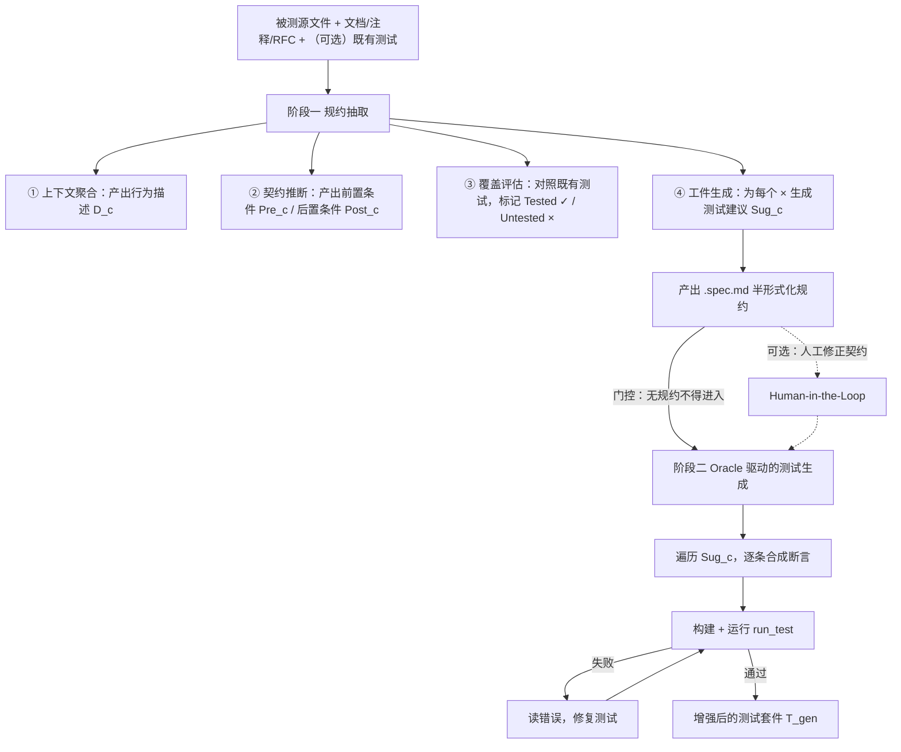

# Google 如何用 AI 生成单元测试：契约驱动机制与能力边界

> 本文只回答三件事：① Google 用 AI 生成单元测试是为了解决什么问题、这个问题过去怎么处理；② 这条路的优点、缺点与能力边界；③ 他们具体是怎么做的。
>
> 全文按证据等级标注：**A**＝官方论文／官方博客给出的数字；**B**＝官方定性表述（无数字）；**C**＝二手转述（第三方转写官方材料，未逐字核对）；**D**＝本文推断。
>
> 只想看结论的读者读 [[#0. 结论先行|§0]] 与 [[#1. 一页看懂：好处、坏处、成本与能力边界|§1]]，两节合计约两屏；想看机制细节直接跳 [[#4. 他们是怎么用 AI 生成测试的|§4]]。

## 目录

| 章节 | 一句话内容 |
|---|---|
| [[#0. 结论先行\|§0]] | 六条结论、全部关键数字 |
| [[#1. 一页看懂：好处、坏处、成本与能力边界\|§1]] | 决策者一页纸：7 条好处、10 条坏处、边界表、成本表 |
| [[#2. 要解决的问题，以及过去的解法\|§2]] | 三个结构性矛盾、五条老路的天花板、oracle 问题 |
| [[#3. Google 的四条线：别把研究、内部模型、产品混为一谈\|§3]] | 研究线／内部模型线／产品线／工程线的区分 |
| [[#4. 他们是怎么用 AI 生成测试的\|§4]] | 两阶段框架、四步契约抽取、评测设计、产品形态 |
| [[#5. 数字与口径\|§5]] | 主结果表、四个常见误读、8 类失败模式 |
| [[#6. 与 Meta、Uber 的路线对比\|§6]] | 三家攻的是三个不同的靶子 |
| [[#7. 可迁移结论\|§7]] | 值得抄的 5 条、不建议抄的 3 条 |
| [[#8. 证据分级与本文推断清单\|§8]] | 每条结论的证据等级 |
| [[#附录 A 来源清单\|附录 A]] | 8 个来源及用途 |

## 0. 结论先行

1. **Google 公开的做法不是"让 AI 补测试把覆盖率刷到 80%"，而是"让 agent 先写出这个函数的行为契约，再照着契约写测试"**——方法名就是规格驱动的测试生成（Spec-Driven Test Generation）。契约是 AI 自己从代码、注释、文档和历史调用点里反推出来的，不是人提前写的。**证据等级：A**（论文标题与摘要）。
2. **它要解决的核心问题不是覆盖率不够，而是"AI 不知道什么算对"**——即判定基准问题（oracle problem）。不解决这个问题，AI 生成的测试只能验证"代码现在就是这样跑的"，连 bug 一起固化下来。**证据等级：A**（论文第 1 节明确以此立论）。
3. **效果（官方口径）**：在 90 个 Google 真实历史缺陷上，缺陷检出率 **63.2%**（基线 53.4%，**+9.8 个百分点**，p=0.0352）；分支覆盖率 **+2.5 个百分点**（p=0.0034）；用更大模型做裁判时，**77.8%** 的用例认为契约驱动测试优于基线，**56.7%** 的用例认为优于人写测试。**证据等级：A**。
4. **代价与硬边界**：token 消耗 **+38%**；绝对检出率只有六成（近四个历史缺陷里漏一个半）；只跑 1 次时差异不显著（+4.2 个百分点，p=0.3075）；全部数据来自 Google 单一单体仓库（monorepo）、且只覆盖"单文件缺陷修复"这一类改动。**证据等级：A**。
5. **Google 至今没有公布"AI 生成的测试占新增测试多少比例"这类生产规模数字**，公开可查的是研究口径的实验与产品功能；同样的问题，Uber 给了 11%、Meta 给了逐阶段转化率。**证据等级：B（缺失）+ C**。这一点决定了本文对 Google 的评估只能到"方法可信"，到不了"规模已验证"。
6. **三家公司的路线其实在攻三个不同的靶子**：Google 攻"测试有效性（能不能抓到真 bug）"，Meta 攻"行为是否被本次改动改变"（详见 [[Meta-Catching-JiTTests-五阶段机制拆解]]），Uber 攻"覆盖率产能"。抄之前先想清楚自己要的是哪一个。

## 1. 一页看懂：好处、坏处、成本与能力边界

> 这一节是给决策者的一页纸。机制细节看 [[#4. 他们是怎么用 AI 生成测试的|§4]]，数字口径看 [[#5. 数字与口径|§5]]，推断与证据分级看 [[#8. 证据分级与本文推断清单|§8]]。

一句话定性：**这是一套"用一次额外的推理阶段，把模糊的'写点测试'换成明确的'这些条件必须成立'的方法"**。它不提升模型的写代码能力（两边 pass@5 都是 98.9%），只提升模型"想清楚要验证什么"的能力。

### 1.1 好处

| # | 好处 | 具体表现 | 证据 | 机制原因 |
|---|---|---|---|---|
| 1 | **抓到的是真缺陷，不是覆盖率数字** | 90 个历史缺陷上检出率 63.2%，其中 12 个缺陷只有契约驱动能抓到、基线抓不到 | A（论文表 2） | 用"未覆盖的条件"当靶心，而不是"没跑到的代码行" |
| 2 | **不牺牲可编译性** | pass@5：基线 98.9%，契约驱动 98.9%，完全持平 | A（论文表 1） | 前置推理不改变代码生成能力，只改变生成目标 |
| 3 | **覆盖的是控制流，不是直线路径** | 分支覆盖率 +2.5pp，行覆盖率 −0.4pp（不显著） | A（论文表 3） | 契约以"条件"为单位，天然对应分支而非语句 |
| 4 | **测试可读、命名与契约对齐** | 裁判偏好理由：命名形如 `Method_State_Outcome`，避免反射与过度 mock | A（论文第 5.2 节） | 测试是按契约条目生成的，命名可直接映射到条件 |
| 5 | **可以和人类测试打平** | 裁判认为优于人写测试 56.7%，理由是断言更窄、负向路径更系统 | A（论文图 3） | 人倾向于覆盖 happy path，契约会强制列举错误处理与边界 |
| 6 | **边际成本低** | 每检出一个唯一缺陷的 token 成本仅 +16.2%（总量 +38%） | A（论文表 4） | 多花的 token 换来更多"抓到的缺陷"，摊薄后几乎持平 |
| 7 | **规约产物本身可复用** | 输出 `.spec.md`，人可直接读、改、否；天然支持插入人工环节 | A（论文第 3.2 节） | 半形式化规约是自然语言 + 结构，不是数学公式 |

第 1 条与第 3 条是这套方法的立论基础，其余是推论。**如果团队的痛点是"覆盖率不达标"，这套方法并不是最优解；如果痛点是"覆盖率达标了但线上还在漏"，它才对症。**

### 1.2 坏处

| # | 坏处 | 具体表现 | 数据 | 性质 |
|---|---|---|---|---|
| 1 | **绝对检出率仍然只有六成** | 63.2% 意味着约 37% 的历史缺陷抓不到 | A（论文表 2） | 官方数据 |
| 2 | **单次运行看不出差别** | k=1 时 +4.2pp，p=0.3075；k=2 时 p=0.4545 | A（论文表 2） | 官方数据，自承不显著 |
| 3 | **token 成本 +38%** | 336.7M vs 243.9M；输出 token +59% | A（论文表 4） | 官方数据 |
| 4 | **会整体漏掉方法** | 141 次规约生成失败中，**35 次是完全没识别出某个方法／helper／RPC 入口** | A（论文第 5.3 节） | 官方数据 |
| 5 | **happy path 偏好依然存在** | 规约失败第二大原因是"只写正常路径、漏异常与 fallback"（32 次） | A（论文第 5.3 节） | 官方数据 |
| 6 | **契约可能把 bug 固化成"预期行为"** | 契约从**实现**反推，实现若有 bug，契约会照抄 | A（论文自述风险，用"看修复后代码"缓解） | 方法论固有限制 |
| 7 | **裁判本身是 LLM，评估有噪声** | 定性结论全依赖 LLM-as-a-Judge；论文用更强模型 + 5 次多数投票缓解 | A（论文第 6.1 节） | 官方自承 |
| 8 | **实验设置不真实** | Greenfield 设置把已有测试全部剥掉，真实工程里从来不会这样 | A（论文第 3.3 节、第6.5节） | 官方自承 |
| 9 | **单一组织、单文件改动** | 90 个缺陷全来自 Google 一个 monorepo；只保留"修复只改一个源文件"的缺陷 | A（论文第 6.3 节） | 外部效度限制 |
| 10 | **工程前置条件重** | 需要可编译构建、`run_test` 工具、覆盖率工具、BUILD 目标可定位 | A（论文第 3.2 节工具集） | 硬边界 |

第 1 条和第 9 条必须一起看：**63.2% 是"在 Google 这种构建系统极其规范、注释文档齐全、且缺陷样本经过筛选"条件下的数字**，换到构建脚本残缺、注释为零的代码库，先崩的是规约抽取，而不是检出率。

### 1.3 能力边界

| 维度 | 边界 | 类型 |
|---|---|---|
| 对象 | 有明确输入输出边界的函数／方法／RPC handler；对"整体架构是否合理"无能为力 | 硬边界 |
| 判定 | 只能判定"某个条件是否被违反"，不能判定"这个需求是否被正确实现" | 硬边界 |
| 时间 | 只能对**已存在**的代码生成测试；不能对需求文档直接生成验收测试 | 硬边界 |
| 环境 | 必须能编译、能跑、能取覆盖率；不能编过就全盘失效 | 硬边界 |
| 语言 | 论文覆盖 C++／Java／Python／Go，方法本身语言无关，但工具链适配需逐语言做 | 软边界 |
| 增量 | 论文评估的是"给存量单文件补测试"；对新写代码在 IDE 内即时生成，走的是产品线（见 [[#4.6 产品侧的两条路径\|§4.6]]），效果未公开量化 | 软边界 |
| 缺陷类型 | 对"逻辑写错但结构覆盖率不掉"的缺陷最有效；对并发、性能、协议时序类缺陷未见评估 | 软边界 |

### 1.4 成本与收益

| 侧 | 项目 | 数值 | 是否官方 |
|---|---|---|---|
| 收益 | 缺陷检出率（k=5） | 53.4% → **63.2%** | 官方 |
| 收益 | 唯一检出缺陷数（k=5，90 个样本） | 48 → **57** | 官方 |
| 收益 | 分支覆盖率 | 46.4% → **48.9%** | 官方 |
| 收益 | 裁判判定"优于人写测试" | **56.7%** | 官方 |
| 成本 | 总 token | 243.9M → **336.7M（+38%）** | 官方 |
| 成本 | 每唯一检出缺陷的 token | 5.1M → **5.9M（+16.2%）** | 官方 |
| 成本 | 人工评审时间／误报处置成本 | **无数据** | 官方未披露 |
| 成本 | 工程改造（`.spec.md` 流水线、`run_test` 工具、评估集建设） | **无数据** | 官方未披露 |

**结论：官方给的数字够算"换算率"，不够算投资回报率（ROI）。** 真正决定划算与否的是"一个漏到线上的缺陷值多少钱"，这个数只有自己能填。

## 2. 要解决的问题，以及过去的解法

### 2.1 问题不在覆盖率数字

Google 面对的不是"覆盖率 40% 想提到 80%"这种单点诉求，而是三个叠加的结构性矛盾：

| 矛盾 | 具体内容 | 为什么难 |
|---|---|---|
| **写测试的边际成本高** | 补一行被覆盖的代码，需要人读懂依赖、构造 mock、想清断言 | 存量代码缺测试 → 补测试的投入产出比看着不划算 → 越不补越难补（D，行业共识） |
| **覆盖率是代理指标** | 行覆盖高不代表测试有效；无断言的测试也能刷满覆盖率 | 用覆盖率做 KPI 会诱导"刷指标"而非"抓缺陷"（A，论文第 2 节引用既有研究） |
| **AI 生成测试解决的是"写"，没解决"判"** | LLM 能把测试代码写得很像样，但它不知道预期结果应该是什么 | 这是判定基准问题（oracle problem），不是代码生成问题（A，论文第 1 节） |

第三行是全部关键。**前两个矛盾和 LLM 无关，第三个矛盾才是 Google 这套方法存在的理由。**

### 2.2 四条老路与各自天花板

在 LLM 之前，Google 及业界处理"测试不够、测试无效"主要靠四条路，每条都解决了问题的一部分：

| 路线 | 具体做法 | 解决得住的 | 天花板 |
|---|---|---|---|
| **① 人工写 + 评审强制** | 生产代码必须带单测；评审工具会提示"新增了源文件但没有对应测试"；新功能必须由带测试的改动引入 | 需求明确、逻辑集中、团队有余力 | 成本线性于代码量；存量代码补测试 ROI 低；靠人自觉的地方一定漏 |
| **② 覆盖率门禁** | 关注修改行覆盖率（MLC, modified line coverage）；"覆盖率不得下降"原则；按模块设阈值（业界常引 80%） | 防止新增代码完全裸奔；给出可观测的下限 | 覆盖率是必要条件不是充分条件；对"测试写了但断言是空的"完全无效 |
| **③ 覆盖引导模糊测试（fuzzing）** | OSS-Fuzz / ClusterFuzz：变异输入、按覆盖反馈进化、配 Sanitizer 抓崩溃 | 崩溃、内存越界、断言失败这类"机器可判"的缺陷 | 只能抓"程序自己会崩"的缺陷；需要人写 harness；**截至 2025-05，OSS-Fuzz 累计发现 13,000+ 漏洞、50,000+ bug、覆盖 1,000 个项目，但很多项目运行时覆盖率仍在 30% 左右**（A，官方项目页） |
| **④ 搜索式／约束式测试生成** | EvoSuite、Randoop、Pynguin：按字节码或类型约束生成调用序列 | 达到高结构覆盖率；无需人工写用例 | 断言弱（往往只断言"不抛异常"）；测试不可读、难维护；语言与框架绑定强；本质仍未解决 oracle |
| **⑤ 变异测试（mutation testing）** | 人为在代码里注入变异体，看测试能否杀死 | 度量"测试有效性"，不是度量覆盖率 | 只评估不生成；变异体不代表真实缺陷；计算成本高 |

**这五条路合起来说明一件事：机器早就能"生成执行"，但一直不能"生成判断"。** 模糊测试靠 Sanitizer 提供判断，所以只管崩溃；搜索式生成放弃判断，所以只管覆盖。Google 的 AI 方案是把"判断"这一步用 LLM 补上。

### 2.3 LLM 时代真正卡住的是判定基准

论文对既有 AI 方案的批评很直接：

> 当智能体直接从现有代码生成测试时，**没有显式契约来锚定它的探索方向**，因此会漏边界情况、幻觉逻辑、生成只做表面覆盖的测试，无法系统性遍历程序状态空间。（A，论文第 1 节，原文直译）

翻译成人话：**让模型看着代码写测试，模型写出的断言就是在描述这份代码现在怎么跑——包括它的 bug。** 这类测试能过、能提覆盖率、能在评审里看起来很像样，但它验证的是"现状"，不是"预期"。

论文同时否掉了三种看起来能提供判断的既有做法（A，论文第 1 节、第2节）：

| 既有做法 | 为什么不够 |
|---|---|
| 不变量挖掘（Daikon 等基于执行轨迹） | 把**实际执行**当基准，缺陷行为也会被形式化成"预期"；只能覆盖跑过的轨迹；表达式僵硬；需搭运行时；难跨语言 |
| 人类先写契约（设计契约，Design by Contract, DbC） | 对存量系统不现实——没人会给十年前的代码补前置条件 |
| 用变异测试分数评估 | 合成变异体代表不了真实开发者错误的语义复杂度 |

**第三条批评很关键：它解释了为什么论文要用"90 个真实历史缺陷"当评测集，而不是跑 Defects4J 或变异分数。** 真 bug 才是最好的变异体。

## 3. Google 的四条线：别把研究、内部模型、产品混为一谈

公开材料里"Google 用 AI 生成测试"至少有四条互不相同的线，混在一起谈会得出错结论：

| 线 | 代表 | 是什么 | 有无量化数据 |
|---|---|---|---|
| **研究线** | 规格驱动的测试生成（SpecOps '26，arXiv 2608.17177） | 两阶段 agent 框架，先抽契约再生成测试，在 90 个内部真实缺陷上做对照实验 | **有**，但仅限实验口径 |
| **内部模型线** | Gemini for Google（GfG，arXiv 2605.16517） | 用约一万亿 token 内部语料中期训练（mid-training）的定制模型；"自动单元测试生成"被列为已部署用例之一，定位是"降低提升测试覆盖率的摩擦" | **无**，论文未给生成量／接受率 |
| **产品线** | Gemini in Android Studio「生成单元测试」、Jules、Gemini Code Assist | 面向外部开发者的功能：分析构造函数依赖、业务分支、边界情况，产出完整测试类（含 setUp、mock 初始化）；Jules 在云 VM 里克隆仓库、出计划、提 PR | **无官方量化**（预览版功能） |
| **工程线** | JUnit3 → JUnit4 迁移（2022 起） | 用模型批量改写测试代码而非生成新测试：3 个月迁移 5,359 个文件、约 149,000 行，约 87% 的 AI 改动无需人工修改即提交 | **有**（A，GfG 论文引用） |

三条重要判断：

1. **研究线是唯一有"检出率"证据的**，也是本文分析主体。
2. **内部模型线只证明了"这件事被采用了"，没证明"采用后效果如何"**——论文把单元测试生成列在"下游应用"清单里，与 Ads 32→64 位迁移、ECO 性能优化并列，唯独这一条没给数字。**证据等级：B**。
3. **工程线的 87% 是"改动可直接提交率"，不是"缺陷检出率"**，不要混用。它说明的是 Google 的 AI 已经能可靠改测试代码，不说明能写出好测试。

> 对照参考：Uber 的 AutoCover 明确给了"约占新增测试 **11%**"（A，ICSE-SEIP '26 摘要），Meta 的 TestGen-LLM 给了逐阶段转化率（75% 可构建 / 57% 稳定通过 / 25% 提覆盖 / 73% 建议被采纳，A）。**Google 在这类生产规模数字上是缺位的**，这是本文对 Google 评估的最大信息缺口。

## 4. 他们是怎么用 AI 生成测试的

### 4.1 两阶段框架

核心设计只有一句话：**在写任何测试代码之前，先让 agent 把被测代码的"契约"写下来，并且强制它必须完成这一步才能进入下一步（门控，gating）**。

两个阶段**共用同一套 agent 架构、同一个模型、同一套工具**（A，论文第 3.2 节）。这一点很重要：它排除了"效果来自更强的 harness"这一解释，差异只来自"有没有先写契约"。

### 4.2 阶段一：把契约从代码里"反推"出来

契约的形式化定义是一个四元组 S_c = ⟨D_c, Pre_c, Post_c, Sug_c⟩（A，论文第 3.1 节）：

| 元素 | 含义 | 举例（论文的 `CustomerDatabase.add_customer`） |
|---|---|---|
| D_c | 自然语言行为描述 | 新增客户记录，须唯一、须有非空姓名 |
| Pre_c | 前置条件集合 | 姓名非空；name 长度上限；数据库连接可用 |
| Post_c | 后置条件集合（含输入校验／错误处理、成功返回值、状态副作用、预期状态变体） | 成功时返回新 ID；重名时抛 `DuplicateCustomer`；失败时不写入 |
| Sug_c | 与某条未覆盖条件绑定的局部测试建议 | "构造空 name，断言抛 `InvalidName`" |

四个步骤的分工（A，论文第 3.1 节）：

| 步骤 | 做什么 | 输出 | 关键点 |
|---|---|---|---|
| ① 上下文聚合（Context Aggregation） | 读源文件、docstring、行内注释、协议 RFC，还原结构与业务逻辑 | D_c | 允许自由创建临时文件（scratchpad）辅助理解 |
| ② 契约推断（Contract Inference） | 逐方法推导行为与安全边界，显式写成 Pre_c / Post_c | 条件集合 | **允许交叉引用仓库内其它调用点的用法**来推断隐式预期——这是与"只总结实现"的根本区别 |
| ③ 覆盖评估（Coverage Assessment） | 把每条条件对照既有测试（含仓库内其它相关测试），标记 ✓／× | 覆盖状态 | 目标是找出"实现了但没人验"的路径 |
| ④ 工件生成（Artifact Generation） | 每条 × 条件生成一条定向测试建议 | Sug_c + `.spec.md` | 输出是给人也能读的 Markdown |

论文示例：agent 发现 `add_customer` 的实现处理了空 name，但**没有任何测试显式验证这条路径**，于是把对应后置条件标为 × 并自动生成结构化建议。**这正是老办法看不到的地方——覆盖率工具会说这行"被执行过"，契约会说这条"没被验证过"。**

### 4.3 阶段二：按未覆盖契约逐条生成

| 环节 | 机制 | 为什么这么设计 |
|---|---|---|
| 输入 | 最终规约 S + 当前测试套件 T_base | 生成有明确清单，不靠模型自由发挥 |
| 门控（gating） | 必须先完成 S 才能生成测试 | 让上下文窗口被"显式边界条件"预热（primed），相当于给模型一份考场提纲 |
| 生成 | 遍历 Sug_c，逐条合成、构建、验证 | 一条契约对一个测试，避免一个巨大 prompt 生成一堆泛泛用例 |
| 验证 | 用 `run_test` 真跑 | 不接受"看起来对"的测试 |
| 修复 | 编译／运行失败后读错误重试 | 保证 pass 率不下降（实测与基线持平） |

**可选的人工环节（HITL）**：因为规约是可读文档，框架天然支持在两个阶段之间插入——开发者可以直接改 Pre_c／Post_c、接受／拒绝／修改 Sug_c（A，论文第 3.2 节）。但论文自己的实验**刻意跳过了这一步**，为的是排除主观性，让对比只反映"有没有契约"。

### 4.4 工具与工程约束

| 类别 | 内容 |
|---|---|
| 工具集 | `view_file`、`list_dir`、`write_to_file`、`run_command`、`grep_search`、`find_by_name`，外加专用 `run_test`（A） |
| 允许的自由度 | 可自由创建／迭代临时文件：`.spec.md`、任务清单、草稿板 |
| 硬约束 | 已有源文件不得修改；改动只允许落在目标测试文件与必要的 BUILD 配置上 |
| 模型 | Gemini 3 Flash（两边一致），temperature 1.0、topP 1.0、topK 50（A） |
| 构建系统依赖 | 需要能定位到"直接依赖被测源文件的测试目标"、能跑覆盖率、能反向 patch（A） |
| 裁判模型 | Gemini 3.1 Pro（刻意用更大模型评更小模型的输出，降低自我偏好偏差） |

### 4.5 效果是怎么量出来的

这一节的评测设计比结果更值得抄。**它把"AI 写的测试好不好"这个主观问题，变成了一组可执行、可复现的判定动作**（A，论文第 3.3 节）：

| 步骤 | 动作 | 防的是什么 |
|---|---|---|
| 1 | 工作区同步到**人工修复后**的代码 C_f | — |
| 2 | **剥掉全部既有测试**（Greenfield 设置） | 防止 agent 抄现成测试结构、或只做"测试修复" |
| 3 | agent 生成 T_gen = A(C_f, T_∅) | — |
| 4 | 在 C_f 上跑 T_gen，记录 pass 与行／分支覆盖率 | 保证测试本身是有效、可执行的 |
| 5 | **把代码反向 patch 回有 bug 的 C_b，再跑 T_gen** | 只要任一测试失败，即判定"检出该缺陷"（fail-to-pass） |
| 6 | 审计工作区：agent 若改过源码，整体作废且不重跑 | 防止篡改源码制造假阳性 |

三个细节值得注意：

- **agent 全程看不到 bug、commit message、修复 diff**（A）。否则等于让模型抄答案，评估失去意义。
- **编译失败不算检出**（A）。这是一条很容易被忽略但极其关键的口径——把"编不过"算成"抓到 bug"会显著虚高。
- 每个缺陷独立采样 k=5 次，用 McNemar 检验比检出率、Wilcoxon 比覆盖率、bootstrap 给置信区间（A）。

### 4.6 产品侧的两条路径

研究之外，Google 对外交付的是两种形态（**B，官方文档／博客定性**）：

| 形态 | 代表 | 交互方式 | 特点 |
|---|---|---|---|
| IDE 内同步 | Gemini in Android Studio「生成单元测试」 | 右键类／方法 → AI → 生成单元测试；或直接对话要求 | 分析源码识别构造依赖、业务分支、边界情况，产出完整测试类（含 setUp、mock 初始化），自动识别项目已配置的框架与 mock 库；另有"只生成测试场景＋名称＋说明、正文自己写"的轻量模式 |
| 异步 agent | Jules | 云端 VM 克隆仓库 → 出计划 → 人审 → 执行 → 提 PR | Gemini 2.5 Pro 驱动，可写测试、修 bug、升依赖；面向"给整块代码补测试"这类长任务 |

两者的共同点：**都把"人"放在生成之后做审核，而不是生成之前做规格说明。** 这与研究线里"契约先行"的顺序相反——研究线假设契约可以自动抽出来，产品线默认用户懒得写规格。

## 5. 数字与口径

### 5.1 主结果

| 指标 | 基线 agent | 契约驱动 agent | 差值 | 显著性 |
|---|---|---|---|---|
| pass@5（测试能否编译并全通过） | 98.9% | 98.9% | 0.0 | — |
| detect@1（单次运行缺陷检出率） | 36.9% | 41.1% | +4.2pp | p=0.3075（不显著） |
| detect@3 | 49.4% | 56.6% | +7.2pp | p=0.0574（边际） |
| **detect@5** | **53.4%** | **63.2%** | **+9.8pp** | **p=0.0352（显著）** |
| 行覆盖率 | 74.8% | 74.4% | −0.4pp | p=0.3659（不显著） |
| **分支覆盖率** | **46.4%** | **48.9%** | **+2.5pp** | **p=0.0034（显著）** |
| 契约覆盖率（ContractCoverage@5） | — | 78.9% | — | 新指标 |
| 裁判：优于基线 | — | 77.8% | — | LLM 裁判 |
| 裁判：优于人写测试 | — | 56.7% | — | LLM 裁判 |

补充两条论文里容易被忽略的分布信息（A）：

- **唯一检出**：k=5 时两边共同检出 45 个，契约驱动独有 **12** 个，基线独有 **3** 个。说明它是"净增益"，不是"换一批"。
- **双峰分布**：基线里 65.6%（59/90）的缺陷落在"0% 检出"或"100% 检出"两个极端；契约驱动降到 57.8%（52/90），把一部分 0% 推进了 20%–80% 的中间区间——**真正的进步发生在难样本上**。
- **契约覆盖率与检出的相关性**：有契约覆盖时检出率 54.9%（151/275），无契约覆盖时 19.4%（34/175），Fisher 精确检验 p=3.62×10⁻¹⁴，φ=0.35。**这条是全文最硬的机制证据：写对了契约才抓得到 bug。**（A）

### 5.2 四个常见误读

| 误读 | 实际口径 | 为什么容易错 |
|---|---|---|
| "Google 的 AI 写测试能抓到 63% 的 bug" | 63.2% 是 **90 个筛选过的历史缺陷**、**k=5 次采样**、**Greenfield 剥掉既有测试**条件下的人造检出率 | 换个代码库、换个缺陷分布，数字不可迁移 |
| "已经超过人类测试" | 56.7% 是 **LLM 裁判**在四个维度上的偏好比例，不是"缺陷检出率超过人类" | 论文没有做人 vs AI 的 fail-to-pass 对照 |
| "覆盖率提升了" | 只有分支覆盖率显著 +2.5pp，行覆盖率**略降** | 行覆盖被"灌水"是 LLM 生成测试的典型症状，这里反而被抑制了 |
| "Google 已经在生产里大规模用了" | 研究线只有实验数据；内部部署只有"用例被采用"的定性表述 | 生产规模数字缺失（见 [[#3. Google 的四条线：别把研究、内部模型、产品混为一谈\|§3]]） |

### 5.3 失败模式：最值得抄的一张表

论文把失败拆成两类，共 8 种模式。**这张表的价值高于主结果——它直接告诉你该在哪里加护栏**（A，论文第 5.3 节）：

**A. 规约生成失败（141 次）——问题出在"看得不够全"**

| 模式 | 次数 | 具体表现 | 对应护栏 |
|---|---|---|---|
| 遗漏方法 | 35 | 完全没识别某个方法／helper／RPC handler | 用程序分析强制枚举符号表，不靠模型自己扫 |
| 缺失错误处理 | 32 | 只写正常路径，漏异常、fallback、边界 | 在提示里强制"必须列出所有 `throw`／错误返回点" |
| 遗漏数据变换 | 27 | 动态字段映射、字符串处理、数学计算没进契约 | 对数据转换函数单独加模板 |
| 常量抽象化 | 25 | 承认有常量／格式，但抽象掉精确值或关键映射 | 要求契约里出现字面量取值 |
| 缺失执行约束 | 22 | 精确执行顺序、负向约束、边界条件没写 | 增加"顺序与互斥"维度 |

**B. 测试生成失败（110 次）——问题出在"造不出触发条件"**

| 模式 | 次数 | 具体表现 | 对应护栏 |
|---|---|---|---|
| 输入数据不足 | 37 | 数据太简单／太 happy path，缺 null、特定时区等触发条件 | 把"触发条件"作为 Sug_c 的必填字段 |
| 遗漏场景 | 36 | 忽略规约里明写的条目，没为某分支生成测试 | 生成后做"契约条目 × 测试"的覆盖矩阵核对 |
| 断言弱或缺失 | 20 | 走到了 buggy 路径但没验证状态变更，断言过宽 | 强制断言副作用，而不只是返回值 |
| 测试逻辑有缺陷 | 12 | 竞态、过度 mock、缺触发动作，把 bug 掩盖了 | 限制 mock 深度；多轮跑的稳定性检查 |
| 测试代码无效 | 5 | 语法错误或目标签名不存在导致编译失败 | 用编译器兜底，成本低 |

**两个反直觉发现**：① 最大的浪费不是"断言写错"，而是"范围没看全"（遗漏方法 35 次排第一）；② 断言过弱（20 次）比测试逻辑写错（12 次）更常见，说明模型倾向于"跑通即通过"，需要显式要求验证副作用。

## 6. 与 Meta、Uber 的路线对比

| 维度 | Google（契约驱动） | Meta（Catching JiTTests） | Uber（AutoCover） |
|---|---|---|---|
| 要解决的问题 | 测试**有效性**：写了但不抓 bug | 改动**行为差异**：这次到底改了什么 | **覆盖率产能**：补一行覆盖太贵 |
| 判定基准从哪来 | 从代码＋注释＋调用点**自生成契约** | 拿**父版本**当参照系做差分 | 覆盖率增量 + 变异／分支检查 + lint |
| 生成时机 | 存量代码补测试／IDE 内即时 | 改动提交时（diff 阶段） | CLI／Headless／IDE 三种模式 |
| 人工在哪一环 | 可选，在契约与生成**之间** | 末端判断"这个变化是否预期" | 在 IDE 里收集意图 + 快速修复 |
| 核心指标 | detect@k、分支覆盖、LLM 裁判偏好 | weak catch 率、真阳性率 | viable test 率、接受率 |
| 规模数据 | **未公布生产占比**；实验 90 个缺陷 | 22,126 条测试 → 231 weak catch（1%）；生产拦下 74 个严重隐私缺陷 | 约占新增测试 **11%**（A） |
| 主要代价 | token +38% | 每 diff 捕获率 7.9%，九成算力空转 | 未在摘要披露 |

**一句话区分**：Meta 用"版本差分"绕开 oracle，Uber 用"覆盖率"绕开 oracle，**只有 Google 正面去造 oracle**。前者便宜但只适用于回归场景，后者贵但适用面更宽——[[#1.3 能力边界|§1.3]] 里"只能对已存在代码生成测试"这条边界，本质就是 oracle 造得出来与否的边界。

## 7. 可迁移结论

### 7.1 值得抄的五条

| # | 结论 | 为什么可迁移 |
|---|---|---|
| 1 | **先固化"判定依据"，再让 agent 动手** | 任何 agent 做分析类任务都缺"什么算对"。把预期行为显式写成一个中间产物（文档／表格／清单），再进入执行阶段，是通用的提质手段 |
| 2 | **用真实历史缺陷做评测集，而不是用合成指标** | Google 用 90 个真 bug 而不是变异分数；对应到故障分析场景，就是**用历史真实故障工单建评测集**，按"能否复现＋能否定位"算检出率 |
| 3 | **评测要卡死三条口径** | 剥离现成答案（Greenfield）、把"编译失败"排除出成功、禁止 agent 改动被评测对象。少一条，指标就会虚高 |
| 4 | **门控比提示词有效** | "必须先产出 A 才能做 B"这种流程约束，比在提示里写十遍"请仔细思考"更可靠 |
| 5 | **把失败模式做成分类表，逐类加护栏** | 8 类失败 → 8 条针对性约束，比笼统调 prompt 效率高一个量级 |

### 7.2 不建议照抄的三条

| # | 不要抄 | 原因 |
|---|---|---|
| 1 | **Greenfield 实验设置** | 剥掉全部既有测试是为了实验干净，真实场景里既有测试恰恰是最好的上下文来源；照搬会丢信息 |
| 2 | **`+38% token` 的成本模型** | 这个成本只在"漏一个缺陷代价很高"的场景成立；对内部工具、脚本类代码不划算 |
| 3 | **把"裁判优于人写 56.7%"当结论对外讲** | 这是 LLM 裁判的偏好比例，不是质量证明。对外讲会被反问"裁判是谁评的" |

## 8. 证据分级与本文推断清单

| 结论 | 等级 | 依据 |
|---|---|---|
| 两阶段框架、四步契约抽取、门控机制 | A | 论文第 3 节 |
| detect@5 63.2%／+9.8pp／p=0.0352 | A | 论文表 2 |
| 分支覆盖 +2.5pp／行覆盖 −0.4pp | A | 论文表 3 |
| token +38%／每唯一缺陷 +16.2% | A | 论文表 4 |
| 契约覆盖率与检出的强相关（φ=0.35） | A | 论文第 5.3 节 |
| 8 类失败模式及次数 | A | 论文第 5.3 节 |
| GfG 把单元测试生成列为已部署用例 | B | GfG 论文第 6.3 节，无数字 |
| Android Studio／Jules 能生成单元测试 | B | 官方文档／I/O 公告，无效果数字 |
| JUnit3→4 迁移 87% 免改提交 | A | GfG 论文引用（迁移非生成） |
| OSS-Fuzz 13,000+ 漏洞／50,000+ bug／多数项目 ~30% 运行时覆盖 | A | 官方项目页 |
| 覆盖率门禁、评审要求带测试属 Google 惯例，80% 为常引阈值 | B/C | 公开工程实践文档与二手转述，非硬性公司政策 |
| Uber 每覆盖一行约 4 分钟、占新增测试 11% | A | AutoCover 摘要 |
| Uber 分语言 viable 率（Java 20%／Go 40%／Python 80%）、IDE 接受率 44% | C | 第三方转述同一论文，摘要中未见，未逐字核对 |
| "Google 未公布生产级 AI 测试生成占比" | B | 截至 2026-11 公开资料未见，属"未找到"而非"不存在" |
| 第 [[#7. 可迁移结论\|§7]] 全部条目 | D | 本文基于机制外推，非官方结论 |

## 附录 A 来源清单

| # | 来源 | 类型 | 用途 |
|---|---|---|---|
| 1 | Grounding AI Agents in Contracts: An Empirical Evaluation of Spec-Driven Test Generation（arXiv:2608.17177，SpecOps '26） | 论文 | 主证据：框架、实验、全部数字 |
| 2 | Google Research 人物页（Michele Tufano 等） | 官方 | 确认作者归属与论文录用信息 |
| 3 | Customizing an LLM for Enterprise Software Engineering（arXiv:2605.16517） | 论文 | GfG 定制模型、JUnit 迁移、单元测试生成部署用例 |
| 4 | AI in software engineering at Google: Progress and the path ahead（Google Research Blog） | 官方博客 | Google 对"测试是下一波"的判断、部署原则 |
| 5 | OSS-Fuzz 官方项目页 | 官方 | 模糊测试规模与天花板数据 |
| 6 | Gemini in Android Studio：生成单元测试（官方文档） | 官方文档 | 产品侧形态 |
| 7 | Automated Software Test Generation at Industry Scale（ICSE-SEIP '26，Uber AutoCover） | 论文 | 横向对比基准 |
| 8 | 本文同目录 [[Meta-Catching-JiTTests-五阶段机制拆解]] | 内部文档 | Meta 路线对比 |
