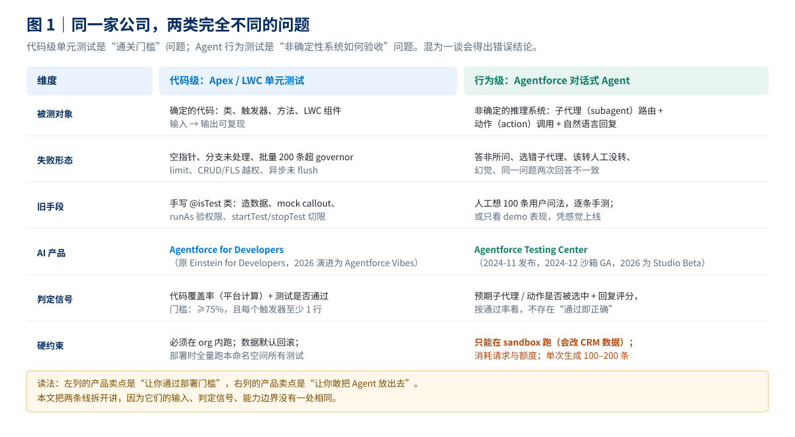
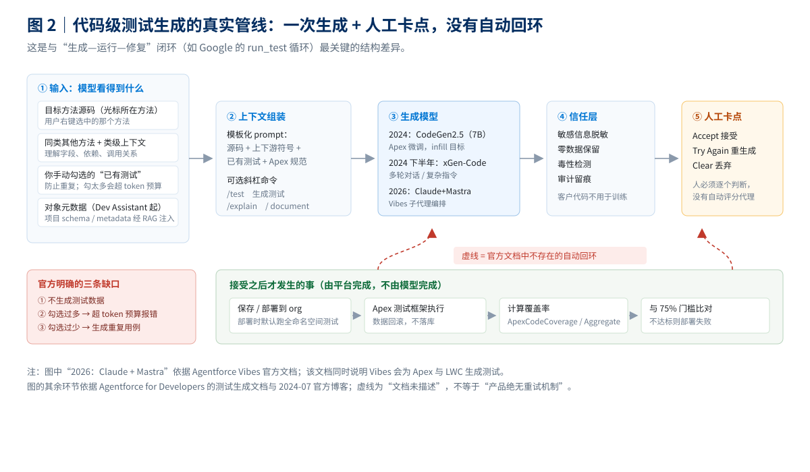
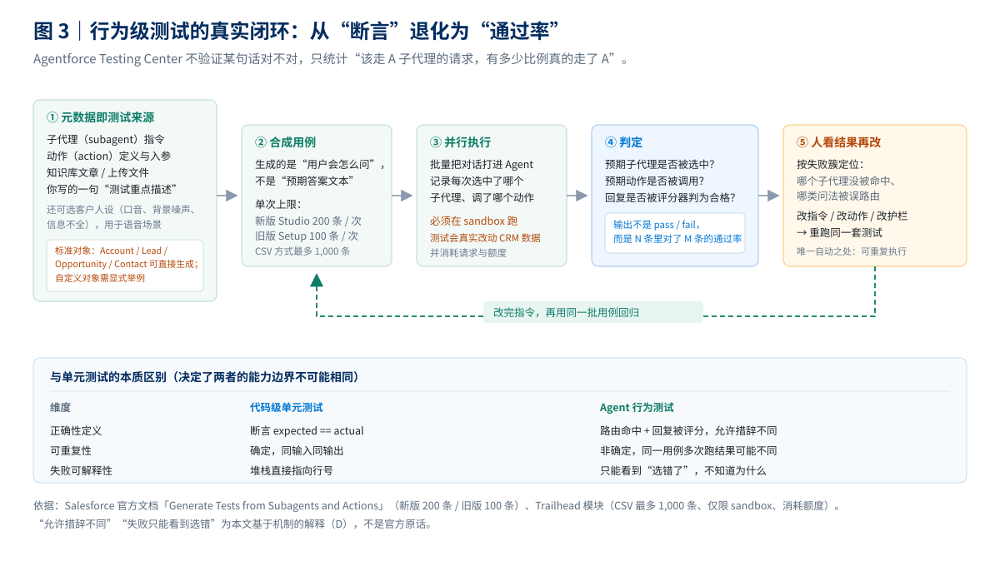
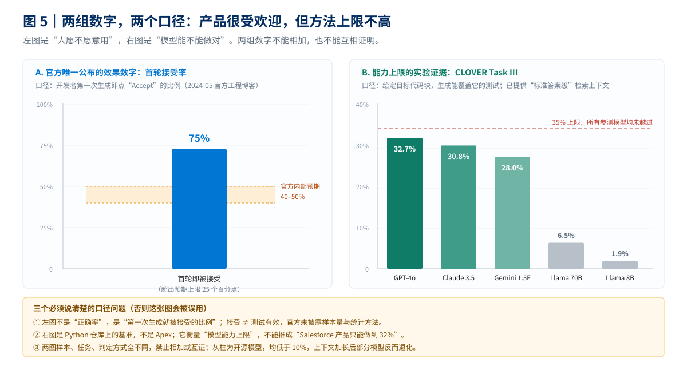
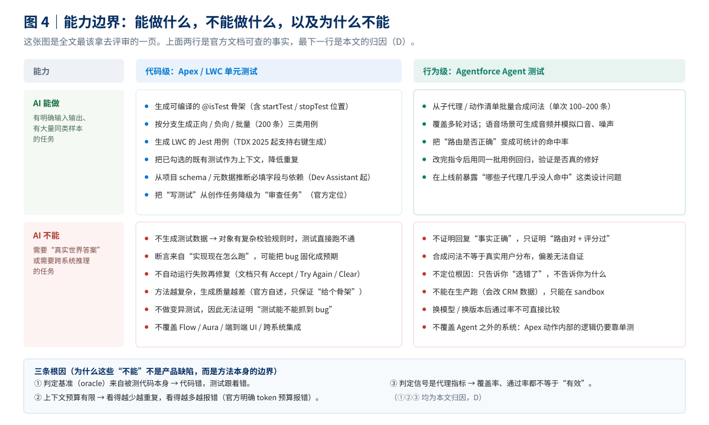

# Salesforce 如何用 AI 生成测试用例：双产品线机制与能力边界

> 本文只回答四件事：① Salesforce 用 AI 生成测试用例是为了解决什么问题、原来的手段差在哪；② 效果到底如何，哪些数字能用、哪些不能用；③ 技术原理是什么；④ 能力边界在哪。
>
> 全文按证据等级标注：**A**＝官方文档／官方博客／官方论文给出的原话或数字；**B**＝官方定性表述（无数字，或数字口径不明）；**C**＝二手转述（第三方材料，未逐字核对）；**D**＝本文推断（标明推理链）。
>
> **最重要的前提**：Salesforce 的“AI 生成测试用例”不是一个产品，而是两条互不相干的产品线——代码级单元测试（Apex／LWC）与 Agent 行为测试（Agentforce Testing Center）。把两者混为一谈，会得出“Salesforce 既能生成代码测试又能测 AI”这种错误印象。两者连“什么算通过”都不一样，见 [[#1. 一页看懂：好处、坏处、成本与边界|§1]]。
>
> 只想看判断的读者读 [[#0. 结论先行|§0]] 与 [[#1. 一页看懂：好处、坏处、成本与边界|§1]]；想看机制直接跳 [[#4. 他们是怎么做的|§4]]；想核对数字看 [[#5. 效果与数字口径|§5]] 与 [[#8. 证据分级与推断清单|§8]]。

## 目录

| 章节 | 一句话内容 |
|---|---|
| [[#0. 结论先行\|§0]] | 七条结论，含“唯一可用数字”与“最大信息缺口” |
| [[#1. 一页看懂：好处、坏处、成本与边界\|§1]] | 决策者一页纸：好处、坏处、边界表、成本表 |
| [[#2. 要解决的问题，以及过去的解法\|§2]] | 75% 是通关线不是质量线；五条老路的天花板 |
| [[#3. 三条线：研究、代码级产品、Agent 产品\|§3]] | 别把基准数字当产品效果 |
| [[#4. 他们是怎么做的\|§4]] | 管线、上下文、模型演进、Testing Center 闭环 |
| [[#5. 效果与数字口径\|§5]] | 75% 接受率、CLOVER 上限、四个误读、缺口清单 |
| [[#6. 与 Google、Meta、Uber 的路线对比\|§6]] | 四家攻的是四个不同的靶子 |
| [[#7. 可迁移结论\|§7]] | 值得抄的 5 条、不建议抄的 3 条 |
| [[#8. 证据分级与推断清单\|§8]] | 每条结论的证据等级 |
| [[#附录 A 来源清单\|附录 A]] | 来源、类型、用途、访问日期 |
| [[#附录 B 图片来源与官方截图位置\|附录 B]] | 5 张图的绘制说明与官方截图入口 |

## 0. 结论先行

1. **代码级测试生成解决的是“部署门槛”，不是“测试质量”。** Salesforce 平台硬性要求 Apex 单元测试覆盖 ≥75% 才能部署或打包上架 AppExchange，每个触发器还必须至少有一行覆盖。这条规则把“写测试”从质量投入变成了**发布前置条件**，因此厂商优化的目标是“让人更快写出能过门槛的测试”，而不是“让人写出更能抓 bug 的测试”。**证据等级：A**（官方 Apex 文档原文）。
2. **Salesforce 自己承认覆盖率不等于有效性。** 官方文档原话：“代码覆盖率是测试有效性的一个指标，但不保证测试有效性。”这句话是理解整个产品定位的钥匙——它解释了为什么产品只承诺“生成骨架”，不承诺“生成好测试”。**证据等级：A**。
3. **效果方面，官方只给了一个数字：首轮接受率 75%。** Salesforce 工程博客称，开发者对生成的方法测试“第一次生成就接受”的比例达 75%，**远超其内部预期的 40–50%**。但官方未披露样本量、统计周期、是否含外部客户，也未给出覆盖率增益或缺陷检出率。**证据等级：A（数字）+ B（口径不明）**。
4. **除这个数字外，没有第二个可用的效果数据。** Salesforce 未公布“AI 生成测试占新增测试的比例”“覆盖率提升多少”“线上缺陷减少多少”。这一点与 Uber（公开约 11% 占比）、Meta（公开逐阶段转化率）形成明显差距。**证据等级：B（属于“未找到”，不等于“不存在”）**。
5. **能力上限有硬证据，而且来自 Salesforce 自己的研究院。** CLOVER 基准（arXiv 2502.08806，Salesforce AI Research）显示：在最难的“覆盖指定代码块”任务上，即便喂入按覆盖率构造的“标准答案级”上下文，**所有 14 个参测模型的成功率都低于 35%**（GPT-4o 32.7% 最高，开源模型全部低于 10%）。这证明“面向覆盖率的测试合成”本身是难题，不是提示词问题。**证据等级：A**。
6. **技术路线在 2024–2026 之间发生了一次方向性切换。** 2024 年是“自研专用小模型（CodeGen2.5 7B）+ 模板化 prompt + 人工接受”；2026 年的 Agentforce Vibes 改为“通用 Agent 平台 + 子代理 + 计划模式”，官方原文称其由 **Claude 与 Mastra 两个 Agent 编排引擎**驱动。**判断：竞争点已从“模型懂不懂 Apex”转移到“harness 能不能管住上下文与工具”**。**证据等级：A（官方文档）+ D（判断）**。
7. **Agent 行为测试是另一套东西：它不产生断言，只产生通过率。** Testing Center 从子代理与动作的元数据合成“用户会怎么问”，跑完后核对“该走的子代理有没有走对”，输出的是一个比例而不是 pass／fail。这意味着它无法证明回复事实正确，只能证明路由与评分达标；且必须在 sandbox 跑（会真实修改 CRM 数据）。**证据等级：A**。

## 1. 一页看懂：好处、坏处、成本与边界

> 这一节是给评审用的一页纸。机制细节见 [[#4. 他们是怎么做的|§4]]，数字口径见 [[#5. 效果与数字口径|§5]]。

*图 1：本文依据官方文档绘制，非官方截图。左列与右列的产品在输入、判定信号、硬约束上没有一处相同。*

一句话定性：**Salesforce 卖的不是“更聪明的测试”，而是“更低的测试启动成本”。** 它把“从零写一个测试类”变成“审一个已经写好的测试类”，省掉的是空白页面前的那半小时，不是判断“什么算对”的那部分工作。

### 1.1 好处

| # | 好处 | 具体表现 | 证据 | 机制原因 |
|---|---|---|---|---|
| 1 | **跨过部署门槛的速度变快** | 右键方法即可生成可编译的 `@isTest` 骨架，省掉建类、写注解、搭 `startTest` 的机械劳动 | A（官方文档） | 模板化生成 + Apex 语料微调 |
| 2 | **首轮可用率高于官方预期** | 首轮接受率 75%，官方原预期 40–50% | A（官方工程博客） | 生成目标窄（单方法），上下文相关度高 |
| 3 | **不需要离开 IDE** | VS Code / Code Builder 内右键或 `/test`，生成结果以 diff 呈现 | A（官方文档） | 产品形态是 IDE 扩展，不是独立平台 |
| 4 | **会参考你已有的测试，减少重复** | 可勾选既有测试类作为上下文，官方明确这是防重复的手段 | A（官方文档） | 把“已写过什么”放进 prompt |
| 5 | **覆盖 Apex 与 LWC 两类资产** | 2025 年起支持右键生成 LWC 的 Jest 测试 | A（TDX 2025 官方博客） | 同一 harness 复用到前端组件 |
| 6 | **Agent 侧能批量造场景** | 单次生成 100–200 条问法，CSV 方式可达 1,000 条 | A（官方文档／Trailhead） | 元数据即场景来源，合成数据成本近零 |
| 7 | **Agent 侧能回归** | 改完指令用同一批用例重跑，看命中率是否真的上升 | A（官方文档定性） | 测试集是资产，可重复执行 |

### 1.2 坏处

| # | 坏处 | 具体表现 | 数据／依据 | 性质 |
|---|---|---|---|---|
| 1 | **不生成测试数据** | 官方“已知问题”明确：生成测试时不一并生成测试数据 | A | 官方自承 |
| 2 | **上下文有硬上限** | 勾选太多已有测试会抛“超出 token 预算”错误；勾选太少又会生成重复用例 | A | 官方自承的两难 |
| 3 | **复杂方法质量下降** | 官方原话：方法越复杂，模型越难给出好结果，“至少能提供一个不错的骨架和起点” | A | 官方自承 |
| 4 | **没有自动“跑失败→改测试”闭环** | 交互只有 Accept／Try Again／Clear，测试执行发生在部署或手动运行时 | A（文档描述）+ D（推断其缺失） | 结构性差异 |
| 5 | **断言可能固化 bug** | 测试从实现反推，实现错则预期也错 | D（机制推断，与 Google 论文同一逻辑） | 方法论固有限制 |
| 6 | **只覆盖代码层，不覆盖配置层** | Flow、Aura、权限集、页面布局、跨系统集成均不在生成范围 | A（产品范围）| 硬边界 |
| 7 | **Agent 测试只能在 sandbox 跑** | 测试会真实改动 CRM 数据，官方要求仅在 sandbox 使用 | A（Trailhead） | 硬约束 |
| 8 | **Agent 测试消耗额度** | 运行测试消耗请求与 credits，和真实用户消耗同池 | A（Trailhead） | 成本约束 |
| 9 | **合成问法有分布偏差** | 用例来自子代理指令，不是真实用户日志 | D（机制推断） | 方法论固有限制 |
| 10 | **效果数据几乎空白** | 除 75% 接受率外无生产级量化 | B（未找到） | 信息缺口 |

第 1、2、3、4 条要连起来看：**它生成的是“能编译的测试”，不是“能跑的测试”，更不是“能抓 bug 的测试”。** 官方把最后一步明确交回给人（“建议对所有 AI 生成的代码建立评审流程”）。

### 1.3 能力边界

| 维度 | 边界 | 类型 |
|---|---|---|
| 对象 | 类／触发器／方法／LWC 组件；不管 Flow、Aura、页面、权限集 | 硬边界 |
| 判定 | 只保证“能编译、结构合理”；不保证断言反映真实预期 | 硬边界 |
| 数据 | 不生成测试数据；复杂校验规则下测试可能直接跑不通 | 硬边界 |
| 上下文 | 受 token 预算约束；“看得更多”与“不重复”不可兼得 | 硬边界 |
| 闭环 | 不自动执行—修复；有效性依赖人工评审与后续运行 | 硬边界 |
| 有效性 | 平台只算覆盖率，不做变异测试；覆盖率≠有效性（官方原话） | 硬边界 |
| Agent 侧 | 只测“路由与评分”，不测事实正确性；只测单 Agent，不测跨系统链路 | 硬边界 |
| 语言 | Apex、JavaScript（LWC）；Agent 用例以 Agent 默认语言起草 | 软边界 |

### 1.4 成本与收益

| 侧 | 项目 | 数值 | 是否官方 |
|---|---|---|---|
| 收益 | 首轮接受率 | **75%**（预期 40–50%） | 官方，口径不明 |
| 收益 | 覆盖率提升 | **无数据** | 官方未披露 |
| 收益 | 缺陷检出率 | **无数据** | 官方未披露 |
| 收益 | Agent 路由命中率提升 | **无数据** | 官方未披露 |
| 成本 | 许可／额度 | 随 Agentforce／Einstein 许可；Testing Center 执行消耗 credits | 官方定性 |
| 成本 | 人工评审 | 官方明确建议纳入代码评审，未量化工时 | 官方定性 |
| 成本 | 返工 | 因不生成测试数据，复杂对象需人工补数据工厂 | 官方已知问题 |

**结论：官方给的数字够判断“开发者愿不愿意用”，不够算投资回报率（ROI）。** 真正决定划算与否的是“一次部署被 75% 门槛卡住要多久”，这个数只有用的人自己知道。

## 2. 要解决的问题，以及过去的解法

### 2.1 代码级：75% 是通关线，不是质量线

先把规则说清楚，因为所有产品设计都是围绕它做的（**A**，官方 Apex 文档）：

| 规则 | 原文要点 | 后果 |
|---|---|---|
| 覆盖率门槛 | 单元测试必须覆盖至少 **75%** 的 Apex 代码，且全部通过，才能部署或打包上架 AppExchange | 覆盖率不达标 = 发不出去 |
| 触发器单独要求 | **每个触发器**都必须至少有测试覆盖 | 不能靠别的类“摊薄” |
| 部署行为 | 部署到生产组织时，默认执行该命名空间内**所有**单元测试 | 一次部署要跑遍整个命名空间的测试 |
| 计算口径 | 只算可执行行；`System.debug`、测试类本身不计入 | 刷覆盖率有明确边界 |
| 官方态度 | “覆盖率是测试有效性的一个指标，但**不保证**测试有效性”“不应把覆盖率当作测试的唯一目标” | 官方自己承认这是代理指标 |

这条规则制造了一个很具体的激励结构（**D，推断**）：

- 只要覆盖率过 75%，测试写得好不好**不影响能否发布**；
- 于是最省力的策略是“让行被执行到”，而不是“让断言有意义”；
- 极端情况下，一个只调用方法、不做任何 `System.assert` 的测试，也能贡献覆盖率。

**这不是开发者偷懒，是规则设计的结果。** Salesforce 的产品正是顺着这个激励做的：它降低“写出能过门槛的测试”的成本，而不是提高“测试能不能抓 bug”的概率。

手写一个合格的 Apex 测试，真实成本集中在四处（**A**，官方测试最佳实践 + **D**，成本归因）：

| 成本项 | 具体工作 | 为什么费时 |
|---|---|---|
| 造数据 | 在测试里创建对象、必填字段、关联记录；数据要在 `startTest` 之前建好 | 对象模型越复杂，样板代码越长 |
| 打桩 | 用 `HttpCalloutMock` / `WebServiceMock` 拦截外部调用 | 每个 callout 都要单独写 mock 类 |
| 验权限 | 用 `System.runAs` 切换到受限用户，验证 CRUD/FLS 与共享规则 | 要额外造用户、配 profile／权限集 |
| 切限与异步 | `Test.startTest/stopTest` 重置 governor limits；异步任务要显式 flush | 位置放错就测不出真实行为 |

官方博客把这件事的动机说得非常直白：**“写测试耗时”是平台开发者抱怨最多的问题之一**（原文：one of the top complaints of platform developers, which is the time-consuming task of writing tests）。**证据等级：A**。

### 2.2 行为级：Agent 没有唯一正确答案

Agentforce 的 Agent 是一个会推理、会选工具、会组织语言的系统。它和 Apex 方法的区别不是“难一点”，而是**判定方式根本不同**：

| 维度 | Apex 方法 | Agentforce Agent |
|---|---|---|
| 输出 | 确定的返回值／异常 | 自然语言 + 工具调用序列 |
| 正确性 | `expected == actual` | 同一个正确答案可以有多种措辞 |
| 失败表现 | 抛异常、断言失败 | 答非所问、选错子代理、该转人工没转 |
| 可复现性 | 同输入同输出 | 同输入可能不同输出 |

这带来一个很现实的问题（**D，推断，但由官方产品设计反向印证**）：**你没法为“用户可能怎么问”写断言。** 人工构造 100 条问法要花掉一个 QA 几天，而且覆盖的是“你想得到的问法”，不是“用户真实会说的问法”。上线前的验证往往退化为“找几个人试用一下”，这不构成可重复的质量证据。

Salesforce 的解法不是“让 AI 判断回答对不对”，而是**把问题降级成一个可统计的路由问题**：给定一句问法，Agent 应该选哪个子代理、调哪个动作？选对了就算过。**这是产品设计上的关键取舍——放弃“答得好不好”，只保“走没走对”。**

### 2.3 五条老路与各自天花板

| 路线 | 具体做法 | 解决得住的 | 天花板 |
|---|---|---|---|
| **① 手写 `@isTest`** | 每个类配测试类，用 `@TestSetup` 与数据工厂复用数据 | 逻辑集中、团队有余力时质量最高 | 成本线性于代码量；存量代码补测试 ROI 低 |
| **② 模板与数据工厂** | 统一 `TestDataFactory`、统一断言风格、统一 mock 写法 | 降低样板代码重复 | 只降低“写”的成本，不解决“想清楚测什么” |
| **③ 覆盖率门禁** | 用 75% 作为硬门槛，CI 里卡部署 | 防止新增代码完全裸奔 | 覆盖率是必要条件不是充分条件；空断言也能过 |
| **④ 第三方自动化平台** | Provar、Copado、AccelQ 等做 UI／回归自动化 | 解决“执行”的规模化 | 不解决“用例从哪来”；仍需人写脚本或用例 |
| **⑤ 通用代码助手** | Copilot、Cursor 等生成测试代码 | 通用语言、通用框架生态成熟 | 不懂 Apex 语义、不懂 org 元数据、不懂 governor limits |

第 ⑤ 条是 Salesforce 自研的核心理由，官方 FAQ 说得很直接：通用生成式 AI 工具**没有在 Salesforce 数据和开发语言／框架上训练**，因此输出“通常不准确”；而且客户数据不应离开 org 边界。**证据等级：A（官方表述，属营销口径，但方向可信）**。

**五条路合起来说明一件事：机器早就能“跑测试”，但一直不能“写测试”。** 第 ④ 条解决执行，第 ⑤ 条解决通用代码，只有“懂这个平台”的工具才能解决 Apex 的具体写法。这就是产品存在的生态位。

### 2.4 为什么 Salesforce 选择自研

三个理由，按可信度排序：

1. **语言与运行时是私有的**（A：平台私有；D：训练信号推断）。Apex 跑在平台内，受 governor limits 约束，测试必须在 org 内执行、数据默认回滚。**推断**：通用模型缺少这套运行时的强监督信号。
2. **上下文在 org 里，不在文件里**（A）。生成测试需要对象元数据、必填字段、校验规则、已有测试；这些要通过平台 API／项目 schema 取，而不是读一个仓库就够了。
3. **数据不能出边界**（A）。官方反复强调客户代码不用于训练、不出 Salesforce 信任边界。这决定了它必须用自己的模型或受控的共享信任边界。

**判断（D）**：第 1、2 条是真实的技术壁垒，第 3 条是商业壁垒。前者会随着通用模型变强而削弱（2026 年转向 Claude／Mastra 的通用 Agent 平台就是证据），后者不会。

## 3. 三条线：研究、代码级产品、Agent 产品

公开材料里“Salesforce 用 AI 生成测试”至少对应三条互不相同的线，混着谈一定出错：

| 线 | 代表 | 是什么 | 有无量化 |
|---|---|---|---|
| **研究线** | CLOVER 基准（arXiv 2502.08806） | 评估模型“按覆盖率要求写测试”的能力，12 个 Python 仓库、845 个问题 | **有**，但是基准分数，不是产品效果 |
| **代码级产品线** | Agentforce for Developers（原 Einstein for Developers）→ Agentforce Vibes | IDE 内生成 Apex 单测与 LWC Jest 测试 | **仅 1 个**：首轮接受率 75% |
| **Agent 产品线** | Agentforce Testing Center | 批量生成 Agent 对话用例并统计路由命中率 | **无**（官方仅定性） |

三条线的数字**不能互相引用**：

- 不能拿 CLOVER 的 32.7% 说“Salesforce 产品只能做到三成”——那是 Python 基准上通用模型的上限，不是产品在 Apex 上的表现；
- 也不能拿产品的 75% 说“模型能力很强”——那是“人愿意接受”的比例，不是“测试有效”的比例；
- 两条产品线之间更不能比——一个判覆盖率，一个判路由命中率。

## 4. 他们是怎么做的

### 4.1 代码级：一次生成加人工卡点

*图 2：本文依据官方文档与 2024-07 官方博客绘制，非官方截图。*

官方文档描述的交互只有六步（**A**）：

| 步 | 动作 | 细节 |
|---|---|---|
| 1 | 在方法内右键 | 选 `Einstein: Generate A Test`，或点右上角烧杯图标 |
| 2 | 选目标方法 | 可一次选多个方法 |
| 3 | 选测试类 | 新建（命名为 `<类名>Test.cls`）或追加到已有类 |
| 4 | 勾选已有测试 | 作为上下文喂给模型，用于避免重复 |
| 5 | 审阅结果 | 三选一：**Accept／Try Again／Clear** |
| 6 | 保存与运行 | 生成阶段不跑测试；运行发生在你主动执行或部署时 |

**这里有一个容易被忽略的结构性事实**：整个交互里没有“自动运行 → 读报错 → 改测试”的循环。官方博客甚至把预期说得很低——“方法越复杂，模型越难给出好结果；无论如何，它至少能提供一个不错的骨架和起点，让你去补完”。**证据等级：A（原话）**。

对比之下，Google 的做法是“生成后必须 `run_test`，失败就读错误重试”，把可编译性当硬指标（**C**，转述自库内另一篇）。Salesforce 选择了更轻的路径：**把验证成本转移给人**。这不是技术做不到，而是产品定位不同——它要的是“降低启动成本”，不是“保证测试有效”。

### 4.2 上下文从哪来，以及 token 预算的两难

| 上下文来源 | 是否使用 | 作用 | 依据 |
|---|---|---|---|
| 目标方法源码 | 是 | 生成的主要依据 | A |
| 同类其他方法 | 是 | 理解字段、依赖、调用关系 | A（产品行为） |
| 你勾选的已有测试 | 是（手动） | 防重复 | A（官方文档） |
| 对象元数据／项目 schema | 是（Dev Assistant 起，经 RAG） | 推断必填字段与依赖 | A（官方 GA 博客） |
| org 内真实数据 | 否 | 不读生产数据 | A（信任边界） |
| 校验规则／权限配置 | **未说明** | 直接影响测试能否跑通 | B（文档未提，属缺口） |

官方文档把 token 约束写成了“已知问题”，这段值得逐字读（**A**，以下为直译）：

> 准确勾选项目里相关的既有测试很重要……不这样做会导致 AI 生成重复的测试方法。当前，勾选过多测试会抛出超出 token 预算的错误；勾选过少则可能生成重复的测试方法。我们已知此问题并正在修复。

这句话暴露了一个**结构性两难**（D，推断）：

- 上下文越全 → 越不容易重复，但越容易超预算；
- 上下文越少 → 越不会报错，但生成的东西越可能和你已有的重复；
- 而“该给多少上下文”这个判断，被交给了使用者。

**这是所有“把代码库塞进 prompt”的方案共同的痛点**：检索质量决定生成质量，而检索的召回率与窗口大小天然冲突。Salesforce 的应对不是做更好的检索，而是让用户手动勾选——把问题外包给了人。

### 4.3 模型演进：从专用小模型到通用 Agent

| 阶段 | 时间 | 模型／编排 | 形态 | 关键事实 |
|---|---|---|---|---|
| 起步 | 2022–2023 | CodeGen（最高 16B） | 代码补全 | 开源，含 Apex 语料 |
| 产品化 | 2023-07 | CodeGen2.5（7B） | 补全（测试生成属同一模型家族） | 1.4T token 训练，StarCoderData 783GB／86 种语言；7B 超过自家 16B |
| 对话化 | 2024-09 | + xGen-Code | 多轮 Dev Assistant（`/test`） | 为自然语言 + 编程混合任务设计 |
| Agent 化 | 2025-2026 | Claude + Mastra（编排） | Agentforce Vibes：子代理、计划模式、MCP | 官方原文：构建在 Salesforce Coding Agent Platform 上，由 Claude 与 Mastra 编排 |

> 口径提醒：官方从未单独公布“测试生成”用的是哪个尺寸的模型，只说由 CodeGen 家族／xGen-Code 支撑。上表按“同一产品内的模型代际”排列，不等于“测试生成逐代换模型”（**B，属推断**）。

三个判断：

1. **CodeGen2.5 的定位是“低延迟补全”，不是“高质量推理”**（A）。7B 参数、强调 infill 与推理速度（官方称 FlashAttention 下比 CodeGen2.0-16B 快约一倍）。**推断（D）**：这解释了为什么它在“生成完整测试类”这种需要长程推理的任务上只能给骨架。
2. **xGen-Code 的出现是为了多轮对话**（A）。测试生成从“一次性补全”变成“可追问、可改”，但底层仍是“生成—人审”结构。
3. **2026 年转向 Agent 平台，是路线级变化**（A）。官方文档写明 Vibes 构建在“Salesforce Coding Agent Platform”上，由 Claude 与 Mastra 编排，具备子代理、Plan Mode、MCP 工具调用。**判断（D）：这意味着 Salesforce 不再把胜负押在“自研专用小模型”上，转而把力气花在编排、技能（skills）、规则与信任层上——模型可以换，harness 是自己的。**

这条演进对评估很关键：**2024 年的 75% 接受率是“CodeGen2.5 时代”的数字，不能直接代表 2026 年 Vibes 的效果。** 官方没有公布新数字。

### 4.4 行为级：Testing Center 的闭环

*图 3：本文依据官方文档、Trailhead 与 2024-11 新闻稿绘制，非官方截图。*

官方文档给出的流程（**A**）：

| 环节 | 做法 | 关键约束 |
|---|---|---|
| 输入 | 选要测的子代理／动作；写一句“测试重点描述” | 描述只定范围，不能定格式与复杂度 |
| 生成 | 依据子代理与动作的指令合成问法 | 新版单次 200 条、旧版 100 条；CSV 最多 1,000 条 |
| 执行 | 并行把对话打进 Agent，记录选中的子代理与动作 | **只能 sandbox**；消耗请求与额度 |
| 判定 | 核对“预期子代理／动作是否被选中” | 不是精确匹配回复文本 |
| 迭代 | 改指令／动作／护栏，用同一批用例重跑 | 测试集可复用 |

三个值得注意的设计细节：

1. **用例语言跟随 Agent 默认语言**（A）。这意味着它不解决多语言覆盖问题。
2. **标准对象可直接生成，自定义对象要显式举例**（A）。官方给的写法是“为 [自定义对象] 生成测试，示例问法：[…]”——**模型对未见过的对象不会自己 invent 业务语义**。
3. **语音场景可生成音频**（A）。可选客户人设（口音、背景噪声、信息不全），结果含录音；但 Employee Agent 只支持文本。

**这套东西的本质是“意图路由的混淆矩阵”**（D，推断）：它测的是“给定问法，Agent 有没有走到正确的分支”，而不是“答案对不对”。这解释了为什么它能规模化——路由是可判定的，答案质量不可判定。

### 4.5 信任层解决的是数据安全，不是测试质量

| 能力 | 作用 | 与测试质量的关系 |
|---|---|---|
| 数据脱敏（masking） | 把 PII／PCI 替换为占位符再送模型 | 无关 |
| 零数据保留 | 模型不存储 prompt 与输出，不用于训练 | 无关 |
| 毒性检测 | 扫描输入输出 | 无关 |
| 审计留痕 | 记录原始／脱敏 prompt、输出、评分 | 间接：可追溯 |
| 动态接地 | 用业务数据补充上下文 | 间接：影响相关性 |

这一节单独列出来，是因为它经常被当成“质量保证”来讲。**它保证的是“数据不出边界、不被告”，不是“生成的测试是对的”。** 官方也明确建议：对所有 AI 生成的代码建立评审流程（**A**）。把合规能力误读成质量能力，是选型时最常见的判断错误。

## 5. 效果与数字口径

### 5.1 唯一的官方效果数字：75%

*图 5：左图为官方工程博客数字，右图为 CLOVER 论文数字；两者口径不同，不可互证。*

原文（Salesforce 工程博客，2024-05-07，**A**；以下为直译，英文原句附后）：

> 开发者为其方法生成测试，并在第一次尝试时就接受，接受率达到 **75%**。这一高接受率证明了生成测试的准确性与实用性。我们很惊喜地看到，接受率超过了我们预期的 **40–50%** 区间。

> Developers have generated tests for their methods and accepted them on their first try, resulting in a remarkable acceptance rate of 75%. This high acceptance rate is a testament to the accuracy and usefulness of the generated tests. We were pleasantly surprised to see that the acceptance rate exceeded our anticipated range of 40-50%.

必须同时标注四个“未知”：

| 未知项 | 状态 | 为什么重要 |
|---|---|---|
| 样本量 | 未披露 | 无法判断置信区间 |
| 统计周期 | 未披露 | 无法判断是否含学习期 |
| 人群 | 内部 + 外部试点，比例未披露 | 外部客户代码更复杂，接受率可能更低 |
| “接受”的定义 | 首轮点 Accept 即计入 | 与“测试有效”不是一回事 |

**这是全文最需要克制的数字。** “首轮被接受”只能说明“生成的代码看起来像那么回事、能直接用”，不能说明“它抓到了 bug”。用一个类比：它衡量的是“初稿被采纳率”，不是“初稿的正确率”。

### 5.2 能力上限：CLOVER 的实验证据

CLOVER 是 Salesforce AI Research 自己做的基准，用来回答“模型能不能按覆盖率要求写出测试”（**A**，arXiv 2502.08806）。

| 项目 | 内容 |
|---|---|
| 数据 | 12 个 Python 仓库，845 个问题，5,312 个实例 |
| 上下文 | 4k–128k tokens，按覆盖率信息构造“标准答案级”检索上下文 |
| 任务 I | 断言填空（补全被遮住的断言） |
| 任务 II | 给定目标方法，从近乎空白写测试 |
| 任务 III | **给定若干目标代码块，写出能覆盖它们的测试**（最难） |

任务 III 的结果（64k 上下文，已给 oracle context，**A**）：

| 模型 | 成功率 | 执行率 | 说明 |
|---|---|---|---|
| GPT-4o | **32.7%** | 42.1% | 全场最高 |
| Claude 3.5 Sonnet | 30.8% | 35.5% | 次高 |
| Gemini 1.5 Flash | 28.0% | 38.3% | — |
| GPT-4o-mini | 19.6% | 25.2% | — |
| Llama 3.1 70B | 6.5% | 8.4% | 开源最高 |
| Llama 3.1 8B | 1.9% | 2.8% | 接近无效 |

论文的核心结论（**A**）：**所有模型在任务 III 上均低于 35%，即使提供 oracle context**；执行率与成功率之间有 5–10 个百分点的差距，说明“测试能跑”与“测试满足覆盖要求”是两件事；上下文超过 16k 后，多数开源模型性能反而下降。

**怎么用这个数字（D，推断）**：

- 它证明“覆盖率导向的测试合成”本身很难，不是 Salesforce 产品做得差；
- 它解释了为什么 Salesforce 的产品只承诺“骨架”——**这是当前模型能力的诚实反映**；
- 但它**不能**直接推出“Salesforce 的 Apex 测试生成只有 32.7% 成功率”：语言不同、任务不同（产品是方法级，任务是代码块级）、判定不同（产品不要求覆盖指定块）。

### 5.3 相邻证据：Salesforce 内部 AI 工程化

Salesforce 在 2026 年公布了内部工程的整体 AI 数据（**A**，官方新闻稿），但这些**不是本产品的效果**，必须单独放：

| 指标 | 数值 | 口径 |
|---|---|---|
| 工程师 AI 工具采纳率 | >90%（六大工程云，三周内） | 内部整体 |
| 人均完成工作项 | 同比 **+50.8%**（2026-04 vs 2025-04） | 内部整体 |
| 人均合并 PR | 同比 **+79%** | 内部整体 |
| 有效产出评分 | 同比 **+151.3%** | 内部整体，ML 评分 |
| 事故数 | **−5%**（PR 增加的同时） | 内部整体 |
| 单案例 | 33 个 API 端点迁移，231 人日 → 13 天；最大 PR 含 21 个端点、**100% 测试覆盖** | 内部整体 |

**这张表的正确读法**：它证明 Salesforce 自己在“AI 写代码 + 生成测试”上拿到了规模收益，但主要工具是 Claude Code（官方原文），不是 Agentforce for Developers。把它当作“本产品有效”的证据，属于偷换主语（**D**）。

### 5.4 四个常见误读

| 误读 | 实际口径 | 为什么容易错 |
|---|---|---|
| “Salesforce 的 AI 写测试准确率 75%” | 75% 是**首轮接受率**，不是准确率，也不是覆盖率 | “接受”是人的主观动作 |
| “覆盖率能到 75% 就说明测试有效” | 官方明说覆盖率**不保证**有效性 | 空断言也能贡献覆盖率 |
| “CLOVER 证明 Salesforce 产品只能做到 32%” | 32.7% 是**通用模型在 Python 基准**上的上限 | 语言、任务、判定全都不同 |
| “Salesforce 已经在生产大规模用 AI 写测试” | 只有 75% 一个数字；生产占比、覆盖率增益均未公布 | 把“有产品”当成“有规模证据” |

### 5.5 证据缺口清单

| 缺什么 | 影响 | 备注 |
|---|---|---|
| 生成测试的覆盖率增益 | 无法判断是否真的帮人过门槛 | 官方未披露 |
| 生成测试的缺陷检出率 | 无法判断质量 | 官方未披露 |
| AI 生成测试占新增测试比例 | 无法判断规模 | 官方未披露 |
| 人工评审耗时 | 无法算 ROI | 官方仅建议评审 |
| Testing Center 的客户前后对比 | 无法判断 Agent 质量提升 | 官方仅有客户定性引语 |
| 多语言支持范围 | 无法判断非英语 org 可用性 | 官方称随 Agent 默认语言 |
| 2026 年 Vibes 的效果 | 75% 是 2024 年数字，不可外推 | 官方未更新 |

把 [[#4. 他们是怎么做的|§4]] 的机制与本章的数字合起来看，边界可以收敛成下面这张图：

*图 4：上两行为官方文档可查事实，最下一行为本文归因（D）。这张表适合直接拿去做选型评审的检查项。*

## 6. 与 Google、Meta、Uber 的路线对比

| 维度 | Salesforce（代码级） | Google（契约驱动） | Meta（Catching JiTTests） | Uber（AutoCover） |
|---|---|---|---|---|
| 要解决的问题 | **过 75% 部署门槛** | 测试**有效性**：写了但不抓 bug | 改动**行为差异** | **覆盖率产能** |
| 判定基准从哪来 | 实现 + 已有测试 + 元数据 | 从代码／注释／调用点**自生成契约** | 拿**父版本**做差分 | 覆盖率增量 + 变异／分支检查 |
| 是否有执行闭环 | **无**（人工 Accept） | 有（`run_test` 失败重试） | 有（跑测试判差异） | 有（跑测试算覆盖） |
| 判定信号 | 覆盖率（平台算） | 检出率、分支覆盖 | weak catch 率 | viable test 率 |
| 公开效果数字 | **仅首轮接受率 75%** | 检出率 63.2%（90 个历史缺陷） | 22,126 条测试 → 231 weak catch（1%） | 约占新增测试 **11%** |
| 主要代价 | 测试数据要人补 | token +38% | 每 diff 捕获率 7.9%，九成算力空转 | 未披露 |

> Google、Meta、Uber 的数字转述自本文库另一篇文档 [[Google-AI生成单元测试-契约驱动机制与边界]]，**证据等级 C**（未逐字核对原始论文）；Salesforce 的数字为 **A**。

**一句话区分**：Google 造 oracle，Meta 用版本差分绕开 oracle，Uber 用覆盖率绕开 oracle，**Salesforce 干脆不碰 oracle——它把目标换成“通过平台门槛”**。

这也解释了四家的产品形态差异：**Google 与 Meta 在提高“测试有效性”，Uber 在降低“覆盖成本”，Salesforce 在降低“启动成本”。** 不是 Salesforce 不想提高质量，而是它的客户最痛的点是“发不出去”，不是“发出去有 bug”。

## 7. 可迁移结论

> 这一节面向“自建 AI 分析／测试能力”的场景（例如 APM 产品的 AI 助手），只写能落地的判断。

### 7.1 值得抄的五条

| # | 结论 | 为什么可迁移 |
|---|---|---|
| 1 | **先找到“硬门槛”，再设计产品** | Salesforce 的产品力来自“75% 不达标就发不出去”这个硬约束。做 AI 助手同理：先找到用户“不做就交不了差”的那一步，比做十个锦上添花的功能有用 |
| 2 | **把“生成”降级为“审查”，是最快的价值点** | 从空白页开始写，和审一个已有草稿，认知成本差一个量级。任何 AI 功能只要能把“创作”变成“编辑”，采纳率就会上去（75% 就是这个机制的结果） |
| 3 | **判定信号要选“可统计”的，不要选“正确”的** | Agent 测试放弃“答得对不对”，改判“路由对不对”，才做到可规模化。做故障分析助手同理：先做“是否命中正确数据源／正确维度”，再谈“结论对不对” |
| 4 | **上下文预算要显式管理，不能全塞** | 官方 token 报错与重复用例的两难，是所有 RAG 系统的通病。要么做检索排序，要么让用户显式选范围，不要假装“全都能看” |
| 5 | **测试集是资产，回归才是价值** | Testing Center 的真正价值不是“生成 200 条”，而是“改完能重跑同一批”。做 AI 分析同理：把历史工单固化成评测集，才能证明“这次改动真的变好了” |

### 7.2 不建议照抄的三条

| # | 不要抄 | 原因 |
|---|---|---|
| 1 | **把“接受率”当质量指标对外讲** | 接受率是主观动作，一旦被追问“测试抓到几个 bug”就答不上来。要用就用“覆盖率增益 + 缺陷检出”双指标 |
| 2 | **“不生成测试数据”的设计** | 这是官方明示的缺口，不是优点。真实 org 里对象有校验规则、必填字段、记录类型，没有数据工厂，生成的测试根本跑不起来 |
| 3 | **纯人工 Accept／Try Again 的交互** | 在 2024 年合理（模型能力有限），在 2026 年已落后：应加“自动运行 + 失败自动修复 + 覆盖率校验”的闭环，把人的判断留到最后一步 |

## 8. 证据分级与推断清单

| 结论 | 等级 | 依据 |
|---|---|---|
| Apex 部署／打包要求 ≥75% 覆盖、每个触发器至少 1 行 | A | 官方 Apex 文档 |
| 覆盖率“不保证测试有效性” | A | 官方 Apex 文档原文 |
| 测试生成交互为 Accept／Try Again／Clear | A | 官方文档 |
| 不生成测试数据；token 预算报错；勾选少会重复 | A | 官方文档“Known Issues” |
| 复杂方法质量下降，“至少给个骨架” | A | 官方 2024-07 博客原文 |
| 首轮接受率 75%、预期 40–50% | A | 官方工程博客 2024-05-07 |
| 75% 的样本量／周期／人群未披露 | B | 官方未说明 |
| LWC 支持右键生成 Jest 测试 | A | TDX 2025 官方博客 |
| Testing Center 单次 200／100 条、CSV 1,000 条 | A | 官方文档／Trailhead |
| 只能在 sandbox 跑、消耗额度、会改 CRM 数据 | A | Trailhead 官方模块 |
| Agent 用例以 Agent 默认语言起草 | A | 官方文档 |
| CLOVER 任务 III 全部 <35%，GPT-4o 32.7% | A | 论文 arXiv 2502.08806 |
| CodeGen2.5 为 7B、1.4T token、86 种语言 | A | 官方 CodeGen2.5 博客 |
| Vibes 基于 Claude 与 Mastra 编排 | A | 官方 Vibes 文档 |
| 信任层：脱敏／零保留／毒性／审计 | A | 官方 Trust Layer 文档 |
| Salesforce 内部 90% 采纳、+50.8%／+79% | A | 官方新闻稿，但**非本产品** |
| “产品没有自动执行—修复闭环” | B | 文档未描述，属“未记载”而非“确认没有” |
| 断言会固化 bug、合成用例有分布偏差 | D | 本文机制推断 |
| 竞争点从模型转向 harness | D | 基于模型演进的判断 |
| 与 Google／Meta／Uber 的对比数字 | C | 转述自库内另一篇文档 |

## 附录 A 来源清单

| # | 来源 | 类型 | 用途 | 访问日期 |
|---|---|---|---|---|
| 1 | [Testing and Code Coverage（Apex Developer Guide）](https://developer.salesforce.com/docs/atlas.en-us.apexcode.meta/apexcode/apex_code_coverage_intro.htm) | 官方文档 | 75% 门槛、覆盖率定义、官方对覆盖率的定性 | 2026-11-09 |
| 2 | [Apex Unit Testing Best Practices and Code Coverage Requirements](https://help.salesforce.com/s/articleView?id=000041398&type=1) | 官方知识库 | 测试最佳实践、造数／mock／runAs 要求 | 2026-11-09 |
| 3 | [Test Case Generation（Agentforce for Developers 文档）](https://developer.salesforce.com/tools/vscode/en/einstein/einstein-testcasegen) | 官方文档 | 生成流程、Accept/Try Again/Clear、三条 Known Issues | 2026-11-09（该页现跳转至 Vibes 概览） |
| 4 | [Inline Code Suggestions, Test Generation, and More（2024-07）](https://developer.salesforce.com/blogs/2024/07/inline-code-suggestions-test-generation-and-more-with-einstein-for-developers) | 官方博客 | 测试生成机制、“复杂方法只给骨架”原话 | 2026-11-09 |
| 5 | [The New Einstein for Developers Streamlines Your Workflow（2024-05）](https://engineering.salesforce.com/the-new-einstein-for-developers-streamlines-your-workflow-say-goodbye-to-time-consuming-tasks/) | 官方工程博客 | **75% 首轮接受率**、40–50% 预期、“写测试是最大抱怨” | 2026-11-09 |
| 6 | [Introducing Agentforce for Developers: GA（2024-09）](https://developer.salesforce.com/blogs/2024/09/introducing-agentforce-for-developers) | 官方博客 | CodeGen2.5／xGen-Code、RAG 上下文、不训练客户代码 | 2026-11-09 |
| 7 | [Discover the Highlights of TDX 2025](https://developer.salesforce.com/blogs/2025/03/discover-the-highlights-of-tdx-25) | 官方博客 | LWC 测试生成、Testing Center 批量测试与 AI 生成用例 | 2026-11-09 |
| 8 | [Agentforce Vibes Overview](https://developer.salesforce.com/docs/platform/agentforcevibes/guide/afv-overview.html) | 官方文档 | Claude + Mastra 编排、子代理、Plan Mode | 2026-11-09 |
| 9 | [Build a Lightning App Using Agentforce Vibes](https://developer.salesforce.com/docs/platform/agentforcevibes/guide/afv-lexapp-overview.html) | 官方文档 | Vibes 可生成 Apex 单测与 LWC Jest 测试 | 2026-11-09 |
| 10 | [Generate Tests from Subagents and Actions（新版 Studio）](https://docs.salesforce.com/admin/current/en-us/ai/264-0-0/agent_studio_testing_center_topics_actions.html) | 官方文档 | 单次 200 条、人设、语言、自定义对象写法 | 2026-11-09 |
| 11 | [Generate Tests from Subagents and Actions（旧版 Setup）](https://docs.salesforce.com/admin/current/en-us/ai/264-0-0/agent_testing_center_topics_actions.html) | 官方文档 | 单次 100 条、判定逻辑 | 2026-11-09 |
| 12 | [从 Knowledge 源生成测试](https://help.salesforce.com/s/articleView?id=ai.agent_testing_center_knowledge_sources.htm&language=zh_CN&type=5) | 官方文档 | 知识库来源、100 条上限、不支持自定义检索器 | 2026-11-09 |
| 13 | [利用 AI 生成测试（Trailhead）](https://trailhead.salesforce.com/content/learn/modules/agentforce-agent-testing/use-ai-to-generate-tests) | 官方培训 | 仅 sandbox、消耗额度、1,000 条上限 | 2026-11-09 |
| 14 | [Salesforce Introduces Agentforce Testing Center（2024-11-20）](https://www.businesswire.com/news/home/20241120646715/en/) | 官方新闻稿 | 发布背景、客户与分析师引语、沙箱 GA 时间 | 2026-11-09 |
| 15 | [CLOVER: A Test Case Generation Benchmark](https://arxiv.org/abs/2502.08806) | 官方论文 | 任务设计、Task III 全部 <35%、执行率与成功率差距 | 2026-11-09 |
| 16 | [CodeGen2.5: Small, but mighty](https://blog.salesforceairesearch.com/codegen25/) | 官方研究博客 | 7B、1.4T token、86 种语言、延迟数据 | 2026-11-09 |
| 17 | [Inside CodeGen, Our In-House Open-Source LLM](https://developer.salesforce.com/blogs/2023/11/inside-codegen-our-in-house-open-source-llm/) | 官方博客 | CodeGen 三代演进、Apex 微调、上下文接地 | 2026-11-09 |
| 18 | [Trust Layer（Agentforce 文档）](https://developer.salesforce.com/docs/ai/agentforce/guide/trust.html) | 官方文档 | 脱敏、零保留、毒性检测、审计、人工复核建议 | 2026-11-09 |
| 19 | [Write Jest Tests for Lightning Web Components](https://developer.salesforce.com/docs/component-library/documentation/lwc/lwc.unit_testing_using_jest_create_tests) | 官方文档 | LWC 测试本地运行、不上传 org | 2026-11-09 |
| 20 | [Pioneering the Agentic Shift Within Salesforce Engineering](https://www.salesforce.com/news/stories/how-engineering-became-agentic) | 官方新闻稿 | 内部 90% 采纳、+50.8%／+79%、事故 −5%、21 端点 100% 覆盖 | 2026-11-09 |
| 21 | [How Salesforce Engineering Operationalized AI Productivity at Scale](https://engineering.salesforce.com/how-salesforce-engineering-operationalized-ai-productivity-at-scale/) | 官方工程博客 | 采纳度量方式、测试模板复用 | 2026-11-09 |
| 22 | [Einstein for Admins and Developers（FAQ）](https://www.salesforce.com/au/artificial-intelligence/developers) | 官方产品页 | “通用工具未在 Salesforce 语言上训练、输出通常不准确”的自研理由 | 2026-11-09 |

## 附录 B 图片来源与官方截图位置

**本文 5 张图全部为本文依据官方文字描述重绘，不是官方截图，也不是官方数据可视化。** 这样处理的原因：Salesforce 官方博客的图片资源带防盗链（直接请求返回 403），热链会失效；重绘可以确保每个数字都能追溯到 [[#附录 A 来源清单|附录 A]] 的对应条目，避免“图看起来像官方”的误导。

| 图 | 内容 | 数据来源 |
|---|---|---|
| 图 1 | 两条产品线的定位对比 | 官方 Apex 文档 + Testing Center 文档 |
| 图 2 | 代码级生成管线 | 官方测试生成文档 + 2024-07 博客 |
| 图 3 | Agent 行为测试闭环 | Testing Center 文档 + Trailhead + 新闻稿 |
| 图 4 | 能力边界矩阵 | 官方文档 + 本文归因（D） |
| 图 5 | 两组数字对照 | 官方工程博客 + CLOVER 论文 |

**想看官方原始界面截图的，去这三处（均为官方页面，含产品截图）**：

| 页面 | 能看到什么 |
|---|---|
| [Introducing Agentforce for Developers（2024-09）](https://developer.salesforce.com/blogs/2024/09/introducing-agentforce-for-developers) | Dev Assistant 用 `/test` 生成 Apex 测试的编辑器截图 |
| [Discover the Highlights of TDX 2025](https://developer.salesforce.com/blogs/2025/03/discover-the-highlights-of-tdx-25) | LWC 测试生成、Testing Center 的能力说明 |
| [Salesforce Introduces Agentforce Testing Center（新闻稿）](https://www.businesswire.com/news/home/20241120646715/en/) | 产品定位与客户证言（无界面图） |
