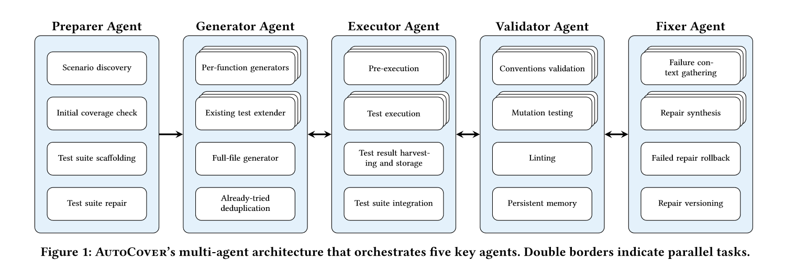
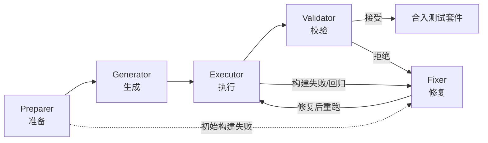
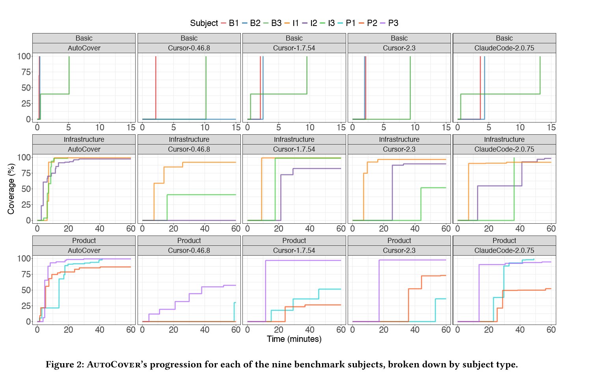
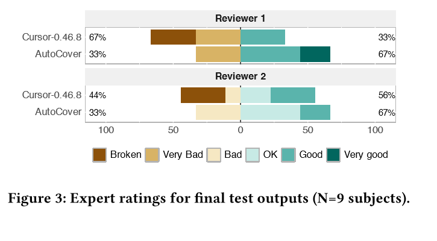
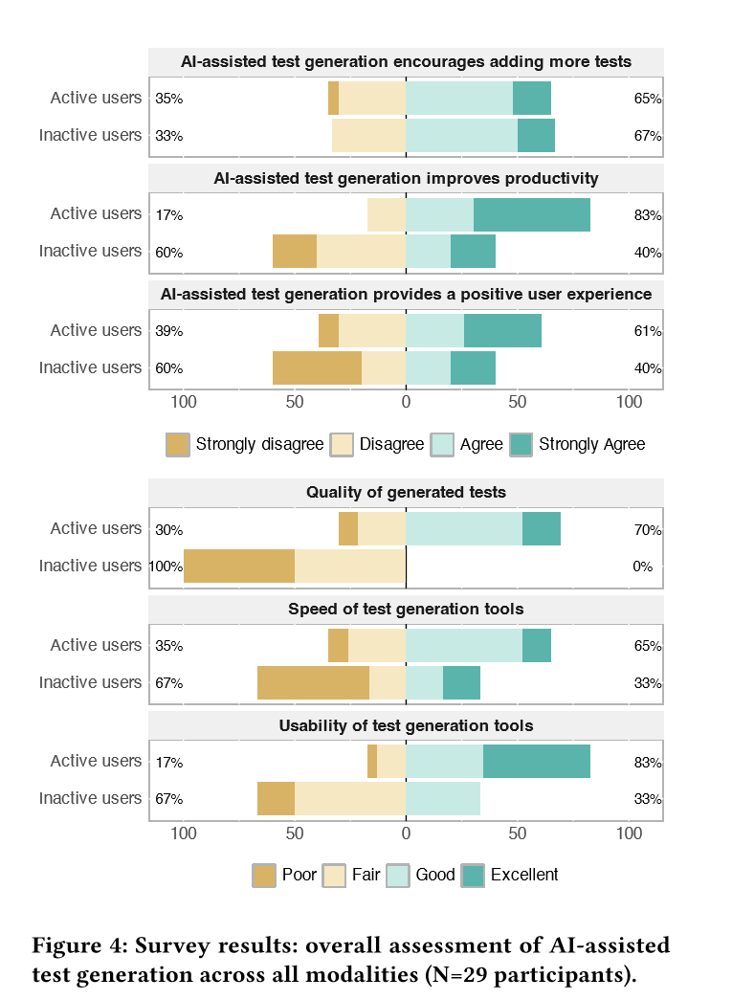
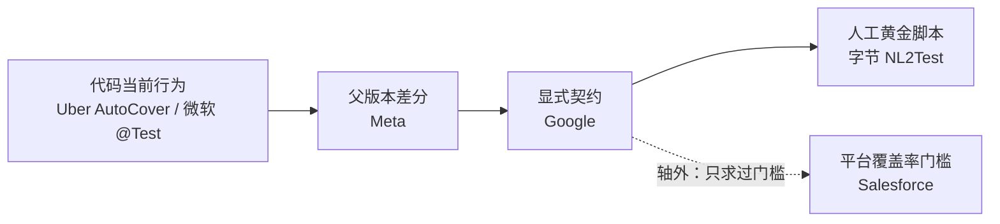

# Uber 用 AI 生成测试用例：AutoCover 机制拆解与能力边界

> **一句话结论**：Uber 没有做"更强的代码补全"，而是把"写测试"这件人工需要几十步的事，重建成一条**与构建系统深度耦合的多 agent 流水线**。它绕开 oracle（判定基准）困难的方式，是**用执行证据代替语义判断**——编译过、跑得通、覆盖有增量、变异体被杀。效果是实的（约占 Uber 新增测试的 11%），代价也是实的（Java 候选可用率约 20%，人工接受率约 44%）。

> **证据分级**（本文全部数字可回溯，逐条标注）：
> **【A】** 论文原文（Uber 三名作者 + 华盛顿大学，ICSE-SEIP '26 同行评审）｜**【B】** Uber 官方工程博客｜**【C】** 会议演讲 / 第三方转述（口径可能失真）｜**【D】** 本文推断（附推理链，不作事实陈述）。
> 凡标 **【D】** 的内容均为分析结论，不代表 Uber 官方立场。

## 目录

- [[#0. 结论先行|0. 结论先行]]
- [[#1. 一页看懂：好处、坏处、成本与边界|1. 一页看懂]]
	- [[#1.1 好处|1.1 好处]]
	- [[#1.2 坏处|1.2 坏处]]
	- [[#1.3 能力边界（一页版）|1.3 能力边界]]
	- [[#1.4 成本与收益|1.4 成本与收益]]
- [[#2. 要解决的问题，以及过去的解法|2. 问题与旧解法]]
	- [[#2.1 规模、覆盖率 KPI 与测试债|2.1 规模与测试债]]
	- [[#2.2 三条老路与各自的天花板|2.2 三条老路]]
	- [[#2.3 真正卡住的不是"写测试"，而是"执行闭环"|2.3 真正的瓶颈]]
- [[#3. 他们是怎么做的：五个 agent 的流水线|3. 五 agent 流水线]]
	- [[#3.1 总体形态|3.1 总体形态]]
	- [[#3.2 五个 agent 逐个拆解|3.2 五个 agent]]
	- [[#3.3 四个起决定作用的设计支点|3.3 四个支点]]
	- [[#3.4 质量闸门：把"能跑"变成"值得留"|3.4 质量闸门]]
	- [[#3.5 并行与成本工程|3.5 并行与成本]]
	- [[#3.6 三种调用形态与演进路径|3.6 形态与演进]]
- [[#4. 效果与口径|4. 效果与口径]]
	- [[#4.1 生产指标|4.1 生产指标]]
	- [[#4.2 受控基准：9 个 Go 主题上的正面对比|4.2 受控基准]]
	- [[#4.3 测试质量的专家评审|4.3 专家评审]]
	- [[#4.4 用户调研|4.4 用户调研]]
	- [[#4.5 七个常见误读|4.5 七个误读]]
- [[#5. 能力边界|5. 能力边界]]
	- [[#5.7 边界总表|5.7 边界总表]]
- [[#6. 与 Meta、Google、微软、字节、Salesforce 的路线对比|6. 路线对比]]
- [[#7. 可迁移结论|7. 可迁移结论]]
- [[#8. 证据分级与本文推断清单|8. 证据与推断清单]]
- [[#附录 A 来源清单|附录 A 来源清单]]
- [[#附录 B 术语表|附录 B 术语表]]

---

## 0. 结论先行

| 维度 | 结论 | 证据 |
|---|---|---|
| 要解决的核心问题 | 大型 monorepo 里**存量覆盖率补不上去**、新增代码要维持 **≥85% 覆盖**，而手写测试与交付速度直接冲突 | 【A】 |
| 为什么现成工具不行 | Copilot / Cursor 这类提示词驱动的助手**看不见构建图（build graph）**、跑不了 codegen、不能并行，产出大量编译不过的测试 | 【A】 |
| 系统形态 | 5 个专职 agent（Preparer / Generator / Executor / Validator / Fixer）组成的有状态图，构建于 LangGraph，配套语言与仓库适配器 | 【A】 |
| 生产规模 | 约占 **Uber 新增测试的 11%**；月产出：IDE 数十万、Headless 数万、CLI 数千 | 【A】 |
| 转化效率 | 候选"可用率"：Java ≈ **20%**、Go ≈ **40%**、Python ≈ **80%** | 【A】 |
| 人工闸门 | 可用测试被开发者显式接受 ≈ **44%** | 【A】 |
| 速度对比 | 9 个 Go 主题、60 分钟预算：中位 **41.6 分钟打到 100% 覆盖**；Cursor 1.7.54 停在 98.7%，Claude Code 2.0.75 需 48.9 分钟 | 【A】 |
| 最大边界 | **只能验证"代码当前行为"，不能验证"业务应有行为"**——oracle 问题被绕开，未被解决 | 【A】+【D】 |

**一句话评价**：这是一次"把 AI 从编辑器里拽出来、塞进构建系统"的工程胜利，不是模型能力的胜利。它的可复制性取决于你是否拥有等价的构建与执行基础设施。

**三个最容易被误传的点，先澄清**：

1. **11% 不是"替代率"，是"增量占比"**。分母是"所有经 review 并加入代码库的新测试"，不是"所有测试工作量"【A】。
2. **44% 是人工闸门，不是采用率的天花板**。它衡量的是"已通过 Validator 的可用测试"中被开发者显式接受的比例【A】。
3. **"覆盖率 +10%、节省 21,000 小时、2–3 倍于业界工具"这三项不是论文数据**。它们出自 2025 年 5 月 LangChain Interrupt 的演讲【C】，论文正文未报告。本文仅在 [[#4.5 七个常见误读|4.5]] 作为"流传口径"提及，不作结论使用。

---

## 1. 一页看懂：好处、坏处、成本与边界

### 1.1 好处

| # | 好处 | 证据 | 性质 |
|---|---|---|---|
| 1 | **测试供给规模化**：约占 Uber 新增测试 11%，IDE 月产数十万条 | 【A】 | 官方数据 |
| 2 | **存量补测可无人值守**：Headless 模式直接产出 merge request 并路由给归属团队 | 【A】 | 官方机制 |
| 3 | **开发期显著提速**：中位 8.3 分钟达到 90% 覆盖，基线需 11.6–13.8 分钟；60 分钟内 AutoCover 到 100%，Cursor 最高停在 96.7%–98.7% | 【A】 | 官方数据（9 样本） |
| 4 | **质量有可执行闸门**：变异测试 + 机器可读规则注册表 + lint；专家评审 67% 可落地，且**未产出任何 Broken 测试** | 【A】 | 官方数据 |
| 5 | **修复能力反哺存量**：Validator 自动修复数万条**开发者手写**测试 | 【A】 | 官方数据 |
| 6 | **组件可复用**：Validator 同时服务于代码审查与安全设计审查场景 | 【C】 | 演讲口径 |
| 7 | **成本可控**：靠提示词分段 + 两级缓存把成本压住（Generator 缓存命中 53.5%，IDE 侧 Validator 达 91.7%） | 【A】 | 官方数据 |

### 1.2 坏处

| # | 坏处 | 证据 | 性质 |
|---|---|---|---|
| 1 | **Java 转化率仅约 20%**：每得 1 条可用测试要烧 5 条候选 | 【A】 | 官方自承 |
| 2 | **人工 review 负担未消失，只是换了形态**：从"写测试"变成"读测试并判断"；接受率仅 44% | 【A】 | 官方自承 |
| 3 | **生成质量参差**：非活跃用户**无一人**把质量评为 Good/Excellent；主要抱怨是臃肿（bloat）与风格不符 | 【A】 | 官方自承 |
| 4 | **强绑定 Bazel 与自建适配器**：不是可插拔工具，是平台 | 【A】 | 硬边界 |
| 5 | **成本量级大**：Generator 的 token 量级 O(10¹⁰)，若缓存命中率掉下来，单位成本立刻失控 | 【A】 | 官方数据 |
| 6 | **后台执行会污染工作区**：IDE 模式需专门重构以避免"悄悄改动用户文件"，构建命令还要降优先级 | 【A】 | 官方自承 |
| 7 | **只能防回归，不能验需求**：生成的测试以"代码现状"为真值 | 【D】 | 硬边界 |
| 8 | **评测样本小**：仅 9 个 Go 主题、只用中位数、无显著性检验 | 【A】 | 方法论边界 |
| 9 | **安全管道本身会制造缺陷**：通用 PII 匿名化器曾把 `User` 之类代码标识符当隐私改写，破坏语法与 import | 【A】 | 官方自承 |
| 10 | **主对比基线偏旧**：核心对照组是 Cursor 0.46.8（2024 年中），虽然作者补测了新版本，但主表仍是旧版 | 【A】 | 方法论边界 |

### 1.3 能力边界（一页版）

分三层看，比笼统说"强/弱"更有用：

| 层 | 边界 | 一句话 |
|---|---|---|
| **输入层** | 只有源码、注释、既有测试、构建图 | 它读不到需求文档、产品规格、线上事故记录；输入里没有的意图，它推不出来 |
| **判定层** | 用"执行证据"代替"语义判断" | 能判"是否通过、是否提升覆盖、变异体是否被杀"，**判不了"这个行为是不是业务想要的"** |
| **环境层** | 单构建目标内闭环 | 超出单个 target 的 E2E、UI、性能、安全、混沌测试，全部在边界外 |

由此推出的**四个必要条件**（缺一不可，否则这套方案不成立）：

1. 有强构建系统（Bazel 级）能解析 target、隔离执行、复用缓存；
2. 有语言与仓库适配器，能处理 mock 与 codegen；
3. 有可执行的判定信号（测试框架 + 覆盖率 + 变异测试）；
4. 有愿意 review 生成的测试的工程文化（否则 44% 的接受率会掉到 0）。

### 1.4 成本与收益

**账面成本清单**（均来自论文【A】）：

| 成本项 | 量级 |
|---|---|
| Generator token | O(10¹⁰) |
| Validator（IDE）token | O(10⁹)，但缓存命中 91.7% |
| Validator（CLI/Headless）token | O(10⁶)，缓存命中 30.2% |
| Preparer token | O(10⁸)，缓存命中 9.5% |
| 人工复核 | 44% 接受率意味着过半候选需人工判断 |
| 基建 | Bazel、适配器、LLM 网关、配额与限流、可观测性、IDE 扩展 |
| 组织 | 归属团队 review MR；共享工作区行为重构 |

**账面收益**：

| 收益项 | 量级 |
|---|---|
| 新增测试占比 | 约 11% |
| 覆盖速度 | 90% 覆盖中位 8.3 分钟（基线 11.6–13.8 分钟） |
| 覆盖上限 | 45 分钟达 100%（基线最高 98.7% 后停滞） |
| 存量修复 | 数万条手写测试被自动修复 |

> ⚠️ **换算警告**：**不要把 11% 直接乘以"工程师写测试的工时"**得出节省工时。11% 是"新增测试条数占比"，不是"工时占比"；不同测试的编写成本相差一个数量级。任何"节省 X 人年"的换算都需要额外的工时基线数据，Uber 未公布。

---

## 2. 要解决的问题，以及过去的解法

### 2.1 规模、覆盖率 KPI 与测试债

Uber 的代码组织形态决定了问题的性质。论文的描述是：**数千名工程师**在**数百万行代码**的大型 monorepo（单一代码仓）上协作，维持与提升覆盖率同时关系到开发效率与软件可靠性【A】。

演讲口径更具体：开发者平台服务约 **5,000 名开发者**，代码库**数亿行**，支撑每天 3,300 万次行程、15,000 个城市【C】。量级可参考，精确值不宜直接引用。

论文明确提出两条硬约束【A】：

1. **新增代码覆盖率目标 ≥ 85%**（团队自设门槛）；
2. **存量代码覆盖率长期滞后**，且存量代码演进缓慢，靠"顺手补测"的自然增长极有限，必须专项投入才能补上。

这就形成结构性矛盾：**覆盖率是团队级 KPI，但补覆盖率不产生业务价值**。理性工程师都会把"给 2019 年的老模块补单测"排到待办最后。

> 【D】分析：这是"**指标刚性 + 劳动无趣 + 无人认领**"的三重困境，靠"提高觉悟"或"加强 review"解决不了，只能靠降低单位测试的边际成本。Uber 的方向是对的——把边际成本压到接近零，覆盖率才会自己长出来。

### 2.2 三条老路与各自的天花板

#### 老路一：手写测试

论文判断：手工开发与维护自动化测试**极其耗时**，与交付速度形成直接张力；而工业级覆盖率的达成本身非平凡——需要多框架、多分析技术、构建系统集成与一系列取舍【A】。

论文列出的五组取舍，本质是"手写测试为什么贵"的根因清单【A】：

| 取舍维度 | 张力所在 |
|---|---|
| 覆盖率 vs 维护成本 | 多写测试增加信心，同时增加 review 与归属负担 |
| 真实依赖 vs mock | 真实依赖慢且易 flaky（不稳定），mock 快且隔离但易过拟合实现细节 |
| 彻底性 vs 执行时间 | 并发/基准测试能抓到轻量测试抓不到的回归，但生成与执行都更慢 |
| 行覆盖 vs 场景覆盖 | 走同样的代码行、覆盖不同契约场景，即使不提升行覆盖也有价值 |
| 确定性 | 测试要可信，必须有稳定时钟、封闭 I/O（hermetic I/O）、固定随机种子 |

#### 老路二：确定性代码生成（LLM 之前）

Uber 并非没做过自动化。2018 年其开发者体验团队公开过一套基于 AST（抽象语法树）的方案：给 Swift 协议打 `@CreateMock` 注解，工具解析 AST 自动生成符合协议的 mock 类；**仅在乘客端 App 一个代码库中就有约 1,500 个**这样的生成 mock，公司 iOS 代码库中多达 **20% 的代码由工具生成**【B】。同期 Uber AI 开源了 Hypothesis GU Funcs，用**基于性质的测试（property-based testing）**为 NumPy 向量化函数生成用例【B】。

两条路线各有硬边界：

- **mock 生成**解决"样板代码"，不解决"**测什么**"。机械部分自动化了，判断部分仍全在人脑里。
- **性质测试**要求人先写出"性质"（invariant），而绝大多数业务代码写不出简洁性质，难以推广。

> 【D】分析：两条老路共同的缺口是"**语义**"——能确定性处理结构，不能理解意图。这恰是大模型补位之处，也是 AutoCover 设计的出发点。

#### 老路三：通用 AI 编程助手（看起来能用，实际不能用）

2024 年夏天，Uber 系统评估了当时的通用编码助手，结论是**三类根因导致结构性失效**【A】：

| 根因 | 具体表现 | 后果 |
|---|---|---|
| **构建图与生成代码盲区** | 既找不到正确构建标签（build label），也不执行 codegen | 缺 mock 包或符号，**直接编译失败** |
| **传递依赖发现缺失** | 不遍历构建图，拿不到二级生成产物（校验器注册表、mapper） | 只能用临时 stub 硬凑，**违反真实构造函数约束** |
| **吞吐限制** | 准备、构建、校验三阶段串行，候选之间无扇出（fan-out） | 大文件上**墙钟时间不可接受** |

论文对两个具体产品的判断是分层的：**GitHub Copilot 只能处理简单场景**，无法调用构建步骤、拿不到覆盖率与 mock，无法形成自主迭代；**Cursor 改善了 shell/工具调用**，但在多步生成上"坚持不下来"，在复杂目标上经常**偏离必需的 mock 约定**，不做大量人工干预就不可接受；其**线性生成**在大文件、低覆盖场景下延迟高到不可接受【A】。

> 【D】分析：这段判断的锋利之处在于——它没说"模型不够聪明"，而是说"**模型没有手脚**"。测试生成的失败模式不是"想错了"，而是"编译不过、跑不起来、看不到覆盖率反馈"。这直接决定了后续设计重心：**先建执行闭环，再谈生成质量**。

### 2.3 真正卡住的不是"写测试"，而是"执行闭环"

收拢上面的材料，可以还原 Uber 实际定义的问题（前三条为论文原意【A】，第四条为本文提炼【D】）：

1. **规模与复杂度**：新代码要 85% 覆盖，存量靠自然增长补不上，需专项投入【A】；
2. **场景分化**：新代码需要**快、交互式**的 IDE 流程，存量补测需要**可扩展、无人值守**的批量生成，两种需求无法用同一形态满足【A】；
3. **质量不能只看覆盖**：flaky 测试与"变更检测器"（change-detector，断言实现细节、一改就红的测试）持续抬高维护成本【A】；
4. **【D】问题本质**：不是"生成测试代码"，而是"**在工业级 monorepo 里，把测试写到能编译、能跑通、能提供真实信号、且不增加维护负担**"。前两步是工程问题（构建、执行），第三步是质量问题（判定基准），第四步是组织问题（review 成本）。

这个重述解释了后面所有设计选择：**为什么要有 Executor、Validator、Fixer**——它们分别对应"能跑"、"值得留"、"救回来"。

---

## 3. 他们是怎么做的：五个 agent 的流水线

### 3.1 总体形态

骨架非常直白：**五个专职 agent 串成闭环，构建在 LangGraph 上，借用 ReAct 式的"推理—行动"模式**【A】。

> 图 1 来源：论文 Figure 1（CC BY 4.0），本文件为论文第 3 页原图裁剪。图注原文："AutoCover's multi-agent architecture that orchestrates five key agents. Double borders indicate parallel tasks."（双边框表示并行任务。）

九条设计原则（论文 3.1 节，每条对应一个真实痛点）【A】：

| 原则 | 解决的问题 |
|---|---|
| 专职 agent（specialized agents） | 拆分职责、保住聚焦上下文、减少歧义、抑制幻觉，提质降重试 |
| 可复用节点（reusable nodes） | 封装好的 agent 加速新流程，支持并行团队开发 |
| 语言与仓库适配器（adapters） | 把"语言/仓库特定"的工具与策略隔离开 |
| **确定性优先**（determinism first） | 有界职责 + 确定性工具 = 更可靠、更易调试 |
| AST 感知拼接（AST-aware splicing） | 结构化编辑，可选择持久化，可确定性回滚 |
| 构建安全的并行（build-safe parallelism） | 按用例扇出 target，避免冲突并复用缓存（Bazel） |
| 表驱动用例（table-driven） | 默认产出可合并的测试，避免事后脆弱的合并 |
| 持久化用例（durable test cases） | 保留测试身份与历史，"多想一步"有希望的用例，并从失败中学习 |
| 场景覆盖作为信号（scenario coverage as a signal） | 接受"验证了此前未覆盖行为"的测试，而不只看行数增量 |

> 【D】分析：这九条里，**"确定性优先"最容易被忽视、也最值钱**。它把系统切成两类步骤：确定性工具（建 target、生成 mock、编译、跑测试、算覆盖率、跑变异）与 LLM 语义步骤（读代码懂意图、写测试、读报错改测试）。前者保证"不会错得离谱"，后者提供"人类级表达"。不在架构上显式做这个切分的 LLM 系统，都会陷入"模型胡说 + 无法调试"的泥潭。

### 3.2 五个 agent 逐个拆解

#### Preparer（准备）：决定测什么、为什么测

输入是源码上下文、构建图、初始覆盖率结果。产出**场景图（scenario map）**与**按优先级排序的目标图（target map）**，并搭好最小可用的测试骨架【A】。

| 子能力 | 做什么 |
|---|---|
| 场景发现（scenario discovery） | 一次轻量推理，逐函数总结 API 意图，提出 happy path 与边界场景，产出带**契约注记、边界条件、不变式**的场景图，作为后续验收依据 |
| 初始覆盖率检查 | 一次高效的"构建 + 覆盖率探针"建立基线，与场景图一起用于排定优先级 |
| 测试套件脚手架 | 确保存在规范测试文件，按惯用法预置最小 import 与表骨架，记录适配器提示（linter、构建工具、codegen/mock、import 约定） |
| 测试套件修复 | 仅在初次构建失败时调用 Fixer，重新生成构建文件或修正 import 语法 |

#### Generator（生成）：提出能提升覆盖或满足新场景的测试

| 子能力 | 做什么 |
|---|---|
| 逐函数生成器 | 按源函数**扇出**，worker 并行产出聚焦的候选测试，提升吞吐而不稀释上下文 |
| 既有测试扩展器 | 通过**追加表行**或收紧断言扩展既有测试，在保持结构的前提下覆盖新路径 |
| 全文件生成器 | 函数级解析失败时退化为整文件处理，标记未覆盖片段以恢复覆盖缺口 |
| 已试去重 | 共享存储聚合带版本的测试用例，按规范化内容去重，避免重复执行与反馈循环 |

#### Executor（执行）：编译并跑起来，且要精确归因

这是最"工程"的部分，也是与通用助手拉开差距的地方【A】：

| 子能力 | 关键机制 |
|---|---|
| 预执行 | 依据构建图产出 **artifact plan**，**并发**物化生成代码（如 mock）；用**有界队列**把"检索 → 拼接 → 编译 → 运行/覆盖 → 校验"流水线化，配合增量构建与缓存 |
| 测试执行 | 合成统一构建计划，**按测试用例复制 test target**（per-test-case target cloning）——既避开 shadow workspace 的坑，又最大化缓存复用；在隔离 Bazel sandbox 中执行；通过**固定工具链、稳定种子、无全局状态**保证确定性 |
| 结果收集与存储 | 解析每 target 的日志与覆盖率报告，把失败**归因到具体用例**，收集按（函数、场景）维度的覆盖集合 |
| 套件集成 | AST 感知编辑（import 插入、表行插入）并选择性持久化：保留"能编译且有覆盖信号"的用例，**回归或无信号的用例回滚**；命名/import 冲突用 AST 检测并以确定性重命名或别名解决 |

> 【D】分析：`per-test-case target cloning` 是个不起眼但极关键的设计。它把"每个用例"变成独立构建目标，于是①多用例可并行编译执行而不互相污染；②Bazel 缓存可按用例粒度命中；③某个用例失败不连累整批。**这是"能跑"与"跑得快"同时成立的物理基础**，也是纯提示词方案永远做不到的事。

#### Validator（校验）：执行与持久化之间的质量闸门

判定规则极简且严格：用例只有在"成功执行"且"提升代码覆盖率或场景覆盖率"时才算可用（viable）【A】。

| 子能力 | 关键机制 |
|---|---|
| 约定校验（conventions validation） | LLM 驱动的"最佳实践注册表"（best-practices registry）执行风格、稳定性、意图约定。注册表内是**机器可读规则**：`id`、`severity`、`span`、`rationale`、`patch`、`confidence`，外加**按语言版本化的示例**（封闭 I/O、固定种子、import 别名等），用于降低 flaky |
| 变异测试（mutation testing） | 有界类型与数量的变异体；**存活变异体归因到具体测试与场景**，触发提示词改进输入选择、收紧断言 |
| Linting | 对明显违规可跳过执行；对已接受并合并的测试再跑最终 lint，发现项归一化为精确 span 与建议补丁 |
| 持久化记忆 | 稳定性缓存对未变更文件返回**先前发现结果**，抹平 LLM 跨轮波动；按 target 记录运行日志与接受理由，支持对重复低严重度问题做策略性抑制 |

#### Fixer（修复）：最小、可逆的编辑

| 子能力 | 关键机制 |
|---|---|
| 失败上下文聚合 | 把诊断信息与本地仓库上下文压成**紧凑的单用例状态**，避免重复走失败策略 |
| 修复合成 | 把 Validator 发现项映射为具体编辑（改结构、收紧断言、修环境依赖）；上下文缺失时用**有界上下文爬虫**（`ls`、`tree`、`read_file`）取回必要 import、签名、示例 |
| 失败回滚 | 强制"**不造成伤害**"（do no harm）：**使原本通过的测试退化的补丁一律回滚**；所有补丁签名且可审计 |
| 修复版本化 | 修复带版本，经 Executor 的 AST 感知拼接器合并；冲突确定性解决；持续冲突则冻结并标注重命名指令 |

> 【D】分析：Fixer 的"do no harm"与"反复不改就冻结"（chronic non-improvers are frozen）是**成本熔断机制**。多 agent 系统最常见的死法是"无限自我修复循环"——每轮烧 token、每轮微调、永不出来。Uber 用两个硬约束（不许把已通过的弄红、反复失败就冻结）把这个洞堵上了。

### 3.3 四个起决定作用的设计支点

**支点一：与构建系统耦合**
不是"给模型一堆文件"，而是先**解析出规范的测试目标**，再**产出 artifact plan**（传递依赖 + codegen 动作），把 mock 与注册表**在生成之前**物化好【A】。直接对症 [[#2.2 三条老路与各自的天花板|2.2]] 中的"构建图盲区"与"传递依赖缺失"。

**支点二：契约形态的生成（contract-shaped generation）**
一个**任务感知的检索器（task-aware retriever）**先总结控制/分支结构——论文的例子是：资格校验门（eligibility gate）、模板校验结果、事务边界、feed 发布、通知分支——**让断言验证可观测行为，而不是内部细节**【A】。这是"减少 change-detector 测试"的根本手段，比事后 lint 有效得多。

**支点三：并行化的端到端环路**
生成、AST 拼接、编译、覆盖/变异检查跑在**流水线化并行 worker** 中，失败路由到 Fixer 做最小可逆编辑【A】。论文说这样做"提升了每步的上下文保持能力并隔离了故障"，并援引多 agent LLM 系统的既有结果【A】。

**支点四：质量闸门**
Validator 拒绝 change-detector 测试，强制最佳实践（稳定判定基准、隔离、表驱动结构），只放行"提升行覆盖或满足此前未覆盖场景"的测试【A】。

> 【D】分析：把 AutoCover 抽象成公式是：
> **可用测试 ≈（构建图知识 × 执行闭环 × 场景先验）÷ 维护成本**
> 四个支点分别对应分子三项与分母一项（质量闸门压低维护成本）。这也解释了为什么"换个更强的模型"不会自动让通用助手追上——分子里的三项都不是模型能力，而是**系统能力**。

### 3.4 质量闸门：把"能跑"变成"值得留"

三种抓手，对应三种失效模式：

| 失效模式 | 抓手 | 机制细节 |
|---|---|---|
| 写得不合规范、易 flaky | 约定校验 + lint | LLM 驱动的机器可读规则表 + 语言版本化示例；违规时附带**上下文匹配的示例**指导修复 |
| 断言太弱、抓不到 bug | **变异测试** | 注入变异体，存活者归因到具体用例，反向驱动"输入更狠、断言更紧" |
| LLM 输出跨轮漂移 | 持久化记忆 | 稳定性缓存对未变更文件复用旧结论，抹平方差 |

> 【D】分析：三者组合的逻辑是——**约定校验管"形态"，变异测试管"强度"，缓存管"稳定"**。多数团队只做第一项（lint 风格），结果产出一堆"绿但无用"的测试，最终被开发者用脚投票否决。**变异测试是这里唯一能直接度量"断言强度"的手段**，也是最难工程化的部分（变异算子、有界预算、归因逻辑）。

### 3.5 并行与成本工程

论文把成本单列成一章（第 5 节 Operationalization），因为**成本是这类系统的生死线**。

**（1）提示词分段 + 两级缓存**

把 prompt 切成三段以最大化缓存命中【A】：

| 段位 | 内容 | 变更频率 |
|---|---|---|
| **稳定段（stable）** | 最佳实践注册表、语言适配器指引、仓库约定、Validator 评分规则、风格 | 几乎不变 |
| **半稳定段（semi-stable）** | 目标源函数的契约与 API 面（文件哈希变则失效） | 随文件变 |
| **易变段（volatile）** | 当前测试文件切片、覆盖差异、失败日志、单用例历史 | 每次变 |

配套策略：**先发一个 pilot（试点）Generator 请求焐热缓存，再扇出**；Fixer 侧对常见失败做**诊断归一化（稳定 ID）**并**裁掉非确定性日志片段**以提升缓存亲和性【A】。缓存失效按 TTL + `(文件哈希, 函数 span, imports)` 键控。

**表 3：各 agent 的缓存命中率**【A】

| Agent（模型） | Token 量级 | 缓存命中率 |
|---|---|---|
| Preparer（OpenAI GPT-5 Thinking） | O(10⁸) | 9.5% |
| Validator，CLI & Headless（OpenAI GPT-4.1） | O(10⁶) | 30.2% |
| Validator，IDE（OpenAI GPT-4.1） | O(10⁹) | **91.7%** |
| Fixer，上下文爬虫（Claude 4 Sonnet） | O(10⁹) | 59.5% |
| Generator（Claude 4 Sonnet） | O(10¹⁰) | **53.5%** |
| Fixer，其他（Claude 4 Sonnet） | O(10⁸) | 22.1% |

两个要点：
- **Generator 的 O(10¹⁰) 是全系统最贵的一环**，其 53.5% 命中率直接决定总体成本；
- **Validator 在 IDE 模式命中率达 91.7%**，因为 IDE 反复校验同一批文件的同一批规则——这是"后台预计算"的额外红利【D】。

**（2）模型按任务分层**
生产配置：Preparer 用 GPT-5 Thinking（需推理）、Validator 用 GPT-4.1（需规则遵守）、Generator 与 Fixer 用 Claude 4 Sonnet（需长代码生成与编辑）【A】。论文还提到"用更小的推理档处理仅 lint 的检查、限制单用例重试次数"【A】。

> 【D】分析：这个分配本身是一份"模型能力画像"——推理型任务给推理档，规则型任务给指令遵循强的档，长代码生成给上下文与代码能力强的档。它比"统一用最强模型"便宜，也比"统一用最便宜模型"可靠。

**（3）配额与稳定性**
集中式 LLM 路由层（成本归因、匿名化、提供商/模型选择）+ 三级 fallback（主用 → 上一代 → 跨厂商）+ 自适应并发（按租户/全局信号量、令牌桶、429/5xx 抖动指数退避）+ 优先级通道（交互式 IDE 抢占批量补测）+ 熔断器【A】。

**（4）一个容易被忽略的坑：匿名化会破坏代码**
通用 PII 清洗器会把 `User` 这类**代码标识符**误判为个人信息并改写，导致**语法与 import 损坏**。处置方式：调整网关匿名化器以区分代码标识符与真实 PII，并用**语法往返测试（改前改后各解析一次）+ import 解析检查**验证【A】。

> 【D】分析：这条对所有"把代码送进 LLM"的团队都是必读项。它说明**安全合规管道本身会成为质量事故源**，且失效方式极其隐蔽——模型收到的代码已被改坏，但没人知道。

### 3.6 三种调用形态与演进路径

同一套图，三种形态交付【A】：

| 形态 | 触发方式 | 产物去向 | 适用场景 | 成本特征 |
|---|---|---|---|---|
| **CLI** | 显式命令行调用，指定目录/文件/函数 | 直接改本地工作区 | 定向补测、脚本化 | 中等，按需 |
| **Headless** | 跨 monorepo 分片自主运行 | 生成 **merge request** 并路由归属团队 review | 存量批量补覆盖 | 最高，可容忍长时并行 |
| **IDE** | 后台自动预计算，开发者无感 | 以注释形式呈现，可"插入并确保通过 / 插入 / 忽略" | 日常开发 | 需严格控本（5 分钟防抖） |

IDE 形态有一个非常具体的决策：**文件保存后启动 5 分钟防抖（debounce）调用，后续每次保存重置计时器**【A】。理由是用户浏览文件不等于在编辑，按行变更数做启发式不可靠；5 分钟被验证"足够保守"，能显著降低后台执行成本【A】。

演进路径（论文 3.7 节）【A】：

| 阶段 | 时间 | 内容 |
|---|---|---|
| 1. 探索与团队内部试用 | 2024.06–07 | 小范围验证原型 |
| 2. CLI 与 Headless 试点（远程算力） | 2024.08–11 | 早期覆盖补测 + 规模化的定向回归测试 |
| 3. Validator 优先架构 | 2024.09–12 | 引入最佳实践注册表、早期变异检查、仓库卫生规则 |
| 4. 全并行流水线 | 2025.01–03 | 多目标扇出、并行修复/执行、确定性拼接；扩展 Java/Kotlin |
| 5. IDE 集成与后台预计算 | 2025.04–08 | 聚焦延迟：产物预热、场景规划、成本调优 |

> 【D】分析：这条路径的顺序本身就是方法论——**先 CLI（有人有明确运营需求）→ 再 Headless（吃批量）→ 最后 IDE（消除摩擦）**。论文明说这是"有意的决定"：先发一个"使用模式粗糙"的版本，正好吸引**有运营需要**的用户，用它收集反馈调优，再上 IDE 扩大覆盖面。反过来做（先做 IDE 追体验），通常会在质量和成本都没收敛时被用户抛弃。

---

## 4. 效果与口径

### 4.1 生产指标

2025 年 8–9 月快照，均来自论文第 4.3 节【A】：

| 指标 | 数值 | 口径 |
|---|---|---|
| 占 Uber 新增测试比例 | **约 11%** | "所有经 review 并加入代码库的新测试"中的占比 |
| IDE 月产出 | **数十万**（hundreds of thousands） | 后台预计算 |
| Headless 月产出 | **数万**（tens of thousands） | 批量补测，产出 MR |
| CLI 月产出 | **数千**（thousands） | 按需本地调用 |
| 可用率（Java） | **约 20%** | 定义：**通过**且**提升代码或场景覆盖率** |
| 可用率（Go） | **约 40%** | 同上 |
| 可用率（Python） | **约 80%** | 同上 |
| IDE 可用测试显式接受率 | **约 44%** | 开发者主动点击接受的比例 |
| Validator 修复的手写测试 | **数万条** | 且随自动生成测试增多而**下降** |

最后一条值得单独说：论文指出"被修复的测试总数呈下降趋势，因为自动生成的测试在设计上就是有效的"【A】。这是**系统自我强化**的信号——生成侧质量提升后，修复侧负担自然下降。

### 4.2 受控基准：9 个 Go 主题上的正面对比

**实验设计**【A】：

- 从 Uber Go 代码库抽样 **9 个主题**，刻意追求多样性：3 个基础端到端程序（B1–B3）、3 个基础设施组件（I1–I3）、3 个产品组件（P1–P3）；
- 每主题限时 **60 分钟**；
- 基线：上线前用 **Cursor v0.46.8**；上线后追加 **Cursor v1.7.54、Cursor v2.3、Claude Code v2.0.75**；
- 公平性控制：基线以**同等自主性**运行，并获得**与 AutoCover 完全相同的信息**（完整规则集、工具详细说明、构建与测试基础设施描述）。

**表 1：不同时间预算下的中位覆盖率**【A】

| 工具 | 5 min | 10 min | 15 min | 30 min | 45 min | 60 min |
|---|---|---|---|---|---|---|
| **AutoCover** | **40.0%** | **93.2%** | **98.5%** | **99.4%** | **100.0%** | **100.0%** |
| Cursor 0.46.8 | 0.0% | 0.0% | 0.0% | 40.8% | 40.8% | 40.8% |
| Cursor 1.7.54 | 0.0% | 0.0% | 0.0% | 97.0% | 98.7% | 98.7% |
| Cursor 2.3 | 0.0% | 0.0% | 0.0% | 96.7% | 96.7% | 96.7% |
| Claude Code 2.0.75 | 0.0% | 0.0% | 90.4% | 90.4% | 98.1% | 100.0% |

**表 2：达到目标覆盖率所需的中位时间（分钟）**【A】

| 工具 | 40% | 80% | 90% | 95% | 99% | 100% |
|---|---|---|---|---|---|---|
| **AutoCover** | **4.7** | **7.2** | **8.3** | **10.8** | **19.5** | **41.6** |
| Cursor 0.46.8 | 30.0 | ✗ | ✗ | ✗ | ✗ | ✗ |
| Cursor 1.7.54 | 11.6 | 11.6 | 11.6 | 11.6 | ✗ | ✗ |
| Cursor 2.3 | 17.0 | 17.0 | 17.0 | 17.0 | ✗ | ✗ |
| Claude Code 2.0.75 | 12.8 | 13.8 | 13.8 | 41.4 | 48.9 | 48.9 |

> ✗ = 60 分钟内半数以上主题未达成该目标。

> 图 2 来源：论文 Figure 2（CC BY 4.0），本文件为论文第 6 页原图裁剪。横轴为分钟，纵轴为覆盖率；三行分别是基础（Basic）、基础设施（Infrastructure）、产品（Product）主题，五列分别是 AutoCover 与四个基线。

**能读出的三件事**【A】：

1. **速度差异是数量级的**。5 分钟与 10 分钟节点上，所有基线仍是 0%，AutoCover 已达 40% 与 93.2%；达成 90% 覆盖的中位用时 8.3 分钟 vs 基线 11.6–13.8 分钟。
2. **天花板差异同样存在**。Cursor 1.7.54 与 2.3 分别在 98.7% 与 96.7% 处**停滞**，最后几个百分点打不下来；AutoCover 在 45 分钟达到 100%。
3. **AutoCover 在每个主题上都优于 Cursor**，且 **Cursor 在三个主题上根本产不出可运行测试**；论文特别指出 Cursor 在 B2 主题的曲线被截断在 15 分钟，但**全程覆盖率保持 0%**【A】。

> 【D】注意：Cursor 0.46.8 是 2024 年中的版本。作者是诚实的——上线后补测了 1.7.54、2.3 与 Claude Code 2.0.75，结论是"更新的版本更好，但 AutoCover 仍未额外调优即保持领先"【A】。这句话成立的前提是 AutoCover 的**构建集成与并行**优势尚未被通用工具补齐。

### 4.3 测试质量的专家评审

覆盖率是**代理指标**，不等于有用。因此 Uber 做了一轮专家评审【A】：

- 评审人：**2 位**，均具计算机科学博士学位与丰富工业经验，深度熟悉 Uber 代码库，**均非论文作者**；
- 样本：AutoCover 与 Cursor 0.46.8 在同样 9 个主题上的产出；
- 事前**书面化评分标准**并统一口径（这是应对"专家评审主观性"的关键动作）。

六级评分标准（原文要点）【A】：

| 等级 | 判定要点 |
|---|---|
| Very good — 可落地 | 有意义且彻底：覆盖契约上重要的场景、使用稳定的行为断言、符合惯用法（适用时表驱动）、lint 干净、确定性 |
| Good — 可落地 | 有意义且较彻底，仅需小幅改进（命名、结构、少量重复） |
| OK — 轻微修改后可落地 | 覆盖率/意图足够纳入，但缺深度或打磨（缺负向路径、断言过于具体） |
| Bad — 不可落地 | 能编译但价值低或脆弱：变更检测器模式、flaky 的 setup/teardown、掩盖行为的错误 mock |
| Very bad — 不可落地 | 对套件有害：非确定性（时间/环境泄漏）、可变全局状态、无 fake 的外部 I/O、脆弱的顺序依赖 |
| Broken — 不可落地 | 无输出或不可构建（语法/类型/导入错误），或零执行（配置错误） |

> 图 3 来源：论文 Figure 3（CC BY 4.0），本文件为论文第 6 页原图裁剪。左右两侧分别为"不可落地"与"可落地"的比例。

**结果**【A】：

- AutoCover 在两位评审处均为 **67% 可落地**（OK 及以上）；Cursor 0.46.8 分别为 **33%（评审 1）** 与 **56%（评审 2）**；
- **AutoCover 未产出任何 Broken 级测试**；Cursor 的分布包含 Broken 与 Very bad；
- 两位评审都呈**双峰分布**（要么直接可用，要么完全不可用），但评审 1 更严格，评审 2 更倾向"轻微修改后可用"。

### 4.4 用户调研

样本 **29 份**（**23 位活跃用户 + 6 位自认使用量显著下降的非活跃用户**）。准入条件保证真实使用：CLI/Headless 近两月生成 ≥10 条，或 IDE 近两月接受 ≥10 条【A】。

> 图 4 来源：论文 Figure 4（CC BY 4.0），本文件为论文第 7 页原图裁剪。上半部分是李克特量表（Likert scale）同意度，下半部分是工具属性评分。

| 维度 | 活跃用户 | 非活跃用户 |
|---|---|---|
| 改善生产力（同意） | **83%** | 40% |
| 正向使用体验（同意） | **61%** | 40% |
| 鼓励写更多测试（同意） | 65% | 67% |
| 可用性（Good/Excellent） | **83%** | 33% |
| 生成质量（Good/Excellent） | **70%** | **0%** |
| 速度（Good/Excellent） | 65% | 33% |

一个值得注意的反差：**"鼓励写更多测试"两组高度一致（65% vs 67%）**，说明即便流失用户也认可"这类工具确实会让人愿意多写测试"；分歧集中在**质量与体验**——非活跃用户**无一人**把质量评为 Good 或 Excellent【A】。

六类改进诉求（括号内为提及次数）【A】：

| 诉求 | 次数 | 具体内容 |
|---|---|---|
| 风格（Style） | 6 | 应匹配项目既有约定（表驱动、统一断言模式、既有 mock 库），而非通用最佳实践 |
| 臃肿（Bloat） | 4 | 输出冗长：冗余变量、多余断言、大量不适用的场景 |
| 速度（Speed） | 4 | 生成太慢，尤其 CLI；更快的反馈回路会提升采用率 |
| 规范（Guidelines） | 4 | 需要项目级规则（如优先表驱动、用 mockgen 而非手写 mock） |
| 覆盖率集成（Coverage integration） | 3 | 只针对新增/变更行、并可视化哪些行被覆盖 |
| 交互性（Interactivity） | 1 | 生成途中可插话纠正"差一点就对了"的 agent |

> 【D】分析："风格"排第一极具信息量。它说明工业场景的验收标准不是"测试写得好不好"，而是"**测试像不像这个仓库里其他人写的**"。这解释了为什么 AutoCover 把 "repository conventions" 放进 prompt 的**稳定块**（见 [[#3.5 并行与成本工程|3.5]]），也解释了纯通用工具（Copilot / Cursor）为什么天然吃亏——它们没有仓库级约定知识。

### 4.5 七个常见误读

以下每一条都是对常见误读的纠正。

**（1）"20% 成功率"不代表质量差，但不代表可以忽略。**
定义是"通过**且**提升代码或场景覆盖率"的候选占比【A】。分母是**所有候选**，含被去重、被回滚、编译失败的。所以 20% 说的是**转化率**不是**缺陷率**。反过来看：Java 上每得 1 条可用测试，要付出 5 条候选的生成与执行成本。

> 【D】推论：这正是"成本工程"被单列一节的原因（见 [[#3.5 并行与成本工程|3.5]]）。20% 转化率若没有缓存与模型分层，单位可用测试的 token 成本会失控。**低转化率不是 bug，是必须被工程手段消化掉的常量。**

**（2）11% 是"增量占比"，不是"替代率"。**
它衡量**新增测试流量**中的份额，不等于"消除了 11% 的人工测试工作"【A】。

**（3）44% 接受率说明闸门仍在人手里。**
可用（viable）已被 Validator 过滤一轮，在此基础上开发者仍只显式接受约 44%【A】。若把两个系数相乘作"生成 → 入仓"的端到端示意：Go 约 0.4 × 0.44 ≈ 18%，Java 约 0.2 × 0.44 ≈ 9%【D】。
⚠️ **该乘积仅为量级示意，不是官方指标**：可用率按语言统计**全部候选**，44% 是 **IDE 模式下可用测试**的显式接受率，两者口径与人群不完全一致。据此只能说"端到端转化率显著低于单一指标给人的印象"，不能说"实际只有 9%"。
无论如何，"AI 替代 80% 测试工作"这类说法与这组数据不符。

**（4）基准是 Go-only、9 个样本、中位数、无显著性检验。**
论文只报中位数与曲线，未报均值、方差或统计检验【A】。9 个样本、单一语言，**结论方向可信，幅度不可外推**。

**（5）2024 与 2025 的覆盖率数据不可直接比较。**
论文自述：场景覆盖率统计晚于行覆盖率，因此 **2024 年覆盖信号与 2025 年不可比**，作者明确"不做直接对比"【A】。任何拿"覆盖率提升 X%"做跨年叙事的外部文章都应被谨慎对待。

**（6）"覆盖率 +10%、节省 21,000 小时、2–3 倍"是会议演讲口径。**
这三项出自 2025 年 5 月 LangChain Interrupt 演讲（讲者 Sourabh Shirhatti、Matas Rastenis）【C】，**论文正文未报告**。引用时必须注明"会议演讲口径"，不可当作论文结论。

**（7）Cursor 的"失败"是在特定前提下成立的。**
基线被要求"自主运行"且"不额外人工干预"，这正是通用工具的弱项场景；若允许人工逐步引导，Cursor 的实际体验会好得多【D】。所以这张表读作"**在无人值守、大规模、时限固定的场景下**，系统化流水线显著优于通用助手"，而不是"Cursor 不如 AutoCover"。

---

## 5. 能力边界

### 5.1 语言与生态边界

**事实**：可用率 Java ≈ 20%、Go ≈ 40%、Python ≈ 80%【A】。同样一条流水线、同一批模型、同一套规则，落差达 4 倍。

**论文的解释**：适配器封装了语言与仓库特定的工具与策略；不同语言的 mock 与 codegen 感知、冲突检查是单独建设的【A】。

> 【D】推论（推理链）：Java 的低转化率最可能来自**三重叠加**——① 强类型 + 严格编译，任何符号/签名错误直接失败；② mock 生态复杂（final 类、静态方法、构造函数约束、注解处理器生成的代码），"错误的 mock 约定"正是论文点名的 Cursor 失效原因之一；③ 企业级 Java 仓库**生成代码比例高**（mapper、registry），而这类产物恰是"构建图盲区"的重灾区。Go 的接口隐式实现 + 简单依赖注入天然降低 mock 难度；Python 的动态类型与宽松 mock 让"跑起来"门槛最低。
> **结论**：这是结构性边界——语言越静态、mock 越复杂、生成代码越多，转化率越低。**不要指望换更强模型消除它**，因为它主要不是语义问题，是工具链问题。

**实践含义**：若在 Java/Kotlin 栈复制此方案，需按 1:5 的候选比预留算力，并把工程重心压在"mock 与 codegen 正确性"上，而非提示词优化。

### 5.2 测试层级边界

**事实**：产线覆盖单元级与组件级测试；论文在讨论测试设计取舍时，明确把"彻底的并发测试与基准测试"列为一种高成本选项（"能抓到轻量测试抓不到的回归，但生成与执行都更慢"）【A】，会议演讲中亦提到工具会产出并发与基准测试【C】。但**论文全部实验与生产指标均围绕单元/组件级测试**，未给出并发/基准测试的量化结果。

> 【D】推论：**能力上限停留在"代码级契约"**。它不覆盖：
> - 端到端（E2E）流程测试——需要多服务编排与稳定环境；
> - UI/交互测试——需要视觉与事件流建模；
> - 性能/负载测试——需要压测拓扑与基线；
> - 安全测试——需要威胁模型与攻击面知识；
> - 混沌工程——需要故障注入编排。
> 共同点是"**被测对象超出单个构建目标**"，而 AutoCover 的全部优势建立在"单 target 可编译、可隔离执行"之上。**优势与边界是同一件事**。

### 5.3 语义边界：oracle 问题（最本质的一条）

**事实**：Generator 的输入是**源码 + 场景图（由模型从 API 意图总结）+ 既有测试**，验收标准是"提升代码或场景覆盖率"【A】。也就是说，**判定基准（oracle）来自对现有代码语义的推断**。

> 【D】推论（本文最重要的边界）：
> 1. **它能发现"代码与断言不一致"，不能发现"代码与需求不一致"。** 若业务逻辑本身有 bug，生成的测试会把这个 bug **固化为期望行为**——测试变绿，缺陷被永久掩盖。这是"以代码为真值"的必然结果。
> 2. **它无法覆盖"应该发生但没有写"的场景。** 场景图从代码结构反推意图，代码里没有的分支，图上也不会出现。缺失功能、漏判条件、未实现的边界，全在盲区。
> 3. **注释质量决定上限。** 场景发现依赖 API 意图的可读性；注释过时或缺失时，"意图"退化为"实现"，断言随之退化为 change-detector。
>
> **结论**：AutoCover 是**回归防护工具**（防未来改坏），不是**需求验证工具**（确认现在做对）。把它当后者用，会系统性降低而非提升质量保证水平。这条在任何宣传材料里都不会出现，但它决定了是否应在核心金融/安全逻辑上依赖它。

### 5.4 组织边界：人仍然是闸门

**事实**：IDE 可用测试显式接受率约 44%【A】；调研中非活跃用户**无一人**给质量打 Good/Excellent【A】；"臃肿""风格不匹配"是主要抱怨【A】。

> 【D】推论：**review 成本没有消失，只是转移了形态**——从"写测试"变成"读测试并判断"。这对资深工程师可能是净损失（读测试并不比写测试快多少），对新人可能仍是净收益。论文自己也承认"额外测试增加信心，同时增加 review 与归属负担"【A】。**若团队缺乏 review 带宽，实际收益会被组织瓶颈吃掉。**

### 5.5 基建与成本边界

**事实（前置条件）**【A】：

| 前置条件 | 论文中的证据 |
|---|---|
| 必须有强构建系统 | 深度依赖 **Bazel**：target 解析、sandbox 隔离、远程/本地缓存、按用例复制 target |
| 必须有语言/仓库适配器 | 适配器提供语言与仓库特定命令、策略、mock/codegen 感知 |
| 必须改造共享工作区行为 | IDE 模式原本不支持共享工作区，需重构以避免"后台执行悄悄改动用户工作区"；构建命令需降优先级 |
| 必须能实时控制特性 | 扩展版本发布有"数天到一周"的滞后，因此需要**基于人员的访问控制基础设施**做实时调参与 kill switch |
| 必须投入成本工程 | 两级缓存、prompt 分段、模型分层、跨用户去重、5 分钟防抖 |

**成本量级**（见 [[#3.5 并行与成本工程|3.5]] 表 3）：单 agent token 量级从 O(10⁶) 到 O(10¹⁰)【A】。Generator 的 O(10¹⁰) 意味着**没有 50% 以上的缓存命中率，单位可用测试成本无法持续**。

> 【D】推论：**这不是可"装在任意仓库上"的工具，而是一套需要组织级基建（构建系统、适配器、网关、配额、可观测性）承载的平台。** 中小团队直接照搬架构，最可能的结局是"跑通了 demo，跑不动生产"。

### 5.6 评测边界（论文自述的三类效度威胁）

论文第 4.5 节主动披露效度威胁，这是判断结论适用范围的关键【A】：

| 威胁类型 | 具体内容 | 影响 |
|---|---|---|
| **内部效度** | 覆盖率 KPI 与团队采用策略可能影响开发者"接受"行为；研究期内多次改进（模型切换、提示词重构、并行化、规则更新）使单因素效果无法剥离；匿名化调优带来的语法破坏风险不明 | "接受率"可能被 KPI 抬升；无法归因到具体改进 |
| **构念效度** | 覆盖率是测试质量的**不完美代理**；场景覆盖统计晚于行覆盖，故 **2024 与 2025 数据不可比**；专家评审主观 | "覆盖率提升"不等于"质量提升" |
| **外部效度** | 结果绑定于 Uber 的开发环境与流程；示例与策略规则反映本地惯用法，**未必可泛化**；可能存在**目标选择偏差**（开发者可能专挑难测的存量代码跑 CLI/Headless，不代表日常新代码体验） | 不可直接外推到其他组织 |

> 【D】分析：作者选择"外部效度优先于内部效度"，这是工业论文的合理取舍（真实部署 > 严格实验），但读者必须承担代价：**所有百分比都应视为"方向性证据"而非"可复现的效应量"**。

### 5.7 边界总表

| 能力项 | 能做 | 不能做 / 有条件做 | 依据 |
|---|---|---|---|
| 单元/组件级测试生成 | ✅ 四种语言（Go/Java/TS/Python），约占新增测试 11% | — | 【A】 |
| 存量代码覆盖率补测 | ✅ Headless 批量 + merge request | ⚠️ 需归属团队 review；可能存在目标选择偏差 | 【A】 |
| 提升断言强度 | ✅ 变异测试驱动 | ⚠️ 有界变异体预算，非全量 | 【A】 |
| 抑制 flaky | ✅ 封闭 I/O、固定种子、规则注册表 | ⚠️ 无法消除环境级 flaky（外部服务、时序） | 【A】+【D】 |
| 理解业务需求 | ❌ | 只能从代码与注释反推意图 | 【D】 |
| 验证"应发生但未实现"的行为 | ❌ | 场景图从实现反推，缺失功能不可见 | 【D】 |
| E2E / UI / 性能 / 安全测试 | ❌ | 超出单构建目标边界 | 【D】 |
| 跨语言一致体验 | ⚠️ 有条件 | 需为每种语言建适配器；Java 转化率仅 20% | 【A】 |
| 开箱即用 | ❌ | 强依赖 Bazel、构建图、适配器、LLM 网关 | 【A】 |

---

## 6. 与 Meta、Google、微软、字节、Salesforce 的路线对比

### 6.1 该先澄清的一件事

网上（含部分中文技术媒体）存在把 **AutoCover 说成 Google 或 Meta 的方案**的误传。事实是：AutoCover 是 **Uber** 的系统，论文作者为 Uber 的 Matas Rastenis、Ben Chou、Shauvik Roy Choudhary 与华盛顿大学的 René Just，发表于 ICSE-SEIP '26【A】。

本文库此前多篇文档对 Uber 数据的转述标为 **C 级**（转述自二手来源）。**本文数据直接取自论文 PDF，可作为库内 Uber 相关数据的 A 级来源**，相关文档可据此升级引用依据。

### 6.2 六条路线对照

| 维度 | **Uber（AutoCover）** | Meta（Catching JiTTests） | Google（契约驱动） | 微软（`@Test` / Agent） | 字节（NL2Test） | Salesforce（代码级） |
|---|---|---|---|---|---|---|
| 解决的痛点 | **覆盖率产能**：补一行覆盖太贵 | 改动**行为差异**：这次到底改了什么 | 测试**有效性**：写了但不抓 bug | IDE 内**零摩擦**生成 | **手工脚本编写**成本 | **过 75% 部署门槛** |
| 测试从哪来 | 源码 + 场景图 + 既有测试 | 从 diff 反推意图 | 从代码/注释/调用点**自生成契约** | Roslyn 语义模型 + 提示 | **人写的自然语言用例** | 实现 + 已有测试 + 元数据 |
| 判定基准（oracle）从哪来 | **执行证据**：覆盖增量 + 变异存活 + 约定校验 | 拿**父版本**做差分 | **显式契约**（pre/post-condition） | 编译 + 测试框架闭环 | **人工黄金脚本**比对 | 平台覆盖率门槛 |
| 是否有执行闭环 | ✅ 有（编译/跑测/算覆盖/变异） | ✅ 有（跑测试判差异） | ✅ 有（失败重试） | ✅ 有 | ✅ 有 | ❌ 无（人工 Accept） |
| 核心指标 | viable 率、接受率、覆盖率 | weak catch 率 | detect@k、分支覆盖 | 编译通过率、可靠性 | exact match、采纳率 | 首轮接受率 |
| 人工位置 | 末端接受（44%） | 末端判断"变化是否预期" | 契约与生成之间（可选） | 编辑器内即时 | 提供用例描述 | 补测试数据 |
| 公开规模 | 约占新增测试 **11%** | 分阶段转化率（详见对应文档） | **未公布生产占比** | 产品 GA，无占比数据 | 团队级采纳率 | 仅首轮接受率 |

> 表中除 Uber 外的数据，均转引自本文库同系列文档，**本文未逐条核对原始论文**；需要精确引用时请以对应文档及其证据分级为准：
> [[Meta-Catching-JiTTests-五阶段机制拆解]]、[[Google-AI生成单元测试-契约驱动机制与边界]]、[[微软-AI生成单元测试-IntelliTest退场与Agent化测试工程]]、[[字节跳动-NL2Test-Agent-机制拆解]]、[[Salesforce-AI生成测试用例-双产品线机制与能力边界]]。

### 6.3 一条"oracle 距离"权衡曲线

把六家放在一根轴上，按"判定基准离人的真实意图有多近"排序。**从左到右：判定越来越接近真实意图，但可规模化程度越来越低。**

| 位置 | 代表 | 判据来源 | 优势 | 代价 |
|---|---|---|---|---|
| 最左：代码现状 | Uber、微软 | 代码 + 覆盖率 + 变异；或语义模型 + 编译反馈 | 可完全自动化，规模无上限 | 只能防回归，bug 会被固化为"正确" |
| 中间：版本差分 | Meta | 父版本 vs 新版本 | 绕开"什么是对的"，只问"什么变了" | 只适用改动场景，无法从零建测试 |
| 中右：显式契约 | Google | 从代码/注释/调用点反推 pre/post | 更接近"意图"，能抓逻辑错误 | 契约本身可能反推错；token 成本上升 |
| 最右：人的描述 | 字节 | 人写的自然语言用例 + 黄金脚本 | 意图最准 | 产能受限于人写用例的速度 |
| 轴外：只要门槛 | Salesforce | 平台覆盖率是否达标 | 直接对症"发不出去" | 门过了即止，不保证质量 |

**一句话**：**Uber 用"执行证据"绕开 oracle，Meta 用"版本差分"绕开 oracle，Google 正面去造 oracle，字节干脆让 oracle 由人来给，Salesforce 不碰 oracle——它把目标换成了"过门槛"。** 这不是技术高下之分，而是在"有效性—规模化"曲线上选了不同的点。

> 【D】分析：这条曲线的形状解释了一个现象——**没有任何一家宣称"AI 能判断需求对不对"**。所有工业级方案都在把 oracle 问题往外推：推给代码、推给历史版本、推给显式契约、推给人类提供的用例。**谁声称解决了 oracle，谁就在撒谎。**

### 6.4 为什么 Uber 选了最重的那条

按 6.3 的坐标，Uber 站在最左端——**最不"智能"、但最可规模化**的位置。这不是能力不足，是场景决定的：

1. **它的目标是指标，不是洞察**。要的是"覆盖率补上去"，而覆盖率本身是确定性可测的，不需要语义判断【D】。
2. **它的用户是 5,000 名工程师，不是 5 个专家**。任何依赖人类提供意图的方案，在 5,000 人规模上都会被"谁来做这件事"卡住【D】。
3. **它的存量代码没有规格可依**。2019 年的老模块大概率没有 pre/post-condition，也没有人愿意回头补——所以 Google 的契约路线在存量场景成本极高【D】。

> 【D】这就是取舍的本质：**Uber 用"放弃语义正确性"换取了"无限规模化"**。代价写在 [[#5.3 语义边界：oracle 问题（最本质的一条）|5.3]] 里——它防的是"未来改坏"，不是"现在做错"。理解这一点，比记住任何百分比都重要。

---

## 7. 可迁移结论

> 本节全部为【D】推断，是本文基于 Uber 材料给出的迁移建议，不代表 Uber 官方观点。

### 7.1 值得抄的五条

| # | 原则 | 判断标准 | Uber 的做法 |
|---|---|---|---|
| 1 | **确定性骨架 + 语义内核** | 这一步的输出能否用程序校验？能，就不要让模型做 | 准备/构建/执行/覆盖/变异全部确定性 |
| 2 | **工具结果是一等证据** | 判定是否来自执行结果，而非模型自评 | 编译通过 + 覆盖增量 + 变异存活 |
| 3 | **质量闸门独立成组件** | 它能否被别的产品复用？ | Validator 同时服务测试生成、代码审查、安全审查 |
| 4 | **场景优先于指标** | 验收看"行为"还是看"路径" | 场景覆盖与行覆盖并列 |
| 5 | **并行 + 去重 + 缓存** | 单位产出成本是否随规模下降 | 流水线扇出、内容哈希去重、提示词分段缓存 |

补一条交付节奏：**渐进交付，先粗后精**（CLI → Headless → IDE）。先让"需要它的人"用起来，再优化体验。

### 7.2 不建议照抄的三条

| # | 不要抄 | 原因 |
|---|---|---|
| 1 | **不要照搬五 agent 拓扑** | 拓扑是从"测试生成"这个任务长出来的。换任务（如 APM 根因分析），应重新从人工步骤反推，而不是套用 Preparer/Generator/Executor |
| 2 | **不要在没有构建图的情况下起步** | 缺构建图时，agent 只能"猜依赖"，会退化成论文描述的 Copilot 状态（编译不过、mock 错） |
| 3 | **不要先做 IDE 集成** | IDE 是放大器，质量和成本未收敛时上 IDE，等于把缺陷和账单同时放大 |

### 7.3 自建前的七个问题

以 APM 场景下的 AI 分析助手为例，这张表可直接当可行性自检：

| 问题 | 为什么关键 | Uber 的对应答案 |
|---|---|---|
| 1. 我们是否有等价于"构建图"的结构化知识？ | 决定 agent 能否"看见系统真实拓扑" | Bazel 构建图 + artifact plan |
| 2. 每条人工流程能否拆成确定性步骤 + 语义步骤？ | 决定系统能否被调试 | 准备/构建/执行/覆盖全确定性 |
| 3. 用什么"执行结果"作为验收信号？ | 决定系统能否自我纠错 | 编译/测试/覆盖率/变异体 |
| 4. 质量闸门能否独立、可复用？ | 决定长期演进与跨产品复用 | Validator 被复用到代码审查 |
| 5. 候选转化率大概多少？预算能否承受？ | 决定成本模型是否成立 | Java 20% / Go 40% / Python 80% |
| 6. 谁承担 review？带宽够不够？ | 决定收益是否被组织瓶颈吃掉 | 44% 接受率 + 归属团队 review |
| 7. 失败时能否回滚、能否熔断？ | 决定系统会不会失控烧钱 | do-no-harm 回滚 + 反复失败冻结 |

> 【D】对 APM 场景的直接映射：第 1 问对应"指标/日志/链路/trace 的元数据与拓扑关系"；第 2 问对应"取数、聚合、对比基线"是确定性步骤，"假设生成、根因排序"是语义步骤；第 3 问对应"结论必须能被某条查询结果或某段日志证据支撑"；第 5 问对应"一次根因分析要跑多少次工具调用"。Uber 的经验在第 2、3 问上尤其值得抄——**先建执行闭环，再谈推理质量**。

---

## 8. 证据分级与本文推断清单

### 8.1 来源分级

| 级别 | 来源 | 覆盖内容 |
|---|---|---|
| **A** | S1/S2：ICSE-SEIP '26 论文（Uber 作者 + UW，同行评审，CC BY 4.0 全文） | 全部架构、全部生产指标、两张基准表、专家评审、用户调研、缓存表、效度威胁 |
| **B** | S4/S5：Uber 官方工程博客（2018 代码生成、Hypothesis GU Funcs） | [[#2.2 三条老路与各自的天花板\|2.2]] 中的"确定性代码生成"历史 |
| **C** | S6/S7：LangChain Interrupt 2025 演讲（Uber 讲者） | 5,000 开发者 / 数亿行 / 3,300 万行程 / 15,000 城市；覆盖率 +10%、21,000 小时、2–3 倍；Validator 横向复用 |
| **D** | 本文 | 全部标【D】的分析与推论 |

### 8.2 本文推断清单（可逐条复核）

| 编号 | 推断 | 位置 | 依据 |
|---|---|---|---|
| I1 | Java 转化率低主要源于静态类型 + 复杂 mock + 生成代码多，而非模型能力 | [[#5.1 语言与生态边界\|5.1]] | 三类根因与语言特性对照 |
| I2 | 端到端转化率显著低于单一指标（量级示意 18% / 9%，非官方） | [[#4.5 七个常见误读\|4.5(3)]] | 可用率 × 接受率，口径已标注不一致 |
| I3 | 生成测试会固化代码中已有 bug，无法验证需求 | [[#5.3 语义边界：oracle 问题（最本质的一条）\|5.3]] | oracle 来自代码语义这一事实 |
| I4 | review 成本从"写"转移到"读"，对资深工程师可能是净损失 | [[#5.4 组织边界：人仍然是闸门\|5.4]] | 44% 接受率 + 用户反馈 |
| I5 | 无 50% 以上缓存命中率则成本不可持续 | [[#5.5 基建与成本边界\|5.5]] | Generator O(10¹⁰) + 53.5% 命中 |
| I6 | Cursor 的"失败"部分源于"无人干预"这一实验前提 | [[#4.5 七个常见误读\|4.5(7)]] | 实验设计描述 |
| I7 | 六家都在回避 oracle（外推或换目标），无人真正解决 | [[#6.3 一条"oracle 距离"权衡曲线\|6.3]] | 六家判定基准来源对照 |

### 8.3 本文未能核实的事项（诚实留白）

| 事项 | 状态 |
|---|---|
| AutoCover 的绝对成本（美元/条测试） | 论文只给 token 量级与缓存命中率，**未给金额** |
| TypeScript 的可用率 | 论文只报 Java/Go/Python 三档，**TS 未单独披露** |
| 生成测试在线上拦截的真实缺陷数 | 论文未报告（Meta 那篇有此类数据） |
| 长期维护性（生成测试一年后的存活率/修改率） | 论文未跟踪 |
| 与 GitHub Copilot Agent 等 2026 年新形态工具的对比 | 论文对比基线止于 2025 年中的工具版本 |

---

## 附录 A 来源清单

| 编号 | 来源 | 链接 |
|---|---|---|
| S1 | Rastenis M., Chou B., Choudhary S. R., Just R. *Automated Software Test Generation at Industry Scale Using a Multi-Agent Architecture and Workflow Integration*. ICSE-SEIP '26, pp. 808–818. ACM. 2026-07-11 出版 | https://doi.org/10.1145/3786583.3786918 |
| S2 | 同上，作者主页公开 PDF（**CC BY 4.0**，本文全部图表与数字的直接来源） | https://homes.cs.washington.edu/~rjust/publ/auto_cover_icse_2026.pdf |
| S3 | ACM Digital Library 条目页（含作者单位、页码、出版日期） | https://dl.acm.org/doi/10.1145/3786583.3786918 |
| S4 | Uber Engineering, *Harnessing Code Generation to Increase Reliability & Productivity on iOS at Uber* | https://www.uber.com/blog/code-generation/ |
| S5 | Uber Engineering, *Introducing Hypothesis GU Funcs, an Open Source Python Package for Unit Testing* | https://www.uber.com/blog/hypothesis-gu-funcs-unit-testing/ |
| S6 | LangChain Interrupt 2025 会议主页（讲者含 Uber 的 Sourabh Shirhatti、Matas Rastenis） | https://interrupt.langchain.com/ |
| S7 | 同场演讲文字实录（第三方整理，**ASR 转写，质量有限，仅作交叉印证**） | https://lawwu.github.io/transcripts/transcript_pntF0_t8184.html |

> 说明：S2 是**唯一**可免费获取全文的官方渠道。本文所有百分比、表格数值、图表均取自该 PDF，未做数值二次加工（仅做页面裁剪与重排为 Markdown 表格）。

### 图片来源

| 图 | 来源 | 许可 |
|---|---|---|
| 图 1 架构图 | 论文 Figure 1（PDF 第 3 页） | CC BY 4.0 |
| 图 2 覆盖率推进曲线 | 论文 Figure 2（PDF 第 6 页） | CC BY 4.0 |
| 图 3 专家评分分布 | 论文 Figure 3（PDF 第 6 页） | CC BY 4.0 |
| 图 4 用户调研 | 论文 Figure 4（PDF 第 7 页） | CC BY 4.0 |

四张图均为论文页面的原图裁剪，存放于同目录 `assets/`，未做内容修改。

---

## 附录 B 术语表

| 英文 | 中文 | 一句话释义 |
|---|---|---|
| AutoCover | （Uber 内部系统名，不译） | Uber 的 LLM 多 agent 测试生成系统 |
| multi-agent architecture | 多智能体架构 | 多个职责单一的 agent 通过图结构协作完成任务 |
| LangGraph | （框架名，不译） | LangChain 推出的、用状态图编排 LLM 应用的框架 |
| build graph | 构建图 | 构建系统对 target、依赖、产物之间关系的完整描述 |
| build label | 构建标签 | Bazel 中唯一定位一个构建目标的标识符 |
| artifact plan | 产物计划 | 生成测试前需预先物化的依赖与代码生成动作清单 |
| mock | 模拟对象 | 替代真实依赖的测试替身 |
| codegen | 代码生成 | 由工具自动生成源码（如 mock、注册表、mapper） |
| AST-aware splicing | AST 感知拼接 | 基于抽象语法树做结构化插入，而非文本拼接 |
| scenario coverage | 场景覆盖 | 是否验证了某个契约场景，而非仅走过某几行代码 |
| change-detector test | 变更检测器测试 | 断言实现细节、一改就红的低价值测试 |
| mutation testing | 变异测试 | 向源码注入缺陷，看测试能否发现，以此衡量断言强度 |
| surviving mutant | 存活变异体 | 注入缺陷后测试仍未失败，说明断言不够强 |
| flaky test | 不稳定测试 | 同代码多次运行结果不一致的测试 |
| hermetic I/O | 封闭 I/O | 测试不依赖真实文件/网络/时钟等外部状态 |
| sandbox | 沙箱 | 隔离的执行环境，保证测试互不干扰 |
| shadow workspace | 影子工作区 | 编辑器另开一份代码副本执行，易与真实环境不一致 |
| fan-out | 扇出 | 把一个任务拆成多份并行执行 |
| debounce | 防抖 | 事件密集触发时延迟合并执行，避免重复劳动 |
| viable test | 可用测试 | 既通过、又能提升代码或场景覆盖率的测试 |
| oracle | 判定基准 | "什么算正确结果"的判据来源 |
| SLO | 服务等级目标 | 对延迟/错误率等指标设定的目标阈值 |
| canary | 金丝雀发布 | 先小范围放量验证，再全量 |

---

*本文所有百分比与表格数值均直接取自 S2（论文 PDF）第 4 节；图 1–图 4 为该 PDF 对应页面的原图裁剪，遵循 CC BY 4.0 许可并已标注来源。凡标注【D】的内容为分析推论，不代表 Uber 官方立场。*
