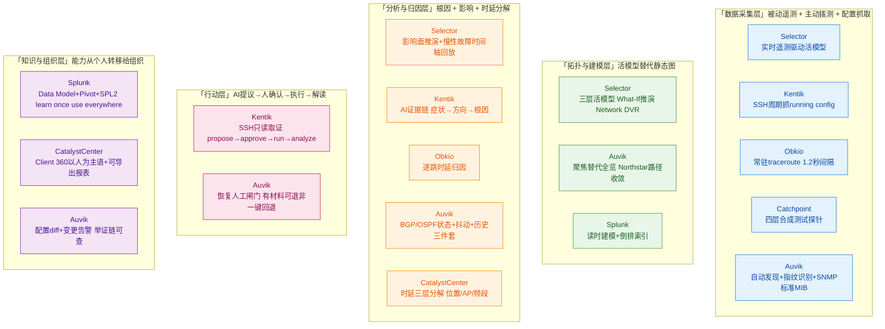

\---  
title: 2026 APM助手借鉴矩阵 - Selector到CatalystCenter 7家能力提炼  
company: [Selector, Kentik, Catchpoint, Obkio, Auvik, Splunk, Cisco Catalyst Center]  
category: 横向借鉴分析  
period: 2026  
created: 2026-10-15  
tags: [APM, AI助手, 借鉴矩阵, 网络可观测性, 多Agent, 数字孪生, 合成测试]  
source: https://ruijie.feishu.cn/wiki/If1rwKVktiYWhbkDsl8caMdpn4b  
source_doc: 2026 APM 规划（飞书wiki）  
source_sections: 1.6 - 1.12  
\---

# 2026 APM 助手借鉴矩阵 —— Selector 到 Catalyst-Center 7 家能力提炼

> **调研对象与范围**：基于《2026 APM 规划》飞书文档第 1.6 至 1.12 章节，提炼 Selector、Kentik、Catchpoint、Obkio、Auvik、Splunk、Cisco Catalyst Center 七家公司的核心能力与机制，映射到锐捷 APM 产品（技术栈 VictoriaMetrics / Loki / MySQL / Pyroscope / Redis，规划 Web 端 AI 助手：开源多 Agent 框架 + 商用大模型 API）的能力蓝图。
>
> **信源与局限**：本篇为二次提炼——原始业界分析报告已存于上级目录（Selector / Auvik×3 / Splunk / Catalyst-Center×4 / Catchpoint 各有单篇）。信源分级：A=官方 Release Notes / Changelog / 解决方案页，B=官方博客 / 新闻稿，C=飞书文档内用户自整理的借鉴视角（callout 块）。凡涉及"量级收益"均标注为参考，非第三方验证。
>
> **一条前置边界（A 级核实，贯穿全文）**：第三方一律止步 MIB 线。ARP / MAC-FDB / 路由表本身在标准 MIB 里、第三方能读，但读它们的目的是推断拓扑，而非回答"表项是否正确"；**读得到表的内容，读不到表的行为**（ACL 命中、policymap 命中率、TCAM 容量与溢出多为私有 MIB 或 CLI-only）。锐捷 APM 是原厂，能读设备内部状态机——这是对标所有第三方厂商（Kentik / Auvik / Selector 等）的护城河，也是本文判断"直接可用 / 需改造 / 受限于第三方边界"三类的基准。

---

## 读法：7 家公司按能力分层一图总览

**图例**：颜色由浅入深对应"采集→建模→分析→行动→知识"五层。锐捷 APM 的现状偏 L1（采集）+ L3 部分（指标分析），缺 L2 活模型、L4 行动闭环、L5 能力转移给组织——这三层正是 AI 助手要补的。

---

# 1.6 Selector —— Digital Twin 数字孪生 / 运营孪生【重点借鉴】

> 官方页：<https://www.selector.ai/correlation-and-rca/>  
> 口号：**用遥测驱动的活模型替代静态拓扑图**

## 1.6.1 核心能力一句话

把"网络是什么样子"从静态 Visio 图升级为**随遥测持续更新的活模型**，并在活模型上做 What-If 故障推演、容量预测、Network DVR 历史回放——回答四类靠经验答不了的问题：链路断了谁受影响、容量够不够、何时开始变坏、当时到底是什么状态。

## 1.6.2 痛点—解法映射

| #  | 客户痛点（P）                                              | Selector 解法（S）        | 机制要点                                                        |
| -- | ---------------------------------------------------- | --------------------- | ----------------------------------------------------------- |
| P1 | 静态拓扑图与过期架构图无法反映真实依赖（时间——排查前先花半天搞清拓扑）                 | S1 实时遥测驱动的活模型         | 关系图引擎以实遥测替代静态拓扑，覆盖基础设施/网络层(L2,L3)/服务层，节点与依赖边随遥测持续更新         |
| P2 | 无法回答"如果这条链路断了，谁受影响"（钱——变更风险高，新业务新配置无法在生产网试错）         | S2 What-If 推演         | 选定推演对象（链路/光路/设备/DDoS）→注入故障假设→在依赖图上跨层传导→输出受影响链路/服务/终端        |
| P3 | 容量与增长决策缺少依据（钱——靠拍脑袋扩容，过度或不足）                         | S3 AI 容量建模与预测         | 结合历史趋势与 AI 预测做容量建模，平衡成本/速度/可靠性                              |
| P4 | 慢性故障难查——问题由坏事件缓慢累积造成，传统工具看不到"何时开始变坏"（时间——查两小时看不出所以然） | S4 Network DVR 时间轴回放  | 按时间轴回放历史状态，定位拓扑何时变更、哪次配置变更错误改了链路 cost 进而切了路径，把缓慢劣化还原成可定位时间点 |
| P5 | 事故复盘缺少"当时到底是什么状态"的能力（组织——跨团队定责无共同证据）                 | S5 Network DVR 跨层历史回看 | 按时间轴回放历史遥测，跨层回看设备健康、告警与指标，还原事故当时的真实状态                       |

> ⚠️ 注意 S4 与 S5 共用 Network DVR，但回答的是两类不同问题：S4 回答"何时开始变坏"（劣化定位），S5 回答"当时是什么状态"（复盘取证）。两者不可合并写成一个解法。

## 1.6.3 对锐捷 APM 的借鉴点

| 借鉴点                             | 落地路径                                                                  | 锐捷现状 / 边界                                           |
| ------------------------------- | --------------------------------------------------------------------- | --------------------------------------------------- |
| **B1 活模型替代静态拓扑**                | APM 已有设备遥测+拓扑，可让拓扑随遥测持续更新——节点与依赖边随邻居状态/接口状态动态变化                       | 现状偏静态拓扑展示，需补"遥测驱动更新"引擎                              |
| **B2 What-If 影响面推演【AI助手高价值场景】** | 在活模型上模拟链路/设备/光路故障，输出受影响业务/终端列表——AI助手可直接回答"如果这台交换机挂了，哪些业务受影响"          | 需先有活模型(B1)作为推演底座；推演算法可走图传播                          |
| **B3 Network DVR 时间轴回放【天然契合】**  | VictoriaMetrics 已是时序库，天然支持按时间点回放指标/拓扑快照——AI助手可问"上周三下午3点这个站点的拓扑和指标是什么" | 技术栈天然契合，需补拓扑历史快照存储                                  |
| **B4 配置变更行为预测（用户已标注）**          | 基于配置的方案，做配置变更的行为预测——变更前预估影响                                           | 锐捷原厂能读完整 running config + 设备内部状态，比 Selector 第三方视角更深 |

> **边界提示**：Selector 是第三方，其"活模型"靠遥测+流量+配置推断拓扑——**能推断拓扑，但读不到设备内部表项行为**。锐捷原厂可读 ASIC/表项/协议状态机，理论上能做比 Selector 更深的"活模型"。对标基准：Arista CloudVision 官方称一台 EOS 设备流出的状态"≈ 连续输出最多 2,000 条 show 命令"。

---

# 1.7 Kentik —— AI 诊断三件套【AI助手范式直接借鉴】

> 官方页：<https://www.kentik.com/solutions/visualize-all-cloud-and-network-traffic/>  
> 口号：**把诊断本身嵌入事件上下文，缩短从症状到原因的距离**

## 1.7.1 核心能力一句话

三个能力围绕"**同一个调查线程**"串成 AI 证据链：按需连通性测试（自动 ping/traceroute）、配置上下文（SSH 抓 running config + revision diff + AI 解读）、SSH 只读取证（propose→approve→run→analyze，全程只读护栏）——结果不流向其他工具，直接回流当前调查线程。

## 1.7.2 痛点—解法映射

| #  | 客户痛点（P）                                                                               | Kentik 解法（S）                                       | 机制要点                                                                                     |
| -- | ------------------------------------------------------------------------------------- | -------------------------------------------------- | ---------------------------------------------------------------------------------------- |
| P1 | MTTR 主要被诊断阶段吃掉（检测仅12%，诊断56%，修复32%）——追求"更快检测"不如把诊断嵌入事件上下文                              | S1+S2+S3 三件套共享同一上下文                                | 三能力共用同一调查线程，采集结果不流向其他工具，直接回流当前线程，统一上下文不丢失证据链                                             |
| P2 | 症状能指方向但说不了原因——链路间歇抖动指向物理层/协议层/策略层，但缺设备状态、配置变更、实时验证证据                                  | S2 Config Context 抓配置做 revision diff + S3 SSH 只读取证 | 配置上下文给"配置层证据"，SSH 只读 show 命令给"设备状态层证据"，两者补上从"哪里不对"到"为什么不对"的缺口                            |
| P3 | Swivel-chair 式调查——告警→主机→控制台→ping/traceroute→在脑子里缝回事件上下文，每切换一次工具上下文就丢一次                | S1 On-Demand Connectivity Tests 结果回流当前线程           | AI Advisor 自动执行 ping/traceroute，从最贴近终端的观测点发起，结果不落到别处，直接成为 AI 证据链一部分                      |
| P4 | 配置是头号嫌疑犯却最难顺手查——配置工具独立部署、权限更严、几千行里找关键变更难、不熟悉厂商连配置都看不懂                                 | S2 Config Context 三步（抓取→脱敏存储→呈现+AI解读）              | SSH 周期抓 running config + secret-redacted 备份 + revision 历史 + 两版 diff + AI 自然语言解释意图指出有意义变更 |
| P5 | 最后得回到 CLI——因为"设备真相"不在仪表盘里（丢包可能是物理误码/拥塞/坏队列；BGP 可能看起来down其实up只是路由被静默过滤；接口逻辑up但光模块正在劣化） | S3 SSH Command Access propose→approve→run→analyze  | AI 提议只读 show 命令→人审核确认→设备执行→结果反馈同一调查线程；只读护栏，不触碰变更类操作                                      |

> ⚠️ P1 的解法是 S1+S2+S3 **三件套协同**，不是单一解法。写时不可把 P1 拆成三条独立解法，否则破坏"同一调查线程"这个核心机制。

## 1.7.3 对锐捷 APM 的借鉴点

| 借鉴点                                                    | 落地路径                                                                                 | 锐捷现状 / 边界                                                                                       |
| ------------------------------------------------------ | ------------------------------------------------------------------------------------ | ----------------------------------------------------------------------------------------------- |
| **B5 "同一调查线程"范式【AI助手核心架构】**                            | AI 助手的每一次工具调用结果都回流当前对话上下文，不新开窗口、不丢上下文——这是多 Agent 框架的状态管理设计基线                         | 现状无 AI 助手，需在 Agent 框架选型时把"会话状态持久化"作为硬指标                                                         |
| **B6 自动 ping/traceroute 回流证据链**                        | AI 助手识别需验证的观测点后，自动从最贴近终端的 Agent 发起 ping/traceroute，结果进入证据链                           | APM 已有探针/Agent 体系，需补"AI 调用拨测工具"的接口                                                              |
| **B7 配置上下文：周期抓 running config + diff + AI 解读【原厂护城河】**  | APM 周期 SSH/Telnet 抓锐捷设备 running config，存 revision 历史，做 diff，AI 用自然语言解释"这次变更可能解释当前现象" | **锐捷原厂能读完整 running config + 私有 MIB + CLI-only 表项行为**，比 Kentik 第三方 SSH 抓取更深——这是对标 Kentik 的差异化护城河 |
| **B8 SSH 只读取证：propose→approve→run→analyze【AI行动层最佳实践】** | AI 助手提议只读 show 命令→用户审核确认→设备执行→结果回流解读；全程只读护栏，不触碰变更类操作                                 | 这是 AI 助手"自主决策调工具"的安全范式——人工闸门防误操作，只读边界防破坏                                                        |
| **B9 整套自动化诊断流程可借鉴（用户已标注）**                             | 整个流程：症状→AI缩小方向→自动取证(拨测+配置+SSH)→证据回流→AI给根因，端到端串成一条链                                   | 这是 AI 助手的 MVP 闭环                                                                                |

> **边界提示**：Kentik 是第三方，靠 SSH 抓配置、靠标准 MIB/NetFlow 看流量——**能看到配置内容，但读不到配置变更对设备内部表项的影响**（如 ACL 命中率、policymap 命中、TCAM 溢出）。锐捷原厂可读这些私有 MIB/CLI-only 字段，理论上能做比 Kentik 更深的"配置变更→表项行为"关联分析。

---

# 1.8 Catchpoint —— 合成测试【802.1x 阶段打点重点借鉴】

> 口号：**按业务闭环而非协议端口定义测试类型**

## 1.8.1 核心能力一句话

四层探针（端口→接口→页面→交易）+ 把第三方依赖变成可独立举证的测试对象 + 把必然事故前置成例行检查 + 测试类型跟着业务协议走 + 把"可用性"与"内容完整性"拆成两个指标——让"通了不等于能用"第一次有可写进报表的数。

## 1.8.2 痛点—解法映射

| #  | 客户痛点（P）                                                                   | Catchpoint 解法（S）    | 机制要点                                                                                                                                        |
| -- | ------------------------------------------------------------------------- | ------------------- | ------------------------------------------------------------------------------------------------------------------------------------------- |
| P1 | 「通了」不等于「能用」——端口开着、Ping 通、首页返回 200，但用户登不进、下不了单、支付回调丢单（时间/钱）                | S1 按业务闭环定义四层探针      | 端口(Ping/Transport)→接口(API单步)→链式接口(API多步)→页面(Web→WebPageTest)→交易(Transaction/Playwright真实浏览器渲染点击提交)                                          |
| P2 | 故障发生在别人的地盘，自己却是最后一个知道的——DNS/CDN/云区域/第三方支付一挂，客户先骂自己（组织/时间）                 | S2 第三方依赖变成可独立举证测试对象 | DNS(直查/体验双视角)、SSL、BGP、Transport、Traceroute 对自己控制不了的那半条路单独发问，带时间戳与节点维度的证据                                                                    |
| P3 | 本可预知的确定性事故仍在生产上炸——SSL证书到期、DNS记录被误改、域名被劫持（钱/合规）                            | S3 必然事故前置成例行检查      | SSL测试校验证书链/有效期/主机名匹配，按剩余天数设阈值；DNS Direct校验应答内容是否与预期一致，发现篡改/劫持/缓存投毒；零流量确定性检查                                                                 |
| P4 | 业务已跑在新协议新形态上，监控却停在 HTTP 首页——视频起播慢、WebSocket 断连、MQTT 掉线、TCP端口通但业务不可用（钱/时间） | S4 测试类型跟着业务实际使用协议走  | Streaming Test(2026-06)在真实Chromium测HLS/DASH/MP4起播延迟与缓冲；MQTT(Agent 2.18.0 2026-09)按最新标准重写面向IoT；Node-to-Node两点内部通不通持续矩阵；Heartbeat(5秒)覆盖亚分钟级中断 |
| P5 | 「慢」和「坏」是两种事故，但工具只报其中一种——响应码200、页面能打开，内容却少了一块（钱/时间）                        | S5 可用性与内容完整性拆成两个指标  | %Availability=(运行数−错误数)/运行数；%Content Availability每个元素是否都加载成功，任一失败即计内容未可用；%Adjusted Availability剔除人工排除后用于SLA口径                               |

## 1.8.3 对锐捷 APM 的借鉴点

| 借鉴点                               | 落地路径                                                                                          | 锐捷现状 / 边界                     |
| --------------------------------- | --------------------------------------------------------------------------------------------- | ----------------------------- |
| **B10 802.1x 认证多阶段打点（用户已标注）【重点】** | 参考 Catchpoint 四层探针思路，把 802.1x 认证拆成多个阶段（关联→认证→地址→域名，见 1.12 Catalyst），每阶段都打点统计时间+分片，建立基线，超基线即异常 | APM 已有认证日志采集，需补"阶段级时间打点+基线比对" |
| **B11 网络路径合成测试**                  | APM 可做端到端连通性+时延分解的合成测试，从"端口通断"升级到"业务能否完成"                                                     | 需部署探针/Agent 体系                |
| **B12 可用性 vs 内容完整性拆分口径**          | APM 告警可借鉴"通断"vs"性能"两个口径——设备在线≠业务可用，避免"大盘全绿但用户投诉"                                              | 现状多为设备级 up/down，需补业务可用性口径     |
| **B13 确定性事故前置检查**                 | SSL证书到期、DNS记录校验等"必然会发生"的事故，做成例行检查而非被动告警                                                       | 适用于APM管理的外部服务依赖               |

---

# 1.9 Obkio —— visual Traceroute Tool【被动+主动统一数据借鉴】

> 口号：**把 traceroute 从命令变成常驻采集任务，从诊断工具升级为取证工具**

## 1.9.1 核心能力一句话

常驻 traceroute（1.2 秒间隔持续发包）+ 双向路径（两个 Agent 各自记录出向路径，验证非对称路由）+ 1 分钟聚合最长 6 个月留存 + 无需目的端 Agent（直接以 IP/主机名为目标）+ 逐跳时延归因——让"上周三下午很慢，现在好了"这种间歇性问题有历史可比对。

## 1.9.2 痛点—解法映射

| #  | 客户痛点（P）                                                        | Obkio 解法（S）    | 机制要点                                                       |
| -- | -------------------------------------------------------------- | -------------- | ---------------------------------------------------------- |
| P1 | 网络故障间歇性——传统 traceroute 事后手动执行，等你敲下命令故障已消失；即便抓到一次快照也无法证明是常态还是偶发 | S1 常驻采集任务      | 会话建立后探针以1.2秒间隔持续发包，数据恒常落库；工程师不是在复现问题而是在回看已发生的事实——这是整个工具的地基 |
| P2 | 公网路由非对称——A→B 与 B→A 走完全不同的运营商、不同物理路径，只测正向等于只看到一半画面，回程丢包完全隐形     | S2 双向路径双 Agent | 两个 Agent 各自作为探测器分别记录出向路径，云端关联到同一会话，界面可切换查看反向路径             |
| P3 | 传统工具快照式——故障一旦过去证据永久丢失，用户典型抱怨"上周三下午很慢，现在好了"                     | S3 1分钟聚合+6个月留存 | 把 traceroute 从诊断工具升级为取证工具，可用于形成对 ISP 的申诉证据                 |
| P4 | 服务器、打印机、SaaS、IoT 设备上无法安装探针，但恰恰是用户感知最强的目标                       | S4 无需目的端 Agent | 直接以 IP/主机名作为探测目标，由源 Agent 发起连续 ICMP 监控，复用同一套可视化与关联能力       |

## 1.9.3 对锐捷 APM 的借鉴点

| 借鉴点                                | 落地路径                                                                           | 锐捷现状 / 边界                |
| ---------------------------------- | ------------------------------------------------------------------------------ | ------------------------ |
| **B14 被动遥测 + 主动拨测统一数据（用户已标注）【重点】** | 分析前提是要有跨多个源的遥测数据——APM 应把网络遥测（被动 SNMP/流）纳入分析，与主动拨测（ping/traceroute）统一到同一数据面再做分析 | 现状偏被动采集，需补主动拨测数据源并统一时序对齐 |
| **B15 常驻 traceroute 取证**           | 把 traceroute 从"诊断命令"升级为"常驻采集任务"，持续记录路径变化——AI 助手可问"上周三这个路径走哪几跳、何时开始变慢"          | VictoriaMetrics 天然支持时序回放 |
| **B16 逐跳时延归因**                     | 逐跳累计 RTT 相减，定位哪一跳贡献了多少时延（如第2跳贡献84%总时延，根因锁定 ISP 汇聚设备）                           | APM 可做交换机间逐跳时延分解         |
| **B17 双向路径验证非对称**                  | 正反向路径分别记录，验证非对称路由导致的回程丢包隐形                                                     | 适用于多出口/跨域场景              |

---

# 1.10 Auvik —— 三个功能（自动发现 / 远程配置 / 路由协议监控）【拓扑是第一步】

> 口号：**识别精度直接决定下游所有能力的正确性**

## 1.10.1 核心能力一句话

三个功能：（1）自动发现+指纹识别+连接关系推断，用"聚焦"替代"全览"；（2）配置留痕——变更触发备份+永久版本+diff+变更告警+API优先+备份状态可见+恢复人工闸门；（3）路由协议层监控——标准 BGP4-MIB/OSPF-MIB 变成产品级表格 + 状态/抖动/历史三件套 + 5 告警维度 + 统一 Debug 入口。

## 1.10.2 痛点—解法映射（三个子功能分别列表）

### 子功能 A：自动发现与拓扑可视化

| #  | 客户痛点（P）                                                  | Auvik 解法（S）    | 机制要点                                                                                               |
| -- | -------------------------------------------------------- | -------------- | -------------------------------------------------------------------------------------------------- |
| P1 | 接手一个网络等于接手一个黑盒——设计文档与实际环境偏差持续扩大，变更不留痕，IT 人员流动让知识流失（时间/钱） | S1 自动发现+指纹识别引擎 | 采集器自动扫描发现设备→指纹库识别厂商/型号/角色→推断连接关系；识别覆盖度是长期护城河，4年 release notes 占比最高条目始终是新增识别厂商型号                    |
| P2 | 图太全反而没用——500台设备全网拓扑是蜘蛛网，工程师遇到的具体问题是"A楼的人访问不了ERP"（时间）     | S2 用聚焦替代全览     | 搜索结果面板+选中聚焦缩放(2024-02)、Northstar收敛成一条路径、地图选中即同步双向联动、地理地图记住缩放级别(2024-11)；产品判断：用户要的不是更多信息而是更少但更相关的信息 |

> ⚠️ Auvik 对"物理多台、逻辑一台"的堆叠场景专门投入识别——因为堆叠若被当成多台设备会同时污染三样东西：资产数量（计费）、告警（重复）、拓扑（连接关系错乱）。锐捷 APM 若做自动发现，堆叠识别是必选项。

### 子功能 B：远程配置与一键自动化（配置留痕）

| #  | 客户痛点（P）                                                                  | Auvik 解法（S）       | 机制要点                                                                                                     |
| -- | ------------------------------------------------------------------------ | ----------------- | -------------------------------------------------------------------------------------------------------- |
| P1 | 改坏了手里没有"上一版"可退——配置被误改/被覆盖/升级后异常，想退回上一个 known good 状态只能凭记忆重敲，恢复以小时计（时间/钱） | S1 变更检测触发备份+永久版本  | 系统持续轮询配置变更，检测到变更后指定间隔(默认60分钟)执行新备份；备份永久保留，只有设备从Auvik删除时才移除；旧版本写进版本索引不被覆盖                                 |
| P2 | 故障时默认"什么都没变"于是查错方向全偏——没人确知配置是否被动过，工程师查链路/终端/应用唯独不查配置，排查时间成倍拉长（时间）        | S2 差异对比+变更告警      | diff三色高亮删了什么/加了什么/缺口，可对比任意两个版本不限相邻；Configuration Backup告警在检测到变更并完成备份后触发                                  |
| P3 | "谁在什么时候改了什么"拿不出证据——审计或跨团队定责时需要变更时间点与前后差异，没它只能各说各话，举证链是断的（合规/组织）          | S2 同上             | 差异本身就是证据                                                                                                 |
| P4 | 设备换机或HA切换后备份挂在错误的设备名下——真需要恢复时拿到一份不知道属于谁的配置，备份存在但不可用（时间/钱）                | S3 API优先通道+设备身份绑定 | 2025-08起FortiGate备份默认优先走FortiOS REST API；UI用图标区分CLI与API凭据状态；HA处理：备机保留在inventory与topology，目的是防止其关联的配置备份丢失 |
| P5 | 厂商换了认证方式备份悄悄停了没人知道——新固件不再支持旧API认证方式后备份静默失效，直到需要恢复才发现最近那一版根本不存在（时间）       | S4 备份状态可见         | 设备仪表盘与Documentation→Configurations都有凭据状态/备份状态/最后成功登录与备份时间；FortiGate场景有"钥匙图标=凭据有效但没有API备份"中间态             |

> ⚠️ S5 把恢复设计成人工闸门——Auvik 不会自动把配置推回设备，恢复是"human-in-the-loop process"。"可回退"的真实含义是"有材料可退"而不是"一键回退"。锐捷 APM 若做配置留痕，需明确这个边界——是否做一键回退是产品取舍。

### 子功能 C：路由协议层监控

| #  | 客户痛点（P）                                                                                                   | Auvik 解法（S）                 | 机制要点                                                                                                                                             |
| -- | --------------------------------------------------------------------------------------------------------- | --------------------------- | ------------------------------------------------------------------------------------------------------------------------------------------------ |
| P1 | 设备全在线、接口全 up、CPU 正常，但某些网段就是不可达——BGP/OSPF 邻居中断既不导致设备离线也不导致接口 down，只改变路由去向，落在 up/down 监控视野之外（时间）            | S1 标准MIB变成产品级表格             | 设备只要通过SNMP暴露标准BGP4-MIB/OSPF-MIB，Auvik自动发现邻居并填充邻居表，无需用户写任何解析规则                                                                                    |
| P2 | 「邻居现在是好的」与「邻居一直是好的」是两个结论，只有前一个看得见——敲show ip bgp summary看到Established无法判断是不是10分钟前刚抖过，无法区分偶发与持续恶化（结论不可信/时间） | S2 状态+抖动+历史三件套              | 状态(当前Established/Idle)+抖动(15分钟窗口状态变化计数)+历史(30天可查)；没有历史工程师无法区分偶发与恶化——这是P2的唯一解                                                                     |
| P3 | 排路由故障高度依赖专家经验而专家只有一个——看懂邻居表、判断抖动还是中断、推断路由收敛到哪里需要经验，能力绑在个人身上（人）                                            | S3 专家经验固化成5个告警维度            | BGP:State/IP/Admin State/State Change(15min)/Connection Uptime；OSPF:State/IP/State Change Count+预配置告警"OSPF Neighbor is Down"(Warning级≠Full延迟5分钟) |
| P4 | 多出口/自建广域网场景下出口切换不可知——主出口劣化流量切到备用出口，业务还在跑但质量已变，监控体系一句话不说，等用户投诉才发现切换发生在几小时前（钱/时间）                           | S3 Connection Uptime作切换检测抓手 | uptime突然变小=会话重建过=发生过切换或中断                                                                                                                        |
| P5 | 协议监控与排障入口分散，跨协议对照要来回跳——BGP和OSPF分属两套命令两个地方，想做同一站点同一时刻两条协议都发生了什么的对照只能人肉拼（时间）                                | S4 统一入口跨协议对照                | BGP与OSPF监控都落在Debug>Routes(站点级Site→Debug→All Routes、设备级Device→Debug→Routes)，共享$routeNeighbours.*变量命名与同一套时间聚合/过滤方式                                 |

> ⚠️ S5 把"设备没响应"的排查路径写进文档——官方给出可执行验证命令 `snmpwalk … 1.3.6.1.2.1.15`，并明确需核对 SNMP 凭据与 ACL。这条看似不起眼的排查清单，实际是协议监控能不能落地的关键——绝大多数"没有数据"不是功能问题而是设备侧 MIB 未开或 ACL 未放行。

## 1.10.3 对锐捷 APM 的借鉴点

| 借鉴点                                  | 落地路径                                                                                                    | 锐捷现状 / 边界                                           |
| ------------------------------------ | ------------------------------------------------------------------------------------------------------- | --------------------------------------------------- |
| **B18 网络拓扑是第一步（用户已标注）【拓扑基座】**        | 构建网络拓扑，在拓扑上直接做批量配置下发/配置自动化；基于拓扑识别 BGP/OSPF 路由抖动                                                         | APM 已有拓扑展示，需补"拓扑上可操作"能力                             |
| **B19 配置留痕：变更触发备份+diff+告警【原厂可做得更深】** | APM 周期抓 running config，变更触发新备份+永久版本+diff+变更告警；举证链可查                                                     | 锐捷原厂能读完整配置+私有MIB+CLI-only表项行为，比Auvik第三方SNMP MIB视角更深 |
| **B20 路由协议监控：状态+抖动+历史三件套【天然契合VM】**   | BGP/OSPF 邻居状态(当前)+抖动(15分钟窗口计数)+历史(30天)——VictoriaMetrics 天然支持时序存储与回放                                     | APM 已有 VM，需补协议邻居状态采集                                |
| **B21 统一入口跨协议对照**                    | BGP/OSPF 监控落同一 Debug 入口，共享变量命名与时间聚合——AI 助手可跨协议同时间轴对照                                                    | AI 助手天然是统一入口，可借鉴                                    |
| **B22 堆叠识别必选**                       | 物理多台逻辑一台的堆叠若被当成多台会污染资产/告警/拓扑三样                                                                          | 锐捷原厂识别自家堆叠无障碍                                       |
| **B23 "第三方止步MIB线"边界（A 级核实）**         | Auvik 用标准 BGP4-MIB/OSPF-MIB 读邻居状态——这是"第三方能读标准MIB"的典型，但读不到 ACL 命中、policymap 命中率、TCAM 溢出等私有MIB/CLI-only字段 | **锐捷原厂能读设备内部状态机——这是对标Auvik所有第三方的差异化护城河**            |

---

# 1.11 Splunk —— 机器数据平台主干与查询语言【读时建模+能力转移借鉴】

> 口号：**先把机器数据变成可检索的资产，再把资产变成服务级认知，再把认知铺到全栈与体验，最后把认知接上行动与 AI**

## 1.11.1 核心能力一句话

原始事件统一入库 + 读时建模（schema-on-read，字段在搜索时提取不做成列）+ 倒排索引（tsidx）加速检索 + Data Model/Pivot 把搜索逻辑抽象成语义数据模型让非 SPL 用户拖拽出报告 + Dashboard Studio 承接展示分发 + SPL2 扩展为一门同时用于搜索索引/访问联邦数据/流式数据准备的语言（"learn once, use everywhere"）。

## 1.11.2 痛点—解法映射

| #  | 客户痛点（P）                                                                                                                                  | Splunk 解法（S）          | 机制要点                                                                                                                                                                                                                   |
| -- | ---------------------------------------------------------------------------------------------------------------------------------------- | --------------------- | ---------------------------------------------------------------------------------------------------------------------------------------------------------------------------------------------------------------------- |
| P1 | 故障证据既分散又"不可预设"——证据散在几十台机器几十种格式里，时间戳口径不一致，凑齐一次全貌耗掉大半定位时间；传统工具在建库那一刻就把要分析的字段定死了，没被预设的字段入库时就被丢弃，而排障本质是事后提出当初没人想到的问题，结果不是分析错了是证据没了（时间/结论不可信） | S1 原始事件统一入库+读时建模+倒排索引 | 数据先按原始事件入库不做成列；字段通过props.conf/transforms.conf在搜索时提取（读时建模）；事件写入index后按时间roll成bucket，用tsidx倒排索引加速检索；7.2引入tsidxWritingLevel分级、9.0默认级别2→3按需权衡索引速度/存储/检索——这是P1的唯一解也是Splunk全部下游能力的共同地基                                       |
| P2 | 查询能力只属于少数专家而且沉淀不下来——会写查询的老手是团队里唯一的知识库，他一休假值班的人就只剩"重启和回滚"两招；老手脑子里那套查法没法变成别人点两下就能用的视图；同一个逻辑还要在检索和数据准备两个地方各写一遍，学一次用不到别处（人）                  | S2 把查询能力从个人转移给组织      | Data Model+Pivot(6.0)把搜索逻辑抽象成语义数据模型支持加速摘要，非SPL用户拖拽即可出报告视图可共享复用；Dashboard Studio(8.2进Enterprise)承接展示与分发；SPL2扩展为一门同时用于搜索索引/访问联邦数据/流式数据准备的语言，新增可复用module概念；SPL2三段演进是刻意的：2023先在管道落地→2024-12开放API/VS Code应用开发→2026-01才进入搜索栏 |

## 1.11.3 对锐捷 APM 的借鉴点

| 借鉴点                                           | 落地路径                                                                                      | 锐捷现状 / 边界                                |
| --------------------------------------------- | ----------------------------------------------------------------------------------------- | ---------------------------------------- |
| **B24 读时建模（schema-on-read）【Loki天然契合】**        | Loki 就是这套——日志入库不做列，查询时用 LogQL 提取字段；保留原始事件，事后用任何新视角重新切                                     | APM 已用 Loki，天然契合 Splunk 读时建模             |
| **B25 查询能力从个人转移给组织【AI助手核心价值】**                | Data Model+Pivot 让非 SPL 用户拖拽出报告——AI 助手可让非专家也能"问"出答案，自然语言→查询→结果，把老手的查法变成全员可用的资产            | **这是 AI 助手的核心价值主张——降低查询门槛，让查询能力不绑在个人身上** |
| **B26 SPL2"learn once use everywhere"统一查询语言** | APM 可统一查询语言跨 VictoriaMetrics（MetricsQL）/Loki（LogQL）/MySQL（SQL）/Pyroscope，让 AI 助手用一套语义跨数据源 | 现状多套查询语言，AI 助手需做语义统一层                    |
| **B27 原始事件统一入库不预设字段**                         | APM 采集的设备日志/告警/配置变更等原始事件统一入库，不做成列，事后可任意切——避免"入库时丢字段"                                      | Loki 契合，MySQL 部分需调整                      |

---

# 1.12 Catalyst-Center —— Assurance 端到端体验可观测 + 无线客户端体验量化【以人为主语+阶段漏斗借鉴】

> 口号：**排查入口从"哪台设备报警了"变成"是哪个人不好受"**

## 1.12.1 核心能力一句话

两个功能：（1）Assurance 端到端体验可观测——Client 360（连接旅程+事件时间线+RF 环境三块并一页）+ 四阶段漏斗（关联→认证→地址→域名，某步失败直接显示停在哪）+ 认证证据搬进 Assurance + AAA/DHCP 健康集中 + Per-SSID 过滤 + 新终端健康口径；（2）无线客户端体验量化——Client Health 分区全局概览 + Client 360（MAC 检索单客户端）+ Per-SSID Filtering + 时延三层分解（位置/AP/频段）+ Wi-Fi 7/MLO 支持 + 可导出报表。

## 1.12.2 痛点—解法映射（两个子功能分别列表）

### 子功能 A：Assurance 端到端体验可观测

| #  | 客户痛点（P）                                                                        | Catalyst 解法（S）            | 机制要点                                                                                                                               |
| -- | ------------------------------------------------------------------------------ | ------------------------- | ---------------------------------------------------------------------------------------------------------------------------------- |
| P1 | 用户只会说"网慢"或"连不上"——报障信息停在"某栋楼、某个人、某个时段"，排查要从终端问到交换机每步先确认"不是这里的问题"（时间/人）          | S1 以客户端为主语的360视图          | Client 360把连接旅程/事件时间线/RF环境三块并到一页：从"这个终端什么时候上线的、在哪几个AP之间漫游过、信号有多好"一路看到"它现在在用什么应用"；排查入口从"哪台设备报警了"变成"是哪个人不好受"                         |
| P2 | 「卡在哪一步」说不出来——是没关联上、认证没过、还是没拿到地址？上线是四步串行过程，任一步失败表现都是"连不上"，不拆开只能反复试（时间）          | S2 四阶段漏斗钉"卡在哪"            | 上线拆成关联→认证→地址→域名四步；某一步失败时Assurance直接显示上线过程停在哪一步；一步定位取代四步轮询——这是降低时间成本最直接的一处                                                          |
| P3 | 认证类故障要在两个系统之间来回跑——失败原因在认证系统里，工程师要么登录认证平台看实时日志抄下时间点再回网管对日志，取证动作本身就在消耗排障时间（时间/人） | S3 把认证证据搬进Assurance       | 3.1.3起可在Client面板/Client 360/Issues and Events的Events标签/Network Services的AAA标签直接看到认证失败详情，无需登录认证系统界面；把跨系统取证压缩成同屏可见——这是本组对时间成本贡献最大的一条 |
| P4 | 同一个 SSID 里非关键流量盖住关键业务——监督大屏被访客网络的数据刷屏，真正要盯的生产 SSID 淹没在里面（时间）                   | S5 用过滤器把噪声移出统计            | Per-SSID filtering让监督与排障只聚焦业务关键无线网络；客户端排除清单可按MAC把已知非关键/测试终端排除；"看得少"有时就是"看得清"                                                       |
| P5 | 新制式终端没有基线可比——Wi-Fi 7/MLO 客户端进来后健康分与图表看不懂是设备问题还是终端太新（时间）                        | S6 给新终端补上健康口径             | MLO客户端(2.3.7.9)与Wi-Fi 7客户端健康(2.3.7.10)陆续补齐；规律：终端制式换代时"能不能看见"要先于"能不能优化"                                                             |
| P6 | 认证与地址服务慢，锅最后甩给网络——AAA或DHCP是外部系统，但用户感知到的只有"网连不上"，没有一份双方都认的证据跨团队定责就变成立场之争（组织）    | S3+S4 认证证据搬进+AAA/DHCP健康集中 | S3把认证证据搬进Assurance；S4无线网络服务分析把AAA与DHCP健康放进一个视图并显示受影响的服务器/站点/用户——关键是"受影响的是谁"这一列把"服务慢了"从抽象指标变成受影响名单                                  |

> ⚠️ P6 的解法是 S3+S4 协同（认证证据搬进 + AAA/DHCP 健康集中），不是单一解法。S3 解 P3、P6，S4 解 P6——写时不可把 P6 拆给单一 S，否则破坏"跨团队定责需双方都认的证据"这个核心。

### 子功能 B：无线客户端体验量化

| #  | 客户痛点（P）                                                                         | Catalyst 解法（S）    | 机制要点                                                                                                                                                                                                                         |
| -- | ------------------------------------------------------------------------------- | ----------------- | ---------------------------------------------------------------------------------------------------------------------------------------------------------------------------------------------------------------------------- |
| P1 | 用户说"网慢"但拿不出这是不是无线侧的锅——业务侧投诉混着无线/有线/应用/终端四类原因，无线团队既无法自证清白也无法证明问题确实在自己这边（时间/组织）   | S1 把无线体验拆成一组可查的指标 | Client Health分区给出所有站点无线客户端统计全局概览：入网性能/RSSI/SNR/漫游活动/按SSID与按radio的分布/数据速率/物理连接状态，可按站点过滤查看最长30天历史趋势；让无线团队结论有统一口径——"你说慢"被翻译成"该站点该SSID的入网性能与RSSI分布如何"                                                                            |
| P2 | 单个客户端的间歇性问题无从查起——一个人偶尔连不上偶尔掉线，没有账号维度的连续记录只能等它再犯（时间/人）                           | S2 以客户端为中心的视图做齐   | Client 360以客户端MAC为检索键展示严格限定于该单个客户端的详细统计：入网历史/连接事件/RF指标/会话详情；与第1组的抓包能力共用同一数据面(Onboarding抓包即按5秒采样采集客户端RF统计)，"看到异常"与"抓出证据"是同一条链路上两步                                                                                             |
| P3 | 海量 SSID 里业务关键网络的问题被噪声淹没——企业普遍并存多个SSID(办公/访客/IoT/生产)，排障时最有价值的业务网络反而被淹没在无关数据里（时间） | S3 让业务维度成为第一筛选条件  | Per-SSID Filtering(2.3.7)允许排除指定SSID数据，官方口径"在大型无线网络中滤掉噪声、聚焦业务关键网络从而缩短问题解决时间"；配套Top Clients with Tx drops per SSID把关注点直接落到"哪个SSID下哪些客户端发送失败最多"；这条不改数据只改视角                                                                      |
| P4 | 客户端时延的来源分不清——用户体感慢，但到底是楼层位置差、某台AP异常、还是某个频段拥塞，没有可拆解的依据只能靠逐个变量试（时间）               | S4 把时延拆到可归因的粒度    | Wireless Client Latency Insights(2.3.7)把客户端时延按位置/接入点/频段三层分解，官方表述"容易知道问题在哪、影响是什么、如何应对"；AP 360的RF tab另提供wireless latency by client distribution；三层拆解：位置维指向覆盖(→第4组)、AP维指向单设备或射频参数(→第3组)、频段维指向频谱与信道规划(→第2组)——这条是把前三组结论汇总成交付物的那一层 |
| P5 | Wi-Fi 7 客户端上线后没有对应的健康视图——新终端持续入场，如果平台不随之扩展新的问题类型就落在监控盲区里（时间）                    | S5 把新终端形态及时纳入监控   | 2.3.7.10起Client Health Dashboard支持Wi-Fi 7客户端；MLO(Multiple Link Operation)客户端可跨2.4GHz/5GHz/6GHz连接；含义：客户端健康分与统计口径必须随PHY代际更新——Wi-Fi 7的多链路特性会让"单频段RSSI"这类传统指标的解释力下降                                                              |
| P6 | 无线体验的好坏没法向上汇报也拿不出可导出的数据——管理层要看趋势与证据，排障界面的截图说服力有限，缺少可定期产出的报表（组织）                 | S6 把体验变成可导出的报表    | AP Ethernet Interface报表实体(3.2.2)可生成含TX Errors/RX Errors/TX Utilization/AP Name/AP MAC的报表(覆盖过去30天)；Client报表与Flexible报表可生成最长过去180天的数据；价值在于"可交付性"——排障结论从截图变成可定期产出的报表                                                            |

## 1.12.3 对锐捷 APM 的借鉴点

| 借鉴点                                | 落地路径                                                     | 锐捷现状 / 边界                          |
| ---------------------------------- | -------------------------------------------------------- | ---------------------------------- |
| **B28 以客户端/用户为主语的360视图【AI助手入口范式】** | 从"哪台设备报警了"变成"哪个人不好受"——AI 助手的入口可设计为"用户/客户端维度提问"，而非设备维度    | 现状偏设备维度，需补用户/客户端维度视图               |
| **B29 四阶段漏斗钉"卡在哪一步"【接入旅程打点】**      | 无线/接入旅程拆成关联→认证→地址→域名四步，某步失败直接显示停在哪——AI 助手可回答"这个用户卡在认证阶段" | 与 B10(802.1x阶段打点)联动，APM 可做接入旅程阶段打点 |
| **B30 认证证据搬进同一视图【跨系统取证压缩】**        | 把认证系统证据搬进 APM 主视图，跨系统取证压缩成同屏可见——AI 助手可一次问全认证+网络两边证据      | 需打通认证系统与APM数据面                     |
| **B31 时延三层分解（位置/AP/频段）**           | 把时延拆到可归因粒度——位置维指向覆盖、AP维指向单设备、频段维指向频谱，三层归因                | 适用于无线场景，需采集RF指标                    |
| **B32 可导出报表：排障结论从截图变成可定期产出**       | AI 助手的分析结论可导出为可定期产出的报表，交付管理层                             | 现状多为界面截图，需补报表导出能力                  |
| **B33 新终端形态及时纳入监控**                | 终端制式换代时"能不能看见"要先于"能不能优化"——Wi-Fi 7/MLO 等新终端上线后需及时补健康口径    | 适用于锐捷无线产品线                         |

---

# 汇总借鉴矩阵：22+11+6+4+6+4+6 = 33 个借鉴点按 APM 能力域归集

> 下表把上述 B1–B33 借鉴点按"APM 能力域"重新归集，标注落地优先级（P0=AI助手MVP必做 / P1=高价值 / P2=中长期）与锐捷原厂优势。

| APM 能力域     | 借鉴点编号 | 借鉴点                                 | 来源         | 优先级     | 锐捷原厂优势                                  |
| ----------- | ----- | ----------------------------------- | ---------- | ------- | --------------------------------------- |
| **拓扑与活模型**  | B1    | 活模型替代静态拓扑                           | Selector   | P1      | 原厂可读设备内部表项行为                            |
|             | B2    | What-If 影响面推演                       | Selector   | P1      | —                                       |
|             | B3    | Network DVR 时间轴回放                   | Selector   | P1      | VictoriaMetrics 天然契合                    |
|             | B18   | 网络拓扑是第一步（拓扑上可操作）                    | Auvik      | P0      | 原厂识别自家堆叠无障碍                             |
| **AI 行动层**  | B5    | "同一调查线程"范式                          | Kentik     | P0      | Agent 框架状态管理硬指标                         |
|             | B6    | 自动 ping/traceroute 回流证据链            | Kentik     | P0      | 已有探针体系                                  |
|             | B7    | 配置上下文：周期抓 config+diff+AI解读          | Kentik     | P0      | **原厂能读完整config+私有MIB+CLI-only表项行为，护城河** |
|             | B8    | SSH只读取证 propose→approve→run→analyze | Kentik     | P0      | 原厂可读更深                                  |
|             | B9    | 整套自动化诊断流程                           | Kentik     | P0      | MVP 闭环                                  |
| **合成测试与拨测** | B10   | 802.1x 认证多阶段打点                      | Catchpoint | P0      | 已有认证日志采集                                |
|             | B11   | 网络路径合成测试                            | Catchpoint | P1      | 需探针体系                                   |
|             | B12   | 可用性 vs 内容完整性拆分口径                    | Catchpoint | P1      | 需补业务可用性口径                               |
|             | B13   | 确定性事故前置检查                           | Catchpoint | P2      | 适用于外部服务依赖                               |
|             | B14   | 被动遥测+主动拨测统一数据                       | Obkio      | P1      | 现状偏被动采集                                 |
|             | B15   | 常驻 traceroute 取证                    | Obkio      | P1      | VM 天然支持时序回放                             |
|             | B16   | 逐跳时延归因                              | Obkio      | P1      | 可做交换机间逐跳分解                              |
|             | B17   | 双向路径验证非对称                           | Obkio      | P2      | 适用于多出口/跨域                               |
| **配置留痕**    | B19   | 配置留痕：变更触发备份+diff+告警                 | Auvik      | P1      | 原厂可做得更深                                 |
|             | B22   | 堆叠识别必选                              | Auvik      | P1      | 原厂识别自家堆叠无障碍                             |
| **协议监控**    | B20   | 路由协议：状态+抖动+历史三件套                    | Auvik      | P1      | VM 天然支持                                 |
|             | B21   | 统一入口跨协议对照                           | Auvik      | P1      | AI 助手天然是统一入口                            |
|             | B23   | "第三方止步MIB线"边界                       | Auvik      | —（边界基线） | **原厂能读设备内部状态机，对标所有第三方的护城河**             |
| **查询与知识转移** | B24   | 读时建模（schema-on-read）                | Splunk     | —（已契合）  | Loki 天然契合                               |
|             | B25   | 查询能力从个人转移给组织                        | Splunk     | P0      | **AI 助手核心价值主张**                         |
|             | B26   | 统一查询语言跨数据源                          | Splunk     | P1      | 现状多套查询语言                                |
|             | B27   | 原始事件统一入库不预设字段                       | Splunk     | —（已契合）  | Loki 契合                                 |
| **体验可观测**   | B28   | 以客户端/用户为主语360视图                     | Catalyst   | P1      | 现状偏设备维度                                 |
|             | B29   | 四阶段漏斗钉"卡在哪一步"                       | Catalyst   | P0      | 与B10联动                                  |
|             | B30   | 认证证据搬进同一视图                          | Catalyst   | P1      | 需打通认证系统                                 |
|             | B31   | 时延三层分解（位置/AP/频段）                    | Catalyst   | P2      | 适用于无线场景                                 |
|             | B32   | 可导出报表                               | Catalyst   | P2      | 需补报表导出                                  |
|             | B33   | 新终端形态及时纳入监控                         | Catalyst   | P2      | 适用于无线产品线                                |
|             | B4    | 配置变更行为预测                            | Selector   | P2      | 原厂能读更深                                  |

# 关键边界与风险提示

## 1. 第三方一律止步 MIB 线（A 级核实）

贯穿全文的边界结论：ARP/MAC-FDB/路由表本身在标准 MIB 里、第三方能读，但读它们的目的是**推断拓扑**而非回答"表项是否正确"。**读得到表的内容，读不到表的行为**（ACL 命中、policymap 命中率、TCAM 容量与溢出多为私有 MIB 或 CLI-only）。

- Auvik 用标准 BGP4-MIB/OSPF-MIB 读邻居状态——能读到邻居表内容，读不到邻居表行为
- Kentik 靠 SSH 抓 running config——能看到配置内容，读不到配置变更对设备内部表项的影响
- Selector 靠遥测+流量+配置推断拓扑——能推断拓扑，读不到设备内部状态机

**锐捷 APM 是原厂**，能读 ASIC/表项/协议状态机/core dump——这是对标所有第三方厂商的护城河，也是判断"直接可用/需改造/受限于第三方边界"三类的基准。Arista CloudVision 官方称一台 EOS 设备流出的状态"≈ 连续输出最多 2,000 条 show 命令"——这是原厂对标的基准线。

## 2. 痛点—解法编号必须一一对应（写作纪律）

本文每家公司均按 P1…Pn ↔ S1…Sn 一一对应，凡 S 共解多 P 的均显式标注（如 Catalyst 子功能 A 的 S3 解 P3+P6、S4 解 P6；Kentik 的 S1+S2+S3 共解 P1）。不允许悬空痛点或悬空解法。

## 3. "可回退"的诚实标注

Auvik S5 明确不会自动把配置推回设备，恢复是 human-in-the-loop process——"可回退"的真实含义是"有材料可退"而不是"一键回退"。锐捷 APM 若做配置留痕，需在产品取舍时明确这个边界。

---

# 附录：本文借鉴点索引（按公司）

| 公司         | 借鉴点编号                   | 核心借鉴一句话                                  |
| ---------- | ----------------------- | ---------------------------------------- |
| Selector   | B1/B2/B3/B4             | 活模型+What-If推演+Network DVR回放+配置变更行为预测     |
| Kentik     | B5/B6/B7/B8/B9          | 同一调查线程+自动拨测回流+配置上下文+SSH只读取证+整套自动化诊断      |
| Catchpoint | B10/B11/B12/B13         | 802.1x阶段打点+网络路径合成测试+可用性vs内容完整性+确定性事故前置   |
| Obkio      | B14/B15/B16/B17         | 被动+主动统一数据+常驻traceroute取证+逐跳时延归因+双向路径     |
| Auvik      | B18/B19/B20/B21/B22/B23 | 拓扑是第一步+配置留痕+协议三件套+统一入口+堆叠识别+第三方止步MIB边界   |
| Splunk     | B24/B25/B26/B27         | 读时建模+查询能力转移给组织+统一查询语言+原始事件不预设字段          |
| Catalyst   | B28/B29/B30/B31/B32/B33 | 以人为主语360+四阶段漏斗+认证证据搬进+时延三层分解+可导出报表+新终端纳入 |

> 原始业界分析报告（单篇深度版）已存于上级目录：`Selector-2023-2026-功能体系与痛点解法.md`、`Auvik-2023-2026-*.md`（3篇）、`Splunk-2013-2026-功能体系与痛点解法.md`、`Catalyst-Center-2023-2026-*.md`（4篇）、`Catchpoint-2009-2026-合成测试功能体系与痛点解法.md`。Kentik 与 Obkik 暂无单篇，可后续补。
