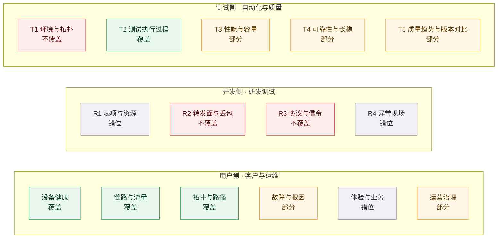
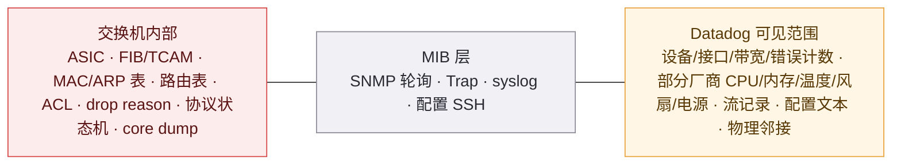

# Datadog 三侧能力映射（用户侧 · 开发侧 · 测试侧）

> **这份文档回答三个问题**：① 在你那张三侧全景图的每一个面上，Datadog 提供了什么？② 这些功能是为了解决什么问题（**只从客户侧描述**）？③ 它怎么解决的？
> **读法**：先看 §0 的判定口径 → §1 覆盖度总表 → 按侧翻 §2 / §3 / §4 → §5 结论：能力地图与空白区 → 附录四件套。

---

## 0 信源、局限与判定口径

### 0.1 信源分级

| 等级 | 定义 | 本次典型来源 |
| --- | --- | --- |
| **A** | 官方文档 / 官方 Release Notes / 官方仓库源文件 / 官方定价页 | docs.datadoghq.com、DataDog/integrations-core 的 profile 源文件、datadoghq.com/pricing |
| **B** | 官方博客 / 官方新闻稿 / 投资者关系 / DASH 大会 | datadoghq.com/blog、investors.datadoghq.com、DASH keynote roundup |
| **C** | 第三方媒体 / 分析机构 / 评测平台 / 竞品技术分析 | Kentik 竞品分析页、SpendHound、TechTarget、Zacks |

### 0.2 本节口径（务必先读，否则会误读后面的 P 编号）

1. **痛点只写客户侧可感知的痛**：时间（定位/恢复慢、人力被占）、钱（营收损失、账单、SLA 罚金）、人（能力绑在个人身上）、合规（审计与举证）、组织（跨团队扯皮、无共享证据）。**不写架构层技术问题**——「MIB 覆盖不全」「表项架构不同」这类是设计约束，只出现在「它做不到什么」里，不作为客户痛点。
2. **P ↔ S 编号一一对应**：本节每个面的痛点编号 **P1…Pn**，解法编号 **S1…Sn**，数量相等，每条解法标注「→ 解 Pn」。**不允许悬空**。
3. **Datadog 没解决的那部分痛，不编号**，统一放在每个面最后的「**空白区**」里。这样做的原因：这份映射的核心价值之一是**找到 Datadog 覆盖不到的地方**，但那部分痛如果不单列，会破坏 P/S 闭环校验。
4. **覆盖度四档判定**：
   - **覆盖**：该面客户的核心诉求，Datadog 有直接对应的产品能力。
   - **部分覆盖**：核心诉求能被部分满足，但有明确的能力或数据断点。
   - **错位覆盖**：Datadog 有很强的能力，但**对象不是这个面**（例如用"应用进程内存"回答"设备表项水位"）。
   - **不覆盖**：在官方文档、官方博客、官方仓库中**未检索到任何对应能力**。凡"未覆盖"均标注检测关键词，可复核。

### 0.3 资料局限（必须随结论一起读）

1. **网络直连受限**：本次采集环境对本机的 curl / PowerShell / python 对外连接全部阻断，全部资料经内置检索工具获取，无法自行下载页面做版本比对。
2. **Datadog 官方文档页几乎不标注"上线日期"**，大量日期是「最低 Agent 版本门槛」或「官方博客/DASH 公告日」的逼近值。每条已尽量注明日期类型；带「待核实」的不得当定论引用。
3. **定价为 2026-10-14 快照**，且官方英文页只渲染按需价，年付/月付价取自官方日文价目表与第三方，三处存在冲突，已在 §附四 并列判定。
4. **"未见"不等于"没有"**：凡标「未发现官方能力」，指在 Datadog 官方文档/官方仓库中未检索到；用户侧理论上可通过自定义 SNMP profile、自定义 MIB、日志解析自行实现。
5. **A/B 级均为厂商自述**，未经独立第三方验证。Datadog 不披露分产品收入，任何"Observability 占比"类数字均为口径外推算。
6. **Datadog 改名极其频繁**（见 §附二），引用旧资料必须先换算，否则会把同一能力当成两个产品。

---

## 1 覆盖度总表：15 个面一次看完

| 侧 | 面 | 覆盖度 | Datadog 对应能力（一句话） | 关键断点 |
| --- | --- | --- | --- | --- |
| 用户侧 | 设备健康 | **覆盖** | NDM：SNMP 自动发现 + 80+ 厂商 profile + Trap + 设备健康 | 断在 **MIB 层**；H3C/锐捷无开箱 profile；交换机侧无光模块光功率 |
| 用户侧 | 链路与流量 | **覆盖** | NetFlow Monitoring + CNM（原 NPM）+ DNS Monitoring | 无逐包、无 CRC 细分；CNM 只覆盖主机侧 eBPF |
| 用户侧 | 拓扑与路径 | **覆盖** | Device Topology Map（LLDP/CDP）+ Network Path（逐跳） | 只有物理拓扑，无 L3/路由拓扑；路径是主动探测近似 |
| 用户侧 | 故障与根因 | **部分** | Watchdog + Bits AI SRE + Device Health(2026) + NCM 回滚 | Watchdog 未列 NDM；NCM 只支持 10 个 profile |
| 用户侧 | 体验与业务 | **错位** | RUM/Session Replay/Synthetics/EUDM 覆盖"数字体验" | 覆盖的是 Web/移动/终端，不是网络侧业务体验 |
| 用户侧 | 运营治理 | **部分** | Software Catalog + NCM + SLO 报表 + Audit Trail | 无设备资产/EOL/固件版本台账 |
| 开发侧 | R1 表项与资源 | **错位** | Continuous Profiler + DBM（对象是应用进程与数据库） | 无设备表项（MAC/ARP/路由/ACL/TCAM）占用 |
| 开发侧 | R2 转发面与丢包 | **不覆盖** | 只有接口 errors/discards 计数 + 流 + 逐跳探测 | 无芯片级 drop reason、无报文路径、无镜像抓包 |
| 开发侧 | R3 协议与信令 | **不覆盖** | 只有应用协议（HTTP/gRPC）与极有限的 OSPF 邻居状态 | 交换机自身 BGP 经 SNMP **未见**；STP/LACP **未见** |
| 开发侧 | R4 异常现场 | **错位** | Error Tracking + Exception Replay + Live Debugger（对象是应用进程） | 无设备 panic/core dump/寄存器 dump |
| 测试侧 | T1 环境与拓扑 | **不覆盖** | 最接近的是 Device Topology Map 与 Software Catalog | 无台架/DUT/打流仪拓扑与连线正确性校验 |
| 测试侧 | T2 测试执行过程 | **覆盖** | Test Optimization + TIA + Flaky 治理 + CI Critical Path | 面向**代码测试**，不面向设备功能/协议用例 |
| 测试侧 | T3 性能与容量 | **部分** | 集成 k6/JMeter/Gatling/LoadRunner；RUM 前端性能 | **无原生负载压测**，不做发压端 |
| 测试侧 | T4 可靠性与长稳 | **部分** | SLO/Error Budget/Burn Rate + Incident/On-Call | 无 soak 编排、无 HA/GR 倒换耗时 |
| 测试侧 | T5 质量趋势与版本对比 | **部分** | APM 版本对比页 + Deployment Tracking + DORA + PR Gates | 无统一"版本 A vs B"视图；不覆盖设备固件版本 |

---

## 2 用户侧 · 客户与运维

### 2.1 设备健康 —— 看单台设备本身

**Datadog 提供了什么**

| 功能 | 日期 | 等级 | 说明 |
| --- | --- | --- | --- |
| Network Device Monitoring (NDM) GA | 2021-10-26 | B | 官方新闻稿与博客同日发布，覆盖交换机/路由器/防火墙/AP |
| SNMP v1/v2/v3 支持 | 文档现状 | A | v3 支持 MD5/SHA/SHA256/SHA512 + DES/AES/AES256 等 |
| 设备自动发现 Autodiscovery | Agent ≥7.27（整套前置 ≥7.32）；去重 ≥7.67 | A | 轮询子网每个 IP，取 sysObjectID 匹配 profile |
| 内置厂商 profile | 文档现状：**80+ 家** | A | 另含 **11,000+ MIB** 用于 Trap 解码 |
| 华为专属 profile | 源文件实存 | A | 采温度/电压/风扇转速/电源/CPU(hwAvgDuty1min)/内存/OSPF 邻居状态/单板状态/故障灯 |
| 通用 profile 基线 | 源文件实存 | A | _base.yaml 仅有 sysName/sysDescr/sysObjectID/sysLocation；**不含 CPU/内存/温度** |
| 接口级指标 | 源文件实存 | A | ifInErrors/ifInDiscards/ifOutErrors/ifOutDiscards/ifHCInOctets 等 |
| SNMP Trap 监听 | Agent ≥7.37；2022-06 DASH 2022 公布 | A/B | 以日志形式落地，可与 Syslog 合并查看 |
| Device Geomap | 文档现状 | A | 按 geolocation tag 上地图，支持 CSV 批量导入 |
| Network Device Health（Preview） | 2026-06-09 DASH 2026 | B | 跨设备关联信号按业务影响排序 + 一键回滚到最后可信配置 + Bits Investigation |

**覆盖度**：**覆盖**。但必须加一句限定：**交换机的可见性止于"被 SNMP 暴露的管理面（MIB 层）"**——设备把指标写进 MIB 且 Datadog 有对应 profile，才能看到。

**客户侧痛点**（口径：仅客户可感知，编号 P）

- **P1｜设备上千台，靠人逐台登上去巡检，值班人力被占满，还漏得掉**。（人 / 时间）
- **P2｜风扇、电源、温度这类硬件隐患，往往等设备已经受影响才发现，事前没有预警**。（时间 / 钱）
- **P3｜一次故障里谁在处理、处理到哪一步，只存在于电话和群里，交接班就断档**。（组织 / 时间）
- **P4｜复盘或应对审计时，拿不出"当时设备是什么状态"的连续证据**。（合规）

**如何解决**

- **S1｜设备自动纳管，把人从"逐台登录"里解放出来**（→ 解 P1）。SNMP Autodiscovery 扫子网、按 sysObjectID 自动匹配 profile，Agent ≥7.67 支持去重；80+ 厂商开箱 profile + 11,000+ MIB。**边界**：国产厂商只覆盖华为；**H3C 与锐捷在官方 profile 清单中未见**，只能落到 generic profile，而 generic profile 连 CPU/内存/温度都不采。
- **S2｜硬件隐患从"事后发现"变成"事前告警"**（→ 解 P2）。厂商 profile 采集温度/电压/风扇/电源，SNMP Trap 捕获硬件事件（电池、机箱、风扇过热），可配异常检测/离群/预测类 monitor。**边界**：Trap 是"坏了才发"；预兆性指标依赖厂商 profile 的覆盖；**光模块 DDM 光功率（Rx/Tx）只出现在光传输设备 profile，交换机类 profile 未见**。
- **S3｜一处看全，并与事件响应打通**（→ 解 P3）。NDM 设备视图四页（Metrics / Traffic / Dependencies / Events）+ Device Geomap；告警可路由到邮件/移动推送/ServiceNow，再由 Incident Management 与 Datadog On-Call（2025-01 GA）承接。**边界**：Network Monitor 本体只覆盖 Agent 的 TCP/HTTP/SSL check，SNMP 设备告警走 metric/trap monitor 通道。
- **S4｜状态与配置留痕**（→ 解 P4）。指标长期留存 + Network Configuration Management 采配置并做 inline diff（**保留上限 1 年，且从启用 NCM 那一刻才开始**）；2026-06 的 Device Health 可回滚到"最后一个可信配置版本"。**边界**：NCM 只支持 10 个 device profile（Arista EOS、Aruba AOS-CX/AOS-W、Cisco IOS/NX-OS、Dell DellOS10、F5 TMOS、FortiGate、Juniper JunOS、PAN-OS），**无华为/H3C/锐捷**。

**空白区（Datadog 无解法）**

- 交换机光模块光功率/温度（DDM）
- 设备内部硬件健康（芯片温压、ECC、转发芯片状态）
- 国产厂商（H3C、锐捷）开箱 profile

---

### 2.2 链路与流量 —— 看"线"

**Datadog 提供了什么**

| 功能 | 日期 | 等级 | 说明 |
| --- | --- | --- | --- |
| NetFlow Monitoring | 2022-06 public beta → **2023-06 GA** | B | 支持 netflow5/netflow9/ipfix/sflow5（博客口径另含 jFlow） |
| NetFlow 采集门槛与聚合 | Agent ≥7.45；默认 5 分钟聚合 | A | Agent 侧监听 2055/2056/4739/6343，可自定义 |
| NetFlow 保留档位 | 文档现状 | A | 默认 30 天，可选 15/30/60/90 天 |
| 流成本控制开关 | Agent ≥7.75.1 | A | 可设每 flush 周期最大流数，超出的低流量流丢弃 |
| NetFlow 分析视图 | 文档现状 | A | Traffic Volume / Device Health / Flows / Conversations / AS / Geo IP / Source Ports / Dest Ports / Protocols / Flags |
| Cloud Network Monitoring（原 NPM） | 改名窗口 2022-06 ~ 2023-06 | A/B | eBPF 采集，核心指标是 **TCP retransmit**、连接数、DNS 健康 |
| CNM 平台支持 | Windows 自 Agent ≥7.27.1；**不支持 macOS** | A | 容器/K8s/ECS，Istio ≥1.6.4 |
| DNS Monitoring | Agent ≥7.33（属 CNM 内） | A | requests / response time / timeouts / SERVFAIL / NXDOMAIN；30 秒采集、5 分钟桶、**保留 14 天** |
| 链路详情（拓扑图上） | 文档现状 | A | 点链路可看 traffic volume、bandwidth utilization、**errors、discards** |
| 定价 | 2026-10-14 快照 | A | NetFlow 按每 100 万条聚合流记录计费（15 天 $0.60 ~ 90 天 $0.85）；CNM $5/network host，且每台 host 须购 Infra Pro/Enterprise |

**覆盖度**：**覆盖**（链路与流层）；以太网差错细分与逐包分析不覆盖。

**客户侧痛点**

- **P1｜带宽被占满时，客户只知道"卡"，不知道是谁占了、占了哪条线**。（时间）
- **P2｜出口带宽和专线的钱花在哪不清楚，扩容靠感觉，经常买多了或撑不住**。（钱）
- **P3｜两端服务互访时好时坏，拿不出"到底是网络还是应用"的证据，两边团队互相推**。（组织）
- **P4｜DNS 偶尔抽风导致大面积"上不了网"，事后没人能证明是 DNS 的问题**。（时间 / 合规）

**如何解决**

- **S1｜把"带宽被谁吃了"变成可下钻的会话列表**（→ 解 P1）。NetFlow 的 Top Conversations 按 Source/Dest Port、Protocol、AS、GeoIP 多维拆解，配合流记录的 Next Hop IP 与 TCP Flag 并集。**边界**：5 分钟聚合后**不可回溯到逐包**；设备原始流数 ≠ 计费量（聚合与丢弃规则会改变账单）。
- **S2｜把带宽与容量变成历史曲线与预测**（→ 解 P2）。接口带宽利用率/字节数长期留存 + 阈值/预测类 monitor 提前告警。**边界**：数据取决于设备 MIB 是否暴露（generic profile 只有接口计数）；**通用接口指标中未见 CRC/FCS 等以太网差错细分**。
- **S3｜在同一个时间轴上看网络与应用**（→ 解 P3）。CNM 的 TCP 重传与连接指标和 APM trace/服务指标在同一平台对齐，Network Path 提供逐跳时延，三者交叉即可判断"断在网络还是应用"。**边界**：CNM 只覆盖主机侧 eBPF、**不支持 macOS**，且要求每台被监控 host 购买 Infra Pro/Enterprise。
- **S4｜DNS 从"黑盒"变成有指标的对象**（→ 解 P4）。DNS Monitoring 给出 requests / response time / timeouts / SERVFAIL / NXDOMAIN，Synthetic 侧另有 DNS 测试（A/AAAA/CNAME/MX/TXT）。**边界**：DNS 数据**只保留 14 天**；官方自己注明其 timeout 口径与外部 DNS 上报可能不一致。

**空白区**

- 逐包 decode 与丢包点定位
- CRC/FCS 等以太网差错细分（通用层无）
- 光层/时延抖动类链路质量指标

---

### 2.3 拓扑与路径 —— 看"网"

**Datadog 提供了什么**

| 功能 | 日期 | 等级 | 说明 |
| --- | --- | --- | --- |
| Network Topology Map 首发 | 2023-06 DASH 2023 | B | 官方措辞"port-to-port device connectivity，is now available" |
| Device Topology Map（现名） | Agent ≥7.52 自动采集；博客 2024-05-29 | A/B | 基于 **LLDP / CDP（经 SNMP）** 自动发现设备、接口与关系，用 Cloudcraft 图表渲染 |
| 拓扑依赖视图 | 文档现状 | A | 可切换 VPN tunnels / Network devices / Endpoints；VPN 需 VPN Monitoring、Endpoint 需 EUDM |
| 已知缺陷（官方自述） | 文档现状 | A | 设备可能重复显示；可能出现"孤立黑节点" |
| Network Path | **2025-08-22 GA** | B | 主机侧 traceroute，可视化逐跳时延 |
| Network Path 三种采集 | Scheduled / Dynamic / Dynamic-for-NetFlow（Agent ≥7.81 实验性） | A | Scheduled 默认 60 秒一次；Basic Dynamic Tests 每 Agent 每小时最多 5 条最高流量路径 |
| Network Path 与 NDM 联动 | 2025-08-22 | B | 路径中的物理设备跳点显示 CPU 利用率、设备 uptime |
| AS View | 文档现状 | A | 展示 ASN、服务商、国家、被监控前缀、时延尖峰；有 Traffic / Neighbors / 路径列表 |
| BGP Centric View | 2026-06-09 DASH 2026 | B | Network Path UI 内新增 BGP tab，定位为"互联网 underlay 诊断" |
| 定价 | 2026-10-14 快照 | A | Network Path 按每 1,000 次测试计费（年付 $5） |

**覆盖度**：**覆盖**物理拓扑与端到端路径；**不覆盖** L3/路由邻接/VLAN 拓扑。

**客户侧痛点**

- **P1｜网络一复杂，那张图只存在老员工脑子里，人一走就断层**。（人）
- **P2｜故障时上下游影响范围说不清，先通知谁、影响谁全靠猜**。（组织 / 时间）
- **P3｜"从我这里到那里慢"，中间十几跳，不知道卡在哪一跳**。（时间）
- **P4｜跨运营商、跨云那一段是黑盒，出问题只能等对方回话**。（时间 / 钱）

**如何解决**

- **S1｜让拓扑自己长出来，而不是靠人画**（→ 解 P1）。Agent ≥7.52 自动采集拓扑数据、无需额外安装，按 location/vendor 等 tag 分组，按设备类型出图标（交换机/路由器/防火墙/AP）。**边界**：依赖被测设备开启 LLDP 或 CDP 且可经 SNMP 读取；**只有物理连接层，文档中未见 L3/路由邻接/VLAN 拓扑**；官方自述存在节点重复与孤立节点。
- **S2｜把"影响谁"变成可点的依赖图**（→ 解 P2）。Dependencies 视图（网络设备/VPN/终端三视图）+ 链路详情（流量/带宽利用率/错误/丢弃）+ 可把设备颜色规则在 **Device State 与 Ping State** 间切换，以区分"设备故障"还是"SNMP 故障"。
- **S3｜端到端逐跳测量**（→ 解 P3）。Network Path（2025-08-22 GA）从主机侧按 Scheduled/Dynamic 方式发 TCP/UDP/ICMP 探测，逐跳给时延；路径上的设备跳点还能带出 NDM 的 CPU 与 uptime。**边界**：是**主动探测的近似**，不是设备内真实转发路径；Basic Dynamic Test 每小时最多 5 条，官方明说不保证覆盖指定连接。
- **S4｜跨域那一段用 AS/运营商视角补上**（→ 解 P4）。AS View 展示 ASN、服务商、国家、被监控前缀与时延尖峰，另有 Neighbors（上下游 AS）；DASH 2026 新增 BGP Centric View。**边界极其重要**：**这是"互联网 AS 路径"，不是交换机自身的 BGP RIB 或邻居状态**——别把 AS View 当成设备路由可视化。

**空白区**

- L3/路由拓扑、VLAN 拓扑
- 设备自身 RIB/FIB 与 BGP 邻居状态
- 与"期望拓扑"的比对（连线正确性校验）

---

### 2.4 故障与根因 —— 出问题时看

**Datadog 提供了什么**

| 功能 | 日期 | 等级 | 说明 |
| --- | --- | --- | --- |
| Watchdog（AI 异常检测） | 2018-07-12 | C | 学习正常基线、自动发现异常 |
| Watchdog for Infra | 约 2020-01 | B | 覆盖 host 内存、TCP 重传、常见中间件，零配置 |
| Watchdog RCA（自动根因分析） | **2022-04-13** | B | 识别症状间因果关系，定位"根因服务"与首现点 |
| Log Anomaly Detection | 2022-04-13 | B | 日志基线化，发现新模式/量级突变/错误离群 |
| Metric Correlations / Correlated Anomalies | 2020-2021 | B | 跨指标扫描与异常同时相关的候选根因 |
| Watchdog Impact Analysis / Faulty Deployment Detection | 文档现状 | A | 判断影响范围；自动识别"有问题的部署" |
| Watchdog 的网络覆盖 | 文档现状 | A | 官方 Available in 只列 Infra/APM/Logs（+RUM）；但 Network health story 可检测云 AZ 网络问题并展示按 AZ 的 TCP 重传 |
| Bits AI | 2023-08-03（beta） | B | 生成式 AI 助手，自然语言问答与信号关联 |
| Bits AI SRE | **2025-06-10 LA → 2025-12-02 GA** | B | 自主调查告警、提出并自验证假设、结论直推协作工具 |
| Bits Investigation | 2025-06-10 DASH 2025 | B | 自主调查并生成事后复盘 |
| Change Tracking | 2024-06 DASH 2024（Private Beta） | B/C | 把部署、Feature Flag 变更、Watchdog insights、K8s 崩溃关联到 monitor 状态页 |
| Network Configuration Management | 文档现状 + DASH 2026 | A/B | SSH 采配置、inline diff、AI 变更摘要、回滚 |
| Device Health（Preview） | 2026-06-09 DASH 2026 | B | 跨设备关联信号按业务影响排序 + 一键回滚 + Bits Investigation |
| L7→L1 可见性 | 2026-06-09（Preview） | B | 在 APM trace 的 Network tab 从应用一路下钻到网络流、物理跳点与设备 |
| Incident Management / On-Call / Status Pages | On-Call **2025-01 GA** | B | 排班、升级策略、可观测性富化分页 |

**覆盖度**：**部分覆盖**。应用侧根因很强；网络设备侧 2026 刚补齐（Device Health / NCM）；**设备内部根因不覆盖**。

**客户侧痛点**

- **P1｜告警太多，值班人分不清哪条要紧，真问题淹没在噪音里**。（人 / 时间）
- **P2｜同一个故障在监控、工单、群里各有一份记录，复盘时对不上**。（组织 / 合规）
- **P3｜"什么时候开始坏的"没人说得准，刚做完变更也不敢确认是不是自己改的**。（时间 / 组织）
- **P4｜一次故障的恢复全靠某几个人，人不在就卡住**。（人）

**如何解决**

- **S1｜先自动找异常，再按业务影响排序**（→ 解 P1）。Watchdog 用 ML 基线化检测异常（Infra/APM/Logs/RUM），SLO 侧用多窗口 burn-rate 只在真有客户影响时告警；2026-06 的 Device Health（Preview）把跨设备信号按业务影响排序，并给出"发生了什么/影响范围/该回滚哪个配置"。**边界**：**Watchdog 官方 Available in 未列 NDM**，网络设备侧主要靠 metric monitor 的 anomaly/outlier/forecast。
- **S2｜一处承载事件与证据链**（→ 解 P2）。Incident Management + Datadog On-Call（2025-01 GA，含排班/升级策略/可观测性富化分页）+ Status Pages + Case Management；Change Tracking 把部署、Flag 变更、Watchdog insights 挂到 monitor 状态页。**边界**：Network Monitor 本体只是 Agent 的 TCP/HTTP/SSL check，SNMP 设备告警要走 metric/trap monitor。
- **S3｜把"是不是我改的"变成可查的 diff 与可点的回滚**（→ 解 P3）。Change Tracking（变更与告警同页）+ NCM 的配置 inline diff 与 AI 变更摘要 + Device Health 一键回滚到最后可信配置。**边界**：NCM 只支持 10 个 device profile（无华为/H3C/锐捷）；**配置历史上限 1 年，且从启用 NCM 那刻起算**，之前的历史无法追溯。
- **S4｜把"老专家的排查手法"变成可复用的自动调查**（→ 解 P4）。Bits AI SRE（2025-12-02 GA）自主调查告警、自验证假设并推结论；Bits Investigation 直接产出复盘；DASH 2026 进一步走向 Bits Detection（自动建检测覆盖）+ Bits Remediation（按 guardrail 自动修复）+ Bits Memories（沉淀运维知识）。**边界**：官方明确"未采纳必要遥测或该根因类型未覆盖时不会给出根因"，**根因覆盖是有限集**，不含设备内部转发面。

**空白区**

- 设备内部根因（表项耗尽、芯片缓存/队列丢包、drop reason）
- 交换机侧协议状态机根因（BGP/STP/LACP）
- 设备侧告警与 Datadog 网络模型的深度归一

---

### 2.5 体验与业务 —— 站在"人"这边看

**Datadog 提供了什么**

| 功能 | 日期 | 等级 | 说明 |
| --- | --- | --- | --- |
| RUM 与 Core Web Vitals | 持续能力 | A | 自动采集 LCP / INP / CLS，另含 FCP / TTFB / Loading Time |
| Session Replay | 持续能力 | A | 像素级会话回放，与 RUM 事件/错误/资源自动关联 |
| Browser Profiling / LoAF | 持续能力 / 2024 前后 | A/B | 浏览器端 JS 与渲染剖析；长动画帧映射回未混淆源码 |
| RUM Optimization 页 | 2024 前后 | B | 按浏览器/地域/应用版本下钻 CWV |
| Synthetics | **2019 首发**；Private Locations **2020-07-16 GA** | B | Browser / API / Multistep / HTTP / SSL / DNS / WebSocket / TCP / UDP / ICMP / gRPC |
| Synthetic Network Path Tests | 2025-09 | B | 从托管或私有位置做 TCP/UDP/ICMP 路径检查 |
| Continuous Testing | **2022-10-19 GA** | B | 无代码录制、并行、自愈、失败排障、CI 集成、Deployment Blocking |
| End User Device Monitoring | Preview | A | 终端 CPU/内存/磁盘/网络、电池健康、进程、Wi-Fi 监控、Windows BSOD 检测、从终端到 SaaS 的 Network Path |
| Service Map / Software Catalog | Schema v3 于 2025-02 | B | 服务级依赖映射与所有权台账 |
| 定价 | 2026-10-14 快照 | A | Synthetic API $5/万次、Browser $12/千次（年付） |

**覆盖度**：**错位覆盖**。Datadog 在这一个面非常强，但强的是**数字体验（Web/移动/终端）**；对"网络侧业务体验"只是间接覆盖。

**客户侧痛点**

- **P1｜用户说"系统慢"，但拿不出证据，开发说网络问题、网络说应用问题**。（组织）
- **P2｜只有等用户投诉才知道坏了，出事时已经晚了几小时**。（时间 / 钱）
- **P3｜前端改版后体验变差，只能靠感觉，不知道差在哪一步**。（时间）
- **P4｜员工的终端与网络问题靠 IT 上门，一人一台，成本高**。（钱 / 人）

**如何解决**

- **S1｜用同一条 trace 把"网络还是应用"钉死**（→ 解 P1）。RUM 会话 ↔ APM trace ↔ 日志/指标一键互跳；CNM 侧提供 TCP 重传与 DNS 健康作为网络侧证据。**边界**：CNM 只覆盖主机侧 eBPF、不支持 macOS；**网络设备内部不参与这条链**。
- **S2｜用合成监控在用户投诉前发现**（→ 解 P2）。Synthetic 从多地域或私有位置定时跑（Private Locations 2020-07-16 GA），可在 CI 中触发；2025-09 新增 Network Path Tests。**边界**：按"测试运行次数"计费，**频率 × 地域数会成倍放大账单**。
- **S3｜把前端体验拆到可下钻的指标**（→ 解 P3）。RUM CWV 拆解（LCP → TTFB/资源加载/渲染；INP → 输入延迟/处理/呈现）+ 按应用版本/浏览器/地域下钻 + LoAF + Session Replay + Browser Profiling。**边界**：**没有原生"性能预算"功能**，需用 RUM 指标 + Monitor + SLO 自建。
- **S4｜把终端侧统一可见**（→ 解 P4）。EUDM 采集终端性能、电池健康、进程、Wi-Fi 信号质量与 AP 切换、Windows 蓝屏，并能从终端起跑 Network Path 直到 SaaS。**边界**：仍为 **Preview**，覆盖员工桌面与笔记本，**不含网络设备**。

**空白区**

- 网络侧最终用户体验（无线侧只有 WLAN 集成的浅覆盖；Juniper Mist / Aruba Central 为 Preview）
- 业务交易级路径（含交换机在环）的体验度量

---

### 2.6 运营治理 —— 长期与管理层看

**Datadog 提供了什么**

| 功能 | 日期 | 等级 | 说明 |
| --- | --- | --- | --- |
| Service Catalog → Software Catalog | **2025-02 Schema v3** | B | 实体扩展为 service/datastore/queue/api/system，owner 可继承 |
| Scorecards | 持续能力 | B | 10 条开箱规则：可观测性覆盖率、ownership tagging、生产就绪 |
| Network Configuration Management | 文档现状 + DASH 2026 | A/B | 配置采集/diff/AI 摘要/回滚；10 个 profile；**历史保留 1 年** |
| Cloud Security Management / CSPM | 持续能力 | A | 合规基准与云配置态势 |
| Audit Trail | 持续能力 | A | 操作审计 |
| Sensitive Data Scanner | 持续能力 | A | 日志/事件中的敏感数据扫描 |
| SLO 定时报表 | 持续能力 | B | 面向高管/外部/客户的定时报表 |
| DORA Metrics | 2024-06 DASH 2024 | B | 四指标，事件默认保留 **2 年** |
| Device Geomap | 文档现状 | A | 设备地理分布 |

**覆盖度**：**部分覆盖**。强在"应用/服务/云"的治理，弱在"设备资产与合规台账"。

**客户侧痛点**

- **P1｜"这台设备谁负责、什么时候上线、什么时候停产（EOL）"，没人能立刻答出来**。（人 / 合规）
- **P2｜配置被谁改过、改了什么，事后查不到，出事只能猜**。（合规 / 组织）
- **P3｜给管理层的月报要手工拼，每期口径都不一样**。（时间 / 组织）
- **P4｜等保或审计要的材料散在不同系统，准备一次要几周**。（合规 / 时间）

**如何解决**

- **S1｜统一台账与归属**（→ 解 P1）。Software Catalog（2025-02 Schema v3）登记组件、owner、仓库、依赖与成熟度评分，owner 可在 system 级定义并由子组件继承；NDM 设备设置页含硬件详情（model/vendor/OS/version）与 tag 管理。**边界**：Catalog 的对象是**软件组件**（service/datastore/queue/api/system），**不是网络设备资产台账**；设备的 EOL/EOS 信息不在 Datadog。
- **S2｜配置变更留痕**（→ 解 P2）。NCM 经 SSH 采 running/startup 配置，提供 inline diff、AI 变更摘要与回滚（Private Action Runner）。**边界**：profile 仅 10 个且无华为/H3C/锐捷；**历史从启用 NCM 那刻才开始，上限 1 年**。
- **S3｜报表自动化**（→ 解 P3）。SLO 定时报表（可面向高管/外部/客户）+ DORA 趋势 + 开箱仪表盘。**边界**：DORA 度量的是**软件交付节奏**，不是设备可用性月报。
- **S4｜合规证据数字化**（→ 解 P4）。Audit Trail + CSM/CSPM 合规基准 + Sensitive Data Scanner + 指标与配置的长期留存。**边界**：这些多面向云/应用/代码侧；**网络设备配置基线比对只能靠 NCM 的 10 个 profile**。

**空白区**

- 网络设备资产与生命周期台账（EOL/EOS）
- 固件版本管理与升级台账
- 许可与维保管理

---

## 3 开发侧 · 研发调试

> **先说结论**：开发侧 4 个面里，只有一个（R4 异常现场）能在应用层找到**很强的对应物**；R1/R2/R3 在 Datadog 上**基本对不上**。原因不是 Datadog 弱，而是**它的可见性止于 MIB 层**——设备不放进 MIB 的东西，它看不见。

### 3.1 R1 表项与资源水位

**Datadog 提供了什么（对象是应用进程与数据库，不是设备表项）**

| 功能 | 日期 | 等级 | 说明 |
| --- | --- | --- | --- |
| Continuous Profiler GA | **2020-08-11** | B | 低开销 24×7 常开；含 CPU、内存分配、锁、wall time、disk IO、socket IO |
| 行级定位 | 文档现状 | A | 按 method/class/line number 定位热点 |
| 支持语言 | 文档现状 | A | Go/Java/Node/PHP/Python/Ruby/.NET，另含 Rust/C/C++ |
| 保留期 | 文档现状 | A | 火焰图/调用图默认 8 天，profile 指标 1 个月，导出 notebook 可 1 年 |
| Trace ↔ Profile 联动 | 文档现状 | A | 从 span 直接下钻到"哪个代码行慢" |
| Timeline View | 2024-06 DASH 2024 | B | 按线程池/goroutine/event loop 的单实例运行时时间线 |
| 内存泄漏引导式排查 | 2024-06 DASH 2024 | B | 基于 heap allocation 数据集引导定位 |
| Profile Comparison | 文档现状 | A | 跨时间/环境/部署对比 profile |
| Database Monitoring GA | **2021-08-17** | B | 查询级指标、执行计划、阻塞查询、锁等待、Recommendations；查询历史保留 3 个月 |
| datadog-pgo | 2024-06 DASH 2024 | B | 用生产 profile 做 Go 编译优化，官方称最多降 14% CPU |

**覆盖度**：**错位覆盖**。Profiler 与 DBM 确实是"资源水位"的对应物，但**表是数据库表/索引，资源是应用堆内存/锁/线程**，不是交换机的 ACL/FIB/转发表与 TCAM。

**客户侧痛点**

- **P1｜上线的服务内存越跑越大，等到 OOM 才知道，重启只是掩盖问题**。（时间 / 钱）
- **P2｜数据库慢查询拖垮整个业务，但不知道是哪条 SQL、卡在锁还是缺索引**。（时间）
- **P3｜同一个容量问题反复出现，每次都要重新查一遍，知识没沉淀**。（人）

**如何解决**

- **S1｜常开剖析 + 泄漏引导**（→ 解 P1）。Continuous Profiler 低开销 24×7 常开，按代码行定位 CPU/内存/锁；DASH 2024 增加 Timeline View 与内存泄漏引导式排查。**边界**：对象是应用进程，**不含设备固件与转发面**。
- **S2｜数据库查询级下钻**（→ 解 P2）。DBM 提供 Query Metrics / Query Samples / Explain Plans、blocking queries、锁等待与 missing indices 建议。**边界**：面向数据库，不是设备表项。
- **S3｜跨版本/时段对比形成回归**（→ 解 P3）。Profile Comparison + Deployment Tracking 中的 CPU Time / Allocated Memory 对比。**边界**：需要正确打 version 标签。

**空白区（开发侧 R1 真正要看的）**

- 设备表项占用：MAC 地址表、ARP 表、路由表（RIB）、ACL/策略表、**TCAM 使用率**
- 芯片缓存与队列表水位、ASIC 资源占用
- 检索关键词：`Datadog NDM ASIC forwarding table`、`Datadog TCAM MAC ARP table visibility`、`Datadog network device monitoring ASIC` → **均无官方结果**

---

### 3.2 R2 转发面与丢包

**Datadog 提供了什么（只有设备外部的近似信号）**

| 功能 | 日期 | 等级 | 说明 |
| --- | --- | --- | --- |
| 接口级错误与丢弃计数 | 官方 profile 源文件 | A | ifInErrors / ifInDiscards / ifOutErrors / ifOutDiscards —— **只有计数，没有原因分解** |
| NetFlow 流记录 | 2023-06 GA | B | 流级聚合，非逐包；含 TCP Flag 并集与 Next Hop IP |
| Network Path 逐跳 | 2025-08-22 GA | B | 主动探测每跳时延与丢包 |
| L7→L1 可见性 | 2026-06-09（Preview） | B | 在 APM trace 的 Network tab 从应用下钻到网络流、物理跳点与设备 |

**覆盖度**：**不覆盖**（只有设备外部近似）。

**客户侧痛点**

- **P1｜丢包发生时，客户只看到"服务成功率掉了"，查不到哪一段在丢**。（时间）
- **P2｜每次排查要在三四个工具之间来回切，证据拼不全**。（时间 / 人）

**如何解决**

- **S1｜用三个外部信号拼出"丢在哪一段"**（→ 解 P1）。接口 errors/discards 曲线 + NetFlow 会话视角 + Network Path 逐跳时延/丢包，三者交叉定位。**边界**：**只有计数没有原因**；无法定位芯片内的丢包点（discard reason / buffer drop / WRED 均无）。
- **S2｜在同一平台内串联**（→ 解 P2）。APM trace 的 Network tab（L7→L1，DASH 2026 Preview）+ 与 NDM/NetFlow 一跳直达。**边界**：Preview 状态，且仍在应用可观测框架内，不是设备研发工具。

**空白区**

- 芯片级 drop reason、报文在芯片内的处理路径与命中
- 镜像/环回抓包、寄存器与表项 dump
- 逐包 decode
- 检索关键词：`Datadog chip level drop reason`、`Datadog packet processing path`、`Datadog packet capture network device` → **均无官方结果**

---

### 3.3 R3 协议与信令

**Datadog 提供了什么**

| 功能 | 日期 | 等级 | 说明 |
| --- | --- | --- | --- |
| 应用协议层 | 2016 beta / 2017 起 | A | APM 分布式追踪、Service Map、Trace Waterfall、错误码与 Log Patterns |
| OSPF 邻居状态（设备侧） | 官方 profile 源文件 | A | generic-device profile **本身就 extends _generic-ospf**；华为 profile 显式采 hwOspfv2NbrState（down/init/two_way/exchange/loading/full + DR/BDR + DeadTimeLeft） |
| BGP 邻居状态 | 官方集成页 | A | **仅在管理平台类集成**中出现：cisco_sdwan.bgp.neighbor（经 vManage API）、fortimanager.device.routing.bgp.state |
| Cisco ACI fabric | 官方文档 | A | 经 APIC REST API 看 fabric 拓扑、EPG 健康、租户策略状态 |

**覆盖度**：**不覆盖**（交换机侧极有限）。注意一个反直觉的点：**OSPF 邻居状态反而是能采的**，因为它被写进了通用 profile；而 BGP 在交换机自身经 SNMP **未见**。

**客户侧痛点**

- **P1｜两个系统"谈不拢"，日志里全是错误，但没人知道是协议协商的哪一步失败**。（时间）
- **P2｜邻居频繁翻动，但历史上翻过几次、什么时候翻的，没有记录**。（时间 / 合规）

**如何解决**

- **S1｜把协议错误落成可查的维度**（→ 解 P1）。APM Error Tracking 聚合 + Log Patterns 聚类（基于 10,000 条日志样本），把"散落的错误"变成"一个可跟的 Issue"。**边界**：这是**应用层调用协议**（HTTP/gRPC 等），不是设备内协议状态机。
- **S2｜把邻居状态变成可采集、可告警的指标**（→ 解 P2）。generic profile 含 OSPF 通用指标集；华为 profile 有完整 OSPF 邻居状态与 DR/BDR/DeadTimeLeft；管理平台集成可采 BGP 邻居状态；SNMP Trap + syslog 兜底事件。**边界**：**交换机自身经 SNMP 的 BGP 邻居状态未见**；**STP/RSTP/MSTP、LACP/聚合口状态机均未见**。

**空白区**

- 交换机自身 BGP RIB/邻居状态
- STP/RSTP/MSTP 拓扑与状态机
- LACP/聚合口状态机
- 协议报文的收发时序可视化、状态机图
- 检索关键词：`Datadog BGP route monitoring`、`Datadog OSPF STP LACP state machine` → 竞品分析页明确写"Datadog does not provide BGP route monitoring"；官方无协议状态机产品页

---

### 3.4 R4 异常现场

**Datadog 提供了什么（应用侧最强项）**

| 功能 | 日期 | 等级 | 说明 |
| --- | --- | --- | --- |
| Error Tracking GA | 2021 | B | 把海量相似错误聚合为 Issue；覆盖前端 JS/Android/Logs/Traces/RUM |
| Dynamic Instrumentation | Agent ≥7.44.0（GA 时点待核实） | A | 不改代码、不重启，向运行中的生产代码注入 log / metric / span / span tag |
| 动态日志（log probe） | 文档现状 | A | 捕获方法参数与局部变量；**限速 5000 次/秒/实例** |
| Live Debugger | **2024-06-26（Beta）** → 后续 GA | B | 在 IDE 中逐步执行生产代码、查看异常时局部变量、AI 摘要 + 一键生成测试 |
| Live Debugger 限制 | 文档现状 | A | logpoint **自动过期**（UI 48h / IDE 60min）；Go 需 kernel ≥5.17 且 Agent ≥7.73 |
| Exception Replay | GA（Python/Java/.NET/PHP），日期待核实 | A | 自动捕获异常发生时的生产变量，用于"本地复现不了" |
| Exception Replay 进 VS Code | 2024-06 DASH 2024 | B | 直接在看代码的地方看到异常行与运行时变量 |
| Crash Reporting | 2024-06 DASH 2024 | B | iOS app hang、Android ANR、RN 原生启动崩溃，含可读堆栈与符号化 |
| Log Management | 持续能力 | A | Live Tail、Log Patterns、Flex Logs 最长可查 15 个月 |
| Code Security GA | **2025-06-10** | B | SAST/SCA/IAST/Secret/IaC/供应链防火墙整合 |

**覆盖度**：**错位覆盖**。这是 Datadog 与"设备研发调试"诉求最接近的一面，但对象是**应用函数与变量**。

**客户侧痛点**

- **P1｜线上报错但本地复现不了，来回加日志重启，一次要几天**。（时间 / 钱）
- **P2｜同一个错误被报了几千次，其实是一件事，噪音淹没真问题**。（人）
- **P3｜崩溃时拿不到现场（变量、调用栈），只能靠猜**。（时间）
- **P4｜偶发问题过去就没了，等再发生时证据已经过期**。（时间 / 合规）

**如何解决**

- **S1｜不重启就能在生产取现场**（→ 解 P1）。Dynamic Instrumentation / Live Debugger 在运行中的生产代码（含第三方库）注入 log probe 抓参数与局部变量。**边界**：logpoint 自动过期（UI 48h / IDE 60min）以控制开销；动态日志限速 5000 次/秒/实例。
- **S2｜把海量错误聚合成可跟的 Issue**（→ 解 P2）。Error Tracking 聚合多源错误（Browser/移动端/Logs/Traces/RUM），无需额外 SDK。
- **S3｜异常发生瞬间自动留存变量**（→ 解 P3）。Exception Replay 自动捕获异常时的生产变量，并可进 VS Code（DASH 2024）。**边界**：**同一异常类型/实例每小时最多 1 次快照**；部分运行时需第二次才捕获；**不适用于 Logs/RUM 来源的错误**；FedRAMP 区域不可用。
- **S4｜把证据留得足够久**（→ 解 P4）。Flex Logs 最长可查询 15 个月 + Log Patterns 聚类 + Live Tail 实时流。**边界**：Flex Logs 按存储另计费。

**空白区**

- 设备 panic / core dump / 寄存器 dump 的采集与符号化
- 固件调试口、设备端 trace
- 检索关键词：`Datadog network device core dump analysis`、`Datadog device panic crash logs`、`Datadog firmware embedded testing` → **均无官方结果**（仅在 Cisco SD-WAN 集成中有 reboots/crashes **计数**）

---

## 4 测试侧 · 自动化与质量

### 4.1 T1 实验环境与拓扑

**Datadog 提供了什么（没有"测试实验室拓扑"这个概念）**

| 功能 | 日期 | 等级 | 说明 |
| --- | --- | --- | --- |
| Service Catalog → Software Catalog | 2025-02 Schema v3 | B | 服务级依赖与所有权（**软件侧**） |
| Service Map / 依赖映射 | 持续能力 | B | APM 与 USM 提供开箱服务依赖图 |
| Device Topology Map | Agent ≥7.52；DASH 2023 首发 | A/B | 用 LLDP/CDP 自动发现**生产网络设备**物理连线 |

**覆盖度**：**不覆盖**。最接近的两个能力，一个管软件依赖，一个管生产网络物理连线，**都表达不了"DUT + 打流仪 + 交换机在测试台架上的连线与状态"**。

**客户侧痛点**

- **P1｜测试台架的环境状态（谁在用、连得对不对）靠口头同步，重复搭建与冲突**。（时间 / 人）
- **P2｜环境本身坏了，却把失败算到被测版本头上，白查半天**。（时间）

**如何解决**

- **S1｜用一个"目录 + 依赖图"近似管理环境对象**（→ 解 P1）。Software Catalog（2025-02）+ Service Map。**边界**：对象是软件组件（service/datastore/queue/api/system），**不含 DUT、仪表、机架**。
- **S2｜用物理拓扑自动发现兜住"连没连上"**（→ 解 P2）。Device Topology Map 自动发现已连接的设备与链路，并能区分"设备故障"与"SNMP 故障"。**边界**：它只**发现已连接的拓扑**，**不做"与期望拓扑的连线正确性校验/比对"**；官方自述可能出节点重复与孤立节点。

**空白区**

- 实验室/台架拓扑、DUT 编组与预约、机架电源与温度
- 打流仪（Ixia/Spirent）的集成与管理（检索 0 命中）
- 连线正确性校验（与期望拓扑比对）
- 检索关键词：`Datadog hardware lab testing`、`Datadog Ixia integration`、`Datadog Spirent integration`、`Datadog cable/connection verification` → **均 0 命中**

---

### 4.2 T2 测试执行过程 —— 测试侧唯一强项

**Datadog 提供了什么**

| 功能 | 日期 | 等级 | 说明 |
| --- | --- | --- | --- |
| CI Visibility GA（测试交付域起点） | **2021-10-26** | B | 含 Pipeline visibility + Testing visibility；当时定价 "starts at $20 per user" |
| Intelligent Test Runner GA → 更名 Test Impact Analysis | **2023-08-03** | B | 只跑与代码改动相关的测试 |
| TIA 原理与配置 | 文档现状 | A | 代码覆盖 + Git 元数据交叉；可配排除分支、追踪文件、unskippable tests |
| 测试四级 span | 文档现状 | A | test session / module / suite / test，**微秒级**时长精度 |
| 语言矩阵 | 文档现状 | A | .NET / Java / JS / Python / Ruby / Swift / Go / JUnit XML |
| 测试配置维度 | 文档现状 | A | 同一测试在不同 OS/runtime/设备配置下视为不同测试，用于判定"仅某配置 flaky" |
| Early Flake Detection | 持续能力（2023 起） | A | 新测试自动重试最多 **10 次**；官方引研究称最多 **75%** 的 flaky 可由此识别 |
| Auto Test Retries / Failed Test Replay | 文档现状 | A | 失败自动重试；可在重试的失败测试上看局部变量 |
| Flaky 状态机 | 文档现状 | A | Active / **Quarantined** / Disabled / Fixed，含自动策略与 Jira/Case 集成 |
| New Flaky Test PR Gate | 文档现状 | A | PR 侧新引入 flaky 即阻断合并 |
| CI Pipeline Visibility GA | 2021-10-26 | B | 跨 provider 流水线可视化（Buildkite/CircleCI/GitHub Actions/GitLab/Jenkins） |
| Critical Path 分析 | 文档现状 | A | 用 @ci.on_critical_path 与 exclusive_time 找真正决定总时长的作业 |
| 流水线时长四分解 | 文档现状 | A | execution / queue / wait / uncategorized，四者之和 = 流水线时长 |
| Continuous Testing GA | **2022-10-19** | B | 从 CI 触发合成测试、并行、Selective Re-run、Tunnel、Deployment Blocking |
| Test Optimization 产品化 | 约 2024（改名精确日待核实） | B | 与 CI Visibility 合并为 CI/CD Optimization 界面 |

**覆盖度**：**覆盖**——但必须限定：**对象是代码测试，不面向设备功能/协议一致性用例**。

**客户侧痛点**

- **P1｜提交一次要等很久才有结果，工程师一天只能改几轮**。（时间 / 钱）
- **P2｜一条用例挂了，要去 CI 日志里翻半天才知道挂在哪一步**。（时间）
- **P3｜"偶发失败"没人管，重跑一次过了就算了，久而久之大家不信测试结果**。（组织 / 人）
- **P4｜同一个测试历史失败过几次、什么时候开始的，查不到**。（时间 / 合规）
- **P5｜测试怎么跑挂在某个人手里，别人不会跑**。（人）

**如何解决**

- **S1｜只跑受影响的测试，并压榨关键路径**（→ 解 P1）。TIA（2023-08-03 GA）用代码覆盖与改动文件交叉跳过无关测试；Test Parallelization 按预期时长估算最优 worker 数；CI Critical Path 用 exclusive time 找真正的瓶颈作业。**边界**：面向代码仓库、需要插桩；走 JUnit XML 上传的路径**不启用全部优化能力**。
- **S2｜用例级下钻与失败关联**（→ 解 P2）。测试四级 span（session/module/suite/test）+ 微秒级时长 + 失败/慢/flaky 三分类 + 失败关联日志与抓包 + Failed Test Replay 看局部变量 + Selenium RUM 集成（测试 ↔ 浏览器会话关联）。
- **S3｜给 flaky 一个治理闭环**（→ 解 P3）。EFD 自动重试新测试 + Auto Test Retries + Quarantine/Disabled/Fixed 状态机（隔离后失败不影响 CI 状态）+ Policies 自动隔离（如默认分支 flaky 满 30 天自动 disable）+ PR Gate 拦截新引入 flaky + Jira/Case 集成 + 修复确认流程。**边界**：**>10 万 known tests 需分页版本**；**单测 >5 分钟不参与 EFD**。
- **S4｜历史与归属可查**（→ 解 P4）。commit / branch 概览 + flaky 演化指标（test_optimization.test_management.flaky_tests，带 repository/test_service/branch/flaky_status/test_codeowners 标签）+ 稳定唯一标识 fingerprint_fqn + 基于 CODEOWNERS 的 Codeowner by test。
- **S5｜从点击到 CI 的同一条链**（→ 解 P5）。Continuous Testing 可从 CI 触发（datadog-ci CLI、GitHub Action、Azure DevOps、CircleCI Orb、GitLab、Jenkins，单请求最多 100 个测试）；Deployment Blocking 在关键测试失败时自动阻塞部署、可在 CD 阶段做 canary 验证并回滚。

**空白区**

- 面向设备功能/协议一致性的用例管理与执行
- DUT 在环执行（用例直接驱动被测设备）
- 打流仪编排与仪表级性能用例

---

### 4.3 T3 性能与容量

**Datadog 提供了什么**

| 功能 | 日期 | 等级 | 说明 |
| --- | --- | --- | --- |
| **原生负载/压力测试产品** | **未发现** | B | 官方产品清单中无 Load Testing；Datadog 是"观测端"不是"发压端" |
| k6 集成 | 持续能力 | A | 经 Agent/StatsD 把 k6.* 指标（http_req_duration 等）送入 Datadog，自动装仪表盘 |
| JMeter 集成 | 持续能力 | B | 经 Backend Listener 插件送入指标 + 每条请求日志 |
| Gatling Enterprise 集成 | 2025-06-12 | C | 上架 Datadog Marketplace |
| LoadRunner Professional 集成 | 持续能力 | A | Vuser 状态、事务响应时间等，含开箱仪表盘 |
| RUM Core Web Vitals 全维度 | 持续能力 | A | LCP/FCP/CLS/INP + Loading Time，含逐段拆解 |
| LoAF 与长任务 | 2024 前后 | B | INP 页展示长动画帧并映射回未混淆源码 |
| Feature Flag 变体性能对比 | 持续能力 | B | 按 flag variant 对比 CWV 与 crash-free sessions |
| Synthetic 性能断言 | 持续能力 | A | 可在合成测试中断言响应时间 |
| 定价 | 2026-10-14 快照 | A | Synthetic API $5/万次、Browser $12/千次；Continuous Testing 并行化为 add-on |

**覆盖度**：**部分覆盖**。观测端很完整，**发压端完全没有**——这对"性能与容量"是结构性缺口。

**客户侧痛点**

- **P1｜发压机和监控是两套，压测报告和系统指标对不上时间轴**。（时间）
- **P2｜前端改版前后到底差多少，只能靠感觉**。（时间）
- **P3｜容量到底能扛多少，靠猜，扩容决策没有依据**。（钱）

**如何解决**

- **S1｜把第三方压测指标收进同一平台**（→ 解 P1）。k6 / JMeter / Gatling Enterprise / LoadRunner Professional 四条集成路径，把压测指标与应用指标放在同一时间轴。**边界**：Datadog **不提供发压机管理、阶梯加压、容量拐点分析**——它是接收端，不是压测工具。
- **S2｜前端性能持续度量而非一次性测**（→ 解 P2）。RUM CWV 逐段拆解 + Feature Flag 变体对比 + LoAF 映射回源码 + Browser Profiling。**边界**：**无原生"性能预算"功能**，需用 RUM 指标 + Monitor + SLO 自建。
- **S3｜把容量绑到业务可信度上**（→ 解 P3）。Synthetic 多地域定时压测 + SLO/Error Budget 作为"能扛多少"的业务口径。**边界**：不是仪表级性能曲线，**RFC2544 / RFC2889 类测试与结果完全无覆盖**。

**空白区**

- 原生负载压测、发压机与仪表管理
- RFC2544 / RFC2889 等标准化性能测试
- 时延长尾分布、突发与背压（仪表级）

---

### 4.4 T4 可靠性与长稳

**Datadog 提供了什么**

| 功能 | 日期 | 等级 | 说明 |
| --- | --- | --- | --- |
| SLO 三种类型 | 持续能力（Time Slice 后加入） | A | Metric-based / Monitor-based / **Time Slice**（自定义 uptime） |
| Error Budget 告警 | 持续能力 | A | 错误预算消耗到某百分比时告警 |
| Burn Rate 多窗口告警 | 持续能力 | A | 长窗 + 短窗同时超阈才告警（默认长窗 1/12），有最大阈值上限 |
| SLO 开箱仪表盘 | 2024-06 DASH 2024 | B | 按 service/team/user journey 分组，用剩余错误预算汇总 |
| SLO 定时报表 | 持续能力 | B | 面向高管/外部/客户 |
| Incident Management | 2020-08 beta（C 级），GA 日期待核实 | C | 事件全流程 |
| Datadog On-Call | **2025-01 GA** | B | 排班（分层 shift/时区/handoff/override）、升级策略、可观测性富化分页 |
| Status Pages | 持续能力 | A | 对外通报服务状态与事件 |
| Synthetic 定时长周期监控 | 持续能力 | A | 长周期可用性监控 |

**覆盖度**：**部分覆盖**，且方向要注意：Datadog 的可靠性能力是**生产运维期**的，**测试期长稳几乎是空的**。

**客户侧痛点**

- **P1｜"连续跑一周会不会塌"这个问题，测试期没人能回答**。（时间 / 钱）
- **P2｜故障恢复时间没人统计，事后复盘只记得"大概半小时"**。（组织 / 合规）
- **P3｜告警阈值是静态的，业务高峰时误报一堆，值班人干脆不看了**。（人）

**如何解决**

- **S1｜把稳定性变成可度量的目标**（→ 解 P1）。SLO 三类型（含 Time Slice 用指标时间序列自定义 uptime）+ Error Budget + 开箱 SLO 仪表盘 + 定时报表；Synthetic 做长周期可用性监控。**边界**：SLO 度量的是**生产期**可信度；**无 soak 长稳测试编排**、无设备长稳加压、无设备资源泄漏长稳曲线。
- **S2｜把事件的恢复时间留痕**（→ 解 P2）。Incident Management 时间线与复盘 + On-Call 排班/升级 + Status Pages 对外通报。**边界**：**不计算设备 HA/GR 倒换耗时**，无 DUT 倒换测试编排。
- **S3｜用错误预算代替静态阈值**（→ 解 P3）。多窗口多 burn-rate 告警，官方明确其目的是"只在真有客户影响时才叫 on-call"。

**空白区**

- soak / 长稳测试编排
- HA / GR 倒换耗时测量
- 设备资源泄漏（内存/表项/芯片）的长稳曲线
- 检索关键词：`Datadog soak test`、`Datadog HA failover test`、`Datadog graceful restart` → **均无官方结果**

---

### 4.5 T5 质量趋势与版本对比

**Datadog 提供了什么**

| 功能 | 日期 | 等级 | 说明 |
| --- | --- | --- | --- |
| Deployment Tracking / version 标签 | **2020-10-06 GA** | B | 统一服务标签中的 version 贯穿指标/trace/log/profile |
| 版本对比页 | 文档现状 | A | **可"过去 30 天内"任选两个版本对比**；含 Comparison Graphs / Error Comparison / Endpoint Comparison |
| 自动故障部署检测 | 文档现状 | A | 用 tags:deployment_analysis 的 Event monitor 通知可疑故障部署 |
| Profile Comparison | 文档现状 | A | 对比 CPU Time / Allocated Memory（按 APM resource 拆分） |
| DORA Metrics | 2024-06 DASH 2024 | B | 部署频率/变更前置时间/变更失败率/恢复时长；事件保留 **2 年** |
| CLT 阶段拆解 | 文档现状 | A | Time to PR Ready / Review / Merge / Time to Deploy / Deploy Time |
| Delivery Performance 趋势 | 文档现状 | A | 按 team/service/repo/env/时间/custom tag 聚合对比 |
| PR Gates（质量门禁） | 文档现状 | A | 支持 SAST / SCA / Code Coverage / IaC / Secret Scanning / **New Flaky Tests**；**只阻断本次新增的违规** |
| Test Optimization commit/branch 历史 | 文档现状 | A | 测试配置标签在"某配置失败/flaky 而其他不"时展示在提交/分支页 |
| Feature Flag 变体对比 | 持续能力 | B | 按 variant 对比 CWV / crash-free sessions |

**覆盖度**：**部分覆盖**。Datadog **能做**版本对比，但机制分散在五处，**没有统一的"版本 A vs 版本 B 质量对比"视图**。

**客户侧痛点**

- **P1｜两个版本到底哪个稳，只能靠印象和零散反馈**。（时间 / 组织）
- **P2｜发布前靠一个人拍板，标准不透明，出事找不到依据**。（组织 / 合规）
- **P3｜回归失败是不是这次改出来的，只能靠人肉对比**。（时间）
- **P4｜交付效率变好还是变差，向管理层汇报时拿不出数据**。（组织）

**如何解决**

- **S1｜按版本维度对比**（→ 解 P1）。APM version 标签的版本对比页（30 天内任选两版本）+ Profile Comparison（CPU/内存）+ Faulty Deployment Detection 自动标记可疑故障部署。**边界**：只覆盖**应用版本**且需正确打 version 标签；**无统一"版本 A vs B"视图**，需自行拼。
- **S2｜用门槛代替拍板**（→ 解 P2）。PR Gates 覆盖 SAST/SCA/覆盖率/IaC/Secret/新 flaky 六类来源，且**只阻断本次 PR 新增的违规**（不翻历史旧账）。**边界**：不支持公开仓库 PR、不支持 merge queue；文档中 PR Gates 与 Quality Gates 两个路径并存，产品页标 Static Analysis (Beta)。
- **S3｜把回归定位到提交**（→ 解 P3）。Test Optimization 的 commit/branch 概览 + 新 flaky 检测 + Deployment Tracking + DORA 的 Change Failure Rate。
- **S4｜交付效率可度量**（→ 解 P4）。DORA 四指标 + CLT 五段拆解 + Delivery Performance 趋势 + SLO 定时报表。**边界**：DORA 面向**软件交付节奏**，**不覆盖设备版本（固件/硬件）的质量趋势**。

**空白区**

- 设备版本（固件/硬件）的"版本 A vs B"质量对比
- 仪表级性能回归对比
- 设备特性通过率的历史趋势

---

## 5 结论：Datadog 的能力地图与空白区

### 5.1 一句话结论

**Datadog 的可视化能力全部锚定在"软件运行时 + 网络设备运维态"这两端，中间那一层——设备内部——是空的。** 中间那道断点就是 **MIB**：设备不把指标写进 MIB、或 Datadog 没有对应 profile，Datadog 就看不见。

### 5.2 覆盖度结构

| 分类 | 面 | 数量 |
| --- | --- | --- |
| **覆盖** | 设备健康、链路与流量、拓扑与路径、T2 测试执行过程 | 4 |
| **部分覆盖** | 故障与根因、运营治理、T3 性能与容量、T4 可靠性与长稳、T5 质量趋势与版本对比 | 5 |
| **错位覆盖** | 体验与业务、R1 表项与资源、R4 异常现场 | 3 |
| **不覆盖** | R2 转发面与丢包、R3 协议与信令、T1 环境与拓扑 | 3 |

**合起来看**：Datadog **强在软件可观测（APM/日志/前端/数据库/剖析）与软件交付（测试优化/DORA/门禁）**，**在设备内部与硬件在环这两端是明确空白**。

### 5.3 三个最值得警惕的判断

1. **"AS View / BGP Centric View"容易被误读**。它看的是**互联网 AS 路径**（来自 traceroute 观测与被打流的前缀），**不是交换机自身的 BGP RIB 或邻居状态**。把这两个当一回事，会得出"Datadog 能做设备路由可视化"的错误结论。
2. **"OSPF 反而能采，BGP 反而不能"**。因为 generic-device profile 本身就 extends 了 OSPF 通用指标集，而交换机自身经 SNMP 的 BGP 邻居状态未见。这个反直觉点说明：**能不能看到，取决于 profile 写没写，而不是难不难**。
3. **国产厂商覆盖极不对称**。80+ 家厂商开箱 profile 里**华为在列，H3C 与锐捷均未见**；NCM 支持的 10 个 profile 里同样无华为/华三/锐捷。这意味着**国产设备在 Datadog 上大概率只能拿到接口级基线指标**——这既是竞品短板，也是可对照的自研机会。

### 5.4 对自研的三条启示

| 启示 | 依据 | 为什么重要 |
| --- | --- | --- |
| **设备内部（表项/芯片/协议状态机/core dump）是一块无竞争的空白** | Datadog 在网络域 14 组检索词全部"未发现官方能力"；Kentik 亦明确其"no BGP route monitoring、无 gNMI 流遥测" | 这是交换机厂商的天然优势区，不需要在通用 APM 上跟 Datadog 硬碰 |
| **"统一时间轴"比"更多图表"更值钱** | Datadog 最强的不是单个图，而是 trace ↔ log ↔ metric ↔ RUM ↔ 设备跳点 的一跳式互跳 | 自研若能把设备侧信号与业务/应用侧对齐到一条时间轴，价值高于再做十个仪表盘 |
| **空白区要按"最疼的那件事"排序，而不是按能力清单** | Datadog 自己的产品演进也是这个顺序：先解成本（Logs 解耦）→ 再解根因（Watchdog/Bits）→ 最后解自治（2026 的 Bits Remediation） | 避免做一个"什么都有一点、什么都不解决问题"的平台 |

---

## 附一 关键时间线（网络域 + AI 域，倒序）

| 日期 | 事件 | 等级 |
| --- | --- | --- |
| 2026-06-09 | DASH 2026：Device Health、Network Configuration Management、BGP Centric View、L7→L1 可见性（Preview）、BYOC、Bits 全面自治 | B |
| 2025-12-02 | Bits AI SRE GA | B |
| 2025-08-22 | Network Path GA | B |
| 2025-06-10 | DASH 2025：Bits AI SRE（LA）、Bits AI Dev Agent、Bits AI Security Analyst、Bits Investigation、Action Interface | B |
| 2025-02 | Service Catalog → Software Catalog（Schema v3） | B |
| 2025-01 | Datadog On-Call GA | B |
| 2024-06-26 | Live Debugger（Beta） | B |
| 2024-06 | DASH 2024：LLM Observability GA、Change Tracking（Private Beta）、Trace Waterfall、Adaptive Ingestion Sampling、Profile Timeline View、Exception Replay 进 VS Code、DORA Metrics、Network Path（Preview）、Cisco SD-WAN 监控 | B |
| 2024-05-29 | Device Topology Map 官方博客 | B |
| 2023-08-03 | Bits AI（Beta）、Intelligent Test Runner GA | B |
| 2023-06 | DASH 2023：NetFlow Monitoring GA、Network Topology Map、CNM story-centric UX、Flex Logs、LLM Observability（Preview） | B |
| 2023-06-20 | NetFlow Monitoring 官方博客 | B |
| 2022-10-19 | Continuous Testing GA | B |
| 2022-06 | DASH 2022：SNMP Trap 发布、NetFlow Monitoring public beta | B |
| 2022-04-13 | Watchdog RCA + Log Anomaly Detection | B |
| 2021-10-26 | **NDM GA**、CI Visibility GA（含 Pipeline + Testing visibility） | B |
| 2021-08-17 | Database Monitoring GA | B |
| 2020-10-06 | Deployment Tracking GA | B |
| 2020-08-11 | Continuous Profiler GA | B |
| 2020-07-16 | Synthetic Private Locations GA | B |
| 2019-07-17 | NPM（现 CNM）首发博客 | B |
| 2019 | Synthetic Monitoring 首发 | B |
| 2018-07-12 | Watchdog 初版 | C |

## 附二 改名对照表（引用旧资料必查）

| 旧名 | 新名 | 时间线索 |
| --- | --- | --- |
| Network Performance Monitoring (NPM) | **Cloud Network Monitoring (CNM)** | 改名窗口 2022-06 ~ 2023-06；官方博客加了编者注，**注意这是改名不是合并** |
| Network Topology Map | **Device Topology Map** | DASH 2023 用旧名，现行文档用新名 |
| CI Visibility | **Test Optimization**（并入 CI/CD Optimization 界面） | 约 2024；精确日待核实，代码里仍留 itr 标签 |
| Intelligent Test Runner (ITR) | **Test Impact Analysis (TIA)** | 2023-08-03 GA 之后 |
| Service Catalog | **Software Catalog** | 2025-02 |
| IoT Agent | **Edge Device Monitoring** | 官方博客编者注 |
| Live Debugging | **Live Debugger / Dynamic Instrumentation** | DASH 2024 用旧词，后统一 |

## 附三 定价与"账单放大项"（2026-10-14 快照）

| 产品 | 计费单位 | 年付 | 月付 | 按需 |
| --- | --- | --- | --- | --- |
| Network Device Monitoring | 每 network device | $7 | $8.50 | $10.20 |
| Cloud Network Monitoring（原 NPM） | 每 network host | $5 | $6 | $7.20 |
| NetFlow Monitoring | 每 100 万条聚合流记录（按保留期分档） | 15 天 $0.60 / 30 天 $0.65 / 60 天 $0.75 / 90 天 $0.85 | $0.72 / $0.78 / $0.90 / $1.02 | $0.86 / $0.94 / $1.08 / $1.22 |
| Network Path | 每 1,000 次测试 | $5 | $6 | $7.20 |
| Synthetic API Tests | 每 1 万次运行 | $5 | $6 | $7.20 |
| Synthetic Browser Tests | 每 1,000 次运行 | $12 | $15 | $18 |
| CI Visibility（Pipeline） | 每 active Git committer | $8 | $9.60 | $12 |
| Test Optimization | 每 active Git committer | $20 | $24 | $29 |
| Custom Metrics | 每 100 个时序 | $5 | $5 | $5 |

> **注意官方定价页仍列约 80 个计费项**。「2024 年把数十 SKU 简化成少量套餐」的说法**本次未检索到任何证据**；2024 年的实际动作是层级捆绑（APM Pro/Enterprise、DevSecOps Pro/Enterprise）。最接近"简化/本地化"叙事的是 **2026-06 的 BYOC（Bring Your Own Cloud）**。

## 附四 冲突与待核实

| # | 冲突点 | 说法 A | 说法 B | 判定 |
| --- | --- | --- | --- | --- |
| C1 | NDM 单价 | 官方英文页 $7/$8.50/$10.20 | 官方日文价目表 $8.75/$10.63/$12.75 | **以 US 官方页为准**（三个第三方与之一致）；日站疑为档位错位 |
| C2 | NetFlow 计费起价 | 官方页 30 天保留 $0.94（按需） | 第三方 15 天保留 $0.60（年付） | **不矛盾**：保留期不同则单价不同，必须同口径比较 |
| C3 | NPM → CNM 改名日 | 2022-06 DASH 博客仍用 NPM | 2023-06 DASH 博客已用 CNM | **改名窗口 2022-06 ~ 2023-06**，精确日未取到 |
| C4 | Cisco SD-WAN 状态 | docs-staging 写 GA | 旧 supported_devices 页写 private beta；西语页写 Preview 不计费 | **判定 GA**，旧文案为未更新的翻译缓存 |
| C5 | Watchdog RCA 日期 | 官方博客 2022-04-13 | 第三方称 2021-01 | **取 2022-04-13**（官方口径） |
| C6 | Live Debugger 状态 | 2024-06-26 新闻稿为 beta | 现行 docs 无 Preview 提示 | **状态演进**：beta(2024-06) → Limited Preview → 近似 GA，**确切 GA 日待核实** |
| C7 | Test Optimization 改名日 | 官方无公告 | 硬证据仅到 GitLab 脚本仓库 2024-12-10 提交 | **最可能为 2024 年，精确日待核实** |
| C8 | 「Datadog 占 38% 可观测市场（IDC）」 | 广泛流传 | 无法溯源到 IDC 原始发布 | **不可引用** |
| C9 | Q3 2026 财务 | 截至 2026-10-14 未发布 | 下次财报日 2026-11-05 | 明确缺口 |

---

*本文为映射分析件，非厂商历史报告。所有"未发现官方能力"结论均附检索关键词，可复核；带「待核实」的日期不得当定论引用。*
