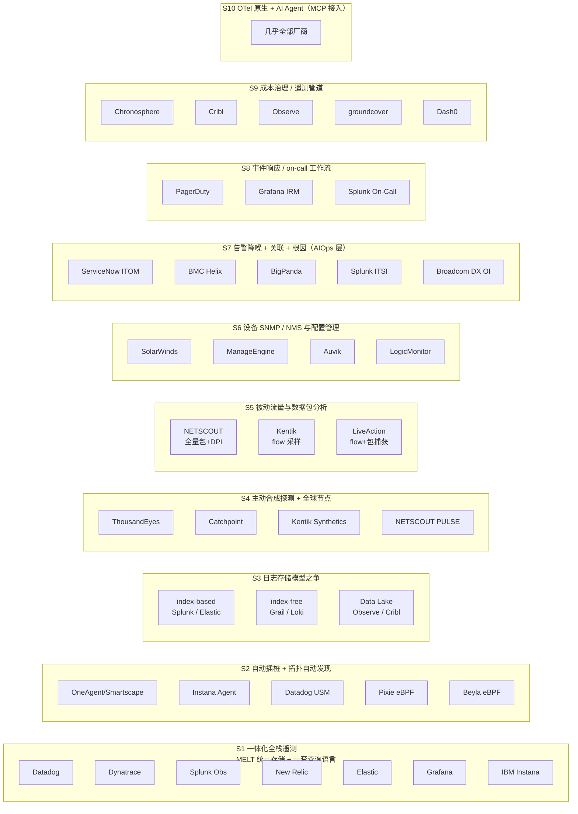

# 1 网络与SRE运维方向可观测性公司总览（TOP 20）

> **一句话调研对象与范围**
> 本文梳理在**网络运维（NetOps）**与**站点可靠性工程（SRE）**两个方向提供可观测性能力的厂商，选出市场存在感最强的前 20 家，逐一说明其**技术特色**与**对应客户**；并对"特色技术相同、客户高度重叠"的厂商做**共生机制分析**——即回答"为什么这些看起来做同一件事的公司，能同时存活"。

---

## 1.1 信源与局限说明

本文结论按以下三级信源标注，正文中凡引用关键数据均尽量给出层级：

| 等级 | 定义 | 典型来源 |
| --- | --- | --- |
| **A 级** | 厂商官方一手材料 | 官网、官方定价页、官方文档、官方博客、官方新闻稿、SEC 文件 / 财报 |
| **B 级** | 权威行业媒体与研究机构公开稿 | TechCrunch、Fortune、CRN、IDC、Gartner 公开摘要 |
| **C 级** | 第三方聚合与评测 | G2、PeerSpot、TrustRadius、Crunchbase、PitchBook、百科、价格聚合站 |

**必须声明的四点局限：**

1. **财年口径不统一**。Datadog 为日历年，Dynatrace 为 3 月底，Elastic 为 4 月底，Splunk 旧财年为 1 月底，Cisco 为 7 月底。横向比较营收时不可直接等同，本文一律标注财年。
2. **"前 20" 是加权判断，不是权威榜单**。评选口径为：**营收/ARR 规模 × 客户装机量 × 在本方向的技术代表性 × 2023–2026 年的市场声量**。部分厂商（如 ServiceNow、Broadcom、IBM）的可观测性业务只是其庞大产品线中的一个板块，本文按"板块"而非"整公司"评估其相关性。
3. **未上市/已被收购的厂商不披露财务**。New Relic、Grafana Labs、Sumo Logic、Chronosphere、Cribl、Honeycomb、LogicMonitor 等私有或被并购主体的营收，多数仅有第三方估算，本文标注为"量级参考"。
4. **源冲突处并列列出**。例如 Metoro 被 groundcover 收购系误传（已核实为独立运营）、Traversal 出隐身时间为 2025-06-18（非 2024-06）、Observe 被 Snowflake 收购仅有 C 级信源。凡此类均已在文中标注。

---

## 1.2 读法：四大集群，20 家公司

| #   | 公司                        | 集群            | 一句话定位                          | 主打客户规模             |
| --- | ------------------------- | ------------- | ------------------------------ | ------------------ |
| 1   | **Datadog**               | 全栈可观测平台       | 云应用的 AI 驱动可观测与安全平台             | 中端 → 大型            |
| 2   | **Dynatrace**             | 全栈可观测平台       | 因果 AI + 自动插桩的高端一体化平台           | 大型 / 超大企业          |
| 3   | **Splunk（Cisco）**         | 全栈可观测平台       | 安全 + 可观测 + 网络三合一的超大规模数据平台      | 大型 / 政府 / 电信       |
| 4   | **New Relic**             | 全栈可观测平台       | 开发者优先、按 GB 计费的一体化平台            | SMB → 大型           |
| 5   | **Elastic Observability** | 全栈可观测平台       | 以搜索与日志引擎为底座的成本型可观测             | 中端 → 大型            |
| 6   | **Grafana Labs**          | 全栈可观测平台       | 开源、可组合、不锁定的可观测云                | 初创 → Fortune 500   |
| 7   | **IBM Instana**           | 全栈可观测平台       | 100% 全量 trace + 秒级粒度 + 自动发现    | SMB → Fortune 100  |
| 8   | **Cisco ThousandEyes**    | 网络可观测（NetOps） | 主动合成探测 + 全球节点的网络与体验真相源         | 大型 / 云优先企业         |
| 9   | **NETSCOUT**              | 网络可观测（NetOps） | 全量数据包为唯一真相源的 DPI 分析            | 超大企业 / 运营商 / 政府    |
| 10  | **Kentik**                | 网络可观测（NetOps） | 云原生、消费制的网络智能平台                 | 运营商 / 云 / 大型企业     |
| 11  | **Catchpoint**            | 网络可观测（NetOps） | 最大独立第三方观测网的互联网性能监测             | 数字业务重度企业           |
| 12  | **LogicMonitor**          | 网络可观测（NetOps） | Agentless 混合可观测 + Edwin AI     | 大型企业 / MSP         |
| 13  | **SolarWinds**            | 网络可观测（NetOps） | 设备 SNMP 管理与多模块一体化的国民级 NMS      | 中大型企业 / MSP / 公共部门 |
| 14  | **ManageEngine（Zoho）**    | 网络可观测（NetOps） | 高性价比、全产品线、本地与云双形态              | SMB → 中大型 / MSP    |
| 15  | **ServiceNow（ITOM）**      | AIOps / ITOM  | 事件智能 + CMDB 系统记录 + AI Agent 治理 | 大型 / 超大型           |
| 16  | **BMC Helix（含 Netreo）**   | AIOps / ITOM  | 可本地/混合部署的 AIOps 与 ITSM 一体平台    | 受监管大型企业            |
| 17  | **BigPanda**              | AIOps / ITOM  | 纯 agnostic 的告警降噪与关联层           | Fortune 1000       |
| 18  | **PagerDuty**             | AIOps / ITOM  | 事件响应与 on-call 的事实标准            | 中大型 / AI 原生        |
| 19  | **Chronosphere**          | 云原生新锐 / 成本治理  | 指标成本治理与遥测控制平面                  | 大型 / AI 原生企业       |
| 20  | **Cribl**                 | 云原生新锐 / 成本治理  | 厂商中立的遥测数据引擎                    | Fortune 100/500    |

---

# 2 集群一：全栈可观测平台（SRE 一体化）

这 7 家的共同特征：**Metrics / Logs / Traces / RUM / Profiling 多信号统一存储与关联，一套查询语言，一个 UI**。它们争夺的是同一笔预算——企业 CI/CD 与运维工具链的"整合（consolidation）"预算。

---

## 2.1 Datadog —— 广度即护城河

**技术特色**

1. **统一 tag 模型**。metrics / logs / traces / RUM / profiling 共享同一套标签，跨产品可任意下钻与关联——这是它做"一站式"的工程前提。
2. **1,000+ 官方集成**。从云厂商、容器、数据库到 AI 组件，开箱即用。集成数量本身构成迁移壁垒。
3. **Go 重写的一体化 Agent + Universal Service Monitoring**。自动服务发现、依赖映射、RED 指标，且保留 15 个月。
4. **Watchdog 异常检测 + Bits AI 体系**（A 级）。Bits AI SRE（2025-12 GA，自动 on-call 根因调查）、Bits AI Dev Agent、AI Agent Monitoring、LLM Observability、MCP Server。

**客户与规模**

- 云原生企业为主，**中端到大型**；行业集中在科技/互联网、金融、电商、AI 原生公司。
- FY2025 营收 **$3.43B（+28%）**（A 级，公司财报）；客户约 3.2 万家；ARR ≥ $100K 客户 4,310 家、ARR ≥ $1M 客户 603 家。
- 关键结构性变化：**AI 原生客户群已占 2025 Q3 营收约 12%**（一年前 6%），是当前最重要的增量池。
- 典型角色：SRE / DevOps / 开发 / 安全 / 平台工程 / 网络。
- 定价：模块化按量，Infrastructure Pro **$15/host/月**，APM **$31/host/月**，Logs ingest $0.10/GB。host 类按**峰值（high-water mark）**计费——这是客户账单失控的常见来源。

**为什么它能站在第一梯队**

不是技术最深，而是**最广 + 最快**。年均 400+ 新功能，把"我可以不买第二家"变成了默认选项；同时用消费式 land-and-expand 把单点客户做成平台客户。代价是 Gartner 点名的**成本不可预测与供应商锁定**风险。

---

## 2.2 Dynatrace —— 自动化与因果 AI 的高端路线

**技术特色**

1. **OneAgent 自动插桩**。单文件 Agent 自动发现进程、服务、依赖并自动插桩（Java/.NET/Node.js/Go/Python/PHP），无需人工配置。
2. **Smartscape 拓扑自动发现**。跨"应用 → 服务 → 进程 → 主机 → 数据中心"的动态关系图谱，是根因定位的数据基础。
3. **Grail 数据湖仓**。**无索引（indexless）、schema-on-read、存算一体**，统一存放 metrics/logs/traces/events/business events；配套 **DQL** 一种查询语言查所有数据。
4. **Davis AI（hypermodal：因果 + 预测 + 生成）**。基于真实进程间通信路径做**因果推断**，输出单个 "Problem" 而不是几百条告警。Davis CoPilot 做自然语言 → DQL。
5. **AutomationEngine + Agentic Orchestrator**（A 级）。把洞察转成自动化工作流与自愈闭环。

**客户与规模**

- **大型/高端企业**：金融、医疗、零售、制造、电信、政府。客户约 **4,100 家订阅客户**，覆盖 105+ 国家。
- FY2025 营收 **$1.699B（+19%）**、总 ARR **$1.734B**；Q3 FY2026 总 ARR **$1,972M（+20%）**，2025 年内突破 $2B（A 级）。
- 典型角色：企业 IT 运维 / SRE / DevSecOps / 平台工程 / CIO-CTO / 安全运营。
- 定价：**DPS（Dynatrace Platform Subscription）消费单元制**（Host Unit hours、GiB hours、Grail 摄取量、Davis 分析频次）。FY2025 已有 >40% 客户、>60% ARR 走 DPS。

**与 Datadog 的分野**

Dynatrace 卖的是**"低人工干预的确定性"**——自动插桩省人力、因果 AI 省排查时间、拓扑保证准确。因此它拿得下流程复杂、人力昂贵、不容出错的高端企业。Datadog 卖的是**"广度与自助"**。二者在高端企业正面竞争，但胜出逻辑不同。

---

## 2.3 Splunk（Cisco）—— 安全 + 可观测 + 网络的合体

**技术特色**

1. **Splunk 平台（索引型数据底座）**。倒排索引 + **SPL** 查询语言；Indexer/Search Head 集群 + **SmartStore 计算存储分离**，支撑 PB 级。
2. **Observability Cloud（源自 SignalFx，2020 年 $1.05B 收购）**。大规模流式架构，指标拆成 metadata 与 time-series 双流；**SignalFlow** 流式分析语言；**NoSample 全保真追踪**。
3. **OpenTelemetry 原生**。通过 Omnition 收购成为 OTel 创始成员，主张"维持数据所有权"。
4. **Splunk ITSI**。服务/KPI 建模、glass table、Notable Events → Episodes、Event iQ 事件关联。**必须运行在 Splunk 平台之上**，本质是服务智能层。
5. **Cisco 融合**。AppDynamics APM 并入组合，叠加 **ThousandEyes 网络可观测 + Talos 威胁情报**。

**客户与规模**

- **大型/超大型复杂企业与政府**：政府与公共部门、金融、电信、制造。强 SecOps（SIEM/SOAR）采购预算场景。
- 最后独立财年 FY2024 营收 **$4.216B（+15%）**、总 ARR **$4.208B**；2024-03-18 被 Cisco 以约 **$28B** 完成收购（A 级）。并入后 Cisco FY2025 Observability 产品收入 **$1.055B（+26%）**，主要由 Splunk 驱动。
- 典型角色：SecOps / ITOps / DevOps-SRE / 网络运维 / CIO。
- 定价：Infrastructure **$15/host/月**起、App & Infrastructure **$60**、End-to-End **$75**；超额费可达 list 价 150%。

**它的独特卖点**

不是"更好用的可观测"，而是**一个平台同时吃安全预算与运维预算**，配合 Cisco 的数据面、渠道与 on-prem 交付能力。在需要数据主权、审计与超大规模日志的政府/金融场景，这是 Datadog 难以正面替代的位置。

---

## 2.4 New Relic —— 最慷慨的免费层与最透明的计费

**技术特色**

1. **NRQL**。SQL 风格统一查询语言，跨 metrics/events/logs/traces 查询，原生兼容 OTel 属性。
2. **MELT 全信号统一存储与关联**，800+ 集成。
3. **Pixie（2020 收购）**。K8s 上 eBPF 驱动的无侵入自动遥测。
4. **New Relic AI + Change Intelligence + Predictions**。RAG 驱动助手、变更是否引发故障的因果判断、基于 ML 的时序预测。

**客户与规模**

- **开发者优先（developer-first）**，SMB 到大型企业均有；尤其适合注重自助与成本可预测性的中小团队。
- 曾为 NYSE:NEWR；**2023-07 被 Francisco Partners + TPG 以 $6.5B 全现金私有化**（A 级，SEC 文件）。最后公开季度营收 **$242.8M（+7%）**，私有化后完整财年未披露。
- 定价（A 级，微软云市场官方页）：**免费层 100GB/月 + 1 个 full platform user**；超出后 **$0.30/GB**（Standard）/ **$0.50/GB**（Data Plus）；full platform user **$99/月**，core user $49/月。

**它靠什么活**

**计费模型的差异化**。在"主机多、日志量中等"的场景，按 GB 计费比 Datadog 按 host 峰值计费更可控；100GB 免费层是行业内最慷慨的获客漏斗。私有化后不必承受公开市场的季度压力，可以用更长时间做经营调整。

---

## 2.5 Elastic Observability —— 搜索引擎复用出来的成本型可观测

**技术特色**

1. **Elasticsearch 倒排索引 + Search AI Lake**。同一套引擎同时承担搜索、可观测与安全（SIEM）三个场景。
2. **ES|QL 管道式查询语言**，支持跨索引 Join。
3. **成本引擎**：**logsdb index mode（日志存储最多省约 70%）+ TSDB**。
4. **Streams（2025 新特性）**。AI 驱动日志处理，免管线自动解析/分区/字段抽取，自动浮现"Significant Events"（如 OOM），把日志从噪音变成首要调查信号。
5. **EDOT（Elastic Distributions of OpenTelemetry）+ AI Assistant + Agent Builder（MCP）+ Universal Profiling**。

**客户与规模**

- **存量 ELK 用户 + 成本敏感的 SRE/SOC 团队**；SMB 到大型企业，>50% Fortune 500 为客户。
- FY2025 营收 **$1.483B（+17%）**（A 级）；订阅客户约 21,500，ACV > $100K 客户 1,510 家，净扩张率约 112%。
- 典型角色：SRE / DevOps / 开发 / 安全（与 Observability 共用引擎）/ 平台工程。

**与 Grafana 的关键分野**

二者同为"开源 + OTel"阵营，但**日志存储模型相反**：Elastic 是 **index-based**（全文倒排索引），检索与分析能力强、成本高；Grafana Loki 是 **label-only**（正文不索引），成本极低、检索能力弱。这决定了 Elastic 在 SIEM 与复杂检索场景更强，Grafana 在"日志量大、预算紧"场景更省。

---

## 2.6 Grafana Labs —— 开源、可组合、不锁定

**技术特色**

1. **LGTM 全开源栈**：**Loki**（日志，只索引 label）、**Mimir**（指标，可扩到 10 亿+ active series）、**Tempo**（追踪，仅需对象存储）、**Pyroscope**（持续 profiling）。
2. **Grafana Alloy**。厂商中立的 OTel Collector 发行版，一体化替代 Grafana Agent / Promtail / OTel Collector，River 组件式配置、GitOps 友好。
3. **Beyla（eBPF 自动插桩）**。不改代码、不配置，通过 eBPF 捕获 HTTP/gRPC 的 trace spans 与 RED 指标。
4. **Adaptive Telemetry / Adaptive Metrics / Adaptive Logs**。用 ML 自动聚合未使用指标、优化日志量，官方称最多**降低遥测成本约 80%**；指标采用 **95th percentile 计费**，避免自动扩缩容的峰值惩罚。
5. **Grafana Assistant（2025-10 GA）+ Assistant Investigations + MCP server + Asserts 知识图谱**。

**客户与规模**

- **platform engineering / SRE / DevOps / 开发者 / IT 运维**；startup 到 Fortune 500 全覆盖，客户 10,000+（含 Anthropic、NVIDIA、Microsoft、Salesforce、Bloomberg）。
- ARR **突破 $400M（2025-09）**，付费客户 7,000+，OSS 用户 35M+（A 级）；2024-08 估值 $6B+，2026 年部分信源称约 $9B（C 级，未确认）。
- 定价（A 级）：OSS 完全免费；Cloud Free 含 10k series / 50GB logs / 50GB traces；Pro 起 **$19/月 + 按量**；Enterprise 起 **$25,000/年**承诺消费。

**它的护城河是"不要求你换掉什么"**

Big tent 策略——100+ 数据源、不 rip-and-replace、开源无锁定。29% 的视觉领导力（Gartner 2025 MQ 中 Completeness of Vision 最靠前）来自"开放"，而不是"功能最多"。这也是它在中国开发者社区渗透较高的原因。

---

## 2.7 IBM Instana —— 100% 全量 trace 与秒级粒度

**技术特色**

1. **单 Agent 自动发现 + 自动拓扑/依赖映射**，支持 300+ 技术，无需插件或重启。
2. **1 秒粒度 + 100% trace（不抽样）**。官方强调"captures 100% of traces"，对比竞品的抽样/平滑——这是它根因准确性的立论基础。
3. **动态基线 + ML 智能告警**，替代静态阈值。
4. **Probable-cause 分析 + 自动 playbook**；2025 年推出 agentic 智能事件调查（Preview）。
5. **SaaS 与本地部署功能对等（feature parity）**，与 IBM Cloud Pak for AIOps、watsonx.governance 集成。

**客户与规模**

- SMB 到 Fortune 100；金融（Mizuho Bank）、制造、电信、媒体（SIXT、Canal+ Télécom、Scuderia Ferrari）。
- Instana 2015 年成立，**2020-12 被 IBM 收购**（C 级）；IBM 不单独披露其营收。
- 定价（C 级）：按 **Managed Virtual Server（MVS）**计费——Essentials **$20/MVS/月**、Standard **$75**、本地部署 **$93.80**。按服务器而非按用户计费，团队扩张不直接推高账单。
- Gartner 2025 可观测性平台魔力象限：**Leader**。

---

# 3 集群二：网络可观测与 NetOps

这 7 家更靠近"网络"这一物理层。内部又可分三条技术路线：**主动探测（Synthetic）**、**被动流量与数据包分析（Flow / Packet）**、**设备 SNMP/NMS 管理**——本文后面的重叠分析会重点拆解这三条的客户重叠情况。

---

## 3.1 Cisco ThousandEyes —— 用全球节点"从外面看"

**技术特色**

1. **主动合成探测 + 全球节点**。Cloud Agents（Cisco 全球数百城市/ISP 节点）、Enterprise Agents（客户自建 VM/容器）、Endpoint Agents（员工笔记本端）；模拟网络层与浏览/通话会话。
2. **路径可视化 + BGP Monitoring + DNS 性能**。多点、拓扑关联的逐跳视图，集成数十个全球 BGP 采集器。
3. **Internet Insights / Collective Intelligence**。基于全球每天数十亿次测量的互联网中断检测（ISP、公有云、SaaS 应用）。
4. **Traffic Insights（2025-05 可订购）**。把 NetFlow/IPFIX 流数据与合成测试结果自动关联——即"从外面看"主动向"从里面看"扩张。
5. **AgenticOps**。MCP Server 已 GA、WAN Insights 预测性 SD-WAN 路由建议、AI 驱动根因定位与闭环验证。

**客户与规模**

- 云优先/混合办公的**中大型企业**（金融、零售、SaaS、电信），以及 ISP/数字服务商/监管机构。
- 2010 年由 UCLA 的 Mohit Lad 与 Ricardo Oliveira 创立；**2020-05 宣布被 Cisco 收购（媒体披露约 10 亿美元），2021 财年 Q1 完成交割**。
- 定价（C 级）：**ThousandEyes Units** 制，最低 2,000 units，2025-01 价目 **$0.85/unit/月**；Endpoint Agent 约 $14/agent/月；Internet Insights 约 $50,000 起。小型场景年费约 $1.5–2.5 万，大型全球部署 $25 万–100 万+。

**它靠什么活**

**深度绑定 Cisco 生态**（SD-WAN、Catalyst Center、Meraki、AppDynamics、Splunk 同属一家），把"网络设备 + 网络观测 + APM"打包成一个交付单元。当一个客户的骨干网就是 Cisco 时，ThousandEyes 几乎是默认选项。

---

## 3.2 NETSCOUT —— "数据包是唯一的真相源"

**技术特色**

1. **全量 DPI + Adaptive Service Intelligence（ASI）**。InfiniStreamNG 硬件/软件探针、nGenius Edge Sensors、vSTREAM 虚拟探针采集原始流量，ASI 把原始包转成精炼的 **Smart Data**（只保留关键特征，降低存储与算力）。
2. **被动式端到端性能与体验分析**。nGeniusONE 提供 KPI、应用错误详情、会话记录（Session Analyzer）、依赖映射、源端抓包。
3. **覆盖广**。接口从 1GbE 到 100GbE+，支持物理、虚拟、K8s、云与 SD-WAN/MPLS。
4. **合成测试补充**。nGeniusPULSE（nPoint）做早期预警与体验验证。
5. **AI + 安全复用**。**nGenius Copilot for Enterprise** 对话式查 Smart Data；同一数据源复用于 Omnis Cyber Intelligence（NDR/取证）与 Arbor DDoS。

**客户与规模**

- 世界最大型、最复杂的企业与**电信运营商**、政府机构。规模偏大企业/运营商级。
- 1984 年成立，NASDAQ:NTCT；FY2025 营收 **$822.7M**（A 级，SEC 文件）；无债务、现金及投资约 $586M。
- 典型角色：NetOps、服务保障、NOC、SecOps。
- 定价：硬件探针 + 软件许可 + 服务的传统企业级模式，按容量/接口速率与模块定价，**不公开列表价**。

**它的独特位置**

集群中**唯一以"全量数据包 + 自研 Smart Data"为真相源**的厂商，强调"任何环境、任何厂商一致可见"。代价是探针部署重、TCO 高。但正因如此，它能在运营商与政府这类"不能接受采样误差"的场景立足。

---

## 3.3 Kentik —— 把网络智能做成 SaaS

**技术特色**

1. **流数据（NetFlow/sFlow/IPFIX）+ VPC Flow + eBPF** 云端大规模采集与多维查询，类 Google Dremel 架构，秒级可视化。
2. **Kentik Synthetics**。DNS、BGP、网络路径、站点与云 Mesh、Web 与合成事务。
3. **Kentik NMS**。新一代网络监控系统，统一 **SNMP / Streaming Telemetry / gNMI / Telegraf** 采集，含 Metrics Explorer、BGP/ISIS 路由协议监控、1 秒级实时浏览。
4. **Kentik AI / AI Advisor**。自然语言查询与 AI 辅助排障，官方称"将调查时间缩短 96%"。
5. **Kentik Protect / Cloud / Edge**。DDoS 检测与缓解（RTBH、FlowSpec、RPKI）、多云互联与 peering 成本优化。

**客户与规模**

- **网络运营商、云/互联网企业、大型企业**；客户含 ServiceNow、Yelp、Box、GoDaddy、Shopify。
- 2014 年创立（原名 CloudHelix）；**2026-07-08 宣布被 Infoblox 收购，2026-08-06 完成交割**（A 级，Infoblox 官方新闻稿）；营收/ARR 未公开。
- 定价（A 级）：**Pro 版 $2,000/月（按年计费，即 $24,000/年）**，含 1,000 FPS、25 台 NMS 设备、2.5M 合成额度、13 个月留存；Premier 询价。

**与 NETSCOUT 的分野**

同为"网络真相源"，但 Kentik 走**轻量 SaaS + flow 采样**路线，无需重型探针，且原生支持**多云 VPC Flow、云成本优化与 DDoS**。官方明确把"替代 SolarWinds NPM / LogicMonitor / ManageEngine OpManager"写成产品叙事——它是典型的"降本替代型"厂商。

---

## 3.4 Catchpoint —— 最大的独立第三方观测网

**技术特色**

1. **全球主动观测网**。自述 **3,000+ 智能节点（3,109 agents，覆盖 353 城、108 国）**，另可在客户内网部署 enterprise agents。
2. **Internet Stack 全栈监测**。SaaS、DNS、CDN、BGP、SASE、WAN、API 各层可见。
3. **合成 + RUM 融合**。多步事务、API、Web 性能与 Core Web Vitals。
4. **Stack Map**。把全部依赖关系呈现在一张实时视图，快速定位是 DNS / CDN / SaaS / ISP 哪一层出问题。
5. **AI 辅助关联分析 + 开放式集成**。可对接 ServiceNow、Grafana、Splunk、Datadog、PagerDuty；提供 Terraform provider（监测即代码）。

**客户与规模**

- 依赖第三方 CDN/DNS/ISP 的**数字业务重度企业**：大型电商、CDN、超大规模云、零售、银行、流媒体、游戏；客户含 Akamai、Hostinger、SAP、Honeywell。
- 2008 年由 Mehdi Daoudi（前 DoubleClick/Google）创立；**2025-12 被 LogicMonitor 收购（金额超 $2.5 亿，LogicMonitor 迄今最大并购）**。
- 定价：订阅/积分制，入口 Expert Plan 公开价约 **$11,988/年**。

**与 ThousandEyes 的关系：集群内最像的一对**

两者都做"合成探测 + 全球节点 + BGP/DNS"。差异在**是否绑定设备厂商**：ThousandEyes 深度绑定 Cisco 生态；Catchpoint 强调"独立、最大的第三方观测网，不绑定任何网络设备商"。第三方评测认为 Catchpoint 在合成监测专注度上更强，但 UI 与价格是短板。**后者已被 LogicMonitor 收编，说明独立单点工具在当前市场格局下越来越难单独存活。**

---

## 3.5 LogicMonitor —— Agentless 混合可观测 + 自研 AI

**技术特色**

1. **LM Envision 混合可观测平台**。单一平台覆盖本地 + 多云 + 边缘，**Agentless 采集器**自动发现（无需逐设备装 agent），3,000+ 集成。
2. **Edwin AI**。官方强调"**专门构建**，不是 GPT 套壳"——基于混合数据集做告警关联、预测分析与自然语言摘要；Forrester TEI 委托研究给出 313% ROI。
3. **LM Cost Optimization**。多云账单统一视图（AWS/Azure）+ AI 云资源优化建议。
4. **网络与云托管网络监控**。新增 Cisco Meraki Assurance Alerts、Ubiquiti UniFi、Cato SD-WAN 集成。
5. **AIOps 特性**。Adaptive Correlation（自动重聚类告警降噪）、Datapoint Analysis（ML 找相关指标降 MTTR）。

**客户与规模**

- 大型企业的 Platform Engineering / CloudOps / ITOps、以及 **MSP**；行业含金融、制造、医疗、零售、公共部门；客户如 Coca-Cola Bottling、Syngenta、Topgolf、Schneider Electric。
- 2008 年成立；**Vista Equity Partners 自 2018 年起控股**；2024-11 完成 **$8 亿融资、估值 $24 亿**；ARR **超 $3 亿（2025 年中）**，净留存 >110%（A/C 级混合）。
- 定价（C 级）：**Hybrid Unit 计量**（1 单位 ≈ 1 台本地设备 / 1 个云实例 / 7 个 K8s pod / 5 个无线 AP）。Essentials **$16/unit/月**，Advanced **$27**，Signature（含 Edwin AI）**$53**。

**收购 Catchpoint 后的定位变化**

补齐了"外网数字体验"这一块，形成 **"内网基础设施 + 外网互联网体验"闭环**——这是对 SolarWinds/ManageEngine 这类传统 NMS 的降维打击。

---

## 3.6 SolarWinds —— 传统 NMS 的国民级品牌

**技术特色**

1. **Orion Platform + NPM**。SNMP 轮询、自动设备发现、拓扑、PerfStack 跨域关联、**NetPath** 路径分析、智能告警。
2. **多域可观测模块**。NPM（网络）/ SAM（服务器应用）/ DPA（数据库）/ NTA（NetFlow 流量分析）/ VNQM（VoIP）统一在 Orion 之下。
3. **SolarWinds Observability**。SaaS 与自托管双形态，填补"混合可观测空白"。
4. **AI/自动化**。AI-powered Root Cause Assist；2026-04 推出 **SW1 "agentic AI 队友"**。
5. **THWACK 社区**。20 万+ 成员、海量模板与脚本——**这是 SolarWinds 最难被复制的资产**。

**客户与规模**

- **中大型企业与 MSP、教育、公共部门**，尤其"Windows 重、本地为主"的传统 IT 团队。
- 1999 年成立；**2025-04 被 Turn/River Capital 以约 $44 亿全现金收购，已私有化退市**（A 级）。FY2024 营收 **$796.9M**，Total ARR **$729.0M**，订阅 ARR **$311.7M（+34%）**；客户 300,000+。
- 定价（C 级）：按节点/元素计。NPM **约 $1,638/年起**。

**它的处境**

品牌认知极强（Orion 几乎成了 NPM 的代名词），但在云原生、多云与"外部互联网可见性"上明显落后——这正是 ThousandEyes / Kentik / LogicMonitor 抢它的方向。私有化后推 SW1 语音化运维，是一次自救尝试。

---

## 3.7 ManageEngine（Zoho）—— 价格与产品线的双重覆盖

**技术特色**

1. **OpManager**。网络性能/故障监控，自动发现、L2/L3 拓扑地图、机柜视图、CPU/内存/接口/延迟/丢包监控。
2. **NetFlow Analyzer**。基于 NetFlow/sFlow/IPFIX 的流量分析（带宽、应用、QoS）。
3. **Site24x7**。**SaaS 全栈监测**（网站/服务器/应用/云/网络/RUM/合成），云端交付。
4. **OpUtils / OpManager Plus（Nexus）**。IP 地址与交换机端口管理、配置/合规。
5. **一体多产品**。90+ 款产品覆盖 ITSM（ServiceDesk Plus）、UEM、SIEM，本地 + 云可选。

**客户与规模**

- **SMB 到中大型企业、MSP、IT 部门**（尤其预算敏感、自建为主的团队）。
- 母公司 **Zoho Corporation**（1996 年创立，原名 AdventNet，品牌 ManageEngine 2002 年设立，私有）。Zoho 集团 FY2025 营收约 **$16.2 亿**，员工约 17,000；ManageEngine 服务 190+ 国家、28 万+ 企业、覆盖 90% Fortune 100（A/C 级）。
- 定价（C 级）：OpManager **Standard $245/年起（10 设备）**、Enterprise **$11,545（250 设备）**，有免费版；Site24x7 **$9/月起（10 监视器）**。

**它靠什么活**

**低价 + 产品线最全 + 本地/云双形态 + 免费版引流**。它不与 Datadog/Dynatrace 在同一价位段竞争，而是在 SolarWinds 的价格带里做"更便宜、更全、更灵活"的替代品。在亚太与中国市场，这一策略尤其有效。

---

# 4 集群三：AIOps / 事件管理与 ITOM

这 4 家不（主要）采集遥测，而是在**已有监控之上**做"告警降噪 → 关联 → 根因 → 工单/自动化"。它们的竞争清单在 RFP 里几乎一模一样，但商业定位差别很大——这是本报告后面重点分析的第 7 类技术簇。

---

## 4.1 ServiceNow（ITOM）—— 系统记录 + 行动系统

**技术特色**

1. **Event Management**。从第三方监控汇聚事件，AI/ML 做去重、关联、聚合，输出 probable root cause。
2. **Health Log Analytics（HLA）**。AI 日志异常分析，提前发现故障前兆。
3. **Metric Intelligence**。指标异常检测与性能追踪。
4. **Service Graph / CMDB + Discovery**。拓扑与依赖驱动的根因与影响面分析——**这是 ServiceNow 真正的护城河**。
5. **Cloud Observability（原 Lightstep，2021 收购）**。OTel 原生分布式追踪，主打 trace-based 根因；已 Legacy 化并打包进 ITOM。创始团队 Ben Sigelman 是 OpenTracing/OpenTelemetry 共同创建者。
6. **AIOps + 自愈闭环**。LEAP（Learning Enhanced Automation Playbook，GenAI 驱动的修复编排）、双向同步到 ITSM 工单、变更关联。
7. **2024–2026 AI 产品化**。Now Assist → AI Agent Orchestrator / AI Agent Studio → **AI Control Tower + AI Agent Fabric**（Knowledge 2025，MCP + A2A 协议）→ **ServiceNow Otto**（Knowledge 2026）。

**客户与规模**

- **大型/超大型企业**：金融（银行）、电信、政府、医疗、大型制造。ITOM 叠加后单客每年加 $200K–$1M+。
- 2025 全年收入约 **$12.18B**，订阅收入约 $11.5B（+22%），客户 8,500+，覆盖 85% Fortune 500，续约率 98%（C 级转引官方口径）。ITOM 板块占总订阅收入约 15–20%（第三方推算）。
- 定价：定制报价，按 fulfiller/用户 + 模块 + AI 消费计费，无公开价目表。

**关键判定：它自带数据存储，但不是底层监控**

ServiceNow 拥有 CMDB、Service Graph、Discovery 与自己的 Cloud Observability 后端；但**事件来源主要仍是第三方监控**。它做的是汇聚、关联、存储与闭环——是"系统记录 + 行动系统"，而非采集层。

---

## 4.2 BMC Helix（含 Netreo）—— 可本地部署的 AIOps

**技术特色**

1. **事件关联与降噪**。AI/ML 把事件聚成 Situations，抑制事件风暴噪音。
2. **服务建模 + 根因**。服务健康热力图（severity-coded heatmap），关联事件、定根因、按影响度排序。
3. **HelixGPT**。生成式 AI 提供动作建议、日志洞察、虚拟 agent；**30+ AI Agent**（含 CMDB Governor、Problem Finder 等）。
4. **全栈遥测**。可摄取 BMC 与第三方的 events/metrics/logs/traces/topology；外部日志源含 Splunk Enterprise、Elasticsearch。
5. **变更风险 + 闭环修复**。与 Helix ITSM 联动展示变更请求与 AI 风险等级；可联通 BMC Helix ITSM、Jira Service Management、**ServiceNow ITSM** 建单。
6. **网络可观测（Netreo）**。设备发现、配置、验证、映射、metrics/events/flow 数据。

**客户与规模**

- 电信、金融、大型制造、**主机（mainframe）密集企业**；大型/超大型企业为主。
- BMC Software 成立于 1980 年，**KKR 控股**；**2025 年 4 月起 BMC Helix 被拆分为独立公司**，Helix 部分收入约 **$1B**，官方称同比 +30%、现金流为正"数亿美元"。
- **2024 年收购 Netreo**（网络可观测 + Stackify APM），补足网络监控与 OpenTelemetry 能力。
- 定价（C 级）：约 $115/命名用户/月起（ITSM），英国 G-Cloud 显示 BMC Helix Service Management Advanced 约 £290–£870/用户/月；AIOps 有"$2,400/月起"的第三方列示。

**它靠什么活**

**"可本地/混合部署"这一条，就足以让它活**。政府、军工、主机密集型金融客户不能上 SaaS，ServiceNow 在这类场景无解，BMC 是少数可行选项。加上主机 + 分布式统一 AIOps 的稀缺能力，以及 5 年 TCO 常低于 ServiceNow（第三方估算），它以"合规与部署灵活性"为生。

---

## 4.3 BigPanda —— 最纯粹的"叠加层"

**技术特色**

1. **告警降噪与关联**。从数十种监控/APM/日志/变更工具汇聚告警，ML 把相关告警聚成 incident，官方称降噪可达 **95%+**。
2. **Open Box Machine Learning**。强调"**白盒/可测试**"的 ML 而非黑盒，容忍不完美数据——这是面向企业运维团队的信任设计。
3. **拓扑 + CMDB 增强**。内建拓扑模型，用 CMDB 上下文丰富告警，并能把告警里出现但 CMDB 缺失的 CI 自动回写。
4. **IT Knowledge Graph**。把工具、工单、人的"部落知识"统一成语境图谱，供 AI 推理。
5. **Agentic 套件**。AI Detection & Response、AI Incident Assistant（Slack/Teams 内）、AI Incident Prevention、**Smart Ticketing**（自动在 ServiceNow 建单并注入根因与建议动作）。
6. **外部可观测性**。2025-12 与 Ookla Downdetector 集成，判定故障是自身还是第三方依赖。

**客户与规模**

- **Fortune 1000 大型企业**（金融、电信、零售、科技）+ MSP；典型角色为 NOC、L1/L2/L3 运维、SRE、服务台。
- 2011 年成立，累计融资约 **$340M**，最新估值约 **$1.2B**（2022 年 D 轮）；2025-11 收购 Velocity。ARR 未公开。
- 定价：报价制 premium 订阅，按 credit 消耗 + 企业订阅，无公开价格。
- 客户中位 ROI 官方口径 **430%**，回本 <1 年（厂商自述，量级参考）。

**关键判定：纯聚合层**

BigPanda **明确不替代**底层监控。它从既有监控、工单、变更、协作工具摄取数据，自身维护拓扑模型与知识图谱，但不做底层遥测的采集与长期存储。**这正是它与 ServiceNow/Dynatrace 的根本区别，也解释了它为什么能活——它帮客户"榨干已有的 ITSM 与监控投入"，而不是要客户换掉它们。**

---

## 4.4 PagerDuty —— 事件响应的事实标准

**技术特色**

1. **AIOps（事件智能）**。从 700+ 工具摄取事件/告警，ML 去重与关联、告警降噪。
2. **事件编排与服务上架**。on-call 排班、升级策略、多渠道通知、Status Pages、事件生命周期管理。
3. **Runbook / Process Automation**。SaaS 化自动化工作流执行。
4. **PagerDuty Advance（GenAI）+ 四类 AI Agent**（FY26 上线）：**SRE Agent**（一线分诊）、**Scribe Agent**（实时摘要与干系人更新）、**Insights Agent**（改进建议）、**Shift Agent**（自动排班）；官方称基于 16 年事件数据训练。
5. **MCP / IDE 集成**。与 Anthropic、Cursor、LangChain 等 30 家伙伴集成；Claude Code / Cursor / GitHub Copilot 插件可在 IDE 内提示 on-call 上下文与风险变更。

**客户与规模**

- **科技/互联网、零售、金融、电信**；中大型企业 + AI 原生公司（CoreWeave、Snowflake、Scale AI、Anduril、NVIDIA、Perplexity）。
- 2009 年成立，NYSE:PD；FY2026 收入 **$492.5M（+5.4%）**、ARR **$498.7M**（A 级，公司财报）；付费客户 15,351 家。**增长明显放缓**（FY25 ARR $494M → FY26 $498.7M）是它当前最大隐忧。
- 定价（C 级）：免费版 ≤5 人；Professional **$21/用户/月**；Business 起 **$41/用户/月**；**AIOps add-on 起约 $699/月**，按已接受事件消费计费。
- 战略转向：从 per-seat 转向**按使用量/结果计费（flex pricing）**，FY26 出现 79 家 ARR > $1M 客户（+10%）。

**关键判定：半聚合层**

有自己的运营事件库（用于 AI 训练），但不是底层监控/遥测的采集与长期存储。定位是**"运营控制平面"**——它的降噪与关联，目的是**更好地路由和召唤人**，而不是做深度根因推断。

---

# 5 集群四：云原生新锐与成本治理

这两家的共同点：**不试图成为"又一个可观测后端"，而是去解决"可观测成本"这个 2023 年之后最普世的痛点。**

---

## 5.1 Chronosphere —— 指标成本治理的标杆

**技术特色**

1. **M3 引擎血统 + Control Plane 策略化遥测治理**。底层沿用 Uber M3 分布式时序存储思路；核心创新是**在数据落地前做聚合 / 降采样 / 丢弃**，官方称客户平均可裁剪 **84%** 数据量。
2. **高基数指标治理**。针对容器化产生 10–100 倍于传统 VM 的数据量，提供配额、按团队/服务的消费上限、utility score（按仪表盘/告警/查询的实际引用频次评估数据价值）。
3. **OTel / Prometheus 兼容、无专有 Agent 锁定**。
4. **Telemetry Pipeline**（2024-01 收购 Calyptia 后重命名）。any-source → any-destination 遥测管道，宣称平均**削减约 89% 低价值数据量**。
5. **AI-Guided Troubleshooting（DDx）+ SLO 管理 + MCP Server**。

**客户与规模**

- **大型企业、云原生 / AI 原生公司、LLM 厂商**（需 PB 级实时可观测）。客户含 DoorDash、Zillow、Visa、Robinhood、Snap。
- 2019 年成立，创始人为 Uber M3 作者 Martin Mao 与 Rob Skillington；累计融资约 **$343M**；ARR **$160M+（2025 末）**，**净收入留存 145%+**。
- **2025-11 Palo Alto Networks 宣布以 35 亿美元收购**（估值从 2023 年 $1.6B 跃升至 $3.35B）。Gartner 可观测性平台 MQ 连续两年 **Leader**。
- 定价：不公开 list price，按 **persisted writes（持久化写入 DPPS）**计费，可用 credits 作为通用货币；试点通常免费 2–3 周。

**它靠什么活**

**"帮你省钱"是唯一真正普世的可观测性卖点**。可观测成本占云预算 5–10% 是行业公认痛点，任何能立刻降低账单的厂商都能拿到预算。Chronosphere 的刀口是"存储前聚合"，对应的是高基数 Prometheus 负载这一具体且昂贵的场景。

---

## 5.2 Cribl —— 不站队后端的"数据引擎"

**技术特色**

1. **Cribl Stream**。核心处理引擎（原 LogStream）——从任意源收集，实时过滤/富化/格式转换/脱敏/聚合（logs → metrics），再路由到任意目标（Splunk、Datadog、S3、Elastic、Sentinel 等）。**收费只按 ingress，不收 egress。**
2. **Cribl Edge**。部署在数据源头的智能、**厂商中立 Agent**，自动发现并采集数据。
3. **Cribl Search**。业界首个"**原地搜索（search-in-place）**"——直接查 S3 等对象存储/数据湖中的静态数据，**不先搬迁**。
4. **Cribl Lake / Lakehouse**。turnkey 开放格式数据存储层，支持把数据廉价落地、按需回放到工具链。
5. **Cribl Guard**。管道内敏感信息扫描/脱敏。

**客户与规模**

- **IT 运维 + 安全（SecOps/SOC）双轮**——这是它与"纯 APM 系"厂商最大的定位差。客户规模以 Fortune 100/500 为主（43/100 家 Fortune 100）。
- 2017/2018 年由前 Splunk 工程师（Clint Sharp、Ledion Bitincka、Dritan Bitincka）创立；累计融资超 **$600M**，2024-08 E 轮估值 **$3.5B**；ARR **$300M（2026-02）**，NRR 130–145%。
- 定价（A 级）：Cribl.Cloud 消费模型，**1 credit = 1 USD**。Stream Cloud Worker **0.32 credits/GB**；Edge **0.21**；Search **1 credit/CPU 小时**；Lake **0.05 credits/GB/月**。免费档最高 1 TB/天。
- 效果宣称：可将 Splunk 摄入成本削减 **30–90%**（厂商自述，量级参考）。

**它靠什么活**

**因为它不站队后端**。Cribl 不试图替代 Splunk 或 Datadog，而是让自己成为二者共用的"前置管道"。因此它不仅不被巨头消灭，反而成为它们生态的补充，被客户当作"降本工具"独立采购。这是本集群中最聪明的生态位选择。

---

# 6 第二部分：技术同质化与共存机理分析

> 这是本文的核心。20 家里有大量公司"在卖同一件东西"，而它们都还活着。下面分三步回答：**（一）它们的技术到底哪里相同；（二）客户是否真的重叠；（三）为什么能共存。**

## 6.1 一、10 个"技术簇"的重叠地图

**十簇要点说明**

| 簇 | 技术内容 | 代表厂商 | 同质化程度 |
| --- | --- | --- | --- |
| **S1** | MELT 统一存储 + 一套查询语言（DQL / NRQL / SPL / ES\|QL / PromQL 系） | Datadog、Dynatrace、Splunk、New Relic、Elastic、Grafana、Instana | **极高**（2025 Gartner MQ 六家全员 Leader 即为证据） |
| **S2** | 自动插桩与拓扑自动发现（含 eBPF 无侵入） | Dynatrace、Instana、Datadog、New Relic(Pixie)、Grafana(Beyla)、groundcover、Metoro | **极高**（eBPF + OTel 自动插桩已是标配） |
| **S3** | 日志存储模型 | index 派：Splunk / Elastic；index-free 派：Dynatrace Grail / Loki；数据湖派：Observe / Cribl Lake | **高，但分化真实存在**（这是当前最本质的技术分水岭） |
| **S4** | 全球合成探测网 | ThousandEyes、Catchpoint、Kentik、NETSCOUT PULSE、Site24x7 | **极高**（ThousandEyes 与 Catchpoint 几乎逐条对应） |
| **S5** | 流量与数据包分析 | NETSCOUT（全量包）、Kentik（flow）、LiveAction（flow+包） | 中高（精度与部署成本差异明显） |
| **S6** | 设备 SNMP/NMS 与配置管理 | SolarWinds、ManageEngine、Auvik、LogicMonitor、Netreo、Zabbix | **最高、最红海** |
| **S7** | 告警降噪 + 关联 + 根因 | ServiceNow、BMC、BigPanda、Splunk ITSI、Broadcom DX OI、Moogsoft、Sumo Logic | **极高**（客户在 RFP 里几乎是同一份需求清单打勾） |
| **S8** | 事件响应 / on-call | PagerDuty、Grafana IRM、Splunk On-Call、incident.io | 中高 |
| **S9** | 成本治理 / 遥测管道 | Chronosphere、Cribl、Observe、groundcover、Dash0、Middleware | **高**（"帮你省钱"已成行业统一话术） |
| **S10** | OTel 原生 + AI Agent（MCP Server） | 几乎全部 20 家 | **极高，已是入场券而非差异点** |

## 6.2 二、客户是否真的重叠？四组对照

**结论先行：技术相同的厂商，客户确实高度重叠，但重叠发生在"同一类组织的不同团队/不同预算线"上，而非完全同一批买方。**

| 对照组 | 是否同一批客户 | 关键错位 |
| --- | --- | --- |
| **Datadog × Dynatrace** | 高端企业客户重叠最高 | Datadog 卖"广度 + 开发者自助 + 集成生态"；Dynatrace 卖"自动插桩 + 因果 AI + 低人工干预"。两者在同一个 RFP 里，但胜出理由不同 |
| **Grafana × Elastic** | 重叠最高（同属开源/OTel 阵营） | Grafana 不强求迁移存量数据源（big tent）；Elastic 要求接受其索引模型但换来更强全文检索与 SIEM 能力 |
| **ThousandEyes × Catchpoint** | **几乎是同一批买家**（电商、CDN、SaaS、金融、流媒体），常在同一 POC 二选一 | ThousandEyes = Cisco 生态绑定；Catchpoint = 最大独立第三方观测网。Catchpoint 被 LogicMonitor 收编，印证独立单点越来越难 |
| **BigPanda × ServiceNow ITOM × BMC Helix** | 同一份 RFP 需求清单 | BigPanda 是**非侵入式降噪层**（不换 ITSM）；ServiceNow 是**替换为一体化平台**；BMC 是**可本地部署的一体化** |

**一个关键的反直觉结论**：客户**并不按"功能"采购，而是按"团队"和"预算来源"采购**。

- NOC 团队买 NETSCOUT / Broadcom / BMC（主机 + 网络视角）
- SRE 团队买 PagerDuty / Grafana / Datadog（on-call + trace）
- 服务台买 ServiceNow / BMC（ITSM 工单闭环）
- SOC 团队买 Splunk / Sumo Logic / Elastic（安全预算）
- 网络团队买 NetBox Labs / ThousandEyes / SolarWinds（网络清单与路径）

## 6.3 三、为什么它们都能活着？九条共存机理

**机理 1：数据域天然割裂，没有任何一家能全覆盖**
真实企业里同时存在：主机（mainframe，Broadcom/IBM 强项）、网络设备（BMC/Netreo、Cisco）、云原生（Instana/Grafana/Datadog）、日志（Sumo/Splunk）、安全（Sumo/Splunk/Elastic）。遥测源头本身是割裂的，于是"每家守住自己最强的数据域"成为稳定均衡。

**机理 2：组织边界比技术边界更硬**
NOC、SRE、SOC、服务台、网络团队、平台工程——**各自有独立预算、独立 KPI、独立采购权**。一个团队买的工具，另一个团队不会用也不会付钱。这是"技术上完全可以合并、组织上无法合并"的典型场景。

**机理 3：预算来源不同——可观测预算 ≠ 安全预算 ≠ ITSM 预算 ≠ 基础设施预算**
Splunk 吃的是"安全 + IT 韧性"的合并预算；ServiceNow 吃 ITSM 预算；Chronosphere/Cribl 吃 FinOps 与基础设施成本预算；ThousandEyes 经常走网络资本支出。**不同预算线意味着同一个技术能力可以被卖四次。**

**机理 4：部署形态与数据主权构成硬约束**
SaaS（ServiceNow）vs 可本地/混合（BMC）vs BYOC（groundcover）vs air-gapped（Metoro）vs 完全 self-host（Grafana OSS、VictoriaMetrics）。政府、军工、主机密集型金融**在合规上就不能上 SaaS**，这一条就足以让 BMC、Broadcom、SolarWinds 长期存活。

**机理 5：价格带与规模错位**
- 超大企业：Dynatrace、ServiceNow、NETSCOUT
- 中端：Datadog、LogicMonitor、Elastic
- SMB / MSP：ManageEngine、Auvik、New Relic 免费层
- 开源自建：Grafana OSS、VictoriaMetrics

同一件功能，在不同价格带上由不同厂商供给，价格带本身就是隔离墙。

**机理 6：迁移成本与沉没成本锁定**
已在 Splunk 上投入数年的客户，会选择加购 ITSI，而不是换平台；已在 ELK 上的客户会选择 Elastic Observability。**数据量与查询语言的学习成本，构成了比技术优劣更强的锁定。**

**机理 7：生态位互补——不做"又一个后端"**
- **Cribl**：只做管道，因此同时被 Splunk 与 Datadog 客户采购；
- **NetBox Labs**：处于可观测性的**上游**（网络清单与自动化），与所有后端厂商不冲突；
- **Traversal / Metoro**：站在现有可观测工具**之上**做 AI 根因，与 Splunk/Datadog 共存；
- **BigPanda**：叠加在现有监控与 ITSM 之上，帮客户少换东西。
**"不站队"本身就是一种可长期存活的生态位。**

**机理 8：多供应商并行是客户的主动策略**
2024–2026 是 AI/agentic 军备竞赛期，每家都在 2025 年推 AI 能力。客户"不敢只押一家"，倾向多供应商并行 POC。Gartner 把 Event Intelligence Solutions 单列为一个市场品类，也为多厂商共存提供了"品类正当性"。

**机理 9：并购整合是"活下来"的另一种形式**
本集群 20 家里，2023–2026 年间已发生多起并购：**Splunk → Cisco**、**Moogsoft → Dell**、**Netreo → BMC**、**SolarWinds → Turn/River**、**New Relic → Francisco Partners/TPG**、**Sumo Logic → Francisco Partners**、**Catchpoint → LogicMonitor**、**Kentik → Infoblox**、**LiveAction → BlueCat**、**Chronosphere → Palo Alto Networks**、**Observe → Snowflake（C 级信源）**。
买方逻辑高度一致：**可观测平台通过并购补齐"网络可见性"或"数据语境"拼图**，因为客户要的是"一个数据底座 + 一个 AI 层"，而不是十个孤岛工具。**结论：单点工具独立生存越来越难，要么成为生态位（Cribl 模式），要么被整合（Catchpoint 模式）。**

## 6.4 四、一句话总结

> **技术层面，这 20 家已经高度收敛**（统一信号 + OTel 原生 + 自动插桩 + AI 助手 + 成本优化），Gartner 可观测性平台 MQ 六家全员 Leader 就是最直接的证据。
> **真正拉开差距的不是技术特色，而是：数据域占位、组织与预算归属、部署形态与合规、价格带、迁移成本、生态位选择。**
> 在这个市场上，**技术特色已经不是护城河；商业模式、迁移成本与生态位才是。** 未来 2–3 年，差异化将从"监测能力"转向**"数据语境（谁拥有更权威的资产/拓扑/配置关系）"**与**"自动化闭环（谁能把 AI 的建议安全地执行并验证）"**。

---

# 7 附录一：第二梯队与延伸观察名单

以下厂商未进入 TOP 20，但在特定方向上有不可忽视的存在感，且与用户的既有调研（NetBox Labs、Traversal、Metoro）直接相关。

| 公司 | 方向 | 一句话说明 | 状态 / 备注 |
| --- | --- | --- | --- |
| **Auvik** | MSP 网络管理 | 云原生、极简部署、多租户的"六合一"轻量 NMS（发现/拓扑/监控/流量/配置/资产） | 私有（Great Hill Partners）；6,000+ 客户、110,000+ 网络；按计费设备计（中间设备约 $27/设备/月） |
| **Sumo Logic** | 日志 + SIEM + 可观测 | 云原生日志分析（LogReduce）、Dojo AI、Flex Licensing（日志摄取 $0） | 2023-05 被 Francisco Partners 以 $1.7B 私有化；重心已明显转向 SecOps |
| **Broadcom DX O2** | 主机 + 分布式 AIOps | 原 CA Technologies DX OI/DX APM 合并；**主机（z/OS、CICS、DB2）AIOps 的稀缺能力** | 2018 年被 Broadcom 以 $18.9B 收购；超大型异构 + 强监管客户 |
| **groundcover** | eBPF 云原生可观测 | eBPF-first + BYOC（数据留客户 VPC）+ **按 K8s Node 计费**，宣称较 Datadog 省 87% TCO | 以色列，2021 年成立；累计融资 $60M（至 B 轮）；ARR 同比 +500% |
| **Dash0** | OTel 原生可观测 | ground-up OTel 原生、透明按数据量计费、Agent0 自主运维 | 2023 年成立、2024-11 GA；累计融资 $155M，2026-03 B 轮估值 $1B；收购 Lumigo、Polar Signals |
| **Observe Inc** | 数据湖可观测 | 基于 Snowflake/Iceberg 的遥测数据湖，无 overage、宣称降 60% TCO | 品牌已改为 "Observe by Snowflake"；收购细节仅 C 级信源（未确认） |
| **Middleware.io** | AI 驱动可观测 | OpsAI 自动修复、低价策略（APM $20/host/月） | 2022 年成立，累计融资约 $7M，ARR 约 $5.5M |
| **VictoriaMetrics** | 开源 TSDB（**用户自有栈在用**） | 单二进制、无外部依赖、极高性价比，PromQL 超集 MetricsQL | 2018 年成立，**无外部融资（bootstrapped）**，Apache 2.0 + 企业版；详见下方专项说明 |
| **NetBox Labs** | 网络真实源（上游） | 商业托管开源 NetBox（IPAM + DCIM），下一代网络可观测平台 Orb | 2023-01 从 NS1 分拆，累计融资约 $55M |
| **Traversal** | AI SRE | 因果机器学习根因分析、Agent 蜂群并行假设验证、只读接入 | 2023/2024 成立（信源冲突）；**出隐身时间 2025-06-18**（非 2024-06）；融资 $48M |
| **Metoro** | K8s eBPF + AI SRE | eBPF 零插桩、AI Agent "Guardian" 自动开修复 PR、$20/node/月 | YC S23；ARR 约 $330K、约 3 人团队。**"被 groundcover 收购"为误传，已核实为独立运营** |
| **Netreo** | 网络 + 全栈可观测 | NPMD + APM + OTel，偏强监管行业 | **2024 年被 BMC 收购**，已转为 BMC Helix 的"网络与可观测补强件" |
| **Moogsoft** | AIOps 关联层（先行者） | 无规则算法聚类、Situations、probable root cause | **2023-09 被 Dell 收购**；官网仅服务存量客户，v9.1 及更早版本标准支持已于 2026-04-16 终止；第三方定性为"存在性危机" |

### 7.1.1 专项说明：VictoriaMetrics（与自研栈直接相关）

鉴于用户所在产品的采集链路（VictoriaMetrics + Loki + MySQL + Pyroscope + Redis）已包含 VictoriaMetrics，此处单独展开其关键事实（A 级，官方文档）：

- **版本现状（2026-09）**：VictoriaMetrics **v1.152.0**（2026-09-14）；LTS 线 v1.148.4 与 v1.136.18（每 6 个月一条新 LTS，每条支持 12 个月）；VictoriaLogs **v1.52.0**（2024-11-12 起 GA）；VictoriaTraces **v0.11.1**（仍为 0.x，尚未 1.0）；Operator v0.74.1。
- **核心组件**：vmagent（抓取 + stream aggregation）、vmalert、vmui、vmstorage / vminsert / vmselect（集群三角色）、vmauth、vmbackup/vmrestore；2026-07 新增 **vmestimator**（实时估算指标基数）。
- **vmsingle vs 集群版**：vmsingle 为**单个静态二进制、无外部依赖**（无对象存储、无 Kafka、无 ZooKeeper），单实例可处理 **10M+ 活跃时间序列**，官方定位"单节点即可替代中型 Thanos / M3DB / Cortex 集群"；集群版拆为 vminsert + vmstorage + vmselect，vminsert/vmselect 无状态可水平扩展。**2026 年重要变化**：vmsingle 现支持 vmselect 的 cluster-native RPC 协议，可作为 vmstorage 节点，使单体 → 集群迁移更平滑。
- **企业版 vs 开源版**：企业版 = 社区版全部功能 + **降采样（downsampling）、多留存策略、异常检测服务（vmanomaly）、备份自动化、Monitoring of monitoring、LTS 长期支持（12 个月补丁）、核心团队优先支持**；企业二进制带 `-enterprise` 后缀，需 `-license`。
- **技术特色**：MetricsQL（PromQL 超集）、倒排索引 + 列式 part + 后台合并的存储引擎（官方称比 Thanos/Cortex/Prometheus 省 7 倍空间）、协议无关摄入（含 OTel、Datadog agent、InfluxDB line protocol）。
- **与自研的关联**：VictoriaMetrics 是当前国内"Prometheus 替代 / 长期存储"的默认选择之一，**对自研 APM 的成本结构有直接影响**；其 Apache 2.0 + 单厂商（非 CNCF）治理模式，也意味着升级节奏与路线图不由社区基金会决定，需自行评估供应链风险。

---

# 8 附录二：中国厂商对照（自研产品的直接竞品）

海外 20 家与国内直接竞争者并非同一竞争面。国内格局的核心差异是**"云生态绑定 + 信创合规 + 一体化交付"**。

| 厂商 | 定位 | 关键事实 |
| --- | --- | --- |
| **博睿数据（Bonree，688229.SH）** | 中国 APM / 可观测领先厂商 | IDC 中国 APMO 市场份额领先（22.06%，2025H1）；Bonree ONE 主打"全域数据模型 + AI 引擎 + AIOps 0-1-5-10" |
| **观测云（Guance / 驻云）** | 独立第三方一体化可观测 | **GuanceDB 3.0 采用 S3 底座 + 存算分离 + 流式聚合**（与 Observe 的数据湖路线高度同构）；已获信通院"可观测性平台能力"先进级认证 |
| **基调听云** | APM + 全链路 | 观云平台（NBQL 查询语言 + 全链路 + AI 因果推理）；入选信通院铸基计划 |
| **阿里云 ARMS** | 云生态一体化可观测 | 依托云生态做"开箱即用 + 云账单合并"；优势是集成与渠道，弱点是跨云/混合云中立性 |
| **腾讯云可观测 / 火山引擎云监控 / 华为云 APM** | 同上 | 各云厂商的托管可观测套件，逻辑同构 |

**核心判断**：海外新锐与中国厂商在**技术叙事上高度趋同**（OTel 原生、成本治理、AI 根因、数据湖/存算分离、MCP 接入），但**竞争落点不同**——海外靠"中立 + 开源 + 降本 + 数据主权"，中国靠"云生态绑定 + 信创合规 + 一体化交付"。对于锐捷 APM 而言，**真正的正面竞品是国内厂商；海外 20 家主要作为"功能体系与技术路线"的对标标的**。

---

# 9 附录三：对自研 APM AI 助手的五条启示

| # | 启示 | 来源 | 为什么重要 |
| --- | --- | --- | --- |
| 1 | **"降噪 → 关联 → 根因 → 闭环"必须是一条可验证的链路，而不是四个功能点** | ServiceNow（LEAP、Probable Root Cause）、BMC（HelixGPT + 30+ Agent）、BigPanda（Smart Ticketing） | 客户买的不是"能看见问题"，而是"少叫一次人"。闭环能力（能否写回工单、能否给出可执行动作）决定了 AI 助手的实际价值边界 |
| 2 | **"数据语境（拓扑 + 资产 + 变更）"是 AI 根因准确率的天花板** | Dynatrace（Smartscape + 因果 AI）、ServiceNow（CMDB + Service Graph）、BigPanda（IT Knowledge Graph）、Kentik/Catchpoint 被 Infoblox/LogicMonitor 收购的动机 | 没有权威拓扑与变更上下文，AI 只能做"相关性猜测"，做不到"因果判定"。这是当前所有厂商并购补强的重点方向 |
| 3 | **AI 能力已成入场券，不是差异点；差异化在"建议能否被安全执行并验证"** | 20 家中 19 家已在 2025 年推出 agentic 能力（Datadog Bits AI SRE、Dynatrace Agentic Orchestrator、Cisco AgenticOps、SolarWinds SW1 等） | 客户对"AI 只是另一个聊天框"已产生免疫；"执行 + 验证 + 可回滚"才是新的信任门槛 |
| 4 | **计费与成本模型正在成为产品竞争力的一部分** | Chronosphere（Control Plane 裁 84% 数据）、Grafana（95th percentile 计费 + Adaptive Telemetry 省 80%）、Elastic（logsdb 省 70%）、Cribl（只收 ingress） | 可观测成本占云预算 5–10% 已成为客户第一痛点。产品若不能在计费模型上讲出降本故事，会在 POC 阶段就失去机会 |
| 5 | **"叠加层 + 不站队"是 AI 助手最现实的初始生态位** | BigPanda（叠加在现有监控与 ITSM 之上）、Cribl（前置管道，不替代后端）、Traversal（只读接入，不写生产） | 从"替代客户已有的监控后端"起步，销售阻力极大；从"在现有后端之上做智能层"起步，可复用客户的数据与工具投资，落地阻力最小。同时"只读接入、不写生产"是企业采纳 AI 运维工具时的核心心理门槛（Traversal、Metoro 均以此为卖点） |

---

# 10 附录四：待补充与后续跟踪

1. **私有化主体的财务口径**：New Relic、Grafana Labs、Sumo Logic、Cribl、Chronosphere、Honeycomb、LogicMonitor、BigPanda 在被收购或私有化后均不再披露完整财报，本文营收数字多为第三方估算，使用时应标注"量级参考"。
2. **Observe 被 Snowflake 收购**：品牌与 FAQ（A 级）已证实 "Observe by Snowflake" 及 Snowflake credits 抵扣，但 **$1B 金额与 2026-01 时间仅见 C 级信源**，正式交易细节待核实。
3. **Kentik → Infoblox**：已完成交割（2026-08-06），但**作价未披露**；Kentik 的 ARR 与客户结构变化值得跟踪。
4. **Chronosphere → Palo Alto Networks**：2025-11 宣布，**完成时点存在 2026 口径冲突**；被并入 XSIAM/AgentiX 后，其"独立成本治理平台"定位是否会被稀释，值得跟踪。
5. **Moogsoft 是否被 Dell 正式停售/EOL**：官方从未明示，仅 v9.1 及更早版本标准支持已于 2026-04-16 终止。
6. **Sumo Logic 现任 CEO**：资料冲突（Joe Kim / "Mike Ties"），需以官方为准。
7. **groundcover 融资总额**：官方口径 $60M（至 B 轮，2025-04）；Tracxn 记 "Series C、$160M"，是否已发生 C 轮未确认。
8. **Honeycomb 最新轮次命名**（Series C-II vs D）：金额 $50M 一致，命名存疑。
9. **Broadcom DX O2 / IBM Instana 独立营收**：均未单独披露，仅有第三方估算。
10. **建议后续单独建立的报告**：`ServiceNow-ITOM`、`Sumo Logic`、`Cribl`、`Chronosphere`、`Catchpoint`、`Kentik`、`ThousandEyes`——按本目录既有的单厂商体例（大功能点 → 小功能点清单 → 用户痛点 → 解决机制 + 时间线 / 演进规律 / 对标启示）逐家展开。
