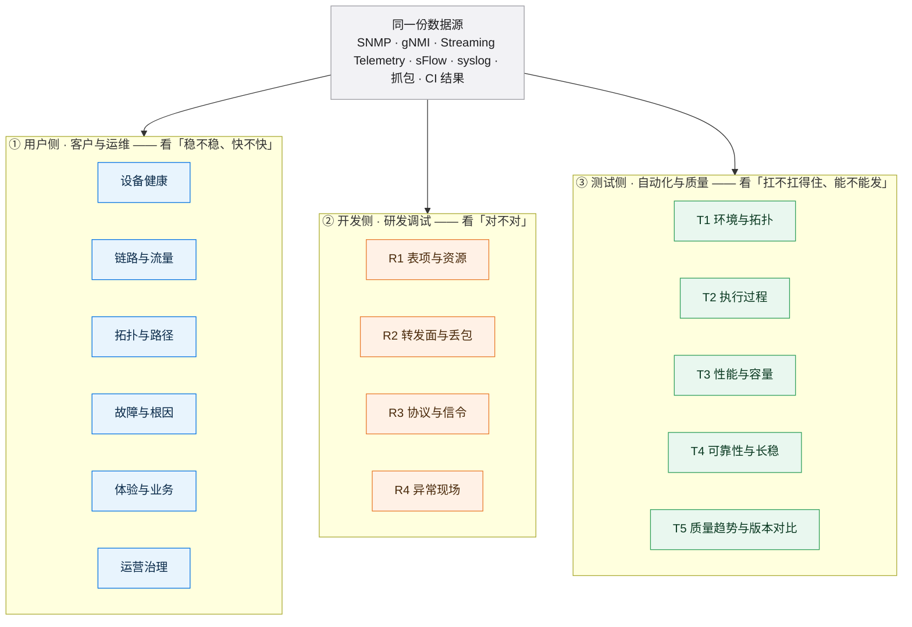
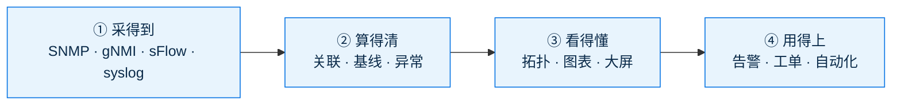
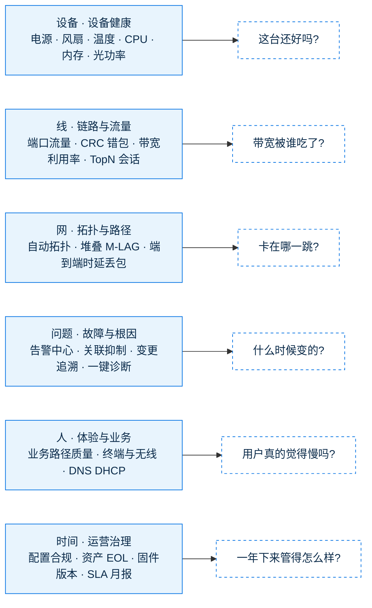
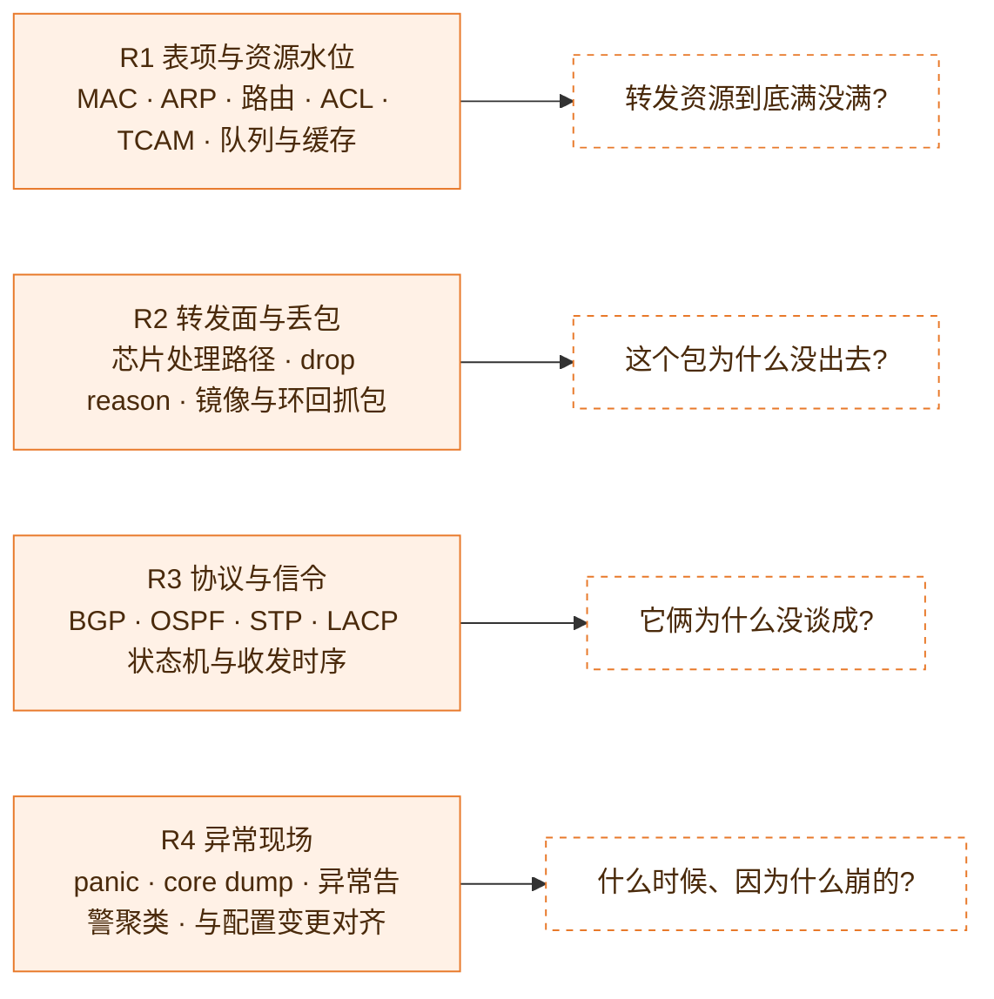
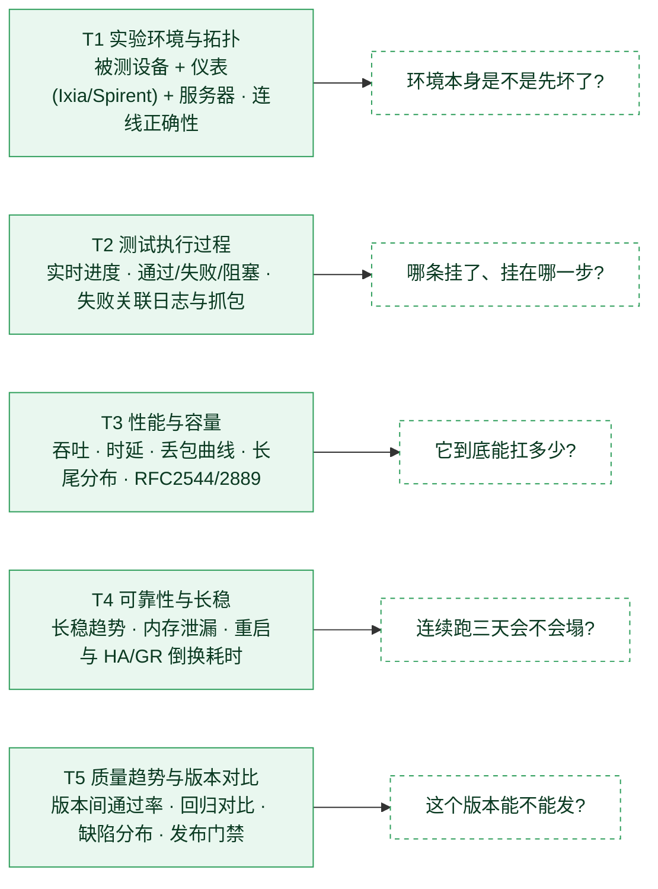
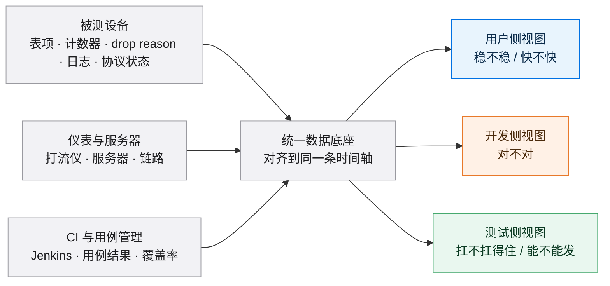
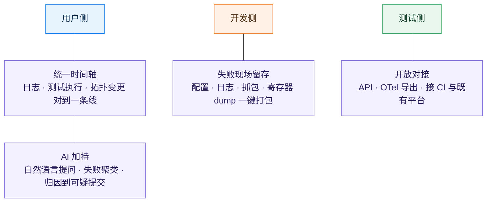
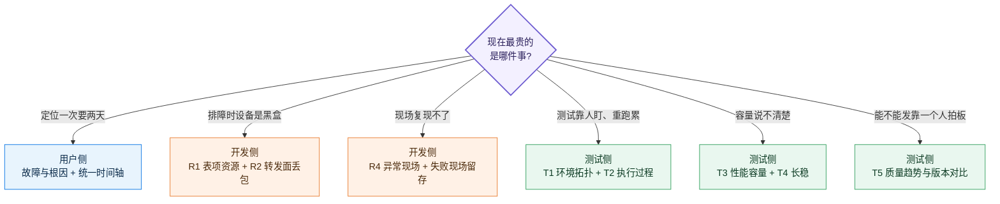

# 可视化切入视角全景图（用户侧 · 开发侧 · 测试侧）

> **只有图，没有正文。** 文字全部压进图里。
>
> 读法：§1 总览 → §2 / §3 / §4 分侧 → §5 三侧共用一份数据 → §6 横切面 → §7 怎么选 → §8 速查。

---

## 1 总览：一张图看三侧

---

## 2 用户侧 · 客户与运维

### 2.1 所有用户侧可视化都跑在这条链上

### 2.2 六个切入面

---

## 3 开发侧 · 研发调试

---

## 4 测试侧 · 自动化与质量

---

## 5 三侧其实是同一份数据，只是换了视角

---

## 6 横切面：穿在三个侧里，不是第四个方向

---

## 7 怎么选：从「最疼的那件事」倒推

---

## 8 速查：三侧 × 方向

| 侧 | 编号 | 方向 | 一句话回答 |
| --- | --- | --- | --- |
| 用户侧 | — | 设备健康 | 这台还好吗 |
| 用户侧 | — | 链路与流量 | 带宽被谁吃了 |
| 用户侧 | — | 拓扑与路径 | 卡在哪一跳 |
| 用户侧 | — | 故障与根因 | 什么时候变的 |
| 用户侧 | — | 体验与业务 | 用户真的觉得慢吗 |
| 用户侧 | — | 运营治理 | 一年下来管得怎么样 |
| 开发侧 | R1 | 表项与资源水位 | 转发资源满没满 |
| 开发侧 | R2 | 转发面与丢包 | 这个包为什么没出去 |
| 开发侧 | R3 | 协议与信令 | 它俩为什么没谈成 |
| 开发侧 | R4 | 异常现场 | 什么时候、因为什么崩的 |
| 测试侧 | T1 | 实验环境与拓扑 | 环境本身是不是先坏了 |
| 测试侧 | T2 | 测试执行过程 | 哪条挂了、挂在哪一步 |
| 测试侧 | T3 | 性能与容量 | 它到底能扛多少 |
| 测试侧 | T4 | 可靠性与长稳 | 连续跑三天会不会塌 |
| 测试侧 | T5 | 质量趋势与版本对比 | 这个版本能不能发 |

> **横切面（不属于任何一侧）**：统一时间轴 · 失败现场留存 · 开放对接 · AI 加持
