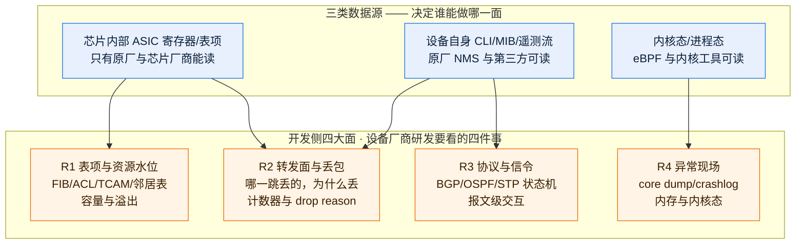
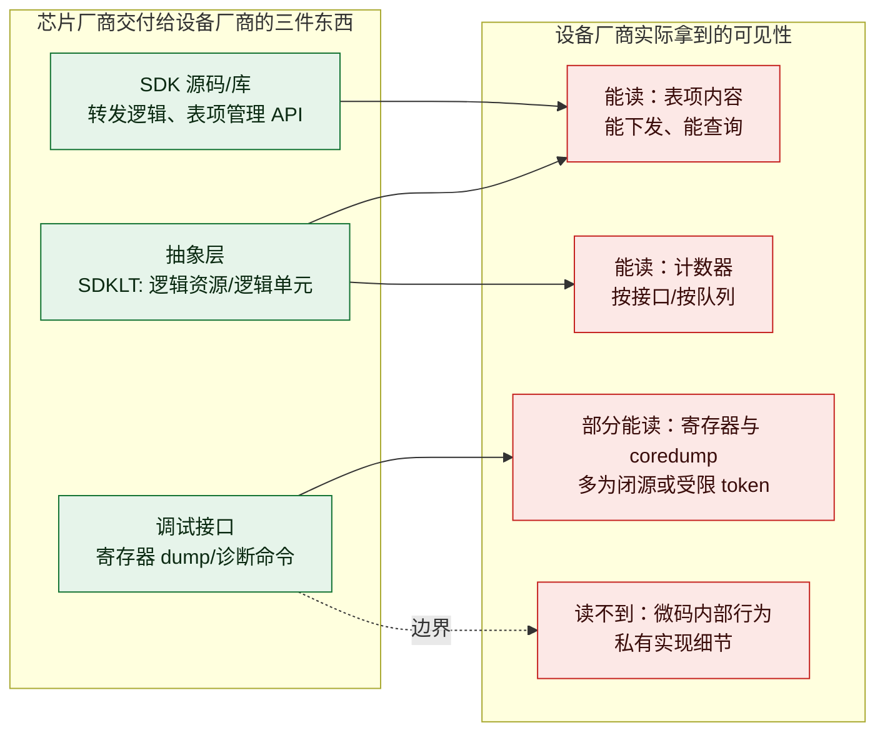
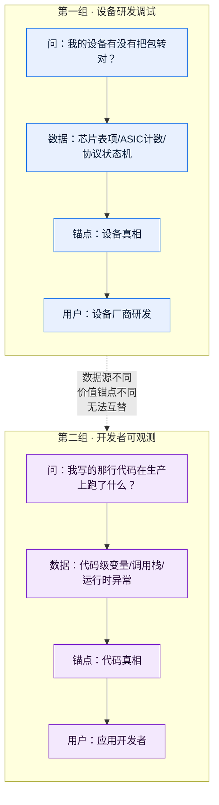

> **调研对象与范围**：本文回答一个问题——**"从开发侧看，做可视化相关的公司有哪些？"**
> 承接《可视化切入视角全景图-用户侧-开发侧-测试侧》中定义的**开发侧四大面 R1–R4**，把"做可视化"这件事拆成两条互不重叠的产业带：
> - **第一组：做"设备研发调试工具"的公司** —— 客户是**设备厂商自己的研发/测试团队**（也就是锐捷这类公司内部的人）。他们要看的是芯片、表项、转发面、内核。**这是与锐捷自研 APM 最直接可对标的一组。**
> - **第二组：给"写软件的人"做可观测的公司** —— 客户是**应用开发者**。他们要看的是自己那行代码在生产上干了什么。
> 两组经常被混为一谈（都叫"开发侧"），但**客户不同、数据源不同、价值锚点不同**，因此分组给出。
>
> **信源与局限**：
> - **A 级**：厂商官方产品文档 / TechDocs / 官方 Release Notes / SDK 官方文档（正文标 **A**）。
> - **B 级**：官方博客、官方新闻稿、厂商高管在公开大会的演讲（正文标 **B**）。
> - **C 级**：第三方媒体、分析机构、评测站点（正文标 **C**）。
> - **本机无法访问 Mermaid CDN，未能做渲染验证**；文中 Mermaid 图仅做了语法与 classDef 静态校验。若在 Obsidian 中显示异常请反馈编号。
> - 厂商自述收益与第三方验证已分列标注，未标注者按"厂商自述/量级参考"理解。
> - 芯片厂商（Broadcom / Marvell）的调试工具链**绝大部分不公开发布**，公开信源只到"SDK 分层 + 客户侧 debug 命令"这一层，**这是本报告证据最薄的一段，已单独标注**。

---

## 读法：两组、六条产业带

| 组 | 产业带 | 客户是谁 | 数据源 | 代表公司 | 与锐捷的关系 |
|---|---|---|---|---|---|
| **第一组** 设备研发调试 | ① 原厂网管的**研发态能力** | 设备厂商研发 | 芯片内部 / 表项 / 配置 | Arista CloudVision、Cisco Nexus Dashboard | **最强对标**：同为原厂，问题域一致 |
| | ② 芯片厂商 **SDK 与调试工具链** | 设备厂商研发 | ASIC 寄存器 / 微码 | Broadcom、Marvell | **上游依赖**：锐捷自研芯片/板卡绕不开 |
| | ③ 网络**测试仪表与自动化** | 设备厂商测试 | 打流 / 协议仿真 | Keysight(Ixia)、Spirent、VIAVI | **测试侧对标**，非开发侧 |
| | ④ 开源 **eBPF / 内核排障** | 通用开发者+研发 | 内核态 | bpftrace、Cilium、Tetragon、Parca | **思路可借用**，非同行 |
| **第二组** 开发者可观测 | ⑤ 商用**开发者可观测套件** | 应用开发者 | 代码级 / 运行时 | Datadog、Dynatrace、New Relic | 形态参考，问题域不同 |
| | ⑥ 开源 **OTel 原生**方案 | 平台/后端工程师 | OTel 信号 | Grafana、SigNoz、Coroot | 成本替代路线 |

**一句话区分两组**：
> 第一组看的是**"我的设备/芯片有没有把包转对"**；
> 第二组看的是**"我写的那行代码在生产上跑了什么值"**。
> 前者是**设备真相**，后者是**代码真相**。

---

# 第一组：做设备研发调试工具的公司

## 0. 先对齐开发侧四大面（R1–R4）

沿用《可视化切入视角全景图》的定义，本组所有公司都按这四面归位：

**这张图是本报告的骨架**：R1/R2 里最值钱的那部分（ASIC 寄存器、TCAM 溢出、drop reason）**只有数据源 S1 能回答**，而 S1 的入口握在原厂和芯片厂商手里。**这解释了为什么第一组的头部玩家全是"原厂 + 芯片厂商"，没有一家纯第三方。**

---

## 1. 产业带① 原厂网管的"研发态能力"

**为什么单独成一条**：原厂 NMS 平时被归类为"用户侧运维工具"（见《设备侧公司全景》L1 层）。但同一套系统，**换个使用者就变成研发工具**——客户拿它看设备健康，研发拿它看表项和 ASIC。**这份"一套数据、两种用法"的能力是原厂独有的。**

### 1.1 Arista CloudVision（最可量化的对标对象）**A**

| 维度 | 内容 |
|---|---|
| 研发态入口 | **NetDL**（网络数据湖）+ EOS 设备自身遥测 |
| 可读深度 | 官方口径：一台 EOS 设备流出的状态 **≈ 连续输出最多 2,000 条 `show` 命令** **A/B** |
| 覆盖 R1 | 配置与表项**快照对比**（变更前后 diff），不只是"有没有"而是"变了什么" |
| 覆盖 R2 | 计数器与接口遥测，可回溯历史 |
| 覆盖 R3 | 协议状态随配置一起入湖，可按版本比对 |
| 覆盖 R4 | EOS 自身的内核/进程态由 EOS 侧能力承接 |
| **为什么强** | **它是原厂，`show` 命令层就是它的产品边界内。** 第三方要拿这份数据得先写适配器，而它天生就有 |

> **对锐捷最重要的一句话**：Arista 敢说"≈2,000 条 show 命令"这句话的底气不是技术，是**它同时是设备和 NMS 的作者**。锐捷具备同样的身份条件，**这句话锐捷也说得出来，而且这是第三方永远说不出的那句话**。

### 1.2 Cisco Nexus Dashboard（研发态能力最完整的一家）**A**

Cisco 把"看设备内部"做成了一条**双轨遥测**体系，是本组技术细节最扎实的：

| 轨道 | 采什么 | 传输方式 | 定位 |
|---|---|---|---|
| **软件遥测** | 控制面状态 | GPB / JSON over TCP + gRPC | 状态是否对 |
| **硬件遥测** | **ASIC 计数器与流** | UDP（不编码，原始） | 芯片实际转了什么 |

- 官方给出软件遥测带宽量级：**500 Kbps / 交换机**。**A**
- **Flow Telemetry（FT）**：从交换机 **ASIC** 直接导出**逐流原始数据**。**A**
- **Traffic Analytics（TA）**：建在 FT 之上的**服务级别**视图。**A**
- **数据保留**：软件遥测 30 天 / 流量数据 7 天。**A**
- **相关性引擎**：官方称可评估丢包并给出**精确的丢包点与丢包原因**。**A**
  → **这一条正对着 R2**，而且是"精确点+原因"，不是"某接口有丢包"。

> **为什么这条对锐捷关键**：Cisco 是**唯一一家把"硬件遥测（ASIC 级）"当独立产品轨道对外讲清楚的原厂**。它证明了一件事——**原厂可以把 R2 做到 ASIC 级并对外交付，这不只是内部 debug 工具。**

### 1.3 其他原厂（简要）**A/B**

| 厂商 | 研发态能力抓手 | 备注 |
|---|---|---|
| Huawei | iMaster NCE 体系 | **公开材料最少，但对锐捷对标价值最高**（见 §9） |
| H3C | U-Center + 自研芯片 | 同上，国内直接竞品 |
| Juniper | Junos Telemetry Interface（JTI） | 有明确的遥测接口文档 |
| Aruba / Extreme / UniFi | 多为运维态，研发态外露少 | UniFi 偏用户侧 |
| **Ruijie（锐捷）** | 自研 APM | **本报告的服务对象** |

---

## 2. 产业带② 芯片厂商的 SDK 与调试工具链

**这条产业带决定锐捷"能不能看到芯片内部"的上限。** 它不卖"可视化产品"，它卖的是**访问芯片的权限与接口**。

### 2.1 Broadcom **A/C**（证据最薄，已标注）

实际形态比市场想象的要"朴素"：

- **不是"一个 ASIC 调试产品"**，而是**三代 SDK 生态并存**：传统 SDK 6.x（`bcm_esw` API，面向 Trident II / Trident III / Tomahawk）→ **SDKLT 7.x/8.x**（模块化，`bcmcfg` / `bcmlu` / `bcmltx` 组件）→ **OpenNSL**（**只有接口与头文件，底层仍闭源库**）。**C**
- **关键事实（A 级，NIC 侧）**：Broadcom 官方 `niccli debug` 命令族提供 **coredump / snapdump / L1 上下文缓存 / DDR 崩溃转储**，且 dump 文件"**供 Broadcom 客户支持用于硬件排障**"。**A**
  → 注意这个措辞：**是"提交给 Broadcom"，不是"你自己看懂"。** 这就是产业带②的能力上限的真实样子。
- **debug token 机制**：`fwcli` / `diagrw_en` 等能力需要**签名 token 授权**才能开启，token 有**过期时间**。**A**
  → **这是"调试权限是发牌的、不是买断的"这条规律的直接证据。**
- 公开信源中**未见**面向交换机 ASIC 的独立可视化/调试产品发布记录。**这是本报告证据最薄的一段，请谨慎引用。**

### 2.2 Marvell / Merlin **C**

- 与 Broadcom 同构：SDK + 参考设计 + 诊断工具链，**同样不对外发售独立可视化产品**。
- **共同规律**：**芯片厂商给的是"能读到什么"的能力边界，不是"给你看什么"的产品。** 从那之上做成可视化，是**设备厂商自己的活**。
  → **这一条直接推导出锐捷 APM 的机会：芯片厂商留出的这段空白，正是自研 APM 的价值区间。**

---

## 3. 产业带③ 网络测试仪表与自动化（与开发侧交界）

**放在这里的原因**：设备厂商的"开发侧"和"测试侧"共用同一批仪表。研发验证表项、测试跑用例，**用的是同一台仪表**。

| 厂商 | 核心产品 | 可视化/自动化抓手 | 等级 |
|---|---|---|---|
| **Keysight** | IxNetwork / Ixia | 打流 + 协议仿真 + 结果分析 | **A** |
| **Spirent** | TestCenter / Velocity | **Luma**：agentic AI 做网络测试 | **B** |
| **VIAVI** | NITRO | 测试与保障一体 | **A** |
| **Rohde & Schwarz / EXFO** | — | 各占细分 | **A** |

**市场集中度（第三方口径）**：Keysight / Spirent / VIAVI / Rohde&Schwarz / EXFO 合计约 **54.8%**（2025 年网络测试编排市场）。**C，量级参考**

**重大整合**：**Keysight 收购 Spirent**，公告金额约 **$1.46B / £1.16B**，**2025 年 10 月完成**。**A/B**
→ **含义**：网络测试仪表的头部从"五强"变"四强"，**议价能力上升**。对锐捷这类采购方是成本压力。

### Spirent Luma —— 一个必须拆开看的设计（**B**）

Luma 是本次调研中**对"AI + 网络"最有参考价值的一个案例**，因为它**刻意限制了 LLM 的作用范围**：

| 组成部分 | 作用 | 占比 |
|---|---|---|
| 知识图谱 | 结构化领域知识 | — |
| **确定性规则引擎** | 执行判定 | — |
| 多 Agent | 编排 | **约 10–12 个 Agent** |
| **LLM** | **仅作辅助** | **约 10%** |

**效果（厂商自述，量级参考）**：triage 时间从 **7 周 → 2 分钟**。

> **对自研 APM AI 助手的直接启示**：
> **一个成熟的网络领域 AI 产品，把 LLM 压到 10%，把确定性规则和知识图谱放到主导。** 这不是"LLM 不够强"，而是**网络领域的正确答案必须是可复现、可审计的**——LLM 生成的东西如果每次都不同，客户不敢拿它下判断。
> **这条对锐捷 AI 助手的架构选型优先级极高，建议单独立项讨论。**

---

## 4. 产业带④ 开源 eBPF 与内核排障

**定位**：客户是**通用开发者**，不是设备厂商。放在第一组是因为**技术思路可迁移到 R4（异常现场）**。

| 工具/项目 | 干什么 | 覆盖面 | 等级 |
|---|---|---|---|
| **bpftrace / BCC** | 内核态动态追踪，写脚本问内核 | R4 | **A** |
| **Cilium / Hubble** | 零插桩网络可观测（K8s） | R2/R4 | **A** |
| **Tetragon** | eBPF 安全与进程可观测 | R4 | **A** |
| **Falco** | 运行时安全检测 | R4 | **A** |
| **Pixie** | 零插桩应用可观测 | — | **A** |
| **Coroot** | eBPF + 指标的服务视图 | — | **A** |
| **Beyla**（Grafana） | eBPF 自动插桩生成 OTel 信号 | — | **A** |
| **Odigos** | 自动插桩编排 | — | **A** |
| **Parca / Pyroscope** | 持续性能分析（CPU profiling） | R4 | **A** |
| **Wireshark / kgdb / crash** | 报文与内核转储分析 | R3/R4 | **A** |

### ⚠️ 一条重要的工程代价事实（**A**，2025-11 KubeCon）

**eBPF 的性能代价与实现方式强相关**：

| 实现 | 64 核节点上的吞吐影响 |
|---|---|
| **perf array buffers** | **最高 ~50% 退化** |
| **ring buffers** | **约 7%** |

来源：Microsoft Retina，KubeCon **2025 年 11 月**。**A**

> **对锐捷的意义**：如果考虑在交换机/服务器侧用 eBPF 做采集，**这个 50% vs 7% 的差距必须在架构评审里作为硬约束提出**，否则会在压测阶段暴雷。**这是本报告最有"行动价值"的一条量化数据。**

---

# 第二组：给开发者做可观测的公司

## 5. 为什么两组不能混谈

**核心区别**：第一组问"**设备对不对**"，第二组问"**代码对不对**"。
两家公司的产品即使都叫"Debugger"，**回答的是两个世界的问题**。锐捷自研 APM 属于**第一组**。

---

## 6. 产业带⑤ 商用开发者可观测套件（"Debugger 之战"）

**2025 年这一组最显著的事件：三家头部同时押注"生产环境代码级调试"。**

### 6.1 Dynatrace —— 本组动作最激进（**A/B/C**）

| 能力 | 关键事实 | 等级 |
|---|---|---|
| **Observability for Developers** | Perform 2025 发布，含快照/异常/性能分析 + **Backstage IDP** + **IDE 集成** | **B** |
| **Live Debugger** | Perform **2025 年 2 月** 展示，**承诺 90 天内 GA** | **B** |
| **技术来源** | **收购 Rookout**（以色列，**2023-07-31 宣布协议**） | **A/B** |
| **技术本质** | **非破坏性断点（non-breaking breakpoints）**：在生产环境按行取变量值与调用栈，**不暂停进程、不重启服务** | **A/C** |
| **支持语言（Rookout 时期口径）** | Java / .NET / Node.js / Python / Ruby / Go | **C** |
| **厂商自述收益** | 排障时间**减少约 40%**，且**无需额外埋点** | **C（分析机构转述，量级参考）** |
| **路线图** | **Error Inspector** App（前端 Web 应用排障） | **B** |
| 合规（Rookout 时期） | SOC 2 Type 2 / GDPR / CCPA / HIPAA / ISO 27001 | **C** |

**⚠️ 必须并排记录的争议（源冲突）**：

| 争议点 | 说法 A（厂商） | 说法 B（客户/分析师） |
|---|---|---|
| 安全风险 | Dynatrace：**"不引入安全漏洞"**，并称 Rookout 早期客户包含**以色列政府** **C** | 某金融客户 SRE：**"在生产上让我有点怕，担心开出安全口子"** **C** |
| 现场验证 | 官方称能力完备 | 分析师指出 **Perform 主题演讲未做 Live Debugger 实机演示**，建议"wait and see" **C** |

> **判定**：安全争议属于**信任问题而非技术问题**，但**客户的一句话比厂商的三句话更有说服力**——金融客户的顾虑是真实采购阻力。**锐捷若做类似能力，需提前准备"为什么不暂停进程仍然安全"的解释材料。**

### 6.2 Datadog（**A/B**）

| 能力 | 关键事实 | 等级 |
|---|---|---|
| **Live Debugger** | **2024 年 6 月进入 preview** | **A/B** |
| **AI 生成测试** | 在开发者 IDE 内生成测试用例 | **B** |
| Continuous Profiler | 持续 CPU/内存 profiling | **A** |
| Exception Replay | 异常回放 | **A** |
| Error Tracking | 错误聚合与追踪 | **A** |

**时序关系**：Datadog Live Debugger（**2024-06 preview**）**早于** Dynatrace Live Debugger 发布（**2025-02 展示**），第三方分析机构明确把 Dynatrace 此举读作**对 Datadog 的正面竞争回应**。**C**

### 6.3 其他玩家（**A**）

| 厂商 | 开发者可观测抓手 |
|---|---|
| **New Relic** | **Pixie**（零插桩）+ APM |
| **Elastic** | APM + 详见既有报告《Elastic-Observability-2023-2026-功能体系与痛点解法》 |
| **Grafana Labs** | **Beyla**（eBPF 自动插桩）+ **Pyroscope**（profiling）+ **Tempo**（trace） |
| **Honeycomb** | 事件级高基数查询 |
| **Instana**（IBM） | 自动发现 + 依赖映射 |
| **Lightstep**（ServiceNow） | 分布式追踪 |

---

## 7. 产业带⑥ 开源 OTel 原生方案

**为什么单列**：这一组的价值主张不是"能力更强"，而是**"同样的事，成本结构完全不同"**。

| 方案 | 定位 | 与商用的差别 |
|---|---|---|
| **SigNoz** | OTel 原生一体化 | 自托管，无按主机/按量计费 |
| **Coroot** | eBPF + 服务视图 | 零插桩，轻量 |
| **Grafana 全家桶** | 拼装式 | 灵活但集成成本高 |
| **OpenTelemetry Collector** | 采集标准 | 是**协议与栈**，不是产品 |

> **对锐捷的意义**：锐捷 APM 的技术栈（VictoriaMetrics / Loki / Pyroscope / MySQL / Redis）**本身就是开源拼装路线**，与这一组同源。**这意味着"自研 APM"在成本叙事上天然比商用可观测有优势，这个优势值得在对外材料里明确讲。**

---

# 附一：两组公司速查（按客户与数据源归位）

| # | 公司/项目 | 组 | 产业带 | 客户 | 数据源 | 覆盖 R1–R4 |
|---|---|---|---|---|---|---|
| 1 | **Arista CloudVision** | 一 | ① | 设备研发+运维 | EOS 自身 | R1–R4 全 |
| 2 | **Cisco Nexus Dashboard** | 一 | ① | 设备研发+运维 | 软/硬遥测 + ASIC | R1–R4 全 |
| 3 | Huawei iMaster NCE | 一 | ① | 设备研发+运维 | 设备自身 | 待补 |
| 4 | H3C U-Center | 一 | ① | 设备研发+运维 | 设备自身 | 待补 |
| 5 | **Broadcom** | 一 | ② | 设备厂商研发 | ASIC/SDK | R1/R2/R4 |
| 6 | **Marvell / Merlin** | 一 | ② | 设备厂商研发 | ASIC/SDK | R1/R2 |
| 7 | **Keysight(Ixia)** | 一 | ③ | 设备厂商测试 | 打流/仿真 | R2/R3 |
| 8 | **Spirent(+Luma)** | 一 | ③ | 设备厂商测试 | 打流/仿真 | R2/R3 |
| 9 | VIAVI | 一 | ③ | 设备厂商测试 | 打流 | R2 |
| 10 | bpftrace/BCC | 一 | ④ | 通用研发 | 内核态 | R4 |
| 11 | Cilium/Hubble/Tetragon | 一 | ④ | 通用研发 | 内核态 | R2/R4 |
| 12 | Parca/Pyroscope | 一 | ④ | 通用研发 | 运行时栈 | R4 |
| 13 | **Datadog** | 二 | ⑤ | 应用开发者 | 代码级 | — |
| 14 | **Dynatrace** | 二 | ⑤ | 应用开发者 | 代码级 | — |
| 15 | New Relic | 二 | ⑤ | 应用开发者 | 代码级 | — |
| 16 | Grafana Labs | 二 | ⑤⑥ | 平台工程师 | OTel | — |
| 17 | Elastic | 二 | ⑤ | 应用开发者 | 日志/APM | — |
| 18 | SigNoz / Coroot | 二 | ⑥ | 平台工程师 | OTel/eBPF | — |

---

# 附二：对自研 APM AI 助手的三条对标启示

| # | 启示 | 来源 | 为什么重要 |
|---|---|---|---|
| **1** | **LLM 应压到 10% 量级，确定性规则 + 知识图谱做主导** | Spirent Luma 架构（**B**） | 网络领域答案必须可复现、可审计。这是**架构选型的第一原则**，不是调优项 |
| **2** | **"读设备内部"是原厂独有的结构性优势，且能对外交付** | Arista"≈2,000 条 show"（**B**）、Cisco 硬件遥测当独立产品轨道（**A**） | 锐捷同具原厂身份，**这是第三方永远说不出的那句话**，应作为核心差异化 |
| **3** | **芯片厂商只给能力边界，不给可视化产品——空白就是自研的价值区间** | Broadcom SDK 分层与 token 授权机制（**A/C**） | 明确了自研 APM 的不可替代位置：**芯片之上、客户之下** |

**附加工程约束（高优先级）**：若在采集侧用 eBPF，**优先 ring buffers，避免 perf array buffers**（50% vs 7% 差异）。**A**

---

# 附三：待补充与后续跟踪

| # | 事项 | 优先级 | 原因 |
|---|---|---|---|
| 1 | 《国产网络原厂网管对标》专项：**Huawei iMaster NCE / H3C U-Center** | **高** | 对锐捷直接对标价值最高，但公开材料最少，需专项取证 |
| 2 | Broadcom / Marvell **交换机 ASIC** 调试工具链专项 | 高 | 本报告证据最薄段，目前只有 NIC 侧 A 级证据 |
| 3 | Dynatrace **Live Debugger GA 后的实机验证与安全争议结论** | 中 | 影响"生产环境代码级可视化"这条路线是否可信 |
| 4 | Keysight 收购 Spirent 后的**产品线整合方案** | 中 | 直接影响锐捷测试仪表采购与议价 |
| 5 | **锐捷自研 APM 的"原厂独有可视化"清单** —— 哪些是只有锐捷能做、第三方做不了的 | **高** | 这是对外材料的核心弹药，建议从 R1/R2 起步梳理 |

---

# 附四：信源清单

| 等级 | 来源 | 用于 |
|---|---|---|
| **A** | Cisco Nexus Dashboard 官方文档（软件/硬件遥测、FT/TA、保留期、相关性引擎） | §1.2 |
| **A** | Broadcom TechDocs `niccli debug` 命令族（coredump/snapdump/debug token） | §2.1 |
| **A** | Broadcom PCIe Gen 6 产品页（嵌入式 PCIe analyzer） | §2.1 |
| **A** | Keysight / Spirent / VIAVI 官方产品文档 | §3 |
| **A** | eBPF 各开源项目官方文档（Cilium/Tetragon/Pixie/Coroot/Beyla/Parca） | §4 |
| **A** | Microsoft Retina，KubeCon 2025-11（perf array 50% vs ring buffer 7%） | §4 |
| **A** | Dynatrace 收购 Rookout 公告（2023-07-31 协议） | §6.1 |
| **A** | Datadog Live Debugger 官方文档（2024-06 preview） | §6.2 |
| **B** | Dynatrace Perform 2025 主题演讲（Observability for Developers / Live Debugger / Error Inspector） | §6.1 |
| **B** | Spirent Luma 官方介绍（知识图谱 + 规则引擎 + ~10% LLM，7 周→2 分钟） | §3 |
| **B** | Keysight 收购 Spirent 新闻稿（约 $1.46B / £1.16B，2025-10 完成） | §3 |
| **C** | TechTarget / DevOps.com / FAUN 对 Dynatrace·Datadog 竞争与客户反馈的报道 | §6.1 |
| **C** | 第三方市场集中度口径（五强合计约 54.8%，2025） | §3 |
| **C** | Broadcom SDK 三代生态说明（CSDN 技术博客） | §2.1 |

**未能验证项**：
- Mermaid 渲染（本机无法访问 CDN）。
- Broadcom / Marvell **交换机 ASIC** 级调试产品的公开产品化证据——**未找到，故标注为证据薄弱**。
- Huawei iMaster NCE / H3C U-Center 的研发态（非运维态）能力细节——**未取证，列为待跟踪第 1 项**。
