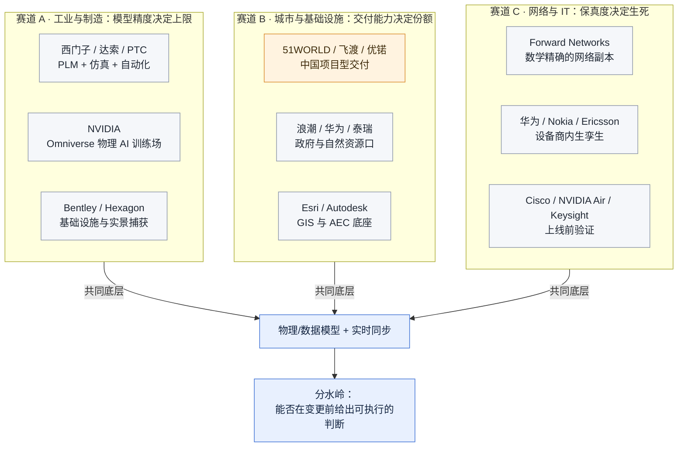

# 数字孪生三赛道 TOP10 —— 评估方法与总览

**调研对象**：全球及中国「数字孪生」相关厂商，按工业制造、城市与基础设施、网络与 IT 基础设施三个互不重叠的赛道分别排名。
**资料截止**：2026-10-19。财务数据以各公司最近一个完整财年（2025 财年）为准。
**核心结论**：数字孪生不存在统一可比的「市场份额」。任何一份声称排出全球第一的榜单，都在偷偷切换口径。本报告不追求一个跨赛道的总冠军，而是给出三条赛道内可复现的评分与证据链。

---

## 0. 先回答三个会被问倒的问题

### 0.1 为什么不存在「数字孪生第一名」

三个断裂点，任何一个都足以让跨赛道排名失效：

| 断裂点 | 具体表现 | 后果 |
| --- | --- | --- |
| **收入科目不存在** | Siemens 明确不单独披露「数字孪生收入」；其 FY2025 数字工业软件收入 €61.74 亿是整个软件组合，孪生只是其中一部分 | 所有「份额」都是咨询机构的模型估算，不是审计数字 |
| **产品定义不一致** | 工业侧孪生 = 物理模型 + PLM 数据延续；城市侧孪生 = 三维可视化 + IoT 接入；网络侧孪生 = 配置与转发表的数学副本 | 三者的技术门槛、单价、客户完全不同，横向比分数无意义 |
| **统计边界差异** | 同一年的全球市场规模，Fortune BI 口径 244.8 亿美元，GMI 口径 189 亿美元，IIM 口径 387.6 亿美元 | 差距 2 倍以上，源于是否计入系统集成、硬件、感知层 |

**处置**：本报告放弃跨赛道总排名，改为三张独立榜单 + 统一评分卡。跨赛道只在「落地实证强度」这一个维度上做对照，因为这是唯一口径一致的可比项。

### 0.2 谁在说「我是第一」，各自依据什么

这是本次调研最值得记录的一组冲突：

| 声称方 | 声称内容 | 依据 | 判定 |
| --- | --- | --- | --- |
| 51WORLD | 2024 年中国数字孪生解决方案收入第一 | 弗若斯特沙利文，写进港交所招股书（受保荐人尽调约束） | **采信，但限定于「解决方案收入」** |
| 飞渡科技 | 2024 年中国数字孪生平台市场 25.14% 第一 | IDC《中国数字孪生平台市场份额 2024》 | **采信，但限定于「平台软件」** |
| Siemens | 全球领导者 | 多家咨询机构估算 9.2%–10.0% | 采信为「量级参考」，非精确份额 |

两者不矛盾：IDC 统计的是**平台软件**（2024 年中国市场仅 6.28 亿元人民币），沙利文统计的是**解决方案收入**（含项目交付）。51WORLD 2025 年营收 3.48 亿元，远大于 IDC 的整个平台市场盘子——这正好证明两个口径不在一个池子里。

> **方法论要点**：看到「第一」先问三件事——统计的是软件还是项目？是收入还是台数？是哪个地理范围？三个答案不同，榜单就不能放在一起看。

### 0.3 厂商自述的收益数字该打几折

本报告对三类数字采用不同处理：

- **可审计**（财报、政府采购合同公告、交易所招股书）→ 直接采用，标 A 级
- **可复现的第三方评测**（GigaOm Radar、IDC MarketScape、Gartner Peer Insights 评分页）→ 采用，标 B 级，注明样本量
- **厂商新闻稿中的百分比收益**（如「效率提升 60%」「成本降低 40%」）→ 只在有客户方联合署名或运营商公开案例时采用，否则降为 C 级并标注「厂商自述」

---

## 1. 评估框架：六维打分卡

总分 100。权重不是拍脑袋，每个权重对应一个「如果这维不可信，结论会错到什么程度」。

| 维度 | 权重 | 判据 | 为什么给这个权重 |
| --- | --- | --- | --- |
| **D1 商业规模与装机实证** | 25 | 可审计营收、客户数、单实例部署规模 | 唯一难以伪造的维度。但注意：规模大 ≠ 孪生能力强，大厂营收主要来自非孪生业务 |
| **D2 独立第三方评价** | 20 | GigaOm Radar 象限、IDC MarketScape 象限、Gartner Peer Insights 评分与样本量 | 唯一能横向比较的外部锚点。样本量 <50 的评分不参与打分 |
| **D3 可验证落地与量化收益** | 20 | 客户侧公开的量化指标（事故率、检出率、耗时、收益金额），是否有客户方署名 | 区分「演示可用」与「生产可用」的分水岭 |
| **D4 采购与合同证据** | 15 | 公开中标金额、政府采购合同、多年期合同披露 | 证明有人真的付钱，且能看出单价量级 |
| **D5 技术保真度** | 10 | 模型是数学/物理精确还是可视化近似；是否支持变更前仿真与闭环回写 | 决定孪生是「决策依据」还是「大屏装饰」 |
| **D6 生态与可持续性** | 10 | 开放格式（OpenUSD/DTDL）、集成广度、盈利或现金流状况 | 决定五年后这个产品还在不在 |

### 1.1 一票否决项

命中任一条，不进 TOP10，无论其他维度多高：

1. **无任何客户侧证据**：只有官网案例页，没有客户署名、没有采购记录、没有第三方评测。
2. **孪生体与现网无同步机制**：纯静态三维模型，配置变更后不更新。这类产品在 2026 年已不能称为数字孪生。
3. **财务不可持续且无战略母体**：独立创业公司现金流失血且无上市公司/巨头托底（会直接影响五年期采购决策）。

### 1.2 评分如何读

- 分数是**区间中值**，真实不确定性约 ±5 分。不要用 0.5 分的差距做决策。
- 分项分必须能追到本报告引用的一条证据；追不到的写「未公开」并扣分，不猜。
- **同一家公司跨赛道不重复计分**。Siemens 只在工业榜，Bentley 只在城市榜（尽管它两边都能打），避免同一份收入被数两次。

---

## 2. 数据可信度分级

| 等级 | 定义 | 本报告中的典型来源 | 使用方式 |
| --- | --- | --- | --- |
| **A** | 可审计一手 | 上市公司财报、港交所招股书、中国政府采购网合同公告、公司投资者关系页 | 直接支撑数字 |
| **B** | 权威二手 | IDC 官方新闻稿、GigaOm Radar 新闻稿、Gartner Peer Insights 公开评分页、券商研报转述财报 | 支撑数字，注明转述 |
| **C** | 厂商自述 | 官网案例、新闻稿收益百分比、行业奖项申报材料 | 只用于证明「存在该能力」，不用于证明「效果有多好」 |
| **D** | 内容农场 / AI 生成报告站 | dataintelo、marketintelo、globalgrowthinsights、iim.net.cn 一类站点 | **不作为排名依据**，仅在交叉印证时参考 |

### 2.1 必须点名的 D 级陷阱

本次检索中，多个站点给出互相矛盾的「份额」：

- 同一站点称 Siemens 份额 10.0%，另一站点称 24%，第三处称 9.2%
- 某站点称「Cisco 网络自动化与数字孪生软件 FY2025 收入超 9 亿美元，同比增长 28%」——Cisco 财报中**不存在**该科目，该数字无出处
- 某站点称「Nokia 网络数字孪生已在 75 家以上大型运营商部署」——Nokia 官方新闻稿中**未出现**该数字，仅提及具体客户（如 fibertime）

**判定**：凡无法回溯到公司财报、官方新闻稿或政府采购公告的份额与客户数，一律不采信。这也是本报告部分厂商「客户数」栏写「未公开」的原因——不是没查，是查到的不可信。

---

## 3. 三赛道格局

三个赛道的商业逻辑差异，比技术差异更大：

| 维度 | 工业制造 | 城市与基础设施 | 网络与 IT |
| --- | --- | --- | --- |
| 买单人 | 工程/制造/研发部门 | 政府、城投、自然资源厅 | 网络运维/架构团队 |
| 付费模式 | 订阅许可（ARR） | 项目制（一次性） | 订阅 + 设备规模定价 |
| 单价量级 | 百万至千万级/年 | 数十万至数百万/项目 | 数十万至数百万/年 |
| 续费驱动力 | 设计数据沉淀带来的迁移成本 | 政策与考核 | 变更风险规避 |
| 失败模式 | 模型与实测不符 | 建成即大屏，无人使用 | 孪生体与现网漂移 |

---

## 4. 三张榜单速览

### 4.1 工业与制造 TOP10

| # | 公司 | 总分 | 一句话定位 | 最硬的一条证据 |
| --- | --- | --- | --- | --- |
| 1 | Siemens | 88 | 唯一打通「设计—仿真—产线自动化」的厂商 | 数字工业软件 FY2025 €61.74 亿，SaaS ARR €53 亿（+13%） |
| 2 | Dassault Systèmes | 86 | 虚拟孪生的原始定义者 | 2025 营收 €62.4 亿，3DEXPERIENCE Cloud +32% |
| 3 | PTC | 80 | 物联网 + PLM 的务实派 | FY2025 营收 $27.39 亿，ARR $24.8 亿（+10%），PLM +23% |
| 4 | NVIDIA | 78 | 物理 AI 时代的孪生算力底座 | Omniverse DSX Blueprint 成为多家平台商的仿真后端 |
| 5 | Bentley Systems | 75 | 基础设施资产孪生最强 | 2025 营收 $15.0 亿，订阅 $13.8 亿，+11% |
| 6 | Microsoft | 72 | 生态最大、OT 深度最浅 | DTDL 成为事实标准建模语言 |
| 7 | AVEVA（施耐德） | 70 | 流程工业运行孪生 | PI 系统是流程行业事实数据底座 |
| 8 | Emerson / AspenTech | 68 | 化工流程的物理模型精度标杆 | AspenTech 2025-03 并入 Emerson |
| 9 | Ansys（Synopsys） | 66 | 单物理场仿真精度最高 | FY2025 独立营收约 $23 亿，已并入 Synopsys |
| 10 | Hexagon | 62 | 实景捕获到孪生的闭环 | 制造智能分部净销售 €18.5 亿 |

### 4.2 城市与基础设施 TOP10

| # | 公司 | 总分 | 一句话定位 | 最硬的一条证据 |
| --- | --- | --- | --- | --- |
| 1 | 51WORLD（五一视界） | 82 | 中国唯一上市的数字孪生纯标的 | 2025 营收 3.48 亿元（+21%），51Aes 2.74 亿元 |
| 2 | 飞渡科技 | 78 | 平台软件份额第一 | IDC 2024 中国平台市场 25.14%，居首 |
| 3 | Bentley Systems | 76 | 工程级基础设施孪生 | iTwin 覆盖设计到运维全周期 |
| 4 | 优锘科技 UINO | 72 | 运维可视化转孪生最成功的一家 | 3000+ 客户（政府招商材料），C 轮 3 亿元 |
| 5 | 浪潮智慧城市 | 68 | 政府侧渠道最强 | IDC 2024 中国平台市场第二 |
| 6 | 泰瑞数创 | 66 | 实景三维 + 自然资源口 | 甘肃实景三维合同 662.9 万元（2025-05） |
| 7 | Hexagon | 64 | 测绘与实景捕获底座 | 全球测绘装机基础 |
| 8 | 华为 | 62 | 全栈但孪生非独立科目 | 智慧城市/园区整体方案 |
| 9 | Esri | 60 | GIS 底座，政府渗透深 | ArcGIS 为多城 CIM 平台底层 |
| 10 | Autodesk（Tandem） | 56 | AEC 设计数据直通运维孪生 | 与 Eaton 合作 Brightlayer 能源孪生 |

### 4.3 网络与 IT 基础设施 TOP10

| # | 公司 | 总分 | 一句话定位 | 最硬的一条证据 |
| --- | --- | --- | --- | --- |
| 1 | Forward Networks | 90 | 唯一做到数学精确的网络孪生 | Gartner Peer Insights 4.9/5（36 条），GigaOm 连续 4 年 Outperformer |
| 2 | 华为 | 86 | 现网规模落地最扎实 | 新疆联通配置错误检出率 >90%，动网人为失误 0 事故 |
| 3 | Nokia | 82 | 运营商接入网孪生最完整 | Altiplano 统一有源/无源 FTTH 孪生（2025-10） |
| 4 | Cisco | 76 | 实验室级孪生最普及 | CML 用真实 NOS 镜像构建网络副本 |
| 5 | NVIDIA | 74 | AI 工厂网络的上线前验证 | Air 支持芯片级 ASIC 仿真 + Omniverse 联动 |
| 6 | Keysight（含 Spirent） | 72 | lab-to-live 验证闭环 | 2025-10-15 完成 11.6 亿英镑收购 Spirent |
| 7 | Ericsson | 68 | RAN 侧孪生与自智网络 | Intelligent Automation Platform |
| 8 | Juniper（HPE） | 64 | 规划仿真 + 体验孪生 | Paragon Planner + Marvis Minis |
| 9 | VIAVI | 58 | 接盘 Spirent 剥离资产 | 4.1 亿美元收购以太网/安全/信道仿真业务线 |
| 10 | 新华三 / 中兴 | 55 | 国内运营商与政企替代选项 | 随设备捆绑交付，缺独立第三方评测 |

---

## 5. 跨赛道对照：谁的方法论值得抄

| 做法 | 出自 | 为什么值得关注 | 对网络孪生的可迁移性 |
| --- | --- | --- | --- |
| 数学精确而非采样近似 | Forward Networks | 用形式化模型算出「所有可能路径」，不是抽样探测 | 高。这是网络孪生与监控工具的根本分野 |
| 变更前仿真 + 事后回写比对 | 华为 iMaster NCE | 事前仿真、事中分批下发、事后验证，三段闭环 | 高。可直接映射到配置变更流程 |
| 有源 + 无源统一建模 | Nokia Altiplano | 把「看不见的哑资源」纳入孪生，消除库存误差 | 中。对应交换机端口/链路/光模块的物理层台账 |
| 物理 AI 训练场 | NVIDIA Omniverse | 孪生不只是看，还是训练与测试环境 | 中。可用于 AI 助手的离线评测 |
| 设计数据直通运维 | Bentley iTwin | 孪生体从设计模型继承语义，不是重新建模 | 低。网络设备无等价设计模型 |

---

## 6. 对锐捷 APM 的启示

> 前提：以下判断基于「APM 产品正在建设 Web 端 AI 助手、需要 AI 自主取数与根因分析」这一背景。

1. **网络孪生的门槛不在三维，在「可计算」**。Forward 与华为的实证都指向同一件事：客户买单的是「变更前能算出会不会炸」，不是「拓扑画得好看」。三维可视化在这条赛道是附属品。
2. **「检出率 >90%」比「效率提升 60%」更值得作为目标指标**。前者是二值可验证的（错了就是错了），后者容易被口径操纵。新疆联通的 90% 检出率、0 事故，是可以写进验收标准的表述方式。
3. **AI 助手与孪生是互补而非替代**。孪生负责「给定配置，算出网络行为」；AI 助手负责「决定要试哪几种配置」。没有孪生，AI 只能读历史指标；有孪生，AI 可以在虚拟环境里试错。这是本次调研中对自研最有价值的一条。
4. **不要做通用孪生平台**。工业侧被 Siemens/Dassault 锁死，城市侧被项目制拖死，网络侧的机会窗口在「多厂商 + 配置语义 + 变更验证」这一窄缝里。
5. **口径纪律**：对外宣传若引用收益数字，必须能落到客户方署名。本报告已出现多个无法回溯的「75 家运营商」「9 亿美元收入」案例，这类数字一旦被客户追问就会失分。

---

## 7. 局限

1. **财务颗粒度不足**：没有任何厂商披露「数字孪生」独立收入。本报告的规模判断依赖整体软件营收，属于上限估计。
2. **Gartner Peer Insights 样本偏差**：企业软件评分普遍偏高（4.5 以上常见），且主动评价者多为满意客户。本报告仅用样本量 ≥30 的评分参与打分。
3. **中国厂商数据可得性差**：优锘、飞渡、泰瑞均未上市，营收未公开，只能依赖 IDC 份额与政府采购公告侧面推算。
4. **并购导致的主体变更**：Ansys 已并入 Synopsys，Spirent 已并入 Keysight，Juniper 已并入 HPE。本报告按并购后主体计分，但产品线独立运营。
5. **未覆盖**：国防与航天专用孪生（如 Lockheed、Northrop 的内部平台）、医疗人体孪生（Dassault 的 Living Heart 属研究性质），因缺乏公开采购与评价数据，不纳入排名。

---

## 8. 信源链接总表

### A 级 · 可审计一手

| 事项 | 链接 |
| --- | --- |
| 51WORLD 港交所招股章程（含沙利文份额、营收） | https://www1.hkexnews.hk/listedco/listconews/sehk/2025/1218/2025121800030_c.pdf |
| 51WORLD 2025 年度业绩（营收 3.48 亿） | https://www.news.cn/enterprise/20260327/788b28a3a28a4603b8b528cdacc806cc/c.html |
| 飞渡科技中标公告（上海建设管理职院，38.5 万） | https://www.shcmc.edu.cn/2025/0529/c1123a7799/page.htm |
| 飞渡科技中标公示（深圳规划自然资源测绘中心，94.6 万） | http://sfcx.cn/ShowInfo.aspx?id=57896 |
| 飞渡科技中选公告（中国测绘科学研究院，24.8 万） | https://m.mnr.gov.cn/gk/czxx/zfcg/zbxx/202601/t20260130_2913667.html |
| 泰瑞数创政府采购合同（甘肃实景三维，662.9 万） | http://htgs.ccgp.gov.cn/GS8/contractpublish/detail/3c673db4-03d5-4872-8cfb-644acbdb3d7b |
| Keysight 完成收购 Spirent（£11.6 亿） | https://investor.keysight.com/investor-news-and-events/financial-press-releases/press-release-details/2025/Keysight-Technologies-Completes-Acquisition-of-Spirent-Communications-PLC/default.aspx |
| 华为山东移动获 Network X 2025 奖（含割接效率 +60%） | https://www.huawei.com/cn/news/2025/10/awards-networkx-chinamobile |
| Nokia Altiplano FTTH 数字孪生发布（2025-10-06） | https://www.globenewswire.com/en/news-release/2025/10/06/3161418/0/en/Nokia-launches-FTTH-digital-twin-and-AI-powered-tools-to-boost-network-reliability.html |

### B 级 · 权威二手

| 事项 | 链接 |
| --- | --- |
| IDC 中国数字孪生平台市场份额 2024（飞渡 25.14%） | https://www.idc.com/?p=104536/ |
| Forward Networks 获 GigaOm 2025 Network Validation Outperformer（连续 4 年） | https://www.forwardnetworks.com/blog/press-release/forward-networks-named-outperformer-in-the-2025-gigaom-radar-for-network-validation-for-the-fourth-consecutive-year/ |
| Forward Networks FY2025 业绩（多年期合同 +175%，5 万设备） | https://www.benzinga.com/node/50155213 |
| Forward Networks Gartner Peer Insights 评分页（4.9/5，36 条） | https://www.gartner.com/reviews/market/it-infrastructure-and-iot/vendor/forward |
| 51WORLD 上市首日与募资（上证报） | https://www.cnstock.com/commonDetail/611163 |
| 51WORLD 聆讯与沙利文口径（央视网财经） | https://finance.cctv.com/2025/12/17/ARTIwVmOLP8czueIbkvYJx1r251217.shtml |
| 河南移动 IP 网数字孪生（变更 60h→4h） | https://www.c114.com.cn/news/126/a1289683.html |
| Keysight / VIAVI / Spirent 三方交易分析（Appledore 22% 份额） | https://rcrtech.com/test-and-measurement-news/a-closer-look-at-keysight-viavi-acquisition-of-spirent |
| 全球数字孪生市场规模与厂商份额（GMI 口径） | https://www.gminsights.com/industry-analysis/digital-twin-market |
| 工业软件厂商财务复核（Siemens/达索/PTC/Bentley 交叉验证） | https://newmarketpitch.com/blogs/news/digital-twin-market-news |

### C 级 · 厂商自述

| 事项 | 链接 |
| --- | --- |
| 优锘科技官网（2000+ 客户，11 行业） | http://www.uinnova.cn/ |
| 优锘 3000+ 客户表述（泰安高新区招商稿，2025-03） | https://gxq.taian.gov.cn/art/2025/3/24/art_47832_10324585.html |
| 优锘融资历程（B+ 1.8 亿、C 轮 3 亿） | https://baike.baidu.com/item/UINO%E4%BC%98%E9%94%98/56978296 |
| Cisco Modeling Labs 官方定位为 practical digital twin | https://blogs.cisco.com/?p=489796 |
| NVIDIA Air 数字孪生能力说明 | https://news.nvinio.com/an-introduction-to-nvidia-air-16017.html |
| 新疆联通 IP 网络配置变更仿真（检出率 >90%） | https://www.5gxt.com/news/v37290.htm |

### D 级 · 不采信但需知道其存在

| 事项 | 链接 | 问题 |
| --- | --- | --- |
| 某站称 Siemens 份额 24%、Microsoft 20% | https://www.globalgrowthinsights.com/blog/digital-twin-technology-companies-994 | 与同业估算差 2 倍以上，无方法论 |
| 某站称 Cisco 孪生软件收入超 9 亿美元 | https://dataintelo.com/report/network-digital-twin-market | Cisco 财报无此科目，数字不可回溯 |
| 某站称 Nokia 已部署 75 家运营商 | 同上 | Nokia 官方新闻稿无此表述 |
| 中文聚合站的市场规模（244.8 亿美元） | https://www.sgpjbg.com.cn/searchtag/26290917.html | 与 GMI 的 189 亿美元口径不同，不能并列 |

> **使用建议**：D 级源在本报告中仅作为「存在这类说法」的记录，不参与任何打分。若读者在其他场合看到这些数字，可直接对照本表判断其可靠性。

---

## 附：三份分报告

- [[数字孪生-工业制造赛道TOP10-2026-10]]
- [[数字孪生-城市基础设施赛道TOP10-2026-10]]
- [[数字孪生-网络与IT基础设施赛道TOP10-2026-10]]
