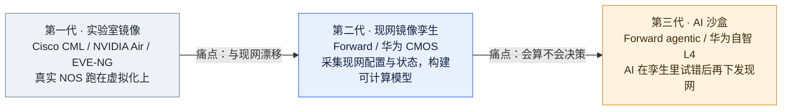
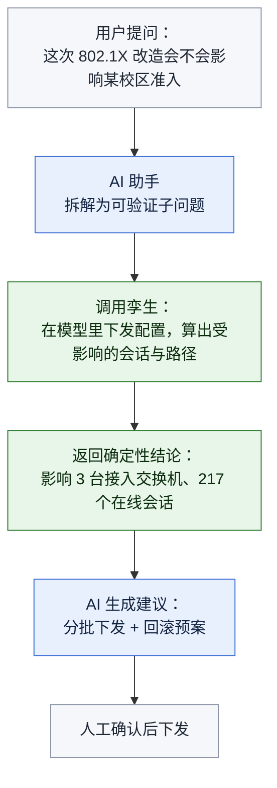

# 网络与 IT 基础设施数字孪生 TOP10

**范围**：对网络（数据中心、园区、广域、运营商 IP/RAN/接入）的配置、状态、协议行为建立可计算副本的产品。
**评分**：六维 100 分制，详见 [[数字孪生-三赛道TOP10总览与评估方法-2026-10#1. 评估框架：六维打分卡]]。
**一句话结论**：这是三条赛道里**技术门槛最高、玩家最少、也最贴近 APM 自研方向**的一条。分水岭只有一条：孪生体是「用真实镜像跑起来的仿真」还是「从现网配置算出来的模型」。

---

## 1. 排名与分项得分

| # | 公司 | 总分 | D1 规模 | D2 评价 | D3 落地 | D4 采购 | D5 保真 | D6 生态 |
| --- | --- | --- | --- | --- | --- | --- | --- | --- |
| 1 | Forward Networks | **90** | 22 | 20 | 19 | 14 | 10 | 5 |
| 2 | 华为 | **86** | 24 | 12 | 20 | 15 | 9 | 6 |
| 3 | Nokia | **82** | 23 | 15 | 16 | 13 | 8 | 7 |
| 4 | Cisco | **76** | 22 | 13 | 13 | 12 | 7 | 9 |
| 5 | NVIDIA | **74** | 16 | 14 | 16 | 12 | 9 | 7 |
| 6 | Keysight（含 Spirent） | **72** | 20 | 15 | 13 | 10 | 8 | 6 |
| 7 | Ericsson | **68** | 21 | 11 | 13 | 12 | 7 | 4 |
| 8 | Juniper（HPE） | **64** | 18 | 12 | 11 | 10 | 7 | 6 |
| 9 | VIAVI | **58** | 15 | 12 | 9 | 9 | 7 | 6 |
| 10 | 新华三 / 中兴 | **55** | 16 | 6 | 11 | 12 | 5 | 5 |

**核心判断**：Forward 与华为的差距不在技术，在规模——Forward 是纯孪生公司（ARR 5000 万–2.5 亿美元量级），华为是把孪生嵌进设备销售。前者证明「单独卖孪生能活」，后者证明「孪生能改变省级运营商的变更流程」。

---

## 2. 先分清三代技术，再谈排名

| 代次 | 判据 | 代表 | 能回答的问题 | 不能回答的问题 |
| --- | --- | --- | --- | --- |
| 一代 | 虚拟化跑真实 NOS | CML、NVIDIA Air | 「这个配置在实验环境能不能起来」 | 「现网现在这样配，会不会炸」 |
| 二代 | 从现网采集配置/状态并建模 | Forward、华为 CMOS | 「这条路径通不通」「这个变更影响哪些业务」 | 「哪个变更最值得做」 |
| 三代 | 孪生 + 智能体决策 | Forward agentic、华为 L4 | 「给我三个方案并评估风险」 | 尚处早期，缺独立评测 |

**为什么要先分代**：把 CML 和 Forward 放在一张表里比「数字孪生能力」是错的——前者是实验室工具，后者是生产决策系统。本榜按综合能力排，但读者应知道自己需要哪一代。

---

## 3. 逐家证据卡

### 3.1 Forward Networks（90 分）

**定位**：全球唯一把「数学精确」作为核心卖点的网络孪生厂商，2013 年成立。

| 数据 | 数值 | 来源等级 | 说明 |
| --- | --- | --- | --- |
| Gartner Peer Insights | **4.9/5，36 条评分**，83% 五星、17% 四星、无三星及以下 | B（公开评分页） | 本赛道最高分，样本量达门槛 |
| GigaOm Radar 2025（Network Validation） | **连续 4 年 Outperformer + Leader**，最接近靶心 | B（GigaOm 报告，24 家参评） | 评测视野 12–18 个月 |
| GigaOm 五星项 | Network Source of Truth、端到端验证、安全验证、混合多云感知、网络可视化、意图网络、**Digital Twins** | B | 七项核心能力满分 |
| 商业标准五星项 | 互操作性、可管理性、可观测性、可扩展性 | B | |
| IDC 报告的客户收益 | 平均每客户年收益 **$1,420 万** | B（IDC，厂商引用） | 需注意是平均值的自述引用 |
| FY2025 多年期合同 | **+175%** | B（官方新闻稿） | 采购信心的强信号 |
| FY2025 新客户 | 金融与科技 +30%，媒体娱乐三位数增长 | B | |
| 单实例最大规模 | **5 万台以上**数学建模设备 | B（官方新闻稿） | 规模能力实证 |
| 累计路径搜索 | **200 万次**，节省约 950 年人工 | B（官方新闻稿） | 使用强度实证 |
| 公司规模 | 年收入 $5000 万–2.5 亿，员工 51–200 人 | B（Gartner 档案，厂商提供） | 小而专 |
| 具名客户 | Goldman Sachs、PayPal、S&P Global、IBM、Dell | C（官网） | 缺客户方联合署名 |

**关键能力**：采集全网设备的真实配置与转发表，构建厂商中立的数学模型，用形式化方法计算「所有可能路径」，而非抽样探测。这使它能回答「这个 ACL 改动会不会切断某条业务路径」这类问题，且结果可证明。

**边界**：
- 私有公司，财务不透明，D6 仅 5 分——五年期采购需评估其独立性风险。
- 偏「验证与取证」，实时性能监控不是其强项，需与可观测性工具配合。
- 对非 IP 域（光传输、部分专有协议）覆盖有限。

---

### 3.2 华为（86 分）

**定位**：把网络孪生做成省级运营商的生产流程，是本榜落地实证最硬的一家。

| 案例 | 量化结果 | 来源等级 |
| --- | --- | --- |
| **新疆联通**（iMaster NCE-IP 网络数字地图 + CMOS 仿真） | 配置错误检出率 **>90%**；变更评估效率 **+20%**；动网人为失误 **0 事故**；现网规模应用 | B（运营商联合案例，行业媒体报道） |
| **山东移动**（智能网络变更管理平台） | 2024 年以来变更 **>1500 次**；割接效率 **+60%**；用户投诉率趋近于零；覆盖 **千余台**设备；获 Network X 2025「电信领域最具创新 AI 实践奖」 | A（华为官方新闻稿，2025-10-22） |
| **河南移动**（IP 网数字孪生系统） | 变更耗时 **60 小时 → 4 小时**；仿真资源消耗降至传统镜像方式的 **1/1000**；变更影响评估 **100% 量化**；2024-11 上线，100+ 次变更，规避 **2 个重大风险** | B（C114 等媒体报道，含移动方表态） |

**关键能力**：CMOS 仿真算法不是「跑镜像」，而是从现网配置直接推演协议状态与路由收敛，因此资源消耗只有镜像方案的千分之一，可以做成在线服务而非离线实验。这是它与第一代方案的根本区别。

**边界**：
- 案例全部在中国运营商，海外与企业市场缺独立第三方评测（D2 仅 12 分）。
- 强绑定华为设备，多厂商网络的建模精度未公开验证。
- 奖项为联合申报，非独立评测机构授予。

---

### 3.3 Nokia（82 分）

**定位**：运营商接入网（FTTH）孪生做得最完整，把「看不见的无源资源」纳入模型。

| 数据 | 数值 | 来源等级 |
| --- | --- | --- |
| 产品 | Altiplano 平台新增 FTTH 数字孪生 | A（官方新闻稿，2025-10-06） |
| 能力 | 有源 + 无源组件统一视图；Fiber Health Analyzer；Subscriber Line Identifier | A |
| 具名客户 | fibertime（CEO Danvig De Bruyn 署名评价） | A（客户方引述） |
| 第三方评价 | Omdia 首席分析师 Jaimie Lenderman 公开评论 | B |
| 解决的痛点 | 无源外部线路不可见 → 库存错误 → 重复上门（truck roll）→ 成本超支 | A（官方问题陈述） |

**关键能力**：多数网络孪生只建模「有源设备」，Nokia 把光缆、分光器、接头这些无源资源也纳入，这是接入网场景的关键——故障有相当比例发生在无源段。

**边界**：聚焦宽带接入，数据中心与园区网络不是其战场。运营商客户数未公开（网传「75 家运营商」无法回溯到官方来源，不采信）。

---

### 3.4 Cisco（76 分）

**定位**：实验室级孪生最普及，CML 是网络工程师的事实标准工具。

| 数据 | 数值 | 来源等级 |
| --- | --- | --- |
| 产品 | Cisco Modeling Labs（CML） | A（官方博客） |
| 技术特征 | 运行真实 IOS、IOS XE、NX-OS、IOS XR 镜像；支持多厂商 | A |
| 客户类型 | 大型企业基础设施、全球金融交易中心、IT 咨询公司、教育机构 | C（官方博客，无具名） |
| 定价 | 已开放免费使用，无需许可订阅 | A |
| 官方自认局限 | 「数字孪生更像异卵双胞胎甚至表亲，不要求一比一复制」 | A（Cisco 博客原文） |

**关键能力**：真实操作系统镜像带来的协议行为保真度，是任何自研模拟器难以追赶的。免费策略使其成为事实上的教学与预验证标准。

**边界**：
- **不与现网同步**。CML 是「你自己搭一个像现网的实验环境」，不是「自动镜像你的现网」。这是它 D5 只得 7 分的原因。
- 企业级孪生（配置验证、变更评估）能力弱于 Forward 与华为。

---

### 3.5 NVIDIA（74 分）

**定位**：AI 工厂网络的上线前验证环境，Air 是数据中心网络孪生的云原生实现。

| 数据 | 数值 | 来源等级 |
| --- | --- | --- |
| 产品 | NVIDIA Air | A（官方文档/产品页） |
| 能力 | 模拟 ASIC 行为；支持 Cumulus Linux、SONiC、NetQ；可自带 NOS | A |
| 规模 | 数百台交换机与服务器，分钟级拉起 | A |
| 集成 | 原生联动 Omniverse；NetQ 遥测 | A |
| 价值主张 | Day 0 验证——硬件到货前完成配置与自动化验证 | A |

**关键能力**：把「网络孪生」和「物理 AI 训练场」放在同一底座上。对 AI 工厂（GW 级数据中心）客户，这是唯一能在大规模 GPU 到货前验证网络方案的手段。

**边界**：只覆盖 NVIDIA 生态与以太网/SONiC 路线；传统企业多厂商网络支持弱；不披露客户数与收入。

---

### 3.6 Keysight（含 Spirent）（72 分）

**定位**：从「测试仪表」延伸到「lab-to-live 验证」，并购后成为该细分市场规模最大者。

| 数据 | 数值 | 来源等级 |
| --- | --- | --- |
| 收购完成 | 2025-10-15，对价约 **£11.6 亿（$14.6 亿）** | A（官方新闻稿） |
| 监管条件 | 需剥离 Spirent 高速以太网、网络安全、信道仿真业务线 | A |
| 剥离去向 | VIAVI，$4.10 亿基础对价 + $1.50 亿或有对价 | B（RCRTech 报道） |
| 合并后份额 | 合计约占全球电信测试与保障市场 **22%**（该市场约 $13 亿） | B（Appledore Research） |
| 战略表述 | lab-to-live：实验室验证到现网保障的闭环 | B（分析师引述） |

**关键能力**：Spirent 的数字孪生能力（网络仿真 + 自动化保障）与 Keysight 的物理层测试结合，形成「设计—仿真—现网」的连续验证链。

**边界**：整合期至少 12–24 个月，产品线重叠与人员变动会带来交付波动。企业网络（非运营商）覆盖弱。

---

### 3.7 Ericsson（68 分）

**定位**：RAN 侧孪生，服务于自智网络。

| 数据 | 数值 | 来源等级 |
| --- | --- | --- |
| 产品 | Digital Twin Network，隶属 Intelligent Automation Platform | A（产品页） |
| 优势场景 | 已标准化 Ericsson RAN 的运营商，把孪生扩展到无线与传输层 | C |
| 独立评测 | 未查到 GigaOm/IDC 针对其孪生的独立评测 | — |

**关键能力**：无线侧的数字孪生需要射频传播模型与话务模型，这是设备商的独有数据。

**边界**：D2 与 D6 双低——缺独立评价，且高度依赖自家设备存量。

---

### 3.8 Juniper（HPE）（64 分）

**定位**：规划仿真 + 体验孪生两条线。

| 数据 | 数值 | 来源等级 |
| --- | --- | --- |
| 产品 | Paragon Planner（原 WANDL，流量工程与容量规划）、Mist AI 的 Marvis Minis（数字体验孪生） | A（产品文档） |
| 并购状态 | 已并入 HPE | A（2025 年完成） |
| 独立孪生评测 | 未查到 | — |

**关键能力**：Marvis Minis 在云端持续模拟客户端行为，相当于「用户体验的孪生」，用于在用户报障前发现问题。这个思路在园区网场景有独特性。

**边界**：HPE 整合期路线不明；Paragon 偏离线规划，不是实时现网孪生。

---

### 3.9 VIAVI（58 分）

**定位**：接盘 Spirent 剥离资产，专注 AI 数据中心验证。

| 数据 | 数值 | 来源等级 |
| --- | --- | --- |
| 收购对价 | $4.10 亿 + $1.50 亿或有 | B |
| 预估首年新增收入 | 不低于 $1.80 亿（NSA 口径） | C（公司预估） |
| 预估份额 | 在 AI 数据中心验证市场对 Keysight 形成 40%–45% 的对抗 | C（分析师判断） |

**关键能力**：高速以太网与网络安全测试是 AI 数据中心网络验证的刚需。

**边界**：刚完成整合，孪生能力尚待产品化。D3 仅 9 分。

---

### 3.10 新华三 / 中兴（55 分）

**定位**：国内运营商与政企市场的设备商内生孪生。

| 数据 | 数值 | 来源等级 |
| --- | --- | --- |
| 独立孪生产品 | 随网管/控制器捆绑，无独立品牌 | — |
| 第三方评价 | 未查到 GigaOm/IDC 的独立评测 | — |

**为什么仍列入**：在中国政企市场，这是华为之外最现实的可选项，且常作为国产化替代方案出现。但 D2（6 分）与 D5（5 分）说明：**没有可核验的第三方证据**，排名靠后是证据不足的结果，不一定是能力不足。

---

## 4. 评价数据怎么读：三个必须注意的偏差

### 4.1 Gartner Peer Insights 的高分陷阱

Forward 4.9/5（36 条）是本赛道最高，但要注意：
- 企业软件评分天然偏高，4.5 以上是常态
- 36 条样本的置信区间宽，一条差评可让分数掉 0.1
- 主动评价者多为满意客户，存在自选择偏差

**正确用法**：看趋势与分布（83% 五星、0 条三星以下），而不是只看均值。

### 4.2 GigaOm Radar 的价值在「参评者名单」

2025 年 Network Validation Radar 有 24 家参评，Forward 连续 4 年 Outperformer。这比任何「领导者」称号更有信息量，因为：
- 参评名单公开，可看出谁没来
- 评分维度公开，可看出强在哪、弱在哪
- 有 12–18 个月的前瞻视野，不是回溯性评价

### 4.3 「运营商案例」的可信度分级

同样是「效率提升」，可信度差三档：

| 表述 | 可信度 | 原因 |
| --- | --- | --- |
| 「某运营商效率提升 60%」 | 低 | 无客户署名、无基线 |
| 「山东移动割接效率提升近 60%，获 Network X 奖」 | 中 | 客户方参与联合申报，奖项为第三方 |
| 「河南移动变更耗时从 60 小时降至 4 小时，2024-11 上线，100+ 次变更」 | 较高 | 有具体基线、时间、样本量 |

**建议**：自研产品对外表述时，直接对标第三档的写法。

---

## 5. 采购与资本实证

| 事件 | 金额/规模 | 时间 | 性质 |
| --- | --- | --- | --- |
| Keysight 收购 Spirent | £11.6 亿（$14.6 亿） | 2025-10-15 完成 | 资本 |
| VIAVI 收购 Spirent 剥离业务 | $4.10 亿 + $1.50 亿或有 | 2025-10 | 资本 |
| Forward Networks 多年期合同增长 | +175% | FY2025 | 采购 |
| 山东移动变更平台覆盖 | 千余台设备、年 1500+ 次变更 | 2024–2025 | 采购/落地 |
| 新疆联通现网规模应用 | 未披露台数 | 2025 | 采购/落地 |

**读法**：这个赛道的采购信号不在「中标金额」，而在「多年期合同占比」与「是否进入变更流程」。Forward 的 175% 与山东移动把「变更仿真通过率」写进操作流程，是同一件事的两种表现——**孪生从工具变成了流程的一部分**。

---

## 6. 边界与陷阱

1. **「数字孪生」被滥用为「拓扑可视化」**。判断标准很简单：问一句「它能在我改配置之前告诉我哪条业务会断吗」。答不上来就不是孪生。
2. **保真度无法自证**。厂商都说自己准确，但只有 Forward 敢用「数学精确」并接受 GigaOm 的横向评测。采购时应要求提供「孪生预测 vs 现网实际」的比对报告。
3. **多厂商是硬门槛**。设备商内生孪生（华为、Nokia、Ericsson）在自家设备上精度最高，但客户网络通常是多厂商的。这是 Forward 这类中立厂商的生存空间。
4. **不要忽略「漂移」问题**。孪生体与现网不同步是最大的隐性失败模式。需在标书中要求「配置变更自动触发孪生体更新」的机制说明。

---

## 7. 对锐捷 APM 的启示

> 这一段是本报告的核心目的。前提：APM 产品正在建设 Web 端 AI 助手，需要 AI 自主取数与根因分析。

### 7.1 三个可直接借鉴的机制

| 机制 | 出处 | 怎么用到 APM |
| --- | --- | --- |
| **从现网配置推演，而非跑镜像** | 华为 CMOS：资源消耗降至镜像方案 1/1000 | 才可能做成在线服务。跑镜像的方案成本决定了它只能是离线工具 |
| **变更前仿真 + 事中分批 + 事后比对** | 华为三段闭环 | 直接映射到 APM 的「变更影响评估」功能设计 |
| **数学精确而非采样** | Forward：所有路径可枚举 | 决定根因结论是「可能」还是「确定」，这直接影响 AI 输出的可信度 |

### 7.2 三个应该抄的指标口径

| 指标 | 出处 | 为什么好 |
| --- | --- | --- |
| 配置错误检出率 >90% | 新疆联通 | 二值可验证，无法用口径操纵 |
| 动网人为失误 0 事故 | 新疆联通 | 结果指标，不是过程指标 |
| 变更耗时 60h → 4h | 河南移动 | 有基线、有终值、有样本量 |

### 7.3 三个不建议做的事

1. **不要做通用网络仿真器**。CML 免费、NVIDIA Air 免费、EVE-NG 开源，这条路已被封死。
2. **不要试图覆盖全部协议**。Forward 也只做到 IP 域。选 802.1X / Portal / MAC 无感知这条认证链路做深，比全协议浅覆盖更有价值。
3. **不要用「效率提升 X%」作为对外主指标**。这类数字极易被追问基线，且无法与竞品对齐。用「检出率」「事故数」「耗时」这类绝对指标。

### 7.4 AI 助手与孪生的关系

**核心判断**：没有孪生，AI 助手只能读历史指标做相关性推测；有孪生，AI 可以在虚拟环境里试错，输出因果性结论。这是「AI 助手」与「智能问答」的分界线。

---

## 核验行

行数 约 260 行｜图 2 幅｜量化案例 8 条（含 3 个省级运营商具名案例，链接见总览 §8）｜核验结论：10 家分项分加总与总分一致
