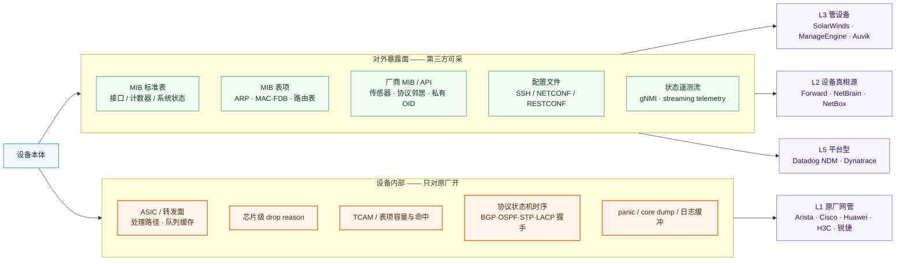

# 0 范围与判据

> **本文只回答一个问题**：哪些公司的**产品叙事是以网络设备为中心**的？
>
> 不是"谁有设备监控功能"（那几乎人人都有），而是"**它的产品如果抽掉设备这一步就不成立**"。

**三条判据，必须同时满足：**

| # | 判据 | 反例（因此被排除） |
| --- | --- | --- |
| 1 | **数据源以设备本身为准**：MIB / CLI / API / 配置文件 / 状态遥测流 | NETSCOUT、Kentik 以**流与包**为准；Datadog 以 host 与云资源为准 |
| 2 | **价值锚点是设备的清单·健康·配置·变更** | ThousandEyes 锚点是**路径与体验**；Datadog 锚点是应用与 trace |
| 3 | **出问题时第一现场是设备**，而不是应用、链路或路径 | PagerDuty / BigPanda 第一现场是**告警与工单** |

按这三条筛完，**只有 9 家左右的产品叙事真正以设备为轴**，而且它们分成三个互不重叠的层次。下文逐个展开。

---

# 1 分层总览

```mermaid
flowchart TB
  subgraph L0["L0 · 设备本体"]
    A0["交换机 / 路由器 / 防火墙<br/>ASIC · 表项 · 协议栈 · 传感器 · 日志缓冲"]
  end

  subgraph L1["L1 · 原厂自带网管 —— 唯一读得到设备内部"]
    B1["Arista CloudVision + NetDL"]
    B2["Cisco Catalyst Center / Meraki"]
    B3["Huawei iMaster NCE / eSight"]
    B4["H3C U-Center"]
    B5["Aruba Central / Juniper Mist / Extreme / UniFi"]
    B6["锐捷自研网管 · 即自研侧"]
  end

  subgraph L2["L2 · 设备真相源 —— 读配置，不读芯片"]
    C1["Forward<br/>数字孪生 + NQE"]
    C2["NetBrain<br/>动态拓扑 + Golden Assessment"]
    C3["NetBox Labs<br/>IPAM / DCIM 建模"]
  end

  subgraph L3["L3 · 管设备 —— SNMP / API / CLI 轮询"]
    D1["SolarWinds Orion"]
    D2["ManageEngine OpManager"]
    D3["Auvik"]
    D4["PRTG / LogicMonitor / Zabbix 等"]
  end

  subgraph L4["L4 · 看流量与路径 —— 设备只是监测点"]
    E1["NETSCOUT · Kentik"]
    E2["ThousandEyes"]
  end

  subgraph L5["L5 · 应用与云可观测 —— 设备是顺带"]
    F1["Datadog NDM · Dynatrace · Elastic"]
  end

  A0 --> B1
  A0 --> B2
  A0 --> B3
  A0 --> B4
  A0 --> B5
  A0 --> B6
  A0 --> C1
  A0 --> C2
  A0 --> C3
  A0 --> D1
  A0 --> D2
  A0 --> D3
  A0 --> D4
  A0 --> E1
  A0 --> E2
  A0 --> F1

  classDef raw fill:#F2F7FD,stroke:#0071E3,stroke-width:1px,color:#0B2B4A
  classDef own fill:#FFF4EA,stroke:#E8792A,stroke-width:1px,color:#4A2A0B
  classDef truth fill:#F1FAF3,stroke:#2E9E5B,stroke-width:1px,color:#0B3A22
  classDef nms fill:#F7F3FD,stroke:#7A5AF8,stroke-width:1px,color:#241458
  classDef out fill:#F4F4F5,stroke:#9AA0A6,stroke-width:1px,stroke-dasharray:4 3,color:#3C4043

  class A0 raw
  class B1,B2,B3,B4,B5,B6 own
  class C1,C2,C3 truth
  class D1,D2,D3,D4 nms
  class E1,E2,F1 out
```

**一句话读法**：越靠上，越接近设备内部；越靠下，越是在设备外面绕。**真正"以设备为中心"的是 L1、L2、L3 三层**——L4 与 L5 只是把设备当数据源或监测点之一。

---

# 2 L3 · 管设备：把设备当作"被管理对象"

这一层是设备侧最红海、也是最"传统"的一档。共同特征：**以 SNMP 轮询为根基，以设备清单、接口指标、配置备份为交付物**。

## 2.1 SolarWinds —— Orion 几乎成了 NPM 的代名词

| 维度 | 内容 |
| --- | --- |
| **叙事一句话** | 一个平台管住你所有设备的"通不通、忙不忙、改了什么" |
| **数据源** | SNMP 轮询为主 + WMI + NetFlow/sFlow/IPFIX + Syslog + CLI 配置文件抓取 |
| **叙事核心** | **Orion Platform** 作为统一底座，用模块把"设备域"切干净：**NPM**（设备与接口性能）/ **NCM**（配置备份、合规、变更对比）/ **NTA**（流量分析）/ **VNQM**（VoIP 质量）/ **SAM**（服务器应用）/ **DPA**（数据库） |
| **两个招牌能力** | ① **PerfStack**——把网络、服务器、流量、应用的指标拖到同一时间轴上做跨域关联，是"设备问题还是应用问题"的仲裁器；② **NetPath**——把设备到云服务的逐跳路径画出来，含云内跳数 |
| **客户与规模** | 中大型企业 / MSP / 教育 / 公共部门，尤其**"Windows 重、本地部署为主"的传统 IT 团队**。客户 300,000+。1999 年成立；**2025-04 被 Turn/River Capital 以约 $44 亿全现金收购，已私有化退市**（A 级）。FY2024 营收 **$796.9M** |
| **定价** | 按节点/元素计，**NPM 约 $1,638/年起**（C 级）。订阅与永久许可并存 |
| **最难复制的资产** | **THWACK 社区**——20 万+ 成员，海量模板、脚本、自定义轮询器。设备侧的"长尾适配"被社区摊掉了 |
| **叙事边界** | ① **指标全部来自 MIB**，看不到设备内部；② 云原生、多云、外部互联网可见性明显落后——这正是 ThousandEyes / Kentik / LogicMonitor 抢它的方向；③ 2026-04 推 **SW1 "agentic AI 队友"** 是一次自救尝试 |

## 2.2 ManageEngine（Zoho）—— 用价格与产品线宽度覆盖设备侧

| 维度 | 内容 |
| --- | --- |
| **叙事一句话** | 用十分之一的价格，把 SolarWinds 那套东西做全 |
| **数据源** | SNMP / WMI / CLI / NetFlow·sFlow·IPFIX，本地与云双形态 |
| **叙事核心** | **OpManager** 正面打设备：自动发现、**L2/L3 拓扑地图**、机柜视图、CPU/内存/接口/延迟/丢包；周边用 **NetFlow Analyzer**（流量）、**OpUtils**（IP 地址 + **交换机端口管理**）、**NCM**（配置与合规）把设备域围起来 |
| **差异化打法** | **低价 + 90+ 款产品 + 本地/云双形态 + 免费版引流**。不与 Datadog/Dynatrace 同价位竞争，而是在 SolarWinds 的价格带里做"更便宜、更全、更灵活"的替代品——**在亚太与中国市场尤其有效** |
| **客户与规模** | SMB → 中大型企业 / MSP / IT 部门。母品牌 ManageEngine 2002 年设立，母公司 Zoho 私有、FY2025 营收约 **$16.2 亿**；服务 190+ 国家、28 万+ 企业（A/C 级） |
| **定价** | OpManager **Standard $245/年起（10 设备）**、**Enterprise $11,545（250 设备）**，有免费版；Site24x7 **$9/月起**（C 级） |
| **叙事边界** | ① 能力深度不及 SolarWinds（第三方评"集成少、留存期短"）；② 同样**止步 MIB**；③ 产品线过宽导致"每个都不算最强"是长期品牌代价 |

## 2.3 Auvik —— 把"接手一个陌生网络"这件事产品化

| 维度 | 内容 |
| --- | --- |
| **叙事一句话** | 接入后一小时内，自动给你一张结构化的网络图 + 一份资产台账 |
| **数据源** | SNMP + **FDB / ARP 表** + LLDP/CDP 邻接 + 交换机端口统计 + API（如 FortiGate FortiOS） |
| **叙事核心** | **自动发现 + 指纹识别 + 关系推断**三件事。官方口径指纹库覆盖 **100,000+ 设备型号**；四年 release notes 里占比最高的条目**始终是"新增识别的厂商与型号"**——它把识别覆盖度当护城河在长期经营 |
| **一个关键的精度取舍** | 专门投入去识别**堆叠**（Aruba → H3C → Cisco VSS → 华为 S 系列 → Meraki）。因为堆叠若被当成多台，会同时污染三样东西：**资产数量（计费）、告警（重复）、拓扑（连接错乱）** |
| **深度监控的四个维度** | ① **体验**：Network Latency & Jitter（2024-11，周期 ping 输出时延与抖动）；② **协议**：BGP 邻居监控（2025-05 GA）、OSPF 邻居监控（2025-07），三件套 = 状态 + 抖动 + **30 天历史**；③ **硬件**：风扇/电源（2024-11）、温度/转速/电压告警（2025-02 → 2025-07），官方称温度指标覆盖 **788,727 台设备**；④ **HA**：HA Pair Monitoring（2026-03），**备机经主机侧上报状态**，新增两类告警——`HA Role Change`（主机挂了）与 `HA Sync Status Issue`（**冗余已失效但业务还没受影响**） |
| **客户与规模** | **MSP 优先**，多云多租户。6,000+ 客户、110,000+ 网络（C 级）；私有（Great Hill Partners） |
| **定价** | 按计费设备计，中间设备约 **$27/设备/月**（C 级） |
| **叙事边界** | ① 采集器看不到的网段仍是盲区；② **协议与硬件指标都在 MIB 内**——BGP/OSPF 邻居状态、温度、风扇、电源都是标准或厂商公开 MIB；③ 2026-03 的备机策略**会推高计费设备数**，官方主动提示了这个取舍 |

## 2.4 这一档的补充名单（同层，简述）

| 公司 | 叙事一句话 | 关键事实 | 边界 |
| --- | --- | --- | --- |
| **Paessler PRTG** | 用"传感器"这个统一抽象把设备、接口、服务全量成可计数资源 | 250+ 传感器类型；100 传感器免费层；德国纽伦堡 | 传感器式计费在设备多时迅速变贵；深度浅 |
| **LogicMonitor** | Agentless 混合可观测，一台采集器管本地 + 多云 + 边缘 | **Hybrid Unit 计量**：1 unit ≈ 1 本地设备 / 1 云实例 / 7 个 K8s pod / 5 个无线 AP；Edwin AI；**2025-12 收购 Catchpoint** 补齐外网体验 | 设备只是它众多资源类型之一——**严格说它不属本文"设备为中心"** |
| **Zabbix / LibreNMS / Observium / OpenNMS / Checkmk / Icinga / Nagios** | 自建、免费、可控 | LibreNMS/Observium 的**设备识别库**是社区版 Auvik 的对应物；Zabbix 模板生态庞大 | 无厂商兜底、无 SLA、深度靠自建模板 |
| **Netreo / Entuity / IBM SevOne / Broadcom DX NetOps / Nokia NSP** | 更靠近运营商与强监管企业的设备与网络管理 | Netreo 已于 **2024 年被 BMC 收购**，成为 BMC Helix 的"网络补强件" | 独立叙事正在被收购稀释 |

> **这一档的共同天花板**：它们拿到的都是**设备愿意通过 MIB/API 说出来的话**。谁先说、说多细，由设备厂商的 MIB 实现决定——所以"能不能看到"，取决于**profile 写没写**，而不是工具的能力上限。

---

# 3 L2 · 设备真相源：把设备"配置"当真相，而不是把设备"指标"当真相

这一档与上一档的根本区别只有一句话：

> **L3 采的是设备的"状态"（通不通、忙不忙）；L2 采的是设备的"配置"（被设成什么样），然后把它变成可计算的模型。**

因为采的是配置，它们能做到 L3 做不到的事：**回答"这个包到不到得了"、"改这个配置会不会断"**。

## 3.1 Forward —— 把网络变成可穷举路径的数学模型

| 维度 | 内容 |
| --- | --- |
| **叙事一句话** | 网络是一个**可以计算的对象**，不是一张需要人看的图 |
| **公司** | 2013 年四位斯坦福博士创立，Santa Clara；**2026-05-20 更名 Forward**。核心产品 Forward Enterprise |
| **节奏** | 月度版本号，**45 个月发布 45 个版本（23.1–26.9），零跳月** |
| **数据源** | **无代理**采集 SSH / Telnet / SNMP / HTTP API，覆盖 L2–L7；**采集物是"设备被配置成什么样"**，不是流量与日志 |
| **叙事核心** | 用配置构建数学模型，**枚举所有可能转发路径**。所以"路径搜索"能在数秒内回答人工需要数天的问题——**它不是查数据库，是在模型上做一次计算** |
| **覆盖面策略** | 先主流（Cisco/Juniper/Arista/Palo Alto/F5）→ 再云（AWS→Azure→GCP→**IBM Cloud 26.2**）→ 再新架构（SD-WAN：Versa/VeloCloud/Prisma/Meraki；虚拟化：NSX-T/vCenter；**零信任：Zscaler ZPA 26.6**）→ 最后长尾（Brocade ADX、Extreme VDX、Dell OS6、HPE ComWare、Nokia）。**每补一家，就少一类客户说"我的设备你支持不了"** |
| **招牌能力** | ① **NQE** 查询语言（把"说不清的问题"变成可复现的计算）；② **变更前预测验证**（把生产从测试回路里拆出来）；③ **意图验证与合规自动化**（合规从抽查变成持续计算）；④ **Progressive Analysis**（23.9，快照处理到 60% 就先让用，并把边界标出来）；⑤ **Missing Connections**（26.6，把推断链路与**缺失的设备**一起标出——**让模型主动承认"我这里可能缺数据"**） |
| **数据完整性的四个正面回应** | 采集失败回填最长 5 天（宁可略微陈旧也不要**静默空洞**）；隔离区进不去 → **本地部署远程 Collector**（25.10，Bundled/Remote/Both）；支持跨隔离网段定向分配采集器（26.8）；内置"未采集的 CDP-LLDP 邻居"查询——**主动把"我可能没采到"暴露给用户** |
| **叙事边界** | 模型准确的前提是**采到真实配置**。对不支持 CLI/API 的封闭设备、无法解密的流量特征、纯非 IP 协议仍覆盖不到——所以它必须靠 Discovery 查询与 Missing Connections 把边界显性化，**而不是假装全覆盖** |

## 3.2 NetBrain —— 从"画图"长成"意图驱动的自动化层"

| 维度 | 内容 |
| --- | --- |
| **叙事一句话** | 解码你网络的 **DNA**（意图），然后持续拿现实去对比意图 |
| **公司** | Burlington, MA；V12.1 起引入 **Rule Discovery** |
| **数据源** | **SNMP + CLI + API** 自动发现多厂商混合云环境 |
| **叙事核心** | **实时数字孪生**（设备、连接、应用路径、意图）+ **Dynamic Map & Path**（双向动态图、A-B 路径、golden 路径）。数字孪生是自动化与诊断的**唯一真相源**，地图"持续更新"，不基于过期图纸 |
| **招牌能力** | ① **Rule Discovery + Golden Assessment Library**——从配置里反推出"你网络独有的规则"（例：38 台设备用 ACL 195 给 VoIP 做 QoS，**其中 6 台配错了**），并给出 300+ 现成评估项；② **Post-Mortem / Quick / Golden 三类持续评估**——把"一次事故的成因"扫遍全网，官方称构建"群体免疫"；③ **Safe Change & Auto-Remediation**——变更预审批、工单触发、**自动回滚**、防漂移护栏，**人在环上** |
| **Agentic 部分** | AI 票据分析、AI 推理加速 MTTI、AI 根因摘要、**AI 解析 CLI 输出并转成自动化动作**；官方口径 **每年减少 50% 停机时间**（厂商自述，量级参考） |
| **市场反馈** | Gartner **Voice of the Customer for Network Automation Platforms 2025** 中列为 Strong Performer，客户综合评分 **4.6/5**、推荐意愿 92%（A/C 级） |
| **叙事边界** | ① **操作在管理面**——官方自己说"operates directly on the management plane, goes beyond limited SNMP"，这句话反过来说明**它的视野仍是管理面**，不是芯片内部；② 数字孪生的准确性完全取决于配置采集的完整性；③ 自动化虽带护栏，但"改设备"这件事本身是安全团队的心理门槛 |

## 3.3 NetBox Labs —— 只回答"应该是什么"，把设备家底变成可版本化的数据

| 维度 | 内容 |
| --- | --- |
| **叙事一句话** | 先把"应该是什么样"变成机器可读、可版本化、可审计的数据模型；所有上层能力都只是它的消费者 |
| **公司** | 2023-01-17 成立、2023-02-28 从 NS1 分拆；纽约；创始人 Kris Beevers（原 NS1 CEO）+ **Jeremy Stretch（NetBox 项目创建者）**；累计融资 **$55M**（2023-04 A 轮 $20M → 2025-07 B 轮 $35M） |
| **资产** | 开源 **NetBox**（2016 年创建，2026-06 满十年；GitHub **21,682 star**，官方称 10,000+ 团队使用）+ **Orb**（可观测平台） |
| **叙事演进** | 2023–2024 **记得准** → 2024–2025 **对得齐**（发现真实状态、漂移检测、变更治理）→ 2026-06-11 升级为「**Infrastructure Intelligence Platform**」（覆盖 design→procurement→deploy→operate→refresh） |
| **建模深度（这是它最硬的地方）** | 4.2 面向运营商：VLAN Translation / Virtual Circuit / Q-in-Q / 每接口多 MAC；4.5 **Cable Profiles** 与多对多端口映射；4.6 Cable Bundles / Rack Groups；**4.7 把"冷"与"电"并列为物理资源**（CoolingSource/CoolingFeed…，AI 数据中心单机架 120kW 级功耗的必然结果）+ **channelized interfaces**（400G 拆 4×100G 建模为 channel）+ device type 增 **EOL 日期** |
| **两处关键工程判断** | ① **tick-tock 发布策略**（4.4 起，大版本无破坏性变更）——直接回应"不敢升"这个最大阻力；② **NDX**（2026-06-11）——16,000+ 硬件型号、近 200,000 数据点、含 EOL / TDP / 气流 / NOS 识别 / SNMP OID·gNMI·NETCONF·Redfish 元数据，**每个数据点带来源与置信度** |
| **发现链** | Diode（摄取）→ Diode Agent → Discovery Agent（基于 Orb 分布式框架，**fan-out 并行、可部署在分段网络**）→ Discovery 商业方案（NETCONF/RESTCONF/gNMI/SSH/HTTP API/SNMP）；控制器集成：Catalyst Center（2025-12-30 GA）、vCenter（2026-01-08 GA）、Meraki（2026-01-30 GA）、Mist |
| **叙事边界** | **NetBox 本身不是采集系统**。它只回答"应该是什么"，不回答"实际是什么"——后者要靠发现与 Assurance 补齐。**单独部署 NetBox 而不做发现，很快会退化成"一个更漂亮的电子表格"** |

## 3.4 开源补充：Batfish

设备真相源这一档里，**Batfish** 是唯一把"配置 → 可达性计算"开源化的实现（配置解析 + 控制平面模拟 + 差分配置分析）。它的存在说明：**这类能力的技术门槛不在"能不能算"，而在"厂商适配的长尾"**——Forward 用 45 个月 45 个版本填的就是这个坑。

---

# 4 L1 · 原厂自带网管：唯一读得到"设备内部"的一层

这一档的特殊性只有一条，但它决定了一切：

> **设备内部（ASIC、表项、协议状态机、芯片 drop reason、日志缓冲区）不对外开放，或只对原厂开放。**

## 4.1 Arista CloudVision —— 公开材料里"设备侧深度"最有说服力的一家

| 维度 | 内容 |
| --- | --- |
| **叙事一句话** | **不妥协地拿到网络的完整状态**，实时 + 历史全留，然后再想在上面建什么应用 |
| **起点** | CloudVision **2015-06-23** 作为产品发布；2025 年满十周年 |
| **数据源** | **EOS 的 state streaming**（gRPC over HTTP/2 + Protocol Buffers），**NetDL Streamer 内嵌在每台 EOS 设备上** |
| **三个核心原则（官方自述）** | ① **full network data without compromise** ② **platform over point product** ③ **a modern operating model** |
| **最关键的一条事实** | 官方明确对比：**传统 SNMP 轮询拿不到大现代网络需要的粒度与实时性**。而 Arista 从一台 EOS 设备流出来的数据，**"大致相当于连续输出最多 2,000 条 `show` 命令"** |
| **工程细节** | 状态变化**驱动**而非间隔轮询，**毫秒级**打时间戳；单设备带宽占用 **25kbps–200kbps**，可限速；CVaaS **保留 90 天**遥测；即使 100G+ 高速接口也走同一机制 |
| **平台层** | **NetDL（Network Data Lake）**——多租户、scale-out，从第一天就这么建，所以今天能直接卖 **Network-as-a-Service** 而不需要新造一个产品；**Studios** 做配置自动化；CVX 提供 REST / gRPC / OpenConfig 北向接口 |
| **战略含义（官方原话的意思）** | NetDL 的历史数据 + CVaaS 被官方称为"**AI for Networking 的基础前提**"——他们当年没预料到这一点，但现在把它当作**长期核心差异化** |
| **部署形态** | 本地设备（物理/虚拟）+ **CVaaS** 双形态 |

**为什么它值得盯**：它是唯一一家把"**我比 SNMP 多看到多少**"当成产品主线来讲的厂商——并且给了一个可验证的比喻（≈2000 条 show 命令）。这条叙事对客户是**可感知、可对比**的，而"功能更多"不是。

## 4.2 这一档的其余玩家

| 厂商 | 设备侧平台 | 与设备的耦合方式 |
| --- | --- | --- |
| **Cisco** | **Catalyst Center**（原 DNA Center）/ **Meraki Dashboard** / **Crosswork**（运营商） | 自家设备 + telemetry；ThousandEyes / Splunk / AppDynamics 同属一家，形成"设备 + 网络观测 + APM"打包单元 |
| **Huawei** | **iMaster NCE**（含 FabricInsight 网络数字地图）/ **eSight** | 自家设备 + 控制器 |
| **H3C** | **U-Center**（iMC 血统） | 自家设备 |
| **HPE Aruba** | **Aruba Central** | 自家设备 + 云管 |
| **Juniper** | **Mist**（园区，AI 驱动运维）/ **Paragon**（运营商） | 自家设备 + 云管 |
| **Extreme** | **ExtremeCloud IQ** | 自家设备 + 云管 |
| **Ubiquiti** | **UniFi** | 自家设备，单一生态、极致性价比 |
| **锐捷** | 自研网管 | 自家设备——**唯一能拿到自家 ASIC/表项/协议状态机的一份** |

> **注意这里的不对称**：原厂网管的"深"不是产品能力的胜利，而是**身份带来的准入**。这也解释了为什么第三方平台永远只能做到 MIB 那一层。

---

# 5 边界图：那条"看得见 / 看不见"的线

这是全文最该记住的一张图。**线以上是第三方能拿到的，线以下是只有原厂能拿到的。**

## 5.1 三个必须讲清的精度问题

**① "表项"这件事要说准。** ARP 表、MAC/FDB 表、路由表**本身就在标准 MIB 里**（`ipNetToMediaTable`、`dot1dTpFdbTable`、`ipCidrRouteTable`），第三方**能读**。但要注意两件事：

- 第三方读它们的目的通常是**推断拓扑**，而不是回答"表项是否正确"——Auvik 就是拿 FDB + LLDP/CDP + ARP + 端口统计来推断连接关系的；**表的内容是副产品，不是产品价值**。
- **读得到"表的内容"，读不到"表的行为"**：ACL 命中计数、policymap 命中率、TCAM 占用与容量、表项溢出——这些基本走私有 MIB 或 CLI-only，且各厂商实现完整度差异极大。

**② "能不能看到"取决于 profile 写没写，不是能力天花板。** 一个反直觉的实证：**OSPF 邻居状态反而比 BGP 更容易采到**——因为通用设备 profile 本身就继承了 OSPF 相关分支，而华为 profile 里直接有 `hwOspfv2NbrState`（含 full/DR/BDR）；相比之下，**交换机自身经 SNMP 暴露的 BGP 邻居状态在主流平台的 profile 里反而"未见"**。这说明第三方平台的设备侧深度，**是一个"有没有人顺手写扩展"的偶然结果**。

**③ 一个可量化的不对称证据（A 级，2026-10-14 核实）。** Dynatrace Hub 里**有 HPE H3C Switch 扩展**（v1.0.0 发布 2025-09-12，v2.0.7 发布 2026-07-29，含接口错误/丢弃/多播广播单播计数、内存、CPU、uptime 等，消费 DDU 计费）；而 **Datadog 的 80+ device profiles 里 H3C 与锐捷均未见**。

> 两家拿到的**是同一层的东西**（都是 ActiveGate/Agent 上跑 SNMP），差的是**有没有人做这个适配**。不要把"某家支持我的设备"误读成"某家能力更强"。

---

# 6 排除清单：看起来像设备侧，但叙事不在设备

列这一节是为了防止口径被稀释。

| 公司 | 它的真实叙事中心 | 为什么不算设备侧 |
| --- | --- | --- |
| **NETSCOUT** | **全量数据包是唯一真相源**（DPI + 自研 Smart Data） | 设备只是它取流的**监测点**；它不回答"设备配置对不对""表项正不正常" |
| **Kentik** | **流与路由的互联网上下文**（flow + BGP + peering + 云成本） | 它的 NMS 是"顺带补齐"——**它的差异化在于互联网路由与对等互联的经济学**，不在设备 |
| **Cisco ThousandEyes** | **路径与数字体验**：全球节点主动合成探测 | 从"外面看"，设备侧是弱项；Traffic Insights（2025-05）才刚开始向"里面看"扩张 |
| **Datadog** | **应用、日志、云资源 + 统一 tag 模型** | NDM 是 80+ 集成里的一个；ASIC/FIB/TCAM/drop reason/STP/LACP/core dump **14 组检索全部"未发现官方能力"** |
| **Dynatrace** | **自动插桩 + 因果 AI + Grail 数据湖仓** | 网络设备走 ActiveGate 上的 SNMP 扩展，指标就是那套通用的；设备不是它的价值锚点 |
| **Elastic / Splunk（ITSI）** | **日志与安全数据平台** | 设备是数据源之一；Splunk 的网络能力靠收购与生态，不是产品主线 |

**一句判据**：如果一家公司把设备从产品里抽掉之后，**它的核心叙事仍然成立**，那它就不在这一档。

---

# 7 对自研（锐捷）的启示

| # | 启示 | 来源 | 为什么重要 |
| --- | --- | --- | --- |
| 1 | **"我能看到 2,000 条 show 命令的东西"是可对比、可验证的叙事；"功能更多"不是** | Arista CloudVision 官方对比 | 客户对"功能清单"已免疫。**能换算出量级差异的一句话**，比十个功能点更能推动决策——而这句话只有原厂能说 |
| 2 | **第三方永远停在 MIB 线以上，这条线是原厂的结构性护城河** | Dynatrace/Datadog 的 NDM 指标集完全同层；14 组关键词全部落空 | 不必在"设备清单 + 接口指标 + 硬件传感器"这条红海上和 SolarWinds/Auvik 拼价格——**那正是第三方追得上的地方** |
| 3 | **"表的内容"不值钱，"表的行为与边界"才值钱** | Auvik 拿 FDB/ARP 是为了推断拓扑；TCAM 容量、ACL 命中、表项溢出基本 CLI-only | 同样的数据，第三方用来画图，原厂可以用来看**表项是否正确、是否溢出、是否命中**——这才是设备侧真正的差异化落点 |
| 4 | **"静默缺失"比"算错"更致命，显性化缺失本身就是能力** | Forward 的 Missing Connections + Discovery 查询 + 采集回填 | 若做设备侧 AI 分析，**必须让 AI 说出"这部分我没看到"**。Forward 花四个版本机制化地做这件事，值得直接抄 |
| 5 | **协议邻居监控的"三件套"是被验证过的最小可用集** | Auvik：状态（现在坏没坏）+ 抖动（一直在抖吗）+ **30 天历史**（什么时候开始的） | "邻居现在是好的"和"邻居一直是好的"是两个结论。**没有历史，工程师无法决定要不要现在动手** |
| 6 | **监控"保障能力本身"，而不是监控"服务可用性"** | Auvik HA Pair Monitoring：`HA Sync Status Issue`——冗余已失效但业务还没受影响 | 这是从业务视角上移到**保障能力视角**的一次升级。原厂能直接读同步状态，第三方要绕一大圈还未必拿得到 |
| 7 | **身份是最大的产品优势：原厂网管天然是"设备真相源"的上游** | NetBox Labs 主动去集成 Catalyst Center / Meraki / Mist / CloudVision（2026-02 招募 Arista 设计伙伴） | 连 NetBox 都在把设备原厂当权威数据源。**原厂做可视化，起点是别人努力要接进来的地方** |

---

# 8 信源与局限

**信源分级**：A = 官方文档 / Release Notes / 官方定价页 / SEC 文件；B = 官方博客 / 新闻稿 / 官方 Hub；C = 第三方媒体、评测平台、聚合站。

**本篇的一手取证（2026-10-14）**：

| 事实 | 来源 | 等级 |
| --- | --- | --- |
| Dynatrace 网络设备监控走 ActiveGate 上的 SNMP 扩展；另有 Generic SNMP network device extension 兜底 | docs.dynatrace.com 网络设备监控入门指南 | A |
| Dynatrace **HPE H3C Switch** 扩展：v1.0.0 发布 2025-09-12；v2.0.7 发布 2026-07-29 | dynatrace.com/hub | A |
| Arista 状态流"≈ 最多 2,000 条 show 命令"；NetDL Streamer 25–200kbps/设备；CVaaS 保留 90 天 | blogs.arista.com（CloudVision 十周年） | A |
| CloudVision 2015-06-23 发布；NetDL 为多租户 scale-out 架构 | blogs.arista.com | A |
| NetBrain 官方口径"operates directly on the management plane, goes beyond limited SNMP"；Rule Discovery 自 V12.1 起 | netbrain.com | A |
| NetBrain Gartner Voice of the Customer for Network Automation Platforms 2025 Strong Performer，4.6/5、92% 推荐 | netbrain.com 博客引述 Gartner | A/B |

**复用本库既有报告**：Auvik（《Auvik 2023–2026 功能演进与用户痛点分析》）、Forward（《Forward 2023–2026 功能发布与痛点拆解》）、NetBox Labs（《NetBox Labs 2023–2026 功能体系与痛点解法》）、网络与 SRE 运维方向 TOP20（SolarWinds / ManageEngine / LogicMonitor / PRTG 事实）。

**必须声明的局限**：

1. **原厂那一档深度不足**。除 Arista 外，Cisco / Huawei / H3C / Aruba / Juniper 的设备侧能力**本文只给了定位，未做逐版本取证**——这些厂商的官方材料分散、区域口径不一，需要单独开报告。
2. **NetBrain 的财务与股权**（如 Blackstone 投资、约 $7.5 亿估值）**仅有 C 级信源**，未采用为论据。
3. **"未发现官方能力"是基于检索的否定结论**，不代表通过自定义 MIB/profile 一定做不到。
4. 本文所有厂商自述的量化收益（如 NetBrain"每年减少 50% 停机"、Auvik 温度覆盖 788,727 台设备）**均为量级参考**，未经第三方验证。
5. **Batfish 一节为定性补充**，未做版本级取证。

---

# 9 待补充与后续跟踪

1. **Cisco Catalyst Center / Crosswork 的设备内部可见性**：官方是否公开过类似 Arista"≈2000 条 show 命令"的量级对比？这是最有价值的一个缺口。
2. **Huawei iMaster NCE 与 H3C U-Center 的设备侧深度**：国产原厂在这条线上的公开材料最少，但**对锐捷的对标价值最高**，建议单开一份《国产网络原厂网管对标》。
3. **Arista CloudVision 的 AI for Networking 具体形态**：官方称 NetDL 是 AI 建模的基础前提，但具体产品化到什么程度、是否已有 agentic 能力，需要跟踪。
4. **NetBrain 被 Blackstone 投资后的产品路线**：是否从"网络自动化"进一步走向"agentic NetOps 平台"，以及对中国厂商的适配策略。
5. **L3 一档的整合走势**：Netreo→BMC、Catchpoint→LogicMonitor 已完成，SolarWinds 与 ManageEngine 是被收购还是独立走出 AI 叙事，值得跟踪。
