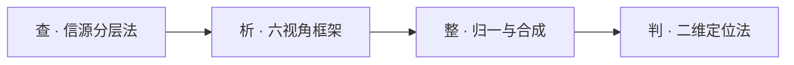

# 业界分析方法论 —— 从厂商资料到部门方向的四步框架

> **这份文档解决什么问题**
> 做业界分析时，最容易失败的地方不是"资料查不到"，而是**停在"厂商做了什么"这一层**，交出一叠无法比较的厂商简介，最后推不出部门该做什么。
> 本文给出一套可复用的四步方法：**查 → 析 → 整 → 判**。它有四个固定判据，换赛道只需换内容，方法不变。

---

## 0. 总纲：分析的实质是三次翻译

业界分析的完整链条是三次翻译，缺任何一次都会让结论失真：

1. **把"厂商做了什么"翻译成"客户为什么买单"** —— 功能 → 客户痛。
2. **把"单个厂商"翻译成"行业图景"** —— 个体 → 可比口径的集体。
3. **把"行业图景"翻译成"我们该做什么"** —— 事实 → 决策。

四步方法分别对应：**查**（获取事实）、**析**（完成第一次翻译）、**整**（完成第二次翻译）、**判**（完成第三次翻译）。

---

## 1. 查 · 信源分层法

### 1.1 原则

**任何一条事实的可信度，由它的来源级别决定，而不是由它出现的次数决定。** 被十篇二手文章转述的一句话，仍然只有二手可信度。

### 1.2 三级分层

| 等级 | 定义 | 能拿到什么 | 拿不到什么 |
| --- | --- | --- | --- |
| **A 官方一手** | 官网、官方文档 / Release Notes、官方博客、定价页、财报 / 监管文件 | **功能名 + 版本 + 精确日期**，唯一能支撑"功能级事实"的信源 | 客户侧体感、收益真实性 |
| **B 权威二手** | 官方新闻稿转载、主流行业媒体、研究机构公开稿 | 平台级发布的主题与日期、融资、客户案例 | 功能细节 |
| **C 第三方** | 产品评价平台、聚合站、百科 | **客户真实吐槽**、市场定位、竞品并列 | 准确性需交叉验证 |

### 1.3 三条判据

- **选择判据**：需要什么颗粒度，就去找对应级别。要"功能级事实"→ 只有 A 级能给；要"客户侧体感"→ 只能从 C 级拿；B 级用于补时间线与交叉验证。
- **冲突判据**：两条信源矛盾时，**不取平均、不选"看起来合理"的那条**——并列列出，说明各自出处，给出判断与理由。
- **局限判据**：拿不到就是拿不到，必须在结论前**显式声明"资料截止日期 + 颗粒度上限"**，让读者知道结论的边界在哪里。

---

## 2. 析 · 六视角框架

### 2.1 原则

**一个功能至少要回答三个问题才算被理解**：它做了什么、解决谁的什么痛、怎么解以及解到什么边界。只回答第一个，就是摘要；回答全三个，才是分析。

### 2.2 六个视角

| 视角 | 回答的问题 | 用途 |
| --- | --- | --- |
| **功能** | 它做了什么 | 建立事实基础 |
| **痛点** | 解决谁的什么痛 | 说明为什么会有人买单 |
| **机制** | 怎么解、边界在哪 | 说明它凭什么解得动 |
| **演进** | 时间上的变化规律 | 判断行业朝哪走、什么正在过时 |
| **商业** | 定价单位、客户规模 | 判断谁在为它付钱、钱从哪来 |
| **技术** | 架构约束 | 理解它为什么只能这么设计 |

前三者面向"它做了什么"，后三者面向"它为什么这么做、能走多远"。

### 2.3 因果链红线（最容易写错的一条）

> **客户痛 → 架构约束 → 技术选择**，方向不可逆。

**痛点是客户侧可感知的东西，只有五类**：

| 类别 | 具体表现 |
| --- | --- |
| **时间** | 定位慢、恢复慢、人力被占 |
| **钱** | 营收损失、SLA 罚金、账单失控 |
| **人** | 能力绑在少数个人身上，离职即流失 |
| **合规** | 审计、监管举证困难 |
| **组织** | 跨团队扯皮，没有共享证据 |

凡是**架构层问题**（schema-on-write 行不通、存储与计算耦合、查询语言学习门槛高、日志格式杂乱），都只是**设计约束**，属于"如何解决"里的必要性论证，**不属于痛点**。从技术实现倒推客户价值，写出来的"痛点"客户根本感知不到——这叫**架构自证**，是错的。

### 2.4 一一对应判据

痛点编号 **P1…Pn** 与解法编号 **S1…Sn** 必须一一对应：

- **不允许悬空痛点**：凡提出的痛点，必须有解法回应（一条痛点可由多条解法共同覆盖，但须显式标注"→ 解 Pn"）。
- **不允许悬空解法**：凡给出的功能 / 机制，必须能指回某条客户痛点。技术演进、生态配套、定价机制这类找不到痛点归宿的内容，**单列"配套演进"**，不混进解法。

---

## 3. 整 · 归一与合成

### 3.1 原则

**不同厂商的资料默认不可比。可比性是造出来的，不是天然的。**

### 3.2 归一是合成的前提

每家厂商都会自定义自己的功能分类——这家切 11 类，那家切 8 类，命名还各不相同（同一件事，A 叫 Event Correlation，B 叫 Event iQ，C 叫 Alert Grouping）。**直接合并只会得到一叠无法比较的摘要。**

必须先建一套**统一功能本体（taxonomy）**：定死若干标准功能域，再把各家的原始功能点**映射**进去。

> 映射不上的，说明本体有缺口——回头修本体，而不是硬塞进最接近的那一类。

### 3.3 两种整理产物

- **单体层**：每个厂商一份，每条功能**可溯源**（来源 + 日期 + 等级），保证"能查证"。
- **合成层**：跨厂商拉平口径后，才有资格做三张表：

| 合成表 | 形式 | 回答的问题 |
| --- | --- | --- |
| **功能收敛矩阵** | 厂商 × 统一功能域，标 ●主导 / ○跟进 / –缺失 / ⚡独家 | 哪些是行业标配（不做就出局）、哪些是差异化战场 |
| **痛点收敛表** | 痛点去重后按出现频次排序 | 多少家共提 → 是不是行业级刚需 |
| **演进阶段模型** | 时间轴上的共性节奏 | 行业从"做得到"走向"做得智能"的路径 |

### 3.4 校验判据

写完做**闭环检查**：痛点是否都有解法、解法是否都指回痛点、编号是否对齐、映射是否有孤儿项。任何一条不闭环，即为不合格。

---

## 4. 判 · 二维定位法

### 4.1 原则

**从分析到方向，不靠"哪个功能火就做哪个"，而靠两个正交维度的交叉。**

### 4.2 两个维度与四象限

- **横轴 · 行业刚需度**：这个功能是绝大多数厂商都有（不做就出局），还是只有少数在做（差异化战场）。
- **纵轴 · 我方差异化可能性**：我们有没有结构性优势能做出差异。

| 刚需 \ 差异化 | 我方有优势 | 我方无优势 |
| --- | --- | --- |
| **刚需高** | **投入做**，做成主打 | **跟随 / 采购 / 合作**，不硬扛 |
| **刚需低** | **顺手补**，作为完整性 | **明确不做**，写进"不做清单" |

> "不做清单"与分析结论同等重要——它把资源从"什么都能做一点"里解放出来。

### 4.3 两个校准维度

- **演进阶段**决定"**什么时候做**"：别去补上一代已完成、下一代正在淘汰的功能。要做的是下一代，或至少是当下一代。
- **商业模式**（定价单位、客户规模）决定"**卖给谁、怎么收钱**"：同一个功能，包装方式不同，客户与收入结构完全不同。

---

## 5. 三条反模式（避坑清单）

| 反模式 | 表现 | 后果 |
| --- | --- | --- |
| **架构自证** | 从技术实现倒推客户价值 | 写出的"痛点"客户感知不到 |
| **摘要堆砌** | 只做单体、没有归一与合成 | 交付一叠无法比较的厂商简介 |
| **功能罗列** | 只列功能、不问"解决谁的什么痛" | 分析退化成参数表 |

---

## 6. 完整示例：以"告警降噪与事件关联"为例走完四步

> **示例说明**：本示例用于演示方法论的使用方式，结论为演示性质。其中厂商能力为公开可查的定性事实，**具体日期与数值在实际执行时须按 A 级信源逐一复核**。

### 6.0 任务设定

假设我们要回答一个问题：**"告警降噪与事件关联"这件事，业界做到了什么程度？我们该不该做、怎么做？**

### 6.1 第一步 · 查

| 需要的东西 | 去哪找 | 级别 |
| --- | --- | --- |
| 功能级事实（各家到底做了什么） | 各厂商官方文档中关于事件关联 / 告警聚合的章节 | A |
| 发布时间与版本 | 有官方 Release Notes 的厂商（可逐版本查） | A |
| 客户真实体感 | 产品评价平台上关于 "alert fatigue" 的评价 | C |

**局限声明**：多数 AIOps 厂商不公开 changelog，功能只能到"能力级"而非"版本级"；本文结论截止到资料采集日。

### 6.2 第二步 · 析（以 BigPanda 为例）

**功能**：把来自多个监控源的告警，通过规则 + ML 聚合成一个"事件（Incident）"，并附加根因提示与变更关联。

**痛点**：

- **P1｜时间**：值班工程师被数百条告警淹没，平均定位时间从分钟级拖到小时级。
- **P2｜人**：只有少数资深工程师能"看懂"告警之间的关联，能力绑在个人身上，一人休假就无人能判。
- **P3｜组织**：网络、应用、数据库三个团队各自只看到一半现象，互相扯皮，缺少共享证据。

> 注意：此处**不能**写"告警格式不统一""多源数据难以归一"——那是设计约束，属于下面的"机制"。

**机制**：

| 架构约束（由痛点倒推） | 由哪条痛点推出 | 落到的功能 |
| --- | --- | --- |
| 必须在告警进入人的视野之前就完成归一与聚合 | P1、P2 | 多源接入与归一化 |
| 必须自动判定"哪些告警是同一件事" | P1、P2 | 拓扑 / 变更 / 历史关联聚类 |
| 必须让多个团队看到同一份事实 | P3 | 共享 Incident 视图与协作 |

- **S1｜多源接入与归一化**（→ 解 P1）：把异构告警统一到同一模型。
- **S2｜拓扑与变更关联的自动聚类**（→ 解 P1、P2）：用拓扑、变更、历史三类信号判断相关性。
- **S3｜共享 Incident 视图与协作**（→ 解 P3）：让不同团队在同一证据上协作。
- **边界**：关联准确率高度依赖拓扑数据质量；变更数据缺失时会退化为纯规则关联。

**其余视角**：

- **演进**：降噪（减少数量）→ 关联（找出真正的问题）→ 关联 + 变更因果（找出是谁引起的）→ Agent 自愈。
- **商业**：按接入告警量 / 事件量计费；客户是已有多套监控工具、又不愿推倒重来的大型企业。
- **技术**：定位为纯 agnostic 的**上层**，自己不采集数据、不替换原有工具——这是它能"寄生"在现有工具链上的根本原因。

### 6.3 第三步 · 整（归一 + 合成）

**先建统一功能本体**，把各家不同命名映射进来：

| 厂商 | 原始命名 | 映射到统一功能域 | 机制差异 |
| --- | --- | --- | --- |
| BigPanda | Event Correlation / Incident Intelligence | 事件关联与降噪 | 规则 + ML，纯 agnostic 上层 |
| Splunk | ITSI Event iQ / Episodes | 事件关联与降噪 | 必须建立在自有数据平台之上 |
| PagerDuty | Intelligent Alert Grouping | 事件关联与降噪 | 聚焦 on-call 场景，轻量 |
| Datadog | Watchdog / Event Correlation | 事件关联与降噪 | 内生于自家全栈数据 |

**合成结论**：

1. **功能收敛**：这是**行业标配**——几乎所有 AIOps / 可观测厂商都有，属于"不做就出局"。
2. **差异化在机制**：两种路线分野清晰——**agnostic 上层**（覆盖面广，但依赖客户已有工具）vs **内生于自有数据**（准确，但要求客户先把数据交给你）。
3. **痛点收敛**：P1（时间）与 P2（人）是各家共提的刚需；P3（组织）只有面向超大型企业的厂商强调。

### 6.4 第四步 · 判（二维定位）

| 维度 | 判断 |
| --- | --- |
| 行业刚需度 | **高** —— 几乎所有厂商都有 |
| 我方差异化可能性 | **高** —— 我们握有设备侧全量数据与网络拓扑，这是一般 agnostic 平台拿不到的结构性优势 |

**结论落在"刚需高 + 我方有优势"象限 → 投入做。** 但差异化点**必须**选在"利用设备侧拓扑与配置变更做关联"，**而不是**再做一层通用的多源告警聚合器——后者是跟随，且做不赢已经专注多年的专业厂商。

**同步产出的"不做清单"**：通用多源告警接入网关（低差异、高成本、别人已做透）。

**演进阶段校准**：不要只做"降噪"（上一代已普及），要直接做"关联 + 变更因果"，并预留 Agent 自愈的接口（下一代）。

### 6.5 示例小结

把四步串起来看，方法论真正在做的事是：

**先把痛点立住（P1–P3）→ 让架构约束从痛点倒推出来 → 让每个解法都指回某条痛点 → 最后用"刚需 × 差异化"两个正交维度，得出"做什么、不做什么、什么时候做"。**

缺了任何一环，结论都会退回到"某厂商有个功能，我们也可以做一个"——那不是方向，那是抄。

---

## 附录 · 可复用检查清单

**查**
- [ ] 每条功能级事实都能指到 A 级信源
- [ ] 客户侧体感有 C 级信源支撑，而非自述收益
- [ ] 冲突信息已并列列出并给出判定
- [ ] 已声明资料截止日期与颗粒度上限

**析**
- [ ] 痛点全部落在五类可感知范畴内（时间 / 钱 / 人 / 合规 / 组织）
- [ ] 没有把架构约束写进痛点
- [ ] 因果链方向正确：客户痛 → 架构约束 → 技术选择
- [ ] P1…Pn 与 S1…Sn 数量一致，且双向引用闭环
- [ ] 六个视角齐全，无遗漏

**整**
- [ ] 已建立统一功能本体，所有厂商功能完成映射
- [ ] 无映射孤儿项；如有，已回头修本体
- [ ] 三张合成表齐备：功能收敛矩阵 / 痛点收敛表 / 演进阶段模型
- [ ] 单体层每条功能可溯源（来源 + 日期 + 等级）

**判**
- [ ] 每个候选功能都放进了四象限
- [ ] "不做清单"已明确写出
- [ ] 用演进阶段校准了"什么时候做"
- [ ] 用商业模式校准了"卖给谁、怎么收钱"
- [ ] 结论指向决策，而非停在描述

---

*本文档为方法论沉淀，可跨赛道复用。示例部分为演示性质，正式调研中所有数值须按信源分级复核。*
