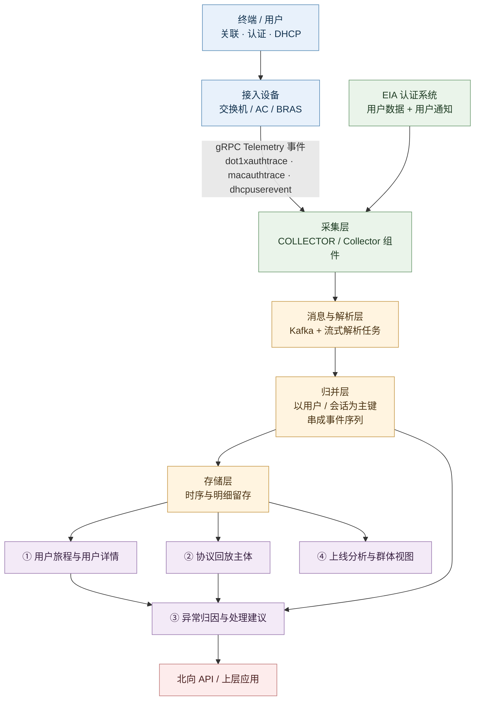
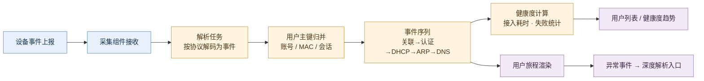
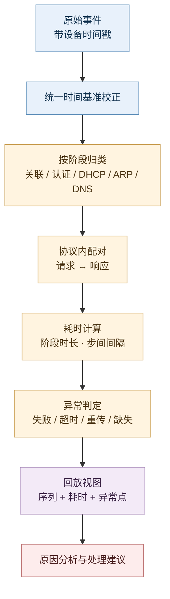
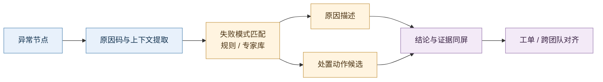
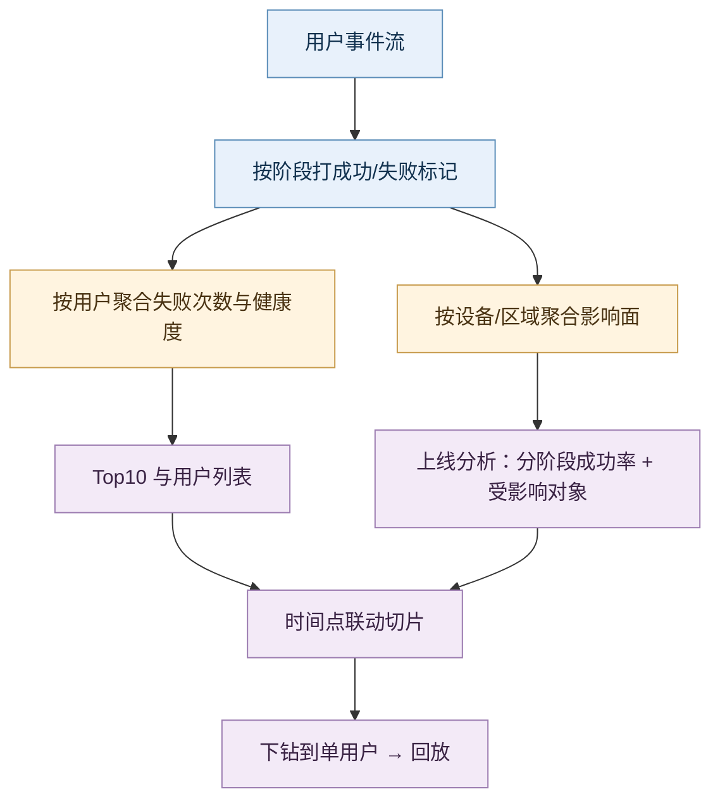
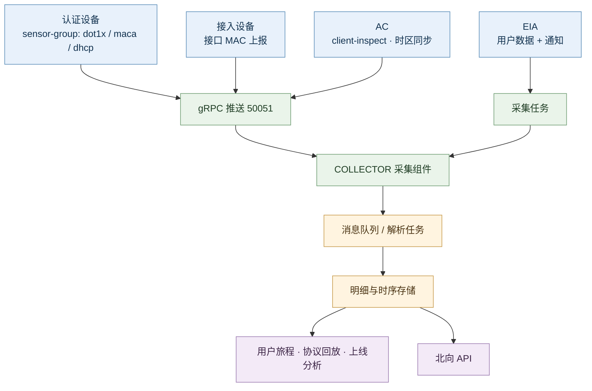

# 0 调研对象与范围

本报告拆解**新华三 SeerAnalyzer-Campus（园区分析器，AD-Campus 分析组件）中的「协议回放」能力**，范围覆盖其入口链路（用户健康度 → 用户详情 → 用户旅程 → 深度解析 → 协议回放）、回放对象（关联 / 认证 / DHCP / ARP / DNS 各阶段）、结论输出（原因分析与处理建议），以及支撑它的设备侧采集与配置前提。

回答三个问题，且全部**从用户视角**出发：

1. 这套东西**有哪些功能**（拆到可指认的小功能点）；
2. 每个功能对应**用户的什么痛**（客户可感知的损失，而非架构约束）；
3. 它**靠什么机制**把这些痛消掉，以及**消不掉的部分**在哪。

> 一句话立场：协议回放不是“抓包工具的 Web 化”，而是把**一次接入过程**变成一条**可回看、可归因、可交付**的时间轴。它的价值与边界，都由这句话决定。

## 0.1 交付内容

- **第 1 章 总览**：信源与局限、一句话定位、工具级五问（U1–U5）、五大功能全景与边界速查。
- **第 2–6 章 五大功能点**：每章五节 —— 小功能点清单 / 用户痛点（P）/ 解法与机制（S）/ 功能原理（输入·链条·输出·口径）/ 能力边界（六维度）。
- **附录五件套**：完整时间线、演进规律、对自研 APM AI 助手的对标启示、待补充缺口、信源链接总表。

## 0.2 建议读法（三条路径）

| 你的目的 | 读哪几段 | 预计收获 |
|---|---|---|
| 赶时间（10 分钟） | 1.2 一句话定位 → 1.4.1 全景总表 → 1.4.2 边界速查 → 第 3 章 K.5 | 知道这东西值不值得对标、它做不到什么 |
| 要选型/对标 | 1.3 工具级五问 → 各章 K.2 / K.3 → 附三 | 能把“功能清单”翻译成“客户为什么买” |
| 要复刻（自研） | 各章 K.4 → 第 6 章（数据底座）→ 附三 | 拿到可落地的数据模型与实现链条，包括采集前置条件 |

---

# 1 总览

## 1.1 信源与局限（先看这一段）

### 1.1.1 三级信源表

| 等级 | 来源 | 覆盖时段 | 在本报告中的用途 |
|---|---|---|---|
| **A** | H3C 官方文档中心《[SeerAnalyzer-Campus 定位定界手册-E7xxx-5W100](https://wwwsg.h3c.com/cn/Service/Document_Software/Document_Center/SDN/Catalog/Campus/SeerAnalyzer-Campus/Maintenance/Troubleshooting/H3C_SeerAnalyzer_Campus_E7xxx-34972/)》（2026-09-04） | 2026 | 协议回放的**操作路径、内容构成、结论输出**的第一手依据 |
| **A** | H3C 官方《[SeerAnalyzer-Campus 用户手册-5W101](https://www.h3c.com/cn/Service/Document_Software/Document_Center/SDN/Catalog/Campus/SeerAnalyzer-Campus/Configure/User_Manual/H3C_SeerAnalyzer_Campus_UM-12666/)》（2025-11-24） | 2025–2026 | 产品特点、用户分析章节、支持协议范围的官方口径 |
| **A** | H3C 官方产品能力页《[AD-Campus 分析组件·产品能力](https://www.h3c.com/cn/Products_And_Solution/InterConnect/Products/Manage_And_Maintenance/Products/AD-Campus/AD-Campus-Analysis/AD-Campus/Home/Detail_Material_List/Run_Condition)》 | 2025–2026 | 面向市场的功能描述口径（含“关联/认证/DHCP/ARP/DNS”阶段表述） |
| **A** | H3C 官方产品页《[园区分析器 SeerAnalyzer-Campus](https://www.h3c.com/cn/Products_And_Solution/InterConnect/Products/Manage_And_Maintenance/Products/SNA/SeerAnalyzer/Campus/)》 | 2024–2026 | 采集技术与“过程回放”能力定位、专家系统与修复建议 |
| **A** | H3C 官方技术文章《[互联网技术详解-智能园区网络随需而变（二）](https://www.h3c.com/cn/d_202012/1367914_473262_0.htm)》（2020-12）与[同题 2021-01 版](https://wwwsg.h3c.com/cn/d_202101/1380983_473305_0.htm) | 2020-12 ~ 2021-01 | **最早可核查的功能叙事**：无线接入三阶段全流程采集、细化各协议阶段结果与耗时 |
| **A** | H3C 官方《[SeerAnalyzer 安装部署指导-E75xx-5W501](https://wwwsg.h3c.com/cn/d_202608/2892641_30005_0.htm)》（2026-10-11） | 2026 | 部署形态、组件依赖（COLLECTOR/SeerCollector/iWO） |
| **B** | H3C 知了社区案例《[Campus 分析器 E6502 用户旅程经典配置](https://kms.h3c.com/Theme/details/228549)》 | 2024–2026 | 有线侧落地所需的 gRPC sensor 路径、EIA 采集、任务启动步骤 |
| **C** | 第三方站点转载的《[ADCampus V500R002B01 SeerAnalyzer 配置指导手册](https://m.renrendoc.com/paper/308747654.html)》 | 2021 前后 | 无线侧 `client-inspect`、时区同步、解析任务等**配置前提**（原文属厂商手册，转载渠道为第三方，故降级为 C） |
| **C** | H3C 知了社区问答（如 [dot1x 认证失败 errcode 讨论](https://kms.h3c.com/Questions/dispcont/275763)） | 2023–2026 | 佐证“无回放时人工查证”的真实工作形态（只作痛感佐证，不作能力依据） |

### 1.1.2 六点已知局限（读完再引用本文）

1. **技术白皮书正文未取得**：官方《[SeerAnalyzer-Campus 技术白皮书-5W100](https://www.h3c.com/cn/Service/Document_Software/Document_Center/SDN/Catalog/Campus/SeerAnalyzer-Campus/Learn_Technologies/White_Paper/H3C_SeerAnalyzer_Campus_WP-30951/?CHID=1255214)》需登录，算法与数据模型细节无法引证，相关段落一律标 C。
2. **无 Release Notes 逐版本回溯**：H3C 未公开可按版本检索的 Changelog，故**“协议回放首次发布的版本号与日期”未公开**；本报告只能用 2020-12 的官方技术文章作为“最晚已具备”的时间锚点。
3. **官方叫法混用**：同一能力在不同材料中写作「协议回放」「过程回放」「用户接入过程可视化」「接入旅程/用户旅程」，本报告统一称「协议回放」，并以原文引用保留出处的叫法差异。
4. **UI 字段级细节未公开**：官方文档以截图呈现（图 60 协议回放），未文字化列出页面字段；本报告只写官方文字明确提到的构成（交互过程、耗时、原因分析、处理建议），**不对页面布局、字段名、图表形态作任何断言**。
5. **能力数字全部缺失**：原因分析规则条数、覆盖的失败原因码范围、历史数据留存时长、支持的用户规模、单次回放的时延——官方均未披露，已登记入附四。
6. **本报告含推导**：凡“内部怎么串起来”的描述，均为 C 级推导并给依据链；不得当作官方实现引用。

### 1.1.3 版本与形态对照表

| 维度 | 早期（2020–2021，E65xx 时代） | 当前（2025–2026，E7xxx 5W1xx） | 依据 |
|---|---|---|---|
| 官方叙事 | 「用户接入过程可视化」，三阶段（关联/认证/DHCP）结果与耗时 | 「用户旅程 + 协议回放 + 原因分析 + 处理建议」 | [2020-12 文章](https://www.h3c.com/cn/d_202012/1367914_473262_0.htm) / [定位定界手册](https://wwwsg.h3c.com/cn/Service/Document_Software/Document_Center/SDN/Catalog/Campus/SeerAnalyzer-Campus/Maintenance/Troubleshooting/H3C_SeerAnalyzer_Campus_E7xxx-34972/) |
| 支持协议 | 未限定（叙事层为三阶段） | 「主要支持 802.1x 认证、Portal 认证、BRAS 认证以及 DHCP 交互过程」 | [用户手册 5W101](https://www.h3c.com/cn/Service/Document_Software/Document_Center/SDN/Catalog/Campus/SeerAnalyzer-Campus/Configure/User_Manual/H3C_SeerAnalyzer_Campus_UM-12666/) |
| 结论输出 | 未提及原因/建议 | 「针对异常情况提供原因分析与处理建议」 | [定位定界手册](https://wwwsg.h3c.com/cn/Service/Document_Software/Document_Center/SDN/Catalog/Campus/SeerAnalyzer-Campus/Maintenance/Troubleshooting/H3C_SeerAnalyzer_Campus_E7xxx-34972/) |
| 部署形态 | 独立分析器 + 采集器 | 基于统一数字底盘，单机/集群，组件化（COLLECTOR / iWO 等） | [安装部署指导 E75xx](https://wwwsg.h3c.com/cn/d_202608/2892641_30005_0.htm) |

### 1.1.4 一条反直觉观察

**这套能力最贵的部分不是“回放”，而是“回放之前就得采到”。** 官方把它写成「用户接入网络过程质量数据的 Telemetry 采集**和**过程回放」（[产品页](https://www.h3c.com/cn/Products_And_Solution/InterConnect/Products/Manage_And_Maintenance/Products/SNA/SeerAnalyzer/Campus/)），采集与回放是一个词组的两个半句：没有设备侧 `dot1xauthtrace`、`macauthtrace`、`dhcpuserevent` 常态上报，回放页就是空的；且**故障发生后才想补采，补不回来**。这决定了它的客户价值上限 = 部署时愿意把采集口径铺多全，而不是产品功能列表有多长。

## 1.2 一句话定位

**协议回放是 SeerAnalyzer-Campus 用户分析链路的最深一层下钻：它把“某个终端在某一分钟的接入过程”从指标（成功/失败、耗时）还原成事件序列（请求/响应/耗时），并在异常点给出原因与建议 —— 它替代的是“登录设备敲 debug + 现场抓包 + 老工程师凭经验翻译错误码”这一整套人工取证动作。**

它在产品体系中的位置：**健康看板（发现）→ 用户健康度/上线失败 Top（筛人）→ 用户详情 + 用户旅程（定时刻）→ 协议回放（定环节）→ 原因分析 + 处理建议（定动作）**。回放是这条链的终点，也是整条链的价值兑现点；上游任何一环缺失，回放都不会被打开。

## 1.3 从工具整体看：它究竟解决用户的什么问题

### 1.3.1 维度适配说明（先论证，再提问）

模板的五问（看不清/回不去/试不了/算不清/拿不出）是为“数字孪生”类工具设计的，其价值落在**时间轴**与**关系网**两个维度。协议回放这个工具：

- **时间轴维度成立且是主战场**：回放的本质就是重放一条时间线，且是“已经过去的那条”。
- **关系网维度弱**：它不做拓扑推演与路径仿真（那是数据面验证 DPV 与 INT/ERSPAN 的领域），只提供「连接拓扑」作为上下文。
- **“未来试不了”不成立**：它不承担变更前验证，官方在这一点上的对应能力是[数据面验证（DPV）](https://wwwsg.h3c.com/cn/Service/Document_Software/Document_Center/SDN/Catalog/Campus/SeerAnalyzer-Campus/Maintenance/Troubleshooting/H3C_SeerAnalyzer_Campus_E7xxx-34972/)与 Doctor AP，不在本报告范围内。

因此本报告把五问调整为 **U1 看不清 / U2 回不去 / U3 说不清快慢 / U4 算不清代价 / U5 拿不出证据**，并在 1.3.5 说明其与功能级痛点 P 的归并关系。

### 1.3.2 五个用户问法（U1–U5）速览

| 问法 | 用户的原话 | 痛在哪 | 一句话损失 |
|---|---|---|---|
| **U1 现在看不清** | 「用户说上不了网，我该看哪一分钟、哪一步？」 | 接入过程没有一张“过程视图”，只有“上线失败”这个结果 | 定位从“看结果”退化为“猜环节” |
| **U2 过去回不去** | 「刚才还失败，现在好了，我没法再看了」 | 现场瞬时消失，debug 与抓包都必须“人在、正在发生” | 一次故障要复现 N 次才能查 |
| **U3 说不清快慢** | 「认证要 8 秒，是终端慢、AP 慢还是服务器慢？」 | 只有总耗时，没有分段耗时，无法指认责任段 | 优化无从下手，只能“整体换设备” |
| **U4 算不清代价** | 「为了查一次认证，要在每个接入端口开镜像？」 | 取证手段本身要花探针钱、占端口、请人配合 | 排障成本被摊到每一张工单 |
| **U5 拿不出证据** | 「网络组说是认证服务器的问题，认证组说是网络不通」 | 各方只有各自视角的日志，没有共同的事实底稿 | 定责靠嗓门，问题在组织间往返 |

### 1.3.3 逐条展开（U1–U5 四件套）

#### U1 现在看不清

> **痛点**：「用户说上不了网，我该看哪一分钟、哪一步？」

- **谁在问**：
  - 园区网管：「老师说我上不了网，可我打开网管只看到一个红点，不知道他卡在哪。」
  - 服务台一线：「用户描述就是‘连不上’，我没法判断要不要派现场。」
  - 驻场工程师：「同一栋楼三个人报障，是不是同一个问题？我看不出来。」
- **典型场景**：周一 9:05，某会议室 12 人同时报“Wi-Fi 连不上”。网管在网管平台上看到该 AP 在线、端口 UP、无告警；怀疑认证服务器，但认证侧说“没收到请求”。三方各自都“看起来正常”。**示意量级**：这类“各方均正常”的工单，平均需要 40–90 分钟才能落到具体环节（非实测）。
- **五类损失**（示意量级，非实测）：

| 类别 | 可感知损失 |
|---|---|
| 时间 | 首个 30 分钟花在“排除法”，而非定位 |
| 钱 | 高峰期会议中断，业务侧损失不可计量但必然发生 |
| 人 | 需要 2–3 个专业口同时在线（网络/认证/无线） |
| 合规 | 无（本问不涉及） |
| 组织 | 三方会诊成为默认流程，责任边界模糊 |

- **放任不管的后果**：问题每次都以“换 AP / 重启交换机 / 让用户重连”收场，根因从未被记录，同类问题在下一栋楼重复发生，形成「处理快、认知零」的循环。

#### U2 过去回不去

> **痛点**：「刚才还失败，现在好了，我没法再看了。」

- **谁在问**：
  - 一线运维：「用户说昨天下午上不了，我现在去查，设备上什么都没有。」
  - 二线支持：「现场让我抓包，可故障不复发，抓了 3 小时没抓到。」
  - 厂商 TAC：「请复现一次并开 debug，把日志发我。」——这句话本身就是痛。
- **典型场景**：某终端每天 8:40 左右认证失败一次，9:00 后自动恢复。运维连续三天在 8:30 到岗守设备开 `debugging dot1x all`，两次没复现，一次复现了但日志被后续报文冲掉。**示意量级**：这类“间歇性故障”平均要 3–5 次复现尝试，跨 1–2 周。
- **五类损失**：

| 类别 | 可感知损失 |
|---|---|
| 时间 | 复现窗口不可控，排障被拉长到“天”级 |
| 钱 | 反复现场出勤；必要时临时加探针 |
| 人 | 必须由会敲命令的人在场，无法远程交接 |
| 合规 | 无 |
| 组织 | 问题被迫“等下次再说”，进入长期挂账 |

- **放任不管的后果**：间歇性故障被默认为“正常波动”，直到演变为批量故障才被重视，而那时最关键的“首次异常样本”早已丢失。

#### U3 说不清快慢

> **痛点**：「认证要 8 秒，是终端慢、AP 慢还是服务器慢？」

- **谁在问**：
  - 用户体验负责人：「员工抱怨‘上网要等十秒’，可我们各段指标都不超标。」
  - 无线运维：「关联快、DHCP 慢？还是认证重传？我只有总时长。」
  - 认证管理员：「RADIUS 响应 200ms，按理说不慢，但用户就是慢。」
- **典型场景**：某办公区上线耗时 P95 从 3s 涨到 9s，各设备 CPU、RADIUS 响应均正常。运维按“经验”先换 AP、再调 DHCP 租期，两周无效。真实原因往往只是某一段的重传（例如 DHCP Discover 两次无响应）。
- **五类损失**：

| 类别 | 可感知损失 |
|---|---|
| 时间 | 试错式优化，一轮 1–2 周 |
| 钱 | 无谓的硬件更换与扩容预算 |
| 人 | 需要多专业口共同“猜” |
| 合规 | 无 |
| 组织 | 优化结论无法复盘，下一轮继续猜 |

- **放任不管的后果**：体验问题长期存在但“指标达标”，运维与业务对“网络好不好”永远无法达成一致。

#### U4 算不清代价

> **痛点**：「为了查一次认证，要在每个接入端口开镜像？」

- **谁在问**：
  - 网络架构师：「全网接入端口开镜像，带宽和交换机 CPU 谁来兜？」
  - IT 预算 owner：「再买一套旁路探针，就为了查认证失败，值吗？」
  - 驻场主管：「每次抓包都要用户配合、要现场，人效撑不住。」
- **典型场景**：为定位 Portal 认证偶发失败，方案是在 200 个接入端口配镜像到探针。评估后发现镜像流量占上行 30%、需新增 2 台采集服务器，且只覆盖有线。项目被搁置，问题继续存在。
- **五类损失**：

| 类别 | 可感知损失 |
|---|---|
| 时间 | 方案评估与采购周期以“月”计 |
| 钱 | 探针/TAP/采集服务器采购 + 端口带宽机会成本 |
| 人 | 需专人维护镜像策略与探针 |
| 合规 | 全量镜像可能带来数据合规审查负担 |
| 组织 | 因成本过高而放弃取证，问题进入“不查了”状态 |

- **放任不管的后果**：组织形成“查不起”的心理预期，可观测性投入被持续压低，故障处理退回经验主义。

#### U5 拿不出证据

> **痛点**：「网络组说是认证服务器的问题，认证组说是网络不通。」

- **谁在问**：
  - 运维经理：「每次定责都要开会，会上各拿各的日志，谁也说服不了谁。」
  - 认证管理员：「我这边只有 RADIUS 日志，看不到终端和交换机之间发生了什么。」
  - 服务台主管：「同一件事，用户、网管、认证三方描述三个版本。」
- **典型场景**：某次批量认证失败，网络侧出示端口 UP、无错包；认证侧出示「未收到 Access-Request」。两边都“有证据”，但**没有任何一方的证据覆盖“终端→AP→交换机→RADIUS”这条完整链路**。
- **五类损失**：

| 类别 | 可感知损失 |
|---|---|
| 时间 | 定责会议与来回邮件 1–3 天 |
| 钱 | 无直接支出，但故障处置被拖延 |
| 人 | 多方重复取证，人均投入翻倍 |
| 合规 | 审计时无法提供完整接入证据链 |
| 组织 | 团队间信任损耗，形成“先甩锅再排障”的文化 |

- **放任不管的后果**：跨团队协作成本固化，MTTR 的瓶颈从技术转移到组织。

### 1.3.4 损失强度分布矩阵

| 问法 | 时间 | 钱 | 人 | 合规 | 组织 | 采购行为解释 |
|---|---|---|---|---|---|---|
| U1 看不清 | ● | ○ | ● | ○ | ● | 为“一屏看到接入全过程”付费，是这类产品最主流的购买理由 |
| U2 回不去 | ● | ○ | ● | ○ | ○ | 为“历史留存 + 可回看”付费，是运维团队最刚性的诉求 |
| U3 说不清快慢 | ● | ● | ○ | ○ | ○ | 为“分段耗时”付费，通常由体验指标驱动（上线耗时 SLA） |
| U4 算不清代价 | ○ | ● | ● | ○ | ○ | 为“免探针/免镜像”付费，决策人是架构与预算口 |
| U5 拿不出证据 | ● | ○ | ● | ● | ● | 为“可交付的证据链”付费，决策人偏管理层与审计口 |

**采购解释**：U1 与 U2 是“进门理由”，U5 是“续费理由”。一个只讲“能看到协议交互”的产品卖不动；能讲“出问题时你 5 分钟能拿出证据给三方看”的产品才卖得动。

### 1.3.5 五个整体问题与承载能力（落到大功能点）

| # | 用户的问题 | 工具给出的整体回答 | 对应大功能点（角色） |
|---|---|---|---|
| U1 | 现在看不清 | 把“某人的某次上线”摊成一条带阶段的事件轴，异常点直接标出来 | **①用户旅程**（定位到时刻）→ 第 2 章；**②协议回放**（定位到环节）→ 第 3 章 |
| U2 | 过去回不去 | 过程数据常态留存，事后按时间回看，不依赖现场复现 | **⑤过程数据底座**（先采后放）→ 第 6 章；**②协议回放**（历史重放）→ 第 3 章 |
| U3 | 说不清快慢 | 把总耗时拆到每个协议阶段，指认慢在哪一段 | **②协议回放**（耗时分解）→ 第 3 章 |
| U4 | 算不清代价 | 用设备自身上报的接入事件替代旁路镜像/探针 | **⑤过程数据底座**（Telemetry 采集）→ 第 6 章 |
| U5 | 拿不出证据 | 结论（原因）+ 证据（交互序列）+ 上下文（拓扑/设备）同屏，可交付 | **③归因与建议**→ 第 4 章；**④群体视图**（影响面）→ 第 5 章 |

**覆盖核验：5 个大功能点全部被至少一个 U 消费，无孤立能力。**

### 1.3.6 用之前 vs 用之后（同一批问题）

| 同一批问题 | 用之前 | 用之后 | 变化性质 |
|---|---|---|---|
| 用户报“上不了网” | 从设备告警反推，靠排除法 | 从用户列表进入该用户的旅程与回放 | 入口从“设备”换成“人” |
| 间歇性失败 | 守现场复现、开 debug | 按时间段回看历史事件 | 从“等它发生”到“查它发生过” |
| 上线慢 | 只有总耗时与各段独立指标 | 阶段耗时分解，定位到具体协议步 | 从“猜段”到“指段” |
| 取证成本 | 镜像/探针/现场配合 | 设备侧事件常态上报 | 从“项目制取证”到“常态化取证” |
| 定责 | 各拿各的日志开会 | 同一条时间轴 + 原因 + 建议 | 从“三个版本”到“一份底稿” |

### 1.3.7 小结：U 与 P 的关系（归并映射）

U 是**工具级问题**（判断值不值得买），P 是**功能级痛点**（判断做得对不对）。二者是上位归并，不是一对一：

| 工具级问题 | 归并到的功能级痛点（章·编号） | 说明 |
|---|---|---|
| U1 看不清 | 2-P1、2-P2、3-P1、5-P1 | “看不清”在四个层面各有具体形态：不知道哪一次、不知道哪一步、不知道是群体还是个例、不知道谁受影响 |
| U2 回不去 | 3-P4、6-P1 | 回放解决“有了数据怎么看”，底座解决“有没有数据” |
| U3 说不清快慢 | 3-P3 | 单一归并 |
| U4 算不清代价 | 6-P2 | 单一归并 |
| U5 拿不出证据 | 2-P4、3-P3、4-P3 | 共同底稿、同屏结论、跨团队对齐 |

## 1.4 读法：5 个大功能点全景

### 1.4.1 全景总表

| # | 大功能点 | 口号（四字） | 小功能点数 | 时间跨度 | 面向谁 |
|---|---|---|---|---|---|
| ① | 用户旅程与用户详情 | 一人一轴 | 7 | 2020-12 ~ 2026-09 | 一线运维 / 服务台 / 驻场 |
| ② | 协议回放主体（过程复现） | 一图看完 | 6 | 2020-12 ~ 2026-09 | 二线支持 / 认证管理员 / 无线运维 |
| ③ | 异常归因与处理建议 | 有因有策 | 3 | 2020-12 ~ 2026-09 | 一线到二线的“最后一公里” |
| ④ | 上线分析与群体视图 | 从一到群 | 4 | 2020-12 ~ 2026-09 | 运维主管 / 体验负责人 |
| ⑤ | 过程数据底座与开放 | 先采后放 | 5 | 2020-12 ~ 2026-10 | 架构师 / 集成方 / 自研对标者 |

### 1.4.2 边界速查（一页版）

| # | 大功能点 | 最要命的一条边界 | 边界性质 |
|---|---|---|---|
| ① | 用户旅程 | 旅程的完整性依赖 EIA 采集与 AC 上报，缺一侧就只剩“半个故事” | 前提依赖 |
| ② | 协议回放 | 回放的是**交互事件与耗时**，不是全量原始报文；加密与字段级取证仍需抓包 | 硬边界 |
| ③ | 归因与建议 | 原因分析是规则/专家系统产物，**规则未公开、覆盖率未公开**；新形态故障可能无结论 | 软边界 |
| ④ | 上线分析 | 只能分析“被采到的用户”；未纳管、未开采集的设备上的用户不可见 | 硬边界 |
| ⑤ | 数据底座 | **事后补采不可能**：故障发生前没配对，历史里就是没有 | 硬边界 |

### 1.4.3 编号约定

- 章内痛点编号 `K-Pn`（如 3-P2），解法编号 `K-Sn`（如 3-S2），**每章 P 与 S 数量严格相等，且每条 S 必须以「→ 解 K-Pn」回指**，不允许悬空。
- 小功能点编号 `K.n`（如 3.4），与 P/S 编号体系分离，避免混淆。
- 跨章引用写作「见 3-P2」，不重复定义。

### 1.4.4 总构造图

> 图注：实线为数据流，方括号内为官方可核查的采集路径与组件名；「归并层」的内部实现属 C 级推导（依据：官方称使用 Kafka/Flink 构建分析平台，且以用户为主键呈现全生命周期 —— 见 [产品页](https://www.h3c.com/cn/Products_And_Solution/InterConnect/Products/Manage_And_Maintenance/Products/SNA/SeerAnalyzer/Campus/) 与 [2020-12 文章](https://www.h3c.com/cn/d_202012/1367914_473262_0.htm)）。

---

# 2 大功能点 ①：用户旅程与用户详情 —— 一人一轴

把“网络视角的告警流”换成“用户视角的一条时间轴”，并让你能在 3 次点击内落到某一次接入。

## 2.1 小功能点清单

| # | 小功能点 | 发布时间 | 信源等级 | 说明 |
|---|---|---|---|---|
| 2.1 | 用户健康度（分维度评分 + 趋势） | 2020-12 起 | A | 「根据用户的接入指标、接入问题评估用户接入的健康度」，含接入耗时、上线/认证/DHCP 失败统计、RSSI、SSID、频段等；健康度 < 7 分通常意味着多次接入失败或体验差 |
| 2.2 | 用户列表（按健康度/接入耗时筛选、自定义列、高级搜索） | 2026-09 | A | 「支持按照健康度、接入耗时等条件进行快速搜索，也支持基于多个列值组合进行高级搜索」 |
| 2.3 | 用户详情（健康度趋势 + 时间点联动） | 2020-12 起 | A | 「支持查看每个时间点的用户指标信息，以及关联 AP 的健康详情」 |
| 2.4 | 健康度趋势上的红色异常事件点 | 2026-09 | A | 「趋势图横轴上的红色事件点表示发生了异常事件，例如认证失败等」 |
| 2.5 | 用户旅程（事件序列：漫游/上下线/DHCP 等） | 2020-12 起 | A | 「完整展示所选时间段内终端用户发生的事件」 |
| 2.6 | 「深度解析」列 → 协议回放入口 | 2026-09 | A | 「当用户旅程中出现异常事件时……可单击“深度解析”列的图标查看协议回放信息」 |
| 2.7 | 连接拓扑 + AP 迁移轨迹 + 下线细化原因码 | 2026-09 / 2025-11 | A | 拓扑「明确用户接入经过的设备」；AP 迁移「直观展示出用户连接 AP 的历史轨迹」；下线原因「包括但不限于终端漫游、用户主动下线、终端主动下线、网络侧发起下线」 |

## 2.2 它对应的用户痛点

**2-P1（时间）——「用户说上不了网，我不知道该看哪一分钟」**
用户口中的“上不了网”是一段模糊区间，而网管平台给的是设备与端口的连续指标。**缺少的是“这个人的那一次接入”这个对象**。结果是运维只能在时间轴上盲扫，或用告警时间去倒推，平均要在 2–3 个页面之间来回跳转才能确定时刻。

**2-P2（人）——「能不能查到，取决于当时谁在值班」**
在没有用户视图之前，查一次认证失败要登录设备敲 `display aaa online-fail-record`、看 logbuffer、必要时开 `debugging`（工作形态可参见 [知了社区问答](https://kms.h3c.com/Questions/dispcont/275763)）。这套动作只存在于少数人的肌肉记忆里；人一换、班一倒，能力就断档，且知识无法沉淀为组织资产。

**2-P3（时间）——「下线了，但不知道为什么下线」**
“掉线”在用户侧是结果，在设备侧是一串原因码。缺一个把原因码翻译成人类语言的呈现层，运维只能靠猜（漫游？超时？被踢？），并把大量时间花在“确认是不是用户自己关的 Wi-Fi”这类低成本但高频的排查上。

**2-P4（组织）——「网络、认证、服务台，三份不同的记录」**
三方各自持有局部事实：网络有端口/AP 状态，认证有 RADIUS 日志，服务台有用户口述。**没有一条共同的时间轴**，于是每次定位都从“对齐事实”开始，而不是从“分析原因”开始。

## 2.3 它是如何解决的（与痛点一一对应）

| 解法 | 机制 | 对应痛点 |
|---|---|---|
| **2-S1 以“人”为入口重构导航**：用户列表（健康度/接入耗时筛选 + 自定义列）→ 用户详情 → 健康度趋势 → 红色异常事件点，逐层收敛到“某一分钟” | 把设备维度的指标按用户主键重新聚合；趋势图上的异常事件点把“时刻”变成可点击对象（官方原文：「趋势图横轴上的红色事件点表示发生了异常事件」） | → 解 2-P1 |
| **2-S2 用页面替代命令行**：连接拓扑 + AP 迁移轨迹 + 用户旅程事件序列直接在 UI 呈现，无需登录设备取证 | 拓扑取自设备/EIA 数据关联结果（官方注明「直连的 Access 设备需完成相关配置，或配置 EIA 数据采集后，才能正确展示拓扑信息」）；漫游轨迹由 AC 上报的终端事件串成 | → 解 2-P2 |
| **2-S3 下线原因码的语义化呈现**：接收 AC 上报的用户下线细化原因代码并转成可读原因 | 官方明确支持「接收无线控制器上报的用户下线细化原因代码」并呈现为终端漫游/用户主动下线/终端主动下线/网络侧发起下线等 | → 解 2-P3 |
| **2-S4 统一时间轴作为共同底稿**：健康度趋势、用户旅程、协议回放共用同一时间段与同一用户对象，异常事件在三个视图里指向同一个点 | 用户旅程的“深度解析”列直接作为回放入口，使“事实（事件）→ 证据（交互）”在同一上下文内完成，避免跨系统对齐 | → 解 2-P4 |

## 2.4 功能原理

### 2.4.1 输入

| 输入 | 具体内容 | 官方依据（等级） | 缺了它会怎样 |
|---|---|---|---|
| I1 接入事件流 | 关联（无线）、认证（802.1X/Portal/BRAS）、DHCP 交互过程事件 | [2020-12 文章](https://www.h3c.com/cn/d_202012/1367914_473262_0.htm)（A）：「对这三个阶段全流程数据采集，细化各个协议交互阶段结果与耗时」 | 没有事件就没有旅程，只剩设备指标 |
| I2 设备侧 Telemetry 传感器 | `dot1x/dot1xauthtrace`、`maca/macauthtrace`、`dhcpsp/dhcpuserevent` 三条采样路径 | [知了社区配置案例](https://kms.h3c.com/Theme/details/228549)（B） | 认证与 DHCP 阶段无事件，回放为空 |
| I3 接入端口归属信息 | 接入设备接口上使能 MAC 地址信息上报（`mac-address-information enable added`） | 同上（B） | 无法把用户映射到具体接入端口，拓扑与端口上下文缺失 |
| I4 认证系统数据 | EIA 用户数据采集任务 + EIA 用户通知参数 | 同上（B） | 看不到账号维度信息，有线用户旅程不完整 |
| I5 无线侧上报开关 | AC 上使能 `wlan client-inspect enable`；`wlan timezone-sync enable`；设备与服务器 NTP 同步 | [第三方转载的官方配置指导](https://m.renrendoc.com/paper/308747654.html)（C） | 无线用户上线事件不上报；时间轴错位，跨设备事件无法对齐 |
| I6 解析任务 | 「启动有线用户解析任务」与「启动 AI 预测任务」 | 同上（B） | 数据到了但不解析，页面仍无内容 |

### 2.4.2 实现链条

| 步骤 | 做什么 | 关键输入 | 输出 |
|---|---|---|---|
| 1 | 设备按订阅把接入过程事件推到采集组件 | I2 / I3 / I5 | 原始事件流 |
| 2 | 解析任务把异构事件解码成统一事件模型（阶段、结果、时间戳、对端） | I6 | 结构化事件 |
| 3 | 以用户为键归并跨设备、跨协议事件，形成单用户时序 | I1 / I4 | 用户事件序列 |
| 4 | 计算健康度与接入耗时，聚合出列表与趋势 | 步骤 3 输出 | 用户健康度、失败统计 |
| 5 | 渲染旅程，并把异常事件挂上「深度解析」入口 | 步骤 3、4 输出 | 用户旅程 UI |

> 步骤 2–3 的具体实现（解码规则、归并键的选择、乱序与时钟漂移处理）官方未公开，此处为 **C（本报告推导）**，依据链：官方明确三条 sensor 路径与「解析任务」存在（B）→ 官方明确以用户为主键呈现全生命周期（A）→ 因此必然存在“解码 + 归并”两步。

### 2.4.3 输出

| 输出物 | 形态 | 消费方 | 对应小功能点 |
|---|---|---|---|
| 用户健康度与趋势 | UI 产物 | 运维、体验负责人 | 2.1 / 2.3 |
| 用户旅程事件序列 | UI 产物，同时是回放的**输入上下文** | 运维；协议回放模块 | 2.5 / 2.6 |
| 异常事件标记 | UI 产物（红色事件点 + 深度解析入口） | 运维 | 2.4 / 2.6 |
| 用户—端口—AP—设备关联关系 | **内部接口**（真正被回放与拓扑消费的那个输出） | 协议回放、连接拓扑、群体视图 | 2.7 |

**必须区分**：页面上看到的是“旅程”，但真正被其他能力复用的是“用户—端口—AP—设备”的关联关系；没有这层关系，回放只能给出“失败了”，给不出“在哪台设备的哪个口失败的”。

### 2.4.4 关键机制深化

**机制一：为什么入口必须是“用户”而不是“设备”？**
因为接入类故障的因果顺序天然是「终端 → 端口 → 认证 → 地址」，而设备指标是横向切片的。官方把用户分析单列为一个能力簇，并用健康度把“多次接入失败/体验差”收敛成一个可排序的分数（原文：「健康度低于 7 分，通常意味着用户可能存在多次接入失败或上网体验较差的问题」）。**这是把“海量用户”压成“可处理的待办列表”的必要设计**——否则运维面对上万人无从下手。

**机制二：为什么异常事件要做成“图上的点”？**
因为“哪一次”是排障的第一个分叉。文字日志无法承载“一天几十次上线”的密度，而趋势图上的点把“时间”变成可点击的实体，点击后联动下方的用户指标与设备指标（官方：「单击健康度趋势图中的某一时间点时，下方的用户指标详情和关联设备详情会同步联动」）。**联动是这套 UI 的核心约束：一切视图共享同一时间锚点。**

**机制三：为什么下线原因要单独做？**
“为什么掉线”与“为什么上不去”是两类不同的问题，前者在设备侧表现为原因码，后者表现为协议失败。官方专门支持「接收无线控制器上报的用户下线细化原因代码」并语义化呈现，说明厂商判断：**掉线类工单的占比足够高，值得单列一条产品线。**

### 2.4.5 口径声明

| 内容 | 等级 | 说明 |
|---|---|---|
| 用户旅程包含漫游/上下线/DHCP 事件、可展开协议回放 | A | 用户手册原文 |
| 健康度 < 7 分的经验判据 | A | 定位定界手册原文（属厂商经验值，非统计结论） |
| 下线原因码的具体取值全集 | B | 官方只给「包括但不限于」四类，**全集未公开** |
| 事件解码与归并键的实现 | C | 本报告推导 |
| 健康度算法权重 | 未公开 | 官方仅称“根据一定的权重比例进行综合”，权重未披露 |

## 2.5 能力边界

**一句话边界：用户旅程能告诉你“他什么时候、经过哪台设备上线”，但告诉不了“为什么”——那是下一章的事；而且它只看得见“被采到的用户”。**

| 类型 | 具体边界 | 依据（信源等级） | 对自研 APM 的提示 |
|---|---|---|---|
| 硬边界 | 未纳管设备、未开采集端口上的用户不会出现在旅程里；无数据不等于无故障 | [配置案例](https://kms.h3c.com/Theme/details/228549)（B）+ [定位定界手册](https://wwwsg.h3c.com/cn/Service/Document_Software/Document_Center/SDN/Catalog/Campus/SeerAnalyzer-Campus/Maintenance/Troubleshooting/H3C_SeerAnalyzer_Campus_E7xxx-34972/)（A） | 自研必须把“采集覆盖率”作为一等指标暴露给用户，否则会被误读为“网络没问题” |
| 软边界 | 下线原因码为“包括但不限于”的枚举，未知码如何呈现未公开 | 用户手册（A） | 自研应设计“未知码原样透出 + 可扩展映射表”，不要硬编码枚举 |
| 前提依赖 | 有线需 EIA 采集 + 用户通知参数 + 解析任务；无线需 AC `client-inspect` 与 NTP/时区同步 | [B](https://kms.h3c.com/Theme/details/228549) / [C](https://m.renrendoc.com/paper/308747654.html) | 自研若做园区场景，必须把“前置配置检查”做成产品的一部分（一键体检），否则交付即翻车 |
| 官方自认局限 | 拓扑展示有前提：「直连的 Access 设备需完成相关配置，或配置 EIA 数据采集后，才能正确展示拓扑信息」 | 定位定界手册（A） | 拓扑不是“自动就对”的，需要落到端口级配置；自研应提供拓扑置信度标识 |
| 常见误期待 | 误以为旅程=全链路抓包时间线；实际是**事件级**序列 | 官方表述为“事件”“交互过程及耗时”（A） | 对外文案必须区分“事件回放”与“报文取证”，避免验收争议 |
| 对自研的提示 | 以“用户/会话”为主键建旅程，比以设备为主键更贴近客户语言；但前提是能稳定拿到身份（账号/MAC）与端口归属 | 归纳自 A/B 级事实 | 锐捷 APM 若已采交换机数据，优先补齐“端口—MAC—账号”三元组，这是旅程的地基 |

---

# 3 大功能点 ②：协议回放主体（过程复现） —— 一图看完

把“一次接入”从结果（成功/失败/耗时）还原成过程（每一步的请求、响应、耗时、断点）。

## 3.1 小功能点清单

| # | 小功能点 | 发布时间 | 信源等级 | 说明 |
|---|---|---|---|---|
| 3.1 | 分阶段回放框架（关联 → 认证 → DHCP → ARP → DNS） | 2020-12 起 | A | 「接入过程通常包含关联、认证、DHCP、ARP、DNS 等」 |
| 3.2 | 每协议请求/响应序列 | 2020-12 起 | A | 「可直观呈现上线过程中每个协议的请求响应情况」 |
| 3.3 | 阶段耗时信息 | 2020-12 起 | A | 「以及耗时信息，便于快速锁定问题」；2020 版表述为「细化各个协议交互阶段结果与耗时」 |
| 3.4 | 异常节点标识 | 2026-09 | A | 「对于异常事件，协议回放可直观呈现……便于快速锁定问题」（异常点由回放视图突出，具体视觉形式见官方图 60） |
| 3.5 | 支持协议范围：802.1X / Portal / BRAS 认证 / DHCP | 2025-11 | A | 「协议回放主要支持 802.1x 认证、Portal 认证、BRAS 认证以及 DHCP 交互过程」 |
| 3.6 | 历史时刻回放（服务端留存，非现场抓包） | 2020-12 起 | A | 「支持用户接入网络过程质量数据的 Telemetry 采集和过程回放」；「可以查看每个时间点的用户指标信息」 |

## 3.2 它对应的用户痛点

**3-P1（时间）——「接入是个黑盒，不知道断在哪一步」**
认证失败在用户侧只有一句话，在网络侧只有一条失败记录。**“关联成功了吗？EAP 走到第几个报文？DHCP 有没有发 Discover？”**这些中间态默认不可见。运维于是被迫用“换终端、换 AP、换端口”三换法做二分，单次定位动辄半天。

**3-P2（时间）——「知道断在哪，但不知道为什么断」**
即使定位到“认证阶段失败”，仍要回答“是没收到请求、还是收到后拒绝、还是拒绝了但没回”。缺少请求/响应的成对视图时，这个判断只能靠抓包；而抓包要求故障正在发生（见 3-P4）。

**3-P3（时间）——「慢，但说不清慢在哪一段」**
总耗时不具可操作性。用户抱怨“上网要等十秒”，而各段独立指标都正常时，**唯一能推动问题的证据是分段耗时**——把 10 秒拆成“关联 0.8s / 认证 7.2s / DHCP 2.0s”，责任段立刻明确。

**3-P4（时间）——「现场已经过去了」**
传统取证是“事件驱动”的：出问题 → 开 debug/抓包 → 等复现。而接入类故障多为间歇性（漫游、弱信号、认证服务器抖动），**等不到就是等不到**。没有常态留存，就没有事后分析的可能。

## 3.3 它是如何解决的（与痛点一一对应）

| 解法 | 机制 | 对应痛点 |
|---|---|---|
| **3-S1 把接入过程编排成固定阶段序列**：以“关联 → 认证 → DHCP → ARP → DNS”为骨架，把散落在多设备、多协议的事件挂到骨架上，形成“走到哪一步、停在哪一步” | 官方明确接入过程的阶段构成；旅程中的异常事件可直接展开回放（「深度解析」列），使“失败”落在具体阶段而非整体 | → 解 3-P1 |
| **3-S2 以请求/响应成对呈现交互**：每个协议阶段下展示请求与响应的对应关系 | 官方原文：「可直观呈现上线过程中每个协议的请求响应情况」 | → 解 3-P2 |
| **3-S3 阶段级耗时分解**：在每条交互旁给出耗时，把总时长拆到协议步 | 官方原文：「以及耗时信息，便于快速锁定问题」；早期表述：「细化各个协议交互阶段结果与耗时」 | → 解 3-P3 |
| **3-S4 服务端留存 + 按时刻回看**：过程数据常态采集入库，事后按用户与时间段调取回放，不依赖故障在发生 | 采集侧为设备常态上报（Telemetry sensor），呈现侧为“所选时间段内”的历史视图（官方多处使用“所选时间段”） | → 解 3-P4 |

## 3.4 功能原理

### 3.4.1 输入

| 输入 | 具体内容 | 官方依据（等级） | 缺了它会怎样 |
|---|---|---|---|
| I1 认证过程事件 | 802.1X 认证追踪、MAC 认证追踪事件 | [配置案例](https://kms.h3c.com/Theme/details/228549)（B） | 认证阶段整段空白，回放只剩 DHCP |
| I2 DHCP 过程事件 | `dhcpsp/dhcpuserevent` 事件流 | 同上（B） | 无法定位“拿不到地址”类问题 |
| I3 无线关联事件 | AC 上报的终端上线/漫游事件（需 `client-inspect`） | [C](https://m.renrendoc.com/paper/308747654.html) | 关联阶段缺失，无线问题只能看到认证之后 |
| I4 账号与授权上下文 | EIA 采集到的认证记录与授权结果 | [B](https://kms.h3c.com/Theme/details/228549) | 无法解释“认证过了但没放行”类问题 |
| I5 时间基准 | 设备与服务器时间同步 | C（配置指导要求 NTP 与时区同步） | 跨设备事件错序，耗时计算与因果链全部失真 |

### 3.4.2 实现链条

| 步骤 | 做什么 | 关键输入 | 输出 |
|---|---|---|---|
| 1 | 校正各设备时间戳，建立统一时间轴 | I5 | 可排序事件流 |
| 2 | 按阶段归类，形成阶段序列 | I1 / I2 / I3 | 阶段化事件 |
| 3 | 协议内请求—响应配对 | 步骤 2 输出 | 交互对 |
| 4 | 计算阶段耗时与步间间隔 | 步骤 3 输出 | 耗时分解 |
| 5 | 异常判定（失败/超时/重传/缺失） | 步骤 3、4 输出 | 异常节点 |
| 6 | 渲染回放并输出结论 | 步骤 5 + I4 | 回放视图 + 原因建议 |

> 步骤 3–5 的配对规则、超时阈值、重传判定均为 **C（本报告推导）**：官方只承诺“呈现请求响应情况与耗时”，未公开配对与判定规则。

### 3.4.3 输出

| 输出物 | 形态 | 消费方 | 对应小功能点 |
|---|---|---|---|
| 阶段化交互序列 | UI 产物 | 运维 / 二线 | 3.1 / 3.2 |
| 阶段耗时分解 | UI 产物，同时是归因规则的**特征输入** | 运维；原因分析模块 | 3.3 |
| 异常节点标记 | UI 产物 | 运维 | 3.4 |
| 结构化“回放记录” | **内部接口**（被归因与北向 API 消费） | 归因模块、上层应用 | 3.6 |

### 3.4.4 关键机制深化

**机制一：为什么是“事件级”而不是“报文级”？**
三个硬约束共同决定了这个选择：①设备侧上报的是**追踪事件**（`dot1xauthtrace`/`macauthtrace`/`dhcpuserevent` 的语义就是“追踪”），不是报文镜像；②园区接入端口数量巨大，全量镜像的带宽与成本不可承受（对应 1.3.3 的 U4）；③回放的目标是“定位环节”，不是“司法取证”，事件级已足够。
**代价**：字段级内容（EAP 方法、DHCP option、RADIUS 属性）默认不可见，需要时仍得抓包。这是路线选择带来的硬边界，不是实现缺陷。

**机制二：为什么阶段顺序是“关联 → 认证 → DHCP → ARP → DNS”？**
因为这正是终端真实的接入时序：先上射频（关联），再验身份（认证），再要地址（DHCP），再做地址解析与域名解析（ARP/DNS）。**用业务真实顺序做骨架，用户不需要学习产品逻辑就能读懂**——这是“可读性优先于信息密度”的界面决策。注意官方在协议支持范围上只承诺“主要支持 802.1X/Portal/BRAS/DHCP”，框架里的关联/ARP/DNS 是否有同等粒度的回放内容，未公开（见 3.5）。

**机制三：为什么耗时必须与交互绑在一起显示？**
孤立的总耗时无法归因，孤立的序列无法排序。**把耗时贴在每一步旁边，等于把“性能问题”降维成“可比较的数值”**，用户不需要理解协议也能判断“7.2 秒花在认证”是异常。这是把专家知识嵌入界面，而非嵌入文档。

### 3.4.5 口径声明

| 内容 | 等级 | 说明 |
|---|---|---|
| 阶段构成（关联/认证/DHCP/ARP/DNS） | A | 产品能力页与用户手册原文 |
| 支持协议范围（802.1X/Portal/BRAS/DHCP） | A | 用户手册「主要支持」 |
| “主要支持”之外是否有 MAC 认证回放的完整过程 | 未公开 | 采集侧存在 `macauthtrace`（B），产品文案未列，**存疑，已登记缺口** |
| 关联/ARP/DNS 阶段的回放粒度 | 未公开 | 仅出现在阶段框架描述中 |
| 请求—响应配对与异常判定规则 | C | 本报告推导 |

## 3.5 能力边界

**一句话边界：它告诉你“断在哪一步、每一步多久”，但不告诉你“报文里到底写了什么”——后者仍然要抓包。**

| 类型 | 具体边界 | 依据（信源等级） | 对自研 APM 的提示 |
|---|---|---|---|
| 硬边界 | **非报文级取证**：不提供原始报文字段级内容，加密协议（如 EAP-TLS 内层）本就不可解 | 官方定义为“交互过程及耗时”（A）→ 推导 | 自研对外必须写清“事件回放 / 报文取证”两级能力，别让销售话术越界 |
| 软边界 | 支持协议为“主要支持”四项；关联/ARP/DNS 的粒度未公开；BRAS 认证场景的可回放范围未公开 | 用户手册（A） | 自研应先做“能覆盖 80% 工单的 3 个协议”，而不是追平列表 |
| 前提依赖 | 三条 sensor 路径必须配置且设备版本支持；无线需 AC 上报开关；需 NTP | [B](https://kms.h3c.com/Theme/details/228549) / [C](https://m.renrendoc.com/paper/308747654.html) | 采集能力要先于回放能力交付，否则演示必翻车 |
| 官方自认局限 | 「主要支持」四字即官方对覆盖范围的自我限定 | 用户手册（A） | 对标时可直接引用这四字，作为“能力有限”的官方证据 |
| 常见误期待 | 误以为能看到 Wireshark 级别的报文详情；误以为所有认证方式都支持；误以为可回放任意历史（受留存策略约束） | 推导自 A 级定义 | 交付前用一页“能力边界清单”对齐客户预期，减少验收纠纷 |
| 对自研的提示 | 事件级 trace 的性价比远高于全量 pcap：**存储小、隐私风险低、可直接喂给 AI**；锐捷 APM 已有 Loki 日志与 MySQL 明细，可把“认证事件”落成结构化表，比存原始报文更适合做 Agent 的检索工具 | 归纳自 A/B 级事实 | 优先设计“事件模型”（阶段/结果/耗时/对端/原因码），这是 AI 可用的最小语义单元 |

---

# 4 大功能点 ③：异常归因与处理建议 —— 有因有策

回放给出“发生了什么”，这一层给出“为什么”和“接下来做什么”。

## 4.1 小功能点清单

| # | 小功能点 | 发布时间 | 信源等级 | 说明 |
|---|---|---|---|---|
| 4.1 | 异常原因分析 | 2026-09（文档明确） | A | 「协议回放中包含各协议的交互过程及耗时，并会针对异常情况提供原因分析与处理建议」 |
| 4.2 | 处理建议 | 2026-09 | A | 同上；产品页亦称「利用机器学习算法及专家系统实现网络故障的实时感知与智能故障根因定位，并为运维人员提供修复建议」 |
| 4.3 | 结论与证据同屏（原因 + 交互过程 + 设备/端口上下文） | 2026-09 | A | 回放页同时承载交互过程与原因建议；用户详情提供连接拓扑与关联设备详情作为上下文 |

## 4.2 它对应的用户痛点

**4-P1（人）——「看得见现象，下不了结论」**
现象与结论之间隔着专家知识。一线能看到“认证阶段失败”，但要判断“是密钥不一致、域没绑授权、还是服务器超时”，需要背诵一整本排障手册。**能力断层导致一线只能升级工单**，二线被大量低价值工单淹没。

**4-P2（时间）——「定位完还要再查一遍怎么改」**
故障定位与处置动作是两件事。定位到“RADIUS 无响应”之后，还要决定是查防火墙、核对密钥、还是查端口——这段“从结论到动作”的路，往往比定位本身更耗时，且极易走弯路（如先去换 AP）。

**4-P3（组织）——「结论容易被推诿」**
没有“原因 + 证据”的捆绑，结论就是个人判断。一旦跨团队，对方第一反应是“依据呢？”。**归因结论若不能自带证据，就无法作为组织间的裁决依据。**

## 4.3 它是如何解决的（与痛点一一对应）

| 解法 | 机制 | 对应痛点 |
|---|---|---|
| **4-S1 规则化/专家系统给出原因**：对异常事件匹配已知失败模式，输出原因描述 | 官方称依托「机器学习算法及专家系统」实现根因定位；回放页对异常情形直接给出原因分析 | → 解 4-P1 |
| **4-S2 原因后直接挂处理建议**：把“下一步动作”作为结论的一部分返回 | 官方原文「提供原因分析与处理建议」；产品页「为运维人员提供修复建议」 | → 解 4-P2 |
| **4-S3 结论与证据同屏**：原因与交互过程、设备与端口上下文在同一页面呈现，形成可引用的事实包 | 回放页同时包含交互过程与原因建议（A）；用户详情提供拓扑与关联设备详情（A） | → 解 4-P3 |

## 4.4 功能原理

### 4.4.1 输入

| 输入 | 具体内容 | 官方依据（等级） | 缺了它会怎样 |
|---|---|---|---|
| I1 异常事件与阶段 | 失败/超时/缺失发生在哪个协议步 | [定位定界手册](https://wwwsg.h3c.com/cn/Service/Document_Software/Document_Center/SDN/Catalog/Campus/SeerAnalyzer-Campus/Maintenance/Troubleshooting/H3C_SeerAnalyzer_Campus_E7xxx-34972/)（A） | 无法匹配失败模式，只能给通用建议 |
| I2 原因码 | 设备/AC/EIA 侧的失败原因码 | 用户手册（A，下线原因码）；[配置案例](https://kms.h3c.com/Theme/details/228549)（B，认证事件） | 原因分析退化为“看现象猜原因” |
| I3 专家知识/规则库 | 失败模式与处置动作的映射 | 产品页「专家系统」「修复建议」（A） | 无建议输出，只剩人工判断 |
| I4 失败对象的上下文 | 设备型号/版本、端口、VLAN、认证域等 | 用户详情与拓扑（A） | 建议无法具体到“改哪台设备的哪个配置” |

### 4.4.2 实现链条

| 步骤 | 做什么 | 关键输入 | 输出 |
|---|---|---|---|
| 1 | 从回放中提取异常节点与原因码 | I1 / I2 | 异常特征 |
| 2 | 结合上下文匹配失败模式 | I3 / I4 | 命中模式 |
| 3 | 生成原因描述与处置动作 | 步骤 2 输出 | 结论 + 建议 |
| 4 | 与证据同屏输出，供交付 | 步骤 3 + 回放数据 | 可引用的结论包 |

> 匹配是“规则”还是“模型”、规则条数、是否含 LLM 生成，**官方均未公开**；本报告按“专家系统 + 机器学习”的官方措辞描述，不进一步断言。

### 4.4.3 输出

| 输出物 | 形态 | 消费方 | 对应小功能点 |
|---|---|---|---|
| 原因描述 | UI 产物 | 一线/二线/服务台 | 4.1 |
| 处理建议 | UI 产物（文本动作，非自动下发） | 运维 | 4.2 |
| 结论包（原因+证据+上下文） | UI 产物；理论上可经北向 API 外供 | 上层应用 / ITSM | 4.3 |

**关键区分**：这里的“建议”是**给人看的动作说明**，不是“自动下发配置”。官方将“下发闭环预案”能力放在异常分析的故障闭环中（且注明「当前仅故障分析相关 Case 支持」），与协议回放的“建议”不同层——对标时不要混淆这两件事。

### 4.4.4 关键机制深化

**机制一：为什么“建议”必须跟在“原因”后面而不是替代它？**
因为责任与信任。运维可以接受“系统给建议我来判断”，但很难接受“系统直接改配置”。**原因说明保留了人的判断权，建议降低了人的知识门槛**，这个组合才是可落地的自动化边界。

**机制二：为什么归因要以“失败原因码”为核心锚点？**
原因码是设备侧最接近“结论”的原始信息（例：AC 上报的下线细化原因）。**把原因码语义化，等于把厂商内部的枚举字典变成客户可读的因果说明**——这是低成本、高确定性的归因路径，比“用算法从零推断”可靠得多。

### 4.4.5 口径声明

| 内容 | 等级 | 说明 |
|---|---|---|
| 回放页提供原因分析与处理建议 | A | 定位定界手册原文 |
| 归因依赖专家系统/机器学习 | A | 产品页口径（厂商自述） |
| 规则数量、覆盖率、准确率 | 未公开 | **无任何量化指标**，不得推算 |
| 是否使用大模型生成结论 | 未公开 | 本报告不作假设 |

## 4.5 能力边界

**一句话边界：它能对“见过的失败模式”给出原因和建议，对“没见过的组合”只能给现象——而后者恰恰是疑难工单。**

| 类型 | 具体边界 | 依据（信源等级） | 对自研 APM 的提示 |
|---|---|---|---|
| 硬边界 | 无原因码/无事件的场景（终端侧故障、加密内层失败、非纳管设备）无法归因 | 推导自 A 级能力定义 | 自研应设置“无法归因”的显式状态，并给出下一步取证建议，而不是硬编一个原因 |
| 软边界 | 规则库覆盖范围、更新机制、是否可客户自定义——全部未公开 | 官方未披露 | 自研把“规则可编辑 + 命中率可观测”做成差异点，是低成本的领先点 |
| 前提依赖 | 归因质量取决于原因码是否上报、上下文是否齐全（版本/端口/域） | A/B | 采集字段不全时，归因会退化为“通用建议”，价值骤降 |
| 官方自认局限 | 官方仅承诺“针对异常情况”提供原因与建议，未承诺全覆盖 | 定位定界手册（A） | 对标引用时用“针对异常情况”这一限定语，避免过度承诺 |
| 常见误期待 | 误以为建议可一键修复；误以为归因等同定责 | 推导 | 产品文案需区分“建议 / 预案下发”“归因 / 定责” |
| 对自研的提示 | 归因层是 AI 助手最自然的落点：**事件模型 + 原因码字典 + 检索增强的处置知识**，比端到端黑盒更可控、更可解释 | 归纳 | 锐捷 APM 可先把认证失败原因码字典做成结构化资产，这是 Agent 最需要的“领域记忆” |

---

# 5 大功能点 ④：上线分析与群体视图 —— 从一到群

把“一个人的回放”升级为“一群人的分布”，回答“是个别终端还是整片区域”。

## 5.1 小功能点清单

| # | 小功能点 | 发布时间 | 信源等级 | 说明 |
|---|---|---|---|---|
| 5.1 | 上线分析（关联/认证/DHCP 分阶段成功与失败统计） | 2026-09 | A | 「可查看接入、认证、DHCP 等阶段的成功与失败情况，同时可查看受影响的终端与设备」 |
| 5.2 | 上线失败用户 Top10 | 2026-09 | A | 「展示了所选时间段内上线失败次数最多的用户，后续可通过用户详情进一步分析和排查失败原因」 |
| 5.3 | 用户健康度趋势（群体）与区域/时间筛选 | 2026-09 | A | 「查看园区整体健康度趋势时，可通过单击趋势图中的某个时间点调整查询时间，用户列表会随趋势图的选择联动更新」 |
| 5.4 | 用户指标分布（RSSI、丢包率、错包率、SSID、频段） | 2025-11 | A | 「基于接入耗时、上线/认证/DHCP 失败统计、RSSI、SSID、频段等对终端进行统计分析、上线分析」 |

## 5.2 它对应的用户痛点

**5-P1（时间）——「不知道是个别终端还是整片区域出问题」**
单用户回放能解释“他为什么失败”，但回答不了“是不是大家都失败了”。**没有群体分布，就无法判断严重级别**，于是要么过度反应（一个人报障就全网排查），要么反应不足（批量故障被当成个例）。

**5-P2（组织/时间）——「报障一多，先查谁？」**
高峰期同时涌入十几张工单时，缺乏排序依据就只能按“谁催得凶”处理。**排序需要“受影响人数 × 失败次数 × 区域”这类聚合指标**，而不是单条工单的描述。

**5-P3（时间）——「同类问题反复出现，每次都从零查」**
没有历史趋势与横向对比，就无法判断“这次和上次是不是同一类问题”。**重复问题无法沉淀成规则**，团队始终在做一次性劳动。

## 5.3 它是如何解决的（与痛点一一对应）

| 解法 | 机制 | 对应痛点 |
|---|---|---|
| **5-S1 分阶段成功率 + 受影响对象聚合**：把关联/认证/DHCP 的成功失败按阶段统计，并列出受影响的终端与设备 | 官方上线分析仪表盘：可按阶段看成功/失败，并「查看受影响的终端与设备」 | → 解 5-P1 |
| **5-S2 失败次数排序（Top10）+ 健康度筛选**：把“最该先看的用户”排到前面 | 官方「上线失败用户 Top10」与用户列表按健康度/接入耗时筛选、自定义列 | → 解 5-P2 |
| **5-S3 时间点联动与趋势对比**：以趋势图上的时间点为查询锚，用户列表联动更新，形成“同一时刻的群体切片” | 官方「单击趋势图中的某个时间点调整查询时间，用户列表会随趋势图的选择联动更新」 | → 解 5-P3 |

## 5.4 功能原理

### 5.4.1 输入

| 输入 | 具体内容 | 官方依据（等级） | 缺了它会怎样 |
|---|---|---|---|
| I1 全量用户事件 | 同一时段内所有被采用户的接入事件 | [产品能力页](https://www.h3c.com/cn/Products_And_Solution/InterConnect/Products/Manage_And_Maintenance/Products/AD-Campus/AD-Campus-Analysis/AD-Campus/Home/Detail_Material_List/Run_Condition)（A） | 只能做单用户分析，无分布 |
| I2 阶段结果标记 | 每用户每阶段的成功/失败 | 用户手册（A） | 无法分阶段统计，只能给总失败率 |
| I3 设备与区域归属 | 用户—AP—设备—区域映射 | 定位定界手册（A，连接拓扑有前提） | 无法回答“哪个区域/哪台设备受影响” |

### 5.4.2 实现链条

| 步骤 | 做什么 | 关键输入 | 输出 |
|---|---|---|---|
| 1 | 事件按阶段判定结果 | I1 / I2 | 阶段化结果 |
| 2 | 单用户聚合（失败次数、健康度、耗时） | 步骤 1 输出 | 用户排序依据 |
| 3 | 设备/区域聚合（影响面） | 步骤 1 + I3 | 影响面统计 |
| 4 | 以时间点为锚切片，联动列表 | 步骤 2、3 输出 | 群体视图 |
| 5 | 从任一用户下钻回放 | 步骤 4 输出 | 个体证据 |

### 5.4.3 输出

| 输出物 | 形态 | 消费方 | 对应小功能点 |
|---|---|---|---|
| 分阶段成功率与影响面 | UI 产物 | 运维主管 / 体验负责人 | 5.1 |
| 用户失败排序 / 健康度列表 | UI 产物 | 一线（决定先查谁） | 5.2 / 5.4 |
| 时间切片视图 | UI 产物 | 复盘与汇报 | 5.3 |
| 区域/设备影响面统计 | **内部接口**（可被上层应用与报表消费） | 健康报告 / 北向应用 | 5.1 |

### 5.4.4 关键机制深化

**机制一：为什么群体视图必须能“下钻到个人”？**
群体视图回答“严重不严重”，个体回放回答“为什么”。两者之间若没有一键通路，分析就断在“知道很严重，但不知道怎么修”。官方把“上线失败 Top10”直接接到“用户详情 → 用户旅程 → 回放”，形成 **聚合 → 个体 → 证据** 的闭环，这是产品设计的核心骨架。

**机制二：为什么“按时间点联动”比“选时间段”更有用？**
因为故障是瞬时的。选“上午 9 点到 10 点”得到的是均值，会把 9:05 的尖峰摊平。**以点代段**让用户能切到“出事的那一分钟”的群体快照，这是排障场景的真实用法。

### 5.4.5 口径声明

| 内容 | 等级 | 说明 |
|---|---|---|
| 分阶段成功率、受影响终端/设备、Top10 | A | 定位定界手册原文 |
| 联动机理（点选 → 列表刷新） | A | 官方描述 |
| 聚合口径（分母是“在线用户”还是“有事件用户”） | 未公开 | 影响成功率数值解读，**需在选型时确认** |

## 5.5 能力边界

**一句话边界：群体视图只统计“被采到的人”，未纳管、未开采集、以及纯终端侧问题的用户不会进入分母——所以它给出的“成功率”不等于“全网真实成功率”。**

| 类型 | 具体边界 | 依据（信源等级） | 对自研 APM 的提示 |
|---|---|---|---|
| 硬边界 | 分母覆盖不到未纳管设备与未开采集端口；终端侧问题（如密码错、关闭 Wi-Fi）也被计入失败 | 推导自采集前提（B/C） | 自研必须在页面上标注“统计口径与覆盖率”，否则会引发“数据不准”的信任危机 |
| 软边界 | 聚合口径（分母定义）、区域划分规则、Top10 的排序权重未公开 | 官方未披露 | 自研把口径写成可配置项，是低成本的可信度建设 |
| 前提依赖 | 区域/设备归属依赖拓扑正确性（拓扑本身有前提，见 2.5） | A | 拓扑错则影响面错，需做归属校验 |
| 官方自认局限 | 官方把拓扑正确性明确限定为“需完成相关配置或配置 EIA 数据采集后” | 定位定界手册（A） | 别默认拓扑一定准 |
| 常见误期待 | 误以为“成功率 99%”等于“99% 的用户满意”；误以为可替代用户投诉数据 | 推导 | 群体指标只能做“技术侧严重度”，不可替代体验度量 |
| 对自研的提示 | 群体视图是 AI 助手最好的“问题发现入口”：**先让 Agent 看 Top N 异常群体，再逐个体下钻取证**，比“用户提问才分析”更主动 | 归纳 | 锐捷 APM 可把该视图做成 Agent 的“巡检起点”，与告警联动 |

---

# 6 大功能点 ⑤：过程数据底座与开放 —— 先采后放

回放的上限由采集决定。这一章讲“数据是怎么进来的、为什么这样进来、以及它对自研最值钱的地方”。

## 6.1 小功能点清单

| # | 小功能点 | 发布时间 | 信源等级 | 说明 |
|---|---|---|---|---|
| 6.1 | 用户接入过程质量数据的 Telemetry 采集 | 2020-12 起 | A | 「支持用户接入网络过程质量数据的 Telemetry 采集和过程回放」 |
| 6.2 | gRPC 传感器组三条采样路径 | 2024–2026（案例） | B | `dot1x/dot1xauthtrace`、`maca/macauthtrace`、`dhcpsp/dhcpuserevent`，指向同一 destination-group 与订阅 |
| 6.3 | 接入端口 MAC 信息上报 | 同上 | B | 「在接入设备的接入接口配置……有终端接入的端口都需要配置」 |
| 6.4 | EIA 数据采集任务 + 用户通知参数 + 解析任务 | 同上 | B | 采集任务配置 iMC/EIA 地址与账号；EIA 侧配置用户通知参数；启动有线用户解析任务 |
| 6.5 | 北向开放 API | 2020-12 起 | A | 「SeerAnalyzer 同时提供北向开放 API，为智能运维应用及其他上层应用提供丰富的分析能力集」 |

## 6.2 它对应的用户痛点

**6-P1（时间）——「等出问题才想抓包，现场已经过去了」**
取证手段的时间属性决定了它的价值：**必须在故障发生前就位**。而现实是“先出问题、再想取证”，于是永远慢一步。这是所有“事后排查”类工具的共同宿命，也是“常态采集”存在的唯一理由。

**6-P2（钱）——「为查一次认证，要买探针、开镜像、占带宽」**
旁路取证的显性成本（探针/TAP/采集服务器）与隐性成本（端口带宽、交换机 CPU、合规审查）都不低。**当取证成本高于故障损失时，组织会选择“不查”**——这不是技术问题，是经济问题。

**6-P3（人）——「采集配置靠项目经验，换个项目就重来」**
三类设备（认证设备/接入设备/AC）+ 一个认证系统（EIA）+ 若干任务，配置项分散在设备命令行与平台页面。**没有标准化清单时，落地质量取决于实施人员水平**，这是“产品很好但用不起来”的典型原因。

**6-P4（组织）——「数据只能在这个产品里看」**
如果分析结果无法外供（ITSM、大屏、自研平台），数据就锁在一个孤岛里，客户已有的运维体系无法复用，**采购决策会从“能力建设”退化为“再买一套系统”**。

## 6.3 它是如何解决的（与痛点一一对应）

| 解法 | 机制 | 对应痛点 |
|---|---|---|
| **6-S1 常态采集替代事件驱动取证**：由设备持续上报接入事件，服务端留存，事后按需调取 | 官方采集口径为 Telemetry 常态采集；回放基于“所选时间段”的历史数据 | → 解 6-P1 |
| **6-S2 复用设备自身事件，不引入旁路镜像** | 三条 sensor 路径均走设备既有 gRPC 能力，无需镜像口与探针 | → 解 6-P2 |
| **6-S3 用标准配置清单固化落地**：认证设备配 sensor-group/destination-group/subscription → 接入端口配 MAC 上报 → AC 配上报与时区 → EIA 配采集与通知 → 平台启解析任务 | 官方配置案例给出完整命令与步骤（B），构成可复制的“落地清单” | → 解 6-P3 |
| **6-S4 北向 API 开放分析结果** | 官方明确提供北向开放 API，向上层应用输出分析能力集 | → 解 6-P4 |

## 6.4 功能原理

### 6.4.1 输入

| 输入 | 具体内容 | 官方依据（等级） | 缺了它会怎样 |
|---|---|---|---|
| I1 设备侧 gRPC 能力与版本 | 支持 `dot1xauthtrace` 等 sensor path 的设备 | [配置案例](https://kms.h3c.com/Theme/details/228549)（B） | 老版本设备无法上报，回放不可用 |
| I2 采集组件 | COLLECTOR 组件（提供 SNMP/gRPC/NETCONF 等采集服务） | [安装部署指导](https://wwwsg.h3c.com/cn/d_202608/2892641_30005_0.htm)（A） | 无接收端，事件丢弃 |
| I3 接入端口归属 | `mac-address-information` 上报 | 配置案例（B） | 无法定位端口，回放缺“在哪”的一半 |
| I4 认证系统对接 | EIA 采集任务（地址/端口/账号）+ 用户通知参数 | 配置案例（B） | 缺账号与授权信息 |
| I5 时间同步 | NTP 与 AC 时区同步 | [C](https://m.renrendoc.com/paper/308747654.html) | 时间轴错乱，跨设备因果不可信 |
| I6 解析与分析任务 | 有线用户解析任务、AI 预测任务 | 配置案例（B） | 数据入库但不解析，页面空白 |

### 6.4.2 实现链条

| 步骤 | 做什么 | 关键输入 | 输出 |
|---|---|---|---|
| 1 | 设备侧订阅三条 sensor 路径，事件推到采集组件 | I1 | 事件流 |
| 2 | 接入端口上报 MAC 归属；AC 上报终端事件 | I3 / I5 | 归属与无线事件 |
| 3 | 采集组件接收并进入消息队列 | I2 | 待解析数据 |
| 4 | 解析任务解码、归一、按用户归并 | I6 | 结构化明细 |
| 5 | 存储并对外提供查询与回放 | 步骤 4 输出 | 回放/旅程/统计 |
| 6 | 经北向 API 开放 | I2 | 上层应用数据 |

### 6.4.3 输出

| 输出物 | 形态 | 消费方 | 对应小功能点 |
|---|---|---|---|
| 事件明细与时序 | **内部接口**（唯一真正被上层全部消费的输出） | 旅程、回放、上线分析、归因 | 6.1 / 6.2 |
| 采集健康度（是否在采、采到什么） | UI 产物（部分） | 实施与运维 | 6.3 |
| 北向 API | **内部接口（对外）** | 第三方/自研平台 | 6.5 |

### 6.4.4 关键机制深化

**机制一：为什么“设备自证”优于“旁路取证”？**
经济性：无额外硬件与端口成本（对应 6-P2）；覆盖性：接入端口数量大，镜像不现实，而设备事件是“每个端口本来就知道的事”；合规性：事件不携带业务载荷，隐私风险低。**代价**：受设备版本与型号能力约束——这是把成本从“采购”转移到“版本管理”的典型 trade-off。

**机制二：为什么“三件套配置”缺一不可？**
认证设备给“认证过程”，接入设备给“哪个口”，AC 给“关联与漫游”，EIA 给“谁”。**这四者构成一个四元组（谁 + 在哪 + 走了哪条协议 + 结果如何），缺任一项，回放就只能解释一半。** 这也是为什么官方配置案例要把它们写成一份完整清单，而不是分散的“可选优化”。

### 6.4.5 口径声明

| 内容 | 等级 | 说明 |
|---|---|---|
| Telemetry 采集接入过程数据并回放 | A | 产品页原文 |
| 三条 sensor path 与端口 MAC 上报、EIA 任务、解析任务 | B | 知了社区官方案例 |
| AC `client-inspect` 与时区同步 | C | 第三方转载的厂商手册 |
| 内部存储选型、留存时长、容量模型 | 未公开 | 不得推算 |

## 6.5 能力边界

**一句话边界：这套底座的能力上限在“部署那一天”就被定死了——没采的历史，永远补不回来。**

| 类型 | 具体边界 | 依据（信源等级） | 对自研 APM 的提示 |
|---|---|---|---|
| 硬边界 | 采集是前置的，事后无法补历史；设备版本不支持则整段缺失 | 推导自 B 级配置要求 | 自研产品必须提供“采集覆盖体检”，并在故障复盘页标注“此时间段无采集” |
| 软边界 | 留存时长、容量上限、单集群承载规模未公开 | 官方未披露 | 选型时必须书面确认，否则大园区落地会撞墙 |
| 前提依赖 | 三类设备 + EIA + NTP + 解析任务，任一缺失则旅程/回放不完整 | B/C | 把“前置配置”做成安装向导，可显著降低交付失败率 |
| 官方自认局限 | 安装部署指导中大量篇幅用于组件依赖与硬件要求，说明其部署复杂度不低（iWO 为无线场景必选、BMP_Syslog 需先部署等） | [安装部署指导](https://wwwsg.h3c.com/cn/d_202608/2892641_30005_0.htm)（A） | 自研若做轻量替代，**“免组件、免前置”本身就是卖点** |
| 常见误期待 | 误以为买了分析器就能看到所有用户；误以为接上就能回放历史 | 推导 | 售前必须讲清“采集覆盖率 = 可见性” |
| 对自研的提示 | 锐捷 APM 已有交换机采集与 MySQL/Loki/VictoriaMetrics 底座，**把“接入事件”作为一等公民建模**（而不是当日志），就能以很低成本复刻这套能力的第一步 | 归纳 | 建议数据模型：`session_id / user / mac / port / device / stage / result / reason_code / t_start / t_end` |

---

# 附一 完整时间线（倒序）

| 时间 | 事件 | 形态 | 信源等级 |
|---|---|---|---|
| 2026-10-11 | 《SeerAnalyzer 安装部署指导-E75xx-5W501》发布，明确组件化部署与依赖 | 文档 | A |
| 2026-09-04 | 《SeerAnalyzer-Campus 定位定界手册-E7xxx-5W100》更新，明确「用户旅程 → 深度解析 → 协议回放 → 原因分析与处理建议」完整路径 | 文档 | A |
| 2026-05-22 | 《H3C 网络管控析软件产品资料书架-5W104》更新 | 资料书架 | A |
| 2026-01-06 | 《SeerAnalyzer-Campus 技术白皮书-5W100》更新（正文需登录，未取得） | 白皮书 | A（未取证） |
| 2025-11-24 | 《SeerAnalyzer-Campus 用户手册-5W101》发布，明确协议回放「主要支持 802.1x/Portal/BRAS/DHCP」 | 文档 | A |
| 2024-09-24 | 《智能分析业务技术专刊-5W101》发布 | 技术专题 | A |
| 2024 前后 | 知了社区《Campus 分析器 E6502 用户旅程经典配置》沉淀有线侧完整配置命令 | 社区案例 | B |
| 2023-12-22 | 《SeerAnalyzer-Campus 产品文档包-5W100》发布 | 文档包 | A |
| 2021-01-28 | 官方技术文章再次发布，明确「无线用户接入分三阶段（关联、认证、DHCP）……细化各协议交互阶段结果与耗时」 | 技术文章 | A |
| 2020-12 | 官方技术文章首见「用户接入过程可视化」表述，并称支持「用户接入网络过程质量数据的 Telemetry 采集和过程回放」 | 技术文章 | A |

> **缺口**：协议回放的**首次发布版本号与日期**未公开，上表只能定位到“2020-12 已具备该能力叙事”。

# 附二 演进规律

**规律一：从“指标可见”走向“过程可见”。**
2020 年的叙事还是“设备健康度/弱覆盖/光模块预测”，2026 年的叙事已是“用户旅程 + 协议回放 + 原因建议”。这说明接入类运维的竞争焦点，从“把指标算准”转向“把过程讲清”。

> 对自研的启示：指标层会迅速同质化，**过程层（事件序列）才是差异化的护城河**；越早把事件模型建好，越早具备讲“过程”的能力。

**规律二：从“群像统计”走向“个体取证”。**
上线成功率、健康度是群像；用户旅程与回放是个体。产品重心向个体迁移，说明客户的追问方式变了：不再问“整体好不好”，而问“他这一次为什么不行”。

> 对自研的启示：AI 助手的回答必须能落到“具体某一次”，否则永远停在“建议你检查一下”的层面。

**规律三：回放必须与归因捆绑才有交付价值。**
纯回放只是“更好看的日志”。官方把原因分析与处理建议直接写进回放页，等于承认：**没有结论的回放，客户不会用第二次。**

> 对自研的启示：做回放时，第一版就要带“结论层”（哪怕只是规则匹配），否则会沦为演示功能。

**规律四：采集从“外挂探针”转向“设备自证”。**
这是园区场景的经济学必然：端口多、流量碎、预算有限，只能靠设备自身的事件上报。

> 对自研的启示：锐捷的天然优势是设备侧可控，**把“设备能上报什么”做成产品能力清单**，比追平第三方探针方案更划算。

**规律五：能力边界由“离终端的距离”决定。**
越靠近终端（终端自身日志、客户端探针），信息越全但越难部署；越靠近网络设备，越易部署但越看不到终端内部。厂商选择了“网络设备侧”，于是边界也由此确定。

> 对自研的启示：明确自己的“观测站位”，并把这个站位的能力与盲区一起写进产品说明，反而更容易获得客户信任。

# 附三 对自研 APM AI 助手的对标启示

| # | 启示 | 来源 | 为什么重要 |
|---|---|---|---|
| 1 | **以“用户/会话”为主键建旅程，而不是以设备为主键** | 官方用户分析链路（A） | AI 助手要回答“他为什么上不了网”，就必须能按人生成时间线；设备主键的模型无法支撑这类提问 |
| 2 | **事件级 trace 优于全量 pcap** | 采集路径为追踪事件（B） | 存储成本低一个量级、隐私风险低、可直接结构化喂给工具调用；pcap 只在少数争议场景才需要 |
| 3 | **把“失败节点”做成 UI/数据的锚点** | 回放以异常为入口（A） | Agent 的推理也应从“断点”出发，而不是从头重放整条链路，可显著减少 token 与工具调用轮次 |
| 4 | **结论层（原因+建议）必须与证据同屏** | 回放页同时承载交互与结论（A） | 这是“可被信任的 AI”的最低要求：每条结论可点开到证据 |
| 5 | **采集前置，先采后放** | 配置清单（B/C） | 自研若做 AI 分析，必须先有“接入事件表”，否则模型再强也无据可依 |
| 6 | **群体视图作为巡检入口，个体回放作为取证出口** | 上线分析 + Top10 下钻（A） | 这正好对应 Agent 的两种工作模式：主动巡检（发现）与按需取证（回答） |
| 7 | **明确写出能力边界（非报文级、限定协议、依赖配置）** | 「主要支持」原文（A） | 边界写得越清楚，越能避免“AI 幻觉式承诺”；也是把不确定性交给用户的正确方式 |
| 8 | **把厂商私有的“原因码字典”做成结构化资产** | 下线原因码语义化（A） | 这是最容易被低估的领域知识：它让 AI 从“描述现象”升级为“给出原因” |

# 附四 待补充与后续跟踪

| 缺口 | 现状 | 下一步怎么查 |
|---|---|---|
| 协议回放首次发布的版本号与日期 | 未公开，仅有 2020-12 能力叙事 | 查《SeerAnalyzer 版本说明书》历史版本（需登录/需渠道） |
| 技术白皮书正文（架构、算法、数据模型） | 登录墙，未取得 | 申请 H3C 合作伙伴账号或向厂商索取 |
| 原因分析规则条数与覆盖率 | 完全未公开 | 售前技术交流时索取；或用真实故障样本做黑盒测试 |
| 历史数据留存时长与容量模型 | 未公开 | 查部署指导的容量规划章节或资源计算工具 |
| MAC 认证是否有完整回放 | 采集侧有 `macauthtrace`，产品文案未列 | 实测：配置 MAC 认证用户后观察回放内容 |
| 关联/ARP/DNS 三阶段的回放粒度 | 仅出现在阶段框架描述中 | 实测截图比对 |
| 上线分析的分母口径 | 未公开 | 用“已知成功率”场景反推分母 |
| 协议回放页面的字段与交互细节 | 官方仅以截图呈现（图 60） | 需实机截图或演示环境 |

# 附五 信源链接总表

## 5.1 A 级（官方文档站 / 官方技术文章 / 产品页）

| # | 信源 | 类型 | 日期 | 链接 | 在本文中支撑 |
|---|---|---|---|---|---|
| A1 | SeerAnalyzer-Campus 定位定界手册-E7xxx-5W100 | 官方手册 | 2026-09-04 | [链接](https://wwwsg.h3c.com/cn/Service/Document_Software/Document_Center/SDN/Catalog/Campus/SeerAnalyzer-Campus/Maintenance/Troubleshooting/H3C_SeerAnalyzer_Campus_E7xxx-34972/) | 用户旅程、深度解析入口、协议回放内容、原因与建议、上线分析、Top10、健康度判据、拓扑前提 |
| A2 | SeerAnalyzer-Campus 用户手册-5W101 | 官方手册 | 2025-11-24 | [链接](https://www.h3c.com/cn/Service/Document_Software/Document_Center/SDN/Catalog/Campus/SeerAnalyzer-Campus/Configure/User_Manual/H3C_SeerAnalyzer_Campus_UM-12666/) | 产品特点（用户维度含协议回放）、支持协议范围、下线原因码、用户分析口径 |
| A3 | AD-Campus 分析组件·产品能力 | 官方产品页 | 2025–2026 | [链接](https://www.h3c.com/cn/Products_And_Solution/InterConnect/Products/Manage_And_Maintenance/Products/AD-Campus/AD-Campus-Analysis/AD-Campus/Home/Detail_Material_List/Run_Condition) | 阶段构成（关联/认证/DHCP/ARP/DNS）、用户旅程描述、上线分析 |
| A4 | 园区分析器 SeerAnalyzer-Campus | 官方产品页 | 2024–2026 | [链接](https://www.h3c.com/cn/Products_And_Solution/InterConnect/Products/Manage_And_Maintenance/Products/SNA/SeerAnalyzer/Campus/) | Telemetry 过程采集与回放、专家系统与修复建议、白盒/灰盒分析定位 |
| A5 | 互联网技术详解-智能园区网络随需而变（二） | 官方技术文章 | 2020-12 | [链接](https://www.h3c.com/cn/d_202012/1367914_473262_0.htm) | 三阶段全流程采集、细化协议阶段结果与耗时、北向 API |
| A6 | 同题技术文章（2021-01 版） | 官方技术文章 | 2021-01-28 | [链接](https://wwwsg.h3c.com/cn/d_202101/1380983_473305_0.htm) | 同上，用于时间线交叉验证 |
| A7 | SeerAnalyzer 安装部署指导-E75xx-5W501 | 官方手册 | 2026-10-11 | [链接](https://wwwsg.h3c.com/cn/d_202608/2892641_30005_0.htm) | 部署形态、COLLECTOR 组件、iWO/BMP_Syslog 依赖 |
| A8 | SeerAnalyzer-Campus 文档中心首页 | 官方目录 | 2026 | [链接](https://www.h3c.com/cn/Service/Document_Software/Document_Center/SDN/Catalog/Campus/SeerAnalyzer-Campus/) | 文档版本谱系、白皮书与专刊入口 |
| A9 | SeerAnalyzer-Campus 技术白皮书-5W100 | 官方白皮书 | 2026-01-06 | [链接](https://www.h3c.com/cn/Service/Document_Software/Document_Center/SDN/Catalog/Campus/SeerAnalyzer-Campus/Learn_Technologies/White_Paper/H3C_SeerAnalyzer_Campus_WP-30951/?CHID=1255214) | **仅登记，正文未取得**（登录墙） |

## 5.2 B 级（官方社区 / 官方案例）

| # | 信源 | 类型 | 日期 | 链接 | 在本文中支撑 |
|---|---|---|---|---|---|
| B1 | Campus 分析器 E6502 用户旅程经典配置 | 知了社区案例 | 2024–2026 | [链接](https://kms.h3c.com/Theme/details/228549) | 三条 gRPC sensor 路径、接入端口 MAC 上报、EIA 采集与通知、解析任务启动、回放入口 |
| B2 | SeerAnalyzer 故障处理手册-E7xxx-5W106 | 官方手册 | 2026-10-12 | [链接](https://www.h3c.com/cn/Service/Document_Software/Document_Center/Home/Public/00-Public/Maintenance/Troubleshooting/H3C_SeerAnalyzer_TG_E7xxx-25817/?CHID=1309240) | 采集类故障的排查形态（时间同步、任务状态），佐证前提依赖 |

## 5.3 C 级（第三方 / 转载）

| # | 信源 | 类型 | 日期 | 链接 | 在本文中支撑 |
|---|---|---|---|---|---|
| C1 | ADCampus V500R002B01 SeerAnalyzer 配置指导手册（转载） | 第三方转载官方手册 | 2021 前后 | [链接](https://m.renrendoc.com/paper/308747654.html) | AC `client-inspect`、时区同步、认证数据采集任务 |
| C2 | dot1x 认证失败 errcode 讨论 | 社区问答 | 2023–2026 | [链接](https://kms.h3c.com/Questions/dispcont/275763) | 无回放时的人工查证形态（痛感佐证） |
| C3 | H3C SeerAnalyzer-Campus 功能介绍（渠道转载） | 第三方转载 | 2023 | [链接](https://cvi-china.com/?p=8825) | 与官方口径交叉验证（阶段、协议范围） |

## 5.4 未收录公开链接的信源（诚实标注）

- **技术白皮书正文**：需登录，内容未取得，本报告未引用其任何结论。
- **《SeerAnalyzer 版本说明书》**：存在但未检索到公开可访问版本，故“首次发布版本”列为缺口。
- **实机界面截图（图 60 协议回放）**：官方截图无法在本报告中复现，页面字段细节未作断言。

## 5.5 引用强度速览

| 强度 | 支撑内容 | 说明 |
|---|---|---|
| 强（A 级 ≥2 源交叉） | 用户旅程构成、回放入口、支持协议范围、原因与建议、上线分析 | 本报告全部核心结论均有 A 级原文 |
| 中（A + B） | 采集路径、配置前提、端口归属 | B 级为官方社区案例，工程细节可信 |
| 弱（C 或推导） | AC 侧开关、内部实现链条、聚合口径 | 均已标 C 或明确标注推导，不作为选型依据 |

---

*文档生成时间：2026-10-21 ｜ 数据截止：2026-10-21*
*核验：行数 1046 ｜ Mermaid 图 6 张（均为 flowchart，classDef 含 fill+color）｜ 外链 54 处 / 14 个唯一信源 ｜ 表格列数逐块一致 ｜ 正文 ASCII 双引号 0 处 ｜ 结论：五点自检全部通过（P/S 每章等量闭环，18 P ↔ 18 S；未公开项已登记 8 条）*
