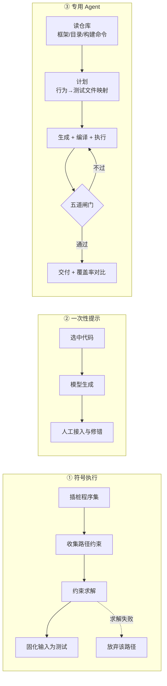
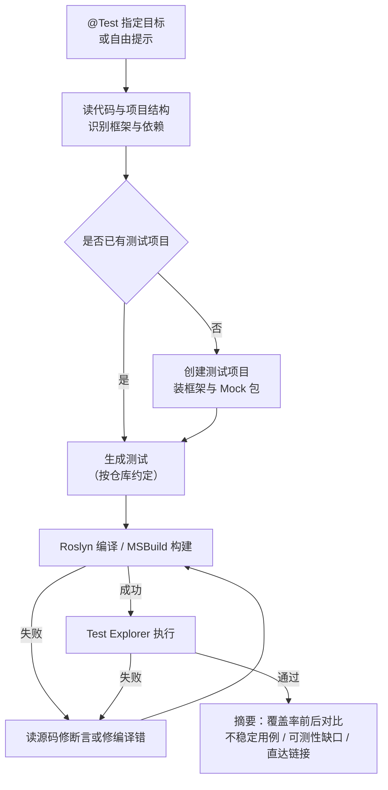

# 微软 AI 生成单元测试：IntelliTest 退场与 Agent 化测试工程

> 本文只回答三个问题：
>
> 1. 微软用 AI 生成单元测试，是为了解决什么问题？在这些问题上前一代方法（IntelliTest / Pex）是怎么处理的，为什么退场？
> 2. 这套方法的优点、缺点、能力边界分别在哪里？
> 3. 他们具体是怎么做的（提示词、流程、验收闸门、工具链）？
>
> 全文所有数字标注来源等级：**官方数据**（微软博客 / 官方文档）、**论文数据**（同行评议或 arXiv）、**二手转述**（媒体转写，未取得原文）、**本文推断**。官方没有给数据的，明确写"无官方数据"，并说明推断路径。
>
> 只想看结论的读者，读 [[#0. 结论先行|§0]] 与 [[#1. 一页看懂：优点、缺点与能力边界|§1]] 即可，两节合计约两屏。

## 0. 结论先行

1. **微软面对的从来不是"测试写得慢"，而是"判定基准（oracle）缺失"**。前一代方案 IntelliTest 用符号执行把覆盖率做到了机械极限，却只能记录"代码现在是什么行为"，无法回答"这个行为对不对"。这是它退场的根因，也是这一代 AI 方案仍未解决的问题。
2. **前一代方案是被"使用率低"淘汰的，不是被"技术落后"淘汰的**。微软工程师在官方开发者社区的原话是：IntelliTest 与"创建单元测试"功能"已弃用并从 VS 2026 移除，以集中投入 Copilot 测试生成"，并且"移除的原因是使用率低"（[官方开发者社区回复](https://developercommunity.visualstudio.com/t/Create-Unit-Tests-is-not-available-in-VS/10999012)，2025-11）。
3. **现在的做法分三条线，不是一套方案**：研究原型 TestPilot（提示词配方 + 自适应修复）、IDE 产品 `@Test`（把模型接进编译器与项目系统的闭环）、开源 Agent `code-testing-generator`（"调研—计划—实现"流水线 + 五道验收闸门）。
4. **微软方法真正的创新点不在"让模型写测试"，而在"把正确性判定外包给确定性工具链"**：编译、构建、执行、轻量变异测试（mutation testing）、以及"仓库的测试命令能否发现这条测试"。模型负责想场景，工具负责判真假。
5. **收益主要在可靠性，不在质量**。开源 Agent 的任务完成率 **92.1%** 对原生 Copilot **78.9%**（152 个真实仓库任务），但最终行覆盖率 **72.4% 对 72.2%**、分支覆盖率 **49.8% 对 49.1%**，几乎无差异；微软自己承认在断言强度与覆盖率上原生 Copilot 略高，Agent 只在测试卫生（test hygiene）上略胜（[.NET 博客](https://devblogs.microsoft.com/dotnet/polyglot-unit-testing-agent/)，2026-07-31）。
6. **能力边界很硬**：微软自家基准 TestExplora 显示，让模型在真实仓库里主动发现缺陷，最强模型的失败转通过率（Fail-to-Pass, F2P）上限只有 **16.06%**。也就是说，AI 生成单元测试目前是"合格的回归资产生产线"，不是"缺陷探测器"。
7. **已正式商用，但没有进公司级强制流程**。产品侧只有 `@Test` 在 VS 2026 v18.3 转正（2026-02-11），需付费 Copilot 订阅且只支持 C#/.NET；内部侧是团队自建自用（.NET 团队的 152 任务内部基准），微软自己的工程转型报告点名了运维、安全、现代化、代码审查，**没有点名测试生成**。详见 [[#6. 商用状态与内部流程定位|§6]]。

## 1. 一页看懂：优点、缺点与能力边界

> 这一节是给决策者的一页纸。机制细节看 [[#3. 他们是怎么做的：三条线逐条拆解|§3]]，数字口径看 [[#4. 效果数据与三个口径陷阱|§4]]，证据分级看 [[#7. 证据分级与本文推断清单|§7]]。

先用一句话定性：**这是一套"用确定性工具链给概率性生成结果做背书"的方法**。它不提升模型能力，而是把模型的输出塞进一个"编译能过、测试能跑、断言能被变异杀死、CI 能发现"的验证回路里；换来的是可用性，代价是适用范围被压得极窄（只做单元测试、只做能编译的代码、不改生产代码）。

### 1.1 优点：它到底换到了什么

| # | 优点 | 具体表现 | 数据来源 | 为什么能成立（机制原因） |
|---|---|---|---|---|
| 1 | **任务完成率显著提升** | 152 个真实仓库任务，完成 **140** 个（92.1%），原生 Copilot 完成 **120** 个（78.9%） | 官方数据 | Agent 先做仓库调研，把"用哪个框架、放哪个目录、怎么跑"这些模型猜不准的事变成读代码得到的事实 |
| 2 | **模糊需求下优势最大** | 89 个模糊提示：**79（88.8%）对 59（66.3%）**，失败数从 30 降到 10 | 官方数据 | 模糊提示缺的正是"上下文决策"，而上下文可从仓库里检索出来 |
| 3 | **代码变更场景从"不可用"变"可用"** | 15 个针对具体 diff（代码差异）的任务：Agent **15/15**，原生 Copilot **0/15** | 官方数据 | diff 需要精确绑定"哪次改动、哪个函数、哪条行为"，一次性生成做不到 |
| 4 | **生成的测试真的会失败**（不是只求通过） | 五道闸门中包含轻量变异测试：故意做小改动，看测试是否失败 | 官方文档 | 把"测试有效性"从主观判断变成可执行的实验 |
| 5 | **测试能被 CI 真正执行** | 确认仓库的测试命令能发现新测试，避免"能跑但从不被跑" | 官方文档 | 把"测试发现"（test discovery）当成一等公民检查项 |
| 6 | **产物可读、可评审** | 生成的是正常测试文件，不是机器生成的 `.g.cs`；沿用仓库既有框架与命名习惯 | 官方文档 | 输出与人类写的测试同构，评审流程不用改 |
| 7 | **不阻塞、可审计** | 生成期间不改生产代码；写出范围有白名单；首次运行需显式同意在本机执行生成代码 | 官方文档 | 把风险面收敛到"测试目录 + 测试项目文件" |
| 8 | **跨语言可迁移** | 12 种语言、约 29 个测试框架（.NET / Python / TS / Java / Go / Rust / C++ 等） | 官方文档 | 流程与语言解耦，语言差异放在"指导文件"里 |

第 1—3 条是这套方法的**全部立论基础**：它解决的是"模型不知道该测什么、该放哪里、该怎么跑"，而不是"模型不会写测试代码"。反过来说，如果仓库结构极其规整、提示词极其详细，优势就消失了——官方数据里 63 个详细提示的任务，双方打平在 **61/63（96.8%）**。

### 1.2 缺点：它付出了什么

| # | 缺点 | 具体表现 | 数据 | 性质 |
|---|---|---|---|---|
| 1 | **质量没有实质提升** | 行覆盖 72.4% 对 72.2%，分支覆盖 49.8% 对 49.1% | 官方数据 | 官方自承 |
| 2 | **断言强度不如原生 Copilot** | 在"双方都产出有效结果"的子集上，原生 Copilot 的断言与覆盖率评分略高 | 官方数据 | 官方自承 |
| 3 | **难度一上去就露底** | 外部基准 SWE Atlas：**16/44（36.4%）**，原生 Copilot **12/44（27.3%）** | 官方数据 | 官方自承 |
| 4 | **跨语言不稳定** | Python 13/15 对 6/15、Go 15/15 对 10/15，但 **PowerShell 7/10 对 8/10（反而更差）** | 官方数据 | 官方自承 |
| 5 | **只做单元测试** | 集成测试、端到端测试（E2E）、浏览器测试、性能测试明确排除在外 | 官方文档 | 硬边界 |
| 6 | **不改生产代码 → 不可测代码无解** | 遇到静态依赖、单例、全局状态，只能绕开，不能重构 | 官方文档 | 硬边界 |
| 7 | **主动发现缺陷能力弱** | 微软自家基准 TestExplora：SOTA 模型 F2P 上限 **16.06%** | 论文数据 | 硬边界 |
| 8 | **生成的测试容易"断言轮盘"** | 第三方实证：AI 测试方法断言中位数 **2.0** 对人类的 **1.0**，且更线性 | 论文数据（MSR 2026） | 需人工复核 |
| 9 | **不便宜、不透明** | 每个完成任务 token 用量比原生 Copilot 高 **约 3.2%**（含缓存输入，不直接代表成本）；任务均耗时 **359 秒** | 官方数据 | 官方披露 |
| 10 | **绑定付费订阅** | VS 内 `@Test` 需要付费 Copilot 订阅，免费版不支持 | 官方文档 | 商业约束 |
| 11 | **基准是自家仓库** | 152 个任务来自微软内部仓库，完成率不能外推 | 本文推断 | 需警惕 |

第 1 条与第 2 条必须一起看：**它不是"更聪明的测试生成"，而是"更可靠的测试生成流程"**。如果你的痛点是"测试写得不够多、跑不起来、CI 看不见"，这套方法有效；如果你的痛点是"测试抓不到 bug"，这套方法基本无效——[[#1.4 能力边界：三层，逐层收窄|§1.4]] 会给出量化依据。

### 1.3 成本与收益：能对上的，和不能对上的

| 侧 | 项目 | 数值 | 是否官方给出 |
|---|---|---|---|
| 收益 | 任务完成率 | 92.1%（140/152） | 是 |
| 收益 | 相对原生 Copilot 的失败减少 | 62.5%（32 个失败 → 12 个，官方表述 63%） | 是 |
| 收益 | 生成的测试总数 | 6,963 条 | 是 |
| 收益 | 测试是否被 CI 发现 | 有专门闸门检查 | 是（定性） |
| 成本 | token 消耗 | 每完成任务 **+3.2%**（含缓存输入） | 是 |
| 成本 | 单任务平均耗时 | **359 秒** | 是 |
| 成本 | 模型调用单价 / 单仓库月成本 | **无官方数据** | 否 |
| 成本 | 人工评审生成测试的时间 | **无官方数据** | 否 |
| 成本 | 一个严重缺陷的折算价值 | **无官方数据** | 否 |

**投资回报率（ROI, Return on Investment）算不出来**：右侧缺单价、缺人工评审成本、缺缺陷价值。能算的只有换算链：

| 换算 | 数值 | 算法 |
|---|---|---|
| 任务 → 有效交付 | **92.1%** | 140 ÷ 152 |
| 平均每任务产出测试数 | **约 49.7 条** | 6,963 ÷ 140（本文推算，仅作量级参考） |
| 平均每任务耗时 | **约 6 分钟** | 359 秒 ÷ 60 |

一个容易被忽略的成本项：**生成过程是"多轮编译 + 执行 + 判定"，不是一次模型调用**。这就是为什么它适合在本地 IDE 或 CI 里跑、适合"按需触发"，而不适合"每提交都全量扫"。这一点在 [[#3.4 线 C：code-testing-generator（开源 Agent）|§3.4]] 的三条执行路径里有明确体现——微软自己也要用"分级策略"来控成本。

### 1.4 能力边界：三层，逐层收窄

不要理解成"能/不能"一条线。它是三层叠加：

| 边界层 | 能做到 | 做不到 | 依据 |
|---|---|---|---|
| **输入边界** | 读仓库：代码、既有测试、构建脚本、测试命令、语言/框架 | 读需求文档、读缺陷单、读懂业务意图（除 `#git_changes` 能拿 diff） | 官方文档 |
| **判定边界** | 回答"编译过没过、测试跑没跑、断言能不能被变异杀死、CI 能不能发现" | 回答"这个断言在业务上对不对" | 官方文档 + 闸门设计 |
| **环境边界** | 能编译、能跑测试、能隔离外部依赖（mock 外部服务） | 不可测代码（静态依赖、全局状态、必须真连设备/网络的路径）；多线程与并发行为 | 官方文档明确排除 |

由此得到**四个必要条件**，缺一条这套方法就不成立：

1. 被测代码**能编译、测试能稳定重复运行**（否则闸门全失效）；
2. 有**可读的仓库结构**（既有测试是"风格样本"，构建脚本是"执行入口"）；
3. 外部依赖**可 mock**（否则生成的测试会去连真实服务，微软明确要求避免调外部 URL、开端口、依赖精确时序）；
4. 有**人**能判断"这条断言是不是业务要的"。

按场景落成一张判断表：

| 场景 | 是否适用 | 原因 |
|---|---|---|
| 存量模块补测试（覆盖率从 0 到 60%） | **最适用** | 有代码、有构建脚本、无需求依赖 |
| 代码变更的伴随测试（PR 级） | **适用** | `#git_changes` / diff 模式直接对齐改动 |
| 纯函数、数据转换、解析器、状态机 | **适用** | 输入输出明确，易 mock |
| 强依赖设备/网络/数据库的路径 | **部分适用** | 只能测"到接口为止"的逻辑，真实链路要集成测试补 |
| 不可测代码（静态单例、全局配置） | **不适用** | 官方明确不改生产代码，无法先做可测性重构 |
| 想靠它发现未知缺陷 | **基本不适用** | F2P 上限 16.06%，见 [[#4.3 真正的能力刻度：来自第三方的三个刻度\|§4.3]] |
| 嵌入式 / 交叉编译 / 裸机 C | **需自行改造** | 官方 12 语言里含 C++，但工具链假设是常规主机构建 |

## 2. 要解决什么问题，原来的做法是什么

### 2.1 真正的痛点：四个缺口，不是一个

微软的公开材料里，"为什么做这件事"被拆成了四个互不相同的缺口。把它们混为一谈，是评估这类方案时最常见的错误。

| 缺口 | 具体表现 | 造成的后果 | 前一代方案能否解决 |
|---|---|---|---|
| **缺口一：验证能力跟不上生成速度** | 微软内部 90% 以上开发者日常使用 Copilot，90% 的 PR 已由 AI 代码审查覆盖（**二手转述**，未取得原文） | 代码产出变快，人工验证成为瓶颈 | 不能（符号执行与 AI 生成代码无关） |
| **缺口二：存量代码没有测试资产** | 遗留模块、无规格文档、无人敢改 | 重构风险高，改动意愿低 | 部分能（IntelliTest 就是为此设计） |
| **缺口三：生成了测试但"没用"** | 只断言非空、测错方法、方法恒返回默认值也能过 | 覆盖率虚高，缺陷照旧漏 | 不能（符号执行只保证覆盖，不保证断言有意义） |
| **缺口四：测试写了但 CI 从不执行** | 新测试项目没进解决方案、没进测试命令 | 本地绿、CI 空转，回归保护为零 | 不能 |

微软官方对缺口三的描述非常直白：

> "A test can pass but provide little or no added value. For example, it may only check that a result is not null. It may test the wrong method. It may even pass if the method always returns a default value."
>
> ——[.NET 博客，2026-07-31](https://devblogs.microsoft.com/dotnet/polyglot-unit-testing-agent/)

缺口四同样被单独点出：

> "A new test project can build and pass on its own but never run in continuous integration (CI) because it was not added to the solution or the repository's test command."
>
> ——同上

**这四条的优先级是不一样的**：缺口一决定了"为什么现在做"，缺口三和缺口四决定了"为什么做出来的东西长这样"——五道验收闸门里有三道是专门堵缺口三和缺口四的（见 [[#3.4 线 C：code-testing-generator（开源 Agent）\|§3.4]]）。

### 2.2 前代方案：IntelliTest / Pex 的技术路线

IntelliTest 是微软研究院 Pex 项目的产品化成果，2015 年前后进入 Visual Studio Enterprise。它的技术路线是**动态符号执行（dynamic symbolic execution）+ 约束求解（constraint solving）+ 参数化单元测试（parameterized unit test, PUT）**。

工作方式可以拆成四步：

1. **插桩（instrumentation）**：把被测程序集改写，记录每条分支上走过的路径约束；
2. **收集约束**：一次执行结束后，得到"走到这条分支需要满足什么条件"的路径条件（path condition）；
3. **求解新输入**：把路径条件取反，交给约束求解器（constraint solver）算出一个能走进新分支的具体输入；
4. **生成测试**：把探索到的输入固化成测试用例，落到 `.g.cs` 文件里。

官方对它能力的描述是：

> "For every statement in the code, a test input is generated that will execute that statement. A case analysis is performed for every conditional branch in the code."
>
> ——[Microsoft Learn: IntelliTest](https://learn.microsoft.com/en-us/visualstudio/test/generate-unit-tests-for-your-code-with-intellitest)

换句话说，它是一台**覆盖率机器**：给定足够时间，它能把所有可达分支都走一遍，并为每条路径生成一个具体输入。这在"我要知道这段代码在什么输入下会崩溃"这个任务上，是非常强的能力，而且**完全不依赖需求文档**。

### 2.3 前代方案的能力上限：五类硬限制

IntelliTest 的官方手册把限制写得很清楚，这些限制恰好覆盖了真实工业代码的大多数形态：

| 限制类别 | 官方表述要点 | 后果 |
|---|---|---|
| **非确定性（nondeterminism）** | 假设程序是确定性的；`Random`、`DateTime`、`GetHashCode` 这类不受控输入会让探索反复循环直至边界 | 涉及时间、随机、哈希的代码基本不可用 |
| **并发（concurrency）** | 不处理多线程程序 | 服务端并发逻辑全部出局 |
| **原生代码（native code）** | 不理解 P/Invoke 调用的原生指令，无法翻译成约束；只能分析被插桩的 .NET 代码 | 与 C/C++ 库、驱动、硬件交互的路径断裂 |
| **平台（platform）** | 仅支持 x86、32 位 .NET Framework（旧版手册口径；VS 2022 文档另称不支持 x64 配置，需预览版） | 现代 .NET（.NET 6+）只有预览版支持 |
| **符号推理（symbolic reasoning）** | 约束求解器的能力"现在是、将来也永远是有限的" | 复杂字符串、加密、浮点运算无法求解 |
| **商业授权** | 仅 Visual Studio Enterprise；仅 C# | 团队采购与语言覆盖面双重受限 |

再叠加两条工程层面的问题：

- **产物可读性差**：生成的是 `.g.cs` 里成百上千个 `HelloWorldThrowsException167()` 这类机器命名用例，评审价值接近于零；
- **断言来自"观察到的行为"**：它记录"当前代码返回了什么"，而不是"应该返回什么"。这在特性化测试（characterization test）场景下是优点，在缺陷发现场景下是致命缺陷——**它会把 bug 也一并固化进回归基线**。

### 2.4 为什么退场：官方口径是"使用率低"

2025 年 11 月，Visual Studio 开发者社区的一条反馈贴里，微软工程师给出了明确答复：

> "IntelliTest and the 'Create Unit Test' feature have been deprecated and removed from VS 2026 in favor of increased focus on Copilot test generation."
>
> "The functionality was removed because of low usage, and will be replaced by copilot generated tests using the /tests and @tests gestures."
>
> ——[Visual Studio Developer Community，2025-11](https://developercommunity.visualstudio.com/t/Create-Unit-Tests-is-not-available-in-VS/10999012)

同时，官方测试工具总览页面已经把 Copilot 测试标为"生成测试的推荐方法"（the recommended approach for generating tests）。

这里有三个值得记下的判断：

1. **"技术先进"不等于"被使用"**。符号执行在学术上比 LLM 严谨得多——它给出的每条测试都有可证明的路径条件支撑。但它要求代码"可符号化"，而真实代码大量不可符号化；一旦求解器卡住，工程师的重试成本高于手写。
2. **它解决的是覆盖，不是判定**。IntelliTest 从来没有回答过"这个断言对不对"。所以它产出的测试只能当回归基线，不能当质量证据。这一点，现在的 AI 方案同样没有解决，只是换了一种方式回避（见 [[#1.4 能力边界：三层，逐层收窄|§1.4]] 的判定边界）。
3. **微软的替代路径不是"更聪明的符号执行"，而是"换一套判定依据"**：用编译器和测试执行结果做判定，让模型只负责生成候选。这是路线切换，不是技术升级。

### 2.5 三代路线对照

| 维度 | ① 符号执行（IntelliTest） | ② 一次性提示（原生 Copilot Chat） | ③ 专用 Agent（code-testing-generator） |
|---|---|---|---|
| **输入** | 编译后的程序集 + 插桩 | 当前文件 / 选中代码 | 整个仓库（代码、既有测试、构建脚本、测试命令） |
| **覆盖从哪来** | 路径约束求解，机械穷举 | 模型对"常见测试长什么样"的先验 | 模型推断 + 覆盖缺口分析 + 迭代 |
| **断言从哪来** | 执行结果快照 | 模型对函数语义的理解 | 模型理解 + 弱断言检测 + 变异验证 |
| **判定依据** | 路径可达性（形式化） | 无（只保证能编译） | 编译 + 执行 + 轻量变异 + CI 发现 |
| **产物形态** | `.g.cs` 机器命名用例 | 代码片段，需人工接入 | 符合仓库规范的标准测试文件 |
| **适用语言** | C# / .NET Framework | 全语言（质量随语言生态波动） | 12 种语言、约 29 个框架 |
| **典型失败模式** | 求解器卡死、外部依赖断裂 | 测错对象、弱断言、放错目录、CI 看不见 | 断言不够深、错误路径覆盖不足 |
| **人工成本** | 调参 + 筛选 + 大量丢弃 | 接入 + 修编译错误 + 补结构 | 评审断言是否表达业务意图 |
| **VS 2026 状态** | **已移除** | 保留（通用能力） | 开源插件，预览 |

三者的本质差异只有一句话：**① 用形式化方法保证"走到了"，② 用模型先验猜"应该测什么"，③ 用工具链保证"测了且有效"**。微软最终选 ③，是因为只有 ③ 的验证成本能压到可接受区间。

## 3. 他们是怎么做的：三条线逐条拆解

### 3.1 时间轴：从研究原型到开源 Agent

| 时间 | 事件 | 性质 | 意义 |
|---|---|---|---|
| 2015 前后 | IntelliTest 进入 Visual Studio Enterprise | 产品 | 符号执行路线的顶点 |
| 2023-02 | TestPilot 论文公开（arXiv 2302.06527） | 研究 | 首次系统验证"零训练 + 提示词"可生成可用测试 |
| 2025-11 | VS 2026 移除 IntelliTest 与"创建单元测试" | 产品决策 | 官方以"使用率低"为由切换路线 |
| 2025-11 | `@Test`（GitHub Copilot 的 .NET 测试生成功能）在 VS 2026 Insiders 落地 | 预览 | 把模型接进编译器与项目系统，先小范围验证 |
| 2026-02-11 | `@Test` 随 VS 2026 v18.3 **正式可用（GA）** | 商用 | 从预览转为付费商业能力，需 Copilot 个人／商业／企业订阅 |
| 2026-07-31 | `code-testing-generator` 开源（MIT） | 开源 | 把"流程"本身产品化、可复用 |
| 2026-08 | TestExplora 基准发布 | 研究 | 首次量化"主动发现缺陷"的能力上限 |

### 3.2 线 A：TestPilot —— 提示词配方与自适应修复

TestPilot 是微软研究院（Microsoft Research）与高校合作的研究原型，目标是 JavaScript 生态：给定一个 npm 包，为其中每个导出的 API 函数自动生成单元测试。它的核心主张是**不微调、不做 few-shot 示例、不训练**，只靠精心构造的提示词（prompt）。

**提示词的五个组成部分**（这是全文最可复用的细节之一）：

| # | 组成部分 | 作用 | 去掉会怎样（论文的消融实验） |
|---|---|---|---|
| 1 | 函数签名（signature） | 告诉模型参数类型与返回类型 | 生成代码类型错误率上升 |
| 2 | 文档注释（doc comment） | 提供语义意图 | 断言与真实用途脱节 |
| 3 | 文档中的用法示例（usage examples mined from documentation） | 提供真实调用范式 | 构造参数的方式失真 |
| 4 | 函数源码（source code） | 让模型看到分支与边界 | 边界用例覆盖下降 |
| 5 | 自适应反馈（失败测试 + 错误信息） | 修掉编译错误与运行时错误 | 失败率显著上升 |

论文的结论是：**五个组件缺一不可，去掉任何一个都会导致失败率上升或覆盖率下降**。

**自适应修复（adaptive generation）** 是它的第二个关键设计：每条生成的测试都会被真实执行，失败则把"失败的测试代码 + 错误信息"重新喂回模型，要求它修。这条循环平均能修好 **16.3%** 的失败测试。

**效果数据**（25 个 npm 包、1,684 个 API 函数）：

| 指标 | TestPilot | 对照：Nessie（反馈驱动式传统方法） |
|---|---|---|
| 中位语句覆盖率 | **70.2%** | 51.3% |
| 中位分支覆盖率 | **52.8%** | 25.6% |
| 含非平凡断言（non-trivial assertion）的测试占比 | **58.5%** | — |
| 仅统计非平凡断言测试的覆盖率 | **62.7%** | — |
| 与既有测试相似度 ≤50% 的比例 | **约 93%**（无完全复制） | — |

> **口径说明**：TestPilot 有两次公开数据，基座模型不同——arXiv 初版（2023-02）用 Codex，后续期刊版用 gpt-3.5-turbo 复测。上表前两行覆盖率取自期刊版；后三行（非平凡断言 58.5%、其覆盖 62.7%）取自初版。**两组数字不可相乘**，只可用作"量级参考"。这是引用这篇论文时最容易被误用的地方。

模型敏感性实验也很有信息量：在同一套实验设定下，换成更老的 `code-cushman-002` 后中位覆盖 **68.2%**，换成开源 `StarCoder` 降到 **54.0%**。论文的判断是"效果受模型规模与训练集影响，但不从根本上依赖某个特定模型"。

**这篇论文最重要的一句话，是作者自己写的边界**：

> LLM 更"适合生成回归测试，而不是发现缺陷"（more suitable for generating regression tests than for bug finding）——因为复杂边界输入在训练数据中本就稀少。

这句判断在三年后被 TestExplora 的 16.06% 量化证实了。**它说明：这条技术路线从一开始就没打算做缺陷发现，而是做"回归资产的批量生产"。**

### 3.3 线 B：@Test —— 把模型接进编译器与项目系统的闭环

这是微软目前的主力产品形态：Visual Studio 2026 v18.3 起正式可用（GA）的 GitHub Copilot testing for .NET。

**交互面**：三种入口，本质都是调用同一个测试专用 Agent。

| 入口 | 形态 | 适用 |
|---|---|---|
| 结构化语法 | `@Test #<target>`，target 可为成员、类、文件、项目、解决方案、`#git_changes` | 明确知道范围 |
| 自由格式 | `@Test 用 xUnit 和 FluentAssertions 给 BankAccount 生成测试，目标 80% 覆盖` | 需要表达约定与目标 |
| IDE 入口 | 右键 → Copilot Actions → Generate Tests；Chat 里的 icebreaker | 不想记语法 |

注意两条限制：**不支持混合类型**（不能同时给一个文件和一个项目）；**免费版 Copilot 不支持**，必须是付费订阅。

**执行面**：这是它和"随手让 Chat 写测试"最大的区别——它不走命令行，走 Visual Studio 的 API。

| 环节 | 实现方式 | 为什么重要 |
|---|---|---|
| 还原与构建 | 用 VS API 而非 `dotnet restore` / `dotnet build` | 与 IDE 的构建状态一致，不会出现"命令行能过、IDE 不能过" |
| 运行测试 | 优先只跑新生成的测试；算覆盖率时跑范围内全量 | 控制时间成本 |
| 项目接入 | 自动创建独立测试项目；无既有测试时用 MSTest，有 NUnit/xUnit 则沿用 | 避免框架混用 |
| 包安装 | 按需装测试框架、Mock 框架、覆盖率与 TRX 扩展 | 免去手工配置 |
| diff 模式 | `#git_changes` 解析未提交改动 | 直接对齐 PR 范围 |

**闭环**：分析代码 → 建测试项目 → 生成 → 编译 → 运行 → 失败则修复重跑 → 输出摘要。摘要有五块内容：

1. 新建 / 修改的测试文件与项目；
2. 覆盖率的前后对比；
3. 通过 / 失败信号，以及**不稳定（unstable）用例**标记；
4. **可测性缺口（testability gaps）** 的洞察与修复建议；
5. 直达生成测试的链接。

**"确定性、类型安全"到底是什么含义**：官方表述是"生成测试时以 C# 编译器和语言语义为基础（grounded in the C# compiler and language semantics），因此断言与边界用例可预测、类型安全"。这不是说模型输出确定，而是说**模型输出必须先过编译器这一关**，类型错误、API 误用会被编译期拦住，不会以"看起来对"的形态流到人眼前。

**安全边界**（官方明确列出）：

- 不改动测试生成以外的生产代码；
- 文件系统有白名单：只能写测试项目文件、测试源文件、源项目文件（例如加 `InternalsVisibleTo`）、以及通过 VS API 间接改解决方案文件；
- **首次运行需要显式同意"在本机执行 LLM 生成的代码"**——这是一个必要的风险确认，因为生成的测试会真实跑起来。

### 3.4 线 C：code-testing-generator（开源 Agent）

2026 年 7 月 31 日，微软在 `dotnet/skills` 仓库（MIT 许可）开源了这个 Agent，它是把"流程"本身沉淀成可复用资产的一步。它的定位很明确：**不做更聪明的模型，做更严格的流程**。

**三段式流水线（Research–Plan–Implement，调研—计划—实现）**：

| 阶段 | 做什么 | 关键动作 |
|---|---|---|
| **调研** | 读仓库，消除不确定性 | 找待测代码；识别语言与测试框架；找既有测试作为"风格样本"；找真实的构建与测试命令；确认仓库如何发现测试 |
| **计划** | 按请求规模决定工作量 | 列出待测代码，先简单后复杂（先无依赖的纯函数，再是有依赖的模块）；把每个行为映射到具体测试文件 |
| **实现** | 写、跑、修 | 写测试；编译失败就修；断言错就回读源码改正；**全程不改生产代码** |

**三条执行路径**（成本分级的核心设计）：

| 路径 | 触发条件 | 行为 |
|---|---|---|
| Direct（直接） | 单个方法、范围明确 | 读代码 → 写测试 → 验证，不做计划 |
| Single pass（单轮） | 中等范围 | 调研与计划各做一次，然后执行该计划 |
| Iterative（迭代） | 大范围，或要求达到某个覆盖率目标 | 重复"调研—计划—实现"直到达标 |

**五道验收闸门**（这是整套方法最值得抄的部分）：

| # | 闸门 | 检查什么 | 堵的是哪个缺口 |
|---|---|---|---|
| 1 | **轻量变异测试** | 设想一些"本应让测试失败"的小改动，看断言是否真能捕获 | 缺口三（能过但没用） |
| 2 | **弱断言 / 缺失断言检测** | 是否只断言非空、只断言存在、断言与实现重复 | 缺口三 |
| 3 | **需求场景映射** | 用户要求的每个场景是否都有对应用例 | 缺口三 |
| 4 | **全工作区构建 + 全量测试** | 不只是新测试能过，整个仓库要能构建、全量要绿 | 缺口四 |
| 5 | **测试被发现性验证** | 仓库自己的测试命令能否找到新测试 | 缺口四 |

**主动规避的测试反模式**（官方明示）：不生成调用外部 URL 的测试、不生成开端口的测试、不生成依赖精确时序的测试。这条约束的代价要看清：**它等于主动放弃了对外部依赖真实行为的覆盖**，只测到 mock 边界为止。

**语言与框架覆盖**：.NET（MSTest / xUnit / NUnit / TUnit）、Python（pytest / unittest）、TypeScript 与 JavaScript（Jest / Vitest / Mocha / Jasmine / node:test）、Java（JUnit 4/5 / TestNG）、Go（testing / testify）、Ruby（RSpec / Minitest）、Rust（内置 / proptest）、Swift（XCTest / Swift Testing）、Kotlin（JUnit / Kotest）、PowerShell（Pester）、C++（GoogleTest / Catch2 / doctest / Boost.Test）。

**基准结果**（152 个真实仓库任务，同模型同提示）：

| 指标 | 专用 Agent | 原生 Copilot | 差异 |
|---|---|---|---|
| 任务完成 | **140/152（92.1%）** | 120/152（78.9%） | +20 个任务 |
| 失败数 | **12** | 32 | −62.5% |
| 模糊提示（89 个） | **79（88.8%）** | 59（66.3%） | 失败 30 → 10 |
| 详细提示（63 个） | 61（96.8%） | 61（96.8%） | 打平 |
| 指定 diff（15 个） | **15（100%）** | 0（0%） | 完全碾压 |
| 生成测试数 | 6,963 | 7,129 | −2.3% |
| 平均行覆盖率 | 72.4% | 72.2% | +0.2pp |
| 平均分支覆盖率 | 49.8% | 49.1% | +0.7pp |
| 单任务耗时 | **359 秒** | 380 秒 | −5.5% |

**跨模型**（45 个 .NET 任务）：Claude Opus 4.8 43/45 对 35/45；GPT-5.5 41/45 对 36/45；Claude Haiku 4.5 34/45 对 25/45。官方特别指出：**好流程能把中档模型推到接近顶配**——专用 GPT-5.5 在全量 152 任务上达到 **90.1%**，比原生 Opus 高 11 个百分点以上。

**跨语言**：Python 13/15 对 6/15；Go 15/15 对 10/15；**PowerShell 7/10 对 8/10（更差）**。官方对此的表述很克制："这些分组样本很小，我们视其为有用信号，而不是对每个仓库的承诺。"

**外部基准 SWE Atlas**（44 个任务，含用代码改动检验"测试能否抓 bug"）：专用 Agent **16/44（36.4%）**、原生 Copilot 12/44（27.3%）；生成的测试通过 **550** 个用例（对照 493），捕获注入缺陷 **360** 个（对照 316）。

### 3.5 六条可复用设计原则

抛开产品形态，这套方法沉淀下来六条工程原则。这六条与语言、模型无关，是真正可迁移的部分。

| # | 原则 | 具体做法 | 反面做法（常见错误） |
|---|---|---|---|
| 1 | **先读仓库，再写测试** | 识别框架、目录约定、构建命令、既有测试风格 | 直接把函数体丢给模型，让它猜框架 |
| 2 | **让确定性工具做判定** | 编译、执行、变异、测试发现这四件事全部交给工具 | 让模型"自查答案对不对" |
| 3 | **验证"测试有没有价值"，而不是"测试有没有通过" | 轻量变异 + 弱断言检测 + 场景映射 | 只看 `all green` |
| 4 | **CI 可见性是验收条件** | 必须确认仓库测试命令能发现新测试 | 只看本地能跑 |
| 5 | **生成期间不动生产代码** | 只写测试项目、测试文件；生产代码仅允许加 `InternalsVisibleTo` 这类可见性声明 | 边生成测试边重构被测代码，导致改动不可审计 |
| 6 | **成本分级** | 小范围直连、中范围单轮、大范围迭代 | 一律跑最重流程，或一律用一次性提示 |

第 2 条和第 3 条是这套方法的**技术内核**。可以这样概括：**模型的输出不是"测试"，而是"测试假设"；只有通过编译、执行、变异三重检验之后，它才升级为"测试"。**

### 3.6 质量侧：把"测试好不好"也做成技能链

一个容易被忽略的事实是：微软不只做了"生成"，还把"审计"拆成了独立能力。在 `dotnet-test` 插件里，除生成之外还有 7 个质量类技能：

| 技能 | 作用 |
|---|---|
| `test-anti-patterns` | 识别测试反模式 |
| `test-smell-detection` | 识别测试坏味道（test smell），如断言轮盘、魔法数字、睡眠等待 |
| `assertion-quality` | 评估断言强度，识别"只断言存在"这类弱断言 |
| `test-gap-analysis` | 找覆盖缺口 |
| `grade-tests` | 给测试套件打分 |
| `test-value-evidence` | 把"测试是否有价值"绑定到具体代码修订，无执行环境时只给静态预测并明确标注 |
| `testability-migration` | 找静态依赖、生成包装器、把调用点迁到可注入的抽象上（这是唯一会动生产代码的能力，且是独立显式调用的） |

此外还有覆盖率风险热点分析（含 CRAP 分数，即"改动风险 + 复杂度"综合分）。

**为什么要单独做审计**：因为生成能力一旦普及，瓶颈会从"写得少"变成"审不过来"。第三方实证（MSR 2026，日本奈良先端科学技术大学与荷兰格罗宁根大学）发现，AI 生成的测试方法有鲜明的结构特征——**代码更长、断言密度更高（中位数 2.0 条对人类的 1.0 条）、但圈复杂度更低（偏线性逻辑）**。这种形态既可能意味着更充分，也可能滑向"断言轮盘"（一个用例塞多条断言，失败时说不清是哪条炸了）。审计工具的价值就在这个分界点上。

同一条线上还有微软参与的另一项工作：用强化学习 + 静态质量指标（RLSQM）来优化测试生成，其前提结论是——**LLM 直接生成的测试中，最高 37% 存在测试坏味道**，优化后质量指标提升最多 23%、语法正确率接近 100%（ICSE 2025 DeepTest）。

## 4. 效果数据与三个口径陷阱

### 4.1 官方数字汇总

| 产品 / 研究 | 规模 | 核心数字 | 来源等级 |
|---|---|---|---|
| `code-testing-generator` | 152 任务（微软内部真实仓库） | 92.1% 对 78.9%；覆盖率 72.4% 对 72.2% | 官方数据 |
| `code-testing-generator` | 152 任务，跨 3 个模型 | Opus 4.8：95.6% 对 77.8% | 官方数据 |
| `code-testing-generator` | SWE Atlas 44 任务 | 36.4% 对 27.3%；捕获注入缺陷 360 对 316 | 官方数据 |
| `@Test`（VS 2026） | 无公开规模数据 | 仅定性：前后覆盖率对比、不稳定用例、可测性缺口 | 官方（缺量化） |
| TestPilot | 25 npm 包 / 1,684 函数 | 语句覆盖 70.2%、分支 52.8%（gpt-3.5-turbo 基座） | 论文数据 |
| TestPilot | 消融实验 / Codex 基座 | 五个提示词组件缺一不可；自适应修复率 16.3% | 论文数据 |
| TestExplora | 2,389 任务 / 482 仓库 | 主动发现缺陷 F2P 上限 16.06% | 论文数据 |
| RLSQM | 多语言测试生成 | 37% 生成测试含坏味道；优化后质量 +23% | 论文数据 |

### 4.2 三个口径陷阱

**陷阱一：92.1% 是"任务完成率"，不是"测试质量"。**

判定标准只有四条：仓库能构建、所有测试通过、至少新增一条测试、没有删除既有测试。**这四条全部满足，测试仍然可能全是弱断言。** 把它读成"92% 的测试是好测试"，是最常见的误读。真正的质量差异在另一组数字里——而那一组几乎为零（覆盖率 +0.2pp）。

**陷阱二：覆盖率几乎无差异，恰恰是最重要的发现。**

72.4% 对 72.2%、49.8% 对 49.1%，在 152 个任务的样本上属于"无实质差异"。这说明：**Agent 的贡献不在"测得更多"，而在"更少翻车"**（少 62.5% 的失败任务）。微软自己的表述是"收益来自可靠性，而不是产出更多测试"（the gain came from reliability, not from producing more tests）。

**陷阱三：内部基准的完成率不能外推。**

152 个任务来自微软自家仓库，仓库结构、构建规范、测试基础设施都处在较高水位。同一套方法挪到公开基准 SWE Atlas 上，完成率立刻掉到 **36.4%**。**这两个数字必须一起引用**，只引前者是选择性陈述。

### 4.3 真正的能力刻度：来自第三方的三个刻度

判断"AI 生成单元测试到底能干什么"，不要看完成率，看下面三个刻度。

**刻度一：主动发现缺陷 → 16.06%**

微软研究院的 TestExplora 基准（2,389 个任务、482 个仓库）把"已知缺陷信号全部隐藏"，要求模型通过"对比代码实现与文档意图"主动找 bug，并把文档当作唯一判定基准（oracle）。结果：

> 最强模型的失败转通过率（F2P）上限只有 **16.06%**；用 GPT-5-mini 驱动的 SWEAgent 达到 **17.27%**，F2P@5 为 **29.7%**。

这个数字的含义：**在当前技术下，让 AI 在陌生仓库里"凭空"找出真实缺陷，成功率大约是六分之一。** 这与 [[#3.2 线 A：TestPilot —— 提示词配方与自适应修复|§3.2]] 里 TestPilot 作者三年前的判断完全一致。

**刻度二：从"生成测试"到"生成合格回归资产" → 接近人类水平**

MSR 2026 的实证（2,232 个含测试改动的提交）给出另一面：AI 已经在真实仓库中撰写了 **16.4%** 的新增测试提交，覆盖率贡献与人类相当。但内部分布极不均匀：大型仓库（Azure JS SDK，约 608 名贡献者）只有 **1.9%**，中型项目（cal.com，约 876 人）**14.4%**，小项目（capgo，28 人）**83.3%**，极小项目 **100%**。

**这个分布本身就是结论**：AI 生成测试在"人少、规范弱、测试欠账多"的项目里渗透最快；在"人多、规范强、评审严格"的项目里只是辅助工具。**它替代的是"没人愿意写的测试"，不是"专家写的测试"。**

**刻度三：加一点"规格"能提多少 → +9.8 个百分点**

Google 的 Spec-Driven Test Generation（SpecOps 2026；注意这是 Google 的工作，非微软）做了一个很轻的改动：要求 Agent 先写出前置条件、后置条件、未定义行为的半形式化规格，再生成测试。在 90 个 Google 生产缺陷上：缺陷检出率 **63.2% 对 53.4%（+9.8pp，p=0.0352）**，分支覆盖 **48.9% 对 46.4%（+2.5pp，p=0.0034）**，代价是 token 消耗增加 **38%**。

这条数据的意义不在于数字大小，而在于**方向**：提升缺陷发现能力最有效的杠杆不是换更大的模型，而是**先让模型把"契约"写出来**。这与微软"把判定交给工具"的思路是互补的——一个补"输入侧的意图"，一个补"输出侧的验证"。

## 5. 对网络设备与 APM 场景的启示

> 以下为本文推断，不是微软的结论。前提假设：代码以 C/C++ 为主、跑在交换机上、大量逻辑与协议状态机、硬件与流量相关、单元测试基础设施弱于互联网公司。

### 5.1 可直接复用（零改造）

| 做法 | 为什么对当前场景成立 |
|---|---|
| **[[#3.4 线 C：code-testing-generator（开源 Agent）\|五道验收闸门]]** | 与语言无关。尤其"轻量变异 + 弱断言检测 + CI 发现性"三条，能直接解决"测试写了但没用" |
| **先读仓库再生成** | 嵌入式仓库的构建系统（Makefile / CMake / 交叉编译工具链）比业务代码更不标准，更需要先探测 |
| **生成期间不改生产代码** | 设备代码改动风险高，可审计性是硬要求 |
| **测试反模式清单**（不调外部地址、不开端口、不依赖时序） | 与设备测试的稳定性诉求高度一致 |
| **[[#3.4 线 C：code-testing-generator（开源 Agent）\|成本分级三路径]]** | 单函数改动走直连、模块走单轮、覆盖率补齐走迭代 |

### 5.2 需要改造（照搬会失效）

| 微软做法 | 在本场景为什么会失效 | 改造方向 |
|---|---|---|
| 让模型"编译 + 执行 + 修复"闭环 | 交叉编译、目标板运行、依赖仿真器，闭环周期是分钟到小时级 | 在 x86 侧建"宿主可测层"，把纯逻辑抽出到可本机编译的模块；硬件相关只测到接口 |
| 依赖 mock 外部服务 | 交换机逻辑大量依赖硬件表项、芯片 SDK、内核 netlink | 建立统一的硬件抽象层（HAL）桩，让生成器只面向接口 |
| 覆盖率作为主要信号 | 协议状态机的分支覆盖 ≠ 行为覆盖 | 引入状态机迁移覆盖、异常注入覆盖作为补充指标 |
| 12 语言开箱即用 | C++ 支持有，但假设常规主机构建 | 为交叉编译场景写自定义"语言指导文件"，明确工具链与禁止项 |

### 5.3 不要做（投入产出比低）

1. **不要指望它发现深层协议缺陷**。F2P 上限 16.06% 是针对普通业务代码的，协议交互缺陷还涉及时序与并发，难度更高。缺陷发现要靠流量回放、协议模糊测试（fuzzing）、数字孪生仿真，不是单元测试生成。
2. **不要在不可测代码上硬推**。微软明确不改生产代码；如果模块是静态单例 + 全局配置，先做可测性重构（对应 `testability-migration` 的思路），否则生成的测试全是形式主义。
3. **不要用"生成测试数量"做考核指标**。官方数据里 Agent 生成的测试比原生 Copilot **少 2.3%**，但完成率高 13 个百分点——数量与质量无关，甚至反向。

### 5.4 落地顺序建议（四步）

| 步骤 | 目标 | 验收标准 |
|---|---|---|
| 第 1 步：选一个纯逻辑模块 | 验证流程能否跑通 | 生成的测试能编译、能进 CI、变异测试能杀死一部分变异体 |
| 第 2 步：建立"测试价值"门禁 | 把"通过"升级为"有效" | 弱断言比例、变异得分纳入 PR 检查 |
| 第 3 步：补齐可测性 | 让硬件相关逻辑可被单测 | 关键模块的硬件依赖收敛到一层可替换接口 |
| 第 4 步：接入变更级生成 | 让每个 PR 自带测试 | diff 模式覆盖率达到既定比例，人工只需评审断言语义 |

## 6. 商用状态与内部流程定位

> 这一节回答两个经常被混在一起的问题：**它是不是"卖得出去的商用产品"**，以及**它是不是"微软自己必须走的流程"**。前者答案是肯定的；后者不是。

### 6.1 三层要分开看

| 层次 | 判断 | 依据 |
|---|---|---|
| **对外产品** | **是，已正式商用** | `@Test` 随 VS 2026 **v18.3** 于 **2026-02-11** 正式可用（general availability, GA）；需付费 Copilot 订阅（个人／商业／企业），免费版不支持 |
| **内部实践** | **是，但以团队自建自用为主** | .NET 团队自建 `code-testing-generator`，并用"内部单元测试基准（internal benchmark，152 个真实仓库任务）"评估它；TestPilot 由微软研究院（Microsoft Research, MSR）主导 |
| **公司级流程** | **否，无公开证据** | 微软工程转型报告（Customer Zero 系列）点名的环节里没有"测试生成"；未见把 AI 生成测试写入强制门禁的公开材料 |

用户问的"正式作为内部流程之一"，落在第三层。**这一层的答案是否定的**——至少截至 2026-11，没有任何公开材料表明它被写进公司统一的工程规范。

### 6.2 能证实的三件事

**第一，内部确实在跑，而且跑在真实仓库上。** 最硬的证据不是宣传口径，而是评测方法本身：官方公布的成绩建立在"**我们的内部单元测试基准**"上，152 个任务来自真实仓库，含 45 个 .NET 任务、15 个 Python、15 个 Go、10 个 PowerShell。要构造这样一套基准，前提是团队手上已经有这些仓库的测试资产与构建脚本。此外，这个 Agent 不是放在独立实验室仓库，而是放在 `dotnet/skills` 的 `dotnet-test` 插件里，与 .NET 团队的日常工具链同址。

**第二，微软的工程转型报告覆盖了五个环节，测试不在其中。** 2026-06 的 Customer Zero 系列第一篇把 AI 铺到规划、开发、安全、运维、现代化五个环节，点名的落地案例是：

| 案例 | 官方数字 |
|---|---|
| Azure SRE Agent（运维事件调查与补救） | 累计节省 **5 万+** 开发人员小时 |
| Entra SDK 迁移（Lightspeed 现代化） | 数百个仓库 **80–90%** 自动化准确率 |
| 专用 Agent 承接 toil（低价值重复劳动） | 人工投入下降 **55%** |
| AI 代码审查 | 覆盖 **90%** 的 PR，完成速度提升 **>10%** |
| 开发者体验 | **90%+** 开发者日用 Copilot；**62%** 认为满意度提升、**88%** 认为吞吐提升 |

**测试生成没有被点名。** 被点名的是"审查端"（AI 审 90% 的 PR）和"运维端"，不是"生产端"（AI 写测试）。这是一个有信息量的空缺。

**第三，外部实证显示：在大仓库里，AI 写测试仍是辅助角色。** MSR 2026 的采矿研究（Mining Challenge）统计了真实仓库中"新增测试"的提交归属：整体 **16.4%** 由 AI 撰写，但分布极不均匀——**`azure-sdk-for-js`（微软自家仓库，608 名贡献者）只有 1.9%**，`cal.com`（876 名贡献者）14.4%，而 5 人小仓库接近 100%。研究者的解释是角色分工：小项目里 Agent 直接承担测试；大项目里它是辅助工具。

> 注：这项研究的作者来自奈良先端科学技术大学院大学（NAIST）与格罗宁根大学（University of Groningen），**不是微软**。它只能说明"包含微软仓库在内的真实世界现状"，不能当作微软内部政策的证据。

### 6.3 不能证实的三件事

1. **没有公开证据表明 1ES（One Engineering System，微软统一工程系统）或工程基础规范（Engineering Fundamentals）把"AI 生成单元测试"列为强制环节。** 这些是微软内部工程体系，公开材料只到"CI、代码审查、安全合规、覆盖率追踪是必需的"这一层，没有到"测试必须由 AI 生成或必须经 AI 生成"。
2. **没有官方的"AI 写测试占比"数字。** 对比同行动作：Uber 公开 11% 的新增测试来自 AI，字节跳动公开 25%（峰值 50%+）。微软这边只有"90% PR 经 AI 审查"，没有对应的测试侧数字——这个缺口的解释通常是两种：要么没做统一统计，要么数字不好看。
3. **没有强制门禁条款。** 官方文档对使用者的唯一硬性提醒是软性的："生成的测试用例可能无法覆盖所有场景，人工审查与代码审查仍然必要"。这是产品建议，不是流程规定。

### 6.4 真正的结构性变化：AI 在生产端，不在门禁端

这一点比"有没有进流程"更重要。把微软的动作拆成三段看：

| 环节 | AI 介入了吗 | 谁做判定 |
|---|---|---|
| 生产端（写代码、写测试） | **是**，`@Test` 与 `code-testing-generator` 都在这里 | 模型 |
| 审查端（看 PR） | **是**，90% 的 PR 已由 AI 审查覆盖 | 模型 + 人 |
| 门禁端（构建、执行、覆盖率、变异） | **否**，仍是确定性工具链 | 编译器、测试运行器、变异器 |

**门禁没有让步，只是把上游的供给量放大了。** 这解释了为什么 `@Test` 的产出必须满足三个硬条件——能编译、能跑通、CI 能发现；也解释了 `code-testing-generator` 为什么要把"轻量变异测试"和"仓库的测试命令能否发现新测试"做成最后两道闸门（见 [[#3.4 线 C：code-testing-generator（开源 Agent）\|§3.4]]）。

用一句话概括微软的取舍：**它没有修改"什么算合格的测试"这条标准，只是把"谁来写"从人换成了 Agent，再用确定性工具把 Agent 的输出过一遍筛子。**

### 6.5 对"要不要抄进自己流程"的判断

| 你的诉求 | 建议 | 理由 |
|---|---|---|
| 想找"可直接采购的商用能力" | 只有 .NET 这一块能买 | 非 .NET 语言没有对应的微软商用产品，通用 Copilot Chat 不具备编译—执行—修复闭环 |
| 想把 AI 生成测试写成团队强制流程 | **先别写强制** | 微软自己都没到这一步；强制会催生"为过门禁而写"的填充测试 |
| 想把"闸门"抄进流程 | **可以，且这是最该抄的部分** | 五道闸门与语言无关，且不依赖模型能力（见 [[#3.4 线 C：code-testing-generator（开源 Agent）\|§3.4]]） |
| 想用它降低测试欠债 | 适合，但按"覆盖率补齐"立项，不要按"缺陷发现"立项 | 能力上限见 [[#1.4 能力边界：三层，逐层收窄\|§1.4]] |

## 7. 证据分级与本文推断清单

| # | 结论 | 来源等级 | 备注 |
|---|---|---|---|
| 1 | IntelliTest 与"创建单元测试"在 VS 2026 被移除，原因是使用率低 | **官方**（微软工程师在官方社区回复） | 原文两句可直接引用 |
| 2 | 官方推荐 Copilot 测试作为生成测试的方法 | **官方**（Microsoft Learn） | 页面表述为"recommended approach" |
| 3 | 开源 Agent 92.1% 对 78.9%、覆盖率几乎持平 | **官方**（.NET 博客，含完整表格） | 数据自洽，可交叉验算 |
| 4 | SWE Atlas 36.4% 对 27.3%、捕获注入缺陷 360 对 316 | **官方** | 官方自承该基准更难 |
| 5 | 测试质量分布上原生 Copilot 断言更强、Agent 卫生更好 | **官方** | 官方同时提示两组任务不同，不构成质量排名 |
| 6 | TestPilot 70.2% / 52.8% / 非平凡断言 58.5% / 修复率 16.3% | **论文**（arXiv 2302.06527） | 不同版本模型不同，数字有差异，已分别标注 |
| 7 | LLM 更适合回归测试而非缺陷发现 | **论文**（作者原话） | 与 TestExplora 结论一致 |
| 8 | 主动发现缺陷 F2P 上限 16.06% | **论文**（微软研究院 TestExplora） | 基准规模 2,389 任务 / 482 仓库 |
| 9 | AI 撰写 16.4% 新增测试提交、断言密度 2.0 对 1.0 | **论文**（MSR 2026，非微软） | 作者为奈良先端科技大学与格罗宁根大学 |
| 10 | 37% 的生成测试含测试坏味道、RL 优化后 +23% | **论文**（ICSE 2025 DeepTest） | 微软与 Google 研究者合作 |
| 11 | 微软内部 90%+ 开发者日用 Copilot、AI 审查覆盖 90% PR、55% toil 下降、5 万+ 开发小时节省 | **官方**（Customer Zero 工程转型报告，2026-06） | 已取得一手原文并核对数字 |
| 12 | 企业内部测试平台"AI 提议 + 人工批准 + 确定性脚本执行" | **二手转述**（Microsoft Inside Track 页面摘要） | 属功能测试用例，非单元测试 |
| 13 | 成本结构应以"编译 + 执行 + 多轮判定"为主 | **本文推断** | 依据：任务均耗时 359 秒、token 仅 +3.2% |
| 14 | 内部基准完成率不可外推 | **本文推断** | 依据：同方法在 SWE Atlas 掉到 36.4% |
| 15 | 第 5 节全部改造建议 | **本文推断** | 基于假设的嵌入式场景，需实测 |
| 16 | .NET 团队自建 Agent，并用"内部单元测试基准（152 任务）"评估 | **官方**（.NET 博客） | 证明"内部在用"，不等于"流程强制" |
| 17 | 工程转型报告点名的五个环节不含"测试生成" | **本文推断**（依据官方报告全文） | 报告点名的是 SRE、安全、现代化、代码审查 |
| 18 | 无公开证据表明 AI 生成测试进入 1ES（统一工程系统）强制门禁 | **本文推断**（证据缺失） | "未公开"不等于"不存在"，需向微软侧确认 |
| 19 | `azure-sdk-for-js` 中 AI 署名加测试提交仅 1.9% | **论文**（MSR 2026，非微软） | 与 14.4%（cal.com）、近 100%（小仓库）对照阅读 |

## 8. 参考来源

**官方文档与博客（一手）**

1. From generated code to trusted code with a unit-test agent — .NET Blog，2026-07-31：https://devblogs.microsoft.com/dotnet/polyglot-unit-testing-agent/
2. Overview of GitHub Copilot testing for .NET — Microsoft Learn：https://learn.microsoft.com/en-us/visualstudio/test/github-copilot-test-dotnet-overview
3. Generate and run unit tests using GitHub Copilot testing for .NET — Microsoft Learn：https://learn.microsoft.com/en-us/visualstudio/test/unit-testing-with-github-copilot-test-dotnet
4. Generate unit tests for fuzz testing by using IntelliTest — Microsoft Learn：https://learn.microsoft.com/en-us/visualstudio/test/generate-unit-tests-for-your-code-with-intellitest
5. Overview of Microsoft IntelliTest（限制章节）— Microsoft Learn：https://learn.microsoft.com/en-au/previous-versions/visualstudio/visual-studio-2017/test/intellitest-manual/
6. Create Unit Tests is not available in VS2026 — Visual Studio Developer Community，2025-11：https://developercommunity.visualstudio.com/t/Create-Unit-Tests-is-not-available-in-VS/10999012
6b. Learn from Microsoft: Transform software development through an agentic platform（Customer Zero 系列第一篇）— Microsoft Developer Blog，2026-06：https://developer.microsoft.com/blog/learn-from-microsoft-transform-software-development-through-an-agentic-platform
7. dotnet/skills · dotnet-test 插件（技能与 Agent 清单）：https://github.com/dotnet/skills/tree/main/plugins/dotnet-test
8. GitHub Copilot Testing for .NET Brings AI-powered Unit Tests to Visual Studio 2026 — .NET Blog：https://devblogs.microsoft.com/dotnet/?p=59430

**论文（一手）**

9. Schäfer, Nadi, Eghbali, Tip. *Adaptive Test Generation Using a Large Language Model*（TestPilot），arXiv:2302.06527：https://arxiv.org/abs/2302.06527
10. *TestExplora: Benchmarking LLMs for Proactive Bug Discovery via Repository-Level Test Generation* — Microsoft Research：https://www.microsoft.com/en-us/research/publication/testexplora-benchmarking-llms-for-proactive-bug-discovery-via-repository-level-test-generation/
11. Yoshimoto et al. *Testing with AI Agents: An Empirical Study of Test Generation Frequency, Quality, and Coverage*，MSR 2026，arXiv:2603.13724：https://arxiv.org/abs/2603.13724
12. Steenhoek, Tufano, Sundaresan, Svyatkovskiy. *Reinforcement Learning from Automatic Feedback for High-Quality Unit Test Generation*，ICSE 2025 DeepTest：https://conf.researchr.org/details/icse-2025/deeptest-2025-papers/7/
13. Tufano et al. *Grounding AI Agents in Contracts: An Empirical Evaluation of Spec-Driven Test Generation*（Google），arXiv:2608.17177：https://arxiv.org/abs/2608.17177

**二手转述（已标注，未取得原文）**

14. Making AI testing work at scale at Microsoft with Enterprise Test Platform — Microsoft Inside Track
15. 微软 Customer Zero 工程策略报告相关转述（2026-06）

---

**文档说明**：本文数据截至 2026-11-09。微软这条产品线迭代很快（`@Test` 从 Insiders 到 GA 约半年，开源 Agent 发布至今约三个月），数字与功能边界都会变。建议每季度复核一次 [[#4.1 官方数字汇总|§4.1]] 的表格。
