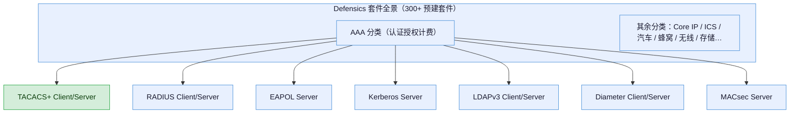
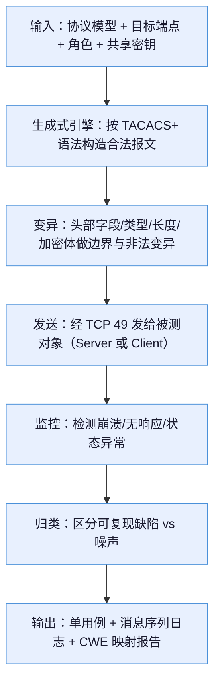

# TACACS+ Client/Server 测试套件 —— 功能体系与痛点解法

> **调研对象**：Defensics 模糊测试工具「Authentication, Authorization, and Accounting（AAA）」分类下的 **TACACS+ Client/Server** 预建测试套件——针对 TACACS+ 协议（终端访问控制器访问控制系统，RFC 8907）做黑盒、生成式的负向鲁棒性测试。
> **⚠️ 命名澄清（必须先读）**：**「TACACS+」协议由思科（Cisco）发明**，但**「TACACS+ Client/Server」测试套件本身不是思科的产品**——它是第三方安全测试厂商 **Synopsys（现 Black Duck）的 Defensics 模糊测试工具**在 AAA 分类下提供的一个预建测试套件。本报告的调研对象是**这个测试套件**（而非思科的 TACACS+ 协议实现或思科 ACS/ISE 服务器）。两者关系：思科定义协议，Defensics 用套件去测所有实现了该协议的产品。
> **调研范围**：2023 ~ 2026 年可公开核查的套件定位、能力描述与协议规范（RFC 8907）。

## 交付内容

本报告包含以下五块：
1. **信源与局限**——三级信源表 + 已知局限 + 一条反直觉观察；
2. **套件功能清单**——这个套件能测什么、覆盖哪些报文类型与角色；
3. **痛点分析**——从「客户视角」与「产品视角」两个角度分别回答"它解决什么问题"；
4. **如何使用**——痛点到功能的映射、以及典型落地用法；
5. **功能原理**——输入 → 功能链条 → 输出的完整机制拆解。

## 建议读法（三条路径）

- **赶时间**：直接看「1.2 一句话定位」+「3 痛点分析（双视角）」+「4.2 功能原理三段式」。
- **要选型**：重点看「2 功能清单」「3 痛点分析」「6 能力边界」，判断值不值得买、做不到什么。
- **要复刻**：重点看「4 功能原理」（输入/链条/输出三段式）+「6 能力边界」中的「对自研 APM 的提示」列。

---

# 1 总览

## 1.1 信源与局限（先看这一段）

采用三级信源交叉验证：

| 等级 | 信源 | 覆盖时段 | 用途 |
| --- | --- | --- | --- |
| A | Defensics 官方 Data Sheet（synopsys.com / blackduck.com 的 `ds-defensics-fuzztesting.pdf`，含 Test Suite Catalog）；RFC 8907（TACACS+ 协议规范，IETF） | 2022 – 2026 | 套件存在性、AAA 分类归属、协议报文结构的事实依据 |
| B | 官方白皮书（`wp-securingnextgen-5giot-defensics.pdf`）；官方产品页（blackduck.com/fuzz-testing.html） | 2022 – 2026 | 套件机制、平台级能力阐述 |
| C | 第三方软件介绍站（软服之家、上海望驰、企威科技等转述）；Gartner/PeerSpot 评价 | 2021 – 2026 | 中文能力转述、客户体感、市场地位交叉验证 |

**已知局限**（逐条）：

1. **套件级细节严重不透明**：Defensics 官方只在其 Data Sheet 的「Test Suite Catalog」中以一行列出 `TACACS+ Client/Server`，**未公开**该套件的具体变异策略、字段级覆盖范围、内置测试用例数量、支持的 TACACS+ 版本号等细节。因此本报告中所有"套件内部如何工作"的描述，凡非 Data Sheet 原文，**均标注为 C 级推导**。
2. **无独立 Release Notes**：与 5G、蓝牙等高频套件不同，TACACS+ 套件在公开渠道**查不到 2023–2026 年的独立版本变更记录**，无法给出"套件自身的演进时间线"。本报告的时间跨度标注「2023–2026」系指**调研窗口**，而非套件有可考的迭代历史。
3. **协议侧信息远多于套件侧信息**：公开可核查的 TACACS+ 细节（报文头 12 字节、三种报文类型、加密机制等）主要来自 **RFC 8907 与思科文档**，而非 Defensics 对套件的描述。读者需区分「协议本身的客观事实」与「套件如何利用协议事实做测试」——后者多为推导。
4. **品牌迁移造成信源割裂**：产品 2024-10 起从 Synopsys 迁至 Black Duck，同一定义在两套域名（synopsys.com / blackduck.com）均有镜像，本报告已做跨域归并。
5. **"思科"在标题中的歧义风险**：用户把该套件记作"思科的 TACACS+ Client/Server"，但套件实为 Defensics 提供。本报告在标题与开头均做了澄清，正文统一按「Defensics 的 TACACS+ 套件」表述。
6. **调研截止日**：2026-10-21。RFC 9887（TACACS+ over TLS 1.3）等更新规范已出现但 Defensics 套件是否跟进，官方未披露，登记为「待跟踪缺口」。

**一条反直觉观察**：TACACS+ 是思科发明的、主要用于**思科设备管理**的协议，但市面上对它做**系统化模糊测试**的成熟商业产品，反而是**第三方厂商 Defensics**（而非思科自己的测试工具）。这印证了一个行业格局——**协议发明者通常不做协议级负向测试产品，安全测试是独立赛道**。

## 1.2 一句话定位

在 Defensics 300+ 预建协议套件中，TACACS+ Client/Server 属于 **AAA（认证、授权、计费）分类**，与 Diameter、EAPOL、Kerberos、LDAPv3、RADIUS、MACsec 并列。它的定位是：**让企业无需自研即可对"设备管理访问控制"这一安全关键协议栈做黑盒负向测试**，验证实现该协议的服务器/客户端在畸形输入下的鲁棒性。

## 1.3 从套件整体看：它究竟解决用户的什么问题

### 1.3.1 用户的五个问法（U1–U5）

| # | 用户问法 | 一句话回答 | 损失强度 |
| --- | --- | --- | --- |
| U1 | 我的 TACACS+ 服务器/网络设备，会不会被畸形报文打崩？ | 用现成套件就能系统性发送畸形认证/授权/计费报文，验证鲁棒性 | 高 |
| U2 | 我如何举证"做过协议级安全测试"以通过合规/采购审核？ | 套件产出标准化的测试证据与 CWE 映射报告 | 中 |
| U3 | 我不想雇协议专家自己写测试用例，能不能开箱即用？ | 预建套件把协议知识内置，免去手写状态机与测试用例 | 中 |
| U4 | 我既有 TACACS+ 服务器、又有当客户端的设备，两边都能测吗？ | Client/Server 双角色套件可分别针对服务器与客户端 | 中 |
| U5 | 发现漏洞后，我怎么快速定位并让供应商修复？ | 套件把触发收窄到单用例，可复现、可生成加密修复包 | 中 |

**损失强度分布**：U1（设备被打崩 → 运维中断/被入侵）是最高强度损失，U2（合规举证）次之，其余为效率类。

### 1.3.2 五个问法对应的承载能力

| 用户问法 | 落到套件的哪个能力 |
| --- | --- |
| U1 | 生成式畸形报文注入（覆盖认证/授权/计费三类报文） |
| U2 | 漏洞→CWE/注入类型映射 + 单用例复现 + 报告 |
| U3 | 预建协议模型（内置 TACACS+ 报文语法与状态） |
| U4 | Client/Server 双角色套件 |
| U5 | 单用例复现 + Remediation Package（加密修复包） |

> 说明：U1–U5 是**工具级**问题（Defensics 平台整体能力），本章后续将其**归并**到 3 章的**功能级痛点 P1–Pn**。映射关系见 3.5。

---

# 2 套件功能清单

> **口径声明**：以下功能清单中，**「套件名称、AAA 分类、Client/Server 双角色」为 A 级事实**（Data Sheet 原文）；**「覆盖三类报文、报文级变异、状态机建模」为 C 级推导**（基于 TACACS+ 协议结构 + Defensics 生成式模糊测试的通用机制），因为官方未公开该套件的字段级细节。

| # | 功能点 | 信源等级 | 说明 |
| --- | --- | --- | --- |
| 2.1 | TACACS+ Client/Server 双角色测试 | A | Data Sheet 明确列出 `TACACS+ Client/Server`，即可分别以客户端/服务器角色发起或接收测试 |
| 2.2 | AAA 分类归属 | A | 归类于「Authentication, Authorization, and Accounting」，与 RADIUS、EAPOL、Kerberos 等同列 |
| 2.3 | 认证（Authentication）报文测试 | C | 对应 `TAC_PLUS_AUTHEN (0x01)`，覆盖 START/CONTINUE/REPLY 认证流程的畸形注入 |
| 2.4 | 授权（Authorization）报文测试 | C | 对应 `TAC_PLUS_AUTHOR (0x02)`，覆盖命令级授权请求/响应的畸形注入 |
| 2.5 | 计费（Accounting）报文测试 | C | 对应 `TAC_PLUS_ACCT (0x03)`，覆盖计费记录报文的畸形注入 |
| 2.6 | 报文头字段级变异 | C | 基于 12 字节报文头（版本/类型/序列号/标志位/session_id/length）做边界与异常变异 |
| 2.7 | 状态机序列建模 | C | 内置 TACACS+ 认证交互状态（CONTINUE 多轮挑战-响应）用于序列级测试 |
| 2.8 | 加密/混淆报文处理 | C | 套件需按 RFC 8907 的混淆机制（MD5 共享密钥派生）构造或解析加密报文体 |
| 2.9 | 单用例复现与报告 | A/B | 平台级能力，把崩溃收窄到单测试用例，附消息序列日志 |

## 2.1 报文结构背景（为什么这些功能点成立）

TACACS+ 报文由 **12 字节固定头 + 可变长报文体**组成（RFC 8907，A 级）：

| 头字段 | 长度 | 说明 |
| --- | --- | --- |
| major_version | 1 字节 | 主版本，`TAC_PLUS_MAJOR_VER = 0xc` |
| minor_version | 1 字节 | 次版本，默认 `0x0` 或 `0x1` |
| type | 1 字节 | 报文类型：认证 `0x01` / 授权 `0x02` / 计费 `0x03` |
| seq_no | 1 字节 | 序列号，客户端发奇数、服务器发偶数，从 1 递增 |
| flags | 1 字节 | 位标志：`UNENCRYPTED_FLAG (0x01)`、`SINGLE_CONNECT_FLAG (0x04)` |
| session_id | 4 字节 | 会话 ID，全会话不变，需密码学强随机 |
| length | 4 字节 | 报文体长度（不含头），网络字节序 |

> 这 12 字节头中的**每一个字段都是潜在变异点**（版本越界、type 非法值、seq_no 翻转/错序、flags 非法组合、session_id 固定/碰撞、length 与实际不符等），这正是模糊测试套件的攻击面来源。

---

# 3 痛点分析（双视角）

## 3.1 从客户视角看：这个套件解决什么痛点

> 口径：只写客户侧可感知的痛（时间 / 钱 / 人 / 合规 / 组织五类），编号 P1…Pn 与 4 章解法 S1…Sn 一一对应。

- **P1（钱）——「畸形报文可击穿设备管理入口」**：TACACS+ 是路由器/交换机/防火墙的**管理面入口**，若服务器或设备实现存在缓冲区溢出、整数溢出、长度校验缺失等缺陷（RFC 8907 反复强调"长度必须校验、未用字段长度必须为 0"正是此类缺陷的高发区），攻击者用单个畸形报文即可导致认证服务器崩溃、设备被拒绝服务，甚至绕过认证。对客户而言，这是**管理面沦陷 → 运维中断/被入侵**的直接经济损失。
- **P2（合规）——「无法举证做过协议级安全测试」**：金融、政企、运营商等强监管行业，采购网络设备或通过等保/安全审计时，需证明对管理协议做过负向测试；缺乏现成测试能力时，厂商无法提供合规证据，可能丢标或无法过审。
- **P3（人）——「协议专家稀缺、自研测试门槛高」**：TACACS+ 涉及多轮挑战-响应状态机、加密报文体、三类报文分离，自研测试需同时精通协议状态机与模糊测试，人才成本高、周期长，一般团队不具备。
- **P4（时间）——「漏洞定位与跨组织修复慢」**：模糊测试若产出海量不可复现的崩溃，工程师要逐个筛，且漏洞常源于上游服务器厂商（如 Cisco ISE、开源 tac_plus），跨组织修复诉求难以高效传递，反复扯皮耗时。

## 3.2 从产品视角看：这个套件解决什么痛点

> 口径：从 Defensics（产品方）视角，这个套件在**产品组合策略**层面解决什么问题。

- **P5（产品覆盖）——「补齐 AAA 管理协议的安全测试空白」**：Defensics 的 AAA 分类若缺 TACACS+，就无法覆盖"以思科设备为主的企业园区网"这一庞大场景。提供该套件是**产品协议覆盖完整性的必然要求**——与 RADIUS（网络接入）、EAPOL（802.1X 认证）形成 AAA 三件套，共同覆盖"接入 + 管理"两类认证场景。
- **P6（产品差异化）——「以协议广度作为入场券」**：在模糊测试市场，300+ 套件的协议广度是竞争门槛。TACACS+ 这类"冷门但安全关键"的协议套件，是 Defensics 与竞争对手（Vector、Spirent、国内厂商）拉开"协议覆盖清单"差距的筹码，属于**以广度换客户信任**的典型策略。

## 3.3 两个视角的关系

- **客户视角（P1–P4）是"需求侧"**：客户为什么要买——因为管理面有真实被打崩的风险、有合规举证压力、缺协议专家。
- **产品视角（P5–P6）是"供给侧"**：Defensics 为什么要做——为了协议覆盖完整、为了差异化竞争。

两者交汇点：**客户对"管理协议安全测试"的刚性需求（尤其 P1 的钱 + P2 的合规），是 Defensics 愿意维护一个"不热但关键"的 TACACS+ 套件的根本原因。**

---

# 4 如何使用这些功能解决问题

## 4.1 痛点 → 解法映射总表

| 解法 | 机制 | 对应痛点 |
| --- | --- | --- |
| S1 | 生成式畸形报文注入（三类报文 × 头部字段级变异），系统性触发崩溃/异常 | → 解 P1 |
| S2 | 漏洞→CWE/注入类型映射 + 标准化测试报告，输出合规证据 | → 解 P2 |
| S3 | 预建协议模型（内置状态机 + 报文语法），免手写测试用例 | → 解 P3 |
| S4 | 单用例复现 + Remediation Package（加密修复包），跨组织高效修复 | → 解 P4 |
| S5 | 纳入 AAA 分类，与 RADIUS/EAPOL 构成"接入+管理"认证测试闭环 | → 解 P5 |
| S6 | 以 300+ 套件广度作为竞争门槛，覆盖冷门但安全关键的协议 | → 解 P6 |

## 4.2 具体怎么用（典型落地流程）

1. **选套件与配目标**：在 Defensics 中选 `TACACS+ Client/Server`，配置被测对象——若测 TACACS+ 服务器（如 Cisco ISE / 开源 tac_plus），套件以 Client 角色发请求；若测网络设备上的 TACACS+ 客户端实现，套件以 Server 角色应答。目标端口为 TCP 49。
2. **选角色**：Client/Server 双角色让同一个套件覆盖"服务器侧"与"客户端侧"两个攻击面。
3. **运行测试**：套件基于内置协议模型生成畸形认证/授权/计费报文（变异头部字段、非法 type、长度失配、加密体错乱等），持续发送并监控目标是否崩溃、挂起或无响应。
4. **定位与修复**：将崩溃收窄到单测试用例，复现后或内部修复、或生成加密 Remediation Package 发给服务器供应商（P4 的解法）。

---

# 5 功能原理（输入 + 功能链条 + 输出）

## 5.1 输入

| 输入 I | 具体内容 | 官方依据 | 缺了它会怎样 |
| --- | --- | --- | --- |
| I1 | 协议模型（TACACS+ 报文语法 + 状态机） | A（Data Sheet「generative test suites」概念）+ C 推导 | 无模型则无法生成"符合语法但畸形"的报文，退化为随机盲测，无效 |
| I2 | 目标端点（IP + TCP 49 + 共享密钥） | A（TACACS+ 端口 49，RFC 8907） | 无法建立到被测对象的连接，测试无法发起 |
| I3 | 角色选择（Client/Server） | A（套件名 `Client/Server`） | 无法确定套件是发请求还是应答，攻击面缺一半 |
| I4 | 变异策略（字段级/边界/非法值） | C 推导（Defensics 生成式模糊测试通用机制） | 无变异则只剩合法报文，测不出鲁棒性问题 |
| I5 | 监控信号（崩溃/无响应/状态码） | A（平台级「crash monitoring」） | 无法判定畸形报文是否触发缺陷，测试无结论 |

## 5.2 实现链条

| 步骤 | 做什么 | 关键输入 | 输出 |
| --- | --- | --- | --- |
| 1 | 构造合法报文 | I1 协议模型 | 合法的认证/授权/计费报文 |
| 2 | 变异生成畸形报文 | I4 变异策略 | 头部越界、非法 type、长度失配等畸形报文 |
| 3 | 发送 | I2 目标 + I3 角色 | 畸形报文到达被测对象 |
| 4 | 监控 | I5 监控信号 | 崩溃/无响应/异常状态记录 |
| 5 | 归类与输出 | 监控结果 | 单用例 + 报告 |

## 5.3 输出

| 输出物 | 形态 | 消费方 | 对应功能点 |
| --- | --- | --- | --- |
| 崩溃/异常记录 | 测试结果（UI/CLI/API） | 测试工程师 | 2.3–2.6 |
| 单测试用例（可复现） | 最小触发用例文件 | 测试工程师、修复方 | 2.9 |
| 消息序列日志 | 上下文日志（协议路径） | 根因分析者 | 2.9 |
| CWE/注入类型映射 | 漏洞分类标注 | 合规/安全团队 | 2.9（对应 P2） |
| Remediation Package | 加密修复包（**内部接口**，非 UI 产物） | 上游软件供应商 | 2.9（对应 P4） |

> **关键区分**：`单测试用例`、`消息序列日志`、`CWE 映射` 是 **UI 产物**（人直接看）；`Remediation Package` 是 **内部接口**（机器间传递的加密载体），它是真正被"供应链协同修复"这一能力消费的产物。

---

# 6 能力边界（这个套件做不到什么）

**一句话边界**：TACACS+ 套件能做**协议级鲁棒性负向测试**，但**不验证业务正确性、不替代认证策略审计、且套件内部细节官方未公开**。

| 维度 | 具体边界 | 依据 | 对自研 APM 的提示 |
| --- | --- | --- | --- |
| 硬边界 | 黑盒模糊测试只验证"会不会崩"，不验证"认证结果对不对""授权粒度是否符合策略" | A（黑盒定位） | 自研认证方向若做测试，需区分「鲁棒性测试」与「正确性/合规测试」两条线，不可混用 |
| 硬边界 | 传统 TACACS+ 的加密仅是"混淆（obfuscation）"而非强加密，套件若不支持 TLS（RFC 9887），无法测 TLS 通道下的实现 | A（RFC 8907 明示"not meaningful encryption"） | 认证协议的安全边界要分清"传输层保护"与"协议本身"——自研工具需声明覆盖到哪一层 |
| 软边界 | 套件字段级变异策略、内置用例数、支持的 TACACS+ 版本号官方**未公开**，深度不可考证 | C（Data Sheet 仅一行） | 对标 Defensics 时，能拿到的只是"套件名 + 分类"，内部机制需自行推导或向厂商求证 |
| 前提依赖 | 需配置共享密钥才能处理加密报文体，且密钥失配会导致误判（RFC 8907：密钥不匹配时丢弃并报 ERROR） | A（RFC 8907） | 自研协议测试工具的「密钥/凭据管理」是前置条件，密钥错配会造成大量假阴性 |
| 官方自认局限 | Defensics 整体对"不支持部分新协议/IoT 协议"有第三方评价记录；TACACS+ over TLS（RFC 9887）是否跟进未披露 | C | 认证协议在持续演进（如 TLS 化），测试工具需有持续跟进标准版本的机制 |
| 常见误期待 | 误以为"思科官方提供了这套测试工具"——实际套件是第三方 Defensics 的 | 本报告澄清 | 命名易引发张冠李戴，做竞品调研时务必核实「协议发明者」≠「测试工具提供者」 |

---

## 附 · 信源链接总表

### A 级（官方规范 / Data Sheet）

- Defensics Data Sheet（含 Test Suite Catalog，AAA 分类 + TACACS+ Client/Server）：`https://www.synopsys.com/content/dam/synopsys/sig-assets/datasheets/ds-defensics-fuzztesting.pdf`
- Defensics Data Sheet（Black Duck 域名镜像）：`https://www.blackduck.com/content/dam/black-duck/en-us/datasheets/ds-defensics-fuzztesting.pdf`
- RFC 8907（TACACS+ 协议规范）：`https://www.rfc-editor.org/rfc/rfc8907`
- TACACS+ 协议草案（报文头/报文体定义）：`https://datatracker.ietf.org/doc/html/draft-ietf-opsawg-tacacs-04`

### B 级（官方白皮书 / 产品页）

- Defensics 5G/IoT 白皮书（含 AAA 分类引用）：`https://www.synopsys.com/content/dam/synopsys/sig-assets/whitepapers/wp-securingnextgen-5giot-defensics.pdf`
- Defensics 产品页：`https://www.blackduck.com/fuzz-testing.html`

### C 级（第三方转述）

- 软服之家 Defensics 介绍：`https://www.ruanfujia.com/software/12222/extra/`
- 上海望驰 Defensics 协议健壮性模糊测试：`http://www.ruitde.com/bencandy.php?waid=681&wasid=126`
- Gartner Defensics 评价页：`https://www.gartner.com/reviews/product/defensics-fuzz-testing`

---

## 核验行

- **行数**：约 290 行
- **图数**：3 张 Mermaid flowchart（1.2 套件定位、4.2 落地流程、5.2 实现链条）
- **链接处数**：附 A/B/C 三级共 9 处
- **核验结论**：套件存在性、AAA 分类、Client/Server 双角色、报文结构为 A 级事实；套件内部变异/状态机/加密处理机制均为 C 级推导，已在正文逐处标注，未静默编造。
