# BRKCLD-2019 · Kubernetes in CML

> **一句话定位**：这不是"CML 里跑个 K8s"的操作演示，而是一次**角色越界实验**——一个传统网络工程师和一个传统软件工程师，把 Kubernetes 网络从"云厂商的黑盒"里拽出来，放进 CML 让你看得见、改得动、能排障。主角不是 K8s，是 **Cilium**：思科 2024 年收购 Isovalent 后，它被当作"CML 能力边界的延展方向"来推。

## 0. 文档信息

| 项目 | 内容 |
|---|---|
| 会议 | Cisco Live Americas 2026（拉斯维加斯 Mandalay Bay，2026-06-03 有同主题续场） |
| 场次 | BRKCLD-2019 |
| 讲者 | Colin J Lacy（Senior Software Engineer）／Nico Vibert（Principal Technical Marketing Engineer） |
| 页数 | 70 页 |
| 信源等级 | **A 级**（思科官方会议材料原文） |
| 配套仓库 | https://github.com/colinjlacy/BRKCLD-2019-K8s-in-CML |
| 截图来源 | 全部由该 PDF 原页渲染，见 `deck-images/` |

---

## 1. 立论：两个人的背景差异就是论题本身

幻灯片用一整页做"讲者介绍"，但重点不在头衔，而在背景标签：

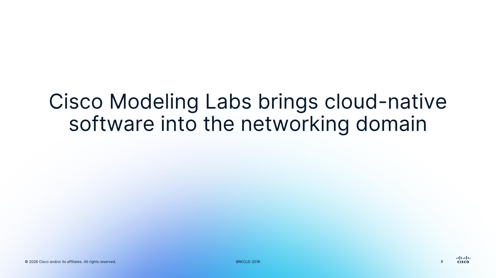

**图上看到什么**：整页只有一句话——"**Cisco Modeling Labs brings cloud-native software into the networking domain**"。

**为什么这一句是全场纲领**：它把 CML 的定位从"网络仿真器"改写成"**两个领域的交汇点**"。传统上 CML 只模拟路由器交换机；这份材料要说服的是：CML 也能承载容器、CNI、控制器这些"软件世界的东西"。

两位讲者的分工是这句话的人格化：Nico 是**传统网络背景**（懂 BGP、懂 Fabric），Colin 是**传统软件背景**（懂 Linux、懂容器）。后面所有内容都是这两人视角的来回切换——**这正是听众要补的那道缝**。

---

## 2. 为什么要在 CML 里跑 Kubernetes

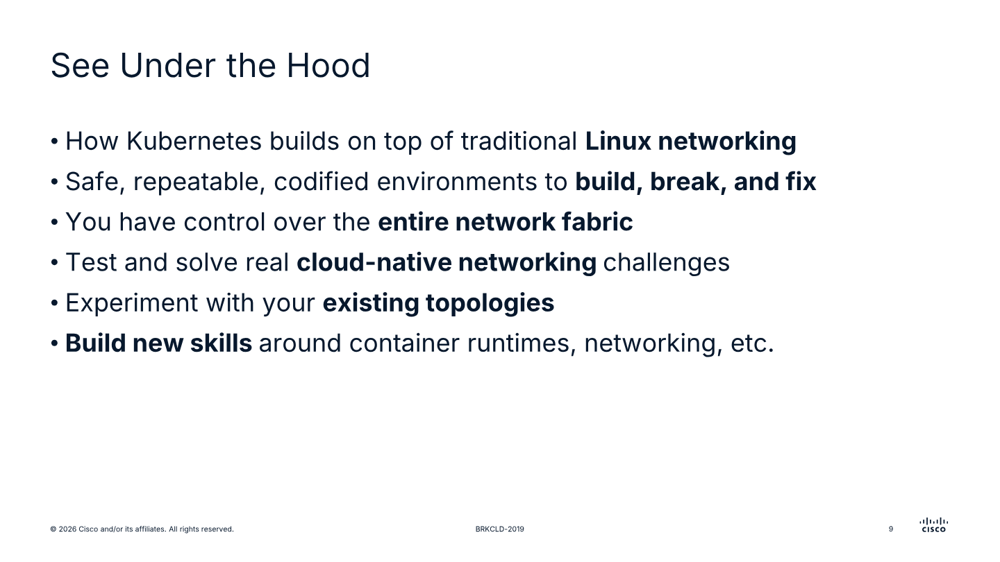

**图上看到什么**：标题 "See Under the Hood"，六条理由：
1. 看清 **Kubernetes 如何建立在传统 Linux 网络之上**
2. 安全、可重复、代码化的环境，用来 **build, break, and fix**（搭建、弄坏、修好）
3. 你**掌握整张网络织物**（entire network fabric）
4. 测试并解决真实的云原生网络挑战
5. 用你现有的拓扑做实验
6. 建立容器运行时、网络等方面的新技能

**怎么理解**：第 2 条是全篇的方法论核心——"**build, break, and fix**"。K8s 网络最难的地方不是"配通"，而是"挂了怎么查"，而生产环境里你不敢随便 break。CML 提供的正是这个"可以随便弄坏"的空间。

第 3 条 "you have control over the entire network fabric" 才是与云厂商的真正差别——在 EKS/AKS 上你没有 fabric 的控制权（后文 S55 会正面论证这一点）。

---

## 3. 部署：k3s + Ansible，六个步骤

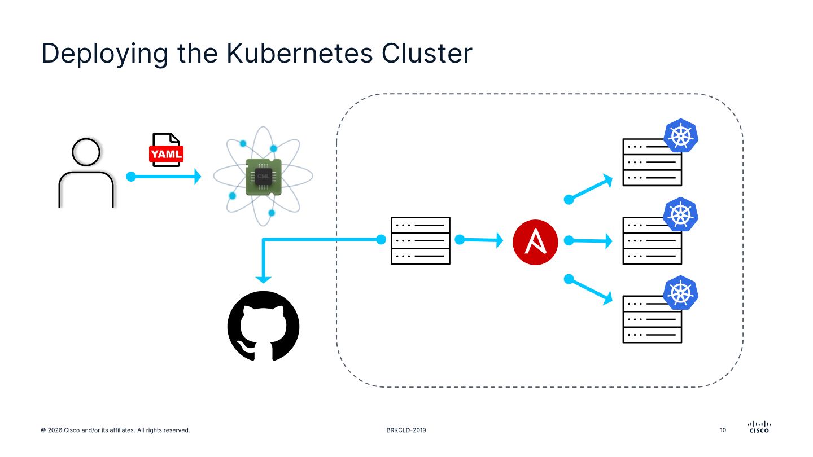

**图上看到什么**：纯章节过渡页。

**为什么值得单独一张**：这个 deck 的章节划分本身就是教学法——它先给"能跑起来的最小集群"，再谈 Cilium。顺序不能反：**先有 K8s，才能替换它的网络**。

### 3.1 第一个拓扑：四台 Ubuntu

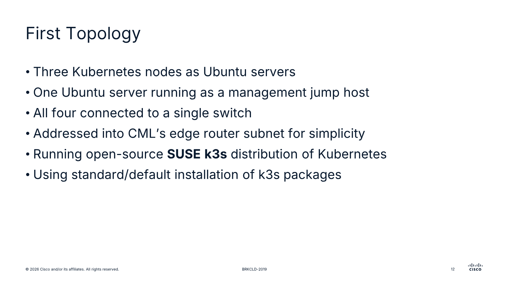

**图上看到什么**：3 台 Ubuntu 作为 Kubernetes 节点，1 台 Ubuntu 作为管理跳板机（mgmt jump host），四台全部连到一台交换机；地址直接放进 CML 边缘路由器的子网；K8s 发行版用 **SUSE k3s**，走标准默认安装。

**怎么理解这三个设计选择**：

| 选择 | 理由 | 代价 |
|---|---|---|
| 用 **k3s** 而非 kubeadm | 单二进制、依赖少、启动快，适合"反复建了拆" | 默认组件被裁剪（后续要让位给 Cilium） |
| 加一台 **mgmt 跳板机** | Ansible 的 control node 必须独立于被管节点 | 多一个节点消耗资源 |
| 全部放**同一子网** | 先把"集群能起来"与"跨网段路由"解耦 | 这只是第一版，真正的跨站点在 S58 |

**注意"用 Ansible 而不是手工敲"这个隐含前提**：K8s 集群一旦建超过一次，手工操作就不可接受——因为你要反复重建。这也是为什么整套 lab 用 playbook 描述。

### 3.2 讲者提前打的六个预防针

幻灯片直言不讳地列了六条"知道这些能少受点罪"：

| 提醒 | 实际含义 |
|---|---|
| 选轻量、可定制的发行版（如 k3s） | 全量 K8s 在 CML 里太重，启动慢、吃内存 |
| 注意虚拟思科设备的**吞吐限制** | 拉镜像会非常慢（与 BRKCRT-2059 的 S37 是同一个坑） |
| K8s 用 **OCI 镜像**（即 Docker 镜像） | 每个节点都要能访问镜像仓库 |
| **预拉镜像**能省时间和"泰诺"（止痛药） | 这是全篇最实用的一条：不预拉，`ImagePullBackOff` 会反复出现 |
| **容器运行时**决定 K8s 的行为 | containerd 版本影响 CNI 行为 |
| 可选开 **local image mirror** | k3s 特性，进一步避免重复拉取 |

**原话**："These topologies take quite a while to set up. **Grab a snack.**"（这些拓扑要装很久，先去拿点零食。）——这句玩笑话其实是个重要预期管理：**CML 里的 K8s 实验不是"秒起"，第一次搭要几十分钟**。

### 3.3 基础版 Playbook：六步

1. 等 mgmt 与各 Ubuntu 节点之间 SSH 可达
2. 准备容器网络所需的**内核模块**
3. 在控制面节点安装 k3s server
4. 在各工作节点安装并 join k3s agent
5. 在 mgmt 节点装 kubectl
6. 在 mgmt 节点下载 kubeconfig

**第 2 步最容易被忽略**：`br_netfilter`、`overlay` 这些模块不加载，CNI 装上了也不通。这是"K8s 网络问题其实是 Linux 网络问题"的第一个具体例证（呼应 S9 的第 1 条）。

---

## 4. 概念对照：一张表把两个世界拉齐

### 4.1 先看这张"半成品"表

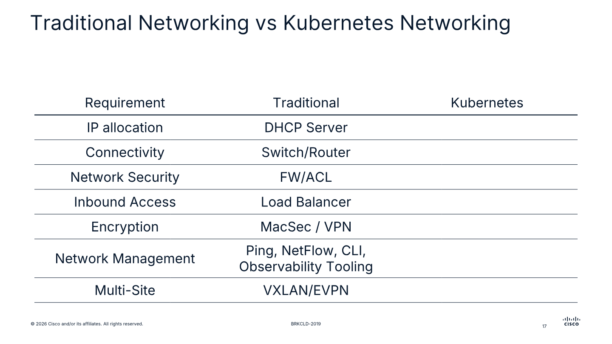

**图上看到什么**：七行需求对照，左边"Traditional"列填满了（DHCP Server、Switch/Router、FW/ACL、Load Balancer、MacSec/VPN、Ping/NetFlow/CLI、VXLAN/EVPN），右边 **"Kubernetes"列完全是空的**。

**为什么空着**：这是典型的"**提问式排版**"。讲者先把网络工程师熟悉的七件事摆出来，让你自己意识到"这些在 K8s 里对应什么？"——然后过了 30 页才给答案。

### 4.2 三十页后的答案：一个 logo

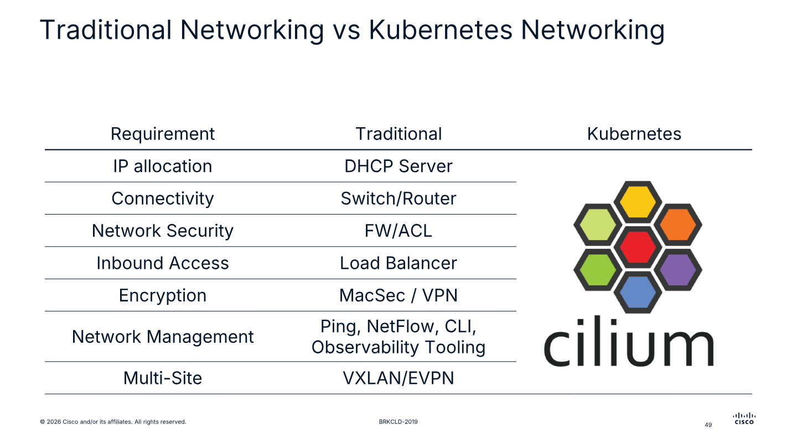

**图上看到什么**：与 S17 完全相同的表，但右侧空白的 "Kubernetes" 列现在只放了一个东西——**Cilium 的六边形蜂巢 logo**。

**这是全 deck 最强的一个修辞**：传统网络里分散在 7 类设备/工具上的能力（DHCP、交换路由、防火墙、负载均衡、加密、可观测、EVPN 多站点），在 Kubernetes 里**由一个 CNI 插件承担**。它同时说明两件事：
1. **为什么网络工程师必须懂 Cilium**——它不再是"装个插件"，而是替代了你半张技能树；
2. **为什么 Cilium 值得思科花 2024 年整年去收购 Isovalent**。

### 4.3 Kubernetes 网络模型的三条硬约束

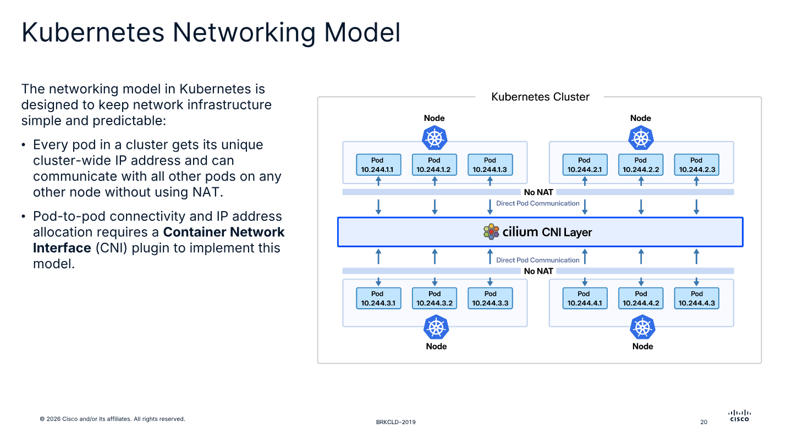

**图上看到什么**：左侧文字说明——每个 Pod 获得**集群范围内唯一的 IP**，可以与任意节点上的其他 Pod 通信**且不使用 NAT**；实现这个模型需要 **CNI（Container Network Interface）插件**。

**怎么理解"不用 NAT"的分量**：这是 K8s 网络与传统数据中心最大的差异。传统环境里 NAT 随处可见（出口 NAT、VIP 后端 NAT），但在 K8s 里 **Pod-to-Pod 必须平坦**。这条约束直接决定了后面所有设计：
- 要么让底层网络**认识 Pod 网段**（native routing）；
- 要么用**叠加封装**把 Pod 包起来（VXLAN/GENEVE）；
- 两者都不做 → 集群内通信直接崩。

### 4.4 两种互联方式：原生路由 vs 叠加封装

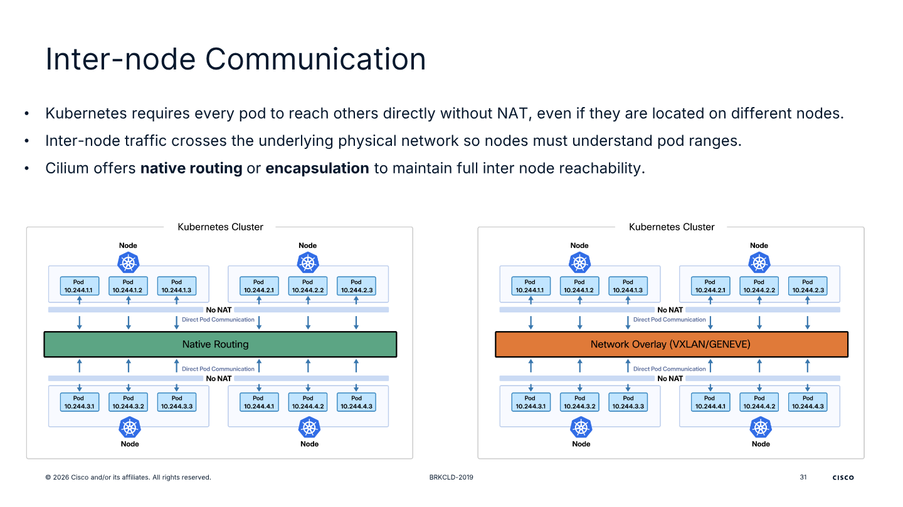

**图上看到什么**：左右两套对称的集群拓扑，各有 4 个节点、每节点 3 个 Pod（`10.244.1.x` ~ `10.244.4.x`）。
- **左（绿）Native Routing**：节点之间直接承载 Pod 网段，标注 "Direct Pod Communication / **No NAT**"；
- **右（橙）Network Overlay (VXLAN/GENEVE)**：节点之间加了一层封装隧道。

**怎么理解这个选择的工程含义**：

| 维度 | Native Routing | Overlay（VXLAN/GENEVE） |
|---|---|---|
| 底层网络要求 | **必须**认识 Pod 网段（要么同网段，要么有路由） | 只要求节点间 IP 可达 |
| 性能 | 无额外封装开销 | MTU 损耗 + 加解封装开销 |
| 可观测性 | 抓包能看到真实 Pod IP | 抓包看到的是封装后的外层 |
| 典型场景 | 自建数据中心、与 Fabric 深度集成 | 跨子网、跨云、底层不可控 |

**这一页是理解后文 S58 双站点拓扑的钥匙**：既然要做"两个站点互相访问对方的 Pod 网段"，就必须选 native routing 并把 Pod 网段通告进 BGP——否则跨站点只能靠更复杂的叠加。

---

## 5. Cilium 的六大能力（逐个展开）

Cilium 用一组"重复出现的目录页"来组织六项能力：**IP 地址分配 / 负载均衡 / 集群内互联 / 网络可观测性 / 防火墙（网络策略）/ 集群接入（BGP）**。这种"每讲完一项就回到目录、把刚讲完的那项打勾"的结构，是技术 deck 里便于跟上的经典手法。

### 5.1 IP 分配：DHCP 的角色被 PodCIDR 取代

讲者用一个反问开场：**"Where's my DHCP server?"（我的 DHCP 服务器呢？）**

关键区别在于**两层分离**：
- **节点**（Node）：和普通服务器/VM 一样，用 DHCP、IPAM 或静态地址；
- **Pod**：由集群分配的 CIDR 里取地址——集群拿到一个或多个 CIDR，每个节点分到一个或多个 `PodCIDR` 段，**Cilium 按 IPAM 模式从这些段里给 Pod 发地址**。

**紧接着的一个观念修正**（原文标题就是结论）：

> **IP address ≠ Identity**（IP 地址不等于身份）

三条依据：IP 在 K8s 里不代表身份；Pod 会被销毁重建、重建后 IP 会变；因此**网络策略应当基于业务逻辑和元数据（标签）定义，而不是基于 IP**。

**这一条是理解后文所有策略示例的前提**：如果你还用"源 IP 段"的思维写策略，在 K8s 里注定失效。

### 5.2 负载均衡：先分清三种 Service

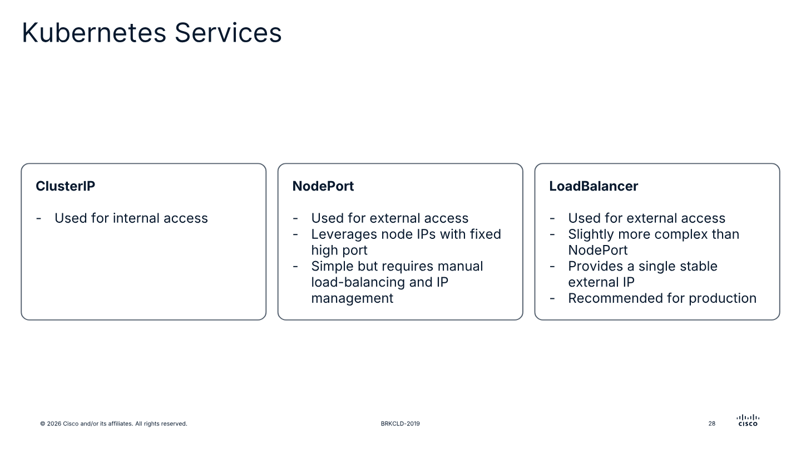

**图上看到什么**：三列对比——ClusterIP 用于内部访问；NodePort 用于外部访问，借助节点 IP + 固定高端口，简单但需要手工做负载均衡和 IP 管理；LoadBalancer 用于外部访问，比 NodePort 略复杂，但提供**单一稳定外部 IP**，生产推荐。

**怎么理解"为什么还需要一个 CNI 来做 LB"**：K8s 的 Service 只是**声明**，真正把流量送达需要实现者。云上用云厂商的 LB；自建环境里，传统做法是再装一个 MetalLB。Cilium 的价值是**把这些能力内建**——用 eBPF 在数据面直接完成 DNAT 和负载均衡，不必额外部署组件，这也解释了为什么它能"一个 logo 顶一列"。

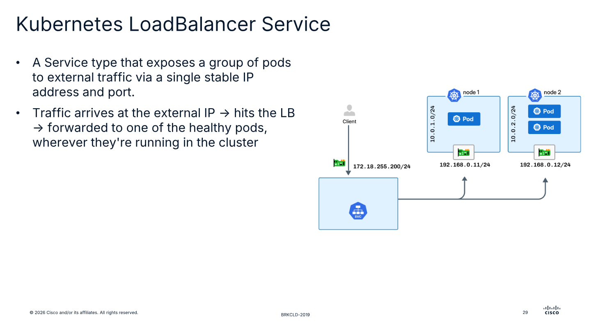

**图上看到什么**：一句话描述流量路径——"Traffic arrives at the external IP → hits the LB → forwarded to one of the healthy pods, **wherever they're running in the cluster**"。

**为什么强调 wherever**：这是 LB 与节点解耦的核心。客户端只需要知道一个 IP，不需要知道 Pod 落在哪个节点、也不需要知道节点是否变更。

### 5.3 可观测性：Hubble 的两副面孔

Cilium 的可观测性组件叫 **Hubble**，材料给了 UI 和 CLI 两种视图。

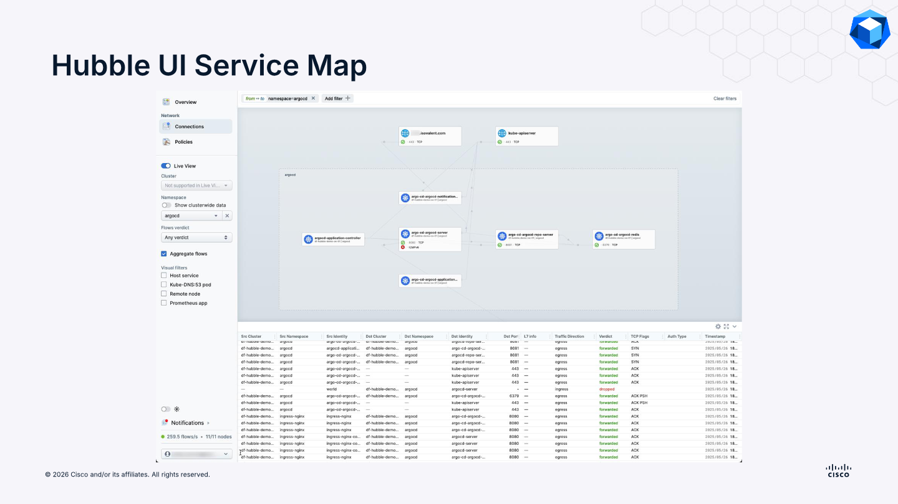

**图上看到什么**：一个真实的 Hubble 界面截图。
- **左侧筛选**：Cluster、Namespace（选了 `argocd`）、Flow verdict（Any verdict）、Aggregate flows；还有几个开关——Host network、Kube DNS、Remote node、Prometheus app；
- **中部服务地图**：`argocd-application-controller`、`argocd-repo-server`、`argocd-server`、`argocd-redis`、`argocd-dex-server`、`argocd-applicationset-controller` 之间连成一圈，另有 `kube-apiserver`、`kube.argocd.red` 两个外部实体；
- **底部流表**：列头是 **Src Cluster / Src Namespace / Src Identity / Dest Cluster / Dest Namespace / Dest Identity / Dest Port / L7 info / Verdict / TCP Flags / Auth Type / Timestamp**。

**怎么理解这张图的三个关键列**：
1. **Identity 而不是 IP**——印证前面"IP ≠ Identity"。Cilium 给每个工作负载一个安全身份（数字 ID），策略和可见性都基于身份；
2. **L7 info**——能显示 HTTP 方法/路径这种应用层信息，这是 eBPF + Envoy 配合的结果（见 5.5）；
3. **Verdict**（FORWARDED / DROPPED）——直接告诉你"这条流是被策略放行还是拒绝"，这是排障时最有价值的一列。

**这张 UI 的现实意义**：在传统网络里，跨主机的容器间调用基本是"看不见的"（VXLAN 一封装，NetFlow 就失效）。Hubble 把这一层重新变得可见——**这就是"网络可观测性"这项能力的具体形态**。

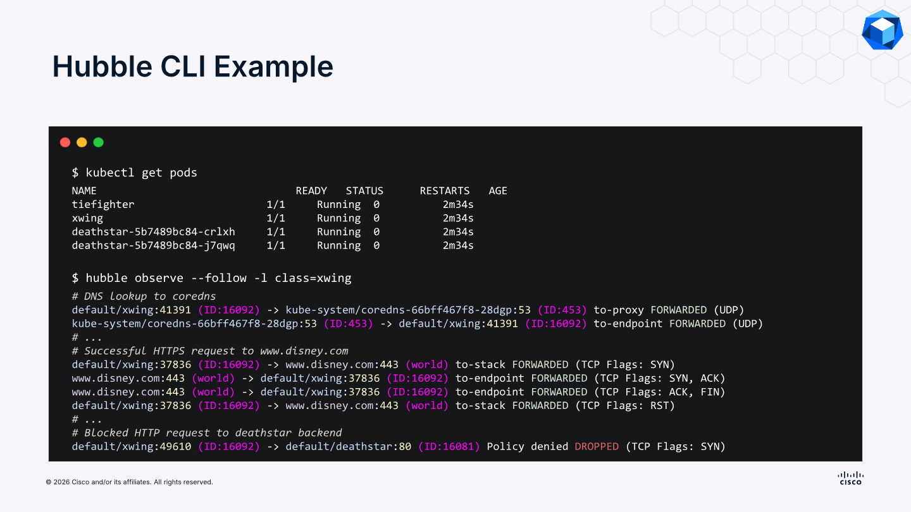

**图上看到什么**：一段真实终端输出。先用 `kubectl get pods` 看到 `tiefighter`、`xwing`、两个 `deathstar-*`，然后 `hubble observe --follow -l class=xwing` 跟踪流量，输出三类事件：

```
# DNS lookup to coredns
default/xwing:41391 -> kube-system/coredns-...:53 to-proxy FORWARDED (UDP)

# Successful HTTPS request to www.disney.com
default/xwing:37836 -> www.disney.com:443 (world) to-stack FORWARDED (TCP Flags: SYN)
...
default/xwing:49610 -> default/deathstar:80 Policy denied DROPPED (TCP Flags: SYN)
```

**怎么理解这三段的层次**：
- 第一段是 **DNS 阶段**，标注 `to-proxy`——说明 DNS 请求经过了 L7 代理；
- 第二段是 **出集群访问外网**，目标显示为 `(world)`——Cilium 能区分"集群内"与"集群外"；
- 第三段是**被策略拒绝**，`Policy denied DROPPED`——不是网络不通，是**策略明确拒绝**。

**这三段合起来就是一个排障剧本**：连接不通时，先看 DNS 有没有解析，再看出口有没有被拦，最后看是不是策略拒绝。而这个剧本在传统网络里要抓三次包才能拼出来。

### 5.4 网络策略：从 L3/L4 到 L7 到 FQDN

先给定位（原文标题 "Network Policy 101"）：
- 网络策略定义**集群内哪些流被允许**，相当于 K8s 里的 ACL；
- **Kubernetes 原生 NetworkPolicy 只支持 L3/L4**；
- **Cilium NetworkPolicy 支持 L3/L4、L7、以及基于 FQDN**。

然后是三段递进的 YAML 示例，每一段都比上一段多看一层。

**第一层：L3/L4 —— 只控制"哪个端口"**

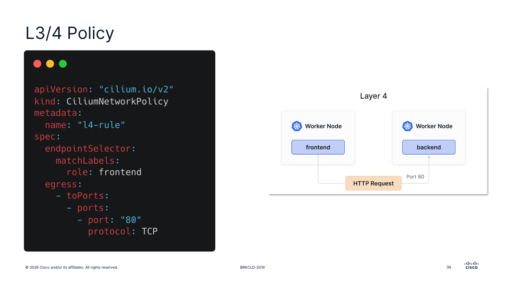

**图上看到什么**：左边是 `CiliumNetworkPolicy` 的 YAML，`endpointSelector` 选中 `role: frontend`，`egress` 里 `toPorts` → `port: "80"`、`protocol: TCP`；右边图示 frontend → backend，标 "Port 80"。

**怎么理解**：这就是"端口级 ACL"。它知道你在访问 80 端口，但**不知道你在 80 端口上干什么**——GET 还是 DELETE、访问哪个路径，它都放行。

**第二层：L7 —— 控制到"什么方法、什么路径"**

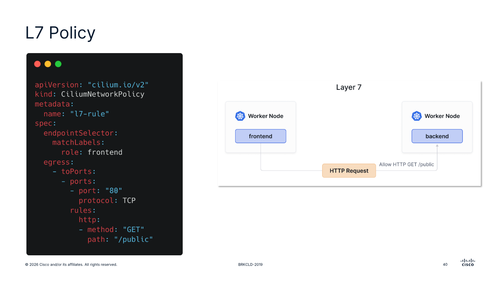

**图上看到什么**：YAML 与上一页几乎相同，只在 `toPorts` 下多了一段：
```yaml
rules:
  http:
    - method: "GET"
      path: "/public"
```
右侧图示标注变为 "Allow HTTP **GET /public**"。

**为什么这是质变而不是量变**：L3/L4 策略的粒度是"连接"，L7 策略的粒度是"**请求**"。同一条 TCP 连接里，`GET /public` 放行而 `DELETE /admin` 拒绝——这在传统防火墙上需要 WAF 或反向代理才能做到，Cilium 用 eBPF+Envoy 在 Pod 侧就做了。

**第三层：FQDN —— 控制到"访问哪个域名"**

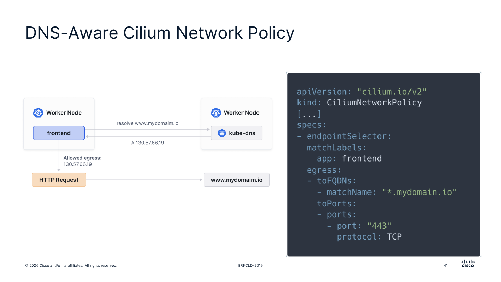

**图上看到什么**：左侧拓扑显示 frontend 向 kube-dns 查询 `www.mydomain.io`，得到 `130.57.66.19`，然后被允许出向访问该 IP；右侧 YAML 使用：
```yaml
egress:
  - toFQDNs:
      - matchName: "*.mydomain.io"
    toPorts:
      - ports:
          - port: "443"
            protocol: TCP
```

**怎么理解它的巧妙之处**：这里有个鸡生蛋问题——策略要基于域名，但数据面只能看到 IP。Cilium 的做法是**在 DNS 应答经过时把"域名→IP"的映射记下来**，然后动态放行对应 IP。图中 `A 130.57.66.19` 那一行就是这个机制的可视化。

**为什么这对安全很重要**：云环境里 SaaS 的 IP 天天变，写 IP 白名单必然过期失效。FQDN 策略是云原生环境下"出向访问控制"的正确姿势。

### 5.5 为什么 L7 需要 Envoy

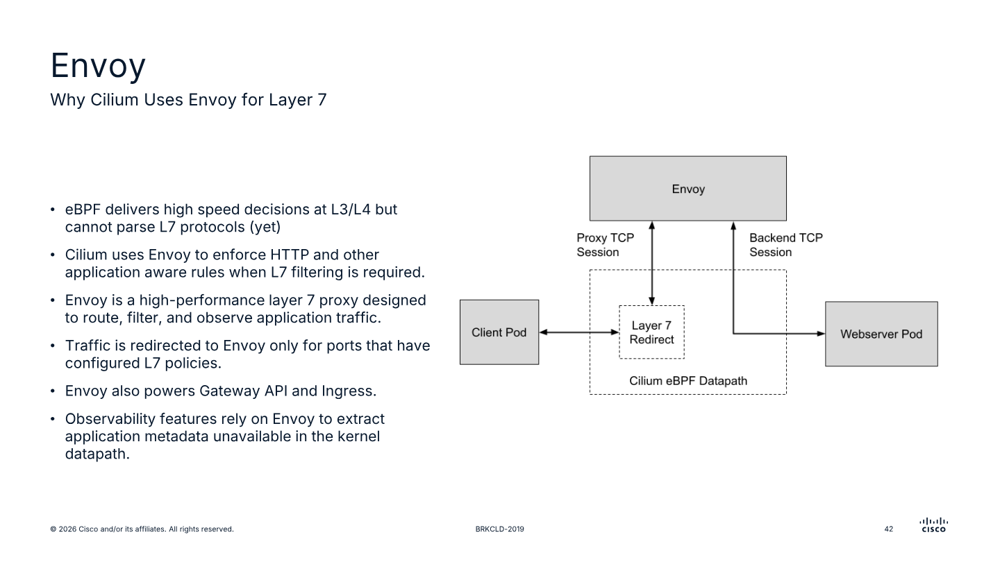

**图上看到什么**：六条要点，核心是前两条——eBPF 在 L3/L4 能做出高速决策，但**尚不能解析 L7 协议**；当需要 L7 过滤时，Cilium 用 **Envoy** 来执行 HTTP 等应用层规则。

**怎么理解这个架构取长补短**：
- **eBPF**：在内核里跑，性能极高，适合"看包头就能决定"的判断（五元组、身份）；
- **Envoy**：用户态七层代理，能解析 HTTP/1、HTTP/2、gRPC，适合"要看完请求内容才能决定"的判断。

**关键的性能细节**（原文第 4 条）：**只有当某个端口配置了 L7 策略时，流量才会被重定向到 Envoy**。也就是说，不做 L7 策略的服务完全没有代理开销——这解释了为什么 Cilium 能做到"有 L7 能力但不付出全局代价"。

另外两条值得记：Envoy 同时也是 **Gateway API 和 Ingress** 的实现基础；可观测性里那些"内核数据面拿不到的应用元数据"，也来自 Envoy。

### 5.6 集群接入：让外部世界知道 Service IP

先抛问题：**"How do we make the Ingress/GW API IP known to external clients?"** 两个选项：**L2 Announcement** 或 **BGP**。

L2 Announcement 的定位很清楚：
- 用 ARP 通告 IP 来暴露服务；
- 流量在**同一时刻只被导向一个活跃节点**；
- 仅当客户端与节点**同子网**时可用；
- 配置极少，不需要路由协议知识；
- **故障切换依赖 ARP 缓存行为和客户端刷新时机**——这条是它的软肋。

**BGP 则把它接进既有路由体系**，两个核心用途：
1. **节点间通信**：节点可以通告 PodCIDR；
2. **LoadBalancer/Service IP 直接通告给外部路由器**。

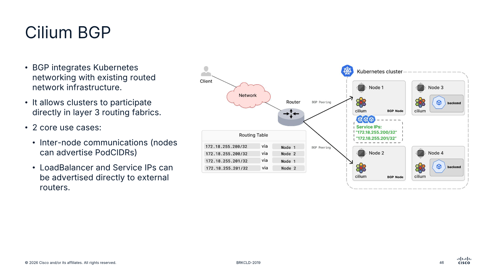

**图上看到什么**：三个 CRD 的分工：
- `CiliumBGPClusterConfig` —— 选择节点，定义 BGP 实例与 peer；
- `CiliumBGPPeerConfig` —— 设置可复用的对端参数（定时器、认证、地址族）；
- `CiliumBGPAdvertisement` —— 控制通告哪些 PodCIDR 和 Service IP。

**怎么理解"用 CRD 配 BGP"这件事**：传统 BGP 配置是"设备本地配置"（在路由器上 `router bgp`），Cilium 把它变成**Kubernetes 资源**——这意味着 BGP 配置跟着 Git 走、能被 `kubectl get` 查、能被 CI 校验。这是 NetDevOps 思路在协议配置上的落地。

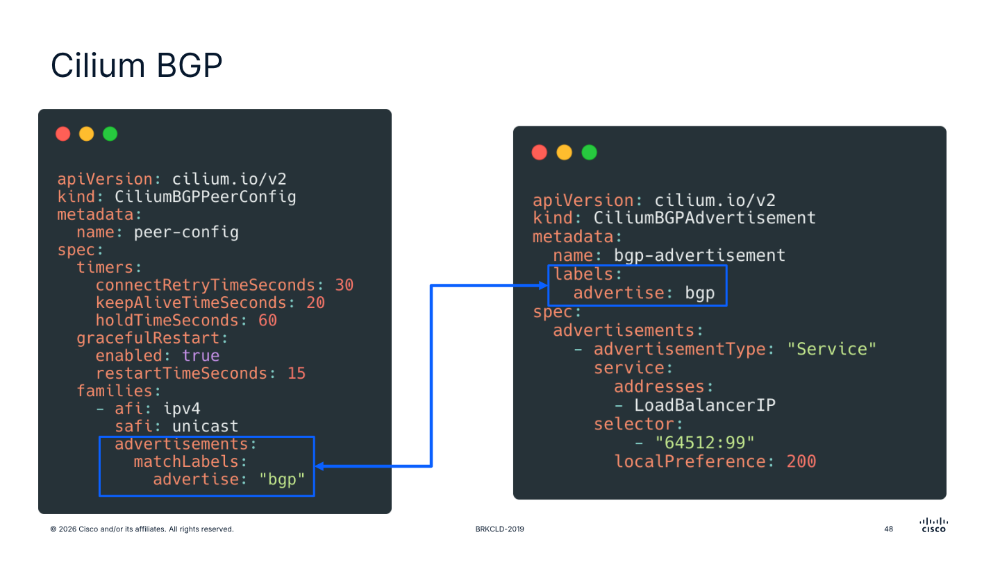

**图上看到什么**：两份 YAML 并排放置，蓝色箭头把左侧 `advertisements.matchLabels.advertise: "bgp"` 指向右侧 `metadata.labels.advertise: "bgp"`。

左（PeerConfig）关键字段：定时器 `connectRetryTimeSeconds: 30`、`keepAliveTimeSeconds: 20`、`holdTimeSeconds: 60`；`gracefulRestart.enabled: true`、`restartTimeSeconds: 15`；`families: afi ipv4 / safi unicast`。
右（Advertisement）关键字段：`advertisements` 里 `advertisementType: "Service"`、`service.addresses: LoadBalancerIP`、`selector.matchLabels: "64512:99"`、`localPreference: 200`。

**这张图最值得学的是"松耦合"**：两个 CRD 之间**没有直接引用对方的名字**，而是靠 **label 匹配**绑定。好处是：一份 PeerConfig 可以被多个 Advertisement 复用，改通告策略时不用动 peer 配置。这是 Kubernetes 声明式设计的典型用法，也是与"传统 BGP 配置一堆 `neighbor x.x.x.x ...`"最思维不同的地方。

**另外注意 `localPreference: 200`**：这是 BGP 的本地优先级，用于多路径选路——在双站点场景里，靠它决定"优先走哪个站点出口"（呼应 S58 中 R6 应优先走 R7 的路径选择需求）。

---

## 6. 落地：改 k3s 安装，让 Cilium 接手

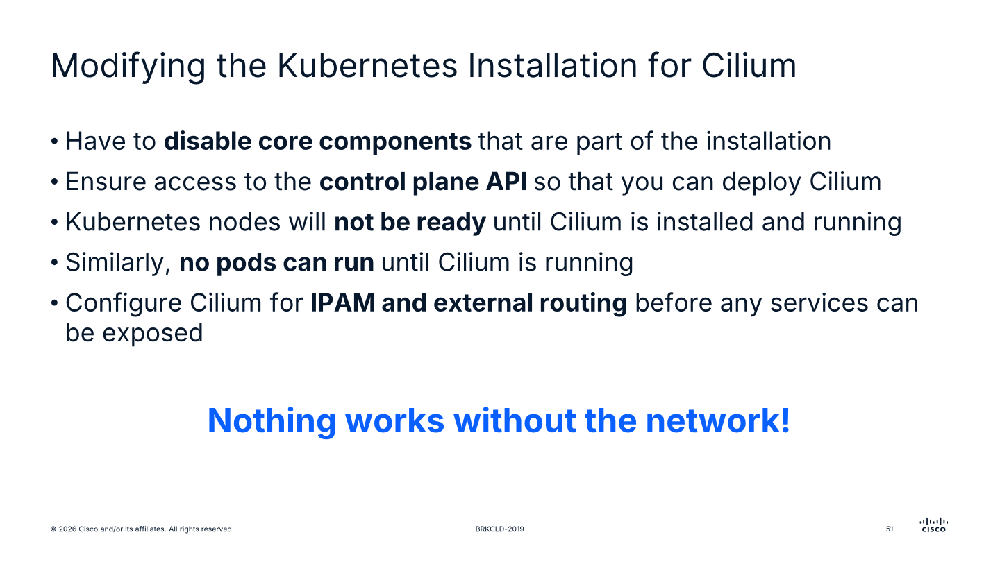

**图上看到什么**：五条前置条件，末尾一句加粗结论：
1. 必须**禁用安装包里自带的核心组件**（对应 k3s 的 kube-proxy、Flannel、Traefik）；
2. 必须保证能访问**控制面 API**，否则无法部署 Cilium；
3. **Cilium 没装好之前，Kubernetes 节点不会 Ready**；
4. 同理，**Cilium 没跑起来之前，任何 Pod 都跑不了**；
5. 在任何 Service 能被暴露之前，要先配好 Cilium 的 **IPAM 与外部路由**。

最后一句是全 deck 最直白的技术结论：**"Nothing works without the network!"**（没有网络，什么都跑不起来。）

**怎么理解这个"先有鸡还是先有蛋"**：K8s 的网络是 CNI 提供的，而 CNI 本身又是以 Pod 形式运行的——所以集群会短暂地处于"节点 NotReady、CNI Pod 起不来"的僵局。解法是：**先禁用默认 CNI（Flannel）+ 禁用 kube-proxy（否则与 Cilium 的 eBPF 转发冲突）+ 保留控制面可达**，等 Cilium DaemonSet 起来后节点自然转 Ready。

**Ansible Playbook 的八步**（同比基础版多了两步关键动作）：

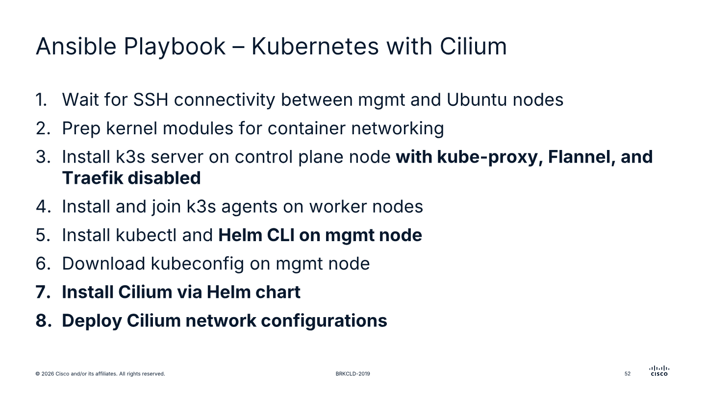

1. 等 SSH 可达
2. 准备内核模块
3. 装 k3s server，**同时禁用 kube-proxy、Flannel、Traefik**
4. 装并 join 各 agent
5. 装 kubectl 与 **Helm CLI**
6. 下载 kubeconfig
7. **用 Helm chart 安装 Cilium**
8. **部署 Cilium 网络配置**（含 BGP 配置）

**怎么读懂这份 playbook 的"增量"**：把基础版六步和 Cilium 版八步并排看，差异只有三处——第 3 步的**禁用清单**、第 5 步的 **Helm CLI**、以及新增的第 7、8 步。这说明"Cilium 化"**不是重装集群，而是替换它的网络层**：集群骨架（etcd、API Server、调度）完全不动。这也解释了为什么这份材料敢于宣称这是"网络工程师能接手的改造"——**改的是网络，不是 K8s 本体**。

---

## 7. 补那道缝：谁拥有网络？

这是全场立场最强的一节。

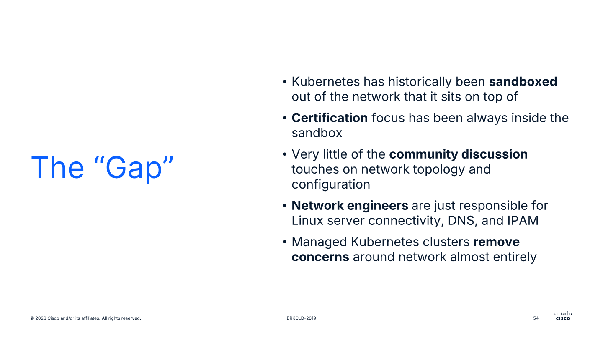

**图上看到什么**：五条判断——
1. Kubernetes 一直**被沙箱化**在它所依托的网络之外；
2. **认证的关注点始终在沙箱内部**；
3. 社区讨论**极少触及网络拓扑与配置**；
4. 网络工程师只负责 **Linux 服务器连通性、DNS、IPAM**；
5. **托管 K8s 集群几乎完全消除了对网络的关注**。

**怎么理解"gap（鸿沟）"的确切含义**：不是"K8s 网络很复杂"，而是**责任被人为切断了**。网络工程师负责"把服务器接通"，容器团队负责"沙箱里面"，中间那层（Pod 网段怎么路由、Service IP 怎么让外部知道、跨站点怎么通）**没人认领**。而这一层恰恰是故障最多发的地方。

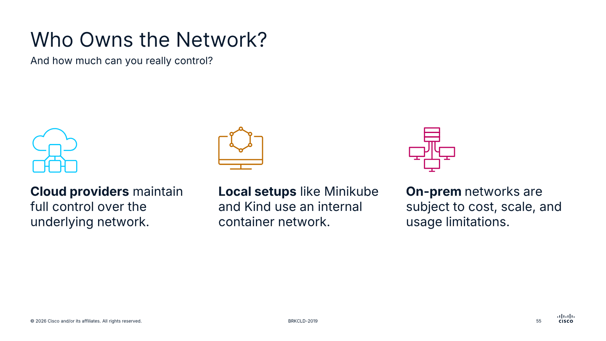

**图上看到什么**：三栏对比——云厂商对底层网络有**完全控制**；本地工具如 Minikube 和 Kind 使用**内部容器网络**；on-prem 网络则**受成本、规模和用量限制**。

**这张表真正在说的是"三种环境都拿不到你想要的控制权"**：
- 云上：控制权在云厂商手里，你只能配置它给你的东西；
- 本地工具：网络是"假的"（全在一个容器里），学不到真实拓扑行为；
- 自建 on-prem：能控制，但**成本和规模不允许你随便建多套**。

**→ 第四种选择就是 CML**。原文标题直接叫 "CML to the Rescue!"，理由是：网络工程与云原生部署**在同一个 lab 里**；能解决**真实的网络问题**（而不只是应用问题）；能在**安全的拓扑**上练软件部署；而且 **"BGP! IPAM! DNS! All the things!"** —— 这些"网络专业的事"都能碰。

### 最终拓扑：双站点 + 双集群 + BGP

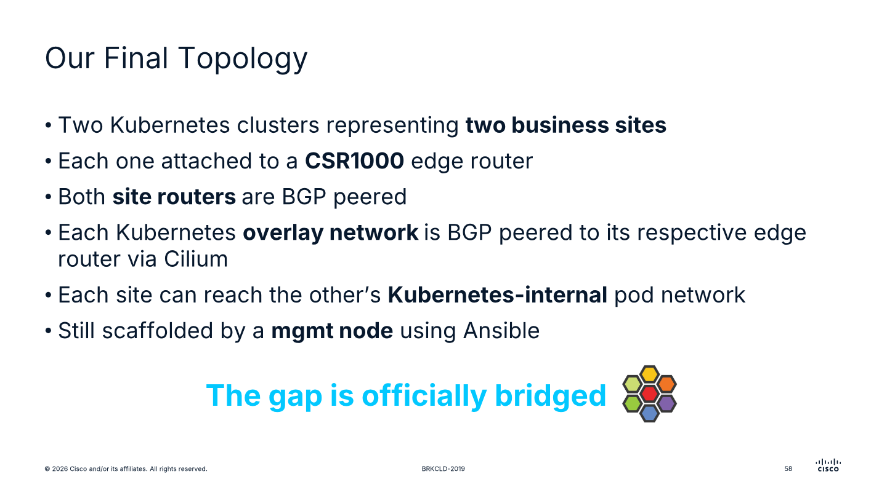

**图上看到什么**：六条特征，最后一句结论 "**The gap is officially bridged**"（鸿沟被正式填平）：
1. 两个 Kubernetes 集群代表**两个业务站点**
2. 各自接一台 **CSR1000** 边缘路由器
3. 两个**站点路由器之间 BGP 对等**
4. 每个集群的 **overlay 网络通过 Cilium 与各自的边缘路由器 BGP 对等**
5. 每个站点**能访问对方 Kubernetes 内部的 Pod 网络**
6. 仍由一台 **mgmt 节点用 Ansible** 脚手架化

**为什么这个拓扑是"填平鸿沟"的证据**：注意第 4 与第 5 条组合起来的含义——**Pod 网段被当作真实路由通告进了企业的 BGP 域**。这意味着：
- 网络工程师用他熟悉的工具（`show ip bgp`、路由表）就能看到 Pod 网段；
- Pod 网段不再是"藏在封装里的黑盒"，而是参与全局选路的**一等公民**；
- 跨站点 Pod 互通不依赖任何特殊网关，只依赖 BGP。

**同时它把两套技能串成了一条链**：Cilium 通告 PodCIDR（软件侧）→ CSR1000 学习并转发（网络侧）→ 对端站点再通告回自己的 Pod 网段。**任何一个环节配错，跨站点就不通**——这正是 CML 上可以反复练的东西。

**对应的 Playbook 是九步**（在八步基础上增加）：第 3 步**预拉镜像**（避免网络拥塞和拉取超时）；第 4 步装 k3s server **"…twice!"**（两套集群）；第 7 步为**每个集群**下载 kubeconfig；第 8 步装 Cilium 后**等两个集群都 Ready**；第 9 步部署含 **BGP 配置**的 Cilium 网络配置。

---

## 8. 延伸资源

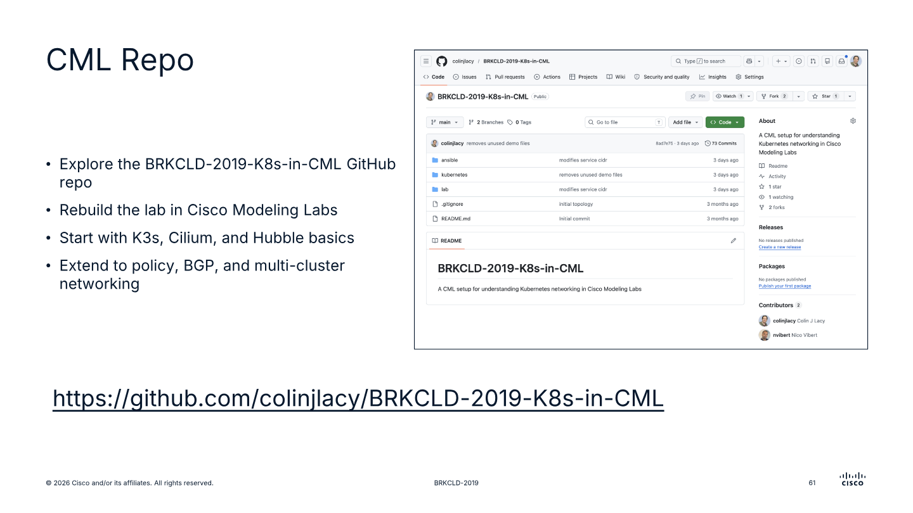

**图上看到什么**：仓库地址 `https://github.com/colinjlacy/BRKCLD-2019-K8s-in-CML`，以及一条**学习路径建议**：重建 lab → 从 k3s/Cilium/Hubble 基础开始 → 扩展到策略、BGP、多集群。

**怎么理解这条路径的价值**：它是一个**明确的分级**。不要一上来就搭双站点 BGP——先跑通单集群 + Cilium + Hubble 观察，再加策略，最后才做跨站点。这与 BRKCRT-2059 里"布鲁姆分类法分层"的思路是一致的。

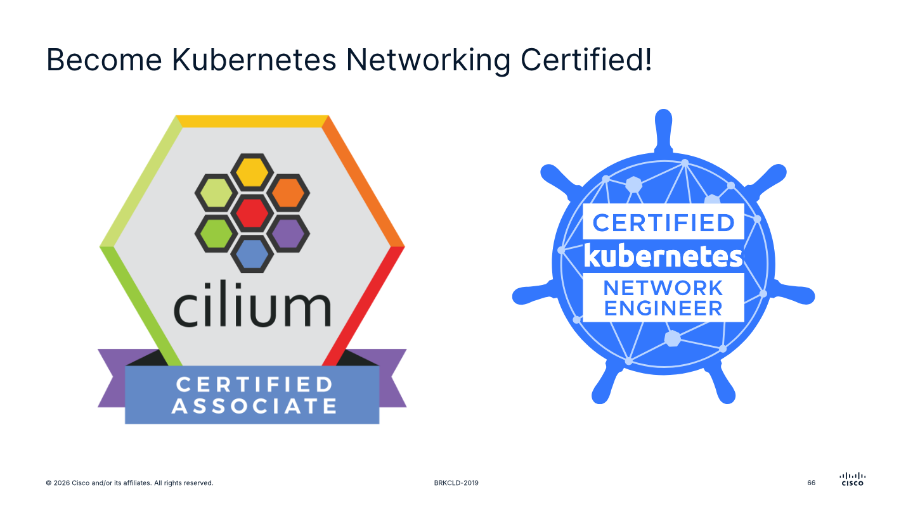

**图上看到什么**：两枚徽章——**Cilium Certified Associate**（CCA）与 **Certified Kubernetes Network Engineer**。

**为什么放在最后**：这是思科在给"云原生网络"这条技能线**建立认证锚点**。对网络工程师而言，这是把"学 Cilium"从"额外技能"变成"可被证明的资格"的信号。

**其他资源**：
- 《Cilium Up and Running》（O'Reilly，约 375 页，Isovalent.com 有免费电子版）
- Kubernetes Networking eBook（`https://cs.co/k8s-for-network-engineers`，已超 1 万次下载）
- Isovalent Labs（在线实验）
- 同主题续场：*Life of a Packet in Kubernetes*（2026-06-03 13:30，Mandalay Bay D 厅）

---

## 9. 要点提炼

**如果只记五条：**

| # | 结论 | 依据 |
|---|---|---|
| 1 | **Cilium 一个组件顶传统网络的一整列** | S17 空表 → S49 一个 logo 填满 7 行需求 |
| 2 | **K8s 网络的第一硬约束是"Pod 之间不许 NAT"** | S20/S31：要么让底层认 Pod 网段（native routing），要么封装（VXLAN/GENEVE） |
| 3 | **策略的进化路径是 L3/L4 → L7 → FQDN** | S39/S40/S41：粒度从"连接"到"请求"到"域名" |
| 4 | **L7 能力靠 Envoy 补齐，且只为配了 L7 策略的端口付出代价** | S42：eBPF 快但看不懂七层；按端口按需重定向 |
| 5 | **"鸿沟"的填法是让 Pod 网段进 BGP 域** | S58：Cilium↔CSR1000 BGP 对等，跨站点直通对方 Pod 网段 |

**六项能力的定位速查：**

| 能力 | 传统对应物 | Cilium 的实现要点 |
|---|---|---|
| IP 分配 | DHCP | PodCIDR + IPAM 模式；**IP ≠ 身份** |
| 负载均衡 | 硬件/软件 LB | eBPF 数据面内建 DNAT，支持 ClusterIP/NodePort/LoadBalancer |
| 集群内互联 | 交换/路由 | native routing 或 VXLAN/GENEVE 封装 |
| 可观测性 | NetFlow/抓包 | Hubble（UI 服务地图 + CLI `observe`），基于身份而非 IP |
| 防火墙 | FW/ACL | CiliumNetworkPolicy：L3/L4 + L7（Envoy）+ FQDN |
| 集群接入 | 路由协议/ARP | L2 Announcement（简单但单活）或 BGP（CRD 声明式） |

---

## 10. 外部链接汇总

| 用途 | 链接 |
|---|---|
| 本场配套仓库 | https://github.com/colinjlacy/BRKCLD-2019-K8s-in-CML |
| Kubernetes 网络电子书 | https://cs.co/k8s-for-network-engineers |
| Cilium Up and Running（免费电子版） | Isovalent.com |
| DevNet 沙箱 / 实验 | https://devnetsandbox.cisco.com |
| 会议点播库 | www.CiscoLive.com/on-demand |
