# BRKCRT-2059 · Lab Up for Success with Cisco Modeling Labs

> **一句话定位**：这不是一份"CML 功能说明书"，而是一份**方法论演示**——它论证了一个闭环：思科的认证实验题用 CML 出，所以备考就该在 CML 里练；而"用布鲁姆分类法读大纲"则告诉你**哪些考点必须上机、哪些看书就够**。

## 0. 文档信息

| 项目 | 内容 |
|---|---|
| 会议 | Cisco Live APJC 2024（墨尔本，2024-11） |
| 场次 | BRKCRT-2059 |
| 讲者 | Ralph Schmieder，Senior Tech Lead，CCIE #9680 |
| 页数 | 79 页（PowerPoint 导出，PDF 1.7） |
| 信源等级 | **A 级**（思科官方会议材料原文） |
| 配套仓库 | https://github.com/CiscoLearning/ciscolive-brkcrt-2059 |
| 截图来源 | 本报告全部截图均由该 PDF 原页渲染，见 `deck-images/` |

> **阅读提示**：本 PDF 是幻灯片导出稿，正文文字稀疏、大量内容以图表和演示呈现。因此本报告的做法是「**截图 + 读图 + 解释**」——先让你看见原页，再说明它的设计意图与可复用之处。

---

## 1. 开场：用 ChatGPT 的反问立论

讲者没有直接讲功能，而是先抛一个问题给 ChatGPT：**"怎么才能通过思科认证考试？"** 然后把 ChatGPT 的回答原文投在屏幕上——答案里最关键的一句是 **"Hands-on practice: Set up a home lab…"**。

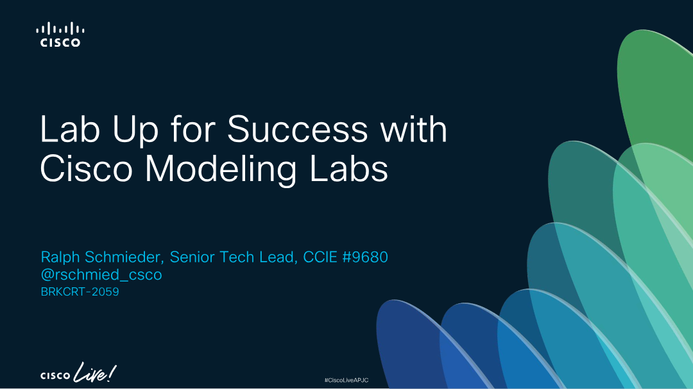

**图上看到什么**：极简标题页，只有标题、讲者姓名/头衔/CCIE 编号与场次号 BRKCRT-2059。

**为什么这么设计**：Cisco Live 的 breakout 场次有一套固定版式，标题页承担"验明身份"的功能——CCIE #9680 这个编号意味着讲者是 90 年代入行的老资格，后续他谈"备考"才有说服力。

---

## 2. CML 的定位与规格

### 2.1 四个版本：先算清你的并发规模

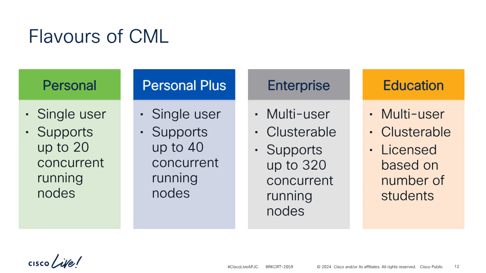

**图上看到什么**：四列对比。Personal 单用户、最多 20 个并发运行节点；Personal Plus 单用户、最多 40 个；Enterprise 多用户、可集群、最多 320 个；Education 多用户、可集群、按学生人数授权。

**怎么理解**：这张表决定了"个人备考 vs 团队培训"的选型分界线。**20 个并发节点**是个人版的天花板——如果你的拓扑里有 3 台交换机 + 2 台路由器 + 若干终端，20 个够用；但一旦要做多站点或加安全设备，很容易撞到上限。而 Education 版"按人头授权"说明思科把它当作**教学基础设施**卖，而不是软件许可。

### 2.2 架构：API 与 UI 是平级的

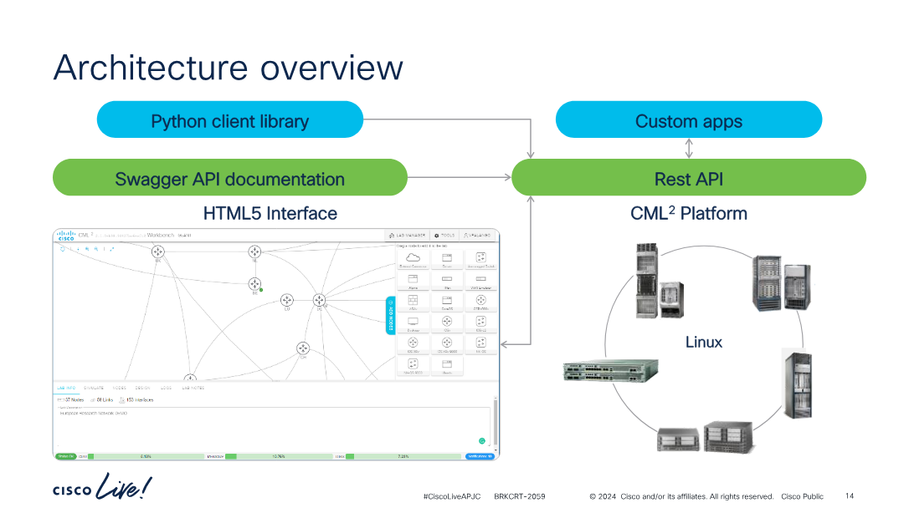

**图上看到什么**：自下而上三层——Linux 底座 → CML Platform → REST API；API 之上并列着 HTML5 界面、Python 客户端库、自定义应用，旁侧还有 Swagger 文档。

**为什么重要**：这是一个**"API 优先"的架构声明**。UI 只是 API 的一个消费者，不是特权入口。对做自动化的人（以及做 AI Agent 的人）而言，这意味着 CML 里所有点击操作都能被代码复现——CML 可以成为自动化流水线里的一环，而不是只能人肉操作的沙盘。

### 2.3 访问模拟设备：四条路径

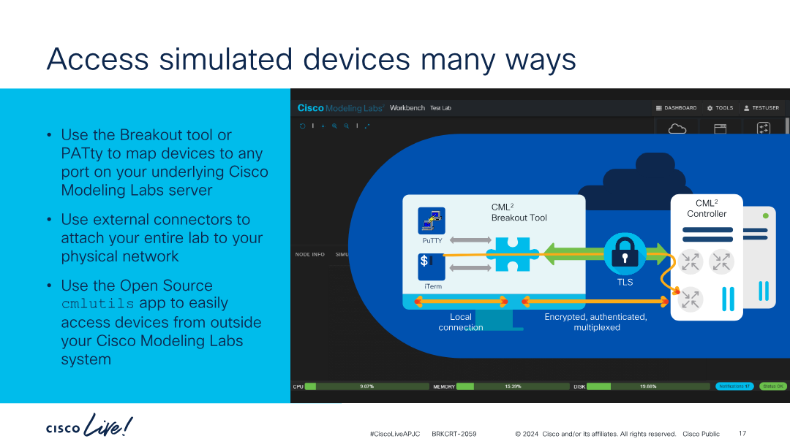

**图上看到什么**：左侧三条要点，右侧是一张设备端到 CML 控制器的拓扑示意图——PuTTY / iTerm 通过本地连接接入"Breakout Tool"，再经一把锁（TLS，标注 Encrypted, authenticated, multiplexed）到达 CML 控制器上的设备。

**怎么理解**：这是"CML 怎么用起来"的第一个分水岭。默认你只能在浏览器标签页里敲命令，这在做批量操作时极其难受。四条路径的价值排序其实是：
1. **cmlutils**（开源）——从 CML 系统外部接管，适合脚本化；
2. **PATty / Breakout**——把你的终端软件接进去，适合习惯本地工具的人；
3. **外部连接器**——只在你需要打通物理网络时才用，成本最高。

注意那个 **"multiplexed"**：一条 TLS 连接里复用多路控制台，意味着你不必为每台设备开一个端口。

### 2.4 与考试的关系：练的就是考的

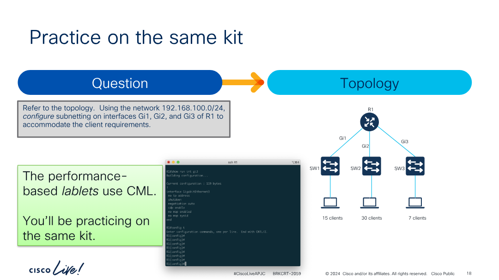

**图上看到什么**：一道完整的 CCNA 风格题面 + 拓扑（R1 下挂 SW1/SW2/SW3），标出 15 clients / 30 clients / 7 clients 三个需求；页面右下角一句关键结论："**The performance-based lablets use CML. You'll be practicing on the same kit.**"

**为什么这是全场最硬的一句**：它把"用 CML 练习"从"个人偏好"提升为"**环境一致性**"问题。传统备考的痛点是"我练的环境和考场不一样，配置能通但界面/行为有差异"。这里明确告诉你：考场用的就是 CML，你练的就是那套东西。

**题目本身也值得注意**：给出 `192.168.100.0/24` 和三个方向的客户端数量（15/30/7），要求做子网划分——这是典型的 VLSM 题。**7 台客户端的那一段最容易被算错**，因为 7 需要 /28（16 个地址，可用 14），而不是 /29（8 个地址，可用 6）。

---

## 3. 高级特性：把"能用"推到"好用"

### 3.1 PATty 的成立条件：不是装上就能用

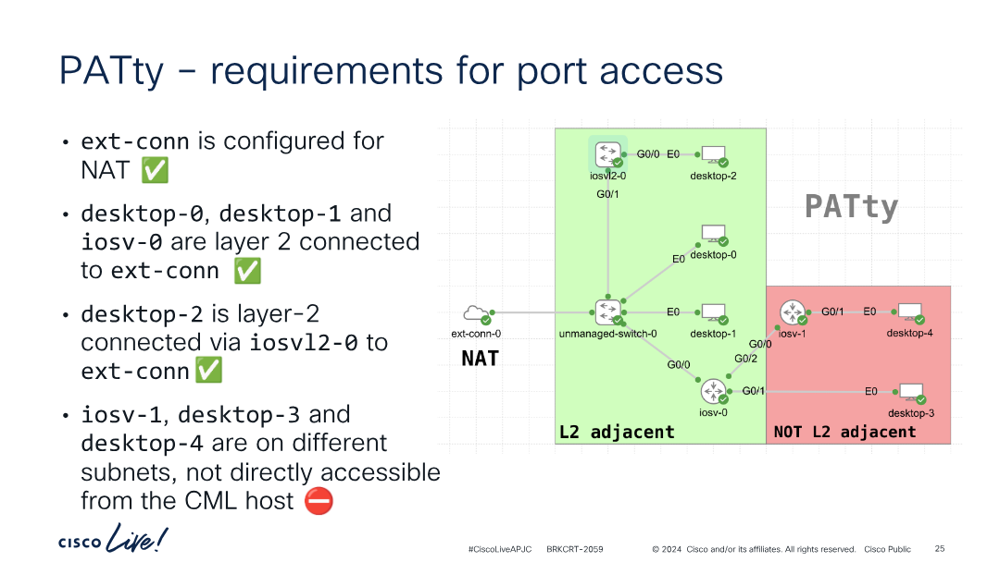

**图上看到什么**：`ext-conn` 处于 NAT 模式；`desktop-0`、`desktop-1`、`iosv-0` 二层直连 ext-conn；`desktop-2` 经 `iosvl2-0` 二层接入；而 `iosv-1`、`desktop-3`、`desktop-4` 位于**不同子网**，从 CML 主机无法直接访问。

**怎么理解**：这张图解释了一个常见的失败场景——"我加了 tag，为什么映射不出来？" 原因是 PATty 依赖 CML 控制器上的 **NAT 桥接 + IP 地址嗅探器（IP address snooper）**：它必须"看见"节点的 IP 才能建映射。跨三层子网的节点，嗅探器看不见，于是映射不成立。

**可复用的判断规则**：
- 映射能用 ⇔ 节点二层挂在 NAT 模式的 ext-conn 上
- 需要三层绕行的场景（图中 desktop-3/4）→ 改用其他方案，别在 PATty 上折腾

### 3.2 配置的真正入口是 tag

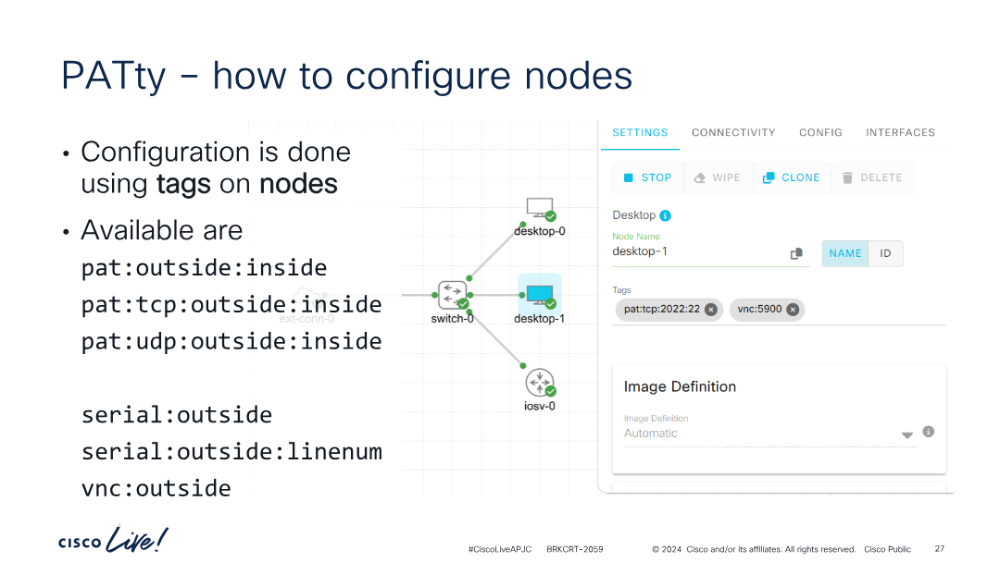

**图上看到什么**：六行 tag 语法清单：`pat:outside:inside`、`pat:tcp:outside:inside`、`pat:udp:outside:inside`、`serial:outside`、`serial:outside:linenum`、`vnc:outside`。

**怎么理解**：CML 把"配置"做成了**声明式标签**——你不在配置文件里写映射表，而是在节点上打 tag。这样做的直接好处是**拓扑自描述**：把 lab 导出成 YAML 发同事，映射关系跟着走，不需要另附一份"端口对照表"。

注意 `serial:outside:linenum` 这个变体：它允许你指定**控制台的 line 编号**，在模拟多用户同时登录一台设备（比如考 CCNP 里的 line vty/aux 概念）时才有意义。

### 3.3 外部连通性：三种模式对应三种真实网络形态

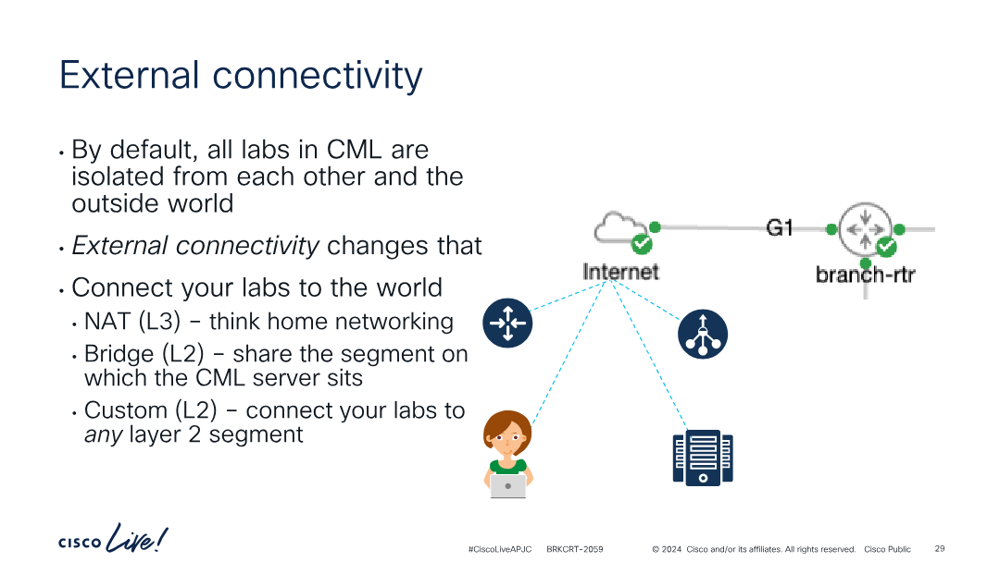

**图上看到什么**：三个并排的选项，分别标注 NAT（L3，"think home networking"）、Bridge（L2，"share the segment on which the CML server sits"）、Custom（L2，"connect your labs to any layer 2 segment"）。

**怎么理解**：这三者不是"能力递增"关系，而是**对应三种真实拓扑需求**：

| 模式 | 类比 | 什么时候选它 | 代价 |
|---|---|---|---|
| NAT | 家庭路由器 | 只需要实验里能上网下补丁/脚本 | 外部无法主动访问实验内部 |
| Bridge | 把虚拟交换机接到办公室那台交换机上 | 要和真实设备/真实网段同处一个广播域 | 会污染生产网段，需谨慎 |
| Custom | 接到任意指定的二层段 | 多实验互联、跨主机桥接 | 配置复杂，要先在 cockpit 建 bridge |

### 3.4 Day 0 配置：配置随拓扑一起分发

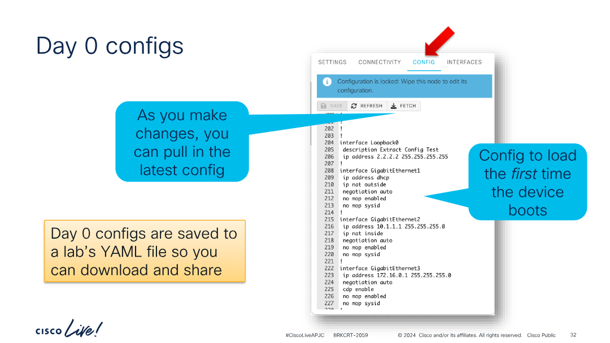

**图上看到什么**：左侧是"Config to load the first time the device boots"（首次启动加载的配置），可以随时拉入最新配置；下方强调 **Day 0 配置保存在 lab 的 YAML 文件里，可下载分享**。

**为什么这是效率关键**：没有 Day 0 配置，你每次开 lab 都要重新粘贴几十行基础配置（hostname、IP、路由、AAA）。有了它，**"打开 lab"就等于"环境已就绪"**。而"存在 YAML 里"这一点更重要——它让拓扑成为**可版本管理的代码**（可以进 Git），而不只是一堆手工操作。

### 3.5 用真实故障练排障：OSPF 卡在 EXSTART

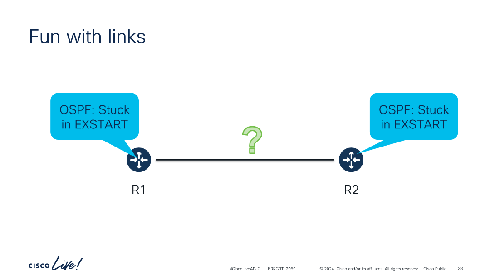

**图上看到什么**：R1、R2 两台路由器之间连线，两侧都标注 `OSPF: Stuck in EXSTART`，中间一个大问号。

**怎么理解**：EXSTART 卡死是 OSPF 里最经典的"看得见现象、看不出原因"的故障之一——邻居能到 ExStart 说明 Hello 交换成功（区域、认证、网络类型都对），但卡在这里几乎必然是 **MTU 不一致**导致 DBD 报文被丢弃。

**这一页的价值不在知识本身，而在"可复制性"**：在 CML 里给一条链路改 MTU，两分钟就能造出这个故障；在真实环境里，你要么找不到设备练，要么不敢在生产上试。

### 3.6 一个必须知道的坑：链路全是 GE

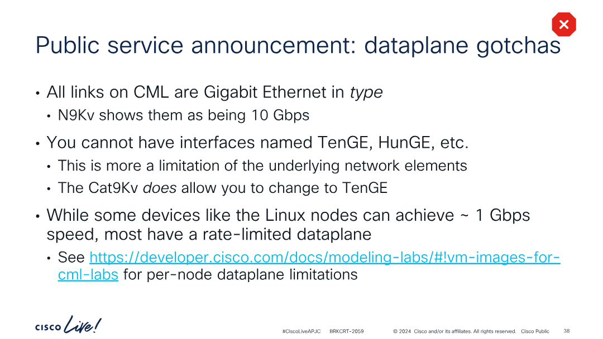

**图上看到什么**：标题写着"Public service announcement: dataplane gotchas"（公告：数据面的坑）。正文列出：所有链路类型都是 Gigabit Ethernet；N9Kv 显示为 10 Gbps 但不可改；不能命名接口为 TenGE/HunGE；Cat9Kv 允许改成 TenGE；Linux 节点可达约 1 Gbps，**但大多数节点数据面是限速的**。

**怎么理解**：这是**"别拿仿真做性能测试"的官方免责声明**。三条含义：
1. **不要用 CML 验证吞吐指标**——数据面限速会让结果失真；
2. **不要用 CML 验证 QSFP/100G 相关配置**——接口类型根本不存在；
3. 唯一的例外是 Cat9Kv 能改成 TenGE，所以做"万兆接口配置"类实验只能用 Cat9Kv。

### 3.7 链路条件化：把"距离"变成可调参数

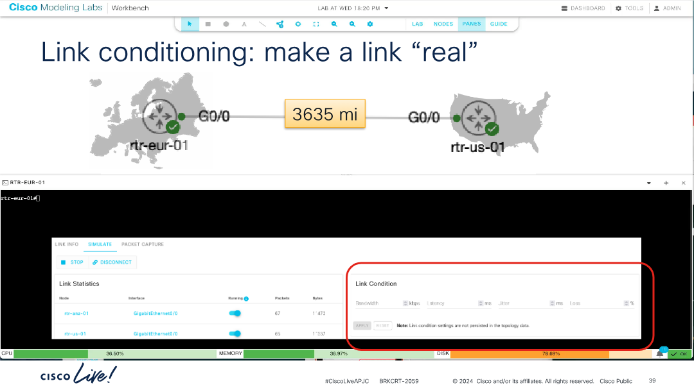

**图上看到什么**：一条链路上标注 `3635 mi`（3635 英里，约北京到洛杉矶的直线距离量级）。

**怎么理解**：这是 CML 最被低估的能力之一。真实的广域网问题——路由收敛慢、TCP 吞吐上不去、应用超时——**根因往往是 RTT**。链路条件化让你把时延、丢包、抖动变成可调旋钮，从而复现"本地测没问题、跨洋就崩"的场景。

**注意它与 S37 的关系**：S37 说"别指望带宽"，S38 说"但你可以指望时延准确"——恰恰是**时延可控**让 CML 适合练路由协议和应用性能，而**带宽不可控**让它不适合练吞吐。

### 3.8 打流：ping 不够用的时候

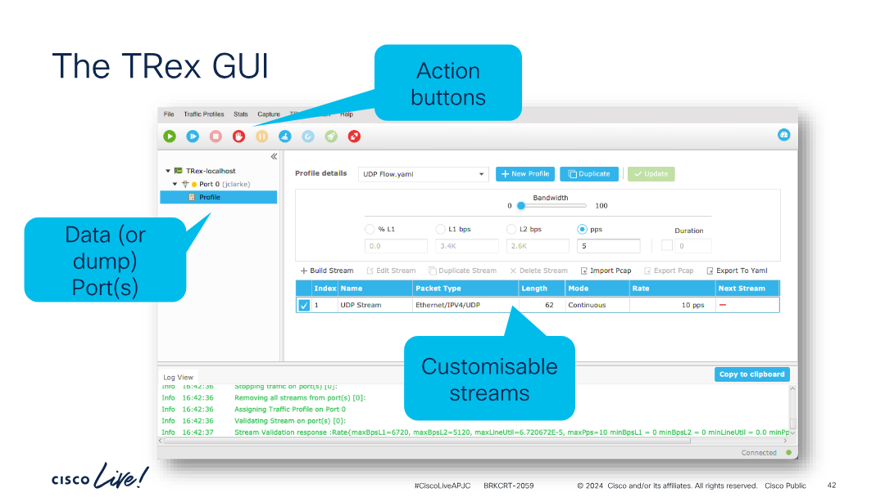

**图上看到什么**：TRex 的图形界面分三块——顶部操作按钮、中部 Data（或 dump）Port(s)、下部可自定义的 streams（流）。

**怎么理解**：讲者的原话是"Ping is great, but what if you want…more?"——ping 只能证明"通"，证明不了"能扛多少"。TRex 的关键能力是**自定义每一层的每一个字段**并把多条流**串成 flow**，这才能构造出真实业务流（比如特定 VLAN + DSCP + 特定 HTTP 行为），用于验证 QoS 策略、ACL 命中顺序、负载均衡哈希。

---

## 4. 方法论核心：用布鲁姆分类法读考试大纲

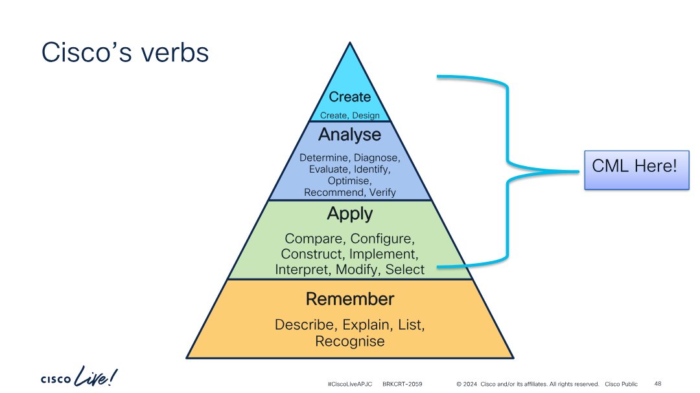

**图上看到什么**：三层动词分组，右侧标注对应认知层级——

| 认知层级 | 思科动词 |
|---|---|
| Create | Create, Design |
| Analyse | Determine, **Diagnose**, Evaluate, Identify, Optimise, Recommend, **Verify** |
| Apply | Compare, Configure, Construct, Implement, Interpret, Modify, Select |
| Remember | Describe, Explain, List, Recognise |

在 Analyse 层右侧，讲者贴了一行醒目的标注：**"CML Here!"**

**为什么这是全场最有复用价值的一页**：它给了一个**可操作的判断规则**，而不是"多练就好"这种空话。具体用法：

1. 打开考试大纲（如 ENCOR），逐条看动词；
2. 动词落在 **Remember**（Describe/Explain/List）→ 看书、看视频即可，**不需要上机**；
3. 动词落在 **Apply**（Configure/Implement/Modify）→ 必须上机，但只需要"配通"；
4. 动词落在 **Analyse**（Diagnose/Verify/Optimise）→ 必须上机，而且需要**带故障的拓扑**（能诊断、能验证、能优化）；
5. 动词落在 **Create**（Design）→ 需要能自由设计拓扑，即"给你需求，你从零搭"。

**这个规则的价值在于"省时间"**：不是所有考点都值得花时间搭实验。把 Remember 层的考点用记忆解决，把时间集中投在 Analyse 层——这是备考效率的核心。

---

## 5. 三个示例实验：从配通到排障到自动化

三个实验的难度是递进的，正好对应上表的三层：**CCNA = Apply，ENARSI = Analyse，DEVCOR = Apply + Create**。

### 5.1 实验一（CCNA）：多 VLAN 与单臂路由

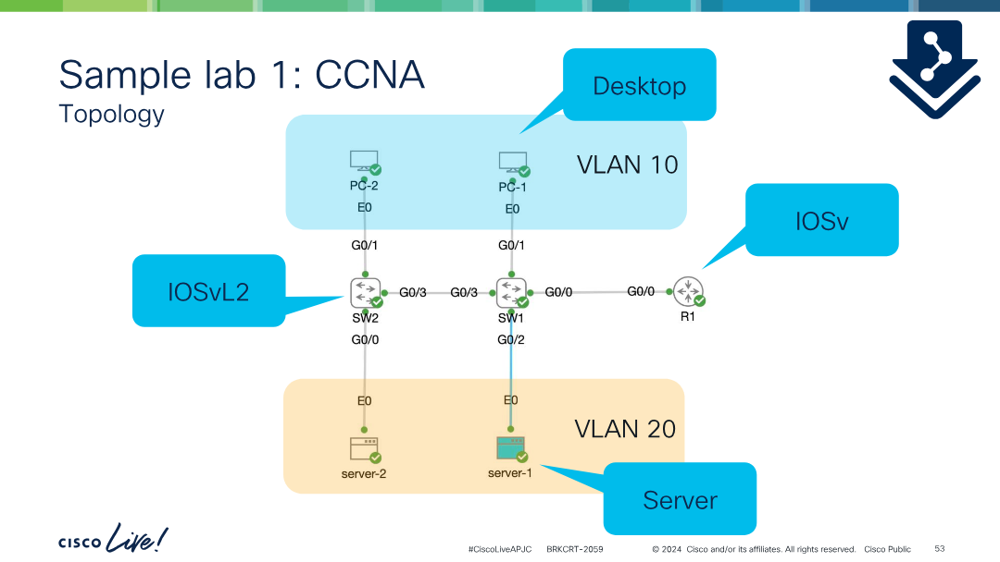

**图上看到什么**：两端主机（Desktop / Server）分属 VLAN 10 与 VLAN 20，中间一台 IOSvL2（二层交换机）与一台 IOSv（路由器）。

**怎么理解**：这是最经典的"单臂路由（Router-on-a-Stick）"拓扑——交换机与路由器之间用一条 trunk，路由器上起子接口做各 VLAN 的网关。**它的考点不是配置，而是"验证流量确实经过了路由器"**：如果不做验证，很容易出现"主机间能通，但其实是二层直通、路由器没起作用"的假通过。

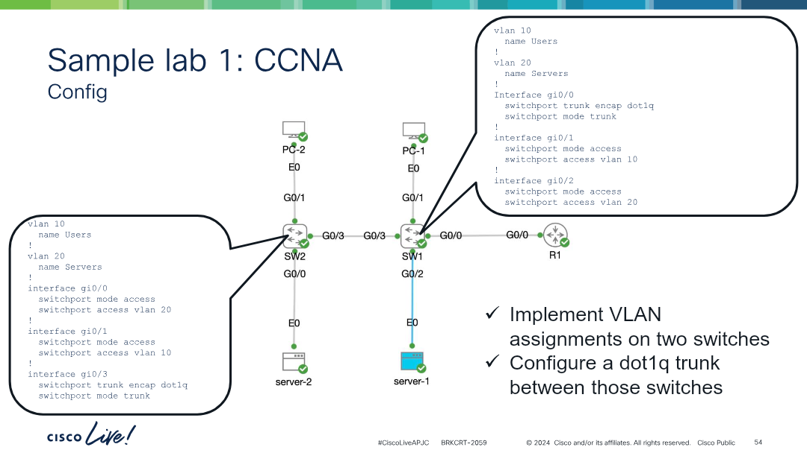

**图上看到什么**：左右两份交换机配置，右侧叠加了任务勾选（✓ Implement VLAN assignments on two switches / ✓ Configure a dot1q trunk between those switches）。注意两台交换机的**端口角色是镜像的**——一台的 gi0/0 是 trunk、gi0/1 是 VLAN10 接入；另一台的 gi0/3 才是 trunk、gi0/0 是 VLAN20 接入。

**怎么理解**：这个镜像设计不是凑数，而是**防止你背端口号**。真实考试里端口编号是随机的，你必须能"看图判断哪条线该配 trunk"。这是 Apply 层的典型考法：不是考记忆，是考**把需求翻译成配置**的能力。

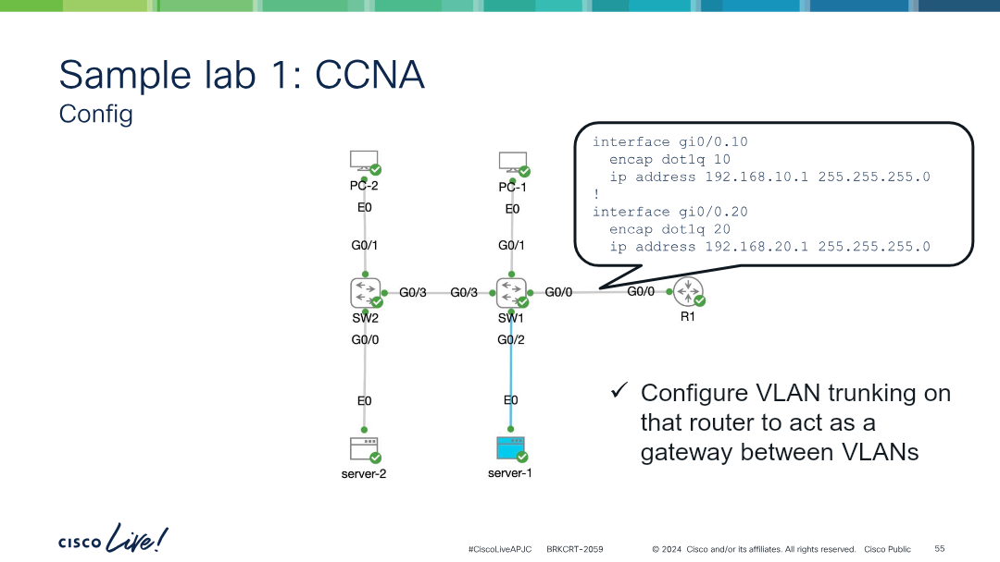

**图上看到什么**：`interface gi0/0.10` 配 `encap dot1q 10` + `192.168.10.1/24`；`gi0/0.20` 配 `encap dot1q 20` + `192.168.20.1/24`。

**怎么理解**：这是"单臂路由"的标准答案形态。**关键细节是子接口编号（.10/.20）与 VLAN ID 对齐**——这只是惯例，不是强制，但对齐后配置可读性最好。真正的技术点是 `encap dot1q <vlan>` 必须与对端交换机的 trunk 允许列表匹配。

### 5.2 实验二（ENARSI）：BGP 排障 —— 全场最有教学价值的示范

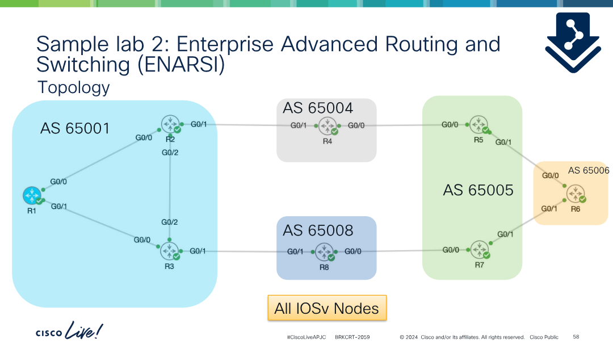

**图上看到什么**：五个 AS（65001 内部，65004/65005/65006/65008 外部），全部使用 IOSv 节点。

**题面本身是一道精心设计的"埋雷题"**：
> AS 65001 内的 full-mesh IBGP 邻居**使用 Loopback1 建立**（不是直连接口）；R2/R3 会通告正确的 next hop；**EBGP 也用 Loopback1**；R6 应优先走 R7 到 `10.1.1.0/24`。共埋了 **5 个邻居关系问题 + 1 个路由问题 + 1 个路径选择问题**。

**注意题面的措辞**："使用 Loopback1"这句话既是**需求**，也是**判据**——它暗示了后面 R1 配置里 `update-source` 写错的可能。

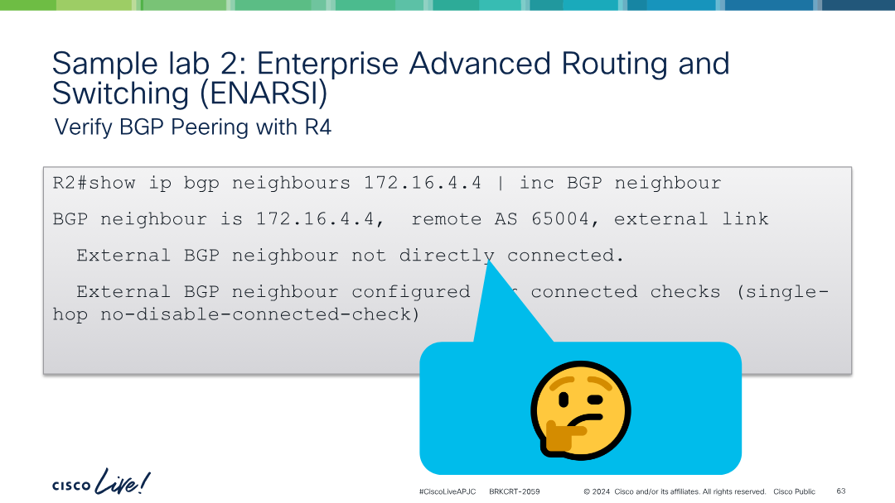

**图上看到什么**：`show ip bgp neighbours 172.16.4.4 | inc BGP neighbour` 的输出：
```
BGP neighbour is 172.16.4.4, remote AS 65004, external link
External BGP neighbour not directly connected.
External BGP neighbour configured for connected checks (single-hop no-disable-connected-check)
```

**怎么理解这三行**：这是整个排障链条的关键转折点。
- 第一行说明**邻居是 external**（eBGP，跨 AS）；
- 第二行 **"not directly connected"** 说明对端地址不在直连网段——因为是用 Loopback 建的；
- 第三行才是根因：**eBGP 默认要求单跳**（TTL=1），且 Cisco 默认启用 connected-check，会校验"对端是否在直连网段"。用 Loopback 建 eBGP，两条默认检查都会失败。

**解法就是一句**：`neighbor 172.16.4.4 ebgp-multihop 2`——放行多跳（TTL≥2）。

**这个实验完整示范了 Analyse 层的方法论**：
```
现象（邻居在 Active/Idle 抖动）
  → 看配置找与要求不符处（update-source 写成 Loopback0）
  → 修掉后现象变化（会话建立，但收不到前缀）
  → 换一台设备继续查（R2 与 R4 会话 Idle）
  → 用 show 命令拿到明确报错（not directly connected）
  → 对症下药（ebgp-multihop）
```
**每一层修好都会暴露下一层**——这正是真实排障的形态，也是"CML 训练价值"最直接的证据。

### 5.3 实验三（DEVCOR）：用 RESTCONF 改配置

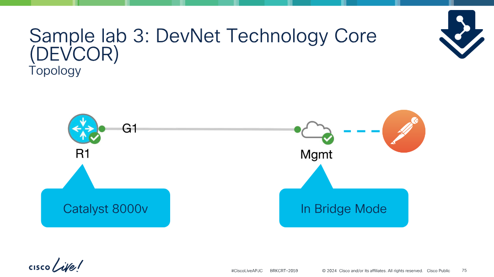

**图上看到什么**：只有一台 **Catalyst 8000v**，标注 "In Bridge Mode"。

**为什么强调 Bridge 模式**：因为要用 **Postman 从外部**发 RESTCONF 请求，虚拟路由器必须和你的 Postman 处在可达的网段——Bridge 模式让它直接接入 CML 服务器所在网段，省去 NAT 端口映射的麻烦。

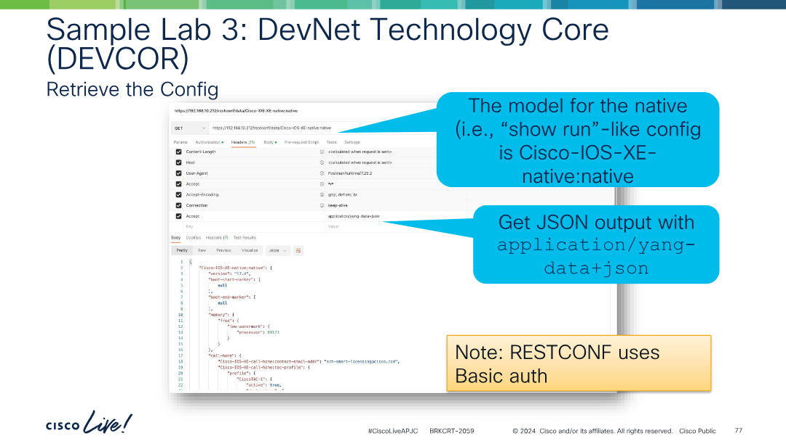

**图上看到什么**：Postman 请求界面——模型路径 `Cisco-IOS-XE-native:native`（等价于 `show run` 的完整原生配置）、`Accept: application/yang-data+json`、以及一句提醒"RESTCONF uses Basic auth"。

**怎么理解**：`Cisco-IOS-XE-native:native` 是**"把整份 running-config 变成一个 JSON"**的那个模型——它最大的用途是"读取现状"，而不是"精确修改"。真要做精细化配置，应该用结构化模型（如 `Cisco-IOS-XE-interfaces`）。这个区别在新手用 RESTCONF 时最容易踩。

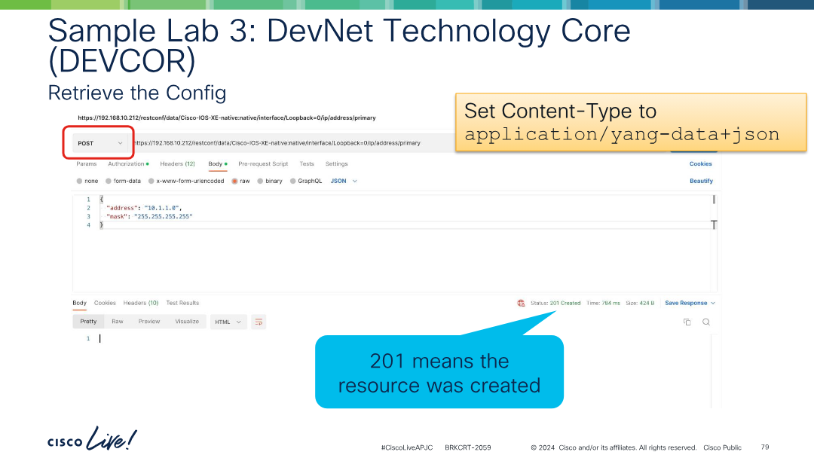

**图上看到什么**：Postman 响应区显示状态码 **201**，旁注 "201 means the resource was created"；请求头 Content-Type 为 `application/yang-data+json`。

**怎么理解**：**201 Created 是 RESTCONF 写操作成功的确切信号**。这里有个容易混淆的点：POST 到集合返回 201 是"新建"，PUT 到具体资源返回 200/204 是"替换"。看到 201 说明你在集合上创建了一个新对象（这里是 Loopback0 的 IP 配置节点）。

---

## 6. 要点提炼

**如果只记五条：**

| # | 结论 | 依据 |
|---|---|---|
| 1 | **考场环境就是 CML** | S17 原话："performance-based lablets use CML…same kit" |
| 2 | **PATty 的可用性由二层拓扑决定，不是由配置决定** | S24：必须二层挂在 NAT 模式 ext-conn 上，且被 IP 嗅探器看见 |
| 3 | **别用 CML 测吞吐，但可以用它测时延** | S37 数据面限速 vs S38 链路条件化可注入 3635 英里时延 |
| 4 | **用动词判断"要不要上机"** | S47：Diagnose/Verify/Optimise → 必须上机；Describe/List → 看书即可 |
| 5 | **CML 的最高价值是"能造故障"** | S32（OSPF EXSTART）、S57（BGP 七处埋雷）都是真实故障的可复现化 |

**三个实验的难度梯次：**

| 实验 | 认证 | 认知层级 | 核心训练点 |
|---|---|---|---|
| 多 VLAN + 单臂路由 | CCNA | Apply | 把需求翻译成配置；端口角色随机化防背题 |
| BGP 七处埋雷 | ENARSI | Analyse | 从现象逐层下钻；`show` 输出即证据 |
| RESTCONF 改配置 | DEVCOR | Apply + Create | 模型选择、201 语义、Basic 认证 |

---

## 7. 外部链接汇总

| 用途 | 链接 |
|---|---|
| 本场配套代码 | https://github.com/CiscoLearning/ciscolive-brkcrt-2059 |
| CML 社区示例实验（19 个 CCNA 实验） | https://github.com/CiscoDevNet/cml-community |
| CML 下载与安装 | https://developer.cisco.com/docs/modeling-labs/#!downloading-files-for-cml-installation |
| CML 文档 | https://developer.cisco.com/docs/modeling-labs/#!introduction |
| 各节点数据面限制 | https://developer.cisco.com/docs/modeling-labs/#!vm-images-for-cml-labs |
| DevNet 沙箱（预约 CML Enterprise） | https://devnetsandbox.cisco.com/RM/Topology |
| ENCOR 考试大纲 | https://learningnetwork.cisco.com/s/encor-exam-topics |
| TRex | https://trex-tgn.cisco.com |
| 会议点播库 | www.CiscoLive.com/on-demand |
