# BRKOPS-2670 · Cisco Modeling Labs — More than a Simulation

> **一句话定位**：这份材料的立场是"CML 不是仿真器，而是**运维工具**"。它用三条主线证明这一点：**逃出仿真**（把 lab 接进真实网络与真实平台）、**给网络建模**（迁移、自动化、原型验证都在模型上做）、**把控制器接进来**（NDFC / Catalyst Center / Catalyst SD-WAN 直接管你的虚拟设备）。全集最有价值的部分其实是附录——它把"外部连通性"背后的 Linux bridge 机制讲到了可操作粒度。

## 0. 文档信息

| 项目 | 内容 |
|---|---|
| 会议 | Cisco Live 2024（拉斯维加斯） |
| 场次 | BRKOPS-2670 |
| 讲者 | Matt Leuschner，Solutions Engineer（在思科 5 年，IT 从业 22 年） |
| 页数 | 79 页（含附录，附录占 P63–P79） |
| CML 版本 | **v2.7** |
| 信源等级 | **A 级**（思科官方会议材料原文） |
| 截图来源 | 全部由该 PDF 原页渲染，见 `deck-images/` |

---

## 1. 立论方式：先讲一个没有模型的年代

讲者的开场不是功能，而是三个设问：

1. **"Do you have a model of your network today?"**（你今天有自己的网络模型吗？）
2. **"Back to…2004? A world without models"**（回到 2004？一个没有模型的年代）
3. 引一句《捉鬼敢死队》的台词：**"We have the tools, we have the talent"**（我们有工具，我们有人才）

**这三句连起来是个很聪明的论证结构**：
- 第一句制造"缺口感"——大多数团队确实没有网络模型；
- 第二句指出这个缺口是**历史遗留**，不是能力问题（2004 年的网络不需要模型）；
- 第三句点出真正的障碍：**工具和人都在，缺的是"模型"这一层载体**。

讲者自我介绍里还埋了个梗——"probably the only speaker with an unlicensed nuclear accelerator"（大概是唯一带着未授权核加速器来演讲的人），指的就是《捉鬼敢死队》里的质子背包。这种自我调侃在 Cisco Live 的 breakout 里很常见，作用是降低"运维话题"的枯燥感。

---

## 2. CML 是什么：先用商业价值定义，而不是功能列表

### 2.1 定位与规格

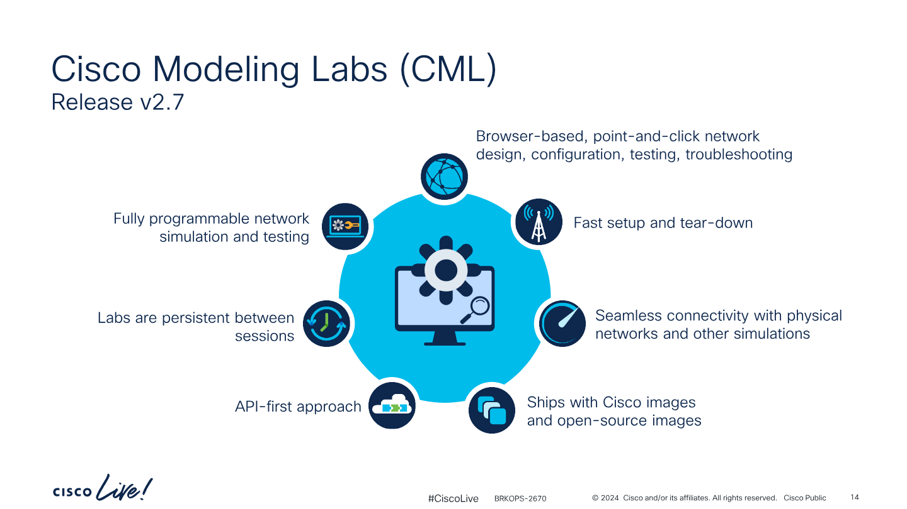

**图上看到什么**：与 BRKCRT-2059 中同一套产品属性描述（八个卖点），只是标注了版本 **v2.7**。

**为什么值得对照看**：同一个产品，在两场不同会议里被**用两套语言描述**：
- BRKCRT-2059（认证备考场）讲的是**"它能不能帮我练"** → 用"性能实验题就是 CML 出的"来立论；
- BRKOPS-2670（运维场）讲的是**"它能不能替代我的一部分运维流程"** → 见下一张图。

同一个 CML，对不同听众说不同的话——这是技术营销里值得学的"同一事实、多种切面"。

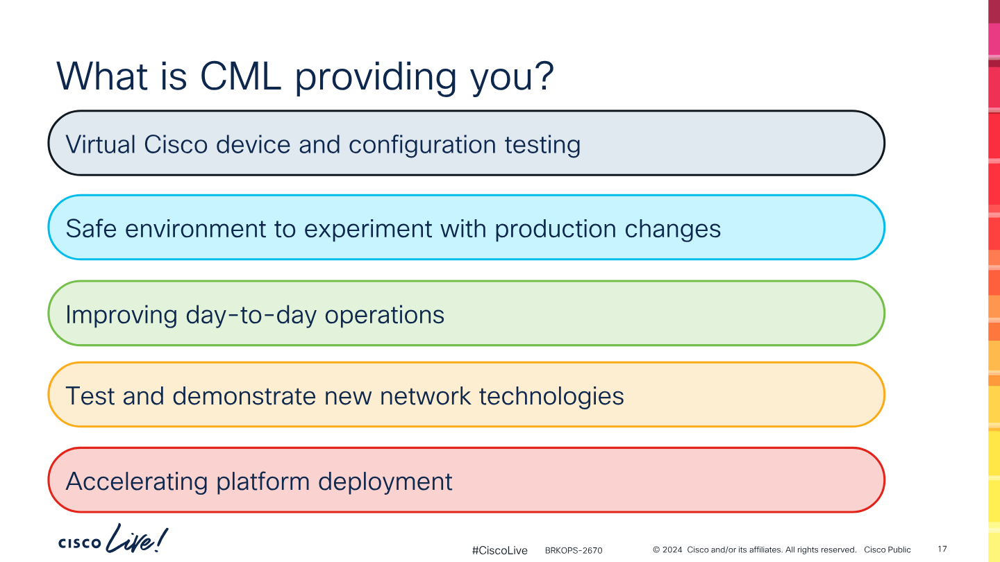

**图上看到什么**：五条价值主张——
1. Virtual Cisco device and configuration testing（虚拟设备与配置测试）
2. **Safe environment to experiment with production changes**（生产变更的安全试验场）
3. Improving day-to-day operations（改善日常运维）
4. Test and demonstrate new network technologies（测试与演示新技术）
5. Accelerating platform deployment（加速平台上线）

**怎么理解第 2 条的分量**：这是全场真正的卖点。它把 CML 从"学习工具"改写成"**变更管理工具**"——在生产变更之前，先在模型上跑一遍。这条主张的隐含前提是"模型必须足够真"，因此后面才会有大量篇幅讲"怎么把真实平台接进来"。

### 2.2 硬件要求与节点清单

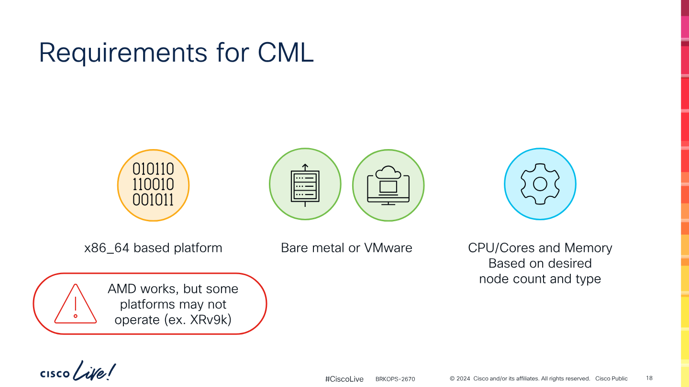

**图上看到什么**：三条要求 + 一条警告：AMD 平台可用，但某些平台可能无法运行（例：XRv9k）。

**为什么这条警告重要**：它不是"性能问题"，而是**指令集/虚拟化特性兼容问题**——XRv9k 这类重载镜像依赖特定 CPU 特性。这意味着：**买服务器前必须先确认你要跑哪些节点**，否则会出现"机器买回来了，最关键的镜像跑不起来"。

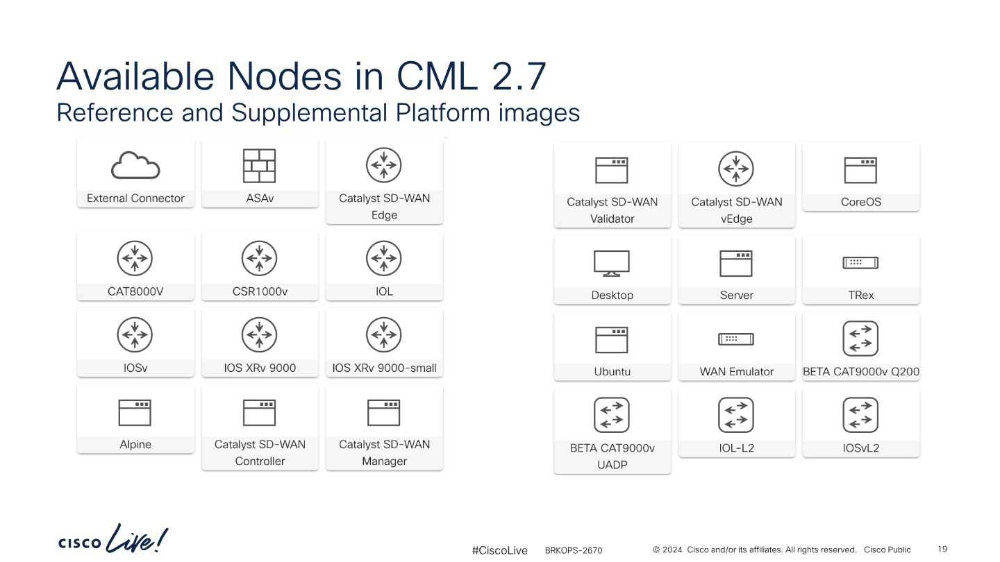

**图上看到什么**：24 个节点的图标网格，分两组——

| 分组 | 节点 |
|---|---|
| **Reference**（参考镜像） | External Connector、ASAv、Catalyst SD-WAN Edge、CAT8000V、CSR1000v、IOL、IOSv、IOS XRv 9000、IOS XRv 9000-small、Alpine、Catalyst SD-WAN Controller / Manager / Validator |
| **Supplemental**（补充平台镜像） | Catalyst SD-WAN vEdge、CoreOS、Desktop、Server、**TRex**、Ubuntu、**WAN Emulator**、BETA CAT9000v Q200、BETA CAT9000v UADP、IOL-L2、IOSvL2 |

**两个容易被忽略但价值极高的节点**：
- **TRex**：把流量生成器做成了"节点"，意味着你可以把它拖进拓扑、用链路连起来打流（对应 BRKCRT-2059 的 S41）；
- **WAN Emulator**：链路条件化（时延/丢包/抖动）的专用节点。

**注意 `BETA CAT9000v Q200 / UADP` 两个变体**：这解释了为什么 BRKCRT-2059 里说"Cat9Kv 可以改成 TenGE"——不同数据面实现（Q200 vs UADP）能力不同。做 Catalyst 相关实验时必须先确认你用的是哪个变体。

### 2.3 Workbench：把拓扑当文档画

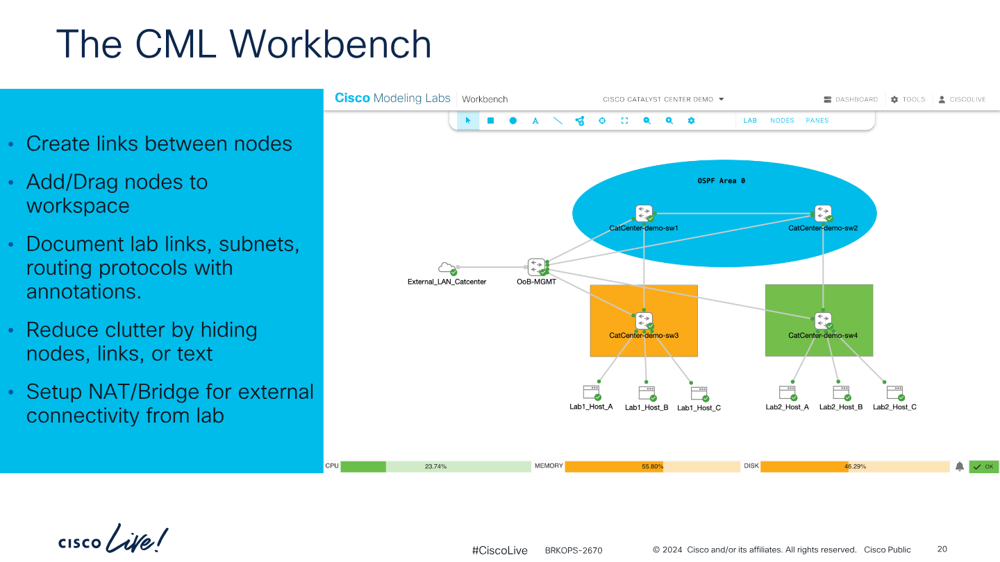

**图上看到什么**：真实的工作台截图，lab 名为 "CISCO CATALYST CENTER DEMO"。
- 蓝色椭圆注释标出 **OSPF Area 0**，圈住 `CatCenter-demo-sw1/sw2` 与 `OoB-MGMT`；
- 橙色块标出 `CatCenter-demo-sw3` 及其下 `Lab1_Host_A/B/C`；
- 绿色块标出 `CatCenter-demo-sw4` 及其下 `Lab2_Host_A/B/C`；
- 左侧 `External_LAH_Catcenter` 通过 `OoB-MGMT` 接入；
- 底部状态条：CPU 23.74%、MEM 56.80%、DISK 48.39%。

**怎么理解"注释（annotation）"这个功能的分量**：绝大多数仿真工具只让你画设备。CML 允许画**语义图层**——把"OSPF 区域""站点/机房边界"这种**逻辑分组**直接标在图上。这让拓扑从"设备连线图"升级为**可交付的设计文档**：交给同事时，对方不需要你口头解释"这几个是一个区域的"。

**底部资源状态条也值得注意**：CML 把宿主机的 CPU/内存/磁盘实时占用放在界面底部。这是在提醒你——**节点不是免费的**，加设备前先看余量。上图的 MEM 已到 56.8%，这是个"还能加，但要算"的状态。

---

## 3. 逃出仿真：三种"出圈"方式

这一章是整个 deck 的技术核心，标题叫 **"Escape the simulation"**。

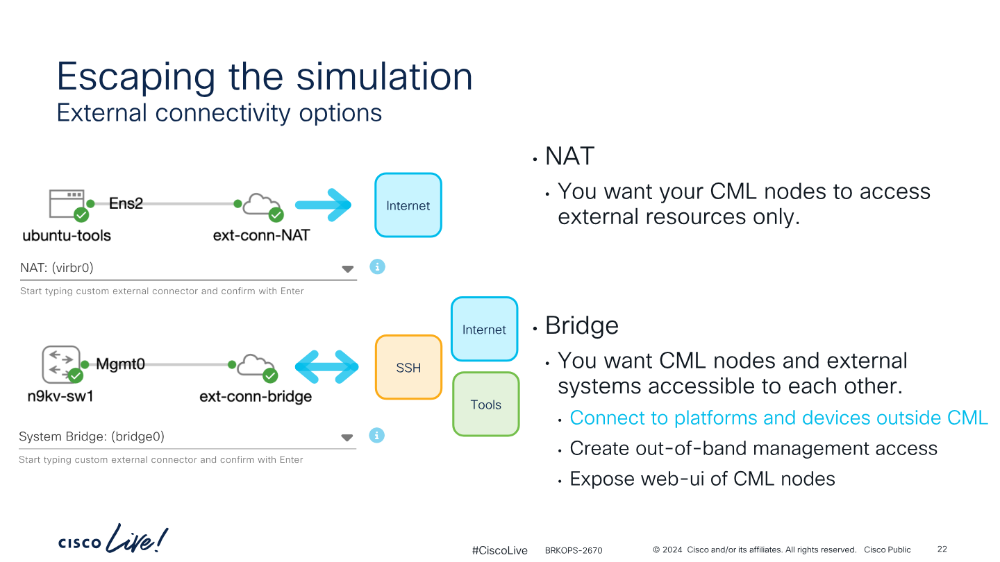

**图上看到什么**：两张对比卡片 + 三条用途。

| 模式 | 原文定义 | 本质 |
|---|---|---|
| **NAT** | "You want your CML nodes to access Internet external resources **only**" | 单向出：lab 能出去，外面进不来 |
| **Bridge** | "You want CML nodes and external systems **accessible to each other**" | 双向通：lab 与外部在同一二层 |

三条用途：连接 CML 外的平台与设备、建立带外（OoB）管理通道、**暴露 CML 节点的 web-ui**。

**怎么理解"为什么 bridge 是刚需"**：第 5 节要演示"用 NDFC 管 CML 里的虚拟 Nexus"，而 NDFC 是跑在 CML **外面**的虚拟机。NDFC 要能访问 CML 节点的管理 IP，就**必须**用 bridge。所以这里的 bridge 不是"进阶玩法"，而是"接平台"的前置条件。

### 3.1 自定义 bridge：两套控制台、两级配置

这是本 deck 附录里最有干货的部分，值得完整走一遍。

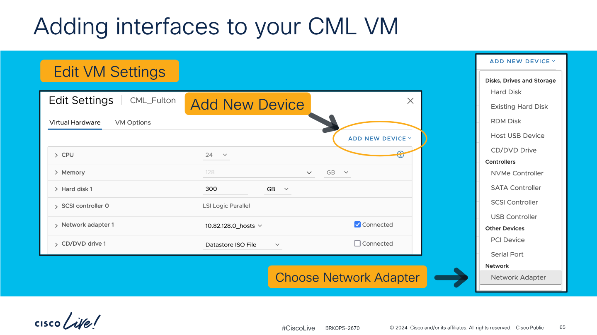

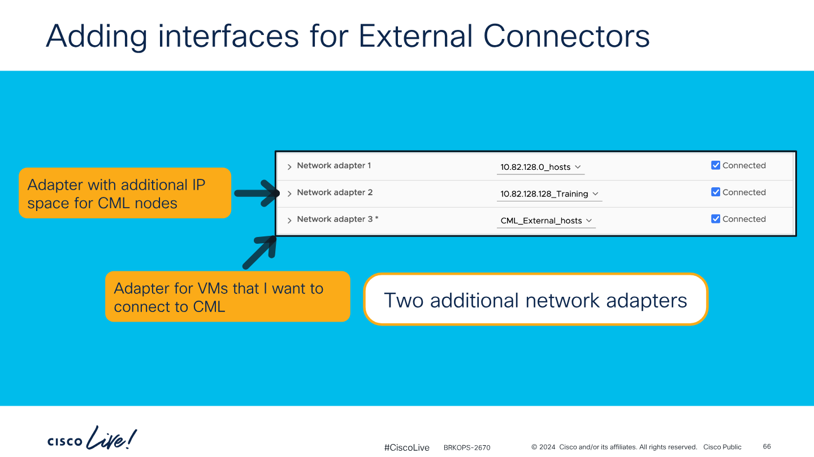

**图上看到什么**：两块新增适配器的用途区分——一块提供**额外的 IP 空间给 CML 节点**，另一块给**你想接进 CML 的那些 VM**。

**为什么必须分开**：这两类流量语义不同。CML 节点的管理网段是"lab 内部网络"，而外部 VM 所在网段是"真实业务网络"。混在一起会造成地址冲突与广播域污染。

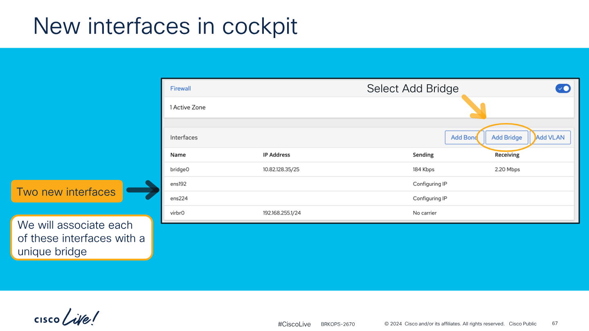

**图上看到什么**：Cockpit 界面（`https://<cml-host-ip>:9090`）的 Interfaces 区域，出现两块新接口，提示"我们将把每块接口关联到一个唯一的 bridge"。

**关键概念**：**Cockpit 是 CML 的"宿主机层"管理界面，不是 CML 应用层**。网卡、bridge 这些 Linux 层面的东西在 Cockpit 里配；而"这个 bridge 叫 System Bridge 还是 NAT"这种 CML 层面的语义，在 CML 应用界面里配。**两级要配对，缺一不可**。

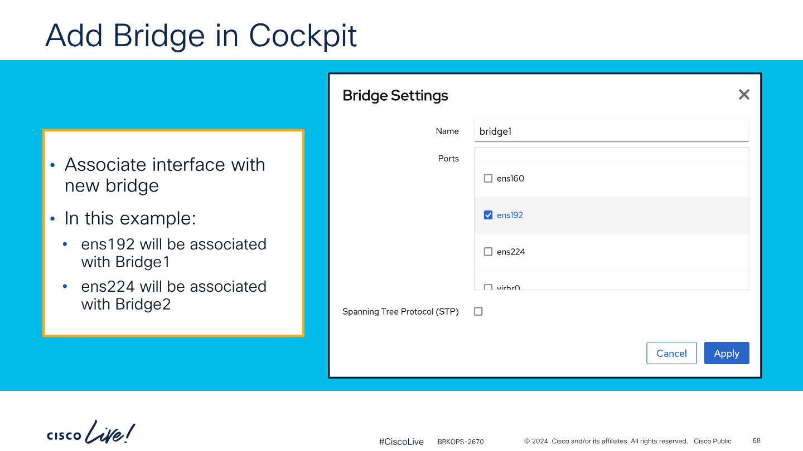

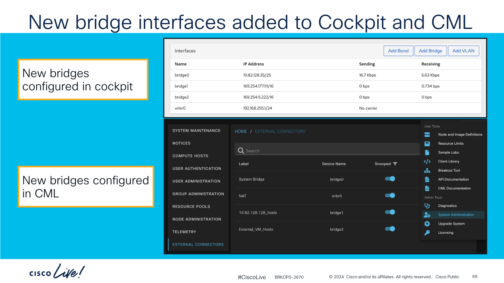

**图上看到什么**（这张是全场信息密度最高的截图）：

上半部 —— **Cockpit 的 Interfaces 表**：

| Name | IP Address | 说明 |
|---|---|---|
| bridge0 | 10.82.128.35/25 | 系统主桥 |
| bridge1 | 169.254.177.11/16 | 链路本地地址 |
| bridge2 | 169.254.5.222/16 | 链路本地地址 |
| virbr0 | 192.168.255.1/24 | libvirt 默认 NAT 桥 |

下半部 —— **CML 的 External Connectors 页**：

| Label | Device Name | Snooped（开关） |
|---|---|---|
| System Bridge | bridge0 | 开 |
| NAT | virbr0 | 开 |
| 10.82.128.128_hosts | bridge1 | 开 |
| External_VM_hosts | bridge2 | 开 |

**这张图解答了一个非常具体的问题**：为什么 bridge1/bridge2 在宿主机上是 `169.254.x.x`（链路本地地址，看起来"没有 IP"），却仍然能用？
—— 因为它们在 CML 里是**二层桥**，宿主机自己不需要在这两个网段上有可路由地址；真正需要 IP 的是挂在这个桥上的**节点**。

**注意 "Snooped" 那一列**：这就是 BRKCRT-2059 里 PATty 所依赖的 **IP 地址嗅探器**的开关。打开它，CML 才能"看见"桥上节点的 IP，从而建立端口映射。**两份材料在这里对上了**——一个讲"要用它"，一个讲"它长什么样"。

### 3.2 把 API 和 GUI 暴露出来

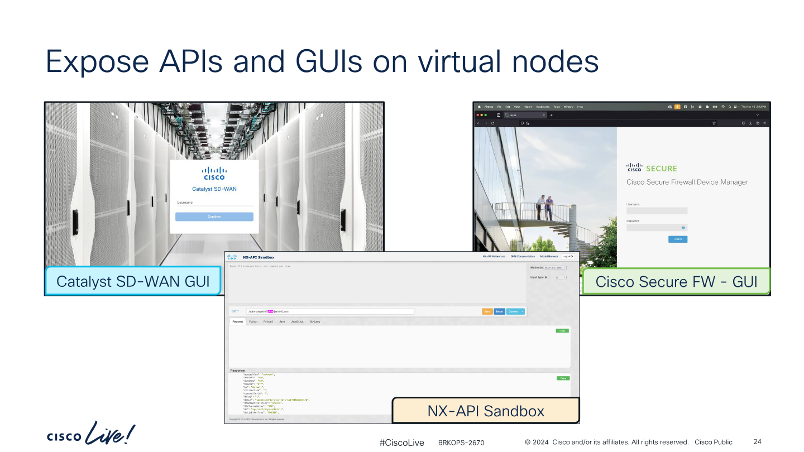

**图上看到什么**：三张并排的产品界面截图——Catalyst SD-WAN 的 Web 管理界面、Cisco Secure Firewall 的 GUI、以及 **NX-API Sandbox**（Nexus 的 API 调试页）。

**为什么这张图重要**：它证明"CML 里跑的不是残缺镜像"。很多仿真器只能跑控制面，Web UI 和 API 是废的；而这里能打开 SD-WAN Manager 的完整界面、能进 NX-API Sandbox 直接调试 REST 调用。

**对做自动化的人来说**：NX-API Sandbox 在 CML 里可用，意味着你可以**在虚拟设备上开发和调试 API 脚本**，而不必占用真机。这是第 4 节"自动化"章节的物理基础。

---

## 4. 给网络建模：五种收益、十类技术、三个场景

### 4.1 收益矩阵

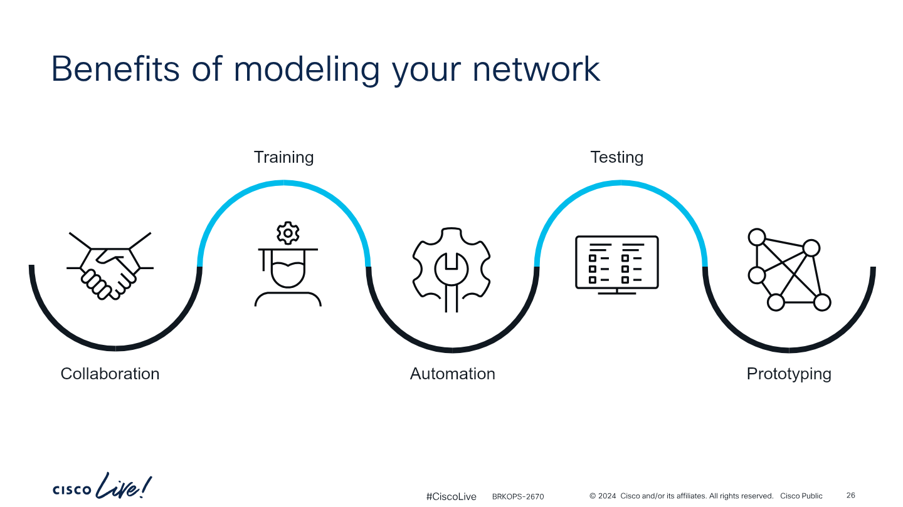

**图上看到什么**：五个词——培训、测试、协作、自动化、原型验证。

**怎么理解这五者的关系**：它们不是并列的，而是**成本递减、价值递增**的关系：
- Training / Testing 是"消费现有模型"（低门槛，立即见效）；
- Collaboration 要求模型能**分享和版本管理**（需要 Day 0 配置 + YAML 导出）；
- Automation / Prototyping 要求模型能被**程序驱动**（需要 API + CI/CD）。

也就是说，**这五项是成熟度阶梯**，不是五个功能。

### 4.2 可规划的技术范围

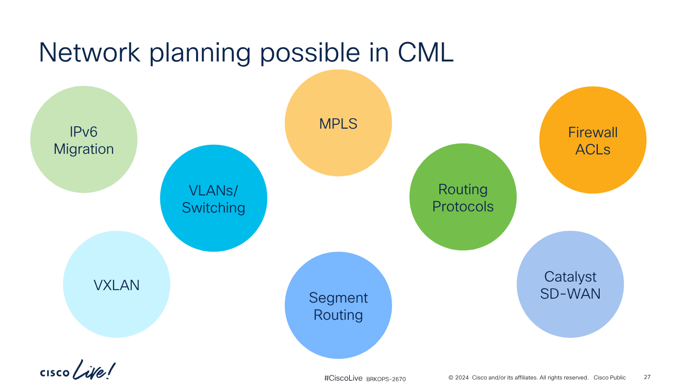

**图上看到什么**：九个技术标签——MPLS、IPv6、Firewall ACLs、Migration、Routing Protocols、VLANs/Switching、Catalyst SD-WAN、VXLAN、Segment Routing。

**为什么这个清单值得记**：它是**能力边界清单**。看到它就知道 CML 至少能覆盖：运营商级（MPLS/SR）、数据中心（VXLAN）、园区（VLAN/交换）、安全（ACL）、SD-WAN、双栈（IPv6）。反过来说，清单里**没出现**的东西（如大规模性能、专用 ASIC 特性、真实光层）就是它的边界。

### 4.3 场景一：网络迁移

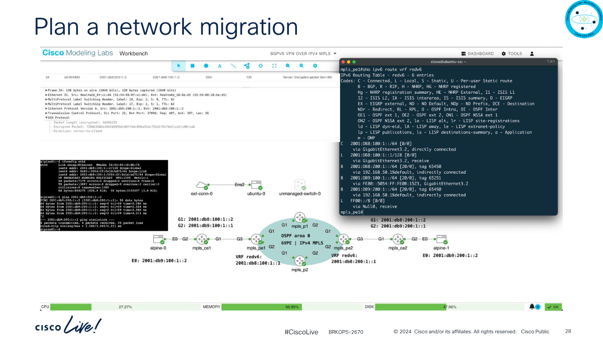

**图上看到什么**：一个信息密度极高的真实工作台截图——
- 拓扑：`ext-conn-0` → `ubuntu-0` → `unmanaged-switch-0`；下方 `alpine-0`、`mpls_pe1`、`mpls_p1`、`mpls_p2`、`mpls_pe2`、`alpine-1` 组成 MPLS 核心，`mpls_p1` 上标注 **OSPF Area 0**、**GWE | IPv4 MPLS / IPv6**；
- 地址标注：`G1: 2001:db8:100::1:2`、`G2: 2001:db8:100::1:1`、`EB: 2001:db8:100::1:2`、`2001:db8:200::1:1`、`2001:db8:200::1:2` 等；
- VRF 标注：`VRF redv6: 2001:db8:100::1:1`、`VRF redv6: 2001:db8:200::1:1`；
- 左上：**CML 内建抓包窗口**，逐包显示 LDP、OSPF、DNS、SSH；
- 右上：终端里 `ipv6 route vrf redv6` 的完整输出（含 `B`、`L`、`C` 等路由码与 `GigabitEthernet` 下一跳）。

**为什么用 6VPE 来讲"迁移"**：6VPE 本身就是一种**迁移技术**——把 IPv6 客户流量承载在 IPv4 MPLS 骨干上。它同时要求：MPLS 转发面正常、BGP VPNv6 邻居正常、VRF 配置正确、IPv6 编址正确。**任何一环错都不通**，所以它是"用一个小拓扑验证一整套迁移方案"的典型载体。

**这张图最值得学的是"自证"**：左侧抓包窗口证明"封装确实发生了"，右侧路由表证明"控制面确实收敛了"。**在一个界面里同时看到数据面与控制面**——这是 CML 相对"真机 + 外挂抓包"的效率优势。

### 4.4 场景二：开发网络自动化

材料的论证分两页递进：

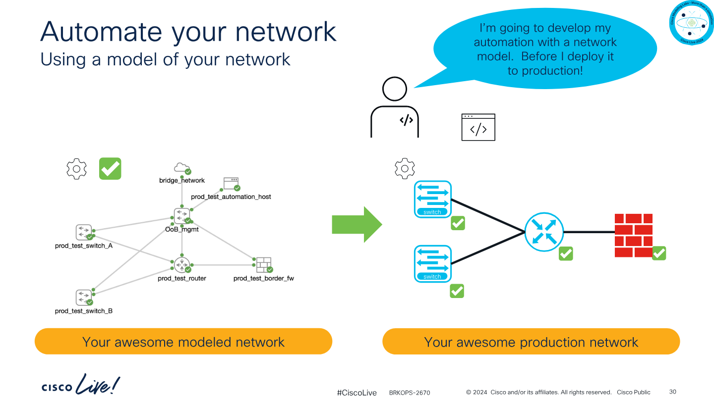

**图上看到什么**：一个幽默但真实的场景图——左边"Automation Coder"说"我要自动化我的网络设备！"，右边标注 "offline"（离线跑），下方是"你牛气哄哄的生产网络"。

**怎么理解这张图在批判什么**：它批判的是**"拿生产当测试环境"**这个行业陋习。playbook 写错一次，可能就是全网震荡。而"offline 运行"这个标注是反讽——**自动化脚本从来不是真的离线**，它一执行就直达生产。

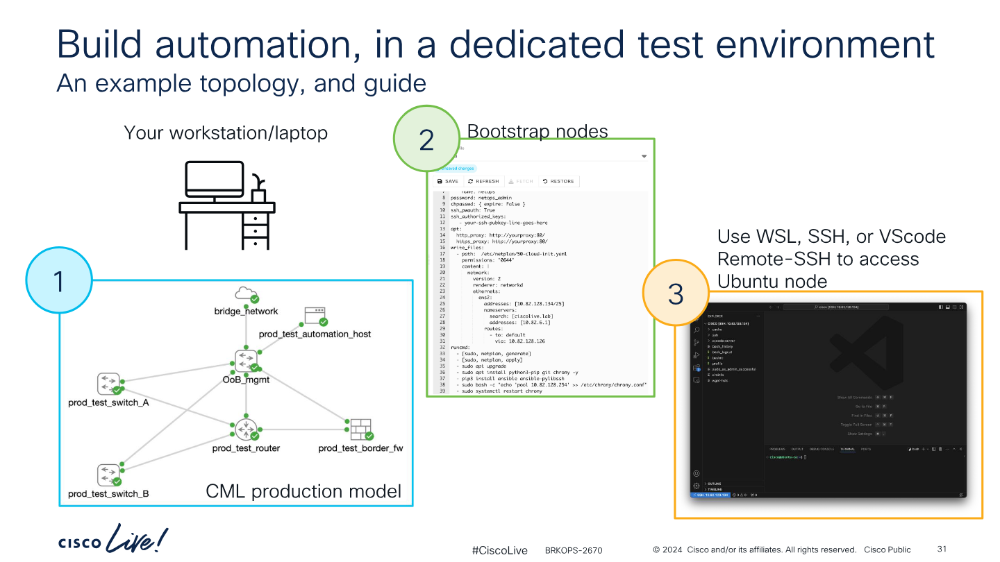

**图上看到什么**：同一个场景的两半——左边"我要在网络模型上开发我的自动化，**在部署到生产之前**"，右边是"你的生产网络"；同时标出了测试环境的三层结构：**bootstrap 节点**（负责初始配置注入）、**你的工作站/笔记本**（通过 WSL、SSH 或 VSCode Remote-SSH 接入一台 Ubuntu 节点）、**CML 生产模型**（被操作的对象）。

**这张图合起来才是完整的论证**：S30 的问题 + S31 的解法 = **"用模型做自动化的预演环境"**。这也解释了为什么"CML 必须能跑真镜像"——如果模型里的设备行为和真机不同，预演就没有意义。

**为什么强调 VSCode Remote-SSH**：这是把"IDE 体验"搬进 lab 的关键。你不需要在 CML 控制台里用 vim 改 playbook——用本地 VSCode 远程编辑、断点调试、Git 提交，体验和开发真实项目一致。**这一条直接决定了"用 CML 练自动化"能不能坚持下来**。

### 4.5 场景三：原型验证与扩容（虚实混合）

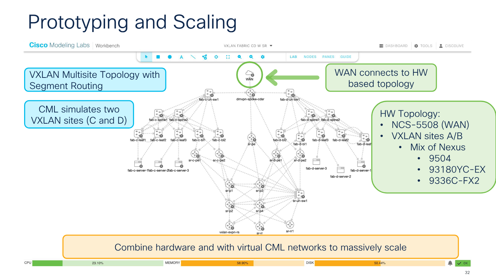

**图上看到什么**：真实工作台截图，lab 名 "VXLAN FABRIC CD W SR"。
- 中部是完整的 VXLAN Fabric：`fab-c-spine1/spine2`、`fab-c-leaf1~leaf3`、`fab-c-bd1~bd2`、`fab-c-server1~3`（站点 C），对称的 `fab-d-*`（站点 D）；
- 顶部一个 **WAN 云节点**，一个绿色箭头标注 "**WAN connects to HW based topology**"；
- 右侧说明：HW 拓扑包含 **NCS-5508（WAN）** 与 **站点 A/B 的 Nexus 混编（9504 / 93180YC-EX / 9336C-FX2）**；
- 底部结论："**Combine hardware and with virtual CML networks to massively scale**"；
- 状态条：CPU 23.10%、MEM 58.90%、DISK 50.4%。

**怎么理解"虚实混合"这件事的价值**：这是 CML 最独特的能力，也是最难被替代的能力。
- 纯仿真：成本低，但**规模受限**（宿主机资源有限）且**不真实**（没有真实 ASIC、真实时延）；
- 纯硬件：真实，但**贵且慢**，改一次拓扑要动线；
- **混合**：把"需要真实的少数设备"用硬件（如 WAN 侧的 NCS-5508、要验证性能的叶子），把"需要规模的多数设备"用虚拟（站点 C/D 的整套 fabric）。

**注意上图的 MEM 58.9%**：整套双站点 VXLAN fabric 只吃掉不到 60% 内存，这说明 CML 的资源效率足以支撑"两个完整站点"规模的原型验证——这正是"massively scale"的含义。

---

## 5. 把控制器接进来：三种平台的接法

### 5.1 为什么要把平台接到 CML

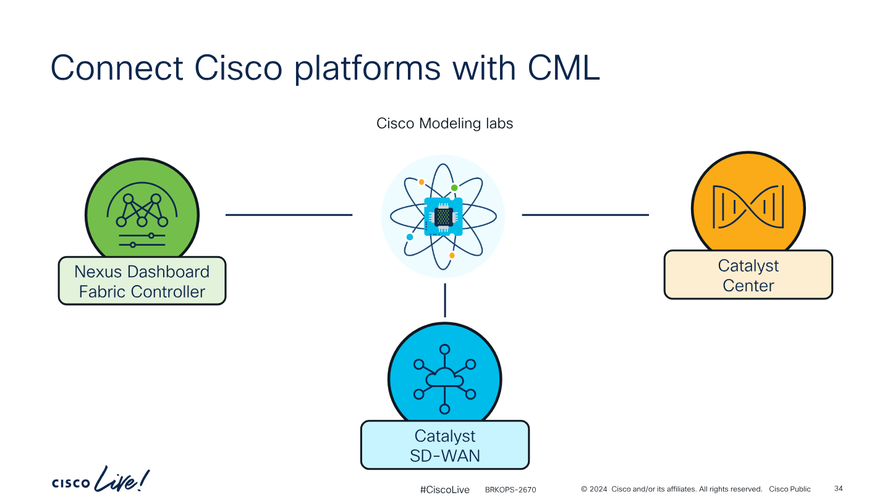

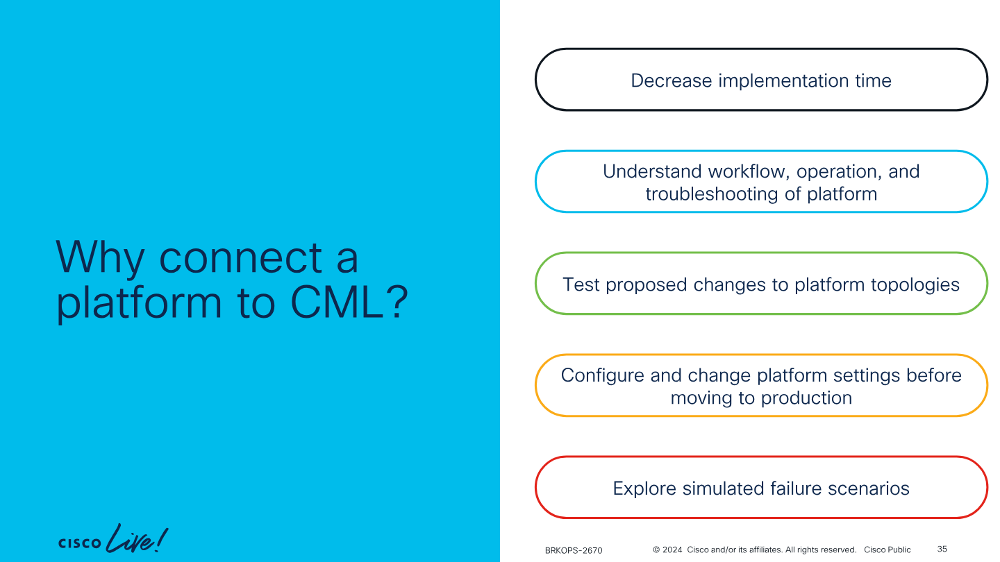

**图上看到什么**：四条理由——
1. **理解平台的工作流、操作与排障**（Understand workflow, operation, and troubleshooting）
2. 测试拟议的平台拓扑变更
3. **在移到生产之前**先配置和修改平台设置
4. 探索模拟的故障场景

**怎么理解这四条与 CML 自身功能的关系**：注意它们全是**"人的能力"**而非"设备的能力"。CML 在这里卖的其实是**控制器的操作熟练度**——NDFC 的 fabric 怎么建、SD-WAN 的证书怎么签、Catalyst Center 的模板怎么下发，这些操作**在真机上练成本极高**（一套 SD-WAN 管理套件要三台大虚拟机、几十 GB 内存），而在 CML 里可以反复重建。

### 5.2 设计建议：哪些进 CML，哪些留在外面

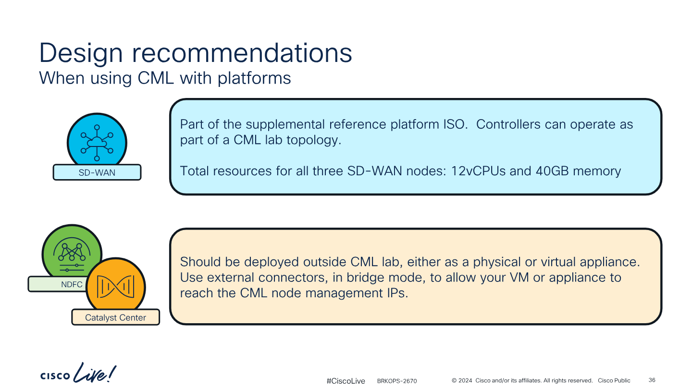

**图上看到什么**：三行关键建议——

| 平台 | 建议 | 理由/参数 |
|---|---|---|
| **Catalyst SD-WAN** | 属于 supplemental reference platform ISO，**控制器可以作为 CML 拓扑的一部分运行** | 三个 SD-WAN 节点合计 **12 vCPU + 40GB 内存** |
| **NDFC** | 应部署在 CML lab **之外**（物理或虚拟设备） | 用**桥接模式的外部连接器**让 VM/设备访问 CML 节点的管理 IP |
| **Catalyst Center** | 同上，部署在 CML 之外 | 同上 |

**这两条建议的差别值得细想**：
- **SD-WAN 控制器放进 CML**：因为它是"被建模对象"的一部分——你要模拟的是"三个站点 + 一套控制器"的完整体系，控制器在体系内；
- **NDFC / Catalyst Center 放在 CML 外**：因为它们体量太大（NDFC 是重型 OVA），且它们是**管理平面**，天然应该在 lab 之外俯视 lab。

**"12 vCPU + 40GB"这个数字要记住**：这是"在 CML 里跑 SD-WAN 管理套件"的最低资源门槛。很多人在 16GB 内存的实验机上尝试，然后放弃——不是配置问题，是资源不够。

### 5.3 环境搭建：两个 lab、一条 GRE

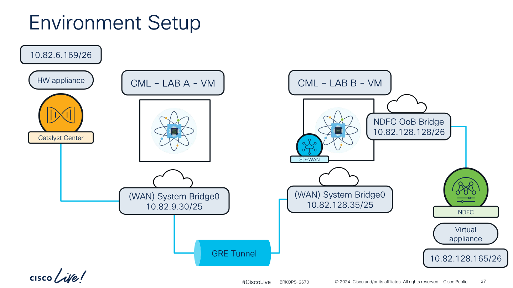

**图上看到什么**：这是全 deck 最"工程化"的一张图，把地址规划一次讲清：

| 组件 | 地址 | 位置 |
|---|---|---|
| Catalyst Center（**硬件设备**） | 10.82.6.169/26 | CML 之外 |
| CML Lab A 的 System Bridge0 | 10.82.9.30/25 | Lab A |
| CML Lab B 的 System Bridge0 | 10.82.128.35/25 | Lab B |
| NDFC OoB Bridge | 10.82.128.128/26 | Lab B 内 |
| NDFC（**虚拟设备**） | 10.82.128.165/26 | Lab B 内 |
| Lab A ↔ Lab B | **GRE Tunnel** | 跨两台 CML 虚拟机 |

**怎么理解这个设计的三层意图**：
1. **一台 CML 装不下所有东西**（资源不够），所以要拆成 Lab A / Lab B 两台 CML 虚拟机；
2. **两台 CML 之间用 GRE 打通**，让两个 lab 的网络能互通（这样 SD-WAN 的 WAN 侧才有意义）；
3. **平台按体量分置**：硬件 Catalyst Center 留在物理网络（10.82.6.x），虚拟 NDFC 放进 Lab B（10.82.128.x），各自用 bridge 接入。

**这张图最大的价值是"它承认了资源限制"**：官方演示环境本身就是**多台 CML + 硬件 + GRE** 拼出来的。所以当你发现"一台机器跑不动 SD-WAN + NDFC + Catalyst Center 全家桶"时，不是你的错——官方也没这么干。

### 5.4 用 NDFC 管虚拟 Nexus

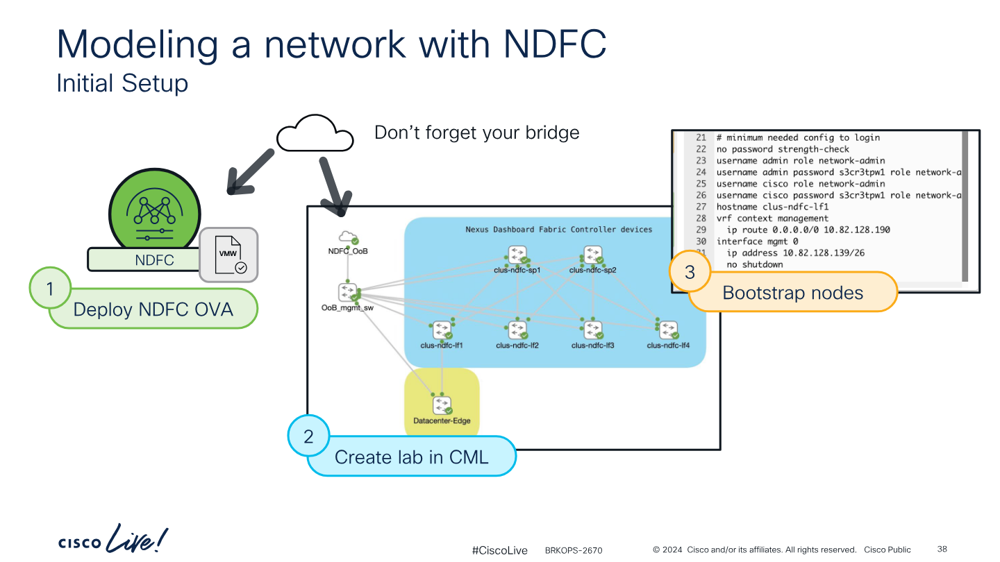

**图上看到什么**：三个编号步骤（1 Bootstrap nodes → 2 Deploy NDFC OVA → 3 Create lab in CML），外加一句醒目的提醒 "**Don't forget your bridge**"。

**"别忘 bridge"是针对什么**：NDFC 部署在 CML 之外，要访问 CML 里的 Nexus 管理 IP，**必须**有桥接模式的外部连接器。忘了这一步，NDFC 里一切正常、但永远发现不到设备——这是最典型的"卡一整天"的坑。

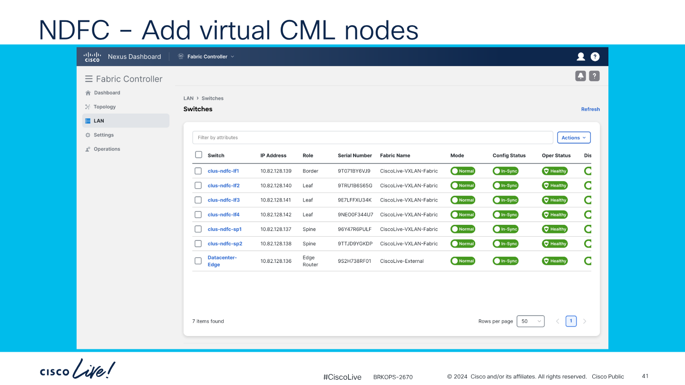

**图上看到什么**：NDFC 的 fabric 管理界面，把 CML 中的虚拟 Nexus 加进 fabric。

**怎么理解这一步的意义**：这是"**控制器视角的统一**"——对 NDFC 来说，CML 里的虚拟交换机和机房的真实交换机**没有区别**，都是被纳管的成员。所以你在 CML 里练的 fabric 操作（建 VPC、下发配置、看拓扑）与生产完全一致。

**一个实用的善后提醒**（原文）：如果对设计不满意想重来——
1. 先从 **NDFC 里删掉交换机**；
2. 然后 **stop → wipe → start** 节点；
3. **注意**：如果你用过 "extract configs"，还要**逐个清理节点的 bootstrap 配置**，否则旧配置会跟着镜像回来。

**这三步顺序不能乱**：先删 NDFC 里的记录，再清设备。反过来会导致 NDFC 里挂着不存在的设备、fabric 状态异常。

### 5.5 用 Catalyst SD-WAN 建模

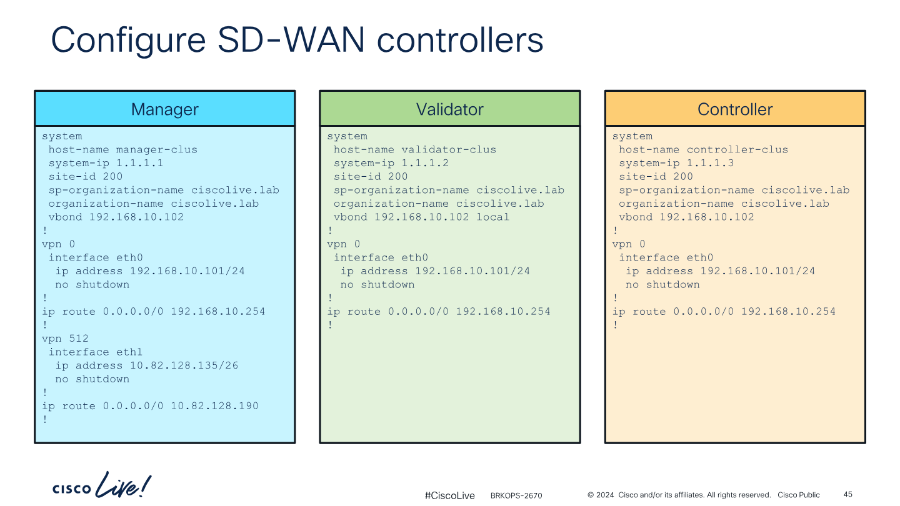

**图上看到什么**：三列并排的配置清单，关键参数横向对齐：

| 参数 | Manager | Validator | Controller |
|---|---|---|---|
| host-name | manager-clus | validator-clus | controller-clus |
| system-ip | **1.1.1.1** | **1.1.1.2** | **1.1.1.3** |
| site-id | 200 | 200 | 200 |
| organization-name | ciscolive.lab | ciscolive.lab | ciscolive.lab |
| vbond | 192.168.10.102 | 192.168.10.102 **local** | 192.168.10.102 |
| vpn 0 / eth0 | 192.168.10.101/24 | 同 | 同 |
| 默认路由（vpn 0） | 0.0.0.0/0 → 192.168.10.254 | 同 | 同 |
| vpn 512 / eth1 | **10.82.128.135/26** | — | — |
| 默认路由（vpn 512） | 0.0.0.0/0 → 10.82.128.190 | — | — |

**三个必须理解的细节**：
1. **`vbond ... local`（仅 Validator）**：Validator 自己就是 vBond 角色时，要标 `local`，否则它会去连一个不存在的 vBond 地址——这是 SD-WAN 实验里最常见的坑；
2. **三台设备 system-ip 必须不同但同 site-id**：system-ip 是设备身份（1.1.1.1/2/3），site-id 200 表示它们同属"控制面站点"；
3. **vpn 512 是"带外管理 VPN"**：只有 Manager 配了 eth1（10.82.128.135/26）。vpn 512 在 SD-WAN 里是**管理专用 VPN**，用于让你从外部网络访问设备、而不影响业务 VPN 0 的转发。

**为什么这张图比文字讲义更有效**：三列横向对齐的版式，让"哪些参数相同、哪些必须不同"一目了然。自己配的时候照着这个版式检查，能避免 90% 的"设备起不来"问题。

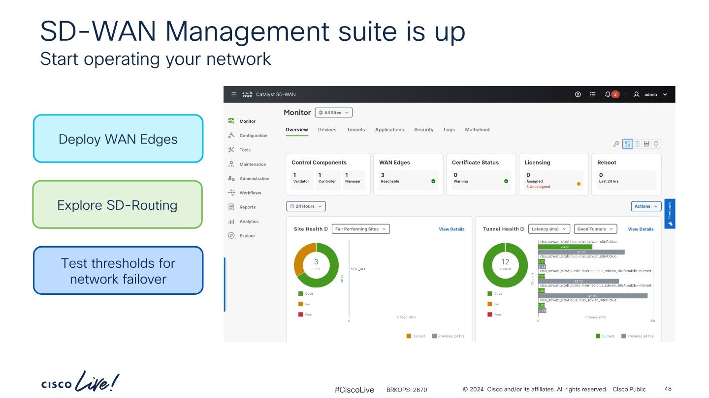

**图上看到什么**：管理套件就绪后的三个下一步动作——部署 WAN Edge、探索 **SD-Routing**、测试**故障切换的阈值**。

**注意 "test thresholds for network failover"**：这是 SD-WAN 实验的真正价值点。故障切换阈值（丢包率/时延/抖动）是**理论值好写、实际值难调**的东西——设太松，业务已经受影响才切；设太紧，链路轻微抖动就频繁切换。只有在可控的环境里注入链路条件，才能把阈值调准。

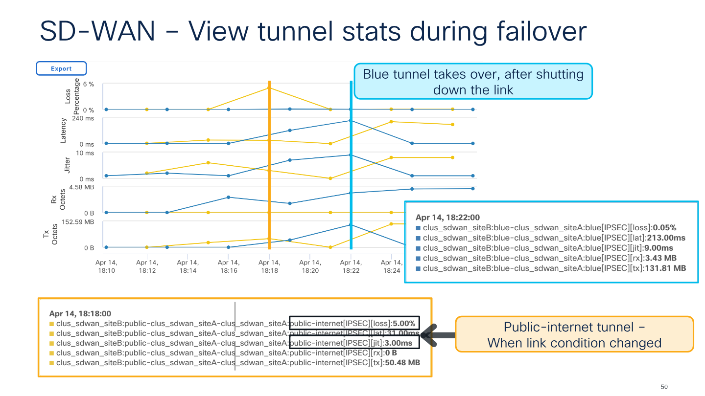

**图上看到什么**：一张真实的 SD-WAN 隧道监控曲线图，六个纵向指标面板（Loss Percentage、Latency、Jitter、Rx Octets、Tx Octets）：

| 时间点 | 事件 | 关键数据（图中浮窗） |
|---|---|---|
| **18:18:00** | 公网 internet 隧道链路质量恶化 | `loss: 5.00%`、`lat: 91.00ms`、`jit: 3.00ms` |
| **18:22:00** | **蓝色隧道接管**（专线） | `loss: 0.05%`、`lat: 213.00ms`、`jit: 9.00ms`、`tx: 131.81 MB` |

**怎么理解这张图的两层信息**：
1. **触发条件**：公网隧道达到 5% 丢包 / 91ms 时延，越过阈值 → 触发切换；
2. **切换结果**：切到蓝色（专线）隧道后，丢包降到 0.05%——但**时延升到 213ms**、抖动升到 9ms。

**第 2 点是最容易被忽略的关键**：故障切换不是"变好"，而是"**两害相权**"。专线丢包极低但时延更高（可能走了更长路径）。这正是 SD-WAN 策略设计的核心难题——**不同业务对丢包和时延的敏感度不同**，所以要做应用感知的切换策略（如语音优先低抖动、ERP 优先低丢包）。

**这张图与 BRKCRT-2059 的 S38（链路条件化）构成了完整闭环**：先用链路条件化**注入** 5% 丢包，再用 SD-WAN 监控**观察**切换行为，最后**调阈值**。这条链在真机上几乎不可能练——你没法让生产链路按你的意愿丢包。

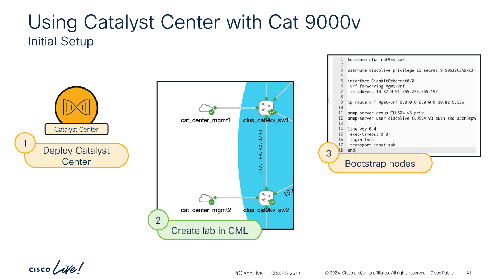

**图上看到什么**：与 NDFC 相同的三步式初始设置，但对象换成 Catalyst Center + Cat 9000v 交换机。

**一个必须提前做的动作**（原文强调）：**在启动节点之前，先为 Cat 9000v 创建唯一的序列号（unique serial number）**。

**为什么序列号是个坑**：Catalyst Center 靠**序列号**识别设备。如果克隆出的虚拟交换机共用同一个序列号，Catalyst Center 会认为它们是同一台设备，导致设备发现失败或互相覆盖。这个"预先改序列号"的动作在 CML 界面里是节点属性，很容易被忽略。

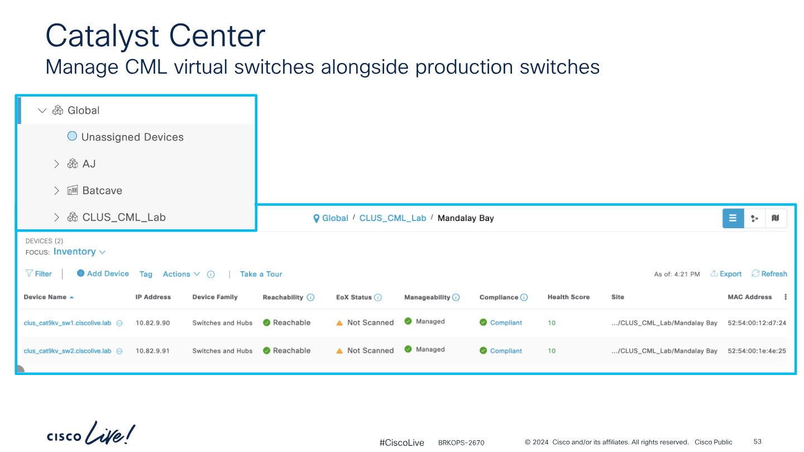

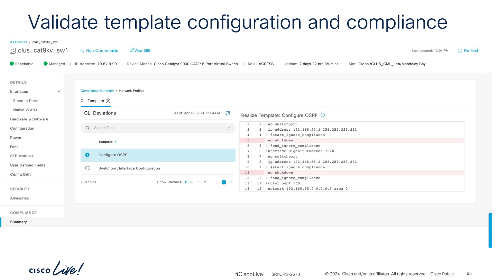

**图上看到什么**：两张 Catalyst Center 的真实界面截图——设备清单（虚拟与生产混排）、以及模板配置/合规性校验页面。

**怎么理解"模板 + 合规"这条链路的价值**：Catalyst Center 的核心能力是**模板化配置下发**与**合规性检查**。这两件事都是"**错一次影响一片**"的高风险操作。在 CML 里：
1. 先对虚拟交换机跑模板下发 → 看是否报错、变量是否解析正确；
2. 再跑合规检查 → 看策略是否符合预期；
3. 确认无误后，同一套模板下发到生产。

**这就是"CML 作为变更管理工具"的最终形态**——不是"练手"，而是**生产变更的预演环节**（呼应 S17 的第 2 条价值主张）。

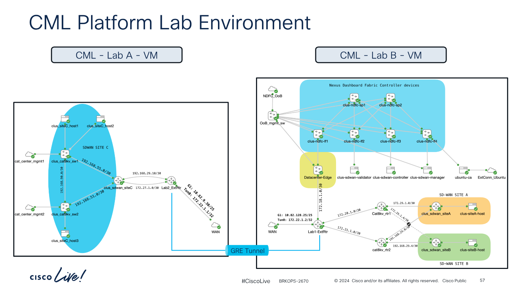

---

## 6. 附录的隐藏价值：三块"可复用资产"

讲者在议程页就提示过："看到这个图标，说明附录里有更多细节。"附录（P63–P79）实际包含三块可复用资产。

### 6.1 Cockpit 的 Bridge 机制（详见 3.1）

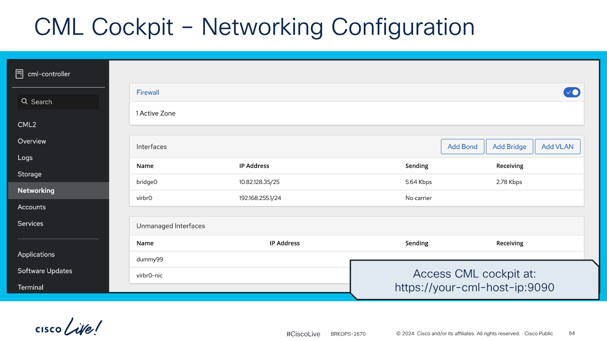

**图上看到什么**：Cockpit 登录/概览页，标注访问地址为 `https://your-cml-host-ip:9090`。

**为什么这个入口值得记住**：CML 的很多"高级能力"（多网卡、多 bridge、存储、系统升级）**不在 CML 应用界面里**，而在 Cockpit 里。不知道这个地址的人，会一直以为"CML 只能有一个外部连接器"。

### 6.2 6VPE 与 VXLAN 的抓包实证

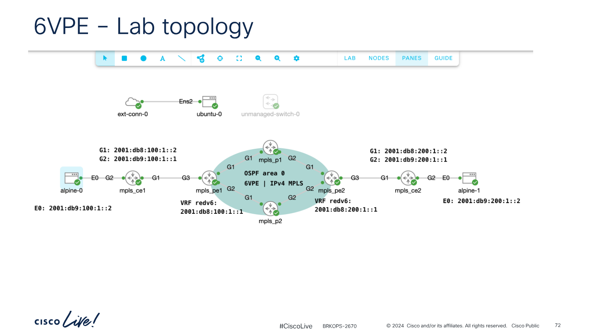

**图上看到什么**：`alpine-0`、`mpls_pe1`、`mpls_p1`、`mpls_p2`、`mpls_pe2`、`alpine-1` 六个节点的 MPLS 拓扑，标注 `G1/G2/EB` 接口地址（2001:db8:100::/2001:db8:200:: 两个网段）、`OSPF Area 0`、`GWE | IPv4 MPLS / IPv6`，以及两端 `VRF redv6`。

**怎么看这个拓扑的"考点密度"**：这个六节点小拓扑同时压了四件事——OSPF（underlay 收敛）、MPLS LDP（标签分发）、BGP VPNv6（VPN 路由）、VRF（客户隔离）。**一个拓扑覆盖四层技术**，这就是为什么它被反复用作"迁移验证"的载体。

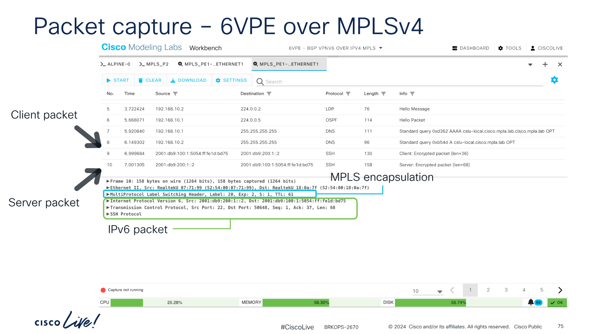

**图上看到什么**：CML 内建抓包窗口的完整界面——
- 抓包列表（No. / Time / Source / Destination / Protocol / Length / Info）里能看到 LDP Hello、OSPF Hello、DNS 查询、SSH 会话；
- 第 10 号包展开后的三层结构：**Ethernet II**（src `52:54:00:07:71:99`，Dst RealtekU `52:54:00:18:0a:7f`）→ **MultiProtocol Label Switching Header**（`Label: 20`、`Exp: 2`、`S: 1`、`TTL: 61`）→ **Internet Protocol Version 6**（`2001:db8:200::1:2` → `2001:db8:100:1:5054:ff:fe1d:bd75`）→ **SSH Protocol**（Control Protocol, Src Port 22, Dst Port 50648, Seq/Ack）；
- 图上还用箭头标注了三个层次："Client packet"、"MPLS encapsulation"、"IPv6 packet"。

**这张图证明了什么**：**6VPE 的封装在 CML 里是逐字节真实的**。MPLS 标签（Label 20）真实存在、IPv6 真实承载在标签之下、SSH 会话真实跑在上面。也就是说，CML 的仿真不是"行为级近似"，**协议栈是完整的**——这直接支撑了"CML 可以用来验证迁移方案"的论断。

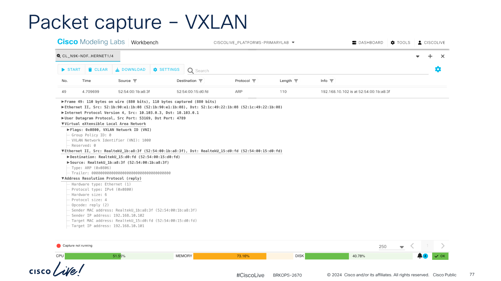

**说明**：与 6VPE 同理，VXLAN 的抓包能看到外层 UDP → VXLAN 头 → 内层以太帧的完整嵌套。**对做数据中心网络的人来说，这是验证"VXLAN 转发是否真的按预期封装"的最直接手段**。

### 6.3 培训环境的自动化生成

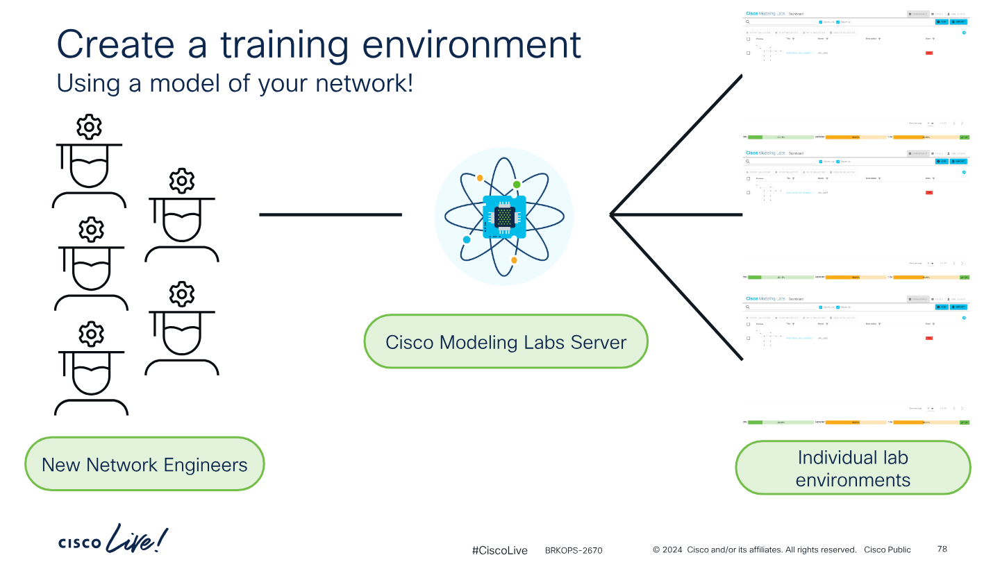

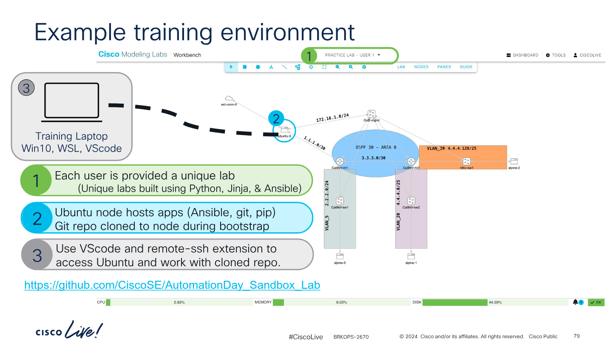

**图上看到什么**：培训环境的三个实现要点——每个用户拿到唯一 lab（用 **Python + Jinja + Ansible** 批量生成）、Ubuntu 节点上装好 Ansible/git/pip、bootstrap 时自动 clone Git 仓库、用 VSCode Remote-SSH 接入。

**为什么这一页比前面所有"CML 好处"都实在**：它给出了**规模化培训的具体配方**——
- **唯一性**：每人一个 lab，互不干扰（CML 的 lab 隔离特性）；
- **模板化**：Jinja 模板 + Python 脚本批量渲染拓扑（CML 的 API + YAML 导入）；
- **自动化装配**：bootstrap 阶段自动拉代码、装工具，学员一开机就是"已就绪"状态；
- **一致的交互**：VSCode Remote-SSH，学员的体验与日常开发一致。

配套仓库：`https://github.com/CiscoSE/AutomationDay_Sandbox_Lab`

---

## 7. 要点提炼

**如果只记五条：**

| # | 结论 | 依据 |
|---|---|---|
| 1 | **CML 的价值主张是"生产变更的预演场"，不是"学习工具"** | S17 第 2 条 + S53/S55 模板与合规校验 |
| 2 | **Bridge 是把平台接进来的唯一通道，且要两级配（Cockpit + CML）** | S22/S69：Cockpit 里建 bridge → CML 里映射成 External Connector |
| 3 | **NDFC/Catalyst Center 放 lab 外，SD-WAN 控制器放 lab 内（需 12 vCPU + 40GB）** | S36 的设计建议 |
| 4 | **虚实混合是 CML 最难被替代的能力** | S32：NCS-5508 硬件 WAN + 两个虚拟站点 fabric，仅占 58.9% 内存 |
| 5 | **抓包能看到真实的协议封装（MPLS/VXLAN），所以仿真不是"行为近似"** | S75/S77 逐层展开的报文结构 |

**三个平台的接入要点速查：**

| 平台 | 部署位置 | 关键前置动作 | 典型坑 |
|---|---|---|---|
| **NDFC** | CML lab 之外（物理/虚拟） | 建好 bridge 模式的外部连接器 | 忘了 bridge → 永远发现不到设备 |
| **Catalyst Center** | CML lab 之外（常为硬件） | 为 Cat 9000v **预先创建唯一序列号** | 序列号重复 → 设备识别失败 |
| **Catalyst SD-WAN** | 可在 lab 内（3 节点 12vCPU/40GB） | Validator 的 `vbond` 要标 `local` | 三台 system-ip 相同 / 忘了 `local` |

---

## 8. 外部链接汇总

| 用途 | 链接 |
|---|---|
| CML Cockpit（宿主机管理） | `https://<cml-host-ip>:9090` |
| 培训环境配套仓库 | https://github.com/CiscoSE/AutomationDay_Sandbox_Lab |
| 讲者联系方式 | mleuschn@cisco.com / @rogue_router |
| 会议点播库 | www.CiscoLive.com/on-demand |
