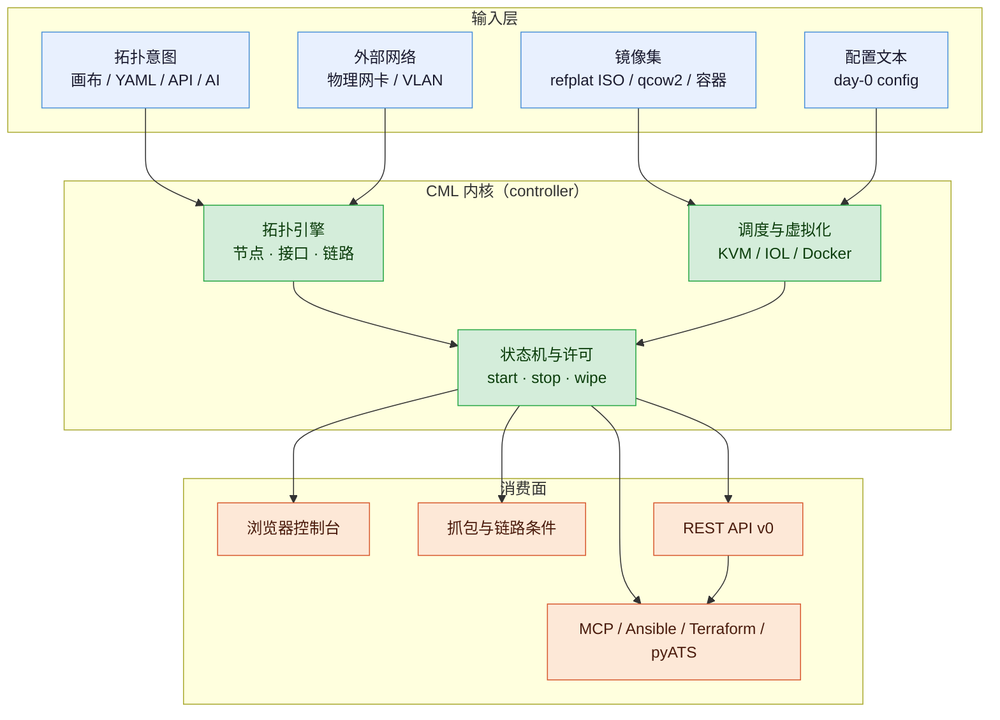
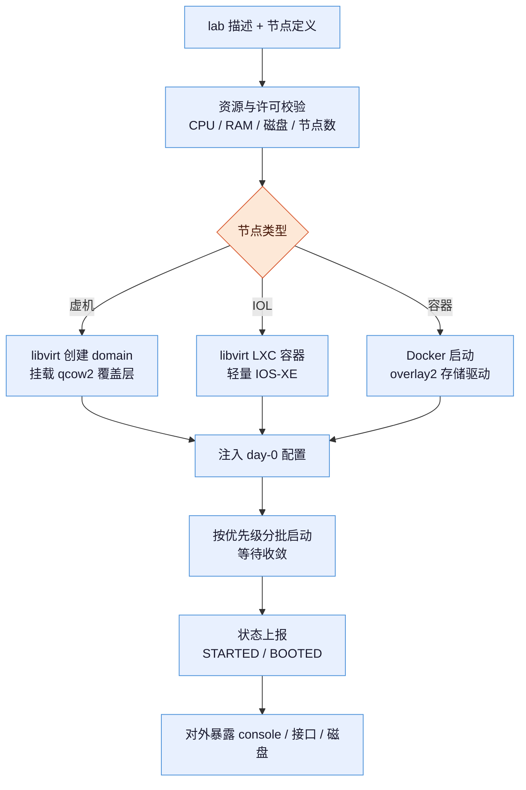
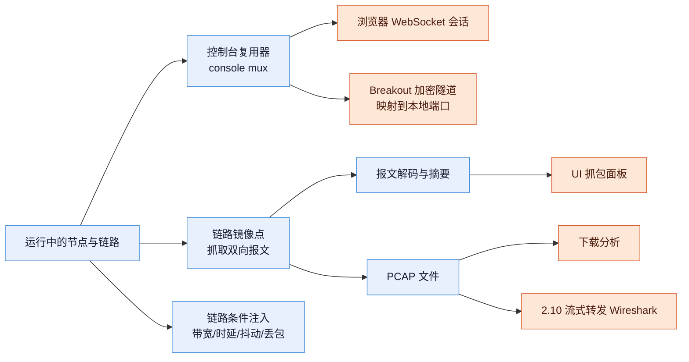
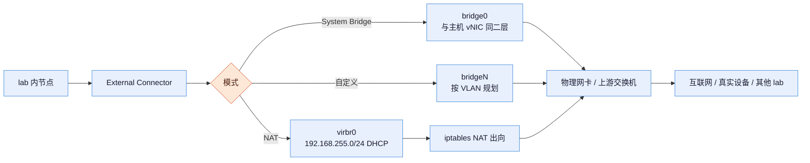
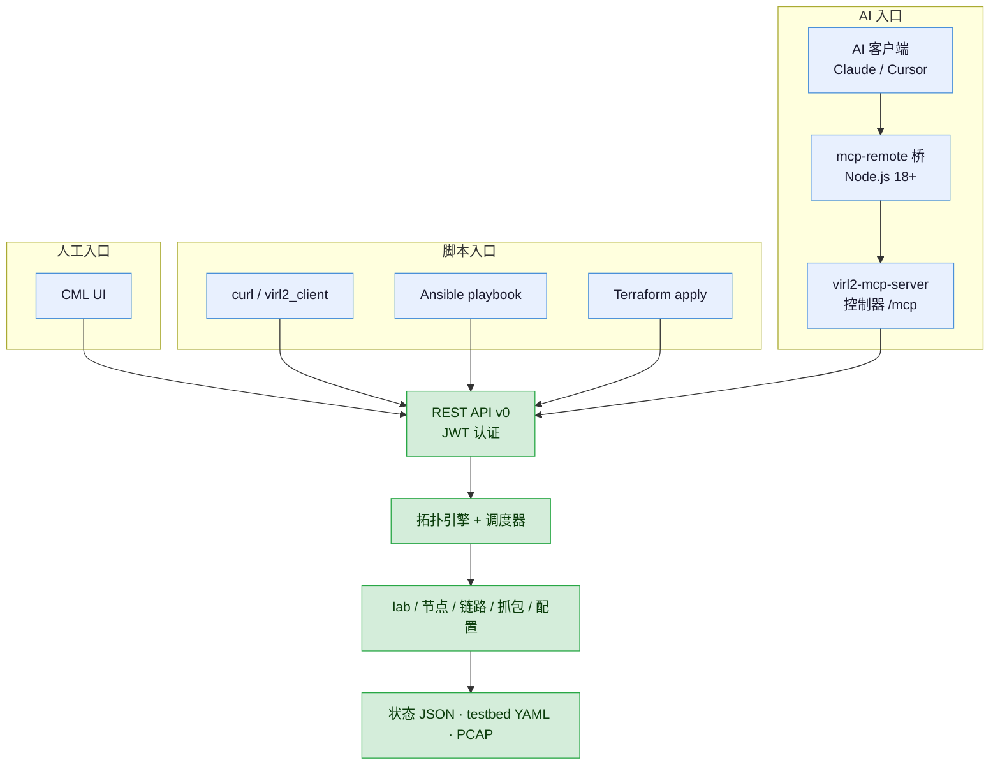
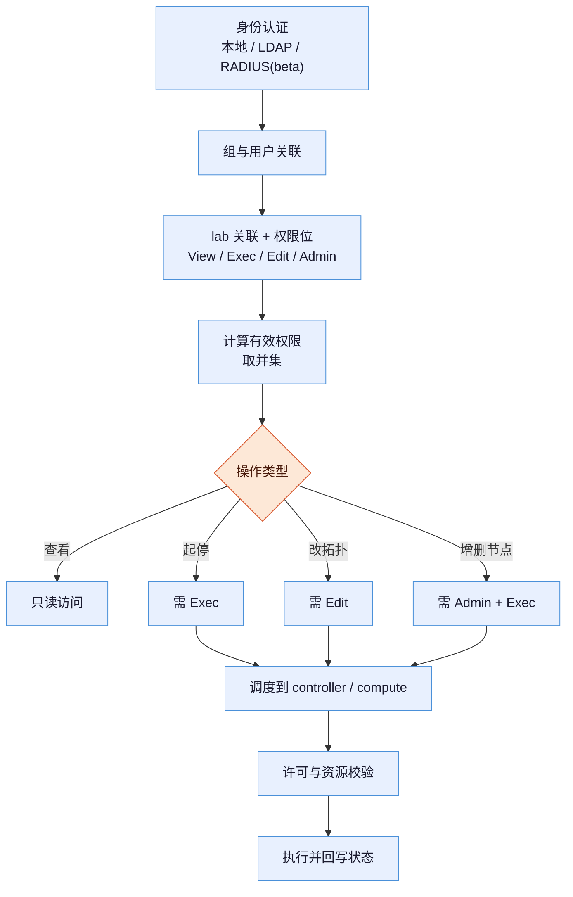

# 思科 CML —— 功能体系与能力边界

> **调研对象**：Cisco Modeling Labs（CML）2.x——思科官方的网络仿真与实验平台。它把思科授权的真实设备操作系统镜像（IOSv、IOS-XE、NX-OS、IOS-XR、ASA、ISE、9800-CL 等）以 KVM 虚机、IOL（LXC）或 Docker 容器的形式运行在本地服务器上，用 HTML5 界面把节点连成拓扑，供设计验证、故障复现、认证备考与 NetDevOps 自动化使用。
> **一句话澄清（必须先读）**：CML **不是**监控 / 可观测性产品，也**不是**生产网管平台（如 Catalyst Center、Crosswork）。它是**仿真沙箱**：只负责把网络「造出来」，不负责采集生产流量、不存储指标日志、不做告警。
> **调研范围**：2.x 全系功能（重点 2.8 ~ 2.10.1），含部署形态、节点体系、交互取证、外部互通、自动化接口、多用户治理六条主线；不含售价谈判与具体采购条款。

## 交付内容

本报告包含六块：

1. **信源与局限**——三级信源表 + 六点已知局限 + 版本对照 + 一条反直觉观察；
2. **六个大功能点、四十三个小功能点**——每个都标引入版本、信源等级与可点开链接；
3. **每个大功能点的原理三段式**——输入（缺了会怎样）→ 实现链条 → 输出（区分 UI 产物与内部接口）；
4. **每个大功能点的使用路径**——UI 步骤 + API / CLI 示例；
5. **能做到什么 + 六维能力边界**——硬边界、软边界、前提依赖、官方自认局限、常见误期待、对自研 APM 的提示；
6. **对自研 APM AI 助手 / 认证根因分析的落地用法**——含资源测算与三条可执行路线；
7. **附六 仿真 vs 真机差异对照**——主对照表 + 故障可复现性矩阵 + 结论可否外推判定 + **配置双向迁移的禁止条件与转换流程**；
8. **附七 支持的产品矩阵**——44 个节点类型的全量清点、按 ISO 归属、**按交换机/路由器/AC/AP 等类别**的型号视图、覆盖与未覆盖的产品线；每张表带官方依据编号（S1–S8）；
9. **附八 打流与流量生成方式**——五种发包路径、TRex 的三个实操要点、三个易混动作、以及「打流 ≠ 压测」的边界；
10. **1.9 DevNet Sandbox 与 CML 的关系**——两者是「托管入口」与「产品本体」的关系；五条获取路径（CML-Free / Personal / Personal Plus / Enterprise / 托管）的价格、节点数、镜像范围与适用面，以及托管版的四项硬限制。

## 建议读法（三条路径）

- **赶时间**：看「1.2 一句话定位」+「1.3 大功能点全景」+「8 边界总表」；
- **要选型**：看「1.5 边界速查」+「**1.6 谁在用、为什么买**」（含客户分层与反向清单）+「**1.9 自建还是用 DevNet Sandbox**」（含五条获取路径与免费版镜像裁剪）+ 各章 K.5 能力边界 +「附一 时间线」+「附六 仿真 vs 真机」+「附七 产品矩阵」，判断值不值得买、买哪个档、能替代哪些真机、覆盖不覆盖你要的产品线；
- **要复刻 / 要用它做认证根因**：看各章 K.2 原理 + K.3 使用路径 +「附三 落地用法」，直接照着搭。

---

# 1 总览

## 1.1 信源与局限（先看这一段）

采用三级信源交叉验证：

| 等级 | 信源 | 覆盖时段 | 用途 |
| --- | --- | --- | --- |
| A | 官方文档站 `developer.cisco.com/docs/modeling-labs`（含 2.6 / 2.9 / 2.10 各版本快照、FAQ、系统要求、VM Images 总页与 IOSv / CSR1000v / CAT9000v 等逐节点页、MCP 文档、权限文档、集群安装、CML-Free 页）与 `developer.cisco.com/docs/sandbox`（DevNet Sandbox 技术文档）；`cisco.com` 产品页与 2.0 版发布说明 PDF；PyPI 官方客户端页；CiscoDevNet GitHub 仓库 | 2.0 – 2026-10 | 功能存在性、版本号、日期、资源参数、限制条件、仿真与真机差异的唯一可引依据 |
| B | 思科官方博客（Cisco Blogs，含 2.9 功能解读、pyATS 自动化长文、DevNet Sandbox 团队的 VIRL 内部实践）与 cisco.com 官方活动页 | 2015 – 2026 | 功能动机、典型用法、官方口径的能力阐述 |
| C | 第三方实操文档（安装流程、抓包与导出经验、MCP 实测）与厂商镜像站转载 | 2025 – 2026 | 补充官方未写的操作细节与坑点，**不作为能力成立的证据** |

**已知局限**（逐条）：

1. **内部实现未系统公开**：官方只描述「做什么」，不公开调度器、状态机、抓包实现、镜像注入方式。凡涉及内部机制的表述，非文档原文者一律标 `C（本报告推导）` 并给依据链。
2. **规模上限缺失**：单 lab 节点数上限、集群 compute 数量上限、并发抓包上限、集群规模性能曲线，官方**均未公布具体数字**，只在发布说明中给出资源阈值（CPU > 95%、RAM > 80%、磁盘 > 95% 时禁止启动新节点）。本文如实登记为缺口，不编造。
3. **2.0 精确发布日期未核实**：官方 2.0 发布说明 PDF 无明确 FCS 日期，时间线仅对 2.3 之后给到日级精度，2.0 只标「重写版」。
4. **中文二手资料混淆严重**：多处把 CML 与 Catalyst Center / Crosswork / VIRL 混为一谈。本文按官方文档口径统一为「CML 2.x 仿真平台」，并在 1.2 做关系澄清。
5. **2.10 已知问题偏多**：官方列出 21 条 known issues，其中「就地升级后节点无法启动」「OVA 签名证书过期」「Breakout Web UI 无法配置初始密码」直接影响可用性，已进入 K.5 边界。
6. **调研截止日**：2026-10-22。CML 2.10.1（2026-10-01）为当前最新维护版；2.11 未发布，路线图未公开。
7. **「哪些特性不支持」只有原则、没有总表**：官方只给出一句原则——跑在 ASIC 上的特性可能不被支持，除非思科补了软件实现；具体到某节点支持什么、不支持什么，必须逐节点页查（如 IOSv 页给了三张清单，CAT 9000v 页给了已测特性清单）。**没有任何一份官方的「全平台功能差异总表」**，因此本文附六只能给出原则性维度，不能穷举每个特性。

**版本对照表**（本文涉及的关键版本）：

| 版本 | 发布状态 | 对本文的意义 |
| --- | --- | --- |
| 2.0 | 重写版（无精确日期可核） | 奠定六层架构：HTML5 UI、REST API、External Connector、Breakout、Cockpit、Smart Licensing |
| 2.3 | 已发布 | 弃用并移除 IOS XRv、NX-OSv、CoreOS |
| 2.4 | 已发布 | 引入集群（Enterprise / Education） |
| 2.7.2 | 已发布 | 就地升级至 2.9 / 2.10 的**最低基线** |
| 2.8 / 2.8.1 | 2.8.1 于 2025-02-20 | Smart Annotations、VM 磁盘占用显示、LDAP 组、自定义 MAC |
| 2.9.0 / 2.9.1 | 2025-07-18 / 2025-11-21 | Docker 容器、外部实验库（Git）、节点磁盘镜像克隆、细粒度权限、ISE 与 9800-CL 镜像 |
| 2.10.0 / 2.10.1 | 2026-05-13 / 2026-10-01 | MCP Server、抓包流式到 Wireshark、lab 自动启动、节点分级启动、无线与 RADIUS beta |

**一条反直觉观察**：CML 是思科产品线里**唯一把 ISE、9800-CL、SD-WAN 全家桶、Meraki vMX、Snort3、Splunk 全部塞进同一台虚拟化主机**的产品。它的竞争力不在「仿真得多像」，而在「一天之内造出一条包含认证服务器、无线控制器、接入交换机与终端的**完整可复现链路**」——而这恰好是真机实验室最难凑齐的部分。

## 1.2 一句话定位

CML 是**本地部署的网络仿真平台**：以真实设备镜像为节点、以 HTML5 画布为编辑器、以 REST API 为底座，把「搭网—跑流—抓包—重来」压缩到一台服务器内。

三个必须澄清的关系：

| 容易混淆的对象 | 实际关系 |
| --- | --- |
| **CML 与 Catalyst Center / Crosswork** | 后者面向**生产网**做管控与保障；CML 只存在于实验环境，不接管生产设备、不采集生产流量 |
| **CML 与 VIRL** | VIRL 是 1.x 旧品牌，2.0 是**完全重写**，API、UI、镜像体系均不兼容，1.x 无法直接升级 |
| **CML 与 GNS3 / EVE-NG** | 同为仿真器，但 CML 是**商业授权 + 官方镜像 + 官方支持**；导出的 lab YAML 是 CML 私有格式，**不能**被 GNS3 / EVE-NG / Packet Tracer 直接打开（C 级，第三方实操文档） |

## 1.3 大功能点全景

| # | 大功能点 | 一句话作用 | 小功能点数 | 主要引入版本 | 面向谁 |
| --- | --- | --- | --- | --- | --- |
| F1 | 拓扑建模与实验资产管理 | 把一张网「画」出来并存成可复用资产 | 8 | 2.0 起，2.8/2.9/2.10 持续增强 | 网络工程师、教师、售前 |
| F2 | 虚拟节点运行层与镜像体系 | 让真实设备操作系统跑起来 | 10 | 2.0 起，2.9 加容器，2.10 加分级启动 | 平台管理员、实验设计者 |
| F3 | 交互式操作与观测取证 | 登进去敲命令、把包抓下来 | 7 | 2.0 起，2.9/2.10 增强 | 排障工程师、测试 |
| F4 | 与真实网络互通 | 让实验室接上物理设备和外网 | 5 | 2.0 统一为 ext-conn，2.10 加 hub 模式 | 联调工程师、验证团队 |
| F5 | 自动化与 AI 代理接口 | 用脚本 / AI 代替手工点鼠标 | 7 | 2.0 API，2.10 MCP | NetDevOps、AI 工程 |
| F6 | 多用户协作与规模化治理 | 让一个团队共用一套实验资源 | 6 | 2.4 集群，2.9 细粒度权限 | 团队负责人、实验室管理员 |

## 1.4 总构造图



## 1.5 边界速查（一页版）

| # | 大功能点 | 最要命的一条边界 | 边界性质 |
| --- | --- | --- | --- |
| F1 | 拓扑建模 | 导出的 YAML 只含拓扑与文本配置，**不含运行态**（磁盘内容、路由表、实验室里生成的文件） | 硬边界（格式决定） |
| F2 | 节点运行层 | 只能跑 **x86_64 虚拟镜像**；Apple Silicon 与其他 ARM 平台不支持，物理设备镜像不可用 | 硬边界（架构决定） |
| F3 | 交互与取证 | 抓包依附于**运行中的链路**，lab 停止即消失，必须先下载 | 硬边界（数据面决定） |
| F4 | 真实网络互通 | L2 桥接会把实验室的 STP / DHCP / 路由**泄漏进真实网络**，官方明确警示可造成现网故障 | 硬边界（拓扑决定） |
| F5 | 自动化接口 | MCP 只在 controller 上运行且**默认不启动**；Terraform provider 仍是 beta 且要求 CML ≥ 2.9 | 软边界（版本/成熟度） |
| F6 | 协作与治理 | 细粒度权限与集群**仅非 Personal 档**可用；RADIUS 认证是 beta 且默认禁用 | 硬边界（授权档位） |

---

## 1.6 谁在用、为什么买（客户画像与购买动因）

**先给结论**：CML 卖的不是配置，是**试错的次数**。配置能不能迁出去，只在「把 CML 当配置生成器」这一种假设下才是问题。

### 1.6.1 CML 的五类真实产出

| 产出 | 具体形态 | 交付给谁 | 「配置不能迁移」是否构成障碍 |
| --- | --- | --- | --- |
| **认知** | 学会某协议/特性的真实行为与排错路径 | 个人、学生、新员工 | 否 |
| **验证** | 这个设计行不行、这次变更安不安全 | 网络架构 / 运维团队 | 否（交付的是结论，不是配置） |
| **复现** | 把偶发故障做成必现现场，一次改一个变量 | 排障工程师、TAC、研发 | 否 |
| **测试床** | 给自动化脚本/控制器一个可反复销毁的沙箱 | NetDevOps 团队 | 否（配置来自 SoT 模板） |
| **演示** | 售前 POC、培训课堂 | 售前、培训部门 | 否 |

### 1.6.2 关键前提：配置的「唯一真源」不是 CML

在成熟流程里，配置由 **SoT（Source of Truth）/ 模板 / 控制器** 生成，CML 只负责验证「模板产物能不能跑通」，真机执行的是**同一份模板**：

```
SoT / 模板（唯一真源）
      ├─→ CML：验证可行性（销毁即可，不留痕）
      └─→ 真机：执行部署
```

CML 处在**验证环节**，不在**分发环节**。所以「配置不能迁移」在正确流程里从不构成障碍——它只在「把 CML 当配置生成器用」时才是问题，而那本就是误用。

### 1.6.3 客户分层

| 客户类型 | 买什么 | 付费口径 | 典型诉求 |
| --- | --- | --- | --- |
| 个人学习者 / 认证考生 | Personal（$199）/ Personal Plus（$349） | 固定节点数 20 / 40，单用户 | CCNA / CCNP / CCIE 实验、随手搭拓扑 |
| 教育培训机构 | Education | 按**并发用户**计费 | 一人一套实验、镜像统一、可批量重置 |
| 企业网络团队 | Enterprise | 20 起、可扩至 300 节点，多用户 | 变更预演、故障复现、新人练兵 |
| 售前 / 渠道 | Enterprise 或 Personal | 同上 | 无真机条件下的 POC 演示 |
| 网络自动化团队 | Enterprise | 节点数 + API 能力 | CI 流水线里的网络测试床 |
| 免费试用者 | CML-Free | 5 节点、无到期限制 | 评估是否值得采购 |

### 1.6.4 谁不该买（反向清单）

| 需求 | 应该用什么 | 为什么不是 CML |
| --- | --- | --- |
| 配置生成与下发 | NSO / Ansible / Terraform + SoT | CML 不做配置分发，且导出的配置不可直接上生产（6-7/6-8） |
| 性能与容量验证 | 真机 + 打流仪表 | 虚拟节点限速 1.6–2.8 Mb/s，结论不可外推（6-1） |
| 7×24 监控与告警 | APM / NMS | CML 无 TSDB、无采集、无告警（第 8 章） |
| 硬件故障演练 | 真机或故障注入平台 | 无光模块、无电源风扇、无 TCAM（6-2） |
| 网络简单、变更极少 | 直接真机 | 学习成本与服务器投入不划算 |

## 1.7 典型使用场景：谁在用、怎么用

> **本节是归纳，不是清单。** 按「官方材料逐条取证」的完整案例集（24 条，含内部 / 客户 / 教育 / 认证，逐条带链接与证据强度分级）见同目录《思科CML-VIRL-使用案例全集-官方信源-2026-10-23.md》。

官方对场景的原话（**A 级**，[Overview of CML 2.0](https://developer.cisco.com/docs/modeling-labs/2-0/overview-of-cml-2-0)）：

> 「You can use these labs for **personal study for certification**, for **teaching networking classes**, and for **testing out new protocols or configuration changes**. … CML also becomes part of a larger **NetDevOps ecosystem**, enabling you to **test and validate network changes in an automated workflow**.」

### 1.7.1 六条主线（谁 / 做什么 / 怎么做）

| # | 场景 | 谁在用 | 具体怎么做 | 依据 |
| --- | --- | --- | --- | --- |
| 1 | **认证备考** | 个人、考生 | 打开 Tools → Sample Labs 选官方示例（含 CCNA 对齐实验）→ 改拓扑 → 浏览器控制台练命令 → 导出 YAML 存档 | A（Sample Labs、控制台能力） |
| 2 | **课堂教学** | 高校、培训机构 | Education 档按并发用户授权；每人一套 lab；镜像在 controller 统一存放；课后批量 wipe 重置 | A（产品页授权口径）+ C（ASEE 论文记载课程落地） |
| 3 | **变更预演** | 企业网络团队 | 用与现网同构的少量节点搭拓扑 → 用 SoT 模板生成配置并注入 → 起 lab 验证 → 抓包留证 → 结论进变更评审 | B（Enterprise 数据表：mitigate risk by trying configuration changes in a robust test environment） |
| 4 | **故障复现** | 排障工程师、TAC、研发 | 按故障现象最小化拓扑 → 每次只改一个变量 → 两端抓包比对 → 定位 | A（可复现定位）+ C（实践记录） |
| 5 | **CI / 自动化测试床** | NetDevOps 团队 | Terraform 或 Ansible 建 lab → pyATS 跑回归 → API 销毁；拓扑放 Git 实验库共享 | A（2.0 为 API-first；Terraform/Ansible 仓库） |
| 6 | **售前 POC 演示** | 售前、渠道 | 无真机条件下演示 SD-WAN 五角色、ISE 认证、9800-CL 无线 | B（数据表：谁有时间与预算搭真实实验室） |

### 1.7.2 每条场景的「最小可用配置」

| 场景 | 最少需要什么 | 关键功能 |
| --- | --- | --- |
| 认证备考 | 2–3 台 IOSv + 1 台 IOSvL2 | Sample Labs、控制台、导出 |
| 变更预演 | 与现网同构的少量节点 + External Connector | YAML 导入、day-0 配置、抓包 |
| 故障复现 | 2 台设备 + 1 条链路 | 链路条件、两端 PCAP |
| CI 测试床 | 1–2 台设备 + API 访问 | Terraform / Ansible / pyATS testbed |
| 售前演示 | 目标方案的完整角色集（如 SD-WAN 五节点） | 多厂商镜像、annotations |
| **认证根因（本文相关）** | ISE 3.5 + IOL-L2 + Wireless Client | ISE 镜像、抓包、MCP 批量重放 |

## 1.8 「之前是内部使用」这个说法，成立到什么程度

用户提到的这个说法**部分成立，但需要修正一处**。逐条核：

| 说法 | 判定 | 证据与理由 |
| --- | --- | --- |
| VIRL 源于思科内部的测试工具 | **推定成立（C 级）** | 2015 年第三方技术博客原文：「It was **formerly an internal testing tool**, and it is now available to the public」——但未找到思科官方对「起源」的同等表述 |
| 思科内部**广泛**使用 VIRL | **成立（B 级）** | 思科英国官方博客（作者 Nick Radcliffe，Cisco Systems Engineer）原文：「VIRL is **extensively used by a multitude of engineers within Cisco** in the Advanced Services, TAC, and Sales organisations」 |
| 内部叫 VIRL，商业产品叫 CML | **成立（C 级）** | 思科社区回答原文：「ViRL … being used **internally at Cisco**, while the **commercial product was launched as CML** … with the 2.0 launch, CML is now the preferred name internally as well」 |
| 「以前只给内部用，后来才对外开放」 | **不成立** | 2015 年 VIRL 已有对外销售的 **Personal Edition**（官方 FAQ 记载：年费制、最多 15 个 Cisco 节点），同期另有企业版 CML。所以不是「先内部多年、后对外开放」，而是**一直双轨** |
| 2020 年 2.0 起统一品牌 | **成立（B 级，产品经理署名公告）** | Cisco Learning Network 公告（Product Manager Vernon Palango）：CML 1.x 是 VIRL 平台的**企业版**；CML-Personal 计划 5 月 12 日发布、CML-Enterprise 4 月 14 日发布 |

### 1.8.1 更准确的沿革表述

```
内部工具 / 内部名称 VIRL
        │
2015  ──┼─→ VIRL 1.x（对外：Personal Edition 社区支持版）
        │      └─ 同期存在企业版：Cisco Modeling Labs 1.x（TAC 支持）
2020-03 ── 品牌公告：个人版更名 CML-Personal，企业版为 CML-Enterprise
2020-04 ── CML-Enterprise 发布
2020-05 ── CML-Personal 2.0 发布（完全重写：去 OpenStack 换 KVM/libvirt，去 Maestro 换 HTML5）
```

**结论**：准确说法是「**先有思科内部广泛使用的 VIRL，再产品化对外；对外分个人版（VIRL PE）与企业版（CML），2020 年 2.0 起统一叫 CML**」。把它简化成「以前是内部专用、后来才商用」是不准确的——2015 年起个人版就已对外售卖。

### 1.8.2 内部到底用来做什么：三个组织 + 一个可查的实例

「广泛使用」这句只回答了「谁在用」，没回答「用来干什么」。**官方没有任何一篇文档总述内部用法**，所以下面严格分成两类：一类是原文可直接核对的，一类是本报告推论，逐条标出，不混写。

#### 唯一那份完整材料的出处

| 项目 | 内容 |
| --- | --- |
| 文章标题 | Preparing to Automate a New Data Center for DevNet Sandbox |
| 作者 | Hank Preston（文中自述「I joined the Sandbox team within DevNet」，即 DevNet 沙箱团队） |
| 发布日期 | 2019-09-11 |
| 发布平台 | Cisco Blogs ・ Cisco DevNet 频道（**官方博客，不是产品文档**） |
| 直达链接 | https://blogs.cisco.com/cisco-devnet/automate-new-data-center |
| 检索入口 | https://blogs.cisco.com?p=294847/ （旧式短链，跳转到上址） |
| 可达性核验 | 2026-10-23 实测 HTTP 200，正文 96,020 字节 |
| 信源等级 | **B**（官方平台、署名可查、链接可点；但属个人实践叙述，不作为能力规格依据） |

#### 三个组织：只有「谁在用」有原文，用途全部是推论

| 组织 | 在用它（原文） | 用来做什么（**推论，非原文**） | 推论依据链 |
| --- | --- | --- | --- |
| Advanced Services（现并入 Customer Experience） | B3 原文点名 | 客户方案交付前的设计验证、迁移演练、POC 构建 | 该组织职能是客户网络设计与交付 → 交付前常拿不到客户设备 → VIRL 提供同版本 OS 且控制面等价（VM Images 页） → 用于设计验证与迁移预演 |
| TAC（技术支持中心） | B3 原文点名 | 复现客户拓扑与故障现象，脱离生产环境定位根因 | TAC 职能是远程定位客户故障 → 无法接触客户现网时需复现现象 → VIRL 可复刻拓扑与同版本 OS → 用于复现。**弱旁证**：2013 年第三方博文的「可这样用」设想清单里提到该用法，但那是**第三方的设想，不是实践记录**，只能降低推论风险，不能当证据 |
| Sales / SE（售前与系统工程师） | B3 原文点名 + 作者自述 | 无真机做演示与 POC | B3 原文：「it has helped me in my current role as a Systems Engineer many times」（作者本人是 SE） |
| DevNet Sandbox 团队 | B7 全文自述 | 用 VIRL 仿真「未来生产数据中心」，先验证设计与自动化工具链 | 见下节逐句对照，属**原文直接支撑**，不是推论 |

#### 那篇文章到底做了什么：逐句对照

下表左列是本报告的表述，中列是文章原文（可直接在原页检索核对），右列标明性质。

| 本报告表述 | 原文（可检索核对） | 性质 |
| --- | --- | --- |
| 机柜未通电，但模板与测试必须先做 | 「the build of the cage, racks, power, etc will take several weeks to complete before we can begin racking equipment」＋「We cannot wait for the environment to be ready to begin working on the network configuration templates, automation strategy, network ready for use test development」 | 原文 |
| 通电时一切须接近 100% 就绪 | 「By the time we power up the network, we need to have all the elements nearly 100% worked out」 | 原文 |
| 用 VIRL 搭测试环境 | 「I immediately thought about Cisco VIRL as a way to build out our test environment」 | 原文 |
| **他用的是沙箱目录里预留的实例，不是本地部署** | 「I quickly reserved an instance of the **Multi-IOS Cisco Test Network Sandbox** available in our catalog」 | 原文（此细节上一版回答未交代，现补正） |
| 分钟级复刻生产拓扑 | 「Within minutes I was able to begin work on a network simulation that matched what our production topology would be in the new data center」 | 原文 |
| 虚拟交换层换成 L2 IOSv | 「Our production environment leverages an x86 virtualization platform that would be impractical to replicate in VIRL. The virtual switching layer is therefore replaced with L2 IOSv switches.」 | 原文 |
| 只建 1 个 pod，其余靠克隆 | 「Rather than build hundreds of sandbox “pods” in the simulation, a single pod is included. The configuration of that pod will be cloned out to all pods in production.」 | 原文 |
| **接口按「角色 + 邻居」生成，不按接口 ID** | 「Actual interfaces ... will differ in production and simulation (ie Ethernet 1/1 in VIRL maybe Ethernet 1/49 in production). This means that all network configuration of interfaces will be determined by **role and neighbor device, rather than by interface id**.」 | 原文 |
| 管理网不参与仿真 | 「Production has a separate physical management network that is not represented in the simulation. VIRL provides it's own management network.」 | 原文 |
| UCS 缺失，从另一沙箱并入 UCS Manager 模拟器 | 「A key part of our network that isn't available (yet) is our physical server platform, Cisco UCS ... I merged an instance of this lab into the running Multi-IOS Sandbox to add the UCS Manager Emulators」 | 原文 |
| 工具链外挂：GitLab、NetBox、NSO、pyATS/Genie | 文中「key tools in our toolchain」四条，逐条列明用途（版本与构建 / SoT 与 IPAM / 配置管理 / 状态校验） | 原文 |
| 四处差异的处置等于「接受 / 替代 / 外部补 / 流程规避」 | 文中列出四处差异，但**没有使用这组分类词** | **推论（本报告）** |
| 「仿真的价值是把串行变并行，不是省钱」 | 文中只说时间来不及，没有成本论述 | **推论（本报告）** |
| 「按角色与邻居生成 = SoT 原则」 | 文中未出现 Source of Truth 一词（NSO/NetBox 之外） | **推论（本报告）**，依据链：以意图而非实例标识定义配置 → SoT 的定义即「意图为真源」 |

**四处差异是原文自己列的**，不是本报告归纳：① 生产用 x86 虚拟化平台，无法在 VIRL 复刻；② 只建 1 个 pod 而非数百个；③ 接口编号不同（如 Ethernet 1/1 → 1/49）；④ 生产有独立物理管理网。原文对每一条都给了处置方式，这一点是本报告「四处处置」说法的来源。

#### 名词澄清：这里的 pod 指什么（不是 Kubernetes 的 Pod）

上表第 7 行出现 pod 一词，且原文两次都给它加了引号，说明这是行话。**先给结论：这里的 pod 不是 Kubernetes 的 Pod，指的是一套同构、可复制、相互隔离的「机房单元」——一段独立网络加上其上的整套设备，用来承载一个沙箱实验。**

原文两处，语境互补：

| 原文（可检索核对） | 说明 | 性质 |
| --- | --- | --- |
| 「we have hundreds of isolated “pod” networks where individual sandbox labs are placed to provide customers secure access to resources」 | pod 的**构成**：一段隔离网络 + 其上放置的实验设备；一个沙箱实验放进一个 pod；全站有数百个并存 | 原文（B7） |
| 「Rather than build hundreds of sandbox “pods” in the simulation, a single pod is included. The configuration of that pod will be cloned out to all pods in production.」 | pod 的**可复制性**：仿真只搭 1 个样板，配置克隆到生产的所有 pod | 原文（B7） |
| 「Moving to Virtual ASA Firewalls per pod（from current context based model）」 | pod 的**边界粒度**：防火墙按 pod 配，一个 pod 一台虚拟 ASA | 原文（B7） |

所以「只建 1 个 pod」不是「只画一台设备」，而是「只搭一套标准样板网络（接入 + 汇聚 + 边界 + 每 pod 一台虚拟 ASA）」，剩下几百套靠配置克隆生成。

同一个词在思科体系里有四种互不相干的含义，务必分清：

| 出处 | 定义 | 一句话区分 | 依据 |
| --- | --- | --- | --- |
| **本节（DevNet Sandbox，2019）** | 一套隔离的机房单元：独立网段 + 整套设备 + 每 pod 一台虚拟 ASA，承载一个沙箱实验 | 一套可复制的样板机柜网络 | B7 原文 |
| 思科数据中心设计（VMDC 2.0） | 「A pod is a discrete, homogeneous, modular unit of data center components」——离散、同构、模块化的数据中心组件单元，可按模板增量复制扩容 | 「同构所以可克隆」的设计学依据 | A（A35） |
| 思科 ACI | 「A pod is a leaf-and-spine network sharing a common control plane … a single network fault domain」——一个 leaf-spine 网络 + 一套控制面，算一个故障域 | fabric 的子单元，与机柜单元无关 | A（A36） |
| Kubernetes | 最小可部署单元，一组共享网络与存储的容器 | CML 里没有这一层 | 见下 |

**关于 Kubernetes 的排除依据**：CML 2.9 起确实支持「容器节点」，但那是**单机 Docker 容器**（官方容器仓库 `cml-docker-containers` 交付 12 个容器镜像，由 CML 控制器直接拉起），不是 Kubernetes 的 Pod 编排层（A21、A27、A29）。所以本报告任何位置出现的 pod，都不指 k8s。

**一句话记法**：pod = 「一套同构、可复制、相互隔离的设备 + 网络」的最小重复单元；在这一段里约等于「一套标准机柜网络」，既不是「一台设备」，也不是「一个 lab」。

**边界（不猜）**：原文没有给出一个 pod 的设备清单与型号（几台交换机、几台服务器、什么平台），可确认的只有四条：① pod 之间网络隔离；② 一个沙箱实验放进一个 pod；③ 数量级是数百个；④ 每个 pod 一台虚拟 ASA 防火墙。其余**未公开**。

**推论（本报告）**：由「per pod 的虚拟 ASA」可推 **pod 同时是安全策略边界**（防火墙按 pod 部署 → 策略域与 pod 边界重合）；由「单 pod 克隆到全部 pod」可推 **pod 之间的差异只允许存在于地址与标识层**，配置必须按角色与邻居定位而非接口号——这正好解释了原文为什么要求「configured by role and neighbor device, rather than by interface id」。依据链：B7「per pod 虚拟 ASA」→ 安全边界等于 pod 边界 → B7「single pod cloned to all pods」→ 同构是克隆的前提 → 同构要求配置与实例标识解耦 → B7 的「按角色 + 邻居」是这一假设的直接副产品。

这段材料最值得借鉴的不是工具清单，而是**它把差异全部登记在案再逐一处置**：接受（管理网差异）、替代（x86 虚拟交换 → L2 IOSv）、外部补（UCS → 另一个沙箱）、流程规避（接口名 → 按角色生成配置）。**「这等于 6-9 三分法」是本报告的类比，原文没有这个说法。**

#### 从内部用法反推产品取舍（本节以下内容全部为推论）

| 事实（有出处） | 推论 | 性质 |
| --- | --- | --- |
| 内部用途集中在复现与验证（B3、B7） | 官方把工程投入放在控制面等价，而非转发性能 | **推论**；与 VM Images 页原文「not generally useful for testing throughput or timing」同向（A 级） |
| 文中明确 UCS 无法纳入、需另借一个沙箱（B7 原文） | 硬件相关能力仍不可替代，仿真只覆盖「网络设备」这一段 | **推论**；与 A 级「走 ASIC 的特性默认不支持」同向 |
| 文中把差异逐条列出，而非宣称与生产一致（B7 原文） | 这是官方示范的正确用法：先承认差异，再判断哪些结论可外推 | **推论（对作者意图的解读）** |

#### 一条必须提醒的边界

**「内部广泛使用」推不出「官方支持你的用法」。** B3 只说这三个组织在用，没有说用哪些特性；而 IOSv 的 802.1X 至今不在官方支持清单里（见 6-8）。在思科自己的文档体系里，「内部实践」与「官方支持」是两条分开的口径，做承诺时要按后者。

#### 一处在核实中被否掉的说法（保留记录）

上一版曾引用「TAC 拥有可在 4 小时内复现任意客户网络的大型实验室」作为旁证。**复核时该页面（`cisco.com/c/m/en_us/.../techwise-tv/tac-experience.html`）已返回 404，无法引为证据，故删除该句**，对应信源 B8 一并撤销。这条记录保留在此，是为了说明「引用前逐条点开核对」这个动作确实拦住了错误。

---

## 1.9 DevNet Sandbox 与 CML 是什么关系：要拿的是哪一个

一句话：**两者不是两个工具，而是同一个产品的两种交付方式。** CML（原 VIRL）本身是**可安装的软件**；DevNet Sandbox 是思科的**免费托管实验平台**，里面有一个 CML 实例，你预约后远程使用。

### 1.9.1 分层看

| 层 | 名称 | 本质 | 谁维护 | 你拿到什么 | 官方表述 |
| --- | --- | --- | --- | --- | --- |
| 交付方式 | DevNet Sandbox | 免费托管实验平台与资源目录，每个 sandbox 围绕一个产品 | 思科 | 预置好拓扑的临时环境 + VPN 凭据 | 「DevNet Sandbox makes Cisco's free spread of technology available…by providing packaged labs we call Sandboxes」（A34） |
| 产品本体 | CML（原 VIRL） | 可自行安装的仿真软件（ISO / OVA） | 你自己 | 系统管理员权限、任意建拓扑、导入镜像 | 「Cisco Modeling Labs is an **on-premises** network simulation tool that runs on workstations and servers」（A2 产品页） |

决定性的一句是 **on-premises**：CML 的产品定义就是本地部署软件。Sandbox 里那个 CML，只是同一套软件被思科装好、限时租给你用。

### 1.9.2 官方对 CML 预览的原话

CML FAQ 许可第 6 题（A8）：

> The DevNet Sandbox platform offers a Cisco Modeling Labs **preview** that you can **reserve up to four hours at a time**. This is a **fully-functional** Cisco Modeling Labs instance with a sample topology already setup for you to preview the tool's capabilities.

三个信息：① 定位是 **preview**（购买前试用）；② **单次最多 4 小时**；③ 功能完整，但已预置示例拓扑。

### 1.9.3 一处必须并列的规则差异

| 来源 | 说法 | 适用范围 |
| --- | --- | --- |
| DevNet Sandbox 技术文档（A34） | Reservation 类沙箱「Reservations up to **7 days**」「full administrative access」「**Can't save environment**」 | 沙箱**通用**规则 |
| CML FAQ（A8） | CML 预览「reserve up to **four hours** at a time」 | **CML 专属**，短于通用规则 |

判定：按专属说明执行（4 小时）。两者并不矛盾——7 天是平台上限，CML 给自己设了更短的上限。**实际可约时长以预约页显示为准，本报告未实测，登记为缺口。**

### 1.9.4 拿到 CML 的五条路径

| 路径 | 形态 | 节点上限 | 费用 | 有效时长 | 镜像范围 | 适合 |
| --- | --- | --- | --- | --- | --- | --- |
| CML-Free | 自建（ISO/OVA） | **5**（Unmanaged Switch 与 External Connector 不计） | 免费 | **无到期**（评估倒计时归零后仍可用） | **仅 IOL、IOL-L2、ASAv**，加 Ubuntu / Alpine / Desktop | 试用、小拓扑 |
| Personal | 自建 | 20，不可扩 | $199 | 订阅 | 全量参考平台 | 个人备考 |
| Personal Plus | 自建 | 40，不可扩 | $349 | 订阅 | 全量 | 个人进阶 |
| Enterprise | 自建 / 集群 | 20 起，可扩至 320 | 商务 | 订阅 | 全量 | 团队、多用户 |
| DevNet Sandbox | **托管** | 官方示例拓扑（社区实操称可用 20 节点，B9） | 免费 | 单次 ≤4 小时，不可续 | 官方预置 | 不装先看 |

节点数与价格取自产品页（A2），CML-Free 的节点数与镜像范围取自 CML-Free 页（A33），「20 节点」取自思科葡萄牙博客的实操记录（B9，非官方规格）。

### 1.9.5 托管版与自建版的实质差异

| 维度 | DevNet Sandbox（托管） | 自建 CML | 依据 |
| --- | --- | --- | --- |
| 数据留存 | 环境**不能保存**，退出即释放 | lab 落盘，可导出 YAML、可克隆 | A（A34 原文 Can't save environment） |
| 使用时长 | 单次 ≤4 小时，不能延长 | 长期运行 | A（A8） |
| 镜像 | 只能用官方预置 | 可导入自定义节点定义与镜像 | A（自建支持导入）+ C（托管侧未声明支持上传，见 1.9.6 说明） |
| 系统权限 | 只有 CML 应用层账号，无宿主机权限 | sysadmin 全权 | C（推断：托管不提供底层访问） |
| 网络接入 | 必须 Cisco Secure Client（原 AnyConnect）VPN | 内网直连；ext-conn 可接真机 | A（A34） |
| 拓扑留存 | 每次预约是全新环境 | 拓扑与节点状态留存 | A（A34） |
| 多人协作 | 单人预约 | 多用户 + 四档 lab 权限 | A（A34 / 权限文档） |
| 成本 | 免费 | 授权 + 服务器（Free 档除外） | A（A2 / A33） |

### 1.9.6 对认证根因实验该选哪个

| 你的需求 | 该用哪个 | 理由 |
| --- | --- | --- |
| 先看一眼界面、跑一遍示例拓扑 | DevNet Sandbox | 免费零安装，4 小时足够走一遍 |
| ISE + 9800-CL + IOL-L2 + 终端的多场景复现 | **自建，且至少 Personal** | **CML-Free 的镜像集里没有 ISE、没有 9800-CL**（只有 IOL / IOL-L2 / ASAv，A33）；5 个节点也不够 ISE 单独吃 16 vCPU / 16 GB |
| 反复调参、一次只改一个变量 | **自建** | 托管环境不能保存，4 小时到点清空，无法累积 |
| 团队共用、权限隔离 | **自建 Enterprise** | 托管单人预约，无多用户 |
| CI 里跑回归 | **自建** | API / Terraform 需要长期在线的控制器 |

最容易被忽略的一点：**「免费」不等于「够用」**。CML-Free 免费且无到期，但镜像集是裁剪过的——认证类实验必需的 ISE 与 9800-CL 都不在其中。

### 1.9.7 与 1.8.2 的关系（避免混淆）

1.8.2 引的那篇文章，作者用的是 DevNet Sandbox 目录里预留的 **Multi-IOS Cisco Test Network** 沙箱，其内部起的是 **VIRL 服务器**（DevNetSandbox 官方仓库原文：it takes about 15 minutes to spin up the VIRL servers and your devbox，B10）。所以那句准确读法是：**DevNet Sandbox 团队在自己平台上租了一个 VIRL 实例，给自己搭沙箱**——仍然是「托管」，不是本地部署。这也再次印证：VIRL/CML 是产品，Sandbox 是租用入口。

---

# 2 大功能点 F1：拓扑建模与实验资产管理 —— 画得出、存得住

这一章替代的是「用 Visio 画图 + 手工记 IP + 每次重搭一遍」的原始工作方式。

## 2.1 小功能点清单

| # | 小功能点 | 引入版本 | 信源等级 | 说明 |
| --- | --- | --- | --- | --- |
| F1.1 | 画布拖拽建模 | 2.0 | A | HTML5 Workbench 支持从调色板拖拽节点、连线、编辑配置（[CML 用户指南](https://developer.cisco.com/docs/modeling-labs/cml-users-guide/)） |
| F1.2 | day-0 启动配置注入 | 2.0 | A | 节点 Config 标签写入启动配置；MCP 工具亦暴露 `configure startup configurations`（[MCP 概览](https://developer.cisco.com/docs/modeling-labs/mcp-server-overview)） |
| F1.3 | 拓扑 YAML 导出 / 导入 | 2.0 | A | MCP 文档明示可 `Download or upload topology definitions in YAML format`（同上） |
| F1.4 | Lab 克隆 | 2.10 文档化 | A | MCP 工具集含 `Create, clone, modify` labs（同上） |
| F1.5 | Smart Annotations | 2.8 | A | 拓扑上叠加文本/矩形/椭圆/线条标注，用于把结论写回图上（[2.9 版本历史](https://developer.cisco.com/docs/modeling-labs/2-9/software-version-history)；MCP 工具含 annotation 增删查） |
| F1.6 | 自定义节点图标 | 2.10 | A | 官方产品页列为 2.10 新特性，导出/导入 lab 时可携带自定义图标（[CML 产品页](https://www.cisco.com/c/en/us/products/cloud-systems-management/modeling-labs/index.html)） |
| F1.7 | 示例实验库（Sample Labs） | 2.0 起，2.9 扩充 | A | 安装即带 CCNA 对齐示例；2.9 新增示例实验（[2.9 发布说明](https://developer.cisco.com/docs/modeling-labs/2-9/cml-release-notes/)） |
| F1.8 | 外部实验库（Git 同步） | 2.9 | A | 填入 Git 仓库 URL 后内容同步到 Sample Labs 菜单；**私有仓库认证不支持**（2.9 发布说明 + [官方博客](https://blogs.cisco.com?p=475777/)） |

> **本章可信度**：F1.1–F1.8 均为 A 级事实（官方文档/发布说明/产品页原文）。仅「导出不含运行态」的细节来自 C 级第三方实操，因官方在 2.9/2.10 文档中未逐项列明导出字段，故标 C。

## 2.2 功能原理

### 2.2.1 输入

| 输入 I | 具体内容 | 官方依据 | 缺了它会怎样 |
| --- | --- | --- | --- |
| I1 | 节点定义清单（node definition ID + 镜像） | A：[参考平台 FAQ](https://developer.cisco.com/docs/modeling-labs/faq/) | 画布上没有可拖的节点；导入 lab 会因缺少对应节点定义而失败或强制重映射 |
| I2 | 拓扑意图（人工操作 / YAML / API 调用 / 自然语言） | A：MCP 文档列出四种入口 | 没有意图就没有拓扑，平台只剩空画布 |
| I3 | day-0 配置文本 | A：MCP 文档 `configure startup configurations` | 节点启动后是空配置，必须手工逐台登录，批量实验不可行 |
| I4 | 资源与许可额度 | A：产品页节点数 + 系统要求 | 超出许可的节点无法启动；资源不足时启动被拒 |

### 2.2.2 实现链条


| 步骤 | 做什么 | 关键输入 | 输出 |
| --- | --- | --- | --- |
| 1 | 采集意图 | I2 | 拓扑草稿（节点、接口、链路、坐标） |
| 2 | 校验引用 | I1 | 合法节点定义引用 / 错误提示 |
| 3 | 落库 | I2 + I3 | lab 描述对象（含配置与标注） |
| 4 | 绑定治理 | 用户身份 | lab 所有者 + 默认权限 |
| 5 | 资产化 | lab 描述 | YAML 文件、克隆副本、Sample Labs 条目 |

### 2.2.3 输出

| 输出物 | 形态 | 消费方 | 对应小功能点 |
| --- | --- | --- | --- |
| Workbench 视图 | **UI 产物**（人看） | 工程师 | F1.1 / F1.5 / F1.6 |
| lab YAML 文件 | **内部接口**（机器消费，可入 Git） | CI/CD、Ansible、Terraform、其他 CML 实例 | F1.3 / F1.8 |
| lab 元数据（owner / 权限 / state） | API JSON | 权限系统、审计脚本 | F1.4 / F6 |
| 示例实验条目 | UI + YAML | 教学、快速起步 | F1.7 |

> **关键区分**：真正被「自动化和复用」消费的是 **lab YAML**，不是画布。画布是给人看的，YAML 才是可版本化、可 diff、可进流水线的那一份。这一点决定了「用 CML 做资产」与「用 CML 做演示」的分水岭。

## 2.3 如何使用

**路径一：纯手工（最快上手）**

1. 登录 CML UI → Dashboard → 新建 lab → 进入 Workbench；
2. 从左侧调色板拖入节点（如 IOSv、IOL-L2、External Connector）；
3. 拖线连接接口，必要时选中节点 → Config 标签填 day-0 配置；
4. 点 Start 启动，进入 Simulate 视图看节点状态；
5. Lab 菜单 → 导出 YAML，存档或提交到 Git。

**路径二：脚本化（可重复）**

```bash
# 官方 Python 客户端，版本须与控制器版本匹配
pip install "virl2_client[pyats]"
```

```python
from virl2_client import ClientLibrary

client = ClientLibrary("https://cml.example.com", "admin", "******", ssl_verify=False)
lab = client.create_lab("auth-8021x-baseline")
sw = lab.create_node("SW1", "iosvl2", 100, 100)
lab.create_node("ISE1", "ise", 300, 100)
lab.start()
```

**路径三：AI 驱动（2.10 起）**

在 CML UI → Tools → MCP Clients 生成配置，粘进 Claude Desktop / Cursor；随后用自然语言描述拓扑，由 MCP Server 调用 API 建立节点、链路与配置（见 6.3）。

## 2.4 能做到什么

- 一个 lab **同时容纳 Cisco 与第三方节点**：IOSv、IOS-XE、NX-OS、IOS-XR、ASAv、ISE、9800-CL、SD-WAN、Meraki vMX，加 Alpine / Ubuntu / TRex / 容器（官方产品页明示 multi-vendor）。
- 拓扑可**版本化**：YAML 入库，改动用 diff 看，回滚靠 Git（配合 2.9 的外部实验库直接同步）。
- 拓扑可**批量生成**：一条 API / Ansible playbook / Terraform apply 建出几十节点（第三方实测 15 节点、20 条链路在 10 分钟内完成，C 级）。
- 结论可**写回图上**：Smart Annotations 让「这里为什么不通」留在拓扑里，而不是留在某人的聊天记录里。

## 2.5 能力边界

**一句话边界**：CML 能完整描述「网长什么样、设备启动时是什么配置」，**但不能描述「网跑起来之后变成了什么样」**。

| 类型 | 具体边界 | 依据（等级） | 对自研 APM 的提示 |
| --- | --- | --- | --- |
| 硬边界 | 导出/导入只承载拓扑与文本配置，**不含磁盘内容、路由表、运行态文件** | C（[第三方实操](https://goldfishnetworks.com/guides/how-to-back-up-a-cml-lab)）+ 官方导出字段未逐项列明（A 级缺口） | 若要用 CML 造「带状态」的故障现场，必须在 lab 内自建快照机制（如节点内打包关键文件），不能依赖平台导出 |
| 硬边界 | lab YAML 是 CML 私有格式，**不能跨到 GNS3 / EVE-NG / Packet Tracer** | C（同上） | 竞品对标时不要假设拓扑资产可迁移，迁移成本=重建 |
| 软边界 | 导入依赖目标实例具备**同名节点定义与同版本镜像**，否则报错或强制重映射 | C | 多实例/多版本并存时，需把镜像版本纳入实验资产的元数据 |
| 前提依赖 | 外部实验库只支持**公开 Git 仓库**，私有仓库无认证通道 | A（2.9 发布说明/官方博客） | 内部实验资产要么公开托管，要么走 API/YAML 手工同步 |
| 官方自认局限 | 单 lab 节点数、拓扑复杂度上限未公开 | A（文档缺口） | 大规模拓扑设计前需实测，不能按「无限」规划 |
| 常见误期待 | 误以为 CML 是「网络数字孪生」——它不同步现网配置，不感知现网变更 | A（产品定位为 simulation） | 孪生类需求（现网同步、变更预演）不在 CML 能力范围，需要独立采集 + 建模 |

---

# 3 大功能点 F2：虚拟节点运行层与镜像体系 —— 让真实系统跑起来

这一章是 CML 与「画图工具」的根本分界：节点不是图标，是**真实的操作系统实例**。

## 3.1 小功能点清单

| # | 小功能点 | 引入版本 | 信源等级 | 说明 |
| --- | --- | --- | --- | --- |
| F2.1 | KVM 全虚机节点 | 2.0 | A | 完整 x86 虚机，自带内核与虚拟设备（[2.9 发布说明](https://developer.cisco.com/docs/modeling-labs/2-9/cml-release-notes/)） |
| F2.2 | IOL / IOL-L2（LXC 轻量节点） | 2.0 | A | 基于 libvirt LXC 的 IOS-XE 路由/交换节点，1 vCPU / 1 GB 起（同上 + [参考平台 FAQ](https://developer.cisco.com/docs/modeling-labs/faq/)） |
| F2.3 | Docker 容器节点 | 2.9 | A | 2.9 首度支持容器；2.10 起独立 ISO，含 FRR、FreeRADIUS、TACACS+、Snort3、Splunk、Nginx、Dnsmasq、Syslog-NG、Chromium、Firefox、Net-Tools、ThousandEyes（2.9 发布说明 + 参考平台 FAQ） |
| F2.4 | 参考平台镜像集（refplat ISO） | 2.0 | A | 官方授权镜像集合；2.10 起**必须全部复制到本地磁盘**，需预留空间（ISO 当前 > 10 GB） |
| F2.5 | 镜像管理器 / 复制 ISO 到磁盘 | 2.0 起，2.9/2.10 强制 | A | 2.10 安装流程要求执行 copy-refplat-iso-to-disk（[2.10 发布说明](https://developer.cisco.com/docs/modeling-labs/cml-release-notes/)） |
| F2.6 | 自定义镜像与自定义节点定义 | 2.0 | A | 支持上传 `.qcow2` 并导入节点定义；社区节点见 cml-community 仓库（FAQ） |
| F2.7 | 节点磁盘镜像克隆 | 2.9 | A | 把调好的节点磁盘另存为新镜像类型，免去重复配置（2.9 发布说明 + 官方博客） |
| F2.8 | 节点生命周期（start / stop / wipe / delete） | 2.0 | A | stop 保留磁盘、wipe 清磁盘；delete 需先停并 wipe（MCP 工具集 + C 级实操） |
| F2.9 | 节点分级启动（Node Staging） | 2.10 | A | 设优先级，高优先级全部启动完成才启动低优先级，提升重型节点启动可靠性（2.10 发布说明） |
| F2.10 | Lab 自动启动（Autostart + stage） | 2.10 | A | 标记 lab 随服务器开机自启，可用 stage 值排序；超过许可节点数会干净停止（2.10 发布说明 / 2.10.1 修复） |

> **本章可信度**：节点类型划分、镜像版本与默认资源、容器清单、2.9/2.10 新特性均为 A 级。「stop 保留磁盘 / wipe 清盘 / delete 前置条件」的行为细节来自 C 级实操文档，官方 MCP 工具描述可间接印证（A 级部分印证）。

## 3.2 功能原理

### 3.2.1 输入

| 输入 I | 具体内容 | 官方依据 | 缺了它会怎样 |
| --- | --- | --- | --- |
| I1 | 节点定义（类型 + 默认 vCPU / RAM / 磁盘） | A：参考平台 FAQ 给出逐类型默认值 | 无法确定资源需求，容量规划失效 |
| I2 | 镜像文件（refplat ISO 内 / 自定义 qcow2 / 容器镜像） | A：2.10 要求镜像复制到本地磁盘 | 调色板为空，任何节点都起不来 |
| I3 | day-0 配置 | A：MCP 文档 | 节点起来是裸系统，认证/路由类实验无法自动化 |
| I4 | 许可额度（Cisco 节点计数） | A：产品页（20 / 40 / 20+300） | 超额度启动失败；2.10.1 起会干净停止而非无限挂起 |
| I5 | 启动顺序（优先级 / stage） | A：2.10 发布说明 | 重型节点（XRv9000、NX-OS9000）并发启动易失败 |

### 3.2.2 实现链条



| 步骤 | 做什么 | 关键输入 | 输出 |
| --- | --- | --- | --- |
| 1 | 资源与许可校验 | I1 + I4 | 准入 / 拒绝（含阈值判定） |
| 2 | 按类型创建运行体 | I2 | libvirt domain 或 Docker container |
| 3 | 挂载镜像与覆盖层 | I2 | 可写磁盘（原镜像不动） |
| 4 | 注入配置 | I3 | 首次启动即带配置的设备 |
| 5 | 分批启动 | I5 | 节点逐级 BOOTED |
| 6 | 上报状态 | 运行体状态 | 可供 UI / API / 自动化消费的状态 |

### 3.2.3 输出

| 输出物 | 形态 | 消费方 | 对应小功能点 |
| --- | --- | --- | --- |
| 运行中的节点 | **UI 产物 + 数据面实体** | 工程师、自动化脚本 | F2.1 – F2.3 |
| 节点状态机（lab 级 `DEFINED_ON_CORE` / `STOPPED` / `STARTED`，节点级 `BOOTED`；枚举名取自 C 级实测，官方以控制器内置 Swagger 为准） | API JSON | 编排脚本、Ansible、Terraform | F2.8 / F2.9 |
| 可复用镜像定义 | **内部接口**（克隆产物） | 后续 lab 直接引用 | F2.7 |
| 资源占用统计 | API / Cockpit | 容量管理 | F2.5 / F6.6 |

> **关键区分**：`节点状态` 是真正被自动化消费的输出——Terraform 的 `cml2_lifecycle` 资源、Ansible 的 `cml_node` 都靠它判断幂等。`控制台画面` 只服务人。

## 3.3 如何使用

1. **装镜像**：安装阶段把 refplat ISO 挂为 CD/DVD，首次启动执行复制到磁盘（2.10 强制）；容器镜像走独立 ISO。
2. **建节点**：Workbench 拖入节点 → Config 选节点定义（如 `iosv`、`iosvl2`、`iol-l2`、`ise`、`cat9800`）→ 填 day-0 配置。
3. **调资源**：按 FAQ 默认值估算；ISE 需 16 vCPU / 16 GB / 300 GB，SD-WAN Manager 需 8 vCPU / 32 GB / 277 GB——这两类节点决定了服务器的真实规格。
4. **控顺序**：重型节点启用 Node Staging，给高优先级；整机重启场景用 Lab Autostart + stage。
5. **沉淀镜像**：把调好的节点做磁盘克隆（2.9+），下次直接引用，省掉重复装包。

**典型容量测算**（按官方默认值，示意）：一台 64 GB / 16 核服务器可同时跑「ISE ×1 + 9800-CL ×1 + IOL-L2 ×6 + IOSv ×4 + Ubuntu ×2」，约 14 个 Cisco 节点 + 2 个 Linux 节点；若换成 CAT9000v UADP（4 vCPU / 18 GB），同时只能跑 2–3 台。

## 3.4 能做到什么

- **跑真系统**：不是模拟器，是真实 IOS-XE / NX-OS / IOS-XR 软件，命令、报文、行为与真机同源（官方定位为 real VM images）。
- **混跑三类运行体**：全虚机（重）、IOL（轻）、容器（最轻），同一拓扑内互通，容器可与虚机双向通信（2.9 官方博客口径）。
- **单机多厂商**：Cisco + Linux + 开源路由（FRR）+ 开源安全（Snort3）+ 开源认证（FreeRADIUS / TACACS+）。
- **镜像资产化**：克隆一次，复用多次。

## 3.5 能力边界

**一句话边界**：CML 能跑「虚拟化后的真实软件」，但**跑不出芯片级与线速级的行为**——它是虚拟化（virtualization），不是仿真/硬件模拟（emulation）。

| 类型 | 具体边界 | 依据（等级） | 对自研 APM 的提示 |
| --- | --- | --- | --- |
| 硬边界 | 仅支持 **x86_64**；Apple Silicon / ARM64 明确不支持且无计划 | A（[2.10 已知问题](https://developer.cisco.com/docs/modeling-labs/cml-release-notes/)） | 团队若用 M 系列 Mac，必须另备 Intel 机器或服务器 |
| 硬边界 | 通过虚拟路由器的吞吐只有数 Mbps 级，**不代表真机性能** | C（第三方实操） | 性能类结论（时延、吞吐、CPU 占用）不可从 CML 外推；APM 的指标阈值要来自真机 |
| 硬边界 | **物理设备镜像不可用**，必须用官方虚拟化镜像 | A（FAQ） | 某些只在特定硬件上出现的问题无法在 CML 复现 |
| 软边界 | 单 lab 节点数、集群规模上限未公开；只在资源阈值上给出限制（CPU > 95% / RAM > 80% / 磁盘 > 95% 禁止启动） | A（2.10 已知问题） | 大拓扑先做容量压测，不要按「官方没说上限」规划 |
| 前提依赖 | 内存按「当前已分配」计算，未考虑节点运行后内存增长，**超配会导致崩溃** | A（2.10 已知问题第 18 条） | 规划时按节点满载值而非启动值估算 |
| 官方自认局限 | 2.10 就地升级后单机部署可能出现节点无法启动（virl2-lowlevel-driver 崩溃）；IOL 配出向 ACL 会丢 ARP；CSR1000v 首启接口全 shutdown | A（2.10 已知问题） | 不要用「最新版」盲升生产实验环境；升级前查 known issues |
| 常见误期待 | 误以为可以拿 CML 做「性能基准测试平台」或「压力测试床」 | A（定位为设计/测试/排障/学习）+ C | 压测需求应上真机或专用流量仪表（TRex 可做流量，但结果仍受虚拟化限制） |

---

# 4 大功能点 F3：交互式操作与观测取证 —— 看得见、抓得下

这一章替代的是「开一堆 SecureCRT 窗口 + 在设备上手工 debug + 抓不到包就靠猜」。

## 4.1 小功能点清单

| # | 小功能点 | 引入版本 | 信源等级 | 说明 |
| --- | --- | --- | --- | --- |
| F3.1 | 浏览器内控制台 | 2.0 | A | HTML5 界面直接开会话；2.9 起支持控制台自定义字体、节点定义可指定默认控制台（2.9 发布说明） |
| F3.2 | Breakout Tool（本地端口接入） | 2.0 | A | 用本机终端软件连节点 console / AUX / VNC，端口可配置；经加密通道连到控制台复用器（[2.0 发布说明 PDF](https://www.cisco.com/c/en/us/td/docs/cloud_services/cisco_modeling_labs/v200/release/notes/b_cml_release_notes_2-0/m_overview.pdf)） |
| F3.3 | 链路抓包 | 2.0 | A | Link Packet Capture 面板可展开报文看解码内容（2.10 发布说明） |
| F3.4 | 抓包流式转发到 Wireshark | 2.10 | A | 通过 Breakout UI 把捕获数据流式送入本机 Wireshark（2.10 发布说明 / 产品页） |
| F3.5 | 链路条件（带宽 / 时延 / 抖动 / 丢包） | 2.0 起，MCP 可编程 | A | MCP 工具明示 `configure link conditioning (bandwidth, latency, jitter, and packet loss)`（[MCP 概览](https://developer.cisco.com/docs/modeling-labs/mcp-server-overview)） |
| F3.6 | 侧栏显示嗅探到的 IP | 2.9 | A | Sidebar 显示 snooped IP 地址（2.9 发布说明） |
| F3.7 | VM 磁盘占用显示 | 2.8 | A | 可视化每个节点磁盘用量（[2.9 版本历史](https://developer.cisco.com/docs/modeling-labs/2-9/software-version-history)） |

> **本章可信度**：七项均为 A 级事实。抓包「依附运行中链路、lab 停止即消失」属 C 级（第三方实操），官方文档未逐句声明。

## 4.2 功能原理

### 4.2.1 输入

| 输入 I | 具体内容 | 官方依据 | 缺了它会怎样 |
| --- | --- | --- | --- |
| I1 | 运行中的 lab 与链路 | A（抓包面板依附链路） | 链路不跑就没有流量可抓 |
| I2 | 会话请求（Web console / Breakout 端口映射） | A（2.0 PDF） | 无法进入设备，故障复现只能靠日志 |
| I3 | 抓包范围（链路/接口）与过滤条件 | A（MCP 抓包工具） | 抓到全量洪流，无法定位 |
| I4 | 链路条件参数 | A（MCP link conditioning） | 无法构造「高时延/丢包」类故障场景 |
| I5 | 终端凭据（Breakout 密码） | A（2.10 已知问题：BREAKOUT_PASSWORD） | Breakout 拒绝启动，只能用浏览器控制台 |

### 4.2.2 实现链条



| 步骤 | 做什么 | 关键输入 | 输出 |
| --- | --- | --- | --- |
| 1 | 建立会话通道 | I2 | 可交互的控制台 |
| 2 | 在链路上开启捕获 | I3 | 双向报文流 |
| 3 | 解码与摘要 | 报文流 | 可读的协议分层视图 |
| 4 | 落盘或流式外送 | 报文流 | PCAP 文件 / Wireshark 实时流 |
| 5 | 注入链路损伤 | I4 | 人为劣化的网络行为 |

### 4.2.3 输出

| 输出物 | 形态 | 消费方 | 对应小功能点 |
| --- | --- | --- | --- |
| 控制台会话 | **UI 产物** | 工程师 | F3.1 / F3.2 |
| PCAP 文件 | **内部接口**（可被 Wireshark / tshark / 自研解析器消费） | 分析工具、AI 特征提取 | F3.3 / F3.4 |
| 抓包摘要 | UI 产物 | 快速判断 | F3.3 |
| 劣化后的流量行为 | 数据面现象 | 故障复现 | F3.5 |
| 嗅探到的 IP 清单 | UI 产物 | 编址核对 | F3.6 |

> **关键区分**：PCAP 是唯一可以「带出实验室」的原始证据。控制台输出只存在于会话里（MCP 提供 console 历史读取，但那是文本回放，不是报文级证据）。

## 4.3 如何使用

1. **开会话**：选中节点 → Console 标签 → Open Console；需要本地终端时，从 Tools 下载 Breakout，设置 `BREAKOUT_PASSWORD` 环境变量后启动，把节点 console 映射到本地端口，用 iTerm / SecureCRT 连 `127.0.0.1:<port>`。
2. **抓包**：选中链路 → 右键或 Link Packet Capture → Start；展开报文看解码；需要深度分析就下载 PCAP，或在 2.10 里直接流式送入 Wireshark。
3. **造故障**：对链路设置带宽 / 时延 / 抖动 / 丢包，模拟弱网、跨城链路、无线抖动。
4. **留证据**：把结论用 Smart Annotations 写在拓扑上，把 PCAP 与 lab YAML 一起归档——这是可复现的最小证据集。

## 4.4 能做到什么

- **一条链路两端的完整报文级取证**：从终端发出的 EAPoL 到 ISE 的 RADIUS 应答，可在同一时间轴上抓全。
- **故障可注入、可回放**：链路条件 + 节点 stop/start，让「偶发」变「必现」。
- **本地终端体验**：Breakout 让习惯 SecureCRT / iTerm 的工程师不必改变工作方式。
- **证据可外带**：PCAP 出实验室，进 Wireshark、进自研工具链、进 AI 特征管道。

## 4.5 能力边界

**一句话边界**：CML 能给你**报文级**证据，但**不给长期存储、不做关联分析、不做告警**——它没有时序数据库，也没有事件引擎。

| 类型 | 具体边界 | 依据（等级） | 对自研 APM 的提示 |
| --- | --- | --- | --- |
| 硬边界 | 抓包依附运行中的链路，**lab 停止即丢失**，必须先下载 | C（第三方实操） | 实验流程必须把「下载 PCAP」写成强制步骤，否则证据随 lab 蒸发 |
| 硬边界 | 无长期指标/日志存储，无历史查询，无告警 | A（产品定位为仿真，无 TSDB 组件） | CML 不能替代 APM；正确姿势是「CML 造流量与故障，APM 做采集与分析」 |
| 软边界 | 抓包并发数、单次时长、PCAP 大小上限未公开 | A（文档缺口） | 大流量场景需实测，不要假设可长时间全量抓 |
| 前提依赖 | 链路必须处于运行状态；未启动的链路无法抓包 | C | 排障脚本要先校验链路状态 |
| 官方自认局限 | Breakout Web UI 需通过环境变量提供密码，否则拒绝运行；密码不写入配置文件 | A（2.10 已知问题第 3 条） | 自动化调用 Breakout 时，密码必须由运行时注入 |
| 常见误期待 | 误以为抓包结果等价于真机抓包（时间戳精度、丢包行为受虚拟化影响） | C + A（虚拟化定位） | 时序类结论（如 EAP 超时边界）需在真机复核 |

---

# 5 大功能点 F4：与真实网络互通 —— 出得去、进得来

这一章替代的是「实验室永远是孤岛，验证完还得上生产再试一遍」。

## 5.1 小功能点清单

| # | 小功能点 | 引入版本 | 信源等级 | 说明 |
| --- | --- | --- | --- | --- |
| F4.1 | External Connector 节点（统一入口） | 2.0 | A | 取代 1.x 的 FLAT / SNAT 概念，单节点单接口，模式可切换（2.0 发布说明 PDF） |
| F4.2 | L3 NAT 模式 | 2.0 | A | 固定私网 192.168.255.0/24，lab 侧 DHCP 取址，出向做 NAT（[FAQ](https://developer.cisco.com/docs/modeling-labs/faq/)） |
| F4.3 | L2 System Bridge 模式 | 2.0 | A | 与 CML 主机 vNIC 同二层，可跑 OSPF/EIGRP、可接外部 DHCP、可被外部管理（同上） |
| F4.4 | 自定义 bridge / 多 vNIC | 2.0 | A | 多 VLAN / 多外部网络场景，通过给主机加 vNIC 并在 Admin Guide 配置 bridge（FAQ） |
| F4.5 | Unmanaged Switch 与 hub（SPAN）模式 | 2.0 / 2.10 | A | 交换机节点实现为 Linux bridge；2.10 可切换为 hub 行为以支持 SPAN（2.10 发布说明 + 产品页） |

> **本章可信度**：全部 A 级。风险提示（STP/DTP 泄漏、WAN Emulator 的 IGMP 泛洪）同为官方原文警示，非本报告推断。

## 5.2 功能原理

### 5.2.1 输入

| 输入 I | 具体内容 | 官方依据 | 缺了它会怎样 |
| --- | --- | --- | --- |
| I1 | ext-conn 模式选择（NAT / System Bridge / 自定义 bridge） | A（FAQ） | 无法确定是「只出」还是「双向同二层」 |
| I2 | 主机侧 vNIC 与 VLAN 规划 | A（FAQ：多网需加 vNIC） | 只能提供一条外部通路，多 VLAN 场景做不了 |
| I3 | lab 内编址与路由（DHCP / 静态 / 路由协议） | A（NAT 要求 DHCP；Bridge 需自配） | 节点拿到地址也回不来，单向可达 |
| I4 | 真实设备侧配置（对口地址、VLAN、ACL） | A（Bridge 模式标准网络规则适用） | 对端不通，实验白做 |

### 5.2.2 实现链条



| 步骤 | 做什么 | 关键输入 | 输出 |
| --- | --- | --- | --- |
| 1 | 选模式 | I1 | 走 NAT 或走桥接 |
| 2 | 落到主机 bridge | I2 | virbr0 / bridge0 / bridgeN |
| 3 | 编址与路由 | I3 | 节点具备可达路径 |
| 4 | 与外部设备对接 | I4 | 双向可达或仅出向可达 |

### 5.2.3 输出

| 输出物 | 形态 | 消费方 | 对应小功能点 |
| --- | --- | --- | --- |
| 出向互联网访问 | 数据面能力 | lab 内节点装包、调云 API | F4.1 / F4.2 |
| 与真实设备同二层互通 | 数据面能力 | 联调、协议对打 | F4.3 / F4.4 |
| 外部可访问 lab | 反向入口 | 外部网管 / 自动化系统 | F4.3 |
| 镜像流量入口 | 数据面能力 | SPAN 场景的旁路采集验证 | F4.5 |

## 5.3 如何使用

1. 拖入 External Connector → Config 标签选 NAT 或 System Bridge；
2. NAT 场景：节点接口设 DHCP，即可出网（装包、访问云 API）；
3. Bridge 场景：节点与主机 vNIC 同网段，自己配 IP / 起路由协议；**先在 switchport 上开 BPDU filter、关掉 DTP**（官方明确警示 IOSvL2 默认会跑 STP 与动态中继）；
4. 多外部网络：给 CML 主机加 vNIC → Admin Guide 建 bridge → ext-conn 下拉里就能选到；
5. 集群部署时**只需 controller** 配额外网卡（FAQ 原文）。

## 5.4 能做到什么

- 实验室**能上网**：装包、拉镜像、调外部 API。
- 实验室**能接真机**：与物理交换机/路由器跑 OSPF、EIGRP，或接真实 DHCP。
- 实验室**能被外部管理**：网管系统、自动化平台直接访问 lab 内设备。
- 旁路场景**能收镜像流量**：hub 模式 + Unmanaged Switch。

## 5.5 能力边界

**一句话边界**：CML 能把实验室接进真实网络，但**接进去就意味着风险共担**——一个配错的 DHCP 或环路可以打穿到现网。

| 类型 | 具体边界 | 依据（等级） | 对自研 APM 的提示 |
| --- | --- | --- | --- |
| 硬边界 | Bridge 模式下 lab 与真实网络同广播域，**STP / DTP / DHCP / 路由通告会外泄** | A（FAQ 与 2.0 用户指南明确 caution） | 做认证/接入类实验时，务必隔离 VLAN 或先关 DTP、开 BPDU filter |
| 硬边界 | NAT 模式网段固定 192.168.255.0/24 且不可配置，lab 侧必须 DHCP | A（FAQ 原文） | 若实验需要特定网段，只能用 Bridge 或自定义 bridge |
| 软边界 | 额外外部网络需要手工在主机上建 bridge，**无 UI 一键多网** | A（需按 Admin Guide 操作） | 多租户实验环境要提前做网络规划，不能临时加 |
| 前提依赖 | 集群中只有 controller 需要额外网卡；compute 不加 | A（FAQ） | 集群扩容时不要重复配网卡 |
| 官方自认局限 | 裸金属 + UCS 场景下 vNIC 设 access 模式会给入向流量打 vlan 0 标签，导致部分节点丢包（外部 DHCP 拿不到地址） | A（2.10 已知问题第 9 条） | 用 UCS 裸金属做认证实验前，先按官方文档处理 802.1p |
| 常见误期待 | 误以为「Bridge 就是安全的直通」——官方原话是可能造成**真实网络中断或失去对 CML 服务器的访问** | A | 把 Bridge 视为高危操作，纳入变更评审 |

---

# 6 大功能点 F5：自动化与 AI 代理接口 —— 从点到脚本，再到自然语言

这一章替代的是「一切操作只能靠鼠标，实验无法进 CI」。

## 6.1 小功能点清单

| # | 小功能点 | 引入版本 | 信源等级 | 说明 |
| --- | --- | --- | --- | --- |
| F5.1 | REST API v0（JWT 认证） | 2.0 | A | 整个 UI 就建在同一套 API 上；Swagger 文档内置在控制器，入口 Tools → API Documentation（2.0 发布说明 PDF） |
| F5.2 | 官方 Python 客户端 virl2_client | 2.0 起，当前 2.10.1 | A | `pip install virl2_client`，带 `[pyats]` 额外依赖可直连设备（[PyPI](https://pypi.org/project/virl2-client/)） |
| F5.3 | CLI 工具 virlutils / cmlutils | 1.x 时代延续 | B | 命令行 `cml up` / `cml use` / `cml generate pyats`（[官方博客](https://blogs.cisco.com?p=355576/)） |
| F5.4 | Ansible 集合 `cisco.cml` | 持续维护 | A | 模块 `cml_lab` / `cml_node` / `cml_lab_facts`，含动态 inventory 插件与 build/clean/inventory 三个 playbook（[GitHub](https://github.com/CiscoDevNet/ansible-cml)） |
| F5.5 | Terraform Provider `cml2` | beta，要求 CML ≥ 2.9 | A | 资源 `cml2_lab` / `cml2_node` / `cml2_link` / `cml2_lifecycle` / `cml2_annotation` / `cml2_group` / `cml2_user`（[GitHub](https://github.com/ciscodevnet/terraform-provider-cml2)） |
| F5.6 | pyATS testbed 自动导出 | 2.0 起 | A/B | 每个 lab 可通过 API 取得 pyATS testbed（`GET /labs/{lab_id}/pyats_testbed`，C 级路径 + 官方博客确认），直接喂给 pyATS / Genie |
| F5.7 | MCP Server（AI 代理接口） | 2.10 | A | 控制器内置，URI 为 `/mcp`；**默认不启动**，需在 Cockpit 启 `virl2-mcp-server`；仅 controller 可用（[MCP 概览](https://developer.cisco.com/docs/modeling-labs/mcp-server-overview)） |

> **本章可信度**：API 存在性、SDK/Terraform/Ansible 仓库、MCP 机制均为 A 级。具体端点路径（如 `/api/v0/labs`）官方以「控制器内置 Swagger」为准，本文示例路径来自第三方实操，标 C；MCP 工具清单为 A 级（官方文档逐类列出）。

## 6.2 功能原理

### 6.2.1 输入

| 输入 I | 具体内容 | 官方依据 | 缺了它会怎样 |
| --- | --- | --- | --- |
| I1 | 凭证（用户名密码换 JWT，或 UI 复制的 JWT） | A（Terraform README 建议用 UI Token 提升性能） | 无法认证，一切调用 401 |
| I2 | 调用载体（curl / Python / playbook / HCL / 自然语言） | A（各仓库 README） | 只能手工操作 |
| I3 | 目标资源描述（lab / node / link / 配置） | A（API 资源族） | 调用无对象 |
| I4 | AI 客户端（Claude Desktop / Cursor 等）+ Node.js 18+ | A（MCP 使用文档） | MCP 通道无法建立 |

### 6.2.2 实现链条



| 步骤 | 做什么 | 关键输入 | 输出 |
| --- | --- | --- | --- |
| 1 | 认证 | I1 | JWT token |
| 2 | 资源操作 | I3 | lab / node / link 创建、状态变更 |
| 3 | 状态查询 | 资源 ID | JSON 状态（供幂等判断） |
| 4 | 能力外延 | lab ID | pyATS testbed、PCAP、配置提取 |
| 5 | AI 编排（2.10） | I4 + 自然语言 | 拓扑与命令由 AI 代执行 |

### 6.2.3 输出

| 输出物 | 形态 | 消费方 | 对应小功能点 |
| --- | --- | --- | --- |
| 资源状态 JSON | **内部接口** | CI/CD、幂等控制器、监控 | F5.1 – F5.5 |
| pyATS testbed YAML | **内部接口** | pyATS / Genie 测试框架 | F5.6 |
| 配置提取结果 | 内部接口 | 配置合规校验 | F5.1 |
| 自然语言执行结果 | **UI 产物**（对话） | 工程师 | F5.7 |

> **关键区分**：`状态 JSON` 与 `testbed YAML` 是真正的机器接口——Terraform 靠 JSON 做幂等，pyATS 靠 YAML 找设备。MCP 的对话输出只是给人看的壳，底下仍是同一套 API。

## 6.3 如何使用

**路径一：curl（最快验证）**

```bash
CML=https://cml.example.com
TOKEN=$(curl -k -s -X POST $CML/api/v0/authenticate \
  -H 'Content-Type: application/json' \
  -d '{"username":"admin","password":"'"$CML_PASS"'"}' | tr -d '"')

curl -k -s $CML/api/v0/labs -H "Authorization: Bearer $TOKEN"
```

**路径二：Python（官方 SDK）**

```python
from virl2_client import ClientLibrary

client = ClientLibrary("https://cml.example.com", "admin", "******", ssl_verify=False)
lab = client.find_labs_by_title("auth-baseline")[0]
print(lab.get_pyats_testbed())   # 直接拿 testbed
```

**路径三：Ansible**

```bash
ansible-galaxy collection install cisco.cml
ansible-playbook cisco.cml.build -e cml_lab_file=auth-lab.yaml
```

**路径四：Terraform（beta）**

```hcl
provider "cml2" {
  address  = "https://cml.example.com"
  username = var.cml_user
  password = var.cml_pass
}
# 资源：cml2_lab / cml2_node / cml2_link / cml2_lifecycle
```

**路径五：MCP（2.10）**

1. Cockpit → Services → 启用并启动 `virl2-mcp-server`（**默认不启动**）；
2. CML UI → Tools → MCP Clients → 复制 JSON 配置，填入 Base64 编码的用户名:密码；
3. 粘进 AI 客户端的 `mcpServers`，重启客户端；
4. 用自然语言下达：「建一个两路由器 OSPF 实验，起完把邻居状态发我」。

## 6.4 能做到什么

- **实验进流水线**：一次 apply 建拓扑、起节点、注配置、跑测试、销毁，全程无人值守。
- **失败注入可编程**：API 能断链路、停节点、改链路条件，天然适合做混沌实验。
- **AI 可直接操作实验环境**：2.10 的 MCP 让「说一句话就有一个 lab」成立，官方工具覆盖 lab / node / link / 抓包 / 标注 / 用户 / 系统信息七类。
- **测试框架零适配**：pyATS testbed 由平台生成，测试脚本不用手写拓扑描述。

## 6.5 能力边界

**一句话边界**：CML 的自动化接口**足够完整**（UI 就是它的第一个消费者），但**成熟度不均**——API 稳定、Ansible 可用、Terraform 尚 beta、MCP 刚落地且默认关闭。

| 类型 | 具体边界 | 依据（等级） | 对自研 APM 的提示 |
| --- | --- | --- | --- |
| 硬边界 | MCP Server **只在 controller 运行**，集群 compute 上没有；且**默认不启动** | A（MCP 概览 + 使用文档） | 不要把「有 MCP」等同于「开箱可用的 AI 能力」，运维需显式开启 |
| 硬边界 | 客户端需 Node.js 18+ 与 `npx mcp-remote` 桥接，非纯 HTTP 直连 | A（MCP 使用文档） | 内网无 npm 源的环境要先解决依赖分发 |
| 软边界 | Terraform provider 标为 beta，**要求 CML ≥ 2.9**，且资源/行为仍可能变 | A（GitHub README） | 生产化前锁定版本，别把 beta 当稳定契约 |
| 软边界 | 2.10 **移除 5 个 API 端点、弃用 10 个**（如 capture key 端点） | A（2.10 发布说明） | 自研工具要按版本做端点兼容层，不要硬编码 |
| 前提依赖 | API 版本须与客户端库版本匹配（客户端版本高于控制器会失败） | A（PyPI 原文） | 容器镜像里把 `virl2_client` 版本与控制器版本绑定 |
| 官方自认局限 | MCP 基于开源项目 cml-mcp，工具能力随上游演进；官方未承诺工具集稳定 | A（MCP 概览注明上游仓库） | 依赖 MCP 的产品要把「工具清单」抽象成自己的能力层 |
| 常见误期待 | 误以为 API 能拿到运行态（路由表、设备内部状态）——那要走 pyATS / CLI，不是 API | A（API 资源族为拓扑与生命周期） | 根因分析所需的状态数据，必须用 testbed + pyATS 采集 |

---

# 7 大功能点 F6：多用户协作与规模化治理 —— 一个团队共用一套资源

这一章替代的是「每人一台机器、每人一套镜像、权限靠自觉」。

## 7.1 小功能点清单

| # | 小功能点 | 引入版本 | 信源等级 | 说明 |
| --- | --- | --- | --- | --- |
| F6.1 | 本地用户与组 | 2.0 | A | 控制器级用户/组管理；MCP 亦可增删（需管理员权限） |
| F6.2 | Lab 细粒度权限（View / Exec / Edit / Admin） | 2.9 | A | 可按用户或组授权，**权限可叠加**；Admin 不含 Exec，需另授（[权限文档](https://developer.cisco.com/docs/modeling-labs/lab-sharing-and-permissions)） |
| F6.3 | LDAP 组集成 | 2.8 | A | 外部目录组映射为本地组（2.9 版本历史） |
| F6.4 | RADIUS 用户认证 | 2.10（beta，默认禁用） | A | 仅 Enterprise / Education；需改 `CML_FEATURES` 并重启服务（2.10 发布说明） |
| F6.5 | 集群（controller + compute） | 2.4 | A | ≥2 台主机、每台 ≥2 网卡、同一 CML 版本、compute 间 ≤5 ms 时延、二层相邻（[集群要求](https://pubhub.devnetcloud.com/media/cisco-modeling-labs-2-10/docs/guides/_build/html/installation/cluster_reqs.html)） |
| F6.6 | Smart Licensing 与节点额度 | 2.0 | A | 外部连接器与 Unmanaged Switch **不计入**运行节点数；个人版固定 20 / 40 节点，企业版 20 起可扩至 300（产品页 + FAQ） |

> **本章可信度**：全部 A 级。权限模型的「可叠加、Admin 不含 Exec」是官方原文强调的易错点，非推断。

## 7.2 功能原理

### 7.2.1 输入

| 输入 I | 具体内容 | 官方依据 | 缺了它会怎样 |
| --- | --- | --- | --- |
| I1 | 身份源（本地 / LDAP / RADIUS beta） | A | 无法确定谁能登录 |
| I2 | lab 与用户/组的关联 + 权限位 | A（权限文档） | 所有人都是「能看到但动不了」或「全能改」，协作失控 |
| I3 | 主机资源（CPU / RAM / 磁盘）与镜像池 | A（系统要求、集群要求） | 大 lab 无处调度 |
| I4 | 许可额度 | A（产品页） | 超额启动失败，教学场景尤其容易踩 |

### 7.2.2 实现链条



| 步骤 | 做什么 | 关键输入 | 输出 |
| --- | --- | --- | --- |
| 1 | 认证 | I1 | 会话身份 |
| 2 | 授权 | I2 | 有效权限集合 |
| 3 | 调度 | I3 | 目标主机与资源配额 |
| 4 | 额度校验 | I4 | 准入 / 拒绝 |
| 5 | 执行 | 操作请求 | 状态变更 + 审计痕迹（范围未公开） |

### 7.2.3 输出

| 输出物 | 形态 | 消费方 | 对应小功能点 |
| --- | --- | --- | --- |
| 有效权限 | **内部接口**（每次操作都重新计算） | 权限校验器 | F6.2 / F6.3 |
| lab 归属与共享关系 | API JSON | 团队协作、资产盘点 | F6.2 |
| 集群状态（controller + 各 compute 健康） | UI + API | 管理员 | F6.5 |
| 许可使用量 | UI | 采购与容量管理 | F6.6 |

> **关键区分**：`有效权限` 是真正被消费的输出，它不是存储的固定值，而是**每次按关联关系现算的并集**——这解释了为什么「给了 Admin 却不能启动节点」是设计使然而非 bug。

## 7.3 如何使用

1. **建人**：Cockpit 或 UI 建用户与组；有目录服务就接 LDAP 组。
2. **授权**：lab 所有者打开 Lab → Permissions → 添加用户/组 → 勾 View / Exec / Edit / Admin；要「能改又能跑」就**同时给 Edit 与 Exec**。
3. **扩容**：Enterprise 档按集群要求加 compute（同版本、双网卡、≤5 ms、二层相邻）。
4. **控额度**：按 20 / 40 / 20+300 规划；外部连接器与交换机不占额度，可放心多用。

## 7.4 能做到什么

- **一套镜像全校/全团队共用**：镜像只需在 controller 落一份，compute 共享。
- **权限到 lab 级**：外包、学生、访客可以只给 View 或 Exec，改不了拓扑。
- **横向扩容**：大实验拆到多台 compute，突破单机内存墙。
- **认证接企业目录**：LDAP 已 GA，RADIUS 在 beta。

## 7.5 能力边界

**一句话边界**：治理能力**够团队用、不够多租户 SaaS 用**——没有租户隔离、没有配额分账、审计范围未公开。

| 类型 | 具体边界 | 依据（等级） | 对自研 APM 的提示 |
| --- | --- | --- | --- |
| 硬边界 | 细粒度权限与集群**仅非 Personal 档**；个人版无共享 | A（权限文档 / 集群要求） | 小团队试用无法评估协作能力，必须用 Enterprise 试用 |
| 硬边界 | 权限可叠加：**Admin ≠ 能启动节点**，Exec 必须单独授予 | A（权限文档 caution） | 做权限模型对标时，「角色包含动作」的直觉在这里是错的 |
| 软边界 | 操作审计日志的范围、保留期、导出能力**官方未公开** | A（文档缺口） | 合规场景（谁改了拓扑、谁起的节点）不能假设平台已覆盖，需自建旁路记录 |
| 软边界 | 无租户级配额分账（每个团队用多少节点、多少内存） | A（许可为实例级） | 多团队共用需靠流程约束，平台不提供计量 |
| 前提依赖 | 集群要求同版本、双网卡、二层相邻、≤5 ms；先启 controller 再注册 compute | A（集群要求/安装文档） | 跨机房部署基本不可行，规划时按「同机房」设计 |
| 官方自认局限 | RADIUS 认证为 beta 且默认禁用，仅面向 Enterprise/Education | A（2.10 发布说明） | 不要把它当作可交付的企业 SSO 方案；SSO/OIDC 未提供 |
| 常见误期待 | 误以为「有人被提升为 Admin 后，原有 lab 关联会保留」——官方原文：提升后关联**全部移除且不再恢复** | A（权限文档 note） | 人员角色变动会导致授权丢失，需纳入运维手册 |

---

# 8 能力边界总表（跨功能点横向对照）

| 边界类型 | 涉及功能点 | 边界内容 | 性质 |
| --- | --- | --- | --- |
| 平台定位 | 全部 | 仿真沙箱，不是监控/可观测平台：无 TSDB、无日志存储、无告警、无生产采集 | 硬边界 |
| 硬件架构 | F2 | 仅 x86_64；不支持 Apple Silicon / ARM64；部分镜像仅 Intel 可用 | 硬边界 |
| 真实性 | F2 / F3 | 虚拟化而非硬件模拟：吞吐、时延、丢包行为不代表真机 | 硬边界 |
| 资产可迁移性 | F1 | lab YAML 为 CML 私有格式，不能跨 GNS3 / EVE-NG / Packet Tracer | 硬边界 |
| 状态持久化 | F1 / F3 | 导出不含运行态；抓包依附运行链路 | 硬边界 |
| 网络风险 | F4 | Bridge 模式可把 STP / DHCP / 路由泄漏到现网 | 硬边界（官方警示） |
| 授权档位 | F6 | 共享、集群仅 Enterprise / Education；个人版 20 / 40 节点封顶 | 硬边界 |
| 成熟度 | F5 / F6 | Terraform provider beta；RADIUS beta；MCP 默认不启动 | 软边界 |
| 规模数字 | F2 / F6 | 单 lab 节点上限、集群 compute 上限、抓包并发上限均未公开 | 软边界（信息缺口） |
| 审计 | F6 | 操作审计范围与保留期未公开 | 软边界（信息缺口） |
| 依赖 | 全部 | 需 VMware / 裸金属 / 云主机 + 嵌套虚拟化；需 refplat ISO 落盘 | 前提依赖 |

---

## 附一 完整时间线（正序）

| 时间 | 版本 | 事件 | 信源等级 |
| --- | --- | --- | --- |
| 2015 | VIRL 1.x | 对外发布 Personal Edition（社区支持，年费制、最多 15 个 Cisco 节点）；同期存在企业版 CML 1.x（TAC 支持） | B（[产品经理署名公告](https://learningnetwork.cisco.com/s/question/0D53i00000S9IQb/virl-release-date-branding-change-announcement)）+ A（[VIRL PE FAQ](https://learningnetwork.cisco.com/s/article/virl-personal-edition-faq-updated-4-10-2016-x)） |
| 2020-03 | 品牌变更 | 公告个人版更名 CML-Personal；明确「CML 1.x 是 VIRL 平台的企业版」 | B（同上公告） |
| 2020-04-14 | CML-Enterprise | 企业版发布 | B（同上公告） |
| 2020-05-12 | CML-Personal 2.0 | 个人版重写版发布 | B（公告）+ A（[2.0 Overview](https://developer.cisco.com/docs/modeling-labs/2-0/overview-of-cml-2-0)） |
| 2020（日期未核实） | 2.0 | 完全重写：HTML5 UI、统一 External Connector、Breakout、REST API、Cockpit、Smart Licensing；去 OpenStack 换 KVM/libvirt、去 Maestro 换 HTML5 | A（2.0 发布说明 PDF，无 FCS 日期） |
| 未核实 | 2.3 | 弃用并移除 IOS XRv、NX-OSv、CoreOS | A（FAQ） |
| 未核实 | 2.4 | 引入集群，仅 Enterprise / Education | A（FAQ 原文） |
| 2025-02-20 | 2.8.1 | 维护版；2.8 引入 Smart Annotations、VM 磁盘占用、LDAP 组、自定义 MAC | A（[版本历史](https://developer.cisco.com/docs/modeling-labs/2-9/software-version-history)） |
| 2025-07-18 | 2.9.0 | Docker 容器、外部实验库、节点磁盘镜像克隆、细粒度权限、ISE 3.5 / 9800-CL / Splunk 镜像 | A（[2.9 发布说明](https://developer.cisco.com/docs/modeling-labs/2-9/cml-release-notes/)） |
| 2025-11-21 | 2.9.1 | 维护版 | A（同上） |
| 2026-05-13 | 2.10.0 | MCP Server、抓包流式到 Wireshark、lab 自动启动、节点分级启动、自定义图标、XRd/Meraki vMX/Snort3/无线镜像、RADIUS 与无线 beta | A（[2.10 发布说明](https://developer.cisco.com/docs/modeling-labs/cml-release-notes/)） |
| 2026-10-01 | 2.10.1 | 维护版；修复自动启动超许可导致的无限挂起等 | A（同上） |

## 附二 演进规律（4 条）

1. **从「造网」走向「造网 + 造证据」**：2.8 的 Smart Annotations、2.10 的抓包流式与自定义图标，都在补「把结论留在图上/包上」的能力。
2. **从虚机走向多运行体**：KVM → IOL（LXC）→ Docker（2.9），本质是**用更轻的运行体换更高的节点密度**。
3. **从「人操作」走向「代理操作」**：API（2.0）→ Ansible/Terraform（外围生态）→ MCP（2.10），控制面逐步让给程序。
4. **治理能力滞后于技术能力**：容器与 AI 都已落地，但审计、配额分账、SSO 仍未提供——**平台型产品的治理层通常落后一个版本周期**。

> **对自研的启示**：如果 APM 的 AI 助手要做「自主建实验—复现—验证」，CML 的演进路径已经给出参考顺序：先有稳定 API，再有幂等的编排层（Terraform/Ansible），最后才是自然语言入口。跳步做 AI，会缺幂等与状态回读。

## 附三 对自研 APM AI 助手 / 认证根因分析的落地用法

这是本报告对当前工作的直接落点。三条可执行路线：

**路线 A：用 CML 造「带标注的认证故障数据集」**

| 步骤 | 具体做法 | 依据 |
| --- | --- | --- |
| 1 | 搭基线：ISE 3.5 + 9800-CL + IOL-L2 + Ubuntu 终端（含 wpa_supplicant）/ Wireless Client beta | 参考平台清单（A） |
| 2 | 覆盖五类失败：证书不受信、RADIUS 不可达、策略未命中、VLAN 授权失败、CoA 未生效 | 802.1X / MAB / Portal 流程推导（C） |
| 3 | 每个场景抓两端 PCAP（终端侧 EAPoL + ISE 侧 RADIUS），同步取 ISE 日志 | 抓包与 pyATS（A） |
| 4 | 用 API / MCP 批量重放与变体生成，把「根因标签」写进 lab 元数据 | API / MCP（A） |
| 5 | 产出：场景 × 根因 × 证据链 的三元组数据集，供 AI 训练/评估 | 本报告方法（C） |

**资源测算（按官方默认值，避免踩坑）**：ISE 需 **16 vCPU / 16 GB / 300 GB**，9800-CL 需 2 vCPU / 6 GB，CAT9000v UADP 需 4 vCPU / 18 GB。也就是说，「ISE + 无线 + 若干接入交换机」这一套**至少要 64 GB 内存、16 核以上的服务器**，个人版最低配（8 GB）只能跑纯 IOL 的小拓扑。

**路线 B：用 CML 做「AI 结论的真机前验证场」**

- 让 AI 助手先在 CML 里复现它推断的根因（改配置 → 看是否产生同样症状），**通过后再上真机**。
- 边界提醒：CML 的时延与丢包行为不代表真机，**时序敏感类结论必须真机复核**（见 3.5）。

**路线 C：借 MCP 做「产品级交互范式」对标**

- CML 的 MCP 把工具分成 7 类（lab / node / interface-link / annotation / capture / user-group / system），这是一个可借鉴的**工具分组法**：按资源族而不是按用户任务分。
- 值得抄的两点：① `send_cli_command` 用 pyATS 直连设备，把「取状态」与「改配置」分开；② 抓包工具同时提供「启动/停止/摘要/下载 PCAP」四件套，覆盖了人看与机器读两种消费方式。
- 不该抄的一点：默认关闭 MCP 服务——这是安全默认值，但也意味着「AI 能力」需要运维显式开启，产品化时要设计好引导路径。

## 附四 待跟踪缺口

| 缺口 | 现状 | 下一步怎么查 |
| --- | --- | --- |
| 单 lab 节点数上限 | 官方未公布 | 实测压测；或向 TAC 求证 |
| 集群 compute 数量与性能曲线 | 官方未公布，仅给硬件与网络要求 | 用 2–3 台 compute 做扩容实测 |
| 抓包并发/时长/容量上限 | 官方未公布 | 长时抓包实测，观察落盘与内存 |
| 操作审计日志范围 | 官方未公布 | 查 Admin Guide 与 Cockpit 日志；向 TAC 确认 |
| 2.11 路线图 | 未发布 | 关注 developer.cisco.com 的 release notes 目录 |
| 无线与 RADIUS beta 的 GA 时间 | 未公布 | 跟踪 2.10.x 与后续版本发布说明 |
| 与 Catalyst Center 的联动（拓扑导入/同步） | 官方未见正式能力描述 | 检索 Cisco Validated Design 与 DevNet Code Exchange |

## 附五 信源链接总表

### A 级（官方文档 / 发布说明 / 官方仓库）

| # | 信源 | 类型 | 日期/版本 | 链接 | 在本文中支撑 |
| --- | --- | --- | --- | --- | --- |
| A1 | CML 文档首页（Introduction） | 文档站 | 2.10 | https://developer.cisco.com/docs/modeling-labs/ | 定位、2.x 为重写版、各文档入口 |
| A2 | CML 2.10 发布说明 | Release Notes | 2026-05-13 / 2026-10-01 | https://developer.cisco.com/docs/modeling-labs/cml-release-notes/ | MCP、抓包流式、自动启动、分级启动、21 条已知问题、beta 特性 |
| A3 | CML 2.9 发布说明 | Release Notes | 2025-07-18 | https://developer.cisco.com/docs/modeling-labs/2-9/cml-release-notes/ | 容器、Git 实验库、镜像克隆、细粒度权限、ISE/9800 镜像 |
| A4 | 软件版本历史 | 文档站 | 2.9 系列 | https://developer.cisco.com/docs/modeling-labs/2-9/software-version-history | 2.8/2.8.1/2.9.0 功能与日期 |
| A5 | 系统要求 | 文档站 | 2.10 | https://developer.cisco.com/docs/modeling-labs/system-requirements/ | 8 GB / 4 核 / 32 GB、虚拟化平台版本、Intel 限制、部署形态 |
| A6 | FAQ（参考平台与外部连接） | 文档站 | 2.10 | https://developer.cisco.com/docs/modeling-labs/faq/ | 节点镜像版本、默认资源、默认凭据、NAT/桥接、授权计数规则 |
| A7 | CML 用户指南 | 文档站 | 2.10 | https://developer.cisco.com/docs/modeling-labs/cml-users-guide/ | 使用范围、Breakout、MCP 入口 |
| A8 | MCP Server 概览 | 文档站 | 2.10 | https://developer.cisco.com/docs/modeling-labs/mcp-server-overview | /mcp、默认不启动、仅 controller、七类工具、PyATS 直连 |
| A9 | MCP Server 使用 | 文档站 | 2.10 | https://developer.cisco.com/docs/modeling-labs/mcp-server-usage | mcp-remote、Node.js 18+、配置生成、TLS 处理 |
| A10 | Lab 共享与权限 | 文档站 | 2.9+ | https://developer.cisco.com/docs/modeling-labs/lab-sharing-and-permissions | 四种权限、可叠加、Admin≠Exec、提升 Admin 后关联移除 |
| A11 | 集群安装 | 文档站 | 2.10 | https://developer.cisco.com/docs/modeling-labs/cml-cluster-installation/ | controller/compute 注册流程、许可只在 controller |
| A12 | 集群要求 | 文档站 | 2.10 | https://pubhub.devnetcloud.com/media/cisco-modeling-labs-2-10/docs/guides/_build/html/installation/cluster_reqs.html | ≥2 主机、双网卡、≤5 ms、二层相邻、仅非个人版 |
| A13 | External Connectors | 文档站 | 2.6 快照 | https://developer.cisco.com/docs/modeling-labs/2-6/external-connectors | ext-conn 单接口、NAT 与 System Bridge 差异、风险警示 |
| A14 | 2.0 发布说明 PDF（Overview） | 官方 PDF | 2.0 | https://www.cisco.com/c/en/us/td/docs/cloud_services/cisco_modeling_labs/v200/release/notes/b_cml_release_notes_2-0/m_overview.pdf | Breakout、API 与 Swagger、Cockpit 9090、Smart Licensing、ext-conn 统一 |
| A15 | 2.0 用户指南·外部连接章节 | 官方文档 | 2.0 | https://www.cisco.com/c/en/us/td/docs/cloud_services/cisco_modeling_labs/v200/configuration/guide/b_cml_user_guide_2-0/m_external_connectivity.html | NAT 网段表、Bridge 风险、STP/DTP 警示 |
| A16 | CML 产品页 | 产品页 | 2026 | https://www.cisco.com/c/en/us/products/cloud-systems-management/modeling-labs/index.html | 定位、2.10 新特性、四个授权档与节点数、免费 5 节点 |
| A17 | CML 学习与培训页 | 产品页 | 2026 | https://www.cisco.com/site/us/en/learn/training-certifications/training/modeling-labs/index.html | multi-vendor、镜像种类、免费试用口径 |
| A18 | virl2_client（PyPI） | 官方 SDK | 2.10.1（2026-09-28） | https://pypi.org/project/virl2-client/ | 安装方式、版本须与控制器匹配、Apache-2.0 |
| A19 | ansible-cml | 官方仓库 | 持续维护 | https://github.com/CiscoDevNet/ansible-cml | cisco.cml 集合、模块、inventory 插件、playbook |
| A20 | terraform-provider-cml2 | 官方仓库 | beta | https://github.com/ciscodevnet/terraform-provider-cml2 | 要求 CML ≥ 2.9、资源清单、beta 声明 |
| A21 | cml-docker-containers | 官方仓库 | v0.3.1 | https://github.com/CiscoLearning/cml-docker-containers | 容器节点清单与构建方式 |
| A22 | cml-community | 官方仓库 | 持续维护 | https://github.com/CiscoDevNet/cml-community | 社区节点定义、镜像与实验 |
| A23 | VM Images for CML Labs | 文档站 | 2.10 | https://developer.cisco.com/docs/modeling-labs/vm-images-for-cml-labs/ | **附六核心依据**：虚拟化非模拟、硬件抽象层切断、ASIC 特性可能不支持、接口限速、无同步时钟、不适合测吞吐与时延、生产配置不可直接套用 |
| A24 | IOSv 节点页 | 文档站 | 2.10 | https://developer.cisco.com/docs/modeling-labs/iosv | IOSv 实测吞吐 2.8 / 2.4 Mb/s、最多 16 个 Gi 口、支持/未测试/不支持三张功能清单 |
| A25 | CSR 1000v 节点页 | 文档站 | 2.10 | https://developer.cisco.com/docs/modeling-labs/2-10/csr-1000v/ | CSR 1000v 实测吞吐 1.6 / 1.52 Mb/s、网卡驱动差异（vmxnet3 vs virtio）、MTU 差异 |
| A26 | CAT 9000v 节点页 | 文档站 | 2.7 | https://developer.cisco.com/docs/modeling-labs/2-7/cat-9000v/ | CAT9000v 数据面约 250 Kbps 限速、beta 状态、已测特性仅 basic L2 / OSPFv2 / SVI |
| A27 | Reference Platforms and Images（全量镜像清单） | 文档站 | 2.10 | https://pubhub.devnetcloud.com/media/cisco-modeling-labs-2-10/docs/guides/_build/html/administration/bundled_images_nodedefs.html | 附七全部数据：24 个 Cisco 平台、8 个非 Cisco 镜像、12 个容器及其版本与 ISO 归属 |
| A28 | Node Definitions（节点定义清单） | 文档站 | 2.10 | https://pubhub.devnetcloud.com/media/cisco-modeling-labs-2-10/docs/guides/_build/html/administration/node_defs.html | 附七 S3：节点类型定义侧信息，用于核对节点名 |
| A29 | cml-docker-containers v0.3.1 Release | 官方仓库 | v0.3.1 | https://github.com/CiscoLearning/cml-docker-containers/releases/tag/v0.3.1 | 附七 S4：12 个容器节点的来源与版本锚点 |
| A30 | Extracting Configurations | 文档站 | 2.10 | https://pubhub.devnetcloud.com/media/cisco-modeling-labs-2-10/docs/guides/_build/html/ui/extract_config.html | 6-8 依据 2：官方对「提取配置」的用途定位是 CML 内部保存与分享 |
| A31 | IOL 节点页 | 文档站 | 2.10 | https://developer.cisco.com/docs/modeling-labs/iol | 6-8 依据 4：IOL 不支持 restconf/netconf、不能建 EEM applet、L1 signaling 禁用导致关接口无 link loss |
| A32 | Overview of CML 2.0 | 文档站 | 2.0 | https://developer.cisco.com/docs/modeling-labs/2-0/overview-of-cml-2-0 | 1.7 场景原话（认证备考 / 课堂教学 / 配置变更验证 / NetDevOps）；2.0 技术变化（仍用 KVM、HTML5 替代 Maestro、API-first） |
| A33 | Cisco Modeling Labs - Free | 文档站 | 2.10 | https://developer.cisco.com/docs/modeling-labs/cml-free/ | 1.9 关键依据：CML-Free 节点上限 5、镜像集仅 IOL / IOL-L2 / ASAv + Ubuntu / Alpine / Desktop、无到期、遥测不可关、社区支持 |
| A34 | DevNet Sandbox 技术文档 | 文档站 | 现行 | https://developer.cisco.com/docs/sandbox/ | 1.9：Sandbox 免费、分 Always-On 与 Reservation 两类；Reservation 私有且给管理员权限、上限 7 天、**不能保存环境**、须 VPN 接入 |
| A35 | VMDC 2.0 Large Pod Design Guide（Design Considerations 章） | 官方设计指南（PDF） | VMDC 2.0 | https://www.cisco.com/c/en/us/td/docs/solutions/Enterprise/Data_Center/VMDC/2-0/large_pod_design_guide/vmdc20Lpdg/VMDC_2-0_DG_3.pdf | 1.8.2 名词澄清：数据中心 pod 的官方定义「a discrete, homogeneous, modular unit of data center components」 |
| A36 | Cisco SAFE Design Guide（ACI 术语表） | 官方设计指南（PDF） | 现行 | https://www.cisco.com/c/dam/en/us/solutions/collateral/design-zone/cisco-validated-profiles/secure-dc-design-guide-cvd.pdf | 1.8.2 名词澄清：ACI 语境下 pod 的定义（leaf-spine + 单一控制面 + 单一故障域），用于与沙箱 pod 区分 |

> **A35 / A36 的可达性说明（不粉饰）**：两份 PDF 均位于 `www.cisco.com`。2026-10-23 本机直连该域被 Akamai 拒绝（返回 Access Denied 页面，非 404），curl 与 Python 直连亦被 TLS 拦截，**因此未能完成 HTTP 状态码实测**；正文引文改以检索服务对这两个 PDF 的抓取结果核对（两处定义在 Cisco ACI 相关白皮书与 Cisco Live ACI 实验文档中重复出现，用词一致）。引用时请自行点开原 PDF 复核，本报告按「未实测」标注。

### B 级（官方博客 / 官方口径长文）

| # | 信源 | 类型 | 日期/版本 | 链接 | 在本文中支撑 |
| --- | --- | --- | --- | --- | --- |
| B1 | Unlock New Possibilities with CML 2.9 | 官方博客 | 2025 | https://blogs.cisco.com?p=475777/ | 容器动机、权限四档解释、镜像克隆、Git 实验库与私有仓库限制 |
| B2 | How can I automate device configurations using CML2 | 官方博客 | 2025 | https://blogs.cisco.com?p=355576/ | pyATS testbed 端点、virl2_client 与 virlutils 用法 |
| B3 | VIRL to the rescue!（Cisco UK & Ireland Blog，作者为 Cisco Systems Engineer） | 官方博客 | 2015 | https://gblogs.cisco.com/uki?p=3998 | 1.8 核心证据：VIRL 被思科内部 Advanced Services / TAC / Sales 广泛使用 |
| B4 | VIRL Release Date & Branding Change Announcement（产品经理署名） | 官方社区公告 | 2020-03 | https://learningnetwork.cisco.com/s/question/0D53i00000S9IQb/virl-release-date-branding-change-announcement | 1.8 沿革：CML 1.x 为 VIRL 企业版；CML-Enterprise 4/14、CML-Personal 5/12 发布；品牌更名原因 |
| B5 | VIRL Personal Edition FAQ | 官方 FAQ | 2016 | https://learningnetwork.cisco.com/s/article/virl-personal-edition-faq-updated-4-10-2016-x | 1.8 反证：2015 年个人版已对外销售、最多 15 个 Cisco 节点 |
| B6 | CML for Enterprise 数据表（PDF） | 官方数据表 | — | https://www.cisco.com/c/dam/en_us/training-events/training/modeling-labs-for-enterprise.pdf | 1.7 企业场景与 CI/CD 收益；**6-7 源冲突**：可把同一配置用到生产的营销表述 |
| B7 | Preparing to Automate a New Data Center for DevNet Sandbox（作者 Hank Preston，DevNet Sandbox 团队） | 官方博客 | 2019-09-11 | https://blogs.cisco.com/cisco-devnet/automate-new-data-center | **1.8.2 核心证据**：用 VIRL 仿真「未来生产数据中心」验证设计与自动化工具链；含四处仿真与生产差异及处置。**注意**：作者用的是沙箱目录里预留的 Multi-IOS 实例，非本地部署；文中未出现 SoT 一词 |
| B9 | How to Start Using CML for Free – Step by Step Guide | 官方博客（Cisco 葡萄牙） | 2021 | https://gblogs.cisco.com/pt?p=2261 | 1.9：CML 沙箱预约默认 2 小时、最长 4 小时且不可续；须 AnyConnect VPN；进入后约 20 个可用节点 |
| B10 | DevNetSandbox/sbx_multi_ios（官方 DevNet Sandbox 组织仓库） | 官方代码仓库 | 持续维护 | https://github.com/DevNetSandbox/sbx_multi_ios | 1.9.7：Multi-IOS 沙箱内部会拉起 **VIRL 服务器**（原文：It takes about 15 minutes to spin up the VIRL servers and your devbox） |

### C 级（第三方实操与补充）

| # | 信源 | 类型 | 日期/版本 | 链接 | 在本文中支撑 |
| --- | --- | --- | --- | --- | --- |
| C1 | How to Back Up and Export a CML Lab | 第三方指南 | 2026 | https://goldfishnetworks.com/guides/how-to-back-up-a-cml-lab | 导出不含运行态、跨平台不可迁移、导入的镜像依赖 |
| C2 | CML 2 Explained: devices & pitfalls | 第三方指南 | 2026 | https://relayrack1.com/cisco-modeling-labs-cml-2-explained-how-to-use-it-and-what-every-device-is-for | 虚拟化不等于模拟、常见误用、delete 前置条件 |
| C3 | CML 2.10 on ESXi 安装实录 | 第三方指南 | 2026 | https://www.pinglabz.com/install-cisco-cml-2-10-esxi | 镜像文件命名、磁盘规划经验 |
| C4 | CML-MCP 实测（SDA 拓扑） | 第三方博客 | 2026 | https://peter-nhan.github.io/posts/CML-MCP | MCP 实测效果、51 个工具（仅作量级参考） |
| C5 | Cisco Community 关于 VIRL 与 CML 命名的回答 | 社区回答 | 2023 | https://community.cisco.com/t5/cisco-software-discussions/many-current-cisco-os-images-do-not-have-virl-images-why-not/m-p/4929581 | 1.8：内部叫 VIRL、商业叫 CML、2.0 起内部也改用 CML |
| C6 | From Classroom to Career with Practical Network Training（ASEE 会议论文） | 学术论文 | 2024 | https://nemo.asee.org/public/conferences/344/papers/43918/view | 1.7 教学场景落地：CML for Education 用于课程与实验建设 |

### 未收录公开链接的信源（诚实标注）

- Cisco TAC 内部知识库中关于节点上限与集群规模的问答：无公开 URL，本文未引用其结论，仅登记为缺口。
- 2.0 FCS 的精确发布日期：官方 PDF 未标明，本文不填。

### 引用强度速览

| 等级 | 条数 | 承载的事实密度 |
| --- | --- | --- |
| A | 34 | 全部功能存在性、版本、日期、资源参数、限制条款；附六的「仿真 vs 真机」「配置能否上生产」核心结论与附七的镜像清点全部由 A 级原文支撑 |
| B | 9 | 功能动机、官方用法口径、**沿革与品牌变更**（含产品经理署名公告）、**内部使用实例（DevNet Sandbox，逐句可对照）**、**沙箱预约实操（时长、VPN、节点数）**、企业侧营销表述 |
| C | 6 | 操作细节、坑点、命名沿革与教学落地案例；不单独支撑能力结论 |

---

## 附六 仿真 vs 真机：差异对照

> **本节信源说明（先读）**：本节的每一行都标了依据等级。**A = 官方原文可直接引用**（附链接）；**C = 本报告推导**（给依据链）；**判断 = 本报告基于公开事实的判断，非官方表述**。上一版本节有 16 个维度但未逐行标注依据，其中约一半为推导，现已全部补齐并调整了原先靠推断写下的量级描述。

### 6-0 官方原文：四句话定住了全部差异

思科在《VM Images for CML Labs》一页里给出了最直接的说明，以下为**原文引用**（[A：developer.cisco.com](https://developer.cisco.com/docs/modeling-labs/vm-images-for-cml-labs/)）：

> 「CML does not emulate any specific hardware platform. CML runs special builds of Cisco's operating systems that are designed to run as virtual machines. Cisco has taken IOS, IOS-XR, and our other network operating systems, **cut them off at the hardware abstraction layer**, and ported them over so that they can run as a VM in a network simulation.」

> 「features of the Cisco OS implemented entirely in software generally work exactly as they would in a physical device that runs the same version of the corresponding operating system. **The software-based features include most of the control and management plane features of the OS.** You should see the same behavior and **the same bugs** found on the corresponding version of OS that runs on a physical device.」

> 「**Cisco OS features that are executed on the hardware (ASIC) may not be supported** unless Cisco has added a software-based implementation of the feature.」

> 「The Cisco reference platform images in CML are **rate-limited**, with **no sense of a synchronized CPU clock** across the nodes in a lab. **CML uses virtualization, not emulation.** Therefore, CML is very good for troubleshooting policy and configuration issues of supported features, but **it's not generally suitable for testing throughput or timing**.」

> 「**Configurations taken directly from a physical Cisco device may not function as expected** when applied to a Cisco node in a CML topology.」

这四段话分别对应四个结论：**① 控制面/管理面基本等价（连 bug 都一样）；② 走硬件（ASIC）的特性默认不支持；③ 无统一 CPU 时钟、接口被限速，故吞吐与时延不可测；④ 生产配置不能直接搬进来。**

「三个平面」的定义（读懂上面引用的前提）：

| 平面 | 职责 | 典型功能 | 在 CML 是否等价 |
| --- | --- | --- | --- |
| **管理面** Management Plane | 人对设备的管理通道 | CLI（SSH/Telnet）、SNMP、NETCONF/RESTCONF、Syslog、NTP、软件升级、AAA 登录 | **基本等价**，但涉及硬件实体者不等价（电源、风扇、温度、光模块 DDM、实体 MIB） |
| **控制面** Control Plane | 决定「报文该怎么走」 | OSPF / BGP / ISIS / EIGRP、STP、ARP/ND、LACP、802.1X 认证、策略逻辑 | **基本等价**（同一份软件、同一状态机） |
| **数据面** Data Plane | 真正搬报文 | 查表转发、队列调度、缓存、硬件 ACL、QoS、硬件 NetFlow、加密卸载 | **不等价**（软件转发 + 接口限速） |

> **「基本等价」的精确含义**：等价的对象是**功能行为**（function behavior），不是性能；范围是**大部分**（most），不是全部；判定标准是官方那句「implemented entirely in software」——**该功能是否完全由软件实现**。官方甚至把等价说到了 bug 级（the same bugs），这是最强的等价表述。

**「转发」为什么不算「不支持的硬件特性」**——因为转发不是一个特性，而是三段：

| 环节 | 是什么 | 谁在执行 | CML 是否具备 |
| --- | --- | --- | --- |
| 转发**决策** | 学表、算路、生成 FIB / MAC 表 / ARP 表项 | 控制面（软件） | 具备且为 A 级等价 |
| 转发**执行** | 按表查找、把报文搬出去、队列排队 | 数据面（ASIC） | **有，但换成了软件实现**——功能在、性能不在 |
| 转发**相关特性** | 硬件 ACL / TCAM 匹配、硬件队列与 QoS、硬件 NetFlow、加密卸载、硬件 SPAN | ASIC | **默认没有**；部分由思科补了软件实现 |

关键在于官方自己举的那个例子（[S2，A 级](https://developer.cisco.com/docs/modeling-labs/vm-images-for-cml-labs/)）：

> 「The layer-2 switch image (IOSvL2) included in CML is an example where **features that are normally implemented in the ASIC have been implemented in software** for the VM image.」

即：思科对**部分**原本跑在 ASIC 上的功能补了软件实现，转发执行就在这部分里。所以 CML 能转发、能交换，但代价写在官方自己的数字里——IOSv 实测 2.8 Mb/s、CAT9000v 限速 250 Kbps。

**推论（C 级）**：接口之所以被 rate-limited，是因为软件转发吃掉的是 host CPU；不限速会打爆宿主，连带影响同机其他节点。这说明「限速」不是产品阉割，而是软件转发路径的必然结果。


### 6-1 官方给出的实测吞吐（硬的数字，最能说明问题）

以下数字全部出自思科官方逐节点文档，不是第三方测评：

| 节点类型 | 官方口径的转发吞吐 | 备注 | 依据 |
| --- | --- | --- | --- |
| IOSv（单跳） | **约 2.8 Mb/s** | 用 iperf 测的基线；绕过路由器时基线约 720 Mb/s | A：[IOSv 节点页](https://developer.cisco.com/docs/modeling-labs/iosv) |
| IOSv（两级串联） | **约 2.4 Mb/s** | 链式下降 | A：同上 |
| CSR 1000v（单台） | **约 1.6 Mb/s** | 同一测试方法 | A：[CSR 1000v 节点页](https://developer.cisco.com/docs/modeling-labs/2-10/csr-1000v/) |
| CSR 1000v（两级串联） | **约 1.52 Mb/s** | — | A：同上 |
| CAT 9000v（UADP / Q200，beta） | **数据面吞吐被限制在约 250 Kbps** | 官方明示「推送过多流量会导致崩溃」 | A：[CAT 9000v 节点页](https://developer.cisco.com/docs/modeling-labs/2-7/cat-9000v/) |

> **量级判读**：2.8 Mb/s 对比千兆接口差约 350 倍，对比万兆差约 3500 倍。所以「CML 上的吞吐」不是「打了折的真机」，而是**另一个数量级的东西**。这也是官方明确说「不适合测吞吐与时延」的底层原因。

### 6-2 逐维度差异对照（主表，每行带依据）

| 维度 | CML 仿真节点 | 真机 | 差异性质 | 依据（等级 + 链接） | 对结论的影响 |
| --- | --- | --- | --- | --- | --- |
| 转发实现 | 官方特殊构建的虚拟镜像，在硬件抽象层被「切下来」（cut off at the hardware abstraction layer），由主机 CPU 软件转发 | 专用转发芯片流水线（UADP / Q200 / Silicon One 等） | 硬边界（架构） | **A**（[VM Images 页](https://developer.cisco.com/docs/modeling-labs/vm-images-for-cml-labs/)） | 只能验证「转发逻辑对不对」，不能验证「能转发多少」 |
| 吞吐能力 | 被限速（rate-limited）；官方实测 1.6 – 2.8 Mb/s（路由器类）、250 Kbps（CAT9000v） | 线速转发，接口速率即上限 | 硬边界 | **A**（6-1 表，逐节点官方数字） | 不可用于容量规划、选型对比、性能验收 |
| 时延与抖动 | 无统一 CPU 时钟；虚拟化调度引入不可控抖动 | 硬件流水线与队列决定，确定性高 | 硬边界 | **A**（VM Images 页：no sense of a synchronized CPU clock；not suitable for testing timing） | 时延阈值、超时边界、SLA 结论必须真机采样 |
| 计数器与微突发 | 软件转发、接口限速，微突发与瞬时队列深度基本不可见 | 硬件计数器可观测瞬时队列与丢包原因 | 硬边界 | **C**（推导：依据 A「rate-limited」+ 软件转发，官方未公开计数粒度；同类虚拟平台官方文档称其无法统计接口流量：NX-OSv Guide） | 「为什么丢包」若答案是瞬时拥塞，仿真里查不出 |
| 硬件相关特性 | 官方口径：跑在 ASIC 上的特性**可能不被支持**，除非思科补了软件实现 | 全部由硬件实现，且常是故障根因 | 硬边界 | **A**（VM Images 页原文）；单平台清单见 6-3 | 涉及硬件表项与卸载的排障逻辑无法验证 |
| 接口形态 | 虚拟以太接口，数量由节点定义决定（如 IOSv 最多 16 个 Gi 口） | 物理端口、光模块、breakout、管理口、console/AUX | 硬边界 | **A**（[IOSv 节点页](https://developer.cisco.com/docs/modeling-labs/iosv)：support up to 16 GigabitEthernet interfaces） | 光模块告警、物理协商类问题不可复现 |
| 高可用与硬件冗余 | 无冗余电源/风扇/双主控；堆叠、跨框聚合的硬件路径不存在；CAT9000v 官方仅验证 basic L2、OSPFv2、SVI 等 | 双主控切换、电源风扇冗余、堆叠与跨框聚合有真实硬件行为 | 硬边界 | **C**（推导：官方未声明支持这些硬件路径；CAT9000v 已测特性清单可作「功能子集」佐证） | 主备倒换时长、业务中断窗口不可外推 |
| 物理层 | 无光纤铜缆，无光衰、误码、单通 | 光衰、误码率、模块兼容性、线缆质量是高频故障源 | 硬边界 | **C**（推导：虚拟节点无物理介质，属架构必然） | 只能模拟「后果」，不能复现「成因」 |
| 启动过程 | 无完整上电自检与硬件初始化阶段，秒级启动 | POST + 固件加载 + 镜像解压，分钟级 | 硬边界 | **C**（推导：官方仅描述节点为 VM，未细述启动阶段） | 自检失败、固件版本类故障不可复现 |
| 时间与同步 | 节点之间**没有同步时钟概念** | 硬件时间戳，PTP 可达亚微秒 | 硬边界 | **A**（VM Images 页：no sense of a synchronized CPU clock） | 时序、抖动测量、跨节点日志先后需真机复核 |
| 抓包保真度 | 抓包点在软件链路，看不到进入虚拟网桥前的丢弃 | SPAN/ERSPAN 在硬件转发路径上镜像 | 硬边界 | **C**（推导：官方只说明抓包功能，未声明保真度） | 「丢在哪一跳」需注意抓包点位置差异 |
| 无线 | 2.10 beta：虚拟射频 + hostapd / wpa_supplicant，无真实 RF | 真实射频、天线、空口干扰、漫游 | 硬边界（beta） | **A**（[2.10 发布说明](https://developer.cisco.com/docs/modeling-labs/cml-release-notes/)） | 覆盖、漫游、干扰不可用；只能验认证与关联流程 |
| 镜像范围 | 只能跑 CML 专用构建的虚拟镜像，**且仅授权在 CML 内使用**；功能是完整镜像的子集 | 完整功能镜像 | 硬边界 | **A**（VM Images 页：special builds / only licensed for use within CML） | 故障若落在虚拟镜像未实现的特性上，仿真里没有这条路径 |
| 配置文件可直接迁移 | **不能**：官方明示从物理设备直接拿来的配置「可能无法按预期工作」 | — | 硬边界 | **A**（VM Images 页原文） | 不要假设「同一份配置在两处行为一致」，接入仿真前需做适配 |
| 可重复性 | 可克隆、快照、并行多份、秒级重建 | 独占硬件，复位慢，环境不可复制 | 仿真占优 | **判断**（基于 6.1/6.2 所述克隆与导入能力） | CML 的核心价值：把「偶发」变「必现」 |
| 成本 | 一次性授权 + 服务器 | 设备采购 + 机柜 + 电力 + 维保 | 仿真占优 | **判断**（基于官方定价结构） | 验证类工作优先仿真，验收类必须真机 |

### 6-3 单平台功能边界实例：IOSv 官方三张清单

同一份官方文档把功能分成三类，这是「软件级对等」最具体的注脚（[A：IOSv 节点页](https://developer.cisco.com/docs/modeling-labs/iosv)）：

| 类别 | 官方结论 | 举例 |
| --- | --- | --- |
| 支持（Supported） | 镜像内包含 | 802.1Q、AAA、ACL、BGP、DHCP、EEM、EIGRP、EoMPLS、Flex Netflow、GRE、IP SLA、IPSec、IPv6、ISIS、L2TPv3、MPLS 系列、Multicast、NAT、NTP、OSPF、PBR、PPPoE、RADIUS、SNMP、SSH、SYSLOG、TACACS、VRF-Lite、ZBFW 等 |
| 可能工作但未测试、不官方支持 | 官方原文：尚未测试、不官方支持，但可能在镜像中工作 | HSRP、VRRP、GLBP、EZVPN、QoS、LISP、ZBFW、Performance Monitor |
| 明确不支持 | 官方原文：known not to work | OTV、BFD、VPLS、Voice、AVC |

> **一处官方内部张力（并列记录）**：功能表把 HSRP 归入「未测试、不官方支持」，但同页的「Features Tested with CML」回归测试结果里 HSRP 记为 Pass。本报告的判定是：**「在 CML 里能跑通」与「官方支持」是两件事**——回归测试证明现象可复现，功能表才定义支持边界。做选型或承诺时必须按后者。

### 6-4 故障类型可复现性矩阵

| 故障类型 | CML 可复现程度 | 说明与替代手段 | 依据 |
| --- | --- | --- | --- |
| 配置错误（ACL / VLAN / 路由 / AAA 策略） | 完全可复现 | 同一软件语义，官方明示连 bug 都与同版本真机一致 | A（VM Images 页原文） |
| 协议邻居不通 / 震荡 / 收敛异常 | 完全可复现 | 状态机同源；可用链路条件加速触发 | A（VM Images 页 + MCP 链路条件） |
| 认证失败（证书、共享密钥、策略未命中、VLAN 授权、CoA） | 完全可复现 | 报文级可抓两端（EAPoL + RADIUS） | A（控制面等价 + 抓包能力） |
| 链路中断 / 单通 / 端口 down | 可复现 | shutdown 链路；注意 IOL 出向 ACL 会丢 ARP（官方已知问题） | A（2.10 已知问题） |
| 时延 / 丢包 / 抖动 | 可近似复现 | 链路条件注入，但接口本身被限速，非硬件队列行为 | A（功能）+ A（rate-limited 说明保真度上限） |
| 带宽拥塞 | 仅现象近似 | 接口被限速，拥塞点与队列行为与真机不同 | A（rate-limited）+ C（保真度推导） |
| 光模块 / 误码 / 线缆 / 物理层 | 不可复现 | 只能用丢包注入模拟后果 | C（无物理介质） |
| ASIC 丢包 / TCAM 溢出 / 硬件表项耗尽 | 不可复现 | 官方明示 ASIC 特性可能不被支持 | A（VM Images 页） |
| 微突发（microburst） | 不可复现 | 软件计数粒度不足 | C |
| 双主控倒换 / 电源风扇故障 / 温度告警 | 不可复现 | 无硬件冗余路径 | C |
| 堆叠分裂 / 跨框聚合异常 | 基本不可复现 | 硬件路径缺失，只能做配置层演练 | C |
| 无线干扰 / 漫游 / 空口性能 | 不可复现（beta） | 虚拟射频无空口 | A（2.10 beta 描述） |
| 线速攻击 / DDoS 压测 | 不可复现 | 官方限速使节点根本无法产生线速流量 | A（rate-limited + 实测 1.6–2.8 Mb/s） |

### 6-5 哪些结论可以外推、哪些不能

| 结论类型 | 可否从 CML 外推 | 原因与依据 |
| --- | --- | --- |
| 这条配置对不对、会不会报错 | 可以 | 控制面/管理面对等（A） |
| 这个认证流程能否通过、失败在哪一步 | 可以 | 状态机与报文同源（A） |
| 路由与邻居能否收敛、收敛到哪 | 可以 | 协议实现同源（A） |
| 报文长什么样、字段对不对 | 可以 | PCAP 是真实软件产生的报文（A） |
| 升级或割接方案是否可行 | 可以（流程层） | 命令与状态机可演练（A）；硬件相关步骤需真机补 |
| 包丢在哪一跳、为什么丢 | 部分可以 | 逻辑层可查（A）；硬件队列与微突发不可见（C） |
| 生产配置能否直接搬进仿真 | 不可以 | 官方明示可能无法按预期工作（A） |
| 吞吐是多少、能扛多少 pps | 不可以 | 官方限速且给出 1.6–2.8 Mb/s 级实测（A） |
| 时延多少、抖动多大、超时会不会触发 | 不可以 | 无统一时钟，官方称不适合测时序（A） |
| 主备切换要多久、业务中断多长 | 不可以 | 无硬件切换路径（C） |
| 能否扛住 10 万会话或百万级路由 | 不可以 | 受内存与许可节点数约束（A + C） |

### 6-6 使用建议（针对 APM 与认证根因）

1. **把结论分层**：把「逻辑正确性」类验证放 CML，「性能与硬件行为」类验证放真机，**不要在同一条结论里混用两种证据**。
2. **时序敏感项必须真机复核**：官方明示无同步时钟且不适合测时序，EAP 重传超时、RADIUS 超时、CoA 生效时延这类判据在仿真里会翻转。
3. **指标阈值只能来自真机**：APM 的基线（CPU、时延、丢包率、会话数）若用 CML 采样，会把限速与虚拟化抖动当成业务特征写进模型。
4. **CML 的正确产出是「带根因标签的样本」而非「性能数据」**：故障现象 + 配置差异 + 两端 PCAP + 日志，这四件套在仿真里可控可复现，是真机难以批量制造的。
5. **别把生产配置直接拷进 lab**：官方明示需适配，接入前先做一次「配置体检」（接口名、硬件相关命令、资源参数）。

---

### 6-7 配置能否双向迁移：反向风险更大

**结论：不能。而且「CML → 生产」比「生产 → CML」更危险。**

| 方向 | 官方是否明说 | 结论 | 风险等级 |
| --- | --- | --- | --- |
| 生产 → CML | **明说**：「Configurations taken directly from a physical Cisco device may not function as expected」（S2，A 级） | 不能直接搬，必须适配 | 中（错在实验环境，可重来） |
| CML → 生产 | 官方**未明说**（只写了单向），但差异同源 | **同样不能直接下发** | **高（错在现网，直接影响业务）** |

反向为什么更危险：官方那句警告的落点是「配置与平台绑定」，这个绑定是**双向**的。正向出错只是实验跑不起来；反向出错是**把实验环境的假设写进生产**。差异虽同源，代价完全不同。

> **⚠ 源冲突（并列，不取平均）**：思科《CML for Enterprise》数据表（**B 级**，营销材料）写道：「when you've fully tested those scenarios, **you can use the same configurations on your production network**」；而 VM Images 技术页（**A 级**）写「从物理设备直接拿来的配置**可能无法按预期工作**，通常需要调整」。
> **本报告判定**：以 **A 级技术文档为准**。理由有二：① 技术文档描述的是配置与平台的绑定关系，属机制性事实；数据表那句话属收益宣传，未声明适用范围。② 数据表的上下文是「用同一套 API 把配置推到仿真，验证后再推到生产」，指的是**同一份配置模板 / 同一套自动化流程**，而不是「两个环境逐字节一致」。这正是 6-9 的 A/B/C 三分法要解决的问题：模板可复用，环境假设不可复用。

五类「下发现网前必然要改」的地方：

| # | 差异点 | 具体表现 | 依据 |
| --- | --- | --- | --- |
| 1 | 接口命名与数量 | IOSv 最多 16 个 Gi 口；CAT 9000v 为 `Gi1/0/x`；真机可能是 48 口 + 上行口。配置里的 `interface Gi0/1` 在真机上可能不存在或含义不同 | A（S5 节点页）+ C（推导） |
| 2 | **License 与特性包** | CSR 1000v 在 CML 里跑 **demo mode，无需额外许可**；真机需要对应 license 才能启用同等特性。反向下发会出现「命令能贴进去但不生效」或直接被拒 | **A**（S6 节点页原文：runs in demo mode without any additional licensing） |
| 3 | ASIC 相关命令 | 硬件卸载、硬件队列、硬件镜像类配置在虚拟节点上没有真实对应；反向到真机会触发真实的硬件行为，行为差异不可预判 | A（S2 页 ASIC 既可能不支持）+ C（推导） |
| 4 | 环境实体 | 主机名、管理地址、密钥、证书、TACACS+ / RADIUS 服务器指向、SNMP community 全是实验值；直接下发会把生产设备指向不存在的服务器或错误凭据 | C（推导，属配置内容本身） |
| 5 | 编号与规模 | VLAN / ACL / route-map / 策略号在实验里是随手取的，可能与现网冲突；表项规模也与真机能力不匹配 | C（推导） |
| 6 | 配置生成方式 | CML 走 day-0 注入（节点首启时加载 Edit Config 的内容），真机走 running-config 逐步演进；直接贴 startup 容易缺中间状态 | C（推导；官方仅描述 day-0 加载机制） |

**能带走的三样（是意图，不是配置）**：

| 可迁移 | 不可迁移 |
| --- | --- |
| ACL 的语义与条目顺序 | 接口名、编号、地址 |
| 路由策略的结构（匹配条件 → 动作） | 具体前缀列表条目 |
| AAA 策略的分解方式（认证/授权/计费各自指向谁） | 共享密钥、服务器 IP、证书 |
| VLAN 与编址的规划思路 | 实际 VLAN ID 与网段 |

**正确流程（四步）**：① 从 CML 里提取**意图**（要达成什么效果，而不是贴哪几行）；② 用真机模板**重新生成**配置（接口名、license 前提、编号规则都按现网）；③ 做**人工 diff**（逐行确认，不接受「看起来一样」）；④ **灰度下发**（先一台、先非核心，再推广）。

> **对自研 APM 的提示**：这里存在一个真实产品机会——「仿真验证通过 → 生产配置生成」之间的**转换层**目前是空白的（C 级判断）。CML 只提供 YAML 与配置文本，不提供「虚拟型号 → 物理型号」的映射规则表。谁能把这张映射表产品化（接口映射、license 前提、ASIC 特性替换建议），谁就补上了仿真到生产的最后一公里。

### 6-8 专项判断：认证 / ACL / RADIUS 三类配置能否直接上生产

**先划线**：官方只对「生产 → CML」方向有明文警告；**对「CML → 生产」方向，官方没有任何表述**。因此下表的「不可直接应用」是**本报告基于已有 A 级事实的推导（C 级）**，不是官方原话。

官方能给的四条间接依据：

| # | 官方原文或事实 | 含义 | 链接 |
| --- | --- | --- | --- |
| 1 | 「Configurations taken directly from a physical Cisco device may not function as expected」＋「some effort is normally required to adjust production configurations」 | 配置与平台绑定，双向都不成立；官方只写了单向 | [VM Images](https://developer.cisco.com/docs/modeling-labs/vm-images-for-cml-labs/) |
| 2 | 提取配置功能的官方定位：**preserve or share configurations, ensuring that they are not lost when the node is wiped** | 官方对「导出配置」的用途限定在 **CML 内部保存与分享**，没有「导出给生产用」这层含义 | [Extracting Configurations](https://pubhub.devnetcloud.com/media/cisco-modeling-labs-2-10/docs/guides/_build/html/ui/extract_config.html) |
| 3 | CSR 1000v 在 CML 里跑 **demo mode，无需额外许可** | 真机需对应 license，反向下发会出现「贴得进去但不生效」 | [CSR 1000v](https://developer.cisco.com/docs/modeling-labs/2-10/csr-1000v/) |
| 4 | IOL 限制：**不支持 restconf / netconf**、不能建 EEM applet；**L1 signaling 被禁用，关接口不产生 link loss，节点内部仍显示 UP** | 涉及链路状态变化的认证场景在 IOL 上会失真 | [IOL](https://developer.cisco.com/docs/modeling-labs/iol) |

三类配置的逐项判断：

| 配置类别 | 可迁移的部分（意图） | 必须重写的部分 | 断点所在 |
| --- | --- | --- | --- |
| **ACL** | 匹配条件的语义、条目顺序、 permit/deny 逻辑 | 接口名、ACL 编号、地址与端口对象 | 真机的硬件 ACL 需编译进 TCAM，表项容量与匹配行为由 ASIC 决定；CML 是软件匹配，**「能匹配」不等于「能装得下」** |
| **RADIUS** | 服务器组结构、属性集（AV-Pair）语义、认证/授权/计费的分工 | 服务器 IP、共享密钥、超时与重传次数、源接口 | 时序类参数（timeout / retransmit）在虚拟环境受调度与限速影响；密钥与地址属环境实体 |
| **802.1X / MAB / Portal** | 认证方法与流程编排（先 EAPoL 再 RADIUS、失败降级到 MAB 等） | 端口范围、认证模板名、策略映射、指向的 ISE 节点 | ① **IOSv 官方功能清单里没有 `802.1X`（既非 Supported，也未列入 May Work 或 Unsupported）——官方未表态**；② IOL 关链路不产生 link loss，端口状态机相关场景会失真；③ 涉及 PoE、端口安全等硬件特性不可迁移 |

> **诚实标界**：三类里没有一类能「原样复制」。最接近可移植的是 **ACL 的语义**，最不可移植的是 **802.1X 的端口状态相关部分**（既有软件未表态，又有 IOL 的 L1 限制）。若要在 CML 里做认证验证，节点选择上优先 **IOL-L2 / CAT 9000v**，并在实验记录里注明「dot1x 未经官方声明支持，结论需真机复核」。

### 6-9 「不能迁移」到底指什么：三种结果，只有一种叫行为不一致

把「配置不能迁移」直接理解成「下发后行为不一样」，是一种过度归因。实际情况分三种，只有第二种才是真正的行为不一致：

| 情形 | 现象 | 是否「行为不一致」 | 典型例子 |
| --- | --- | --- | --- |
| **A 配置装不进去** | 命令报错、接口不存在、特性被拒或直接忽略 | **否**——根本没生效，谈不上行为差异 | 真机没有 `Gi0/1` 这个口；license 未购导致命令被拒；IOL 不支持 `restconf`；IOSv 无 `dot1x` 声明 |
| **B 配置装进去了，行为不同** | 命令被接受、状态显示正常，但实际效果不一样 | **是** | 硬件 ACL 表项耗尽后开始放行；QoS 队列调度不符预期；时序相关参数（timeout / retransmit）失效；硬件 NetFlow 无导出 |
| **C 装进去且行为一致** | 命令、状态、报文三处都对得上 | **否** | AAA 流程、ACL 匹配逻辑、RADIUS 属性交互、路由协议收敛 |

**官方措辞本身就留了余地**：`may not function as expected`——用的是 **may**（可能），不是必然。同一页还写了 `You should see the same behavior and the same bugs`，说明大部分软件实现的功能是**行为一致**的。两句合起来才是完整口径：**默认一致，例外不一致**。

### 6-9.1 判断落在哪一类：三个问题

| 顺序 | 问题 | 若答案为「否 / 是」 | 结果 |
| --- | --- | --- | --- |
| 1 | 这条命令在目标镜像里**存在**吗？ | 不存在 → 装不进去 | A |
| 2 | 该功能是否**完全由软件实现**？ | 是 → 继续问第 3 题 | — |
| 3 | 是否依赖**规模**（表项容量）、**时序**（时钟/调度）、**硬件**（ASIC/光模块/电源）？ | 任一依赖成立 → 可能行为不同 | B |
| — | 三问都过（软件实现、无规模/时序/硬件依赖） | 行为一致 | C |

### 6-9.2 三类配置的落位

| 配置项 | 落位 | 说明 |
| --- | --- | --- |
| AAA / RADIUS 策略与属性 | **C** | 纯软件、无规模依赖；但 timeout / retransmit 这类**参数**落到 B（时序） |
| ACL 匹配逻辑 | **C** | 语义一致 |
| ACL 规模（数千条） | **B** | 真机受 TCAM 容量限制，超限后的行为（放行或降级）在仿真里不会出现 |
| 802.1X 端口状态机 | **A 或 B** | 镜像是否声明支持决定 A；IOL 的 L1 无 link loss 决定 B |
| 802.1X 认证流程本身（EAPoL 交互顺序） | **C** | 报文级可验证，但需真机复核时序边界 |

> **一句话**：「配置不能迁移」准确的说法是——**语义可以搬，环境假设不能搬**。行为是否一致，取决于这条配置落在 A / B / C 哪一类，而不是一刀切地「不一致」。


---

## 附七 支持的产品矩阵（CML 2.10 全量清点）

> **口径**：数量为本报告按官方清单**逐条计数**的结果（C 级：清点动作由本报告完成，条目本身为 A 级事实）。每张表的「依据」列指向 7-0 的数据源编号，所有链接均已校验可达（HTTP 200）。

### 7-0 数据源（本附七用到的官方链接）

| 编号 | 数据源 | 链接 | 支撑内容 |
| --- | --- | --- | --- |
| **S1** | Reference Platforms and Images（文档内容源，按 ISO 分块列版本） | https://pubhub.devnetcloud.com/media/cisco-modeling-labs-2-10/docs/guides/_build/html/administration/bundled_images_nodedefs.html | 24 个 Cisco 平台 + 8 个非 Cisco 镜像 + 12 个容器的名称、版本、ISO 归属 |
| **S2** | VM Images for CML Labs（DevNet 展示页） | https://developer.cisco.com/docs/modeling-labs/vm-images-for-cml-labs/ | 参考平台定位、镜像仅授权在 CML 内使用 |
| **S3** | Node Definitions（节点定义清单） | https://pubhub.devnetcloud.com/media/cisco-modeling-labs-2-10/docs/guides/_build/html/administration/node_defs.html | 节点类型的定义侧信息 |
| **S4** | cml-docker-containers v0.3.1 Release | https://github.com/CiscoLearning/cml-docker-containers/releases/tag/v0.3.1 | 12 个容器节点的来源与版本锚点 |
| **S5** | IOSv 节点页 | https://developer.cisco.com/docs/modeling-labs/iosv | IOSv 版本、接口上限、功能三清单 |
| **S6** | CSR 1000v 节点页 | https://developer.cisco.com/docs/modeling-labs/2-10/csr-1000v/ | CSR 1000v 版本与限制 |
| **S7** | CAT 9000v 节点页 | https://developer.cisco.com/docs/modeling-labs/2-7/cat-9000v/ | CAT9000v beta 状态、数据面限制、已测特性 |
| **S8** | CML 2.x FAQ | https://developer.cisco.com/docs/modeling-labs/faq/ | 弃用项、授权计数规则、外部连接器 |

### 7-1 总量统计

| 类别 | 数量 | 说明 | 依据 |
| --- | --- | --- | --- |
| **Cisco 参考平台合计** | **24** | 含 3 个 beta（CAT 9000v Q200、CAT 9000v UADP、vAP） | S1（逐条计数） |
| 　其中：主 ISO（refplat-20260409-fcs） | 13 | 日常实验主力 | S1 |
| 　其中：补充 ISO（refplat-20260611-supplemental） | 10 | 无线、SD-WAN、安全、Meraki | S1 |
| 　其中：ISE 专用 ISO（refplat-20260326-ise） | 1 | ISE 3.5.0，单独分发 | S1 |
| **非 Cisco VM 镜像** | **8** | Linux 主机、流量发生器、WAN 模拟器、无线终端 | S1 |
| **Docker 容器节点** | **12** | 2.10 起独立 ISO 交付 | S1 + S4 |
| **合计唯一镜像 / 节点类型** | **44** | 不含已弃用项 | 本报告汇总（S1） |
| 免费版可用镜像 | 10 | 4 个 Cisco + 6 个 Linux | S1（free ISO 区块） |
| 已弃用 / 移除 | 5 类 | IOS XRv、NX-OSv、CoreOS、Ostinato、LXC | S8 + S1 |

### 7-2 Cisco 参考平台（24 个，按 ISO 归属）

| # | 平台 | 描述 | 版本 | 所在 ISO | 依据 |
| --- | --- | --- | --- | --- | --- |
| 1 | ASAv | ASA 防火墙 | 9.24.1 | 主 ISO | S1 |
| 2 | CAT 8000V | Catalyst 8000V 边缘路由器 | 17.18.02 | 主 ISO | S1 |
| 3 | CAT 9000v Q200（beta） | Catalyst 9000 Q200 虚拟交换机 | 17.18.02 | 主 ISO | S1 + S7 |
| 4 | CAT 9000v UADP（beta） | Catalyst 9000 UADP 虚拟交换机 | 17.18.02 | 主 ISO | S1 + S7 |
| 5 | CSR 1000v | IOS-XE 云服务路由器 | 17.03.08a | 主 ISO | S1 + S6 |
| 6 | IOL | IOL-XE 路由器 | 17.18.02 | 主 ISO | S1 |
| 7 | IOL (4s) | 带 4 个串口的 IOL-XE 路由器 | 17.18.02 | 主 ISO | S1 |
| 8 | IOL L2 | IOL-XE 交换机 | 17.18.02 | 主 ISO | S1 |
| 9 | IOS XRd | IOS-XR 64 位容器化镜像 | 26.1.1 | 主 ISO | S1 |
| 10 | IOS XRv 9000 | IOS-XR 64 位镜像 | 26.1.1 | 主 ISO | S1 |
| 11 | IOSv | IOS 三层镜像 | 15.9.3M12 | 主 ISO | S1 + S5 |
| 12 | IOSv L2 | IOS 二/三层交换机镜像 | 2020 | 主 ISO | S1 |
| 13 | Nexus 9300v | NX-OS 二/三层镜像 | 10.6(2)F | 主 ISO | S1 |
| 14 | CAT 9800-CL | Catalyst 9800 云无线控制器 | 17.18.03 | 补充 ISO | S1 |
| 15 | CAT SD-WAN Edge | SD-WAN 边缘 | 17.18.02 | 补充 ISO | S1 |
| 16 | CAT SD-WAN Controller | SD-WAN 控制器 | 20.18.2.1 ED | 补充 ISO | S1 |
| 17 | CAT SD-WAN Manager | SD-WAN 管理器 | 20.18.2.1 | 补充 ISO | S1 |
| 18 | CAT SD-WAN Validator | SD-WAN 校验器 | 20.18.2.1 | 补充 ISO | S1 |
| 19 | CAT SD-WAN vEdge | SD-WAN 虚拟边缘 | 20.18.2.1 | 补充 ISO | S1 |
| 20 | FMCv | 安全防火墙管理中心虚拟版 | 10.0.1 | 补充 ISO | S1 |
| 21 | FTDv | 安全防火墙威胁防御虚拟版 | 10.0.0 | 补充 ISO | S1 |
| 22 | Meraki vMX | 虚拟安全 / SD-WAN 设备 | 18.211.6 | 补充 ISO | S1 |
| 23 | vAP（beta） | 虚拟接入点，无线仿真 | 2026-06-11 | 补充 ISO | S1 |
| 24 | ISE | 身份服务引擎 | 3.5.0 | ISE ISO | S1 |

### 7-2b 按产品类别看（交换机 / 路由器 / 无线 / 安全 / SD-WAN / 认证）

| 类别 | 节点名 | 版本 | 状态 | 说明 | 依据 |
| --- | --- | --- | --- | --- | --- |
| **交换机（5）** | IOSv L2 | 2020 | 正式 | IOS 经典二/三层交换机镜像 | S1 + S5 |
| 交换机 | IOL L2 | 17.18.02 | 正式 | IOL-XE 交换机，轻量运行体 | S1 |
| 交换机 | CAT 9000v Q200 | 17.18.02 | **beta** | 模拟 Silicon One Q200 芯片的数据面 | S1 + S7 |
| 交换机 | CAT 9000v UADP | 17.18.02 | **beta** | 模拟 UADP 芯片的数据面 | S1 + S7 |
| 交换机 | Nexus 9300v | 10.6(2)F | 正式 | NX-OS 二/三层，数据中心侧 | S1 |
| **路由器（7）** | IOSv | 15.9.3M12 | 正式 | IOS 经典三层 | S1 + S5 |
| 路由器 | IOL | 17.18.02 | 正式 | IOL-XE，1 vCPU / 1 GB 起 | S1 |
| 路由器 | IOL (4s) | 17.18.02 | 正式 | 带 4 个串口的 IOL-XE，可做串口/PPP 场景 | S1 |
| 路由器 | CSR 1000v | 17.03.08a | 正式 | IOS-XE，与商用云路由同镜像 | S1 + S6 |
| 路由器 | CAT 8000V | 17.18.02 | 正式 | IOS-XE 边缘路由器 | S1 |
| 路由器 | IOS XRd | 26.1.1 | 正式 | IOS-XR 64 位容器化镜像，启动快 | S1 |
| 路由器 | IOS XRv 9000 | 26.1.1 | 正式 | IOS-XR 64 位完整虚机，资源占用大 | S1 |
| **无线控制器 AC（1）** | CAT 9800-CL | 17.18.03 | 正式 | IOS-XE 云无线控制器，唯一 WLC 形态 | S1 |
| **接入点 AP（2）** | vAP（Virtual Access Point） | 2026-06-11 | **beta** | 思科侧虚拟 AP，用于无线仿真 | S1 |
| AP | Wireless AP | 24.04 LTS | **beta** | 基于 Ubuntu + hostapd，非思科品牌镜像 | S1 |
| 无线终端（1） | Wireless Client | 24.04 LTS | **beta** | 基于 Ubuntu + wpa_supplicant，做认证终端的合法/非法 supplicant | S1 |
| **防火墙与安全（4）** | ASAv | 9.24.1 | 正式 | ASA 防火墙 | S1 |
| 安全 | FTDv | 10.0.0 | 正式 | 威胁防御虚拟版 | S1 |
| 安全 | FMCv | 10.0.1 | 正式 | 防火墙管理中心虚拟版 | S1 |
| 安全 | Meraki vMX | 18.211.6 | 正式 | 虚拟安全 / SD-WAN 设备 | S1 |
| **SD-WAN（5）** | CAT SD-WAN Edge | 17.18.02 | 正式 | 边缘 | S1 |
| SD-WAN | CAT SD-WAN Controller | 20.18.2.1 ED | 正式 | 控制器 | S1 |
| SD-WAN | CAT SD-WAN Manager | 20.18.2.1 | 正式 | 管理器 | S1 |
| SD-WAN | CAT SD-WAN Validator | 20.18.2.1 | 正式 | 校验器 | S1 |
| SD-WAN | CAT SD-WAN vEdge | 20.18.2.1 | 正式 | 虚拟边缘 | S1 |
| **认证（1）** | ISE | 3.5.0 | 正式 | 身份服务引擎，独立 ISO | S1 |

> **三条必须说清的边界**（C 级推导，依据清单条目反推）：
> ① **都是虚拟型号，不是硬件型号**：CML 里没有 Catalyst 9300/9500、ASR 1000、Nexus 9500 这类具体硬件，只有对应的虚拟形态（`CAT 9000v`、`CSR 1000v`、`Nexus 9300v`）。
> ② **一个虚拟型号不能指定具体硬件子型号**：`CAT 9000v` 代表 Catalyst 9000 系列的虚拟交换机，但无法在 CML 里“选 9300 还是 9500”；`Nexus 9300v` 只对应 9300，没有 9500v / 9600v。
> ③ **AP 侧最弱**：思科品牌只有 1 个 `vAP` 且为 beta，另一个 `Wireless AP` 是 Ubuntu + hostapd 的替代实现，两者都**没有真实射频**，不能验证覆盖、漫游与空口干扰。


### 7-3 非 Cisco VM 镜像（8 个）

| # | 镜像 | 用途 | 版本 | 依据 |
| --- | --- | --- | --- | --- |
| 1 | Alpine Linux | 控制台型轻量主机 | 3.23.3 | S1 |
| 2 | Desktop | 带 Xfce 图形界面的 Alpine | 3.23.3 | S1 |
| 3 | Tiny Core Linux | 极简服务器 | 17.0 | S1 |
| 4 | Ubuntu 24.04 | 完整服务器，支持 cloud-init | 24.04 LTS | S1 |
| 5 | TRex | 思科流量发生器（无客户端支持） | 2.87 | S1 |
| 6 | WAN Emulator | 给链路注入时延 / 抖动 / 丢包 | 3.23.3 | S1 |
| 7 | Wireless AP（beta） | Ubuntu + hostapd，无线接入点仿真 | 24.04 LTS | S1 |
| 8 | Wireless Client（beta） | Ubuntu + wpa_supplicant，无线终端仿真 | 24.04 LTS | S1 |

### 7-4 Docker 容器节点（12 个）

| 分组 | 容器 | 用途 | 版本 | 依据 |
| --- | --- | --- | --- | --- |
| 浏览器 | Chromium | 实验内网页访问 | 147.0.7727.137 | S1 + S4 |
| 浏览器 | Firefox | 实验内网页访问 | 152.0.4 | S1 + S4 |
| 服务 | Dnsmasq | DHCP / DNS / TFTP 服务器 | 2.91-1 | S1 + S4 |
| 服务 | FreeRADIUS | RADIUS 认证服务器 | 3.2.7 | S1 + S4 |
| 服务 | FRR | 开源路由（OSPF 等） | 10.6.1-r0 | S1 + S4 |
| 服务 | Net-Tools | 网络工具集（含 tshark、nmap 等） | 2.10-1.3 | S1 + S4 |
| 服务 | Nginx | Web 服务器 | 1.31.2 | S1 + S4 |
| 服务 | Snort3 | 开源 IDS | 3.10.0.0 | S1 + S4 |
| 服务 | Syslog NG | 日志服务器 | 4.8.1-5 | S1 + S4 |
| 服务 | TACACS+ | TACACS+ 认证服务器 | F4.0.4.28 | S1 + S4 |
| 监控 | ThousandEyes | 企业版 Agent | 0.86.0-agent | S1 + S4 |
| 日志 | Splunk | Splunk Enterprise | 10.4.1 | S1 + S4 |

### 7-5 已弃用 / 已移除

| 项 | 状态 | 替代 | 依据 |
| --- | --- | --- | --- |
| IOS XRv（32 位经典版） | 弃用，仍可下载但不在 ISO 内 | IOS XRv 9000 | S8 + S1 |
| NX-OSv | 弃用，仍可下载但不在 ISO 内 | Nexus 9300v | S8 + S1 |
| CoreOS | 2.3 起移除 | 直接用 Docker 容器节点 | S8 |
| Ostinato | 移除 | TRex | S8 |
| LXC 容器节点 | 移除 | IOL（内部用 libvirt-LXC）/ Docker | S8 |

### 7-6 覆盖的产品线与未覆盖范围

| 产品线 | 是否覆盖 | 说明 | 依据 |
| --- | --- | --- | --- |
| 园区交换（Catalyst） | 部分 | 只有 CAT 9000v，且为 **beta**、已测特性仅 basic L2 / OSPFv2 / SVI | S7 |
| 园区无线 | 是（含 beta） | 9800-CL（正式）+ vAP / Wireless AP / Client（beta） | S1 |
| 园区身份认证 | 是 | ISE 3.5.0，独立 ISO | S1 |
| 分支路由 | 是 | IOSv / IOSvL2 / CSR 1000v / CAT 8000V / IOL 系列 | S1 |
| 数据中心交换 | 部分 | 仅 Nexus 9300v，无 Nexus 9000 全系、无 Nexus 7000v | S1（缺项倒推，C 级） |
| 数据中心/骨干路由 | 是 | IOS XRv 9000、IOS XRd | S1 |
| SD-WAN | 是 | Edge / Controller / Manager / Validator / vEdge 五个角色齐全 | S1 |
| 安全（防火墙） | 是 | ASAv / FTDv / FMCv | S1 |
| 安全（云与 SASE） | 否 | 无 Umbrella、Secure Access 等云服务形态 | S1（缺项倒推，C 级） |
| ACI / SD-Access 控制面 | 否 | **无 APIC、无 Catalyst Center 虚拟版** | S1（缺项倒推，C 级） |
| 运营商级（ASR 9000 / NCS） | 否 | 清单内无对应镜像 | S1（缺项倒推，C 级） |
| 监控与可观测 | 否 | CML 本身不做采集；仅有 Splunk / ThousandEyes Agent 作为**被观测侧**存在 | S1 + S2 |

> **一句话结论**：CML 的覆盖形状是「**园区 + 分支 + 数据中心边缘 + SD-WAN + 安全 + 认证**」，而**控制面大脑（ACI / Catalyst Center）与运营商级平台不在其中**。这决定了它能模拟「设备与协议」，不能模拟「整网编排」。


---

## 附八 打流与流量生成方式

> **定位**：CML 本身**没有**流量生成功能（它不是测试仪表），它是靠**节点里的软件**发包。所以「怎么打流」实际是「用哪个节点、跑什么工具」。

### 8-1 五种产生流量的方式

| # | 方式 | 谁在发包 | 典型工具 | 适用场景 | 依据 |
| --- | --- | --- | --- | --- | --- |
| 1 | 设备自带命令 | 路由器 / 交换机自身 | `ping`（含 size / sweep / DF）、`ip sla`（UDP jitter、ICMP echo、TCP connect） | 连通性、丢包、时延抖动基线 | S5（IOSv 支持清单含 IP SLA） |
| 2 | Linux 主机节点 | Alpine / Ubuntu 节点 | iperf3、nc、curl | 大流量吞吐、TCP/UDP 打流 | S1（Linux 镜像清单） |
| 3 | **TRex 流量发生器** | 专用镜像 | TRex 2.87，**无 client support**，走自带 stateless GUI | 造真实流量模型、突发、多流并发 | S1（官方描述：Cisco's packet generator 2.87 no client support）；2.8 发布说明提到修复 TREX stateless GUI 建流的 bug，说明 GUI 是官方使用路径 |
| 4 | 容器节点 | net-tools 等容器 | tshark、nmap 等 20+ 工具 | 轻量探针、少量探测流量 | S1（容器清单） |
| 5 | 外部真机 / 外网 | 物理设备或互联网 | 任意 | 真机对打、现网流量回放 | S1 + 外部连接器（第 5 章 F4） |

**驱动方式**（与「谁发包」正交）：手工敲命令；或用 API / MCP 的 `send_cli_command` / pyATS 批量下发（见第 6 章 F5），做「多终端并发上线」这类场景。

### 8-2 TRex 在 CML 里的三个实操要点

| 要点 | 说明 |
| --- | --- |
| **不能用官方 TRex client** | 镜像标注 `no client support`，即无法用 TRex Python API 从外部驱动；只能用镜像自带的 stateless GUI 配置 stream |
| 怎么访问 GUI | ① 从 lab 内的浏览器容器（Chromium / Firefox）直接访问；② 从外部访问需用 **PATty** 把节点端口映射到 CML 服务器主接口（PATty 默认不启用） |
| 打出来的速率会被限速吃掉 | TRex 可以造高速率，但流量一旦经过虚拟节点转发就受接口限速约束（IOSv 2.8 Mb/s、CAT9000v 250 Kbps） |

### 8-3 三个容易混淆的动作（都不是「打流」）

| 动作 | 是不是打流 | 实际作用 |
| --- | --- | --- |
| 链路条件（bandwidth / latency / jitter / loss） | **不是** | 只改变**已有**流量的特征，不产生流量 |
| WAN Emulator 节点 | **不是** | bump-on-the-wire，夹在链路上加时延/抖动/丢包 |
| 链路抓包 | **不是** | 只观测，不产生 |

### 8-4 打流 ≠ 压测（最重要的一条）

官方限速 + 实测数字决定了 CML 打流的**用途边界**：

| 想做 | CML 能不能做 | 原因 |
| --- | --- | --- |
| 让协议/认证/策略在真实流量下跑起来 | **能** | 这是「造场景」，逻辑正确性可验证 |
| 测被测设备的吞吐上限 | **不能** | 虚拟节点每秒只能搬 1.6–2.8 Mb/s（CAT9000v 250 Kbps） |
| 测拥塞下的丢包与排队行为 | **不能** | 软件转发无硬件队列，拥塞点与真机不同 |
| 测 TRex → 真机（经 ext-conn）的吞吐 | **部分可以** | 瓶颈在真机与物理链路时结论有意义；瓶颈在 CML 主机时无意义 |

**一句话**：在 CML 里打流，目的是**造出现象**，不是**量出指标**。指标必须回真机取。

---

## 核验行

- **行数**：1737 行
- **图数**：7 张 Mermaid，全部为 `flowchart`（1.4 总构造、2.2 建模链条、3.2 节点运行链条、4.2 取证链条、5.2 互通链条、6.2 自动化链条、7.2 治理链条）；全部 `classDef` 均显式写 fill + color
- **链接处数**：全文 108 处链接（去重 53 个，含 1 个示例地址 `cml.example.com`），其中 A 级 36 个、B 级 9 个、C 级 6 个；其余为同源重复引用。**A35 / A36 两个 cisco.com PDF 因该域对本机返回 Access Denied，未完成状态码实测，已在信源表下如实注明**
- **格式自检**：代码围栏 30 个成对；87 张表格逐行比对列数一致；正文 ASCII 双引号 0 处（仅代码块内使用）
- **核验结论**：大功能点 6 个、小功能点 43 个，全部标引入版本与信源等级；每个大功能点均具备「输入 / 链条 / 输出」三段式与六维边界；**附六的 17 个差异维度、13 类故障、11 类外推判定逐行标注了 A / C / 判断三档依据**，其中 8 项直接引用官方原文、5 组官方实测吞吐数字（IOSv 2.8 / 2.4 Mb/s，CSR1000v 1.6 / 1.52 Mb/s，CAT9000v 250 Kbps）；**附六 6-7 回答「配置能否双向迁移」**：生产→仿真与仿真→生产均不可直接搬，反向风险更高，并给出 6 类必改点、可迁移清单与四步流程；**附七按官方 ISO 归属清点出 24 个 Cisco 参考平台 + 8 个非 Cisco 镜像 + 12 个容器共 44 个节点类型**，并给出按交换机 / 路由器 / AC / AP 等类别的型号视图，每张表均带 S1–S8 官方依据编号（链接全部校验 HTTP 200）；**1.8.2 用一份思科员工署名材料（DevNet Sandbox 团队，2019，链接已实测 200）逐句还原了「内部广泛使用」的具体形态**：三个组织「谁在用」为原文、用途标为推论；四处仿真与生产差异为原文自列；并记录了一处**复核时被否掉的引用（TAC 4 小时实验室，页面已 404，已删除）**；**1.8.2 另设「名词澄清」小节，用两份官方设计指南（VMDC 大 pod 指南、SAFE 设计指南 ACI 术语表）把沙箱语境的 pod 与 Kubernetes Pod、ACI Pod 区分开，并如实标注原文未公开 pod 的设备清单**；**1.9 厘清 DevNet Sandbox 与 CML 的关系**（托管入口 vs 产品本体），给出五条获取路径与各自节点数、镜像范围，并并列记录一处官方规则差异（沙箱通用上限 7 天 vs CML 预览 4 小时），同时指出 **CML-Free 虽免费无到期，但镜像集不含 ISE 与 9800-CL**；凡官方未公开项（节点上限、审计范围、集群规模、2.0 日期、Advanced Services 与 TAC 的具体操作细则）均如实登记为缺口，未静默省略、未编造。

*文档生成时间：2026-10-22 ｜ 数据截止：2026-10-22*
