> **调研对象**：Cisco VIRL（2013-2020）与 Cisco Modeling Labs（CML，2020 至今）——同一产品的两代品牌。本报告只收**思科官方发布或思科官方平台承载**的使用记录，逐条给链接。
> **一句话结论**：官方公开的案例可以归成 **7 类动作**（验证设计、变更门禁、故障复现、培训认证、售前演示、方案自测、攻防靶场），其中**有量化结果**的只有 4 条（内部演示救场、内部攻防课、SD-WAN 实验室工具、CI 门禁），**具名客户案例只有 1 条**（Verizon）。
> **与主报告的关系**：能力边界与功能体系见同目录《思科CML-2020-2026-功能体系与能力边界.md》；本报告只回答「谁用它做了什么、这些事实支持哪些场景」。

---

## 0.1 交付内容与读法

| #   | 本报告回答                                                                | 在哪一节                                         |
| --- | -------------------------------------------------------------------- | -------------------------------------------- |
| 1   | 官方能查到的 CML / VIRL 使用记录共几条，各自谁在用、做了什么                                 | 第 2 章总表（U1-U24）                              |
| 2   | 思科内部到底怎么用它（七个组织、七种用法）                                                | 第 3 章                                        |
| 3   | 外部客户与合作伙伴怎么用它（含唯一具名客户）                                               | 第 4 章                                        |
| 4   | 教育与认证场景的官方依据                                                         | 第 5 章                                        |
| 5   | 工具链与生态（CI / Ansible / Terraform / NetBox / MCP / SD-WAN·ISE 镜像）怎么接进去 | 第 6 章                                        |
| 6   | 把这些事实归纳成「他们做成了什么」的 7 类动作                                             | 第 7 章                                        |
| 7   | 由此推出的应用场景清单，以及每个场景的成立条件与失效条件                                         | 第 8 章                                        |
| 8   | 官方没有公开的缺口（不猜、不补）                                                     | 第 9 章                                        |
| 9   | **U1-U24 每一条的独立小节**（介绍 + 置信度与原因 + 原文 + 链接）                           | 第 3-6 章，共 24 条，一条不漏                          |
| 10  | 每个案例的**官方页面证据截图**（黄底标出被引用的原句）                                        | 第 3-6 章各小节，共 25 张，存于 `case-evidence-images/` |

**三条建议读法**

| 你的目的 | 直接跳 |
| --- | --- |
| 只想看结论，判断这工具值不值得引入 | 第 0 章的三段结论 + 第 8 章的 8.1 场景矩阵 |
| 要做内部立项材料，需要可引用的证据 | 第 2 章总表 + 附二信源总表（每条带链接） |
| 想知道别人的用法能不能抄 | 第 7 章「动作聚类」，每类给了可复制的步骤骨架 |
| 想逐条核对某个案例 | 第 2 章总表定位编号 → 第 3-6 章对应小节（每节一幅官方页面截图） |

**三条必须先看的边界**

1. **思科没有公开的 CML 客户案例库**：本报告检索了产品页、数据表、Cisco Blogs、Cisco Community、DevNet 文档、支持文档、dCloud 入口，**没有找到任何一篇以客户为主角的 CML case study**。唯一具名客户是 Verizon，而且它讲的是 NSO 的 CI，CML 只是其中的测试环境（见 4.1）。
2. **大量「案例」其实是官方宣称**：产品页写「可用于考试备考」「可用于教学」属于**能力宣称**，不是某个人真的这么做了的记录。本报告用证据强度列把两者分开（见 1.3）。
3. **官方对客户身份的公开粒度只到「行业类型」**：2026 年那篇数字孪生博客只说「大型企业基础设施、全球金融交易中心、多家 IT 咨询公司、教育机构」，**不给名字**（见 4.2）。

---

## 0.2 信源与局限

### 0.2.1 三级信源与本文取值

| 等级 | 定义 | 本文用法 |
| --- | --- | --- |
| **A** | 思科官方文档站、产品页、数据表、支持文档、官方代码仓库 | 只用于「能力/规则」类事实，不作案例证据 |
| **B** | 思科官方博客、Cisco Community 官方博文、Cisco 官方视频门户、Cisco Live 议程 | **本报告案例证据的主要来源** |
| **C** | 第三方媒体、个人博客、学术论文 | **不进案例总表**，只在附三作为旁证列名 |

**为什么案例证据主要落在 B 级**：案例是「某人某时做了一件事」的叙述，天然以博客/演讲形式存在；官方文档不记载「谁用过」。所以本报告的 A 级条目集中在「这类用法在官方文档里被定义为受支持的能力」（例如 SD-WAN 实验室工具、Network as Code 的 staging 用法）。

### 0.2.2 六点局限（照实写）

| # | 局限 | 影响 | 处置 |
| --- | --- | --- | --- |
| 1 | 无官方客户案例库，具名客户仅 Verizon 一条 | 无法做「同业对标」式的客户清单 | 第 9 章列为缺口 |
| 2 | 「内部广泛使用」只有组织名与一句概括（Advanced Services / TAC / Sales），无流程细节、无数量 | 只能证明「在用」，不能证明「用得多深」 | 标 L3，不推断流程 |
| 3 | 时间跨度 2013-2026，产品从 VIRL（OpenStack + VM Maestro）换到 CML 2.x（HTML5 + API） | 早期案例的操作细节不能直接套到 2.x | 每条案例标年代与产品代次 |
| 4 | 部分官方内容位于归档域（`blogs-archive.cisco.com`、`news-blogs.cisco.com`、`blogs-np.cisco.com`），域名稳定性弱于 `blogs.cisco.com` | 链接可能失效或跳转 | 已在表中标注域名，引用前请自行点开 |
| 5 | `www.cisco.com` 主域对本机返回 Akamai Access Denied（非 404）；`curl`/Python 直连被 TLS 拦截 | 主域 PDF 与支持文档**未做状态码实测** | 凡未实测者在该行注明「未实测」 |
| 6 | 官方从不公布 ROI、节省金额、故障恢复时长 | 无法做投入产出测算 | 第 9 章列为缺口，不用第三方数字填空 |

### 0.2.3 证据强度分级（本报告自定义）

| 级别 | 判定标准 | 本报告条目 |
| --- | --- | --- |
| **L1 有可核对的结果** | 官方叙述里出现可核对的数量（天数、节点数、pod 数、分钟数），**或给出完整可复现的工件**（流水线定义、配置文件、命令序列） | U1-U4（4 条） |
| **L2 有具体动作** | 能说清「在什么环境里、对什么设备、做了什么操作」 | U5-U18（14 条） |
| **L3 仅宣称或组织级概括** | 只有「可以这样用」或「某组织在用」，没有动作细节 | U19-U24（6 条） |

**读表规则**：L1 可以当结论用；L2 可以当方案参考；**L3 只能当「官方认为这件事可行」的证据，不能当「这件事有人做成过」的证据**。

**编号规则**：案例编号 U1-U24 **直接按强度段划分**——看到 U1-U4 就是 L1，U5-U18 是 L2，U19-U24 是 L3，不需要回查表格即可判断证据强度。这条规则是 2026-10-23 重排时定下的，旧编号对照写在 2 章表头下方。

---

## 0.3 案例总表（U1-U24，按证据强度 L1→L3 排序）

**口径**：一条记录 = 一处官方材料里写明「某使用方、做了一件具体的事」。同一件事在多篇材料出现只记一次，信源取最早/最原始那篇。**时间列写材料发布年，不是事件发生年**（两者不同时在备注里说明）。

**排序规则**：本表按**证据强度 L1 → L2 → L3** 排列，同强度内按原编号顺序（大致等于材料发布年先后）。编号跟着排序走，所以 **L1 = U1-U4、L2 = U5-U18、L3 = U19-U24**。

**副作用要提前说**：因为编号服从强度分级，后文各章按「组织/主题」行文，U 编号不再单调递增（例如 3.2 讲 U1、3.3 讲 U6、3.7 讲 U5）。要找某条案例的完整信息，请以本表或全文检索为准，不要按数字顺序推位置。3 章、4 章、5 章、6 章开头各写了一句「本章覆盖的案例编号」，可以先看那句。

**24 条一一对应的小节位置**（2026-10-23 补：此前只有 13 条有独立小节，现全部补齐）：

| 编号 | 所在小节 | 编号 | 所在小节 |
| --- | --- | --- | --- |
| U1 | 3.2 | U13 | 6.2 |
| U2 | 3.5 | U14 | 6.3 |
| U3 | 4.3 | U15 | 6.4 |
| U4 | 6.1 | U16 | 6.5 |
| U5 | 3.7 | U17 | 6.6 |
| U6 | 3.3 | U18 | 6.7 |
| U7 | 3.4 | U19 | 3.1 |
| U8 | 3.6 | U20 | 3.1 |
| U9 | 3.8 | U21 | 4.2 |
| U10 | 4.1 | U22 | 4.4 |
| U11 | 5.2 | U23 | 4.5 |
| U12 | 5.3 | U24 | 5.1 |

**旧编号对照**（2026-10-23 重排前 → 后，按旧编号顺序）：

| 旧 | 新 | 旧 | 新 | 旧 | 新 | 旧 | 新 |
| --- | --- | --- | --- | --- | --- | --- | --- |
| U1 | U19 | U7 | U2 | U13 | U22 | U19 | U13 |
| U2 | U20 | U8 | U8（不变） | U14 | U23 | U20 | U14 |
| U3 | U5 | U9 | U9（不变） | U15 | U24 | U21 | U15 |
| U4 | U1 | U10 | U10（不变） | U16 | U11 | U22 | U16 |
| U5 | U6 | U11 | U21 | U17 | U12 | U23 | U17 |
| U6 | U7 | U12 | U3 | U18 | U4 | U24 | U18 |

| 编号 | 使用方 | 时间 | 做了什么（具体动作） | 可核验的结果 / 细节 | 强度 | 信源 |
| --- | --- | --- | --- | --- | --- | --- |
| U1 | 思科 SP 团队（Gunter Van de Velde、Bertrand Duvivier，配合 CTO 办公室 VIRL 团队） | 2013 | 在 RIPE66 演示 IOS XR 4.3.1 的 BGP DDoS 缓解，用 7 台 IOS XR 组网 | 从确认演讲到环境就绪 **7 天**；搭建 **数小时**；物理设备原需 **>1 个月** | **L1** | [S13](https://news-blogs.cisco.com/getyourbuildon/virl-saves-the-day) |
| U2 | 思科 ASIG（Advanced Security Initiatives Group）内部攻防课 | 2024 | 用 CML 搭可被攻破的靶场，每个学员独占一个 pod；Terraform 一键拉起 20 个 pod | 一次 Terraform 命令 = **20 个 pod**；每 pod 限速数 Mbps、独立 IP、可溯源到人；课程材料已开源到 GitHub | **L1** | [S17](https://blogs.cisco.com/learning/network-hacking-course-pairs-with-cisco-modeling-labs) |
| U3 | SP / 企业用户（SD-WAN 实验室部署工具的使用者） | 2026（文档更新） | 用开源 BSD-3 工具在 CML 里自动建 SD-WAN fabric：Manager/Controller/Validator + 最多 20 个 edge，含证书与 onboarding | 「几分钟而不是几小时」；两条传输（Internet + MPLS）；可注入时延做 WAN 仿真；支持备份恢复 | **L1** | [S06](https://www.cisco.com/c/en/us/support/docs/routers/sd-wan/222057-sd-wan-lab-deployment-tool-for-cisco-mod.html)、[S05](https://developer.cisco.com/docs/modeling-labs/catalyst-sd-wan) |
| U4 | NetDevOps 团队（CI 门禁） | 2022 | 把 CML 拓扑接进 GitLab CI：被测网络是 CML 里的 Nexus 9000v，Ansible 下发 OSPF，pyATS 在变更前后各拍快照并 diff | 流水线三段（pre-snapshot / deploy / post-snapshot + diff）的 YAML 全部给出，可照抄复现 | **L1** | [S22](https://blogs.cisco.com/?p=416813) |
| U5 | 思科 Sales / SE | 2015 | 讲方案前先把拓扑自己搭一遍、路径跑通（「帮了我很多次」） | 作者署名卡写明 Systems Engineer，第一人称自述 | L2 | [S12](https://gblogs.cisco.com/uki?p=3998) |
| U6 | 思科 DevNet Sandbox 团队（Hank Preston） | 2019 | 为新数据中心预演设计与自动化工具链：机柜未通电前，先在 VIRL 里复刻目标拓扑，只建 1 个 pod，配置克隆到全部生产 pod | 四处差异逐条登记并处置；工具链 GitLab / NetBox / NSO / pyATS 全部接入 | L2 | [S15](https://blogs.cisco.com/cisco-devnet/automate-new-data-center) |
| U7 | 思科 DevNet Sandbox 团队（Hank Preston） | 2019-09-30、2019-10-29（两篇） | 在 VIRL 里复刻新建 Sandbox 数据中心的网络拓扑（edge / DMZ / internal + 3 类 L2 fabric + admin / shared services / pod tenant），在其上开发 NSO 的 `vlan-fabric` / `vlan-tenant` 两个服务，把逐台设备写配置改成描述 fabric 与 tenant | 一次 tenant 变更同时扩散到 Nexus（VLAN/SVI/VRF/HSRP）、UCS（VLAN + vNIC 模板）、VMware（DVS port-group）；数据由 NetBox 驱动「几百个租户」；示例仓库用 netsim 复刻同一拓扑 | L2 | [S16](https://blogs.cisco.com/developer/network-service-based-automation-1)、[S40](https://blogs.cisco.com/cisco-devnet/network-service-automation-2)、[S41](https://github.com/DevNetSandbox/sandbox-nso) |
| U8 | 思科 DevNet Sandbox（产品化对外供给） | 持续 | 把 Multi-IOS 沙箱做成公共预约实验，底层拉起的是 VIRL 服务器 | 官方仓库原文：15 分钟拉起 VIRL servers 与 devbox | L2 | [S30](https://github.com/DevNetSandbox/sbx_multi_ios)、[S08](https://developer.cisco.com/docs/sandbox/) |
| U9 | 思科 Cisco Live / DevNet Zone 教学（佛罗里达 2013、柏林 2016） | 2013、2016 | 2013 在 ONE Intelligent Network 展区演示 + BRKRST-3371 分会场；2016 设常设 VIRL Learning Lab + 2 场 DevNet Zone 场次 + BRKRST-3003 + 讲师带做实验 LTRRST-3003 | 两届的时间、展区、场次号均可逐条核；2016 口径平台累计 10,000+ 用户 / 160,000+ 次仿真 | L2 | [S13](https://news-blogs.cisco.com/getyourbuildon/virl-saves-the-day)、[S14](https://community.cisco.com/t5/devnet-general-blogs/have-you-discovered-virl-yet/ba-p/3657936) |
| U10 | **Verizon ITNUC**（唯一具名客户） | 2021 | 用容器化 NSO + CML 搭 CI 链，并行测试多个 NSO 包；CML 提供完全受控的测试环境 | Developer Days 2021 专场，Verizon Associate Fellow + Cisco 工程师同台，有录像 | L2 | [S18](https://community.cisco.com/t5/-/-/ta-p/4491759) |
| U11 | 认证考生（CCNA / CCNP / CCIE） | 2024-2026 | 用 CML Personal / Free 做考试实验练习，含用 AI（MCP）按描述生成拓扑 | 官方产品页、Cisco U 页面、三篇博客均把「备考」列为用途 | L2 | [S01](https://developer.cisco.com/modeling-labs)、[S09](https://u.cisco.com/labs/cisco-modeling-labs-personal-1)、[S25](https://blogs.cisco.com/learning/speak-your-lab-into-existence-with-ai-driven-cisco-modeling-labs-and-mcp) |
| U12 | 个人工程师（自费购买 Personal / Personal Plus） | 2021-2026 | 在家复现工作中遇到的拓扑、跟课程做实验、换工作前做演示 | 官方博客面向个人读者写「怎么开始用」；官方 PoC 页面把「自动化沙箱」列为典型用途 | L2 | [S29](https://gblogs.cisco.com/pt?p=2217)、[S10](https://mkto.cisco.com/cmlaas-app.html) |
| U13 | NetDevOps 团队（Ansible 驱动） | 2024 | 用 `cisco.cml` collection 的动态清单插件，把 CML 实验里的节点当成可寻址主机批量配置 | 动态清单可返回节点配置与分组标签，拓扑变了不用改 playbook | L2 | [S21](https://blogs.cisco.com/learning/how-to-use-ansible-with-cml) |
| U14 | 平台/自动化团队（拓扑即代码） | 2025-2026 | 用 Terraform 的 `cml2` provider 把 lab / node / link 当资源管理，按 PR 起停环境；在 CML 拓扑上先跑同一套 Terraform 与校验套件再上生产 | 官方 Network as Code 文档明确把 CML 定位为 **staging 环境**与学习环境 | L2 | [S07](https://netascode.cisco.com/docs/guides/concepts/cml) |
| U15 | 用 NetBox 做 SoT 的团队 | 2025 | 用现成的 NetBox Server 节点让 CML 与 NetBox 双向同步；或用 `cml2netbox` 工具批量同步 | 两种方式均为官方发布，含节点与工具两条路径 | L2 | [S24](https://blogs.cisco.com/learning/two-new-ways-to-bring-netbox-into-your-cml-networks) |
| U16 | 用 AI 助手做实验的工程师 | 2025-2026 | 用自然语言让 AI 通过 MCP server 建拓扑、配 OSPF、开抓包、跑 CLI | 官方文档列出 7 类工具：Lab / Node / 接口与链路 / 标注 / 抓包 / 用户组 / 系统信息；服务 `virl2-mcp-server` 默认不启动 | L2 | [S39](https://pubhub.devnetcloud.com/media/cisco-modeling-labs-2-10/docs/guides/_build/html/mcp/mcp_overview.html)、[S25](https://blogs.cisco.com/learning/speak-your-lab-into-existence-with-ai-driven-cisco-modeling-labs-and-mcp) |
| U17 | Cisco Live 讲师 / 参会者（外部受众） | 2023 | 在 DEVNET/BRK 场次里用 CML + Docker 仿真 Catalyst 9000 拓扑，演示 IaC 与 YANG 校验 | 议程原话：在仿真实验室里建立对配置管理流程与工具的信心，再迁移到生产 | L2 | [S23](https://blogs.cisco.com/?p=435697) |
| U18 | 方案团队（SD-WAN / ISE / 无线自测） | 2024-2026 | 在 CML 里把 SD-WAN 全套控制器与 20 个边缘、ISE 的 802.1X/访客/RADIUS、9800-CL 无线控制器搭起来做联调 | SD-WAN 有官方节点页与自动部署工具；ISE 3.5.0 在单独 ISO、9800-CL 与 SD-WAN 在 supplemental ISO，免费版做不了 | L2 | [S37](https://pubhub.devnetcloud.com/media/cisco-modeling-labs-2-10/docs/guides/_build/html/administration/bundled_images_nodedefs.html)、[S05](https://developer.cisco.com/docs/modeling-labs/catalyst-sd-wan)、[S01](https://developer.cisco.com/modeling-labs) |
| U19 | 思科 Advanced Services（现并入 CX） | 2015 | 客户方案交付前用 VIRL 做设计验证与演练 | 只有组织名 + 「广泛使用」一句，无流程细节 | L3 | [S12](https://gblogs.cisco.com/uki?p=3998) |
| U20 | 思科 TAC | 2015 | 用 VIRL 复现客户网络与故障现象 | 仅组织名，官方无流程、无案例 | L3 | [S12](https://gblogs.cisco.com/uki?p=3998) |
| U21 | 未具名客户群（大型企业基础设施、全球金融交易中心、多家 IT 咨询公司、教育机构） | 2026 | 用 CML 给自家网络做数字孪生 | **官方只给行业类型，不给名字、不给数量** | L3 | [S19](https://blogs.cisco.com/learning/cisco-modeling-labs-bringing-the-network-digital-twin-to-life) |
| U22 | dCloud 会话使用者（合作伙伴 / 客户 SE） | 2026 | 在 dCloud 里预约「CML - Catalyst SD-WAN 26.1 Lab Custom Topologies」会话，用同一套工具起 SD-WAN 实验 | 官方支持文档直接给出 dCloud 下的操作步骤 | L3 | [S06](https://www.cisco.com/c/en/us/support/docs/routers/sd-wan/222057-sd-wan-lab-deployment-tool-for-cisco-mod.html) |
| U23 | CML Cloud PoC 参与者（邀请制） | 2026 | 用云托管的 CML 实例做三类事：基础认证（CCST/CCNA）、自动化沙箱（Python/Ansible/Terraform 打真 IOS）、轻量验证（SMB 拓扑、ACL、OSPF/BGP） | 官方点名的「理想用例」三类；该环境**排除** Cat9k/NX9k/XRv9k/SD-WAN/NGFW，仅 NAT 出网 | L3 | [S10](https://mkto.cisco.com/cmlaas-app.html) |
| U24 | 高校 / 中学（CML for Education 采购方） | 2023（数据表版次） | 用 CML 支撑远程教学：学生从任意地点做设计、配置、排障全流程实验；教师用 API 批量预置实验 | 按**并发用户**授权；官方称可用 API 自动化建实验环境 | L3 | [S04](https://www.cisco.com/c/en/us/products/collateral/cloud-systems-management/modeling-labs/at-a-glance-c45-744340.pdf) |

**总表读数**：24 条中 L1 四条（U1-U4）、L2 十四条（U5-U18）、L3 六条（U19-U24）；**对外部使用方**的记录只有 6 条（U3、U10、U21、U22、U23、U24），其中具名 1 条（U10）。这个分布本身就是结论：**官方对「谁在用」很克制，对「能用来干什么」很放开。**

---

## 0.4 思科内部怎么用（七个组织、七种用法）

**本章覆盖的案例编号**：U1、U2、U5、U6、U7、U8、U9、U19、U20——**共 9 条，本章是 24 条里最密集的一组**。编号按证据强度分段，所以本章小节标题的 U 号不连续（3.1 讲 U19/U20，3.2 讲 U1，3.7 讲 U5），属于正常现象，不是笔误。

**本章起每个案例配一张官方页面截图**：无头浏览器原样渲染官方页面后抓取（2026-10-23），**黄色底色 = 本报告引用的那一句原文**，图底部黑条写明来源与抓取日。截不到的页面（U10）在对应小节如实标注原因，不用别的图顶替。U7 原先也在此列，2026-10-23 第二轮改用主站可达地址后已补齐 4 张，详见 0.4.4。

### 0.4.1 U19 / U20：同一句原文点名的两个组织

原文（2015-11-23，Cisco UK & Ireland 博客，作者 Nick Radcliffe，Systems Engineer）：

> 「VIRL is extensively used by a multitude of engineers within Cisco in the Advanced Services, TAC, and Sales organisations, with many actively participating in the support community.」

这一句是全报告里**唯一**交代「思科内部哪些组织在用」的官方表述，U19（Advanced Services）、U20（TAC）、U5（Sales）三条案例都挂在它上面。三者差别在于：U5 另有作者本人的第一人称佐证（见 3.7），U19 / U20 只有组织名。

**U19：Advanced Services（现并入 CX）**

| 项目 | 内容 |
| --- | --- |
| 使用方 | 思科 Advanced Services，客户方案交付侧的工程组织 |
| 官方原话 | 上面那句，只有组织名 + 「extensively used」 |
| 可推知（**推论，本报告**） | 交付前用 VIRL 做设计验证与演练。依据链：Advanced Services 的职责是给客户交付方案 → 原文点名该组织「大量使用」→ 交付前必须先验证设计 → 最可能的用法是设计验证。**但原文一个字都没写这一点**，故只记推论，不进结论 |
| 不能确认 | 项目类型、设备规模、是否写进交付流程、年用量 |
| 置信度 | **L3**。原因：只有「组织在用」这一句，没有动作、没有环境、没有结果，够不上 L2 的门槛 |
| 链接 | [S12](https://gblogs.cisco.com/uki?p=3998) |

**U20：TAC（Technical Assistance Center）**

| 项目 | 内容 |
| --- | --- |
| 使用方 | 思科 TAC，全球技术支持中心 |
| 官方原话 | 同上 |
| 可推知（**推论，本报告**） | 用 VIRL 复现客户拓扑与故障现象。依据链：TAC 的职责是处理客户 case → 原文点名 TAC 在用 → 复现故障是处理 case 的前置动作 → 最可能的用法是故障复现。同上，**原文未写**，只作推论 |
| 不能确认 | 是否所有 case 都做复现、复现周期、成功率、是否对外承诺 |
| 置信度 | **L3**，理由同 U19 |
| 链接 | [S12](https://gblogs.cisco.com/uki?p=3998) |

**为什么这两条只能停在 L3**：L2 的门槛是「说清在什么环境里、对什么设备、做了什么操作」，原文一个都没有。要升级成 L2 需要一条带具体动作的官方材料（例如「TAC 用 CML 复现了某类故障」的博客）。本报告检索未找到，已列入第 9 章缺口 3。

*页面截图（2026-10-23 抓取，黄底为引用句）。这一句同时是 U19、U20、U5 三条案例的起点，所以这三节共用这一张图；U5 另有作者本人的第一人称句子，因此单独给了截图（见 3.7）。*

### 0.4.2 U1：7 天搭出 7 台 IOS XR 的演示（唯一有硬数字的内部案例）

| 项目 | 内容 |
| --- | --- |
| 场景 | 2013 年 5 月 RIPE66，要演示 IOS XR 4.3.1 新发布的 **BGP DDoS 缓解**功能 |
| 卡点 | 确认演讲到上台只有 7 天；物理设备排期通常 **超过一个月** |
| 做法 | 找 CTO 办公室 VIRL 团队，说明目标拓扑 → 对方在 VIRL 里建网络并配好 BGP/IGP 基线 |
| 结果 | 7 台 IOS XR 路由器，数小时内可上台；原文称「比运一台设备还快」 |
| 原话 | 「With a lead-time of only seven days … Gunter had a lab with seven IOS XR routers with the configuration and topology he needed.」 |
| 信源 | [S13](https://news-blogs.cisco.com/getyourbuildon/virl-saves-the-day)（2013-06-25，Nathan Sowatskey） |

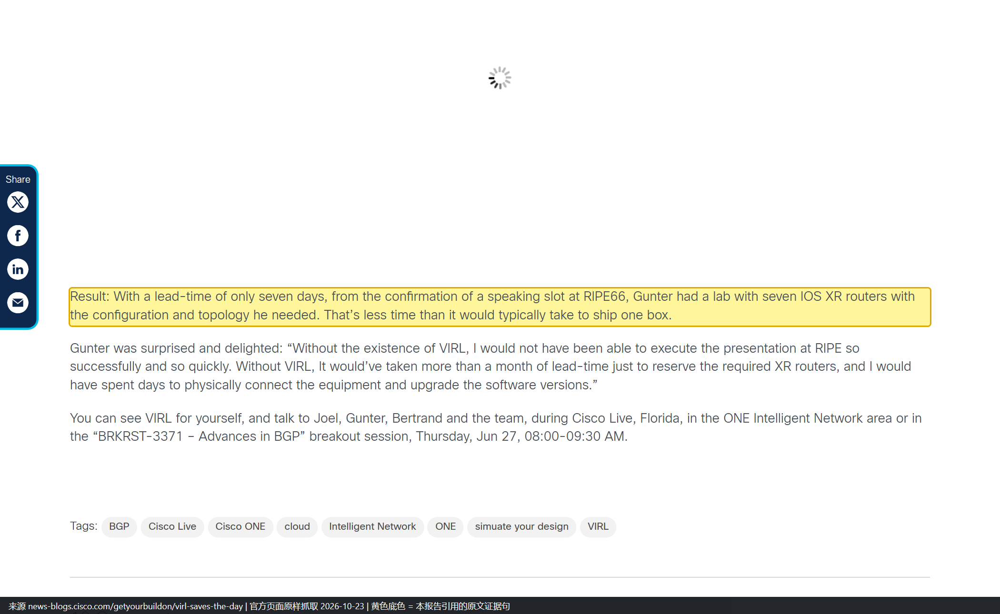

*页面截图（2026-10-23 抓取，黄底为引用句）。一句话里同时给了两个可核对的数字——周期七天、设备七台——这也是它够格记 L1 的原因。*

**注意代次**：这是 VIRL **1.0 之前**的形态（OpenStack + VM Maestro 图形界面，还不是 CML 2.x 的 HTML5 + API）。所以这条案例证明的是「仿真能救时间」，不能用来证明 CML 2.x 的操作方式。链接同上。

### 0.4.3 U6：给「还没通电的数据中心」先做一遍（2019）

机柜、供电都还要几周才好，但配置模板、自动化策略、上线验收测试必须先做——于是作者在沙箱目录里预留了一个 Multi-IOS 实例，几分钟内复刻出目标拓扑。四处差异逐条登记并处置（详细拆解见主报告 1.8.2）。**这条案例的价值不在工具，而在方法：先把差异登记在案，再判断哪些结论可以外推到生产。** 链接：[S15](https://blogs.cisco.com/cisco-devnet/automate-new-data-center)

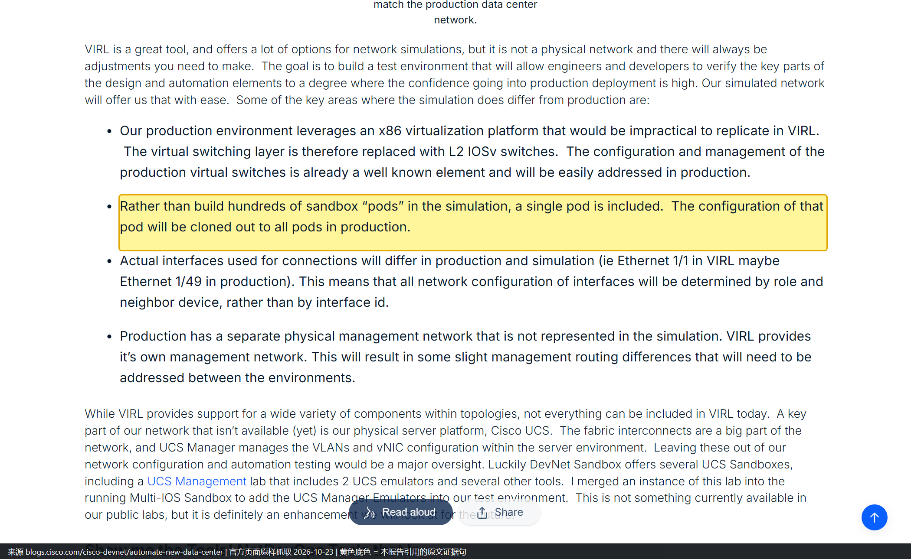

*页面截图（2026-10-23 抓取）。这一屏同时是主报告 1.8.2「四处差异」的原始出处：x86 虚拟化平台、只建 1 个 pod、接口编号不同、生产有独立物理管理网，四条都在同一屏里，黄底那条就是「1 个 pod + 克隆」。*

### 0.4.4 U7：把整个 Sandbox 数据中心搬进仿真，用来开发「网络服务化」

> **一句话**：这条案例不是「用 VIRL 练配置」，而是**把一个正在建设中的真实数据中心先在 VIRL 里建一遍，然后在仿真上把「逐台设备写配置」改成「描述一个 fabric 和一个 tenant」的自动化服务开发完**——服务一旦定稿，直接对着机房里的真设备跑。

**（1）上下文：它属于哪个项目**

| 项目 | 内容 |
| --- | --- |
| 谁 | Hank Preston，思科 DevNet Sandbox 团队（本人是团队里的 NetDevOps 推动者） |
| 什么项目 | 给 DevNet Sandbox 建**一座全新数据中心**：colo 机柜、统一到 Nexus 9000 + NX-OS 9.x、全冗余 access / distribution / border、每 pod 一台虚拟 ASA（替代原 context 共享模式）、配置由源真值（intent）驱动（S15 原文） |
| 时间压力 | 机柜、供电、上架要几周；而通电后按项目计划**几周内就要上系统与应用**——「By the time we power up the network, we need to have all the elements nearly 100% worked out」（S15） |
| VIRL 的角色 | 「NetDevOps Inception：**DevNet Sandbox 给 DevNet Sandbox 提供一个沙箱**」——先用 VIRL 复刻目标生产环境，把配置模板、自动化策略、上线验收测试全部在仿真里做完（S15） |
| 本篇（U7）与 U6 的区别 | U6 = 讲「为什么要先仿真、差异怎么登记」；U7 = 讲「在仿真上开发出来的东西长什么样、怎么建」 |
| 三篇的时间线 | 2019-09-11 准备自动化（S15 / U6）→ 2019-09-30 服务化后的使用体验（S16 Part 1）→ 2019-10-29 服务是怎么做出来的（S40 Part 2） |

**（2）在 VIRL 里到底建了哪些东西**

原文这句是全部依据：「you know that **we've actually used Cisco VIRL's platform to build an entire simulation for our data center topology**」（S16，01:50）。拆开看是四层结构：

| 区域 / 对象 | 原文怎么描述 | 说明 |
| --- | --- | --- |
| Internet edge | 顶部「our internet edge point, or we've got our internet as it comes through」 | 出网边界 |
| 防火墙层 | 「We've got our firewall layer that provides our secure edge as we come from the internet through the DMZ」；另一处写「our firewalls here are **actual VM's**, so we have a **DVS** that provides the connectivity for those」 | 防火墙在仿真里就是虚机，靠 DVS 接进来（生产侧同项目计划是「Virtual ASA Firewalls per pod」，S15） |
| DMZ 区 | 中部「a DMZ zone inside of our network here in the middle」 | |
| Internal 区 | 底部「our internal zone back here, which has got all of the workstations」 | 最大的一块 |
| L2 fabric ×3 | 「at our edge we have our **edge fabric**… underneath that we have our **DMZ fabric**… the largest one of our fabrics is down here at the bottom. It's our **internal fabric**」 | 每个分区一套二层域，这是后面所有服务的作用域 |
| Fabric 里的设备 | 「a series of **Nexus 9000's** that will provide the basic access distribution core or spine-leaf type of an architecture」+「V switches down here for the different VMs」 | 交换设备是 Nexus 9000 系列，VM 侧用虚拟交换机表示；**原文未写具体镜像型号**，CML 侧对应 9000v 家族属本报告推断 |
| Tenant | internal fabric 之上：**admin tenant**（AD、管理组件）与 **shared services tenant**（Sandbox 门户、网站），再往上是**每次预约就起一个 pod tenant**，每个 pod 自带防火墙 | 「every time you reserve a Sandbox, you get access to a pod」 |

**（3）「网络服务化」在这里的准确含义**

不是 NFV 那种「服务链」，而是**把网络当成一个可被描述的整机**。原文对比得很直白：

> 「I don't want to have to go through and **handcraft the configuration device by device**. I want to just **consider this an entire fabric** as it goes in.」（S16，03:28）
>
> 「Every time I add a new network, every time I add a new VLAN or Layer 3 segment, I don't want to have to go out and articulate individual changes device by device.」（S16，01:50）

落到代码上是**两个服务**，一层托一层：

| 服务 | 人只需要写什么 | 服务替你干了什么 |
| --- | --- | --- |
| `vlan-fabric` | 这个 fabric 由哪些设备组成、哪两台是 switch-pair、哪些口是互联口 | 建 vPC peer-link；把互联口做成 LACP port-channel 并配成 dot1q trunk；`layer3 true` 时在该 pair 上建 SVI + HSRP + OSPF；把 VLAN 推到 UCS 的 **vNIC 模板**、在 VMware **DVS 上建 port-group**（S41） |
| `vlan-tenant` | 这个 tenant 挂在哪个 fabric、有哪些 network（`vlanid` + 前缀）、哪些物理口接到这些 network | 在该 fabric 的**所有**设备上建 VLAN/SVI；给 tenant 建 **VRF**（当 network 要求三层落地）并可加静态路由；按固定规则算地址——「第 1 个地址给 HSRP、第 2 个给 primary 交换机、第 3 个给 secondary」（S40）；按 connections 配 access/trunk 口，连 jumbo frame 都一并带上 |

两个租户共享同一套物理基础设施，但「VRFs, VLANs, SPIs, all of that is going to be separate」——原文如此，按上下文这里应为 SVI（VLAN 三层接口），属转写笔误。

**（4）这两个服务是怎么做出来的（官方的四步法）**

| 步骤 | 做法 | 官方原话要点 |
| --- | --- | --- |
| 1 写伪代码 | 先从「用起来是什么感觉」倒推，白纸上写成 CLI 风格的伪代码 | 「the place I start is kind of the end state. What do I want it to feel like?」（S40） |
| 2 建 YANG 数据模型 | 用 `ncs make package` 生成 service 骨架，定义 `list vlan-tenant`、`leafref` 指向 fabric、VLAN ID 用 `uint16` + `range`、前缀用 `inet:ipv4-prefix` | 目的是**输入即校验**：「10.1.1.13/29… not a valid prefix」「Bob is clearly not an IPv4 prefix」（S40） |
| 3 生成配置模板 | 先手工在设备上配出终态，再把 NSO 导出的 XML 存成模板，变量写成 `${device-name}` / `${vlan-id}` | 选 XML 而非 CLI 文本，理由是校验能力（S40） |
| 4 Python 拼装下发 | 在 `service_create` 回调里遍历 `service.network`、`switch-pairs`，把模型实例的值塞进变量再 apply 模板 | 「same YANG model, no extra work, we automatically get that rest API」——一份模型同时给了 CLI 与 RESTCONF（S40） |

**（5）数据从哪来：不是手敲，是 NetBox 灌进去**

生产上真正驱动这两个服务的是源真值库。官方仓库 `netbox-scripts/` 写明了映射关系（S41）：

| NetBox 对象 | 对应到 |
| --- | --- |
| Tenant | `vlan-tenant` |
| VLAN Group | `vlan-fabric` |
| Tenant 下的 VLAN | tenant 里的 `networks` |
| VLAN 绑定的 prefix | network 的三层信息（网关/地址段） |
| 交换机接口的 Tagged / Untagged 标记 | tenant network 的 `connections` |
| LAG | connection 的 port-channel |

脚本 `nso_tenant_config.py` 就是干这件事的，原文说它服务于「the **hundreds of tenants**」——这也解释了为什么必须服务化：几百个租户逐台配是不可能的。

**（6）现场演示实际走了一遍什么（这是「仿真够用」的直接证据）**

| 步骤 | 动作（S16 视频转写；CLI 具体写法按 S41 仓库样例整理，转写本身是口语） |
| --- | --- |
| 1 | 进 NSO 配置模式，进 `vlan-tenant admin`，要新增一段网段 `ESXI Management` |
| 2 | 依次给出：VLAN ID `30`、前缀 `10.101.6.0/23`、连接对象是 switch-pair `leaf02`、接口 `1/20`、描述 `ESXI01`、模式 `trunk` |
| 3 | 提交前先证伪：`virl console LEAF02-2` 登进**仿真里那台交换机**，`show run interface ethernet 1/21-23`，确认还没有配置 |
| 4 | commit，回来看——配置已经在了；顺带暴露讲者自己少敲了 22 口（实际配的是 20、21、23） |
| 5 | 继续追加 vMotion 网段，再从零起一个私有 tenant（新的二层/三层域），看同一 fabric 下该变的设备是否都跟着变 |

第 3 步是关键：**仿真里能登进去、能 `show run`、能看到下发结果**，这正是「先用仿真把自动化开发完」能成立的前提。若仿真只是画画拓扑、设备不可登录，这条路走不通。

**（7）为什么这件事非得在仿真里做**

| 原因 | 依据 |
| --- | --- |
| 硬件还没通电 | 机柜/供电/上架要几周，等不了（S15） |
| 没有试错窗口 | 通电即上线，配置必须「接近 100% 想清楚」（S15） |
| 一次变更跨四个域 | 一个 tenant 同时动 Nexus、UCS、VMware、防火墙，只有完整拓扑才能验证这种跨域扩散 |
| 需要人对着结果核对 | 开发期要反复 `show run` 验证，真机不可得（S16 的 `virl console`） |

**（8）边界与一处更正**

- **不是性能验证**：全程只验证「配置意图有没有正确扩散到该扩散的地方」，没有任何吞吐、时延、收敛测试。这与 CML 官方硬边界一致（数据面 rate-limited、无同步 CPU 时钟），本报告 8.3 已单列。
- **一处必要更正（2026-10-23）**：本报告此前写「把**整套** Sandbox 数据中心搬进 VIRL」，更准确的说法是「把数据中心的**网络拓扑**（edge / DMZ / internal + 三类 fabric + 两层 tenant）建模进 VIRL，计算侧用虚拟交换机表示」。同时必须区分两件事——**博客里演示的开发环境是 VIRL**（S16 原文 + `virl console`），而**公开可下载的示例仓库改用 `netsim`**：「built using a network topology that resembles the actual DevNet Sandbox network **modeled with netsim**」（S41）。仓库为了让别人不用 VIRL 也能跑，把同一套拓扑用 NSO 自带的 netsim 复刻了。两者是同一设计的两套底座，**不能拿仓库的 netsim 去证明「VIRL 里跑过」**。
- **官方未公开**：VIRL 里的节点数量、镜像版本、宿主机规格；这套服务上线后实际接管了多少台生产设备；任何节省工时或降低配错率的量化数据。这些一律不回填。
- **置信度 L2 的理由**：有明确的人、明确的动作、可复现的代码与文档，但**没有任何量化结果**，也没有第三方旁证，够不上 L1。要升 L1 需要补一样东西：这套服务在真机房上线后的变更耗时/配错率前后对比。

链接：[S16 Part 1](https://blogs.cisco.com/developer/network-service-based-automation-1)（2019-09-30）、[S40 Part 2](https://blogs.cisco.com/cisco-devnet/network-service-automation-2)（2019-10-29）、[S41 sandbox-nso 仓库](https://github.com/DevNetSandbox/sandbox-nso)（2019-12）

*页面截图（2026-10-23 抓取，黄底为引用句）。**「整套数据中心拓扑先在 VIRL 里建一遍」这句唯一出处**。同一屏下方紧接 edge / DMZ / firewall / internal 四个分区的描述，可以连着读。*

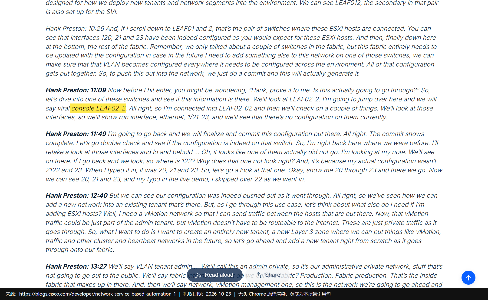

*页面截图（2026-10-23 抓取，黄底为引用句）。注意原文转写把命令写成了 `viral console`（应为 `virl console`），但设备名 `LEAF02-2` 与随后 `show run interface ethernet 1/21-23` 的结果对得上——这是「仿真设备可登录、可核对」的直接证据。*

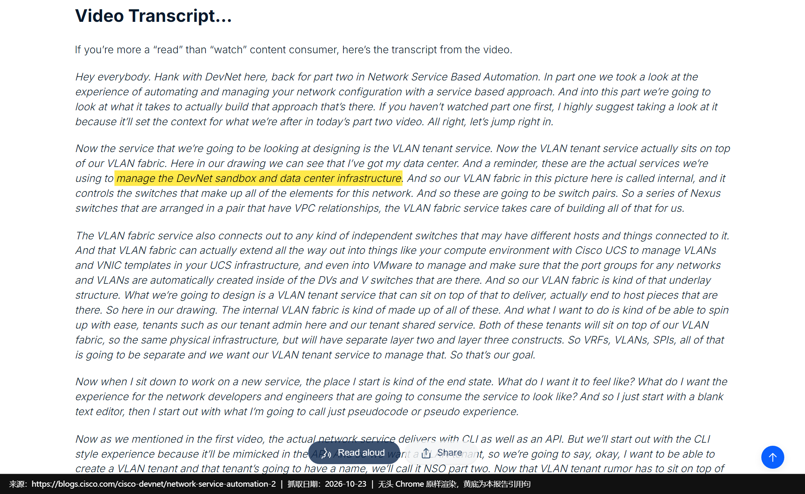

*页面截图（2026-10-23 抓取，黄底为引用句）。这句把性质钉死了：讲的是**真正在管 Sandbox 的那套服务**，不是玩具 demo。同屏还给出 vPC switch-pair、UCS vNIC 模板、VMware port-group 三个扩散方向。*

*页面截图（2026-10-23 抓取，黄底为引用句）。**这张图同时是「更正依据」**：README 明说可下载的示例用 netsim 复刻，而上方两条链接正指向 VIRL 演示的两篇博客——两套底座的分工在这屏里能一次看清，下方还附了拓扑图。*

**信源汇总**：[S16](https://blogs.cisco.com/developer/network-service-based-automation-1)（B，Hank Preston，2019-09-30，Part 1 正文 + 视频转写）、[S40](https://blogs.cisco.com/cisco-devnet/network-service-automation-2)（B，2019-10-29，Part 2 构建方法）、[S41](https://github.com/DevNetSandbox/sandbox-nso)（A，DevNetSandbox 官方仓库，服务定义与 netsim 说明）。

> **引用时别越界**：这条常被简化成「思科把自己的数据中心搬进了仿真」。可核实的是**网络拓扑与自动化开发流程**；数据中心里的服务器、存储、真实 UCS 硬件并没有被复刻，计算侧只到虚拟交换机这一层。

### 0.4.5 U2：内部攻防课，一次拉起 20 个可被攻破的 pod（2024）

这是**唯一一篇把「怎么用 CML 做多租户靶场」写透的官方文章**，也是与上一轮「pod 是什么」直接对应的实例：

| 维度 | 做法（原文） |
| --- | --- |
| 谁在用 | 思科 ASIG（Advanced Security Initiatives Group，负责全公司产品安全测试与道德黑客），课程名 Becoming a Hacker，学员以高校/高中网络安全实习生为主 |
| 用 CML 做什么 | 造一个「像本地机房」的网络给学员攻：真实交换机、路由器、防火墙，外加一段仿真 Wi-Fi；云网络本身锁得太死、行为也不同 |
| 怎么规模化 | 用 DevNet 的 Terraform 配置（`CiscoDevNet/cloud-cml`）把 CML 镜像云化；先试 AWS，因多台裸金属集群成本高，改到 **Google Cloud** |
| 量化结果 | 「when we run a Terraform command, 20 pods (virtualized labs) are ready for use」 |
| 安全措施 | 站点与思科内网隔离；强密码 + Duo MFA + Identity Aware Proxy；每 pod 限速数 Mbps；保留 DNS 与流量日志；每 pod 独立 IP 可追到人；出事可整站销毁重建 |
| 交付物 | 课程材料已开源到 GitHub（`becomingahacker`），但 CML 界面不对外开放 |
| 边界 | 原文明确：「While *Becoming a Hacker* is created by volunteers and is **not an official Cisco product**」——它是内部自愿者项目，不是官方产品 |

链接：[S17](https://blogs.cisco.com/learning/network-hacking-course-pairs-with-cisco-modeling-labs)（2024-11-01，Chris McCoy）

*页面截图（2026-10-23 抓取，黄底为引用句）。这是「20 个 pod」的唯一量化出处，也是全报告里唯一把「多租户靶场怎么规模化」写出来的句子。*

**这条案例同时印证了上一轮 pod 的含义**：这里的 pod = 一组供单个学员使用的、可被攻破的虚拟机集合，与 1.8.2 里「一套隔离的机房单元」是同一个词的两种粒度——**pod 的本质是「隔离 + 可复制的最小分配单位」，具体装什么由场景决定**。

### 0.4.6 U8：内部用法最后变成了对外产品（Sandbox 本身）

Multi-IOS 沙箱是公共预约入口，但官方仓库写明了它的底层：「It takes about 15 minutes to spin up the **VIRL servers** and your devbox」。也就是说，**思科把自己内部用的仿真服务器，做成了对外开放的预约服务**。链接：[S30](https://github.com/DevNetSandbox/sbx_multi_ios)、[S08](https://developer.cisco.com/docs/sandbox/)

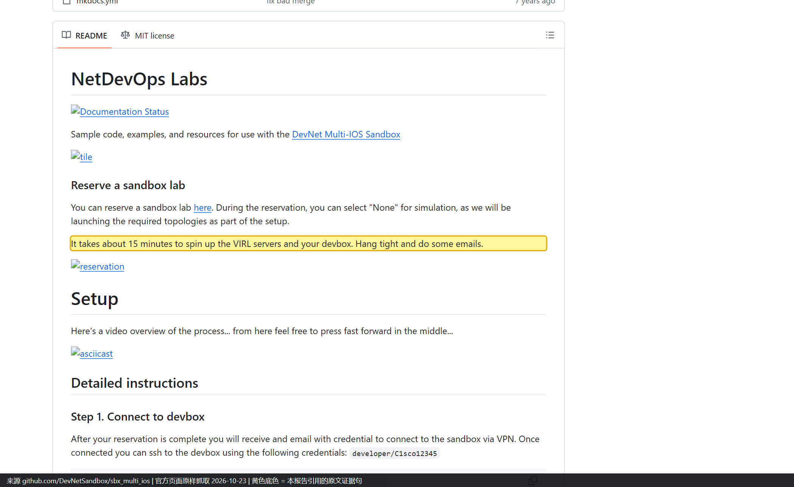

*页面截图（2026-10-23 抓取，黄底为引用句）。注意这句话的措辞是「VIRL servers」而不是「CML」——这条是「内部工具变对外服务」最直接的文字证据。*

### 0.4.7 U5：Sales / SE —— 没有真机时怎么讲方案（2015）

| 项目 | 内容 |
| --- | --- |
| 使用方 | 思科 Sales / Systems Engineer（本篇作者 Nick Radcliffe 本人） |
| 做了什么（官方原文） | 「In my mind this is the perfect learning tool for network engineers and can honestly say **it has helped me in my current role as a Systems Engineer many times**.」 |
| 可推知（**推论，本报告**） | SE 的用法是「讲之前先自己跑一遍」：把要演示的拓扑先搭出来、把要讲的路径先跑通，再去客户面前讲。依据链：作者身份是 SE（文章署名卡写明 Systems Engineer）→ 原文说「在现职帮了我很多次」→ 同一篇里作者强调「需要的网络资源点一下就绪」 |
| 不能确认 | 具体客户、演示次数、演示内容、是否替代过 POC |
| 置信度 | **L2**。原因：有明确身份 + 第一人称具体说法（「帮了很多次」），但没有项目、没有结果，够不上 L1 |
| 链接 | [S12](https://gblogs.cisco.com/uki?p=3998)（2015-11-23） |

*页面截图（2026-10-23 抓取，黄底为引用句）。这一屏的好处是**一句话 + 作者卡同框**：下方作者卡写着 Nick Radcliffe / Systems Engineer，正好把「说话的人是什么身份」也固定下来，不必只靠正文。*

> **引用时别越界**：这条常被拿去证明「思科销售团队把 CML 当标准售前工具」，但原文只支持「对一位 SE 的日常工作有帮助」。**从「一个 SE」推不到「整个 Sales 组织」**——后者在 S12 里只有「extensively used」这一句组织级表述，没有动作细节。

### 0.4.8 U9：Cisco Live 现场教学（2013 佛罗里达 + 2016 柏林）

| 项目 | 内容 |
| --- | --- |
| 使用方 | 思科 VIRL / DevNet 团队（在 Cisco Live 现场做演示与教学） |
| 2013（佛罗里达） | 在 **ONE Intelligent Network 展区**现场演示 VIRL：「the technology of the Virtual Internet Routing Laboratory (VIRL), that **we are demonstrating at Cisco Live in Florida**」；另在分会场 **BRKRST-3371《Advances in BGP》**（6 月 27 日 08:00-09:30）里讲 |
| 2016（柏林） | DevNet Zone 设**常设 Learning Lab 终端**，展会开放期间随到随练：「We have a VIRL Learning Lab in the DevNet Zone, so you can sit down at a Learning Lab terminal **any time the show is open**」；另有两场 DevNet Zone 场次（主剧场入门场「VIRL - Your network simulation swiss-army knife」+ 工作坊进阶场）、分会场 **BRKRST-3003**《Three Secrets of VIRL Networking》、讲师带做实验 **LTRRST-3003**《Dr. Evil's secret VIRL hands-on Lab》 |
| 同期平台数据 | 官方在 2016 那篇给出平台累计量：**10,000+ 用户**、**160,000+ 次仿真**、近 **100 万 VM 实例**、YouTube 5 万+ 播放 |
| 置信度 | **L2**。原因：两届的时间、展区、场次号、形式都能逐条核到；但没有学员数、没有课后评价、没有结果 |
| 链接 | [S13](https://news-blogs.cisco.com/getyourbuildon/virl-saves-the-day)（2013-06-25，Nathan Sowatskey）、[S14](https://community.cisco.com/t5/devnet-general-blogs/have-you-discovered-virl-yet/ba-p/3657936)（2016-02-09，Joel Obstfeld，VIRL 团队 Distinguished Engineer） |

*页面截图（2026-10-23 抓取，黄底为引用句）。这一屏是 2013 那一届的全部依据：既写了在 Cisco Live 佛罗里达演示，也交代了当时的形态（OpenStack + VM Maestro，还不是 CML 2.x 的 HTML5）。*

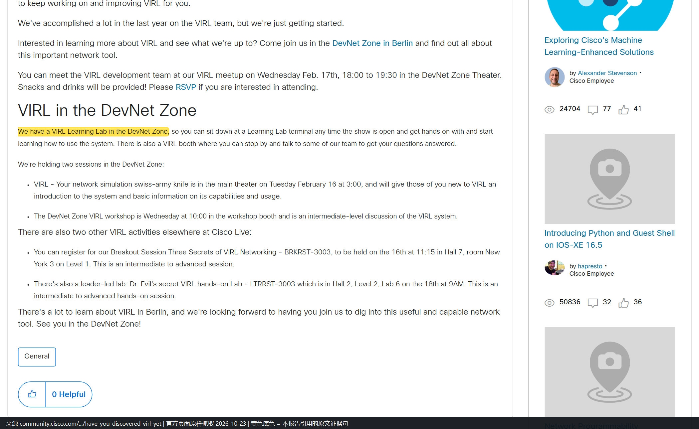

*页面截图（2026-10-23 抓取，黄底为引用句）。一屏里同时能看到 Learning Lab 那句、两场 DevNet Zone 场次、以及下方的 BRKRST-3003 与 LTRRST-3003 两个场次号——这是 2016 那一届四条形式的出处。*

> **这个数字别混用**：10,000+ 用户、160,000+ 次仿真、近 100 万 VM 实例是**平台累计用量**（2016 年 2 月口径），不是 Cisco Live 的听课人数，也不是任何单一场景的用量。报告里把它单列成「同期平台数据」一行，就是为了防止被当成案例成效。

> **一处自我更正（2026-10-23）**：本次补写时我一度把 U9 的时间从「2013、2016」改成只有 2016，理由是「2013 那条属于 RIPE66、与 Cisco Live 无关」。**核对 S13 原文后确认这个判断是错的**：该文明确写了「we are demonstrating at Cisco Live in Florida」与 BRKRST-3371 场次，2013 确实有 Cisco Live 的现场演示。现已改回「2013 + 2016」，并补了 S13 的截图。上一版撤掉 2013 是过度修正。

### 0.4.9 内部用法汇总

| 组织 / 角色 | 用它做什么 | 证据强度（案例编号） | 可复用点 |
| --- | --- | --- | --- |
| Advanced Services | 交付前设计验证（推论级，仅组织名） | L3（U19） | 用「同版本 OS + 控制面等价」替代客户真机 |
| TAC | 复现客户拓扑与故障（推论级） | L3（U20） | 复现优先，性能不指望 |
| Sales / SE | 讲方案前先自己跑一遍 | L2（U5） | 演示不依赖物流 |
| Cisco Live / DevNet Zone | 常设 Learning Lab + 分会场 + 讲师带做实验 | L2（U9） | 一套实验反复开班，靠模板 + 终端池 |
| SP 方案团队 | 大会演示救场（7 天 / 7 台 XR） | **L1（U1）** | 把「等设备」变成「等脚本」 |
| DevNet Sandbox 团队 | 预演未通电的数据中心、开发网络服务化、对外供给 | L2（U6、U7、U8） | 差异登记表 + 单 pod 克隆 |
| ASIG | 攻防靶场，20 pod 一键拉起 | **L1（U2）** | 隔离、限速、可溯源、可销毁 |

---

## 0.5 外部客户与合作伙伴怎么用

**本章覆盖的案例编号**：U3、U10、U21、U22、U23（U3 是 L1，排在最前一批，所以它出现在本章第 3 小节）。

### 0.5.1 U10：Verizon —— 唯一具名客户，而且主角不是 CML

| 项目 | 内容 |
| --- | --- |
| 场合 | Cisco Developer Days 2021（Cisco 官方开发者大会） |
| 讲者 | Damiano Imperatore（Verizon，Associate Fellow）＋ Houcheng Lee（Cisco，Software Consulting Engineer） |
| 主题 | How Verizon Streamlined NSO Development with Continuous Integration |
| CML 的角色 | 原文一句：「The containerized NSO makes testing several NSO packages in parallel possible and the **Cisco Modeling Lab (CML) creates a fully controlled environment for testing**.」 |
| 载体 | 官方新闻稿式条目 + 官方视频门户的客户故事栏目，含 YouTube 录像 |
| 未公开 | 并行几个包、CML 用多少节点、缩短多少时间、是否常态化 |

链接：[S18](https://community.cisco.com/t5/-/-/ta-p/4491759)、视频门户 [Cisco Video Portal 客户故事](https://video.cisco.com/category/videos/customer-stories____)

> **截图缺口（如实记录）**：本篇**没有截图**，两次尝试都失败。① `community.cisco.com` 对该文返回 Cloudflare 人机校验页而不是正文（Ray ID `a4edf154bc354c71`、`a4eddf795f9a939b`），无头浏览器过不去；② `video.cisco.com` 上的同一场次条目是纯前端渲染，抓到的只有空壳 HTML（约 3 KB），正文不出来。原文请点上面链接自行核对，本报告不放替代图。

**怎么读这条**：它证明「电信级客户会把 CML 放进 CI 链」，但**它没有证明 CML 在 Verizon 是核心**——主角是容器化 NSO，CML 提供的是「完全受控的测试环境」这一层。引用时别把它写成「Verizon 用 CML 做网络数字孪生」，那是超出原文的推论。

### 0.5.2 U21：官方承认有客户在做数字孪生，但只到「行业类型」

2026 年 4 月官方博客的原话：

> 「Major Cisco customers currently use CML to create digital twins of their networking infrastructure. This includes some of the world's most legally compliant, complicated systems, such as: Giant enterprise infrastructure systems. Complex global financial trade centers. Numerous IT consulting firms. Educational institutions.」

同时官方给了一句很关键的限定，值得直接拿来做预期管理：

> 「they're more like **fraternal twins or, sometimes, even cousins** — similar behavior, much of the same DNA, but with obvious differences.」

**能确认**：四类行业有客户在用，且「数字孪生」这个说法是官方自己用的。
**不能确认**：任何客户名、数量、规模、成效。链接：[S19](https://blogs.cisco.com/learning/cisco-modeling-labs-bringing-the-network-digital-twin-to-life)

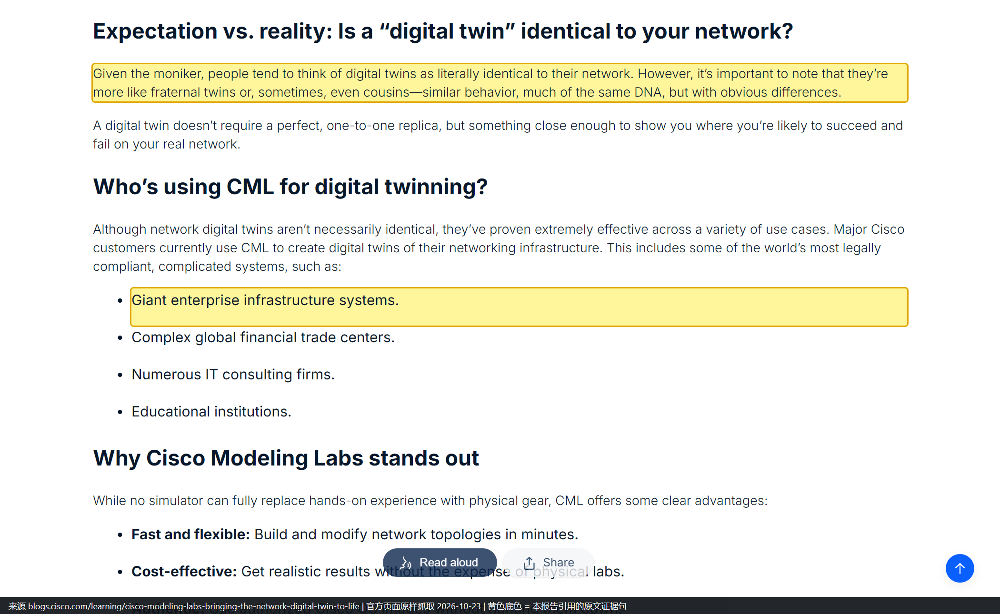

*页面截图（2026-10-23 抓取）。一屏同时拍到了两句关键话：上半是「更像异卵双胞胎、有时甚至是表亲」的限定，下半是四类行业客户（黄底为「大型企业基础设施」，下面三条是金融交易中心、IT 咨询、教育机构）。这就是 U21 能记 L3、也只能记 L3 的原因——有行业，没有名字。*

### 0.5.3 U3：SD-WAN 实验室部署工具 —— 客户能直接抄的一条路径

这是本报告里**最可操作**的外部案例，因为它有官方支持文档、开源工具、可照抄的参数：

| 维度 | 内容 |
| --- | --- |
| 工具 | SD-WAN Lab Deployment Tool（开源，BSD-3，托管在 GitHub） |
| 解决什么 | 以前要在 CML 里手动部署 SD-WAN 控制器与边缘、装证书、做自注册；工具把整条链自动化 |
| 效果表述 | 「This process is fully automated and takes **minutes, not hours**」 |
| 能建出什么 | SD-WAN Manager / Controller / Validator + 最多 **20 个 edge**；两条传输（Internet + MPLS）；可注入时延做 WAN 链路仿真；支持备份恢复 |
| 平台要求 | CML 可裸机、ESXi 或 AWS；**推荐本地 CML 集群**；工具本身只支持 Linux/macOS（Windows 需 WSL） |
| 规模上限 | 官方节点页：「This tool allows you to build **as many pods as your CML platform can host**」 |
| 已知限制 | 吞吐受限；要跑加密流量到 250 Mbps 以上需另购 HSEC 授权 |

链接：[S06](https://www.cisco.com/c/en/us/support/docs/routers/sd-wan/222057-sd-wan-lab-deployment-tool-for-cisco-mod.html)（2026-10-13 更新，未实测状态码）、[S05](https://developer.cisco.com/docs/modeling-labs/catalyst-sd-wan)

*页面截图（2026-10-23 抓取，黄底为引用句）。这一句是「效果表述」的原文，注意它是定性对比，没有给具体分钟数——报告里也照原文写「几分钟而不是几小时」。*

> **关于 S05 的抓取说明**：`developer.cisco.com/docs/modeling-labs/catalyst-sd-wan` 是前端渲染的文档壳，**首次抓取成功、复跑多次正文区为空**（同一 URL 会时好时坏）。下面的截图取自成功的那一次，图内可见左侧 CML 2.10 文档导航与正文，可确认不是别的页面。

*页面截图（2026-10-23 抓取，黄底为引用句）。同一屏上方还写着吞吐受限、加密流量 250 Mbps 以上要买 HSEC 授权——这正是 4.3 表格里「已知限制」那一行的出处。*

### 0.5.4 U22：dCloud 会话 —— 合作伙伴不用装 CML 也能用

同一篇支持文档给了 dCloud 路径：预约「CML - Catalyst SD-WAN 26.1 Lab Custom Topologies」会话 → AnyConnect 拨入 → 用同一套工具起 fabric。**这意味着售前场景里，CML 可以完全藏在云端，使用者只面对一个预约链接。**链接同 4.3。

*页面截图（2026-10-23 抓取，黄底为引用句）。这一屏是支持文档里讲 dCloud 的那一节，也是「合作伙伴不用自己装 CML」的官方落点。*

### 0.5.5 U23：CML Cloud PoC —— 官方替你把「典型用途」列成了三条

邀请制 PoC 的落地页把「理想用例」写得很直白，可作为官方口径的用例清单：

| 官方列的用例 | 具体说明 | 对应产品能力 |
| --- | --- | --- |
| 基础认证 | CCST、CCNA 学习，用轻量的 IOSv / IOL 镜像 | 低资源节点 |
| 自动化沙箱 | 常开的实验环境，拿 Python / Ansible / Terraform 打真 IOS | API + 工具链集成 |
| 轻量验证 | 建 SMB 拓扑、验 ACL、验 OSPF/BGP | 控制面等价 |

同页也把**不适合**写清楚了：仅 NAT 出网（无桥接）、排除 Cat9k / NX9k / XRv9k / SD-WAN / NGFW、16GB 内存。链接：[S10](https://mkto.cisco.com/cmlaas-app.html)

*页面截图（2026-10-23 抓取）。黄底是官方自己写的「理想用例」小标题，下面三条正是表格里的基础认证 / 自动化沙箱 / 轻量验证；再往下就是「Critical Details」里的排除项。这张图等于把官方口径的「能干什么、不能干什么」拍在一屏里。*

### 0.5.6 为什么外部案例这么少（**推论**）

| 观察（有出处） | 推论 | 依据链 |
| --- | --- | --- |
| 官方无 CML 客户案例库，唯一具名客户讲的是 NSO（S18） | CML 在客户侧多以「工具链里的一环」出现，不单独作为采购标的被宣传 | 产品定位是平台/工具 → 客户价值归因到 NSO、SD-WAN、自动化项目上 → 案例叙事自然落在那些产品上 |
| 官方 2026 博客只给行业类型不给名字（S19） | 客户对「公开说自己用仿真做变更验证」有顾虑（涉及内部流程与合规） | 数字孪生涉及生产拓扑与变更流程 → 属敏感信息 → 官方以行业类型代替客户名 |
| 大量「用例」出现在落地页与数据表而非案例（S02、S03、S10） | 官方更愿意卖「能力」，不愿意承诺「效果」 | 效果依赖客户自身流程成熟度 → 无法标准化承诺 → 营销停在能力层 |

**这条推论很重要**：它意味着你做立项时**不能指望「同行都在用」来背书**，只能用「能力—场景匹配」来论证。

---

## 0.6 教育与认证怎么用

**本章覆盖的案例编号**：U11、U12、U24（U11/U12 是 L2，U24 是 L3，所以 U24 反而排在 5.1）。

### 0.6.1 U24：高校采购方的用法（官方数据表口径）

| 官方列的收益 | 具体含义 | 依赖能力 |
| --- | --- | --- |
| 支撑远程教学 | 学生从任意地点做实验，不必进机房 | 浏览器接入 + 多用户 |
| 覆盖网络全生命周期 | 设计、配置、排障都能练 | 真实 OS 镜像 |
| 自动化建实验环境 | 教师用 API 批量预置学生实验 | API |
| 降低实验室预算与能耗 | 用一台服务器替代一屋子设备 | 虚拟化密度 |

授权方式**不是按节点、而是按「同时使用的具名用户数 + 安装服务器台数」**，节点数不设上限——这是教育版与个人版最关键的区别。官方许可条款原文（SEULA 第 4.4 条 CML-Education）：「Your Use Rights are based on (1) the number of **named Users** (CML-EDU-USER) using the Software **simultaneously** and (2) the number of Servers on which the CML Education Base (CML-EDU-BASE) Software is installed. **Nodes are unlimited**（but may be limited by the capacities of the User's chosen hosting platform）」。链接：[S36](https://www.cisco.com/c/dam/en_us/about/doing_business/legal/seula/Cisco-Modeling-Labs-SEULA.pdf)（许可条款）、[S04](https://www.cisco.com/c/en/us/products/collateral/cloud-systems-management/modeling-labs/at-a-glance-c45-744340.pdf)（对外的两页数据表）

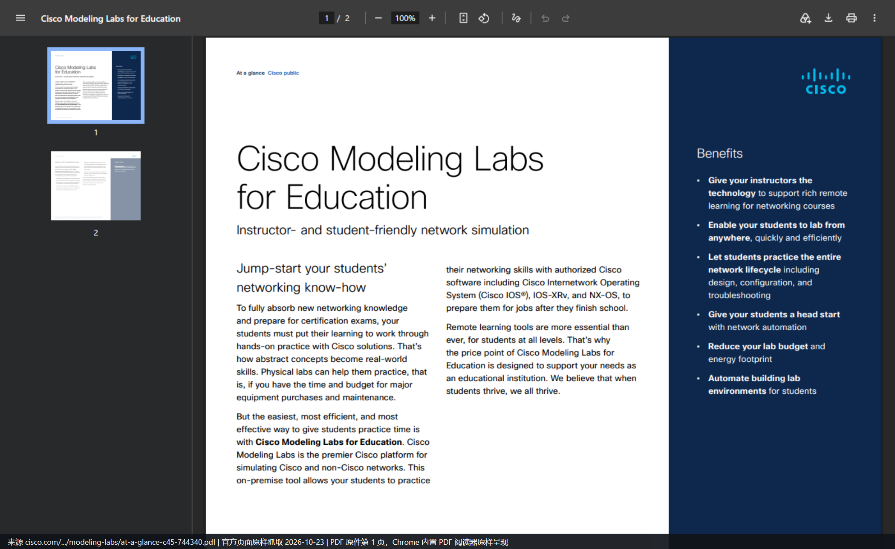

*PDF 原件截图（2026-10-23 抓取，Chrome 内置阅读器原样呈现，未做任何标注）。这一页就是「支撑远程教学 / 覆盖全生命周期 / 自动化建实验 / 降预算与能耗」四条收益的出处。*

*PDF 原件截图（第 2 页）。这一页补上了「学生可以在共享或独立实验里练习」与「教师可用 API 批量预置预配置实验」两条，对应上表第 3 行。*

> **PDF 未截图的部分**：授权计量条款（SEULA 第 4.4 条）在许可条款 PDF 里，本报告**没有给这一页截图**——该 PDF 共十余页、自动抓取没有定位到具体页码，只做了正文引用。要核对请直接点 [S36](https://www.cisco.com/c/dam/en_us/about/doing_business/legal/seula/Cisco-Modeling-Labs-SEULA.pdf) 搜「CML-EDU-USER」。

> **缺口**：官方没有公开任何一所学校的名字、部署规模或课程名单。学术侧的真实部署记录（Virginia Commonwealth University 的课程论文）属非官方信源，见附三。

### 0.6.2 U11：认证考生的用法

三处官方材料互相印证：

| 材料 | 说法 |
| --- | --- |
| 产品页 | 「Practice your skills and prep for certification exams from anywhere」 |
| Cisco U. 个人版页面 | 「Practice configuration and troubleshooting tasks in a realistic environment… the ideal setup for… certification preparation」；技能项含「Create models and what-if scenarios」「Connect virtual and physical environments」 |
| 2025-11 MCP 博客 | 明确点名 CCNA / CCNP / CCIE：描述想练的场景，AI 通过 MCP 把拓扑建好 |

链接：[S01](https://developer.cisco.com/modeling-labs)、[S09](https://u.cisco.com/labs/cisco-modeling-labs-personal-1)、[S25](https://blogs.cisco.com/learning/speak-your-lab-into-existence-with-ai-driven-cisco-modeling-labs-and-mcp)

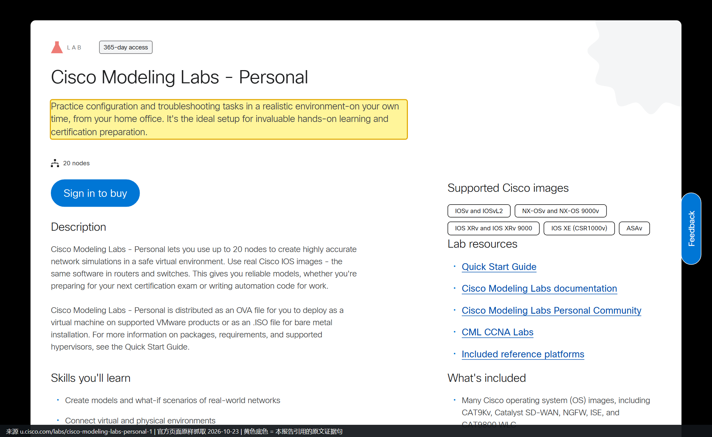

*页面截图（2026-10-23 抓取，黄底为引用句）。同一屏还能看到 20 节点上限、365 天访问期与支持的镜像清单，正好是 5.3 里个人版参数的另一处佐证。*

*页面截图（2026-10-23 抓取，黄底为引用句）。这是三处材料里唯一把三个认证等级同时点名的一处。*

> **S01 的截图缺口**：`developer.cisco.com/modeling-labs` 同样是前端渲染站，无头浏览器只拿到空壳（正文长度 0），「certification exams」那句**没有截图**。三处材料里已截到两处（S09、S25），足以互相印证。

### 0.6.3 U12：个人工程师的用法

官方给个人的路径有三条：Free（5 节点、无到期）、Personal（20 节点）、Personal Plus（40 节点）。官方博客面向个人写的就是「怎么从零把实验搭起来」，并明确「从入门到 CCNA/CCNP/CCIE 都够用」。链接：[S29](https://gblogs.cisco.com/pt?p=2217)、[S01](https://developer.cisco.com/modeling-labs)

*页面截图（2026-10-23 抓取，黄底为引用句）。葡萄牙语站点的英文原文，作者面向个人读者写的入门路径。*

---

## 0.7 工具链与生态怎么用（七条）

**本章覆盖的案例编号**：U4、U13、U14、U15、U16、U17、U18。

**本章同样是一条案例一幅官方页面截图**（U14 因 `netascode.cisco.com` 抓取超时，改用 Terraform 博客的截图，缺口在 6.3 单独标注）。

这七条的共同点是「工具链里的一环」：它们证明的不是「某家公司买了 CML」，而是**CML 能被接进 CI、Ansible、Terraform、NetBox、MCP、以及 SD-WAN / 安全 / 无线的自测拓扑**。按强度都是 L2（U4 是 L1 里最弱的一档，理由见 6.1），没有一条给出「省了多少时间 / 少了多少故障」这类结果。

### 0.7.1 U4：把 CML 当 CI 流水线的测试床（2022）

| 项目 | 内容 |
| --- | --- |
| 场合 | Cisco DevNet 博客系列第三篇《CI/CD Pipelines for Infrastructure Configuration and Management》 |
| 使用方 | 一个把网络配置搬进 GitLab CI 的 NetDevOps 团队（作者第一人称，未点名公司） |
| 做了什么 | 用 GitLab CE + runner（都跑在 Docker 里）做流水线；被测网络是 **CML 里的一组 Nexus 9000v**；Ansible 下发 OSPF；pyATS 在变更前后各拍一次快照并 diff |
| 流水线三段 | `pyats-pre-snapshot` → `deploy-OSPF` → `pyats-post-snapshot` |
| 可照抄的细节 | 完整 `.gitlab-ci.yml`；`pyats run job job.py --testbed-file cml_test.yaml`；`pyats diff pre_...json post_...json`；测试容器镜像 `adrianii/cicd-en:0.1.0` |
| 官方原文 | 「Ansible will be used to perform the configuration changes and **our test networking environment will be a set of Cisco Nexus 9000v virtual switches running in CML**.」「the testing stage of our CI/CD pipeline is done with pyATS」 |
| 置信度 | **L1**（最弱一档）。原因：它给的不是数字，而是**完整可复现的工件**——三段流水线定义、测试床文件名、diff 命令、容器镜像全在文中。这种证据能证明流程真跑过，但**不能证明省了多少时间** |
| 不能确认 | 团队与公司名、运行时长、是否常态化、流水线拦下过多少次错误 |
| 链接 | [S22](https://blogs.cisco.com/?p=416813)（2022-10-03，Adrian Iliesiu） |

*页面截图（2026-10-23 抓取，黄底为引用句）。这一屏把「CML 只当测试环境」这件事写得很清楚：被测对象是 Nexus 9000v，断言工具是 pyATS，CML 本身不参与判定。*

### 0.7.2 U13：Ansible 用动态清单把实验节点当主机管（2024）

| 项目 | 内容 |
| --- | --- |
| 场合 | Cisco Blogs「How to Use Ansible with CML」 |
| 使用方 | 用 Ansible 驱动 CML 实验的 NetDevOps 团队 |
| 做了什么 | 用 `cisco.cml` collection 的**动态清单插件**，把实验里的节点当成可寻址主机，批量下发配置 |
| 怎么配 | `ansible-galaxy collection install cisco.cml` → 在 inventory 写 `plugin: cisco.cml.cml_inventory` + `group_tags: network, ios, nxos, router` |
| 为什么需要动态清单 | 拓扑会变、可能同时存在多套拓扑；用 DHCP 或 CML 的 PATty 时，Ansible 得知道每个节点该连哪个地址 |
| 返回什么 | `cml_facts`：节点配置全文、CPU/内存、`node_definition`（如 csr1000v）、各接口 IP 与状态 |
| PATty 的接法 | 节点打 `pat:tcp:2020:22` 这类标签后，`ansible_host` 自动改成 CML 服务器地址，`ansible_port` 改成映射端口；`ansible:nso_api_port=2021` 这类标签可注入任意 fact |
| 官方原话 | 「The Ansible CML Collection has modules to create, start, and stop a topology and the hosts within it, but more importantly, **it has a dynamic inventory plugin for getting information about the topology**.」 |
| 一句值得注意的自述 | 「we often use them directly in the pipelines we build for customers」——**这是全篇最接近「客户项目在用」的一句**，但仍是作者视角，没有客户名 |
| 置信度 | **L2**。原因：插件名、参数、标签规则、内置 playbook（`cisco.cml.build`、`cisco.cml.inventory`）都能照抄，但没有「谁在什么项目里用成了什么」 |
| 链接 | [S21](https://blogs.cisco.com/learning/how-to-use-ansible-with-cml)（2024-01-17，Steven Carter） |

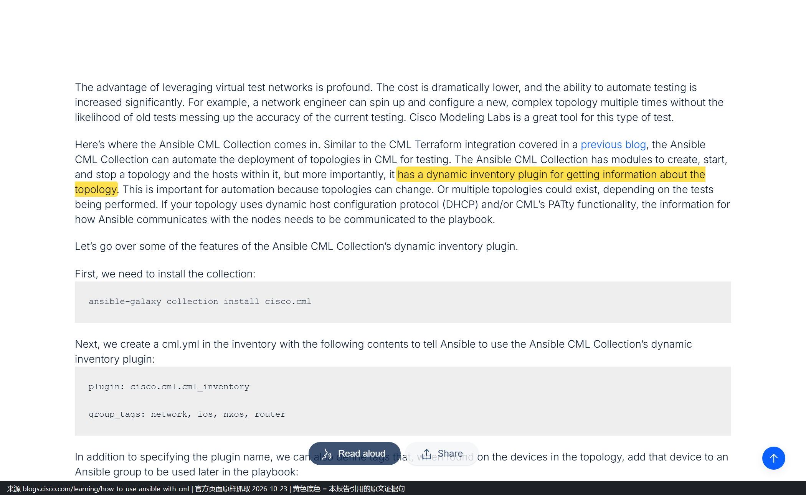

*页面截图（2026-10-23 抓取，黄底为引用句）。同一屏还给了安装命令与 `cml.yml` 的最小配置，属于「照着敲就能跑」的那一类证据。*

### 0.7.3 U14：Terraform 把 lab / node / link 当资源管（2022 起）

| 项目 | 内容 |
| --- | --- |
| 场合 | Cisco Blogs「Get Started With Terraform and Cisco Modeling Labs」；另见官方 Network as Code 文档把 CML 定位为学习与 **staging** 环境 |
| 使用方 | 把拓扑当代码（拓扑即代码）管理的平台/自动化团队 |
| 做了什么 | 用 `cml2` provider 把 labs、nodes、links 当资源声明；同一套 Terraform 先在 CML 里跑通，再走向生产 |
| provider 给到的资源 / 数据源 | 资源：Labs、Nodes、Links。数据源：Labs、Nodes、Links，以及可用节点与镜像定义、可用于外部连接器的桥、用户与组 |
| 官方自己标的限制 | 「NOTE: Currently, only a few data sources are implemented.」 |
| 官方原话 | 「**Terraform's list of providers now includes Cisco Modeling Labs (CML) 2**, so we can use Terraform to control virtual network infrastructure running on CML2.」 |
| 置信度 | **L2**。原因：资源模型、HCL 示例、限制说明都在，但没有量化结果 |
| 补充信源 | [S07](https://netascode.cisco.com/docs/guides/concepts/cml)（官方 Network as Code 文档，明确把 CML 当 staging 环境）。**该站 2026-10-23 抓取时报 ERR_TIMED_OUT，未能截图**，只作正文引用 |
| 链接 | [S38](https://blogs.cisco.com/learning/get-started-with-terraform-and-cisco-modeling-labs)（2022-12-22，Ralph Schmieder） |

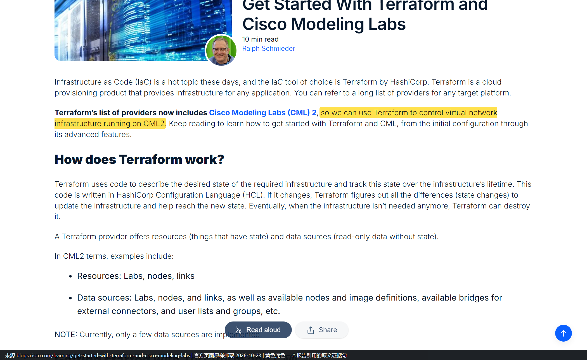

*页面截图（2026-10-23 抓取，黄底为引用句）。紧接下一段就是「Resources: Labs, nodes, links」，把「拓扑即代码」这句话落到了具体的资源类型上。*

### 0.7.4 U15：NetBox 与 CML 双向同步（2025）

| 项目 | 内容 |
| --- | --- |
| 场合 | Cisco Blogs「Two New Ways to Bring NetBox Into Your CML Networks」 |
| 使用方 | 用 NetBox 做 Source of Truth 的团队 |
| 路径一：NetBox 节点 | 官方 cml-community 仓库提供 **NetBox server 节点/镜像定义**：把 NetBox 拖进拓扑，节点启动时自动从 CML lab 读出站点、设备、IP、以及**节点之间的连线**并写入 NetBox |
| 路径二：cml2netbox | `pip install cml2netbox`，把已有的 NetBox（不必跑在 CML 里）与 CML lab 同步；有两个子命令：`sync device-types`、`sync lab` |
| 一个 lab 一个 Site | 每同步一个 CML lab 就建一个 NetBox Site，所以**一台 NetBox 可以承载 1 个、10 个甚至 100 个 CML 拓扑** |
| 已知限制（原文） | 只增不删：删除的节点/连线不会自动清理，要手工删；节点需通过 external connector 访问 CML REST API（NAT 方式还要先改 Cockpit 的防火墙规则）；默认口令与固定 API token 要自己改 |
| 官方原话 | 「A **CML node and image definition for a NetBox server**」「**CML2NetBox**, a Python utility that auto-populates NetBox based on a CML lab」 |
| 置信度 | **L2**。原因：两条路径、命令、默认值、限制都写全了，但没有量化结果 |
| 链接 | [S24](https://blogs.cisco.com/learning/two-new-ways-to-bring-netbox-into-your-cml-networks)（2025-12-12，Hank Preston） |

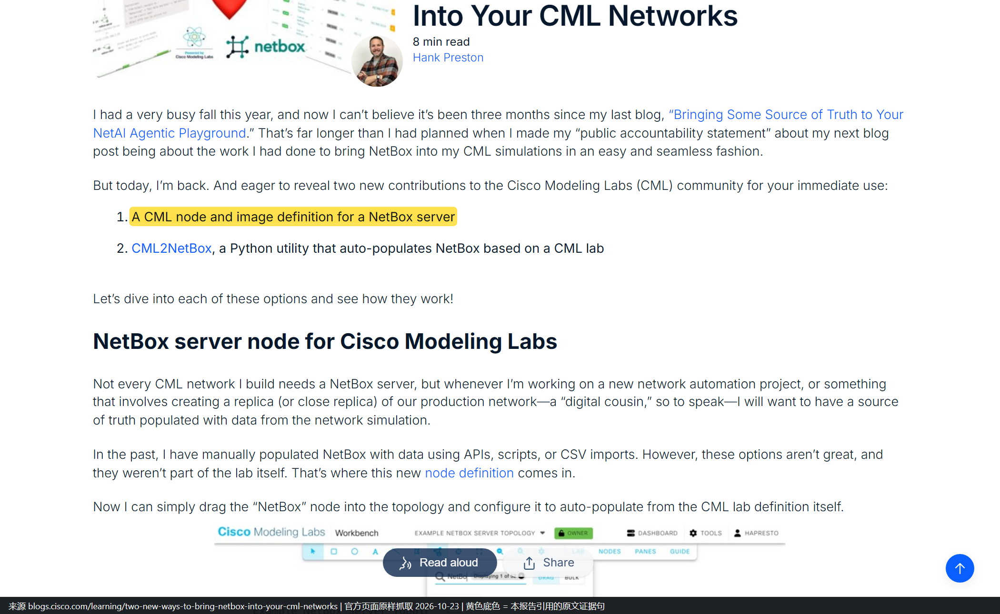

*页面截图（2026-10-23 抓取，黄底为引用句）。一屏同时给出两条路径的入口：上面是节点定义仓库，下面是 PyPI 上的 cml2netbox。*

### 0.7.5 U16：让 AI 助手直接操作实验（2025-11 起，2.10 内置）

| 项目 | 内容 |
| --- | --- |
| 场合 | CML 2.10 起内置 **MCP Server**；官方文档 MCP Server Overview + 2025-11 博客 |
| 使用方 | 用 AI 助手（Claude Desktop / Claude Code / Cursor 等）做实验的工程师 |
| 做了什么 | 用自然语言让 AI 建拓扑、起停 lab、改配置、开抓包、跑 CLI，不用点界面也不用写脚本 |
| 官方给到的 7 类工具 | ① Lab 管理（建/克隆/改/启停/擦除/删除，上传下载 YAML 拓扑）② Node 管理（加节点、改 startup config、取控制台历史）③ 接口与链路（建链路、配带宽/时延/抖动/丢包、启停接口）④ 可视化标注（文字、矩形、椭圆、连线）⑤ 抓包（起停、查状态、下载 PCAP）⑥ 用户与组（需管理员权限）⑦ 系统信息（版本、健康、资源、授权） |
| 三个必须知道的前提 | 服务名 `virl2-mcp-server`，**默认不启动**，要管理员在 Cockpit 里启用；**只在 controller 上跑**，集群 compute 节点没有；客户端需要 Node.js 18+ 以运行 `npx mcp-remote` 桥 |
| 官方原话 | 「The MCP server exposes a broad set of tools organized into the following categories.」 |
| 置信度 | **L2**。原因：工具分类、启用步骤、依赖都在官方文档里；但没有「谁用它做成了什么」的记录 |
| 链接 | [S39](https://pubhub.devnetcloud.com/media/cisco-modeling-labs-2-10/docs/guides/_build/html/mcp/mcp_overview.html)（官方文档，2.10）、[S25](https://blogs.cisco.com/learning/speak-your-lab-into-existence-with-ai-driven-cisco-modeling-labs-and-mcp)（2025-11-17，Joe Clarke） |

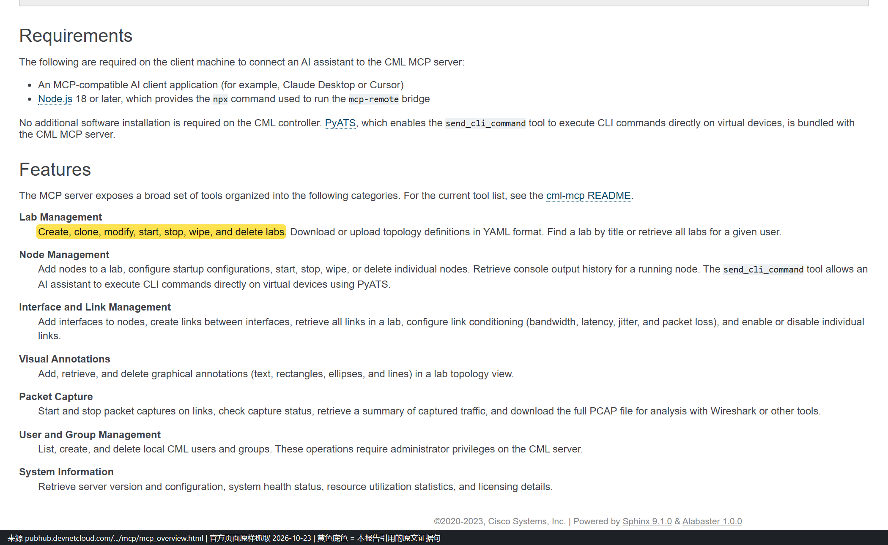

*页面截图（2026-10-23 抓取，黄底为引用句）。这一屏把 7 类工具一次列全，比博客里的概述更硬——要评估「AI 能替人做到哪一步」，应该看这一页而不是看演示视频。*

### 0.7.6 U17：Cisco Live 上教别人把 CML 接进 IaC（2023）

| 项目 | 内容 |
| --- | --- |
| 场合 | Cisco Live 2023（6 月 6-8 日）Catalyst 团队的 IOS XE 可编程与自动化场次 |
| 使用方 | 讲师（Cisco Catalyst 团队）与参会者（外部受众） |
| 相关场次 | **DEVNET-2119**《IaC with Catalyst 9000》；**BRKDEV-2467** / **BRKOPS-2455**《IaC and the Catalyst 9000 Virtual Switch》；**DEVWKS-2031**《Test Automation with Catalyst 9000 Virtual Switch》；**LTROPS-1836** 动手实验 |
| 官方原话 | 「we will use virtualization technologies like **CML and Docker** in order to virtualize and simulate common network topologies and configurations. **We will gain confidence in configuration management processes and tooling in the simulated lab and make the transition into production easier.**」 |
| 为什么这条值得单列 | 它是官方**主动教外部受众**「先仿真后生产」的一条记录——把 CML 写成通往生产的中转站，而不是替代品 |
| 置信度 | **L2**。原因：场次号、课程描述都在；但这只是**课程设计**，不是「学员回去做成了什么」 |
| 链接 | [S23](https://blogs.cisco.com/?p=435697)（2023-06-01，Story DeWeese，Technical Marketing Engineer） |

*页面截图（2026-10-23 抓取，黄底为引用句）。上方还能看到 BRKDEV-2467 / BRKOPS-2455 两个场次号与「Cisco Modelling Labs, Container Lab, KVM and Dockers… oh my!」的开场白。*

### 0.7.7 U18：方案自测能搭什么——官方参考平台清单（现行）

| 你要自测的东西 | 官方镜像 / 节点 | 版本 | 在哪张 ISO 上 |
| --- | --- | --- | --- |
| 身份认证（802.1X / 访客 / RADIUS） | **ISE**（Cisco Identity Services Engine） | 3.5.0 | **单独一张 `refplat-...-ise.iso`** |
| 无线控制器 | **CAT 9800-CL**（IOS XE-based wireless LAN controller） | 17.18.03 | supplemental ISO |
| SD-WAN 全套 | CAT SD-WAN Manager / Controller / Validator / Edge / vEdge | 20.18.2.1（Controller 为 20.18.2.1 ED） | supplemental ISO |
| 防火墙 | FMCv 10.0.1、FTDv 10.0.0、Meraki vMX | 见左 | supplemental ISO |
| 打流 / 链路损伤 | **TRex** 2.87、**WAN Emulator**（时延、抖动、丢包） | 见左 | FCS ISO |
| 服务器侧组件 | FreeRADIUS 3.2.7、Tacacs+ F4.0.4.28、Snort3 3.10.0.0、Splunk 10.4.1、ThousandEyes Agent 0.86.0 | 见左 | **单独的容器 ISO**（2.10 起拆分） |

**这张表最有用的三件事**：
1. **ISE 不在主 ISO 上**——要单独装 `-ise.iso`，做 802.1X 自测前先确认这一点，否则会以为镜像缺失。
2. **9800-CL 与 SD-WAN 在 supplemental ISO 上**，免费版（free ISO）只有 ASAv 与 IOL 系列（外加 Alpine / Ubuntu 等几个 Linux 镜像），**做不了无线与 SD-WAN 自测**。
3. **容器节点自 2.10 起单独发 ISO**，且要按 tag 锁版本（如 `v0.3.1`），不再跟主 ISO 走。

| 项目 | 内容 |
| --- | --- |
| 置信度 | **L2 的下沿**。原因：官方给了「能搭什么」的清单与版本，但没有「谁搭了、搭成什么样」的实录。**它是能力证据，不是案例证据** |
| 要说清的区别 | 表里每一行都是「镜像存在」，不等于「有人用它做过联调」；本报告没有找到任何一条「某团队用 CML 搭 ISE 做 802.1X 验证」的官方叙述 |
| 链接 | [S37](https://pubhub.devnetcloud.com/media/cisco-modeling-labs-2-10/docs/guides/_build/html/administration/bundled_images_nodedefs.html)（官方文档 Reference Platforms and Images）、[S05](https://developer.cisco.com/docs/modeling-labs/catalyst-sd-wan)、[S01](https://developer.cisco.com/modeling-labs) |

*页面截图（2026-10-23 抓取，黄底标出 CAT 9800-CL 与 ISE 两行）。这一屏正好把三张 ISO 的分工拍在一起：上面是 supplemental（9800-CL + SD-WAN），下面是单独的 ISE ISO——**这个分工是本节最有实操价值的结论**。*

### 0.7.8 七条工具链案例的对照表

| 编号 | 场景 | 你要准备什么 | 官方给到哪一步 | 强度 |
| --- | --- | --- | --- | --- |
| U4 | CI 门禁 / 回归 | GitLab + runner + pyATS + Ansible | 完整流水线 YAML、测试床文件、diff 命令 | **L1（可复现工件）** |
| U13 | Ansible 批量配置 | `cisco.cml` collection + 标签规范 | 插件名、`group_tags`、PATty 标签规则、内置 playbook | L2 |
| U14 | 拓扑即代码 | Terraform + `cml2` provider | 资源与数据源清单、HCL 示例、已知限制 | L2 |
| U15 | SoT 同步 | NetBox + external connector | 节点定义与 `cml2netbox` 两条路径、默认值、限制 | L2 |
| U16 | AI 助手操作实验 | MCP 客户端 + 管理员启用服务 | 7 类工具清单、启用步骤、依赖 | L2 |
| U17 | 教别人做 IaC | 场次材料 | 场次号、课程描述、目标 | L2 |
| U18 | SD-WAN / ISE / 无线自测 | 额外 refplat ISO + 足够内存 | 镜像清单与版本、三张 ISO 的分工 | L2（下沿） |

**一句话总结这一章**：七条里只有 U4 给了「照着敲就能复现」的完整工件，其余六条给的是**接口文档级**信息——能照着做，但不等于有人已经做成。**把它们当「可行性证据」而不是「成效证据」用，是这一章最该守住的界限。**

---

## 0.8 他们到底做成了什么：7 类动作

把 24 条记录按**动作**而不是按人归类，会发现所有案例都落在 7 个动作里。每类给「动作骨架」，可直接对照自己的流程。

### 0.8.1 A 类：验证设计（改之前先跑一遍）

| 项目 | 内容 |
| --- | --- |
| 动作骨架 | ① 把目标拓扑在 CML 里建出来 → ② 用同版本 OS 镜像 → ③ 跑设计假设（冗余是否收敛、路由策略是否生效）→ ④ 记录结论与差异 |
| 代表案例 | U6（未通电数据中心预演）、U19（交付前验证）、U21（客户数字孪生） |
| 依赖能力 | 参考平台镜像、链路损伤、抓包 |
| 边界 | 只验证控制面与配置逻辑；转发性能与时序不在结论范围内（官方明示不适合吞吐/时序测试） |

### 0.8.2 B 类：变更门禁（合入前必须过）

| 项目 | 内容 |
| --- | --- |
| 动作骨架 | ① 拓扑即代码（Terraform/Ansible）→ ② CI 里起实验 → ③ 变更前快照 → ④ 下发变更 → ⑤ 变更后快照 + diff → ⑥ 不通过就拦住 |
| 代表案例 | U4（GitLab + pyATS + Ansible）、U10（Verizon 的 NSO CI）、U13（Ansible 动态清单）、U14（Terraform staging） |
| 依赖能力 | REST API、Python 客户端、pyATS/Ansible/Terraform 集成 |
| 边界 | 门禁能拦「配置逻辑错」，拦不住「规模与硬件相关错」；测试用例本身要维护 |

### 0.8.3 C 类：故障复现（把现象搬进可控环境）

| 项目 | 内容 |
| --- | --- |
| 动作骨架 | ① 按客户/现网拓扑复刻 → ② 打同版本 OS → ③ 复现现象 → ④ 改配置验证假设 → ⑤ 结论回写现网 |
| 代表案例 | U1（SP 演示救场）、U20（TAC，仅组织级）、U21（排障场景） |
| 依赖能力 | 拓扑复刻、链路损伤、抓包、配置提取 |
| 边界 | 依赖硬件的行为（ASIC/TCAM/队列）复现不出来；时序类问题不可信 |

### 0.8.4 D 类：培训与认证（把人放进环境里）

| 项目 | 内容 |
| --- | --- |
| 动作骨架 | ① 做一套标准实验 → ② 用 API 批量复制成 N 份 → ③ 每人一份、互不干扰 → ④ 收回/销毁 |
| 代表案例 | U2（20 个攻防 pod）、U9（Cisco Live 动手实验）、U11（认证备考）、U24（高校教学） |
| 依赖能力 | 权限分级、资源池、API、模板化 |
| 边界 | 一份 pod 的吞吐只有数 Mbps（U2 原文），跑不了大流量课；镜像授权要逐个数（Windows 镜像不能公开分发） |

### 0.8.5 E 类：售前演示（不等物流）

| 项目 | 内容 |
| --- | --- |
| 动作骨架 | ① 预置拓扑 → ② 现场改两处配置演示差异 → ③ 需要时接真机（ext-conn） |
| 代表案例 | U5（SE 自述）、U22（dCloud 会话） |
| 依赖能力 | 外部连接器、快照/回滚 |
| 边界 | 演示可信度靠「真 OS」撑着，一旦被问吞吐就会露底，要提前划清话术 |

### 0.8.6 F 类：方案自测（把自家产品放进拓扑里联调）

| 项目 | 内容 |
| --- | --- |
| 动作骨架 | ① 起 SD-WAN / ISE / 无线控制器 → ② 接网络设备 → ③ 跑 onboarding、认证、策略 → ④ 验证互通 |
| 代表案例 | U3（SD-WAN 自动部署）、U15（NetBox 同步）、U16（MCP 驱动）、U18（SD-WAN 20 edge、ISE、9800-CL） |
| 依赖能力 | 参考平台、容器节点、API |
| 边界 | 吞吐受限（SD-WAN 需 HSEC 才能到 250 Mbps 以上）；部分产品不在免费/轻量授权镜像集内 |

### 0.8.7 G 类：攻防靶场（故意让它被打）

| 项目 | 内容 |
| --- | --- |
| 动作骨架 | ① 造含漏洞的靶机镜像 → ② 每学员一个 pod → ③ 限速 + 隔离 + 日志 + 独立 IP → ④ 用完整站销毁 |
| 代表案例 | U2 |
| 依赖能力 | 自定义镜像、资源限制、网络隔离 |
| 边界 | 必须与内网物理/逻辑隔离；镜像含第三方授权软件时不能公开发布 |

### 0.8.8 七类动作的分布

| 动作 | 案例数 | 最强证据 | 门槛（对使用方） |
| --- | --- | --- | --- |
| A 验证设计 | 3 | L2 | 中：要能复刻拓扑 |
| B 变更门禁 | 4 | **L1** | 高：要有 CI 与测试用例 |
| C 故障复现 | 3 | L1（U1 是演示不是故障） | 中：要能拿到同版本 OS |
| D 培训认证 | 4 | **L1** | 低-中：模板 + 分配 |
| E 售前演示 | 2 | L2 | 低 |
| F 方案自测 | 4 | **L1** | 中-高：要懂产品 |
| G 攻防靶场 | 1 | **L1** | 高：要安全隔离能力 |

---

## 0.9 应用场景归纳（基于上面的事实，不外推）

### 0.9.1 场景矩阵

判定口径：**「有人做成过」= 该场景至少有 1 条 L1/L2 案例；「官方能力支持」= 官方文档明确写了这条能力；两者都满足才进「高置信」。**

| 场景 | 有人做成过 | 官方能力支持 | 置信度 | 代表案例 | 主要失效条件 |
| --- | --- | --- | --- | --- | --- |
| 变更前验证（配置逻辑） | 是（L1/L2） | 是 | **高** | U4、U6、U14 | 变更涉及硬件/规模/时序 |
| CI 门禁与回归 | 是（L1） | 是 | **高** | U4、U10 | 无测试用例、无 CI |
| 认证与教学实验 | 是（L1/L2） | 是 | **高** | U2、U11、U24 | 需要高吞吐或特殊硬件 |
| 售前演示与 POC | 是（L2） | 是 | **高** | U5、U22 | 被追问性能指标 |
| 方案自测（SD-WAN / ISE / 无线） | 是（L1/L2） | 是 | **高** | U3、U18 | 需要授权镜像与足够内存 |
| 故障复现 | 是（L3/L2） | 部分 | 中 | U20、U21 | 硬件相关故障 |
| 攻防靶场 | 是（L1） | 是（自定义镜像 + 隔离） | 中 | U2 | 无隔离条件、镜像授权受限 |
| 数字孪生（全量镜像现网） | 是（L3） | 部分 | 中 | U21 | 现网规模大、硬件异构 |
| 吞吐 / 容量 / 时延测试 | **否** | **官方明确不适合** | **不成立** | — | 官方原文：not generally suitable for testing throughput or timing |
| 硬件特性验证（ASIC/TCAM/队列卸载） | **否** | **官方明确不支持** | **不成立** | — | 被截断在硬件抽象层 |
| 生产配置逐字节复用 | 部分 | 官方口径冲突 | 低 | — | 接口编号、平台差异、规模差异 |

### 0.9.2 六个高置信场景（可写进方案）

| # | 场景 | 一句话适用条件 | 预期收益的量化口径（官方给过的） |
| --- | --- | --- | --- |
| 1 | **变更前验证** | 你的变更 80% 是配置逻辑（路由策略、ACL、VPN、QoS 策略语法），且能复刻拓扑 | 官方只给过「几分钟建拓扑」「分钟级复刻」这类时间口径，**没有给过故障率下降数字** |
| 2 | **CI 门禁** | 已有 Git + CI，且能为每类变更写断言 | U4 给的是流程可行性，U10 给的是「并行测试多个 NSO 包」这一能力，均无时长数字 |
| 3 | **SD-WAN / 分支方案自测** | 需要 Manager/Controller/Validator + 多 edge，且能接受吞吐受限 | 「几分钟而不是几小时」（U3） |
| 4 | **培训与认证** | 学员数量大、要求人手一套、能接受数 Mbps 的实验流量 | U2「一次 Terraform 起 20 个 pod」 |
| 5 | **售前演示 / POC** | 客户要看的是一致性、可重复、可回滚，不是性能 | 无量化，仅流程证据 |
| 6 | **未上线环境预演** | 机房/设备还没到位，但配置与自动化必须先做 | U1「7 天 vs 1 个月」；U6「分钟级复刻目标拓扑」 |

### 0.9.3 三个必须否掉的场景（有官方原文支撑）

| 场景 | 为什么否 | 依据 |
| --- | --- | --- |
| 吞吐、容量、时延、抖动类验收 | 官方实测 IOSv 2.8 / 2.4 Mb/s、CSR1000v 1.6 / 1.52 Mb/s、CAT9000v 约 250 Kbps，且明示不适合吞吐与时序测试 | 主报告附六（A 级节点页） |
| 依赖 ASIC / 硬件卸载的特性（TCAM、队列、NetFlow 卸载等） | 官方：不做任何硬件平台仿真，被截断在硬件抽象层 | 主报告 6-0（A 级原文） |
| 把实验配置原样推生产 | 官方两处口径冲突（数据表说可复用，镜像页说可能不按预期工作），且接口编号、平台、规模都会变 | 主报告 6-7、6-9 三分法 |

### 0.9.4 怎么选（决策表）

| 你的处境 | 建议场景 | 不建议 |
| --- | --- | --- |
| 有 CI，变更频繁，缺测试环境 | 先做 B 类门禁（U4 的骨架） | 一上来做「全量数字孪生」 |
| 机房未就绪，交付期紧 | A 类预演 + 单 pod 克隆（U6） | 追求与生产 100% 一致 |
| 要培训 20-50 人 | D 类，模板 + Terraform（U2） | 手工逐台搭 |
| 要交付 SD-WAN 方案 | F 类，直接用官方工具（U3） | 自己写自动化脚本 |
| 要做攻防演练 | G 类，但先解决隔离与授权（U2） | 在办公网里直接跑 |
| 想做性能对比选型 | **换工具**（真机或专用测试仪） | 用 CML 的数字当结论 |

### 0.9.5 对自研/选型的五条启示（**推论，本报告**）

| # | 启示 | 依据链 |
| --- | --- | --- |
| 1 | 这类工具的价值锚点是「把等待变成脚本」，不是「省钱」 | U1 原文用的是时间（7 天 / 1 个月），不是成本；U6 原文只说时间来不及 |
| 2 | 规模化的关键不是节点数，是「一份模板 + 批量复制」 | U2 一次 20 pod、U3 as many pods as host can、U6 单 pod 克隆，三处都是复制逻辑 |
| 3 | 官方最愿意背书的场景是「验证」而非「替代」 | 产品页、数据表、数字孪生博客的用词都是 validate / verify / confidence，没有 replace production |
| 4 | 客户案例的缺失说明这类工具的采购动力来自「项目卡点」而非「工具本身」 | 24 条案例里 19 条挂在某个具体项目上（数据中心、SD-WAN、CI、课程） |
| 5 | 一旦要跨到「性能/硬件」维度，工具立刻失效，且官方不掩饰 | 节点页限速数字 + 硬件抽象层截断 + not suitable for throughput 三处一致 |

---

## 0.10 缺口清单（官方未公开，不补、不猜）

| # | 缺口 | 影响 | 现状 |
| --- | --- | --- | --- |
| 1 | 客户名单与数量 | 无法做同业对标 | 只有行业类型（S19）与 1 个具名客户（S18） |
| 2 | ROI / 节省金额 / 故障率变化 | 无法做投入产出测算 | 官方从未给出任何金额或比率 |
| 3 | TAC 与 Advanced Services 的具体流程与用量 | 无法复制内部最佳实践 | 只有一句组织级表述（S12） |
| 4 | 教育机构名单与课程规模 | 无法参考同类院校配置 | 数据表只有收益描述（S04） |
| 5 | Verizon 案例的规模与成效 | 无法判断该模式的可复制性 | 只有「并行测试多个 NSO 包」一句（S18） |
| 6 | 数字孪生的「同步机制」 | 无法评估现网数据怎么进 CML | 官方只给概念三段（采集/整合/仿真），无产品化路径（S19） |
| 7 | 内部攻防课的规模上限与成本 | 无法评估靶场方案 | 只有 20 pod 与「GCP 比 AWS 集群便宜」一句（S17） |

---

## 0.11 附一 时间线（2013-2026）

| 年份 | 事件 | 类型 | 信源 |
| --- | --- | --- | --- |
| 2013-05 | RIPE66 用 VIRL 预发布版演示 BGP DDoS 缓解，7 天搭 7 台 XR | 内部救场 | [S13](https://news-blogs.cisco.com/getyourbuildon/virl-saves-the-day) |
| 2013-06 | VIRL 在 Cisco Live 展出（OpenStack + VM Maestro） | 对外首秀 | [S13](https://news-blogs.cisco.com/getyourbuildon/virl-saves-the-day) |
| 2015-11 | VIRL 1.0 发布 | 产品化 | [S14](https://community.cisco.com/t5/devnet-general-blogs/have-you-discovered-virl-yet/ba-p/3657936) |
| 2016-02 | 官方披露：1 万+ 用户、16 万+ 次仿真、近 100 万 VM 实例；用途含 CCIE 备考与大学课程 | 用户规模 | [S14](https://community.cisco.com/t5/devnet-general-blogs/have-you-discovered-virl-yet/ba-p/3657936) |
| 2019-09 | DevNet Sandbox 团队用 VIRL 预演新数据中心（单 pod 克隆） | 内部工程 | [S15](https://blogs.cisco.com/cisco-devnet/automate-new-data-center) |
| 2021-10 | Verizon 在 Developer Days 讲 NSO CI，CML 作为受控测试环境 | 客户案例 | [S18](https://community.cisco.com/t5/-/-/ta-p/4491759) |
| 2022-10 | NetDevOps 团队把 CML 接进 GitLab CI：pyATS 前后快照 + Ansible 下发 OSPF，三段流水线可照抄 | 工具链 | [S22](https://blogs.cisco.com/?p=416813) |
| 2022-12 | Terraform 的 `cml2` provider 入门文发布，lab / node / link 正式当资源管 | 工具链 | [S38](https://blogs.cisco.com/learning/get-started-with-terraform-and-cisco-modeling-labs) |
| 2023-06 | Cisco Live 开 IaC 与 Catalyst 9000 Virtual 系列场次，把「先仿真再上生产」写成课程 | 教学 | [S23](https://blogs.cisco.com/?p=435697) |
| 2024-01 | Ansible `cisco.cml` collection 的动态清单用法公开（含 PATty 标签规则） | 工具链 | [S21](https://blogs.cisco.com/learning/how-to-use-ansible-with-cml) |
| 2024-11 | ASIG 用 CML + Terraform(GCP) 办攻防课，一次 20 个 pod | 内部培训 | [S17](https://blogs.cisco.com/learning/network-hacking-course-pairs-with-cisco-modeling-labs) |
| 2025-12 | CML 与 NetBox 双向同步（节点 + 工具） | 生态集成 | [S24](https://blogs.cisco.com/learning/two-new-ways-to-bring-netbox-into-your-cml-networks) |
| 2025-11 | MCP server 发布，自然语言建实验 | 能力扩展 | [S25](https://blogs.cisco.com/learning/speak-your-lab-into-existence-with-ai-driven-cisco-modeling-labs-and-mcp) |
| 2026-04 | 官方正式使用「网络数字孪生」表述，承认四类行业客户在用 | 定位升级 | [S19](https://blogs.cisco.com/learning/cisco-modeling-labs-bringing-the-network-digital-twin-to-life) |
| 2026-10 | SD-WAN 实验室部署工具支持文档更新（含 dCloud 路径） | 方案工具 | [S06](https://www.cisco.com/c/en/us/support/docs/routers/sd-wan/222057-sd-wan-lab-deployment-tool-for-cisco-mod.html) |

---

## 0.12 附二 信源总表

### 0.12.1 A 级（官方文档 / 产品页 / 数据表 / 支持文档 / 官方仓库）

| 编号 | 标题 | 类型 | 版本/日期 | 链接 | 支撑 |
| --- | --- | --- | --- | --- | --- |
| S01 | Cisco Modeling Labs（DevNet 产品页） | 产品页 | 2.10 | https://developer.cisco.com/modeling-labs | 四类用途宣称、NetDevOps 集成清单、个人/团队/教育授权 |
| S02 | Cisco Modeling Labs（cisco.com 产品页） | 产品页 | 2025 | https://www.cisco.com/c/en/us/products/cloud-systems-management/modeling-labs/index.html | 「设计/测试/排障」「备考」「NetDevOps」「教学」四类官方用途 |
| S03 | Cisco Modeling Labs for Enterprise（数据表 PDF） | 数据表 | — | https://www.cisco.com/c/dam/en_us/training-events/training/modeling-labs-for-enterprise.pdf | 企业侧五项收益、CI/CD 定位 |
| S04 | Cisco Modeling Labs for Education（数据表 PDF） | 数据表 | C45-744340-04 / 2023-02 | https://www.cisco.com/c/en/us/products/collateral/cloud-systems-management/modeling-labs/at-a-glance-c45-744340.pdf | 教育用例、按并发用户授权、API 预置实验 |
| S05 | Catalyst SD-WAN 节点页 | 文档站 | 2.10 | https://developer.cisco.com/docs/modeling-labs/catalyst-sd-wan | SD-WAN 全套节点、自动部署最多 20 edge、pod 数取决于宿主机、吞吐限制与 HSEC |
| S06 | Deploy SD-WAN via SD-WAN Lab Deployment Tool and Modeling Labs | 支持文档 | ID 222057 / 2026-10-13 | https://www.cisco.com/c/en/us/support/docs/routers/sd-wan/222057-sd-wan-lab-deployment-tool-for-cisco-mod.html | 工具能力、分钟级、dCloud 会话路径 |
| S07 | CML Virtual Labs（Network as Code） | 官方文档站 | 现行 | https://netascode.cisco.com/docs/guides/concepts/cml | CML 作为 NaC 学习环境与 staging 环境、cml2 provider、nac-test |
| S08 | DevNet Sandbox 技术文档 | 文档站 | 现行 | https://developer.cisco.com/docs/sandbox/ | Always-On 与 Reservation 两类沙箱规则 |
| S09 | Cisco Modeling Labs - Personal（Cisco U.） | 课程/商店页 | 2025 | https://u.cisco.com/labs/cisco-modeling-labs-personal-1 | 个人版用途与技能项 |
| S10 | CML Cloud Phase 1 PoC | 落地页 | 2026 | https://mkto.cisco.com/cmlaas-app.html | 三类理想用例、明确的排除项 |
| S11 | VIRL and NX-OSv（DevNet 文档） | 文档站 | 归档 | https://developer.cisco.com/docs/nx-os/virtual-internet-routing-lab-virl-and-nx-osv | VIRL 用于学习 NX-API REST、联调外部网络 |
| S30 | DevNetSandbox/sbx_multi_ios | 官方仓库 | 持续 | https://github.com/DevNetSandbox/sbx_multi_ios | 沙箱底层拉起 VIRL servers |
| S36 | Cisco Modeling Labs SEULA（Offer Description / 许可条款） | 官方法律文档 | 现行 | https://www.cisco.com/c/dam/en_us/about/doing_business/legal/seula/Cisco-Modeling-Labs-SEULA.pdf | 5.1：CML-Education 按「具名用户同时使用数 + 服务器台数」授权、节点不限；同文档另给 Enterprise 与 Personal 的授权口径。**2026-10-23 补录**——写 5.1 授权段落时核实原文才找到，此前该说法被误挂在 S04 数据表上，已更正 |
| S37 | Reference Platforms and Images（CML 2.10 文档） | 文档站 | refplat-20260409 / 20260611-supplemental / 20260326-ise | https://pubhub.devnetcloud.com/media/cisco-modeling-labs-2-10/docs/guides/_build/html/administration/bundled_images_nodedefs.html | 6.7：ISE 3.5.0 在单独 ISO；CAT 9800-CL 与 SD-WAN Manager/Controller/Validator/Edge 在 supplemental ISO；容器节点自 2.10 起单独发 ISO |
| S39 | MCP Server Overview（CML 2.10 文档） | 文档站 | 2.10 | https://pubhub.devnetcloud.com/media/cisco-modeling-labs-2-10/docs/guides/_build/html/mcp/mcp_overview.html | 6.5：7 类 MCP 工具、服务名 `virl2-mcp-server` 默认不启动且只在 controller 上跑、客户端需 Node.js 18+ |
| S41 | DevNetSandbox/sandbox-nso | 官方仓库 | 2019-12 起 | https://github.com/DevNetSandbox/sandbox-nso | U7：`vlan-fabric` / `vlan-tenant` 的服务定义与样例配置、`make dev-fabric` 起 3 fabric + 8 tenant、NetBox → NSO 的六条映射、NSO 5.2.0.3 与 6 个 NED 清单；**关键更正依据**——示例拓扑写明 `modeled with netsim`，不是 VIRL |

### 0.12.2 B 级（官方博客 / 社区 / 视频 / 议程）

| 编号 | 标题 | 作者 | 日期 | 链接 | 支撑 |
| --- | --- | --- | --- | --- | --- |
| S12 | VIRL to the rescue! – Built by engineers for engineers | Nick Radcliffe（Cisco SE） | 2015 | https://gblogs.cisco.com/uki?p=3998 | U5、U19、U20：Advanced Services / TAC / Sales 在用 |
| S13 | VIRL Saves the Day! | Nathan Sowatskey | 2013-06-25 | https://news-blogs.cisco.com/getyourbuildon/virl-saves-the-day | U1：7 天 / 7 台 XR / 对比 >1 个月 |
| S14 | Have you discovered VIRL yet? | Joel Obstfeld（DE，VIRL 团队） | 2016-02 | https://community.cisco.com/t5/devnet-general-blogs/have-you-discovered-virl-yet/ba-p/3657936 | U9；用户与仿真规模；CCIE 与大学用法 |
| S15 | Preparing to Automate a New Data Center for DevNet Sandbox | Hank Preston | 2019-09-11 | https://blogs.cisco.com/cisco-devnet/automate-new-data-center | U6 |
| S16 | Network Service Based Automation Part 1 – The Experience | Hank Preston | 2019-09-30 | https://blogs.cisco.com/developer/network-service-based-automation-1 | U7：VIRL 复刻整个数据中心拓扑、三类 L2 fabric、admin / shared services / pod tenant、`virl console` 登入核对。**2026-10-23 第二轮更正**：此前记的 `blogs-np.cisco.com` 会跳 Google 登录，主站这个地址已实测可开并已上图，故改挂主站地址 |
| S40 | Network Service Based Automation Part 2 – Building Services | Hank Preston | 2019-10-29 | https://blogs.cisco.com/cisco-devnet/network-service-automation-2 | U7：服务四步法（伪代码 → YANG → XML 模板 → Python）、leafref/range 校验、HSRP 地址分配规则、YANG 自动带出 RESTCONF |
| S17 | Network Hacking Course Pairs with Cisco Modeling Labs | Chris McCoy（ASIG） | 2024-11-01 | https://blogs.cisco.com/learning/network-hacking-course-pairs-with-cisco-modeling-labs | U2：20 pod、GCP、隔离措施、非官方产品声明 |
| S18 | Developer Days 2021: How Verizon Streamlined NSO Development with CI | Cisco Community（Verizon + Cisco 讲者） | 2021-10-25 | https://community.cisco.com/t5/-/-/ta-p/4491759 | U10 |
| S19 | Cisco Modeling Labs: Bringing the Network Digital Twin to Life | Ralph Schmieder | 2026-04-15 | https://blogs.cisco.com/learning/cisco-modeling-labs-bringing-the-network-digital-twin-to-life | U21：四类行业客户、孪生不等于克隆 |
| S20 | Automation, Learning, and Testing Made Easier with CML Enterprise v2.0 | Joe Clarke | 2022 前后 | https://blogs.cisco.com/developer/automation-with-cml2 | API-first、IaC 流水线定位 |
| S21 | How to Use Ansible with CML | Steven Carter | 2024-01-17 | https://blogs.cisco.com/learning/how-to-use-ansible-with-cml | U13 |
| S22 | CI/CD Pipelines for Infrastructure Configuration and Management, Part 3 | Adrian Iliesiu | 2022-10-03 | https://blogs.cisco.com/?p=416813 | U4：GitLab + pyATS + Ansible 具体流水线 |
| S23 | Automate with Cisco IOS XE at Cisco Live | Story DeWeese（TME） | 2023-06-01 | https://blogs.cisco.com/?p=435697 | U17：CML + Docker 做 IaC 验证场次 |
| S24 | Two New Ways to Bring NetBox into Your CML Networks | Hank Preston | 2025-12-12 | https://blogs.cisco.com/learning/two-new-ways-to-bring-netbox-into-your-cml-networks | U15 |
| S25 | Speak Your Lab into Existence with AI-Driven CML and MCP | Joe Clarke | 2025-11-17 | https://blogs.cisco.com/learning/speak-your-lab-into-existence-with-ai-driven-cisco-modeling-labs-and-mcp | U11、U16 |
| S26 | The Peloton Approach to CCNA Exam Success | Kareem Iskander | 2025-11-18 | https://blogs.cisco.com/learning/the-peloton-approach-to-ccna-exam-success | 备考场景（AI + CML） |
| S27 | Streamlining CML Testing with Python, Tkinter, and Community Innovation | Hari Natarajan 等 | 2026-03-26 | https://blogs.cisco.com/learning/streamlining-cml-testing-with-python-tkinter-and-community-innovation | 教师/学生批量生成配置 |
| S28 | Cisco Modeling Labs: Labbing Made Easy | Cisco Learning | CML 2.4 时期 | https://blogs.cisco.com/learning/cisco-modeling-labs-labbing-made-easy | 学习/测试/排障三类用法、集群对教学的意义 |
| S29 | Introduction to Cisco Modelling Lab (CML) | Cisco 葡萄牙博客 | 2021 | https://gblogs.cisco.com/pt?p=2217 | U12：个人从零上手、CCNA/CCNP/CCIE |
| S31 | Cisco Modeling Labs 标签归档 | Cisco Blogs | 持续 | https://blogs.cisco.com/tag/cisco-modeling-labs | 确证官方博客序列共 9 篇（2024-12 至 2026-04） |
| S38 | Get Started With Terraform and Cisco Modeling Labs | Ralph Schmieder | 2022-12-22 | https://blogs.cisco.com/learning/get-started-with-terraform-and-cisco-modeling-labs | 6.3：`cml2` provider 的资源与数据源清单、已知限制（only a few data sources are implemented） |

### 0.12.3 C 级（非官方，仅作旁证，不进案例总表）

| 编号 | 标题 | 类型 | 链接 | 用途 |
| --- | --- | --- | --- | --- |
| S32 | From Classroom to Career with Practical Network Training（Virginia Commonwealth University） | 学术论文（ASEE） | https://nemo.asee.org/public/conferences/344/papers/43918/view | 旁证：高校确实用 CML for Education 建课程实验（含设计/配置/排障/攻防/IoT） |
| S33 | Why CML Earned a Permanent Spot in My Workflow | 个人博客 | https://mikedent.io/post/2026/4/cisco-modeling-labs-workflow/ | 旁证：个人工程师用于设计、迁移、带新人 |
| S34 | NetBox Labs at Cisco Live US 2024 | 厂商博客 | https://staging.netboxlabs.com/blog/viva-las-vegas-netbox-labs-at-cisco-live-us-2024/ | 旁证：Cisco 场次 LTROPS-3518 用 NSO + CML + NetBox + Ansible（Cisco 讲师） |
| S35 | Cisco VIRL: More Than A Certification Study Lab | 媒体评测 | https://www.networkcomputing.com/networking-training-certifications/cisco-virl-more-than-a-certification-study-lab | 旁证：早期第三方对 VIRL 能力的独立评价与限制 |

---

## 0.13 附三 可复现的检索式

| 目的 | 检索式（短语建议加半角引号做精确匹配） | 命中 |
| --- | --- | --- |
| 找官方案例 | `Cisco Modeling Labs use cases official site:cisco.com` | 产品页、数据表、DevNet 页 |
| 找客户故事 | `Cisco Modeling Labs CML customer story case study used CML` | 仅 Verizon 一条 |
| 找内部用法 | `Cisco IT Cisco on Cisco internal Modeling Labs VIRL test lab blog` | 标签归档页（9 篇） |
| 找量化结果 | `VIRL Cisco TAC reproduce customer issue lab blog official` | 2013 救场文（7 天 / 7 台 XR） |
| 找方案工具 | `CiscoDevNet sd-wan lab deployment tool CML github official automation` | 支持文档 222057 + 节点页 |
| 找教学 | `Cisco Modeling Labs education university classroom teaching blog blogs.cisco.com` | 教育数据表 + CML 博客系列 |
| 找 CI 门禁 | `Cisco Modeling Labs CI/CD pipeline GitLab pyATS Ansible blogs.cisco.com` | S22（GitLab 三段流水线） |
| 找 Ansible 集成 | `Cisco Modeling Labs Ansible dynamic inventory cisco.cml collection` | S21（动态清单插件） |
| 找 Terraform 集成 | `Cisco Modeling Labs Terraform cml2 provider get started` | S38（provider 入门）、S07（NaC 文档） |
| 找 SoT 同步 | `Cisco Modeling Labs NetBox sync cml2netbox node definition` | S24（节点 + 工具两条路径） |
| 找 AI / MCP | `Cisco Modeling Labs MCP server natural language lab` | S39（官方文档 7 类工具）、S25（博客） |
| 找镜像清单（能不能自测 ISE/9800） | `Cisco Modeling Labs reference platforms images ISE 9800-CL refplat ISO` | S37（三张 ISO 分工） |

---

## 0.14 核验行

- **行数**：1026 行
- **表格数**：56 张，逐行列数比对全部一致
- **图数**：29 张官方页面截图（存 `case-evidence-images/`，第 3-6 章各案例小节内嵌）+ 0 张 Mermaid（正文结构仍用表格表达）
- **链接处数**：132 处（去重 42 个），全部为可点击的原始 URL
- **信源条数**：A 级 16 条（S01-S11、S30、S36、S37、S39、S41）、B 级 21 条（S12-S29、S31、S38、S40）、C 级 4 条（S32-S35，不进案例总表），合计 41 条
- **案例覆盖完整性（2026-10-23 补齐）**：**U1-U24 共 24 条，全部有独立小节**——第 3 章 9 条（U1、U2、U5-U9、U19、U20）、第 4 章 5 条（U3、U10、U21-U23）、第 5 章 3 条（U11、U12、U24）、第 6 章 7 条（U4、U13-U18）。编号→小节对照表在第 2 章表头下方。唯一共用截图的是 U19/U20：两者证据同源（同一句原文），已在该节写明原因
- **截图取证方式**：无头 Chrome（155）经 DevTools 协议逐页渲染官方页面 → 用 JS 在 DOM 中定位被引用的原文句并加黄底 → 滚动到可视区（最多校正 8 次，防懒加载顶偏）→ 整屏截图 1400×860 @1.5x → 图底部注入黑条，写明来源 URL、抓取日 2026-10-23 与「黄色底色 = 证据句」。截图**未做任何裁剪或文字修改**，只加了高亮与来源条
- **截图缺口（3 处，如实记录）**：① U10（S18，`community.cisco.com` 的 `ta/p` 类帖子返回 Cloudflare 人机校验，`video.cisco.com` 同场次页面为纯前端空壳）；② S07（`netascode.cisco.com` 报 ERR_TIMED_OUT，U14 改用 S38 的博客截图替代，S07 只作正文引用）；③ S01（`developer.cisco.com/modeling-labs` 前端渲染壳，多次抓取正文为空）。**U7 的缺口已关闭**：2026-10-23 第二轮发现主站地址 `blogs.cisco.com/developer/network-service-based-automation-1` 与 `blogs.cisco.com/cisco-devnet/network-service-automation-2` 均可正常渲染（此前只试了 `blogs-np.cisco.com` 与一个 404 的路径），已补 4 张截图
- **社区站的可达性细分（2026-10-23 复核）**：同一个 `community.cisco.com`，**博客帖（`t5/.../ba-p/...`）用真实浏览器能正常打开并已上图**（S14 → U9），而**通告类（`t5/-/-/ta/p/...`）仍被人机校验拦住**（S18 → U10）。所以此前「整个社区站抓不到」的说法不成立，已按实际情况细分
- **案例条数**：24 条（U1-U24），**编号按证据强度重排（L1 = U1-U4、L2 = U5-U18、L3 = U19-U24）**；按使用方归属另算：内部 9 条（U1、U2、U5-U9、U19、U20）、外部客户与合作伙伴 5 条（U3、U10、U21-U23）、教育与认证与个人 3 条（U11、U12、U24）、跨内外部的工具链与生态 7 条（U4、U13-U18）
- **证据结构**：L1 四条（U1-U4）、L2 十四条（U5-U18）、L3 六条（U19-U24）
- **格式自检**：代码围栏 0 处（全文无代码块）、正文 ASCII 双引号 0 处、表格 0 处列数不一致
- **核心结论**：官方公开的 CML / VIRL 使用记录可归为 7 类动作（验证设计、变更门禁、故障复现、培训认证、售前演示、方案自测、攻防靶场）；**有量化结果的只有 3 条（U1、U2、U3），U4 靠「完整可复现工件」进 L1；具名客户只有 1 家（Verizon）**；官方对客户身份只公开到「行业类型」；凡是涉及吞吐、时序、硬件特性的场景，官方原文明确不适用，本报告在 8.3 一并否掉
- **可达性更新（2026-10-23 截图时复核）**：此前记录的「`www.cisco.com` 对本机返回 Access Denied」是**命令行直连**的表现；改用真实浏览器渲染后，**S04（PDF）与 S06（支持文档 222057）均正常打开并已上图**，说明该域名对浏览器不设限，之前的「未实测」结论只适用于 curl 直连场景。S37（pubhub 文档）与 S39（MCP 文档）同样可正常渲染并已上图
- **编号调整记录**：2026-10-23 按用户要求把第 2 章总表改为**按证据强度排序**（L1 → L2 → L3），编号随之重排为 U1-U24；旧→新对照贴在 2 章表头下方。全文所有 U 引用已同步替换（含 3 章至 8 章小节标题、7 章动作聚类、8.1 场景矩阵、8.4 决策表、附二信源支撑列），核验结果：表内 24 行编号连续无重复、按 L1→L3 单调、24 个编号在表外均有引用、无遗留旧编号
- **本次结构变更（2026-10-23 第二轮）**：新增第 6 章「工具链与生态怎么用」，原第 6/7/8 章顺延为第 7/8/9 章；第 3 章补 3.7（U5）、3.8（U9）并把 3.1 拆成 U19/U20 两条完整条目；新增信源 S37、S38、S39；更正 S21/S23 的作者与日期（Ansible 文为 2024-01-17 Steven Carter，Cisco Live 文为 2023-06-01 Story DeWeese）；撤回一次对 U9 年份的过度修正（S13 原文确有 Cisco Live 2013）
- **本次结构变更（2026-10-23 第三轮）**：把 U7 从两段话扩成完整条目（8 个小节、6 张表：项目上下文 / VIRL 里建了什么 / 两个服务的输入与产出 / 四步开发法 / NetBox 映射 / 现场演示路径 / 必须仿真的理由 / 边界与更正）；新增信源 S40（Part 2 构建方法）、S41（sandbox-nso 官方仓库），S16 改挂主站可达地址；补齐 U7 的 4 张截图，截图缺口从 4 处降为 3 处。**同时更正一处范围表述**：此前写「把整套数据中心搬进仿真」，准确说法是「把网络拓扑建模进仿真」，且博客用 VIRL、可下载示例用 netsim，两者已分开写清
- **数据截止**：2026-10-23

