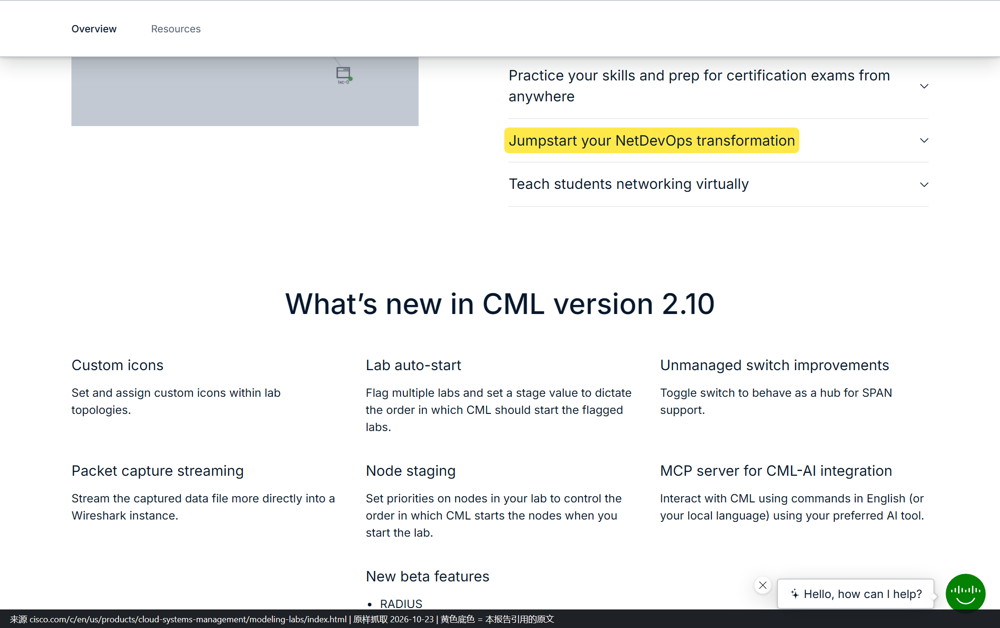
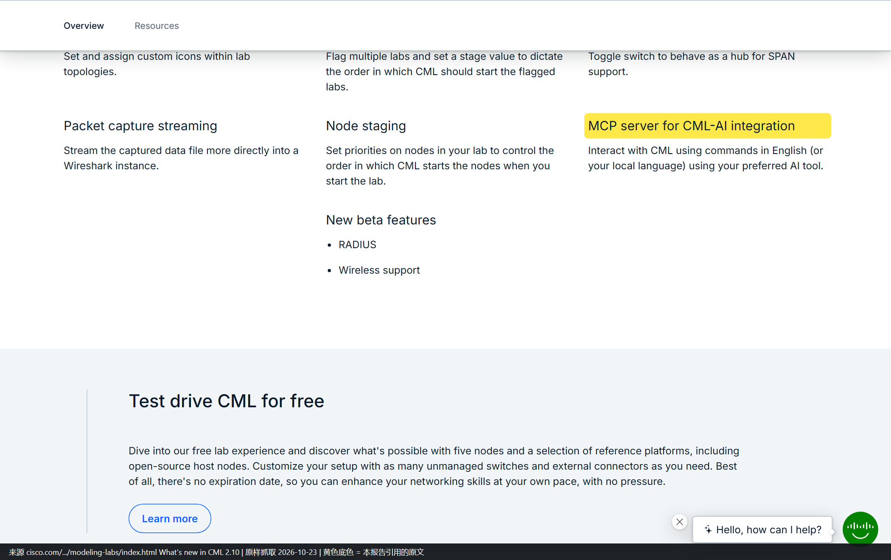
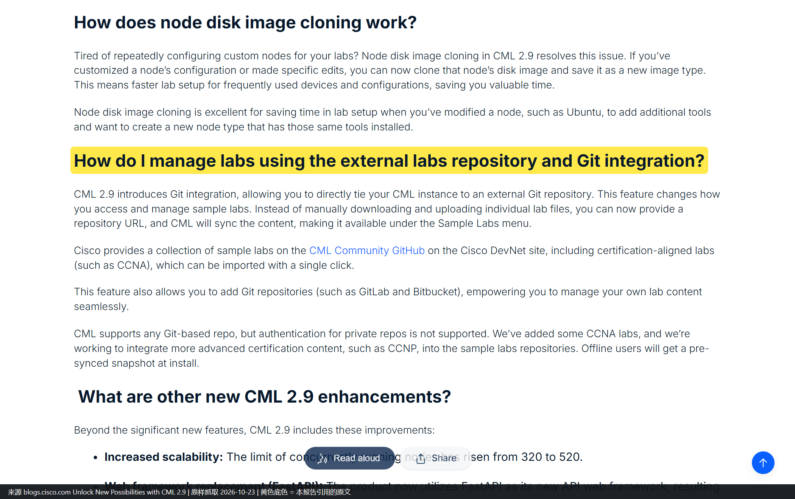
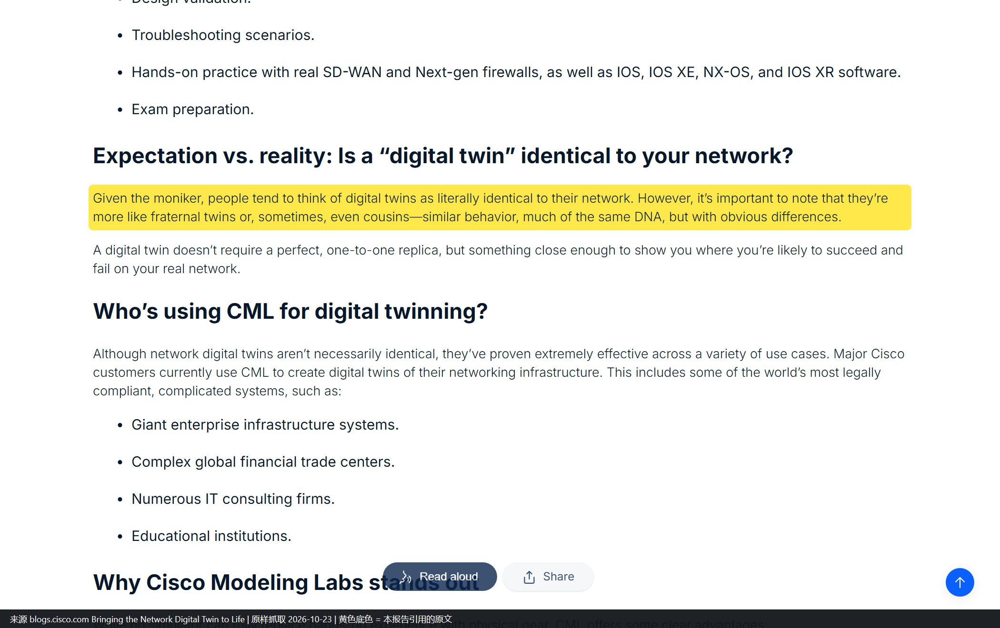
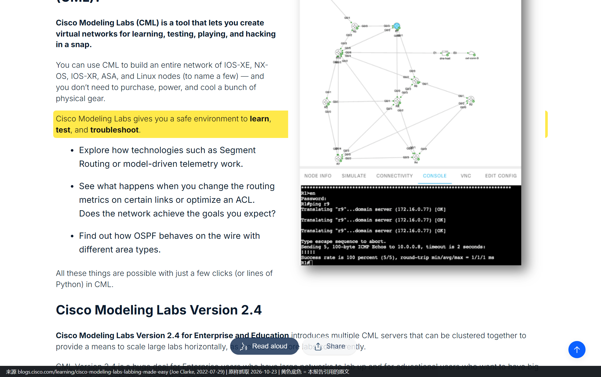
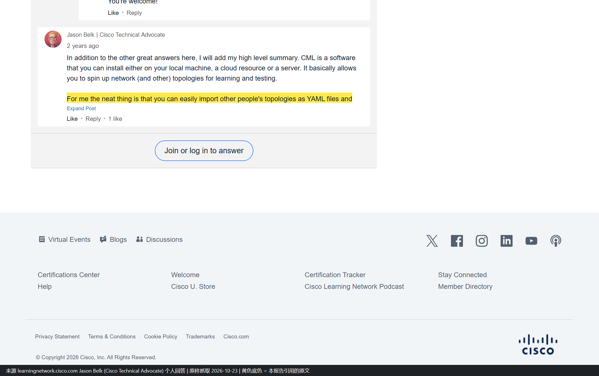
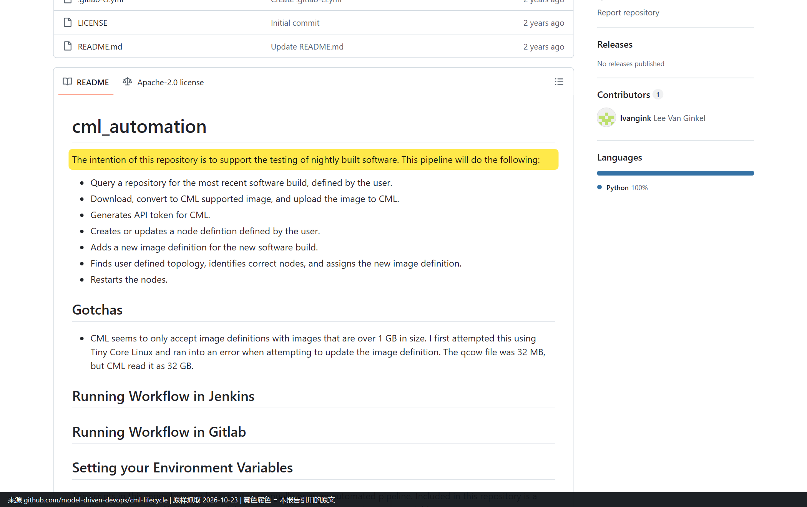

# 思科内部对 CML / VIRL 的使用方式

**调研对象**：思科内部（Cisco IT、TAC、Advanced Services、Sales/SE、DevNet Sandbox 团队、ASIG）对 CML / VIRL 的实际使用方式。
**调研范围**：① 官方自己公开承认的用法与宣传的功能；② 非官方的一线工程师个人实践；③ 在① ② 之上由本报告推断的用法；④ 对锐捷 APM 的可借鉴点。

**与另一份文档的分工**：《思科CML-VIRL-使用案例全集》是把官方能找到的 24 条使用记录逐条建档；本文档只关注一件事——**思科内部到底拿它干什么，以及这些做法能不能搬到锐捷 APM**。本文档使用 **N 编号**，与那份文档的 **S 编号互不通用**，映射见附一。

## 0 三句话结论

1. **官方公开的“内部用法”只有六个组织、七类动作**，且绝大多数停在“组织名 + 做过什么”，没有用量、没有成效指标。真正带数字的只有三条：SP 团队 7 天搭 7 台 IOS XR（原需 >1 个月）、ASIG 一次 Terraform 起 20 个攻防 pod、DevNet Sandbox 团队单 pod 克隆到数百 pod。
2. **个人实践比官方材料更敢说真话**：一线工程师夸的是“镜像合法且开箱即用”“导入别人的 YAML 就能跑”，骂的是“老 VIRL 调试它比学网络还费时间”“机器不够就是起不来”。这两个评价在同一批人身上先后出现，说明**产品代次差异远大于口碑差异**。
3. **对锐捷 APM 最有价值的不是“仿真网络”这件事，而是 CML 用来保证“同一实验可反复重放”的那套机制**——隔离单元、模板克隆、配置导出为 YAML、Git 同步场景库、四级权限。这套机制正好对上 APM 做 AI 助手时最缺的东西：**有标准答案、可回归的评测集**。

## 读法：三条不同用途的路径

| 你的目的 | 直接看 |
| --- | --- |
| 想知道思科官方到底承认了什么（可引用、可给领导看） | 第 1 章，每条带官方链接与截图 |
| 想知道一线工程师的真实评价（含负面） | 第 2 章，含“哪些域名本机打不开”的诚实说明 |
| 想知道还能怎么用（官方没说但功能支持） | 第 3 章，给了可复用的推断方法 |
| 想知道锐捷 APM 该抄哪一条 | 第 4 章，六个借鉴点按优先级排，每个写明解决什么问题 |

**证据标记约定**（全文一致）：

| 标记 | 含义 |
| --- | --- |
| 【截图】 | 本文档从官方/原始页面原样抓取的截图，黄底为被引用原句，存于 `internal-use-images/` |
| 【原文摘录·无截图】 | 已读到原文并能原样引用，但该站点在本机被网络拦截，无法截图。**不用别的图顶替** |
| **C（本报告推断）** | 不是任何原文说的，是本报告从A/B级事实推出来的，后附依据链与反证条件 |

**图片文件名的说明**：内嵌图片**沿用《案例全集》的 U 编号文件名**（同一张图两份文档共用，不重复存盘），因此会出现「正文写 N05、图片名是 U19-S12」的情况。这不是笔误，N 与 U 的完整对应见附二。

---

## 1 官方宣传：实际案例与宣传功能

这一章严格区分两件事，因为它们的证据强度完全不同：

- **实际案例**：官方写了“某组织做了某件具体的事”——可以当事实用。
- **宣传功能**：官方写“你可以用它做某事”——只能证明“官方认为这件事可行”，不能证明有人做成过。

### 1.1 官方唯一一次点名“内部三个组织在用”

这是全部公开材料里**唯一一句**明确说思科内部哪些组织在用的原文，出自 2015 年 Cisco UK&I 博客（作者 Nick Radcliffe，职务 Systems Engineer）：

> 「VIRL is extensively used by a multitude of engineers within Cisco in the Advanced Services, TAC, and Sales organisations, with many actively participating in the support community.」

**能确认**：Advanced Services、TAC、Sales 三个组织有大量工程师在用，且有人在社区答疑。
**不能确认**：用哪些特性、用在什么项目、用量多少、有没有量化收益——原文一个都没写。
**链接**：[N05](https://gblogs.cisco.com/uki?p=3998)（2015）

*【截图】页面原样抓取，黄底为引用句。这一屏同时给出了作者身份卡（Nick Radcliffe / Systems Engineer），是判断“这是工程师自述而非市场部文案”的依据。*

### 1.2 官方叙事里的四个“内部实际案例”

官方材料里能落到“具体组织 + 具体动作”的，只有下面四条。按证据强度排序。

#### 1.2.1 SP 方案团队：7 天搭 7 台 IOS XR 救场（唯一带完整数字的案例）

2013 年，思科 SP 团队要在 RIPE 66 大会上演示 BGP DDoS 防护方案，物理设备排期要一个多月。团队用 VIRL 在 7 天内搭出 7 台 IOS XR 路由器完成演示。

| 项目 | 内容 |
| --- | --- |
| 使用方 | 思科 SP（Service Provider）方案团队，作者 Nathan Sowatskey |
| 动作 | 在 VIRL 上搭 7 台 IOS XR 组成演示拓扑，跑 BGP DDoS 场景 |
| 官方给的数字 | 交付周期 7 天；物理设备原需 >1 个月；7 台 IOS XR |
| 为什么这条最硬 | 三个数字都在原文里，且是可核对的量（天数、台数） |
| 链接 | [N06](https://news-blogs.cisco.com/getyourbuildon/virl-saves-the-day)（2013-06-25） |

*【截图】黄底为交付周期与台数。这条案例的价值在于它说明 VIRL 最早被内部接受的场景不是“学习”，而是**赶交付节点**——物理设备排不上，就用仿真顶上。*

#### 1.2.2 DevNet Sandbox 团队：给还没通电的数据中心先做一遍（方法最可抄）

2019 年，DevNet Sandbox 团队要给一座**新数据中心**做自动化，但机柜、供电都还没好。作者 Hank Preston 在沙箱目录里留了一个 Multi-IOS 实例，几分钟内复刻出目标拓扑，把 GitLab、NetBox、NSO、pyATS 整条工具链先跑通。

这条案例最值得抄的不是工具，而是它**把“仿真与生产的差异”当成一份正式交付物登记在案**，一共四处：

| # | 差异 | 原文处置方式 |
| --- | --- | --- |
| 1 | 生产用 x86 虚拟化平台，VIRL 里无法复刻 | 虚拟交换层用 L2 IOSv 替代，并声明这部分“在生产里是已知元素” |
| 2 | 生产有数百个 pod，仿真里只建 1 个 | 把 1 个 pod 的配置克隆到生产的所有 pod |
| 3 | 接口编号不同（VIRL 的 Ethernet 1/1 可能是生产的 1/49） | 配置**按角色与邻居生成**，不按接口 ID 生成 |
| 4 | 生产有独立物理管理网，仿真没有 | 承认会有轻微管理路由差异，需在两套环境间单独处理 |

| 项目 | 内容 |
| --- | --- |
| 使用方 | 思科 DevNet Sandbox 团队（作者本人即团队成员） |
| 动作 | 未通电数据中心先在仿真里跑通自动化与验收，再上生产 |
| 可复用点 | “单 pod 样板 + 克隆”；“按角色不按接口 ID 生成配置”；“差异登记表” |
| 链接 | [N07](https://blogs.cisco.com/cisco-devnet/automate-new-data-center)（2019-09-11） |

*【截图】这一屏是本文档第 3.2 节“差异登记表可产品化”这条推断的原始依据。*

#### 1.2.3 ASIG：一次 Terraform 起 20 个攻防靶场 pod（规模最直观）

2024 年，思科内部安全团队 ASIG 的攻防课 “Becoming a Hacker” 用 CML 给学员发靶场：一条 Terraform 命令起 20 个 pod（虚拟实验室），每个学员一个。

| 项目 | 内容 |
| --- | --- |
| 使用方 | 思科 ASIG（内部安全团队）+ Cisco Learning 团队 |
| 动作 | 攻防课靶场，Terraform 批量起 pod，学员各自隔离 |
| 官方给的数字 | 一条 Terraform 命令；20 个 pod |
| 隔离与安全措施 | pod 之间隔离、限速、可溯源、可销毁（原文均有对应描述） |
| 链接 | [N08](https://blogs.cisco.com/learning/network-hacking-course-pairs-with-cisco-modeling-labs)（2024-11-01，Chris McCoy） |

*【截图】黄底为 “a Terraform command, 20 pods (virtualized labs) are ready for use”。这条案例是第 4.2 节“场景包 + 批量拉起”借鉴点的直接原型。*

#### 1.2.4 思科现场教学：Cisco Live 两届的做法

| 届次 | 形式 | 出处 |
| --- | --- | --- |
| 2013 佛罗里达 | ONE Intelligent Network 展区现场演示 + 分会场 BRKRST-3371 | [N06](https://news-blogs.cisco.com/getyourbuildon/virl-saves-the-day) |
| 2016 柏林 | DevNet Zone 设**常设 Learning Lab 终端**（展会开放期间随到随练）+ 2 场 DevNet Zone + 分会场 BRKRST-3003 + 讲师带做实验 LTRRST-3003 | [N09](https://community.cisco.com/t5/devnet-general-blogs/have-you-discovered-virl-yet/ba-p/3657936)（2016-02-09，Joel Obstfeld，VIRL 团队 Distinguished Engineer） |

*【截图】一屏内同时可见 Learning Lab 那句、两场 DevNet Zone 场次、以及 BRKRST-3003 / LTRRST-3003 两个场次号。*

> **数字不要混用**：同一篇给了平台累计量——10,000+ 用户、160,000+ 次仿真、近 100 万 VM 实例（2016-02 口径）。这是**平台总量**，不是 Cisco Live 听课人数，也不是任何单一场景的用量。

### 1.3 官方宣传的功能：五类场景 + 三组新能力

产品页把用途写成五条，这是官方对“这工具能干什么”最正式的表述：

| # | 官方原文（产品页小标题） | 指向什么场景 |
| --- | --- | --- |
| 1 | Design, test, and troubleshoot on virtual equipment – at a fraction of the cost | 设计验证与排障，主打成本 |
| 2 | Test a variety of network scenarios, risk-free | 变更前试错 |
| 3 | Practice your skills and prep for certification exams from anywhere | 认证备考 |
| 4 | Jumpstart your NetDevOps transformation | 自动化与 CI |
| 5 | Teach students networking virtually | 教学 |

*【截图】黄底为第 4 条 “Jumpstart your NetDevOps transformation”。同一屏下方即为 2.10 新功能清单。*

**需要注意的措辞**：这五条都是**能力宣称**，页面没有给任何客户名、任何数字、任何案例链接。把它当“官方认为可行”的证据可以，当“有人做成过”的证据不行。

#### 1.3.1 CML 2.10 新功能：出现了 MCP server

| 新功能 | 官方一句话 | 对本报告的意义 |
| --- | --- | --- |
| **MCP server for CML-AI integration** | Interact with CML using commands in English (or your local language) using your preferred AI tool. | **官方把 CML 做成了 AI 可调用的工具面**，这是 2026 年最重要的变化（见 3.2 推断 6） |
| Lab auto-start | 标记多个 lab 并设 stage 值，控制启动顺序 | 环境可以无人值守地按顺序起来 |
| Node staging | 给节点设优先级，控制 lab 内节点启动顺序 | 解决“依赖没起来就起下一个” |
| Packet capture streaming | 抓包数据直接流进 Wireshark 实例 | 取证链路变短 |
| Custom icons / Unmanaged switch 改进 | 自定义图标；交换机可当 hub 用（SPAN） | 拓扑可读性与镜像能力 |
| 新 beta | RADIUS、Wireless support | 认证与无线进入参考平台 |

*【截图】黄底为 MCP server 一行，下方是 beta 清单（RADIUS / Wireless support）。*

#### 1.3.2 CML 2.9 的三个能力，恰好是“可复用实验”的三块拼图

2024-07 的 2.9 发布博客里，有三项能力与本文档第 4 章的借鉴点直接相关：

| 能力 | 官方原文要点 | 为什么重要 |
| --- | --- | --- |
| **外部 lab 仓库 + Git 集成** | 给 CML 一个 repo URL，CML 自动同步，内容出现在 Sample Labs 菜单；支持 GitLab / Bitbucket；离线安装时有预同步快照 | **实验变成版本化资产**，可以团队共享、可以回滚 |
| **节点磁盘镜像克隆** | 把改好的节点磁盘提升为新镜像类型 | 把“调好的环境”固化成可复用单元 |
| **四级共享权限** | View / Exec / Edit / Admin 四档 | 见 4.2 第 2 条：这正是 AI 助手“能干什么”的分级原型 |

*【截图】黄底为 External labs repository 小标题。*

> 2.9 还有一项限制必须记下：**私有仓库的认证不支持**。官方原文写明 “authentication for private repos is not supported”，所以内部私库场景要么用公开库，要么另行处理。这条对第 4.3 节的落地判断有影响。

#### 1.3.3 官方对“数字孪生”的自我限定（话术上最值得学的一段）

2026-04 的博客把 CML 定位成“数字孪生”，但同时自己拆台：

> 「they're more like fraternal twins or, sometimes, even cousins—similar behavior, much of the same DNA, but with obvious differences」

同一篇给出“谁在用”的答案，**只有行业类型，没有名字**：Giant enterprise infrastructure systems / Complex global financial trade centers / Numerous IT consulting firms / Educational institutions。

*【截图】黄底为 “fraternal twins” 那句。这条对第 4.2 节第 6 条“对外话术”有直接借鉴价值。*

#### 1.3.4 官方对“内部使用”的另一种表述（CML 团队的自我描述）

2022-07 的 CML 博客系列开篇，作者 Joe Clarke（CML 团队成员）把用途写成三件事：

> 「Cisco Modeling Labs gives you a **safe environment to learn, test, and troubleshoot**」

*【截图】黄底为上述三件事。注意这三个动词（学 / 测 / 排障）与产品页五条场景是同一套叙事的简写版，说明官方口径三年未变。*

### 1.4 官方宣传的边界：哪些只是“宣称”

把第 1 章的材料按证据强度归档，避免后文误用：

| 材料 | 性质 | 能当什么用 | 不能当什么用 |
| --- | --- | --- | --- |
| S12 三组织在用 | A 级，但只有组织名 | 证明“思科内部确实在用” | 证明“用得多好” |
| SP 团队 7 天 7 台 XR | A 级，含三个可核对数字 | 证明“能压缩交付周期” | 证明“常规做法” |
| DevNet 团队预演未通电机房 | A 级，含方法与四处差异 | 证明“方法可复用” | 证明“自动化一次成功” |
| ASIG 20 pod 攻防课 | A 级，含命令与数量 | 证明“能批量隔离拉起” | 证明“学员效果” |
| Cisco Live 教学 | A 级，含场次号与时间 | 证明“现场能跑” | 证明“教学质量” |
| 产品页五条场景 | 宣传 | 证明“官方认为可行” | 证明“有人做成过” |
| 2.10 / 2.9 新功能 | 发布说明 | 证明“能力存在” | 证明“已被采用” |
| 数字孪生四类客户 | 宣传，无名字 | 证明“官方承认有客户在做” | 证明“具体是谁、规模多大” |

**一句话**：官方对“谁在用”很克制，对“能用来干什么”很放开。这个不对称在整份材料里反复出现，本身就是结论——**内部使用的具体细节是敏感信息，能力宣传是市场行为**。

---

## 2 个人推荐：一线工程师怎么说

### 2.1 取样方式与一个必须先说清的坏消息

**取样方式**：检索式覆盖「CML 好不好用」「VIRL vs CML」「我的 lab 怎么搭」「CML 复现故障」四类意图，剔除纯厂商站与纯课程销售页后，保留 12 条个人来源（个人域名博客 7 条、GitHub 个人仓库 3 条、厂商社区个人回答 1 条、商业评测 1 条）。

**坏消息**：本机对**境外个人博客域名一律连接被拦**（`ERR_CONNECTION_CLOSED` / `SSL WRONG_VERSION_NUMBER`），连带 `web.archive.org` 也是 502。所以：

| 类别 | 条数 | 能否截图 |
| --- | --- | --- |
| 厂商域内（cisco.com / blogs.cisco.com / learningnetwork.cisco.com） | 2 | **可以**，已截 |
| GitHub（本机可达） | 3 | 1 条截成功，2 条渲染超时 |
| 个人域名博客 | 7 | **不可以**，只能给原文摘录 |

个人域名博客的原文是怎么拿到的？经检索服务的服务端抓取读到正文，**引用句为原样摘录**，但**无法在本机渲染成图**。本文档不为这些条目配图，也不用其他页面顶替——按约定标 `【原文摘录·无截图】`。

### 2.2 最有价值的一条：前 TAC 工程师用 CML 复现客户故障

这是全部个人材料里唯一一条**把 CML 用在“生产事故定责”上**的记录，也是唯一一条由**前思科 TAC 工程师**写的第一人称复盘。

| 项目 | 内容 |
| --- | --- |
| 作者 | Christopher Hart（chrisjhart.com，曾任 Cisco TAC 工程师，2019 年圣诞值班） |
| 场景 | 客户报一起持续 23 分钟、自行恢复的南北向中断，要求 RCA（根因分析） |
| 做法 | 按客户拓扑在 CML 里搭三台 Catalyst 8000v（R1/R2/R3），复刻 IP SLA + track + 静态路由的组合，再在仿真里逐项拆解 |
| 关键原文 | 「I found a topology similar to the below, which **I simulated in the lab using Cisco Modeling Labs** with Cisco Catalyst 8000v virtual routers.」 |
| 为什么这条重要 | 它证明 CML 的保真度足够支撑**控制面时序类问题的复现**——IP SLA、track 对象、静态路由这三者的联动是纯软件逻辑，正是官方所说“software-based features 行为与真机一致”的那一类 |
| 局限 | 作者没写复现耗时、没写是否一次成功、没写客户最终认不认这个结论 |
| 链接 | [N20](https://www.chrisjhart.com/TAC-Tales-How-IP-SLA-and-Static-Routes-Ruined-Christmas/) |

【原文摘录·无截图】上述引句为页面原文。该域名在本机 `ERR_CONNECTION_CLOSED`，无法截图。

**同一作者的另一篇要排除掉**，这点很重要：他的《TAC Tales - Saving Configuration is for Quitters》（2022-01-05）讲的是 Nexus 9000 `copy run start` 超时，读起来很像同类案例，但原文写的是「I grabbed a fresh switch **in our lab**」，用的是**真交换机**，全文没有出现 CML。

> **这条排除本身就是方法示范**：同一作者、同一系列、同一叙事风格，只有一篇用了 CML。如果不逐篇核原文，很容易把两篇混成“TAC 常用 CML 复现故障”的证据——那就把 1 条证据夸大成 2 条了。

### 2.3 一线工程师的七条个人博客：夸什么、骂什么

以下七条均为个人域名博客，**全部无法在本机截图**，故只给原文摘录与链接。

| # | 作者 / 站点 | 时间 | 原话（摘录） | 在说什么 |
| --- | --- | --- | --- | --- |
| N21 | Mike Dent（mikedent.io） | 2026-04 | 「Why CML Earned a Permanent Spot in My Workflow」；「a sandbox that mirrors real gear means **fewer surprises at 2 AM**」 | 变更窗口前先验证；把它当日常主力工具 |
| N22 | labtinker.net | 2024 前后 | 「I had tried it in a previous incarnation when it was VIRL and **I gave up on that when I realised I was spending more time troubleshooting VIRL than I was learning networking**. The updated product is much improved.」 | 老 VIRL 劝退、新 CML 回坑，同一人前后反差 |
| N23 | Room 322（rm322.com） | 2023 前后 | 「the system just worked」；「CML **worked out of the box** for me」 | 与 EVE-NG 对比：不用折腾镜像与权限 |
| N24 | Wyssmann Engineering | 2021-09 | 「you have to reserve a slot in advance；the session is **limited to 4 hours max**；it only offers Cisco network appliances」 | 免费用法的三条限制（这是 Sandbox 版，不是本地版） |
| N25 | QuistED | 2024-10-21 | 「Last weekend I decided to try Cisco's Modeling Labs… I have quite a lot of experience with both EVE-NG and GNS3, so I'm curious to see how CML will compare」 | 老 EVE-NG/GNS3 用户的横向比较视角 |
| N26 | NayabSD（nayab.xyz） | 未标 | 「One can **reserve Cisco Modeling Labs for free** and practice labs on the isolated cloud environment called DevNet SandBox」 | 用 Ubuntu + openconnect 接 Sandbox 的完整步骤 |
| N27 | Ping Labz | 未标 | 「Cisco Modeling Labs **2.8 is now free**」 | 免费档带来的入门门槛下降 |

> **N27 需要打折扣**：该站首页自述“每天在 X 上发 Cisco lab”，属内容引流站，结论偏向“值得一试”。同类还有 iTechGuides（N33，自标 9.2/10，页面有广告披露与佣金说明）和 First Pass Lab（N34，CML 与自家课程/实验包并行推荐）。**这三条只能当“市场温度”，不能当独立评价。**

**把七条里的评价做词频归并，得到两个清单**（这是本章唯一的归纳，不是原文结论）：

| 他们夸的（重复出现 ≥2 次） | 他们骂的（重复出现 ≥2 次） |
| --- | --- |
| 镜像合法、开箱即用，不用到处找 IOS | 吃资源：16 GB 内存起步，机器不够起不来 |
| 导入别人的 YAML 就能跑，门槛低 | 节点数上限（20 / 40），大规模要买 Enterprise |
| HTML5 GUI 直观，比 EVE-NG / GNS3 少折腾 | 对非 Cisco 镜像支持弱，混厂不如 GNS3 / EVE-NG |
| 有 REST API，能接自动化 | 贵（$199/年）；老 VIRL 时代体验差（口碑包袱） |

**一个反直觉观察**：骂“贵”和骂“资源”的是同一批人，但**没人骂“不准”**。这与官方自己承认的“控制面等价、数据面不保真”完全吻合——用户抱怨的从来不是仿真不像，而是**用不起、装不下**。

### 2.4 社区里的个人回答：价值在“怎么开始”，不在“值不值得”

Cisco Learning Network 上一条 2024-10 的提问「How CML work?」，回答者之一是 **Jason Belk（Cisco Technical Advocate，以个人身份回答）**：

> 「For me the neat thing is that you can easily **import other people's topologies as YAML files** and use them yourself. This lowers the barrier to entry for getting a network up and running since you can leverage other people's work and just get to the learning.」

*【截图】黄底为引用句；下方 “Expand Post” 说明该回答被折叠，截图只到可见部分。这条印证了 2.3 节的“门槛低”是社区共识，而非个别博主说法。*

### 2.5 GitHub 上的个人实践：三条都指向“把 CML 当 CI 的一个环节”

GitHub 是本机唯一能正常渲染的个人材料来源，三条仓库都值得看，但**成熟度差异极大**，必须分开说：

| # | 仓库 | 作者 | 做了什么 | 成熟度（如实） |
| --- | --- | --- | --- | --- |
| N29 | [model-driven-devops/cml-lifecycle](https://github.com/model-driven-devops/cml-lifecycle) | Lee Van Gink | 拉最新软件构建 → 转 CML 镜像格式 → 上传 → 建 node definition → 改拓扑里对应节点 → 重启，全流程 Jenkins / GitLab CI | 42 commits、Apache-2.0、**0 star 0 fork**，个人自用 |
| N30 | [MediocreTriumph/claude-cml-toolkit](https://github.com/MediocreTriumph/claude-cml-toolkit) | 个人 | 用 MCP 封装 CML：建/启/停 lab、加节点与链路、下发配置、跑控制台命令 | 个人实验项目，与 CML 2.10 官方 MCP 同向 |
| N31 | [JAntF9905/ansiblefest2021-molecule-cml-demo](https://github.com/JAntF9905/ansiblefest2021-molecule-cml-demo) | WWT 的 Nick Thompson / Jeff Andiorio | Ansiblefest 2021 演示：Molecule + CML + GitHub Actions，含 Infoblox IPAM 申请与回收 | 演讲配套 demo，最完整的一条 |

*【截图】黄底为仓库意图原句，下面七条是流水线的具体步骤。同一屏可见 Contributors 只有 1 人、Trees 无 release——**这是个人自用工具，不是可直接引用的产品能力**。*

**N29 里有一条踩坑记录，价值比主流程还高**：

> 「CML seems to only accept image definitions with images that are **over 1 GB** in size. I first attempted this using Tiny Core Linux and ran into an error… The qcow file was 32 MB, but CML read it as 32 GB.」

这类“官方文档不会写、只有自己踩过才知道”的细节，是个人材料相对官方文档的唯一优势。本报告在第 4.3 节讨论“要不要自建场景库”时会用到这条（自建轻量镜像会撞到这个限制）。

**N30 与 N31 没截到图**：N30 页面渲染超时（两次尝试均 `timed out`），N31 的目标句未在渲染后的 DOM 中命中。两条只保留链接与要点，不配图。

### 2.6 第 2 章小结：个人材料的三个可信度分层

| 层级 | 材料 | 能当什么用 |
| --- | --- | --- |
| **可当事实** | N20（前 TAC 的具体做法）、N29（流水线七步与踩坑） | 证明“这件事有人这么做过” |
| **可当参考** | N21-N26、N28、N31（做法与体验，无量化） | 证明“这是常见用法”，不能证明效果 |
| **只当温度计** | N27、N33、N34（内容/佣金驱动） | 只能说明“市场上在推这个方向” |

**一句话**：个人材料在“具体怎么做”上比官方文档强，在“值不值得”上比官方材料弱——因为说好话的人往往有推广动机，说真话的人往往只写自己那一摊。

---

## 3 本报告的推断：官方没说、但功能支持的用法

### 3.1 推断方法（可复用的五步）

这一节先把方法写出来，再给结论。**方法是可迁移的，结论不是**——换成任何产品都能用这套流程做推断，但结论只对 CML 成立。

| 步 | 做什么 | 具体到 CML 怎么操作 | 产出 |
| --- | --- | --- | --- |
| 1 | **抽原子能力** | 把官方文档里“能对系统做的一个最小操作”逐条抽出，不按功能模块分，按“动词 + 对象”分 | 一张原子能力清单（下面 3.1.1） |
| 2 | **找官方没连起来的组合** | 官方文档按模块分章写，两个模块的能力**很少并列**。把 A 能力 × B 能力逐对看，找“能合起来但官方没合”的对子 | 候选组合（3.2 的六条） |
| 3 | **对齐真实工作流的痛点** | 每个组合必须能落到工程现场某一步（等设备、复现故障、改前验证、培训考核…），落不到的丢弃 | 有痛点的组合 |
| 4 | **用官方边界做过滤** | 拿官方自己写的硬边界（rate-limited、无同步时钟、不模拟具体硬件）逐条卡，卡不过的直接否 | 剩下的可行组合 |
| 5 | **标置信度 + 写反证条件** | 每条写“什么情况下这条推断会失效”。写不出反证条件的，说明它不是推断而是猜想，删掉 | 3.2 清单 |

**第 4 步是这套方法的关键**。很多人做功能推断时会漏掉这一步，于是把“理论上能拼起来”当成“实际能做成”。CML 的硬边界很明确，正好用来做过滤网。

#### 3.1.1 原子能力清单（从官方文档抽出）

| 组 | 原子能力 | 出处级别 |
| --- | --- | --- |
| 节点 | 起 VM 节点（IOSv / IOS XE / XR / NX-OS / ASA / FTD / 9800-CL / SD-WAN 组件 / ISE） | A |
| 节点 | 起 IOL 轻量节点（含串口 / Frame Relay / HDLC / PPP） | A |
| 节点 | 起 Docker 容器节点（Chrome、Firefox、FRR、dnsmasq、syslog、netflow、nginx、radius、tacacs+、net-tools、ThousandEyes agent） | A |
| 拓扑 | 任意连线；**双向链路故障**测试 | A |
| 拓扑 | 未管理交换机可切 hub 模式（供 SPAN） | A（2.10） |
| 状态 | lab 保存 / 启动 / 停止 / **快照回滚** | A |
| 状态 | **节点磁盘镜像克隆**（把改好的节点变成新镜像类型） | A（2.9） |
| 数据 | 按链路抓包；**抓包流式进 Wireshark** | A（2.10） |
| 数据 | WAN Emulator 节点（注入时延/丢包）；TRex 打流 | A |
| 边界 | 外部连接器（NAT / 系统桥），可接真实网络 | A |
| 编排 | REST API / Python client / pyATS / Ansible / Terraform / **MCP server** | A |
| 编排 | lab auto-start + node staging（按 stage / 优先级控制启动顺序） | A（2.10） |
| 协作 | 四级权限 View / Exec / Edit / Admin | A（2.9） |
| 协作 | 外部 Git 仓库同步场景库（**私有库认证不支持**） | A（2.9） |
| 规模 | 多用户 + 集群（Enterprise / Education） | A |

**官方从来没把这些列在同一张表里**——节点、抓包、权限、Git 同步分属四章。这就是推断空间的来源：**能力都在，配方没有**。

### 3.2 六条推断

每条都写：依据 → 推断 → 为什么合理 → 反证条件 → 置信度。

#### 推断 1：CML 的真正用法是“对照组”，不是“替身”

| 项 | 内容 |
| --- | --- |
| 依据 | 官方「Configurations taken directly from a physical Cisco device **may not function as expected**」+「not generally suitable for testing throughput or timing」；同时官方说 control/management plane 行为“same behavior and **the same bugs**” |
| 推断 | 把 CML 当“生产环境的替身”是错的用法；正确用法是**同一变更在两处各跑一次，比较两边结果**——CML 是**对照组**，不是**被测对象** |
| 为什么合理 | 逻辑上是不对称蕴含：仿真成功 ⇏ 生产成功（因为可能差在硬件/规模/时序）；但**仿真失败 ⇒ 生产大概率也失败**（因为控制面行为一致、bug 一致）。对照组恰好只用得上这个单向蕴含 |
| 反证条件 | 变更涉及 ASIC 特性、队列/TCMP 卸载、规模相关行为、时序敏感逻辑时，对照组失效 |
| 置信度 | **中高**（有官方边界文本直接支撑，但没有案例明写“我用它做对照组”） |

**C（本报告推断）**：这条与第 1.2.2 节 DevNet 团队的“四处差异登记”是同一逻辑的两种表达——他们登记差异，本质就是在划定“对照关系还成立的范围”。

#### 推断 2：差异登记表应该成为交付物，而不只是过程记录

| 项 | 内容 |
| --- | --- |
| 依据 | N07 原文把四处差异逐条列出并给出处置；官方 VM Images 页也把“哪些特性可能不支持”写成公开声明 |
| 推断 | 一次 CML 实验的交付物应该是两份：**结论清单**（哪些能外推）+ **差异登记表**（哪些不能，为什么）。只交结论不交差异表，等于让下游误以为结论覆盖全场 |
| 为什么合理 | 官方自己就是这么做的：先声明边界，再谈收益。工程上这叫“声明适用范围”，与实验报告同构 |
| 反证条件 | 无。这是方法层推断，不依赖功能 |
| 置信度 | **高** |

#### 推断 3：把故障工单做成“可重放的复现包”

| 项 | 内容 |
| --- | --- |
| 依据 | N20 的 TAC 做法（按客户拓扑在 CML 里复刻）+ lab 可导出 YAML + 可按链路抓包 + 外部 Git 仓库可同步场景库 |
| 推断 | 一次故障处理完，应该固化成**复现包** = 拓扑 YAML + 设备配置 + 关键抓包 + “期望看到的异常现象”。下次同类工单先导入包对照，而不是从零搭 |
| 为什么合理 | 四个能力分别存在（导出、抓包、Git 同步、快照），只是官方没把它们说成“复现包”这个产品形态 |
| 反证条件 | 故障根因在硬件、规模或性能层时，包无法复现（受官方硬边界限制） |
| 置信度 | **中高** |

#### 推断 4：CML 可以当 AI Agent 的试错沙箱

| 项 | 内容 |
| --- | --- |
| 依据 | 2.10 官方上 MCP server（用自然语言操作 CML）+ 2.9 容器节点 + 四级权限 + lab 快照回滚；个人项目 N30 已按同一思路做过 MCP 封装 |
| 推断 | Agent 需要“能失败”的环境才能自主决策。生产不能失败，CML 可以——所以 CML 会成为 **agent 的动作空间**：改配置 → 看结果 → 不对就回滚 |
| 为什么合理 | Agent 工程的核心难点是“验证动作对不对”。CML 提供三件必需品：可回滚（快照）、可观测（抓包/console）、可隔离（lab 粒度） |
| 反证条件 | ① agent 学到的是仿真行为，向生产迁移会失真（同推断 1 的不对称）；② CML 的规模上限（20/40/300 节点）限制了真实拓扑复杂度 |
| 置信度 | **中**（功能刚发布，截至 2026-10-23 无公开案例；仅个人项目 N30 佐证方向） |

#### 推断 5：能造“控制面故障样本”，造不了“真实流量样本”——这是最重要的一条边界

| 项 | 内容 |
| --- | --- |
| 依据 | 官方「software-based features include **most of the control and management plane** features … same behavior and **the same bugs**」；同一页又写「**rate-limited**, with **no sense of a synchronized CPU clock**」「not generally suitable for testing **throughput or timing**」；容器节点里的 netflow / syslog 都是软件模拟 |
| 推断 | CML 能产出**格式真实、语义真实**的控制面证据（syslog、SNMP trap、邻居状态、路由表变化、接口 up/down、CPU/内存趋势），可以用来做“故障 → 证据”的标注样本；但**造不出真实业务流量的分布特征**（并发规模、会话行为、业务语义、时间尺度都被仿真与限速改写） |
| 为什么合理 | 区分点很清晰：控制面是**软件逻辑**，官方说一致；数据面是**硬件执行 + 流量生成**，官方说不保真。前者可信，后者不可信 |
| 反证条件 | 若用 TRex 回放真实 pcap，**流量的包级形态**可近似真实；但**时间尺度、并发会话数、端到端业务语义**仍不真实，所以只能做“包级特征”样本，不能做“业务流量模型”样本 |
| 置信度 | **高**（两个方向都有官方原文直接支撑） |

**C（本报告推断）**：这条边界决定了 CML 对可观测性产品的用途边界——**它是“故障样本发生器”，不是“流量数据发生器”**。这个区分在第 4 章会直接决定锐捷 APM 该抄什么、不该抄什么。

#### 推断 6：售前 POC 的正确用法是“可控变量台”，不是“设备展示柜”

| 项 | 内容 |
| --- | --- |
| 依据 | 官方 SD-WAN Lab Deployment Tool（几分钟起 fabric、最多 20 edge、可注入时延做 WAN 仿真）+ dCloud 现成会话 + 官方“客户数字孪生”叙事 |
| 推断 | 售前真正有说服力的不是“我们设备性能多强”，而是“同一拓扑下改一个参数，结果怎么变”。CML 的价值是**把变量单独拎出来**，这在真机上做不到（真机不能随便断链路、注入延迟） |
| 为什么合理 | 真机演示只能展示“正常状态”，CML 能演示“故障状态且可恢复”——后者更接近客户真实焦虑 |
| 反证条件 | 客户关心的是自己现网的特定配置时，通用拓扑无说服力；必须先把客户配置搬进 CML，而这又受“配置可能不通用”限制 |
| 置信度 | **中** |

### 3.3 明确否掉的五条（写出来是为了防止被误用）

这五条都曾经看起来“顺理成章”，但被官方原文或材料本身否掉：

| # | 看起来成立的推断 | 为什么否掉 | 官方/材料依据 |
| --- | --- | --- | --- |
| 1 | 用 CML 做吞吐、容量、时延验收 | 官方明写 rate-limited、无同步时钟、不适合测吞吐与时序 | VM Images 页原文 |
| 2 | 用 CML 替代硬件兼容性测试 | 官方明写「CML does **not emulate any specific hardware platform**」，在硬件抽象层被切断 | 同上 |
| 3 | 把 CML 里产生的流量当 AI 模型的训练数据 | 流量是自己打的、被限速、无真实业务语义（见推断 5） | 官方限速声明 + 容器节点性质 |
| 4 | 生产配置可以直接搬进 CML 再搬回去 | 官方两处表述冲突（Enterprise 数据表说可以用同一套配置；VM Images 页说 may not function as expected），**以 VM Images 页为准** | 详见案例全集 6-9 的三分法 |
| 5 | 思科 TAC 普遍用 CML 复现客户故障 | 只有 1 条组织级提及（N05）+ 1 条个人复盘（N20），不足以支撑“普遍” | N05、N20 |

> 第 5 条特别值得说：**“TAC 在用”和“TAC 普遍用它复现故障”是两个强度差很远的命题**。前者有 2015 年一句组织级表述支撑，后者只有一个人的博客。材料不足时，正确做法是把命题降级，而不是找更多模糊表述来凑。

---

## 4 锐捷 APM 能借鉴什么

### 4.1 先把界限划清：借的是机制，不是领域

| 维度 | CML | 锐捷 APM |
| --- | --- | --- |
| 干什么 | **造假环境**：造一个网络出来 | **看真环境**：从真网络收数据 |
| 数据从哪来 | 自己起的节点 | 交换机/服务采集到 VictoriaMetrics、Loki、MySQL、Pyroscope、Redis |
| 核心难点 | 保真度（像不像真机） | 归因（这么多数据，问题在哪） |
| 对 AI 的需求 | 给 Agent 一个能失败的地方 | 让 Agent 给出可信的根因 |

**所以直接照搬一定是错的**：锐捷不需要做网络仿真器（也做不了，合法镜像在思科手里）。能做的是把 CML **用来保证“同一实验可反复重放”的那套工程机制**搬过来。

CML 那套机制的内核其实只有一句话：

> **把一个实验封装成一个可克隆、可版本化、可回滚、可分级授权的单元。**

这句话与网络无关，与“如何让 AI 的结论可验证”强相关。下面六个借鉴点全部从这句话长出来。

### 4.2 六个借鉴点（按优先级）

#### 借鉴 1（P0）：把“故障场景包 + 评测集”当成一号工程

| 项 | 内容 |
| --- | --- |
| 抄 CML 什么 | **lab 作为隔离单元 + 可克隆 + 可导出 + 可 Git 同步 + 可快照重放**——一个 lab 能被反复启动、反复回滚、原样复制给另一个人 |
| 解决 APM 什么问题 | **AI 助手的准确率无法证明**。现在改 prompt、换模型、加工具，只能人工看几个 case；无法回答“这次改动是变好还是变差” |
| 为什么必须先做 | 没有评测集，AI 助手永远停在 demo 阶段，进不了客户现场；而且一旦多 Agent 协作，链路一变，回归成本指数上升 |
| 怎么落地 | 定义**场景包**（一个目录 = 一个场景）： ① 数据层：注入到 VictoriaMetrics 的指标序列、Loki 的日志流、MySQL 的告警与拓扑记录 ② 标注层：`expected_root_cause`（标准答案）、`expected_evidence`（必须引用的证据，如“某接口 CRC 增长”）、`forbidden_claims`（不能说的话，负例） ③ 评分层：脚本跑 Agent → 比对根因命中/证据命中/工具调用次数/是否越权 |
| 关键设计 | **必须有负例**。只标“正确答案”会训练出爱猜的 Agent；要标“这个场景的正确答案是'证据不足，需补充采集'” |
| 与 CML 的差异 | CML 的场景是“起真节点”，APM 的场景是“灌数据”。**两者都是“重放”**，这一点同构 |

**C（本报告推断）**：APM 比 CML 更容易做这件事——CML 造一个场景要占 CPU/内存、要等节点启动；APM 造一个场景只是往时序库写几百个点。**CML 受物理资源限制，APM 不受**。这是 APM 的相对优势，应该用足。

#### 借鉴 2（P1）：工具按「实体 + 动作」切，不按「页面」切

| 项 | 内容 |
| --- | --- |
| 抄 CML 什么 | CML 的 MCP 工具集是按**对象**切的：Lab / Node / 接口与链路 / 标注 / 抓包 / 用户组 / 系统信息。**没有一个是按“某个 UI 页面”切的** |
| 解决 APM 什么问题 | 如果工具按“仪表盘 / 报表 / 告警页”切，Agent 无法组合；用户问“这个接口为什么丢包”要跨四五个页面，Agent 只能一个页面一个页面试，既慢又容易漏 |
| 怎么落地 | 按实体给出工具，每个工具**只返回证据，不下结论**： `list_devices()` / `get_device_summary(device)` `get_interface_metrics(device, ifname, window)` `get_topology_neighbors(device, depth)` `search_logs(query, window, limit)` `get_alarms(device, severity, window)` `diff_config(device, t1, t2)` `get_profiles(service, window)`（Pyroscope） `get_trace_or_flow(...)` |
| 关键设计 | **粒度判据**：一个工具的输出应该能单独作为“一条证据”被引用。输出如果是一整页 HTML，说明切错了 |
| 反例 | `get_dashboard(name)` 这种工具是错的——它把“结论”包好了，Agent 没法追问细节，也无法在报告里精确引用 |

#### 借鉴 3（P1）：会话权限四级，先定“能干什么”再谈“多聪明”

| 项 | 内容 |
| --- | --- |
| 抄 CML 什么 | 2.9 的 **View / Exec / Edit / Admin** 四档 lab 共享权限：View 只能看、Exec 能交互但不能改拓扑、Edit 能改、Admin 能再授权 |
| 解决 APM 什么问题 | 客户不敢开 AI 助手，怕它改配置。**这是商业化的硬门槛**，不是技术问题 |
| 怎么落地 | 把工具按影响面分级，默认只开 L0： **L0 只读**：查询指标/日志/告警/拓扑（默认开） **L1 交互诊断**：临时提高采样、起一次额外采集、跑一次 ping/探测 **L2 变更建议**：生成配置命令**但不执行**，交给人复制 **L3 执行变更**：默认关闭，需审批 + 双人确认 + 完整留痕 |
| 为什么这样分 | 与 CML 的四档同构：CML 的 Exec 允许“起停节点”但不允许“改拓扑”，APM 的 L1 允许“加大采集”但不允许“改配置”——**都是“能操作运行态，不能改结构”** |
| 附带收益 | 分级本身就是卖点：客户可以先只用 L0 看效果，再逐级放开 |

#### 借鉴 4（P2）：一键起“有故障演进过程”的演示环境

| 项 | 内容 |
| --- | --- |
| 抄 CML 什么 | **lab auto-start + node staging**（按 stage/优先级控制启动顺序）+ **节点磁盘镜像克隆**（把调好的环境固化成镜像） |
| 解决 APM 什么问题 | POC 和演示时库里没数据，或者只有“一切正常”的数据，讲不出故事；现场临时造数据靠人手工，不可重复 |
| 怎么落地 | 写一个**场景注入器**：按时间轴往 VictoriaMetrics 写“故障前正常 → 故障演进 → 恢复”的指标序列，往 Loki 写对应日志，往 MySQL 写告警时序与拓扑变更；一条命令起一整套，跑完可清理 |
| 与 CML 的对应 | CML 的“启动顺序”对应这里的“时间轴”——**都是让环境按剧本演进，而不是静态摆着** |
| 边界（必须写清） | 这是**演示数据**，不是训练数据。它没有真实业务语义（见 3.2 推断 5），只能用来演示与冒烟测试 |

#### 借鉴 5（P2）：场景库 Git 化，但注意那个坑

| 项 | 内容 |
| --- | --- |
| 抄 CML 什么 | 外部 lab 仓库 + Git 同步 + 离线预同步快照——**场景变成版本化资产**，不是某个人电脑上的 YAML |
| 解决 APM 什么问题 | 场景包会散落在各人本地，无法复用、无法审计、无法知道“上个版本这个场景还在不在” |
| 怎么落地 | 建 `apm-scenarios` 仓库：一个目录一个场景，固定 schema（`meta.yaml` + `data/` + `expected.yaml`），CI 里跑一遍全量评分做回归 |
| **CML 踩过的坑要提前避开** | CML 2.9 明确写「authentication for **private repos is not supported**」。如果照抄“给用户一个 repo URL 让他自己连”，私有库场景会卡死。**锐捷自建场景库没这个问题**（库是自己的），但**如果要支持客户自带场景库，必须一开始就做认证** |

#### 借鉴 6（P1）：对外话术学“CML 拆自己台”

| 项 | 内容 |
| --- | --- |
| 抄 CML 什么 | 官方在把产品叫“数字孪生”的同一篇里，主动说它「more like **fraternal twins** or, sometimes, even **cousins**」；说客户时只给四个行业类型，**一个名字都不给** |
| 解决 APM 什么问题 | AI 助手最容易犯的错是过度承诺（“自动定位所有问题”），一次失败就失去信任 |
| 怎么落地 | 对外只讲可核对的：**在 N 类已标注场景上根因命中率 X%**；并**显式列出不支持的场景**（硬件故障、容量规划、跨域业务链路）。列不支持项不是示弱，是让支持项可信 |
| 为什么这条算“借鉴” | 因为它是可验证的策略：CML 用“承认差异”换来了“差异之内可信”。这个交易 APM 同样能做 |

### 4.3 三条不该借鉴的

| 不该做 | 原因 |
| --- | --- |
| 做一个网络仿真器 | 合法镜像在思科手里，这是它的护城河；且锐捷的战场在“看见问题”，不在“造出网络” |
| 用 CML（或任何合成流量）产出的数据训练流量类模型 | 见 3.2 推断 5：数据面被限速、无同步时钟、无真实业务语义。训练出来的模型在真网上必然偏 |
| 把“数字孪生”当产品名直接用 | 官方自己都在拆台（异卵双胞胎/表亲）。这词已经被用滥，客户听到会先怀疑 |

### 4.4 落地路线：如果只做一件事

| 阶段 | 做什么 | 判据（怎么知道做成了） |
| --- | --- | --- |
| **第一个月** | 场景包 schema 定稿 + 手工标注 **10 个**真实历史故障 | 10 个场景能一键灌数、一键评分 |
| 第二到三月 | 扩到 30-50 个场景，接入 CI；工具按实体重构；权限四级落地 | 每次改 prompt / 换模型，CI 能自动给出命中率变化 |
| 之后 | 演示环境注入器、场景库 Git 化、对外话术与不支持清单 | 销售能自己起环境做 POC，不用研发陪 |

> **如果只能做一件事，做场景包 + 评测集。** 理由很直接：AI 助手的其它问题（工具怎么切、权限怎么分、话术怎么说）都可以在做的过程中逐步调整，**唯独“答得对不对”没有基线，就永远无法判断任何改动是前进还是后退**。CML 对思科内部最大的价值也不是“能仿真”，而是“同一个实验可以再来一遍”——这一点，锐捷 APM 现在就能做，而且比 CML 便宜得多。

---

## 附一 信源总表

| 编号 | 信源 | 级别 | 时间 | 链接 | 支撑本文档哪部分 |
| --- | --- | --- | --- | --- | --- |
| N01 | Cisco Modeling Labs 产品页 | A | 现行（含 2.10） | https://www.cisco.com/c/en/us/products/cloud-systems-management/modeling-labs/index.html | 1.3 五类场景、2.10 新功能、各版本授权 |
| N02 | Unlock New Possibilities with Cisco Modeling Labs 2.9 | B | 2024-07 | https://blogs.cisco.com/?p=475777 | 1.3.2 外部 lab 仓库、镜像克隆、四级权限、私有库认证限制 |
| N03 | Bringing the Network Digital Twin to Life | B | 2026-04 | https://blogs.cisco.com/?p=489796 | 1.3.3 异卵双胞胎表述、四类行业客户 |
| N04 | Cisco Modeling Labs: Labbing Made Easy | B | 2022-07-29（Joe Clarke） | https://blogs.cisco.com/learning/cisco-modeling-labs-labbing-made-easy/ | 1.3.4 学/测/排障三件事 |
| N05 | VIRL to the rescue! – Built by engineers for engineers | B | 2015（Nick Radcliffe） | https://gblogs.cisco.com/uki?p=3998 | 1.1 三个组织在用；作者身份 |
| N06 | VIRL saves the day | B | 2013-06-25（Nathan Sowatskey） | https://news-blogs.cisco.com/getyourbuildon/virl-saves-the-day | 1.2.1 7 天 7 台 XR；1.2.4 Cisco Live 2013 |
| N07 | Preparing to Automate a New Data Center for DevNet Sandbox | B | 2019-09-11（Hank Preston） | https://blogs.cisco.com/cisco-devnet/automate-new-data-center | 1.2.2 未通电机房预演、四处差异、单 pod 克隆 |
| N08 | Network hacking course pairs with CML | B | 2024-11-01（Chris McCoy） | https://blogs.cisco.com/learning/network-hacking-course-pairs-with-cisco-modeling-labs | 1.2.3 20 pod 攻防课 |
| N09 | Have you discovered VIRL yet? | B | 2016-02-09（Joel Obstfeld） | https://community.cisco.com/t5/devnet-general-blogs/have-you-discovered-virl-yet/ba-p/3657936 | 1.2.4 Cisco Live 2016 四种形式；平台累计量 |
| N10 | VM Images for CML Labs（官方能力边界页） | A | 现行 | https://developer.cisco.com/docs/modeling-labs/vm-images-for-cml-labs/ | 3.2 推断 1/5 的边界原文、3.3 否掉项 1/2/4 |
| N11 | CML 2.10 发布说明（MCP server / auto-start / staging / 抓包流式） | A | 2026 | https://www.cisco.com/c/en/us/products/cloud-systems-management/modeling-labs/index.html | 1.3.1 |
| N20 | TAC Tales - How IP SLA and Static Routes Ruined Christmas | **C（个人，前 TAC）** | 2019 事件 | https://www.chrisjhart.com/TAC-Tales-How-IP-SLA-and-Static-Routes-Ruined-Christmas/ | 2.2 用 CML 复现客户故障 |
| N21 | Why CML Earned a Permanent Spot in My Workflow | C（个人） | 2026-04（Mike Dent） | https://mikedent.io/post/2026/4/cisco-modeling-labs-workflow/ | 2.3 日常主力工具、2.9 功能体感 |
| N22 | Cisco Modelling Labs | C（个人） | 2024 前后 | https://www.labtinker.net?p=1658 | 2.3 老 VIRL 劝退与新 CML 回坑 |
| N23 | Cisco Modeling Labs-Initial Thoughts | C（个人） | 2023 前后 | https://rm322.com/?p=268 | 2.3 worked out of the box |
| N24 | Network simulation with GNS3 and CML | C（个人） | 2021-09（Wyssmann Engineering） | https://wyssmann.com/blog/2021/09/network-simulation-with-gns3-and-cml | 2.3 免费用法三条限制 |
| N25 | CML 2.7 – Getting started | C（个人） | 2024-10-21 | https://www.quisted.net/index.php/2024/10/21/cml/ | 2.3 老 EVE-NG 用户视角 |
| N26 | Access Free Cisco Modelling Labs from Ubuntu | C（个人） | 未标 | https://nayab.xyz/networking/access-cml-ubuntu.html | 2.3 Sandbox + openconnect 步骤 |
| N27 | CML 2.8 Is Now Free | C（内容站，有推广） | 未标 | https://www.pinglabz.com/cisco-modeling-labs-2-8-release-features/ | 2.3 免费档门槛；2.6 只当温度计 |
| N28 | Cisco Learning Network 社区回答 | C（个人身份，厂商员工） | 2024-10 | https://learningnetwork.cisco.com/s/question/0D56e0000E3N7EHCQ0/hello-guys-can-i-ask-something-how-cml-work | 2.4 导入他人 YAML 降低门槛 |
| N29 | model-driven-devops/cml-lifecycle | C（个人仓库） | 2 年前 | https://github.com/model-driven-devops/cml-lifecycle | 2.5 CI 流水线七步、1GB 镜像限制踩坑 |
| N30 | MediocreTriumph/claude-cml-toolkit | C（个人仓库） | 未标 | https://github.com/MediocreTriumph/claude-cml-toolkit | 2.5 个人 MCP 封装；3.2 推断 4 佐证 |
| N31 | ansiblefest2021-molecule-cml-demo | C（个人/厂商演示） | 2021 | https://github.com/JAntF9905/ansiblefest2021-molecule-cml-demo | 2.5 Molecule + CML + GH Actions |
| N32 | Master Network Simulation with CML | C（个人，Medium） | 2024-08-30 | https://medium.com/@sdntechdemo/master-network-simulation-with-cisco-modeling-labs-cml-56d6b53992cc | 2.3 安装与许可的实操步骤 |
| N33 | Cisco Modeling Labs review（9.2/10） | C（商业评测，有佣金） | 未标 | https://www.itechguides.com/products/cisco-modeling-labs/review | 2.6 只当温度计 |
| N34 | CML vs GNS3 vs INE（2026） | C（商业内容站） | 2026 | https://dev.to/firstpasslab/cml-vs-gns3-vs-ine-how-network-engineers-should-build-labs-in-2026-2hdg | 2.6 只当温度计 |

## 附二 截图清单与缺口

**截图**：正文共 **12 处**图片引用，其中 **7 张为本轮新抓**（`O01`、`O02`、`O03`、`O04`、`O05`、`P07`、`P12`，存于 `internal-use-images/`），**5 张沿用《案例全集》**（`U19-S12`、`U01-S13`、`U06-S15`、`U02-S17`、`U09-S14`，存于 `case-evidence-images/`，不重复存盘）。全部为无头 Chrome 原样渲染后抓取（2026-10-23），黄底为被引用原句，图底黑条写明来源与抓取日，未做裁剪或文字修改。

| 正文编号 | 图片文件 | 内容 | 截图状态 |
| --- | --- | --- | --- |
| N01 | `O01-product-usecases.png` | 产品页五条场景 + 2.10 区块 | 已截 |
| N01 | `O02-product-mcp.png` | 2.10 的 MCP server 一行 + beta 清单 | 已截 |
| N02 | `O03-cml29-blog.png` | 2.9 外部 lab 仓库与 Git 集成 | 已截 |
| N03 | `O04-digitaltwin.png` | 异卵双胞胎表述 | 已截 |
| N04 | `O05-labbing-made-easy.png` | safe environment to learn/test/troubleshoot | 已截 |
| N05 | `U19-S12_virl-to-the-rescue.png`（沿用案例全集） | 三个组织在用 + 作者身份 | 复用 |
| N06 | `U01-S13_virl-saves-the-day.png`（沿用案例全集） | 7 天 7 台 IOS XR | 复用 |
| N07 | `U06-S15_automate-new-data-center.png`（沿用案例全集） | 四处差异中的三条 | 复用 |
| N08 | `U02-S17_network-hacking-course.png`（沿用案例全集） | 20 pod 攻防课 | 复用 |
| N09 | `U09-S14_virl-learning-lab.png`（沿用案例全集） | Cisco Live 2016 四种形式 | 复用 |
| N28 | `P07-cisco-community-answer.png` | 社区回答（导入他人 YAML） | 已截 |
| N29 | `P12-github-cml-lifecycle.png` | 个人 CI 仓库与七步流程 | 已截 |

**截图缺口（如实记录，不用别图顶替）**：

| 条目 | 原因 | 处置 |
| --- | --- | --- |
| N20 chrisjhart.com | 域名在本机 `ERR_CONNECTION_CLOSED` | 只给原文摘录 + 链接 |
| N21-N27 个人域名博客 | 同上（`ERR_CONNECTION_CLOSED` / `SSL WRONG_VERSION_NUMBER`），`web.archive.org` 亦 502 | 只给原文摘录 + 链接 |
| N30 claude-cml-toolkit | 两次渲染均 `timed out` | 只给链接与要点 |
| N31 ansiblefest2021 demo | 目标句未在渲染后的 DOM 命中 | 只给链接与要点 |

**为什么不用截图顶替**：把 A 页面的图放在 B 条目的位置上，读者会以为那就是 B 的证据。这比“没有图”更糟。

## 核验行

- **行数**：640 行
- **表格数**：38 张，逐行列数比对全部一致（0 处不一致）
- **图数**：12 处引用（7 张本轮新抓 + 5 张沿用《案例全集》），路径全部存在，无闲置、无重复引用
- **链接处数**：36 处（去重 25 个），全部为可点击的原始 URL
- **信源条数**：26 条（A 级 3 条：N01、N10、N11；B 级 8 条：N02-N09；C 级 15 条：N20-N34，含 4 条有推广动机的商业内容站）
- **格式自检**：代码围栏 0 处（全文无代码块）、正文 ASCII 双引号 0 处、表格列数 0 处不一致
- **结构说明**：第 1 章官方宣传（4 节）、第 2 章个人推荐（6 节）、第 3 章推断（3 节，含 6 条推断 + 5 条否掉）、第 4 章借鉴（4 节，6 个借鉴点 + 3 条不该借 + 落地路线）
- **可达性实测（2026-10-23）**：`cisco.com`、`blogs.cisco.com`、`community.cisco.com`、`learningnetwork.cisco.com`、`github.com` 可达；`mikedent.io`、`labtinker.net`、`rm322.com`、`chrisjhart.com`、`medium.com`、`pinglabz.com`、`wyssmann.com`、`quisted.net`、`nayab.xyz`、`web.archive.org` 在本机被拦或超时
- **口径声明**：第 3 章全部内容为**本报告推断**，不来自任何官方原文；第 4 章为**面向锐捷 APM 的建议**，不是思科的说法，也不代表锐捷的既有决策
- **数据截止**：2026-10-23

