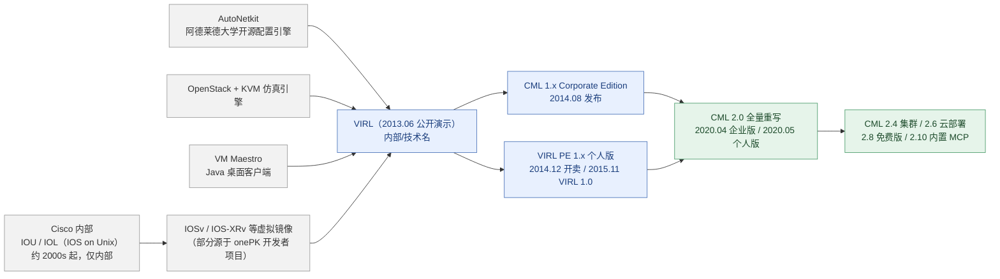

# 思科 CML 前史与使用场景调研

> **调研对象**：Cisco Modeling Labs（CML）及其前身 VIRL —— 它为什么被造出来、思科内部拿它干什么、业界（非官方）的个人工程师拿它干什么。
> **调研截止**：2026-10-25。

**这份文档回答四个问题**

1. CML 之前叫什么？—— 答案比"改了个名"复杂：**VIRL 是内部/技术名，CML 是对外的商品名，两者在 2014–2019 年长期并行存在**（§2）。
2. 思科内部拿它做什么？—— 出生地在 **思科 CTO office**；公开证据显示 **Advanced Services / TAC / Sales** 是主要内部用户群体（§4）。
3. 个人工程师拿它做什么？—— 认证备考、变更前验证、NetDevOps 练习场、客户 PoC 复现；2025 年后多了一类新玩法：用自然语言让 AI 操作实验室（§5）。
4. 一开始为什么会有这个东西？—— 不是"想做个模拟器卖钱"，而是**思科内部的"影子实验室"被软件化**，再外溢成认证培训与开发者生态的基础设施（§3、§8）。

**三种读法**
- 赶时间：只读 §1.3 的反直觉观察 + §2.1 时间线 + §7 事实核查表。
- 想知道"它为什么存在"：§3 → §8。
- 想借鉴"内部工具怎么产品化"：§8（推论专区，含依据链）。
- **只想看真实的人怎么用它**：直接跳 §5.5（16 个有名字的个人样本 + 原话 + 链接）。

---

## 1. 信源与局限

### 1.1 三级信源表

| 等级 | 定义 | 本报告用到的主要来源 | 覆盖时段 | 用途 |
|---|---|---|---|---|
| **A** | 官方文档站 / Release Notes / 版本历史 / 产品页 | Cisco 支持页（Modeling Labs 系列）、DevNet 版本历史与 MCP 文档、CML 2.0 Release Notes、Cisco Learning Network 官方文章 | 2014–2026 | 版本、日期、功能、架构变更 |
| **B** | 官方博客 / 员工署名长文 / 官方论文 | Cisco 博客 `getyourbuildon`（2013/2014）、Cisco UKI 博客、ACM SIGCOMM'14 论文、Cisco Live 实验手册 | 2013–2024 | **内部用途、起源动因**（本报告的核心证据） |
| **C** | 第三方博客 / 社区 / 行业媒体 / 中文技术社区 | ipspace.net（Ivan Pepelnjak）、Mostly Networks、Technodrone、lostintransit、firewall.cx、GreenPages、packetmentor、Reddit、Cisco Community 用户帖、腾讯云社区 | 2013–2026 | 细节补全、个人视角、反证与吐槽 |

### 1.2 已知局限（务必先看）

1. **思科从未公开发布过"内部使用清单"**。§4 的内部用途是靠多篇官方博客片段拼合的，能证明"哪些组织在用"，不能证明"用量占比、人数、成本"。
2. **早期（2013–2014）的一手页面大量下线或改版**，很多细节只能依赖当时的第三方博客（C 级）留存，等级不高但时间戳可靠。
3. **命名极其混乱**（详见 §2.2）：同一时期"VIRL"既指内部代号、又指个人版商品；"CML"既指企业版商品、又指整个平台。任何单一来源的命名叙述都会失真。
4. **中文二手资料与 AI 生成百科存在系统性错误**：把"2015 年发布 VIRL / 2020 年改名 CML"当成完整历史，把 VIRL 说成 Boson→Packet Tracer 的演进（§2.3 逐条更正）。本报告不采用这类来源作为事实依据。
5. **内部使用规模、内部版本差异、内部授权方式均未公开**。凡是这类信息，本报告一律写"未公开"，不做数字推测。
6. **CML 2.10 的发布日期未在官方版本历史页确认**（该页当前列出到 2.8.0），本报告只使用"2.10 起内置 MCP Server"这一条 A 级事实。
7. **Reddit 原帖正文抓不到全文**（站点拒绝爬取），只能引用搜索引擎快照片段。凡此类引文，§5.5 已单独标注"未读全文"。
8. **个人博客样本存在自选择偏差**：愿写的人是用出心得的人，放弃者/失败者基本不留痕，所以 §5.5 的乐观情绪不能读成整体满意度。
9. **"CML" 简称检索污染严重**：会大量撞上 Continuous Machine Learning（Iterative.ai / DVC 生态），必须用 `"Cisco Modeling Labs"` 或 `"VIRL"` 检索。本报告已剔除该类误命中。

### 1.3 一条反直觉观察

> **CML 不是"VIRL 改了个名"。**
> 2013 年 6 月思科首次公开演示时，技术名是 VIRL（Virtual Internet Routing Laboratory）；半年内对外商品名改成 Cisco Modeling Labs；然后 **2014–2019 年出现双轨制**：企业版叫 CML 1.x（Corporate Edition），个人版叫 VIRL PE 1.x；直到 2020 年 2.0 全量重写，两者才统一叫 CML。
> 换句话说：**"内部叫 VIRL，卖出去叫 CML"这句话在 2014–2019 基本成立，在 2020 之后不再成立**（内部也改口叫 CML 了）。

---

## 2. 命名与版本谱系

### 2.1 时间线

| 时间 | 事件 | 当时的名字 | 等级 | 来源 |
|---|---|---|---|---|
| 2013-05 | RIPE66：思科工程师用内部 VIRL 在几天内搭出 7 台 IOS-XR，做 BGP DDoS 缓解方案演示（传统方式需一个多月排设备） | VIRL（内部） | B | [Cisco 博客·VIRL Saves the Day](https://news-blogs.cisco.com/getyourbuildon/virl-saves-the-day) |
| 2013-06 | Cisco Live US（佛罗里达/奥兰多）首次公开演示，位置在 ONE 展区与 BRKRST-3371 分会场 | VIRL | B | 同上 |
| 2013 下半年 | 对外改名：营销不接受"viral"这个发音，产品名改为 Cisco Modeling Labs（CML，"camel"） | VIRL → CML | C | [ipspace 2013-10](https://blog.ipspace.net/2013/10/cisco-modeling-lab-virl-behind-scenes)、[Mostly Networks 2014-02](https://www.mostlynetworks.com/2014/02/cisco-modeling-labs-overview/) |
| 2014-01 | Cisco Live Milan 介绍 CML 细节 | CML | C | 同上 |
| **2014-08-07** | **CML 1.0 正式发布**（Corporate/Enterprise 版；1.0 用户指南 08-04） | CML 1.0 | A | [Cisco 支持页·Modeling Labs 系列](https://www.cisco.com/c/en/us/support/cloud-systems-management/modeling-labs/series.html) |
| 2014-12 | VIRL Personal Edition 面向个人开卖（"一个内部工具，终于对外开放"） | VIRL PE | C | [Technodrone 2014-12](https://technodrone.blogspot.com/2014/12/introducing-virl-personal-edition.html) |
| 2015-11-27 | VIRL PE 1.0 发布（OpenStack Icehouse→Kilo；首次带链路时延/抖动/丢包） | VIRL PE 1.0 | C | [lostintransit 2015-11](http://lostintransit.se/2015/11/27/network-simulation-cisco-releases-virl-1-0) |
| 2015–2018 | CML 1.1 / 1.2 / 1.3 / 1.5 / 1.6 企业版持续迭代，与 VIRL PE 双轨并行 | 双轨 | A | Cisco 支持页（文档日期 2015-09-29、2016-07-10、2017-08-04、2018-06-15） |
| **2020-04-14** | **CML 2.0 Enterprise 发布**：全量重写（HTML5 取代桌面客户端、新仿真引擎、"API first"、lab 持久化） | CML 2.0 | A | [DevNet 版本历史](https://developer.cisco.com/docs/modeling-labs/software-version-history/) |
| **2020-05-12** | **CML 2.0 Personal 发布**（VIRL 2.0 改名后的落地） | CML 2.0 | A | 同上；[Learning Network 公告帖](https://learningnetwork.cisco.com/s/question/0D53i00000S9IQbCAN/virl-release-date-branding-change-announcement) |
| 2021-05-04 | CML 1.x 停止销售/终止生命周期公告 | — | A | Cisco 支持页 |
| 2022-03-14 | 2.3.0：基线 OS 从 CentOS 8 换到 Ubuntu 20.04 | CML 2.3 | A | DevNet 版本历史 |
| 2024-03-27 | 2.7.0：引入 IOL / IOL-L2 与 Catalyst SD-WAN 镜像，支持 Azure 部署 | CML 2.7 | A | 同上 |
| 2024-11-06 | 2.8.0：推出 **CML-Free**（免许可，5 节点） | CML 2.8 | A | 同上 |
| 2025-09 | 社区开源项目 `cml-mcp`（把 CML 接到 Claude/Cursor 等 AI 客户端）上 PyPI | — | C | [mcphq 项目档案](https://mcphq.ai/mcp/xorrkaz-cml-mcp) |
| 当前（2026） | **2.10 起 CML 内置 MCP Server**，支持自然语言操作实验室（其上游即 `cml-mcp`） | CML 2.10 | A | [DevNet·MCP Server Overview](https://developer.cisco.com/docs/modeling-labs/2-10/mcp-server-overview) |

谱系关系一眼看清：

### 2.2 命名混乱的三个成因

1. **名字改过一次方向**：2013 年 6 月对外是 VIRL，半年后产品名换成 CML，但内部代码/团队一直叫 VIRL（[Cisco 博客 2014 年回顾原文](https://news-blogs.cisco.com/getyourbuildon/providing-the-right-platform-is-sometimes-all-it-takes)：*"In my blog of June 2013, I described a technology called the 'Virtual Internet Routing Laboratory', or VIRL... That technology will be making its appearance in the Cisco Modeling Labs (CML) tool coming out later this year."*）。
2. **双轨售卖**：企业版以 CML 1.x 卖，个人版以 VIRL PE 1.x 卖。思科产品经理的原话是：*"Cisco Modeling Labs v1.x has been the enterprise version of the VIRL platform."*（[Learning Network 官方公告帖](https://learningnetwork.cisco.com/s/question/0D53i00000S9IQbCAN/virl-release-date-branding-change-announcement)）。
3. **2020 年统一口径**：CML 2.0 之后，个人版也叫 CML（Personal），内部也改口叫 CML。Cisco Community 用户的说法可作旁证：*"ViRL ... being used internally at Cisco, while the commercial product was launched as CML ... With the 2.0 launch, 'CML' is now the preferred name internally as well."*（[社区帖 2023-09](https://community.cisco.com/t5/cisco-software-discussions/many-current-cisco-os-images-do-not-have-virl-images-why-not/m-p/4929540)，C 级，作者为 VIP Alumni 徽章用户，未确认思科员工身份）

### 2.3 常见误传与更正

| 流传说法 | 判定 | 依据 |
|---|---|---|
| "VIRL 2015 年发布，2020 年改名 CML" | **不准确**。首次公开演示是 2013-06；企业版 CML 1.0 是 2014-08；VIRL PE **1.0** 才是 2015-11。 | A 级：Cisco 支持页 / DevNet 版本历史；B 级：Cisco 2013 博客 |
| "VIRL 是 Boson → Packet Tracer 的演进" | **错误**。Boson/PT 走的是"纯软件模拟 IOS 命令"路线，VIRL 走的是"跑真实 NOS 镜像的虚拟化"路线，二者不同源。 | 中文社区文章如此叙述（[腾讯云社区](https://cloud.tencent.com/developer/article/1634389)），但 ACM 论文与思科博客均未提及该谱系，且技术路线描述相反 → **判定为作者混淆** |
| "CML 就是 VIRL 换个名字" | **不准确**。2.0 是"彻底重写"：桌面客户端→HTML5、旧编排→新仿真引擎、非持久 lab→持久化、API first。 | A 级：[CML 2.0 Release Notes](https://www.cisco.com/c/en/us/td/docs/cloud_services/cisco_modeling_labs/v200/release/notes/b_cml_release_notes_2-0/m_overview.html) 原文 *"we have completely rewritten the rest of the platform"* |
| "CML 能仿真任何思科设备" | **错误**。CML 是 NFVi，不是硬件仿真器；为真实 ASIC/硬件编译的镜像（如 ASA5525）跑不了。 | C 级但技术表述准确：[Cisco Community 详解帖](https://community.cisco.com/t5/cisco-software-discussions/many-current-cisco-os-images-do-not-have-virl-images-why-not/m-p/4929540) |

---

## 3. 它到底是怎么来的

### 3.1 出生地：思科 CTO office，Joel Obstfeld 的团队

这是本报告最重要的一个事实，来自思科自己的博客（2013-06）：

> *"Luckily, Gunter heard from Joel Obstfeld and his team, **working on VIRL in the Cisco CTO office**."*
> —— [VIRL Saves the Day!](https://news-blogs.cisco.com/getyourbuildon/virl-saves-the-day)（B 级，2013-06）

也就是说：**它不是先有"产品部门想做模拟器"，而是 CTO office 里的一个"给内部工程师用的技术"**。同期的 ACM 论文作者名单也印证了这个定位——Joel Obstfeld、Simon Knight（阿德莱德大学/思科）、Qiang Sheng Wang、Ed Kern、Tom Bryan、Dan Bourque，全部挂 Cisco Systems（San Jose）+ 一位高校合作者（[SIGCOMM'14 论文](https://dl.acm.org/doi/10.1145/2740070.2631463)）。

### 3.2 技术不是从零写的：三个拼装件

ACM 论文明确写了 VIRL 的三个核心组件，没有一个是从头造的：

| 组件 | 来源 | 作用 |
|---|---|---|
| **仿真引擎** | **OpenStack**（扩展了 Neutron，让 VM 能挂大量数据口） | 启停 VM、编排拓扑 |
| **配置引擎** | **AutoNetkit** —— 阿德莱德大学 Simon Knight 的博士成果，Python 开源 | 从拓扑自动生成设备配置（含 BGP 层级、MPLS VPN） |
| **图形界面** | **VM Maestro**（Java 桌面客户端） | 拖拽拓扑、配置属性、启动仿真 |

来源：[ACM 论文 §2](https://dl.acm.org/doi/10.1145/2740070.2631463)；AutoNetkit 出身见 [Simon Knight 本人页面](https://sk2.id.au/thesis.html)（*"My work produced the AutoNetkit software... It is written in Python and used in the VIRL project at Cisco."*）；VM Maestro 见 [CML 1.0 用户指南](https://www.cisco.com/c/en/us/td/docs/cloud_services/cisco_modeling_labs/v100/configuration/guide/b_cml_user_guide/b_cml_user_guide_chapter_010.html) 与 [lostintransit 2015](http://lostintransit.se/2015/11/27/network-simulation-cisco-releases-virl-1-0)。

**关键前提**：能"跑真镜像"这件事本身不是 VIRL 的发明。当时思科已经为 ONE / onePK 开发者计划产出了可虚拟化的 IOS 镜像 —— Ivan Pepelnjak 在 2013 年的现场记录里写得很清楚：*"classic Cisco IOS (virtual IOS used for onePK development)"*（[ipspace 2013-10](https://blog.ipspace.net/2013/10/cisco-modeling-lab-virl-behind-scenes)）。

> **C（本报告推导）**：VIRL 真正的创新点不在"虚拟化 IOS"，而在**把"虚拟镜像 + 编排 + 自动配置 + 图形化建模"这四件事拼成了一个工程师能自助使用的产品**。依据链：B 级论文列出三组件且无一是思科原创（OpenStack 开源 / AutoNetkit 高校开源 / VM Maestro 外购或自研客户端）→ C 级现场记录称 IOS 虚拟镜像原本服务于 onePK 开发者项目 → 结论。

### 3.3 为什么会有这个东西：六条动因，逐条有原文

**动因 1｜设备永远不够用。** 论文开篇：*"network equipment is expensive, requires space, power and cooling, and **there is never enough test equipment for everyone who wants to use it!**"*

**动因 2｜"影子网"（shadow net）能解决问题，但太贵且排不上。** 论文原文：*"Shadownets, where parallel networks are constructed to provide a facility to test changes, are one solution, however they are **expensive and access is typically restricted**."*
→ 这句话等于承认：**VIRL 就是"影子实验室"的软件替代品**（这是理解整个产品的钥匙）。

**动因 3｜工程师的时间被"找设备、连线、配环境"吃掉。** 思科博客原话：*"A major part of a network engineer's time is spent on **obtaining, connecting and configuring network equipment** for demonstration and test purposes. You can't just try an idea out when it occurs to you..."*

**动因 4｜DevOps 时代要求"测试环境按需可得"。** 论文：*"To adopt this approach, engineers need solutions that provide **test equipment on demand, rather than when available**."* 同时指出教育场景的师生比问题（*"high student-to-equipment ratios"*）。

**动因 5｜战略层：思科需要一个让开发者"敢碰网络"的低门槛环境。** 思科博客把 VIRL 的研发与 ONE / onePK / OpenDaylight 放在同一条线上：*"The development, within Cisco, of CML/VIRL has been in parallel with the evolution of the Open Network Environment (ONE)"*，并给出类比——*"What if network engineers had the same capabilities as software engineers to create virtual environments of near perfect fidelity?"*

**动因 6（最真实的一条）｜被一个"下周就要演示"的临时需求逼出来的。** 2013 年 5 月，思科工程师 Gunter Van de Velde 和 Bertrand Duvivier 要在 RIPE 会议上演示 IOS XR 4.3.1 的 BGP DDoS 缓解特性，但排不到 7 台 XR 设备：

> *"We were given a last minute opportunity to demonstrate the DDoS features at a RIPE meeting in May, but with nowhere near enough time to create an actual lab of IOS-XR devices. **It would normally have taken over a month** to get something up and running!"*
> 结果：*"Within the next few hours, I heard from Joel that the network setup was created... **Hours, compared to the many weeks it would have taken with a physical network!**"*
> —— [VIRL Saves the Day!](https://news-blogs.cisco.com/getyourbuildon/virl-saves-the-day)

这条案例是整个产品起源里最"人味"的部分：**它不是市场调研的产物，是"下周三要演示、现在没设备"的产物。**

### 3.4 更早的前史：思科内部的仿真传统

| 更早的东西 | 是什么 | 与 VIRL 的关系 |
|---|---|---|
| **IOU / IOL（IOS on Unix / IOS on Linux）** | 思科内部把 IOS 编译成用户态进程的仿真工具，历史 20 年以上，几乎不对外发布（镜像长期靠泄露流传） | **同一条技术血脉的前身**：证明"思科内部一直在用虚拟 IOS 做开发测试" |
| **GNS3 / Junosphere / Netkit / Mininet** | 同期存在的网络仿真/模拟工具 | 论文把它们列为对照物，并强调 VIRL 的差异是"跑生产级商用镜像" |
| **Shadow net（影子网络）** | 客户侧搭一套平行网络做变更验证 | 论文明确将其列为 VIRL 要替代的目标 |

IOU 的定位与"法律灰色地带"描述见 [firewall.cx 的 VIRL 介绍](https://www.firewall.cx/cisco/cisco-services-technologies/cisco-virl-virtual-internet-routing-lab-introduction.html)（C 级）；"IOU 这类内部仿真工具极少对外"见 [Cisco Community 详解帖](https://community.cisco.com/t5/cisco-software-discussions/many-current-cisco-os-images-do-not-have-virl-images-why-not/m-p/4929540)（C 级）。该帖还举了一个例外：思科后来公开过 8000 系列路由器的硬件仿真器（单实例建议 32GB 内存）—— 反证"硬件仿真器是特例，不是常态"。

---

## 4. 思科内部拿它做什么

### 4.1 内部叫法

- **2013–2019：内部叫 VIRL，对外卖叫 CML。** 证据见 §2.2。
- **2020 之后：内部也改口叫 CML。** 目前只有社区旁证（C 级），思科官方未发过"内部改名"的公告。

### 4.2 有据可查的内部使用组织

| 组织 | 用途 | 证据等级 | 来源原文/链接 |
|---|---|---|---|
| **CTO office**（Joel Obstfeld 团队） | 孵化与研发；**给内部演示需求做"临时搭台"**（RIPE66 案例） | B | [Cisco 博客 2013-06](https://news-blogs.cisco.com/getyourbuildon/virl-saves-the-day) |
| **Advanced Services**（交付/咨询） | 客户网络的建模、变更验证、方案验证 | B | [Cisco UKI 博客](https://gblogs.cisco.com/uki/virl-to-the-rescue-built-by-engineers-for-engineers/)："VIRL is **extensively used by a multitude of engineers within Cisco in the Advanced Services, TAC, and Sales organisations**, with many actively participating in the support community." |
| **TAC**（技术支持） | 复现客户拓扑与故障、验证补丁/配置 | B | 同上 |
| **Sales / SE**（售前） | 演示、POC 环境（无需申请真机） | B | 同上 |
| **DevNet / 培训体系** | Sandbox 免费 4 小时环境、Cisco Live 实验手册、Cisco U 课程实验 | A | [DevNet CML 页](https://developer.cisco.com/modeling-labs/)；[Cisco Live NX-OS DevOps 实验](https://nxos-devops-lab.ciscolive.com/lab/pod15)：*"The lab environment makes use of the Nexus 9000v in Cisco Modeling Labs... CML and the N9Kv were developed for purposes such as this lab."* |
| **Cisco Education / 内部培训** | 内部培训使用（有"内部按年付费"的说法） | C（二手，未证实） | [腾讯云社区文章](https://cloud.tencent.com/developer/article/1634389)，作者非思科官方，**该段无原始出处，建议只作线索** |

### 4.3 内部用途归纳

| 内部用途 | 具体形态 | 说明 |
|---|---|---|
| ① **演示救火** | 展会/会议 demo、客户高层演示，几天内从零搭出多台 IOS-XR | 产品诞生的直接触发点 |
| ② **PoC 与方案验证** | 把客户现网拓扑"搬"进虚拟机，验证新特性/新设计 | 论文里的两个客户案例（英国 ISP 的 BGP 重构、MPLS-TE 引入）本质是思科服务团队做的建模工程 |
| ③ **故障复现与补丁验证** | TAC 复现客户问题、验证修复 | 官方博客点名 TAC |
| ④ **培训与认证实验** | DevNet Sandbox、Cisco Live 实验、课程实验环境 | 已产品化，A 级 |
| ⑤ **自动化/可编程性开发测试** | 给 NX-OS/N9Kv 这类"可编程接口"做实验床 | Cisco Live 实验手册明确写 "developed for purposes such as this" |

论文里那两个客户案例值得单独记一笔，因为它们说明这个工具最早的"高价值场景"不是考证，而是**大规模控制面变更验证**：

> 英国某大型宽带 ISP 用 VIRL 复刻核心网控制面，跑同生产配置的 IOS-XR，**注入 70 万+ BGP 路径的真实 feed**，验证 12,000+ 行 BGP policy 变更的影响，最后把验证过的配置直接用于生产迁移。
> —— [ACM 论文 §3 System Use](https://dl.acm.org/doi/10.1145/2740070.2631463)

### 4.4 内部也没把它当"真设备"

思科自己的技术口径很清楚（C 级但表述专业）：CML 是 **NFVi**，不是硬件仿真器；不做 ASIC 级仿真；论文也写明 *"Network VMs are not intended to emulate the hardware characteristics of physical network equipment, or to validate aspects such as convergence time"*。

所以内部用法必然是"控制面/管理面验证 + 配置验证"，**不是性能与收敛测试**。这一点对任何想自建类似平台的人都是硬边界。

---

## 5. 业界（非官方）怎么用

### 5.1 六类典型用法

| # | 用法 | 具体在干什么 | 证据 |
|---|---|---|---|
| 1 | **认证备考** | CCNA→CCNP→CCIE 各级实验；官方定位就是"从 CCNA 到 CCIE" | A：[DevNet](https://developer.cisco.com/modeling-labs/)（Personal 面向 CCNA/DevNet Associate，Personal Plus 面向 CCIE）；C：[Reddit r/ccnp](https://www.reddit.com/r/ccnp/comments/11oxu85/best_program_to_lab/)："CML... you can do everything you need including CCNP level labs and some CCIE. Also it works with automation. Definitely worth the investment" |
| 2 | **变更前验证 / 复现线上故障** | 把生产拓扑搬进 CML，先试配置再上真网；或按客户描述复现 bug | A：官方产品页"work out problems and try different configurations before deploying them in a live network"；C：[packetmentor](https://packetmentor.com/topics/cml-pyats-network-testing-tools)："Reproduce bugs reported by prod" |
| 3 | **NetDevOps 练习场** | pyATS 写测试、Ansible 下发、Terraform 建拓扑、CI 流水线里跑"起环境→打配置→跑测试→拆环境" | A：[DevNet](https://developer.cisco.com/modeling-labs/) 明确列出 CI/CD、pyATS、Ansible、Terraform、Python client；C：[packetmentor](https://packetmentor.com/topics/cml-pyats-network-testing-tools) 给出典型流水线；[Cisco Live 实验](https://nxos-devops-lab.ciscolive.com/lab/pod15) 用 CML 做 staging fabric |
| 4 | **多厂商混合拓扑** | 把 Juniper / PAN / Fortinet / F5 的 VM 接进同一张图 | C：[firewall.cx](https://www.firewall.cx/cisco/cisco-services-technologies/cisco-virl-virtual-internet-routing-lab-introduction.html) |
| 5 | **个人/家庭实验室的"正规军"路线** | 一台大内存工作站/裸金属跑 VIRL/CML，替代淘二手设备 | C：[lmrcomputer 2015](https://lmrcomputer.com/2015/10/)（HP Z440 + 64GB 跑 VIRL + UCS 模拟器）；[Reddit r/ccna](https://www.reddit.com/r/ccna/comments/1ab8c09/what_do_you_guys_use_for_labbing/)："I am using Cisco Modeling Labs on VMware" |
| 6 | **顾问/集成商的 PoC 复现** | 把客户环境虚拟复刻，做 POC 或排障 | C：[GreenPages 2015 现场记录](https://www.greenpages.com/blog/network-infrastructure/part-2-cisco-live-2015-recap-aws-direct-connect-virl-facelift)："As a partner, this is huge as we can **virtually replicate customer environments as a proof of concept or troubleshooting tool**" |

### 5.2 2025 年之后的新玩法：让 AI 来操作实验室

这是当前最值得注意的一条，因为它把 CML 从"人点鼠标的实验室"变成了"AI 的工具体"：

- **A 级事实**：CML **2.10 起内置 MCP Server**（控制器本地 `/mcp`，`virl2-mcp-server` 服务需手动启用），AI 客户端（Claude Desktop / Claude Code / Cursor）可以用自然语言建拓扑、管理节点链路、**抓包并导出 PCAP**、配置启动配置、通过 PyATS 在虚拟设备上执行 CLI 命令。官方明说**基于开源项目 `cml-mcp`**。见 [DevNet·MCP Server Overview](https://developer.cisco.com/docs/modeling-labs/2-10/mcp-server-overview)。
- **C 级事实**：`cml-mcp` 的作者是 Joe Clarke（GitHub `@xorrkaz`，**思科工程师**），但项目是**他个人在 GitHub 上开源维护的**（BSD-2-Clause，PyPI 包名 `cml-mcp`，2025-09 首发，至 2026-09 已 40 个版本），**之后才被思科收编进 2.10**。他的署名博客见 [Speak Your Lab into Existence](https://blogs.cisco.com/learning/speak-your-lab-into-existence-with-ai-driven-cisco-modeling-labs-and-mcp/embed)；"作者 = Joe Clarke / @xorrkaz"的第三方确认见 [Peter Nhan 的实践文](https://peter-nhan.github.io/posts/CML-MCP)。
- **典型提示词范式**（来自项目 README）：*"Create a new CML lab... Add two IOL nodes, a unmanaged switch, and an external connector... Configure OSPF on them. Then start the lab and validate OSPF is working correctly. Add a box annotation..."* —— **一句话里同时包含"建环境 + 配协议 + 起服务 + 验证 + 出图"**。

> **C（本报告推导）**：CML 的这次演进，等于把"实验环境"从**人操作的 GUI** 变成 **Agent 可调用的工具集**。这和 2013 年那次转向（从"排队借设备"到"点鼠标就有一张网"）是同一性质的变化，只是把"人"换成了"AI"。依据链：A 级 MCP 文档列出可被 AI 调用的工具全集（含抓包、CLI 执行、验证）→ B/C 级事实表明这条路是**先由工程师个人做出来**（Joe Clarke 的个人开源项目、Peter Nhan 的第三方实践），后被厂商正式收编 → 结论。

### 5.3 边界与吐槽（都是真实使用者的声音）

| 吐槽点 | 内容 | 来源 |
|---|---|---|
| **不能仿真硬件** | 为真实 ASIC 编译的镜像跑不了（如 ASA5525）；只能跑"虚拟网络功能"镜像 | [Cisco Community](https://community.cisco.com/t5/cisco-software-discussions/many-current-cisco-os-images-do-not-have-virl-images-why-not/m-p/4929540) |
| **不保证性能/收敛时间** | 论文原文即声明不用于验证收敛时间等指标 | [ACM 论文 §2](https://dl.acm.org/doi/10.1145/2740070.2631463) |
| **吃资源** | 8GB 能跑 6–7 台 IOS 或 4–5 台 XR；一台 XRv 要 3GB；官方最低配 4 核/8GB 但"跑不满 20 台" | [ipspace 2013](https://blog.ipspace.net/2013/10/cisco-modeling-lab-virl-behind-scenes)、[firewall.cx](https://www.firewall.cx/cisco/cisco-services-technologies/cisco-virl-virtual-internet-routing-lab-introduction.html)、[Reddit](https://www.reddit.com/r/ccna/comments/1ab8c09/what_do_you_guys_use_for_labbing/) |
| **20 节点对 IE 不够** | "once you start going to the IE the 20 node limit can become an issue"（所以才有 40 节点的 Personal Plus） | [Reddit r/ccnp](https://www.reddit.com/r/ccnp/comments/v2m8dn/cisco_modeling_labs_personal_plus/) |
| **Apple Silicon 体验差** | 需 x86 模拟，性能损耗明显 | [dev.to 2026 对比文](https://dev.to/firstpasslab/cml-vs-gns3-vs-ine-how-network-engineers-should-build-labs-in-2026-2hdg)（C 级，作者为个人博客） |
| **镜像滞后** | CML 的 refplat ISO 只带"CML 团队验证过"的镜像版本，落后于 Software Central 最新版 | [Cisco Community](https://community.cisco.com/t5/cisco-software-discussions/many-current-cisco-os-images-do-not-have-virl-images-why-not/m-p/4929540) |
| **1.x 时代的痛** | VM Maestro/Java 折腾、OpenStack 重、lab 不持久；2.0 才修掉 | [lostintransit 2015](http://lostintransit.se/2015/11/27/network-simulation-cisco-releases-virl-1-0)、[CML 2.0 RN](https://www.cisco.com/c/en/us/td/docs/cloud_services/cisco_modeling_labs/v200/release/notes/b_cml_release_notes_2-0/m_overview.html) |

### 5.4 与同类工具的定位差异（一句话版）

| 工具 | 定位 | 适合谁 |
|---|---|---|
| **CML** | 合法思科镜像 + 官方 API/生态 + Cisco 认证对齐；贵、吃资源、只强在思科栈 | 思科为主的工程师、需要自动化/CI 的团队 |
| **GNS3** | 免费、镜像来源自行解决、灵活 | 预算敏感、混合实验 |
| **EVE-NG** | 浏览器化、拓扑规模大、支持厂商多 | 大规模多厂商实验室 |
| **containerlab** | 容器化网络 OS（SR Linux/cEOS/XRd），秒级启动 | 云原生/数据中心自动化 |
| **INE 云实验** | 预置课程化实验，不用自己搭 | 想"开箱就练"的备考者 |

来源：[dev.to 2026 三方对比](https://dev.to/firstpasslab/cml-vs-gns3-vs-ine-how-network-engineers-should-build-labs-in-2026-2hdg)、[packetmentor](https://packetmentor.com/topics/cml-pyats-network-testing-tools)、[firewall.cx](https://www.firewall.cx/cisco/cisco-services-technologies/cisco-virl-virtual-internet-routing-lab-introduction.html)。**该表为三方资料综合，属 C 级。**

---

### 5.5 个人工程师一手披露（外网个人博客 / 社区 / GitHub 汇总）

> 本节刻意**不看思科官方口径**，只收个人在**自己的博客、社区帖、GitHub、Reddit** 上写下的东西。每条都是"某个人 + 某天 + 某句原话"。
> 例外说明：#11 Hank Preston、#12 Joe Clarke 是思科员工，但两条内容是他们的**个人项目与个人经验**（开源工具、个人实验），不是公司口径；身份已在表中写明，读者可自行打折。

#### 5.5.1 有名字、有原话的 16 个样本

| # | 谁 / 平台 | 时间 | 他在用 CML 干什么 | 原话（节选，英文原文） | 链接 |
|---|---|---|---|---|---|
| 1 | **Jason Murray**（基础设施架构师，个人博客 jasonmurray.org） | 2020 | 家庭实验室：用 VIRL 的**镜像授权**喂 GNS3 | *"While I prefer to use GNS3 for most network modeling projects, **I pay for VIRL to get legal Cisco images** which work in both VIRL and GNS3."* | [链接](https://jasonmurray.org/posts/2020/homelab) |
| 2 | **Matt Schmitz**（0x2142.com） | 2024-04 | VMware 被收购后把家庭实验室迁到 Proxmox，CML 必须继续能跑 | *"I often use CML to build quick virtual topologies for testing things, so it was important for me that it worked on Proxmox."* 并提醒：*"Proxmox isn't an officially supported platform."* | [链接](https://0x2142.com/how-to-setup-cml-on-proxmox) |
| 3 | **Russ**（russdoestech.com） | 2025 | 备考 CCNA：用**免费版 CML** 跟 Cisco 的 CCNA Prep 课程做实验 | *"Licensing for CML isn't super expensive, but it's not cheap either... unfortunately, it is an annual license, which is a bit of a turn-off."* | [链接](https://russdoestech.com/?p=131/) |
| 4 | **Mike Dent**（mikedent.io） | 2026-04 | 变更窗口前的拓扑验证、设计验证、带新人 | *"a sandbox that mirrors real gear means **fewer surprises at 2 AM**, faster validation on design work, and a safer way to bring the next engineer up to speed."* ／ *"I used Cisco VIRL back in the early days, and it could be rough... If the old VIRL experience is what kept you away, it is absolutely worth another look."* | [链接](https://mikedent.io/post/2026/4/cisco-modeling-labs-workflow/) |
| 5 | **Coding Networker**（codingnetworker.com） | 2022-01 | 为 DevNet 认证 + 网络自动化练习，自购 2.2 个人版 | *"I recently bought a Cisco Modeling Labs (CML) 2.2 personal license, get back to work on Network Automation and to prepare for my upcoming DevNet certification."* ／ 踩坑：IOS-XRv 9000 *"doesn't boot on Ryzen CPUs"* | [链接](https://codingnetworker.com/2022/01/getting-started-with-cml-personal/) |
| 6 | **Lab Tinker**（labtinker.net） | 2023–2025 | 跟着 Udemy 的 ENCOR 课程，把课程给的 YAML 直接导进 CML 练 | *"I gave up on that when I realised I was **spending more time troubleshooting VIRL than I was learning networking**."* ／ 2.7 上 Nexus 起不来、2.8 才好 | [链接](https://labtinker.net?p=1658/) |
| 7 | **networkslearning.com**（独立博主/顾问，VIRL 时代就在用） | 2025 | EVE-NG 与 CML 两套并用，按实验类型选 | *"**I dislike the breakout tool with a passion.**"* ／ *"License is not free for 20 nodes and more."* ／ 给出逐节点 vCPU/内存/磁盘占用表 | [链接](https://networkslearning.com/choosing-between-eve-ng-and-cisco-modeling-labs-cml/) |
| 8 | **Peter Nhan**（peter-nhan.github.io） | 2026 | 用 **draw.io 画图 + VS Code Copilot + cml-mcp**，一句话搭 15 节点 SDA underlay（含 OSPF、loopback、SNMP） | *"15 nodes, 20 point-to-point links, OSPF, loopbacks, SNMP — in under 10 minutes using natural language... I drew a topology in draw.io, attached it to Copilot, typed one prompt, and watched it build the entire lab."* | [链接](https://peter-nhan.github.io/posts/CML-MCP) |
| 9 | **Jack Wang**（CCIE #32450，独立顾问） | 2016 | 为 VIRL 写了一本 302 页的书 + 配套拓扑下载站 | 《The VIRL Book》*"for IT networking professionals who want to mock up production network, test network changes, and test new features without risking downtime"* | [ACM 书目](https://dl.acm.org/doi/abs/10.5555/3098769)／[Goodreads 3.22 分](https://www.goodreads.com/en/book/show/32489585) |
| 10 | **Kevin Corbin**（社区工程师，已故） | 2017 前后 | 用一个周末写出 `virlutils` 原型，"virl up" 成了事实标准 CLI | Hank Preston 记述：*"Kevin immediately saw the potential of the idea, and... he built some POC code for virlutils **over a weekend**."* | [Hank 原文](https://blogs-np.cisco.com/developer/virl-up-netdevops-network-simulation)／[思科博客悼念](https://blogs.cisco.com/developer/363-askhankcml2-01/) |
| 11 | **Hank Preston**（GitHub `hpreston`） | 2025–2026 | 给 CML 做 NetBox 节点定义 + `cml2netbox` 同步工具；搭 "NetAI agentic playground" | *"something that involves creating a replica (or close replica) of our production network—a **'digital cousin,'** so to speak"* | [博客](https://blogs.cisco.com/?p=482448)／[GitHub](https://github.com/hpreston/cml2netbox) |
| 12 | **Joe Clarke**（`@xorrkaz`） | 2025 | 个人开源 `cml-mcp`（51 个工具），让 Claude/Cursor/Copilot 直接操作 CML | *"you can literally **talk to your lab environment and watch it come to life**."* | [博客](https://blogs.cisco.com/learning/speak-your-lab-into-existence-with-ai-driven-cisco-modeling-labs-and-mcp/embed) |
| 13 | **Cisco Community 匿名用户**（考 CCNP 的工程师） | 约 2023–2024 | DevNet 沙箱连续几个月约不到，转为自己买机器+买许可 | *"The sandbox for CML does not work any more. **I haven't been able to get a reservation in MONTHS.**"* 结局：*"I found a C220-M4 locally for **$109**... for **$150** I think I will be able to run any lab I would need for CCNP."* | [社区帖](https://community.cisco.com/t5/devnet-sandbox/cisco-modeling-labs/m-p/4991072/highlight/true) |
| 14 | **Reddit r/ccnp、r/ccie、r/networking、r/ccna** 多名用户 | 2022–2025 | 选型讨论、备考、问"能不能仿真 Cat9K" | *"you can do everything you need including CCNP level labs and some CCIE. **Definitely worth the investment**."* ／ *"once you start going to the IE the 20 node limit can become an issue."* | [r/ccnp](https://www.reddit.com/r/ccnp/comments/11oxu85/best_program_to_lab/)／[r/ccnp·Plus](https://www.reddit.com/r/ccnp/comments/v2m8dn/cisco_modeling_labs_personal_plus/) |
| 15 | **OzNetNerd**（oznetnerd.com，网络自动化博主） | 2020-06 | 专为"API 与可编程性"买 CML2，用 Breakout + Netmiko/NAPALM/nornir/Ansible 做自动化 | *"Being a DevOps guy, of course the 'APIs and Programmability' section caught my eye... I purchased a copy of CML2 and spun it up yesterday."* | [链接](https://oznetnerd.com/2020/06/26/network-automation-with-cml2) |
| 16 | **Relay Rack 1**（relayrack1.com，教学向个人站） | 2025–2026 | 写 CML 教学系列，并整理"老手也会踩的坑"清单 | 典型坑：忘挂 refplat ISO（面板空的）、Apple Silicon 跑不动、**按 CPU 规划而不是按内存**、用 IOL 接口 shutdown 测倒换（对端根本没感觉）、day-0 配置只在上电时生效 | [链接](https://relayrack1.com/cisco-modeling-labs-cml-2-explained-how-to-use-it-and-what-every-device-is-for) |

补充样本（同类，不单列）：[lmrcomputer 2015](https://lmrcomputer.com/2015/10/)（HP Z440 + 64GB 跑 VIRL）、[Cisco Learning Network 的 Proxmox 讨论](https://learningnetwork.cisco.com/s/question/0D56e0000DzDbLECQ0/cisco-modeling-labs-on-proxmox)（*"I used CML only with Proxmox. It works as expected."*）、[GreenPages 集成商](https://www.greenpages.com/blog/network-infrastructure/part-2-cisco-live-2015-recap-aws-direct-connect-virl-facelift)（复刻客户环境做 PoC）。

#### 5.5.2 只有个人才会说的七件事（本节为归纳）

> 以下七条是从上面这些一手披露里归纳出来的，**不属于事实陈述**，标注为「归纳」。

1. **【归纳】很多人买的其实不是"仿真器"，是"合法镜像"。** Jason Murray 说得最直白：平时用 GNS3 建模，付钱买 VIRL 只是为了那张镜像许可。这解释了为什么 CML 在"仿真能力"上打不过 EVE-NG 却依然有人续费——**它卖的是合规性 + 官方镜像的可得性**。
2. **【归纳】2024 年之后，个人用户最大的运维痛点是"往哪儿装"。** VMware 被 Broadcom 收购后，Matt Schmitz 和 Russ 都是因为"不想再用 VMware"而转 Proxmox；Proxmox 至今不在官方支持列表里，但社区已经跑通并互相抄作业。**这类迁移痛苦在官方材料里完全看不到。**
3. **【归纳】免费沙箱的容量是个人用户的隐形门槛。** 官方把 DevNet Sandbox 当"免费试用入口"，但真实反馈是"连续几个月约不到"，逼得人去买二手服务器 + 个人版许可。**稀缺的不是软件，是能跑起来的那台机器和那个预约位。**
4. **【归纳】老用户的信任是被 1.x 伤过的，2.x 的隐性卖点是"洗刷 VIRL 阴影"。** Mike Dent 和 Lab Tinker 都是先放弃过 VIRL、后来被 2.x 拉回来的。"当年排查工具的时间比学网络还多"这类话，比任何营销文案都更能说明 2.0 重写的必要性。
5. **【归纳】长期抱怨集中在价格与年费，不在功能。** $200/年对学生与新人是实质门槛；"20 节点对 CCIE 不够"是第二个高频抱怨。功能层面被吐槽最多的反而是细节体验（breakout tool、"多厂商支持要自己写 node definition"）。
6. **【归纳】2026 年的用法已经变了：人不再"点鼠标搭拓扑"，而是"画一张图 + 说一句话"。** Peter Nhan 的路径是 draw.io 图 → Copilot → cml-mcp → 15 节点成型；Joe Clarke 把它总结成 "speak your lab into existence"。**这条路是个人工程师先跑通的，官方博客随后跟进收编。**
7. **【归纳】最贵的坑不是"跑不起来"，是"跑起来了但结果不可信"。** Relay Rack 1 那份坑清单里最值得记的一条：**用 IOL 节点 shutdown 接口来测倒换，对端根本感知不到**——这属于保真度问题，而不是操作问题。同类还有"day-0 配置只在上电时生效"、"抓包在 lab 停止时消失"。**仿真平台的真实风险是"静默失真"，不是报错。**

#### 5.5.3 社区自建的那半套工具链（都有"个人 → 官方"的轨迹）

| 工具 | 谁做的 | 轨迹 |
|---|---|---|
| **virlutils / cmlutils**（`virl up` / `cml up`） | Hank Preston 提出"要有 vagrant 那样的 virl up"，**Kevin Corbin 一个周末写出 POC** | 长期是"非官方 CLI"，却成了 NetDevOps 事实标准；CML 2 之后继续维护并更名 `cmlutils`，现挂在 CiscoDevNet 下（[仓库](https://github.com/CiscoDevNet/virlutils)） |
| **cml-mcp** | Joe Clarke（`@xorrkaz`，思科工程师，个人项目） | 2025-09 上 PyPI → 被 **CML 2.10 内置**，成为官方 MCP Server 的上游 |
| **cml2netbox + NetBox 节点** | Hank Preston（GitHub `hpreston`） | 个人工具 → 发在思科官方 Learning 博客 → 进 CML 社区仓库 |
| **cml-community**（节点定义、CCNA Prep 实验） | 思科 DevNet 维护，但节点定义大量来自社区个人提交 | 官方仓库 + 社区贡献混合体 |

> **C（本报告推导）**：CML 生态有相当一部分是"**工程师用业余时间做的、后来被官方收编**"。依据链：B 级——Hank Preston 明确写 virlutils 起源于他本人想法 + Kevin Corbin 的周末原型；B 级——Joe Clarke 的个人项目被 2.10 内置（官方文档原文承认）；C 级——`cml2netbox`、NetBox 节点均为个人 GitHub 项目 → 结论。

#### 5.5.4 本节的方法与局限（重要）

- **Reddit 正文抓不到全文**（站点拒绝抓取），只能引用搜索引擎快照里的片段。因此 §5.5.1 第 14 行的 Reddit 引文属"**检索快照，未读原帖全文**"，等级按 C 级降低使用。
- **个人博客存在自选择偏差**：愿意写博客的人是"用出心得的人"，放弃者、考证失败者基本不留痕。所以本节的乐观情绪（"值得买"）**不能**读成整体满意度。
- **检索污染**：搜 "CML" 会大量撞上 **Continuous Machine Learning**（Iterative.ai 的 DVC 系工具），必须用 `"Cisco Modeling Labs"` 或 `"VIRL"` 才准。本次检索已剔除这类误命中。
- **无法验证的**：这些人的真实身份/雇主（除 Hank Preston、Joe Clarke 有官方署名可查外，其余按"个人博主"处理，不推断其所在公司）。

---

## 6. 版本形态与价格（当前）

| 版本 | 节点数 | 价格 | 支持 |
|---|---|---|---|
| **CML-Free** | 5 节点，无到期 | 免费 | 社区（2.8.0 起，2024-11-06） |
| **Personal** | 20 节点，不可扩 | $199/年 或 2 Learning Credits | 社区 |
| **Personal Plus** | 40 节点，不可扩 | $349/年 或 4 Learning Credits | 社区 |
| **Enterprise** | 20 起，可扩至 +300，多用户、可集群 | 询价 | 社区 + TAC |
| **Education** | 按并发用户授权 | 询价（低价） | 社区 + TAC，可集群 |
| **DevNet Sandbox** | 免费 4 小时会话 | 免费 | — |

来源：[Cisco 产品页](https://www.cisco.com/site/us/en/learn/training-certifications/training/modeling-labs.html)、[DevNet](https://developer.cisco.com/modeling-labs/)、[版本历史](https://developer.cisco.com/docs/modeling-labs/software-version-history/)。（A 级；价格为页面标价，随时可能变）

---

## 7. 事实核查表

| # | 结论 | 判定 | 等级 | 关键来源 |
|---|---|---|---|---|
| 1 | VIRL 首次公开演示于 2013-06 的 Cisco Live US | 成立 | B | Cisco 博客 2013-06 |
| 2 | 出生地在思科 CTO office，Joel Obstfeld 团队 | 成立 | B | 同上 |
| 3 | 产品名在 2013 年下半年从 VIRL 改为 CML | 成立 | C（两处独立第三方同期记录） | ipspace、Mostly Networks |
| 4 | CML 1.0（企业版）2014-08-07 发布 | 成立 | A | Cisco 支持页 |
| 5 | VIRL PE 个人版 2014-12 开卖、1.0 于 2015-11 发布 | 成立 | C | Technodrone、lostintransit |
| 6 | VIRL/CML 长期双轨（企业 CML / 个人 VIRL） | 成立 | A + B | Cisco 文档标题（Corporate Edition）、思科 PM 公告帖 |
| 7 | CML 2.0 是全量重写，2020-04/05 分别发企业/个人版 | 成立 | A | Release Notes、DevNet 版本历史 |
| 8 | 思科内部 Advanced Services / TAC / Sales 广泛使用 | 成立 | B | Cisco UKI 博客 |
| 9 | "内部叫 VIRL、对外叫 CML" | 2014–2019 成立；2020 后不再成立 | B + C | 思科 PM 帖 + Cisco 博客 + 社区帖 |
| 10 | VIRL 起源于"内部工具对外开放" | 成立 | C（第三方同期） | Technodrone 2014-12 |
| 11 | 技术底座 = OpenStack + AutoNetkit + VM Maestro | 成立 | B（论文） | ACM SIGCOMM'14 |
| 12 | CML 是 NFVi，不是硬件仿真器 | 成立 | C（技术表述准确） | Cisco Community |
| 13 | 2.10 内置 MCP Server，基于开源 cml-mcp | 成立 | A | DevNet MCP 文档 |
| 14 | 思科内部用它做认证考题开发 | **未公开，无法证实** | — | 无来源，**不采信** |
| 15 | 思科内部使用人数/规模/成本 | **未公开** | — | 无来源，**不采信** |
| 16 | `cml-mcp` 作者 Joe Clarke（`@xorrkaz`）是思科工程师，但项目是他个人开源、后被 2.10 收编 | 成立 | B | Joe Clarke 署名博客 + 2.10 官方文档承认"基于开源 cml-mcp" |
| 17 | `virlutils` 起源于 Hank Preston 的想法 + Kevin Corbin 的周末原型，长期属"非官方" | 成立 | B | Hank Preston 原文 |
| 18 | DevNet 免费沙箱"连续几个月约不到" | **仅单个用户反映，未获官方确认** | C（单方陈述） | Cisco Community 帖 |
| 19 | Proxmox 是个人用户的重要替代平台，但**不在官方支持列表**（官方仅 bare metal / VMware） | 成立 | A（"不支持"）+ C（"实际能跑"） | DevNet 系统需求 + 0x2142 / CLN 帖子 |

---

## 8. 推论专区（明确标注：以下为本文推导，非事实陈述）

### 8.1 这个产品真正的产品逻辑

> **C（本报告推导）**：CML 的本质是**把"厂商内部影子实验室"产品化**——先服务内部（演示、PoC、TAC 复现），再把同一套东西切成三份对外卖：个人版（认证备考）、教育版（教学）、企业版（团队/CI）。
> 依据链：B 级——论文把 Shadow net 列为要替代的对象 → B 级——官方博客点名内部 Advanced Services/TAC/Sales 在用 → C 级——2014 年第三方观察到"内部工具对外开放" → A 级——2020 年后产品线明确切成 Personal / Education / Enterprise 三档。四个环节各自独立成立，串起来即"内部工具→三层商品化"。

### 8.2 四次转向，每次都是"把稀缺资源变成可自助调用"

| 阶段 | 稀缺的东西 | 产品形态 | 触发条件 |
|---|---|---|---|
| 2013 | 真机排不上队 | 内部 VIRL（点鼠标就有一张网） | 临时演示需求（RIPE66） |
| 2014–2019 | 合法 IOS 镜像 + 编排能力 | 个人版 VIRL PE / 企业版 CML 1.x | 认证培训市场 + 生态 |
| 2020–2024 | 可编程、可重复的验证环境 | API first + CI/CD + 集群 + 云部署 | NetDevOps 成为主流 |
| 2025– | 会写脚本的人 | MCP + 自然语言操作 + PyATS 执行 | LLM Agent 成熟 |

> **C（本报告推导）**：这四次转向有一条不变的判据——**每次都是"把当时最稀缺的资源，做成可自助、可编程、可重复调用的东西"**。2013 稀缺的是设备，2020 稀缺的是自动化能力，2025 稀缺的是"会把意图翻译成操作的人"。依据链：A 级版本历史显示 2.0 明写 "API first"、2.10 加 MCP → B 级 2013 博客明写"把软件工程师的能力给网络工程师" → 结论。

### 8.3 对"自建内部仿真/复现平台"的四条可迁移经验

1. **先有内部刚需，再有产品**。VIRL 的第一个用户是"下周要演示但没设备"的思科工程师，不是外部客户。内部刚需的强度决定了平台能不能活过前三版。
2. **不要自己造全部零件**。VIRL = OpenStack（开源）+ AutoNetkit（高校开源）+ 现成虚拟镜像 + 一个 GUI。真正的价值在"拼装 + 让工程师自助"。
3. **把边界写进产品定位**。思科从不宣称 CML 能仿真 ASIC、能验收敛时间；内部也只用它做控制面/配置验证。边界说清楚，反而让它活得久（15 年还在迭代）。
4. **API 先行，然后等 AI 来接**。CML 2.0 的 "API first" 在 2020 年看是"为了自动化"，在 2026 年看是"为了能被 Agent 调用"——**API 化是给未来的自己留的接口**。同样的事发生在 2.10 的 MCP 上：先有社区 `cml-mcp`，厂商再收编进产品。

> **C（本报告推导，仅作观点）**：如果你的目标是做"能被 AI 自主调用的数据采集 + 分析平台"，CML 的路径值得抄的是 **"工具集设计 + 自然语言入口"** 这一段：把能力切成细粒度、可组合、可验证的工具（建/起/配/抓包/查状态/执行命令），再让 LLM 负责编排，最后**必须有一步"验证"**（cml-mcp 用 pyATS 跑 CLI 做校验），否则 Agent 会一本正经地报告"环境已就绪"。依据链：A 级 MCP 文档的工具分类方式 + 内置 PyATS 做校验 → 结论。

### 8.4 一个反面观察

> **C（本报告推导）**：CML 之所以"能在思科活下来"，很大程度不是因为它赚钱，而是因为它**同时喂养了三条思科离不开的线**：认证体系（卖证书）、DevNet（养开发者生态）、售前演示（省真机成本）。纯商业视角看，一个 $199/年的个人版养不起这样的研发投入；它更像"战略性基础设施"。依据链：A 级——教育版/个人版定价显著低于企业版且明确"不支持 TAC" → B 级——官方博客把 VIRL 与 ONE/DevNet 战略并列 → 结论。

---

## 9. 参考来源清单

### A 级：官方文档 / 产品页

1. Cisco 支持页 · Modeling Labs 系列（含 2014-08-07 首发日期、各版本文档日期、1.x EoL 公告）
   https://www.cisco.com/c/en/us/support/cloud-systems-management/modeling-labs/series.html
2. DevNet · CML 软件版本历史（2.0 起全部版本与日期）
   https://developer.cisco.com/docs/modeling-labs/software-version-history/
3. CML 2.0 Release Notes（"completely rewritten"、"API first"、HTML5 取代桌面客户端）
   https://www.cisco.com/c/en/us/td/docs/cloud_services/cisco_modeling_labs/v200/release/notes/b_cml_release_notes_2-0/m_overview.html
4. DevNet · CML 2.10 MCP Server Overview（内置 MCP、`virl2-mcp-server`、基于开源 cml-mcp、内置 PyATS）
   https://developer.cisco.com/docs/modeling-labs/2-10/mcp-server-overview
5. DevNet · CML 产品页（CI/CD、pyATS/Ansible/Terraform/Python client、各版本定位、Sandbox 4 小时）
   https://developer.cisco.com/modeling-labs/
6. Cisco 产品页 · Modeling Labs（2.10 新特性、价格与四档版本）
   https://www.cisco.com/site/us/en/learn/training-certifications/training/modeling-labs.html
7. Cisco Learning Network · What is VIRL（VIRL 官方定义、Ubuntu 14.04、第三方 VM、许可限制）
   https://learningnetwork.cisco.com/s/article/what-is-virl-virtual-internet-routing-lab-x
8. Cisco Learning Network · VIRL 资源页（"新 2.0 版本即 Cisco Modeling Labs - Personal"）
   https://learningnetwork.cisco.com/s/virl
9. Cisco Learning Network · VIRL 改名公告帖（思科 PM Vernon Palango 原话：CML 1.x 是 VIRL 的企业版）
   https://learningnetwork.cisco.com/s/question/0D53i00000S9IQbCAN/virl-release-date-branding-change-announcement
10. CML 1.0 用户指南（VM Maestro 客户端定位、AutoNetkit 用法）
    https://www.cisco.com/c/en/us/td/docs/cloud_services/cisco_modeling_labs/v100/configuration/guide/b_cml_user_guide/b_cml_user_guide_chapter_010.html

### B 级：官方博客 / 员工署名 / 官方论文

11. Cisco 博客 · **VIRL Saves the Day!**（2013-06；CTO office 起源、RIPE66 案例、动因原话）★核心证据
    https://news-blogs.cisco.com/getyourbuildon/virl-saves-the-day
12. Cisco 博客 · **Providing the Right Platform is Sometimes All it Takes**（2014；VIRL 技术名→CML 商品名、与 ONE/onePK 并行）
    https://news-blogs.cisco.com/getyourbuildon/providing-the-right-platform-is-sometimes-all-it-takes
13. Cisco UKI 博客 · **VIRL to the rescue! – Built by engineers for engineers**（内部 Advanced Services/TAC/Sales 广泛使用）★核心证据
    https://gblogs.cisco.com/uki/virl-to-the-rescue-built-by-engineers-for-engineers/
14. ACM SIGCOMM'14 · **VIRL: The Virtual Internet Routing Lab**（三组件架构、动因、客户案例、边界声明）★核心证据
    https://dl.acm.org/doi/10.1145/2740070.2631463
15. Cisco gblogs PT · Introduction to Cisco Modelling Lab（CML 是 VIRL 的新版本，"不只是改名"）
    https://gblogs.cisco.com/pt?p=2217
16. Cisco Live · NX-OS DevOps Lab 实验手册（用 CML+N9Kv 做 staging fabric，CML "developed for purposes such as this"）
    https://nxos-devops-lab.ciscolive.com/lab/pod15

### C 级：第三方 / 社区

17. ipspace.net（Ivan Pepelnjak）· Cisco Modeling Lab (VIRL) behind the scenes（2013-10；改名内幕、无 ASIC 仿真、数据面重写、真实资源占用）
    https://blog.ipspace.net/2013/10/cisco-modeling-lab-virl-behind-scenes
18. Mostly Networks（Scott McDermott）· Cisco Modeling Labs Overview（2014-02；改名、OpenStack/KVM、早期设备清单、"无 L2/无串口"）
    https://www.mostlynetworks.com/2014/02/cisco-modeling-labs-overview/
19. Technodrone · Introducing VIRL Personal Edition（2014-12；"内部工具对外开放"）★关键旁证
    https://technodrone.blogspot.com/2014/12/introducing-virl-personal-edition.html
20. lostintransit.se · Cisco Releases VIRL 1.0（2015-11；OpenStack Kilo、镜像清单、链路损伤、web 编辑器 ALPHA）
    http://lostintransit.se/2015/11/27/network-simulation-cisco-releases-virl-1-0
21. Cisco Community · Many current cisco OS images do not have VIRL images?（2023-09；VIRL 为内部名/CML 为商品名、CML 是 NFVi 不是硬件仿真器、IOU 与 8000 硬件仿真器）
    https://community.cisco.com/t5/cisco-software-discussions/many-current-cisco-os-images-do-not-have-virl-images-why-not/m-p/4929540
22. firewall.cx · Introduction to Cisco VIRL（IOU 的法律灰色地带、VIRL PE $199.99/学术版 $79.99、CML 是企业版）
    https://www.firewall.cx/cisco/cisco-services-technologies/cisco-virl-virtual-internet-routing-lab-introduction.html
23. GreenPages · Cisco Live 2015 Recap（集成商视角：复刻客户环境做 PoC/排障）
    https://www.greenpages.com/blog/network-infrastructure/part-2-cisco-live-2015-recap-aws-direct-connect-virl-facelift
24. packetmentor · CML and pyATS Explained（CML+pyATS 的 CI/CD 流水线范式、复现生产 bug）
    https://packetmentor.com/topics/cml-pyats-network-testing-tools
25. dev.to · CML vs GNS3 vs INE（2026；三方定位对比、Apple Silicon 问题、$200/年）
    https://dev.to/firstpasslab/cml-vs-gns3-vs-ine-how-network-engineers-should-build-labs-in-2026-2hdg
26. lmrcomputer · Lab Upgrade: HP Z440（2015；个人家庭实验室用 VIRL 的真实配置）
    https://lmrcomputer.com/2015/10/
27. Reddit r/ccnp · Best program to lab? / Personal Plus 讨论（个人视角：CCNP 够用、IE 20 节点不够）
    https://www.reddit.com/r/ccnp/comments/11oxu85/best_program_to_lab/
    https://www.reddit.com/r/ccnp/comments/v2m8dn/cisco_modeling_labs_personal_plus/
28. mcphq · cml-mcp 项目档案（作者 xorrkaz 即 Joe Clarke、BSD-2、PyPI 首发 2025-09、版本节奏）
    https://mcphq.ai/mcp/xorrkaz-cml-mcp
29. Simon Knight（AutoNetkit 作者）· 博士论文与项目页（AutoNetkit 用 Python 写、被思科 VIRL 采用）
    https://sk2.id.au/thesis.html ｜ https://sk2.id.au/projects/autonetkit.html
30. 腾讯云开发者社区 · 思科建模实验室 CML 浅析（中文二手：内部 Cisco Education 按年费使用；但 Boson→PT→VIRL 的谱系说法存疑，见 §2.3）
    https://cloud.tencent.com/developer/article/1634389

### B/C 级补充：个人工程师的一手披露（§5.5 专用，2022–2026）

31. Jason Murray · My home lab setup（2020；"我付钱买 VIRL 只为合法镜像，建模用 GNS3"）★反直觉证据
    https://jasonmurray.org/posts/2020/homelab
32. Matt Schmitz（0x2142）· How To: Set up CML on Proxmox（2024-04；VMware→Proxmox 迁移、官方不支持但可用）
    https://0x2142.com/how-to-setup-cml-on-proxmox
33. Russ · Installing CML on Proxmox（2025；CCNA 备考 + 免费版 + 年费吐槽）
    https://russdoestech.com/?p=131/
34. Mike Dent · Why CML Earned a Permanent Spot in My Workflow（2026-04；变更窗口验证、"被 VIRL 劝退过"、2.9 新特性）
    https://mikedent.io/post/2026/4/cisco-modeling-labs-workflow/
35. Coding Networker · Getting Started: CML（2022-01；2.2 个人版 + AMD Ryzen 限制 + 自定义 C9800-CL 镜像）
    https://codingnetworker.com/2022/01/getting-started-with-cml-personal/
36. Lab Tinker · Cisco Modelling Labs（EN+CML 课程 YAML 导入；"排查 VIRL 比学网络还费时间"）
    https://labtinker.net?p=1658/
37. networkslearning.com · Choosing Between EVE-NG and CML（逐节点资源表；"I dislike the breakout tool with a passion"）
    https://networkslearning.com/choosing-between-eve-ng-and-cisco-modeling-labs-cml/
38. Peter Nhan · Standing up a full SDA Underlay Fabric with VS Code, Copilot and CML MCP（2026；15 节点 / 一句话 / 10 分钟）★AI 用法一手记录
    https://peter-nhan.github.io/posts/CML-MCP
39. Jack Wang（CCIE #32450）· The VIRL Book（2016，302 页自出版；配套拓扑站 virlbook.com）
    https://dl.acm.org/doi/abs/10.5555/3098769 ｜ https://www.goodreads.com/en/book/show/32489585
40. Hank Preston · virl up – NetDevOps Network Simulation Done Right（virlutils 起源：他的想法 + Kevin Corbin 的周末原型）
    https://blogs-np.cisco.com/developer/virl-up-netdevops-network-simulation
41. Cisco 博客 · How can I automate device configurations using CML2?（含对 Kevin Corbin 的悼念："Much of the original virlutils library was written and maintained by Kevin Corbin"）
    https://blogs.cisco.com?p=355576/
42. Joe Clarke · Speak Your Lab into Existence with AI-Driven CML and MCP（cml-mcp 作者本人自述，"talk to your lab environment"）
    https://blogs.cisco.com/learning/speak-your-lab-into-existence-with-ai-driven-cisco-modeling-labs-and-mcp/embed
43. Hank Preston · Two New Ways to Bring NetBox Into Your CML Networks（cml2netbox + NetBox 节点；"digital cousin"原话）
    https://blogs.cisco.com/?p=482448 ｜ https://github.com/hpreston/cml2netbox
44. Cisco Community · DevNet Sandbox 的 CML 预约困难（用户自购二手 C220-M4 + 个人版许可跑 CCNP）
    https://community.cisco.com/t5/devnet-sandbox/cisco-modeling-labs/m-p/4991072/highlight/true
45. Cisco Learning Network · Cisco Modeling Labs on Proxmox（用户实测反馈："I used CML only with Proxmox. It works as expected."）
    https://learningnetwork.cisco.com/s/question/0D56e0000DzDbLECQ0/cisco-modeling-labs-on-proxmox
46. CiscoDevNet · virlutils / cmlutils 仓库（`virl up` / `cml up` 的全部子命令）
    https://github.com/CiscoDevNet/virlutils
47. OzNetNerd · Network Automation with Cisco Modeling Labs (CML2)（2020-06；为 "API 与可编程性" 买 CML2，Breakout + Netmiko/NAPALM/nornir）
    https://oznetnerd.com/2020/06/26/network-automation-with-cml2
48. Relay Rack 1 · CML 2 Explained（教学系列 + "老手也会踩的坑"清单，含 IOL 接口 shutdown 不传导等保真度陷阱）
    https://relayrack1.com/cisco-modeling-labs-cml-2-explained-how-to-use-it-and-what-every-device-is-for

> **不采信来源（仅作反例记录）**：多个"AI 生成百科/聚合站"把历史写成"VIRL 2015 年发布、2020 年 10 月改名 CML"，与 A 级文档冲突，且混淆了"VIRL PE 1.0（2015-11）"与"产品首发（2013-06）"。

---

*调研：2026-10-25。凡标 **C（本报告推导）** 处为分析判断，非事实陈述；凡写"未公开"处即为思科未披露，未做任何补全。*
