# 思科 CML 支持哪些协议：按镜像逐个核

> **一句话结论**：CML 自己不实现任何路由协议或服务协议，「CML 支持 DHCP 吗」在 CML 上没有统一答案，只能答成「**你装的那个镜像支不支持**」。同一个 CML 2.10 版本下，DHCP 在 IOSv、IOSvL2、IOL、CSR 1000v 上官方都给了通过（Pass）的书面结论，在 NX-OS 9000 上官方写的是不支持（Not supported）。
>
> **本文件的用处**：把散落在八个官方镜像页里的「支持特性清单（Supported Features）」与「已测特性表（Features Tested with CML）」逐条摘出来，配官方链接与页面原样截图，最后收成一张总表（见 [[#8 总表：协议 × 镜像 × 官方表态|8 总表]]）。它回答的是「实验室里能不能把这个协议跑起来」，**不回答**「CML 这台平台对外开了哪些端口」（443 / 22 / 9090，属另一件事，见《思科CML-2020-2026-功能体系与能力边界》4.6 节）。

## 0 体例说明

- **英文与中文并列**：正文首次出现英文术语时按「中文（English）」或「英文（中文释义）」书写，命令、路径、页面名、镜像名保持原文不译。
- **信源分级**：**A 级**＝官方页面原文逐条可查；**B 级**＝由官方原文推断并已标注「推断」；**C 级**＝社区或二手信源。本文不出现 C 级结论。
- **截图规则**：全部为 `developer.cisco.com` 对应镜像页的原样截取（抓取日期 2026-11-06），一张图只对应一处原文，不用同一张图顶多处结论。
- **空白不代表不支持**：只有 IOSv 与 IOSvL2 给了完整清单，其余镜像页没写到的协议一律记作「未表态」，不按「同类设备应该支持」推填。
- **只写官方书面结论，不写主观强度**：本文只回答「官方写了什么」，不设「测过 / 没测过」这类作者加权。官方页写明支持、或在该页标为 `Pass` 的，记作**支持**；写明不支持、或列入不支持特性表的，记作**不支持**；页面没写到的记作**未表态**（不等于不支持）；镜像本身不具备该类能力的记作**不适用**。**本文作者没有 CML 环境与授权，未做过任何一次验证**，全部结论来自官方页面摘录与截图（见 [[#附录 A 信源与截图清单|附录 A]]）。

## 目录

- [[#1 三条结论|1 三条结论]]
- [[#2 官方资料形态：清单与记录表|2 官方资料形态：清单与记录表]]
- [[#3 平台自带的协议服务：不依赖镜像的那一小撮|3 平台自带的协议服务]]
- [[#4 逐镜像核对|4 逐镜像核对]]（[[#4.1 IOSv（路由器）|4.1 IOSv]]、[[#4.2 IOSvL2（交换机）|4.2 IOSvL2]]、[[#4.3 IOL 与 IOL-L2|4.3 IOL]]、[[#4.4 CSR 1000v|4.4 CSR 1000v]]、[[#4.5 IOS XRv 9000|4.5 XRv 9000]]、[[#4.6 NX-OS 9000（Nexus 9300v、9500v）|4.6 NX-OS 9000]]、[[#4.7 CAT 9000v（beta）|4.7 CAT 9000v]]、[[#4.8 CAT 9800-CL（无线）|4.8 CAT 9800-CL]]）
- [[#5 常用协议速查：协议 × 镜像|5 常用协议速查]]
- [[#6 在 CML 里怎么验证一个协议|6 在 CML 里怎么验证一个协议]]
- [[#7 五个容易踩的坑|7 五个容易踩的坑]]
- [[#8 总表：协议 × 镜像 × 官方表态|8 总表]]
- [[#附录 A 信源与截图清单|附录 A 信源与截图清单]]

## 1 三条结论

**① CML 提供的是「一台跑真 NOS 的虚机」，不是一个协议模拟器。** 官方在 VM Images 页写明：思科把 IOS、IOS-XE、NX-OS、IOS XR 从硬件抽象层（HAL，hardware abstraction layer）处「切下来」再移植成虚机，**完全由软件实现的功能与物理设备表现一致，连 bug 都一样**；原本跑在 ASIC（专用集成电路）上的功能则可能不被支持，除非思科补了软件实现（[VM Images 页原文](https://developer.cisco.com/docs/modeling-labs/vm-images-for-cml-labs/)）。所以协议栈的归属很清楚：**协议在镜像里的 NOS 里，不在 CML 里**。

**② 平台自带的协议服务只有一小撮，而且都是容器节点。** CML 2.10 随产品给 12 个容器镜像（Docker Container Images），其中 Dnsmasq 是 DHCP / DNS / TFTP 服务器，Syslog NG 是日志服务器，FreeRADIUS 与 Tacacs+ 是认证服务器，FRR 提供 OSPF / BGP 等路由协议对端（见 [[#3 平台自带的协议服务：不依赖镜像的那一小撮|3 平台自带]]）。此外 NAT 模式下 lab 侧地址由平台侧分配（固定网段 192.168.255.0/24）。

**③ 清单只有两份，其余靠官方记录表。** IOSv 给了 37 项支持特性（Supported Features），IOSvL2 给了 21 项；其余六个镜像页只给一张 7–11 行的官方记录表（Features Tested with CML）。本文的判定口径只有一条：**官方说支持就是支持**，不另设「测过 / 没测过」的强度差，也不由作者复测加权重。真正的分野只有三档——官方写明支持、官方写明不支持、官方没写（未表态）。

## 2 官方资料形态：清单与记录表

### 2.1 官方页面上的四类表述

| 表述 | 官方页上的名字 | 含义 | 本文记作 |
|-|-|-|-|
| 清单 | Supported Features | 这个镜像**内置**了哪些功能，逐条列出 | 支持 |
| 可能可用 | Features that May Work | 官方明说「未测试、不官方支持，但可能能跑」 | 支持（附风险提示） |
| 记录表 | Features Tested with CML | 官方逐项给出 Pass / Not supported 的结论 | 按结论记：Pass 记支持，Not supported 记不支持 |
| 不支持 | Unsupported Features | 官方明确写不工作 | 不支持 |

> 四栏的**主语都是思科**。本报告只做两件事：把页面上的字抄下来、把页面截图存证（见 [[#附录 A 信源与截图清单|附录 A]]）。作者没有 CML 环境与授权，**一条命令都没跑过**。

### 2.2 八个镜像的官方资料形态

| 镜像 | 清单 | 记录表 | 条数 | 官方页 |
|-|-|-|-|-|
| IOSv | 有 | 有 | 支持 37 / 可能可用 8 / 不支持 5 / 记录 7 | [iosv](https://developer.cisco.com/docs/modeling-labs/iosv/) |
| IOSvL2 | 有 | 有 | 支持 21 / 不支持 2 / 记录 11 | [iosvl2](https://developer.cisco.com/docs/modeling-labs/iosvl2/) |
| IOL / IOL-L2 | 无（仅限制说明） | 有 | 记录 7 | [iol](https://developer.cisco.com/docs/modeling-labs/iol/) |
| CSR 1000v | 无 | 有 | 记录 9 | [csr-1000v](https://developer.cisco.com/docs/modeling-labs/csr-1000v/) |
| IOS XRv 9000 | 无 | 有 | 记录 2（含子项） | [ios-xrv-9000](https://developer.cisco.com/docs/modeling-labs/ios-xrv-9000/) |
| NX-OS 9000 | 无（外链厂商指南） | 有 | 记录 10（1 项 Not supported） | [nx-os-9000](https://developer.cisco.com/docs/modeling-labs/nx-os-9000/) |
| CAT 9000v | 无（beta） | 有 | 记录 6 | [cat-9000v](https://developer.cisco.com/docs/modeling-labs/cat-9000v/) |
| CAT 9800-CL | 无 | 无 | 只给资源与限制 | [catalyst-9800-cl](https://developer.cisco.com/docs/modeling-labs/catalyst-9800-cl/) |

### 2.3 一个被忽略的第二信源：厂商自己的功能支持指南

CML 页面只回答「在 CML 里这个功能给不给通过结论」，**不回答「这个 NOS 版本支持什么」**。后者在厂商（Cisco）自己的配置指南里，NX-OS 与 IOS XR 两个镜像的 CML 页都给了外链：

- NX-OS 9000v：[9.x Feature Support](https://www.cisco.com/c/en/us/td/docs/switches/datacenter/nexus9000/sw/92x/nx-osv/configuration/guide/b-cisco-nexus-9000v-guide-92x/b-cisco-nexus-9000v-guide-92x_chapter_010.html)、[9.3 Feature Support](https://www.cisco.com/c/en/us/td/docs/switches/datacenter/nexus9000/sw/93x/nx-osv/configuration/guide/b-cisco-nexus-9000v-guide-93x/m_cisco_nexus_9000v_9x.html)、[9300v/9500v 9.3 Feature Support](https://www.cisco.com/c/en/us/td/docs/switches/datacenter/nexus9000/sw/93x/nx-osv-93-95/configuration/guide/cisco-nexus-9000v-9300v-9500v-guide-93x/m-overview.html)
- IOS XRv 9000：[Router Specific Features](https://www.cisco.com/c/en/us/td/docs/routers/virtual-routers/configuration/guide/b-xrv9k-cg/b-xrv9k-cg_chapter_0110.html)

**这两类页面的口径不一样，必须分开读**：CML 页管「在这个平台上给不给通过」，厂商指南管「这个虚拟平台本身支持不支持某特性」。NX-OS 9000 就是典型——CML 页把 DHCP 记为 Not supported，而 NX-OS 9000v 配置指南的「不支持特性表（Table 2. NX-OS Features Not Supported）」里列的是 QoS、BFD、ACL、Policy maps、SPAN、IGMP Snooping、AMT，**并没有 DHCP**。两条并不矛盾：一条是「CML 这一版给的是不通过」，一条是「平台本身的能力清单」（推断，依据见 [[#4.6 NX-OS 9000（Nexus 9300v、9500v）|4.6]]）。

> 取证边界：NX-OS 9000v 配置指南的两张表（Supported Layer 2 and Layer 3 Features、NX-OS Features Not Supported）本次以 WebFetch 读取正文确认了表名与条目，**表格渲染截图未能取到**（该页表格为脚本渲染，本次抓取时 DOM 内无 `table` 元素）。此处结论按页面正文表述引用，图证仅限 CML 页部分。

### 2.4 官方没有协议矩阵图

逐页核过 `developer.cisco.com` 的 CML 2.10 文档：每个镜像页只有条目式清单与记录表，**全站没有一张「协议 × 镜像」的矩阵图，也没有协议栈示意图**。这是官方资料的组织方式（每个镜像独立成页），不是本次取不到。所以 [[#5 常用协议速查：协议 × 镜像|5 常用协议速查]] 的矩阵图是本报告按官方条目整理的，图上已标注「编者自绘、非官方原图」。

## 3 平台自带的协议服务：不依赖镜像的那一小撮

### 3.1 十二个容器镜像

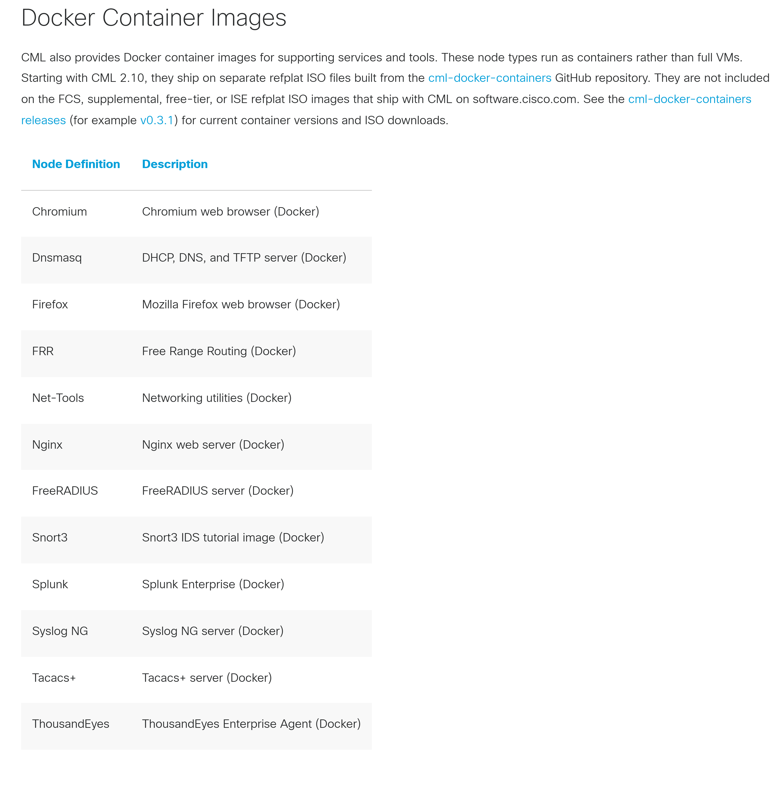

信源：[VM Images for CML Labs · Docker Container Images](https://developer.cisco.com/docs/modeling-labs/vm-images-for-cml-labs/)（抓取 2026-11-06）

| 能力 | 由谁提供 | 注意 |
|-|-|-|
| DHCP / DNS / TFTP 服务器 | 容器 **Dnsmasq** | 它是一台独立主机，**不等于**交换机的 DHCP snooping / DAI |
| 日志服务器 | 容器 **Syslog NG** | 做集中日志采集与验证 |
| RADIUS 服务器 | 容器 **FreeRADIUS** | 802.1X / MAB 全链路可自建 |
| TACACS+ 服务器 | 容器 **Tacacs+** | 设备管理登录授权 |
| 路由协议对端 | 容器 **FRR** | 非思科代码，用于打流与协议对端，**不能**用来验证思科实现 |
| 其他 | Chromium、Firefox、Net-Tools、Nginx、Snort3、Splunk、ThousandEyes | 与协议支持无关，做客户端 / 服务端 / 旁路分析用 |

### 3.2 NAT 模式下的 DHCP

NAT 模式下 lab 侧地址由 CML 主机侧服务分配，网段固定 `192.168.255.0/24`，节点接口设为 DHCP 即可取址（[FAQ](https://developer.cisco.com/docs/modeling-labs/faq/)）。**这条不是「CML 支持 DHCP 协议」的证据**——它只是平台给节点发地址，与镜像里能不能配 `ip dhcp pool` 是两件事。

## 4 逐镜像核对

下面八节结构统一：官方页链接 → 页面原样截图 → 官方写了什么 → 支持什么 → 不支持什么 → 对实验的一句话含义。

### 4.1 IOSv（路由器）

信源：[IOSv](https://developer.cisco.com/docs/modeling-labs/iosv/)（抓取 2026-11-06）

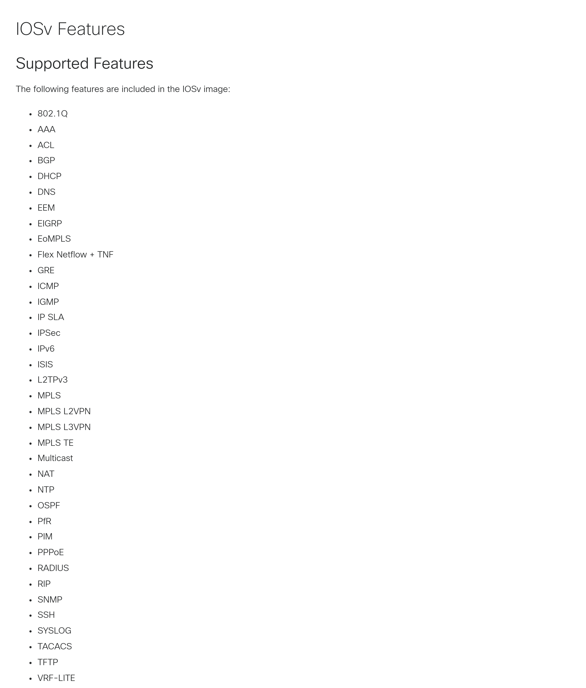

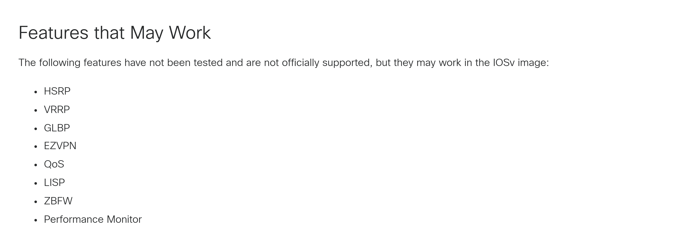

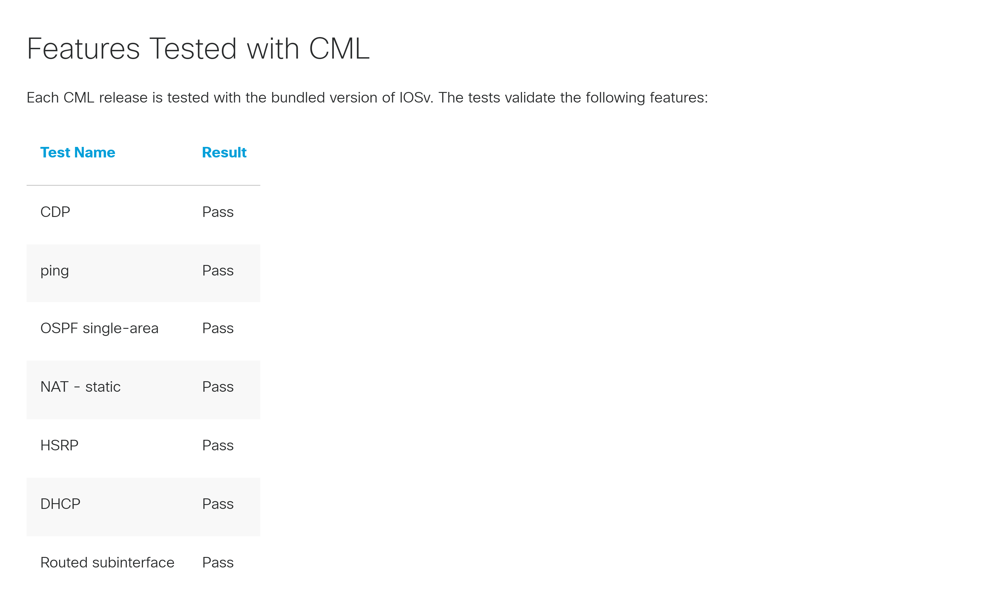

- **官方定位**：完整的三层控制面与数据面（full layer-3 control-plane and data-plane functionality）；**不支持二层交换**，但支持二层封装（EoMPLS、L2TPv3）。
- **支持清单（37 项）**：802.1Q、AAA、ACL、BGP、DHCP、DNS、EEM、EIGRP、EoMPLS、Flex Netflow + TNF、GRE、ICMP、IGMP、IP SLA、IPSec、IPv6、ISIS、L2TPv3、MPLS、MPLS L2VPN、MPLS L3VPN、MPLS TE、Multicast、NAT、NTP、OSPF、PfR、PIM、PPPoE、RADIUS、RIP、SNMP、SSH、SYSLOG、TACACS、TFTP、VRF-LITE。
- **可能可用（8 项，不官方支持）**：HSRP、VRRP、GLBP、EZVPN、QoS、LISP、ZBFW、Performance Monitor。
- **明确不支持（5 项）**：OTV、BFD、VPLS、Voice、AVC。
- **官方通过记录（7 项，全 Pass）**：CDP、ping、OSPF 单区域、NAT 静态、HSRP、DHCP、路由子接口。
- **一句话含义**：做**路由协议与常见服务协议**的实验，IOSv 是覆盖面最广、唯一能查到完整清单的选型；但它不能替代交换机，二层实验必须换 IOSvL2。

> 注意一处官方自相矛盾：HSRP 同时出现在「可能可用、不官方支持」栏与官方给的通过记录里。真实承诺强度按官方那份通过记录读，即 **HSRP 可用**（见 [[#7 五个容易踩的坑|7 五个坑]] 第 ② 条）。

### 4.2 IOSvL2（交换机）

信源：[IOSvL2](https://developer.cisco.com/docs/modeling-labs/iosvl2/)（抓取 2026-11-06）

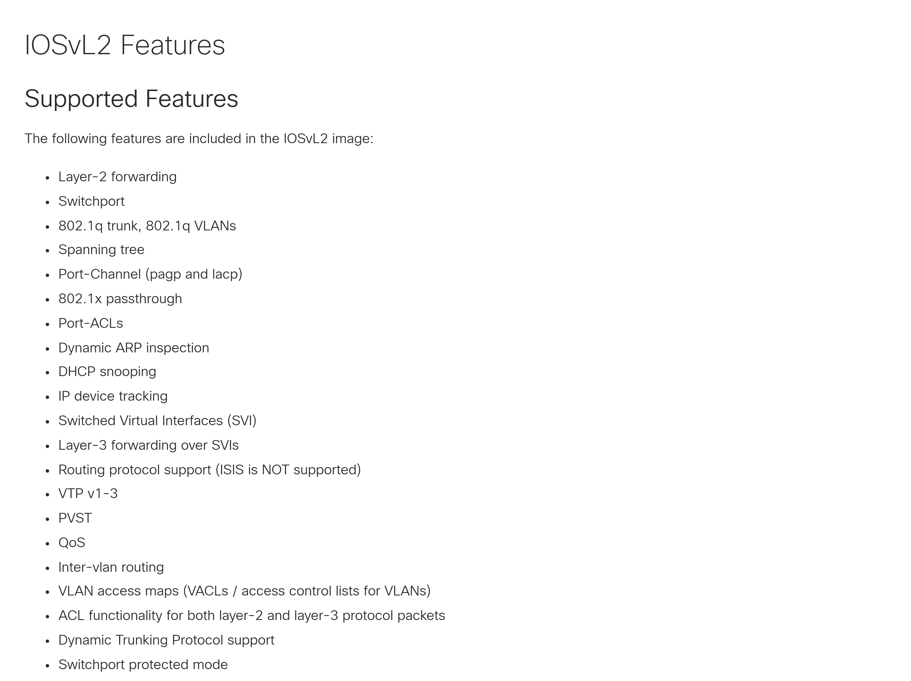

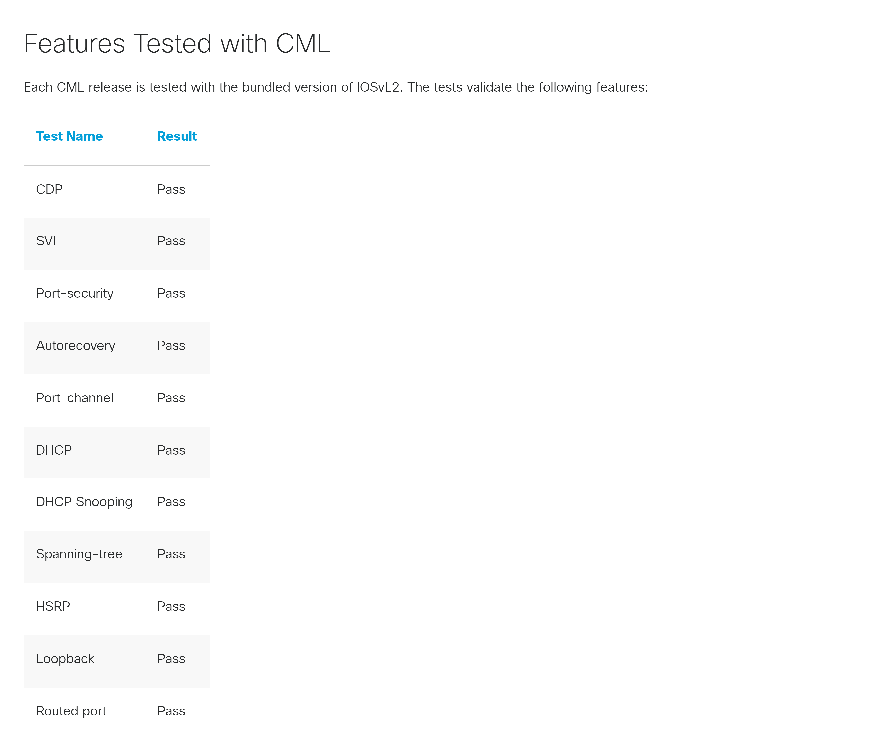

- **官方定位**：以二层交换为主（primarily a Layer-2 switch），同时具备三层控制面与数据面。
- **支持清单（21 项）**：二层转发、switchport、802.1q trunk 与 VLAN、生成树（Spanning tree）、Port-Channel（PAgP 与 LACP）、802.1x passthrough、Port-ACL、动态 ARP 检查（DAI）、DHCP snooping、IP device tracking、SVI、SVI 上的三层转发、路由协议（**IS-IS 除外**）、VTP v1–3、PVST、QoS、VLAN 间路由、VACL、二层与三层报文的 ACL、DTP、switchport protected。
- **明确不支持（2 项）**：端口镜像（SPAN）、私有 VLAN（Private VLAN）。
- **官方通过记录（11 项，全 Pass）**：CDP、SVI、Port-security、Autorecovery、Port-channel、DHCP、DHCP Snooping、Spanning-tree、HSRP、Loopback、Routed port。
- **一句话含义**：二层与「依赖端口信任状态」的协议（DHCP snooping、DAI、Port-security）只能在这里验；SPAN 与 PVLAN 是硬缺口，抓包请用 CML 的链路抓包功能而不是 SPAN。

### 4.3 IOL 与 IOL-L2

信源：[IOL](https://developer.cisco.com/docs/modeling-labs/iol/)（抓取 2026-11-06）

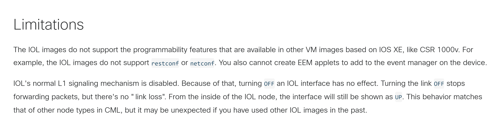

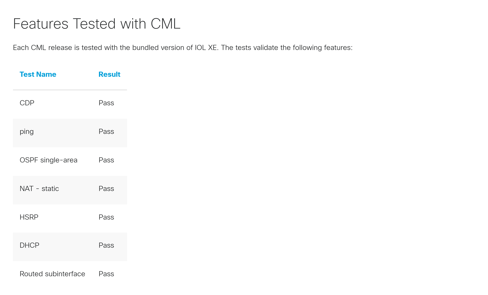

- **官方定位**：IOS-XE 的实现，但**不是完整虚机**（does not run as a full virtual machine，实为容器化进程），因此 CPU 与内存占用远低于 IOSv 与 CSR 1000v；16 个以太接口；完整三层，无二层交换。
- **官方通过记录（7 项，全 Pass）**：CDP、ping、OSPF 单区域、NAT 静态、HSRP、DHCP、路由子接口。
- **IOL-L2 要单独看**：官方 IOL 页没有给 IOL-L2 单独的特性清单，但页内 DHCP、HSRP、路由子接口三项记录的搭建方式都是「两台 IOL 路由器 + 一台 IOL-L2 交换机」，并在 IOL-L2 上配置 VLAN、trunk 与 SVI——即 **IOL-L2 具备二层交换能力**（VLAN / trunk / SVI，A 级原文）。这也是 [[#8 总表：协议 × 镜像 × 官方表态|8 总表]] 里「二层」两行要把 IOL 与 IOL-L2 分开记的原因。
- **明确限制**：不支持 RESTCONF 与 NETCONF；不能创建 EEM applet；**L1 信令禁用**——把接口关掉不会产生 link down，链路停转发但节点内部看到的接口仍是 UP。
- **一句话含义**：跑协议最快最省资源的一档，适合大拓扑与批量回归；但凡要验「链路断开后协议怎么收敛」，IOL 给不出真实现象。

### 4.4 CSR 1000v

信源：[CSR 1000v](https://developer.cisco.com/docs/modeling-labs/csr-1000v/)（抓取 2026-11-06）

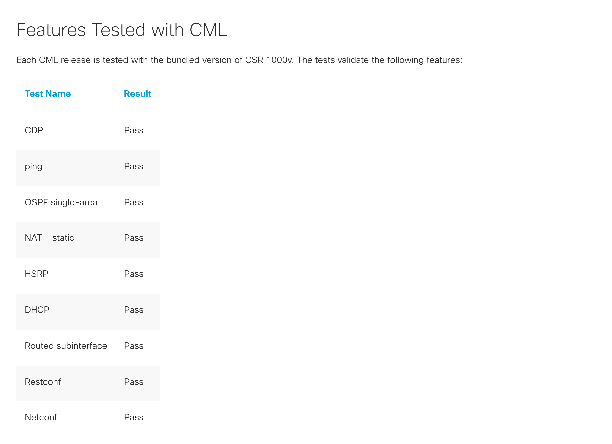

- **官方定位**：IOS-XE 云服务路由器虚机，支持 16 个以太接口；demo 模式无需额外授权。
- **官方通过记录（9 项，全 Pass）**：CDP、ping、OSPF 单区域、NAT 静态、HSRP、DHCP、路由子接口、**RESTCONF**、**NETCONF**。
- **限制**：转发性能约 1.6 Mb/s（两跳串联 1.52 Mb/s）；默认网络驱动为 vmxnet3，若节点定义仍用 virtio，**子接口工作不正常**；带 DF 位置位的 ICMP Echo 需用 virtio 驱动。
- **一句话含义**：**唯一在官方口径里同时通过 RESTCONF 与 NETCONF 的镜像**；做 NETCONF / YANG 自动化实验用它，别用 IOL（明确不支持）。

### 4.5 IOS XRv 9000

信源：[IOS XRv 9000](https://developer.cisco.com/docs/modeling-labs/ios-xrv-9000/)（抓取 2026-11-06）

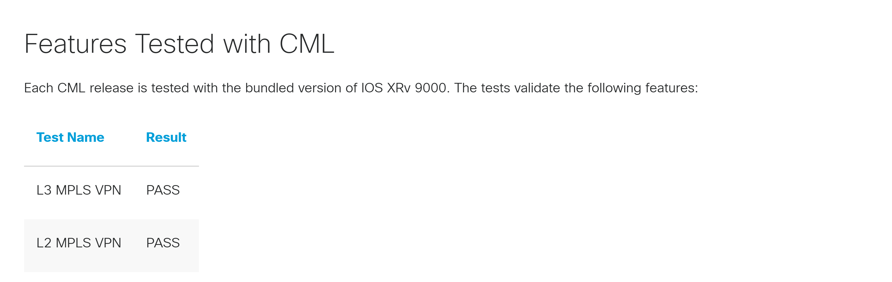

- **官方定位**：IOS XR 虚拟路由器，面向运营商与大型骨干场景。
- **官方通过记录（2 项，全 Pass）**：L3 MPLS VPN（子项：IS-IS 的 PE-P-P-P-PE 路由、MPLS LDP、VRF、mBGP 的 PE-PE 与 VRF 路由导入导出、OSPF 的 CE-PE 路由）、L2 MPLS VPN（CE 间点到点 L2VPN）。
- **限制**：转发性能约 168 Kbit/s（两跳串联 145 Kbit/s），是全部镜像里最低的一档。
- **一句话含义**：**能验的协议就是「MPLS VPN 那一套」**（IS-IS / LDP / mBGP / VRF / OSPF 都在里面），但这张表是「测过」，不是「只支持这些」；查完整特性要回到 [IOS XR 厂商文档](https://www.cisco.com/c/en/us/td/docs/routers/virtual-routers/configuration/guide/b-xrv9k-cg/b-xrv9k-cg_chapter_0110.html)（该章为功能说明与配置指南，**不是** Supported / Unsupported 对照表）。

### 4.6 NX-OS 9000（Nexus 9300v、9500v）

信源：[NX-OS 9000](https://developer.cisco.com/docs/modeling-labs/nx-os-9000/)（抓取 2026-11-06）

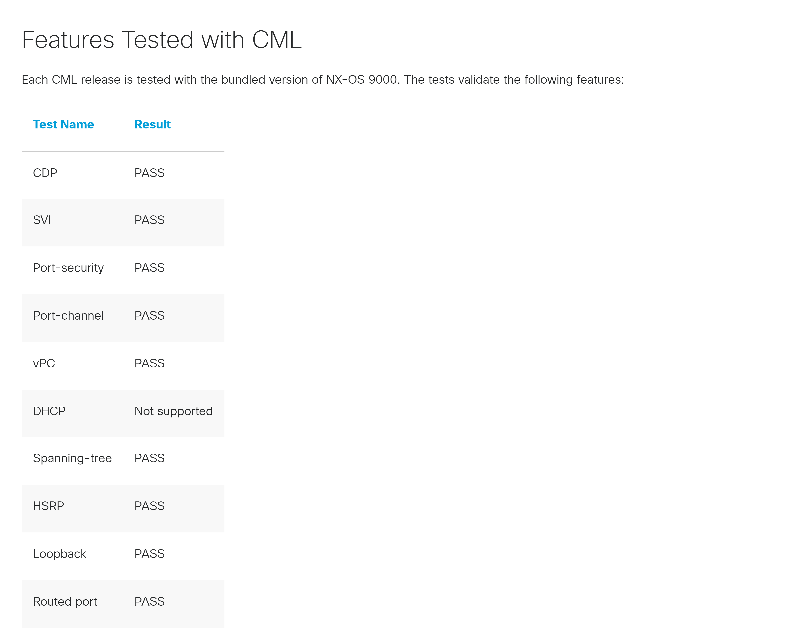

- **官方定位**：跑 Nexus 9000v / 9300v / 9500v 同一份软件镜像，但**不做任何专用硬件仿真**；线卡 ASIC 与硬件交互由软件数据面（software data plane）承担。
- **官方警告**：思科技术支持中心（TAC）对该镜像**支持有限**；三个 VM 镜像**不得用于生产网络**，定位是 NetDevOps 工作流与变更前的快速测试。
- **官方通过记录（10 项）**：CDP、SVI、Port-security、Port-channel、vPC、Spanning-tree、HSRP、Loopback、Routed port 为 PASS；**DHCP 为 Not supported**。
- **限制**：转发性能约 2.3 Mb/s（两跳 2.19 Mb/s，空载基线 307 Mbit/s）；巨型帧（jumbo frames）默认可用，但在接口上配 MTU 要 NX-OS 9.3(3) 及以上。
- **第二信源（厂商侧）**：NX-OS 9000v 配置指南另有「支持特性表」与「不支持特性表」，后者列出 QoS、BFD、ACL、Policy maps、SPAN、IGMP Snooping、AMT，并写明**未列入支持表的特性一律视为不支持**（即使看起来能跑）。
- **一句话含义**：数据中心二层与 vPC 场景可用，**但不要把 NX-OS 9000 当 DHCP 服务器**——这条是 CML 页面上的硬结论，换版本前不要假设已修好。

### 4.7 CAT 9000v（beta）

信源：[CAT 9000v](https://developer.cisco.com/docs/modeling-labs/cat-9000v/)（抓取 2026-11-06）

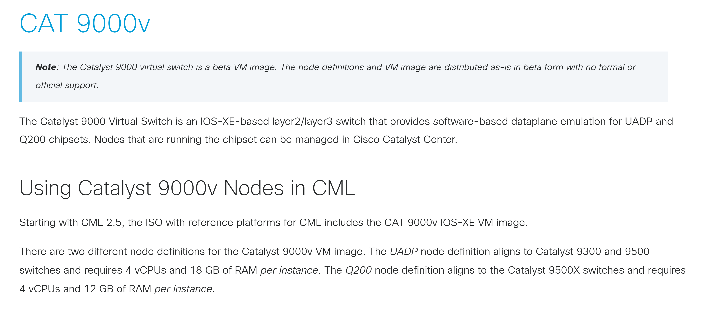

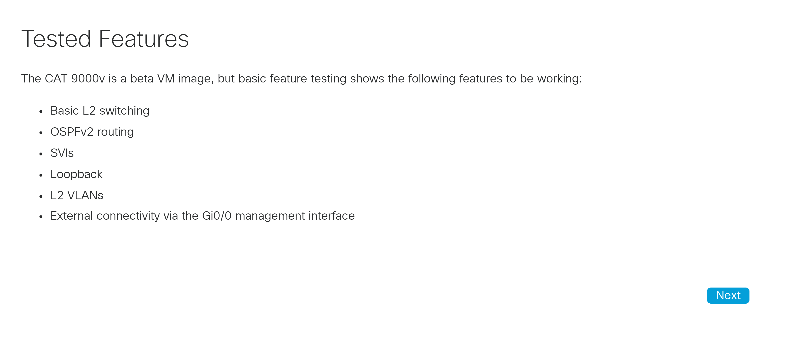

- **官方定位**：基于 IOS-XE 的二 / 三层交换机，对 UADP 与 Q200 芯片组做**软件数据面仿真**；跑该芯片组的节点可在 Catalyst Center 里管理。
- **资源**：UADP 节点定义对齐 Catalyst 9300 / 9500，每实例 4 vCPU + 18 GB；Q200 节点定义对齐 Catalyst 9500X，每实例 4 vCPU + 12 GB。
- **可用功能（6 项）**：基础二层交换、OSPFv2 路由、SVI、Loopback、二层 VLAN、经 Gi0/0 管理口的外部连通。
- **限制**：beta 形态，**流量压大容易崩**，数据面吞吐限制在约 250 Kbit/s；day-0 配置能生效但加载很慢。
- **一句话含义**：**只能验配置，不能验流量**；做 Catalyst 9000 的命令行 / 配置模板验证可以，做性能或大流量业务验证会翻车。

### 4.8 CAT 9800-CL（无线）

信源：[Catalyst 9800-CL](https://developer.cisco.com/docs/modeling-labs/catalyst-9800-cl/)（抓取 2026-11-06）

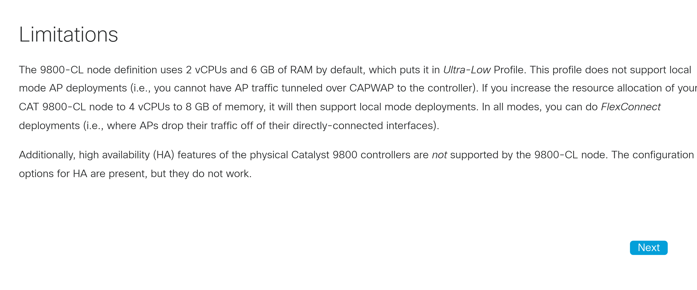

- **官方定位**：IOS-XE 的虚拟无线控制器，可配置与管理无线 AP（接入点），并可将 AP 数据面汇聚到控制器自身。
- **协议侧的关键事实**：**CML 不提供 AP 与无线客户端的镜像**（官方原话：CML does not offer images for access points or wireless clients），但 9800-CL 可以通过桥接外部连通管理**真实 AP**；即使没有真实 AP，也能用它学习 WLAN 配置与 RF 模板。
- **限制**：默认 2 vCPU / 6 GB 属超低配（Ultra-Low Profile），**不支持 local mode**（AP 流量经 CAPWAP 隧道回控制器）；升到 4 vCPU / 8 GB 后支持；FlexConnect 模式在所有配置下都可用。物理 9800 的高可用（HA）特性**在 9800-CL 上不生效**——配置项在，但不工作。首次启动只走 VNC 控制台，保存 day-0 配置并重启后才改用串口控制台。
- **一句话含义**：无线侧能验「配置与认证」，**验不了空口**（没有 AP 与终端镜像）；无线实验的真实短板在镜像，不在协议。

## 5 常用协议速查：协议 × 镜像

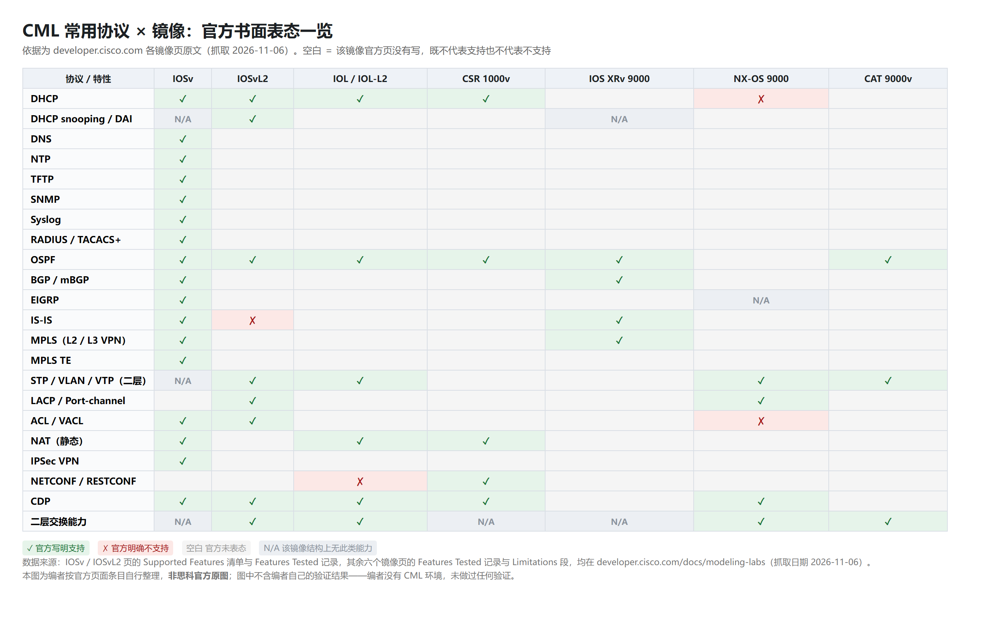

读法：**先看这个协议归谁实现**（见 [[#1 三条结论|1 三条结论]] 第 ① 条），再看哪个镜像的官方页明确写了支持。空白只表示「官方这一页没写」，既不是支持也不是不支持。

| 协议 / 特性 | 谁提供 | 官方明确支持的镜像 | 官方未表态 / 明确不支持 |
|-|-|-|-|
| DHCP（服务端与客户端） | 镜像内 NOS；容器 Dnsmasq 可另起一台 | IOSv、IOSvL2、IOL、CSR 1000v | NX-OS 9000 写 Not supported |
| DHCP snooping / DAI | 交换机镜像自身 | IOSvL2 | 容器 Dnsmasq 替代不了；NX-OS 9000 未表态 |
| DNS | 镜像内 NOS；容器 Dnsmasq | IOSv | 其余未表态 |
| NTP | 镜像内 NOS | IOSv | 其余未表态；节点间无同步时钟，跨节点时序结论不可外推 |
| TFTP | 镜像内 NOS；容器 Dnsmasq | IOSv | 其余未表态 |
| SNMP | 镜像内 NOS | IOSv | 其余未表态；涉及硬件实体的 MIB（电源、风扇、光模块 DDM）不可得 |
| Syslog | 镜像内 NOS；容器 Syslog NG | IOSv | 其余未表态 |
| RADIUS / TACACS+ | 镜像内 NOS；容器 FreeRADIUS / Tacacs+ | IOSv | 其余未表态 |
| OSPF | 镜像内 NOS | IOSv、IOSvL2、IOL、CSR 1000v、IOS XRv 9000（CE-PE）、CAT 9000v（OSPFv2） | NX-OS 9000 未单列，按厂商指南核 |
| BGP / mBGP | 镜像内 NOS | IOSv、IOS XRv 9000（mBGP 子项） | 其余未表态 |
| EIGRP | 镜像内 NOS | IOSv | 其余未表态；NX-OS 本身没有 EIGRP |
| IS-IS | 镜像内 NOS | IOSv、IOS XRv 9000（子项） | IOSvL2 明确不支持 |
| MPLS（L2 / L3 VPN、TE） | 镜像内 NOS | IOSv（MPLS、L2VPN、L3VPN、TE）、IOS XRv 9000（L3 / L2 VPN）、IOL（EoMPLS、L2TPv3） | 其余未表态 |
| STP / VLAN / VTP | 交换机镜像 | IOSvL2、NX-OS 9000、CAT 9000v | IOSv 明确不支持二层交换 |
| LACP / Port-channel | 交换机镜像 | IOSvL2、NX-OS 9000 | 其余未表态 |
| ACL / VACL / Port-ACL | 镜像内 NOS | IOSv、IOSvL2（含 VACL） | NX-OS 9000v 厂商指南把 ACL 列为不支持；匹配语义可看，TCAM 表项容量不在官方说明范围 |
| NAT（静态） | 镜像内 NOS | IOSv、IOL、CSR 1000v | 大规模会话与性能不在官方说明范围 |
| IPSec VPN | 镜像内 NOS | IOSv | 吞吐与时延不在官方说明范围 |
| NETCONF / RESTCONF | 镜像内 NOS | CSR 1000v | IOL 明确不支持；IOSv 清单里没有，属未表态 |

## 6 在 CML 里怎么验证一个协议

官方清单只能说明「应该有」，要证明「这次真的通了」，三个动作够用：

**① 抓包面板**：起止点、协议列直接给出 DHCP、OSPF、BGP 等名称。协议没起来时，先看「报文发出去没有、对端回没回」，比在设备上敲 `show` 更快分清是配置问题还是链路问题。

**② 节点控制台**：`show` 邻居与状态，验证协议状态机是否收敛。注意 IOL 系 L1 信令禁用——关链路不会产生 link down，做「链路断开后如何收敛」的实验时现象与真机不同。

**③ 链路状态面板（Link Condition）**：注入延迟、抖动、丢包，观察协议是否按预期收敛或切换。这是 CML 相对真机的优势项（真机很难反复制造受控劣化），但只能看「是否切换」，给不出「切换用了多少毫秒」——节点间没有同步时钟。

**一句话区分**：界面能证明的是「本次已测」，官方清单定义的是「官方支持」。对外承诺或选型时按 [[#8 总表：协议 × 镜像 × 官方表态|8 总表]] 读，不要按「界面里跑通了一次」读。

## 7 五个容易踩的坑

**① 空白不等于不支持。** 只有 IOSv 与 IOSvL2 给了完整清单，其余镜像页的空白是「官方没表态」。把空白读成不支持会白白放弃能用能力；反过来把空白读成支持，会在交付时翻车。

**② 「可能可用」不等于支持。** IOSv 的 HSRP 同时出现在「可能工作但未测试、不官方支持」栏和官方给的通过记录里，官方两处口径并存；VRRP / GLBP / QoS 则只在「可能可用」栏，官方没有给过通过结论。强弱顺序：官方通过记录 > 支持清单 > 可能可用 > 未表态 > 明确不支持。

**③ 别拿 NX-OS 9000 做 DHCP 服务器。** CML 页面把它记为 Not supported。二层实验要用 DHCP，把服务器放在 IOSvL2 或 IOL 上，NX-OS 9000 只做二层转发与 vPC。

**④ CAT 9000v 是 beta，只能验配置不能验流量。** 官方明说无正式支持、吞吐约 250 Kbit/s，压流量容易把节点跑崩。

**⑤ 容器 Dnsmasq 是「另一台服务器」。** 它能发地址、做 DNS 与 TFTP，但 DHCP snooping、DAI 这些依赖交换机端口信任状态的功能，只能用交换机镜像验。

## 8 总表：协议 × 镜像 × 官方表态

下表把 [[#5 常用协议速查：协议 × 镜像|5 常用协议速查]] 的结论收成一张可对照的宽表。**四种取值，别混读**：

- **支持**＝官方页明确写了支持（在特性清单里列出，或在该页标为 `Pass`）；
- **不支持**＝官方明确写不支持，或把该项列入不支持特性表；
- **未表态**＝该镜像官方页**没有写**（既不代表支持，也不代表不支持）；
- **不适用**＝该镜像**结构上就没有这类能力**（如纯三层镜像没有二层交换），问它「支不支持」本身没有意义。**它不是「没查到数据」。**

| 协议 / 特性            | IOSv   | IOSvL2  | IOL / IOL-L2    | CSR 1000v | IOS XRv 9000 | NX-OS 9000  | CAT 9000v   | 依据                            |
| ------------------ | ------ | ------- | --------------- | --------- | ------------ | ----------- | ----------- | ----------------------------- |
| DHCP               | 支持     | 支持      | 支持              | 支持        | 未表态          | **不支持**     | 未表态         | P01、P03、P04、P05、P07、P08、P10     |
| DHCP snooping / DAI | 不适用    | 支持      | 未表态             | 未表态       | 不适用          | 未表态         | 未表态         | P04、P05                       |
| DNS                | 支持     | 未表态     | 未表态             | 未表态       | 未表态          | 未表态         | 未表态         | P01                           |
| NTP                | 支持     | 未表态     | 未表态             | 未表态       | 未表态          | 未表态         | 未表态         | P01                           |
| TFTP               | 支持     | 未表态     | 未表态             | 未表态       | 未表态          | 未表态         | 未表态         | P01                           |
| SNMP               | 支持     | 未表态     | 未表态             | 未表态       | 未表态          | 未表态         | 未表态         | P01                           |
| Syslog             | 支持     | 未表态     | 未表态             | 未表态       | 未表态          | 未表态         | 未表态         | P01                           |
| RADIUS / TACACS+   | 支持     | 未表态     | 未表态             | 未表态       | 未表态          | 未表态         | 未表态         | P01                           |
| OSPF               | 支持     | 支持      | 支持              | 支持        | 支持（CE-PE）    | 未表态         | 支持（OSPFv2）  | P01、P03、P04、P07、P08、P09、P11     |
| BGP / mBGP         | 支持     | 未表态     | 未表态             | 未表态       | 支持（mBGP 子项）  | 未表态         | 未表态         | P01、P09                       |
| EIGRP              | 支持     | 未表态     | 未表态             | 未表态       | 未表态          | 不适用         | 未表态         | P01                           |
| IS-IS              | 支持     | **不支持** | 未表态             | 未表态       | 支持（子项）       | 未表态         | 未表态         | P01、P04、P09                   |
| MPLS（L2 / L3 VPN）  | 支持     | 未表态     | 未表态             | 未表态       | 支持           | 未表态         | 未表态         | P01、P09                       |
| MPLS TE            | 支持     | 未表态     | 未表态             | 未表态       | 未表态          | 未表态         | 未表态         | P01                           |
| STP / VLAN / VTP   | 不适用    | 支持      | 支持（IOL-L2）      | 未表态       | 未表态          | 支持          | 支持          | P04、P05、P10、P11               |
| LACP / Port-channel | 未表态    | 支持      | 未表态             | 未表态       | 未表态          | 支持          | 未表态         | P04、P05、P10                   |
| ACL / VACL         | 支持     | 支持      | 未表态             | 未表态       | 未表态          | 不支持（厂商指南）   | 未表态         | P01、P04                       |
| NAT（静态）            | 支持     | 未表态     | 支持              | 支持        | 未表态          | 未表态         | 未表态         | P01、P07、P08                   |
| IPSec VPN          | 支持     | 未表态     | 未表态             | 未表态       | 未表态          | 未表态         | 未表态         | P01                           |
| NETCONF / RESTCONF | 未表态    | 未表态     | **不支持**         | 支持        | 未表态          | 未表态         | 未表态         | P06、P08                       |
| CDP                | 支持     | 支持      | 支持              | 支持        | 未表态          | 支持          | 未表态         | P03、P05、P07、P08、P10           |
| 二层交换能力             | 不适用    | 支持      | 支持（IOL-L2）      | 不适用       | 不适用          | 支持          | 支持          | P04、P10、P11                   |

> **「不适用」怎么判的（两档依据，别当成同一强度）**
>
> - **A 级（官方原文明说）**：IOSv 页写的是不支持二层交换（完整三层），IOL 页写的是完整三层、无二层交换。这两列的二层相关行填「不适用」有原文支撑。
> - **B 级（按镜像定位推断）**：CSR 1000v 与 IOS XRv 9000 都属路由器镜像，官方页没有直接声明「无二层交换」。旁证有两条——官方 CSR 1000v 页的 HSRP 与路由子接口两项测试，二层是**另配 IOSvL2 交换机**完成的；XRv 9000 页面里的 L2 指的是 **L2 MPLS VPN（点到点 PW）**，不是以太交换。故这两列的二层交换能力填「不适用」属推断。
> - **只对「整类能力」下这个判断**：具体协议行（如 DHCP snooping）仍严格按官方原文记——官方没写就记「未表态」，不跟着上面的推断往下填。所以会出现「二层交换＝不适用，但 DHCP snooping＝未表态」的组合，这是有意为之。
> - **IOL 列是两款镜像**：**纯三层的 IOL 没有二层交换，但 IOL-L2 有**（官方 IOL 页的 DHCP、HSRP、路由子接口三项测试，都是借 IOL-L2 当二层交换机、在上面配 VLAN / trunk / SVI 完成的），故 STP/VLAN 与二层交换两行填「支持（IOL-L2）」。

**读表要点**：这张表的「未表态」占了大半，不是本文没查，而是**官方没写**——八个镜像页里只有两个给了完整特性清单。因此选型时不要把「未表态」当成「没有」，也不要当成「有」；正确做法是回到该镜像版本的厂商功能文档，或者自己在 CML 里起一台验证（方法见 [[#6 在 CML 里怎么验证一个协议|6 在 CML 里怎么验证]]）。表里所有「支持」二字，出处都是官方页面原文，本报告没有做任何验证。

## 附录 A 信源与截图清单

### A.1 官方页面（全部 A 级，抓取日期 2026-11-06）

| 编号 | 页面 | URL | 对应截图 |
|-|-|-|-|
| S1 | IOSv | https://developer.cisco.com/docs/modeling-labs/iosv/ | P01、P02、P03 |
| S2 | IOSvL2 | https://developer.cisco.com/docs/modeling-labs/iosvl2/ | P04、P05 |
| S3 | IOL | https://developer.cisco.com/docs/modeling-labs/iol/ | P06、P07 |
| S4 | CSR 1000v | https://developer.cisco.com/docs/modeling-labs/csr-1000v/ | P08 |
| S5 | IOS XRv 9000 | https://developer.cisco.com/docs/modeling-labs/ios-xrv-9000/ | P09 |
| S6 | NX-OS 9000 | https://developer.cisco.com/docs/modeling-labs/nx-os-9000/ | P10 |
| S7 | CAT 9000v | https://developer.cisco.com/docs/modeling-labs/cat-9000v/ | P11、P14 |
| S8 | Catalyst 9800-CL | https://developer.cisco.com/docs/modeling-labs/catalyst-9800-cl/ | P12 |
| S9 | VM Images for CML Labs | https://developer.cisco.com/docs/modeling-labs/vm-images-for-cml-labs/ | P13 |
| S10 | FAQ（NAT 模式 DHCP 网段） | https://developer.cisco.com/docs/modeling-labs/faq/ | 无图，文字引用 |

### A.2 厂商侧补充信源（用于「第二信源」口径，表格未取到渲染）

| 编号 | 页面 | URL |
|-|-|-|
| S11 | Nexus 9000v 9.2(x) 配置指南 · Guidelines and Limitations 与 Supported Features | https://www.cisco.com/c/en/us/td/docs/switches/datacenter/nexus9000/sw/92x/nx-osv/configuration/guide/b-cisco-nexus-9000v-guide-92x/b-cisco-nexus-9000v-guide-92x_chapter_010.html |
| S12 | Nexus 9000v 9.3 Feature Support | https://www.cisco.com/c/en/us/td/docs/switches/datacenter/nexus9000/sw/93x/nx-osv/configuration/guide/b-cisco-nexus-9000v-guide-93x/m_cisco_nexus_9000v_9x.html |
| S13 | Nexus 9300v / 9500v 9.3 Feature Support | https://www.cisco.com/c/en/us/td/docs/switches/datacenter/nexus9000/sw/93x/nx-osv-93-95/configuration/guide/cisco-nexus-9000v-9300v-9500v-guide-93x/m-overview.html |
| S14 | IOS XRv 9000 · Router Control Plane Specific Features | https://www.cisco.com/c/en/us/td/docs/routers/virtual-routers/configuration/guide/b-xrv9k-cg/b-xrv9k-cg_chapter_0110.html |

### A.3 截图清单（存于 `images/protocol/`）

| 编号 | 文件 | 内容 | 来源页 |
|-|-|-|-|
| P01 | `P01-iosv-supported.png` | IOSv Supported Features 37 项 | S1 |
| P02 | `P02-iosv-may-work.png` | IOSv Features that May Work 8 项 | S1 |
| P03 | `P03-iosv-tested.png` | IOSv Features Tested 7 项 | S1 |
| P04 | `P04-iosvl2-supported.png` | IOSvL2 Supported Features 21 项 | S2 |
| P05 | `P05-iosvl2-tested.png` | IOSvL2 Features Tested 11 项 | S2 |
| P06 | `P06-iol-limitations.png` | IOL 限制（无 RESTCONF / NETCONF、L1 信令禁用） | S3 |
| P07 | `P07-iol-tested.png` | IOL Features Tested 7 项 | S3 |
| P08 | `P08-csr1000v-tested.png` | CSR 1000v Features Tested 9 项（含 RESTCONF / NETCONF） | S4 |
| P09 | `P09-xrv9000-tested.png` | IOS XRv 9000 Features Tested 2 项 | S5 |
| P10 | `P10-nxos9000-tested.png` | NX-OS 9000 Features Tested 10 项（DHCP Not supported） | S6 |
| P11 | `P11-cat9000v-tested.png` | CAT 9000v Tested Features 6 项 | S7 |
| P12 | `P12-cat9800cl-limitations.png` | CAT 9800-CL 限制（资源档位、local mode、HA 不生效） | S8 |
| P13 | `P13-vmimages-docker.png` | Docker Container Images 12 个容器 | S9 |
| P14 | `P14-cat9000v-beta-note.png` | CAT 9000v beta 声明与两套节点定义资源 | S7 |
| P15 | `P15-proto-matrix.png` | 协议 × 七个镜像矩阵，四种取值：支持 / 不支持 / 未表态 / N/A（编者自绘） | 本报告 |

### A.4 与本报告的边界

- **本文只核「镜像页明确写出来的东西」**。协议清单之外的协议（如 VXLAN、EVPN、Segment Routing、SRv6），八个 CML 镜像页均未逐项列出，本文不作结论；要用的话按「先查该镜像版本的厂商功能文档，再自己在 CML 里起一台验证」两步走。
- **本文不核性能**。各镜像的吞吐数字（IOSv ~2.8 Mb/s、IOSvL2 ~2.3 Mb/s、CSR 1000v ~1.6 Mb/s、NX-OS 9000 ~2.3 Mb/s、IOS XRv 9000 ~168 Kbit/s、CAT 9000v ~250 Kbit/s）取自各页 Limitations 段，只用于判断「能做功能验证、不能做性能验证」。
- **平台自身的对外端口**（443 / 22 / 9090）与登录认证方式不在本文范围，见《思科CML-2020-2026-功能体系与能力边界》的 4.6 节。
