# 思科 CML / VIRL 使用案例全集（合并定稿）

> **本文是什么**：把三份前置调研（`思科CML-前身VIRL与内外使用场景-调研`、`思科CML-VIRL-内部使用方式-官方宣传与个人实践`、`思科CML-VIRL-使用案例全集-官方信源`）里的全部使用记录，去重、统一编号、按**证据置信度**重排，合成一份可直接引用的案例库。
> **本文回答一个问题**：**谁、在什么时间、用 CML 做了什么、做成了什么、证据有多硬**。
> **不回答**：CML 的前史沿革、版本谱系、功能清单（那些在另外两份文档里）。

**合并口径的三条硬规则**

1. **一条记录只出现一次**。同一件事在多篇文章里出现，取最早或最原始那篇作信源，其余作旁证。
2. **编号按置信度分段**：`C01-C05` 是 L1，`C06-C21` 是 L2，`C22-C27` 是 L3。看到编号就知道证据强度，不必回查表格。
3. **截图只放对得上的那张**。抓不到的页面如实标「无截图 + 原因」，**绝不用别的图顶替**——把 A 页面的图放在 B 条目下，比没有图更糟。

---

## 目录

- [[#0 一页速览|0 一页速览]]
  - [[#0.1 场景总表（按置信度排序）|0.1 场景总表]]
  - [[#0.2 场景族归类|0.2 场景族归类]]
  - [[#0.3 使用方归类|0.3 使用方归类]]
  - [[#0.4 读表三条规则|0.4 读表三条规则]]
- [[#1 置信度口径|1 置信度口径]]
- [[#2 L1 案例（C01-C05，有量化结果或完整可复现工件）|2 L1 案例]]
- [[#3 L2 案例（C06-C21，有具体动作）|3 L2 案例]]
- [[#4 L3 案例（C22-C27，仅宣称或组织级概括）|4 L3 案例]]
- [[#5 被否掉的场景（有官方原文支撑）|5 被否掉的场景]]
- [[#6 定位演进：从仿真器到 Agent 的验证环境|6 定位演进]]
- [[#7 缺口（官方未公开，不补不猜）|7 缺口]]
- [[#8 截图清单与缺口|8 截图清单与缺口]]
- [[#9 信源总表|9 信源总表]]
- [[#附录 A 旧编号对照|附录 A 旧编号对照]]

---

## 0 一页速览

### 0.1 场景总表（按置信度排序）

**判定口径**：「有人做成过」= 该场景至少有 1 条 L1/L2 案例；「官方能力支持」= 官方文档明确写了这条能力。两者都满足才进「高」。

| 场景 | 有人做成过 | 官方能力支持 | 置信度 | 代表案例 | 主要失效条件 |
|---|---|---|---|---|---|
| 变更前验证（配置逻辑） | 是（L1/L2） | 是 | **高** | C01、C04、C07、C15 | 变更涉及硬件/规模/时序 |
| CI 门禁与回归 | 是（L1） | 是 | **高** | C04、C11 | 无测试用例、无 CI |
| 认证与教学实验 | 是（L1/L2） | 是 | **高** | C02、C10、C12、C20、C27 | 需要高吞吐或特殊硬件 |
| 未上线环境预演 | 是（L1/L2） | 是 | **高** | C01、C07 | 机房规模远大于仿真容量 |
| 售前演示与 POC | 是（L2） | 是 | **高** | C06、C25、C26 | 被追问性能指标 |
| 方案自测（SD-WAN / ISE / 无线） | 是（L1/L2） | 是 | **高** | C03、C19 | 需要授权镜像与足够内存 |
| AI Agent 沙箱与评测 | 是（L1/L2） | 是（MCP 内置 + 回滚 + 抓包） | **中高** | C05、C17、C21 | 学到的是仿真行为，迁移生产会失真 |
| 故障复现 | 是（L2/L3） | 部分 | 中 | C23、C24、C05 | 硬件相关故障、时序类问题 |
| 攻防靶场 | 是（L1） | 是（自定义镜像 + 隔离） | 中 | C02 | 无隔离条件、镜像授权受限 |
| 数字孪生（全量镜像现网） | 是（L3） | 部分 | 中 | C24、C05、C08 | 现网规模大、硬件异构 |
| 生产配置逐字节复用 | 部分 | 官方口径冲突 | 低 | — | 接口编号、平台、规模差异 |
| 吞吐 / 容量 / 时延测试 | **否** | **官方明确不适合** | **不成立** | — | 官方原文：not generally suitable for testing throughput or timing |
| 硬件特性验证（ASIC / TCAM / 队列卸载） | **否** | **官方明确不支持** | **不成立** | — | 被截断在硬件抽象层（hardware abstraction layer） |

**这张表怎么读**：前 7 行可以直接写进方案；第 8-10 行要带条件用；第 11 行不要碰；最后两行是被官方原文否掉的，见 [[#5 被否掉的场景（有官方原文支撑）|第 5 章]]。

### 0.2 场景族归类

十三个场景按「用户到底想解决什么问题」归五族，同族内的失效条件往往同源。

**族 A｜变更与验证**（上线前把风险走一遍）

| 场景 | 案例 | 一句话做法 | 门槛 |
|---|---|---|---|
| 变更前验证 | C01、C04、C07、C15 | 把目标拓扑建出来，跑配置假设，记结论与差异 | 中：要能复刻拓扑 |
| CI 门禁与回归 | C04、C11 | 拓扑即代码 → CI 起环境 → 变更前后快照 diff → 不通过就拦 | 高：要有 CI 与测试用例 |
| 未上线环境预演 | C01、C07 | 机房还没通电，先在仿真里把配置与自动化跑通 | 中：要能接受仿真与生产的差异 |

**族 B｜交付与售前**（不等物流、不等设备）

| 场景 | 案例 | 一句话做法 | 门槛 |
|---|---|---|---|
| 售前演示与 POC | C06、C25、C26 | 讲之前先自己跑一遍；或藏在云端只给一个预约链接 | 低 |
| 方案自测 | C03、C19 | 把自家 SD-WAN / ISE / 无线控制器放进拓扑联调 | 中-高：要懂产品、要授权镜像 |

**族 C｜教学与人才**（把人放进环境里）

| 场景 | 案例 | 一句话做法 | 门槛 |
|---|---|---|---|
| 认证与教学实验 | C02、C10、C12、C20、C27 | 一套标准实验 → API 批量复制 N 份 → 每人一份 → 收回销毁 | 低-中：模板 + 分配 |
| 攻防靶场 | C02 | 造可被攻破的靶机，限速 + 隔离 + 日志 + 独立 IP | 高：要安全隔离能力 |

**族 D｜运维与智能体**（把真问题搬进可控环境）

| 场景 | 案例 | 一句话做法 | 门槛 |
|---|---|---|---|
| 故障复现 | C23、C24、C05 | 按现网拓扑复刻 → 复现现象 → 改配置验证假设 | 中：要拿到同版本 OS |
| 数字孪生 | C24、C05、C08 | 现网拓扑全量镜像，用于设计与变更验证 | 高：规模与硬件异构 |
| AI Agent 沙箱与评测 | C05、C17、C21 | Agent 改配置 → 看结果 → 不对就回滚；有标准答案可回归 | 中-高：要设计评测集 |

**族 E｜不成立**（官方原文否掉，见 [[#5 被否掉的场景（有官方原文支撑）|第 5 章]]）

| 场景 | 为什么否 |
|---|---|
| 吞吐 / 容量 / 时延验收 | 官方节点页给出实测吞吐量级（数 Mbps 以下），并明示不适合 |
| 硬件特性验证 | 官方明示不做任何具体硬件平台仿真 |
| 生产配置逐字节复用 | 官方两处表述互相冲突，且接口编号与规模必然不同 |

### 0.3 使用方归类

| 使用方类型 | 案例编号 | 条数 |
|---|---|---|
| 思科内部（CTO 办公室 / SP 团队 / Advanced Services / TAC / Sales / DevNet Sandbox / ASIG） | C01、C02、C06、C07、C08、C09、C10、C22、C23 | 9 |
| 外部客户与合作伙伴 | C03、C11、C24、C25、C26 | 5 |
| 教育与认证（含高校、个人备考） | C12、C13、C20、C27 | 4 |
| 工具链与生态（CI / Ansible / Terraform / NetBox / MCP） | C04、C14、C15、C16、C17、C18、C19 | 7 |
| 第三方研究（学界 / 个人项目） | C05、C21 | 2 |

**这个分布本身是结论**：27 条里只有 5 条是外部客户，且**具名的只有 1 家**（C11 Verizon）。官方对「谁在用」很克制，对「能用来干什么」很放开。

### 0.4 读表三条规则

1. **L1 可以当结论用**（有数字或可复现工件），**L2 当方案参考**（有动作无结果），**L3 只能当「官方认为这件事可行」**，不能当「有人做成过」。
2. **时间列写材料发布年，不是事件发生年**；两者不同时在条目里注明。
3. **「可核验的结果」列只放原文写了的**。原文没写的，一律留空或写「未公开」，**不做数字补全**。

---

## 1 置信度口径

本文沿用前置文档的三级定义，并补充第四级（用于新增的第三方研究）。

| 级别 | 判定标准 | 本文条目 | 数量 |
|---|---|---|---|
| **L1** | 官方或原始信源里出现**可核对的数量**（天数、节点数、pod 数、分钟数、成功率），**或给出完整可复现的工件**（流水线定义、配置文件、命令序列、实验方法） | C01-C05 | 5 |
| **L2** | 能说清「在什么环境里、对什么设备、做了什么操作」，但没有量化结果 | C06-C21 | 16 |
| **L3** | 只有「可以这样用」或「某组织在用」，没有动作细节 | C22-C27 | 6 |
| **否证** | 官方原文明确写「不适合 / 不仿真」，任何案例都不成立 | 见[[#5 被否掉的场景（有官方原文支撑）\|第 5 章]] | 3 类 |

**为什么 L1 只有 5 条**：案例是「某人某时做了一件事」的叙述，天然以博客/演讲形式存在，而这类材料很少带数字。27 条里带数字的只有 4 条（C01 的 7 天/7 台、C02 的 20 pod、C03 的 20 edge、C05 的恢复率），第 5 条（C04）靠的是「完整可复现工件」而非数字。

---

## 2 L1 案例（C01-C05，有量化结果或完整可复现工件）

### C01｜思科 SP 团队：7 天搭出 7 台 IOS XR 的演示救场

| 项目 | 内容 |
|---|---|
| 使用方 | 思科 SP（Service Provider，服务提供商）方案团队，作者 Nathan Sowatskey；执行者 Gunter Van de Velde、Bertrand Duvivier，配合 CTO 办公室 VIRL 团队 |
| 时间 | 2013（RIPE 66 会议前） |
| 场景 | 族 A｜未上线环境预演 / 变更前验证 |
| 做了什么 | 要在 RIPE66 演示 IOS XR 4.3.1 新发布的 BGP DDoS 缓解功能，排不到 7 台 XR 真机，改用 VIRL 搭建 |
| 可核验的结果 | 从确认演讲到环境就绪 **7 天**；物理设备原需 **超过 1 个月**；搭建本身 **数小时**；共 **7 台 IOS XR** |
| 原文 | 「With a lead-time of only seven days … Gunter had a lab with seven IOS XR routers with the configuration and topology he needed.」／「Hours, compared to the many weeks it would have taken with a physical network!」 |
| 置信度 | **L1** — 一句话里给了三个可核对的数量 |
| 链接 | [S13 VIRL Saves the Day!](https://news-blogs.cisco.com/getyourbuildon/virl-saves-the-day)（2013-06-25） |

*【截图】黄底为交付周期与台数。这条案例的价值在于它说明 VIRL 最早被内部接受的场景不是「学习」，而是**赶交付节点**——物理设备排不上，就用仿真顶上。*

> **注意代次**：这是 VIRL 1.0 之前的形态（OpenStack + VM Maestro 图形界面），不是 CML 2.x 的 HTML5 + API。它证明「仿真能救时间」，不能用来证明 2.x 的操作方式。

---

### C02｜思科 ASIG：一次 Terraform 命令起 20 个攻防靶场 pod

| 项目 | 内容 |
|---|---|
| 使用方 | 思科 ASIG（Advanced Security Initiatives Group，内部安全团队）+ Cisco Learning 团队，作者 Chris McCoy |
| 时间 | 2024 |
| 场景 | 族 C｜攻防靶场 / 认证与教学实验 |
| 做了什么 | 内部攻防课「Becoming a Hacker」用 CML 给学员发靶场：先试 AWS，因多台裸金属集群成本高改到 Google Cloud；用 `CiscoDevNet/cloud-cml` 的 Terraform 配置把 CML 镜像云化 |
| 可核验的结果 | 「when we run a Terraform command, **20 pods (virtualized labs) are ready for use**」；每 pod 限速数 Mbps、独立 IP 可溯源到人、保留 DNS 与流量日志、出事可整站销毁重建 |
| 安全措施 | 站点与思科内网隔离；强密码 + Duo MFA + Identity Aware Proxy |
| 边界（原文） | 「While *Becoming a Hacker* is created by volunteers and is **not an official Cisco product**」——内部自愿者项目，不是官方产品 |
| 置信度 | **L1** — 有明确的数量与命令形态 |
| 链接 | [S17 Network Hacking Course Pairs with CML](https://blogs.cisco.com/learning/network-hacking-course-pairs-with-cisco-modeling-labs)（2024-11-01） |

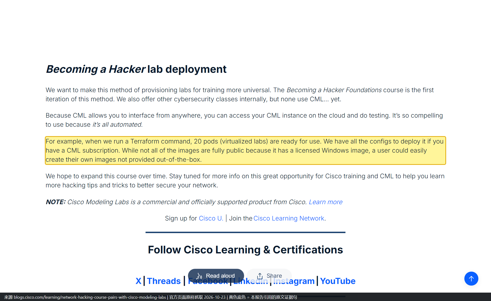

*【截图】黄底为「a Terraform command, 20 pods (virtualized labs) are ready for use」。这是全库唯一把「多租户靶场怎么规模化」写出来的句子。*

---

### C03｜SD-WAN 实验室部署工具：把 20 个 edge 的部署压到分钟级

| 项目 | 内容 |
|---|---|
| 使用方 | SP / 企业用户（工具使用者）+ 思科官方（工具维护方） |
| 时间 | 2026-10（文档更新） |
| 场景 | 族 B｜方案自测 |
| 做了什么 | 用开源 BSD-3 工具在 CML 里自动建 SD-WAN fabric：Manager / Controller / Validator + 最多 20 个 edge，含证书与 onboarding |
| 可核验的结果 | 「This process is fully automated and takes **minutes, not hours**」；两条传输（Internet + MPLS）；可注入时延做 WAN 链路仿真；支持备份恢复 |
| 平台要求 | CML 可裸机、ESXi 或 AWS；推荐本地 CML 集群；工具只支持 Linux/macOS（Windows 需 WSL） |
| 已知限制 | 吞吐受限；加密流量跑到 250 Mbps 以上需另购 HSEC 授权 |
| 置信度 | **L1** — 有明确的数量上限与自动化效果表述 |
| 链接 | [S06 支持文档 222057](https://www.cisco.com/c/en/us/support/docs/routers/sd-wan/222057-sd-wan-lab-deployment-tool-for-cisco-mod.html)（2026-10-13）、[S05 Catalyst SD-WAN 节点页](https://developer.cisco.com/docs/modeling-labs/catalyst-sd-wan) |

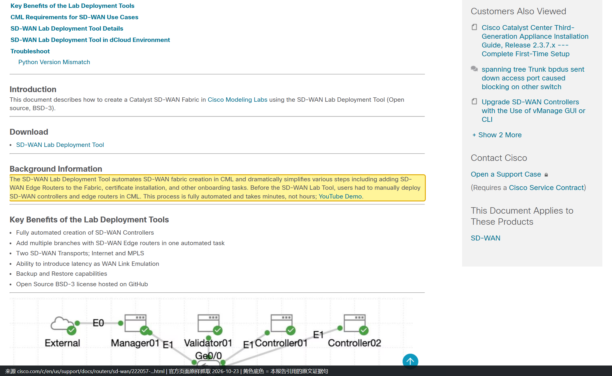

*【截图】注意它是定性对比，没给具体分钟数——本文也照原文写「几分钟而不是几小时」。*

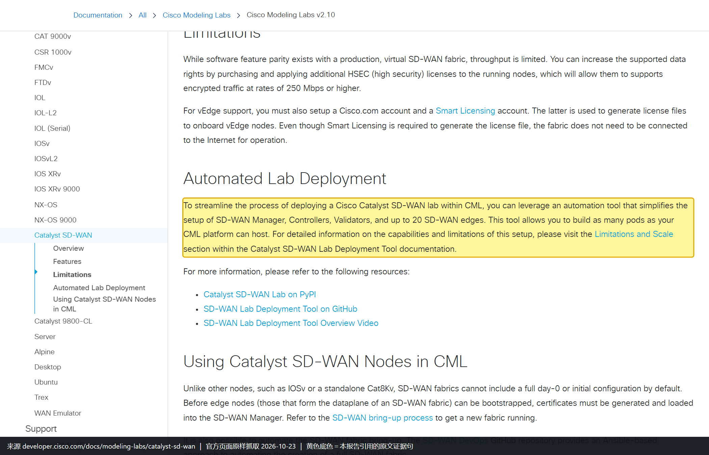

*【截图】同一屏上方还写着吞吐受限、加密流量 250 Mbps 以上要买 HSEC 授权，即上表「已知限制」那行的出处。*

---

### C04｜NetDevOps 团队：把 CML 接进 GitLab CI 做变更门禁

| 项目 | 内容 |
|---|---|
| 使用方 | 一个把网络配置搬进 GitLab CI 的 NetDevOps 团队（作者第一人称，未点名公司），作者 Adrian Iliesiu |
| 时间 | 2022-10 |
| 场景 | 族 A｜CI 门禁与回归 |
| 做了什么 | GitLab CE + runner（都跑在 Docker 里）；被测网络是 CML 里的一组 Nexus 9000v；Ansible 下发 OSPF；pyATS 在变更前后各拍一次快照并 diff |
| 可照抄的工件 | 流水线三段 `pyats-pre-snapshot → deploy-OSPF → pyats-post-snapshot`；完整 `.gitlab-ci.yml`；`pyats run job job.py --testbed-file cml_test.yaml`；`pyats diff pre_…json post_…json`；测试容器镜像 `adrianii/cicd-en:0.1.0` |
| 原文 | 「Ansible will be used to perform the configuration changes and **our test networking environment will be a set of Cisco Nexus 9000v virtual switches running in CML**.」 |
| 置信度 | **L1（最弱一档）** — 给的不是数字，而是完整可复现工件；能证明流程真跑过，**不能证明省了多少时间** |
| 链接 | [S22 CI/CD Pipelines for Infrastructure Configuration and Management, Part 3](https://blogs.cisco.com/?p=416813)（2022-10-03） |

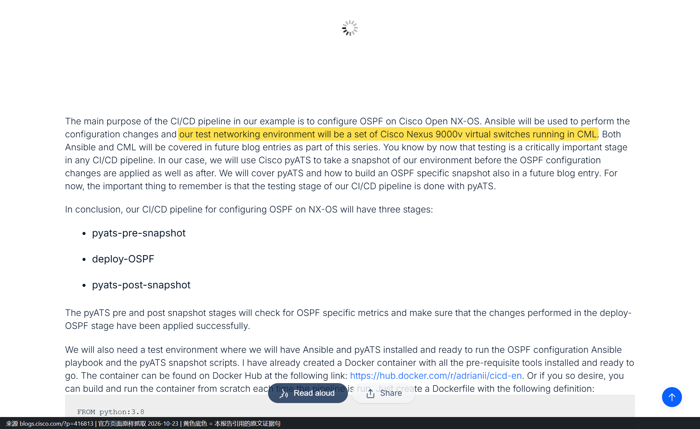

*【截图】这一屏把「CML 只当测试环境」写得很清楚：被测对象是 Nexus 9000v，断言工具是 pyATS，CML 本身不参与判定。*

---

### C05｜NTT：用 CML 做 device-accurate 数字孪生，让 LLM Agent 自主做故障诊断与恢复

> **这条是 2026-10-29 新增**，来自本轮补充检索，不在三份前置文档里。它是全库唯一一条**由第三方研究机构发表、有实验评测数据、且明确基于 CML 构建**的案例，也是与「AI 运维助手」最直接对标的公开工作。

| 项目 | 内容 |
|---|---|
| 使用方 | NTT（日本电信电话）研究团队：Hiroki Ikeuchi、Yousuke Takahashi、Hitoshi Shimizu、Hiroaki Matsubayashi |
| 时间 | 2026-07（会议）/ 2026-08（进 IEEE Xplore） |
| 载体 | 2026 35th International Conference on Computer Communications and Networks（ICCCN），Honolulu, HI, USA；DOI `10.1109/ICCCN69946.2026.11662660` |
| 场景 | 族 D｜AI Agent 沙箱与评测 / 故障复现 / 数字孪生 |
| 做了什么 | 把运维人员的工作流编码成「结构化推理-行动」流程，让 LLM agent 通过诊断与控制工具调用，操作一台**基于 CML 构建的 device-accurate 网络数字孪生**，完成故障诊断与恢复 |
| 关键设计 | **stage-constrained operation（分阶段操作约束）**：按运维阶段限定哪些工具可用，用来阻止不安全动作、维持闭环稳定 |
| 可核验的结果 | 在多种接口（interface）与链路（link）故障模式下评测：被测商用 LLM 能自主恢复大部分故障，**frontier 级模型在每种设置下都做到全部恢复**；给诊断输出加 baseline diff 后**所有模型准确率都提升**；command-aware RAG（检索增强生成）通过提供已验证先例，进一步提升了性价比模型的成功率 |
| 两个案例研究 | 完全自主处理了 **接口 flapping** 与 **配置导致的 routing loop** 两类复杂故障 |
| 原文 | 「The agent interacts with a **device-accurate NW digital twin built on Cisco Modeling Labs** via diagnostic and control tool calls under these constraints.」 |
| 置信度 | **L1** — 有实验设置、有对比基线、有可核对的结论；且方法（工具集 + 阶段约束 + baseline diff + RAG）可复现 |
| 链接 | [IEEE Xplore 11662660](https://ieeexplore.ieee.org/document/11662660) |

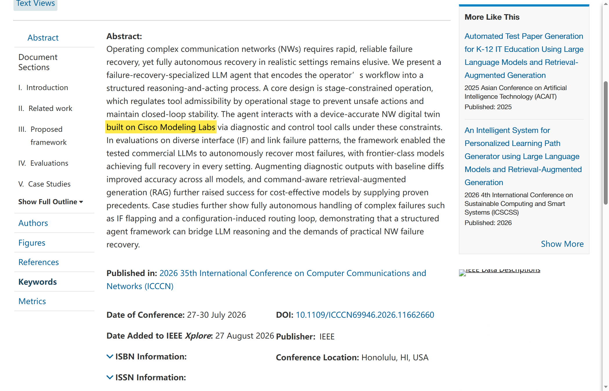

*【截图】2026-10-29 抓取（xplorestaging.ieee.org，正式域 `ieeexplore.ieee.org` 对本机返回空壳，故用可渲染的 staging 域）。黄底句是「这条案例成立」的全部依据：孪生底座明确是 CML。同一屏还能看到会议名、日期与 DOI。*

> **这条为什么值得单列**：它证明了 CML 的第三种角色——既不是「给人用的实验室」，也不是「给 CI 用的测试床」，而是**Agent 的动作空间（action space）**。agent 在里面犯错不要紧，因为可以回滚；它在里面得到的结论可以外推，因为底座是真 OS 镜像而不是数学模型。这与本文 [[#6 定位演进：从仿真器到 Agent 的验证环境|第 6 章]] 讲的产品走向是同一件事的两个侧面。

---

## 3 L2 案例（C06-C21，有具体动作）

### C06｜思科 Sales / SE：讲方案前先自己跑一遍

| 项目 | 内容 |
|---|---|
| 使用方 | 思科 Sales / Systems Engineer（作者 Nick Radcliffe 本人） |
| 时间 | 2015 |
| 场景 | 族 B｜售前演示 |
| 做了什么 | 没有真机时，把要演示的拓扑先搭出来、把要讲的路径先跑通，再去客户面前讲 |
| 原文 | 「In my mind this is the perfect learning tool for network engineers and can honestly say **it has helped me in my current role as a Systems Engineer many times**.」 |
| 置信度 | **L2** — 有身份 + 第一人称具体说法，但没有项目、没有结果 |
| 链接 | [S12 VIRL to the rescue!](https://gblogs.cisco.com/uki?p=3998)（2015-11-23） |

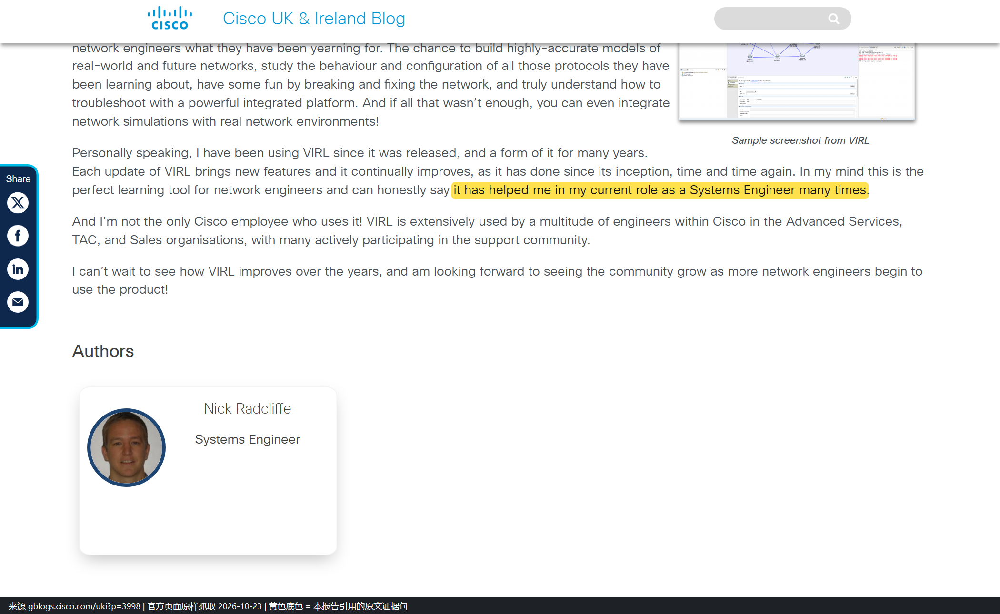

*【截图】一句话 + 作者卡同框：下方作者卡写着 Nick Radcliffe / Systems Engineer，把「说话的人是什么身份」也固定下来。*

> **引用别越界**：原文只支持「对一位 SE 的日常工作有帮助」。从「一个 SE」推不到「整个 Sales 组织」——后者只有一句组织级表述（见 C22）。

---

### C07｜DevNet Sandbox 团队：给「还没通电的数据中心」先做一遍

| 项目 | 内容 |
|---|---|
| 使用方 | 思科 DevNet Sandbox 团队，作者 Hank Preston |
| 时间 | 2019-09 |
| 场景 | 族 A｜未上线环境预演 |
| 做了什么 | 机柜、供电都还要几周才好，但配置模板、自动化策略、上线验收必须先做——在沙箱目录里预留一个 Multi-IOS 实例，几分钟内复刻出目标拓扑，把 GitLab / NetBox / NSO / pyATS 整条工具链先跑通 |
| 最值得抄的 | 不是工具，而是**把「仿真与生产的差异」当成一份正式交付物登记在案**：① 生产用 x86 虚拟化平台无法复刻 → 用 L2 IOSv 替代并声明；② 生产有数百个 pod，仿真里只建 1 个 → 单 pod 配置克隆到全部；③ 接口编号不同 → **配置按角色与邻居生成，不按接口 ID**；④ 生产有独立物理管理网，仿真没有 → 承认会有轻微路由差异 |
| 置信度 | **L2** — 方法与四处差异都写清了，无量化结果 |
| 链接 | [S15 Preparing to Automate a New Data Center for DevNet Sandbox](https://blogs.cisco.com/cisco-devnet/automate-new-data-center)（2019-09-11） |

*【截图】这一屏同时是「四处差异」的原始出处：x86 虚拟化平台、只建 1 个 pod、接口编号不同、生产有独立物理管理网，四条都在同一屏里。*

---

### C08｜DevNet Sandbox 团队：把整个数据中心拓扑搬进仿真，用来开发「网络服务化」

> **一句话**：这条不是「用 VIRL 练配置」，而是**把一个正在建设中的真实数据中心先在仿真里建一遍，然后在仿真上把「逐台设备写配置」改成「描述一个 fabric 和一个 tenant」的自动化服务开发完**——服务一旦定稿，直接对着机房里的真设备跑。

| 项目 | 内容 |
|---|---|
| 使用方 | 思科 DevNet Sandbox 团队，作者 Hank Preston |
| 时间 | 2019-09-30 / 2019-10-29（两篇） |
| 场景 | 族 A｜未上线环境预演 + 族 D｜数字孪生 |
| 建了什么 | Internet edge / 防火墙层（虚机 + DVS 接入）/ DMZ 区 / Internal 区 + 三套 L2 fabric（edge / DMZ / internal）+ 两层 tenant（admin、shared services），最上层是「每次预约就起一个 pod tenant」 |
| 做出什么 | 两个 NSO 服务：`vlan-fabric`（建 vPC peer-link、LACP port-channel、SVI + HSRP + OSPF、推到 UCS vNIC 模板与 VMware DVS port-group）、`vlan-tenant`（在 fabric 所有设备上建 VLAN/SVI、建 VRF、按固定规则算地址、配 access/trunk 口） |
| 四步开发法 | ① 白纸写 CLI 风格伪代码（从「用起来是什么感觉」倒推）→ ② `ncs make package` 建 YANG 模型（输入即校验）→ ③ 手工配出终态再导出 XML 模板 → ④ Python 在 `service_create` 回调里拼装下发 |
| 数据来源 | 不是手敲，是 NetBox 灌进去：Tenant → `vlan-tenant`、VLAN Group → `vlan-fabric`、VLAN → networks、prefix → 三层信息、接口 Tagged/Untagged → connections、LAG → port-channel；服务于「hundreds of tenants」 |
| 「仿真够用」的直接证据 | 演示时先 `virl console LEAF02-2` 登进**仿真里那台交换机**、`show run interface ethernet 1/21-23` 确认还没配置，commit 后再查——**仿真设备可登录、可核对**，这是「先仿真后生产」能成立的前提 |
| 边界（必须写清） | 全程只验证「配置意图有没有正确扩散」，没有任何吞吐、时延、收敛测试；**博客演示用 VIRL，可下载示例仓库改用 netsim**，两者是同一设计的两套底座，不能拿仓库的 netsim 证明「VIRL 里跑过」 |
| 置信度 | **L2** — 有明确的人、动作、可复现代码与文档，但无任何量化结果 |
| 链接 | [S16 Part 1](https://blogs.cisco.com/developer/network-service-based-automation-1)、[S40 Part 2](https://blogs.cisco.com/cisco-devnet/network-service-automation-2)、[S41 sandbox-nso 仓库](https://github.com/DevNetSandbox/sandbox-nso) |

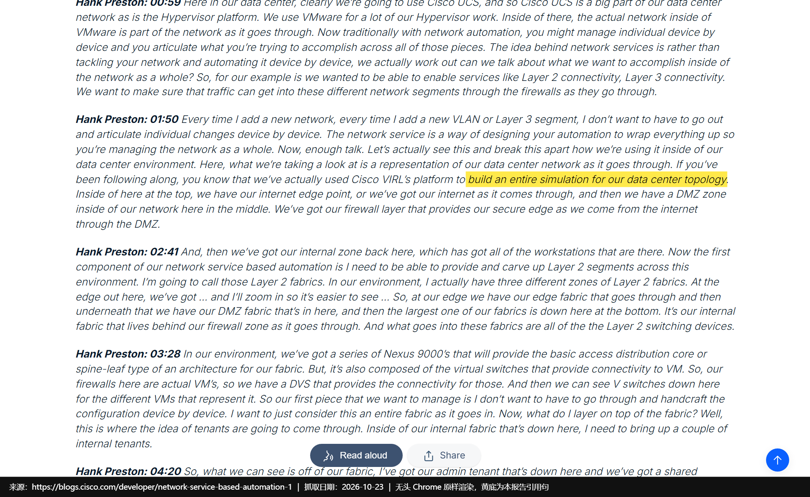

*【截图】「整套数据中心拓扑先在 VIRL 里建一遍」这句的唯一出处。同一屏下方紧接 edge / DMZ / firewall / internal 四个分区的描述。*

*【截图】原文转写把命令写成 `viral console`（应为 `virl console`），但设备名 `LEAF02-2` 与随后 `show run` 的结果对得上——这是「仿真设备可登录、可核对」的直接证据。*

*【截图】这句把性质钉死：讲的是**真正在管 Sandbox 的那套服务**，不是玩具 demo。同屏还给出 vPC switch-pair、UCS vNIC 模板、VMware port-group 三个扩散方向。*

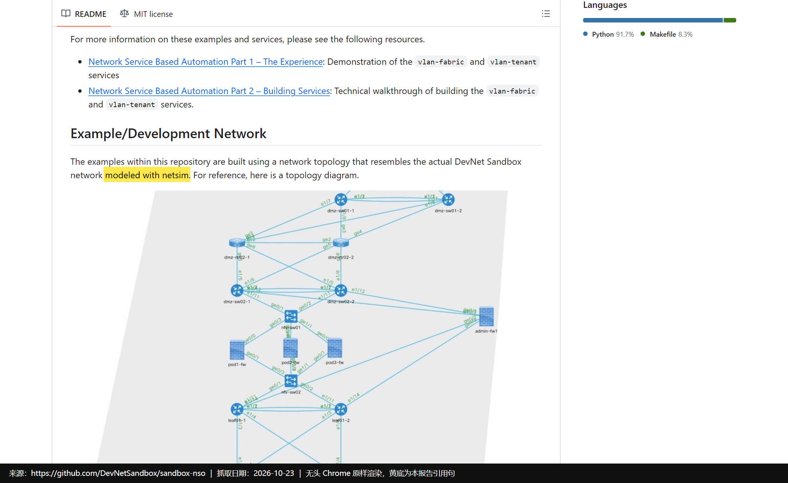

*【截图】这张同时是「更正依据」：README 明说可下载的示例用 netsim 复刻，而上方两条链接正指向 VIRL 演示的两篇博客——两套底座的分工在这屏里能一次看清。*

---

### C09｜DevNet Sandbox：内部用法最后变成了对外产品

| 项目 | 内容 |
|---|---|
| 使用方 | 思科 DevNet Sandbox（产品化对外供给） |
| 时间 | 持续 |
| 场景 | 族 C｜认证与教学实验 |
| 做了什么 | 把 Multi-IOS 沙箱做成公共预约实验，底层拉起的是 VIRL 服务器 |
| 原文 | 官方仓库：「It takes about 15 minutes to spin up the **VIRL servers** and your devbox」 |
| 置信度 | **L2** |
| 链接 | [S30 sbx_multi_ios 仓库](https://github.com/DevNetSandbox/sbx_multi_ios)、[S08 DevNet Sandbox 文档](https://developer.cisco.com/docs/sandbox/) |

*【截图】注意措辞是「VIRL servers」而不是「CML」——这是「内部工具变对外服务」最直接的文字证据。*

---

### C10｜Cisco Live 现场教学（2013 佛罗里达 + 2016 柏林）

| 项目 | 内容 |
|---|---|
| 使用方 | 思科 VIRL / DevNet 团队（现场演示与教学） |
| 时间 | 2013、2016 |
| 场景 | 族 C｜认证与教学实验 |
| 2013（佛罗里达） | 在 ONE Intelligent Network 展区现场演示；另在分会场 BRKRST-3371《Advances in BGP》讲 |
| 2016（柏林） | DevNet Zone 设**常设 Learning Lab 终端**（展会开放期间随到随练）+ 两场 DevNet Zone 场次 + 分会场 BRKRST-3003 + 讲师带做实验 LTRRST-3003 |
| 同期平台数据 | 2016-02 口径：**10,000+ 用户**、**160,000+ 次仿真**、近 **100 万 VM 实例** |
| 置信度 | **L2** — 时间、展区、场次号可逐条核；无学员数、无课后评价 |
| 链接 | [S13](https://news-blogs.cisco.com/getyourbuildon/virl-saves-the-day)、[S14 Have you discovered VIRL yet?](https://community.cisco.com/t5/devnet-general-blogs/have-you-discovered-virl-yet/ba-p/3657936)（2016-02-09，Joel Obstfeld，VIRL 团队 Distinguished Engineer） |

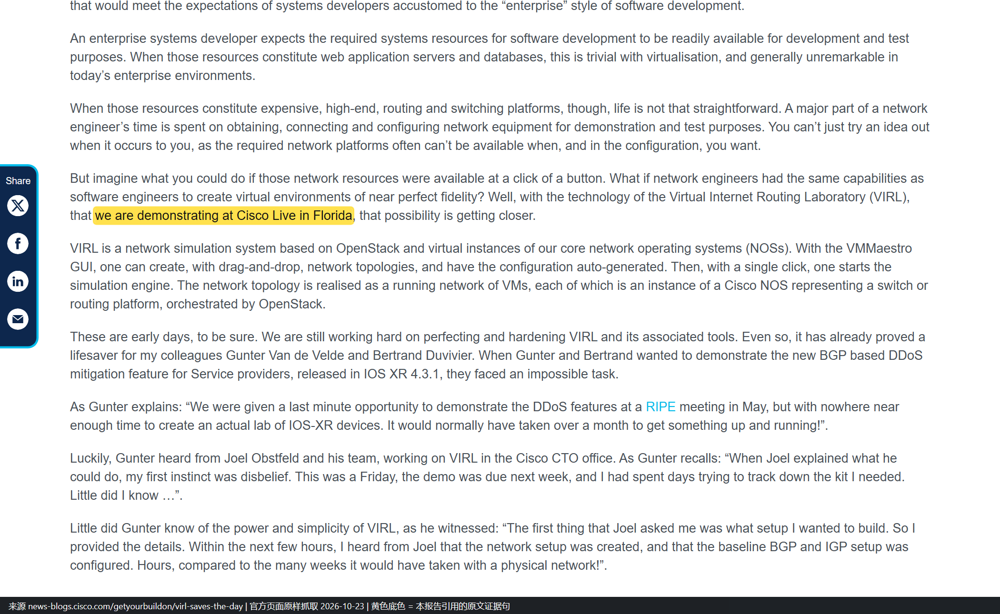

*【截图】2013 那一届的全部依据：既写了现场演示，也交代了当时形态（OpenStack + VM Maestro）。*

*【截图】一屏里同时能看到 Learning Lab 那句、两场 DevNet Zone 场次、以及 BRKRST-3003 与 LTRRST-3003 两个场次号。*

> **数字别混用**：10,000+ 用户、160,000+ 次仿真、近 100 万 VM 实例是**平台累计用量**，不是 Cisco Live 听课人数，也不是任何单一场景的成效。

---

### C11｜Verizon：唯一具名客户，而且主角不是 CML

| 项目 | 内容 |
|---|---|
| 使用方 | Verizon ITNUC（Damiano Imperatore，Associate Fellow）+ 思科（Houcheng Lee） |
| 时间 | 2021-10（Cisco Developer Days 2021） |
| 场景 | 族 A｜CI 门禁与回归 |
| 主题 | How Verizon Streamlined NSO Development with Continuous Integration |
| CML 的角色（原文） | 「The containerized NSO makes testing several NSO packages in parallel possible and the **Cisco Modeling Lab (CML) creates a fully controlled environment for testing**.」 |
| 未公开 | 并行几个包、CML 用多少节点、缩短多少时间、是否常态化 |
| 置信度 | **L2** — 有具名客户、有场合、有录像，但 CML 只是配角且无量化 |
| 链接 | [S18 Cisco Community 条目](https://community.cisco.com/t5/-/-/ta-p/4491759) |

> **截图缺口（如实记录）**：本条**无截图**。2026-10-23 与 2026-10-29 两次尝试均失败——`community.cisco.com` 的 `ta/p` 类帖子返回 Cloudflare 人机校验或 `ERR_SSL_PROTOCOL_ERROR`；`video.cisco.com` 同场次页面为纯前端空壳。原文请点上面链接自行核对，**本文不放替代图**。

> **怎么读这条**：它证明「电信级客户会把 CML 放进 CI 链」，但**没有证明 CML 在 Verizon 是核心**——主角是容器化 NSO。引用时别写成「Verizon 用 CML 做网络数字孪生」，那是超出原文的推论。

---

### C12｜认证考生：从 CCNA 到 CCIE 的备考环境

| 项目 | 内容 |
|---|---|
| 使用方 | 认证考生（CCNA / CCNP / CCIE） |
| 时间 | 2024-2026 |
| 场景 | 族 C｜认证与教学实验 |
| 官方依据（三处互证） | 产品页「Practice your skills and prep for certification exams from anywhere」；Cisco U. 个人版页「the ideal setup for… certification preparation」；2025-11 MCP 博客明确点名 CCNA / CCNP / CCIE——描述想练的场景，AI 通过 MCP 把拓扑建好 |
| 置信度 | **L2** — 三处官方材料互相印证，但仍是「能力宣称」而非「某人的备考结果」 |
| 链接 | [S01 DevNet](https://developer.cisco.com/modeling-labs)、[S09 Cisco U. 个人版](https://u.cisco.com/labs/cisco-modeling-labs-personal-1)、[S25](https://blogs.cisco.com/learning/speak-your-lab-into-existence-with-ai-driven-cisco-modeling-labs-and-mcp) |

*【截图】同一屏还能看到 20 节点上限、365 天访问期与支持的镜像清单。*

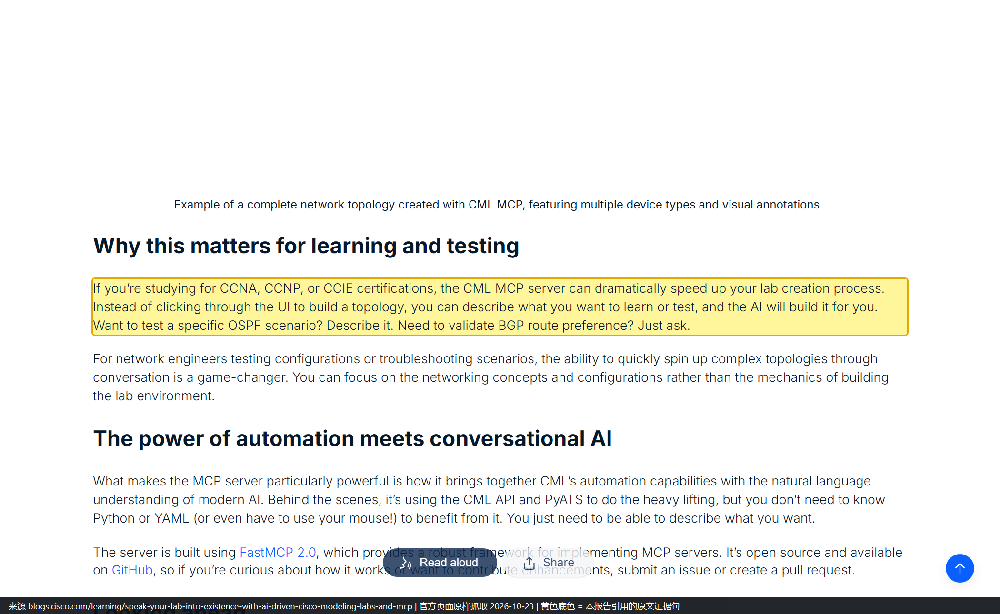

*【截图】三处材料里唯一把三个认证等级同时点名的一处。*

> **S01 的截图缺口**：`developer.cisco.com/modeling-labs` 是前端渲染站，多次抓取只拿到空壳（正文长度 0），「certification exams」那句**没有截图**。已截到两处（S09、S25），足以互证。

---

### C13｜个人工程师：自费买 Personal / Personal Plus 在家搭

| 项目 | 内容 |
|---|---|
| 使用方 | 个人工程师（自费购买） |
| 时间 | 2021-2026 |
| 场景 | 族 C｜认证与教学实验 |
| 做了什么 | 在家复现工作中遇到的拓扑、跟课程做实验、换工作前做演示；官方博客面向个人写「怎么从零把实验搭起来」 |
| 官方路径 | Free（5 节点、无到期）→ Personal（20 节点，$199/年）→ Personal Plus（40 节点，$349/年） |
| 置信度 | **L2** |
| 链接 | [S29 Introduction to Cisco Modelling Lab](https://gblogs.cisco.com/pt?p=2217)、[S01](https://developer.cisco.com/modeling-labs) |

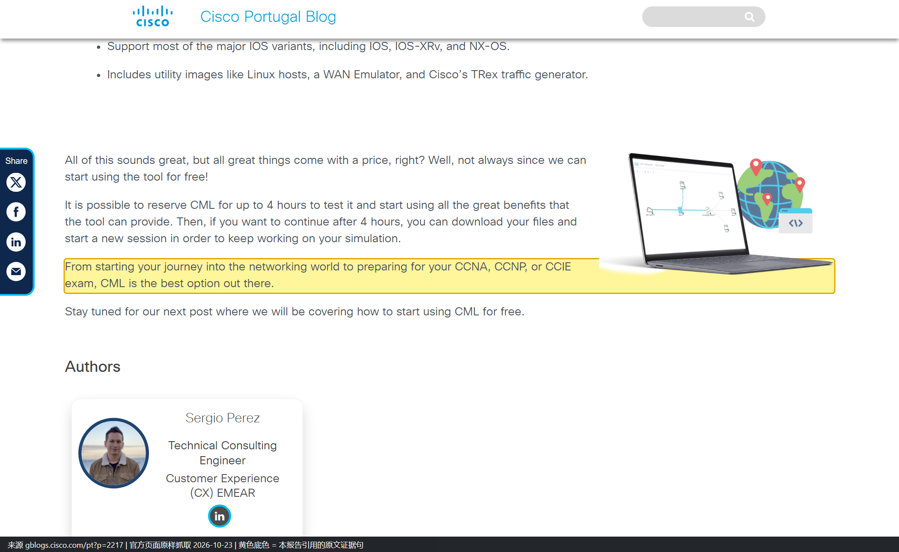

*【截图】葡萄牙语站点的英文原文，作者面向个人读者写的入门路径。*

---

### C14｜Ansible 用动态清单把实验节点当主机管

| 项目 | 内容 |
|---|---|
| 使用方 | 用 Ansible 驱动 CML 实验的 NetDevOps 团队，作者 Steven Carter |
| 时间 | 2024-01 |
| 场景 | 族 A｜CI 门禁与回归（工具链侧） |
| 做了什么 | 用 `cisco.cml` collection 的**动态清单插件**把实验里的节点当成可寻址主机，批量下发配置 |
| 怎么配 | `ansible-galaxy collection install cisco.cml` → inventory 写 `plugin: cisco.cml.cml_inventory` + `group_tags: network, ios, nxos, router` |
| 返回什么 | `cml_facts`：节点配置全文、CPU/内存、`node_definition`（如 csr1000v）、各接口 IP 与状态 |
| PATty 接法 | 节点打 `pat:tcp:2020:22` 标签后，`ansible_host` 自动改成 CML 服务器地址、`ansible_port` 改成映射端口 |
| 一句值得注意的自述 | 「we often use them directly in the pipelines we build for customers」——**全篇最接近「客户项目在用」的一句**，但仍是作者视角，无客户名 |
| 置信度 | **L2** |
| 链接 | [S21 How to Use Ansible with CML](https://blogs.cisco.com/learning/how-to-use-ansible-with-cml)（2024-01-17） |

*【截图】同一屏还给了安装命令与 `cml.yml` 的最小配置，属于「照着敲就能跑」那一类证据。*

---

### C15｜Terraform 把 lab / node / link 当资源管

| 项目 | 内容 |
|---|---|
| 使用方 | 把拓扑当代码（拓扑即代码）管理的平台/自动化团队，作者 Ralph Schmieder |
| 时间 | 2022-12 起 |
| 场景 | 族 A｜变更前验证 / CI 门禁 |
| 做了什么 | 用 `cml2` provider 把 labs、nodes、links 当资源声明；同一套 Terraform 先在 CML 里跑通，再走向生产 |
| 官方定位 | Network as Code 文档明确把 CML 定位为 **staging 环境**与学习环境 |
| 官方自标限制 | 「NOTE: Currently, only a few data sources are implemented.」 |
| 置信度 | **L2** |
| 链接 | [S38 Get Started With Terraform and CML](https://blogs.cisco.com/learning/get-started-with-terraform-and-cisco-modeling-labs)（2022-12-22）、[S07 Network as Code 文档](https://netascode.cisco.com/docs/guides/concepts/cml) |

*【截图】紧接下一段就是「Resources: Labs, nodes, links」，把「拓扑即代码」落到具体资源类型。*

> **S07 的截图缺口**：`netascode.cisco.com` 2026-10-23 报 ERR_TIMED_OUT、2026-10-29 报 ERR_SSL_PROTOCOL_ERROR，两次均未能截图，只作正文引用。

---

### C16｜NetBox 与 CML 双向同步

| 项目 | 内容 |
|---|---|
| 使用方 | 用 NetBox 做 Source of Truth（源真值）的团队，作者 Hank Preston |
| 时间 | 2025-12 |
| 场景 | 族 B｜方案自测 / 生态集成 |
| 路径一 | 官方 cml-community 仓库提供 **NetBox server 节点/镜像定义**：拖进拓扑，节点启动时自动读出站点、设备、IP 与**节点之间的连线**并写入 NetBox |
| 路径二 | `pip install cml2netbox`，把已有 NetBox 与 CML lab 同步；子命令 `sync device-types`、`sync lab` |
| 规模模型 | 每同步一个 lab 建一个 NetBox Site，所以一台 NetBox 可承载 1 个、10 个甚至 100 个 CML 拓扑 |
| 已知限制（原文） | 只增不删（删除的节点/连线不会自动清理）；节点需通过 external connector 访问 CML REST API；默认口令与固定 API token 要自己改 |
| 置信度 | **L2** |
| 链接 | [S24 Two New Ways to Bring NetBox into Your CML Networks](https://blogs.cisco.com/learning/two-new-ways-to-bring-netbox-into-your-cml-networks)（2025-12-12） |

*【截图】一屏同时给出两条路径的入口：上面是节点定义仓库，下面是 PyPI 上的 cml2netbox。*

---

### C17｜MCP Server：让 AI 助手直接操作实验

| 项目 | 内容 |
|---|---|
| 使用方 | 用 AI 助手（Claude Desktop / Claude Code / Cursor 等）做实验的工程师，作者 Joe Clarke（CML 团队成员） |
| 时间 | 2025-11 起（CML 2.10 内置） |
| 场景 | 族 D｜AI Agent 沙箱与评测 |
| 做了什么 | 用自然语言让 AI 建拓扑、起停 lab、改配置、开抓包、跑 CLI，不用点界面也不用写脚本 |
| 官方给的 7 类工具 | ① Lab 管理（建/克隆/改/启停/擦除/删除，上传下载 YAML）② Node 管理（加节点、改 startup config、取控制台历史）③ 接口与链路（建链路、配带宽/时延/抖动/丢包、启停接口）④ 可视化标注 ⑤ 抓包（起停、查状态、下载 PCAP）⑥ 用户与组 ⑦ 系统信息 |
| 三个前提 | 服务名 `virl2-mcp-server`，**默认不启动**，需管理员在 Cockpit 启用；**只在 controller 上跑**，集群 compute 节点没有；客户端需 Node.js 18+ 以运行 `npx mcp-remote` 桥 |
| 置信度 | **L2** — 工具分类、启用步骤、依赖都在官方文档里；但没有「谁用它做成了什么」的记录（唯一落地记录见 C05、C21） |
| 链接 | [S39 MCP Server Overview](https://pubhub.devnetcloud.com/media/cisco-modeling-labs-2-10/docs/guides/_build/html/mcp/mcp_overview.html)、[S25 Speak Your Lab into Existence](https://blogs.cisco.com/learning/speak-your-lab-into-existence-with-ai-driven-cisco-modeling-labs-and-mcp) |

*【截图】这一屏把 7 类工具一次列全，比博客里的概述更硬——要评估「AI 能替人做到哪一步」，应该看这一页而不是看演示视频。*

---

### C18｜Cisco Live 2023：教外部受众把 CML 接进 IaC

| 项目 | 内容 |
|---|---|
| 使用方 | 讲师（Cisco Catalyst 团队）与参会者（外部受众），作者 Story DeWeese |
| 时间 | 2023-06 |
| 场景 | 族 C｜认证与教学实验 |
| 相关场次 | DEVNET-2119《IaC with Catalyst 9000》、BRKDEV-2467 / BRKOPS-2455《IaC and the Catalyst 9000 Virtual Switch》、DEVWKS-2031《Test Automation with Catalyst 9000 Virtual Switch》、LTROPS-1836 动手实验 |
| 原文 | 「we will use virtualization technologies like **CML and Docker** in order to virtualize and simulate common network topologies… **We will gain confidence in configuration management processes and tooling in the simulated lab and make the transition into production easier.**」 |
| 为什么单列 | 官方**主动教外部受众**「先仿真后生产」，把 CML 写成通往生产的中转站，而不是替代品 |
| 置信度 | **L2** — 场次号与课程描述都在；但这只是课程设计，不是「学员回去做成了什么」 |
| 链接 | [S23 Automate with Cisco IOS XE at Cisco Live](https://blogs.cisco.com/?p=435697)（2023-06-01） |

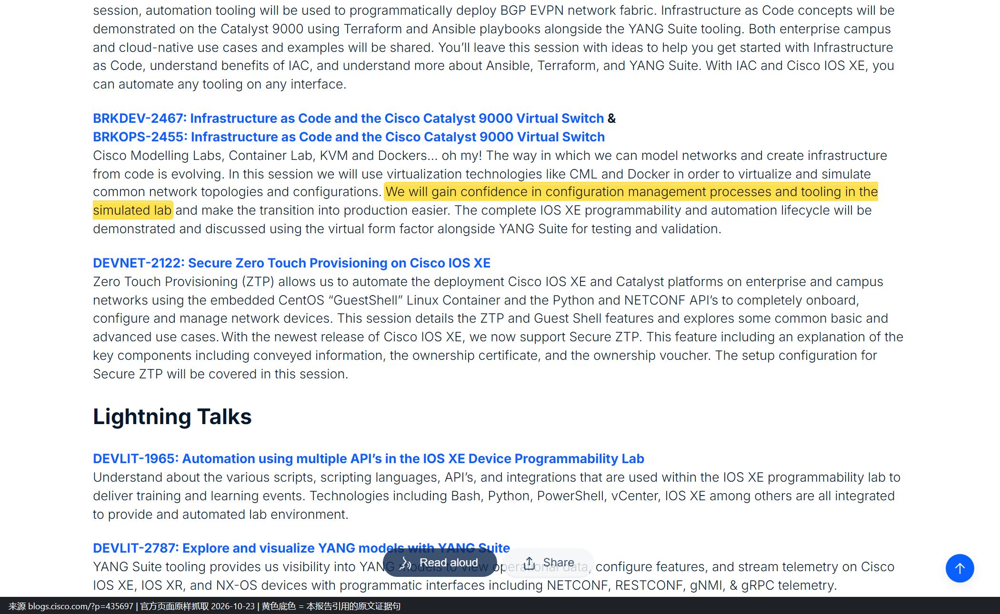

*【截图】上方还能看到 BRKDEV-2467 / BRKOPS-2455 两个场次号与「Cisco Modelling Labs, Container Lab, KVM and Dockers… oh my!」的开场白。*

---

### C19｜方案自测能搭什么：官方参考平台清单

| 项目 | 内容 |
|---|---|
| 使用方 | 方案团队（SD-WAN / ISE / 无线自测） |
| 时间 | 2024-2026（refplat 版本 20260409 / 20260611-supplemental / 20260326-ise） |
| 场景 | 族 B｜方案自测 |
| 置信度 | **L2（下沿）** — 官方给了「能搭什么」的清单与版本，但没有「谁搭了、搭成什么样」的实录。**它是能力证据，不是案例证据** |
| 链接 | [S37 Reference Platforms and Images](https://pubhub.devnetcloud.com/media/cisco-modeling-labs-2-10/docs/guides/_build/html/administration/bundled_images_nodedefs.html)、[S05](https://developer.cisco.com/docs/modeling-labs/catalyst-sd-wan)、[S01](https://developer.cisco.com/modeling-labs) |

| 要自测的东西 | 官方镜像 / 节点 | 版本 | 在哪张 ISO 上 |
|---|---|---|---|
| 身份认证（802.1X / 访客 / RADIUS） | ISE（Identity Services Engine） | 3.5.0 | **单独一张 `refplat-…-ise.iso`** |
| 无线控制器 | CAT 9800-CL | 17.18.03 | supplemental ISO |
| SD-WAN 全套 | Manager / Controller / Validator / Edge / vEdge | 20.18.2.1 | supplemental ISO |
| 防火墙 | FMCv 10.0.1、FTDv 10.0.0、Meraki vMX | 见左 | supplemental ISO |
| 打流 / 链路损伤 | TRex 2.87、WAN Emulator | 见左 | FCS ISO |
| 服务器侧组件 | FreeRADIUS 3.2.7、Tacacs+ F4.0.4.28、Snort3、Splunk、ThousandEyes Agent | 见左 | **单独容器 ISO**（2.10 起拆分） |

**这张表最有用的三点**：① **ISE 不在主 ISO 上**，做 802.1X 自测前先确认，否则会以为镜像缺失；② 9800-CL 与 SD-WAN 在 supplemental ISO，**免费版做不了无线与 SD-WAN 自测**；③ 容器节点自 2.10 起单独发 ISO，要按 tag 锁版本。

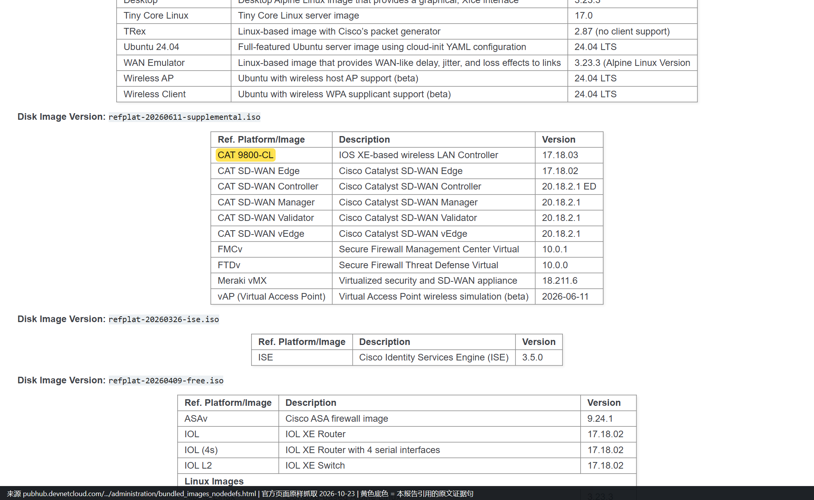

*【截图】黄底标出 CAT 9800-CL 与 ISE 两行。上面是 supplemental（9800-CL + SD-WAN），下面是单独的 ISE ISO——**这个分工是本节最有实操价值的结论**。*

---

### C20｜弗吉尼亚联邦大学：把 CML for Education 做成整套课程实验

> **这条是 2026-10-29 新增**。它是全库唯一一条**由高校教师在学术会议上正式发表**的 CML 教学实践，填补了「教育场景只有官方数据表、没有真实部署」的缺口。

| 项目 | 内容 |
|---|---|
| 使用方 | Virginia Commonwealth University（弗吉尼亚联邦大学）Erwin Karincic、Lauren Linkous、Erdem Topsakal |
| 时间 | 2024-06（2024 ASEE Annual Conference & Exposition，CIT Division） |
| 场景 | 族 C｜认证与教学实验 |
| 做了什么 | 用 **CML for Education 搭起整套课程实验环境**，覆盖网络全生命周期：设计 → 配置 → 排障；另含网络安全实验（让学生自己构建、演示、缓解攻击）与物理 IoT 设备接入 |
| 交付物 | 提供**预配置好、可直接嵌进任何网络课程的 lab**，教师可自行改造成符合自己课程要求的版本 |
| 为什么选 CML（原文） | 「**Cisco Modeling Labs (CML) for Education was selected as the platform** to support the proposed curricula environment. CML is the only commercial platform that offers official Cisco software and seamless integration with various operating systems hosted in virtual machines.」 |
| 部署方式 | 三种都可行：学校服务器本地装、AWS 云上装、甚至装在学生个人电脑上；学生用任意浏览器接入 |
| 解决的真实痛点（原文） | 学校有物理设备，但「expensive to operate, requires maintenance to reset it for different labs, and often requires outside support in cases where VPN is allowed for remote access」 |
| 置信度 | **L2** — 有机构、有课程设计、有交付物形态；但**没有学生人数、没有成绩对比、没有部署规模** |
| 链接 | [S32 ASEE 论文页](https://nemo.asee.org/public/conferences/344/papers/43918/view)（可下载 PDF 3.16 MB） |

> **截图缺口（如实记录）**：本条**无截图**。`nemo.asee.org` 在本机返回 `ERR_SSL_PROTOCOL_ERROR`，2026-10-29 实测不可渲染。上述引文经服务端抓取读到正文，为原样摘录。原文与全文 PDF 请点上方链接核对。

---

### C21｜NetClaw：把 CML 实验重建成 Unreal Engine 里的 3D 世界

> **这条是 2026-10-29 新增**。它代表 2026 年出现的一类新玩法：**CML 不再只是「被看的拓扑图」，而是「被 Agent 读取、再渲染成另一种介质」的数据源**。

| 项目 | 内容 |
|---|---|
| 使用方 | John Capobianco（《Cisco pyATS》作者、Google Developer Expert、NetClaw 开源项目作者） |
| 时间 | 2026 |
| 场景 | 族 D｜AI Agent 沙箱与评测（可视化侧） |
| 做了什么 | 让 AI agent「NetClaw」指向一台跑在 CML 里的真实 lab，用 **pyATS 采集路由、交换机、链路、健康状态**，再通过 **MCP** 桥接 Unreal Engine 5.8 自带的 MCP server，把拓扑重建成可漫游的 3D 场景（设备为空间对象，链路为发光连接，颜色映射设备类型与健康度，用力导向算法自动布局） |
| 关键点 | 全程无人手工拖拽节点或连线；三个系统（CML / pyATS / Unreal）只靠 MCP 通信 |
| 作者自己说的局限 | 硬件负载极重（Unreal + 渲染 + agent 持续 MCP 调用），机器多次崩溃、场景被清空重来；不是能在边缘配置上跑的集成 |
| 置信度 | **L2（下沿）** — 有具体工具链与步骤，但属个人实验项目，无量化结果、无第三方复现 |
| 链接 | [Automate Your Network 原文](https://www.automateyournetwork.ca/?p=1598)、[NetClaw 项目页](https://automateyournetwork.com/netclaw/) |

> **截图缺口（如实记录）**：本条**无截图**。`www.automateyournetwork.ca` 在本机返回 `ERR_SSL_PROTOCOL_ERROR`；`?p=1598` 经服务端抓取已重定向到站点首页，正文需点链接自行核对。

---

## 4 L3 案例（C22-C27，仅宣称或组织级概括）

> **本节六条都只能当「官方认为这件事可行 / 某组织在用」的证据，不能当「这件事有人做成过」的证据。** L2 的门槛是「说清在什么环境里、对什么设备、做了什么操作」，这六条一条都没达到。

### C22｜思科 Advanced Services：交付前做设计验证（推论级）

| 项目 | 内容 |
|---|---|
| 使用方 | 思科 Advanced Services（现并入 CX，Customer Experience） |
| 时间 | 2015 |
| 场景 | 族 A｜变更前验证 |
| 官方原话 | 「VIRL is extensively used by a multitude of engineers within Cisco in the **Advanced Services, TAC, and Sales** organisations, with many actively participating in the support community.」 |
| 可推知（**推论，非原文**） | 交付前用 VIRL 做设计验证与演练。依据链：Advanced Services 职责是给客户交付方案 → 原文点名该组织大量使用 → 交付前必须先验证设计 → 最可能的用法是设计验证。**原文一个字都没写这一点** |
| 不能确认 | 项目类型、设备规模、是否写进交付流程、年用量 |
| 置信度 | **L3** |
| 链接 | [S12 VIRL to the rescue!](https://gblogs.cisco.com/uki?p=3998)（2015-11-23，作者 Nick Radcliffe，Systems Engineer） |

### C23｜思科 TAC：复现客户拓扑与故障（推论级）

| 项目 | 内容 |
|---|---|
| 使用方 | 思科 TAC（Technical Assistance Center） |
| 时间 | 2015 |
| 场景 | 族 D｜故障复现 |
| 官方原话 | 同 C22，同一句里的「TAC」 |
| 可推知（**推论，非原文**） | 用 VIRL 复现客户拓扑与故障现象。依据链：TAC 职责是处理客户 case → 原文点名 TAC 在用 → 复现故障是处理 case 的前置动作 → 最可能的用法是故障复现。**原文未写** |
| 不能确认 | 是否所有 case 都做复现、复现周期、成功率、是否对外承诺 |
| 置信度 | **L3** |
| 链接 | 同 C22 |

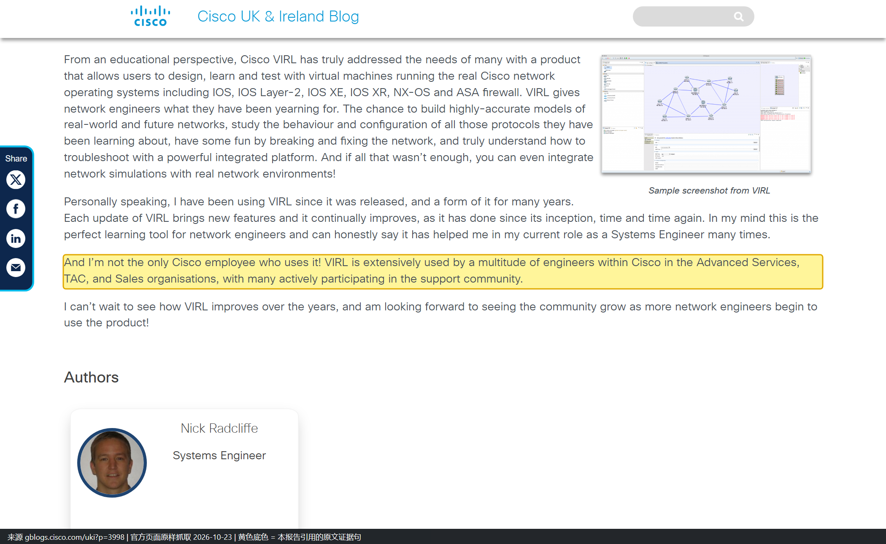

*【截图】这一句是全库唯一交代「思科内部哪些组织在用」的官方表述，C06、C22、C23 三条都挂在它上面。三者差别在于：C06 另有作者本人的第一人称佐证，C22 / C23 只有组织名——**所以这两条只能停在 L3**。*

> **「TAC 在用」和「TAC 普遍用它复现故障」是两个强度差很远的命题**。前者有这一句支撑，后者只有 C05 一篇第三方论文 + 一篇个人博客（前 TAC 工程师 Christopher Hart 的复盘）。材料不足时正确做法是把命题降级，而不是找更多模糊表述来凑。

### C24｜数字孪生：官方承认有客户在做，但只到「行业类型」

| 项目 | 内容 |
|---|---|
| 使用方 | 未具名客户群：大型企业基础设施、全球金融交易中心、多家 IT 咨询公司、教育机构 |
| 时间 | 2026-04 |
| 场景 | 族 D｜数字孪生 |
| 官方原话 | 「Major Cisco customers currently use CML to create digital twins of their networking infrastructure. This includes some of the world's most legally compliant, complicated systems, such as: Giant enterprise infrastructure systems. Complex global financial trade centers. Numerous IT consulting firms. Educational institutions.」 |
| 同一篇的自我限定 | 「they're more like **fraternal twins or, sometimes, even cousins** — similar behavior, much of the same DNA, but with obvious differences.」 |
| 能确认 | 四类行业有客户在用，且「数字孪生」这个说法是官方自己用的 |
| 不能确认 | 任何客户名、数量、规模、成效 |
| 置信度 | **L3** |
| 链接 | [S19 Bringing the Network Digital Twin to Life](https://blogs.cisco.com/learning/cisco-modeling-labs-bringing-the-network-digital-twin-to-life)（2026-04-15） |

*【截图】一屏同时拍到两句关键话：上半是「更像异卵双胞胎、有时甚至是表亲」的限定，下半是四类行业客户。这就是 C24 能记 L3、也只能记 L3 的原因——有行业，没有名字。*

> **这句话术本身值得学**：官方在把产品叫「数字孪生」的同一篇里主动拆台。承认差异换来的是「差异之内可信」——对任何做 AI 能力对外承诺的团队，这个交易都成立。

### C25｜dCloud 会话：合作伙伴不用装 CML 也能用

| 项目 | 内容 |
|---|---|
| 使用方 | dCloud 会话使用者（合作伙伴 / 客户 SE） |
| 时间 | 2026 |
| 场景 | 族 B｜售前演示 |
| 做了什么 | 预约「CML - Catalyst SD-WAN 26.1 Lab Custom Topologies」会话 → AnyConnect 拨入 → 用同一套工具起 fabric |
| 意义 | 售前场景里 CML 可以完全藏在云端，使用者只面对一个预约链接 |
| 置信度 | **L3** — 官方给了操作步骤，但没有「谁用这个路径做成了什么」的记录 |
| 链接 | [S06 支持文档 222057](https://www.cisco.com/c/en/us/support/docs/routers/sd-wan/222057-sd-wan-lab-deployment-tool-for-cisco-mod.html) |

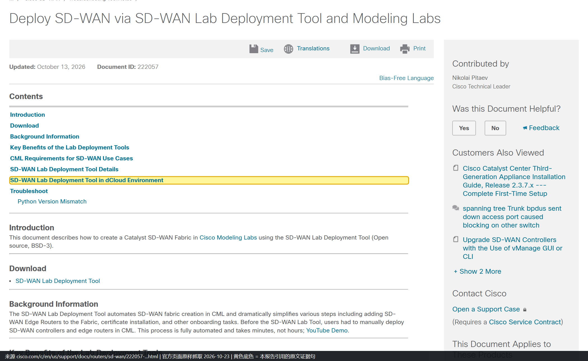

*【截图】支持文档里讲 dCloud 的那一节，也是「合作伙伴不用自己装 CML」的官方落点。*

### C26｜CML Cloud PoC：官方替你把「典型用途」列成三条

| 项目 | 内容 |
|---|---|
| 使用方 | CML Cloud PoC 参与者（邀请制） |
| 时间 | 2026 |
| 场景 | 族 B｜售前演示 / 族 C｜认证教学 |
| 官方列的理想用例 | ① **基础认证**：CCST、CCNA 学习，用轻量 IOSv / IOL 镜像 ② **自动化沙箱**：常开实验环境，拿 Python / Ansible / Terraform 打真 IOS ③ **轻量验证**：建 SMB 拓扑、验 ACL、验 OSPF/BGP |
| 同页写清的「不适合」 | 仅 NAT 出网（无桥接）、排除 Cat9k / NX9k / XRv9k / SD-WAN / NGFW、16 GB 内存上限 |
| 置信度 | **L3** — 官方口径的用例清单，不是使用记录 |
| 链接 | [S10 CML Cloud Phase 1 PoC](https://mkto.cisco.com/cmlaas-app.html) |

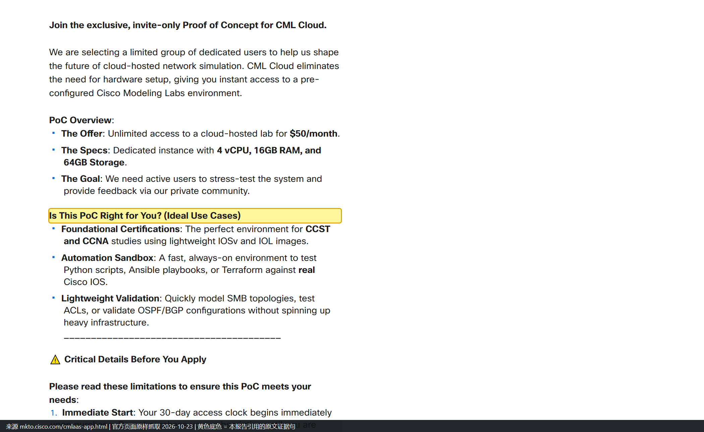

*【截图】黄底是官方自己写的「理想用例」小标题，下面三条正是上表内容；再往下是 Critical Details 里的排除项。**这张图等于把官方口径的「能干什么、不能干什么」拍在一屏里**。*

### C27｜高校采购方：教育版的用法与授权口径

| 项目 | 内容 |
|---|---|
| 使用方 | 高校 / 中学（CML for Education 采购方） |
| 时间 | 2023（数据表版次） |
| 场景 | 族 C｜认证与教学实验 |
| 官方列的四条收益 | ① 支撑远程教学（学生从任意地点做实验，不必进机房）② 覆盖网络全生命周期（设计、配置、排障都能练）③ 自动化建实验环境（教师用 API 批量预置）④ 降低实验室预算与能耗 |
| 授权口径（关键差异） | **不是按节点，而是按「同时使用的具名用户数 + 安装服务器台数」**，节点数不限。SEULA 第 4.4 条原文：「Your Use Rights are based on (1) the number of **named Users** (CML-EDU-USER) using the Software **simultaneously** and (2) the number of Servers on which the CML Education Base (CML-EDU-BASE) Software is installed. **Nodes are unlimited**」 |
| 缺什么 | 官方没公开任何一所学校的名字、部署规模或课程名单（真实部署记录见 C20） |
| 置信度 | **L3** |
| 链接 | [S04 教育数据表 PDF](https://www.cisco.com/c/en/us/products/collateral/cloud-systems-management/modeling-labs/at-a-glance-c45-744340.pdf)、[S36 SEULA 许可条款](https://www.cisco.com/c/dam/en_us/about/doing_business/legal/seula/Cisco-Modeling-Labs-SEULA.pdf) |

*【截图】PDF 原件截图（Chrome 内置阅读器原样呈现，未做标注）。这一页就是四条收益的出处。*

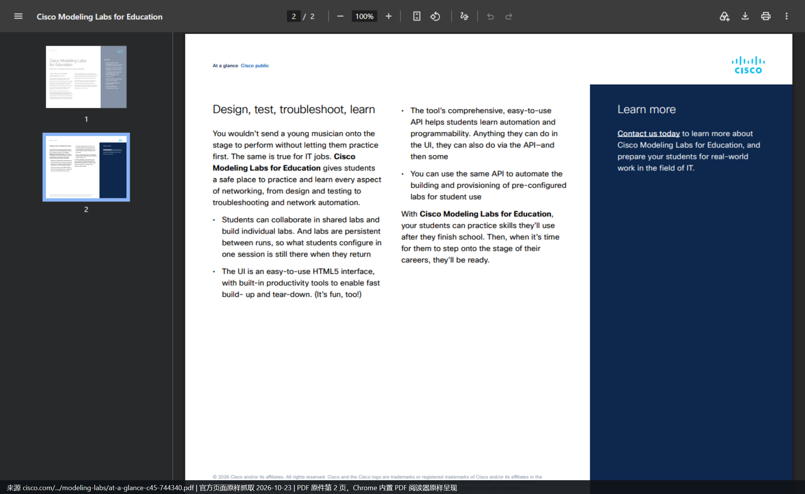

*【截图】补上「学生可在共享或独立实验里练习」与「教师可用 API 批量预置预配置实验」两条。*

> **注**：授权计量条款在 SEULA PDF 里，本文**没有给那一页截图**——该 PDF 十余页，自动抓取未定位到具体页码，只做正文引用。核对请点 S36 搜「CML-EDU-USER」。

---

## 5 被否掉的场景（有官方原文支撑）

这三类都曾看起来「顺理成章」，但被官方原文直接否掉。写出来是为了防止被误用。

| # | 被否的场景 | 官方依据 | 具体数字/原文 |
|---|---|---|---|
| 1 | 吞吐、容量、时延、抖动类验收 | 节点页实测吞吐 + 明确声明 | 官方实测 IOSv 2.8 / 2.4 Mb/s、CSR1000v 1.6 / 1.52 Mb/s、CAT9000v 约 250 Kbps；原文「not generally suitable for testing **throughput or timing**」 |
| 2 | 依赖 ASIC / 硬件卸载的特性（TCAM、队列、NetFlow 卸载等） | 硬件抽象层被切断 | 「CML does **not emulate any specific hardware platform**」 |
| 3 | 把实验配置逐字节推生产 | 官方两处口径冲突 | Enterprise 数据表说可用同一套配置；VM Images 页说「may not function as expected」。**以 VM Images 页为准** |

补充两条**看起来像场景、实则证据不足**的：

| # | 说法 | 为什么不成立 |
|---|---|---|
| 4 | 「思科 TAC 普遍用 CML 复现客户故障」 | 只有 1 条组织级提及（C23）+ 1 篇个人复盘，不足以支撑「普遍」 |
| 5 | 「把 CML 里产生的流量当 AI 训练数据」 | 流量是自己打的、被限速、无真实业务语义（见上表第 1 条）。**它能造控制面故障样本，造不出真实流量分布** |

> 第 5 条有一个精确的表述方式，值得记住：**CML 是「故障样本发生器」，不是「流量数据发生器」**。控制面是软件逻辑，官方说行为一致、bug 也一致，所以可信；数据面是硬件执行 + 流量生成，官方说不保真，所以不可信。这个区分决定了它能给 AI 评测集提供什么、不能提供什么。

---

## 6 定位演进：从仿真器到 Agent 的验证环境

把 27 条案例按时间排开，能看到一条清晰的主线：**每一次转向，都是把当时最稀缺的资源，做成可自助、可编程、可重复调用的东西**。

| 阶段 | 稀缺的是什么 | 产品形态 | 代表案例 |
|---|---|---|---|
| 2013-2019 | 真机排不上队、合法镜像拿不到 | 内部 VIRL → 个人版 VIRL PE / 企业版 CML 1.x | C01、C06、C09 |
| 2020-2024 | 可编程、可重复的验证环境 | API first + CI/CD + 集群 + 云部署 | C04、C14、C15、C18 |
| 2025-2026 | 会把意图翻译成操作的人 | MCP + 自然语言 + Agent 自主操作 | C17、C05、C21 |

**2026 年出现了一个新信号：厂商自己把「数字孪生 + Agent」做成产品。** 在 Cisco Live 2026 上，思科发布了 AgenticOps 的 Autonomous Agentic Loop（自主智能体闭环，五步：sense → diagnose → remediate → validate → deploy），其中 **Digital Twin 能力于 2026-07 进入 alpha**，官方描述是「emulating devices, connectivity, topology, and configurations so teams can validate changes before production」，且明确是**用真实软件镜像而非数学模型**。

这条要单独标注性质：

| 项 | 说明 |
|---|---|
| 它是什么 | 思科官方对外发布的战略级能力，把 CML 那套「真镜像 + 可回滚」的机制产品化进 Cloud Control |
| 它不是什么 | **不是 CML 的使用案例**——它是 CML 的「产品化延续」，故不进案例总表 |
| 信源等级 | **B**（思科官方博客与新闻稿），另有三家第三方分析机构复述 |
| 链接 | [S42 The Agentic Workplace Runs on Cisco](https://blogs.cisco.com/?p=492128)、[S43 Cisco Newsroom 同文](https://newsroom.cisco.com/content/r/newsroom/en-us/a/y2026/m06/the-agentic-workplace-runs-on-cisco.html) |

**为什么这条对做 AI 运维助手的人重要**：它把「Agent 需要一个能失败的环境」从社区玩法（C05、C17、C21）升级成了厂商主战略。也就是说，本文[[#3 L2 案例（C06-C21，有具体动作）|第 3 章]]那三条 L1/L2 案例不是边角料，而是**产品演进方向的提前验证**。

---

## 7 缺口（官方未公开，不补不猜）

| # | 缺口 | 影响 | 现状 |
|---|---|---|---|
| 1 | 客户名单与数量 | 无法做同业对标 | 只有行业类型（C24）与 1 个具名客户（C11） |
| 2 | ROI / 节省金额 / 故障率变化 | 无法做投入产出测算 | 官方从未给出任何金额或比率 |
| 3 | TAC 与 Advanced Services 的具体流程与用量 | 无法复制内部最佳实践 | 只有一句组织级表述（C22、C23） |
| 4 | 教育机构名单与课程规模 | 无法参考同类院校配置 | 数据表只有收益描述（C27）；唯一真实部署是 C20，但无学生数 |
| 5 | Verizon 案例的规模与成效 | 无法判断该模式的可复制性 | 只有「并行测试多个 NSO 包」一句（C11） |
| 6 | 数字孪生的「同步机制」 | 无法评估现网数据怎么进 CML | 官方只给概念三段（采集/整合/仿真），无产品化路径（C24） |
| 7 | 内部攻防课的规模上限与成本 | 无法评估靶场方案 | 只有 20 pod 与「GCP 比 AWS 集群便宜」一句（C02） |
| 8 | CML 与 Cloud Control Digital Twin 的关系 | 无法判断 CML 是否被新产品线取代 | 官方未说明两者技术底座是否同一套（见[[#6 定位演进：从仿真器到 Agent 的验证环境\|第 6 章]]，只知都用真实镜像） |

---

## 8 截图清单与缺口

**总数**：30 张，全部为本机无头 Chrome 原样渲染后抓取，**黄色底色 = 被引用的那一句原文**，未做裁剪或文字修改。

| 案例 | 图片文件 | 内容 | 抓取日 |
|---|---|---|---|
| C01 | `C01-S13_virl-saves-the-day.png` | 7 天 / 7 台 IOS XR | 2026-10-23 |
| C02 | `C02-S17_network-hacking-course.png` | 一条 Terraform 命令 20 个 pod | 2026-10-23 |
| C03 | `C03a-S06_sdwan-lab-tool.png` | 几分钟而不是几小时 | 2026-10-23 |
| C03 | `C03b-S05_catalyst-sdwan-docs.png` | pod 数取决于平台承载 | 2026-10-23 |
| C04 | `C04-S22_ci-pipeline.png` | 被测网络是 CML 里的 Nexus 9000v | 2026-10-23 |
| C05 | `N01-IEEE-NTT论文-CML数字孪生.png` | built on Cisco Modeling Labs | **2026-10-29** |
| C06 | `C06-S12_se-role.png` | 作为 SE 帮了我很多次 | 2026-10-23 |
| C07 | `C07-S15_automate-new-data-center.png` | 只建 1 个 pod 再克隆 | 2026-10-23 |
| C08 | `C08a-S16_virl-simulation.png` | 用 VIRL 建整个数据中心拓扑 | 2026-10-23 |
| C08 | `C08b-S16_virl-console.png` | virl console 登进仿真交换机 | 2026-10-23 |
| C08 | `C08c-S40_part2-services.png` | 真正在管 Sandbox 的服务 | 2026-10-23 |
| C08 | `C08d-S41_repo-netsim.png` | 示例用 netsim 复刻 | 2026-10-23 |
| C09 | `C09-S30_sbx_multi_ios.png` | 15 分钟拉起 VIRL 服务器 | 2026-10-23 |
| C10 | `C10a-S13_ciscolive-2013.png` | Cisco Live 佛罗里达演示 | 2026-10-23 |
| C10 | `C10b-S14_virl-learning-lab.png` | DevNet Zone 常设 Learning Lab | 2026-10-23 |
| C12 | `C12a-S09_cml-personal.png` | 个人版为认证备考 | 2026-10-23 |
| C12 | `C12b-S25_mcp-blog.png` | CCNA / CCNP / CCIE + MCP | 2026-10-23 |
| C13 | `C13-S29_intro-cml-blog.png` | 入门到 CCNP 都够用 | 2026-10-23 |
| C14 | `C14-S21_ansible-inventory.png` | 动态清单插件 | 2026-10-23 |
| C15 | `C15-S38_terraform-provider.png` | Terraform provider 含 CML 2 | 2026-10-23 |
| C16 | `C16-S24_netbox-sync.png` | 两条接入 NetBox 的路径 | 2026-10-23 |
| C17 | `C17-S39_mcp-tools.png` | MCP 的 7 类工具 | 2026-10-23 |
| C18 | `C18-S23_ciscolive-iace.png` | 先仿真建立信心再上生产 | 2026-10-23 |
| C19 | `C19-S37_refplat-ise-9800.png` | 三张 ISO 的分工 | 2026-10-23 |
| C22 / C23 | `C22-S12_virl-to-the-rescue.png` | 三个组织在用 | 2026-10-23 |
| C24 | `C24-S19_digital-twin.png` | 异卵双胞胎 + 四类行业 | 2026-10-23 |
| C25 | `C25-S06b_dcloud-session.png` | dCloud 会话 | 2026-10-23 |
| C26 | `C26-S10_cml-cloud-poc.png` | 官方理想用例三条 | 2026-10-23 |
| C27 | `C27a-S04_education-datasheet.png` | 教育版四条收益 | 2026-10-23 |
| C27 | `C27b-S04_education-licensing.png` | 学校侧怎么用 | 2026-10-23 |

**截图缺口（4 处，全部如实记录，无用别图顶替）**：

| 案例 | 缺什么 | 原因 | 处置 |
|---|---|---|---|
| C11 Verizon | 无 | `community.cisco.com` 的 `ta/p` 类帖子返回 Cloudflare 人机校验；`video.cisco.com` 为纯前端空壳。2026-10-29 复测该域返回 `ERR_SSL_PROTOCOL_ERROR` | 只给原文摘录 + 链接 |
| C20 VCU | 无 | `nemo.asee.org` 返回 `ERR_SSL_PROTOCOL_ERROR`（2026-10-29 实测） | 只给原文摘录 + 链接 + 全文 PDF 链接 |
| C21 NetClaw | 无 | `www.automateyournetwork.ca` 返回 `ERR_SSL_PROTOCOL_ERROR`；`?p=1598` 已重定向到首页 | 只给要点 + 链接 |
| C15 的 S07 | 无（已用 S38 替代作正文证据） | `netascode.cisco.com` 2026-10-23 报 ERR_TIMED_OUT、2026-10-29 报 SSL 错误 | S07 只作正文引用 |

**可达性实测（2026-10-29）**：`xplorestaging.ieee.org` 可渲染；`ieeexplore.ieee.org`（正式域）返回空壳；`blogs.cisco.com`、`www.cisco.com`、`newsroom.cisco.com`、`developer.cisco.com`、`community.cisco.com`、`netascode.cisco.com`、`nemo.asee.org`、`automateyournetwork.ca` 在本机返回 `ERR_SSL_PROTOCOL_ERROR`。**注意：这个可达性比 2026-10-23 更差**——10-23 时 `www.cisco.com`、`blogs.cisco.com`、`community.cisco.com`（博客帖）尚可渲染。已有截图是当时抓的，仍有效。

---

## 9 信源总表

### 9.1 A 级（官方文档 / 产品页 / 数据表 / 支持文档 / 官方仓库 / 会议论文）

| 编号 | 标题 | 类型 | 版本/日期 | 链接 | 支撑 |
|---|---|---|---|---|---|
| S01 | Cisco Modeling Labs（DevNet 产品页） | 产品页 | 2.10 | https://developer.cisco.com/modeling-labs | C12、C13、C19 用途宣称与集成清单 |
| S02 | Cisco Modeling Labs（cisco.com 产品页） | 产品页 | 2025 | https://www.cisco.com/c/en/us/products/cloud-systems-management/modeling-labs/index.html | 五条场景小标题、2.10 新功能 |
| S03 | CML for Enterprise（数据表 PDF） | 数据表 | — | https://www.cisco.com/c/dam/en_us/training-events/training/modeling-labs-for-enterprise.pdf | 企业侧收益、CI/CD 定位 |
| S04 | CML for Education（数据表 PDF） | 数据表 | C45-744340-04 | https://www.cisco.com/c/en/us/products/collateral/cloud-systems-management/modeling-labs/at-a-glance-c45-744340.pdf | C27 教育用例与收益 |
| S05 | Catalyst SD-WAN 节点页 | 文档站 | 2.10 | https://developer.cisco.com/docs/modeling-labs/catalyst-sd-wan | C03 的 20 edge 上限与吞吐限制 |
| S06 | Deploy SD-WAN via SD-WAN Lab Deployment Tool | 支持文档 | 222057 / 2026-10-13 | https://www.cisco.com/c/en/us/support/docs/routers/sd-wan/222057-sd-wan-lab-deployment-tool-for-cisco-mod.html | C03、C25 |
| S07 | CML Virtual Labs（Network as Code） | 官方文档站 | 现行 | https://netascode.cisco.com/docs/guides/concepts/cml | C15 的 staging 定位 |
| S08 | DevNet Sandbox 技术文档 | 文档站 | 现行 | https://developer.cisco.com/docs/sandbox/ | C09 |
| S09 | CML - Personal（Cisco U.） | 商店页 | 2025 | https://u.cisco.com/labs/cisco-modeling-labs-personal-1 | C12 |
| S10 | CML Cloud Phase 1 PoC | 落地页 | 2026 | https://mkto.cisco.com/cmlaas-app.html | C26 |
| S30 | DevNetSandbox/sbx_multi_ios | 官方仓库 | 持续 | https://github.com/DevNetSandbox/sbx_multi_ios | C09 |
| S36 | CML SEULA（许可条款） | 官方法律文档 | 现行 | https://www.cisco.com/c/dam/en_us/about/doing_business/legal/seula/Cisco-Modeling-Labs-SEULA.pdf | C27 授权口径 |
| S37 | Reference Platforms and Images | 文档站 | 2.10 | https://pubhub.devnetcloud.com/media/cisco-modeling-labs-2-10/docs/guides/_build/html/administration/bundled_images_nodedefs.html | C19 |
| S39 | MCP Server Overview | 文档站 | 2.10 | https://pubhub.devnetcloud.com/media/cisco-modeling-labs-2-10/docs/guides/_build/html/mcp/mcp_overview.html | C17 的 7 类工具 |
| S41 | DevNetSandbox/sandbox-nso | 官方仓库 | 2019-12 起 | https://github.com/DevNetSandbox/sandbox-nso | C08 的服务定义与 netsim 说明 |
| S44 | NTT·ICCCN 2026 论文（IEEE Xplore 11662660） | 会议论文 | 2026-07 | https://ieeexplore.ieee.org/document/11662660 | **C05** |

### 9.2 B 级（官方博客 / 社区博文 / 议程 / 新闻稿）

| 编号 | 标题 | 作者 | 日期 | 链接 | 支撑 |
|---|---|---|---|---|---|
| S12 | VIRL to the rescue! – Built by engineers for engineers | Nick Radcliffe（Cisco SE） | 2015-11-23 | https://gblogs.cisco.com/uki?p=3998 | C06、C22、C23 |
| S13 | VIRL Saves the Day! | Nathan Sowatskey | 2013-06-25 | https://news-blogs.cisco.com/getyourbuildon/virl-saves-the-day | C01、C10 |
| S14 | Have you discovered VIRL yet? | Joel Obstfeld（DE） | 2016-02-09 | https://community.cisco.com/t5/devnet-general-blogs/have-you-discovered-virl-yet/ba-p/3657936 | C10 |
| S15 | Preparing to Automate a New Data Center for DevNet Sandbox | Hank Preston | 2019-09-11 | https://blogs.cisco.com/cisco-devnet/automate-new-data-center | C07 |
| S16 | Network Service Based Automation Part 1 | Hank Preston | 2019-09-30 | https://blogs.cisco.com/developer/network-service-based-automation-1 | C08 |
| S17 | Network Hacking Course Pairs with CML | Chris McCoy | 2024-11-01 | https://blogs.cisco.com/learning/network-hacking-course-pairs-with-cisco-modeling-labs | C02 |
| S18 | Developer Days 2021: Verizon Streamlined NSO Development with CI | Verizon + Cisco | 2021-10-25 | https://community.cisco.com/t5/-/-/ta-p/4491759 | C11 |
| S19 | Bringing the Network Digital Twin to Life | Ralph Schmieder | 2026-04-15 | https://blogs.cisco.com/learning/cisco-modeling-labs-bringing-the-network-digital-twin-to-life | C24 |
| S21 | How to Use Ansible with CML | Steven Carter | 2024-01-17 | https://blogs.cisco.com/learning/how-to-use-ansible-with-cml | C14 |
| S22 | CI/CD Pipelines for Infrastructure Configuration and Management, Part 3 | Adrian Iliesiu | 2022-10-03 | https://blogs.cisco.com/?p=416813 | C04 |
| S23 | Automate with Cisco IOS XE at Cisco Live | Story DeWeese | 2023-06-01 | https://blogs.cisco.com/?p=435697 | C18 |
| S24 | Two New Ways to Bring NetBox into Your CML Networks | Hank Preston | 2025-12-12 | https://blogs.cisco.com/learning/two-new-ways-to-bring-netbox-into-your-cml-networks | C16 |
| S25 | Speak Your Lab into Existence with AI-Driven CML and MCP | Joe Clarke | 2025-11-17 | https://blogs.cisco.com/learning/speak-your-lab-into-existence-with-ai-driven-cisco-modeling-labs-and-mcp | C12、C17 |
| S29 | Introduction to Cisco Modelling Lab (CML) | Cisco 葡萄牙博客 | 2021 | https://gblogs.cisco.com/pt?p=2217 | C13 |
| S38 | Get Started With Terraform and Cisco Modeling Labs | Ralph Schmieder | 2022-12-22 | https://blogs.cisco.com/learning/get-started-with-terraform-and-cisco-modeling-labs | C15 |
| S40 | Network Service Based Automation Part 2 | Hank Preston | 2019-10-29 | https://blogs.cisco.com/cisco-devnet/network-service-automation-2 | C08 |
| S42 | The Agentic Workplace Runs on Cisco | Anurag Dhingra | 2026-06 | https://blogs.cisco.com/?p=492128 | [[#6 定位演进：从仿真器到 Agent 的验证环境\|第 6 章]] Digital Twin 战略 |
| S43 | Cisco Newsroom 同文 | Cisco Newsroom | 2026-06 | https://newsroom.cisco.com/content/r/newsroom/en-us/a/y2026/m06/the-agentic-workplace-runs-on-cisco.html | 同上 |

### 9.3 C 级（第三方 / 学术 / 个人，仅作旁证）

| 编号 | 标题 | 类型 | 链接 | 用途 |
|---|---|---|---|---|
| S31 | VIRL 标签归档 | Cisco Blogs | https://blogs.cisco.com/tag/cisco-modeling-labs | 确证官方博客序列共 9 篇 |
| S32 | From Classroom to Career with Practical Network Training（VCU） | ASEE 论文 | https://nemo.asee.org/public/conferences/344/papers/43918/view | **C20**（已升为独立案例） |
| S33 | Why CML Earned a Permanent Spot in My Workflow（Mike Dent） | 个人博客 | https://mikedent.io/post/2026/4/cisco-modeling-labs-workflow/ | 旁证：变更窗口前验证 |
| S34 | NetBox Labs at Cisco Live US 2024 | 厂商博客 | https://staging.netboxlabs.com/blog/viva-las-vegas-netbox-labs-at-cisco-live-us-2024/ | 旁证：LTROPS-3518 用 NSO + CML + NetBox + Ansible |
| S35 | Cisco VIRL: More Than A Certification Study Lab | 媒体评测 | https://www.networkcomputing.com/networking-training-certifications/cisco-virl-more-than-a-certification-study-lab | 旁证：早期第三方评价 |
| S45 | NetClaw + Unreal Engine 5.8（John Capobianco） | 个人博客 | https://www.automateyournetwork.ca/?p=1598 | **C21** |
| S46 | 451 Research 重印：Cisco uses AgenticOps and Cloud Control | 分析机构报告 | https://newsroom.cisco.com/c/dam/r/newsroom/en/us/assets/analyst-reports/451-research/451-Research_2026-07-01_Reprint-Cisco-uses-AgenticOps-and-Cloud-Control.pdf | [[#6 定位演进：从仿真器到 Agent 的验证环境\|第 6 章]] Digital Twin alpha 时间的第三方确认 |

---

## 附录 A 旧编号对照

三份前置文档各用一套编号（案例全集 U1-U24、内部使用方式 N01-N34、调研报告 16 个具名样本）。本文统一为 C01-C27，对照如下。

| 新编号 | 旧编号（案例全集） | 原置信度 | 本文字段 |
|---|---|---|---|
| C01 | U1 | L1 | 不变 |
| C02 | U2 | L1 | 不变 |
| C03 | U3 | L1 | 不变 |
| C04 | U4 | L1 | 不变 |
| C05 | **新增**（NTT 论文） | — | 新入 L1 |
| C06 | U5 | L2 | 不变 |
| C07 | U6 | L2 | 不变 |
| C08 | U7 | L2 | 不变 |
| C09 | U8 | L2 | 不变 |
| C10 | U9 | L2 | 不变 |
| C11 | U10 | L2 | 不变 |
| C12 | U11 | L2 | 不变 |
| C13 | U12 | L2 | 不变 |
| C14 | U13 | L2 | 不变 |
| C15 | U14 | L2 | 不变 |
| C16 | U15 | L2 | 不变 |
| C17 | U16 | L2 | 不变 |
| C18 | U17 | L2 | 不变 |
| C19 | U18 | L2 | 不变 |
| C20 | **新增**（VCU 论文，原为 S32/C 级旁证） | — | 升级为独立案例 L2 |
| C21 | **新增**（NetClaw，原为 S45/C 级） | — | 新入 L2 |
| C22 | U19 | L3 | 不变 |
| C23 | U20 | L3 | 不变 |
| C24 | U21 | L3 | 不变 |
| C25 | U22 | L3 | 不变 |
| C26 | U23 | L3 | 不变 |
| C27 | U24 | L3 | 不变 |

**本次合并相对三份前置文档的实质变化（4 条）**

1. **新增 3 条案例**：C05（NTT 论文，L1）、C20（VCU 论文，从 C 级旁证升级为 L2 独立案例）、C21（NetClaw，L2）。
2. **新增 2 个场景**：「未上线环境预演」「AI Agent 沙箱与评测」。后者在 2026-10-23 的版本里还只是「推断 4」（置信度中，无公开案例），现在有了 C05 这条 L1 支撑，**置信度从「中」升到「中高」**。
3. **新增[[#6 定位演进：从仿真器到 Agent 的验证环境|第 6 章]]「定位演进」**，把 Cisco Live 2026 的 Digital Twin alpha 作为产品化信号单独记录，并明确它**不是 CML 案例**、不进总表。
4. **截图可达性变差**：2026-10-29 复测时思科全域（`www.cisco.com`、`blogs.cisco.com`、`developer.cisco.com`、`community.cisco.com`、`newsroom.cisco.com`）均返回 `ERR_SSL_PROTOCOL_ERROR`，比 10-23 更差。已用 10-23 抓到的 29 张图 + 本轮新抓 1 张，缺口 4 处已在 [[#8 截图清单与缺口|第 8 章]] 列明。

---

*整理：2026-10-29。凡标「推论」处为分析判断，非事实陈述；凡写「未公开」处即为思科未披露，未做任何补全；凡标「无截图」处即为本机无法渲染，未用其他页面顶替。*
