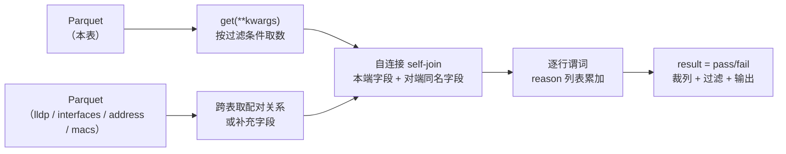

# SuzieQ assert：功能点、应用场景、能力边界、机制原理

> **一句话**：`assert`（断言）是 SuzieQ 的**一致性校验查询**——把「网络本该对上的地方」写成固定检查项，跑一遍给出 `pass`/`fail` 与失败原因清单。它是**查询，不是监控**；比较对象是「本端数据 vs 对端数据」，**不是**「数据 vs 设计意图」。

| 项 | 内容 |
|---|---|
| 对象 | SuzieQ（Stardust Systems 出品的开源网络可观测性平台 + 商业版 SuzieQ Enterprise） |
| 证据 | ① 源码：`netenglabs/suzieq` develop 分支，`suzieq/engines/pandas/` 下 `interfaces.py` / `bgp.py` / `ospf.py` / `evpnVni.py`（2026-10-27 抓取）② 官方文档 `suzieq.readthedocs.io/en/latest/analyzer/` ③ 官网产品与定价页 |
| 用途 | 作为 **D2「多源一致性」方向**的边界锚点：说清「哪一半已被它占住、哪一半还空着」 |
| 校验口径 | 本文含 **3 处对上一轮结论的修正/收紧**，见 §6.4 |

## 0.0 体例说明（强制）

- **英文一律保留并给中文**：正文用 `中文（English）`，专有名词用「原名 + 括注中文」，批量术语见**附录 A**；命令、代码、路径、版本号不翻译。
- **每条结论标注证据等级**，避免把推断当事实：

| 标记 | 含义 |
|---|---|
| **【S】** | 源码实证（附文件 + 函数 + 行号，可逐行核对） |
| **【D】** | 官方文档明示 |
| **【O】** | 观察/推断（未验证，不得作为立项依据） |

---

## 1. 对象与定位

### 1.1 SuzieQ 是什么

SuzieQ 是多厂商、**无代理（agentless）** 的网络可观测性平台（network observability platform），链路四步：

1. **采集（polling）**：只读账号，通过 SSH / REST API / JSON-RPC / NETCONF 拉取配置与状态，设备侧不装 agent；
2. **归一化（normalization）**：多厂商输出转成与厂商无关的统一 schema；
3. **存储**：开源版落 Parquet 文件（按列压缩，保留全部历史不做降采样），企业版换 PostgreSQL；
4. **消费**：CLI / GUI / REST API / Python 库，分析在 pandas 上完成。

采集对象包括设备基础信息、接口、LLDP、MAC 表、路由表、ARP/ND、OSPFv2、BGP、EVPN VNI、MLAG 等。它**不是**监控告警系统，也**不是**配置管理工具——它的定位是「网络数据的单一事实来源（single source of truth）+ 任意问法」。【D】

### 1.2 assert 是什么，不是什么

| 常见误解 | 事实 | 证据 |
|---|---|---|
| assert 是 SuzieQ 的一个独立产品 | 不是。它是**CLI 动词**（`interface assert` 等），开源版内含 | 【D】【S】 |
| 底层方法叫 `assert()` | 不是。四种表的外部 API 方法统一叫 **`aver()`**（函数 docstring 直写 `"""BGP Assert"""` / `"""Assert that interfaces are in good state"""`），`assert` 只是 CLI 层动词 | 【S】`interfaces.py:218`、`bgp.py:205`、`ospf.py:237`、`evpnVni.py:185` |
| 它判断「配置对不对」 | 不判断。它判断「**两端对不对得上**」，以及与「状态是不是 up」 | 【S】§5.2 |
| 它会产生告警/历史 | 不会。无状态、不落结论、不产生事件 | 【S】§4.4 |

### 1.3 一句话原理

**从已经落盘的 Parquet 里读两张表（本表 + LLDP），按 `(namespace, hostname, ifname)` 做自连接（self-join）把「本端字段」与「对端同名字段」拼到同一行，再逐字段比较；每处不等就往该行的 `assertReason` 列表里追加一条原因，最后 `assertReason` 为空即 `pass`。**

---

## 2. 功能点（详细）

### 2.1 统一输出契约

四张表共用同一套结果结构，这是它能被流水线消费的前提。【S】

| 列 | 含义 | 备注 |
|---|---|---|
| `namespace` | 逻辑分组（一套设备清单 = 一个 namespace） | 多环境隔离 |
| `hostname` | 本端设备 | — |
| `ifname` / `peer` | 本端接口 / 或 BGP 对端 IP | 视表而定 |
| `state` | 该对象当前状态 | 如接口 `up`、BGP 会话 `Established` |
| `peerHostname`、`peerIfname` | 对端设备与对端接口 | 由 LLDP 或邻居关系推出 |
| **`result`** | **`pass` / `fail`**，逐行 | 无「部分通过」「置信度」 |
| **`assertReason`** | **失败原因列表**，不是字符串 | 一行可挂多条，`pass` 时填 `'-'` |
| `timestamp` | 该行数据的采集时刻 | — |

三个必须记住的性质：

1. **`assertReason` 是列表**：`['MTU mismatch', 'VLAN set mismatch']` 意味着两项检查同时失败，**各检查项互不短路（no short-circuit）**；
2. **`pass` 行也输出**（`assertReason='-'`），不是「没输出」；
3. **`result` 由「原因列表是否为空」推出**，不是由某个分数阈值判定。

**退出码（exit code）**：在 shell 里直接调用时，assert 失败返回非 0（官方文档为 "usually 255"），成功返回 0。这是它接 CI/自动化验收的唯一官方接口。【D】

### 2.2 `interface assert`（10 项检查，代码最完整的一张）

默认作用域：`state=up`；接口类型集合 = `ethernet / bond_slave / subinterface / vlan / bond`；排除 `lo*` 与 `*loopback*`；Junos 的 `.0` 子接口会先归并到父接口再判（避免同一物理口被算两次）。【S】`interfaces.py:331-598`

| # | 检查项 | 判定条件 | 失败原因字符串 |
|---|---|---|---|
| 1 | 接口状态 | `adminState=down` 或 `state!=up` | `Interface Down`（或设备自报 reason） |
| 2 | 是否找到对端 | `indexPeer == -1` | `No Peer Found` |
| 3 | 对端是否被纳管 | `indexPeer == -2`（对端设备不在采集清单里） | `Unpolled Peer` |
| 4 | MTU | 两端 `mtu` 不等 | `MTU mismatch` |
| 5 | 速率 | 两端 `speed` 不等 | `Speed mismatch` |
| 6 | 接口类型 | 两端 `type` 不兼容（容错：`vlan`↔`subinterface` 视为兼容；`ether*`↔`ether*` 视为兼容） | `type mismatch` |
| 7 | 二层模式 | 两端 `portmode`（access/trunk/routed）不等 | `portMode Mismatch` |
| 8 | IP 地址 | 两端地址数量不等，或既非 /32 又不同网段 | `IP address mismatch` |
| 9 | PVID | `portmode ∈ {access,trunk}` 时两端默认 VLAN 不等 | `pvid Mismatch` |
| 10 | VLAN 集合 | 两端活动 VLAN 集合不等 | `VLAN set mismatch` |

**主动跳过（不当成错误）**：`master == 'bridge'` 的接口、`type ∈ {bond_slave, vlan}` 的接口（无法独立配对）；**MLAG peerlink** 上的 VLAN 集合比对被显式跳过——代码注释写明原因是 NXOS 的 `show vlan` 输出不可靠（vPC 会剪掉 VLAN 列表），且「多数平台自己做 MLAG 一致性检查」。【S】`interfaces.py:554-561`

**开关**：`ignore_missing_peer=True` 时，只挂 `No Peer Found` 的行不算失败（把「没找到对端」降级为「不下结论」）。【S】`interfaces.py:579-587`

### 2.3 `bgp assert`

默认排除动态会话（`state='!dynamic'`），一行 = 一个 `(设备, VRF, 对端)`。【S】`bgp.py:205-313`

| 阶段 | 检查项 | 失败原因字符串 |
|---|---|---|
| 会话未建立 | 出接口是否 `admin down` / `down` | `interface admin down` / `interface down` |
| 会话未建立 | 双向 ASN 是否匹配（不只比本端看到的，还比**对端看到的**） | `asn mismatch` |
| 会话未建立 | 设备自报的错误原因 | `{reason}:{notificnReason}`（原样透传） |
| 会话已建立 | AFI/SAFI 是否全部协商上（`afisAdvOnly` / `afisRcvOnly` 非空即缺） | `Not all Afi/Safis enabled` |

输出阶段用 `explode(column="assertReason")`，把「一行多原因」拆成「一行一原因」，便于按原因聚合计数。【S】`bgp.py:304-306`

### 2.4 `ospf assert`

一行 = 一个 OSPF 邻居；先做一次**全局唯一性**检查，再做邻居两端比对。【S】`ospf.py:237-421`

| # | 检查项 | 失败原因字符串 |
|---|---|---|
| 1 | 同一 namespace 内 Router ID 是否重复（应恰好一台） | `duplicate routerId {hostname}` |
| 2 | 邻居状态既非 `full` 也非 `passive`，且接口未 down | 进入两端比对（见下） |
| 3 | 邻居未建立但接口已 down | `ifdown` |
| 4 | loopback 接口的 network type 不是 loopback | `network type !loopback` |
| 5 | loopback 未配 passive（无对端可配） | `Loopback not configured passive` |
| 6 | 两端在不在同一网段（或均为 unnumbered） | `subnet mismatch` |
| 7 | 两端区域相同 | `area mismatch` |
| 8 | 两端 stub 属性相同 | `area stub mismatch` |
| 9 | Hello 定时器相同 | `Hello timers mismatch` |
| 10 | Dead 定时器相同 | `Dead timer mismatch` |
| 11 | network type 相同 | `network type mismatch` |
| 12 | VRF 相同 | `vrf mismatch` |
| 13 | 邻居接口 MTU 相同 | `MTU mismatch` |
| 14 | 会话失败但前面都没命中 | `No Peer Found`（兜底） |

第 13 项需要 MTU，而 `ospf` 表本身没有 MTU —— 于是**跨表取数**：从 `interfaces` 表按 `(namespace, hostname, ifname)` 把 MTU 与 IP 拉过来再 merge。【S】`ospf.py:304-321`

### 2.5 `evpnVni assert`

一行 = 一个 VTEP 上的一个 VNI。这张表的检查最接近「拓扑推理」，因为其中三项是**全网集合比对**，不是两端比对。【S】`evpnVni.py:185-232, 263-352`

| # | 检查项 | 判定方式 | 失败原因字符串 |
|---|---|---|---|
| 1 | VNI 状态 | 单点绝对判断 | `vni down` |
| 2 | 复制模式一致 | 同一 VNI 的 `replicationType` 在各 host 上必须唯一 | `inconsistent replication across hosts` |
| 3 | 组播组一致性（走组播复制时） | 同一 VNI 只允许关联一个组播组 | `VNI has multiple mcast group` |
| 4 | **全 VTEP 互知**（走头端复制时） | 每个 VTEP 的「已知远端 VTEP 列表 + 自身」排序拼接后，全网必须只有一种结果 | `Some VTEPs are unknown to all` |
| 5 | L2 VNI 与 L3 VRF 映射一致 | 同一 VNI 的 VRF 数必须为 1 | `Inconsistent VNI-VRF mapping` |
| 6 | anycast MAC 全网唯一 | 非纯二层网段应有同一 anycast MAC | `anycast MAC not unique across VNI` |
| 7 | FRR 系 HER 条目完整性 | 从 `macs` 表取远端 VTEP 列表，与本端 `remoteVtepList` 做差集 | `HER is missing VTEPs {…}` |

**第 4 项值得单说**：它构造的是「每个 VTEP 眼中的全网 VTEP 集合」，然后要求这些集合**全部相同**。这是闭包（closure）判定——「A 认识 B、B 认识 C，但 A 不认识 C」这种传递性缺口能被它抓到，这是纯逐字段比较做不到的。

⚠️ **第 7 项在 develop 分支的 `aver()` 主流程里没有调用点**：`_validate_frr_her()` 与 `_is_her_good()` 只有定义（`evpnVni.py:327-352`），`aver()` 只调用了 1–6 项的实现（`:209-216`）。官方文档却写了这项检查 → **文档与代码不一致**，属未接上的死代码或另一入口调用。【S】【O：未进一步验证其它分支/入口】

### 2.6 唯一一处「绝对校验」：`what=mtu-value`

`interface` 的 `aver()` 除默认路径外，还有一个变体：`what="mtu-value"`，走 `_assert_mtu_value()`——**拿命令行传入的期望 MTU 列表，和全网接口的 MTU 逐个比**（`pass if x['mtu'] in value`），排除 `lo`。【S】`interfaces.py:218-227, 301-328`

这是开源版里**唯一**能表达「外部期望值」的地方，但它有三个限制：只能比 MTU、期望值只能命令行现场传、没有版本化与审批（无法承担「配置基线」职责）。**这条正是企业版对接 NetBox/Nautobot 的缺口所在**。

### 2.7 过滤与视图

| 维度 | 取值 | 用途 |
|---|---|---|
| `result` | `all`（默认）/ `pass` / `fail` | `fail` 用于只取失败项 |
| `ignore_missing_peer` | 布尔（仅 interface） | 降级「没找到对端」 |
| 常规过滤 | `namespace` / `hostname` / `ifname` / `vrf` / `state` | 可精确到单设备单接口 |

这些参数会**透传给底层 `get()`**，因此过滤语义与 `show` 一致。【S】§5.1。时间视图（`start-time` / `view`）能否用于 assert —— **未验证**，暂不计入能力。

### 2.8 四个入口

| 入口 | 形态 | 适用 |
|---|---|---|
| CLI（交互式 / shell 直接调用） | `interface assert` / `bgp assert` … | 人工排查、shell 脚本（读退出码） |
| GUI | 状态页、Xplore 页 | 只看拓扑与状态，不适合作验收 |
| REST API | swagger 可试，URL 结构与 CLI 近似 | 被平台调用 |
| Python 库 | `tableobj.aver(**kwargs)` 返回 DataFrame | 二次开发、自定义流程 |

### 2.9 开源版 vs 企业版（判断「它到底能走多远」的关键）

| 能力 | 开源版 | SuzieQ Enterprise | 证据 |
|---|---|---|---|
| 表覆盖（有 assert 的） | 4 张：interfaces / bgp / ospf / evpnVni | 另有 STP、DHCP Snooping 等 | 【D】 |
| assert 来源 | 仅预定义 | 预定义 + **用户自定义 assert（user-defined asserts）** | 【D】 |
| 期望值来源 | 无（除 §2.6 的 MTU） | **可对接 NetBox/Nautobot 作期望值**、Cisco ISE 作策略源 | 【D】 |
| 策略引擎 | 无 | 有（policy engine integration） | 【D】 |
| 规模 | 约 100–200 台设备 | 数千台（集群化 poller、PostgreSQL 分片） | 【D】 |
| 性能 | 基线 | 官方口径同功能快 10–1000 倍 | 【D】 |

**这张表的含义**：开源版的能力上限不是「检查项少」，而是**没有「期望值」这个概念**。所以「差在哪个字段」它答得出，「应该是多少」它答不出。

---

## 3. 应用场景

按运维工作流的时间轴排列，每个场景都标出**前提**与**不适用**，避免被误用。

### 3.1 变更后验收（最主流、最落地）

- **时机**：Ansible/脚本改完配置之后，下一个轮询周期结束。
- **用法**：`interface assert result=fail` / `ospf assert` 跑一遍，非 0 退出即失败。
- **输出怎么读**：`assertReason` 直接就是「改坏了什么」，不用再进设备。
- **前提**：LLDP 可用、两端都被纳管。
- **不适用**：变更涉及「新增设备」时，对端 `Unpolled Peer` 会大量出现，需先补采集清单。

### 3.2 开局 / 上线前同构性校验

- **时机**：新一批交换机上线，配置由模板下发。
- **用法**：全量跑 4 张表 assert，按 `assertReason` 分组统计（`explode` 之后 groupby 计数）。
- **价值**：能抓出「模板本身有错」这类批量问题——同一原因出现在几十行，说明是模板缺陷而不是个体故障。
- **前提**：拓扑已收敛（LLDP 邻居已学到）。
- **不适用**：设计本身就不对称的链路（如单向链路、非对称 MTU 的特殊场景）会持续 fail，需要 `ignore_missing_peer` 或按接口排除。

### 3.3 故障定位的「排除法」

- **时机**：业务报「某段慢/断」，但不知道是哪一层。
- **用法**：先跑 `interface assert`（L1/L2 参数层）→ 全 pass 则排除「配置不一致」这一大类；再跑 `bgp/ospf assert` 看控制平面；最后 `evpnVni assert` 看二层延伸。
- **价值**：**证伪比证实便宜**。全 pass 是一个强结论——「这条链路的参数层面没问题」，可以把注意力推到表项、转发面、终端侧。
- **不适用**：它证明不了转发面正确（见 §4.1）；两端一致但都错的情况它给 pass（见 §4.1）。

### 3.4 合规 / 审计取证（历史回放）

- **时机**：被问「上个月那次变更前后，链路参数变过吗」。
- **用法**：底层 Parquet 保留全部历史不做降采样，可对历史时刻的数据重跑同一套检查。
- **前提**：`view` / `start-time` 类参数在 assert 路径上的行为需实测（本文标为未验证）。
- **不适用**：它不保存「某次 assert 的结论」，只能重算。「当时判了什么」这件事它没有记录——这正是它「无状态」的代价。

### 3.5 拓扑数据补全（喂 NetBox）

- **时机**：CMDB 里的连线信息不全或过期。
- **用法**：用 SuzieQ 发现的 LLDP 配对关系反向写入 NetBox，把「人工录 500 台设备」变成「自动发现」。
- **价值**：这是官方主推的卖点之一（brownfield 场景）。
- **不适用**：LLDP 未开启或跨厂商不通的链路发现不了。

### 3.6 搬迁 / 换板卡 / 扩容后的等价性验证

- **时机**：设备替换或链路割接完成。
- **用法**：对新旧两套（不同 namespace）跑同一套 assert，比对 `assertReason` 分布。
- **价值**：把「感觉差不多」变成「失败原因集合相同」。
- **不适用**：跨 namespace 的自动比对不内建，需要自己写脚本。

### 3.7 「意图 vs 实际」双向校验（仅企业版）

- **时机**：已有 NetBox/ISE 作为权威数据源。
- **用法**：以 NetBox 为期望值跑 assert，或用 ISE 的策略数据回答「该拿到 DHCP 的 MAC 是否真的拿到了」。
- **价值**：这是开源版结构上做不到的一类判定。
- **不适用**：开源版无此能力，不要按这个口径写需求。

---

## 4. 能力边界

### 4.1 边界的分界线：三级判据

理解 assert 能走多远，只需看它用了哪三类判据。**这是本文最重要的一节。**

| 判据类型 | 判定方式 | 覆盖例子 | 是否需外部期望值 |
|---|---|---|---|
| **① 绝对判据（absolute）** | 单点状态是否为某值 | 接口 `up`、BGP `Established`、OSPF `full/passive`、VNI `up` | 不需要（值是协议定义的状态，不是设计值） |
| **② 相对判据（relative）** | 本端字段 vs 对端同名字段 | MTU、speed、portmode、PVID、VLAN 集合、area、timer、ASN、VRF | 不需要 |
| **③ 闭包判据（closure）** | 全网集合/多重集是否唯一 | OSPF Router ID 唯一、EVPN 全 VTEP 互知、VNI↔VRF 唯一映射、复制模式唯一 | 不需要 |
| **④ 意图判据（intent）** | 实际值 vs 设计值 | 「这个 VLAN 该不该存在」「MTU 该是 9000」 | **需要**（开源版无） |

**关键推论**：①②③ 覆盖的是「**网络自己跟自己是否自洽**」；④ 覆盖的是「**网络是否符合人的意图**」。SuzieQ 开源版**结构性地只做到 ③**，④ 靠企业版外接 NetBox 补。

由此得到两个必须记住的盲区：

- **「两端一致但都错」查不出**：两端 MTU 都 1500 而设计要求 9000 → `pass`；
- **「配置合理但两端不一致」也未必是故障**：非对称设计（如单向链路、刻意的不对等 MTU）会持续 `fail`，它没有「例外清单」机制。

### 4.2 覆盖边界

| 维度 | 现状 | 影响 |
|---|---|---|
| 表覆盖 | 仅 4 张表有 assert | `routes`、`macs`、`vlan`、`mlag`、`path` 全部无 assert——**数据采了但不判** |
| 协议覆盖 | OSPFv2（无 OSPFv3）、BGP、EVPN | IPv6 侧的 OSPFv3 无 assert |
| 设备覆盖 | 依赖各 NOS 的解析器 | 未支持的 NOS 连数据都没有，assert 无从谈起 |
| 厂商特有语义 | 用 LLDP 等跨厂商共同项规避 | 厂商私有的「应当相等」项（如 vPC 域参数）不在检查范围 |

### 4.3 数据前提边界（比功能边界更致命）

| 前提 | 不满足时会发生什么 | 证据 |
|---|---|---|
| **LLDP 必须可用** | 拿不到邻居信息 → 整批直接返回 `No LLDP peering info` 并判 fail | 【S】`interfaces.py:423-428, 481-486` |
| 两端都必须被采集 | 对端不在清单 → `Unpolled Peer`；若 `ignore_missing_peer` 打开则被忽略（问题被掩盖） | 【S】`interfaces.py:520-523` |
| 归一化不能丢字段 | 某 NOS 的解析器不输出该字段（如 Arista 不返回 routerId），检查项自动失效 | 【S】`ospf.py:271-272` 注释 |
| 同一采集时刻 | 两端 timestamp 是否同一时刻**未被校验**，跨周期数据可能被当成同一时刻比对 | 【O】代码未见校验 |
| 值的有效性 | 只判「有没有」「等不等」，不判「这个值本身是否可信/合法」 | 【S】全表无此逻辑 |

**这张表解释了为什么「采集完整性」本身应该是一个独立能力**：所有 assert 结论都建立在「两端都采到、且采的是同一时刻」之上，而这个前提**它自己不检查**。

### 4.4 工程能力边界

| 维度 | 现状 | 后果 |
|---|---|---|
| 有状态？ | **无**。不存结论、不产生事件、不写结果表 | 不能做「趋势」、不能做「变更前后自动比对」、不能回答「上次判了什么」 |
| 时序？ | **快照式**。一次查询判一次 | 没有「连续 N 次失败才告警」、没有 SLO/错误预算（error budget） |
| 告警？ | **无** | 必须外挂调度器（cron/CI）才有「持续校验」 |
| 因果排序？ | **无**。`assertReason` 是并列集合 | `['MTU mismatch','VLAN set mismatch']` 不告诉你谁是根、谁是果 |
| 规模？ | 逐行 `df.apply`，单机 pandas | 官方口径 100–200 台；企业版换 Spark/PG 才能到数千台 |
| 结论可信度表达？ | 只有 `pass`/`fail` | 没有「置信度」「不可判定」这一档（只有若干行内嵌的 `No Peer Found` 式降级） |

### 4.5 源码里可见的妥协清单（比文档更有信息量）

| # | 妥协 | 位置 | 含义 |
|---|---|---|---|
| 1 | MLAG peerlink 的 VLAN 一致性**显式跳过** | `interfaces.py:554-561` | 因 NXOS `show vlan` 数据不可靠，「宁可少判，不可误判」 |
| 2 | 无 LLDP 的链路**直接判 fail** | `interfaces.py:423-428` | 不是「跳过」，而是「算失败」——默认「没证据=有问题」 |
| 3 | `type` 比对做了多处**兼容性容错**（vlan↔subinterface、ether*↔ether*） | `interfaces.py:534-542` | 承认「不同 NOS 对同一物理事实的命名不同」 |
| 4 | Junos `.0` 子接口先归并到父接口再判 | `interfaces.py:600` | 规避「同一物理口被算成两行」 |
| 5 | BGP ASN 检查做**双向**（本端视角 + 对端视角） | `bgp.py:274-278` | 承认「单侧视角可能不可靠」 |
| 6 | OSPF Router ID 检查对「Arista 不返回 routerId」做了豁免 | `ospf.py:271-272` | 字段缺失时检查自动退化为不判 |
| 7 | anycast MAC 检查的逐行门控复用了 `vrfCnt` 列，而非 anycast MAC 自身统计 | `evpnVni.py:319-325` | 判定语义偏宽松，属实现痕迹（**未提交 issue 验证**）【O】 |
| 8 | FRR HER 校验函数存在但主流程未调用 | `evpnVni.py:327-352` vs `:209-216` | 文档与代码不一致（**见 §2.5**）【S】 |

> **第 1、2 条最值得抄**：它们代表一个明确的设计立场——**「数据源不可靠时，宁可弃权，也不产出误导性的 fail」**。这与 D1「不可采信（放弃结论）」是同一方向。

### 4.6 能做 / 不能做（一页速查）

| 能做 | 不能做 |
|---|---|
| 一条链路两端参数是否一致 | 这个参数是否等于设计要求 |
| 会话为什么没起来（接口 down / ASN 不符 / 无对端路由 / 设备自报原因） | 会话性能是否退化、抖动是否异常 |
| 全网 Router ID / anycast MAC 是否重复 | 某个配置是否被误删（需基线） |
| 全 VTEP 是否互相知晓（闭包） | 表项是否残留、是否过时（需时序基线） |
| 一次给出全部失败项（不短路） | 告诉你是哪一项导致其他项失败（无因果） |
| 逐行到「设备+接口/邻居」粒度 | 逐行到「哪个命令的哪个字段」粒度（无来源溯源） |
| 接 CI（退出码） | 自带调度、告警、趋势、SLO |

---

## 5. 机制与原理

### 5.1 执行链（五步，全部在查询层）



**要点：assert 不采集任何数据**。它只是已落盘数据之上的一层查询——「assert 能查什么」严格等于「poller 采了什么、归一化成什么 schema」。

### 5.2 配对原理：用 LLDP 做自连接 + 哨兵值

以 `interface assert` 为例【S】`interfaces.py:402-523`：

1. 取 `interfaces` 表（默认 `state=up`，排除 loopback/bridge/bond_slave/vlan）；
2. 取 `lldp` 表，得到 `(hostname, ifname) → (peerHostname, peerIfname)`；
3. **两次 merge 自己**：先按 `(namespace, hostname, pifname)` 关联出「本端 → 对端」，再按 `(namespace, peerHostname, peerIfname)` 关联回「对端 → 其自身字段」，得到带 `mtuPeer` / `speedPeer` / `portmodePeer` / `vlanListPeer` 后缀的宽表；
4. 用**哨兵值（sentinel value）** 区分三种「没有对端」的情形：

| `indexPeer` | 含义 | 报什么 |
|---|---|---|
| `>= 0` | 正常配对，可逐字段比 | — |
| `-1` | 对端没找到（LLDP 里没有这条） | `No Peer Found` |
| `-2` | 对端找到了，但**那台设备不在采集清单里** | `Unpolled Peer` |

**第 4 步是设计上最讲究的地方**：它把「**网络坏了**」和「**我没看到**」严格分开。同类工具绝大多数把两者混成一个「异常」。

**为什么选 LLDP 做配对键**：它是唯一一个「多厂商都有、由设备自报、不依赖厂家私有 MIB」的物理对端数据源。选它才能同时做到 agentless、只读权限、跨厂商统一。代价也很清楚——没开 LLDP 的链路直接失去判定能力。

### 5.3 判定原理：谓词返回「原因列表」，用 `+=` 累加

每个检查项都是一个返回**原因列表**的小函数【S】`interfaces.py:341-365`：

```python
def _check_field(x, fld1, fld2, reason):
    if x.skipIfCheck or x.indexPeer < 0:   # 不可判 → 不下结论
        return []
    if x[fld1] == x[fld2]:
        return []
    return reason                          # 失败 → 一个原因

# 各检查项互不短路，全部执行
df['assertReason'] += df.apply(lambda x: _check_field(x, 'mtu', 'mtuPeer', ['MTU mismatch']), axis=1)
df['assertReason'] += df.apply(lambda x: _check_field(x, 'speed', 'speedPeer', ['Speed mismatch']), axis=1)
# ……

df['result'] = df.apply(lambda x: 'fail' if len(x.assertReason) else 'pass', axis=1)
```

三个从代码读出的设计决策：

1. **`+=` 而非短路**：一次跑完全部检查，问题一次报完。运维体验是「改一轮就够」；
2. **不可判时不报错**：`skipIfCheck` / `indexPeer < 0` 直接返回空——**宁可不下结论，也不误报**；
3. **判定与解释合一**：`reason` 字符串本身就是结论，不是日志文本。这使得输出天然可读、可聚合、可给 LLM。

### 5.4 归约与输出

- `bgp` 用 `explode(column="assertReason")` 把「一行多原因」拆成「一行一原因」，便于按原因计数；
- `interfaces` 用 `'-'` 占位表示「无原因」；
- `result` 过滤在最后一步做（`query('result == "fail"')`），因此**先算全量、后裁剪**，不牺牲正确性；
- 输出列由各表预定义的 `_assert_result_cols` 白名单裁剪，避免把几十个原始字段全吐给用户。

### 5.5 跨表取数（四个实例）

| 场景 | 从哪张表取 | 位置 |
|---|---|---|
| interface assert 找对端 | `lldp` | `interfaces.py:402-409` |
| interface assert 判 MLAG peerlink | `mlag`（取 peerLink 集合以跳过 VLAN 比对） | `interfaces.py:411-418` |
| ospf assert 判邻居 MTU | `interfaces`（按 hostname+ifname 补 mtu/ipAddressList） | `ospf.py:304-321` |
| evpnVni assert 判 VNI↔VRF | `address`（按 vlan 补 vrf，再数 VRF 个数） | `evpnVni.py:243-260` |

**这条机制的含义**：assert 的判定能力**受制于表与表之间的可连接性**。能不能判「X 和 Y 是否一致」，前提是 X 和 Y 能在某个键上 join 起来——这也是它为什么绕不开 LLDP。

### 5.6 三个设计取舍

| 取舍 | 换来什么 | 代价 |
|---|---|---|
| **相对校验，不引期望值** | 绕开「意图怎么表达」这个最难的产品化问题，多厂商开箱即用 | 查不出「两端一致但都错」（§4.1） |
| **原因外置为列表** | 机器可读、可分项计数、可进工单、可喂 LLM | 无因果排序、无优先级 |
| **无状态、不落结论** | 实现极简，任意时刻可重跑 | 不是监控：无历史、无趋势、无告警 |

### 5.7 为什么规模化难（架构原因，不是调参）

检查逻辑全部是 pandas **逐行应用（row-wise apply）**：`interface assert` 一次运行里就有近 10 次 `df.apply(..., axis=1)`，每次遍历全表行。这是**未向量化（non-vectorized）** 的写法：

- 优点是每条规则都能写成一个人能读懂的 lambda；
- 代价是复杂度随「行数 × 规则数」线性增长，且 Python 层循环有常数开销。

所以开源版 100–200 台、企业版换 Spark/PostgreSQL 才能上数千台——**这是实现方式决定的，不是配置能解决的**。

---

## 6. 与 D2「多源一致性」的关系

### 6.1 边界对照（D2 的六个待判项 vs assert 现状）

| D2 需要的判定 | SuzieQ assert 现状 | 差在哪 |
|---|---|---|
| 同一对象、两个数据源结论相反 | ❌ 不做 | 它只**跨设备**比（A.eth1 vs B.eth1），从不**跨命令**比（`show int status` vs `show int desc`） |
| 裁决「以谁为准」 | ❌ 无 | 只有 `pass`/`fail`，没有权威源（authoritative source）概念 |
| 字段级定位 | 🟡 有列级差异 | 能说「MTU 不等」，不能说「这个值来自哪个命令的哪个字段」 |
| 时刻对齐 | ❌ 无 | 用同一批采集的视图，**未校验两端 timestamp 是否同一时刻** |
| 采集完整性 | 🟡 有 | `Unpolled Peer` / `No LLDP peering info` 已经承认「我没看到」 |
| 值有效性（采到但值不对） | ❌ 无 | 只判「有没有」「等不等」，不判「值本身可不可信」 |

### 6.2 三处可借

1. **`assertReason` 列表 + 不短路**：输出格式可直接照搬——一次给全、分项可计数、人和 LLM 都能读；
2. **哨兵值区分「没配对」与「没采集」**：`No Peer Found` vs `Unpolled Peer`，等于在结论里内建了「弃权」语义；
3. **不可靠数据源时主动弃权**：MLAG peerlink VLAN 检查被显式跳过，是「少判优于误判」的现成先例。

### 6.3 三处不可照搬

1. **不引期望值的相对校验**：照搬就永远答不出「该是多少」，D2 的价值恰恰在裁决；
2. **无状态**：不存结论就无法回答「当时判了什么」，而内部测试场景要的正是可回溯；
3. **只有两档结论**：`pass`/`fail` 缺「不可采信」这一档，会把「没证据」压成「有问题」。

### 6.4 对上一轮结论的修正（3 处，须同步到其他文档）

| 原表述 | 出处 | 修正后 | 依据 |
|---|---|---|---|
| assert 比的是「采集到的数据 vs **写死的规则**」 | `D-执行结果/方向发现执行结果…md` §1.9.4 第 37 条 | 更准确的说法：**① 单点状态用绝对判据（up/Established/full）、② 参数用两端相对判据、③ 拓扑用全网闭包判据**；「写死的」只是「哪些字段必须相等」这条规则，**不是期望值** | 【S】§4.1 |
| 结论「检查项清单 + 判定 + 原因」三件套可借 | 同上 | 仍成立，但补一句：三件套里**没有「期望值」和「结论存证」**，这两块是空的 | 【S】§2.6、§4.4 |
| 退出码「255」 | 上一轮对话 | 官方文档表述为「非 0，通常 255（usually 255）」 | 【D】 |

---

## 7. 证据索引（可逐条核对）

抓取时间 2026-10-27，取自 `netenglabs/suzieq` develop 分支，本地副本 `C:\Users\admin\WorkBuddy\2026-09-30-09-19-26\_sq_src\`。

| 文件 | 关键位置 | 内容 |
|---|---|---|
| `interfaces.py` | `:16-23` | `InterfacesObj` 与 `_assert_result_cols`（9 列） |
| | `:218-227` | `aver()`：CLI `assert` 的实际入口；`what="mtu-value"` 分支 |
| | `:301-328` | `_assert_mtu_value()`：唯一绝对校验 |
| | `:331-598` | `_assert_interfaces()`：10 项检查主流程 |
| | `:341-365` | `_check_field` / `_check_ipaddr` 谓词模板 |
| | `:402-418` | 跨表取 LLDP / MLAG |
| | `:510-523` | `indexPeer` 哨兵值 −1/−2 |
| | `:554-577` | MLAG peerlink 跳过说明；PVID / VLAN 集合比对 |
| `bgp.py` | `:205-313` | `aver()`：ASN 双向、AFI/SAFI、explode 输出 |
| | `:231` | 默认 `state='!dynamic'` |
| `ospf.py` | `:237-421` | `aver()`：14 项检查 |
| | `:260-278` | Router ID 全局唯一性 |
| | `:304-321` | 跨表补 MTU |
| | `:346-404` | 邻居两端 8 项比对 + 兜底 |
| `evpnVni.py` | `:185-232` | `aver()`：7 项检查的主流程 |
| | `:263-325` | 复制模式 / 组播 / 全 VTEP 互知 / VNI-VRF / anycast MAC |
| | `:327-352` | FRR HER 校验（**主流程未调用**） |

外部链接：

- 仓库：https://github.com/netenglabs/suzieq
- 断言与检查项说明：https://github.com/netenglabs/suzieq/blob/develop/docs/analyzer.md
- 官方文档（assert 章节）：https://suzieq.readthedocs.io/en/latest/analyzer/
- 产品与企业版：https://www.stardustsystems.net/product　/　https://www.stardustsystems.net/pricing-1

---

## 8. 未验证项（不得当结论用）

1. **时间视图在 assert 路径上的行为**：`start-time` / `view` 是否改变 assert 语义，未实测；
2. **REST API 的 assert 端点**：URL 结构与 CLI 的映射未逐条验证；
3. **企业版自定义 assert 的编写形态**：官方只说「user-defined asserts」，未公开格式（Python 函数？YAML 规则？）；
4. **`_validate_frr_her` 的死代码判断**：仅确认本分支 `aver()` 无调用点，未排除其他入口；
5. **anycast MAC 检查的门控复用 `vrfCnt`** 是否已被人提 issue 修过（§4.5 第 7 条）；
6. **各版本间检查项差异**：本文基于 develop 分支，发布版（PyPI 最新）可能不同。

---

## 附录 A 术语表

| 英文 | 中文 | 一句话释义 |
|---|---|---|
| assert / assertion | 断言 | 「网络上本该成立的事」的可执行形式；SuzieQ 里是一个 CLI 动词 |
| aver() | （无独立中文）| SuzieQ 内部方法名，CLI `assert` 的实际实现入口 |
| agentless polling | 无代理采集 | 不装 agent，靠 SSH/REST 从设备拉数据 |
| self-join | 自连接 | 拿同一张表和自己按对端键关联，把两端字段拼到一行 |
| sentinel value | 哨兵值 | 用特殊值（如 −1/−2）编码「没有对端」的不同原因 |
| predicate | 谓词 | 单条判定条件；在 SuzieQ 里被实现为「返回原因列表的函数」 |
| short-circuit | 短路 | 一旦失败就停止后续检查；SuzieQ 刻意**不**短路 |
| closure | 闭包 | 全网集合必须两两一致（如全 VTEP 互知） |
| row-wise apply | 逐行应用 | pandas 逐行遍历写法，未向量化，是规模瓶颈的根因 |
| vectorization | 向量化 | 用列级运算替代逐行循环；SuzieQ 未采用 |
| intent | 意图 | 人期望网络呈现的状态；assert 无法判断 |
| source of truth | 单一事实来源 | 权威数据源（如 NetBox）；开源版 assert 不引用 |
| exit code | 退出码 | 进程返回值，assert 失败时非 0（通常 255），接 CI 用 |
| snapshot | 快照 | 某一时刻的数据视图；assert 是快照式判定 |
| error budget | 错误预算 | SLO 体系概念，assert 无此能力 |
| abstention | 弃权 | 数据不可靠时不下结论；SuzieQ 用 `Unpolled Peer` 部分实现 |
| field-level diff | 字段级差异定位 | 指出「差在哪个字段」；SuzieQ 做到列级，未做到来源级 |
| multi-source consistency | 多源一致性 | 同一对象被多个数据源描述时的一致性；D2 方向名 |

---

**同步关系**：本地工作副本 `C:\Users\admin\WorkBuddy\2026-09-30-09-19-26\APM调研\SuzieQ-assert-功能-场景-边界-原理.md`；Obsidian 交付地 `业界分析\方法论和视角\新角度寻找\E-一手证据\`。
