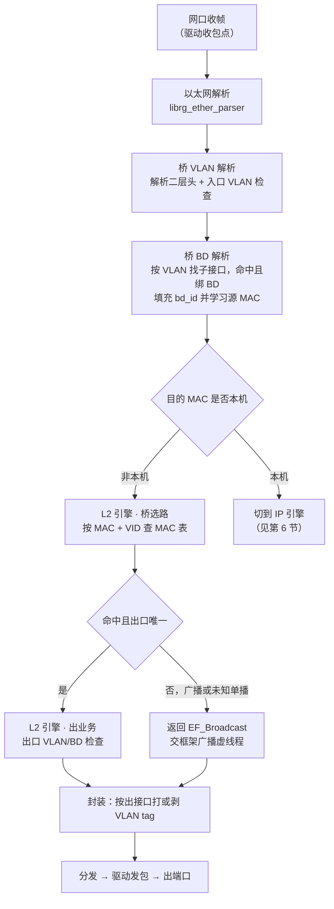
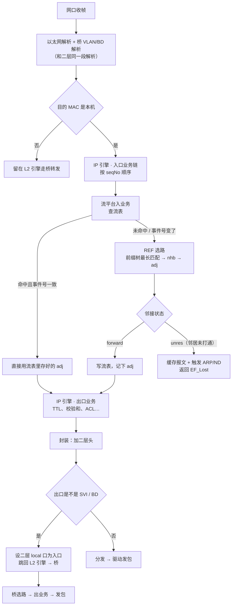
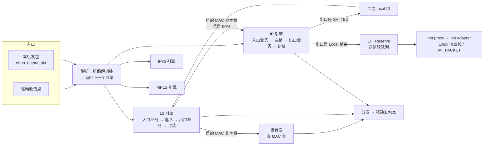

# EFMP 引擎与二三层业务对接及转发流程

> **本文回答一个问题**：EFMP 这个引擎，是怎么把二层业务、三层业务挂上去的；挂上去之后，一个报文从进端口到出端口，中间被谁按什么顺序处理。
>
> **信源优先级**：一手设计文档（ARCH-EF-HLD2）> conf 页面与组件说明 > 本机实测 > 我的推断。凡属推断，一律标「推断」并给出依据链。
>
> 本文所有结论都能落到具体页面或具体函数名，凡拿不到的，集中列在 [[#10 证据、缺口与待确认|§10]]，不猜。

## 目录

- [[#0 体例与证据分级|0 体例与证据分级]]
- [[#1 三个词先分清：EFMP、引擎、EFD|1 三个词先分清]]
- [[#2 引擎对外暴露的五类挂载点|2 五类挂载点]]
- [[#3 业务是怎么"挂"到某个引擎的|3 业务怎么挂上去]]
- [[#4 一次转发里引擎怎么跑起来|4 引擎怎么跑]]
- [[#5 二层：桥业务挂上 L2 引擎|5 二层路径]]
- [[#6 三层：REF 挂上 IP 引擎|6 三层路径]]
- [[#7 引擎之间的跳转：一张图看全|7 引擎跳转]]
- [[#8 EFD 与 EFMP 的双层流水|8 双层流水]]
- [[#9 与真机 ASIC 的机制差别|9 与真机差别]]
- [[#10 证据、缺口与待确认|10 证据与缺口]]
- [[#附录 A 关键数据结构|附录 A 数据结构]]
- [[#附录 B 接口速查|附录 B 接口速查]]

---

## 0 体例与证据分级

| 标记 | 含义 | 本文里的典型来源 |
|---|---|---|
| **设计文档** | 正式评审过的 HLD/DM（High Level Design，总体设计／组件说明） | ARCH-EF-HLD2、EF-COREFRAME-DM |
| **conf 实证** | 公司内部 wiki 页面原文，可点开核对 | 页面 ID 已逐条给出 |
| **本机实测** | 在设备上用只读命令采到的现场数据 | 见同目录 [[模拟器EFMP转发面现场实测-2026-10-28]] |
| **推断** | 由上述证据推得，未见原文直述 | 会写明推理链 |

两条写作约定：

- 英文术语首次出现给中文，格式为「中文（English）」；函数名、结构体名、命令、路径一律保留原文，不翻译。
- 本文出现的「引擎」一律指 `engine`（快转框架内部的报文处理路径），不是硬件转发芯片，也不是 AI 推理引擎。

---

## 1 三个词先分清：EFMP、引擎、EFD

这一节必须先立住，否则后面所有讨论都会打滑。**EFMP 不是一个引擎，它是一个装着引擎和业务的框架。**

### 1.1 EFMP 是框架，不是单个引擎

conf 上给的定义原话：

> 快转也称为转发框架，全称缩写叫 **EFMP（Express Forward Management Platform，快转管理平台）**，也简称为 EF。为各业务和驱动提供一套对报文处理、快速转发的系统框架，包括**各业务的注册、处理、服务获取、驱动收发包、报文管理统计**、demo 命令等。
> —— `12.X EFMP（快转）业务学习记录`（田光清，2022-06-08，[pageId 217222533](http://conf.ruijie.work/pages/viewpage.action?pageId=217222533)）

另一页的说法更直白：

> 快转可以简单的理解为一个**应用层之下、驱动层之上**的中间件，用来处理 CPU 转发的报文的工具。
> —— 同上

所以严格讲：**EFMP 自己几乎不处理报文**。它做四件事——收发包点注册、业务注册与调度、服务注册与获取、报文缓冲区管理。真正决定「这个包怎么转」的，是挂在它上面的**引擎**。

### 1.2 引擎是"一条报文处理路径"

设计文档和 conf 给的定义是一致的：

> 转发引擎：把不同的业务转发处理称为转发引擎，如**二层转发引擎、IP 业务转发引擎、IPv6 业务转发引擎**等，各个层次的转发引擎**只负责本层次业务的处理**。
> —— `快转`（林涛，2024-12-13，[pageId 804028596](http://conf.ruijie.work/pages/viewpage.action?pageId=804028596)）

> 当前快转框架的各个转发引擎（**引擎可以理解为快转框架内部的报文处理路径**）
> —— ARCH-EF-HLD2《用户空间转发系统 2 级总体设计》v1.2，2018-06-15，第 2.1.7 节

关键在最后半句：**每个引擎只管自己那一层**。二层引擎不管路由，IP 引擎不管 MAC 表。跨层的事，靠「引擎跳转」完成，不靠一个引擎全包。

### 1.3 EFD 是执行体，EFC 是它的控制面

这是最容易混的一层。conf 上一页把 EF 框架拆成三层视图：

> 整个 EF 框架可以分为三层视图：
> **EFD**，执行具体的报文处理，流水线执行，执行虚线程；
> **EFC**，控制面，框架初始化、驱动注册、链路层协议注册等等，流水线组织、虚线程组织等等；
> **RDP**，对标的是 SDP（Service Data Plane，业务数据面），主要的工作就是订阅 MOM（Message Oriented Middleware，消息中间件）消息，对上 UDP（Unified Data Plane，统一数据平面）。
> —— `EFD软转框架介绍`（林志群，2023-09-08，[pageId 514950272](http://conf.ruijie.work/pages/viewpage.action?pageId=514950272)）

组件层面的分工也写得很清楚：

> `efmp_frame.elf`｜进程组件｜**EFMP 进程转发框架，接口注册以及业务注册，让各个业务模块（转发业务库文件）在转发框架上注册自己的转发业务。**
> `efd_frame.elf`｜进程组件｜**EFD 快转业务**
> —— `组件结构`（陈晟桓，2023-10-09，[pageId 555877049](http://conf.ruijie.work/pages/viewpage.action?pageId=555877049)）

一句话对照：

| 层 | 干什么 | 类比 |
|---|---|---|
| **EFMP** | 提供容器：收发包点、业务表、虚线程调度、EFBUF（报文缓冲区） | 操作系统内核的**中断与调度框架** |
| **引擎（engine）** | 一条报文处理路径，按业务序号顺序调用注册进来的业务 | 内核里的**协议栈某一层** |
| **业务（业务库 `.so`）** | 具体逻辑：桥、REF、ACL、流平台…… | 内核里的**具体功能模块** |
| **EFD／EFC** | 12.x 路由器软转的执行体／控制面，跑在 EFD 框架上的另一套进程形态 | 同一套机制的**另一个产品线实现** |

**这里要纠正一个常见说法**：「EFMP 是引擎」这句话方向对、粒度不对。EFMP 是**引擎机制**的提供者；二层引擎、IP 引擎才是引擎。你跟人聊的时候说「EFMP 里跑二三层引擎」是准的，说「EFMP 就是二层引擎」会漏掉 IP 引擎和 IPv6 引擎。

### 1.4 一句话总览

```
驱动（收包点）
   ↓  报文进 EFMP
解析函数（parse）── 决定"下一个引擎是谁" ──→ L2 引擎 / IP 引擎 / IPv6 引擎 / MPLS 引擎
   ↓
引擎内：入口业务（按 seqNo 顺序）→ 路径选择（可能跳下一个引擎）→ 出口业务 → 封装
   ↓
分发（dispatch）→ 驱动（发包点）→ 出端口
```

---

## 2 引擎对外暴露的五类挂载点

业务不是「编译进框架」的，而是「运行时挂上去」的。EFMP 一共开了五类挂载点，**二三层业务各自用其中不同的几类**。

### 2.1 收包点与发包点（驱动侧）

驱动向框架注册「从哪儿收包、往哪儿发包」。注册收包点时，框架顺手把这条收包点要用的虚线程全部建好：

> 驱动向快转框架注册报文接收点，用于报文的接收。首先，初始化 `efmp_rxpnt_register_info_t`，指明**接收点每次收包限额、接收点是否为自启动的、名称以及接收函数**等，然后调用 `efmp_txpnt_register` 函数向快转框架注册该接收点。
> —— `快转`（[pageId 804028596](http://conf.ruijie.work/pages/viewpage.action?pageId=804028596)）

> 收包点注册时，创建 SKIP 虚线程、MCAST 虚线程、RX 虚线程；流水线模型下还要创建 FORWARD（业务转发）虚线程和 DISPATCH（报文分发）虚线程。
> —— 同上

**注意一处原文笔误**：上面引文里写的是「调用 `efmp_txpnt_register` 注册该**接收**点」，按上下文与函数命名（rx = receive，tx = transmit），注册接收点应为 `efmp_rxpnt_register`。这一点我在 [[#10 证据、缺口与待确认|§10]] 里标了出来，没有替你改原文。

两个点的作用边界：

| 点 | 作用 | 归属 |
|---|---|---|
| 报文接收点（rxpnt） | 驱动把收到的帧按流特征散列到若干队列，这些队列就是接收点 | 驱动注册 |
| 报文发送点（txpnt） | 快转按接口绑定的映射函数或发送点 id 把报文散列到发送队列 | 驱动注册 |

### 2.2 业务处理函数（业务库侧）

这是**最核心的一个挂载点**。业务库在初始化时，把自己要注册的函数填进一个描述块 `ef_funcblock_t`，交给框架：

> `int efmp_reg_module(ef_funcblock_t *func)`　`int efmp_dereg_module(ef_funcblock_t *func)`
> 参数 `ef_funcblock_t` 的成员说明：
> - `function`：业务处理函数；
> - `intf_index`：接口业务注册／注销时指定的设备接口，**全局业务注册时可以不填**；
> - `io`：业务类型，见枚举 `ef_app_type_t`；
> - `seqNo`：业务的处理序号，见 `ef_l2_serv_t`、`ef_ip_serv_t`、`ef_ipv6_serv_t`
> —— `EF-COREFRAME-DM`（快转框架组件使用说明，[pageId 72239952](http://conf.ruijie.work/pages/viewpage.action?pageId=72239952)）

文档还给了一段可直接对照的实例——IP 转发业务注册：

```c
struct ef_funcblock_s ef_funcblock;
memset(&ef_funcblock, 0, sizeof(struct ef_funcblock_s));
ef_funcblock.io    = EF_APP_IP_GLOBAL;          /* 业务类型：IP 层全局业务，无需指定接口 */
ef_funcblock.seqNo = EF_REF_NO;                 /* 业务处理序号：选路业务的位置 */
ef_funcblock.function = ref_ipv4_full_path_route; /* 处理函数：IPv4 全路径选路 */
ret = efmp_reg_module(&ef_funcblock);           /* 注册，并按返回值处理 */
```

**这三行赋值就是「三层业务挂上 IP 引擎」的全部动作。** 没有继承、没有插件描述文件，就是填一个结构体、调一个函数。

简内核（用户态快转）里接口名略有不同，但语义一一对应：

| 宏内核（12.x 之前） | 简内核（12.x 用户态） | 用途 |
|---|---|---|
| `efmp_reg_module` / `efmp_dereg_module` | `efmp_register_module` / `efmp_deregister_module` | 业务处理函数注册／注销 |
| — | `efmp_reg_parser` / `efmp_dereg_parser` | 解析回调注册 |
| — | `efmp_reg_encap` / `efmp_dereg_encap` | 封装回调注册 |
| — | `efmp_reg_service` / `efmp_dereg_service` | 业务服务注册 |
| — | `efmp_reg_serv_change_handler` | 服务变更通告回调 |
| — | `efmp_skip_fw` | 业务处理后重新投递，跳过指定业务 |
| — | `efmp_uninstall_module` | 延迟卸载，防止框架访问到已失效的函数指针 |
> 来源：`快转公共接口使用规范`（陈果果，2023-10-13，[pageId 551256122](http://conf.ruijie.work/pages/viewpage.action?pageId=551256122)）、`EF-COREFRAME-DM`（[pageId 72239952](http://conf.ruijie.work/pages/viewpage.action?pageId=72239952)）

规范里还有两条硬约束，直接决定业务能不能挂得稳：

> 1、两个接口，业务**必须成对使用**。
> 2、业务可根据具体接口注册具体业务。**尽量不要全局接口注册业务**，否则每个接口都有该业务，快转内部性能会变差（特别是软转产品）。
> —— `快转公共接口使用规范`（[pageId 551256122](http://conf.ruijie.work/pages/viewpage.action?pageId=551256122)）

第二条对 x86 软转尤其致命：软转产品所有转发都靠 CPU，全局注册意味着**每一个接口的每一次转发都要多走一遍这个业务**，成本是乘出来的。

### 2.3 解析与封装函数

这算是「半类」挂载点，因为它是按接口挂的：

> 快转框架支持**接口链路封装和接口上的解封装函数的注册／注销**。解封装函数应能够对报文进行解封装处理并**选择报文的转发路径**；如果解封装函数没有注册，则快转框架调用自带的以太网解封装函数……链路封装函数在 IP 转发路径和 IPv6 转发路径中所有业务执行之后、路径选择函数执行之前调用。
> —— `EF-COREFRAME-DM`（[pageId 72239952](http://conf.ruijie.work/pages/viewpage.action?pageId=72239952)）

注意「解封装函数同时负责选择转发路径」这句：**解析不只解析，它还顺手把报文推进了哪个引擎定了。** 这是理解整条链路的关键（见 [[#3.4 二层的默认路径选择函数由桥提供|§3.4]]）。

### 2.4 路径选择函数

> 快转框架支持对**路径选择函数**的注册／注销。在转发路径上的所有业务执行之后，快转框架会调用该转发路径上的路径选择函数对报文的**下一个转发路径**进行选择。
> —— 同上

三层文档里的原话更具体：

> 每个转发引擎对应的层次有一个转发引擎选择函数，例如在二层转发引擎中，**由桥模块提供默认的下一个转发引擎选择函数**。然而，在二层转发引擎中还可能存在 PPPoE 类型的转发引擎选择函数，即对于 PPPoE 类型的报文来说，需要由 PPPoE 模块提供转发引擎选择函数。因此，**各模块需要向快转框架注册各转发层次的不同类型的转发引擎**。
> —— `快转`（[pageId 804028596](http://conf.ruijie.work/pages/viewpage.action?pageId=804028596)）

**这句话解释了桥为什么特殊**：桥不只是一个「处理二层报文的业务」，它同时是二层引擎的**默认决策者**——决定这个包继续留在二层桥转发，还是升级到 IP 引擎。

### 2.5 服务注册与获取

业务之间不直接互相调用，而是通过框架中转：

> 快转中，业务模块之间的交互通过**服务注册、服务获取、服务更新**三个阶段实现。
> 服务注册：各快转模块可以向快转框架注册自己的服务；
> 服务获取：其它模块想访问该服务时，需要从快转框架获得该服务；
> 服务更新通告：有些业务服务提供的信息更新时需要通告给其它业务。
> —— `快转`（[pageId 804028596](http://conf.ruijie.work/pages/viewpage.action?pageId=804028596)）

规范里补了两个必须遵守的点：

> 1、注册业务时，业务内部的服务号，**可以放在业务自己的头文件中**。
> 2、业务必须自己实现 `efmp_reg_serv_change_handler`，用来监听其他业务的加载／卸载信息，以判断内部的其他业务回调函数是否存在。
> 3、转发面使用业务回调函数前，**必须判断该回调函数是否存在**。
> —— `快转公共接口使用规范`（[pageId 551256122](http://conf.ruijie.work/pages/viewpage.action?pageId=551256122)）

这就是「业务可单独升级」能成立的前提：桥不编译死依赖 REF，REF 也不编译死依赖流平台，大家只认服务号。

### 2.6 挂载点总表

| 挂载点 | 注册函数 | 挂的是什么 | 二三层谁用 |
|---|---|---|---|
| 报文接收点 | `efmp_rxpnt_register` | 驱动的收包函数 + 虚线程组 | 全局，与层无关 |
| 报文发送点 | `efmp_txpnt_register` | 驱动的发包函数 | 全局，与层无关 |
| 业务处理函数 | `efmp_reg_module` / `efmp_register_module` | `ef_funcblock_t`：函数 + 引擎 + 序号 + 入/出 | **二层桥、三层 REF 都靠它** |
| 解析／封装函数 | `efmp_reg_parser` / `efmp_reg_encap` | 链路层解析与封装 | 桥用它挂 VLAN 解析、BD 解析 |
| 路径选择函数 | 由框架提供注册接口（函数名未公开，见 [[#10 证据、缺口与待确认\|§10]]） | 决定下一个引擎 | 二层默认由桥提供 |
| 服务 | `efmp_reg_service` | 服务号 + 函数指针表 | REF 用它对外提供选路服务 |

---

## 3 业务是怎么"挂"到某个引擎的

上一节说「填结构体、调函数」，这一节说清楚：**填进去的这几个字段，框架拿它们干什么。**

### 3.1 定位一个业务的四元组

框架在一堆注册函数里，靠四个维度定位「这个函数该在什么时候被调用」：

| 维度 | 字段 | 取值来源 | 作用 |
|---|---|---|---|
| 哪个引擎 | `engine`（u8） | 报文头 `ef_pkt_buf_st.engine` | 二层、IP、IPv6、MPLS 各一个编号 |
| 哪一步 | `seqNo`（业务序号） | `ef_l2_serv_t` / `ef_ip_serv_t` / `ef_ipv6_serv_t` | 同一引擎内的执行顺序 |
| 入还是出 | `io`（`ef_app_type_t`） | 入业务／路径选择后的入业务／出业务 | 决定挂在源接口侧还是目的接口侧 |
| 哪个接口 | `intf_index` | 接口索引，全局业务可空 | 按接口生效还是全设备生效 |

报文里那两个字段是**随包携带**的，等于给每个包贴了一张「我走到哪了」的标签：

```c
/* ef_pkt_buf_st 片段（ARCH-EF-HLD2 第 4 节 数据结构） */
u8   engine;       /* 保存业务引擎 */
u8   module;       /* 业务起始序号 */
u16  service_id;   /* BUFFER 的当前所有者 ID */
```

conf 上对这三个字段的语义解释得非常清楚，值得原样记住：

> **engine（引擎）和 module（业务）主要是转发过程中选择哪个路径将报文转发出去。**
> **service_id 主要用于快转定位 efbuff 是被哪个业务持有**，还有抓重复释放 efbuff 的业务号。
> —— `efmp学习总结`（曾庆伟，2023-06-08，[pageId 480348426](http://conf.ruijie.work/pages/viewpage.action?pageId=480348426)）

**这里有个容易混的点**：`engine` 和 `module` 决定「往哪转」，`service_id` 只决定「这个缓冲区现在归谁」，**不参与转发决策**。前者是路由问题，后者是内存归属问题。

框架内部还把这两个字节压成一个整数当上下文：

```c
efmp_set_current_context(engine, EFMP_PARSE_NO);
context = (engine << 8 | seq);   /* 高字节引擎，低字节序号 */
```

### 3.2 入业务与出业务的分界线

业务分三类，定义在 `ef_app_type_t`：

> 在各转发路径中，业务分为**入业务、路径选择后的入业务和出业务**等业务类型。入业务为**报文源接口**上挂载的业务；路径选择后的入业务只在二层转发路径中有定义，为二层路径选择后的源接口业务，包括**应用识别和桥转发业务**等；出业务为**出口**上的业务。
> —— `EF-COREFRAME-DM`（[pageId 72239952](http://conf.ruijie.work/pages/viewpage.action?pageId=72239952)）

那框架怎么知道某个 `seqNo` 属于入还是出？靠一个常量切一刀：

> 设置 `EFMP_INSERV_MAX_NO` 是啥关联？—— **在 `EFMP_INSERV_MAX_NO` 之前，则归入业务；在之后，则归出业务**。
> —— `代码学习`（洪志伟，2023-05-12，[pageId 427985802](http://conf.ruijie.work/pages/viewpage.action?pageId=427985802)）

所以业务序号的枚举不是随便排的，它是一条**有物理意义的数轴**：

```
低序号 ───────────── EFMP_INSERV_MAX_NO ───────────── 高序号
   ← 入业务（源接口侧）      分界          出业务（出口侧）→
```

这个设计的好处是：同一个引擎里，框架只用一个比较就能把入、出两段业务分开跑，不需要为每类业务维护两张表。

### 3.3 每个接口、每个引擎各有一份业务表

> 在快转框架中，**对于每个接口来说，为每个转发路径保存一份业务表（也叫转发表）**，在每个转发路径处理时，按顺序调用该层次的入业务和出业务处理。
> —— `efmp学习总结`（[pageId 480348426](http://conf.ruijie.work/pages/viewpage.action?pageId=480348426)）

这就是为什么 `intf_index` 这个字段存在。业务表是二维的：

| | L2 引擎 | IP 引擎 | IPv6 引擎 |
|---|---|---|---|
| 接口 Gi1/0/1 | 该接口在二层上挂了哪些业务 | 该接口在三层上挂了哪些业务 | … |
| 接口 Gi1/0/2 | … | … | … |
| 全局 | `intf_index` 为空的那批业务 | … | … |

**这解释了一个实测现象**：`show efmp interface <索引>` 能看到某个接口的业务注册情况（规范里提到这条命令），因为它查的就是这张二维表的一格。

### 3.4 二层的默认路径选择函数由桥提供

二层引擎跑完入口业务后，要做一件事：**判断这个包继续留在二层，还是升级到三层**。判断依据是目的 MAC：

> 转发路径上的业务处理如下所述：
> 1. 转发路径上的入口业务处理；
> 2. **下一个转发路径的选择以及源接口的修订，这个阶段只存在于二层转发路径**。在二层转发路径选择中，如果二层头中**目的 MAC 地址非本机，选择本转发路径，进行桥转发**，跳转到下一步。否则，如果是 IPv4 报文选择 IP 转发路径，IPv6 报文选择 IPv6 转发路径，报文送其他转发路径进行处理；
> 3. 转发路径上的出口业务处理；
> 4. 报文封装；
> 5. 转发路径选择，**仅存在于 IP 转发路径和 IPv6 转发路径中**。
> —— `EF-COREFRAME-DM`（[pageId 72239952](http://conf.ruijie.work/pages/viewpage.action?pageId=72239952)）

**这五步是整篇文章的骨架**，二三层所有行为都能塞进这五步里。请注意第 2 步那个限定语「只存在于二层」和第 5 步「仅存在于 IP/IPv6」——两条路在这一点上是**不对称**的，后面 [[#7 引擎之间的跳转：一张图看全|§7]] 会专门讲这个不对称带来的后果。

### 3.5 业务号从哪来：头文件枚举到 XML 动态生成

11.x 的做法是硬编码：

> 当前快转框架的各个转发引擎，业务号是在快转头文件中按需添加，每次对应引擎上新增一个业务号，需要在头文件中手动添加该业务号枚举类型定义。
> —— ARCH-EF-HLD2 第 2.1.7 节

12.x 改成运行时读取：

> 为了达到 12.x 项目「平台发布版本后，新增一个业务或者服务的情况下，快转框架不修订代码、不重新发布平台版本」的目标，12.x 快转框架的**业务号和服务号从 xml 文件中动态去获取**，生成业务号数组和服务号数组。
> …… 使用该机制后，就可以做到平台发布一个版本，设备上需要新增一个业务或者服务，**只需要修订 xml 文件，重启下设备就能支持**。
> —— ARCH-EF-HLD2 第 2.1.7 节

**这条对 x86 模拟器的意义**：一个业务在不在，不只看 `.so` 有没有，还要看 XML 里有没有给它留号。如果 XML 少了号，`.so` 加载了也不会被调度——这正好是 [[模拟器EFMP转发面现场实测-2026-10-28]] 里那条「加载 ≠ 注册」的另一半原因。

---

## 4 一次转发里引擎怎么跑起来

### 4.1 五个阶段

设计文档把转发拆成四个过程，加上解析，实际是五段：

> 快转框架将报文的转发分为**驱动收包、报文转发、报文分发和驱动发包**四个过程。
> —— `EF-COREFRAME-DM`（[pageId 72239952](http://conf.ruijie.work/pages/viewpage.action?pageId=72239952)）

串起来是：

| 阶段 | 谁在跑 | 干的事 |
|---|---|---|
| ① 驱动收包 | 收包虚线程（RX） | 调驱动注册的 `rx_func`，从接收点取一批报文 |
| ② 解析 | 同一个虚线程或 FORWARD 虚线程 | 调接口上注册的解析函数；没注册就用默认以太网解封装 |
| ③ 引擎处理 | FORWARD 虚线程 | 按 `seqNo` 顺序跑入口业务 → 路径选择 → 出口业务 → 封装 |
| ④ 分发 | DISPATCH 虚线程 | 按接口绑定的分发函数／发送点散列到发送队列；超 MTU 在此分片 |
| ⑤ 驱动发包 | 发包虚线程 | 调驱动的发包函数，从发送点取包发出 |

### 4.2 返回值决定报文去哪

业务函数的返回值不是 bool，而是一个**动作枚举**：

```c
typedef enum {
    EF_Normal = 0,    /* 正常转发 */
    EF_Drop,          /* 丢弃报文 */
    EF_Reserve,       /* 送进程 */
    EF_Lost,          /* 业务模块缓存报文 */
    EF_Broadcast,     /* 桥组内广播 */
    EF_Resv_Bcast,    /* 送进程及桥组内广播 */
    EF_result_max,
} ef_pkt_proc_result_t;
```
> 定义在头文件 `efmp_common.h`，转引自 `EF-COREFRAME-DM`（[pageId 72239952](http://conf.ruijie.work/pages/viewpage.action?pageId=72239952)）

最容易误读的是 `EF_Lost`，conf 上专门纠过这个：

> 很多开发人员，以为 `EF_Lost` 是丢包。错了，这个只是说明，**业务或者快转缓存了报文**，内部处理后，会吐出来，再处理。实际上真正只有 `result(DROP)` 字样的才是对应上面的 `EF_Drop`。
> `EF_Reserve` 就是：报文需要上送进程处理，这里所说的进程，大部分是 `/sbin/*.elf`（不包括 `efmp_frame.elf`）。返回该结果，会将报文加入送进程队列，并由 AF_Packet 和协议栈确认报文送哪些进程。
> —— `手撕快转（四）快转之转发`（陈果果，2023-02-18，[pageId 169509959](http://conf.ruijie.work/pages/viewpage.action?pageId=169509959)）

**这个纠偏很重要**：`EF_Lost` 是「我收下了，等会儿再吐」，`EF_Drop` 才是真丢。看 `show efmp counter` 里 `LOST` 数字很大就以为在丢包，是常见误判——同目录 [[模拟器EFMP转发面现场实测-2026-10-28]] 里那 519 万 `LOST`，实际是「待再转发」队列的量。

EFD 侧有一套等价但命名不同的枚举（`ef_pkt_proc_res_t`）：`EF_RES_NORMAL` / `EF_RES_DROP` / `EF_RES_TOPF`（转 PF 处理）/ `EF_RES_LOST` / `EF_RES_CHAIN`（返回报文链）/ `EF_RES_REDO`。见 `无线12X-AC软转设计指导`（唐友灿，2024-09-12，[pageId 787054614](http://conf.ruijie.work/pages/viewpage.action?pageId=787054614)）。

### 4.3 虚线程：谁在真正执行

框架里没有「业务自己的线程」这回事，所有业务都在框架的虚线程里跑：

| 虚线程 | 什么时候创建 | 干什么 |
|---|---|---|
| SKIP | 注册收包点就建 | 处理「跳过部分业务」的报文 |
| MCAST | 注册收包点就建 | 组播复制 |
| RX | 注册收包点就建 | 收包 + 解析 |
| FORWARD（`vth_serv`） | 仅流水线模型 | 跑引擎里的业务 |
| DISPATCH（`vth_disp`） | 仅流水线模型 | 分发到发送点 |

调度模型由注册收包点时的参数决定：

> 快转是在 `efmp_rxpnt_register` 函数中确定转发模型的。`efmp_rxpnt_t` 结构体中会定义多个虚线程（即流水线处理线程）。如果使用流水线模型，那么会为这几个虚线程都创建好；如果是 **RTC（Run-to-Complete，跑完即完成）模型，那边只需要创建一个 `vth_rx` 虚线程即可**，业务处理、报文分发都在这个虚线程中完成。
> …… 如果只有一个转发核，那么 `efmp_rxpnt_register` 函数会强制走 RTC 模型的。如果是多个转发核，那么会基于产品来设置转发模型：AP 产品走 RTC 模型，其他产品都流水线模型。另外**管理口 RXPNT 也是强制走 RTC 模型**的。
> —— `快转框架`（金水生，2026-05-06，[pageId 877298073](http://conf.ruijie.work/pages/viewpage.action?pageId=877298073)）

实线程是 `EFMP/X`（X 为 CPU id），它只做一件事——轮询调度虚线程：

```c
ret = (*vth->handle)(vth, vth->para);
if (unlikely(++vth_cnt == sch_max)) { vth_cnt = 0; schedule(); }
```

**这解释了一个实测现象**：`efmp_frame.elf` 常年 99% CPU，因为它跑的是「while(1) 从 RX 队列取包」的轮询模式，不是中断唤醒。见 [[模拟器EFMP转发面现场实测-2026-10-28]] 的 [[模拟器EFMP转发面现场实测-2026-10-28#3.1 进程本身|§3.1]]。

### 4.4 x86 上对应的阶段名

上面这套抽象，在 x86 设备上会以具体的阶段名出现在 `show efmp counter` 里：

| 抽象阶段 | x86 上的阶段名 |
|---|---|
| 解析 | `PARSER-STAGE` |
| 分片重组 | `FRAG-REASM-STAGE` |
| 引擎转发 | `FW-STAGE` |
| 广播 / 组播 | `BCAST-STAGE` / `MCAST-STAGE` |
| 上送进程 | `RSVD-STAGE` |
| 封装 | `ENCAP-STAGE` |
| 分发 | `DISPATCH-STAGE` |
| 进程下发 | `FRMPF-STAGE` |
| 跳过业务 | `SKIP-STAGE` |
> 字段定义来源：`show efmp count 说明`（孙明阳，2024-01-12，[pageId 634618868](http://conf.ruijie.work/pages/viewpage.action?pageId=634618868)）

x86 侧还有一句更具体的骨架描述，把引擎和业务函数名直接点出来了：

> 1、链路解析找引擎
> 2、ip/ipv6 报文重组
> 3、全路径转发引擎 `hole_engine`
> 4、`efmp_run_app`，**跑所有注册的业务**
> 5、跑出业务
> 　　流事件过程：当业务调用 `fpm_announce_event`，会让 `hfpm->event_counter++`，在跑流平台注册在 IP 引擎的入业务时，判断 `hfpm->event_counter` 与 `pflow->ori_event_counter` 不一致，就将 `pflow->ori_event_flags` 置成全 F，然后跑 ref_ip 业务的时候，根据 `pflow->ori_event_flags` 判断知道要新建流，因此 ref_ip 会重新查询路由，并将 adj 保存到流表中。
> —— `x86转发报文流程`（李恝，2022-06-09，[pageId 242113516](http://conf.ruijie.work/pages/viewpage.action?pageId=242113516)）

`efmp_run_app` 这个名字值得记住——**它就是「按业务表顺序跑注册函数」的那个执行点**，第 4 步的注释已经说明了。

---

## 5 二层：桥业务挂上 L2 引擎

二层这条链最完整，因为有一页把桥的**每一个注册动作**都列了出来。

### 5.1 桥的五个注册点

> 桥快转业务初始化（`ef_bridge_forward_init`）时注册：
> 1. **注册广播域报文处理节点**：`efmp_reg_bridge_get_broadcast_intfs`，回调 `ef_bridge_get_bcast_oifs`，找到广播报文对应的出接口，以链表形式返回继续发包处理；
> 2. **注册桥出口 vlan/bd 检查业务**：`ef_bridge_deal_vlan_check_reg`，回调 `ef_bridge_output_vlan_check_sfw`，检查出口 vid 与接口关系、接口状态，是否满足报文转发条件；
> 3. **网桥快转二层转发引擎注册，处理桥选路**（根据 `bd_id`，进入指定路径解析报文 `vid/bd_id/sub_ifx`，转指定子接口处理，**单播报文在这一步已经能根据 mac 表确定出接口**）：`ef_bridge_deal_fwd_reg`；
> 4. **网桥接口报文解析**：`ef_bridge_reg_parser_on_exist_intf`（根据现有接口创建，遍历注册网桥接口报文解析节点）；
> 5. **注册桥 vlan 解析和桥 bd 解析**（接口创建／删除事件感知）：`ef_bridge_recv_intf_msg`。bridge 层主接口注册网桥 vlan 解析（**解析二层头、入口 vlan 检查**）、bridge 层和 tcpip 层注册桥 BD 解析，根据报文 vlan 信息查找主接口下是否有对应的子接口与其封装一致，若存在，则检查子接口是否绑定 bd，**绑定则将报文信息中填充 bd 信息、学 mac**。
> —— `网桥的软转发流程梳理`（马诚诚，2022-11-23，[pageId 338919620](http://conf.ruijie.work/pages/viewpage.action?pageId=338919620)）

把五个点按「挂到哪」归类：

| 注册动作 | 挂的是哪类挂载点 | 挂到哪个引擎的哪一段 |
|---|---|---|
| ① 广播域出接口 | 服务（供框架广播时回调） | 不在引擎内，广播阶段用 |
| ② 出口 VLAN/BD 检查 | 业务处理函数（出业务） | L2 引擎 · 出业务 |
| ③ 桥选路 | 业务处理函数 + **路径选择函数** | L2 引擎 · 路径选择后的入业务 |
| ④ 接口报文解析 | 解析函数 | 解析阶段（引擎之前） |
| ⑤ VLAN 解析 / BD 解析 | 解析函数 | 解析阶段（引擎之前） |

**这张表是本文最实用的一张**：以后要看「某个二层功能在不在」，就对着这五行查——每缺一行，链路上就少一个环节。

### 5.2 一个二层单播帧的完整路径

把上面五个点串起来，加上设计文档的五步骨架，二层单播是这么走的：



几个必须说清的细节：

**① 学 MAC 和查 MAC 不在同一个点。** 学在「桥 BD 解析」（解析阶段），查在「桥选路」（引擎内）。这两个点中间隔着一次引擎进入动作，所以如果 BD 解析没跑（比如接口没绑定 BD），MAC 就学不到，但查表逻辑本身是好的——**表现出来的现象是「表里没条目」，而不是「查表功能坏了」**。这个区分在排障时很关键。

**② 单播在选路阶段就定了出口。** 原文写得很明确：「单播报文在这一步已经能根据 mac 表确定出接口」。出口业务（第 ② 个注册点）只做**校验**（出口 VLAN/BD 是否允许、接口状态是否 UP），不做选路。

**③ 二层引擎出口后不再判断下一个引擎。**

> 二层转发引擎**没有在出口业务处理之后判断下一个转发引擎**，而是直接通过驱动注册的发包函数将报文发送出去。
> —— `快转`（[pageId 804028596](http://conf.ruijie.work/pages/viewpage.action?pageId=804028596)）

这句是二三层的**根本不对称**，[[#7 引擎之间的跳转：一张图看全|§7]] 会展开。

### 5.3 广播为什么要甩给异步线程

二层最容易踩的坑不是查表，是**广播复制**。设计文档在讲 RTC 模型缺陷时，举的例子恰好就是桥：

> RTC 转发模型存在的问题如下：转发路径上如果某个环节处理太慢，就会导致整条报文处理关键路径处理慢，导致收包延迟，最终报文都堆积在硬件。这种情况会导致，本来整机的性能比如有 20Gbps，结果因为该处理路径上处理节点慢，整机处理性能瞬间下降到比如 3Gbps。
> 所以，这里对转发业务提出一个需求，转发路径上，业务挂载的处理函数，如果有处理特别慢的逻辑，那么这些处理慢的逻辑需要**转异步处理**，不能堵住转发关键路径。比如**桥遍历 vlan 内的所有接口做广播处理**，一旦 vlan 内有几千个接口存在的情况下，这个处理就特别慢，类似这种逻辑就得转异步处理。桥可以直接返回广播的处理结果给快转框架，快转框架将该报文加入**广播处理队列**，激活**广播处理虚线程**单独处理。
> —— ARCH-EF-HLD2 第 2.1.2 节

这不是理论推演，是真出过故障的：

> 中国地质大学故障改动 62553：在 L2 流水线上，桥获取广播出口链表影响报文收发处理，导致**报文堆积、ebuf 不足**。==> 将获取广播出口链表的动作转移到异步线程处理，释放 L2 流水线出来处理其它报文。
> 武汉大学故障改动 150807：快转在优化 AC 泛洪时……对于广播报文需要调用桥的接口获取服务获取接口链表，再叠加漫游服务获取接口；对于多播报文，不需要桥服务，只需要漫游服务获取接口。
> —— `快转广播处理`（孙明阳，2023-10-08，[pageId 555188275](http://conf.ruijie.work/pages/viewpage.action?pageId=555188275)）

所以二层引擎里那个「返回 `EF_Broadcast`」的返回值，**本身就是一次架构妥协的产物**：桥不自己复制报文，只返回「这包要广播」，复制交给框架的广播虚线程。框架再按需回调各业务提供的「取出口链表」服务。

> 需要广播多播的报文，报文打上对应标志。在广播异步线程处理的时候根据对应 flag 调用对应业务的出口获取服务函数。
> —— 同上

### 5.4 MAC 表住在共享内存

二层转发要查的表，位置很特殊：

> MAC 表（FDB，Forwarding Data Base）住在桥快转的**共享内存**里：`base_node` 存真实表项，1q/1d HASH 与二叉树**只存节点位置**，且**只有快转能写**。
> —— `BRIDGE`（[pageId 873922810](http://conf.ruijie.work/pages/viewpage.action?pageId=873922810)），转引自同目录 [[X86模拟器缺失进程清单-2026-11-02]] 的 [[X86模拟器缺失进程清单-2026-11-02#4.2 两边各自的转发引擎长什么样|§4.2]]

「只有快转能写」有两个后果：

1. **控制面进程（`bridge.elf`）改不了表**，它只能通过 MOM 把「我要加一条静态 MAC / 过滤 MAC」的意图同步给 `ef_bridge`，由后者写表。
2. **表容量 = 共享内存池容量**，不是芯片规格。扩容只能加内存，没有「换个更大的芯片」这条路。

这两条对 x86 模拟器尤其重要：**二层的「能力」上限是内存和软件逻辑决定的，不是硬件决定的**，所以不能拿真机的 MAC 表规格去套模拟器。

---

## 6 三层：REF 挂上 IP 引擎

三层这条链的主角是 **REF（Ruijie Express Forward，锐捷快速转发；也有材料写作 Route Express Forward）**。它挂到 IP 引擎上的方式和桥完全一样，只是填的字段不同。

### 6.1 REF 的注册方式

回到 [[#2.2 业务处理函数（业务库侧）|§2.2]] 那段代码，`EF_APP_IP_GLOBAL` + `EF_REF_NO` + `ref_ipv4_full_path_route` 三行就是全部。再补上「REF 要用别人的东西」这一面：

> IPREF 是作为快转的一个业务模块提供路由功能。
> 2.1 快转框架：
> - 调用快转框架的接口**注册转发面的报文处理函数和本地发包的处理函数**；
> - 调用快转框架的**业务注册接口**，将对外提供的服务函数指针保存在快转框架中；
> - 调用快转框架的**获取服务的接口**从快转框架获取其他快转业务提供的服务函数指针；
> - 调用快转框架的**业务跳转处理函数**，将 IPv4/v6 路由快转缓存的报文跳过路由快转的处理发送出去。
> 2.2 流平台：调用流平台的接口注册；将报文流的处理结果保存在流表项的私有空间中，实现后续相同流报文的加速转发处理。
> —— `11.X快转之IPREF`（Jimmy，2024-11-15，[pageId 806421387](http://conf.ruijie.work/pages/viewpage.action?pageId=806421387)）

对着看，REF 一共用了 **4 类挂载点**：业务注册（自己挂上去）、服务注册（对外提供选路服务）、服务获取（拿流平台、拿到别的业务）、业务跳转（`efmp_skip_fw`，把缓存包重新投进去）。**这是本文里挂载点用得最全的一个业务**，所以拿它当模板看最合适。

三层表的组织是两级间接：

> IPREF 按照是否存在下一跳块 id 区分，若存在下一跳块 id，则路由前缀根据下一跳块 id 生成 `rt_data` 间接关联邻接表（先通过下一跳块 id 找到邻接索引表，再通过邻接索引表找到邻接表）；当处理不存在下一跳块 id 的路由时，EF-REF 路由前缀根据邻接索引 id 直接关联邻接表。
> 四张表项：**前缀表、邻接索引表、负载均衡表、邻接表**。
> —— `12.X EFMP（快转）业务学习记录`（[pageId 217222533](http://conf.ruijie.work/pages/viewpage.action?pageId=217222533)）

### 6.2 一个三层报文的完整路径



### 6.3 首包与后续包：流表怎么接管

三层的性能靠「一次处理、多次转发」：

> 我司的流平台业务负责流会话以及流会话对应的业务私有空间管理，业务将对应的处理结果保存在业务对应的流私有空间中，实现「**一次处理，多次转发**」的业务级加速处理作用。
> —— ARCH-EF-HLD2 第 2.2.4 节

x86 上的具体机制是**事件号比对**，比「定时刷新流表」便宜得多：

```c
/* 业务侧：有任何变化就调用 */
fpm_announce_event();        /* → hfpm->event_counter++ */

/* 流平台入业务：每个包都比一次 */
if (hfpm->event_counter != pflow->ori_event_counter) {
    pflow->ori_event_flags = 全F;      /* 标记这条流要重建 */
}
/* REF 业务看到 ori_event_flags 被置位 → 重新查路由，把新 adj 写回流表 */
```
> 逻辑来源：`x86转发报文流程`（[pageId 242113516](http://conf.ruijie.work/pages/viewpage.action?pageId=242113516)）

**这个设计的精妙之处**：路由或邻接一变，不需要去遍历几十万条流逐条删，只需要把全局计数器加一；每条流在自己被命中时发现「号对不上」就自我作废。**成本从 O(流数) 降到 O(1)**。

代价是：每条流都要存一个 `ori_event_counter`，且计数器的回绕要处理（推断：按 `u32` 回绕，实际比较用差值，未见原文，列为 [[#10 证据、缺口与待确认|§10]] 的待确认项）。

### 6.4 邻居没打通时

这是三层最容易出现「看起来丢包其实没丢」的地方：

> 对于以太网接口上的下一跳，若不知道 MAC 地址，快转将**主动解析下一跳（邻接打通）**。IPv4 快转请求 ARP 模块解析下一跳，IPv6 快转请求 ND（Neighbor Discovery，邻居发现）模块解析下一跳。
> —— `12.X EFMP（快转）业务学习记录`（[pageId 217222533](http://conf.ruijie.work/pages/viewpage.action?pageId=217222533)）

缓冲是有上限的，而且这个上限被写进了设计约束：

> 因为当前有很多业务依赖于这三个功能宏，比如**选路的 IPREF 在邻居未打通的时候需要缓冲报文。但是为了不影响系统的转发，缓冲的报文不能超过系统报文缓冲区总数的 1/100**。
> —— ARCH-EF-HLD2 第 2.1.4 节

一个完整的「ping 不通同网段地址」的现场过程，conf 上记得很细，值得原样保留：

> 1. 用户态 `ip_proxy` 收到 icmp 报文查找邻居是否解析，若邻居未解析，则创建一个邻接表（adj），并且通告 tcpip 进程发送 ARP 请求解析邻居。此时 ICMP 报文继续往下走，在用户态快转发送函数 `efmp_output_pkt` 中调用 ref_ip 部分查找 adj，此时 adj 邻居还未解析，故该 ICMP 报文暂时**缓存在邻接队列**中等待邻居解析。
> 2. 当 tcpip 收到 ref_ip 通告的邻居解析请求，创建一个 arp，构造 arp 请求发送到内核 af_packet 进行邻居打通，并将该 arp 状态修改为 `ARPS_READY_WAIT_RESPONSE`，同时起一个定时器（**缺省 5s**）来等待 arp 状态变更。
> 3. 如果在定时器到期之前没有收到 ARP 应答，则删除该 ARP 并通告给 ref_ip 删除 arp 的动作，ref_ip 收到 Arp 删除消息后 flush 之前新建的 adj，同时**释放**在邻接队列里缓存的 ICMP 报文。
> 4. 如果收到了 ARP 应答，tcpip 则更新 arp 状态，同时通告给 ref_ip 更新 Arp 的消息，ref_ip 收到 arp 更新消息后更新之前新建的 Adj，同时**发送**在邻接队列里缓存的报文。
> —— `12.X EFMP（快转）业务学习记录`（[pageId 217222533](http://conf.ruijie.work/pages/viewpage.action?pageId=217222533)）

**注意第 1 步的路径**：这个 ICMP 是**本机产生**的报文，走的是 `efmp_output_pkt`（本机发包入口），不是从端口收进来的。所以「本机发包」和「转发」是两条不同的入口，但最后都汇到 REF 的 adj 查询。

### 6.5 上送本机与本机发包

三层还要处理「这包是给我的」：

> 如果进入三层转发引擎的处理，需要进行路由查找，调用注册在框架的路由处理函数，EFD_REF 模块继续处理；
> ……
> 8、EF_REF 查找到路由是 **Local 路由**，到本机的，此时返回给框架 `EF_Reserve`，框架将报文放在 **Local 队列**；
> 9、EFD_IM 组件的 efb copy 模块进行 efb → efmp efb 的转换，送通路处理；
> 10、PKTD：报文送通路相应的处理，包括分片报文等；
> 11、EFMP：通路处理完成后，报文送 EFMP 框架继续后续的处理，送协议栈等。
> —— `12.X EFMP（快转）业务学习记录`（[pageId 217222533](http://conf.ruijie.work/pages/viewpage.action?pageId=217222533)）

设计文档把这条路的接口补全了：

> 协议栈在用户空间实现一个 **net proxy 代理，编译成一个动态库**。这个库里面注册接收送本机的 IP 和 IPv6 报文。
> net proxy 库提供 ICMP/ICMPv6 差错报文发送的接口……内部还是将消息发往内核做处理。
> net proxy 库提供路由器告警选项的报文拦截接口，同样将报文发往内核协议栈做处理。
> 内核里面需要实现一个 **net adapter 适配模块**，完成快转进程的 EFBUF 转成 skb 投递给原生 Linux，原生 Linux 发出的 skb 转成 EFBUF 发给快转代理。
> —— ARCH-EF-HLD2 第 2.3.4 节

**所以「上送本机」这条路，是唯一一条会碰到 Linux 内核协议栈的路**。其余全部在用户态完成——这一点与 [[模拟器EFMP转发面现场实测-2026-10-28]] 的实测结论完全吻合（内核 netdev 收计数为 0，RGOS 接口计数 58 万）。

---

## 7 引擎之间的跳转：一张图看全

### 7.1 三次过引擎的典型场景

设计文档里有一句看起来平淡、实际信息量很大的话：

> 报文可能在转发路径选择之后**多次返回快转框架**进行各层次的报文处理。
> —— `efmp学习总结`（[pageId 480348426](http://conf.ruijie.work/pages/viewpage.action?pageId=480348426)）

一个「从三层口进、从 SVI 出」的报文，实际会过 **两次** 引擎：

| 次序 | 引擎 | 入口 | 干了什么 | 出口后 |
|---|---|---|---|---|
| 第 1 次 | L2 引擎 | 物理口 | 解析、判断目的 MAC 是本机 | 跳 IP 引擎（第 2 步） |
| 第 2 次 | IP 引擎 | 同一物理口 | 流表/REF 选路得 adj，封装二层头 | 判断出口是 SVI → 跳回 L2 引擎（第 5 步） |
| 第 3 次 | L2 引擎 | **二层 local 口**（虚接口） | 桥选路，找真实二层出口 | 直接发包（二层不再判断下一引擎） |

第 3 次的入口是个**虚接口**，这是设计文档里一个很巧的约定：

> 在 IP 报文转发到 SVI 出口时，报文需要在封装后送到二层转发路径处理，此时，需要**为报文设置一个虚接口作为报文入口**，表示是从本地发出送到二层的报文，后文将该接口称为**二层本地接口（二层 local 口）**。在二层转发路径中，**桥转发业务将挂在二层 local 口上**，因此报文通过桥转发找到实际二层出口转发出去。
> —— `EF-COREFRAME-DM`（[pageId 72239952](http://conf.ruijie.work/pages/viewpage.action?pageId=72239952)）

**为什么二层需要这个 local 口、三层不需要？** 因为两边不对称：

- 二层引擎**没有**「出口后判断下一引擎」这一步 → 二层出口必须直通驱动；
- IP 引擎**有**这一步 → 三层封完二层头，可以再跳回二层。

这个不对称是设计选择，不是缺陷，但它有个直接后果：**三层的完整路径必然比二层多一跳**。所以同样是转发一个包，三层路径的 CPU 开销天然高于二层，这个差距在 x86 软转上会被放大（因为在真机上这一跳只是流水线里多一级，在 x86 上是真真切切多跑一遍业务表）。

### 7.2 引擎链全图



三条必须记住的规则：

1. **解析阶段决定第一个引擎**，依据是「接口类型 + 报文类型」：
   > 报文类型是 IP 且接口类型为交换口、以太口的，将送到**二层转发引擎**处理，即通过 MAC 头部进行转发；报文类型是 IP 且接口类型为同步口、异步口、CE1/E1、CPOS 等，将送到 **IP 转发引擎**处理。该部分功能由解析阶段的函数完成，即**解析函数告知快转框架下一个转发引擎**。
   > —— `快转`（[pageId 804028596](http://conf.ruijie.work/pages/viewpage.action?pageId=804028596)）

2. **只有二层引擎有「路径选择后的入业务」**，桥就挂在这一段（[[#3.2 入业务与出业务的分界线|§3.2]]）。

3. **只有 IP/IPv6 引擎有「出口后的路径选择」**，二层没有（[[#5.2 一个二层单播帧的完整路径|§5.2]]）。

---

## 8 EFD 与 EFMP 的双层流水

前面讲的是 EFMP 这一套。在 12.x 的路由器软转上，还有 EFD 这一层，两者会**叠在一起**跑。

### 8.1 三层视图

| 层 | 角色 | 关键动作 |
|---|---|---|
| **EFD** | 执行具体报文处理 | 流水线执行、跑虚线程 |
| **EFC** | 控制面 | 框架初始化、驱动注册、链路层协议注册、流水线组织、虚线程组织 |
| **RDP** | 数据面上行 | 订阅 MOM 消息，对上 UDP |

EFD 内部再分模块：

| 模块 | 职责 |
|---|---|
| `EF_UI` | 软转子平台显示命令（12.x 走 RG_AT 机制，非 CLI） |
| `EF_DRV` | 抽象所有接口类型，统一管理驱动 |
| `EF_BUF` | 缓冲区管理 |
| `EF_SUPP` | 抽象硬件平台与系统差异，提供一切依赖操作系统的接口 |
| `EF_CF` | **核心处理框架**：流水线模型、构建、并行机制 |
| `EF_DSTR` | 分布式跨卡 |
| `EF_IM` | 快转接口管理（创建、删除、查询） |
| `EF_SRV` | 快转业务：**二层业务、三层业务**都在这里 |
> 来源：`EFD软转框架介绍`（[pageId 514950272](http://conf.ruijie.work/pages/viewpage.action?pageId=514950272)）

### 8.2 EFD 内部分层

EFD 的 PP（Packet Processing，报文处理）流水线分成四段，和前面 EFMP 的五步能对上：

| 段 | 包含的业务 |
|---|---|
| **RX** | 驱动接收报文 |
| **L2-IN** | QoS/HQoS 的 L2 流分类、**各种二层协议解析**、MPLS 入口处理 |
| **L3** | QoS/HQoS 流分类与流量控制、**流业务（FPM、URPF、IPACCOUNT、IPFIX、FW、ACL、REF、PBR）**、隧道业务、BFD |
| **L2-OUT** | MPLS 出口、HQoS、**L2 封装**、面板以太驱动发送、QosTx 出队调度 |
> 来源：同上

**这张表把三层业务的位置钉死了**：REF 在 `L3` 段，和 ACL、PBR、uRPF 同一段，顺序由 `PKT_SEQ_*` 决定。同一页给出的 IP 流水业务序号是一份很完整的清单：

| 序号 | 宏 | 业务 |
|---|---|---|
| 0 | `PKT_SEQ_RES` | 保留 |
| 1 | `PKT_SEQ_LL` | 链路层 |
| 2 | `PKT_SEQ_MPLS_ILM` | MPLS ILM |
| 3 | `PKT_SEQ_IP_ENTRY` | **IP 层起始标志** |
| 4–5 | `PKT_SEQ_PKT_DBG_MATCH_IN` / `PKT_SEQ_CAP_DBG_RX_IN` | 报文跟踪标记 |
| 6 | `PKT_SEQ_PROFILE_IN` | IPSEC profile 出方向加密 |
| 7 | `PKT_SEQ_IPCHK` | IP 报头检查 |
| 8 | `PKT_SEQ_NQA_RX_IN` | IOWAN NQA 统计 |
| 9 | `PKT_SEQ_TC_IN` | QoS 流分类 |
| 10 | `PKT_SEQ_FPM_IN` | **流平台输入** |
| 11 | `PKT_SEQ_FEC_INGRESS` | FEC 报文输入 |
| 12 | `PKT_SEQ_URPF` | uRPF 过滤 |
| 13–17 | `SI_IN` / `SS_IN` / `FLW_LMT_IN` / `IPACCOUNT_IN` / `IPFIX_IN` | SDWAN、限速、统计 |
| 18–27 | `EGRE_IN` / `URL_RECORD_IN` / `FW_IN` / `ACL_IN` / `DNS_PARSER` / `RATECTRL` / `HQOS_TC_IN` / `SMARTDNS_SRC` / `DNS_REDIRECT_INGRESS` / `DNS_SAT_IN` | 隧道、防火墙、ACL、DNS |
| 28–30 | `NAT_DST` / `NATPT_IN` / `NAT64_IN` | NAT 系列 |
| 31–32 | `QOS_IN` / `TC_ACL_IN` | QoS |
| 33–36 | `SEC_VERIFY` / `R_TCP_IN` / `IPS` / `TWAMP` | 安全与探测 |
| **37** | **`PKT_SEQ_ROUTE`** | **选路 / PBR** |
| **38** | **`PKT_SEQ_FORWD`** | **报文转发** |
| **39** | **`PKT_SEQ_LOCAL`** | **本地报文** |
| **40** | **`PKT_SEQ_EGRESS`** | **IP Egress 起始标志** |
| 41–45 | `SPR_PROC` / `VAG_RPF_PROC` / `AP_BLC` / `BFD_PROC` / `SI_FLOW_SYNC_OUT` | 出口侧业务 |
> 来源：`无线12X-AC软转设计指导`（[pageId 787054614](http://conf.ruijie.work/pages/viewpage.action?pageId=787054614)）

**读这张表的一个诀窍**：`PKT_SEQ_IP_ENTRY`（3）和 `PKT_SEQ_EGRESS`（40）是两个分界线，中间是入方向，之后是出方向。REF 排在 37，紧挨着「转发」（38），说明**选路是三层的核心动作，几乎所有入方向业务都在它前面做完，选完路就准备转发。**

### 8.3 两条对齐规则

EFD 和 EFMP 两套流水叠在一起，就必须回答「哪些业务在哪层跑」。conf 上给了五条规则，其中三条最要紧：

> 1、本次 **L2-WLAN、L2-SW 为新增引擎，需保持 EFD 与 EFMP 报文处理序号保持一致**，处理结果可以带到 EFMP；
> 2、**非送本机处理，必须在 EFD 处理完成**，避免某些业务会在 EFMP/EFD 存在 2 套代码；
> 3、当前已在 EFMP 实现的业务组件，保持原来逻辑不变；
> 4、未来新增业务组件：4.1 如果本机发包也要走，就需要 2 套流水都支持；4.2 如果仅转发，则仅需 EFD 流水处理；
> 5、**L3 流水，由于历史原因及业务影响，无需序号对齐，从 L3 流水起点重新处理**。
> —— `无线12X-AC软转设计指导`（[pageId 787054614](http://conf.ruijie.work/pages/viewpage.action?pageId=787054614)）

翻译成人话：

| 规则 | 含义 | 后果 |
|---|---|---|
| L2 序号必须对齐 | 二层在两套流水里走同样的步骤 | 二层行为可预测，排障时两层对照着看 |
| L3 不对齐、重新起算 | 三层进 EFD 后从 `PKT_SEQ_IP_ENTRY` 重新数 | **三层会在两层各跑一遍类似逻辑**，这是「同一功能两处都有」的根源 |
| 非送本机必须在 EFD 做完 | 纯转发不能在 EFMP 再跑一遍 | 转发路径只有一层，效率高 |

**这三条正好解释了 [[X86模拟器缺失进程清单-2026-11-02]] 里的一个现象**：为什么有些功能「模拟器上有进程但功能不生效」——如果那个组件只在 EFD 侧实现，而模拟器跑的是 EFMP 形态（或反过来），链路就断在中间，进程在、功能不在。

---

## 9 与真机 ASIC 的机制差别

同样是「查表转发」，真机和 x86 在机制上不是「快一点慢一点」的差别，而是**决策主体不同**。

| 维度 | 真机（ASIC） | x86 软转（EFMP/EFD） |
|---|---|---|
| 谁决定走二层还是三层 | **芯片流水线一次性查表选出**（第 8 级左右完成 L2/L3 判定） | **解析函数返回下一个引擎**，是代码判断 |
| 表在哪 | TCAM / HASH 表 / LPM 表，硬件资源 | 巨型页内存里的软件表（MAC 表、前缀树、流表） |
| 查表失败 | 硬件丢包或上送 CPU，有专门计数器 | 返回 `EF_Drop` / `EF_Reserve`，走软件分支 |
| 广播复制 | 硬件复制到多个出端口 | **软件逐口复制**，且甩给异步虚线程 |
| 表容量 | 芯片规格决定（如 MAC 表 8K/16K） | **内存池容量决定**，可配但受限 |
| 转发决策可否「改代码」 | 不可以，只能配表 | **可以**，业务函数返回什么就怎么走 |
> 真机侧依据：`CTC芯片二三层学习记录`（[pageId 290750607](http://conf.ruijie.work/pages/viewpage.action?pageId=290750607)）、`CTC-8180 L2芯片原理学习`（[pageId 1127579821](http://conf.ruijie.work/pages/viewpage.action?pageId=1127579821)）、`路由单播芯片模型`（[pageId 937603386](http://conf.ruijie.work/pages/viewpage.action?pageId=937603386)），汇总见同目录 [[X86模拟器缺失进程清单-2026-11-02]] 的 [[X86模拟器缺失进程清单-2026-11-02#4.2 两边各自的转发引擎长什么样|§4.2]]

最后一行是理解整套差异的钥匙：

> 真机是**硬件查表选择**（第 8 级一次性选出二/三层）；x86 是**解析函数返回下一个转发引擎**——「这报文走二层还是三层」是代码判断结果，非固定表项。

这句话的实用价值在于：**在 x86 上，「二层还是三层」这个问题可以通过改代码改变**，所以它不稳定、不可外推。你在模拟器上测出来的行为，不能直接当作真机行为；反过来，真机的表项规格也不能拿来要求模拟器。

---

## 10 证据、缺口与待确认

### 10.1 信源清单

| 主题 | 来源 | 类型 |
|---|---|---|
| EFMP 定义、纯三层转发 9 步、邻接缓存与 ARP 5s | `12.X EFMP（快转）业务学习记录`（[217222533](http://conf.ruijie.work/pages/viewpage.action?pageId=217222533)） | conf 实证 |
| 多层转发引擎、解析函数选引擎、二层 local 口、引擎选择函数 | `快转`（[804028596](http://conf.ruijie.work/pages/viewpage.action?pageId=804028596)） | conf 实证 |
| `efmp_reg_module`、`ef_funcblock_t`、`ef_app_type_t`、返回值枚举、五步转发路径、服务机制 | `EF-COREFRAME-DM`（[72239952](http://conf.ruijie.work/pages/viewpage.action?pageId=72239952)） | 组件说明（正式文档） |
| 简内核接口名、接口使用规范 | `快转公共接口使用规范`（[551256122](http://conf.ruijie.work/pages/viewpage.action?pageId=551256122)） | conf 实证 |
| 虚线程、RTC/流水线模型、`EFMP/X` 实线程 | `快转框架`（[877298073](http://conf.ruijie.work/pages/viewpage.action?pageId=877298073)） | conf 实证 |
| 桥的五个注册点 | `网桥的软转发流程梳理`（[338919620](http://conf.ruijie.work/pages/viewpage.action?pageId=338919620)） | conf 实证 |
| MAC 表在共享内存、只有快转能写 | `BRIDGE`（[873922810](http://conf.ruijie.work/pages/viewpage.action?pageId=873922810)） | conf 实证 |
| REF 的四类挂载点、Mtrie 前缀树 | `11.X快转之IPREF`（[806421387](http://conf.ruijie.work/pages/viewpage.action?pageId=806421387)） | conf 实证 |
| x86 骨架、`efmp_run_app`、流事件号 | `x86转发报文流程`（[242113516](http://conf.ruijie.work/pages/viewpage.action?pageId=242113516)） | conf 实证 |
| EFD/EFC/RDP 三层视图、EFD 内部分层 | `EFD软转框架介绍`（[514950272](http://conf.ruijie.work/pages/viewpage.action?pageId=514950272)） | conf 实证 |
| EFD/EFMP 对齐规则、`PKT_SEQ_*` 全枚举 | `无线12X-AC软转设计指导`（[787054614](http://conf.ruijie.work/pages/viewpage.action?pageId=787054614)） | conf 实证 |
| `engine`/`module`/`service_id` 语义 | `efmp学习总结`（[480348426](http://conf.ruijie.work/pages/viewpage.action?pageId=480348426)） | conf 实证 |
| `EFMP_INSERV_MAX_NO` 分界 | `代码学习`（[427985802](http://conf.ruijie.work/pages/viewpage.action?pageId=427985802)） | conf 实证 |
| 广播异步、地大/武大故障 | `快转广播处理`（[555188275](http://conf.ruijie.work/pages/viewpage.action?pageId=555188275)） | conf 实证 |
| 框架与业务的进程分工 | `组件结构`（[555877049](http://conf.ruijie.work/pages/viewpage.action?pageId=555877049)） | conf 实证 |
| 无锁环、巨型页、EFBUF 结构、业务注册四要素 | ARCH-EF-HLD2 v1.2（2018-06-15） | 设计文档 |
| 现场进程、虚线程数、内核不参与转发 | [[模拟器EFMP转发面现场实测-2026-10-28]] | 本机实测 |

### 10.2 没找到的文档

以下几项是我确实去找了但没拿到的，**不是没找**：

| 缺的东西 | 找了哪些地方 | 结论 |
|---|---|---|
| `EF-COREFRAME-HLD` 正式 HLD 全文 | conf 检索「快转框架」，只找到 DM（组件使用说明）与多篇学习笔记；正式 HLD 在 SVN（`svn.ruijie.net/svn2/ef/trunk/docs/SE/EF-COREFRAME/`），内网 SVN 我这边取不到 | 需要你从 SVN 取，或给我一个可下载的 conf 附件 |
| `ef_l2_serv_t` / `ef_ip_serv_t` 的具体枚举数值 | 检索 `ef_l2_serv_t` 命中 3 页（[787054614](http://conf.ruijie.work/pages/viewpage.action?pageId=787054614)、[72239952](http://conf.ruijie.work/pages/viewpage.action?pageId=72239952)、[804028596](http://conf.ruijie.work/pages/viewpage.action?pageId=804028596)），三页都只写「见头文件 `efmp_module.h`」，**没有列出数值** | 只能拿到 EFD 侧 `PKT_SEQ_*` 的完整数值，EFMP 侧没有 |
| 路径选择函数的注册接口名 | 上述三页 + `EF-COREFRAME-DM` 全文，只描述「支持注册／注销」，未给函数原型 | 需查头文件 |
| `EFMP_INSERV_MAX_NO` 的实际数值 | 只查到「在它之前是入业务、之后是出业务」这一定性描述 | 需查头文件 |
| `efmp_skip_whole_single` / `efmp_skip_fw` 的完整语义 | [427985802](http://conf.ruijie.work/pages/viewpage.action?pageId=427985802) 只提到「可指定引擎、序号跳转」 | 部分拿到 |

**一处名称错位（2026-11-04 实测澄清）**：在设备上找不到名为 `ipref` 的库/进程，是因为三层选路业务在代码里的库名是 **`librg_srp_ref.so`**，只有符号前缀还保留 `IPREF_`（`IPREF_MATCH_ROUTE`、`IPREF_LOOKUP_ADJ`、`IPREF_CREATE_ADJ` 等 27 个）。**功能在，名字对不上**。设备上的完整业务库清单见 [[X86虚拟机二三层转发实现-2026-11-04#5.3 进程与业务库|§5.1]]。

### 10.3 需要你确认的三件事

> **2026-11-04 补充**：第 1、3 项已由用户答复，结论见下方各条的「已答复」。新增一份聚焦文档 [[X86虚拟机二三层转发实现-2026-11-04]]，把「工具怎么进怎么出、表项哪里来」单独拆开写，本文不再展开。

1. **`ARCH-EF-LLD.doc` 和 `IPREF-MOM-LLD.doc` 能不能给我？**
   ARCH-EF-HLD2 第 3.1 节 明确把这两篇列为下级 LLD（Low Level Design，详细设计），框架内部的接口细节、业务表数据结构大概率在里面。conf 上检索不到（它们是 SVN 里的 `.doc`）。
   **已答复**：`ARCH-EF-LLD.doc` 已拿到并读完。它的内容是**框架实现**（无锁环、巨型页、EFBUF、各产品报文通路），**不含任何二三层业务逻辑，也没有 IPREF 章节**。`IPREF-MOM-LLD.doc` 仍缺。

2. **EFMP 侧的业务序号枚举，你那边有没有 `efmp_module.h`？**
   我只需要 `ef_l2_serv_t` 和 `ef_ip_serv_t` 两个枚举的完整定义（哪怕拍照）。有了它，本文 [[#5 二层：桥业务挂上 L2 引擎|§5]] 和 [[#6 三层：REF 挂上 IP 引擎|§6]] 就能从「按注册点排序」升级成「按真实序号排序」，排障价值差一个量级。

3. **模拟器上跑的是 `efmp_frame.elf` 还是 `efd_main.elf`？**
   我在两台 x86 上看到过两个不同的进程名：`172.28.15.168` 上是 `efmp_frame.elf`（见 [[模拟器EFMP转发面现场实测-2026-10-28]]），另一台 `10.110.170.111` 上曾看到 `efd_main.elf`。这两个进程名对应的是**两套框架的哪一套**，会直接决定 [[#8 EFD 与 EFMP 的双层流水|§8]] 里那些对齐规则在这台设备上适不适用。我倾向判断是两个不同版本／不同产品形态，但**没有证据，不敢定**。
   **已答复并实测确认（2026-11-04）**：设备上跑的是 **`efmp_frame.elf`**。三台设备的实测结果一致——真机 `10.104.36.146`、虚拟机 `10.110.170.111`、CI 设备 `172.28.15.168`，`ps` 里都是 `/sbin/efmp_frame.elf -c 3 -b 0000:00:03.0 --log-level=4`。此前在 `10.110.170.111` 上看到的 `efd_main.elf` 已无法复现，判断是升级前的旧进程名。因此本文 [[#8 EFD 与 EFMP 的双层流水|§8]] 的对齐规则适用于该设备。真机与虚拟机的差别不在进程，在**线程模型**（真机 8 个 `ef_*_ring` 环线程对接芯片，虚拟机 DPDK 轮询线程），见 [[X86虚拟机二三层转发实现-2026-11-04#5.4 线程模型：两台根本不是一回事|转发实现 §5.4]]。

---

## 附录 A 关键数据结构

### A.1 报文缓冲区 `ef_pkt_buf_st`（节选）

```c
typedef struct ef_pkt_buf_st {
    /* WORD 0 */
#ifdef CONFIG_EFMP_BUFF_SHM_WITH_ID
    struct ef_pkt_buf_st *nextPkt;
    efmp_buff_id_t        buf_id;      /* buffer id，跨进程换算地址用 */
#else
    struct ef_pkt_buf_st *k_nextPkt;   /* 内核空间报文链表 */
    struct ef_pkt_buf_st *u_nextPkt;   /* 用户空间报文链表 */
    void                 *k_addr;      /* 内核空间地址 */
    void                 *u_addr;      /* 用户空间地址 */
#endif
    void *src_intf;      /* 源接口 (rg_interface_t *) */
    void *dest_intf;     /* 目的接口 */
    u32   fpm_ctlw;      /* 流平台控制字 */
    u32   vlantag;       /* 802.1Q 外层 TAG */
    u16   l2_len;        /* 二层头长度 */
    u16   l2_offset;     /* 数据区相对 buffer 起始的偏移 */
    u16   ip_offset;     /* IP 头起始位置 */
    u16   vrf_idx;       /* 源接口所属 VRF */
    void *adj;           /* 下一跳邻接 */
    /* WORD 5 */
    u32   flags;         /* 报文处理标志 */
    u32   pktlen;
    u8    pktType;
    u8    cpu_id;
    u8    location;      /* buffer 所在位置：kernel / user / rx-tx ring */
    u8    chksumErr;
    u16   service_id;    /* BUFFER 的当前所有者 ID */
    u8    engine;        /* 业务引擎 ← 转发决策 */
    u8    module;        /* 业务起始序号 ← 转发决策 */
    void *dstintf_chain; /* 广播/组播出口链表头 */
    u32   priv_flags;
    u32   buflen;
    /* ... WLAN 相关字段省略 */
} ef_pkt_buf_st;
```
> 来源：ARCH-EF-HLD2 第 4 节 数据结构（原文为表格形式，此处按语义重排为代码块，字段名与注释未改动）

**四个字段值得单独记**：

| 字段 | 谁写 | 谁读 | 作用 |
|---|---|---|---|
| `engine` | 解析函数、`efmp_skip_fw` 调用方 | 框架调度 | 下一个引擎是谁 |
| `module` | 同上 | 框架调度 | 从哪个序号开始跑 |
| `service_id` | 申请／释放缓冲区的业务 | 泄漏检测、重复释放检测 | 当前持有者，不参与转发 |
| `dstintf_chain` | 桥（广播时） | 广播虚线程 | 出口链表，异步复制用 |

### A.2 业务描述块 `ef_funcblock_t`

| 成员 | 类型 | 含义 |
|---|---|---|
| `function` | 函数指针 | 业务处理函数 |
| `intf_index` | 接口索引 | 接口业务填，全局业务留空 |
| `io` | `ef_app_type_t` | 入业务 / 路径选择后的入业务 / 出业务 |
| `seqNo` | 枚举 | 在 `ef_l2_serv_t` / `ef_ip_serv_t` / `ef_ipv6_serv_t` 中的位置 |

### A.3 接口私有数据 `efmp_intf_priv_data_t`（节选，与二三层直接相关）

```c
typedef struct efmp_intf_priv_data_s {
    spinlock_t            lock;
    u32                   txpnt;          /* 接口对应的发送点 */
    efmp_match_txpnt_func match_txpnt;    /* 接口 → 发送点的散列函数 */
    efmp_parser_func      link_parse;     /* 链路解析函数 ← 决定下一个引擎 */
    efmp_encap_func       link_encap;     /* 链路封装函数 */
    void                 *mod_priv[__EF_PRIV_MAX_ID];  /* 各业务模块私有数据 */
    efmp_data_func_tbl_t *p_run_func_tbl[EF_APP_MAX];  /* 指向数据面接口业务表 */
    efmp_data_func_tbl_t  run_func_tbl[EF_APP_MAX << 1]; /* 数据面接口业务表本体 */
    efmp_ctrl_func_tbl_t  intf_func_tbl[EF_APP_MAX];   /* 管理面接口业务表 */
} efmp_intf_priv_data_t;
```
> 来源：ARCH-EF-HLD2 第 4 节

`run_func_tbl[EF_APP_MAX << 1]` 这个 `<< 1` 很说明问题：**业务表长度是业务类型的 2 倍**——因为入业务和出业务各占一段，正好对应 [[#3.2 入业务与出业务的分界线|§3.2]] 的 `EFMP_INSERV_MAX_NO` 切分。

---

## 附录 B 接口速查

| 目的 | 接口 | 来源 |
|---|---|---|
| 注册业务处理函数 | `efmp_reg_module(ef_funcblock_t *)` | [72239952](http://conf.ruijie.work/pages/viewpage.action?pageId=72239952) |
| 注销业务处理函数 | `efmp_dereg_module(ef_funcblock_t *)` | 同上 |
| 注册解析回调（简内核） | `efmp_reg_parser` / `efmp_dereg_parser` | [551256122](http://conf.ruijie.work/pages/viewpage.action?pageId=551256122) |
| 注册封装回调（简内核） | `efmp_reg_encap` / `efmp_dereg_encap` | 同上 |
| 注册业务服务 | `efmp_reg_service` / `efmp_dereg_service` | 同上 |
| 注册服务变更通告 | `efmp_reg_serv_change_handler` | 同上 |
| 注册收包点 | `efmp_rxpnt_register` | [804028596](http://conf.ruijie.work/pages/viewpage.action?pageId=804028596) |
| 注册发包点 | `efmp_txpnt_register` | 同上 |
| 激活收包线程 | `efmp_rxpnt_active(int idx)` | [877298073](http://conf.ruijie.work/pages/viewpage.action?pageId=877298073) |
| 创建虚线程 | `efmp_vthread_create(name, pri, flags, func, para)` | 同上 |
| 激活虚线程 | `efmp_vthread_active(efmp_vthread_t *)` | 同上 |
| 延迟卸载 | `efmp_uninstall_module` | [72239952](http://conf.ruijie.work/pages/viewpage.action?pageId=72239952) |
| 业务内跳转（跳过某些业务重投） | `efmp_skip_fw` / `efmp_skip_whole_single` | [551256122](http://conf.ruijie.work/pages/viewpage.action?pageId=551256122)、[427985802](http://conf.ruijie.work/pages/viewpage.action?pageId=427985802) |
| 报文申请／释放 | `efmp_buff_alloc` / `efmp_buff_free`（带 OWNER_ID） | [551256122](http://conf.ruijie.work/pages/viewpage.action?pageId=551256122) |
| 业务内存申请 | `ef_malloc` / `ef_free`（带 `module_id`） | 同上 |
| 巨型页申请／释放 | `ef_hpage_mem_alloc` / `ef_hpage_mem_free` | ARCH-EF-HLD2 第 5 节 |
| 检查业务是否注册 | `show efmp interface <接口索引>` | [551256122](http://conf.ruijie.work/pages/viewpage.action?pageId=551256122) |
| 查看业务内存 | `show efmp memory` | 同上 |
| 查看缓冲区持有者 | `show efmp buffer statistic` | 同上 |
| 流跟踪 | `debug efmp packet filter ...` + `clear efmp flow counter` | [480348426](http://conf.ruijie.work/pages/viewpage.action?pageId=480348426) |

---

## 附：一句话压缩版

如果只能记一句话：

> **EFMP 是容器，引擎是路径，业务是插件。业务靠 `efmp_reg_module` 填「引擎 + 序号 + 入/出 + 接口」四个字段挂上去；报文靠解析函数选第一个引擎，靠路径选择函数在引擎之间跳；二层只剩一跳（桥），三层要跳两次（IP → 二层 local 口 → 桥）。**
