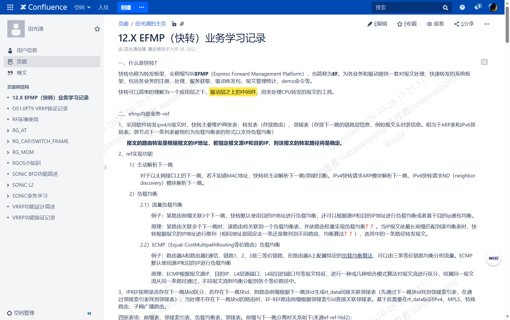
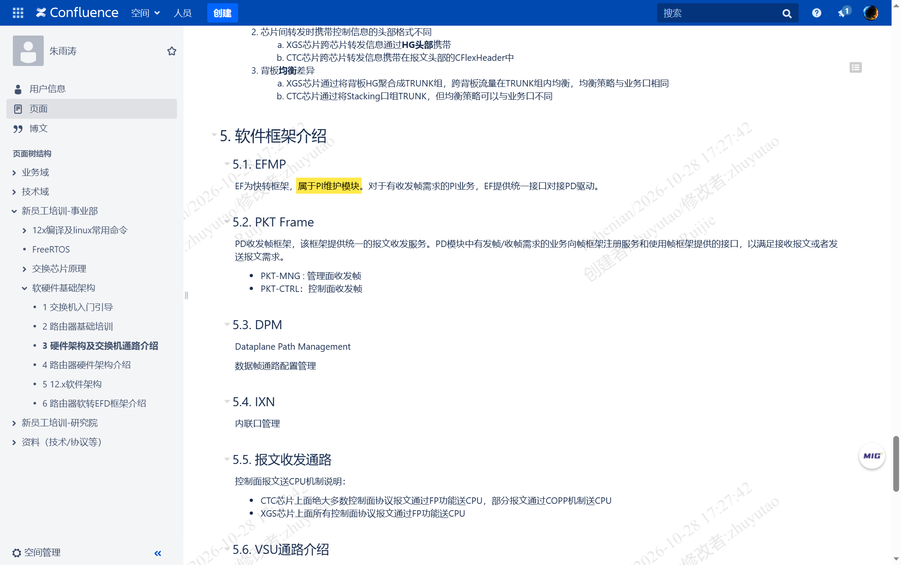
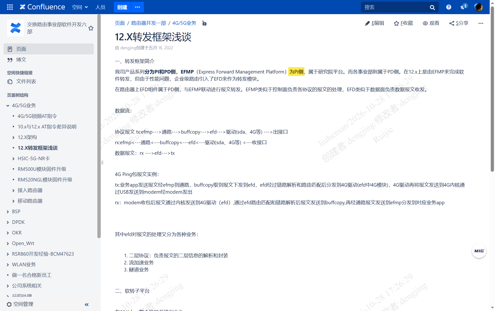
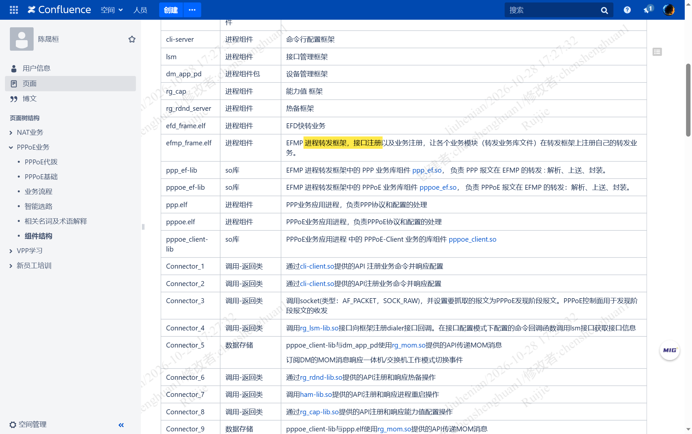
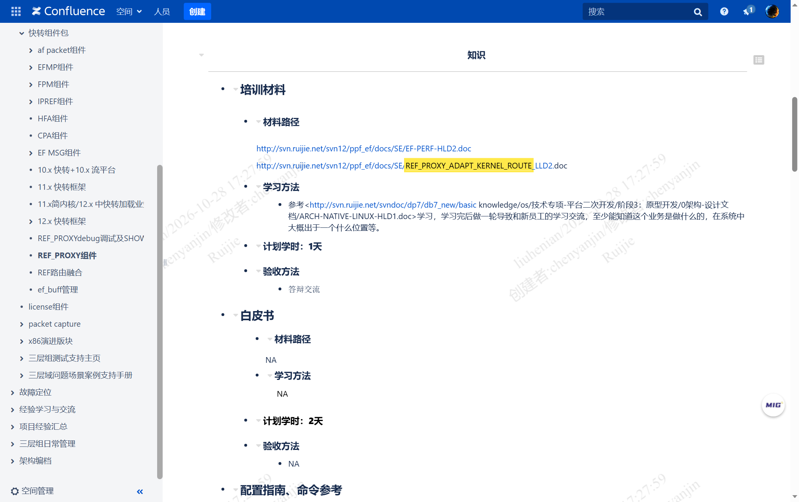
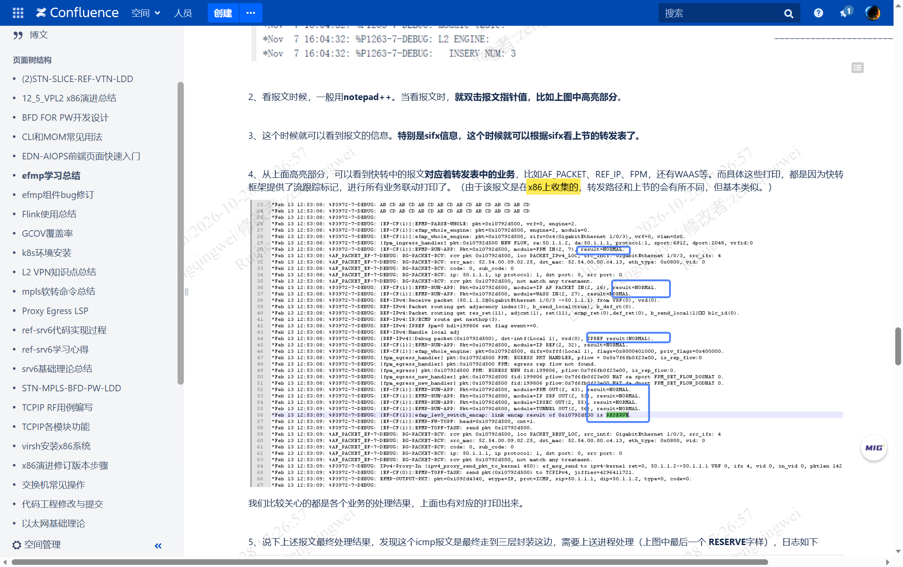

# 交换侧软转的真实主体是 EFMP

> 一句话：**交换产品的软件转发（software forwarding，软转）走的是 EFMP（Express Forward Management Platform，快转框架），不是 Linux 内核转发。** EFMP 属于 PI（Product Independently，产品无关）侧，因此模拟器上也有它；模拟器真正缺的是 PD（Product Dependently，产品相关）侧的业务快转进程与芯片驱动。
> 本文是对 [PI-PD三产品线设计与真机模拟器能力边界-2026-10-28](PI-PD三产品线设计与真机模拟器能力边界-2026-10-28.md) 第 4、5 节的**定向纠正**。凡属推断一律标「推论」并给出级别。

> **后续：本文的核心结论已在真机取证。** 见 [[模拟器EFMP转发面现场实测-2026-10-28#6 转发流水线：counter 的十六个阶段|模拟器 EFMP 转发面现场实测 §6]]——在 `172.28.15.168` 上抓到 `efmp_frame.elf` 占 99% CPU 连跑 17 天、`maps` 里加载 `librg_ef_bridge.so`、业务口绑 `uio_pci_generic` 且内核计数为 0。本文 [[#10 遗留缺口与验证方法|§10]] 里标的「需在模拟器上复核」项，已在该文中逐条落定或明确列为未验证。

## 目录

- [[#0 体例与信源分级|§0 体例与信源分级]]
- [[#1 结论先行|§1 结论先行]]
- [[#2 上一轮的三个错误|§2 上一轮的三个错误]]
- [[#3 EFMP 是什么|§3 EFMP 是什么]]
- [[#4 EFMP 属于 PI 侧|§4 EFMP 属于 PI 侧]]
- [[#5 框架与业务|§5 框架与业务]]
- [[#6 进程级对账|§6 进程级对账]]
- [[#7 被误读的三个组件|§7 被误读的三个组件]]
- [[#8 「模拟器没有 PD」的准确含义|§8 模拟器没有 PD 的准确含义]]
- [[#9 能力边界三档修正|§9 能力边界三档修正]]
- [[#10 遗留缺口与验证方法|§10 遗留缺口与验证方法]]
- [[#11 证据索引|§11 证据索引]]

---

## 0 体例与信源分级

### 0.1 信源分级

| 级别 | 含义 | 本文典型来源 |
|---|---|---|
| **A** | 官方设计规格、架构文档、部门级培训材料 | `EFMP_FRAME`、`EFC/EFD分离EF_SUPPORT设计` |
| **B** | 个人学习笔记、实机采集数据（可复核但不具规范效力） | `12.X EFMP业务学习记录`、`ps -ef` 清单 |
| **C** | 我的推论（由 A/B 级证据推导，结论可能被推翻） | 命名映射、缺失推断 |

### 0.2 采集口径

| 项 | 内容 |
|---|---|
| 真机侧 | 盒式设备 `aarch64`，`ls -1 /sbin` 与 `ps -ef` 原始输出 |
| 模拟器侧 | CI 环境 `x86_64`（用户确认即「x86 模拟器设备」），同口径采集 |
| 原始文件 | `思科cml/attachments/进程对比-2026-10-28/{dev_00,dev_01,ci_00,ci_01}.txt` |

### 0.3 术语中英对照

| 英文 | 中文 | 一句话释义 |
|---|---|---|
| EFMP（Express Forward Management Platform） | 快转框架 | PI 侧进程转发框架，业务在其上注册转发处理函数 |
| EFC（Express Forward Control） | 快转控制平面 | 框架调度与控制面消息处理 |
| EFD（Express Forward Data） | 快转转发平面 | 报文转发执行，PD 侧 |
| sda（Switch Driver Adapter） | 交换驱动适配 | 把表项翻译成具体芯片 SDK 调用 |
| PI（Product Independently） | 产品无关 | 平台层，跨产品复用 |
| PD（Product Dependently） | 产品相关 | 事业部层，屏蔽芯片差异 |
| ref / adj | 转发引擎 / 邻接引擎 | 三层查表与下一跳封装 |

---

## 1 结论先行

**第一句：交换侧转发面只有两个真实执行体。**

> 1）交换机：硬件转发，分为**进程转发**和**芯片转发（不占 CPU）**
> —— `efmp--宏内核`（huyusheng，2021-12-23，[pageId 126388011](http://conf.ruijie.work/pages/viewpage.action?pageId=126388011)，**B 级**）

「进程转发」就是 EFMP。**没有第三条叫「Linux 内核转发」的路径。**

**第二句：EFMP 是 PI 侧的东西，所以模拟器上一定有。**

> 我司产品系列分为 PI 和 PD 侧，**EFMP（Express Forward Management Platform）为 PI 侧，属于研究院平台**。……**在 12.x 上是由 EFMP 来完成软件转发**，但由于性能问题，企业级路由引入了 EFD 来作为转发模块。
> —— `12.X转发框架浅谈`（dengjing，2022-05-16，[pageId 231539707](http://conf.ruijie.work/pages/viewpage.action?pageId=231539707)，**B 级**）

**第三句：模拟器缺的是「业务插件 + 芯片驱动」，不是「转发引擎」。**

`efmp_frame.elf`（EFMP 框架本体）在真机与模拟器上**都在跑**；盒式独有的 `ce.*`（57 个）与 `fe.*`（50 个）快转业务进程，在模拟器上**一个都没有**。缺的是这两类，不是框架。

---

## 2 上一轮的三个错误

| # | 我上一轮的说法 | 反证原文 | 正确说法 |
|---|---|---|---|
| 1 | 模拟器「跑的是 Linux FIB + bridge + DPDK，不是软转」 | 「交换机：硬件转发，分为进程转发和芯片转发」 | **模拟器跑的就是进程转发，即 EFMP** |
| 2 | 「PD 整体不存在，VLAN 与路由靠 Linux 内核 bridge/FIB 顶替」 | 「EF 为快转框架，属于 PI 维护模块」；「在 12.x 上是由 EFMP 来完成软件转发」 | **转发引擎在 PI 侧（EFMP），PD 只缺业务插件与驱动** |
| 3 | 「`kernel_fib.ko` 是路由表的替代实现」 | REF_PROXY 配套文档名为 `REF_PROXY_ADAPT_KERNEL_ROUTE_LLD2` | **`kernel_fib` 是路由适配代理，不是转发引擎** |

错误的性质是同一个：**把「适配层」和「辅助工具」误读成了「转发层」。** 我当时看到 `ce.*`/`fe.*` 为零，就推断「PD 没了 → 转发换了实现」，而没有继续问一句：**转发框架本身属于 PI 还是 PD？**

---

## 3 EFMP 是什么

### 3.1 官方定义的三句话

> 快转也称为转发框架，全称缩写叫 **EFMP（Express Forward Management Platform）**，也简称为 **EF**。**为各业务和驱动提供一套对报文处理、快速转发的系统框架**，包括各业务的注册、处理、服务获取、驱动收发包、报文管理统计、demo 命令等。
> 快转可以简单的理解为**一个应用层之下，驱动层之上的中间件，用来处理 CPU 转发的报文**的工具。
> —— `12.X EFMP（快转）业务学习记录`（田光清，2022-06-08，[pageId 217222533](http://conf.ruijie.work/pages/viewpage.action?pageId=217222533)，**B 级**）



### 3.2 它在 RGOS 里的层次

> 从承担的职责或功能的角度来说，**快转框架属于数据转发平面的基础服务**，为各个涉及转发的实际业务功能提供一个通用的平台。
> 主要承担：为业务提供【服务注册框架】、为业务提供【报文处理框架】、提供转发面的公共基础工具、**操作系统的适配以及硬件平台的适配**。
> —— `EFMP_FRAME`（王晓阳，2020-03-16，[pageId 36326456](http://conf.ruijie.work/pages/viewpage.action?pageId=36326456)，**A 级**）

最后一句「操作系统的适配以及硬件平台的适配」是本文的关键：**框架天生就负责跨平台适配**，所以它跑在 Linux 用户态还是跑在芯片上，是适配问题，不是有无问题。

### 3.3 转发阶段是框架定义好的固定流水

| 阶段 | 原文说明 |
|---|---|
| 驱动接收 | 接收报文，解析源接口、数据位置、长度 |
| 报文镜像业务 | 处理端口镜像 |
| 报文解析（错误检查） | 链路解析、三层信息解析、错误检查 |
| 输入业务处理 | 二层入业务、三层 IP 入业务、IPv6 入业务 |
| 转发路径选择 | 判断本层次转发还是进入下一层次 |
| 输出业务处理 | 二层出业务、三层 IP 出业务 |
| 监控业务处理 | 流量监控审计（每个报文都要过） |
| 转发调度业务 | 队列缓冲（流控类业务） |
| 链路封装 | 链路层头替换、TTL 修改、IP 校验和修改 |
| 驱动发送 | 发送报文 |

（同上 `EFMP_FRAME`，**A 级**）

**这张表解释了一件事**：二层的「入业务 / 出业务」是框架**预留的挂载点**，不是框架自己写死的实现。业务挂上去才有 VLAN 处理；业务不挂，框架本身仍能跑基础转发。

---

## 4 EFMP 属于 PI 侧

这是本文最硬的一条依据，两处独立原文互证。

> **EF 为快转框架，属于 PI 维护模块。** 对于有收发帧需求的 PI 业务，EF 提供统一接口对接 PD 驱动。
> —— `3 硬件架构及交换机通路介绍`（朱雨涛，2022-08-25，[pageId 286261516](http://conf.ruijie.work/pages/viewpage.action?pageId=286261516)，**A 级**）



> EFMP（Express Forward Management Platform）**为 PI 侧**，属于研究院平台。而各事业部则属于 PD 侧。
> —— `12.X转发框架浅谈`（dengjing，2022-05-16，[pageId 231539707](http://conf.ruijie.work/pages/viewpage.action?pageId=231539707)，**B 级**）



**推论（B 级）**：既然 EFMP 属 PI，那么「模拟器上没有 PD」这件事，**天然不会导致 EFMP 消失**。这与实测完全吻合——`efmp_frame.elf` 在 CI 上不但存在，而且是 CPU 占用最高的进程：

```
root  3947  1  99  Oct10  ?  17-18:39:12  /sbin/efmp_frame.elf -c 3 -b     ← CI（x86_64）
root  3178  1   1  Oct12  ?   05:57:39    /sbin/efmp_frame.elf --log-level ← 盒式（aarch64）
```

CI 上 **99% CPU、连续运行 17 天 18 小时**——这个数字本身就是它在干转发活的证据，不是空转。

---

## 5 框架与业务

### 5.1 一句话说清两者关系

> `efd_frame.elf` | 进程组件 | **EFD 快转业务**
> `efmp_frame.elf` | 进程组件 | **EFMP 进程转发框架，接口注册以及业务注册，让各个业务模块（转发业务库文件）在转发框架上注册自己的转发业务。**
> `ppp_ef-lib` | so 库 | EFMP 进程转发框架中的 PPP 业务库组件 `ppp_ef.so`，负责 PPP 报文在 EFMP 的转发：解析、上送、封装。
> —— `组件结构`（陈晟桓，2023-10-09，[pageId 555877049](http://conf.ruijie.work/pages/viewpage.action?pageId=555877049)，**A 级**）



这段表格信息量极大，三条都要注意：

1. **`efmp_frame.elf` 是「框架」本身**——接口注册 + 业务注册，它自己不含业务逻辑。
2. **`efd_frame.elf` 是「业务」**——EFD 在架构上属于 PD 侧（路由产品线引入）。
3. **业务的存在形式是「转发业务库文件」（`.so`）**，例如 `ppp_ef.so`、`pppoe_ef.so`。

### 5.2 业务有两种落地形态

| 形态 | 例证 | 进程可见性 |
|---|---|---|
| **`.so` 业务库**（动态加载进框架） | `ppp_ef.so`、`pppoe_ef.so` | `ps` 里看不到，需查 `/lib` |
| **独立快转进程**（交换产品线） | `ce.ebrg.dp`、`fe.ebrg.sw`、`ce.mmu.dp` | `ps` 里可见 |

**这解释了为什么「`ce.*`/`fe.*` 为零」不能直接推出「没有二层业务」**——第二种形态为零，第一种形态还没查。我在 [[#10 遗留缺口与验证方法|§10]] 给了验证命令。

---

## 6 进程级对账

### 6.1 两侧都存在的转发相关文件

| 文件 | 类型 | 作用 |
|---|---|---|
| `efmp_frame.elf` | 进程 | EFMP 进程转发框架本体 |
| `ref_proxy.elf` | 进程 | REF 代理，路由表适配 |
| `ef_buff.ko` | 内核模块 | 快转报文缓冲，内核侧通告收包 |
| `ef_msg_agent.ko` | 内核模块 | 快转消息代理 |

**这四个是「转发框架 + 收发通道」，两侧都在。** 只要它们齐了，基础转发就能跑。

### 6.2 只有盒式才有的

| 类别 | 数量 | 说明 |
|---|---|---|
| `ce.*` | **57** | 快转控制面进程，按业务拆分（`ce.bfd.sw`、`ce.ap.sw`…） |
| `fe.*` | **50** | 快转转发面进程，按业务拆分（`fe.bfd.sw`、`fe.ap.sw`…） |
| `xe.*`/`cli.*`/`cmps.*` | 14 | 框架辅助与命令行 |
| `efm.elf` | 1 | 以太网帧管理 |

`ce.bfd.sw` 与 `fe.bfd.sw` **成对出现**，`ce.ap.sw` 与 `fe.ap.sw` 同样成对——这是 EFC/EFD 分离在进程命名上的投影。

> ef_support 模块中信号量/高精度定时器 **EF-C 与 EF-D 分离**
> —— `12.6PL4 EFC/EFD分离EF_SUPPORT设计`（施建宏，2022-12-06，[pageId 356779090](http://conf.ruijie.work/pages/viewpage.action?pageId=356779090)，**A 级**）

**推论（B 级）**：`ce` = 快转控制面（EFC），`fe` = 快转转发面（EFD）。依据是命名首字母与成对关系，加上 EFC/EFD 分离的设计文档；**未找到官方对 `ce`/`fe` 缩写的明文定义**。

### 6.3 只有模拟器才有的

| 类别 | 文件 | 作用 |
|---|---|---|
| 容器运行时 | `dockerd`、`containerd`、`docker-proxy` | 跑 ASIC 模拟器容器 |
| DPDK 用户态 | `l2fwd`、`dpdk-*`、`igb_uio.ko`、`rte_kni.ko` | 绕过内核协议栈做高速收发 |
| 内核转发辅助 | `kernel_fib.ko`、`kernel_fib_monitor.elf` | 路由表与内核同步 |

---

## 7 被误读的三个组件

### 7.1 `kernel_fib.ko` —— 路由适配，不是转发引擎

REF_PROXY 组件页给出的配套材料路径里，有一份文档名直接说明了它的职责：

```
http://svn.ruijie.net/svn12/ppf_ef/docs/SE/REF_PROXY_ADAPT_KERNEL_ROUTE_LLD2.doc
```

（`REF_PROXY组件`，三层域，[pageId 88936460](http://conf.ruijie.work/pages/viewpage.action?pageId=88936460)，**A 级**）



`ADAPT_KERNEL_ROUTE`（适配内核路由）——**REF_PROXY 的职责是让 Linux 内核路由与快转 REF 表保持一致**，服务于本机收发（socket 选路、管理面流量）。方向是「快转 → 内核」，不是「内核 → 转发」。

> 另外：`kernel_fib` 这个词在全库检索结果为 **0 条**，它不在 RGOS 的通用术语体系里，是模拟器/x86 形态特有的辅助模块（**C 级推论**）。

### 7.2 `brctl` —— 兼容工具，不是桥接主路径

`brctl` 是 Linux 网桥管理工具，在 `/sbin` 里出现只能说明**镜像里带了它**，不能说明转发走它。要证明「二层走 Linux bridge」，至少需要 `brctl show` 有对应网桥、且 `ebtables`/`bridge` 计数随流量增长——这两项我都**没有采集**。

前一版把它当成证据，属于**证据强度误判**。

### 7.3 `l2fwd` / `rte_kni.ko` / `igb_uio.ko` —— 收发通道，不是转发逻辑

> 报文收发包的过程采用的是 **DPDK 中的无锁环**方式对报文进行处理，其中收包过程中 **efmp-lib 会执行两个动作，一个是通过内核 e_buff 对快转进行通告收包，同时将报文转发给 DPDK**，当快转收到收包的指令后会将报文接收继续内部的处理。
> —— `efmp学习总结`（曾庆伟，2023-06-08，[pageId 480348426](http://conf.ruijie.work/pages/viewpage.action?pageId=480348426)，**B 级**）

这段原文把「通道」和「逻辑」分得很清楚：

| 环节 | 归属 | 载体 |
|---|---|---|
| 收包通告 | 内核 | `ef_buff.ko` |
| 取包 | 用户态 | DPDK（`igb_uio.ko`、`rte_kni.ko`、`l2fwd`） |
| **转发决策** | **EFMP** | `efmp_frame.elf` + 业务库 |

**DPDK 只负责把包搬进来，往哪搬是 EFMP 决定的。**

### 7.4 同页还有一句更直接的旁证

同一页讲流跟踪的两个案例时，作者明确写了：

> （由于**该报文是在 x86 上收集的**，转发路径和上节的会有所不同，但基本类似。）

**x86 上能直接跑 `debug efmp packet` 抓快转流跟踪**——如果 x86 上转发走的是 Linux 内核，这个命令根本无从谈起。



---

## 8 「模拟器没有 PD」的准确含义

修正后的分层，三层都要分开说：

| 层 | 真机（盒式） | 模拟器（CI） | 判定 |
|---|---|---|---|
| **框架层**：EFMP | `efmp_frame.elf` | `efmp_frame.elf` | **两侧都有**（PI 侧） |
| **引擎层**：REF/ADJ | `ref_proxy.elf` | `ref_proxy.elf` | **两侧都有** |
| **业务层**：快转业务 | `ce.*` 57 + `fe.*` 50 | 无独立进程 | **缺失**（`.so` 形态待查） |
| **驱动层**：sda | 有（写芯片/FPGA） | 无（DPDK/virtio 出口） | **缺失** |

所以「模拟器没有 PD」这句话要改成：

> **模拟器缺的是 PD 的业务快转进程（`ce.*`/`fe.*`）和芯片驱动（sda），EFMP 框架与基础转发引擎仍在。**

这也解释了 2020 年那份方案为什么敢写「所有业务进程包括 sda 都跑在 X86 RGOS 里面」：

> 部署方案（1）模拟盒式设备，**所有业务进程包括 sda 都跑在 X86 RGOS 里面**，在 rgos 下运行一个 docker 里面跑模拟器。
> 管理帧和数据面协议报文都能支持**送控制面（EFMP\PTK）**
> —— `盒式虚拟交换机方案`（张琳琳，2020-03-06，[pageId 40271974](http://conf.ruijie.work/pages/viewpage.action?pageId=40271974)，**A 级**）

当时的设计意图是「全栈都在」，但实测 CI 上 sda 与 `ce.*`/`fe.*` 都不在——**说明 2020 年的方案与今天的实现已经分叉**（**B 级推论**）。旧文档里我引用这句话时没注意到这层时间差。

---

## 9 能力边界三档修正

上一版的三档表把「内核转发」列为第三档，这是错的。修正后：

| 档 | 执行体 | 真实载体 | 谁有 | 占 CPU |
|---|---|---|---|---|
| 一档：芯片转发 | ASIC 流水线 | 芯片 | 仅真机 | 否 |
| 二档：进程转发（真机） | EFMP + 全部业务插件 + sda | `efmp_frame.elf` + `ce.*`/`fe.*` + sda | 仅真机 | 是 |
| 三档：进程转发（模拟器） | EFMP + 部分业务 + DPDK 出口 | `efmp_frame.elf` + `l2fwd` | 仅模拟器 | 是 |

**二档与三档是同一个引擎的两个版本，不是两种架构。** 差别只有两处：

1. **出口不同**：真机经 sda 把报文交给芯片/FPGA，模拟器经 DPDK/`ef_buff` 交给虚拟网卡。
2. **业务插件不全**：`ce.*`/`fe.*` 那一层在模拟器上缺席，依赖它们的特性（镜像、采样、MLAG、QinQ 等）大概率不可用。

**上一版说「模拟器连第二档都没有」是错的**——它有二档的引擎，只是插件不齐、出口不同。

---

## 10 遗留缺口与验证方法

| # | 缺口 | 影响 | 验证方法 |
|---|---|---|---|
| 1 | CI 的 `/lib` 未采集，业务 `.so` 是否存在未确认 | 决定「基础二层是框架内建还是业务库提供」 | `ls /lib \| grep -E "_ef\.so"` 或 `find / -name "*_ef.so"` |
| 2 | 未找到 `ce`/`fe` 缩写的官方定义 | 命名映射只是推论 | 检索「快转进程命名规范」类页面 |
| 3 | 模拟器上 EFMP 的实际吞吐未测 | 影响性能边界结论 | 打流 + `show efmp stat` |
| 4 | 2020 方案与今日实现的版本差 | 旧引用可能失真 | 对比 vSwitch 各版本的 `/sbin` 清单 |

前两项只要在模拟器上各跑一条命令就能闭合。第 1 项尤其关键：**如果 `/lib` 里有 `ebrg_ef.so` 之类的库，那么「模拟器没有二层业务」这个说法也要一并推翻。**

---

## 11 证据索引

| # | 页面 | 作者 | 最后修改 | pageId | 级别 |
|---|---|---|---|---|---|
| 1 | `3 硬件架构及交换机通路介绍` | 朱雨涛 | 2022-08-25 | [286261516](http://conf.ruijie.work/pages/viewpage.action?pageId=286261516) | A |
| 2 | `组件结构` | 陈晟桓 | 2023-10-09 | [555877049](http://conf.ruijie.work/pages/viewpage.action?pageId=555877049) | A |
| 3 | `EFMP_FRAME` | 王晓阳 | 2020-03-16 | [36326456](http://conf.ruijie.work/pages/viewpage.action?pageId=36326456) | A |
| 4 | `REF_PROXY组件` | 三层域 | 2021-06-02 | [88936460](http://conf.ruijie.work/pages/viewpage.action?pageId=88936460) | A |
| 5 | `12.6PL4 EFC/EFD分离EF_SUPPORT设计` | 施建宏 | 2022-12-06 | [356779090](http://conf.ruijie.work/pages/viewpage.action?pageId=356779090) | A |
| 6 | `盒式虚拟交换机方案` | 张琳琳 | 2020-03-06 | [40271974](http://conf.ruijie.work/pages/viewpage.action?pageId=40271974) | A |
| 7 | `12.X转发框架浅谈` | dengjing | 2022-05-16 | [231539707](http://conf.ruijie.work/pages/viewpage.action?pageId=231539707) | B |
| 8 | `12.X EFMP（快转）业务学习记录` | 田光清 | 2022-06-08 | [217222533](http://conf.ruijie.work/pages/viewpage.action?pageId=217222533) | B |
| 9 | `efmp--宏内核` | huyusheng | 2021-12-23 | [126388011](http://conf.ruijie.work/pages/viewpage.action?pageId=126388011) | B |
| 10 | `efmp学习总结` | 曾庆伟 | 2023-06-08 | [480348426](http://conf.ruijie.work/pages/viewpage.action?pageId=480348426) | B |

**配套阅读**：[PI 与 PD 的三产品线设计与真机模拟器能力边界](PI-PD三产品线设计与真机模拟器能力边界-2026-10-28.md)（数据库链与三产品线差异）、[锐捷交换：真机软转触发条件与 x86 模拟器二三层转发](锐捷交换-真机软转触发条件与x86模拟器二三层转发-2026-10-28.md)（CPP 与软转触发条件）。
