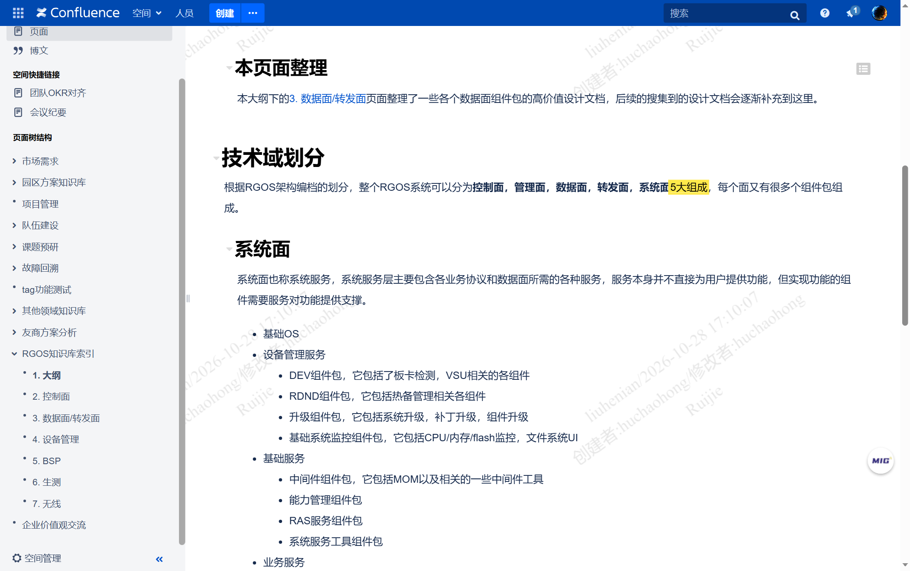
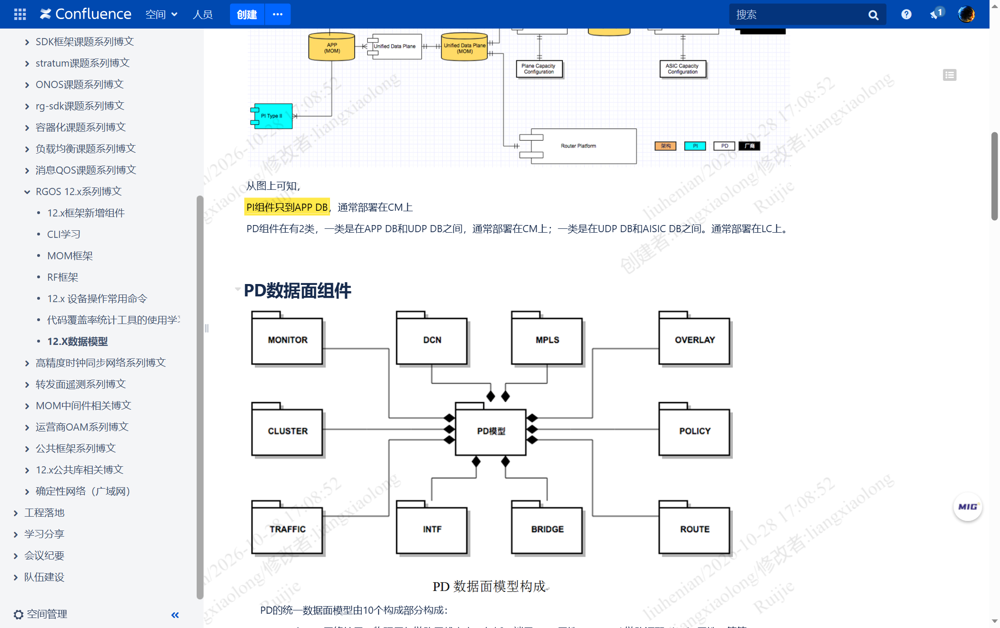
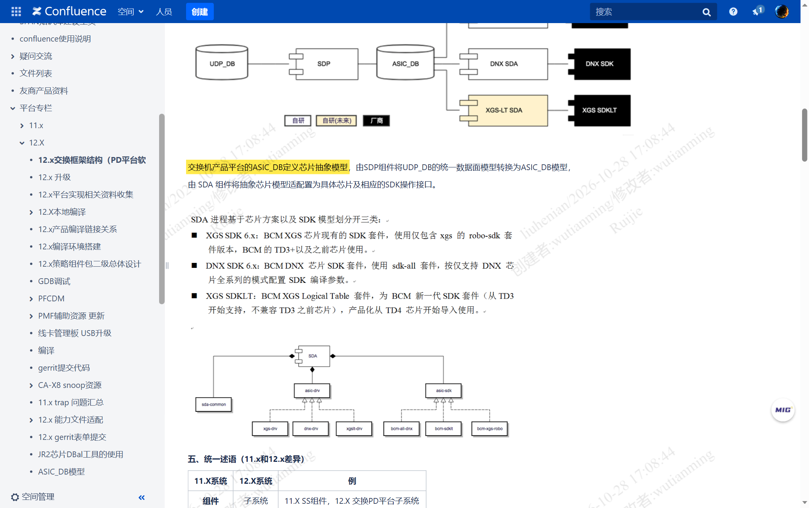
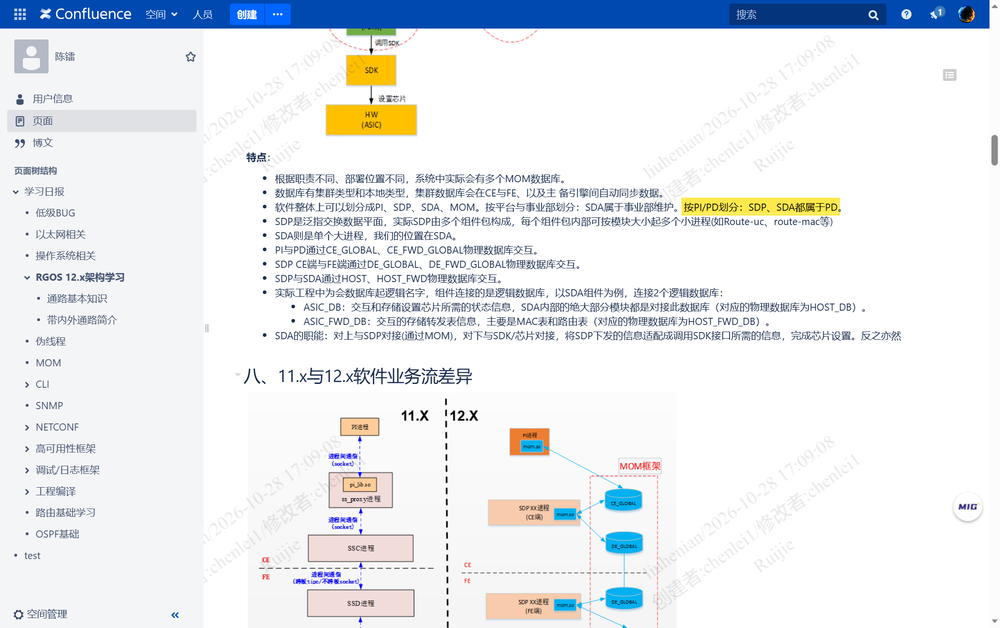
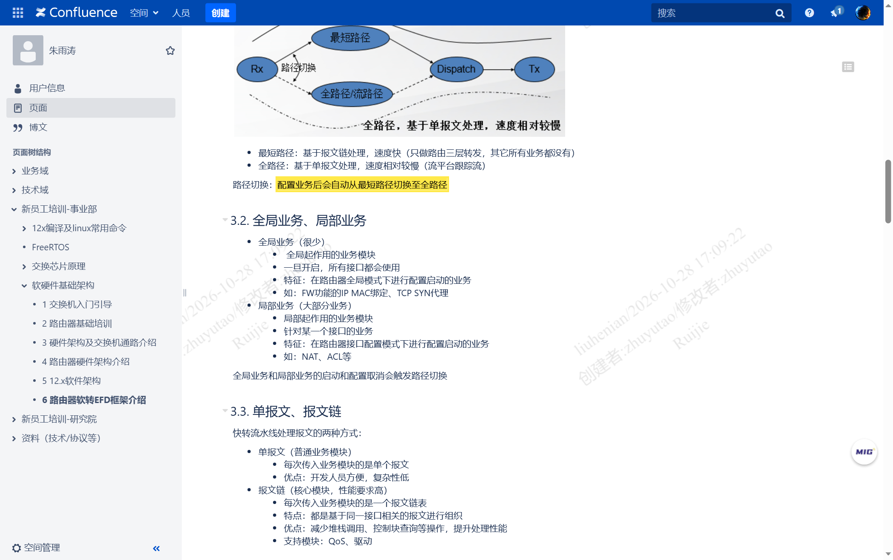
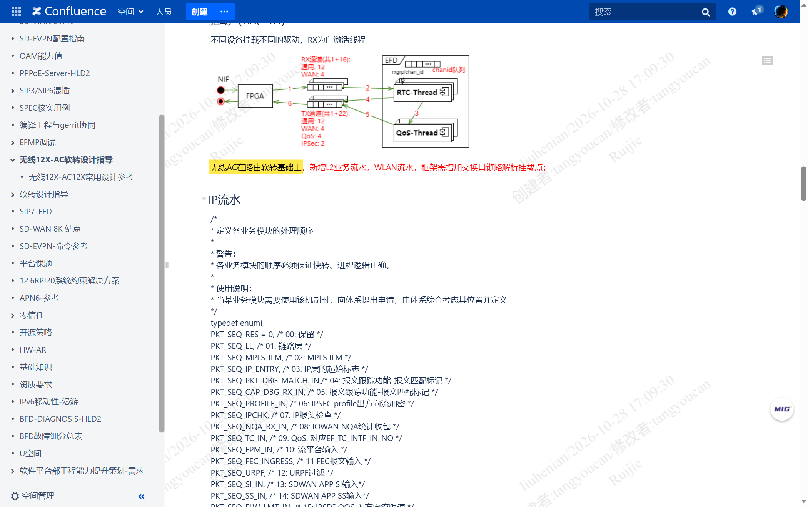
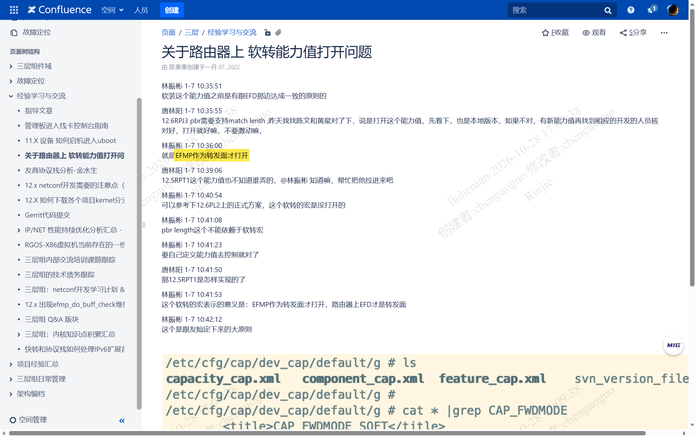
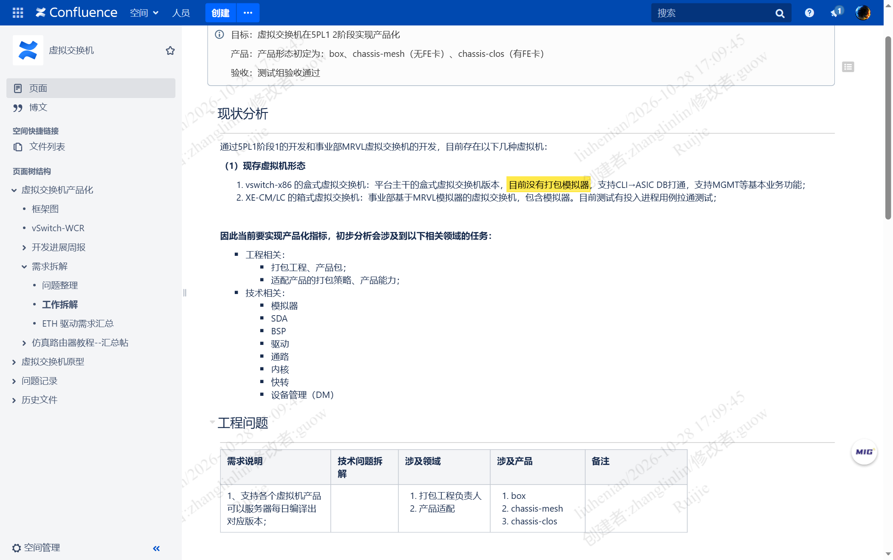

# PI 与 PD 的三产品线设计与真机模拟器能力边界

> 本文回答三个问题：**① PI（Product Independently，产品无关组件）与 PD（Product Dependently，产品相关组件）在交换、路由、无线三条产品线上分别怎么落；② x86 模拟器上 PD 缺席后，实际靠什么转发；③ 真机与模拟器的能力边界到底划在哪里。**
> 所有原文均给出**页面链接、作者、最后修改时间**与**截图**；凡属推断一律标「推论」并注明级别。

## 修订说明

**2026-10-28 17:30 二次修订**：本文原判断「模拟器靠 Linux 内核转发」已被推翻。真实情况是**转发仍走 EFMP（Express Forward Management Platform，快转框架），而 EFMP 属 PI 侧**，所以模拟器上它必然在。`kernel_fib.ko`、`brctl`、`ivr.ko` 是适配与辅助层，不是转发主体。

**受影响的节**：[[#1 结论先行|§1]] 第 4–6 条、[[#4.2 缺的是什么，补的是什么|§4.2]]、[[#4.3 必须纠正的三个说法|§4.3]]、[[#5.1 转发路径是三档而不是两档|§5.1]]、[[#5.2 逐组件包对账|§5.2]]、[[#6 对 APM 的落地含义|§6]]、[[#8 缺口与待确认|§8]]。

**纠正的完整证据链与机理**见配套文档 [EFMP 是交换侧软转的真实主体](EFMP是交换软转主体-纠正Linux内核转发误判-2026-10-28.md)。

**2026-10-28 18:20 三次修订（实机取证）**：上述纠正已在 `172.28.15.168`（Ruijie X86 TESTBENCH）现场跑通验证——EFMP 进程 `efmp_frame.elf` 占 99% CPU、连跑 17 天 18 小时，`maps` 里加载 `librg_ef_bridge.so`（二层桥业务库），业务口 `uio0`~`uio9` 全部绑 `uio_pci_generic` 且内核 `/proc/net/dev` 计数为 0。现场原始命令输出见 `attachments/模拟器实测-2026-10-28/`，完整分析见 [[模拟器EFMP转发面现场实测-2026-10-28#1 一句话结论|模拟器 EFMP 转发面现场实测]]。本文 [[#5.1 转发路径是三档而不是两档|§5.1]] 与 [[#5.2 逐组件包对账|§5.2]] 中标注为「推论」的几处，已在该文中由实测数据替换。

## 目录

- [[#0 体例与信源分级|§0 体例与信源分级]]
- [[#1 结论先行|§1 结论先行]]
- [[#2 三层数据库链：PI 只到 APP_DB|§2 三层数据库链]]
  - [[#2.0 先对齐「面」的划分|§2.0 先对齐「面」的划分]]
  - [[#2.1 数据库链与部署位置|§2.1 数据库链与部署位置]]
  - [[#2.2 两类 PD 的分工|§2.2 两类 PD 的分工]]
- [[#3 三条产品线的 PD 设计|§3 三条产品线的 PD 设计]]
  - [[#3.1 交换产品：SDP 十组件包 + SDA 按芯片族分叉|§3.1 交换产品]]
  - [[#3.2 路由产品：软转内部还有最短路径与全路径|§3.2 路由产品]]
  - [[#3.3 无线产品：AC 在路由软转之上叠 L2-WLAN 流水|§3.3 无线产品]]
  - [[#3.4 三条线横向对照|§3.4 三条线横向对照]]
- [[#4 模拟器的真实形态：PD 整体缺失|§4 模拟器的真实形态]]
  - [[#4.1 实测口径|§4.1 实测口径]]
  - [[#4.2 缺的是什么，补的是什么|§4.2 缺的是什么，补的是什么]]
  - [[#4.3 必须纠正的三个说法|§4.3 必须纠正的三个说法]]
- [[#5 真机与模拟器的能力边界|§5 能力边界]]
  - [[#5.1 转发路径是三档而不是两档|§5.1 转发路径三档]]
  - [[#5.2 逐组件包对账|§5.2 逐组件包对账]]
  - [[#5.3 可验证与不可验证清单|§5.3 可验证与不可验证清单]]
- [[#6 对 APM 的落地含义|§6 对 APM 的落地含义]]
- [[#7 证据清单|§7 证据清单]]
- [[#8 缺口与待确认|§8 缺口与待确认]]

---

## 0 体例与信源分级

### 0.1 信源分级

| 级别 | 含义 | 本文典型来源 |
|---|---|---|
| **A** | 公司内部正式设计文档、培训材料、知识库索引，有作者与版本号 | PD 平台总体设计、数据模型、软转设计指导、五面划分 |
| **B** | 内部分享、聊天记录、早期需求拆解，可信但非正式定稿 | 软转能力值讨论、2020 年虚拟交换机拆解 |
| **C** | 本文推论，已注明依据链 | 模拟器与真机软转的等价性判断 |

### 0.2 两条口径声明

1. **「x86 模拟器」的口径**：经使用者澄清（2026-10-28），本文所指 x86 模拟器**就是 CI 环境的模拟器设备**，即 `172.28.15.168` 那台 `x86_64` 虚拟机。因此 [[#4.1 实测口径|§4.1]] 的进程实测数据可直接用于模拟器能力判断（**B 级，依据为口头口径而非文档**）。
2. **截图口径**：截图均为页面实际渲染结果并带页面水印，关键句已用黄色高亮；未截到的内容如实写「未截到」，不用别的图顶替。

### 0.3 术语对照

| 缩写 | 英文全称 | 中文 |
|---|---|---|
| PI | Product Independently | 产品无关组件 |
| PD | Product Dependently | 产品相关组件 |
| SDP | Switch Data Plane | 交换数据平面 |
| SDA | Switch Driver Adapter | 交换驱动适配 |
| UDP | Unified Data Plane | 统一数据平面 |
| CE / FE | Control Element / Forwarding Element | 控制单元 / 转发单元 |
| EFD / EFC | EF Data plane / EF Control plane | 快转转发面 / 快转控制面 |
| EFMP | EF Multi-Process（全称未在内网检索到明文，**缺口**） | 快转多进程转发面 |
| CPP | CPU Protect Policy | CPU 保护策略 |

---

## 1 结论先行

| 序 | 结论 | 级别 |
|---|---|---|
| 1 | **PI 只写到 APP_DB，一个字节都进不了数据面。** PD 是 PI 与硬件之间唯一的翻译层，分两段：APP_DB→UDP_DB（部署在 CM）与 UDP_DB→ASIC_DB（部署在 LC） | A |
| 2 | **三条产品线的 PD 是「同源不同枝」**：共用同一套 UDP_DB 十组件包模型，在 SDP 之下各自接不同的芯片模型与流水；交换接 L2+L3 交换流水，路由以 IP 流水为骨架，无线 AC 在路由软转之上再叠 L2-WLAN 与 WLAN 流水 | A |
| 3 | **「软转」在路由产品上有两层含义，不止一层**：第一层是「报文进不进 CPU」，第二层是「进 CPU 后走最短路径还是全路径」。配置一个 NAT/ACL 就会把接口从最短路径切到全路径 | A |
| 4 | **x86 模拟器上 PD 的业务进程整体缺席**：`ce.*`/`fe.*`/`xe.*` 一个进程都没有；但 **EFMP 快转框架（PI 侧）仍在运行**，转发仍走进程转发，不是 Linux 内核转发。`kernel_fib.ko`/`brctl`/`ivr.ko` 属适配与辅助层 | A（实测）＋ B（见 [[#修订说明\|修订说明]]） |
| 5 | **模拟器与真机软转是同一套引擎的两个版本**：都用 EFMP，差别在出口（sda 写芯片 vs DPDK 出虚拟网卡）与业务插件是否齐全 | B（见 [[#5.1 转发路径是三档而不是两档\|§5.1]]） |
| 6 | 因此「模拟器上二三层能通」**不能**用来推断真机的**芯片转发**行为；但可以用于验证 PI 协议与快转基础转发路径 | B |

一句话收口：**PI 决定「算得对」，PD 决定「落得下」；模拟器把 PD 的业务插件与芯片驱动拿掉了，但保留了 PI 侧的 EFMP 转发框架——所以它能转发，只是接不住依赖芯片与业务插件的特性。**

---

## 2 三层数据库链：PI 只到 APP_DB

### 2.0 先对齐「面」的划分

锐捷把 RGOS（Ruijie General Operating System，锐捷通用操作系统）分成五个面，不是三个：

> 根据 RGOS 架构编档的划分，整个 RGOS 系统可以分为**控制面，管理面，数据面，转发面，系统面** 5 大组成，每个面又有很多个组件包组成。
> —— `1. 大纲`（园区交换-方案组，胡朝红，2023-07-06，VER 12，[pageId 401998832](http://conf.ruijie.work/pages/viewpage.action?pageId=401998832)，**A 级**）



**数据面与转发面是两个面，不是同义词。** 这一点在本文所有结论里都会反复用到：数据面（九个 DP 组件包）负责「定规则、产表项」，转发面（`ef` 与 `sda` 两条腿）负责「搬包」。

### 2.1 数据库链与部署位置

这是理解全部差异的地基。原文出自 `12.X数据模型`（网络系统新技术组·系统架构三组，梁小龙，2021-12-21，VER 12，[pageId 126387014](http://conf.ruijie.work/pages/viewpage.action?pageId=126387014)，**A 级**）：

> 从图上可知，**PI 组件只到 APP DB，通常部署在 CM 上**
> PD 组件有 2 类，一类是在 APP DB 和 UDP DB 之间，通常部署在 CM 上；一类是在 UDP DB 和 ASIC DB 之间，通常部署在 LC 上。



链路因此是四段：

```
PI（协议/CLI）→ APP_DB →［PD 第一段］→ UDP_DB →［PD 第二段］→ ASIC_DB → SDK → 芯片
```

`12.x交换框架结构（PD平台软件总体设计）`（DCN安全组，吴添明，2019-11-05，VER 4，[pageId 32230382](http://conf.ruijie.work/pages/viewpage.action?pageId=32230382)，**A 级**）把最后三段写得更死：

> 交换机产品平台的 **ASIC_DB 定义芯片抽象模型**，由 **SDP 组件将 UDP_DB 的统一数据面模型转换为 ASIC_DB 模型**，由 **SDA 组件将抽象芯片模型适配置为具体芯片及相应的 SDK 操作接口**。



**这张图还顺带拍到了 SDA 的芯片分叉**，是本文的意外收获：

| SDA 分支 | 原文 | 适用芯片 |
|---|---|---|
| `XGS SDK 6.x` | 「BCM XGS 芯片现有的 SDK 套件，使用仅包含 xgs 的 robo-sdk 套件版本」 | BCM TD3+ 及之前 |
| `DNX SDK 6.x` | 「BCM DNX 芯片 SDK 套件，使用 sdk-all 套件，仅按仅支持 DNX 芯片全系列的模式配置 SDK 编译参数」 | DNX 全系列 |
| `XGS SDKLT` | 「BCM XGS Logical Table 套件，为 BCM 新一代 SDK 套件（从 TD3 开始支持，不兼容 TD3 之前芯片），产品化从 TD4 芯片开始导入使用」 | TD4 起 |

**这条分叉本身就是 PD 存在的理由**：同一份 `ASIC_DB` 抽象模型，要往三种互不兼容的芯片 SDK 上落。没有 PD，这一步无从发生。

### 2.2 两类 PD 的分工

先明确 PD 的边界。`RGOS 12.x架构学习`（陈镭，2023-02-14，VER 7，[pageId 402850357](http://conf.ruijie.work/pages/viewpage.action?pageId=402850357)，**A 级**）有一句直接划界：

> 软件整体上可以划分成 PI、SDP、SDA、MOM。按平台与事业部划分：SDA 属于事业部维护。**按 PI/PD 划分：SDP、SDA 都属于 PD。**



**即 PD = SDP + SDA。** 这一句是本文判定「模拟器有没有 PD」的直接依据——只要 `ce.*`（SDP 侧）与 `cmps.sda.sw`（SDA 侧）都不存在，就是 PD 整体缺席，不存在「只缺 SDA」的情形。

| | PD 第一段 | PD 第二段 |
|---|---|---|
| 位置 | APP_DB → UDP_DB | UDP_DB → ASIC_DB |
| 部署 | CM（管理板/主控） | LC（线卡） |
| 干什么 | 把各产品线的业务抽象模型，翻译成**统一的**数据面模型 | 把统一模型，翻译成**具体芯片的**流水线与资源模型 |
| 盒式设备 | CM 与 LC 合一，两段同板 | 同左 |
| 模拟器 | **两段都没有** | **两段都没有** |

> **推论（C 级）**：盒式设备上两段合板运行，所以从进程上分不出 CM/LC；这也解释了为什么盒式的 `ce.*` 与 `fe.*` 成对出现——`ce` 更偏第一段与表决策，`fe` 更偏第二段与执行。**依据**：`ce`/`fe` 数量接近（57 vs 50）、后缀 `*.dp`（data plane）与 `*.sw`（software plane）成对出现，但未见文档明确划分两段的进程归属。

---

## 3 三条产品线的 PD 设计

### 3.1 交换产品：SDP 十组件包 + SDA 按芯片族分叉

`12.x交换框架结构` 与 `12.X数据模型` 两页给出**完全一致**的十组件包清单（两页逐字比对无差异，互为印证）：

| 组件包 | 原文定义（节选） |
|---|---|
| `Interface` | 网络接口，物理层与链路层状态表，包括端口 802.3 属性、802.1ad 链路汇聚（AP）属性 |
| `Bridge` | 网桥及桥协议状态，包括 802.1Q 网桥、Port Based、MAC Based、Subnet Based 及 Protocol Based(802.1v) 网桥、STP |
| `Route` | IPv4/v6 转发状态，包括三层网络接口、单播路由、组播路由 |
| `Traffic` | 流量管理，包括缓存管理（Buffer/VoQ）、IEEE DCB 协议集、多级转发调度（HQoS） |
| `Monitor` | 数据面监控，包括二层 OAM、三层 OAM、sFlow/IPFIX 流量采样数据 |
| `Policy` | 安全策略与非协议转发匹配策略，包括 ACL、Policy-Map、OpenFlow |
| `Cluster` | 机群，多机间管理面/控制面选路数据、分布式数据面转发拓扑信息 |
| `Overlay` | VxLAN、IPv4/v6 Tunnel、L2GRE 转发数据 |
| `MPLS` | Label、ILM、FTN 表 |
| `DCN` | FC/FCoE 接口状态与属性、TRILL 转发数据 |

**与「数据面 9 个组件包」的差异**：`1. 大纲`（园区交换-方案组，胡朝红，2023-07-06，VER 12，[pageId 401998832](http://conf.ruijie.work/pages/viewpage.action?pageId=401998832)，**A 级**）列的是 9 个：

> 数据面划分为了 9 个组件包，我们需要牢记：INTF DP、BRIDGE DP、ROUTE DP、CLUSTER DP（通路，CPP 等）、POLICY DP、MONITOR DP（sflow，ipfix，span，dldp 等）、MPLS DP、OVERLAY DP（vxlan，tunnel）、TRAFFIC DP（mmu）


**9 = 10 − DCN**，逐项比对只差 DCN（数据中心专有域），园区交换不开这个域。**（推论，C 级，依据为两处清单逐项比对。）**

同一页还给出转发面的定义：

> 转发面有两部分：快转 ef，和 sda，ef 是软件转发，sda 是 mac 芯片的驱动。对 sda 来说，和数据面一样有相同的 9 个组件包的划分。

**这句是全文的关键**：`sda` 内部**照数据面的 9 个包再分一遍**。也就是「同一套业务语义，两种执行体」——数据面定义，转发面执行。

### 3.2 路由产品：软转内部还有最短路径与全路径

交换侧讲「软转」，讲的是**报文会不会离开芯片**。路由侧完全不是这个讲法。

`6 路由器软转EFD框架介绍`（朱雨涛，2022-08-25，VER 5，新员工培训·软硬件基础架构，[pageId 287671976](http://conf.ruijie.work/pages/viewpage.action?pageId=287671976)，**A 级**）：

> **最短路径**：基于报文链处理，速度快（**只做路由三层转发，其它所有业务都没有**）
> **全路径**：基于单报文处理，速度相对较慢（流平台跟踪流）
> **路径切换**：配置业务后会自动从最短路径切换至全路径



触发切换的业务分两类，这一分类直接可用来做排障判据：

| 类别 | 特征 | 例子 | 影响面 |
|---|---|---|---|
| **全局业务**（很少） | 在路由器全局模式下配置启动 | FW 功能的 IP MAC 绑定、TCP SYN 代理 | 一旦开启，**所有接口**都使用 |
| **局部业务**（大部分） | 在接口配置模式下配置启动 | NAT、ACL | 仅该接口 |

> 「全局业务和局部业务的启动和配置取消会**触发路径切换**」——同上页。

框架的其他关键件：

- **`REF` 模块**：「路由查找（前缀表，最长匹配）」——即路由查找与转发决策的核心；
- **流转发子平台**：「给其他模块提供缓存能力，其他模块可以直接通过流平台的缓存结果进行，不必再次查自己的表」——这就是「第一次全路径、后续命中流缓存」的机制来源；
- **报文链 vs 单报文**：报文链用于核心模块与性能敏感路径（QoS、驱动），单报文用于普通业务模块。

**这就是路由产品与交换产品的第一个分水岭**：交换侧软转的判据是「报文是否被 CPP 摘出」（见 `CPP入门学习`，caoxiaoxiong，2023-03-16，[pageId 422052103](http://conf.ruijie.work/pages/viewpage.action?pageId=422052103)）；路由侧软转的判据是「报文进了 CPU 之后走哪条软件路径」。**后者比前者细一层。**

### 3.3 无线产品：AC 在路由软转之上叠 L2-WLAN 流水

无线侧的设计文档由同一位作者（唐友灿）撰写，与交换侧 `软转设计指导` 出自同一人之手，可以直接对照。

`无线12X-AC软转设计指导`（唐友灿，2024-09-12，VER 5，[pageId 787054614](http://conf.ruijie.work/pages/viewpage.action?pageId=787054614)，**A 级**）：

> **无线 AC 在路由软转基础上，新增 L2 业务流水，WLAN 流水，框架需增加交换口链路解析挂载点。**



同一页的六条工程约束，把「三线同源」讲得很清楚：

1. 本次 L2-WLAN、L2-SW 为**新增引擎**，需保持 `EFD` 与 `EFMP` 报文处理序号保持一致，处理结果可以带到 `EFMP`；
2. 非送本机处理，**必须在 EFD 处理完成**，避免某些业务会在 `EFMP`/`EFD` 存在 2 套代码；
3. 当前已在 `efmp` 实现的业务组件，保持原来逻辑不变；
4. 未来新增业务组件：若本机发包也要走 → 两套流水都支持；若仅转发 → 仅 EFD 流水处理；
5. **L3 流水**，由于历史原因及业务影响，无需序号对齐，**从 L3 流水起点重新处理**。

**也就是说：无线的转发面是「路由软转（EFD/EFMP）+ 新增 L2-WLAN 引擎」的叠加形态，L3 部分直接复用路由的。**

同一页的 IP 流水枚举还出现了 `PKT_SEQ_SDWAN_APP_SI_IN`、`PKT_SEQ_SDWAN_APP_SS_IN` 等 SD-WAN 相关挂载点，从侧面印证它继承了路由产品线的流水骨架。

**`EFMP` 与 `EFD` 的关系**，`关于路由器上 软转能力值打开问题`（三层域·经验学习与交流，陈果果，2022-01-07，[pageId 139854347](http://conf.ruijie.work/pages/viewpage.action?pageId=139854347)，**B 级，聊天记录**）有一句直接说明：

> 这个软转的宏表示的意义是：**EFMP 作为转发面才打开，路由器上 EFD 才是转发面**



> **注意**：该页为内部讨论记录，非正式设计文档，故标 **B 级**。但它与 [[#3.3 无线产品：AC 在路由软转之上叠 L2-WLAN 流水|§3.3]] 的原文（无线同时用 EFD 与 EFMP）互相吻合。

### 3.4 三条线横向对照

| 维度 | 交换 | 路由 | 无线（AC） |
|---|---|---|---|
| 数据面模型 | UDP_DB 十组件包（园区用 9，不含 DCN） | 同一套 UDP_DB 模型 | 同一套 + WLAN 域 |
| 转发执行力 | 交换芯片（ASIC）为主，`ef` 兜底 | 芯片 + `EFD` 软件转发 | `EFD`/`EFMP` + 新增 L2-WLAN、L2-SW 引擎 |
| 主流水骨架 | L2 → L3（`L2parse/L2-Ingress` → `IP-Input` → `route/l3forward` → `L2-Egress`） | IP 流水为骨架（`PKT_SEQ_LL` → `MPLS_ILM` → `IP_ENTRY` → …） | 路由 IP 流水 + L2-WLAN/L2-SW |
| 「软转」的判据 | 报文**是否**被 CPP 摘离芯片快路径 | 报文进 CPU 后走**最短路径还是全路径** | 同路由，且需保证 EFD 与 EFMP 序号对齐 |
| 配置触发点 | ACL/NAT 等业务下发到 DP 组件包 | 全局/局部业务配置即触发**路径切换** | 同路由 |
| 芯片耦合 | 强（SDA 按 XGS/DNX/SDKLT 三族分叉） | 中 | 弱（AC 无交换芯片，转发靠 CPU） |

> **推论（C 级）**：无线 AP（非 AC）是否也走这套 PD，未检索到文档，本文不下结论。**依据**：现有无线侧文档标题均为「AC 软转」，未见 AP 侧对应页面。

---

## 4 模拟器的真实形态：PD 整体缺失

### 4.1 实测口径

数据来自 `CI与盒式设备-sbin与进程差异对比-2026-10-28.md`（实机 telnet 采集，**A 级**），采集对象：

| 维度 | 模拟器（CI，172.28.15.168） | 真机盒式（10.104.36.146） |
|---|---|---|
| 架构 | `x86_64` | `aarch64` |
| 内核 | 5.4.241+ | 5.4.241+ |
| 内存 | 5435 MB，无 swap | 972 MB，swap 7782 MB（已用 886 MB） |
| `/sbin` 文件数 | 338 | 526（242.6 MB） |
| `ps -ef` 行数 | 270 | 381 |

核心差集：

| 比对对象 | 共有 | 仅模拟器 | 仅真机 |
|---|---|---|---|
| `/sbin` 文件名 | 264 | **74** | **262** |
| `ps` 进程名（去重） | 187 | **67** | **157** |

**262 个真机独有文件里，126 个是 `ce.*`/`fe.*`/`xe.*`/`cli.*`/`cmps.*` 转发面模块，占 48%**；模拟器侧 `ce.*`/`fe.*`/`xe.*` **数量为零**。

### 4.2 缺的是什么，补的是什么

| 环节 | 真机盒式 | 模拟器 | 说明 |
|---|---|---|---|
| PD 第一段（APP_DB→UDP_DB） | 有 | **无** | 无对应进程 |
| PD 第二段（UDP_DB→ASIC_DB） | 有 | **无** | 无对应进程 |
| SDA + SDK | `cmps.sda.sw`、`cmps.ctc.tcammng`、`config.bcm`、`knet.ko`、`dal.ko` | **无** | 无芯片可驱动 |
| 交换芯片 | Broadcom（另见 CTC 迹象） | **无** | — |
| **EFMP 快转框架（PI）** | `efmp_frame.elf` | **`efmp_frame.elf`（在跑，CPU 99%）** | **两侧都有，转发主体** |
| **业务快转进程** | `ce.*` 57 个 + `fe.*` 50 个 | **无独立进程** | **真正的缺口在这一行** |
| 出口通道 | sda → 芯片/FPGA | DPDK：`igb_uio.ko`、`rte_kni.ko`、`l2fwd` + `ef_buff.ko` | 换了出口，不是换了引擎 |
| 路由与内核适配 | `ref_proxy.elf` | `ref_proxy.elf` + `kernel_fib.ko` | 适配层，两侧都有 |

**修正**：模拟器侧**不是**「跑着 Linux」，而是**「跑着 EFMP，但业务插件不全、出口换成了 DPDK」**。`kernel_fib.ko`、`brctl`、`ivr.ko` 属于适配与辅助，不承担转发决策（详见 [EFMP 是交换侧软转的真实主体](EFMP是交换软转主体-纠正Linux内核转发误判-2026-10-28.md) 第 7 节）。

### 4.3 必须纠正的三个说法

| 说法 | 判定 | 理由 |
|---|---|---|
| 「模拟器就是没 PD，所以没有 VLAN 和路由表」 | **错** | VLAN 与路由仍在，由 EFMP 框架 + 业务库承担 |
| 「模拟器上跑的是 Linux 内核转发，不是软转」 | **错**（本文原判断，已推翻） | 交换机转发只有「进程转发」与「芯片转发」两种；进程转发即 EFMP，属 PI 侧，模拟器上运行正常 |
| 「`支持 CLI→ASIC DB 打通` 意味着表在 ASIC_DB 里生效」 | **误读** | 原文见 `工作拆解`（郭伟，2020-06-22，[pageId 50304901](http://conf.ruijie.work/pages/viewpage.action?pageId=50304901)，**B 级**）；该句指**下发通路打通**，而 ASIC_DB 的消费者是 SDA，模拟器上 SDA 不存在 |



---

## 5 真机与模拟器的能力边界

### 5.1 转发路径是三档而不是两档

| 档 | 载体 | 能做什么 | 谁有 |
|---|---|---|---|
| 第一档：芯片转发 | ASIC 流水线 | 线速转发，全部表在芯片，不占 CPU | 仅真机 |
| 第二档：进程转发（真机） | EFMP + 全部业务插件 + `sda` | 完整业务流水：链路解析、MPLS ILM、ACL/QoS/NAT/隧道、REF 最长匹配、流缓存 | 仅真机 |
| 第三档：进程转发（模拟器） | EFMP + 部分业务 + DPDK 出口 | 基础二三层转发，业务插件不齐 | 仅模拟器 |

> **修正（2026-10-28）**：原第三档写作「内核转发（Linux FIB + bridge + DPDK）」，**该判定已被推翻**。依据：交换机「硬件转发，分为进程转发和芯片转发（不占 CPU）」（`efmp--宏内核`，[pageId 126388011](http://conf.ruijie.work/pages/viewpage.action?pageId=126388011)）；「EF 为快转框架，属于 PI 维护模块」（`3 硬件架构及交换机通路介绍`，[pageId 286261516](http://conf.ruijie.work/pages/viewpage.action?pageId=286261516)）；模拟器上 `efmp_frame.elf` 实测 CPU 占用 99%、连续运行 17 天。

**二档与三档是同一个引擎的两个版本，不是两种架构。** 差别只有两处：**出口不同**（sda 写芯片 vs DPDK 出虚拟网卡）与**业务插件是否齐全**。

**实用价值（修正后）**：可以用模拟器验证 PI 协议正确性与快转基础转发路径；不能用它推断**芯片转发**的行为，也不能用它验证依赖 `ce.*`/`fe.*` 插件的特性（镜像、采样、MLAG、QinQ 等）。

### 5.2 逐组件包对账

以 UDP_DB 十组件包为纲（`12.X数据模型`，**A 级**），对照真机实测进程与模拟器侧对应物：

> **口径修正**：下表的「模拟器侧」一列，原先把 Linux 组件当作转发实现，现已改为「缺失 / 待确认」。**因为在 EFMP 架构下，这些业务应由 `.so` 业务库挂载到 `efmp_frame.elf` 上**，而 `.so` 位于 `/lib`、尚未采集（见 [[#8 缺口与待确认|§8]] 第 1 条）。因此凡是无法从 `/sbin` 与 `ps` 判断的，一律写「未确认」，不写「由 Linux 承担」。

| 组件包 | 真机实现（实测运行进程） | 模拟器侧 | 边界判定 |
|---|---|---|---|
| `Interface` | `ce.ptm.sw`、`fe.ptm.sw`、`ce.core.ptm.sw`、`fe.virpt.ptm.sw` | 未确认（`/lib` 未采集） | 物理层、SerDes、光模块属性确定缺失 |
| `Bridge` | `ce.ebrg.dp`、`fe.ebrg.sw`、`ce.emac.dp`、`ce.mergevlan.dp`、`ce.qinq.dp`、`fe.qinq.sw`、`ce.proxy.brg.dp` | 未确认；基础二层转发由 EFMP 框架承担 | **QinQ、ebrg 等增强桥大概率缺失** |
| `Route` | `ce.l3intf.sw`、`fe.l3intf.sw` + 7 个 `l3tb` 进程（`glb`/`nh`/`iif`/`mac`/`rt_res` 等）、`fe.uc.sw` | `ref_proxy.elf`（框架侧 REF 代理） | **基础路由有；`l3tb` 多表结构无对应** |
| `Traffic` | `ce.mmu.dp`、`fe.mmu.sw`、`ce.qos.sw`、`ce.dpm.dp`、`ce.cap.sw` | `qosd.elf`（PI） | 部分 |
| `Monitor` | `ce.sflow.sw`、`fe.ipfix.sw`、`ce.ddm.sw`、`fe.fcnt.sw`、`fe.span.sw`、`ce.rspan.sw`、`ce.erspan.sw` | 无（`sflow_app`/`ipfix_app` 只在真机 `/sbin`） | **采样与镜像基本全缺** |
| `Policy` | `ce.nfpp.dp`、`fe.nfpp.sw`、`ce.ddos.sw`、`ce.nacm.sw`、`fe.pbr.sw`、`ce.cpp.dp` | `acld`（PI）+ 内核 | PPE/NFPP/CPP 分类器无对应 |
| `Cluster` | `ce.mlag.sw`、`fe.mlag.sw`、`mlag.elf` | 无 | **缺失** |
| `Overlay` | `ce.vxlan.sw`、`fe.olbridge.sw`、`fe.olintf.sw` | 未在模拟器侧出现 | **疑似缺失** |
| `MPLS` | `ce.mpls.sw`、`fe.mpls.sw` | `mpls.elf` + 自研 ko | 有，另一套实现 |
| `DCN` | — | — | 两侧均无（园区款不开） |

（进程名取自 `dev_01.txt`/`ci_01.txt` 原始 `ps -ef`，属**强相关证据**，不等于功能实测，统一标 **B 级**。）

**最需要注意的一行是 `Route`**：真机把三层表拆成 7 个独立进程（`glb`/`nh`/`iif`/`mac`/`rt_res`/`en`/`hit` 各类 `l3tb`），因为芯片里本来就有多张按用途分区的 L3 表；模拟器侧只有 `ref_proxy.elf` 这一个代理进程。

**这一行就把 PD 的本质说清了：不是「再实现一遍路由」，而是「把业务模型翻译成芯片的表模型」。表结构对不上，就没有 PD。**

### 5.3 可验证与不可验证清单

| 能在模拟器上验证 | 不能在模拟器上验证 |
|---|---|
| 基础 VLAN 划分、access/trunk、VLAN 间路由 | 芯片表项容量上限、TCAM 精度与并行度 |
| 静态路由、动态路由协议收敛与选路 | 硬件 SPAN/RSPAN/ERSPAN 镜像 |
| ACL 匹配与拒绝语义（基础部分） | sFlow/IPFIX 采样数据 |
| PI 与 CLI 的配置正确性、MOM 数据库交互 | MLAG/VSU 等分布式跨机能力 |
| 报文封装格式、协议报文收发 | PoE 供电管理 |
| 报文路径的功能性连通 | 芯片级丢包/队列/缓存计数、SerDes 与光模块诊断 |
| 软转与否的**外部可观测结果** | 软转**内部**的最短/全路径切换（`EFD` 业务进程不在） |

> **反向提醒（C 级）**：上表右列在模拟器上「采不到」，不等于「设备有问题」。若 APM 把这类指标做成「缺失即告警」，模拟器环境会长期满屏红。

---

## 6 对 APM 的落地含义

1. **转发面指标不能按进程名硬编码**。真机的「转发面健康度」是 `ce.*`/`fe.*`，模拟器上一个都没有；但 `efmp_frame.elf` 两侧都在，可作为**跨环境唯一稳定的转发面探针**（进程存活 + CPU 占用 + `show efmp stat`）。
2. **同一能力在两个环境里指标源不同**：真机看芯片表与 `fe.fcnt.sw`/`ce.ddm.sw` 计数，模拟器看 EFMP 队列与 DPDK 端口计数。两套口径、两套阈值。
3. **「配置变更 → 转发路径切换」是可观测的高价值事件**（路由产品线专属）：接口上配 NAT/ACL 即从最短路径切到全路径，性能阶跃下降。这类变更与性能拐点的时间相关性，是 AI 助手最该自动关联的一类证据。
4. **CPP 上送计数是区分「协议面异常」与「正常转发」的关键指标**（交换产品线专属），见 `CPP入门学习`（[pageId 422052103](http://conf.ruijie.work/pages/viewpage.action?pageId=422052103)）。
5. **跨产品线采集要做能力开关**：同一份采集脚本在交换、路由、无线 AC 上面对的组件包并不一致（无线多 WLAN 域、交换有 DCN 域但园区不开）。

---

## 7 证据清单

| # | 页面 | 空间 | 作者 | 最后修改 | 级别 | 链接 | 截图 |
|---|---|---|---|---|---|---|---|
| 1 | 12.x交换框架结构（PD平台软件总体设计） | DCN安全组 | 吴添明 | 2019-11-05 | A | [pageId 32230382](http://conf.ruijie.work/pages/viewpage.action?pageId=32230382) | `P1-交换PD平台总体设计.png` |
| 2 | 12.X数据模型 | 网络系统新技术组 | 梁小龙 | 2021-12-21 | A | [pageId 126387014](http://conf.ruijie.work/pages/viewpage.action?pageId=126387014) | `P2-PI只到APP_DB.png` |
| 3 | 1. 大纲 | 园区交换-方案组 | 胡朝红 | 2023-07-06 | A | [pageId 401998832](http://conf.ruijie.work/pages/viewpage.action?pageId=401998832) | `P3-五面划分.png`、`P5-数据面九个组件包.png` |
| 4 | RGOS 12.x架构学习 | 陈镭 | 陈镭 | 2023-02-14 | A | [pageId 402850357](http://conf.ruijie.work/pages/viewpage.action?pageId=402850357) | `P4-PI与PD划分.png` |
| 5 | 3. 数据面/转发面 | 园区交换-方案组 | 胡朝红 | 2023-07-30 | A | [pageId 401999160](http://conf.ruijie.work/pages/viewpage.action?pageId=401999160) | 文字引用 |
| 6 | 6 路由器软转EFD框架介绍 | 朱雨涛·新员工培训 | 朱雨涛 | 2022-08-25 | A | [pageId 287671976](http://conf.ruijie.work/pages/viewpage.action?pageId=287671976) | `P6-路由软转路径切换.png` |
| 7 | 无线12X-AC软转设计指导 | 唐友灿 | 唐友灿 | 2024-09-12 | A | [pageId 787054614](http://conf.ruijie.work/pages/viewpage.action?pageId=787054614) | `P7-无线AC在路由软转基础上.png` |
| 8 | 关于路由器上 软转能力值打开问题 | 三层域·经验学习与交流 | 陈果果 | 2022-01-07 | **B** | [pageId 139854347](http://conf.ruijie.work/pages/viewpage.action?pageId=139854347) | `P8-EFMP与EFD.png` |
| 9 | 工作拆解（虚拟交换机） | 虚拟交换机·需求拆解 | 郭伟 | 2020-06-22 | B | [pageId 50304901](http://conf.ruijie.work/pages/viewpage.action?pageId=50304901) | `P9-x86无模拟器.png` |
| 10 | 软转设计指导 | 唐友灿 | 唐友灿 | 2023-11-28 | A | [pageId 603521558](http://conf.ruijie.work/pages/viewpage.action?pageId=603521558) | 见《锐捷交换-真机软转触发条件…》 |
| 11 | EFD软转框架介绍 | 林志群·软转领域专题 | 林志群 | 2023-09-08 | A | [pageId 514950272](http://conf.ruijie.work/pages/viewpage.action?pageId=514950272) | 同上 |
| 12 | CPP入门学习 | caoxiaoxiong | caoxiaoxiong | 2023-03-16 | A | [pageId 422052103](http://conf.ruijie.work/pages/viewpage.action?pageId=422052103) | 同上 |
| 13 | 一些缩写（PI/PD/SDA/CE/FE 定义） | 廖祺烨 | 廖祺烨 | 2023-09-07 | A | [pageId 524058691](http://conf.ruijie.work/pages/viewpage.action?pageId=524058691) | 文字引用 |
| 14 | CI 与盒式设备进程与 /sbin 差异对比 | 本地实测 | — | 2026-10-28 | A | 本地文档 | 原始数据在 `attachments/进程对比-2026-10-28/` |

---

## 8 缺口与待确认

| # | 缺口 | 说明 | 处理 |
|---|---|---|---|
| 1 | ~~`EFMP` 中文全称与准确定位~~ | **已闭合**：`EFMP（Express Forward Management Platform，快转框架）`，PI 侧模块，是「应用层之下、驱动层之上的中间件」，详见配套文档 | 已补入正文 |
| 2 | 无线 AP（非 AC）是否走同一套 PD | 只找到 AC 侧设计文档 | 不下结论 |
| 3 | 模拟器上是否有部分 PD 组件 | CI 实测 `ce.*`/`fe.*` 为零，但 `工作拆解` 称「支持 CLI→ASIC DB 打通」，两者关系未见明文 | 部分闭合：转发的确走 EFMP（PI 侧）；业务 `.so` 是否齐备仍需查 `/lib` |
| 4 | 真机「哪些业务强制走软转」的芯片级清单 | 取决于 XGS/DNX/SDKLT 各芯片能力 | 需逐芯片核对，本文不作结论 |
| 5 | 无线 AC 上 `EFD` 与 `EFMP` 的进程级对应 | 文档说两者并存且需序号对齐，但未给出进程清单 | 需在 AC 实机上采集 `ps -ef` 复核 |
| 6 | 模拟器 `/lib` 下的业务 `.so` 清单 | EFMP 的业务以 `.so` 动态加载（如 `ppp_ef.so`），但 `/sbin` 与 `ps` 都看不到 | **最高优先级**：`ls /lib \| grep _ef` 一条命令即可闭合 |
| 7 | `ce`/`fe` 缩写的官方定义 | 命名首字母与成对关系指向 EFC/EFD，但无明文 | 继续检索命名规范类页面 |

---

**核验**：本文 9 张截图均取自 `conf.ruijie.work` 页面实际渲染结果（含页面水印），关键句已黄色高亮且与正文引用逐字一致；页面元数据（作者、最后修改时间、版本号）取自 REST 接口 `version.by` 与 `history.lastUpdated`；进程与文件数据取自实机 `ps -ef` 与 `ls -1 /sbin` 原始输出。
